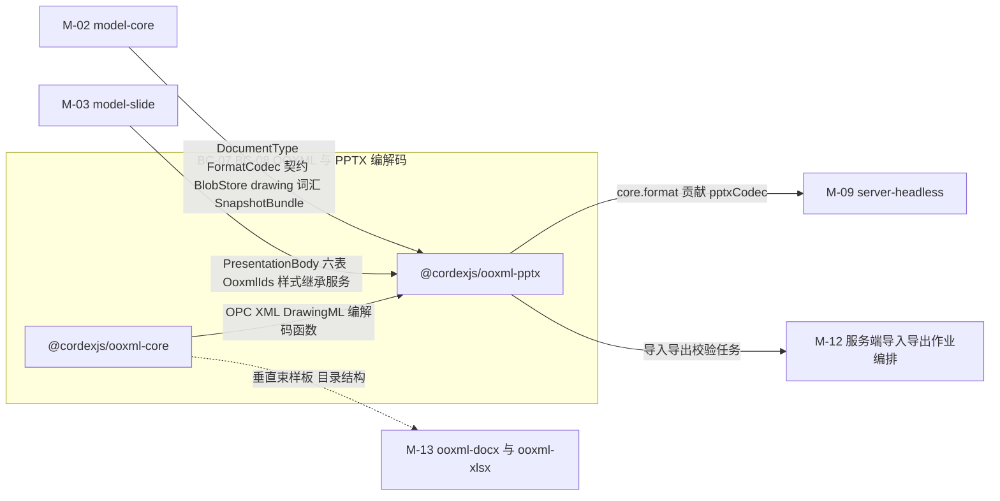
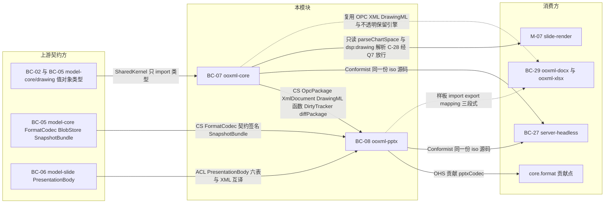
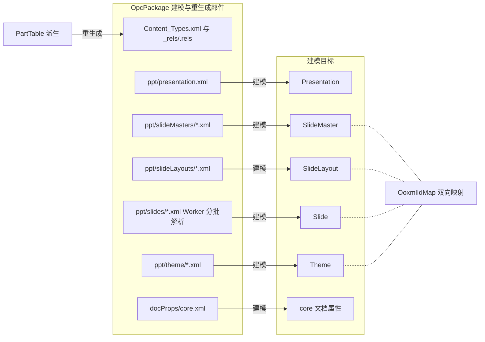
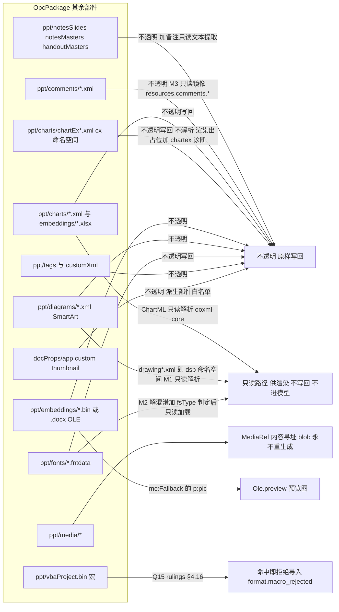
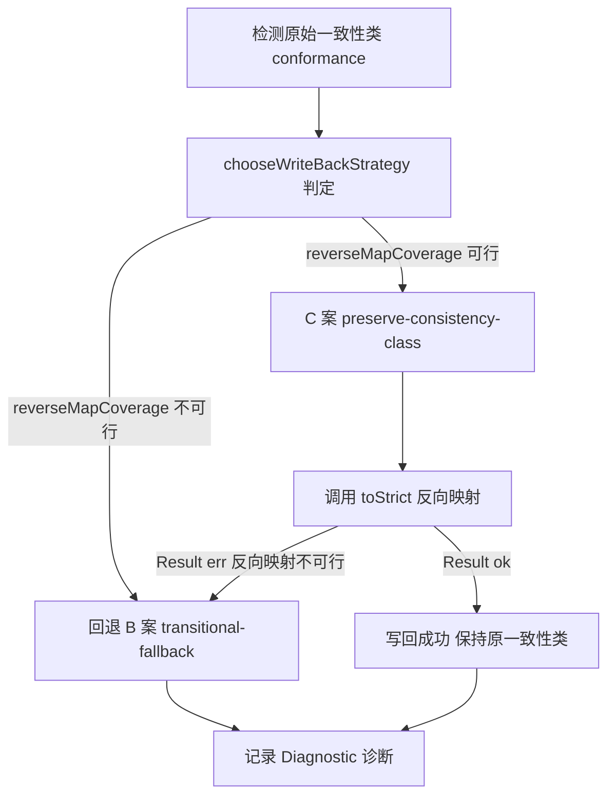
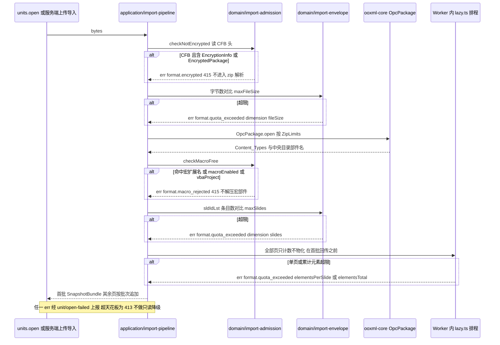
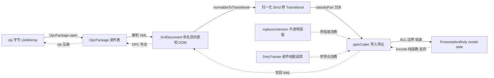
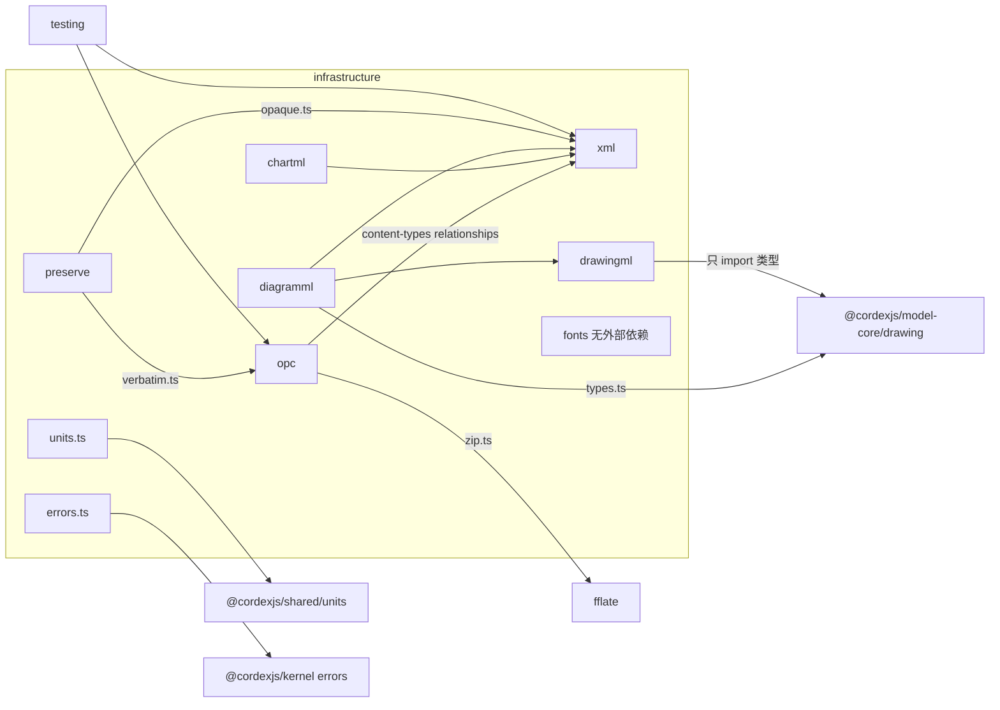
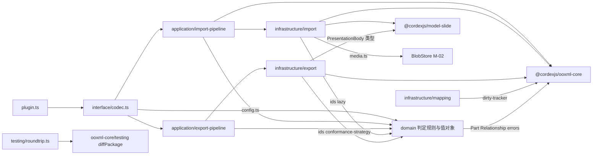

> 状态：草稿 v0.1 | 负责：架构-模块（阶段二） | 更新：2026-09-19；2026-09-24（rulings §4.15）；2026-09-24（rulings §4.16 Q15：`.pptm` / 宏包拒绝导入 `format.macro_rejected`）；2026-09-24（复核修正，rulings §4.17：H6 `format.encrypted` 与 EncryptionInfo/CFB 检测点；M19 `dimension` 取值对齐 30-architecture/10 含 `fileSize`；L2 残句）；2026-09-25（补图）；2026-09-25（矛盾收口，rulings §4.18）；2026-09-25（§4.19） | 依赖：00-module-map.md M-04 行、charter v0.2 §5.2 `ooxml-core`/`ooxml-pptx` 行、§6.1 D7/D16、§10 Q14/Q15；30-architecture 02 §4.9/§4.10、04 全篇；rulings-2026-09-14 A-3/PD-03/Q-T11/§4.11 C-28（经 §4.15 Q7 修订）/§4.15 Q5/Q7/Q8/§4.16 Q15；40-modules 02 §2.5/§2.6/§6、03 §2/§4/§6；PRD `01-open-and-fidelity.md`；08-backend-nestjs.md §16.2

# 04 OOXML 格式与 PPTX 编解码（限界上下文 BC-07 OOXML 格式基础设施、BC-08 PPTX 编解码）

## 0. 一页总览

| 项 | 值 |
|---|---|
| 职责一句话 | 文档类型盲的通用 OOXML 格式基础设施（OPC 包/命名空间感知 XML/Strict↔Transitional/DrawingML **编解码函数**/不透明保留引擎，`ooxml-core`）+ PresentationML ↔ `model-slide` 的 `FormatCodec` 防腐层（`ooxml-pptx`） |
| 覆盖的上下文 | BC-07、BC-08 |
| 承载包 / 目录 | `@cordexjs/ooxml-core`（L3，秩 30，iso，library）、`@cordexjs/ooxml-pptx`（V-codec，秩 35，iso，bundle=slide，plugin） |
| cordis 形态 | library（`ooxml-core`，无 Fiber、无 `plugin.ts`）+ plugin（`ooxml-pptx`，`contribute core.format(pptxCodec)`） |
| 运行位置 | 两端（浏览器与 `server-headless` 加载同一份源码，无条件编译分支） |
| 上游（依赖） | M-02（`model-core`：`DocumentType`/`FormatCodec` 契约、`BlobStore`、`drawing/` 词汇类型、`SnapshotBundle`）、M-03（`model-slide`：`PresentationBody` 六张实体表、`OoxmlIds`、样式继承服务） |
| 下游（被依赖） | M-07（`slide-render` 只读解析 chartml 与 `dsp:drawing`，直接调用 `ooxml-core`，C-28 经 rulings §4.15 Q7 放行）、M-09（`apps/server` 的 `cordis-host/preset-server.ts` 把本模块装配进 `server-headless`；`server-headless` 自身文档类型盲，经 `formats` 按 `documentType` 取 codec，rulings §4.18 FE-01）、M-12（服务端导入导出作业编排）、M-13（`ooxml-core` 是 `ooxml-docx`/`ooxml-xlsx` 的运行时依赖；`ooxml-pptx` 作为垂直束样板，rulings §4.18 FE-16） |
| 对外服务 | 无 `ctx.<name>` 服务（`ooxml-core` 非 cordis 实体；`ooxml-pptx` 能力经 `core.format` 贡献点暴露，不 `provide` 独立服务，module-map BC-08 行） |
| 贡献点 | 提供：`core.format`（key=`codec.id`，本模块贡献条目 `'ooxml-pptx'`）；消费：无 |
| doc / sheet 通用性 | `ooxml-core` = generic（供未来 `ooxml-docx`/`ooxml-xlsx` 复用同一 OPC/XML/DrawingML 编解码与不透明保留引擎，是文档类型盲的关键证据）；`ooxml-pptx` = vertical（`bundle=slide`） |
| 批次 | 2 |

### 0.1 图示

**图 0-1 模块包关系与上下游**



怎么读：`ooxml-core` 是文档类型盲的通用基础设施，`ooxml-pptx` 是唯一对 `model-slide` 做 ACL 翻译的一侧；两个上游都只单向传入类型/契约，下游消费方只经 `core.format` 贡献点取得编解码能力。

## 1. 限界上下文与边界

### 1.1 职责与非职责

**BC-07 `ooxml-core` 职责**：
- OPC 包读写：zip 确定性写入（条目按部件名排序、固定 mtime、固定压缩参数）、`[Content_Types].xml`/`.rels` 由 `PartTable` 生成、`ZipLimits` 安全上限。
- 命名空间感知的最小保真 XML DOM：自研解析器/序列化器，保留前缀、属性顺序、空白文本、注释、PI。
- Strict ↔ Transitional 归一化（导入方向）与反向映射（导出方向，供 §4.4 三案的 C 案使用）。
- DrawingML **编解码函数**：XML ↔ 类型的转换算法；运行时类型本身定义在 `model-core/drawing`，本包只消费不重复定义（§2.2、§12 G-1 记录一处现存文档矛盾）。
- ChartML（`c:` 命名空间）只读解析：产出 `ChartReadModel`，M1 图表查看路径用，不写回、不进模型。`parseChartSpace` **唯一归属本包**（rulings §4.15 Q7）：`slide-render`（M-07）直接调用本包解析 chartml，`ooxml-pptx` 不重复解析（rulings §4.11 C-28 经 §4.15 Q7 修订，放行 `slide-render → ooxml-core`，仅限只读解析 chartml 与 diagram drawing）。
- SmartArt 绘图部件（`dsp:drawing`，`http://schemas.microsoft.com/office/drawing/2008/diagram`）只读解析：产出 `DiagramDrawingReadModel`（形状树 + 每个 `dsp:sp` 的 `dsp:txXfrm` 文本框变换），M1 SmartArt 查看路径用（PRD OF-10），不写回、不进模型；同样由 `slide-render` 直接调用（rulings §4.15 Q7）。
- 内嵌字体部件（`.fntdata`/obfuscated TTF）解混淆与 OS/2 `fsType` 嵌入许可判定（M2，PRD OF-17）：受限（Restricted License）/仅预览与打印（Preview & Print）的字体只可用于**只读渲染**，编辑态一律用回退字体（rulings §4.15 Q7）；上限单字体 ≤ 20 MB、总计 ≤ 60 MB（OF-17 口径），超限跳过并诊断。
- 不透明保留引擎（`captureUnknown`/`reinsert`）与 `DirtyTracker`；`mc:AlternateContent` 的 Choice/Fallback 判定（`FeatureSet` 规则见 §2.3：`a14`/`am3d`/`p14` 视为不支持而走 Fallback；Choice 需要 `cx*`（chartex）时**不选 Fallback**，交给调用方出占位 + 诊断）。
- `Relationship` 全部原样保留（含 `mailto:`/`file:`/相对路径等任意 External 目标），**仅 `http(s)` 可激活**（`isActivatableExternal`；D7/OF-18，M1 必修，rulings §4.15 Q7）；是否实际加载外链资源由渲染层按部署配置 `externalResources` 决定，本包不做任何网络访问，服务端永不加载。
- `testing/`：`diffPackage`（部件级包差异，供本包与 `ooxml-pptx` 共用）、OPC/XML 夹具构造器。

**BC-07 非职责**（明确边界并指向负责模块）：
- 不认识 PresentationML、`slide` 字面量或任何文档类型概念——水平层铁律：`ooxml-core` 源码不出现 slide 字面量（module-map §4.2 第 2 条）。
- 不定义 DrawingML 运行时类型——只 import `model-core/drawing` 的类型（M-02）。
- 不做样式继承解析——`model-slide/domain/style/**`（M-03）。
- 不做布局测量或渲染——`engine-layout`/`engine-render`（M-06）；秩表机械禁止秩 30 的包 import 秩 50 的引擎包（R2）。
- 不做 PowerPoint 特定的部件级组装或占位符继承落地——`ooxml-pptx` 的职责（本模块内的另一侧）。

**BC-08 `ooxml-pptx` 职责**：
- PresentationML ↔ `model-slide.PresentationBody` 的双向 `FormatCodec`（向 `core.format` 贡献，条目 id=`'ooxml-pptx'`）。
- 部件分类（建模 / 不透明 / 媒体）、占位符与继承关系的部件级落地、母版/版式/主题/页的解析与生成。
- 稳定 id 双向映射（`OoxmlIdMap`，ADR-0014：`cNvPr/@id`、`a16:creationId` ↔ `NodeId`）。
- Strict 写回三案的选择与执行（默认「C 为目标、B 为自动回退」，章程 Q14/rulings A-3 更新）。
- 媒体部件内容寻址去重、`p:timing` 悬空引用清理（PRD OF-12）、现代评论/图表内嵌工作簿（M3）。
- 宏包拒绝（rulings §4.16 Q15，偏离原默认「宏原样保留」）：扩展名 `.pptm`、主内容类型为 `macroEnabled`、或包内存在 `vbaProject.bin`（含 `application/vnd.ms-office.vbaProject` 内容类型）任一命中即**拒绝导入**并返回 `format.macro_rejected`，不解析任何页、不保留宏部件；`.ppsx`/`.potx` 不受影响；检测点见 §2.6。
- 加密包拒绝（rulings §4.16 Q15，2026-09-24 复核 H6）：输入字节以 CFB 魔数 `D0 CF 11 E0 A1 B1 1A E1` 开头、且 CFB 目录含 `EncryptionInfo`（或 `EncryptedPackage`）流即**拒绝导入**并返回 `format.encrypted`（HTTP 415，提示「请先去除密码再导入」），M1–M4 一律如此；该判定先于 zip 解析，**不得**报成无效包；检测点见 §2.6。
- 导入规模上限检查（rulings §4.15 Q5；上限即**系统天花板**，不是性能保证包络，§4.18 UX-13）：文件大小 / 页数 / 单页元素 / 文档总元素超出**部署配置**给定上限（默认 200 MB / 200 / 1,000 / 20,000；`dimension` 依次为 `fileSize`/`slides`/`elementsPerSlide`/`elementsTotal`，与 30-architecture/10 §1.4 取值表一致）即**拒绝导入**并返回 `format.quota_exceeded`，不做只读降级打开；检测点见 §2.6。
- OLE 预览提取：`mc:Fallback` 里的 `p:pic` 提取为 `Ole.preview`（M1 显示预览图；EMF/WMF 预览的栅格化属 M-07 的 M2 惰性 Worker，rulings §4.15 Q7）。
- `mc:AlternateContent` 对象建模：`UnknownShape` 携带 `transform` 与渲染提示；删除（M1 P0）整体移除，移动/缩放（M2 P1）把新 `xfrm` 回写到每个分支（Choice 与 Fallback），PD-18 随之结案（rulings §4.15 Q7）。
- `docProps/thumbnail.jpeg`：导入时原样保留供服务端取封面（M2，服务端只做头校验不解码，rulings §4.15 Q8）；导出时经 `encode()` 显式输入 `thumbnailJpeg?: BlobRef` 替换，缺省则 verbatim。
- `testing/roundtrip`：部件级 diff 驱动的保真验收工具（复用 `ooxml-core/testing/diffPackage`，不重复实现比较逻辑）。

**BC-08 非职责**：
- 不重新实现 OPC/XML/DrawingML 编解码——依赖 `ooxml-core`（Customer–Supplier，向下依赖 L3）。
- 不重新实现样式继承解析——依赖 `model-slide/domain/style/**`（Conformist）。
- 不做布局测量、不读时钟、不读随机源——导出必须是纯函数（SV-02 前提，架构 08 §16.2；R2 机械禁止 V-codec import `engine-layout`）。
- 不持有渲染/UI 逻辑——`slide-render`（M-07）、`slide-ui`（M-10）。
- 不做协同/CRDT 逻辑——服务端导入走 `units.open` 的 `load` 路径（`origin: system('import')`），不经命令管线（架构 08 §16.1）。

### 1.2 通用语言

> 不重复 charter §4 与 module-map §2 已收录的条目；只列本上下文关键词与本文档新引入的术语。

| 术语 | 定义 | 来源 |
|---|---|---|
| 部件（Part）、不透明保留 | charter §4 已收录 | charter §4 |
| `Part`/`PartTable`、`OpaqueXml`/`OpaquePartRef`、`DirtyTracker`、`SafeXmlNode` | module-map BC-07 特有名词 | module-map §2 |
| `PresentationML`、Strict↔Transitional、`ChartReadModel` | module-map BC-08 特有名词 | module-map §2 |
| `OoxmlIdMap` | 部件名 + `cNvPr/@id` ↔ `NodeId` 的双向映射表 | 架构 04 §9 |
| `PartClassification`（本文档命名） | 一个 Part 在 pptx 语境下的分类：`modeled` \| `opaque-part` \| `media` | 02 §4.10 `classify.ts` 的既有职责，本文档命名并归入 domain |
| `WriteBackStrategy`（本文档命名） | 导出时选择的一致性类写回策略：`preserve-consistency-class`（C 案）\|`transitional-fallback`（B 案） | 架构 04 §4.4 |
| `ZipLimits` | zip/XML 输入安全上限值对象 | 架构 04 §5.5；PRD OF-24 |
| `ImportEnvelope`（本文档命名） | 导入规模上限值对象：文件大小（`maxFileSize`，默认 200 MB）/ 页数 / 单页元素 / 文档总元素，取值来自部署配置，超出即拒绝导入（`format.quota_exceeded`） | rulings §4.15 Q5 |
| `DiagramDrawingReadModel`（本文档命名） | SmartArt `dsp:drawing` 部件的只读视图（形状树 + `dsp:txXfrm`），与 `ChartReadModel` 同属只读、不进模型 | rulings §4.15 Q7；PRD OF-10 |
| `FontEmbeddingPermission`（本文档命名） | 内嵌字体 OS/2 `fsType` 判定结果：`installable`\|`editable`\|`preview-print`\|`restricted`；后两者仅限只读渲染 | rulings §4.15 Q7；PRD OF-17 |

### 1.3 上下文映射

| 相邻上下文 | 关系类型 | 防腐层落点 | 传递的契约 |
|---|---|---|---|
| BC-02/BC-05（`model-core/drawing`） | Shared Kernel | `ooxml-core/infrastructure/drawingml/*.ts`（只 import 类型，不重定义） | `Color`/`Fill`/`Line`/`EffectList`/`Geometry`/`Transform`/`FontRef`/`TextBody` 等值对象类型 |
| BC-05（`model-core`：`DocumentType`/`FormatCodec`/`BlobStore`/`Snapshot`） | Customer–Supplier（`ooxml-pptx` 是客户） | `ooxml-pptx/interface/codec.ts` | `FormatCodec<S>` 契约签名、`SnapshotBundle`、`core.format` 贡献点 schema |
| BC-06（`model-slide`：`PresentationBody`） | **Anticorruption Layer**（单向：`ooxml-pptx` 知道 `model-slide` 类型，`model-slide` 不出现任何 XML/OOXML 类型） | `ooxml-pptx/application/{import,export}-pipeline.ts` | `PresentationBody` 六表 ↔ PresentationML XML 字节 |
| BC-07（`ooxml-core`） | Customer–Supplier（`ooxml-pptx` 是客户，向下依赖 L3） | `ooxml-pptx` 全部 `infrastructure/**` 对 `ooxml-core` 的 import | `OpcPackage`/`XmlDocument`/DrawingML 编解码函数/`DirtyTracker`/`diffPackage` |
| BC-05（`core.format` 贡献点） | Open Host Service（`ooxml-pptx` 是贡献方之一，未来 `ooxml-docx`/`ooxml-xlsx` 是同类贡献方） | `ooxml-pptx/plugin.ts` | `FormatCodec` 实例（`pptxCodec`） |
| BC-27（`server-headless`） | Conformist（加载与浏览器相同的 iso 插件，不改契约） | 无独立文件（直接 import 本模块两个包） | 同一份源码，无条件编译分支 |
| BC-29（未来 `ooxml-docx`/`ooxml-xlsx`） | 样板关系（非依赖） | — | 目录结构与 `import/export/mapping` 三段式模式（§8） |

**图 1-1 对外契约与上下游关系**



怎么读：箭头从契约提供方指向消费方，边上文字是关系类型（SharedKernel/CS/ACL/OHS/Conformist）与传递的契约；虚线是 M5 样板或复用关系，不是当前的运行时依赖。`slide-render` 直连 `ooxml-core` 只读解析一条取自 §1.1（rulings §4.15 Q7），§0 下游字段已按 rulings §4.18 FE-14 补列 M-07。

依据：本节上表；§1.1；rulings §4.11 C-28 经 §4.15 Q7 修订。

## 2. 领域模型（ACL 模型改写）

> 本节按总编排要求改写为 ACL 视角，跨越 BC-07/BC-08 两个上下文一并描述；§4/§5 再按包拆分落到具体文件。

### 2.1 包 / 部件 / 关系聚合

| 实体 / 聚合根 | 角色 | 关键字段与不变量 | 归属文件 |
|---|---|---|---|
| `OpcPackage`（聚合根） | 一次 zip 解包/回写会话 | `parts: PartTable`、`contentTypes`、`rootRels`；`open(bytes, limits)`/`write(table)`；不变量：未修改部件字节级往返恒等（D7、§5.4） | `ooxml-core/infrastructure/opc/package.ts` |
| `Part` | 包内一个物理条目 | `name: PartName`、`contentType`、`bytes(): Promise<Uint8Array>`（懒解压）、`rels: Relationship[]`、`hash?: sha256`；不变量：`name` 唯一且以 `/` 开头 | `ooxml-core/infrastructure/opc/part.ts` |
| `PartTable` | `Part` 的索引与增删改视图 | 按名 / 内容类型 / 关系类型三种索引；`dirty` 标记集合；不变量：任一时刻每个 `PartName` 至多一个 `Part` | `ooxml-core/infrastructure/opc/part-table.ts` |
| `ContentTypes` | `[Content_Types].xml` 的读写投影 | `Default: Map<ext,contentType>`、`Override: Map<partName,contentType>`；不变量：**始终**由 `PartTable` 重生成，零编辑场景外从不 verbatim | `ooxml-core/infrastructure/opc/content-types.ts` |
| `Relationship`/`RelationshipTable` | 一个部件的 `.rels` | `{ id: RId; type; target; targetMode: 'Internal'\|'External' }`；不变量：`rId` 同 `.rels` 内唯一；**全部关系原样保留**（任意 `External` 目标——`http(s)`/`mailto:`/`file:`/相对路径——的 `Target` 字符串与 `TargetMode` 在重生成 `.rels` 时逐字带回，零编辑往返不丢，D7/OF-18、ADR-0008 决策 5），**仅 `http(s)` 可激活**（`isActivatableExternal(rel)`；超链接点击与外链资源加载只对其放行，OF-24/EM-14 安全约束）。M1 必修（rulings §4.15 Q7） | `ooxml-core/infrastructure/opc/relationships.ts` |
| `XmlDocument`/`XmlElement` | 命名空间感知最小保真 DOM | `root: XmlElement`、`declaration`；不变量：保留前缀、属性顺序、空白文本、注释、PI（保真第一层） | `ooxml-core/infrastructure/xml/node.ts`、`parser.ts` |
| `OpaqueXml`/`OpaquePartRef`（值对象，类型来自 M-03） | 不透明保留槽的载荷 | `OpaqueXml{ xml; anchor:{after,ordinal}; namespaces }`；`OpaquePartRef` = 未建模整部件的引用 | 生成/消费于 `ooxml-core/infrastructure/preserve/opaque.ts`；类型定义见 03 §2.2 |
| `DirtyTracker` | 部件级脏追踪 | `registerPart(name, pathPrefixes)`、`markDirty(paths)`、`markDirtyFrom(change)`、`isDirty(name)`、`clear()`；不变量：`markDirtyFrom` 忽略 `origin` 为 `system('load')`/`system('import')` 的 `ChangeSet`——渐进打开的后续批次追加不标脏，打开 200 页后零编辑导出零脏部件（rulings §4.18 CO-12） | `ooxml-core/infrastructure/preserve/dirty-tracker.ts` |
| `PptxCodec`（`pptxCodec`，BC-08 聚合根） | 一个 `FormatCodec<PresentationBody>` 实例 | `id/documentType/mimeTypes/extensions/canImport/canExport/import/export`（§2.5） | `ooxml-pptx/interface/codec.ts` |
| `OoxmlIdMap` | 导入/导出会话内的双向 id 映射 | `partName + cNvPrId ↔ NodeId`；缺失/冲突 → 分配并诊断 `format.pptx.id_collision_repaired` | `ooxml-pptx/domain/ids/ooxml-id-map.ts` |

**PPTX 部件图**（建模 / 不透明 / 媒体三分类，对应 §4.1 部件级映射表；原 ASCII 部件图按「建模与重生成」「不透明、媒体与拒绝」拆为下面两张）：

**图 2-3 PPTX 部件图之一 建模与重生成部件**



怎么读：实线是「部件 → 建模实体」的导入方向，`[Content_Types].xml`（Mermaid 标签内省去方括号）与 `_rels/.rels` 不 verbatim、始终由 `PartTable` 重生成；虚线表示 `SlideMaster`/`SlideLayout`/`Slide`/`Theme` 四类实体经 `OoxmlIdMap` 与部件内 id 双向映射（原图括号范围：母版至主题，不含 `presentation.xml`）。

**图 2-4 PPTX 部件图之二 不透明、媒体与拒绝部件**



怎么读：每个部件指向它的处理类别；同一部件有两条出边时两条路径并存（如图表部件既原样写回、又被 `ooxml-core` 只读解析供渲染）。`docProps/thumbnail.jpeg` 虽归不透明类，但可由 `encode` 的 `thumbnailJpeg` 显式替换（§2.2 `EncodeInputs`）。

依据：本节原 ASCII 部件图；§1.1 BC-07/BC-08 职责；rulings §4.15 Q7/Q8、§4.16 Q15。

### 2.2 值对象

| 名称 | 字段摘要 | 校验/构造 | 所在文件 | 归属 |
|---|---|---|---|---|
| `PartName` | 品牌 `string`：以 `/` 开头，规范化大小写与 `../` | 构造函数校验 | `ooxml-core/infrastructure/opc/part-name.ts` | 本包 |
| `QName{ ns; local }` | 命名空间限定名 | 纯类型 | `ooxml-core/infrastructure/xml/node.ts` | 本包 |
| 命名空间常量 + Strict↔Transitional 映射表条目 | `{ strictUri; transitionalUri }`，覆盖 `a/p/r/mc/a14/a16/p14/c/dgm` 等前缀，48 对（借鉴 pptx-viewer） | 静态表 | `ooxml-core/infrastructure/xml/namespaces.ts` | 本包 |
| `ZipLimits` | `{ maxEntries=4000; maxEntryBytes=64MiB; maxTotalBytes=512MiB; maxMediaBytes=256MiB }` | zod（PRD OF-24 默认值，集成方/部署配置可收紧、放宽不超 2×；单组织部署无租户维度，rulings §4.15 T-0） | `ooxml-core/infrastructure/opc/zip.ts` | 本包 |
| `ImportDiagnostic` | `{ severity:'info'\|'warning'\|'error'; partName; path（XPath 风格）; code; message; data? }` | zod | `ooxml-core/infrastructure/diagnostics.ts` | 本包 |
| `Emu`/`Pt`/`HundredthPt`/`Angle60k`/`Percent1000`/`Percent100k` | 品牌数值 | 品牌构造于 `@cordexjs/shared`；本包只做**词法**解析（`"50%"` 与 `50000` 两种 OOXML 记法 ↔ 品牌数值） | `ooxml-core/infrastructure/units.ts` | Shared Kernel（`@cordexjs/shared`），本包消费 |
| `Color`/`Fill`/`Line`/`EffectList`/`Geometry`/`Transform`/`FontRef`/`TextBody`/`Hyperlink` 等 DrawingML 值对象 | 见架构 04 §4.3 映射表 | zod（`model-core/src/drawing/schema/*.ts`） | **不在本包定义**：`@cordexjs/model-core/src/drawing/**`（Shared Kernel，经 BC-05 转发） | Shared Kernel；本包 `infrastructure/drawingml/*.ts` 只 import 并实现编解码函数（§2.3、§12 G-1） |
| `ChartReadModel` | 图表类型/系列/轴/图例/标题/数据标签，`numCache`/`strCache` 提取，`ptCount ≤ 10,000`/序列 | zod（只读视图标注） | `ooxml-core/infrastructure/chartml/types.ts` | 本包（ChartML 无对应共享内核，M1 只读） |
| `DiagramDrawingReadModel` | `shapes: { geometry; transform; fill; line; text?: { body; txXfrm?: Transform } }[]`（`dsp:spTree` 扁平化，组变换已折算；`dsp:txXfrm` 缺省时文本框 = 形状框） | zod（只读视图标注） | `ooxml-core/infrastructure/diagramml/types.ts` | 本包（M1 只读，不进模型） |
| `FontEmbeddingPermission` | `'installable' \| 'editable' \| 'preview-print' \| 'restricted'`（OS/2 `fsType` 位 0x0000/0x0008/0x0004/0x0002，多位并存取最严）；`usage = installable\|editable ? 'edit' : 'render-only'` | 判别字面量 | `ooxml-core/infrastructure/fonts/embedded-font.ts` | 本包（M2） |
| `PartClassification` | `'modeled' \| 'opaque-part' \| 'media'` | 判别字面量 | `ooxml-pptx/domain/classify.ts` | 本包（ooxml-pptx） |
| `WriteBackStrategy` | `'preserve-consistency-class' \| 'transitional-fallback'` | 判别字面量 | `ooxml-pptx/domain/conformance-strategy.ts` | 本包（ooxml-pptx） |
| `PptxCodecConfig` | `{ progressive: boolean; batchSize: number; zipLimits?: Partial<ZipLimits>; strictWriteBack: 'preserve'\|'transitional'; envelope?: Partial<ImportEnvelope> }`（`progressive` 取代原 `lazySlides`：不再是「Store 内按需物化」，而是 Worker 分批回传、主线程首批装载后台追加，rulings §4.18 CO-12） | zod（`core.format` 贡献 schema 的插件配置部分；`envelope` 由组合根从部署配置注入） | `ooxml-pptx/domain/config.ts` | 本包（ooxml-pptx） |
| `ImportEnvelope` | `{ maxSlides=200; maxElementsPerSlide=1000; maxElementsTotal=20000 }`（rulings §4.15 Q5 系统天花板；部署配置**完全可调**，调高超出性能保证包络时由装配方告警、性能承诺不再成立，本模块只按传入值判定） | zod | `ooxml-pptx/domain/import-envelope.ts` | 本包（ooxml-pptx） |
| `EncodeInputs` | `{ thumbnailJpeg?: BlobRef }`（rulings §4.15 Q8；由 `export-pipeline` 在调用前解析为字节随调用传入，`encode` 自身不做 IO） | 纯类型 | `ooxml-pptx/infrastructure/export/writer.ts` | 本包（ooxml-pptx） |
| `OoxmlIds`（`{ cNvPrId?: number; creationId?: string }`） | 见 03 §2.2 | zod | 类型定义在 `model-slide/src/ids.ts`（M-03），本包只读写 | Conformist |

### 2.3 纯函数

> 全部无 IO、无随机、无时钟；浏览器与 `server-headless` 复用同一份源码。

| 函数 | 签名（草案） | 所在文件 | 两端共用 |
|---|---|---|---|
| `normalizeToTransitional` | `(doc: XmlDocument) => { doc: XmlDocument; wasStrict: boolean }` | `ooxml-core/infrastructure/xml/normalize.ts` | 是 |
| `toStrict` | `(doc, reverseMap) => Result<XmlDocument, Diagnostic[]>`（C 案专用；反向映射不可行 → `err` 触发回退 B） | `ooxml-core/infrastructure/xml/normalize.ts` | 是 |
| `resolveAlternateContent` | `(mc: XmlElement, supported: FeatureSet) => { branch: XmlElement \| null; reason: 'choice' \| 'fallback' \| 'chartex' }`（`mc:AlternateContent` 的 Choice/Fallback 判定；`FeatureSet` 默认把 `a14`/`am3d`/`p14` 视为**不支持**而走 Fallback；Choice 的 `Requires` 含 `cx*` 时返回 `branch:null, reason:'chartex'`——**不选 Fallback**（其内容通常是「此版本不支持该图表」的文本），由调用方出占位 + `format.pptx.chartex_unsupported` 诊断，rulings §4.15 Q7） | `ooxml-core/infrastructure/xml/mce.ts` | 是 |
| `canonicalize`（c14n） | `(doc: XmlDocument) => string`（属性排序 + 空白规范，仅供测试比较，不用于导出） | `ooxml-core/infrastructure/xml/c14n.ts` | 是 |
| DrawingML 编解码函数对 | `parseColor/serializeColor`、`parseFill/serializeFill` 等，line/effect/geometry/transform/font/text 各一对：`(xml: XmlElement) => T`/`(v: T) => XmlElement` | `ooxml-core/infrastructure/drawingml/{color,fill,line,effect,geometry,transform,font,text}.ts` | 是 |
| `parseChartSpace` | `(xml: XmlElement) => Result<ChartReadModel, Diagnostic[]>`（唯一实现在本包；`slide-render` 直接调用，C-28 经 §4.15 Q7 修订） | `ooxml-core/infrastructure/chartml/parser.ts` | 是 |
| `parseDiagramDrawing` | `(xml: XmlElement) => Result<DiagramDrawingReadModel, Diagnostic[]>`（`dsp:drawing` 只读解析，含 `dsp:txXfrm`；形状属性复用 `drawingml/*` 编解码函数） | `ooxml-core/infrastructure/diagramml/drawing.ts` | 是 |
| `isActivatableExternal` | `(rel: Relationship) => boolean`（仅 `TargetMode='External'` 且 scheme 为 `http`/`https` 时为 `true`；其余关系照样保留、只是不可激活） | `ooxml-core/infrastructure/opc/relationships.ts` | 是 |
| `deobfuscateFont`/`readFsType` | `(bytes, fontKeyGuid) => Uint8Array`；`(ttf: Uint8Array) => FontEmbeddingPermission`（M2，OF-17） | `ooxml-core/infrastructure/fonts/embedded-font.ts` | 是 |
| `checkMacroFree` | `(head: { fileName?: string; mainContentType: string; contentTypes: readonly { partName?: string; extension?: string; contentType: string }[]; partNames: readonly string[] }) => Result<void, FormatError<'format.macro_rejected'>>`（命中 `.pptm`/`.ppsm`/`.potm` 扩展名、`*.macroEnabled.*` 主内容类型、`vbaProject.bin` 部件或 `application/vnd.ms-office.vbaProject` 内容类型任一即返回 `{ reason:'extension'\|'content_type'\|'vba_part' }`；rulings §4.16 Q15） | `ooxml-pptx/domain/import-admission.ts` | 是 |
| `checkNotEncrypted` | `(head: Uint8Array) => Result<void, FormatError<'format.encrypted' \| 'format.unsupported_mime'>>`（前 8 字节为 CFB 魔数 `D0 CF 11 E0 A1 B1 1A E1` 时，只读 CFB 头与目录扇区链查找 `EncryptionInfo`/`EncryptedPackage` 流：命中 → `format.encrypted{container:'cfb'}`；未命中（旧版二进制 `.ppt`）→ `format.unsupported_mime`；非 CFB 放行交给 `OpcPackage.open`；复核 H6，rulings §4.16 Q15） | `ooxml-pptx/domain/import-admission.ts` | 是 |
| `checkImportEnvelope` | `(counts: { fileSize; slides; elementsPerSlide: readonly number[]; elementsTotal }, envelope: ImportEnvelope) => Result<void, FormatError<'format.quota_exceeded'>>`（首个超限维度即返回 `{ dimension:'fileSize'\|'slides'\|'elementsPerSlide'\|'elementsTotal'; limit; actual; slideIndex? }`；取值与 30-architecture/10 §1.4 表一致） | `ooxml-pptx/domain/import-envelope.ts` | 是 |
| `captureUnknown`/`reinsert` | `(element, knownChildren) => OpaqueXml[]`；`(parent, opaques, schemaOrder) => void` | `ooxml-core/infrastructure/preserve/opaque.ts` | 是 |
| `diffPackage`（新增，§12 G-3） | `(a: OpcPackage, b: OpcPackage) => readonly PartDiff[]` | `ooxml-core/testing/diff-package.ts` | 是（测试专用，两端 CI 均调用） |
| `createIdMap`/`allocateId`/`lookupId` | `() => OoxmlIdMap`；`(map, partName) => number`；`(map, partName, cNvPrId) => NodeId \| undefined` | `ooxml-pptx/domain/ids/ooxml-id-map.ts` | 是 |
| `classifyPart` | `(part: Part, relGraph: RelGraph) => PartClassification` | `ooxml-pptx/domain/classify.ts` | 是 |
| `chooseWriteBackStrategy` | `(conformance: 'strict'\|'transitional', reverseMapCoverage: boolean) => WriteBackStrategy` | `ooxml-pptx/domain/conformance-strategy.ts` | 是 |
| `encode`（纯导出核心，架构 08 §16.2 命名） | `(snapshot: Persisted<PresentationBody>, baselinePackage: OpcPackage, dirty: DirtyTracker, inputs?: EncodeInputs) => OpcPackage`——不读时钟 / 不读随机源 / 不读 `layout`（R2 机械禁止）；`inputs.thumbnailJpeg` 是 `docProps/thumbnail.jpeg` 的**唯一**改写来源（显式输入，确定性不受影响；缺省则该部件 verbatim，rulings §4.15 Q8） | `ooxml-pptx/infrastructure/export/writer.ts` | 是 |

**图 2-1 Strict 与 Transitional 写回决策**



怎么读：默认目标是 C 案（保留原一致性类），只有 `toStrict` 反向映射不可行时才回退到 B 案（转 Transitional 写回），两条路径都留下诊断记录，供保真报告与 CI 消费。

### 2.4 领域事件

本模块（BC-07/BC-08）**不定义新的事件域**——module-map BC-07/BC-08 行分别登记「发布事件：无」「无专属」；诊断经返回值（`ImportResult.diagnostics`、`Result.err(FormatError)`）向上传递，由 M-02 的 `formats`/`units` 服务转译为 cordis 事件：

| 语义 | 转译为的事件 | 发布者 | 触发条件 |
|---|---|---|---|
| 导入进度（`unzip`/`parse-presentation`/`parse-slide`/`decode-media`/`render-first` 五阶段，PRD OF-01） | `unit/open-progress` | `model-core/src/unit/unit-plugin.ts`（M-02） | `application/import-pipeline.ts` 按阶段回调上报 |
| 导入失败 | `unit/open-failed` | `model-core/src/unit/unit-plugin.ts`（M-02） | `import-pipeline.ts` 返回 `Result.err` |
| 导出开始/完成/失败 | `export/started`/`export/completed`/`export/failed` | `model-core/src/format/formats.service.ts`（M-02） | `core.export` 命令调用 `formats.export` 后按 `application/export-pipeline.ts` 的返回值 |
| 降级渲染（EMF 无预览、图表缓存缺失等） | `render/element-degraded`（非本模块事件域，供 M-07 消费） | `slide-render`（M-07） | 消费本模块产出的诊断码（如 `format.pptx.chart_cache_missing`、`format.pptx.chartex_unsupported`→`chartex-unsupported`、`format.pptx.diagram_drawing_missing`）后自行判定 |
| 数字签名部件因编辑而失效（Q15/rulings §4.12 U-05，**已采纳**） | `format.pptx.signature_invalidated`（诊断，`warning` 级，不阻断导出；随 `export/completed` 的 diagnostics 一并携带，非独立 cordis 事件） | `ooxml-pptx/infrastructure/export/conformance-writer.ts` | 导出时检测到 `_xmlsignatures/*` 部件存在且本次导出含任意脏部件 |

`format` 是 charter §5.5 登记的保留事件域前缀之一；本模块当前没有需要独立 `format/*` cordis 事件的场景，若未来新增（如超长导入的中间态广播）须先核对 §5.5 是否已有更合适的域，不得随意新造。

### 2.5 外部契约（`FormatCodec` Definition）

`FormatCodec<S>` 契约本身由 **M-02 `model-core`** 定义（`model-core/src/format/format-codec.ts`），本模块只在 `S = PresentationBody` 处提供**唯一**具体实例：

```ts
// 契约定义（M-02 所有，本模块只消费；≤ 40 行）
interface FormatCodec<S = unknown> {
  readonly id: string
  readonly documentType: string
  readonly mimeTypes: readonly string[]
  readonly extensions: readonly string[]
  readonly canImport: boolean               // 导出专用编解码器在此填 false（charter §5.5）
  readonly canExport: boolean
  import(bytes: Uint8Array, blobs: BlobStore, opts?: ImportOptions):
    Promise<Result<ImportResult<S>, FormatError>>
  export(unitScope: UnitScope<S>, opts?: ExportOptions):
    Promise<Result<Uint8Array, FormatError>>
}
interface ImportResult<S> {
  snapshot: SnapshotBundle<S>
  diagnostics: readonly ImportDiagnostic[]
}

// 本模块的唯一实例（ooxml-pptx/interface/codec.ts）
export const pptxCodec: FormatCodec<PresentationBody> = {
  id: 'ooxml-pptx', documentType: 'slide',
  mimeTypes: ['application/vnd.openxmlformats-officedocument.presentationml.presentation' /* + .slideshow/.template；macroEnabled.12 仅登记用于识别，import 恒返回 format.macro_rejected */],
  extensions: ['.pptx', '.ppsx', '.potx', '.pptm' /* 仅识别以给出 format.macro_rejected，而非 unsupported_mime；export 永不产出 .pptm */],
  canImport: true, canExport: true,
  import: importPptx, export: exportPptx,
}
```

契约套件：`runFormatCodecConformance(createCodec, fixtures)`——命名遵循 charter §5.5 `run<Definition>Conformance` 约定，应由 `model-core/testing` 导出（**M-02 现存缺口**：02 号文档 §4.5/§6 尚未列出此文件，§12 G-2 记录并建议 M-02 补齐）。`ooxml-pptx/__tests__` 以 `runFormatCodecConformance(() => pptxCodec, pptxFixtures)` 实例化，覆盖：`canImport`/`canExport` 与实际行为一致、`import` 产出的 `snapshot` 经 `bodySchema.parse` 通过、零编辑 `import→export` 幂等（委托 `testing/roundtrip.ts`）、不支持的 MIME 返回 `format.unsupported_mime` 而非抛异常。

### 2.6 应用服务

| 服务 | 职责 | 所在文件 |
|---|---|---|
| 导入管线 | `bytes → OpcPackage.open → 定位 presentation 部件 → 遍历 rels 图 → classifyPart → 按类型分派到 infrastructure/import/* → 组装 PresentationBody + opaqueParts + media → SnapshotBundle`；渐进打开（`progressive:true`，M-02 `importProgressive`）时整条管线在 `import.worker.ts` 内运行：全量轻量计数 → 首批（主题/母版/版式 + 首页）回传 → 其余页按 order 每批 `batchSize` 页回传，`prioritize(slideId)` 抢占（rulings §4.18 CO-12/CO-11） | `ooxml-pptx/application/import-pipeline.ts` |

**加密包拒绝的检测点**（rulings §4.16 Q15，2026-09-24 复核 H6；`checkNotEncrypted` 纯函数）：导入管线**第一步**、`OpcPackage.open` 之前执行——CFB 魔数命中且目录含 `EncryptionInfo`/`EncryptedPackage` 流即 `Result.err(format.encrypted{container:'cfb'})`（HTTP 415，经 `unit/open-failed` 上报，界面提示「请先去除密码再导入」）；不尝试解密、不进入 zip 解析，因而不会被误报为无效包/zip 解析失败。服务端上传导入与浏览器本地打开走同一纯函数。

**宏包拒绝的检测点**（rulings §4.16 Q15；`checkMacroFree` 纯函数）：`OpcPackage.open` 读完 `[Content_Types].xml` 与中央目录（部件名列表）之后、解析 `ppt/presentation.xml` 与任何页之前执行；命中即 `Result.err(format.macro_rejected{reason})`（HTTP 415，经 `unit/open-failed` 上报，界面提示「请另存为 .pptx 后再导入」），不解压 `vbaProject.bin` 本体、不产出 `SnapshotBundle`。服务端上传导入与浏览器本地打开走同一纯函数。

**导入规模上限（系统天花板）检查的检测点**（rulings §4.15 Q5、§4.18 UX-13；`checkImportEnvelope` 纯函数，名称沿用，上限取自 `PptxCodecConfig.envelope`，即部署配置的系统天花板）：
0. **读入字节后、`checkNotEncrypted` 之后**：`bytes.byteLength > maxFileSize` → `Result.err(format.quota_exceeded{dimension:'fileSize'})`（服务端上传入口先按同一上限拒收，M-12）。
1. **`ZipLimits` 之后、解析任何页之前**：`ppt/presentation.xml` 的 `p:sldIdLst` 条目数 > `maxSlides` → 立即 `Result.err(format.quota_exceeded{dimension:'slides'})`，不解压任何 `ppt/slides/*`。
2. **Worker 排程之初、首批回传之前**（`infrastructure/import/lazy.ts`）：对每个 slide 部件做一次只计数不物化的轻量扫描（`p:sp`/`p:pic`/`p:graphicFrame`/`p:grpSp`/`p:cxnSp`/`mc:AlternateContent`/`p:contentPart`，组内子元素逐个计入，与 `model-slide` 的 `maxElementsPerDoc` 计数口径一致），逐页累加；首个超出 `maxElementsPerSlide` 或累计超出 `maxElementsTotal` 即中止并返回 `format.quota_exceeded{dimension:'elementsPerSlide'|'elementsTotal'}`。渐进打开不豁免这一步——天花板判定必须在回传首批 `SnapshotBundle` 之前对**全部页**完成，超限整体拒绝，不会装到一半才失败（rulings §4.18 CO-12）。
3. 超系统天花板一律**拒绝导入**（HTTP 413，经 `unit/open-failed` 上报），不做「只读打开」降级；`ImportEnvelope` 的取值是系统天花板而非性能保证包络——超出性能包络但未到天花板的文件照常打开，只由装配方告警（rulings §4.18 UX-13）；母版/版式上的元素是否计入总数随 `model-slide` 的 `maxElementsPerDoc` 口径（未定，见 §13 Q-7）。
| 导出管线 | `unitScope.store.state() → 解析 BlobRef（含可选 thumbnailJpeg）→ 取/建 baselinePackage → 调用纯函数 encode(…, { thumbnailJpeg }) → OPC 写出 bytes` | `ooxml-pptx/application/export-pipeline.ts` |
| 保真报告生成 | 复用 `ooxml-core/testing/diffPackage` 产出 `PartDiff[]`，供 `test` job 的 `fidelity-roundtrip` 步骤（M1 零编辑、M2 起随机单元素编辑；CI job 名维持 13 个封闭集合，rulings §4.18 GV-14）与保真诊断面板（PRD MT-02）消费 | `ooxml-pptx/testing/roundtrip.ts` |

**图 2-5 导入准入检查时序**



怎么读：自上而下即四个检测点的执行先后——加密检测先于 zip 解析，宏检测在读完内容类型与中央目录之后、解析 `presentation.xml` 之前，页数与全部页的元素计数在回传首批 `SnapshotBundle` 之前完成（渐进打开的后续批次只在全部检测通过后才开始，rulings §4.18 CO-12）；每个 `alt` 框表示命中即短路返回，不再执行后续步骤。

依据：本节「加密包拒绝」「宏包拒绝」「导入规模上限检查」三段；rulings §4.15 Q5、§4.16 Q15、§4.18 CO-12/UX-13。

**图 2-2 导入导出管线**



怎么读：实线是导入方向（zip 到模型），虚线是导出方向（模型到 zip）；`pptxCodec` 是唯一知道两侧语言的 ACL；`captureUnknown` 在导入时捕获未建模内容、`reinsert`/`DirtyTracker` 在导出时决定回填与重生成范围，两者都经 `pptxCodec` 接入，不单独出现在 zip/XML 主链路节点上。

## 3. cordis 插件定义

**`@cordexjs/ooxml-core`（library，无 Fiber）**：本包不含 `plugin.ts`，不 `inject`/`provide`，不注册贡献点，不发布/订阅事件，不参与生命周期——它是被 `ooxml-pptx`（及未来 `ooxml-docx`/`ooxml-xlsx`）静态 `import` 的纯函数库，同一份代码可在浏览器与 Node 直接调用，不出现在任何宿主的 Fiber 树中（module-map BC-07 行：cordis 形态 = library）。`package.json#cordex.role` 为 `library`，无 `cordex-manifest.json` 产物（02 §4.0 模板：`library`/`shared`/`protocol` 同例）。

**`@cordexjs/ooxml-pptx`（plugin）**：

| 项 | 值 |
|---|---|
| 插件名 / `name` | `'@cordexjs/ooxml-pptx'` |
| `inject`（必需） | `['contributions']` |
| `inject`（可选） | 无 |
| `provide` | 无（能力经贡献点暴露，不 `provide` 独立服务，module-map BC-08 行） |
| 贡献点：提供 | `core.format`，item = `pptxCodec`（`id='ooxml-pptx'`），`key: (codec) => codec.id`，`conflict: 'error'`（同 id 二次贡献即报错，防止重复注册） |
| 贡献点：消费 | 无 |
| 事件：发布 / 订阅 | 均无（§2.4：诊断经返回值向上传递，由 `formats`/`units` 服务转译） |
| 配置 schema | `PptxCodecConfig{ progressive: boolean = true; batchSize: number = 8; zipLimits?: Partial<ZipLimits>; strictWriteBack: 'preserve'\|'transitional' = 'preserve'; envelope?: Partial<ImportEnvelope> }`（zod，§2.2；`envelope` 缺省取 200 MB / 200 / 1,000 / 20,000（`maxFileSize`/`maxSlides`/`maxElementsPerSlide`/`maxElementsTotal`），由组合根从部署配置注入） |
| 生命周期 | `ready` 时向 `core.format` 贡献一次；`dispose` 时 cordis 自动调用 `contribute()` 返回的 disposer 撤销贡献；不持有 `UnitScope` 内状态——编解码函数按调用独立，无跨请求可变状态（`no-module-level-mutable-state`） |
| Manifest 片段 | `{ "id": "@cordexjs/ooxml-pptx", "provides": [], "injects": ["contributions"], "points": [], "contributes": { "core.format": ["ooxml-pptx"] }, "unitScoped": false }` |

两包均**不**参与 `UnitScope` 隔离集合——`FormatCodec.import/export` 是无状态函数调用，其结果（`SnapshotBundle`/`bytes`）才进入 `Unit` 生命周期（由 M-02 `units.open`/`core.export` 命令持有）。

## 4. 目录树（完整到文件）

> 按总编排裁定：DDD 五目录是物理目录事实源，架构 02 §4.9/§4.10 的扁平骨架（`opc/xml/drawingml/…` 直接铺在 `src/` 下、`import/export/mapping` 直接铺在 `src/` 下）视为历史草图，本节据此物理重排；两份骨架的逐文件对照与理由汇总见 §12。包级样板文件（`package.json`/`tsconfig*.json`/`vitest.config.ts`/`api-extractor.json`/`etc/<name>.api.md`/`README.md`/`CHANGELOG.md`）遵循 02 §4.0「包模板」，`ooxml-core` 因 `role='library'` 无 `plugin.ts`/`manifest.ts`/`cordex-manifest.json`。

### 4.1 `@cordexjs/ooxml-core`

按 00-module-map §1「哪类包可以不设 `domain/`」规则 2（纯库包）：无业务规则、只有工具函数/编解码算法，**不设 `domain/`/`application/`/`interface/`**，全部实现内容归入 `infrastructure/`（规则 2 给出的两个选项中取「视全部内容为 `infrastructure/`」，而非彻底摊平，以便与本文档其余部分及未来 `ooxml-docx`/`ooxml-xlsx` 保持同一套物理约定）；`testing/` 与 `__tests__/` 独立于 `infrastructure/` 之外，两者都是所有包无条件必需的顶层目录。

**图 4-1 ooxml-core 子目录依赖**



怎么读：箭头为 import 方向（依赖方 → 被依赖方），边上文字标出发起依赖的具体文件；只有 `opc/zip.ts` 引入第三方 `fflate`，全部 DrawingML 运行时类型来自 `model-core/drawing`，本包不重定义。

依据：§5.1 各文件「允许依赖」列。

```text
packages/ooxml-core/
├── package.json                       # cordex: { layer:'L3', iso:'iso', role:'library', stability:'beta' }
├── tsconfig.json
├── tsconfig.test.json
├── vitest.config.ts
├── api-extractor.json
├── etc/ooxml-core.api.md
├── README.md
├── CHANGELOG.md
├── src/
│   ├── index.ts                       # 公共 API 面（§6），仅 re-export infrastructure/**
│   ├── infrastructure/                # 纯库全部实现（00 §1 规则 2）
│   │   ├── opc/
│   │   │   ├── package.ts             OpcPackage：open(bytes,limits)/write(table)；[Content_Types]/.rels 始终由表生成
│   │   │   ├── part.ts                Part{ name; contentType; bytes(); rels; hash? }（懒解压）
│   │   │   ├── part-table.ts          PartTable：按名/内容类型/关系类型索引；add/replace/remove；dirty 标记
│   │   │   ├── content-types.ts       Default/Override 解析与生成；扩展名 ↔ 内容类型表
│   │   │   ├── relationships.ts       .rels 解析/生成；Target 规范化；rId 分配；External 全部原样保留，isActivatableExternal 仅放行 http(s)
│   │   │   ├── zip.ts                 fflate 同构封装；ZipLimits；写入确定性（排序/固定 mtime/固定压缩参数，SV-02 前提）
│   │   │   └── part-name.ts           PartName 品牌（以 / 开头、规范化大小写与 ../）
│   │   ├── xml/
│   │   │   ├── parser.ts              同构命名空间感知解析；保留前缀/属性顺序/空白/注释/PI；输出 XmlDocument
│   │   │   ├── node.ts                XmlElement/XmlText/XmlCData/XmlComment/XmlPI；QName；SafeXmlNode 空安全遍历
│   │   │   ├── serializer.ts          确定性序列化：声明头/前缀映射/属性顺序保持/UTF-8
│   │   │   ├── namespaces.ts          OOXML 命名空间常量；Strict↔Transitional URI 映射表（48 对）
│   │   │   ├── normalize.ts           normalizeToTransitional(doc)；toStrict(doc, reverseMap)（C 案）
│   │   │   ├── mce.ts                 mc:AlternateContent：Choice/Fallback 判定 → 可渲染分支；a14/am3d/p14 走 Fallback，cx 不选 Fallback；整体亦保留为 OpaqueXml
│   │   │   └── c14n.ts                canonicalize(doc) 供测试比较；不用于导出
│   │   ├── drawingml/                 # 编解码函数；类型全部 import 自 @cordexjs/model-core/drawing（§2.2、§12 G-1）
│   │   │   ├── color.ts               a:srgbClr/schemeClr/sysClr/prstClr/hslClr/scrgbClr + 修饰符 ↔ Color
│   │   │   ├── fill.ts                a:noFill/solidFill/gradFill/blipFill/pattFill/grpFill ↔ Fill
│   │   │   ├── line.ts                a:ln ↔ Line
│   │   │   ├── effect.ts              a:effectLst（outerShdw/innerShdw/glow/reflection/softEdge/blur）↔ EffectList
│   │   │   ├── geometry.ts            a:prstGeom（187 种）/a:custGeom ↔ Geometry
│   │   │   ├── transform.ts           a:xfrm（含 grpSp chOff/chExt）↔ Transform/GroupTransform
│   │   │   ├── font.ts                a:latin/ea/cs/sym ↔ FontRef
│   │   │   ├── text.ts                a:bodyPr/a:lstStyle/a:p/a:pPr/a:r/a:rPr/a:br/a:fld ↔ TextBody 骨架
│   │   │   └── index.ts               桶导出
│   │   ├── chartml/                   # ChartML 只读解析（M1 图表查看，PRD OF-09；不写回、不进模型）
│   │   │   ├── types.ts               ChartReadModel：类型/系列/轴/图例/标题/数据标签（只读视图类型）
│   │   │   ├── parser.ts              parseChartSpace(xml) → Result<ChartReadModel, Diagnostic[]>
│   │   │   ├── cache.ts               numCache/strCache 提取；ptCount ≤ 10,000/序列
│   │   │   └── index.ts
│   │   ├── diagramml/                 # SmartArt dsp:drawing 只读解析（M1，PRD OF-10；不写回、不进模型；rulings §4.15 Q7）
│   │   │   ├── types.ts               DiagramDrawingReadModel（只读视图类型）
│   │   │   ├── drawing.ts             parseDiagramDrawing(xml)：dsp:spTree 扁平化 + dsp:txXfrm → Result<DiagramDrawingReadModel>
│   │   │   └── index.ts
│   │   ├── fonts/
│   │   │   └── embedded-font.ts       M2（OF-17）：deobfuscateFont + readFsType → FontEmbeddingPermission；单 ≤20 MB/总 ≤60 MB
│   │   ├── preserve/
│   │   │   ├── opaque.ts              captureUnknown/reinsert；被触碰元素自身 extensions 同样经此回写（CS-06）
│   │   │   ├── schema-order.ts        主要 CT_* 复杂类型子元素顺序（由 ECMA-376 XSD 编译，仅覆盖已建模类型）
│   │   │   ├── dirty-tracker.ts       DirtyTracker：registerPart/markDirty/markDirtyFrom/isDirty/clear（忽略 system load/import 来源，§4.18 CO-12）
│   │   │   └── verbatim.ts            原字节保留：Part 读入即 sha256 → BlobRef；导出时干净部件按 ref 取回
│   │   ├── units.ts                   ST_Coordinate/ST_Angle/ST_Percentage/ST_TextFontSize 词法 ↔ 品牌数值
│   │   ├── diagnostics.ts             ImportDiagnostic、DiagnosticsCollector
│   │   └── errors.ts                  错误码：见 §5.1；均为点式 format.*（常量名沿用 UPPER_SNAKE 便于代码引用）
│   ├── testing/
│   │   ├── index.ts                   桶导出
│   │   ├── xml-fixtures.ts            最小 XML 片段构造器
│   │   ├── package-builder.ts         构造最小合法 OPC 包（测试用）
│   │   └── diff-package.ts            diffPackage(a,b) → PartDiff[]（新增，§12 G-3；供本包与 ooxml-pptx/testing/roundtrip.ts 共用）
│   └── __tests__/
│       ├── opc-roundtrip.test.ts      parse(serialize(parse(x))) ≡c14n parse(x)
│       ├── xml-parser-roundtrip.property.test.ts
│       ├── zip-limits.test.ts         超限 → ZIP_LIMIT_EXCEEDED（format.limit_exceeded）诊断而非崩溃
│       ├── relationships-external.test.ts  mailto:/file:/相对 External 零编辑往返逐字保留；isActivatableExternal 仅 http(s)（M1 必修）
│       └── dirty-tracker.test.ts
```

### 4.2 `@cordexjs/ooxml-pptx`

**图 4-2 ooxml-pptx 分层依赖**



怎么读：箭头为 import 方向；自左向右是 `plugin → interface → application → domain/infrastructure` 的分层，导入、导出两侧都读 `model-slide` 的类型（导入产出 `PresentationBody`，导出以它为输入，rulings §4.18 FE-19），ACL 仍然单向——`model-slide` 从不反向认识 XML；全部 OPC/XML 能力都向下落到 `ooxml-core`。

依据：§5.2 各文件「允许依赖」列。

不属于 00-module-map §1 的四类豁免（非纯 Provider、非纯库、非纯装配 bundle、非框架绑定），按完整 DDD 五层重排：`domain/` 承载 id 映射、部件分类、一致性写回策略、编解码器配置这四类**无 IO 的判定规则**；`application/` 是导入/导出两条管线的编排入口（对应 `FormatCodec.import/export` 签名）；`infrastructure/` 是按 OOXML 部件类型逐一实现的解析器/生成器（技术细节，体量最大）；`interface/` 只有一个文件——对外暴露的 `pptxCodec` 实例。根目录保留 `plugin.ts`/`manifest.ts`/`errors.ts`/`diagnostics.ts` 等跨切面文件，与 `model-slide`（03 §4）的组织惯例一致。

```text
packages/ooxml-pptx/
├── package.json                       # cordex: { layer:'V-codec', iso:'iso', bundle:'slide', role:'plugin', stability:'beta' }
├── tsconfig.json
├── tsconfig.test.json
├── vitest.config.ts
├── api-extractor.json
├── etc/ooxml-pptx.api.md
├── README.md
├── CHANGELOG.md
├── cordex-manifest.json                  # 构建产物（src/manifest.ts 序列化）
├── src/
│   ├── index.ts                       # 公共 API 面（§6）
│   ├── plugin.ts                      # contribute core.format(pptxCodec)（§3）
│   ├── manifest.ts
│   ├── ooxml-pptx.contribution.ts     # declare module 增强：登记 core.format 的本条目，无新增服务/事件
│   ├── errors.ts                      # 错误码常量（见 §5.2）
│   ├── diagnostics.ts                 # pptx 专属 ImportDiagnostic 组装（severity/code/data）
│   ├── domain/                        # 无 IO 的判定规则与值对象（§2.1/§2.2/§2.3）
│   │   ├── ids/
│   │   │   └── ooxml-id-map.ts        OoxmlIdMap 类型 + createIdMap/allocateId/lookupId（ADR-0014）
│   │   ├── classify.ts                PartClassification 类型 + classifyPart()（纯函数）
│   │   ├── conformance-strategy.ts    WriteBackStrategy 类型 + chooseWriteBackStrategy()（架构 04 §4.4 三案）
│   │   ├── config.ts                  PptxCodecConfig schema（zod，§2.2）
│   │   ├── import-admission.ts        checkNotEncrypted()：CFB+EncryptionInfo → format.encrypted；checkMacroFree()：.pptm / macroEnabled / vbaProject.bin → format.macro_rejected（rulings §4.16 Q15）
│   │   └── import-envelope.ts         ImportEnvelope（= 系统天花板，非性能保证包络）+ checkImportEnvelope()：超天花板拒绝导入 format.quota_exceeded（rulings §4.15 Q5、§4.18 UX-13）
│   ├── application/                   # 管线编排（§2.6）
│   │   ├── import-pipeline.ts         importPptx(bytes, blobs, opts) → Result<ImportResult<PresentationBody>>
│   │   └── export-pipeline.ts         exportPptx(unitScope, opts) → Result<Uint8Array>；解析 BlobRef、取 baselinePackage 后调用纯 encode()
│   ├── infrastructure/                # 按部件类型的解析器/生成器（技术细节）
│   │   ├── import/
│   │   │   ├── presentation.ts        ppt/presentation.xml → Presentation
│   │   │   ├── master.ts              ppt/slideMasters/*.xml → SlideMaster
│   │   │   ├── layout.ts              ppt/slideLayouts/*.xml → SlideLayout
│   │   │   ├── slide.ts               ppt/slides/*.xml → Slide（由 lazy.ts 排程逐页调用）
│   │   │   ├── theme.ts               ppt/theme/*.xml → Theme
│   │   │   ├── shape-tree.ts          p:spTree → shapes 表；按 kind 分派；mc:AlternateContent → UnknownShape（transform + 渲染提示；cx → chartex 占位）
│   │   │   ├── placeholder.ts         p:ph 解析与 layout/master 占位符索引
│   │   │   ├── table.ts               a:tbl → Table（graphicFrame 内容）
│   │   │   ├── chart.ts               c:chart 部件引用 → Chart.partRef（不透明写回；不调用 parseChartSpace，只读解析归 ooxml-core/chartml）
│   │   │   ├── ole.ts                 OLE 内嵌 → Ole.embedRef；mc:Fallback 的 p:pic → Ole.preview（BlobRef + 图像类型）
│   │   │   ├── diagram.ts             SmartArt → Diagram.parts（dgm 四部件 + dsp:drawing 部件引用；无 dsp → 诊断）
│   │   │   ├── media.ts               媒体部件 → BlobRef（sha256 去重）→ MediaRef
│   │   │   ├── notes-text.ts          备注部件只读文本提取（PRD OF-11；部件本身仍不透明保留）
│   │   │   ├── embedded-fonts.ts      M2：p:embeddedFontLst → 字体条目 + usage（edit / render-only，按 fsType）；超限跳过并诊断
│   │   │   ├── comments.ts            M3：现代评论部件 → resources['comments.threads']（ResourceHook 由 @cordexjs/comments 声明，2026-09-25 由 slide-comments.threads 改名，决策 INC-39）；M1–M2 仅不透明保留
│   │   │   ├── ids.ts                 cNvPr/@id + a16:creationId → NodeId 分配（调用 domain/ids）
│   │   │   ├── lazy.ts                Worker 内解析顺序与抢占：全量轻量计数 → 主题/母版/版式 → 首页 → 其余页按 order 每批 batchSize 页；prioritize 抢占（§4.18 CO-12/CO-11）
│   │   │   ├── import.worker.ts       Worker 入口：在 Worker 内跑 importPptxProgressive，结构化克隆回传批次（§4.18 CO-12）
│   │   │   └── batch-protocol.ts      主线程 ↔ Worker 分批协议：start / batch / prioritize / cancel / done / error 消息 schema
│   │   ├── export/
│   │   │   ├── writer.ts              encode(snapshot, baselinePackage, dirty, { thumbnailJpeg? }) → OpcPackage（纯函数，§2.3、架构 08 §16.2）
│   │   │   ├── presentation.ts        Presentation → XML
│   │   │   ├── master.ts              SlideMaster → XML（reinsert OpaqueXml）
│   │   │   ├── layout.ts              SlideLayout → XML
│   │   │   ├── slide.ts               Slide → XML
│   │   │   ├── theme.ts               Theme → XML
│   │   │   ├── shape-tree.ts          shapes 表 → p:spTree（按 (order,id) 排序生成）；UnknownShape 删除即整体移除 mc:AlternateContent
│   │   │   ├── alternate-content.ts   M2 P1：UnknownShape.transform 变更 → 新 xfrm 回写到 Choice 与 Fallback 每个分支
│   │   │   ├── ids.ts                 NodeId → cNvPr/@id 回写（复用原 id；新节点分配未占用 uint）
│   │   │   ├── rels.ts                关系重建；opaque 部件 rels 原样保留
│   │   │   ├── timing-refs.ts         删除形状后清理不透明 p:timing 悬空 spid（PRD OF-12）
│   │   │   ├── comments.ts            M3：resources['comments.threads'] → 评论部件（PD-04 可关）；M1–M2 verbatim
│   │   │   ├── chart-workbook.ts      M3 P1：Chart.data → 最小内嵌 .xlsx（PD-06 不可行则诊断 chart_workbook_dropped）
│   │   │   ├── conformance-writer.ts  §4.4 三案执行：C（toStrict 反向映射）→ XSD 校验 → 失败回退 B
│   │   │   ├── content-types.ts       新增部件命名（image<N>.<ext>）分配、内容类型/rels 同步
│   │   │   └── export.worker.ts       导出 Worker 入口（2026-09-25 登记，50/13 §7）：在 Worker 内跑 exportPptx，输入 store.exportSnapshot() 的结构化克隆 + 基线包字节，回传 pptx Blob；导出完成即终止，经 kernel toScriptUrl 创建（50/14 §4.2）；惰性子路径化见 M-11 G-14
│   │   └── mapping/
│   │       └── part-map.ts            registerPartPrefixes(dirtyTracker, body)：桥接 PresentationBody 路径 ↔ 部件名
│   ├── interface/
│   │   └── codec.ts                   pptxCodec: FormatCodec<PresentationBody> 实例（§2.5），供 plugin.ts 贡献
│   ├── testing/
│   │   ├── index.ts
│   │   └── roundtrip.ts               roundTrip(bytes) → { partDiff; canonicalDiff }（调用 ooxml-core/testing/diffPackage）
│   └── __tests__/
│       ├── lifecycle.test.ts          插件包必含（defineLifecycleSuite）
│       ├── roundtrip-minimal.test.ts  fixtures/pptx/minimal：全部 verbatim
│       ├── roundtrip-features.test.ts fixtures/pptx/features：脏一个部件后其它 verbatim
│       ├── import-admission.test.ts   加密包（CFB+EncryptionInfo，含改名为 .pptx）→ format.encrypted；.pptm / macroEnabled / 含 vbaProject.bin → format.macro_rejected；.ppsx/.potx 放行
│       ├── import-envelope.test.ts    页数/单页/总元素三维度超限 → format.quota_exceeded；部署配置调高后放行
│       └── determinism.test.ts        同一 Snapshot + 同一 thumbnailJpeg 输入，浏览器/Node 两端导出 SHA-256 相同（SV-02）
```

每个顶层目录一句职责：`domain/` 不依赖 `application/infrastructure/interface`（只依赖 `ooxml-core`、`model-slide` 的类型与 `@cordexjs/shared`）；`application/` 依赖 `domain/`+`infrastructure/`，是 `FormatCodec.import/export` 的直接实现；`infrastructure/` 依赖 `domain/`+`ooxml-core`，不反向依赖 `application/`；`interface/` 只组装以上三层产出对外契约；`testing/` 依赖以上全部。

## 5. 文件职责表

> 逐文件一行，与 §4 一一对应；「允许依赖」省略 `@cordexjs/kernel`/`@cordexjs/shared`（除显式列出用于强调的行）——章程 §5.2 上限列对非 L0 包隐式允许 kernel/shared/protocol（rulings §4.18 FE-02），故省略不构成越界；`ooxml-pptx` → `model-core`（`BlobStore`、`ChangeSet` 等类型）已按 FE-02 补入章程上限列。

### 5.1 `@cordexjs/ooxml-core`

| 文件 | 职责 | 主要导出 | 允许依赖 | 备注 |
|---|---|---|---|---|
| `src/index.ts` | 公共 API 面 | 见 §6 | `infrastructure/**` | 仅 re-export |
| `infrastructure/opc/package.ts` | OPC 包会话 | `OpcPackage` | `part-table.ts`、`zip.ts` | `open`/`write` |
| `infrastructure/opc/part.ts` | 部件实体 | `Part` | `part-name.ts` | 懒解压 `bytes()` |
| `infrastructure/opc/part-table.ts` | 部件索引与增删改 | `PartTable` | `part.ts`、`content-types.ts`、`relationships.ts` | 三种索引 |
| `infrastructure/opc/content-types.ts` | `[Content_Types].xml` 读写 | `ContentTypes` | `xml/*` | Default/Override |
| `infrastructure/opc/relationships.ts` | `.rels` 读写 | `Relationship`、`RelationshipTable`、`isActivatableExternal` | `xml/*` | rId 分配、Target 规范化；External 全部原样保留，仅 `http(s)` 可激活（M1 必修，§4.15 Q7） |
| `infrastructure/opc/zip.ts` | zip 编解码 | `zipRead`/`zipWrite`、`ZipLimits` | `fflate` | 写入确定性（SV-02 前提） |
| `infrastructure/opc/part-name.ts` | 部件名品牌 | `PartName`、`normalizePartName` | — | 校验 `/` 前缀、`../` |
| `infrastructure/xml/parser.ts` | XML 解析 | `parseXml` | `node.ts` | 命名空间感知 |
| `infrastructure/xml/node.ts` | DOM 节点类型 | `XmlElement`/`XmlText`/`QName`/`SafeXmlNode` | — | 空安全遍历 |
| `infrastructure/xml/serializer.ts` | XML 序列化 | `serializeXml` | `node.ts` | 确定性输出 |
| `infrastructure/xml/namespaces.ts` | 命名空间常量与映射 | `NAMESPACES`、`STRICT_TRANSITIONAL_MAP` | — | 48 对 |
| `infrastructure/xml/normalize.ts` | Strict↔Transitional | `normalizeToTransitional`、`toStrict` | `namespaces.ts` | C 案反向映射 |
| `infrastructure/xml/mce.ts` | AlternateContent 判定 | `resolveAlternateContent`、`DEFAULT_FEATURE_SET` | `node.ts` | Choice/Fallback；`a14`/`am3d`/`p14` 不支持走 Fallback；`cx*` 返回 `reason:'chartex'`、不选 Fallback |
| `infrastructure/xml/c14n.ts` | 规范化比较 | `canonicalize` | `node.ts` | 仅测试用，不用于导出 |
| `infrastructure/drawingml/color.ts` | 颜色编解码 | `parseColor`/`serializeColor` | `@cordexjs/model-core/drawing` | 类型不在本包（§12 G-1） |
| `infrastructure/drawingml/fill.ts` | 填充编解码 | `parseFill`/`serializeFill` | `@cordexjs/model-core/drawing` | |
| `infrastructure/drawingml/line.ts` | 线条编解码 | `parseLine`/`serializeLine` | `@cordexjs/model-core/drawing` | |
| `infrastructure/drawingml/effect.ts` | 效果编解码 | `parseEffectList`/`serializeEffectList` | `@cordexjs/model-core/drawing` | |
| `infrastructure/drawingml/geometry.ts` | 几何编解码 | `parseGeometry`/`serializeGeometry` | `@cordexjs/model-core/drawing` | 187 种 preset + custGeom |
| `infrastructure/drawingml/transform.ts` | 变换编解码 | `parseTransform`/`serializeTransform` | `@cordexjs/model-core/drawing` | 含 grpSp chOff/chExt |
| `infrastructure/drawingml/font.ts` | 字体引用编解码 | `parseFontRef`/`serializeFontRef` | `@cordexjs/model-core/drawing` | |
| `infrastructure/drawingml/text.ts` | 文本骨架编解码 | `parseTextBody`/`serializeTextBody` | `@cordexjs/model-core/drawing` | 段落/字符细化在 model-slide |
| `infrastructure/drawingml/index.ts` | 桶导出 | 见上 8 项 | — | |
| `infrastructure/chartml/types.ts` | 图表只读类型 | `ChartReadModel` | — | 本包定义（无共享内核） |
| `infrastructure/chartml/parser.ts` | 图表解析 | `parseChartSpace` | `types.ts`、`xml/*` | 只读，不写回 |
| `infrastructure/chartml/cache.ts` | 缓存点提取 | `extractNumCache`/`extractStrCache` | `types.ts` | `ptCount ≤ 10,000`/序列 |
| `infrastructure/chartml/index.ts` | 桶导出 | 见上 3 项 | — | |
| `infrastructure/diagramml/types.ts` | SmartArt 绘图只读类型 | `DiagramDrawingReadModel` | `@cordexjs/model-core/drawing` | 只读，不进模型 |
| `infrastructure/diagramml/drawing.ts` | `dsp:drawing` 解析 | `parseDiagramDrawing` | `types.ts`、`xml/*`、`drawingml/*` | M1；含 `dsp:txXfrm`；`slide-render` 直接调用（C-28 经 §4.15 Q7 修订） |
| `infrastructure/diagramml/index.ts` | 桶导出 | 见上 2 项 | — | |
| `infrastructure/fonts/embedded-font.ts` | 内嵌字体解混淆与嵌入许可 | `deobfuscateFont`、`readFsType`、`FontEmbeddingPermission` | — | M2（OF-17）；`restricted`/`preview-print` 仅只读渲染；单 ≤ 20 MB、总 ≤ 60 MB |
| `infrastructure/preserve/opaque.ts` | 未知内容捕获/插回 | `captureUnknown`、`reinsert` | `xml/*`、`schema-order.ts` | 元素级保留（CS-06） |
| `infrastructure/preserve/schema-order.ts` | 子元素顺序表 | `SCHEMA_ORDER` | — | 由 XSD 编译生成 |
| `infrastructure/preserve/dirty-tracker.ts` | 脏部件追踪 | `DirtyTracker` | `@cordexjs/model-core`（`ChangeSet`/`Origin` 类型） | `markDirtyFrom` 忽略 `system('load'\|'import')` 来源（rulings §4.18 CO-12） |
| `infrastructure/preserve/verbatim.ts` | 原字节保留 | `verbatimRef` | `opc/part.ts` | sha256 → BlobRef |
| `infrastructure/units.ts` | OOXML 单位词法 | `parseCoordinate`/`parseAngle`/`parsePercentage` | `@cordexjs/shared/units` | "50%" 与 50000 两种记法 |
| `infrastructure/diagnostics.ts` | 诊断类型与收集器 | `ImportDiagnostic`、`DiagnosticsCollector` | — | |
| `infrastructure/errors.ts` | 错误码 | `ZIP_LIMIT_EXCEEDED`→`format.limit_exceeded`、`QUOTA_EXCEEDED`→`format.quota_exceeded`（规模包络，`{dimension, limit, actual}`，§4.15 Q5）、`MACRO_REJECTED`→`format.macro_rejected`（宏包拒绝导入，`{reason}`，HTTP 415，§4.16 Q15）、`ENCRYPTED`→`format.encrypted`（加密包拒绝导入，`{container:'cfb'}`，HTTP 415，§4.16 Q15，复核 H6；与 30-architecture/10 §1.4 同表）、`MALFORMED_XML`→`format.malformed_xml`、`MISSING_PART`→`format.missing_part`、`BROKEN_RELATIONSHIP`→`format.broken_relationship`、`UNSUPPORTED_CONFORMANCE`→`format.unsupported_conformance` | `@cordexjs/kernel` errors | 常量 UPPER_SNAKE，值点式（§12 G-4） |
| `testing/index.ts` | 测试工具桶导出 | 见下 3 项 | — | |
| `testing/xml-fixtures.ts` | XML 片段构造器 | `xmlFragment`、`minimalPart` | `xml/*` | |
| `testing/package-builder.ts` | 最小合法包构造 | `buildMinimalPackage` | `opc/*` | |
| `testing/diff-package.ts` | 包级差异 | `diffPackage`、`PartDiff` | `opc/*`、`xml/c14n.ts` | 新增（§12 G-3） |
| `__tests__/opc-roundtrip.test.ts` | 往返 property | — | `testing/*` | `parse(serialize(parse(x))) ≡c14n parse(x)` |
| `__tests__/xml-parser-roundtrip.property.test.ts` | 往返 property | — | `testing/*` | fast-check |
| `__tests__/zip-limits.test.ts` | 限额诊断 | — | `opc/zip.ts` | 超限 → 诊断而非崩溃 |
| `__tests__/relationships-external.test.ts` | 外部关系保留 | — | `opc/relationships.ts` | `mailto:`/`file:`/相对目标零编辑往返逐字保留；激活判定仅 `http(s)`（M1 必修） |
| `__tests__/dirty-tracker.test.ts` | 脏追踪单测 | — | `preserve/dirty-tracker.ts` | 含「`system('import')` 批次不标脏」用例（§4.18 CO-12） |

### 5.2 `@cordexjs/ooxml-pptx`

| 文件 | 职责 | 主要导出 | 允许依赖 | 备注 |
|---|---|---|---|---|
| `src/index.ts` | 公共 API 面 | 见 §6 | `interface/**` | |
| `src/plugin.ts` | cordis 插件入口 | `install(ctx)` | `interface/codec.ts` | `contribute core.format`（§3） |
| `src/manifest.ts` | Manifest 生成 | `manifest` | `plugin.ts` | |
| `src/ooxml-pptx.contribution.ts` | 贡献声明 | `declare module` 增强 | — | 无新增服务/事件 |
| `src/errors.ts` | 错误码 | `UNSUPPORTED_PART`→`format.pptx.unsupported_part`、`PLACEHOLDER_UNRESOLVED`→`format.pptx.placeholder_unresolved`、`ID_COLLISION_REPAIRED`→`format.pptx.id_collision_repaired`、`STRICT_NORMALIZED`→`format.pptx.strict_normalized`、`STRICT_FALLBACK_TRANSITIONAL`→`format.pptx.strict_fallback_transitional`、`TIMING_REF_REMOVED`→`format.pptx.timing_ref_removed`、`CHART_CACHE_MISSING`→`format.pptx.chart_cache_missing`、`CHART_WORKBOOK_DROPPED`→`format.pptx.chart_workbook_dropped`、`CHARTEX_UNSUPPORTED`→`format.pptx.chartex_unsupported`、`DIAGRAM_DRAWING_MISSING`→`format.pptx.diagram_drawing_missing`、`EMBEDDED_FONT_SKIPPED`→`format.pptx.embedded_font_skipped`、`EMBEDDED_FONT_RENDER_ONLY`→`format.pptx.embedded_font_render_only` | `ooxml-core/infrastructure/errors.ts` | 常量 UPPER_SNAKE，值点式；新增四码见 §4.15 Q7 |
| `src/diagnostics.ts` | pptx 诊断组装 | `pptxDiagnostic(code, part, data?)` | `ooxml-core` `ImportDiagnostic` | |
| `domain/ids/ooxml-id-map.ts` | id 双向映射 | `OoxmlIdMap`、`createIdMap`/`allocateId`/`lookupId` | — | ADR-0014 |
| `domain/classify.ts` | 部件分类 | `PartClassification`、`classifyPart` | `ooxml-core` `Part`/`Relationship` | 纯函数 |
| `domain/conformance-strategy.ts` | 写回策略决策 | `WriteBackStrategy`、`chooseWriteBackStrategy` | — | 架构 04 §4.4 三案 |
| `domain/config.ts` | 编解码器配置 | `PptxCodecConfig`（zod） | — | `progressive`/`batchSize`/`zipLimits`/`strictWriteBack`/`envelope`（`progressive` 取代 `lazySlides`，§4.18 CO-12） |
| `domain/import-admission.ts` | 加密包与宏包拒绝判定 | `checkNotEncrypted`、`checkMacroFree` | `ooxml-core` errors | 纯函数；`checkNotEncrypted` 为导入管线第一步（CFB 魔数 + `EncryptionInfo`/`EncryptedPackage` 流 → `format.encrypted`，复核 H6）；`.pptm`/macroEnabled/`vbaProject.bin` → `format.macro_rejected`（§4.16 Q15）；均在包络检查（`fileSize` 除外）之前执行 |
| `domain/import-envelope.ts` | 导入规模上限（系统天花板）判定 | `ImportEnvelope`、`checkImportEnvelope`（名称沿用，语义是系统天花板而非性能保证包络，rulings §4.18 UX-13） | `ooxml-core` errors | 纯函数；超天花板拒绝导入 `format.quota_exceeded{dimension}`（§4.15 Q5；`fileSize`/`slides`/`elementsPerSlide`/`elementsTotal`，与 30-architecture/10 §1.4 一致）；上限来自部署配置 |
| `application/import-pipeline.ts` | 导入编排 | `importPptx`、`importPptxProgressive` | `domain/**`、`infrastructure/import/**`、`ooxml-core` | 对应 `FormatCodec.import` 与可选的 `importProgressive`（M-02 §2.2 `ProgressiveImport`；在 Worker 内运行，经 `batch-protocol.ts` 回传首批与后续批次，rulings §4.18 CO-12）；宏包拒绝与天花板检测点见 §2.6 |
| `application/export-pipeline.ts` | 导出编排 | `exportPptx` | `domain/**`、`infrastructure/export/**` | 对应 `FormatCodec.export`；解析 BlobRef 后调用纯 `encode()` |
| `infrastructure/import/presentation.ts` | 演示文稿部件解析 | `parsePresentation` | `ooxml-core`、`model-slide` | `sldSz`/`defaultTextStyle`/`kinsoku` |
| `infrastructure/import/master.ts` | 母版解析 | `parseMaster` | `ooxml-core`、`model-slide` | |
| `infrastructure/import/layout.ts` | 版式解析 | `parseLayout` | `ooxml-core`、`model-slide` | |
| `infrastructure/import/slide.ts` | 页解析 | `parseSlide` | 同上、`lazy.ts` | 由 `lazy.ts` 排程逐页调用 |
| `infrastructure/import/theme.ts` | 主题解析 | `parseTheme` | 同上、`lazy.ts` | formatScheme 3×4 |
| `infrastructure/import/shape-tree.ts` | 形状树解析 | `parseShapeTree` | `placeholder.ts`、`table.ts`、`chart.ts`、`ole.ts`、`diagram.ts`、`ooxml-core/xml/mce.ts` | 顶层 order 等距 FracKey；`mc:AlternateContent` → `UnknownShape{ transform; renderHint }`（`transform` 取被选分支的 `xfrm`；`renderHint`：`'branch'`=渲染被选分支、`'chartex-placeholder'`=占位 + `chartex_unsupported` 诊断；整体另存 OpaqueXml） |
| `infrastructure/import/placeholder.ts` | 占位符解析 | `parsePlaceholder`、`indexPlaceholders` | — | |
| `infrastructure/import/table.ts` | 表格解析 | `parseTable` | `ooxml-core/drawingml` | graphicFrame 内容 |
| `infrastructure/import/chart.ts` | 图表引用解析 | `parseChartRef` | `ooxml-core/opc/*` | 不透明写回；只记 `partRef`，不调用 `parseChartSpace`（解析唯一归属 `ooxml-core`，由 `slide-render` 直接调用） |
| `infrastructure/import/ole.ts` | OLE 解析 | `parseOle` | `ooxml-core/xml/mce.ts`、`media.ts` | `embedRef` + `mc:Fallback` 的 `p:pic` → `Ole.preview`（BlobRef；EMF/WMF 预览由 M-07 在 M2 惰性栅格化） |
| `infrastructure/import/diagram.ts` | SmartArt 解析 | `parseDiagram` | `ooxml-core/opc/*` | `dgm` 四部件 + `dsp:drawing` 部件引用；无 `dsp` → `diagram_drawing_missing`（OF-10 占位 + 上报） |
| `infrastructure/import/media.ts` | 媒体解析 | `parseMedia` | `BlobStore`（M-02） | sha256 去重 |
| `infrastructure/import/notes-text.ts` | 备注文本提取 | `extractNotesText` | — | PRD OF-11，只读 |
| `infrastructure/import/embedded-fonts.ts` | 内嵌字体条目解析 | `parseEmbeddedFonts` | `ooxml-core/fonts/embedded-font.ts` | M2（OF-17）；按 `fsType` 标 `usage: 'edit'\|'render-only'`（受限字体编辑态用回退字体）；超限跳过 + `embedded_font_skipped`；字体部件本身 verbatim |
| `infrastructure/import/comments.ts` | 评论部件解析 | `parseComments` | — | M3（写入 `resources['comments.threads']`，INC-39）；M1–M2 仅不透明 |
| `infrastructure/import/ids.ts` | id 分配（导入侧） | `assignImportIds` | `domain/ids/ooxml-id-map.ts` | |
| `infrastructure/import/lazy.ts` | Worker 内解析顺序与抢占 | `buildParseSchedule`、`preempt` | `slide.ts`、`domain/import-envelope.ts` | 先对全部页做只计数不物化的轻量扫描（检测点 2，**在首批回传之前完成**，超天花板整体拒绝）；再按「主题/母版/版式 → 首页 → 其余页按 order 每批 `batchSize` 页」排程；收到 `prioritize(slideId)` 时当前页完成后先解析该页所在批次（rulings §4.18 CO-12/CO-11；不再是「Store 内按需物化」） |
| `infrastructure/import/import.worker.ts` | Worker 入口 | Worker 模块（无命名导出） | `application/import-pipeline.ts`、`batch-protocol.ts` | 新增（§4.18 CO-12）：由 `importProgressive()` 以 `new Worker(new URL('./import.worker.ts', import.meta.url), { type:'module' })` 创建；Node 端（`server-headless`）同一入口以 `worker_threads` 加载；每批以结构化克隆回传 `BodyBatch`（只含新增实体与有序集合键） |
| `infrastructure/import/batch-protocol.ts` | 分批协议 | `ImportWorkerMessage`、`ImportHostMessage`（判别联合） | — | 新增（§4.18 CO-12/CO-11）：主线程 → Worker：`start{bytes, config}`、`prioritize{slideId}`、`cancel`；Worker → 主线程：`batch{seq, body, first}`、`done{diagnostics}`、`error{code, details}`；`first:true` 的批次含主题/母版/版式与首页，之后每批按 order 递增 |
| `infrastructure/export/writer.ts` | 纯导出核心 | `encode`、`EncodeInputs` | `ooxml-core`、`preserve/*`、`model-slide`（类型，`PresentationBody` 为输入，§4.18 FE-19） | 纯函数（架构 08 §16.2）；`thumbnailJpeg?: BlobRef` 显式输入（§4.15 Q8） |
| `infrastructure/export/presentation.ts` | 演示文稿生成 | `writePresentation` | `ooxml-core`、`model-slide`（类型） | |
| `infrastructure/export/master.ts` | 母版生成 | `writeMaster` | `ooxml-core`、`model-slide`（类型） | reinsert OpaqueXml |
| `infrastructure/export/layout.ts` | 版式生成 | `writeLayout` | `ooxml-core`、`model-slide`（类型） | |
| `infrastructure/export/slide.ts` | 页生成 | `writeSlide` | `ooxml-core`、`model-slide`（类型） | |
| `infrastructure/export/theme.ts` | 主题生成 | `writeTheme` | `ooxml-core`、`model-slide`（类型） | |
| `infrastructure/export/shape-tree.ts` | 形状树生成 | `writeShapeTree` | `ooxml-core`、`alternate-content.ts`、`model-slide`（类型） | 按 (order,id) 排序；删除 `UnknownShape`（M1 P0）即整体移除其 `mc:AlternateContent` |
| `infrastructure/export/alternate-content.ts` | AlternateContent 变换回写 | `writeAlternateContentTransform` | `ooxml-core/drawingml/transform.ts` | M2 P1：移动/缩放后把新 `xfrm` 写入 Choice 与 Fallback 每个分支，其余字节不动（PD-18 结案） |
| `infrastructure/export/ids.ts` | id 回写（导出侧） | `writeBackIds` | `domain/ids/ooxml-id-map.ts` | 新节点分配未占用 uint |
| `infrastructure/export/rels.ts` | 关系重建 | `rebuildRels` | `ooxml-core/opc/relationships.ts` | |
| `infrastructure/export/timing-refs.ts` | 悬空引用清理 | `fixTimingRefs` | — | PRD OF-12 |
| `infrastructure/export/comments.ts` | 评论部件生成 | `writeComments` | — | M3；读 `resources['comments.threads']`（INC-39）；PD-04 可关 |
| `infrastructure/export/chart-workbook.ts` | 内嵌工作簿生成 | `writeChartWorkbook` | — | M3 P1；PD-06 |
| `infrastructure/export/conformance-writer.ts` | 一致性类写回执行 | `writeBackConformance` | `domain/conformance-strategy.ts`、`ooxml-core/xml/normalize.ts` | C→XSD→回退 B |
| `infrastructure/export/content-types.ts` | 新增部件命名与内容类型 | `allocatePartName`、`registerContentType` | `ooxml-core/opc/content-types.ts` | `image<N>.<ext>` |
| `infrastructure/export/export.worker.ts` | 导出 Worker 入口（2026-09-25 登记） | Worker 模块（无命名导出） | `application/export-pipeline.ts`、`@cordexjs/kernel`（`toScriptUrl`，由调用方创建） | 主线程只做 `store.exportSnapshot()` 与基线字节传递，编码在 Worker 内；导出完成后终止、基线字节只在此期间常驻；目标从基线 chunk 移出约 25 KB（50/13 §6、§7，M-11 G-14） |
| `infrastructure/mapping/part-map.ts` | 路径 ↔ 部件名桥接 | `registerPartPrefixes` | `ooxml-core/preserve/dirty-tracker.ts` | |
| `interface/codec.ts` | 对外契约实例 | `pptxCodec` | `application/**`、`domain/config.ts` | §2.5 |
| `testing/index.ts` | 测试工具桶导出 | 见下 | — | |
| `testing/roundtrip.ts` | 保真验收工具 | `roundTrip` | `ooxml-core/testing/diff-package.ts` | 不重复实现比较逻辑 |
| `__tests__/lifecycle.test.ts` | 插件生命周期 | — | `@cordexjs/kernel/testing` | `defineLifecycleSuite` |
| `__tests__/roundtrip-minimal.test.ts` | 零编辑往返 | — | `testing/roundtrip.ts` | fixtures/pptx/minimal |
| `__tests__/roundtrip-features.test.ts` | 编辑后往返 | — | `testing/roundtrip.ts` | fixtures/pptx/features |
| `__tests__/import-admission.test.ts` | 加密包与宏包拒绝 | — | `domain/import-admission.ts`、`application/import-pipeline.ts` | 加密 CFB（含改名为 `.pptx`）→ `format.encrypted` 且不进入 `OpcPackage.open`；无 `EncryptionInfo` 的 CFB → `format.unsupported_mime`；三种宏命中方式均 `format.macro_rejected`；`.ppsx`/`.potx` 放行 |
| `__tests__/import-envelope.test.ts` | 包络拒绝 | — | `domain/import-envelope.ts`、`application/import-pipeline.ts` | `fileSize`/`slides`/`elementsPerSlide`/`elementsTotal` 四维度超限均 `format.quota_exceeded` 且 `dimension` 取值正确；调高配置后放行 |
| `__tests__/determinism.test.ts` | 导出确定性 | — | `testing/roundtrip.ts` | 浏览器/Node 两端 SHA-256 比对；覆盖「有/无 `thumbnailJpeg`」两种输入（SV-02） |

## 6. 对外 API 面

`./testing` 子路径只导出测试替身/构造器/契约套件工厂，生产代码禁止 import（`no-testing-in-prod`）。

### 6.1 `@cordexjs/ooxml-core`

- **`.` 导出（类型为主 + 少量纯函数）**：`OpcPackage`、`Part`、`PartTable`、`Relationship`/`RelationshipTable`、`ContentTypes`、`PartName`、`XmlDocument`/`XmlElement`/`QName`/`SafeXmlNode`、`ZipLimits`、`ImportDiagnostic`、DrawingML 编解码函数（`parseColor`/`serializeColor` 等 8 对）、`ChartReadModel`/`parseChartSpace`、`DiagramDrawingReadModel`/`parseDiagramDrawing`、`isActivatableExternal`、`resolveAlternateContent`/`DEFAULT_FEATURE_SET`、`deobfuscateFont`/`readFsType`/`FontEmbeddingPermission`（M2）、`DirtyTracker`、`captureUnknown`/`reinsert`、单位词法函数（`parseCoordinate` 等）、错误码常量（§5.1）。
- **`./testing` 导出**：`diffPackage`、`PartDiff`、`xmlFragment`、`minimalPart`、`buildMinimalPackage`。
- **api-extractor 稳定级**：`beta`（推荐）——`schema-order` 表随 XSD 覆盖范围扩大、Strict 反向映射表随新语料发现均可能调整；`opc/`/`xml/` 两个子目录的核心签名（`OpcPackage`/`XmlDocument`）本身较稳，但为避免逐符号维护成本，包级统一标 `beta`，M2 保真语料稳定后收紧为 `stable`。

**关键类型契约草案**（≤ 40 行）：

```ts
export interface OpcPackage {
  readonly parts: PartTable
  readonly contentTypes: ContentTypes
  readonly rootRels: RelationshipTable
}
export declare function openPackage(
  bytes: Uint8Array, limits?: Partial<ZipLimits>
): Promise<Result<OpcPackage, FormatError>>
export declare function writePackage(table: PartTable): Promise<Uint8Array>

export interface Part {
  readonly name: PartName
  readonly contentType: string
  bytes(): Promise<Uint8Array>
  readonly rels: readonly Relationship[]
}

export interface DirtyTracker {
  registerPart(name: PartName, pathPrefixes: readonly Path[]): void
  markDirty(paths: readonly Path[]): void
  markDirtyFrom(change: Pick<ChangeSet, 'origin' | 'touched'>): void  // 忽略 system('load'|'import')，§4.18 CO-12
  isDirty(name: PartName): boolean
  clear(): void
}

export declare function diffPackage(a: OpcPackage, b: OpcPackage): readonly PartDiff[]
```

### 6.2 `@cordexjs/ooxml-pptx`

- **`.` 导出**：值 `pptxCodec`；类型 `OoxmlIdMap`、`PartClassification`、`WriteBackStrategy`、`PptxCodecConfig`、`ImportEnvelope`（供组合根按部署配置构造）、错误码常量（§5.2）。**不** re-export `PresentationBody`（那是 `model-slide` 的公共面，遵守 ACL 单向：本包依赖它，不代其发布）。
- **`./testing` 导出**：`roundTrip`、`PartDiff`（re-export 自 `ooxml-core`，避免下游同时 import 两个包才能拿到同一类型）。
- **api-extractor 稳定级**：`beta`（推荐）——`pptxCodec.id`/`mimeTypes`/`extensions` 一经发布即视为 `stable`（M-09/M-12 会硬编码引用）；`PartClassification`/`WriteBackStrategy` 等内部判定类型随保真语料扩充仍可能调整字面量集合。

## 7. 前后端与运行时

两包均是**纯 iso 包，不存在 Provider 变体**——不像 `store-memory`/`store-yjs` 那样有可替换实现；浏览器与 `server-headless` 加载同一份源码（module-map §5 行）。这与 `model-slide`（03 §7）的结论一致，理由是本模块的全部工作（zip 解压/压缩、XML 解析/序列化、DrawingML/ChartML 编解码、不透明保留、id 分配）都可用纯 JS 操作 `Uint8Array`/字符串表达，不触碰任何浏览器专属或 Node 专属 API：

| 关注点 | 隔离机制 | 说明 |
|---|---|---|
| zip 编解码 | `fflate`（同构库，只操作 `Uint8Array`） | `infrastructure/opc/zip.ts` 无条件编译分支；这是 R2/R5「第三方库单点引入」在本模块的落地——`fflate` 只被 `ooxml-core` 引入 |
| XML 解析/序列化 | 自研最小保真 DOM（`infrastructure/xml/parser.ts`/`serializer.ts`），不依赖 `DOMParser`/`xmldom` 等宿主 API | 避免浏览器 `DOMParser` 与 Node `xmldom`/`jsdom` 行为差异（属性顺序、命名空间前缀保留等）污染保真结果 |
| 字节输入的 Blob/Stream 差异 | 在 M-02 `FormatCodec.import(bytes: Uint8Array, …)` 契约边界即已规整——`Blob`/`ReadableStream`/`URL`（PRD OF-01）到 `Uint8Array` 的转换由**调用方**（`units.open` 的 `source.kind:'bytes'` 分支）完成，本模块两个包内部只处理 `Uint8Array` | 契约签名本身就是隔离点，不需要 Provider |
| 大文件流式读取 | **未决**（架构 04 §5.5 A-13）：当前实现是整包读入内存后懒解压单个 `Part`；真正的流式解析（避免整包驻留内存）留待 A-13 评估，不在本模块 M1 范围 | 已知限制，见 §13 |
| headless Chromium 渲染 | 与本模块无关——`server-headless`（M-09/M-27）用 headless Chromium 渲染缩略图/PDF，走的是**渲染**管线（M-06/M-07），不经过本模块的 `import`/`export` | 避免误将渲染依赖算进 codec 边界 |

| 场景 | 接入路径 | 说明 |
|---|---|---|
| 浏览器（编辑/查看） | `preset-slide*` 装配（本包不被 `apps/web` 直接 import） | `plugin.ts` 随预设加载 |
| 服务端（导入/导出/校验/迁移） | `server-headless` 的 `createHeadlessHost` 装配同一份 `plugin.ts` | 命令管线以 `principal:system` 执行；导入走 `units.open` 的 `load` 路径，不经命令（架构 08 §16.1） |
| 服务端（协同房间打开已有文档） | `server-collab` 经 `store-yjs` 持有 body，**不**重新触发 `formats.import`（打开时已导入过一次，存的是 body 而非原始字节） | 本包对协同模式无感知 |

CI 验证：`iso-smoke`（charter §5.3 规则 5，M-01 工具链）用 `node --import` 冒烟两个包，确保零 `dom`/浏览器全局引用；`__tests__/determinism.test.ts` 在浏览器（Playwright）与 Node 分别对同一 `Snapshot` 调用 `export`，断言 SHA-256 相等（架构 08 §16.2 的验证机制，本模块内的落地）。

进程间契约：本模块**不出现在** `@cordexjs/protocol` 的任何 REST DTO / WS 帧里——`bytes`/`Uint8Array` 只经 HTTP 请求体或对象存储字节跨进程传输，前后端各自 import 本模块源码解释这些字节；`FormatError`/`ImportDiagnostic` 经 `CommandError.data` 或 REST 错误体透传，最终落在 protocol 的通用 `ErrorEnvelope` 里（该壳对 `format.pptx.*` 语义无知）。

## 8. doc / sheet 扩展缝

`ooxml-core` 是 **generic**（水平层）：整个 `src/**`（含 `testing/**`，不含 `__tests__/`）落在 module-map §6.4「冻结层」范围内——M5 的 `ooxml-docx`/`ooxml-xlsx` PR 要求 `horizontal-freeze.lock` **无 diff**，即本文档 §4.1/§5.1 列出的 48 个文件零改动直接复用，这是「文档类型盲」承诺在本模块的证明对象。`ooxml-pptx` 是 **vertical**（`bundle=slide`），是 `ooxml-docx`/`ooxml-xlsx` 的**样板**（module-map §6.2）：

| 文件 / 目录 | 标注 | 复制到 docx/xlsx 时怎么变 |
|---|---|---|
| `src/plugin.ts`/`manifest.ts`/`ooxml-pptx.contribution.ts` | 垂直束模板 | 结构原样复制，贡献条目 id 换成 `'ooxml-docx'`/`'ooxml-xlsx'` |
| `src/errors.ts`/`diagnostics.ts` | 垂直束模板 | 错误域前缀模式 `format.<fmt>.*` 复制，具体码表重写 |
| `domain/ids/ooxml-id-map.ts` | **候选提升为 generic**（新增建议，§12） | `cNvPr/@id`/`creationId` 机制是 DrawingML/OOXML 通用 id 策略，非 pptx 专属；当前物理位置在本包，docx/xlsx 若原样复制算法而不改一行，说明它其实该属于 `ooxml-core`——本文档不擅自迁移，留待 M-13 或 ADR 决定 |
| `domain/classify.ts` | 垂直束模板 | `PartClassification` 判别类型可复用，但「哪些内容类型归为 `modeled`」的具体表必须按 WordprocessingML/SpreadsheetML 重写 |
| `domain/conformance-strategy.ts` | 垂直束模板（算法通用） | Strict/Transitional 一致性类概念覆盖全部三种 OOXML 主 schema，`chooseWriteBackStrategy` 签名与实现可**逐字复制**，仅需换调用方 |
| `domain/config.ts` | 垂直束模板 | 字段模式复制（`progressive`/`batchSize` 同名沿用，批次单位换成段落块或工作表），值不同 |
| `application/{import,export}-pipeline.ts` | 垂直束模板 | 五阶段管线模式（open→classify→dispatch→assemble→snapshot）复制，具体解析器分派表按各自领域重写 |
| `infrastructure/import|export/{presentation,master,layout,slide,theme}.ts` | slide 专属 | docx 对应 `{document,styles,numbering,sections,headers-footers}`；xlsx 对应 `{workbook,worksheet,styles,shared-strings}`；完全重写 |
| `infrastructure/import|export/shape-tree.ts`、`placeholder.ts` | slide 专属（PowerPoint 概念） | docx/xlsx 无「占位符」概念；docx 可能需要「书签/域」的平行文件 |
| `infrastructure/import|export/table.ts`、`chart.ts`、`ole.ts`、`diagram.ts` | 垂直束模板（模式可复制，schema 不同） | `a:tbl` vs `w:tbl` 结构不同，但「graphicFrame 内容分派」模式一致；`chart.ts` 复用 `ooxml-core/chartml`（generic）不变 |
| `infrastructure/import|export/media.ts` | 垂直束模板（算法几乎可直接复用） | 媒体部件的内容寻址/去重机制是 OOXML 通用的，仅 `MediaRef` 目标类型（`model-doc.MediaRef` 等）不同 |
| `infrastructure/export/writer.ts`（`encode` 核心） | 垂直束模板（算法框架通用） | 「部件级 verbatim / 重生成」决策框架与 `DirtyTracker` 消费方式逐字复制，`generate(entity)` 换成各自领域的序列化函数 |
| `infrastructure/export/conformance-writer.ts` | 垂直束模板（算法通用） | C/B 两案写回机制对三种 OOXML 主 schema 一致，可复制 |
| `interface/codec.ts` | 垂直束模板 | `FormatCodec` 装配模式复制，`id`/`documentType`/`mimeTypes`/`extensions` 换成 docx/xlsx 各自值 |
| `testing/roundtrip.ts` | 垂直束模板 | 直接复制，`ooxml-core/testing/diffPackage` 调用方式不变 |
| `infrastructure/import/notes-text.ts`、`comments.ts` | slide 专属，**不复制** | docx 有自己的批注机制（`w:comments`），概念不同不宜套用 |

铁律 2（束间隔离）在本模块的落地：`ooxml-pptx` 的 `domain/**`/`application/**`/`infrastructure/**` 不 import 任何 `ooxml-docx`/`ooxml-xlsx` 类型；`__tests__`/`testing/` 只用 `fixtures/pptx/**`，不反向依赖未来 docx/xlsx 的测试夹具；`ooxml-pptx` 会被 M-13 的 `horizontal-freeze` 排除在「冻结对象」之外（它本身是垂直束，不是被冻结的水平层）。

## 9. 测试布局

> 沿用架构 02 §4.0 与总编排裁定：不设独立顶层 `tests/`，测试落在各包 `src/__tests__/`（同位单测/property/生命周期），契约套件与夹具经 `src/testing/`（子路径导出 `./testing`）暴露给包外复用；两包共用的往返语料在仓库根 `fixtures/pptx/`（架构 02 §6），不复制进包内。

### 9.1 `@cordexjs/ooxml-core`

| 测试类别 | 文件 | 对应源文件 |
|---|---|---|
| 往返 property | `__tests__/opc-roundtrip.test.ts`、`xml-parser-roundtrip.property.test.ts` | `infrastructure/opc/**`、`infrastructure/xml/**` |
| 安全限额 | `__tests__/zip-limits.test.ts` | `infrastructure/opc/zip.ts` |
| 外部关系保留（M1 必修） | `__tests__/relationships-external.test.ts` | `infrastructure/opc/relationships.ts` |
| 脏追踪单测 | `__tests__/dirty-tracker.test.ts` | `infrastructure/preserve/dirty-tracker.ts` |
| 契约套件与夹具 | `testing/{xml-fixtures,package-builder,diff-package}.ts` | 供 `ooxml-pptx` 与未来 `ooxml-docx`/`ooxml-xlsx` 复用 |

本包无独立 `run<Definition>Conformance`——它不是任何 cordis Definition 的实现；`diffPackage` 是工具函数而非契约套件，不遵循 `run*Conformance` 命名。

### 9.2 `@cordexjs/ooxml-pptx`

| 测试类别 | 文件 | 对应源文件 / 语料 |
|---|---|---|
| 生命周期 | `__tests__/lifecycle.test.ts` | 插件包必含（`defineLifecycleSuite`，来自 `@cordexjs/kernel/testing`） |
| 零编辑往返（M1 验收） | `__tests__/roundtrip-minimal.test.ts` | `fixtures/pptx/minimal/**`；断言部件集合相同 + 每部件 SHA-256 相同（§5.4 判定表） |
| 编辑后往返（M2 起） | `__tests__/roundtrip-features.test.ts` | `fixtures/pptx/features/**`（含 `strict-*` 三案覆盖，架构 04 §4.4）；断言未触碰部件字节相同、脏部件 XSD 有效 |
| 导出确定性（SV-02） | `__tests__/determinism.test.ts` | 浏览器（Playwright）与 Node 对同一 `Snapshot`（及同一 `thumbnailJpeg` 输入，含缺省）导出，SHA-256 相等 |
| 规模上限（系统天花板，§4.15 Q5、§4.18 UX-13） | `__tests__/import-envelope.test.ts` | 页数 / 单页元素 / 总元素三维度超天花板拒绝；检测点 1 在解析任何页之前触发；超出性能包络但未到天花板的文件照常打开；渐进打开时在首批回传前拒绝（§4.18 CO-12） |
| 渐进打开（§4.18 CO-12/CO-11） | `__tests__/roundtrip-minimal.test.ts`（渐进分节） | 200 页语料：首批只含主题/母版/版式与首页、其余按 order 分批；`first`+全部批次合并后与一次导入语义等价；零编辑导出零脏部件（`system('import')` 批次不标脏）；`prioritize` 后目标页所在批次先于其余批次到达 |
| 契约套件 | 复用 M-02 的 `runFormatCodecConformance(() => pptxCodec, pptxFixtures)`（§2.5，M-02 现存缺口） | `interface/codec.ts` |
| CI（`test` job 的 `fidelity-roundtrip` 步骤） | 架构 04 §5.4：M1 只跑零编辑；M2 起对 `fixtures/pptx/features/*` 随机单元素编辑跑「编辑后」判定；保真失败照样阻断合并，看 `test` job 日志（rulings §4.18 GV-14） | — |

覆盖率与性能预算：引用 §11 里程碑验收命令；`fidelity-roundtrip` 步骤的阈值只收紧不放松（ratchet，同 ADR-0040 精神，PRD OF-20）。`fixtures/pptx/wild/`（脱敏真实文件，T2/T3 语料）只在 CI `test` job 的 `fidelity-roundtrip` 步骤跑（GV-14），不进入本地 `vitest` 默认套件（体积/时长考虑）。

## 10. 机械约束

| 项 | `@cordexjs/ooxml-core` | `@cordexjs/ooxml-pptx` |
|---|---|---|
| `package.json#cordex` | `{ layer:'L3', iso:'iso', role:'library', stability:'beta' }`（无 `bundle` 字段：非 `V-*` 层） | `{ layer:'V-codec', iso:'iso', bundle:'slide', role:'plugin', stability:'beta' }` |
| 秩 / 只向下（R2） | 秩 30，可依赖 `shared`（0）、`model-core`（10） | 秩 35，可依赖 `ooxml-core`（30）、`model-slide`（15） |
| 文档类型盲（R3，`cordex-doc-type-blind`） | 保护对象：`ooxml-core/src/**` 不得出现 `slide`/`doc`/`sheet` 字面量（与 `model-core/src/drawing/` 同类保护，§13 待确认扫描器是否已显式列出本包路径） | 不适用（本身是垂直束） |
| 束间隔离（R4，`cordex-bundle-isolation`） | 不适用 | `bundle:'slide'`；不得 import 未来 `ooxml-docx`/`ooxml-xlsx`（`bundle:'doc'\|'sheet'`） |
| 第三方库单点（R5） | `fflate` **仅** `ooxml-core`（+ `server-storage`，与本模块无关）；其余包一律不得直接 `import 'fflate'` | 不得直接 `import 'fflate'`——zip 能力只能经 `ooxml-core` 的 `openPackage`/`writePackage` 间接获得 |
| 无深引用（R7） | 跨包只能走 `.`/`./testing` 显式子路径；禁止 `@cordexjs/ooxml-core/src/*` | 同左 |
| 自定义 lint（ESLint `no-restricted-properties`/`no-restricted-syntax`，TD-097，原称 `codec-no-clock`，rulings §4.18 GV-15） | 禁时钟：`infrastructure/opc/zip.ts` 的 mtime 常量禁止 `Date.now()`（固定 1980-01-01） | 禁时钟与随机源：`infrastructure/export/**`（尤其 `writer.ts` 的 `encode`）禁止 `Date.now()`/`Math.random()`/读取任何时钟或随机源（SV-02 前提，架构 08 §16.2） |
| 09-type-discipline 章节 | `03-boundaries.md` §3.2（秩表推导段落） | 同左 |
| depcruise 无环（R1） | 与其余全部包一致，机械检查 | 同左 |

补充说明：`ooxml-pptx` 对 `engine-layout`（秩 50）没有依赖，这是 R2「只向下」在本模块最具体的体现——若发现任何一行 `import '@cordexjs/engine-layout'` 出现在 `ooxml-pptx/**`，即违反 08 §16.2「导出不得读 `layout`」的架构要求，depcruise 会先于测试失败前拦截。`api-extractor` 报告：两包各自的 `etc/<name>.api.md` 须在 CI 中与当前公共面一致（无 diff），`beta` 稳定级允许的破坏性变更仍需 Changesets `minor` 记录。

## 11. 里程碑与实施顺序

### M0：骨架

按 §4 建两包全部空文件（含 `package.json#cordex`、`tsconfig*.json`、`api-extractor.json`）；`ooxml-core/src/index.ts` 先 re-export 类型占位；`ooxml-pptx/src/plugin.ts` 能被 `createTestHost`（`@cordexjs/kernel/testing`）加载并通过 `defineLifecycleSuite`（`interface/codec.ts` 此时可先返回 `canImport:false, canExport:false` 的桩，只验证贡献点注册/注销不泄漏）。CI 门禁先行就位：depcruise R1/R2/R3/R4/R5、ooxml-* 禁时钟与随机源的 ESLint 规则（TD-097，原称 `codec-no-clock`）、`iso-smoke`（M-01 产出，本模块只消费）。

### M1：首个可运行切片——打开夹具 pptx → 导出 → `diffPackage` 零差异

1. 读取 `fixtures/pptx/minimal/blank.pptx` 字节，调用 `pptxCodec.import(bytes, memoryBlobStore)` → `Result.ok(ImportResult<PresentationBody>)`。
2. `ImportResult.snapshot.body` 经 `model-slide` 的 `bodySchema.parse` 校验通过（M-03 契约，本模块只消费）。
3. 不做任何编辑，直接调用 `pptxCodec.export(unitScope)` → `bytes2`。
4. `diffPackage(await openPackage(bytes), await openPackage(bytes2))` → `[]`（零差异；架构 04 §5.4「零编辑往返」判定口径，zip 元数据差异不计）。
5. 验收命令：
   ```bash
   pnpm --filter @cordexjs/ooxml-core test
   pnpm --filter @cordexjs/ooxml-pptx test -- roundtrip-minimal
   pnpm --filter @cordexjs/ooxml-pptx test -- determinism
   ```

M1 范围内**必须**覆盖：`OpcPackage.open/write`、`XmlDocument` 解析/序列化往返（`opc-roundtrip.test.ts`）、`classifyPart` 基本三分类、`Presentation`/`SlideMaster`/`SlideLayout`/`Slide`/`Theme` 最小解析路径、`DirtyTracker` 空脏集合下全 verbatim 路径、`ZipLimits` 超限诊断（`format.limit_exceeded`）、**Strict 写回 C 案完整实现**（`toStrict`/`chooseWriteBackStrategy` 反向映射表 + 导出后字节级验证：`diffPackage` + XSD）——B（自动回退 Transitional 并诊断 `format.pptx.strict_fallback_transitional`）仅作为反向映射失败时的异常兜底路径，不再是 M1 默认路径（rulings §4.12 U-02，章程 Q14 结案为 C）。

M1 范围内另须覆盖（rulings §4.15，2026-09-24 回写）：
- **外部关系全部保留、仅 `http(s)` 可激活**（M1 必修，Q7；`relationships-external.test.ts`）——否则含 `mailto:` 超链接的文件零编辑往返即丢关系，违反 D7/OF-18。
- SmartArt `dsp:drawing` 只读解析（含 `dsp:txXfrm`，Q7/OF-10）；`ChartReadModel`（`parseChartSpace`）只读解析（D16）——两者都由 `slide-render` 在 M1 直接调用。
- OLE `mc:Fallback` 的 `p:pic` → `Ole.preview`（Q7）。
- `mc:AlternateContent` → `UnknownShape{ transform; renderHint }`，删除（P0）整体移除；`cx` 不选 Fallback，出占位 + `chartex_unsupported`（Q7）。
- 导入规模上限检查：超出部署配置的系统天花板即 `format.quota_exceeded` 拒绝（Q5；§4.18 UX-13）；渐进打开在首批回传前完成全部页计数（§4.18 CO-12）。
- 宏包拒绝：`.pptm` / macroEnabled / `vbaProject.bin` 即 `format.macro_rejected`（rulings §4.16 Q15；`import-admission.test.ts`）。
- 加密包拒绝：CFB + `EncryptionInfo` 即 `format.encrypted`，先于 zip 解析（rulings §4.16 Q15，复核 H6；`import-admission.test.ts`）。

M1 范围内**不要求**（延后到 M2/M3，避免范围蔓延）：图表数据可编辑、表格结构编辑、现代评论部件建模、内嵌字体解混淆与 `fsType` 判定（OF-17，M2）、`UnknownShape` 移动/缩放的分支 `xfrm` 回写（M2 P1）、`encode` 的 `thumbnailJpeg` 显式输入（M2，随 Q8 封面）。

### M2/M3 展望（不在本模块 M1 交付范围，仅标注依赖前提）

| 里程碑 | 能力 | 依赖前提 |
|---|---|---|
| M2 | 编辑后导出（脏部件重生成路径全量验收）；`p:timing` 悬空引用清理；内嵌字体解混淆 + `fsType` 判定（受限字体只读渲染，单 ≤ 20 MB / 总 ≤ 60 MB）；`UnknownShape` 移动/缩放的分支 `xfrm` 回写（P1，PD-18）；`encode` 接收 `thumbnailJpeg`（Q8）（Strict C 案反向映射表已提前至 M1，见 §11 M1、rulings §4.12 U-02） | M-03 `model-slide` 的 Mutation/Command 落地（`editing.ts`）产出可观察的 `DirtyTracker` 标记 |
| M3 | 图表数据可编辑（配合 `slide-render-chart`）；现代评论部件双向；图表内嵌工作簿生成（PD-06） | M-07 `slide-render-chart` 拆分完成；ADR-0031 评论存储落地 |

## 12. 与现有文档的差异与追加建议

| # | 涉及文档 | 差异 / 发现 | 追加建议（不直接生效） |
|---|---|---|---|
| G-1 | `30-architecture/02-layering-and-packages.md` §4.9 | 目录树内联注释（`color.ts` 一行）写「DrawingML 类型…定义放在 ooxml-core 的 `drawingml/types.ts`，model-slide re-export」，但紧接其后的「DrawingML 类型归属（决策）」明确**放弃**该方案、改为类型放 `model-core/src/drawing/`；两处同一文档内自相矛盾。本文档 §2.2/§4.1/§5.1 按「决策」段落（更详细、给出理由与放弃方案）为准，移除 `ooxml-core` 内的 `drawingml/types.ts`，只保留编解码函数文件 | 建议 02 §4.9 修正该行内联注释文字，与紧邻的决策段落保持一致，避免误导后续实现者 |
| G-2 | `40-modules/02-kernel-protocol-and-document-core.md` §4.5/§5.5/§6；charter §5.5 | charter §5.5 以 `runFormatCodecConformance` 为「契约套件命名」约定的**例证**，但 02 号文档的 `model-core` 目录树（§4.5）、文件职责表（§5.5）与对外 API 面（§6）均未列出该文件——`FormatCodec` Definition 目前没有契约套件 | 建议 M-02 在 `model-core/src/testing/` 补充 `format-codec-conformance.ts` 并导出 `runFormatCodecConformance`；本模块 §2.5/§9.2 的契约测试设计已预先假设该文件存在，属于跨模块阻塞项（见 §13 Q-1） |
| G-3 | `30-architecture/02-layering-and-packages.md` §4.9 | charter §5.2 `ooxml-core` 行明确写「`testing/`（`diffPackage` 与规范化器）」，但 02 §4.9 的 `testing/` 子树只列 `xml-fixtures.ts`/`package-builder.ts`，未出现 `diffPackage` | 本文档 §4.1/§5.1 已新增 `testing/diff-package.ts` 补齐；建议 02 §4.9 同步补充，避免两份文档口径不一致 |
| G-4 | `30-architecture/02-layering-and-packages.md` §4.9/§4.10；PRD `01-open-and-fidelity.md` OF-02/OF-24 | 02 号文档 `errors.ts` 一行给出的是 UPPER_SNAKE 代码名（如 `ZIP_LIMIT_EXCEEDED`），字面上与 charter/OF-02「错误码为点式 `<domain>.<snake_case_name>`」不直接一致；同时 02 §4.9 的 `ZIP_LIMIT_EXCEEDED` 与 PRD OF-24/架构 08 §16.5 canonical 的 `format.limit_exceeded` 命名也不同 | 本文档 §5.1/§5.2 统一解释为「TS 常量名 UPPER_SNAKE、错误码值点式」并将 `ZIP_LIMIT_EXCEEDED` 的值对齐为 PRD canonical 的 `format.limit_exceeded`（而非另造 `format.zip_limit_exceeded`）；建议 02 号文档补一句该约定说明，避免读者按字面理解为错误码值本身是 UPPER_SNAKE **（已采纳为通则，2026-09-18）**：跨模块评审 C-16 已把本行的双口径解释定为**全仓错误码通则**，本文件是通则来源；「未知文档类型」错误码的唯一权威拼写定为 `format.no_document_type`（与 charter §5.4 原文逐字一致），详见 §12 收敛小节 |
| G-5 | `30-architecture/02-layering-and-packages.md` §4.9/§4.10 | 两包目录树是扁平骨架（`opc/xml/drawingml/chartml/preserve` 与 `import/export/mapping` 直接铺在 `src/` 下），与本文档总编排裁定要求的 DDD 五层物理目录不同 | 本文档 §4 已按裁定重排：`ooxml-core` 因是纯库省略 `domain/application/interface`（00 §1 规则 2），全部技术实现归入 `infrastructure/`；`ooxml-pptx` 补齐五层。文件名与技术内容不变，只改变物理路径前缀；建议后续如需保持双文档一致，由总编排统一决定是否回写 02 号文档 |
| G-6（新增建议） | 本文档 §8 | `ooxml-pptx/domain/ids/ooxml-id-map.ts`（`cNvPr/@id`/`creationId` 双向映射与分配算法）本质是 DrawingML/OOXML 通用机制，非 pptx 专属；`ooxml-docx`/`ooxml-xlsx` 若逐字复制该文件而不改一行，说明它更应归属 `ooxml-core` | 不在本次范围内擅自迁移（M-04 只交付 pptx 一个垂直实例，无法验证「零改动复制」的假设）；建议 M-13（doc/sheet 扩展骨架）立项评估时决定是否提升，需要的话走 ADR **（2026-09-18 收敛）**：跨模块评审 C-18 维持本行「暂缓提升」的结论；M-13 不再以「立项评估」为前置条件，改为直接在各自 `domain/ids/` 下临时复制一份 `ooxml-id-map.ts`（§13 Q-2 同步结案），提升与否留待后续 ADR |
| G-7（新增建议） | charter §10 Q15；架构 04 §4.1 部件表 | Q15 的产品口径（M1–M4 拒绝加密文件、宏原样保留不执行〔已被 rulings §4.16 改为 `.pptm` 拒绝导入〕、签名文件编辑后提示签名失效）目前没有对应的诊断码或部件级约定——数字签名部件（`_xmlsignatures/*`）落在架构 04 §4.1「未知内容类型的任何部件 → opaqueParts」的兜底行，但没有「编辑后签名必然失效，需提示」的专门诊断 | **已结案（2026-09-19，rulings §4.12 U-05）**：采纳，新增诊断码 `format.pptx.signature_invalidated`（`infrastructure/export/conformance-writer.ts` 在检测到 `_xmlsignatures` 部件存在且本次导出有任何脏部件时报出，`warning` 级，不阻断导出，见 §2.4）；架构 04 §4.1 已补 `_xmlsignatures/*` 部件行 |

### 2026-09-18 收敛

> 总编排已采纳 `40-modules/14-cross-module-review.md` §1 全部 30 条裁定，以下三条涉及本文件，逐条落地；详见对应 G-*/Q-* 行的行内标注。

| C 编号 | 裁定摘要 | 本文件落地位置 |
|---|---|---|
| C-18 | `OoxmlIdMap` 维持暂缓提升，留在 `ooxml-pptx/domain/ids/`；M-13 不得假设已提升，改为临时复制一份 | §12 G-6、§13 Q-2 |
| C-16 | 「TS 常量名 UPPER_SNAKE、错误码值点式」的双口径解释确立为**全仓错误码通则**，本文件为通则来源；「未知文档类型」错误码唯一权威拼写为 `format.no_document_type` | §12 G-4 |
| C-26 | `runFormatCodecConformance` 缺口由 M-02 在 `model-core/src/testing/format-codec-conformance.ts` 补齐 | §13 Q-1 |

### 2026-09-24 回写（rulings §4.15）

> 章程 §10 Q1–Q10 用户裁决（rulings §4.15，唯一权威；决策包 `00-charter/_evidence/q1-q10-decision-pack.json` 与之冲突处以 §4.15 为准）中涉及本文件的部分，逐条落地如下。

| 裁决 | 摘要 | 本文件落地位置 |
|---|---|---|
| Q7 机械修正（D7 硬冲突） | 原 §2.1 `Relationship` 不变量「`External` 目标只允许 `http(s)`」与 ADR-0008 决策 5（已建模部件 `.rels` 每次重生成）叠加会在 M1 零编辑往返丢失 `mailto:` 等关系；改为「全部保留，仅 `http(s)` 可激活」，M1 必修 | §1.1、§2.1、§2.3 `isActivatableExternal`、§4.1/§5.1 `relationships.ts` 与 `relationships-external.test.ts`、§11 M1 |
| Q7 SmartArt / 图表只读解析归属 | `dsp:drawing`（含 `dsp:txXfrm`）解析与 `parseChartSpace` 统一归 `ooxml-core`；`slide-render` 直接调用（C-28 经 §4.15 修订放行 `slide-render → ooxml-core`） | §1.1、§2.2、§2.3、§4.1/§5.1 `diagramml/*`、§5.2 `chart.ts`/`diagram.ts` |
| Q7 OLE 预览 | `mc:Fallback` 的 `p:pic` 提取为 `Ole.preview` | §1.1、§2.1 部件图、§4.2/§5.2 `ole.ts` |
| Q7 AlternateContent 建模（PD-18 结案） | `UnknownShape` 带 `transform` + 渲染提示；删除 M1 P0、移动缩放 M2 P1（分支 `xfrm` 回写）；`a14`/`am3d`/`p14` 走 Fallback；`cx` 不选 Fallback → 占位 + `chartex_unsupported` | §1.1、§2.3 `resolveAlternateContent`、§4.2/§5.2 `shape-tree.ts`/`alternate-content.ts`、§11 |
| Q7 受限字体 / OF-17 上限 | `fsType` 为 restricted / preview-print 的内嵌字体仅用于只读渲染，编辑态用回退字体；单 ≤ 20 MB、总 ≤ 60 MB | §1.1、§2.2、§4.1/§5.1 `fonts/embedded-font.ts`、§4.2/§5.2 `embedded-fonts.ts`、§11 M2 |
| Q5 规模上限 | 超系统天花板的导入**直接拒绝**（`format.quota_exceeded`，不做只读打开；rulings 原文「超包络」即超天花板，§4.18 UX-13）；上限部署配置完全可调；两处检测点 | §1.1、§2.2 `ImportEnvelope`、§2.3 `checkImportEnvelope`、§2.6、§3 配置、§4.2/§5.2 `import-envelope.ts` |
| Q8 服务端封面 | 导入时 `docProps/thumbnail.jpeg` 原样保留供服务端取封面（服务端只做头校验不解码）；`encode()` 新增显式输入 `thumbnailJpeg?: BlobRef`，`determinism.test` 覆盖有/无两种输入 | §1.1、§2.2 `EncodeInputs`、§2.3 `encode`、§2.6、§5.2 `writer.ts`/`determinism.test.ts` |
| T-0 去租户 | `ZipLimits` 的「租户可收紧」改为「集成方/部署配置可收紧」 | §2.2 |

需其他文件配合（本文件不改）：
- `03-slide-domain-model.md`：`UnknownShape` 增加 `transform` 与 `renderHint` 字段；`Ole.preview` 字段；`Diagram.fallbackShapeIds` 删除或标派生；`maxElementsPerDoc` 的计数口径（是否含母版/版式元素，§13 Q-7）须与本文件 §2.6 检测点 2 一致。
- `07-slide-rendering.md`：直接依赖 `ooxml-core` 的 `parseChartSpace`/`parseDiagramDrawing`（G-9 depcruise allowlist 同步）；`format.pptx.chartex_unsupported` → degraded 原因 `chartex-unsupported`；外链激活只认 `isActivatableExternal`，是否加载按部署配置 `externalResources`；受限字体在编辑态走回退。
- `30-architecture/04-document-model.md` §4.1/§5.5/§6、`08-backend-nestjs.md` §9.2：外部关系措辞与导入限制（页数/元素数）同步；ADR-0008 决策 9/10。
- 错误码域已统一（2026-09-24 总编排）：导入期 `format.quota_exceeded`、编辑期 `document.quota_exceeded`、存储 `storage.quota_exceeded`（见 30-architecture/10 §1.4）。
- `09-server-collab-gateway-and-headless-host.md`/`12-*`：服务端封面读取 `docProps/thumbnail.jpeg` 与导出时传入 `thumbnailJpeg` 的调用方。

### 2026-09-24 回写（rulings §4.16）

| 裁决 | 摘要 | 本文件落地位置 |
|---|---|---|
| Q15 `.pptm` 拒绝导入（偏离原默认「宏原样保留不执行 + 导出保持 `.pptm`」） | 扩展名 / macroEnabled 主内容类型 / `vbaProject.bin` 任一命中即 `format.macro_rejected`（HTTP 415），不保留宏部件；`.ppsx`/`.potx` 不受影响；加密与签名口径不变 | §1.1、§2.1 部件图、§2.3 `checkMacroFree`、§2.5 codec 注释、§2.6 检测点、§4.2/§5.2 `import-admission.ts` 与测试、§5.1 `MACRO_REJECTED`、§11 M1 |

需其他文件配合：`30-architecture/10-observability-and-errors.md` 错误码表登记 `format.macro_rejected`；PRD `01-open-and-fidelity.md` OF-02 与矩阵；设计 13 拒绝态。


### 2026-09-24 复核修正（rulings §4.17；复核报告 `00-charter/_evidence/review-2026-09-24.html`）

| 条目 | 摘要 | 本文件落地位置 |
|---|---|---|
| H6 加密包拒绝 | 新增错误码 `format.encrypted`（`ooxml-core` errors，`ENCRYPTED`，HTTP 415，`details:{container:'cfb'}`，与 30-architecture/10 §1.4 同表）；检测点 = 导入管线**第一步**、先于 `OpcPackage.open`：CFB 魔数 `D0 CF 11 E0 A1 B1 1A E1` + 目录中存在 `EncryptionInfo`（或 `EncryptedPackage`）流即拒绝，**不得**回落为 zip 解析失败/无效包；CFB 但无上述流（旧版二进制 `.ppt`）返回 `format.unsupported_mime` | §1.1、§2.3 `checkNotEncrypted`、§2.6 检测点、§4.2/§5.2 `import-admission.ts` 与测试（复用既有文件，§4/§5 不增文件）、§5.1 `ENCRYPTED`、§11 M1 |
| M19 配额 `dimension` 取值 | 与 30-architecture/10 §1.4「配额三码并列与 `dimension` 取值表」一致：`format.quota_exceeded` 取 `slides`/`elementsPerSlide`/`elementsTotal`/`fileSize`；`ImportEnvelope` 增 `maxFileSize`（默认 200 MB） | §1.1、§2.2、§2.3、§2.6、§3、§5.2 |
| L2 残句 | §13 Q-8 原问题描述改为「PRD 06 原用 tenant 域配额码（T-0 已废止）」 | §13 Q-8 |

### 2026-09-25 回写（rulings §4.19）

| 依据 | 改动位置 | 摘要 |
|---|---|---|
| 50/13 §7、§13（F72） | §4、§5 | 登记导出 Worker 入口 `infrastructure/export/export.worker.ts`（经 kernel `toScriptUrl` 创建，导出完成即终止） |
| 决策 INC-39、§4.19 D-COMMENTS-PKG | §4、§5 `import/comments.ts`、`export/comments.ts` | 评论部件映射的 ResourceHook 键 `resources['slide-comments.threads']` → `resources['comments.threads']`（由 `@cordexjs/comments` 声明） |
| §4.19 D-M2-CONTENT | —（无改动） | 服务端导入自 M2 起经 M-09 `server-headless` 调用本包 `pptxCodec`（M-12 导入作业），本包 codec 接口不变 |

## 13. 未决问题

| # | 问题 | 推荐默认值 | 影响范围 |
|---|---|---|---|
| Q-1 | ~~`runFormatCodecConformance`（G-2）由 M-02 补齐的时间点——是否必须先于本模块 M1 完成，还是本模块可先用局部替身（仅 `pptxCodec` 自建的最小断言集）过渡~~ **（结案，2026-09-18）** | 允许过渡：M-04 M1 先用 `interface/codec.ts` 自带的最小断言（`canImport/canExport` 一致性、`import→bodySchema.parse`）验收；`runFormatCodecConformance` 就绪后在 `__tests__` 补一次正式接入，不阻塞 M1。**结案依据**：跨模块评审 C-26 已裁定由 M-02 补齐 `model-core/src/testing/format-codec-conformance.ts`，过渡方案维持不变 | 本模块 §2.5/§9.2；M-02 排期 |
| Q-2 | ~~`OoxmlIdMap`（G-6）是否提升为 `ooxml-core` 的公共能力~~ **（结案，2026-09-18）** | 暂缓：留在 `ooxml-pptx/domain/ids/`，待 M-13（doc/sheet 扩展骨架）立项时用「`ooxml-docx` 复制该文件是否零改动」的实测结果决定，需要迁移则走 ADR。**结案依据**：跨模块评审 C-18 裁定 M-13 §4.3 直接改为临时复制一份，不再以「立项评估」为前置条件；提升与否留待后续 ADR | M-13 的样板文件清单；`ooxml-core` 的秩 30 公共面是否新增 id 分配能力 |
| Q-3 | ~~Strict 写回 C 案（反向映射表）的完整程度是否可以在 M1 只做「检测 + 自动回退 B + 诊断」，把「真正让 C 案生效」的反向映射表覆盖推迟到 M2~~ **（结案，2026-09-19）** | 否：**M1 即做 C 案完整写回**（反向映射表 + 字节级验证），B 回退仅作异常兜底。**结案依据**：rulings §4.12 U-02（章程 §10 Q14 用户裁决为 C） | §11 里程碑范围；PRD OF-18 验收口径；章程 §10 Q14 |
| Q-4 | lint 规则 `cordex/no-doc-type-literals`（02-lint-rules §4.12；它是 lint 规则而非扫描器，rulings §4.18 GV-15）是否已在 M-01 工具链中显式覆盖 `ooxml-core/src/**` 路径，还是目前只覆盖了 `model-core/src/drawing/`（04 §11 机械验证清单原文只提到后者） | 假定是（水平层通用规则天然覆盖全部无 `bundle` 字段的包），但需 M-01 在 `08-policy-enforcement-matrix.md` 或扫描器实现里显式确认路径清单包含 `ooxml-core` | `tooling/eslint-config/eslint-plugin-cordex/rules/no-doc-type-literals.ts`（M-01 §5.4 4.12）；本文档 §10 的机械约束表准确性 |
| Q-5 | ~~`format.pptx.signature_invalidated` 诊断码（G-7）与 `_xmlsignatures` 部件的显式部件表行是否采纳~~ **（结案，2026-09-19）** | 采纳。**结案依据**：rulings §4.12 U-05 | PRD `01-open-and-fidelity.md` 未来修订；架构 04 §4.1 部件表（已补）；本模块 §2.4、`errors.ts`/`infrastructure/export/conformance-writer.ts` |
| Q-6 | 本文档把两包 `src/**` 文件数控制在 48 + 54 = 102（2026-09-24 随 rulings §4.15 新增 9 个：`diagramml/` 3、`fonts/` 1、`import-envelope.ts`、`embedded-fonts.ts`、`alternate-content.ts` 与 2 个测试），高于 module-map §7 给出的「70–90」估计区间 | 维持现状：新增文件均对应 §4.15 已裁定的独立职责，不建议为凑数而合并 | 无实质影响；仅供总编排核对预算口径时参考 |
| Q-7 | 导入规模包络的元素计数口径：母版/版式上的元素是否计入「文档总元素 20,000」；组形状本身是否计 1 | 推荐：只计页（`shapes` 表）元素，组与其子元素各计 1，与 `model-slide` 的 `maxElementsPerDoc` 用同一计数函数（由 M-03 定义、本模块在检测点 2 复用）；待 03 确认 | §2.6 检测点 2；`03-slide-domain-model.md` `maxElementsPerDoc` |
| Q-8 | **已结案（2026-09-24，总编排按推荐统一：导入期 `format.quota_exceeded`，运行期 `document.quota_exceeded`，存储 `storage.quota_exceeded`）**——原问题：本文件用 `format.quota_exceeded{dimension}`；PRD 06 原用 tenant 域配额码（T-0 已废止），去租户后该域名已失去依据 | 推荐：导入期拒绝统一为 `format.quota_exceeded`（HTTP 413），运行期（新增页/元素超限）另用 `document.quota_exceeded`；由总编排在全仓去租户回写时统一 | `infrastructure/errors.ts`；PRD 06 §配额表；`30-architecture/10-observability-and-errors.md:95` |
