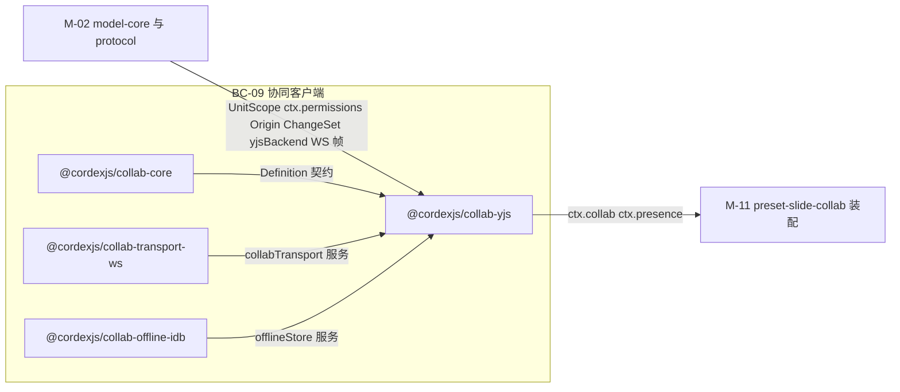
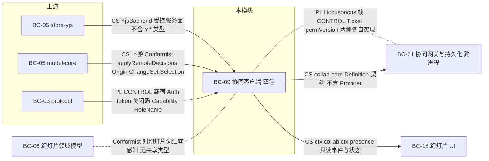
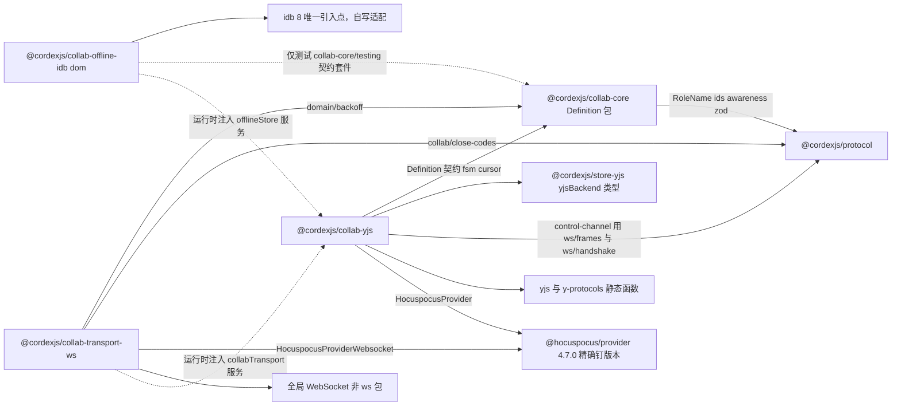
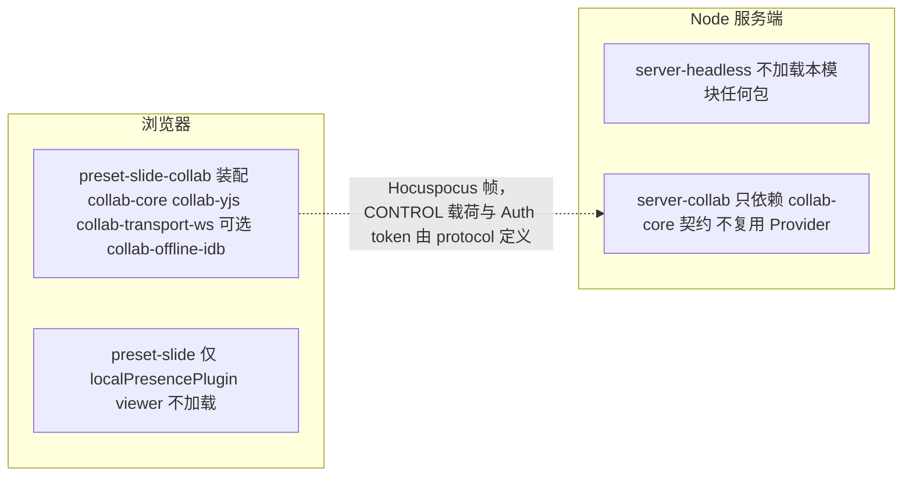
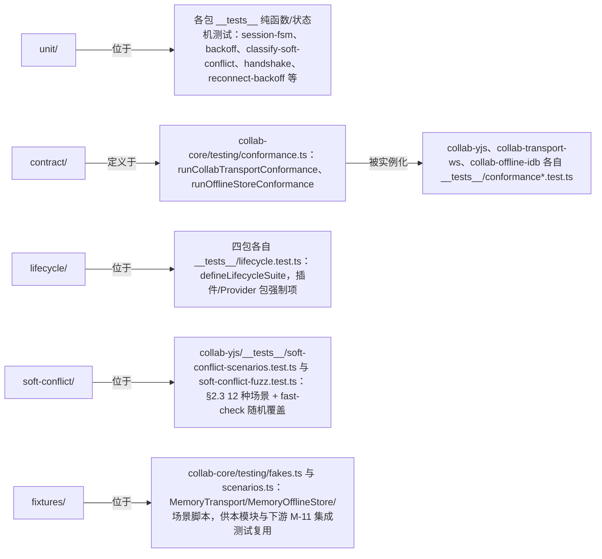
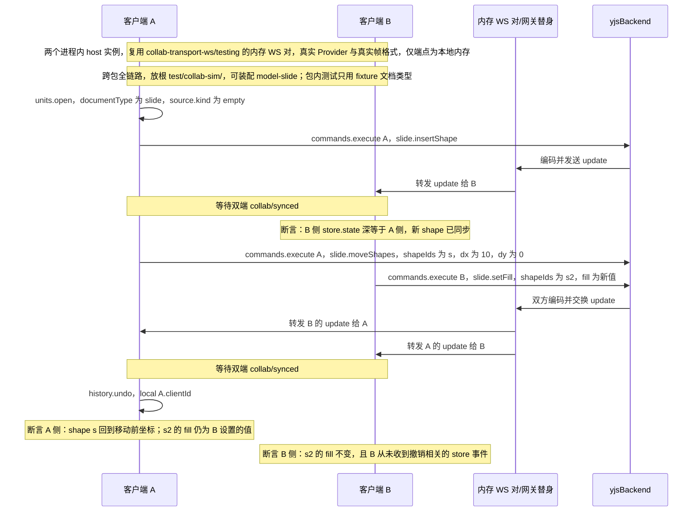

> 状态：草稿 v0.1 | 负责：架构-模块（阶段二，M-05） | 更新：2026-09-18；2026-09-24（rulings §4.15）；2026-09-24（复核修正，rulings §4.17：M9 IDB 键 `{userId}/{documentId}` 与 `OfflineStore.open({userId, documentId})`；M2/M3 撤销载荷与用例名照抄 M-02；D4 不复活他人删除；D5 `store/undo-skipped` 单独统计）；2026-09-25（补图）；2026-09-25（矛盾收口，rulings §4.18）；2026-09-25（§4.19）；2026-09-26（§4.21：同步层改用官方 @hocuspocus/provider——collab-yjs 加 provider 装配，collab-transport-ws 缩为 websocket 装配、计量垫片、重连调度器与关闭码策略；删应用层心跳与信封编解码）；2026-10-04（design-language-v3 第 0 批：复验修正——原「状态胶囊」改称文件名旁的同步状态行（rulings §4.25 DS-6），带作废标记的历史陈述统一措辞）；2026-10-15（design-language-v3 第 2 批：§4 目录树与 §5 文件表的 `collab-yjs/__tests__/session-scripts.test.ts` 注释补会话脚本 `rs/long-offline-review`——离线累计恰 24 h 与超过 24 h 的边界、受影响页取 `ChangeSet.touched` 去重、超过 3 页只给前 3 页与总数（rulings §4.25 DS-59，70/05 §9、§14 第 6 项）；文件数不变；同日再补（rulings §4.25 TB-85，50/07 §8.2 第 6 步）：§2.5 `CollabService` 增只读方法 `rejectedChanges(unitId)`（被拒集合的列表行、合并字节与更改摘要，供 ui-react 的「导出本地副本」对话框），§4.2 / §5 `collab-yjs` 增 `infrastructure/offline/rejected-export.ts`（31 → 32 个源文件，四包 91 → 92），`collab.service.ts`、`collab-session.service.ts`、`offline-queue.test.ts` 注释同步）；2026-10-22（design-language-v3 第 3 批：§2.2 `SessionStats` 增 `overCeiling?: { elementCount; maxElements }`——只在 `readonlyReason` 为 `over_ceiling` 时有值、原样取自 `auth.ok`，「文档已达元素上限」横幅的「实际 / 上限」据此写（rulings §4.25 TB-146、DS-128）；`AwarenessState.user` 删去 `avatar?`（TB-123，30/06 §7.1）；§4 目录树与 §5 文件表的 `collab-yjs/__tests__/session-scripts.test.ts` 注释补 `rs/version-drift-closed` 与 `rs/over-ceiling-readonly`、`rs/epoch-4428`、`rs/import-overwrite` 的横幅档位与状态行（DS-126…DS-128，70/05 §9、§14 第 7 项）；文件数不变）；2026-10-22（design-language-v3 第 3 批回写收口：§4 目录树与 §5 文件表 `session-scripts.test.ts` 的 `rs/over-ceiling-readonly` 写明输入的 `auth.ok` 帧带 `elementCount`、`maxElements`，横幅的两个数原样取帧、本端不自己数（rulings §4.25 TB-146，70/05 §9）；文件数不变） | 依赖：00-module-map.md M-05、charter v0.2 §4.2/§5.2 collab-\* 四包行/§5.5、30-architecture `06-collaboration.md` 全篇（含 §18 v0.2 对齐）、`02-layering-and-packages.md` §4.11/§4.12/§4.12b、`02-kernel-protocol-and-document-core.md`（`yjsBackend`/protocol WS 帧/`ctx.permissions`/按 origin 撤销）、ADR-0020/0023/0024/0025/0032/0033/0039、rulings §4.21（H:q-hp-provider、H:q-hp-step2-cap）与证据 `00-charter/_evidence/hocuspocus-adoption-2026-09-26.json`（d-25~d-30）、PRD `10-prd/03-features/03-collaboration.md`

# 05 协同（客户端）（限界上下文 BC-09 协同（客户端））

## 0. 一页总览

| 项 | 值 |
|---|---|
| 职责一句话 | 客户端 Session/Room 状态机（内部 11 态 → 对外 `SyncState` 六态）、CRDT 同步的客户端编排（§4.21 起 socket、Auth、step1/step2、合并发送与 awareness 收发交官方 `@hocuspocus/provider` 4.7.0，本模块做装配、重连调度、`localSeq` 与在途 FIFO、两级 ack；经 `store-yjs` 的 `yjsBackend` 受控访问面取文档句柄，公共面不出现 `Y.*`）、awareness/presence 模型、离线队列与重连退避、权限变更在客户端命令管线前的检查点落地、12 种软冲突的分类与 fuzz 覆盖 |
| 覆盖的上下文 | BC-09 协同（客户端） |
| 承载包 / 目录 | `@cordexjs/collab-core`（L4，秩 40，iso，definition）、`@cordexjs/collab-yjs`（L4，秩 40，iso，provider）、`@cordexjs/collab-transport-ws`（L4，秩 40，iso，provider）、`@cordexjs/collab-offline-idb`（L4，秩 40，**dom**，provider），均在各自 `packages/<pkg>/src/` |
| cordis 形态 | `collab-core`=definition + 内置默认 provider（presence 单人兜底，随装配层选择性加载）；`collab-yjs`=provider（`implements:['collab','presence']`）；`collab-transport-ws`=provider（`implements:['collabTransport']`）；`collab-offline-idb`=provider（`implements:['offlineStore']`） |
| 运行位置 | 仅浏览器（module-map §5：collab-core/yjs/transport-ws 虽为 iso 但只在浏览器场景实例化；服务端对应能力是 BC-21/`server-collab`——`server-collab` 复用 `collab-core` 的 Definition 契约，不复用 `collab-yjs`/`collab-transport-ws` 等 Provider，见 §7，rulings §4.18 FE-15） |
| 上游（依赖） | M-02：`model-core` 的 `UnitScope`/`ctx.permissions`（`applyRemoteDecisions`/`permission/changed`）/`Origin`/`ChangeSet`/`Selection<A>.serialize()`；`store-yjs` 的 `yjsBackend` 服务面；`protocol` 的 WS 帧/CONTROL 消息/关闭码/能力位/角色 schema |
| 下游（被依赖） | M-11：`preset-slide-collab` 装配本模块四包（替换 `preset-slide` 的 `store-memory`→`store-yjs` 并加入 `collab-*`） |
| 对外服务 | 根作用域：`ctx.collab`、`ctx.collabTransport`；UnitScope 内：`ctx.presence`；Unit 内可选：`offlineStore` |
| 贡献点 | 提供：无；消费：无（charter §5.5：「协同传输与 Blob 存储不是贡献点，而是服务的 Provider 座」） |
| doc / sheet 通用性 | generic（对文档类型盲；协同契约按 `Unit`/`DocumentStore` 的通用存储原语工作，不认识 `slide`/`shape` 等词汇，§8） |
| 批次 | 2（与 M-09 共享 `06-collaboration.md` 定义的协议契约；M-09 的 `server-collab` 复用 `collab-core` 的 Definition 契约，不复用 `collab-yjs`/`collab-transport-ws` 等 Provider，需协议帧版本一致，rulings §4.18 FE-15） |

### 0.1 图示

**图 0-1 模块包关系与上下游**



怎么读：四包中只有 `collab-yjs` 是真正的编排中枢——它消费 `collab-core` 的 Definition、`collab-transport-ws` 的传输、`collab-offline-idb` 的离线存储，再把 `ctx.collab`/`ctx.presence` 交给下游装配。

## 1. 限界上下文与边界

### 1.1 职责与非职责

> **事实源分工（rulings §4.19）**：浏览器侧协同运行时（Session 状态机与三层对照、连接建立、重连与离线、出站合并与两级 ack、离线队列、权限与令牌、关闭码行为、awareness 与在场 UI、软冲突信号分流、计时器）的唯一事实源是 [50-frontend/07](../50-frontend/07-collaboration-client.md)；本文只保留包 / 文件级规划（§3 插件定义、§4 目录树、§5 文件职责、§9–§11）与本包接口签名，行为段落一律改为摘要 + 链接，冲突以 50/07 为准。

**做什么**（行为细节见 50/07 对应节）：

- 客户端 `Session` 状态机的纯 reducer（`session-fsm.ts`，内部 11 态 → 对外 `SyncState` 六态，50/07 §3）与其 Provider 侧执行器。
- 经 `store-yjs` 的 `yjsBackend` 受控面编排 CRDT 同步的客户端一侧，公共面不暴露 `Y.*` 类型（charter §4.2 第 3 条边界；50/07 §1、§5）；§4.21 起 provider 需要原始 `Y.Doc` 与 `Awareness`，只在 `collab-yjs/infrastructure/provider/provider-session.ts` 一处解包 `yjsBackend.docHandle()` 返回的不透明句柄（M-02 [40/02 §5.7](02-kernel-protocol-and-document-core.md)）。
- 两级 ack 与在途 FIFO、「未保存到服务器」判据（rulings §4.19 INC-09，50/07 §6）；离线队列（`OfflineStore` Definition + 内存实现 + `collab-offline-idb`，50/07 §7）。
- 权限检查点：`CONTROL.permission` 只经 `permissions.applyRemoteDecisions()` 进入客户端（50/07 §8）；awareness / presence 模型（50/07 §10）；12 种软冲突的通用版分类与 fuzz（§2.3，信号分流见 50/07 §12）。
- `HocuspocusProviderWebsocket` 装配、WebSocketPolyfill 计量垫片、注入 Clock 的重连调度器与关闭码策略（`collab-transport-ws`，50/07 §2、§4、§9）；`HocuspocusProvider` 装配与 `token` 函数（`collab-yjs`，50/07 §2、§8.3）。§4.21 起不再有应用层心跳与自研帧编解码（rulings §4.21 H:q-hp-provider）。

**不做什么（指向负责模块）**：CRDT 数据结构、`Y.Doc` 持有与 `DocumentStore` 契约（M-02 `model-core` / `store-yjs`）；CONTROL 判别联合（Stateless 载荷）、Auth token schema、关闭码、错误码、能力位的**定义**（M-02 `protocol`，按 30/06 §6）；Hocuspocus 线上帧的编解码（官方 provider 内部）；服务端 Room、持久化、门禁、扇出（M-09，服务端视角见 [60/05](../60-backend/05-modules-collab-and-snapshots.md)、[60/16](../60-backend/16-ws-protocol-server-view.md)；`server-collab` 只复用 `collab-core` 的 Definition 契约，rulings §4.18 FE-15）；幻灯片词汇（保持文档类型盲，§8）；在场头像、远端光标、横幅与诊断面板等 UI（M-10，[50/10](../50-frontend/10-editor-shell-and-interaction.md) §11）；权限判定（M-02 `permissions`）。
### 1.2 通用语言

复用 charter §4.2 协同术语：Room、Session、Ticket、Update / StateVector、Compaction、Repair、FracKey、Version、Soft Conflict（软冲突）。本上下文补充术语表：

| 术语 | 定义 | 对应类型名 |
|---|---|---|
| `SyncState`（对外六态） | `Session.state` 的公开取值：`disconnected\|connecting\|syncing\|synced\|offline\|error` | `domain/session-state.ts` |
| 内部 FSM（十一态） | `session-fsm.ts` 的 reducer 状态：`idle/connecting/authenticating/backoff/syncing/live/readonly/denied/offline/quarantined/closed`（06 §5.1） | `domain/session-state.ts` |
| `AwarenessState` | 单 client 的在场状态（user/client/view/selection/caret/editing/idle/ts，ADR-0024） | `domain/awareness-state.ts`（对齐 `@cordexjs/protocol/collab/awareness.ts`） |
| `OfflineQueue` | 本地未确认 update 与被拒事务的队列聚合（内存态或经 `OfflineStore` 持久化） | `domain/offline-queue.ts` |
| `BackoffPolicy` | 指数退避 + 抖动的纯函数策略（1 s→30 s，±20%） | `domain/backoff.ts` |
| `SoftConflictType` | 12 种软冲突场景的分类字面量联合（06 §8/ADR-0020 附表 D/PRD CO-08） | `domain/soft-conflict.ts` |
| `SessionDriver` | 执行 `session-fsm` 产出的 `Effect`（connect/send/schedule/backoff/notify）的 Provider 侧执行器 | `collab-yjs/infrastructure/session-driver.ts` |
| `AwarenessHandle` | `yjsBackend.awareness()` 返回的抽象句柄（无 `Y.*` 类型），`collab-yjs` 只持有此句柄 | 类型来自 store-yjs（M-02），本模块消费 |
| `LocalBatcher` | §4.21 起只做「计号 + 对应」：`onUpdate` 监听先于 provider 注册、给非 remote update 分配 `localSeq` 并 `appendPending`，经 provider 的 `outgoingMessage` 事件与计量垫片把 `localSeq` 对到真正上线的帧、入在途 FIFO；按两级 ack 追踪：`spill` 只标记「服务端已暂存」，`db` 才触发 `ackUpTo` 清 pending（rulings §4.15 S-3a）。合并交 provider 的 `flushDelay`（50 ms 固定窗口） | `collab-yjs/infrastructure/sync/local-batcher.ts` |
| `ProviderSession` | `HocuspocusProvider` 的装配与生命周期：文档名 `{documentId}:{epoch}`、`document` 与 `awareness` 取自 `yjsBackend.docHandle()`、`token` 为 async 函数、`flushDelay`、`onStateless`；把 provider 实例登记为 remote origin；`ctx.effect` 内创建、释放时 `destroy()`（§4.21 新增） | `collab-yjs/infrastructure/provider/provider-session.ts` |
| 计量垫片（`MeteringSocket`） | 传给 `HocuspocusProviderWebsocket` 的 `WebSocketPolyfill`：包装全局 `WebSocket`，`send` 时按内容哈希回报「帧真正上线」，读 `bufferedAmount` 记背压（§4.21 新增） | `collab-transport-ws/infrastructure/metering-socket.ts` |
| 重连调度器（`Reconnector`） | 注入 Clock 的退避、1012 立即、30 s 离线判据、周期重连与 online 钩子；provider 内置重连以 `autoConnect:false`、`maxAttempts:1` 停用，只有它调 `connect()` | `collab-transport-ws/infrastructure/reconnect.ts` |

### 1.3 上下文映射

| 相邻上下文 | 关系类型 | ACL / 落点文件 | 传递的契约 |
|---|---|---|---|
| BC-05 文档内核（上游，`store-yjs`） | Customer–Supplier（受控依赖，module-map §4.2 第 3 条） | `store-yjs/src/yjs-backend.service.ts` | `YjsBackend`（`encodeStateAsUpdate`/`applyUpdate`/`onUpdate`/`awareness()`/`stats()`），**不**含 `Y.*` 类型 |
| BC-05 文档内核（上游，`model-core`） | Customer–Supplier（下游 Conformist） | `model-core/src/permission/permissions.service.ts` | `applyRemoteDecisions(decisions)`（唯一入口）、`Origin`、`ChangeSet`、`Selection<A>.serialize()` |
| BC-03 协议（上游） | Published Language | `protocol/src/{ws,collab,errors,permissions}/*.ts` | CONTROL zod 判别联合（Stateless 载荷）、Auth token schema、关闭码、`Capability`/`RoleName`（§4.21 起无自研二进制信封，线上帧为 Hocuspocus 格式） |
| BC-21 协同网关与持久化（下游进程，跨进程） | **Published Language**（Hocuspocus 协议 + 同一份 06 号协议契约：两侧分别由官方 provider 与 Hocuspocus 服务端实现帧层，CONTROL 载荷各自按 `protocol` 解析，ADR-0039）+ Customer–Supplier（`server-collab` 复用 `collab-core` 的 Definition 契约，不复用 `collab-yjs`/`collab-transport-ws` 等 Provider，rulings §4.18 FE-15） | `protocol/src/collab/*.ts` | WS 帧、CONTROL 消息、Ticket、`permVersion` |
| BC-06 幻灯片领域模型（水平，间接） | Conformist（本模块对其透明；对幻灯片词汇零感知） | — | 无共享类型（仅共享 `DocumentStore`/`ChangeSet` 等通用契约） |
| BC-15 幻灯片 UI（下游） | Customer–Supplier | `ctx.collab`/`ctx.presence` 只读事件与状态 | `Session.state`/`stats`、`presence.remotes`、`collab/*`/`presence/*` 事件 |

**图 1-1 对外契约与上下游关系**



怎么读：实线箭头从契约提供方指向消费方（与图 0-1 同向）；与 BC-21 之间有两条边：同一份 06 号协议契约的两侧实现用无箭头虚线表示「跨进程」，实线表示 `server-collab` 复用 `collab-core` 的 Definition 契约，不复用 `collab-yjs`/`collab-transport-ws` 等 Provider（rulings §4.18 FE-15）；与 BC-06 的虚线表示本模块对幻灯片透明，只经通用 `DocumentStore`/`ChangeSet` 契约间接相关。

依据：本节上表；module-map §4.2 第 3 条。

## 2. 领域模型

### 2.1 聚合与实体

> 本节只列本包的类型签名与不变量；Session 内部 11 态状态机、11 → 6 投影表、UI 六态派生与横幅出现条件的唯一事实源是 [50/07 §3](../50-frontend/07-collaboration-client.md)（2026-09-25 自本节与 30/06 §5.1 迁入，rulings §4.19），本节原状态机图与投影表已删除。

**`Session`（聚合根；`collab-core/domain/session.ts`）**

```ts
interface Session {
  readonly state: SyncState                 // 对外六态（disconnected|connecting|syncing|synced|offline|error），由 projectSyncState 投影
  readonly role: RoleName                   // 来自服务端 auth.ok / CONTROL.permission
  readonly stats: SessionStats              // 字段见 §2.2
  flush(opts?: { timeoutMs?: number }): Promise<void>  // 等待 pending 全部获 ack{tier:'db'}（spill 不算）；离线期保持等待（50/07 §6）
  reconnectNow(): void
  close(): Promise<void>                    // leave() 以 leaveFlushTimeoutMs（默认 5 s）为上限 flush
}
```

- 不变量：一个 `UnitId` 至多一个活跃 `Session`（`ctx.collab.join()` 幂等）；`state` 只能由 `session-fsm.ts` 的 reducer 驱动迁移，UI 与插件无 public setter；`Session` 是本地连接句柄，不参与 CRDT 合并（收敛发生在 M-02 `store-yjs` 持有的 `Y.Doc`）。
- 状态文件落点：内部态与 `SyncState` 在 `domain/session-state.ts`，reducer 与允许迁移表在 `domain/fsm/session-fsm.ts`，effects 判别联合在 `domain/fsm/session-fsm-effects.ts`；UI 六态派生函数 `deriveCollabUiState` 归 M-10 `ui-core`（[40/10](10-ui-shell-and-slide-ui.md)），不在本模块。

**`Room`（客户端侧只读投影，非聚合；`collab-core/domain/room-descriptor.ts`）**：`RoomDescriptor{ documentId; endpoint; token }` 与 `RoomInfo{ clients: number; draining?: boolean; persist: 'ok' | 'degraded' }`。`persist` 取自 `CONTROL.room` 的可选字段 `persist`（缺席视为 `'ok'`，rulings §4.19 INC-09；帧形状由 M-02 `ws/frames.ts` 定义）。Room 的权威七态状态机在服务端（M-09，[60/05](../60-backend/05-modules-collab-and-snapshots.md)），本模块不复制。

**`Presence`/`Awareness`（聚合；UnitScope；`collab-core/application/contracts/presence.service.ts`）**：`PresenceService{ setLocal(patch); readonly local: AwarenessState; readonly remotes: ReadonlyMap<ClientId, AwarenessState> }`；每 client 一份 LWW 状态、30 s 超时移除（ADR-0024；节流与在场 UI 见 50/07 §10–§11）。

**`OfflineQueue`（聚合；`collab-core/domain/offline-queue.ts`）**：`{ pending: readonly PendingUpdate[]; rejected: readonly RejectedEntry[]; meta: { epoch; schemaVersion; lastAckSeq } }`。不变量：`pending` 按 `localSeq` 严格升序；`ackUpTo(localSeq)` 只删除 `≤ localSeq` 的项，且只由 `ack{tier:'db'}` 经在途 FIFO 对应后触发，服务端 `seq` 只写 `meta.lastAckSeq`（rulings §4.18 CO-09、§4.15 S-3a）；`epoch` / `schemaVersion` 与服务端不一致时整体移入 `rejected`（ADR-0033）。ack 对应、step2 拆块、冻结 FIFO 与被拒集合的收拢规则见 [50/07 §6、§8.2](../50-frontend/07-collaboration-client.md)。
### 2.2 值对象

| 名称 | 字段（要点） | 校验 schema | 所在文件 |
|---|---|---|---|
| `SyncState` | 六态字面量联合 | 无 zod（内部运行时值，不跨进程） | `domain/session-state.ts` |
| `SessionStats` | `{ pendingLocalUpdates; inFlight; spillOnlyInFlight; oldestInFlightMs?; roomPersist: 'ok' \| 'degraded'; readonlyReason: 'downgraded' \| 'capacity' \| 'over_ceiling' \| 'locked' \| 'identity-changed' \| null; overCeiling?: { elementCount: number; maxElements: number }; reconnectAttempt; lastSyncedAt?; bytesIn; bytesOut; rtt? }`——`inFlight`：在途 FIFO 条目数；`spillOnlyInFlight`：已获 `ack{tier:'spill'}`、尚无 `tier:'db'` 的在途条目数；`oldestInFlightMs`：在途队首等待 db 应答的时长；`roomPersist`：最近一次 `CONTROL.room.persist`（缺席为 `'ok'`）；`readonlyReason`：`readonly` 态的原因（非降级的查看者 / 评论者会话为 `null`）。`inFlight`、`roomPersist`、`readonlyReason` 于 2026-09-25 新增（rulings §4.19 INC-09，50/07 §3.2）；`readonlyReason` 的 `over_ceiling`（`auth.ok.reason='over_ceiling'`）与 `locked`（`CONTROL.room.locked`）同日补登（50/07 §8.1、30/06 §6.3）；`overCeiling`（2026-10-22，rulings §4.25 TB-146）只在 `readonlyReason === 'over_ceiling'` 时有值，原样取自该次 `auth.ok` 的 `elementCount` 与 `maxElements`（服务端判定口径、墓碑计入），供「文档已达元素上限，只读打开」横幅写「实际 / 上限」（DS-128），本端不自己数元素；会话重连后按新的 `auth.ok` 重置 | 无；「未保存到服务器」判据改为 rulings §4.19 INC-09：`roomPersist === 'degraded'` ∨ `spillOnlyInFlight > 0` ∨ `oldestInFlightMs ≥ unsavedWarnAfterMs`（`collab-yjs` 配置键，默认 15000，不再借用 `heartbeatMs`）；受众分级（发起方横幅「未保存到服务器 N 项」、其余协作者同步状态行弱提示「服务器保存延迟」）与消失条件见 [50/07 §6.1](../50-frontend/07-collaboration-client.md)、[50/10 §11](../50-frontend/10-editor-shell-and-interaction.md)；派生函数 `deriveCollabUiState` 归 M-10 | `domain/session.ts` |
| `Ticket` | `{ value: string; expiresAt; permVersion; refreshAt }` | 无（不透明凭据，由服务端签发/校验；类型形状供刷新逻辑用） | `domain/ticket.ts` |
| `AwarenessState` | `v:1; user{id,name,color}; client{id,device,appVersion}; view?; selection?: SerializedSelection; caret?; editing?; idle?; ts`（`user.avatar?` 2026-10-22 删去：界面头像一律身份色首字，rulings §4.25 TB-123，30/06 §7.1） | zod（对齐 `@cordexjs/protocol/collab/awareness.ts`，≤2 KiB） | `domain/awareness-state.ts` |
| `SerializedSelection` | `{ kind; slideId?; ids: string[]; range?: { anchor; head } }`（`range` 为 `RelativePosition` base64） | 由 `DocumentType.selectionKinds` 对应 schema 校验，本模块内容不透明 | `domain/awareness-state.ts` |
| `PendingUpdate` | `{ localSeq: number; update: Uint8Array }` | 无（本地运行时，不跨进程序列化外的额外校验） | `domain/offline-queue.ts` |
| `RejectedEntry` | `{ update: Uint8Array; records: TransactionRecordSummary[]; reason: 'permission' \| 'locked' \| 'identity-changed' \| 'payload-too-large' \| 'quota-exceeded' \| 'epoch-changed'; at }`（取值集合以 [50/07 §8.2](../50-frontend/07-collaboration-client.md) 为准，2026-09-25 登记） | 无 | `domain/offline-queue.ts` |
| `BackoffPolicy` | `{ baseMs:1000; maxMs:30000; jitter:0.2; offlineAfterMs:30000; offlineRetryMs:30000 }`——离线判据按时间：自进入重连起累计 `offlineAfterMs` 未连上即 offline（取代原 `maxAttemptsBeforeOffline:6`）；offline 后每 `offlineRetryMs`（±`jitter`）周期重连（rulings §4.18 UX-03/CO-03） | 无（纯策略配置） | `domain/backoff.ts` |
| `SoftConflictType` | 12 种字面量联合（见 §2.3 表） | 无（内部事件载荷判别字段） | `domain/soft-conflict.ts` |
| `RoomDescriptor`/`RoomInfo` | 见 §2.1；`RoomInfo.persist` 取自 `CONTROL.room.persist?`（rulings §4.19 INC-09） | `RoomDescriptor` 部分字段来自 `@cordexjs/protocol` ids；`persist` 字段形状由 M-02 `ws/frames.ts` 的 CONTROL 判别联合定义 | `domain/room-descriptor.ts` |

### 2.3 领域服务

纯函数清单（全部 `iso`，无 IO，不读时钟除非标注）。下方 12 种软冲突表是 `fixture` 通用版包内用例的唯一登记处（70/05 §6 引用）；各信号到 UI 的分流、Toast 文案与恢复动作以 [50/07 §12](../50-frontend/07-collaboration-client.md) 为准，跨包的幻灯片场景 `sc-*` 见 [70/05](../70-testing/05-collab-simulation-and-property-tests.md) §6。

| 签名（草案） | 所在文件 | 两端共用 | 备注 |
|---|---|---|---|
| `reduce(state: InternalState, event: SessionEvent): { next: InternalState; effects: readonly Effect[] }` | `domain/fsm/session-fsm.ts` | 否（服务端 Room FSM 是 M-09 独立实现，不复用本函数） | 50/07 §3.1 内部 11 态状态机的权威实现；`effects` 为描述对象（`connect`/`send`/`schedule`/`backoff`/`notify`），由 `collab-yjs` 的 `SessionDriver` 执行，reducer 本身零 IO |
| `projectSyncState(internal: InternalState, degraded: boolean): SyncState` | `domain/session-state.ts` | 否 | 11→6 投影（§2.1 表） |
| `nextDelay(attempt: number, policy: BackoffPolicy, rand: () => number): number` | `domain/backoff.ts` | 是（算法本身通用；`rand` 显式注入以保证可测试确定性） | 指数退避 + 抖动；`collab-transport-ws` 与未来其它传输 Provider 均可复用 |
| `classifySoftConflict(input: ConflictSignal): SoftConflictType \| null` | `domain/classify-soft-conflict.ts` | 是（对文档类型盲，输入只含通用 `ChangeSet`/本地操作日志，见下表） | 12 种场景的判定核心，§8 冲突表覆盖 |
| `serializeAwareness(state: AwarenessState): Uint8Array` / `parseAwareness(bytes): Result<AwarenessState, CordexError>` | `domain/awareness-state.ts` | 是 | zod `safeParse`；非法状态返回 `err`，由调用方丢弃并计数（不抛异常） |

**12 种软冲突场景**（权威列表 = 06 §8 全部 12 行；本模块对文档类型盲，用 `@cordexjs/model-core/testing` 的通用 `fixture` 文档类型——键值树 + 文本块——复现，而非 06 原文的幻灯片示例；幻灯片示例仅作直觉参照，实际收敛规则与验证在 M-02/M-04 的 `store-yjs`/`model-slide` 契约套件重复覆盖一次）：

| # | 06 §8 幻灯片示例（直觉参照） | 本模块通用场景（`fixture` 词汇） | 原语层结果 | `SoftConflictType` / 事件 | 测试用例 |
|---|---|---|---|---|---|
| 1 | A、B 并发移动同一形状 | 两客户端并发 `set` 同一 Record 叶子键 | 键级 LWW，后写者胜 | `prop-lww`（`collab/soft-conflict`） | `soft-conflict-scenarios.test.ts::concurrent-key-lww` |
| 2 | A 删除形状，B 并发编辑其文本 | 并发软删除（`set(实体._deleted)`）一个实体 vs 该实体子路径的 `text`/`set` | **rulings §4.15 Q3 改写**：删除只写墓碑，B 的编辑保留在墓碑实体上；读路径视该实体为已删；A（删除方）撤销删除即带着 B 的编辑恢复；B 若撤销自己删除前的编辑，目标已被 A 删除 → 跳过并提示、**不复活**（rulings §4.17 D4，TTL 内亦然） | `delete-vs-edit`（B 端提示「元素已被 A 删除」+「恢复」，恢复=清除墓碑的新事务） | `::delete-vs-edit` |
| 3 | A 删除页，B 在页内新增形状 | 软删除容器实体（级联墓碑） vs 在该容器内 `insert` 子实体 | 容器为墓碑，B 新增的子实体未被级联标记但因容器已删而不可见；A 撤销删除后 B 的子实体随容器一起出现；TTL 硬删除（服务端单写者）时一并清理 | `delete-vs-edit`（同上，粒度更高一层） | `::delete-parent-vs-child-insert` |
| 4 | A、B 都在同一位置之后插入新实体（页） | 两客户端在 `Ordered` 集合同一间隙各 `insert` 一项 | 两项都存在，按 `(order, id)` 全序，两端一致 | 新增建议：`concurrent-insert`（06/PRD 未单列 tag，§12） | `::concurrent-insert-same-gap` |
| 5 | A 把 X 放入组 G，B 把 G 放入 X（父子环） | 两客户端并发 `set` 造成通用树形字段（如 `fixture` 的 `parentId`）互指成环 | 两个 `parentId` 各自 LWW 成功 → 成环 → 修复规则：环上 id 字典序最大者回根 | `collab/repair{rule:'cycle'}`（**不是** `soft-conflict`，06 §8/PRD CO-08 一致） | `::parent-child-cycle-repair` |
| 6 | A 改填充色，B 改位置 | 两客户端并发 `set` 同一实体的**不同**键 | 都存活（不同键无冲突） | 无提示（期望行为） | `::independent-keys-both-survive` |
| 7 | A、B 同时编辑同一文本框不同位置 | 同一 `RichText` 段落内不同偏移量并发插入 | 字符级 YATA 合并，两处都保留 | 无提示 | `::concurrent-richtext-same-paragraph` |
| 8 | A 回车分段，B 给被移动的尾部文本加粗 | 段落 `remove`+`insert`（分段）与该尾部文本的属性 `text` 操作并发 | 尾部文本被删除+重插，格式化落空（已知限制，与 y-prosemirror 同） | 无提示 | `::split-paragraph-vs-format` |
| 9 | A 更换版式，B 编辑占位符文本 | 并发修改**引用型**字段（如 `layoutId`）与**内容型**字段（如 `txBody`），不同实体或不同键 | 都存活，各自生效 | 无提示 | `::reference-field-vs-content-field` |
| 10 | A 撤销自己的移动，其间 B 也移动了同一形状 | 本地 `undo(origin=local)` 与远端后写同一键 | **rulings §4.15 Q3 改写**：`store-yjs` 撤销包装层（包装 `Y.UndoManager`）**跳过**被他人后写的键，不覆盖 B；本步其余键照常回滚；若整步都被跳过则出栈即停、不连撤上一步 | `store/undo-skipped`（M-02 事件，**不是** `soft-conflict`）→ 提示条「部分内容已被他人修改，未撤销」+「恢复我的值」（新事务，PRD CO-08） | `::undo-vs-concurrent-remote-change` |
| 11 | 离线 A 修改 S，在线 B 早已删除 S | 离线队列重放的 `set`/`text` vs 已持久化的软删除 | S 仍为墓碑，A 的修改保留在其上（B 撤销删除即可见）；若 A 离线超过墓碑 TTL（默认 24h）、S 已被服务端硬删除，则 A 的修改落在已删类型上被丢弃，可从「未同步更改」导出 | `delete-vs-edit`（离线变体） | `::offline-edit-vs-online-delete` |
| 12 | A 降权为 viewer 时仍有 pending update | `permission-gate` 拦截 outbound + 服务端硬门禁拒绝 | 不落库不广播；本地回滚到服务端状态，被拒事务移入 `rejected` 供导出 | `collab/update-rejected`（**不是** `soft-conflict`，06 §18.4） | `::permission-downgrade-with-pending` |

**撤销语义附加用例（rulings §4.15 Q3；不新增 `SoftConflictType`，与 12 种场景同文件；用例名照抄 M-02 §2.5「撤销协同契约用例名表」，2026-09-24 复核 M3）**：

| 用例 | 场景（`fixture` 词汇） | 断言 |
|---|---|---|
| `::remote-conflict-skip` | A 写键 k1、k2 为一步；B 随后写 k1；A 撤销 | k1 保持 B 的值、k2 回滚；`store/undo-skipped{skipped:[k1], wholeStep:false}` 恰一次 |
| `::undo-skip-no-cascade` | A 连续两步：步 1 写 k1，步 2 写 k2；B 随后写 k2；A 撤销一次 | 步 2 整步跳过、出栈，`wholeStep:true`；k1 **未**被连带撤销；再撤销一次才回滚 k1 |
| `::delete-vs-edit-undo` | (a) A 软删除实体 E；B 编辑 E 的文本与属性；A 撤销删除。(b) B 先编辑 E，A 随后删除 E，B 撤销自己的编辑 | (a) E 以同一 id 恢复，且带 B 的编辑；两端收敛哈希一致。(b) B 的撤销整步跳过（`UndoSkip.reason:'remote-deleted'`），E **不**复活，`store/undo-skipped{wholeStep:true}` 恰一次（rulings §4.17 D4） |
| `::offline-replay-not-other-writer`（本模块特有补充，非契约套件用例名） | A 离线编辑后重连回放（`origin=local`，本端 clientId） | 回放写入**不**计为「他人后写」，A 之后仍可正常撤销自己离线前的步骤 |

fuzz 追加两条性质（`soft-conflict-fuzz.test.ts`）：(1) 任一客户端的撤销从不覆盖其他 clientId 在该步之后写入的键；(2) 软删除前后实体 id 不变，撤销删除后实体子树与未删分支的并发编辑一致。

- 确定性用例（表中 12 项）位于 `collab-yjs/src/__tests__/soft-conflict-scenarios.test.ts`（固定 clientID 与时钟）；随机覆盖位于同目录 `soft-conflict-fuzz.test.ts`（fast-check，随机 op 序列 + 随机分区/乱序交换 update，断言收敛后状态哈希一致，含场景 4/5 的重复触发）。
- 场景 1/4/6/7/9 的收敛结果同时被 M-02/M-04 的 `runDocumentStoreConformance` 协同分节复用同一断言（06 §18.2：memory 与 yjs 结果必须相同），本模块的用例额外覆盖 `collab-yjs` 特有的**事件与 UI 信号**（`collab/soft-conflict`/`collab/repair`/`collab/update-rejected` 是否按此表触发），而非重复验证 CRDT 收敛本身。

### 2.4 领域事件

全部在 `collab.contribution.ts` 中 `declare module '@cordexjs/kernel'` 声明（lint `cordex/events-must-be-declared`，08 §11 对照名 `events-declared`，rulings §4.18 GV-15）；域名为章程 §5.5 保留域 `collab`/`presence` 之一。**权威列表 = module-map BC-09 行 + charter §5.5**，与 ADR-0023/0024 v0.2 定稿名一致：

| 事件 | 模式 | 载荷（要点） | 发布者文件 | 典型订阅者 |
|---|---|---|---|---|
| `collab/state-changed` | emit | `(unitId, prev: SyncState, next: SyncState)` | `collab-yjs/infrastructure/session-driver.ts`（执行 `session-fsm` 效果时发出） | UI 状态指示（M-10）、telemetry `cordex_collab_session_transitions_total{from,to}` |
| `collab/synced` | emit | `(unitId)` | `collab-yjs/infrastructure/session-driver.ts`（`syncing→live` 迁移时） | 打开进度 UI、e2e 断言 |
| `collab/soft-conflict` | emit | `(unitId, { type: SoftConflictType; paths? })` | `collab-yjs/infrastructure/sync/yjs-sync-engine.ts`（应用远端 update 后调用 `classifySoftConflict()`，观察到 §2.3 表中场景时） | 冲突提示 UI（M-10）、telemetry |
| `collab/auth-failed` | emit | `(unitId, { code })` | `collab-yjs/infrastructure/session-driver.ts`（provider 的 `authenticationFailed` 事件，`code` 取自 `PermissionDenied` 的 reason JSON 或 `token` 函数抛出的错误；§4.21 前为 `collab-transport-ws/infrastructure/handshake.ts`，原文件已删除） | 错误提示 UI、审计 |
| `collab/reconnect` | emit | `(unitId, { reason })` | `collab-yjs/infrastructure/session-driver.ts`（`backoff`/`offline→connecting`） | 状态指示、telemetry |
| `collab/update-rejected` | emit | `(unitId, { code, count })` | `collab-yjs/infrastructure/permission/permission-gate.ts`（§18.4「导出后重载」触发点） | 「未保存更改」横幅（M-10）、审计 |
| `collab/repair` | emit | `(unitId, { reason, paths })` 或 `{ rule }`（如 `'cycle'`） | `collab-yjs/infrastructure/sync/yjs-sync-engine.ts`（收到 `CONTROL.repair`/本地轻量修复时） | 非阻断提示「已自动修正」、telemetry（**与服务端 `collab-server/repair` 是两个不同事件**，14 §1 C-08：本事件是客户端收到 `CONTROL.repair` 后自发的本地事件，载荷面向 UI；服务端事件载荷面向审计，发布者/订阅者均不同，见 00-module-map §3 BC-26 行） |
| `store/undo-skipped`（M-02 事件，本模块**订阅**，不发布） | on | `(unitId, { skipped: UndoSkip[]; wholeStep: boolean })`（载荷照抄 M-02 §2.4，复核 M2） | `store-memory`/`store-yjs` Provider（M-02） | 提示条（M-10）；telemetry **单独统计**跳过次数与整步跳过次数（`cordex_store_undo_skipped_total{whole_step}`），**不**派生 `collab/soft-conflict`、**不**计入软冲突率 MT-15（rulings §4.17 D5） |
| `presence/joined` | emit | `(unitId, clientId)` | `collab-yjs/infrastructure/awareness/presence.service.ts` | 在场头像列表（M-10） |
| `presence/left` | emit | `(unitId, clientId)` | `collab-yjs/infrastructure/awareness/presence.service.ts` | 在场头像列表（M-10） |
| `presence/changed` | emit | `(unitId, clientId \| null)` | `collab-yjs/infrastructure/awareness/presence.service.ts`（`null` = 本地状态变化） | 光标/选区覆盖层（M-10） |

**原「新增建议」两项的定稿**（2026-09-25 结案，依据 30/10 §11.1（30 > 40）与决策 INC-33「产品遥测以 PRD 06 为权威、逐行标 cordis 事件或遥测专用」；§12 G-3 结案，不再提请章程 §5.5 收编）：

| 名称 | 定稿形态 | 载荷 / 类型 | 发布者 | 说明 |
|---|---|---|---|---|
| `collab/backpressure` | **不设 cordis 事件**，改为客户端指标 `cordex_collab_outbound_queued`（gauge，出站积压帧数） | 数值；超过 `outboundHighWater`（§3）时诊断面板标红 | `collab-yjs/infrastructure/sync/local-batcher.ts` 经 `telemetry` 服务写指标 | 30/10 §11.1「降为指标」；诊断面板「协同」页读取（[50/07 §14](../50-frontend/07-collaboration-client.md)）；指标名登记进 [50/15 §7.2](../50-frontend/15-events-errors-and-telemetry.md) 浏览器指标表 |
| `collab/latency` | **遥测专用事件**（不进 `Events` 声明、不经 `ctx.emit`） | `{ rttMs; applyMs }`（PRD 06；每 30 s 采样一次） | `collab-yjs/infrastructure/session-driver.ts` 经 `telemetry.event` 上报 | 同时写 `cordex_collab_roundtrip_ms` 直方图；`applyMs` 为远端 update 应用耗时 |
**明确不发出**：`permission/changed` **不由本模块发出**——CONTROL.permission 帧经 `degrade-permission` 应用服务唯一调用 `permissions.applyRemoteDecisions()`（M-02），该服务是 `permission/changed` 的**唯一**发布者（06 §18.3；draft 名 `collab/permission-changed` 已弃用）。命令管线与 UI 均只订阅 `permissions` 服务发出的事件，不订阅任何 `collab/*` 事件来判断权限。

### 2.5 仓储 / 存储契约

本模块定义三个 Definition（均为服务契约，非数据仓储，但按模板本节承载「Definition 名与 id、方法签名、默认 Provider、契约套件」）：

| Definition（服务名） | 方法签名草案 | 默认 / 生产 Provider | 契约套件 |
|---|---|---|---|
| `collab`（`CollabService`） | `join(unitId, opts: JoinOptions): Session`（幂等，重复 join 返回同一实例）；`leave(unitId): Promise<void>`；`session(unitId): Session \| undefined`；`rejectedChanges(unitId): Promise<RejectedChanges \| null>`（2026-10-15 增，rulings §4.25 TB-85：被拒集合的只读视图，形状见表下） | `collab-yjs`（唯一生产实现） | **无独立套件**：`CollabService` 与 `store-yjs` 强耦合（依赖 `yjsBackend`），不是「可自由替换实现」的 Definition；其正确性由 `store-yjs` 的 `runDocumentStoreConformance` 协同分节（收敛）+ `collab-yjs` 自身 `__tests__`（状态机/事件）共同覆盖，不重复定义 `runCollabConformance` |
| `collabTransport`（`CollabTransport`，§4.21 改写） | `open(target: TransportTarget, hooks: TransportHooks): TransportSocket`；`TransportSocket{ readonly handle: TransportHandle; connect(): void; disconnect(): void; destroy(): void; readonly bufferedAmount: number }`；`TransportHooks{ onOpen(): void; onClose(code: number, reason: string): void; onFrameSent(frame: Uint8Array): void }`——`handle` 是不透明句柄（生产实现为 `HocuspocusProviderWebsocket`，只由 `collab-yjs` 的 `provider-session.ts` 解包后作为 `websocketProvider` 传入），`onClose` 在构造配置里先 `disconnect()` 再回调，`onFrameSent` 来自计量垫片；是否重连、何时 `connect()` 由本包的重连调度器决定 | `collab-transport-ws`（生产，浏览器 `WebSocket`；测试时以 `WebSocketPolyfill` 注入 `collab-core/testing` 的 `MemoryTransport` 内存 WebSocketLike 对） | `runCollabTransportConformance(factory)`（`collab-core/testing`）：`transport/*`（连接成功与超时、`onClose` 精确传递关闭码且 provider 不自行重连、`onFrameSent` 与上线帧一一对应、背压在超过 `outboundHighWater` 时报出）；`provider/*`（provider 事件时序：`open` → `authenticated` → `synced`、`auth.ok` 先后不定、`authenticationFailed` 后立即断开、`leave` 顺序，50/07 §15 V17）；`session/*`（离线判据与出口，FixedClock 加 fake timers：重连 29.9 s 未离线、30 s 离线；服务端恢复后 offline 会话 ≤ 36 s 自动回连、`navigator.onLine=false` 期间不发起连接，rulings §4.18 UX-03/CO-03）；用例 id 以 [70/02 §6.1](../70-testing/02-contract-suites-and-pluggability.md) 为准 |
| `offlineStore`（`OfflineStore`） | 见下方签名（06 §18.6，权威） | `collab-offline-idb`（生产，IndexedDB）；`collab-yjs` 内置**同接口**内存实现（Provider 缺失时的降级路径，非契约套件的「测试替身」；按 `{userId}/{documentId}` 挂在**根作用域**、随页面生命周期存在，使 Unit 重开（被拒回滚、4428）后仍能 `listRejected()`，50/07 §7，2026-09-25 登记） | `runOfflineStoreConformance(factory)`（`collab-core/testing`）：`appendPending`→`loadPending` 顺序一致、`ackUpTo` 幂等（重复调用无副作用）、`compact` 原子性（并发 `appendPending` 不丢追加）、配额超限返回 `Result.err` 不抛异常、`moveToRejected`/`listRejected`/`clearRejected` 往返 |

```ts
// OfflineStore（collab-core/application/contracts/offline-store.ts；06 §18.6 权威签名）
interface OfflineStore {
  open(scope: { userId: UserId; documentId: DocumentId }): Promise<OfflineDocStore>  // T-0 去 tenantId；IDB 键 `{userId}/{documentId}`（同机多账号隔离，复核 M9）
  clearAll(scope: { userId: UserId }): Promise<void>
  estimate(): Promise<{ usedBytes: number; quotaBytes: number }>
}
interface OfflineDocStore {
  readonly meta: OfflineMeta | null
  loadState(): Promise<Uint8Array | null>
  loadPending(): Promise<readonly PendingUpdate[]>
  appendPending(update: Uint8Array, localSeq: number): Promise<Result<void, CordexError<'collab.offline_quota_exceeded'>>>
  ackUpTo(localSeq: number): Promise<void>
  compact(state: Uint8Array, meta: OfflineMeta): Promise<void>
  moveToRejected(entries: readonly RejectedEntry[]): Promise<void>
  listRejected(): Promise<readonly RejectedEntry[]>
  clearRejected(): Promise<void>
  close(): Promise<void>
}
```

- `collab`/`presence` 两个服务名共用同一 Provider（`collab-yjs` 的 `plugin.ts` 同时 `provide:['collab','presence']`），但契约上是两个独立 Definition（`CollabService` 根作用域、`PresenceService` UnitScope），拆分理由：单人模式下仍需要 `presence`（本地用户自己的状态，供未来「跟随自己视角」等特性）而不需要 `collab`（无远端可同步）。
- `CollabService.rejectedChanges(unitId)`（2026-10-15，rulings §4.25 TB-85，[50/07](../50-frontend/07-collaboration-client.md) §8.2 第 6 步）：供 ui-react 的「导出本地副本」对话框（`ui.dialog` 模板 `export-local-copy`，[40/10](10-ui-shell-and-slide-ui.md) §4.3）读取；没有被拒更改时为 `null`。返回 `RejectedChanges{ count; reason: RejectedEntry['reason']; rows: readonly RejectedChangeRow[]; mergedUpdate(): Promise<Uint8Array>; summaryJson(): string }`：`count` 是被拒事务数（横幅与对话框说明里的 N），`reason` 是最近一次收拢的原因；`rows` 按发生先后列出 `RejectedChangeRow{ label; touched: readonly EntityId[]; at }`——`label` 与 `touched` 取自各条 `TransactionRecordSummary`（命令名与涉及的实体），「所在页」由 slide-ui 的 `domain/affected-pages.ts` 按 `touched` 换算（40/10 §4.4），本包不认识页；`mergedUpdate()` 把服务端当前状态（Unit 重开后的 Y.Doc）与被拒集合合并为一份 update 字节，供对话框在隔离的临时 Unit 里载入后执行 `core.export`；`summaryJson()` 是「更改摘要 .json」的内容。数据读自 `OfflineDocStore.listRejected()`（Unit 重开后仍在，见上表 `offlineStore` 行）；只用 yjs 静态编码函数，不导出 `Y.*` 类型；导出不清空被拒集合，清理时机按 50/07 §7。实现在 `collab-yjs` 的 `infrastructure/offline/rejected-export.ts`。
- `collabTransport` 无「缺失时降级」路径——它是**硬依赖**（§5.4 可插拔表：协同整体移除后退化为单人模式，但一旦选择协同 Provider，`collabTransport` PENDING 即整个 `collab-yjs` PENDING，不是「静默无操作」）。

### 2.6 应用服务与命令

**本模块不贡献任何 `core.command`/`core.mutation`**——协同是服务 Provider 座（charter §5.5），不产生文档编辑操作；「立即重连」等运维态动作是 `Session` 上的直接方法调用，不经 `commands.execute()` 管线。五个应用服务的编排步骤、时序图与边界条件的唯一事实源是 50/07（2026-09-25 起本节只保留「描述文件 → 执行文件」的落点，原图 2-2 至 2-4 已由 50/07 §2、§6、§8 的时序图取代）：

| 应用服务 | 行为事实源 | 触发者 | 描述所在文件 / 执行所在文件 |
|---|---|---|---|
| 连接（connect） | [50/07 §2](../50-frontend/07-collaboration-client.md)（HTTP 快照 bootstrap 与票据并行、WS 握手、双向差量、进入 `live`） | `ctx.collab.join(unitId, opts)`（`preset-slide-collab` 在 Unit 打开后调用） | `application/session-lifecycle.ts` → `collab-yjs/infrastructure/session-driver.ts` |
| 断开（disconnect） | 50/07 §6（`leave()` 以 `leaveFlushTimeoutMs` 为上限 flush）、§10（awareness 移除） | `ctx.collab.leave(unitId)`（Unit 关闭时自动调用） | `application/session-lifecycle.ts` → `collab-yjs/infrastructure/session-driver.ts` |
| 同步（sync） | 50/07 §5（provider 50 ms 合并、`localSeq` 与帧对应、单帧上限）、§6（两级 ack 与在途 FIFO、「未保存到服务器」判据） | 持续循环 | `collab-yjs/infrastructure/{provider/provider-session,sync/yjs-sync-engine,sync/local-batcher,sync/control-channel}.ts` |
| 离线回放（offline replay） | 50/07 §6（step2 恰一个在途条目；step2 单设 16 MiB 上限、超限 4413 后导出重载，rulings §4.21 H:q-hp-step2-cap 改写 §4.18 CO-10 的先拆块）、§7（离线队列两档） | Unit 打开时自动 | `application/replay-offline-queue.ts` → `collab-yjs/infrastructure/offline/offline-queue-runtime.ts` |
| 权限降级（permission degradation） | 50/07 §8.1（唯一入口 `applyRemoteDecisions`）、§8.2（`rejectSettleMs` 收拢、被拒回滚与导出本地副本） | 服务端推送（被动） | `application/degrade-permission.ts` → `collab-yjs/infrastructure/permission/permission-gate.ts` |

事务边界与撤销：五个应用服务均**不产生** `Transaction`/`TransactionRecord`（M-02 命令管线的职责）；撤销语义（跳过他人后写、整步跳过即停、软删除墓碑）由 M-02 `store-yjs` 的撤销包装层实现，本模块只保证入站远端 update 一律以 `origin=remote` 应用、离线回放以本端 clientId 写入且不计为「他人后写」（rulings §4.15 Q3；用例 `::offline-replay-not-other-writer`，§2.3）。`prop-lww` 与 `delete-vs-edit` 两类软冲突在 emit 的同时向 `history` 登记恢复记录（`source:'conflict'`，登记接口由 M-02 定义，[50/04 §6](../50-frontend/04-document-commands-and-undo.md)）。
## 3. cordis 插件定义

> 四包按 cordis 形态分三类：`collab-core` 是 definition 包，但**额外**导出一个自成一体的最小函数插件（单人 presence 兜底，装配层显式挂载，不随包 import 自动注册）；`collab-yjs`/`collab-transport-ws`/`collab-offline-idb` 是标准 provider（各自 `implements` 一个服务名）。四包均无自身贡献点（协同是服务 Provider 座，charter §5.5）。

**`@cordexjs/collab-core`**

| 项 | 值 |
|---|---|
| 插件名 / `name` | 包本身**无**面向装配层自动注册的插件；额外导出 `localPresencePlugin`（`infrastructure/local-presence.provider.ts`），由装配层显式 `ctx.plugin(localPresencePlugin)` |
| `inject`（`localPresencePlugin`） | 必需：无；可选：无（UnitScope 内由 `unit-plugin.ts` 挂载） |
| `provide`（`localPresencePlugin`） | `['presence']`（单人兜底：`remotes` 恒为空 Map，无远端） |
| 贡献点：提供 / 消费 | 无 / 无 |
| 事件：发布 / 订阅 | 声明全部 `collab/*`/`presence/*` 事件类型（§2.4），但**不发出**任何事件（真正发出者是 `collab-yjs`；`localPresencePlugin` 单人模式下无 `remotes` 变化） |
| 配置 schema | `localPresencePlugin` 无 Config（无可配置项） |
| 生命周期 | ready = `local` 状态对象构造完成；dispose = no-op（无外部资源）；UnitScope 内；PENDING：不会（无硬依赖） |
| Manifest 片段 | `{ "id": "@cordexjs/collab-core#local-presence", "provides": ["presence"], "injects": [], "unitScoped": true }` |
| 装配关系 | `preset-slide` 加载 `localPresencePlugin`；`preset-slide-collab` **替换**为 `collab-yjs`（同一 UnitScope 只能有一个 `presence` 供给者，装配层用 override/exclude 二选一，module-map §6.1） |

**`@cordexjs/collab-yjs`**

| 项 | 值 |
|---|---|
| 插件名 / `name` | `collab-yjs` |
| `inject`（必需 / 可选） | 必需：`['store', 'yjsBackend', 'collabTransport', 'permissions']`；可选：`ctx.get('telemetry', false)`、`ctx.get('offlineStore', false)`（缺失即内存降级，§2.5） |
| `provide` | `['collab', 'presence']` |
| 贡献点：提供 / 消费 | 无 / 无 |
| 事件：发布 | §2.4 表中除 `permission/changed` 外的全部 `collab/*`/`presence/*` 事件（本包是真正的发布者） |
| 事件：订阅 | `store/transaction`（`yjsBackend.onUpdate` 的间接来源；本包不直接 `ctx.on('store/transaction')`，而是通过 `yjsBackend.onUpdate` 只接收非 remote 的 update，避免重复编码） |
| 配置 schema | `Config{ flushMs:50; awareness:{cursorHz:20; stateHz:2; timeoutMs:30000}; maxUpdateBytes:1MiB; outboundHighWater:200; offline:{enabled:true; maxBytes:50MiB}; unsavedWarnAfterMs:15000; rejectSettleMs:2000; leaveFlushTimeoutMs:5000; conflictWindowMs:60000 }`——§4.21 起 `flushMs` 作为 `HocuspocusProvider` 的 `flushDelay` 传入（背压时 200 ms、运行期 4429 后加倍），`maxUpdateBytes` 是「批次将超限前先 `flushPendingUpdates()`」的阈值；后四键 2026-09-25 新增，默认值与语义以 [50/07 §13](../50-frontend/07-collaboration-client.md) 计时器总表（§17 登记表）为准：`unsavedWarnAfterMs` 最老在途超过即「未保存到服务器」（rulings §4.19 INC-09，不借用 `heartbeatMs`）；`rejectSettleMs` 降权后收拢被拒集合的等待上限；`leaveFlushTimeoutMs` `leave()` 等待 pending 的上限；`conflictWindowMs` 本端多久内写过的键被覆盖才发软冲突信号 |
| 生命周期 | ready = `SyncEngine`+`AwarenessAdapter`+`SessionDriver` 挂载完成并开始尝试连接（`connecting`，**不等于** `synced`，初始同步是异步过程）；provider 两个实例在 HTTP 快照应用之后、于 `ctx.effect` 内创建；dispose = 按 `flushPendingUpdates()` → 等 db ack（≤ `leaveFlushTimeoutMs`）→ `destroy()` 的顺序释放 provider（`destroy()` 同时移除本端 awareness 并清掉 provider 内部定时器）、尽力 flush 离线队列、`ctx.effect` 逆序清理；UnitScope 内；PENDING：`store-memory` 场景下 `yjsBackend` 未就位 → 整体 `PENDING`（可诊断，非失败，ADR-0005 第 3 条） |
| Manifest 片段 | `{ "id": "@cordexjs/collab-yjs", "provides": ["collab","presence"], "injects": ["store","yjsBackend","collabTransport","permissions"], "unitScoped": true }` |

**`@cordexjs/collab-transport-ws`**

| 项 | 值 |
|---|---|
| 插件名 / `name` | `collab-transport-ws` |
| `inject`（必需 / 可选） | 必需：无（根作用域插件，连接参数经 `open(target, hooks)` 调用时传入；票据不经本包，由 `collab-yjs` 的 `token` 函数交给 provider）；可选：`ctx.get('telemetry', false)` |
| `provide` | `['collabTransport']`（根作用域） |
| 贡献点：提供 / 消费 | 无 / 无 |
| 事件：发布 / 订阅 | 无 cordis `Events`——只通过 `TransportHooks`（`onOpen`/`onClose`/`onFrameSent`）回调暴露给上层（`collab-yjs`），不直接 `ctx.emit` 任何 `collab/*` 事件（域事件由感知「Session」语义的 `collab-yjs` 统一发出） |
| 配置 schema | `Config{ urlTemplate:'wss://{host}/collab/v1/rooms/{documentId}'; connectTimeoutMs:5000; backoff:{baseMs:1000; maxMs:30000; jitter:0.2}; offlineAfterMs:30000; offlineRetryMs:30000; messageReconnectTimeoutMs:30000 }`（离线判据按时间，rulings §4.18 UX-03/CO-03，与架构 06 §2 同名；§4.21 删除应用层心跳键 `heartbeatMs`，改为装配时传给 provider 的 `messageReconnectTimeout`，30 s 无任何入站帧即断开；provider 固定以 `autoConnect:false`、`maxAttempts:1` 构造，不开放为配置） |
| 生命周期 | ready = Provider 注册完成（**不**主动连接，`open()` 按需调用、`connect()` 只由重连调度器发起）；dispose = `destroy()` 全部经 `ctx.effect` 追踪的 `HocuspocusProviderWebsocket`；根作用域（跨 Unit 复用同一 Provider 实例，每次 `open()` 各自独立 socket，一个 socket 只挂一个文档）；PENDING：不会 |
| Manifest 片段 | `{ "id": "@cordexjs/collab-transport-ws", "provides": ["collabTransport"], "injects": [], "implements": ["collabTransport"], "unitScoped": false }` |

**`@cordexjs/collab-offline-idb`**

| 项 | 值 |
|---|---|
| 插件名 / `name` | `collab-offline-idb` |
| `inject`（必需 / 可选） | 必需：无；可选：`ctx.get('telemetry', false)` |
| `provide` | `['offlineStore']`（UnitScope） |
| 贡献点：提供 / 消费 | 无 / 无 |
| 事件：发布 / 订阅 | 无（纯存储 Provider，配额告警经 `errors`/`telemetry` 上报，不发 `collab/*` 事件） |
| 配置 schema | `Config{ dbNamePrefix:'cordex-collab'; maxPendingBytes:50MiB; ttlDays:30 }` |
| 生命周期 | ready = 为该 `{userId}/{documentId}` 打开/建库成功（T-0 去租户，rulings §4.15；键含 userId，复核 M9）；dispose = 关闭 db 连接句柄（**不**删除数据）；UnitScope 内；PENDING：几乎不会（IndexedDB 不可用时返回错误而非 PENDING，由 `collab-yjs` 捕获后走内存降级路径，而非 cordis 依赖解析层面的 PENDING） |
| Manifest 片段 | `{ "id": "@cordexjs/collab-offline-idb", "provides": ["offlineStore"], "injects": [], "implements": ["offlineStore"], "unitScoped": true }` |
| M3/M4 状态 | M3 默认**不加载**本包（会话内内存队列已满足「离线重连」验收）；M4 P2 起随 `preset-slide-collab` 可选启用（PRD CO-06） |

## 4. 目录树（完整到文件）

> 四包根配置文件均遵循 02 §4.0 包模板：`package.json`/`tsconfig.json`/`tsconfig.test.json`/`vitest.config.ts`/`api-extractor.json`/`etc/<pkg>.api.md`/`README.md`/`CHANGELOG.md`/`cordex-manifest.json`，共 9 个 × 4 = 36 个，同构不逐包重复展开；`cordex` 字段差异见 §3。顶层按 00-module-map §1 的 DDD 对照表组织为 `domain/`/`application/`/`infrastructure/`/`testing/`（本模块无 UI，省略 `interface/`；三个纯 Provider 包按 module-map §1 规则只设 `infrastructure/`，无 `domain/`/`application/`，与 02 §4.11/4.12/4.12b 现存扁平结构的映射关系、差异原因见 §12 G-1）。四包 `src/` 共 91 个源文件（2026-09-25：collab-yjs 补 `session-scripts.test.ts`，collab-transport-ws 补 `conformance.test.ts`；`createCollabCluster`/`NetworkModel` 移出本模块，落根 `test/collab-sim/`，决策 T-NAMING。2026-09-26 §4.21：collab-yjs 加 `provider/` 目录三个文件（`provider-session.ts`、`ticket-token.ts` 与 `provider-session.test.ts`），`sync/frame-codec.ts` 改为 `sync/control-channel.ts`；collab-transport-ws 删 `handshake.ts`、`heartbeat.ts`，加 `metering-socket.ts`、`close-policy.ts`，两个测试随之改名，文件数不变）。

**图 4-1 四包 import 依赖与服务注入**



怎么读：实线为生产代码 import 方向；三个 Provider 包之间互不 import（三角色规则），`collab-yjs` 取得传输与离线存储靠运行时服务注入（下方两条虚线，与图 0-1 的服务流向一致），`collab-offline-idb` 对 `collab-core` 只有测试期依赖。§4.21 起 `@hocuspocus/provider` 只从 `collab-yjs`（`HocuspocusProvider`）与 `collab-transport-ws`（`HocuspocusProviderWebsocket`）两处进入，两者经 `collabTransport` 服务传递不透明句柄，不互相 import（证据 d-25）。

依据：§5 各包「允许依赖」列；§3 `provide`/`inject`。

### 4.1 `@cordexjs/collab-core`（34 个源文件）

```text
packages/collab-core/src/
├── index.ts                          公共 API 面（§6）
├── manifest.ts                       localPresencePlugin 的 Manifest 生成物
├── collab.contribution.ts            Context 增强（collab/presence/collabTransport/offlineStore）+ Events 全表（§2.4）
├── events.ts                         事件名常量（与 contribution.ts 一致）
├── errors.ts                         collab.* 错误码声明
├── domain/                           聚合 / 值对象 / 纯函数 / 事件类型（DDD domain 层，零 IO）
│   ├── session.ts                    Session 聚合类型 + SessionStats（§2.1/§2.2）
│   ├── session-state.ts              SyncState 六态 + 内部 FSM 十一态 + projectSyncState()（§2.1）
│   ├── room-descriptor.ts            RoomDescriptor/RoomInfo 只读投影（§2.1）
│   ├── ticket.ts                     Ticket 值对象
│   ├── awareness-state.ts            AwarenessState + SerializedSelection（§2.2）
│   ├── cursor.ts                     RelativePosition base64 值对象与占位编解码类型
│   ├── offline-queue.ts              OfflineQueue + PendingUpdate + RejectedEntry（§2.1/§2.2）
│   ├── backoff.ts                    BackoffPolicy 值对象 + nextDelay() 纯函数（§2.3）
│   ├── soft-conflict.ts              SoftConflictType 12 种字面量联合（§2.3 表）
│   ├── classify-soft-conflict.ts     classifySoftConflict() 纯函数（§2.3）
│   └── fsm/
│       ├── session-fsm.ts            reduce(state,event) 纯 reducer + 允许迁移表（§2.1/§2.3）
│       └── session-fsm-effects.ts    Effect 判别联合类型（connect/send/schedule/backoff/notify）
├── application/                      Definition 契约 + 应用服务编排描述（DDD application 层）
│   ├── contracts/
│   │   ├── collab.service.ts         abstract CollabService（join/leave/session；rejectedChanges 与 RejectedChanges / RejectedChangeRow 类型，2026-10-15，TB-85；§2.5）
│   │   ├── presence.service.ts       abstract PresenceService（setLocal/local/remotes）
│   │   ├── transport.ts              CollabTransport/TransportSocket/TransportHooks（§4.21 改写，TransportHandle 不透明）+ 背压水位常量
│   │   ├── sync-engine.ts            SyncEngine/SyncOutcome 接口（供 Provider 实现）
│   │   └── offline-store.ts          OfflineStore/OfflineDocStore（06 §18.6 签名，§2.5）
│   ├── session-lifecycle.ts          「连接」+「断开」编排步骤描述（§2.6）
│   ├── replay-offline-queue.ts       「离线回放」编排步骤描述（§2.6）
│   └── degrade-permission.ts         「权限降级」编排：唯一调用 permissions.applyRemoteDecisions（§2.6）
├── infrastructure/                   本包唯一的运行时实现（DDD infrastructure 层）
│   └── local-presence.provider.ts    单人默认 PresenceService Provider（无 peers）；扮演本包唯一「plugin.ts」角色（§3）
├── testing/                          契约套件与测试替身（子路径导出 `./testing`）
│   ├── index.ts                      桶导出
│   ├── conformance.ts                runCollabTransportConformance + runOfflineStoreConformance（§2.5）
│   ├── fakes.ts                      MemoryTransport（§4.21 起为内存 WebSocketLike 对：客户端一端作 provider 的 WebSocketPolyfill，服务端一端交 Hocuspocus handleConnection；可脚本化延迟/乱序/丢包/断线）+ MemoryOfflineStore + FakeTicketIssuer
│   └── scenarios.ts                  join→synced/断线重连/离线队列/降权拒写/房间满/schema 过新 等场景脚本
└── __tests__/                        同位测试（02 §4.0 惯例）
    ├── session-fsm.test.ts           reducer 全迁移路径 + 11→6 投影
    ├── backoff.test.ts               指数退避 + 抖动边界
    ├── classify-soft-conflict.test.ts 12 种场景分类正确性（§2.3 表）
    └── lifecycle.test.ts             defineLifecycleSuite（local-presence Provider）
```

每个顶层目录一句职责：`domain/` 不依赖 `application/`/`infrastructure/`（只依赖 `@cordexjs/model-core`/`@cordexjs/protocol`/`@cordexjs/shared` 的类型）；`application/contracts/` 只声明接口，不实现；`application/` 其余文件依赖 `domain/`，产出编排描述供 Provider 包消费；`infrastructure/` 依赖 `domain/`+`application/contracts/`，是本包唯一有 `ctx.effect` 副作用的文件；`testing/` 依赖以上全部，供本包与 `collab-yjs`/`collab-transport-ws`/`collab-offline-idb` 的契约测试复用。

### 4.2 `@cordexjs/collab-yjs`（32 个源文件；2026-10-15 增 `infrastructure/offline/rejected-export.ts`，rulings §4.25 TB-85）

```text
packages/collab-yjs/src/
├── index.ts                          公共 API 面
├── plugin.ts                         name='collab-yjs'；inject/provide 见 §3；apply 内全部资源经 ctx.effect
├── manifest.ts                       生成物
├── collab-yjs.contribution.ts        结构占位（无新增 Context 成员；collab/presence 类型均由 collab-core 声明，同 store-memory.contribution.ts 先例）
├── config.ts                         zod Config（§3 表）
├── errors.ts                         本包错误码（transport 相关错误见 collab-transport-ws；此处为 sync/awareness/offline 特有码）
├── infrastructure/                   本包全部内容（纯 Provider 包，无 domain/application，module-map §1 规则）
│   ├── collab-session.service.ts     YjsCollabService implements CollabService：join/leave/session
│   ├── session-driver.ts             执行 session-fsm 的 Effect：connect/send/schedule/backoff/notify；provider 事件 → reducer 事件；5 s 认证计时；authenticationFailed 即 disconnect
│   ├── provider/                     （§4.21 新增）
│   │   ├── provider-session.ts       装配 HocuspocusProvider：name {documentId}:{epoch}、document 与 awareness 解包自 yjsBackend.docHandle()、flushDelay、onStateless；registerRemoteOrigin；ctx.effect 内创建、destroy 释放
│   │   └── ticket-token.ts           token async 函数：每次 WS 打开与 sendToken 时 POST collab-ticket 现换票，返回 Auth 字段 JSON；401 抛 collab.unauthenticated
│   ├── sync/
│   │   ├── yjs-sync-engine.ts        SyncEngine 实现：把 provider 的 synced、step2 上线等映射为 SyncOutcome；远端事务后调 classifySoftConflict；「已同步」= 服务端 step2 已应用且本端 step2 获 db ack
│   │   ├── control-channel.ts        Stateless 载荷 ↔ CONTROL zod 判别联合（protocol ws/frames）：auth.ok、room、permission、ack、error、repair、event；未知 type 丢弃计数；可选 Stateless ping
│   │   └── local-batcher.ts          localSeq 分配（监听先于 provider）、outgoingMessage 归属、垫片上线入在途 FIFO、两级 ack 追踪（spill 不清 pending，db 才清）；合并交 provider
│   ├── awareness/
│   │   ├── presence.service.ts       PresenceService Provider：基于 AwarenessHandle（不持有 Y.Doc，§1.2）
│   │   ├── awareness-adapter.ts      AwarenessHandle 生命周期封装；远端状态 schema 校验，非法丢弃计数
│   │   └── cursor-codec.ts           SerializedSelection ↔ RelativePosition base64
│   ├── offline/
│   │   ├── offline-queue-runtime.ts  OfflineStore 之上的运行时队列：load→重放→ack 清理→compact（§2.6）
│   │   ├── memory-offline-fallback.ts ctx.get('offlineStore') 缺失时的生产级内存兜底实现（同 OfflineStore 接口）
│   │   └── rejected-export.ts        被拒集合的只读视图（CollabService.rejectedChanges，2026-10-15，TB-85）：读 listRejected() 生成对话框列表行与 .json 摘要，把服务端当前状态与被拒集合合并为一份 update 字节；只用 yjs 静态函数，不导出 Y.* 类型
│   └── permission/
│       └── permission-gate.ts        CONTROL.permission → permissions.applyRemoteDecisions（唯一入口）；outbound 本地拦截
├── testing/
│   └── index.ts                      不跨包的替身：createFixturePeers(n)——n 个 collab-yjs 客户端（官方 provider）经 MemoryTransport 接 collab-transport-ws/testing 的 createScriptedServer（进程内 Hocuspocus，脚本只转发并回 db ack，无 Room 与门禁，§4.21），只用 `fixture` 文档类型（`@cordexjs/collab-yjs/testing`）
└── __tests__/
    ├── conformance.test.ts           跑 collab-core/testing 的 runOfflineStoreConformance（针对内存 offline 兜底实现）；§4.21 起 MemoryTransport 不再是 CollabTransport 实现，传输套件只由 collab-transport-ws 实例化
    ├── provider-session.test.ts      provider 装配：remote origin 登记、同一 awareness 实例且非 null、destroy 顺序、文档名带纪元（50/07 §15 V18）
    ├── sync-engine.test.ts           provider 事件到 SyncOutcome 的映射；与 @hocuspocus/provider v3/v4 互连、y-protocols 编码一致（取代原 y-websocket 帧互操作）
    ├── batcher.test.ts               localSeq 与上线帧对应、flushPendingUpdates 阈值、背压、ack 回收
    ├── awareness.test.ts             节流、超时清理、非法状态清洗
    ├── permission-gate.test.ts       降权后本地拦截、升权恢复、事件顺序
    ├── offline-queue.test.ts         离线积累 → 重连合并；拒绝路径保留可导出；rejectedChanges() 的列表行、合并字节与 .json 摘要（Unit 重开后仍可读，2026-10-15，TB-85）
    ├── lifecycle.test.ts             多 Unit 并存；卸载无 effect；Provider 替换（memory transport ↔ ws）
    ├── session-scripts.test.ts       会话脚本 rs/*（70/05 §9：重连、关闭码、未保存提示、降权收拢等，FixedClock；2026-10-15 增 rs/long-offline-review：离线累计恰 24 h 与超过 24 h 的边界、受影响页取 ChangeSet.touched 去重、超过 3 页只给前 3 页与总数，rulings §4.25 DS-59；2026-10-22 增 rs/version-drift-closed：4426 / 4427 关闭后不重连、写入在本端即被拒、状态行「需要刷新 · N 项未同步」，rs/over-ceiling-readonly、rs/epoch-4428、rs/import-overwrite 补横幅档位与状态行的派生口径，over-ceiling 的输入 auth.ok 帧带 elementCount、maxElements，断言横幅的两个数原样取自这一帧、本端不自己数元素，rulings §4.25 DS-126…DS-128、TB-146）
    ├── soft-conflict-scenarios.test.ts 12 种场景确定性用例（§2.3 表，固定 clientID 与时钟）
    └── soft-conflict-fuzz.test.ts    fast-check 随机 op 序列 + 随机分区/乱序交换 update，收敛哈希断言
```

本包（唯一插件包）依赖方向：`infrastructure/` 全部文件依赖 `@cordexjs/collab-core`（`domain/`+`application/contracts`）与 `@cordexjs/store-yjs` 的 `yjsBackend`；`sync/`/`awareness/` 与 `offline/rejected-export.ts`（2026-10-15，TB-85）允许 `import 'yjs'`/`'y-protocols'`（章程 §5.3 规则 4）但仅用于**编码工具函数**（操作 `Uint8Array` 的静态函数）与 awareness 状态读写，**不**导出 `Y.Doc`/`Awareness` 实例类型。§4.21 起唯一的例外点是 `provider/provider-session.ts`：它解包 `yjsBackend.docHandle()` 返回的 `YDocHandle`，把 store-yjs 持有的同一个 `Y.Doc` 与 `Awareness` 交给 `HocuspocusProvider`（provider 必须拿原始实例），句柄不外传、不进公共 API；`@hocuspocus/provider` 也只在该目录 import。真正的 `new Awareness(doc)` 仍在 `store-yjs` 内部（§1.2、06 §2.3），这是「`yjsBackend` 唯一受控访问面」约束在本包的具体落地点。

### 4.3 `@cordexjs/collab-transport-ws`（14 个源文件）

```text
packages/collab-transport-ws/src/
├── index.ts                          公共 API 面
├── plugin.ts                         provide=['collabTransport']；Config 校验（url 模板/超时/退避）
├── manifest.ts                       生成物
├── config.ts                         zod Config（§3 表）
├── errors.ts                         transport.*：connect_timeout / auth_timeout / closed_by_server{code}
├── infrastructure/                   本包全部内容（纯 Provider 包）
│   ├── ws-transport.provider.ts      CollabTransport Provider：open(target, hooks) → 构造 HocuspocusProviderWebsocket（autoConnect:false、maxAttempts:1、messageReconnectTimeout、WebSocketPolyfill=计量垫片、onClose=关闭码策略）→ TransportSocket
│   ├── metering-socket.ts            （§4.21 新增）WebSocketPolyfill 计量垫片：包装全局 WebSocket（binaryType='arraybuffer'），send 时按内容哈希回报 onFrameSent，读 bufferedAmount
│   ├── close-policy.ts               （§4.21 新增）构造配置 onClose：先 disconnect() 阻止 provider 内部重连，再按 collab/close-codes.ts 的客户端行为交重连调度器或终止
│   └── reconnect.ts                  重连调度器：注入 Clock，调用 `@cordexjs/collab-core` 的 `nextDelay()` 纯函数；1012 首轮立即；离线计时 offlineAfterMs 与 offline 周期重连 offlineRetryMs（§4.18 UX-03/CO-03）；online/offline 事件钩子（iso 安全）；唯一调用 connect() 的地方
├── testing/
│   └── index.ts                      createScriptedServer(script)：进程内 Hocuspocus 4.7.0 + 脚本扩展（按脚本回 Authenticated、Stateless auth.ok/ack/room/permission、原始 ws.close(码)），经 collab-core/testing 的 MemoryTransport 对连；供本包与 collab-yjs 测试（@hocuspocus/server 为本包 devDependency，只在 testing/ 与 __tests__/）
└── __tests__/
    ├── conformance.test.ts           跑 `@cordexjs/collab-core/testing` 的 runCollabTransportConformance（进程内 Hocuspocus + MemoryTransport，fake timers；`scan-manifest` 规则 (e)，70/02 §6.1）
    ├── metering-socket.test.ts       垫片识别 update 与 step2 写帧、内容哈希对应、bufferedAmount 计量（原 handshake.test.ts，握手已归 provider）
    ├── reconnect-backoff.test.ts     指数退避序列、抖动范围、1012 首轮不退避；假时钟「29.9 s 未离线、30 s 离线」；offline 周期回连 ≤36 s、断网期间不发连接（§4.18）；provider 内部不发起任何重连
    └── close-policy.test.ts          全部关闭码（06 §6.5，含 4205、4408 超时通用、文档级 CLOSE）到客户端行为的映射；30 s 无入站判死（原 heartbeat-and-close-codes.test.ts）
```

### 4.4 `@cordexjs/collab-offline-idb`（12 个源文件）

```text
packages/collab-offline-idb/src/
├── index.ts                          公共 API 面
├── plugin.ts                         provide=['offlineStore']（UnitScope 内挂载，随 Unit 打开建库、关闭释放）
├── manifest.ts                       生成物
├── config.ts                         zod Config：{ dbNamePrefix:'cordex-collab'; maxPendingBytes:50MiB; ttlDays:30 }
├── errors.ts                         collab.offline_quota_exceeded 等本地存储错误码
├── infrastructure/                   本包全部内容（纯 Provider 包；**唯一**允许 import `idb` 的包——自写 IDB 适配，y-indexeddb 不采用，ADR-0033 修订 2026-09-26）
│   ├── idb-offline-store.provider.ts OfflineStore 实现（idb 8 薄适配：updates 追加日志 + compact 压实）：open/loadState/loadPending/appendPending/ackUpTo/compact/moveToRejected/…
│   ├── idb-schema.ts                 对象仓定义：`updates`/`state`/`rejected`/`meta`（ADR-0033 布局，键为 `{userId}/{documentId}`，T-0 复核 M9）
│   └── quota-eviction.ts             50 MiB 上限判定与 TTL 淘汰策略（有淘汰测试，A29）
├── testing/
│   └── index.ts                      fake-indexeddb 环境助手（`@cordexjs/collab-offline-idb/testing`）
└── __tests__/
    ├── conformance.test.ts           跑 `@cordexjs/collab-core/testing` 的 runOfflineStoreConformance
    ├── refresh-recovery.test.ts      刷新后恢复（重建宿主 + 复用同一 IDB fake）
    └── quota-eviction.test.ts        配额超限行为、TTL 淘汰、Unit 关闭后无残留连接（defineLifecycleSuite）
```

后两包（`collab-transport-ws`/`collab-offline-idb`）均为「纯 Provider 包」：只有 `infrastructure/` 一个 DDD 目录（module-map §1 规则 1），领域概念（`BackoffPolicy`/`OfflineQueue` 等）属于 `collab-core`，本包只做技术实现；`collab-offline-idb` 的 `cordex.iso='dom'` 使其不得被任何 `iso` 包依赖（R16），`collab-core`/`collab-yjs`/`collab-transport-ws` 均不 import 本包，只通过 `offlineStore` 服务名的运行时查找间接感知其存在。

## 5. 文件职责表

> 逐文件一行，与 §4 一一对应；「允许依赖」省略 `@cordexjs/kernel`/`@cordexjs/shared`（隐式可用）。四包根配置同构，先给一张通用表（9 行，`cordex` 字段值差异见 §3），不逐包重复。

**根配置（9 × 4 包，同构）**

| 文件 | 职责 | 允许依赖 | 备注 |
|---|---|---|---|
| `package.json` | 包元数据与 `cordex` 字段 | — | 四包 `layer:'L4'`；`iso` 三 `'iso'` 一 `'dom'`；`role`/`implements` 见 §3 |
| `tsconfig.json` | extends `tooling/tsconfig/{iso\|dom}.json` | — | `collab-offline-idb` 用 `dom.json`，其余 `iso.json` |
| `tsconfig.test.json` | 测试专用 tsconfig | — | include `__tests__`/`testing` |
| `vitest.config.ts` | 测试运行配置 | — | `collab-offline-idb` 用 `happy-dom`（IndexedDB 需 DOM 环境或 `fake-indexeddb`），其余 `node` |
| `api-extractor.json` | API 报告配置 | — | mainEntry `lib/index.d.ts` |
| `etc/<pkg>.api.md` | api-extractor 基线报告 | — | 入库，PR diff 必审；`collab-yjs` 额外守护「不新增 `Y.*` 类型」正则 |
| `README.md` | 包职责与公共 API 概览 | — | manifest-gen 写入标记区 |
| `CHANGELOG.md` | 版本记录 | — | Changesets 生成 |
| `cordex-manifest.json` | 静态插件清单产物 | — | 由 `src/manifest.ts` 序列化 |

**`@cordexjs/collab-core`（34）**

| 文件 | 职责 | 主要导出 | 允许依赖 | 备注 |
|---|---|---|---|---|
| `index.ts` | 公共 API 面唯一入口 | 见 §6 | `domain/*`、`application/contracts/*`、`infrastructure/local-presence.provider` | 禁止副作用 |
| `manifest.ts` | `localPresencePlugin` 的 Manifest | `manifest` | `infrastructure/local-presence.provider` | 头部标记 generated |
| `collab.contribution.ts` | Context/Events 增强 | `Context.collab/presence/collabTransport/offlineStore`、`Events` | `domain/*` 类型 | 无运行时 import（`contribution-file-purity`） |
| `events.ts` | 事件名常量 | 事件名对象 | — | 与 contribution.ts 一致（`events-declared`） |
| `errors.ts` | 错误码 | `defineErrors('collab', table)` | — | `collab.auth_failed`/`collab.room_full` 等引用型码（实际抛出方在 provider 包） |
| `domain/session.ts` | `Session` 聚合 + `SessionStats` | `Session`、`SessionStats` | `@cordexjs/protocol`（`RoleName`） | 只读句柄，无 public setter |
| `domain/session-state.ts` | 会话状态机的状态类型 | `SyncState`、`InternalState`、`projectSyncState()` | — | 50/07 §3.2 三层对照表的实现 |
| `domain/room-descriptor.ts` | 房间只读投影 | `RoomDescriptor`、`RoomInfo` | `@cordexjs/protocol`（ids） | 不复制服务端 Room FSM |
| `domain/ticket.ts` | 短时凭据值对象 | `Ticket` | — | 类型形状，签发/校验在服务端 |
| `domain/awareness-state.ts` | 在场状态值对象 | `AwarenessState`、`SerializedSelection`、`serializeAwareness()`、`parseAwareness()` | `@cordexjs/protocol`（awareness zod） | ≤2 KiB 校验 |
| `domain/cursor.ts` | 稳定位置值对象 | `StablePosition` 类型、base64 编解码占位 | — | 实际编解码算法在 store-yjs |
| `domain/offline-queue.ts` | 离线队列聚合与其值对象 | `OfflineQueue`、`PendingUpdate`、`RejectedEntry` | — | 不变量见 §2.1 |
| `domain/backoff.ts` | 退避策略 | `BackoffPolicy`、`nextDelay()` | — | 纯函数，`rand` 显式注入 |
| `domain/soft-conflict.ts` | 软冲突类型 | `SoftConflictType`（12 种字面量） | — | §2.3 表 |
| `domain/classify-soft-conflict.ts` | 冲突分类纯函数 | `classifySoftConflict()`、`ConflictSignal` | `./soft-conflict` | 对文档类型盲 |
| `domain/fsm/session-fsm.ts` | 会话 FSM reducer | `reduce()`、迁移表 | `../session-state` | 无 IO |
| `domain/fsm/session-fsm-effects.ts` | FSM 副作用描述类型 | `Effect`（判别联合） | — | 由 Provider 执行 |
| `application/contracts/collab.service.ts` | `CollabService` 契约 | `CollabService`（abstract）、`JoinOptions`、`RejectedChanges`、`RejectedChangeRow`（后两者 2026-10-15，TB-85） | `../../domain/session`、`../../domain/offline-queue`（`RejectedEntry`） | §2.5 |
| `application/contracts/presence.service.ts` | `PresenceService` 契约 | `PresenceService`（abstract） | `../../domain/awareness-state` | — |
| `application/contracts/transport.ts` | 传输契约 | `CollabTransport`、`TransportSocket`、`TransportHooks`、`TransportHandle`（不透明）、背压常量 | — | §2.5（§4.21 改写：`Connection` 删除） |
| `application/contracts/sync-engine.ts` | 同步引擎契约 | `SyncEngine`、`SyncOutcome` | — | 供 Provider 实现，非跨包契约 |
| `application/contracts/offline-store.ts` | 离线存储契约 | `OfflineStore`、`OfflineDocStore` | `../../domain/offline-queue` | 06 §18.6 签名 |
| `application/session-lifecycle.ts` | 连接/断开编排描述 | 编排步骤类型/文档字符串常量 | `./contracts/collab.service` | 无 IO，供 Provider 参照实现 |
| `application/replay-offline-queue.ts` | 离线回放编排描述 | 编排步骤类型/文档字符串常量 | `./contracts/offline-store` | 无 IO，供 Provider 参照实现 |
| `application/degrade-permission.ts` | 权限降级编排描述 | 编排步骤类型/文档字符串常量 | `./contracts/collab.service` | 标注「唯一入口」约束 |
| `infrastructure/local-presence.provider.ts` | 单人默认 Provider | `localPresencePlugin` | `../application/contracts/presence.service` | 扮演本包 `plugin.ts` 角色 |
| `testing/index.ts` | 测试子路径桶导出 | 见下三个文件的导出 | — | `./testing` |
| `testing/conformance.ts` | 两个契约套件 | `runCollabTransportConformance`、`runOfflineStoreConformance` | `../application/contracts/*` | §2.5 |
| `testing/fakes.ts` | 测试替身 | `MemoryTransport`、`MemoryOfflineStore`、`FakeTicketIssuer` | `../application/contracts/*` | 可注入延迟/乱序/丢包/断线；§4.21 起 `MemoryTransport` 是内存 WebSocketLike 对（不依赖 `@hocuspocus/*`），由 collab-transport-ws 以 `WebSocketPolyfill` 注入 |
| `testing/scenarios.ts` | 场景脚本 | 场景工厂函数 | `./fakes` | join→synced 等 |
| `__tests__/session-fsm.test.ts` | FSM 单测 | — | `../domain/fsm/*` | 全迁移路径 |
| `__tests__/backoff.test.ts` | 退避单测 | — | `../domain/backoff` | 边界值 |
| `__tests__/classify-soft-conflict.test.ts` | 分类单测 | — | `../domain/classify-soft-conflict` | 12 种全覆盖 |
| `__tests__/lifecycle.test.ts` | 生命周期单测 | — | `defineLifecycleSuite`（`@cordexjs/kernel/testing`） | 插件包强制项 |

**`@cordexjs/collab-yjs`（31）**

| 文件 | 职责 | 主要导出 | 允许依赖 | 备注 |
|---|---|---|---|---|
| `index.ts` | 公共 API 面 | 见 §6 | `infrastructure/*` | 不导出 `Y.*` 类型 |
| `plugin.ts` | 函数插件 | `name`/`inject`/`provide`/`Config`/`apply` | `infrastructure/*` | §3 |
| `manifest.ts` | Manifest 生成物 | `manifest` | — | `implements:['collab','presence']` |
| `collab-yjs.contribution.ts` | Context 增强占位 | 无新增声明 | `@cordexjs/collab-core`（类型） | 结构占位，与 store-memory 先例一致 |
| `config.ts` | 配置 schema | `Config` | — | §3 表 |
| `errors.ts` | 本包错误码 | `defineErrors('collab-yjs', table)` | — | sync/awareness/offline 特有 |
| `infrastructure/collab-session.service.ts` | `CollabService` 实现 | `YjsCollabService` | `@cordexjs/collab-core`、`@cordexjs/store-yjs`（`yjsBackend` 类型） | join 幂等，session() 查表；`rejectedChanges()` 委托 `offline/rejected-export.ts`（2026-10-15，TB-85） |
| `infrastructure/session-driver.ts` | FSM 效果执行器 | `SessionDriver` | `@cordexjs/collab-core`（`domain/fsm`） | connect/send/schedule/backoff/notify；provider 事件 → reducer 事件（50/07 §3.1 末表）；5 s 认证计时（注入 Clock）；`authenticationFailed` 即 `disconnect()` |
| `infrastructure/provider/provider-session.ts` | `HocuspocusProvider` 装配（§4.21 新增） | `ProviderSession` | `@hocuspocus/provider`（仅 `HocuspocusProvider`，精确 4.7.0）、`@cordexjs/store-yjs`（`yjsBackend.docHandle`/`registerRemoteOrigin`） | 本包唯一解包 `YDocHandle` 与 `TransportHandle` 的文件；awareness 不设 `null`；释放顺序 flush → 等 db ack → `destroy()` |
| `infrastructure/provider/ticket-token.ts` | `token` 函数（§4.21 新增） | `createTicketToken()` | `@cordexjs/protocol`（`ws/handshake` 的 Auth token schema） | 每次调用现换票；返回 JSON 字符串；401 → `collab.unauthenticated`，网络错误 → 可重连错误（50/07 §8.3） |
| `infrastructure/sync/yjs-sync-engine.ts` | 同步引擎实现 | `YjsSyncEngine` | `yjs`（静态函数） | §4.21 起不再自行编解码 step1/step2：把 provider 的 `synced` 与 step2 上线映射为 `SyncOutcome`，远端事务后调 `classifySoftConflict`；不持有 `Y.Doc` |
| `infrastructure/sync/control-channel.ts` | Stateless 载荷 ↔ CONTROL（§4.21，原 `frame-codec.ts`） | `ControlChannel` | `@cordexjs/protocol`（`ws/frames`） | zod 解析 `auth.ok`/`room`/`permission`/`ack`/`error`/`repair`/`event`，未知 type 丢弃计数；发送可选 Stateless `ping`；帧层编解码由 provider 完成 |
| `infrastructure/sync/local-batcher.ts` | 计号/对应/背压/ack | `LocalBatcher` | — | §1.2；`onUpdate` 监听先于 provider 注册；`outgoingMessage` 归属与垫片上线入在途 FIFO；批次将超 `maxUpdateBytes` 前调 `flushPendingUpdates()`；两级 ack（rulings §4.15 S-3a）：收到 `ack{tier:'spill'}` 只更新诊断，收到 `ack{tier:'db',seq}` 才调用 `offlineStore.ackUpTo()`；不读 provider 的 `unsyncedChanges` |
| `infrastructure/awareness/presence.service.ts` | `PresenceService` 实现 | `YjsPresenceService` | `./awareness-adapter` | remotes 反应式 |
| `infrastructure/awareness/awareness-adapter.ts` | `AwarenessHandle` 封装 | `AwarenessAdapter` | `@cordexjs/store-yjs`（`yjsBackend.awareness()`） | 不导入 `y-protocols/awareness` 的 `Awareness` 类本身持有 doc；§4.21 起收发、续期、超时与 pagehide 由 provider 原生完成，本文件只管字段集合、频率上限与 zod 清洗 |
| `infrastructure/awareness/cursor-codec.ts` | 光标编解码 | `encodeCursor()`/`decodeCursor()` | `@cordexjs/collab-core`（`domain/cursor`） | RelativePosition base64 |
| `infrastructure/offline/offline-queue-runtime.ts` | 离线队列运行时 | `OfflineQueueRuntime` | `@cordexjs/collab-core`（`application/contracts/offline-store`） | load→重放→ack→compact |
| `infrastructure/offline/memory-offline-fallback.ts` | 内存降级实现 | `MemoryOfflineFallback` | `@cordexjs/collab-core`（同接口） | Provider 缺失时使用，非测试替身 |
| `infrastructure/offline/rejected-export.ts`（2026-10-15，rulings §4.25 TB-85） | 被拒集合的读出与合并 | `RejectedExportReader`（`CollabService.rejectedChanges` 的实现） | `@cordexjs/collab-core`（`application/contracts/offline-store`、`RejectedEntry`）、`@cordexjs/store-yjs`（`yjsBackend.docHandle`，只读当前状态）、`yjs`（静态函数 `encodeStateAsUpdate`、`mergeUpdates`） | 从 `OfflineDocStore.listRejected()` 取各条 `TransactionRecordSummary` 生成对话框列表行与 .json 内容；把服务端当前状态与被拒集合合并为一份 update 字节；不导出 `Y.*` 类型（50/07 §8.2 第 6 步，§2.5） |
| `infrastructure/permission/permission-gate.ts` | 权限降级落地 | `PermissionGate` | `@cordexjs/collab-core`（`application/degrade-permission`） | 调用 `permissions.applyRemoteDecisions` |
| `testing/index.ts` | 测试子路径（不跨包的替身） | `createFixturePeers(n)` | `infrastructure/*`、`@cordexjs/collab-core/testing`（`MemoryTransport`）、`@cordexjs/collab-transport-ws/testing`（`createScriptedServer`，§4.21） | `./testing`；只用 `fixture` 文档类型（R3）；跨包的 `createCollabCluster`/`NetworkModel` 在根 `test/collab-sim/`（[70/05 §2.1](../70-testing/05-collab-simulation-and-property-tests.md)，决策 T-NAMING） |
| `__tests__/conformance.test.ts` | 契约测试 | — | `@cordexjs/collab-core/testing` | `runOfflineStoreConformance`（内存 offline 兜底）；§4.21 起不再跑传输套件 |
| `__tests__/provider-session.test.ts` | provider 装配测试（§4.21 新增） | — | `infrastructure/provider/*`、`@cordexjs/collab-transport-ws/testing`（`createScriptedServer`） | remote origin 登记、同一 awareness 且非 null、文档名带纪元、`destroy` 顺序（50/07 §15 V18） |
| `__tests__/sync-engine.test.ts` | 同步引擎测试 | — | `infrastructure/sync/*` | provider 事件到 `SyncOutcome` 的映射；`@hocuspocus/provider` v3/v4 与服务端互连、y-protocols 编码一致（取代原 y-websocket 帧互操作，ADR-0039） |
| `__tests__/batcher.test.ts` | 批处理测试 | — | `infrastructure/sync/local-batcher` | `localSeq` 与上线帧对应/`flushPendingUpdates` 阈值/背压/ack；负向：只收到 `spill` 级 ack 时 pending 不减少、`flush()` 不 resolve；收到 `db` 级 ack 后清理到对应 `localSeq`；在途 FIFO 对应与「连续 spill 不影响对应」（CO-09）；「重连 step2 后 pending 一次清空且不重复落库」「离线累计 5 MiB 更改重连后以一个 step2 全部同步、无 4413 断连、不重复落库」（CO-10）；「step2 超 16 MiB 时 4413 后走 `payload-too-large`、不再重连」（rulings §4.21 H:q-hp-step2-cap） |
| `__tests__/awareness.test.ts` | Awareness 测试 | — | `infrastructure/awareness/*` | 节流/超时/清洗 |
| `__tests__/permission-gate.test.ts` | 权限门测试 | — | `infrastructure/permission/*` | 降权/升权/事件顺序 |
| `__tests__/offline-queue.test.ts` | 离线队列测试 | — | `infrastructure/offline/*` | 积累/合并/拒绝可导出；`rejectedChanges()` 的列表行、合并字节（载入临时文档后等于回滚前的状态）与 .json 摘要（2026-10-15，TB-85） |
| `__tests__/lifecycle.test.ts` | 生命周期测试 | — | `defineLifecycleSuite` | 多 Unit、Provider 替换 |
| `__tests__/session-scripts.test.ts` | 会话脚本测试 | — | `@cordexjs/collab-core/testing`（`scenarios.ts`、`MemoryTransport`）、`@cordexjs/collab-transport-ws/testing`（`createScriptedServer`，§4.21）、`testing/index.ts` | `rs/*` 脚本清单以 70/05 §9 为准（含 `rs/unsaved-indicator`：`roomPersist` degraded→ok、最老在途 ≥ `unsavedWarnAfterMs` 两条路径，rulings §4.19 INC-09；2026-10-15 增 `rs/long-offline-review`：离线累计恰 24 h 不提示、超过 24 h 在「已恢复」上追加长离线提示，受影响页取 `ChangeSet.touched` 去重，超过 3 页只给前 3 页与总数，rulings §4.25 DS-59，50/07 §4；2026-10-22 增 `rs/version-drift-closed`（4426 / 4427 关闭后会话进入 closed、不重连，写命令在本端即被拒、不再排队，同步状态行派生为「需要刷新 · N 项未同步」，pending 为 0 时为「需要刷新」，DS-126），`rs/over-ceiling-readonly`（「文档已达元素上限，只读打开」横幅与名额已满同档、可关闭，状态行「只读 · 文档已达元素上限」；输入的 `auth.ok` 帧带 `elementCount`、`maxElements`，`overCeiling` 与横幅里的「实际 / 上限」原样取自这一帧、本端不自己数元素，DS-128、TB-146）、`rs/epoch-4428` 与 `rs/import-overwrite`（换纪元横幅不自动消失，有剩余 pending 时为危险档、导出前不可关闭，DS-127）补横幅档位与状态行的派生口径，以 70/05 §9 为准）；FixedClock 驱动自有计时、全局 fake timers 驱动 provider 内部计时（§4.21），2026-09-25 新增 |
| `__tests__/soft-conflict-scenarios.test.ts` | 12 种场景确定性用例 | — | `@cordexjs/model-core/testing`（`fixture`） | §2.3 表逐行 |
| `__tests__/soft-conflict-fuzz.test.ts` | fuzz 覆盖 | — | `fast-check`、`@cordexjs/model-core/testing` | 随机 op + 随机分区/乱序 |

**`@cordexjs/collab-transport-ws`（14）**

| 文件 | 职责 | 主要导出 | 允许依赖 | 备注 |
|---|---|---|---|---|
| `index.ts` | 公共 API 面 | `CollabTransport` Provider 工厂 | `infrastructure/*` | — |
| `plugin.ts` | 函数插件 | `name`/`inject`/`provide`/`Config`/`apply` | `infrastructure/*` | `provide=['collabTransport']` |
| `manifest.ts` | Manifest 生成物 | `manifest` | — | `implements:['collabTransport']` |
| `config.ts` | 配置 schema | `Config` | — | urlTemplate/超时/退避/离线计时/`messageReconnectTimeoutMs`（§4.21 取代 `heartbeatMs`） |
| `errors.ts` | 传输错误码 | `defineErrors('transport', table)` | — | connect_timeout/auth_timeout/closed_by_server |
| `infrastructure/ws-transport.provider.ts` | `CollabTransport` 实现 | `WsTransportProvider` | `@hocuspocus/provider`（仅 `HocuspocusProviderWebsocket`，精确 4.7.0） | `open()` 构造 `HocuspocusProviderWebsocket`（`autoConnect:false`、`maxAttempts:1`、`messageReconnectTimeout`、`WebSocketPolyfill`、`onClose`），以不透明 `TransportHandle` 交出；一个 socket 只挂一个文档 |
| `infrastructure/metering-socket.ts` | WebSocketPolyfill 计量垫片（§4.21 新增） | `MeteringSocket` | 全局 `WebSocket`（iso 内建，非 `ws` 包） | `binaryType='arraybuffer'`；`send` 时按内容哈希回报 `onFrameSent`；读 `bufferedAmount`；测试时包装 `MemoryTransport` |
| `infrastructure/close-policy.ts` | 关闭码策略（§4.21 新增） | `closePolicy()` | `@cordexjs/protocol`（`collab/close-codes`） | 构造配置 `onClose` 内先 `disconnect()`，再按码交调度器或终止；文档级 CLOSE（socket 仍开）视同 1011（50/07 §9） |
| `infrastructure/reconnect.ts` | 重连调度器 | `Reconnector` | `@cordexjs/collab-core`（`domain/backoff`） | 唯一调用 `connect()` 的地方，计时经注入 Clock；1012 首轮立即；online/offline 钩子；离线判据按时间：自进入重连起累计 `offlineAfterMs`（30 s）未连上即 offline，`navigator.onLine=false` 立即 offline（去抖 2 s），令牌刷新的网络失败共用同一计时；offline 后每 `offlineRetryMs`（30 s ±20%）周期重连，`onLine=false` 期间暂停（rulings §4.18 UX-03/CO-03） |
| `testing/index.ts` | 测试子路径 | `createScriptedServer(script)` | `infrastructure/*`、`@hocuspocus/server`（devDependency，精确 4.7.0）、`@cordexjs/collab-core/testing`（`MemoryTransport`） | `./testing`；进程内 Hocuspocus + 脚本扩展（§4.21，原「内存 WS 对」） |
| `__tests__/conformance.test.ts` | 契约测试 | — | `@cordexjs/collab-core/testing` | `runCollabTransportConformance`，进程内 Hocuspocus + `MemoryTransport`、fake timers（`scan-manifest` 规则 (e) 要求，70/02 §6.1；2026-09-25 新增） |
| `__tests__/metering-socket.test.ts` | 垫片测试（原 `handshake.test.ts`） | — | `infrastructure/metering-socket` | 识别 update 与 step2 写帧、内容哈希对应、`bufferedAmount` 计量 |
| `__tests__/reconnect-backoff.test.ts` | 重连测试 | — | `infrastructure/reconnect` | 退避序列/抖动/1012 首轮；FixedClock 断言「29.9 s 未离线、30 s 离线」（UX-03）；服务端恢复后 offline 会话 ≤36 s 自动回连、`navigator.onLine=false` 期间不发起连接（CO-03） |
| `__tests__/close-policy.test.ts` | 关闭码策略测试（原 `heartbeat-and-close-codes.test.ts`） | — | `infrastructure/close-policy` | 06 §6.5 关闭码全表（含 4205、4408 超时通用、文档级 CLOSE）；每个码先 `disconnect()`、provider 不自行重连 |

**`@cordexjs/collab-offline-idb`（12）**

| 文件 | 职责 | 主要导出 | 允许依赖 | 备注 |
|---|---|---|---|---|
| `index.ts` | 公共 API 面 | `OfflineStore` Provider 工厂 | `infrastructure/*` | — |
| `plugin.ts` | 函数插件 | `name`/`inject`/`provide`/`Config`/`apply` | `infrastructure/*` | `provide=['offlineStore']` |
| `manifest.ts` | Manifest 生成物 | `manifest` | — | `implements:['offlineStore']` |
| `config.ts` | 配置 schema | `Config` | — | dbNamePrefix/maxPendingBytes/ttlDays |
| `errors.ts` | 存储错误码 | `defineErrors('offline-idb', table)` | — | `collab.offline_quota_exceeded` |
| `infrastructure/idb-offline-store.provider.ts` | `OfflineStore` 实现 | `IdbOfflineStore` | `idb`（8.x，ISC，唯一点；自写适配：updates 追加日志 + compact 压实） | 全部方法幂等；y-indexeddb 不采用（ADR-0033 修订 2026-09-26）；与 provider 内部 `messageQueue` 无关 |
| `infrastructure/idb-schema.ts` | 对象仓定义 | `DB_SCHEMA` | — | updates/state/rejected/meta；键 `{userId}/{documentId}`（ADR-0033，T-0 去租户，复核 M9）；`clearAll({userId})` 按前缀删除 |
| `infrastructure/quota-eviction.ts` | 配额与淘汰 | `enforceQuota()` | `./idb-schema` | 50 MiB 上限、TTL 淘汰 |
| `testing/index.ts` | 测试子路径 | fake-indexeddb 环境助手 | `infrastructure/*` | `./testing` |
| `__tests__/conformance.test.ts` | 契约测试 | — | `@cordexjs/collab-core/testing` | `runOfflineStoreConformance` |
| `__tests__/refresh-recovery.test.ts` | 刷新恢复测试 | — | `infrastructure/idb-offline-store.provider` | 重建宿主复用同一 IDB fake |
| `__tests__/quota-eviction.test.ts` | 配额测试 | — | `infrastructure/quota-eviction` | 超限/TTL/无残留连接 |

## 6. 对外 API 面

各包 `.` 子路径导出的具体符号见 §5「主要导出」列；`./testing` 只导出测试替身/构造器/契约套件工厂，生产代码禁止 import（`no-testing-in-prod`）。

| 包 | `.` 导出概要 | `./testing` 导出概要 | 稳定级（推荐） |
|---|---|---|---|
| `@cordexjs/collab-core` | `Session`/`SyncState`/`AwarenessState`/`OfflineQueue`/`SoftConflictType`/`BackoffPolicy` 等值对象类型、`CollabService`/`PresenceService`/`CollabTransport`/`SyncEngine`/`OfflineStore` 抽象契约、`localPresencePlugin`、纯函数（`nextDelay`/`classifySoftConflict`/`projectSyncState`） | `runCollabTransportConformance`、`runOfflineStoreConformance`、`MemoryTransport`、`MemoryOfflineStore`、`FakeTicketIssuer`、场景脚本 | `beta`（推荐）：`SoftConflictType`/`Effect` 判别联合随实践可能增删分支，M3 起收紧 |
| `@cordexjs/collab-yjs` | `YjsCollabService`/`YjsPresenceService` 类型（`implements:['collab','presence']`） | `createFixturePeers`（`createCollabCluster`/`NetworkModel` 已移到根 `test/collab-sim/`） | `beta`（推荐） |
| `@cordexjs/collab-transport-ws` | `WsTransportProvider` 类型（`implements:['collabTransport']`） | `createScriptedServer`（进程内 Hocuspocus 脚本服务端，§4.21） | `beta`（推荐） |
| `@cordexjs/collab-offline-idb` | `IdbOfflineStore` 类型（`implements:['offlineStore']`） | fake-indexeddb 环境助手 | `experimental`（M3 默认不加载，M4 P2 落地后收紧为 `beta`） |

关键类型契约：`CollabService`（§2.5）、`Session`（§2.1）、`OfflineStore`/`OfflineDocStore`（§2.5，06 §18.6 权威签名）；本节不再重复抄写（2026-09-25，rulings §4.19 回写：40 只保留一处签名）。各契约在浏览器中的调用顺序与语义见 [50/07](../50-frontend/07-collaboration-client.md) §1–§8。

## 7. 前后端与运行时

> 摘要（2026-09-25，rulings §4.19）：四包在浏览器中的装配、服务所在作用域与缺席降级以 [50/07 §1](../50-frontend/07-collaboration-client.md) 与 [50/03](../50-frontend/03-preset-assembly-and-plugins.md) 为准；服务端视角（门禁、ack 发出规则、Room）以 [60/16](../60-backend/16-ws-protocol-server-view.md)、[60/05](../60-backend/05-modules-collab-and-snapshots.md) 为准。本节只保留包级的「谁加载本模块」边界。

| 场景 | 是否加载本模块 | 说明 |
|---|---|---|
| 浏览器（`preset-slide-collab`） | 是：`collab-core`（不加载 `localPresencePlugin`）+ `collab-yjs` + `collab-transport-ws`；`collab-offline-idb` 可选（M4 P2） | 唯一的生产使用场景；自 M2 起服务端文档一律经此路径打开（rulings §4.19 D-M2-CONTENT，§11） |
| 浏览器（`preset-slide`） | 仅 `collab-core` 的 `localPresencePlugin` | 本地文件单人编辑的 presence 兜底 |
| 浏览器（`preset-slide-viewer`） | 否 | viewer 不加载 `localPresencePlugin`（M-11 §12 G-13，rulings §4.18 FE-07） |
| `server-headless`（M-09） | 否 | 批处理任务不参与协同会话 |
| `server-collab`（M-09） | 仅 `collab-core` 的 Definition 契约（不含任何 Provider） | 服务端 Room 与门禁是 `server-collab` 自身代码（rulings §4.18 FE-15） |

`apps/web` 不直接 import 本模块任何包，接入点是 `packages/preset-slide-collab/src/plugins/*.entries.ts`（M-11 §4.1）。跨进程契约的唯一来源是 `@cordexjs/protocol` 的 `collab/{close-codes,awareness,ticket}.ts` 与 `ws/{handshake,frames}.ts`（M-02 §4.3，决策 INC-01；§4.21 删 `collab/frame.ts`）、`errors/codes.ts`、`permissions/{actions,roles,decision}.ts`。§4.21 起线上帧是 Hocuspocus 格式（文档名 + 类型 + 载荷；Sync / Awareness 即 y-protocols），帧层由官方 provider 与服务端 Hocuspocus 各自编解码，`protocol` 只定义 Stateless 载荷里的 CONTROL 判别联合与 Auth token 的 JSON schema，仍不 import y-protocols（ADR-0039）。

**图 7-1 两端 Provider 装配边界**



怎么读：本模块的 Provider 只在浏览器实例化；`server-headless` 不加载本模块任何包；`server-collab` 只依赖 `collab-core` 的 Definition 契约，与浏览器四包的跨进程通信走 Hocuspocus 帧，其中的 CONTROL 载荷与 Auth token 只按 `@cordexjs/protocol` 定义解析（rulings §4.18 FE-15；§4.21 ADR-0039）。
## 8. doc / sheet 扩展缝

四包**全部标注 generic**（对文档类型盲，无 `cordex.bundle` 字段，水平层）：

- `collab-core`/`collab-yjs` 的全部类型与逻辑只操作 `UnitId`/`ChangeSet`/`Origin`/`Selection<A>`/`DocumentStore` 通用契约（M-02），不出现 `slide`/`shape`/`layoutId` 等词汇；§2.3 的 12 种软冲突场景用 `@cordexjs/model-core/testing` 的 `fixture`/`fixture-grid` 文档类型复现，而非 `model-slide`，这本身就是「文档类型盲」的机械证据（depcruise `horizontal-tests-use-fixture-only`，R3）。
- `collab-transport-ws`/`collab-offline-idb` 更进一步对**文档模型**本身无感知，只处理字节流（Uint8Array）与连接元数据（`documentId`；T-0 后无 `tenantId`），甚至不 import `@cordexjs/model-core`。
- **doc/sheet 复用时零改动的文件清单**：四包 `src/**` 全部文件（91 个）。M-13（`model-doc`/`model-sheet`）落地时，`preset-doc`/`preset-sheet`（追加建议包名，module-map §8 G-3）若需要协同能力，直接复用本模块四包、只需在装配层引用同一批服务名（`collab`/`collabTransport`/`presence`/`offlineStore`），无需新建 `collab-doc`/`collab-sheet` 或修改本模块任何文件。
- 对应 12 号文档（`12-extension-to-doc-and-sheet.md`）§3 的参数化点：本模块**不在**已内建的四处参数化点清单中（那四处专属 `model-slide`/`ooxml-pptx` 等垂直束），是「水平层零改动」承诺的直接对象，与 `model-core`/`store-yjs`（M-02）同级。

## 9. 测试布局

物理位置遵循 02 §4.0 包模板的同位测试约定（`src/__tests__/` + `src/testing/` 子路径），四包均无独立顶层 `tests/` 目录（§4/§5 已逐文件列出）：

**测试类别到物理位置映射（四包共 92 个源文件，含 25 个测试文件；2026-10-15 增 `collab-yjs` 的 `rejected-export.ts`）**



怎么读：从左侧的测试逻辑类别出发，沿箭头找到其在四包源码树中的物理文件位置；`contract` 类别经过「定义→实例化」两跳，其余类别一跳到底。

| 测试类别 | 覆盖内容 | 源文件 | 补充 |
|---|---|---|---|
| unit | FSM 全迁移路径、11→6 投影、退避序列、计量垫片、关闭码策略（含 provider 不自行重连） | `collab-core/__tests__/{session-fsm,backoff}.test.ts`、`collab-transport-ws/__tests__/*.test.ts` | 确定性，固定时钟/`rand` 注入 |
| 会话脚本 | 重连、关闭码、未保存提示（INC-09）、降权收拢等 `rs/*` 脚本 | `collab-yjs/__tests__/session-scripts.test.ts` | 脚本清单以 70/05 §9 为准；FixedClock |
| contract | `collabTransport`/`offlineStore` 两个 Definition 的一致性套件 | `collab-core/testing/conformance.ts` | 由 `collab-yjs`（内存 offline 兜底，`runOfflineStoreConformance`）、`collab-transport-ws`（`conformance.test.ts`，进程内 Hocuspocus + `MemoryTransport`，`runCollabTransportConformance`）、`collab-offline-idb` 三包各自 `__tests__` 实例化（`scan-manifest` 规则 (e) 强制，原名 `provider-runs-conformance`） |
| lifecycle | 插件/Provider 生命周期（无残留 effect、Provider 替换、多 Unit 隔离） | 四包 `__tests__/lifecycle.test.ts` | `defineLifecycleSuite`（02 §4.0） |
| 软冲突（确定性） | §2.3 表 12 种场景，逐一断言收敛结果 + 事件/`SoftConflictType` 触发 | `collab-yjs/__tests__/soft-conflict-scenarios.test.ts` | 用 `@cordexjs/model-core/testing` 的 `fixture` 文档类型（§8） |
| 软冲突（fuzz） | 随机 op 序列 + 随机网络分区/乱序/重复交换 update，断言最终一致 | `collab-yjs/__tests__/soft-conflict-fuzz.test.ts` | fast-check；覆盖场景 4/5 的重复触发路径 |
| 收敛互操作 | provider 事件映射、`@hocuspocus/provider` v3/v4 互连与 y-protocols 编码一致、`localSeq` 与上线帧对应、背压/ack、provider 装配 | `collab-yjs/__tests__/{sync-engine,batcher,provider-session}.test.ts` | §4.21 起取代原 y-websocket 编号兼容性（Hocuspocus 帧带文档名前缀，与 y-websocket 不再兼容，ADR-0039）；provider 内部计时用 fake timers |
| 权限/离线集成 | 降权本地拦截、升权恢复、离线积累→合并、拒绝可导出 | `collab-yjs/__tests__/{permission-gate,offline-queue}.test.ts` | 对应 §2.3 场景 11/12 |
| IndexedDB 专项 | 刷新后恢复、配额超限、TTL 淘汰 | `collab-offline-idb/__tests__/*.test.ts` | `fake-indexeddb`（`testing/index.ts`） |

**不在本模块文件清单内、但依赖本模块的测试**：跨包全链路模拟（根 `test/collab-sim/`：`cluster.ts` 的 `createCollabCluster`、`network-model.ts` 的 `NetworkModel`、`sc-*` 幻灯片场景与 20 客户端 × 1,000 次随机命令，与 M-09 共享，PRD CO-02 验收；2026-09-25 由 `collab-yjs/testing` 迁出，决策 T-NAMING，[70/05](../70-testing/05-collab-simulation-and-property-tests.md) §2）与端到端双浏览器测试（Playwright，[70/06](../70-testing/06-frontend-component-and-e2e.md)）；本模块只保证**自身**四包在「内存 transport + 内存/IDB offline」组合下的确定性与 fuzz 正确，不在本文档重复定义跨进程测试的文件结构。覆盖率与性能预算引用架构 `11-testing-strategy.md`（本文档不逐条核对，仅按其编号引用）。

## 10. 机械约束

| 规则 | 机制 | 依据 |
|---|---|---|
| `package.json#cordex` | `collab-core`/`collab-yjs`/`collab-transport-ws`：`{layer:'L4', iso:'iso'}`；`collab-offline-idb`：`{layer:'L4', iso:'dom'}` | 02 §4.0.1 schema |
| 只向下依赖 | R2：四包只能 import 秩 ≤40 的包（`kernel`/`shared`/`protocol`/`model-core`/`store-yjs`）；章程 §5.2 上限列对非 L0 包隐式允许 kernel/shared/protocol，`collab-yjs`/`collab-transport-ws` → `protocol` 不再算越界（rulings §4.18 FE-02） | depcruise + `scan-manifest` 规则 (i)（TD-101） |
| 第三方单点 | R5：`yjs`/`y-protocols` 仅 `store-yjs`/`collab-yjs`/`server-collab`，`yjs` 在 catalog 锁 **13.6.x 精确版本**（rulings §4.15 Q3，ADR-0020；Yjs 14 GA 后 M3 前另做升级 spike）；`lib0` 仅 `collab-yjs`/`server-collab`；`idb` 仅 `collab-offline-idb`（y-indexeddb 不采用，ADR-0033 修订 2026-09-26）；§4.21 起 `@hocuspocus/provider` 仅 `collab-yjs`（`HocuspocusProvider`，只在 `infrastructure/provider/`）与 `collab-transport-ws`（`HocuspocusProviderWebsocket`），版本精确钉 4.7.0；`@hocuspocus/server` 在本模块只作 `collab-transport-ws` 的 devDependency（`testing/`、`__tests__/`），生产依赖仍只在 `server-collab`（证据 d-25；测试期例外待章程 §5.3 规则 4 登记） | depcruise `third-party-single-entry`（charter §5.3 规则 4）；依赖扫描（ADR-0039） |
| 同构隔离 | R16 `cordex-isomorphism-compatibility`：`collab-offline-idb` 为 dom，不得被任何 `iso` 包依赖；`collab-core`/`collab-yjs`/`collab-transport-ws` 通过 `node --import` 冒烟 | depcruise + `iso-smoke`（A20） |
| 三角色 | Provider（`collab-yjs`/`collab-transport-ws`/`collab-offline-idb`）的生产代码互不 import；均只 import `collab-core`（Definition）与各自技术依赖；测试期 `collab-yjs` 的 `testing/`、`__tests__/` 可 import `collab-transport-ws/testing`（`createScriptedServer`，沿用原「内存 WS 对供 collab-yjs 测试」先例）；§4.21 起 `HocuspocusProviderWebsocket` 以不透明句柄经 `collabTransport` 服务传给 `collab-yjs`，不构成 import | depcruise（module-map §1） |
| `yjsBackend` 受控访问 | `collab-yjs` 允许 `import 'yjs'`/`'y-protocols'` 做**编码工具函数**，但不得导出 `Y.Doc`/`Awareness` 实例类型；§4.21 起只有 `infrastructure/provider/provider-session.ts` 可解包 `yjsBackend.docHandle()`，把同一实例交给 provider（ESLint `no-restricted-syntax` 限定解包调用的文件） | api-extractor（store-yjs 侧守护 `Y.*` 不外泄，本包侧靠代码评审 + `awareness-adapter.test.ts` 断言无 `doc` 字段泄漏；**新增建议**：补一条 `collab-yjs` 专属正则扫描，见 §12） |
| Provider 必过契约套件 | `scan-manifest` 规则 (e)（原名 `provider-runs-conformance`，rulings §4.18 GV-15）：`collab-yjs`（内存路径）、`collab-transport-ws`、`collab-offline-idb` 的 `__tests__` 必须实例化 `collab-core/testing` 对应套件 | 扫描器 `scan-manifest`（02 §4.0.2） |
| 水平层测试盲性 | R3 `horizontal-tests-use-fixture-only`：本模块测试只用 `fixture`/`fixture-grid`，不得 import `model-slide` | depcruise |
| `testing/` 不进生产 | `no-testing-in-prod`：`domain/**`/`application/**`/`infrastructure/**` 不得 import `./testing` | depcruise（02 §4.0.2） |
| 事件先声明后使用 | `cordex/events-must-be-declared`（08 §11 对照名 `events-declared`）：`events.ts` 与 `*.contribution.ts` 一致；`permission/changed` 不得出现在本模块任何 `emit()` 调用中（新增建议检查项，§12） | lint（rulings §4.18 GV-15） |
| Mutation/Command 缺席 | 本模块不贡献 `core.command`/`core.mutation`——若出现即架构违规 | code review + `scan-command-capabilities` 规则 (c) 隐式约束（无 `collab.*` 前缀的命令 id；原名 `command-id-format`，TD-099，rulings §4.18 GV-15） |
| 无深引用 | 跨包只走目标包 `exports` 显式登记的子路径（= `cordex.publicEntry`；本模块四包均登记 `.`、`./testing`）；禁止 `./*` 通配与 `@cordexjs/collab-*/src/*` 深引用（`cordex-no-deep-import` 读取 `publicEntry`，rulings §4.18 FE-04） | depcruise |
| API 报告 | 四份 `etc/<pkg>.api.md` 入库，PR diff 必审 | api-extractor + CI |
| 类型治理 | 品牌类型/`Result`/禁 `enum`（`SyncState`/`SoftConflictType` 等用字面量联合） | 09-type-discipline（ADR-0042/0047） |

## 11. 里程碑与实施顺序

**M0 骨架**（与 M-01 工具链并行，晚于 M-02 的 `store-yjs`/`protocol` 落地）：建包顺序 `collab-core → collab-transport-ws → collab-offline-idb → collab-yjs`（先建 Definition 与两个技术相对独立的 Provider，`collab-yjs` 最后建因其需同时对接 `store-yjs`/`collab-transport-ws`/`collab-offline-idb` 三方）。范围：四包根配置各 9 个文件落地；`collab-core` 的 `domain/**`（全部值对象与 `session-fsm` reducer）+ `application/contracts/**`（五个抽象契约）+ `infrastructure/local-presence.provider.ts`；`collab-transport-ws`/`collab-offline-idb` 的 `provide` 声明到位、`__tests__/lifecycle.test.ts` 通过；`collab-yjs` 的 `plugin.ts`/`infrastructure/**` 骨架落地，`inject:['yjsBackend']` 在 `store-memory` 场景下正确 `PENDING`（可诊断，非失败）。验收：`pnpm check` 全绿；四包 `runCollabTransportConformance`/`runOfflineStoreConformance` 骨架存在但允许暂时跳过实现细节。

**M2：协同客户端随协同后端进入 M2 交付**（rulings §4.19 D-M2-CONTENT：M2 起服务端文档内容以协同快照为唯一事实源，单人编辑也经网关与 Room 持久化；本模块无独立 M1，需 M-02 `store-yjs`/`protocol` 与 M-09 M2 切片就绪）：

- `collab-core` 全部 `domain/**`、`application/**` 与 `testing/**`（两个契约套件、`MemoryTransport`、场景脚本）落地。
- `collab-transport-ws`（§4.21 改写）：`HocuspocusProviderWebsocket` 装配（`autoConnect:false`、`maxAttempts:1`、`messageReconnectTimeout` 30 s）、计量垫片、重连调度器（含 1012 首轮立即）、关闭码策略（全表，含 4205）；`testing/` 的 `createScriptedServer`；`conformance.test.ts`（含 `provider/*` 时序分节）通过。
- `collab-yjs`：`SessionDriver`（provider 事件 → reducer）、`ProviderSession` 与 `token` 函数（§4.21）、`YjsSyncEngine`（HTTP 快照 bootstrap 后由 provider 交换双向差量）、`ControlChannel`、`LocalBatcher`（`localSeq` 与上线帧对应、两级 ack 与在途 FIFO、step2 恰一个在途条目、step2 单设 16 MiB，rulings §4.18 CO-09、§4.21 H:q-hp-step2-cap）、`flush`/`leave`（`leaveFlushTimeoutMs`）、内存 `OfflineQueue`；`SessionStats` 全字段与「未保存到服务器」判据（`roomPersist`、`spillOnlyInFlight`、`unsavedWarnAfterMs`，rulings §4.19 INC-09，自 M2 起生效，50/10 §11）；`PermissionGate` 的唯一入口 `applyRemoteDecisions` 就位（M2 只有文档所有者单人编辑，降权与被拒回滚的完整验收在 M3）。
- 装配：`preset-slide-collab` 自 M2 起承载服务端文档的打开 / 新建 / 导入后编辑（M-11 §11），`apps/web` 的离开保护与登出清理只看协同在途与离线队列（[50/02](../50-frontend/02-app-shell-routing-and-session.md)）。

**M2 技术切片：两客户端经内存 WS 对同步、本地撤销不回滚对方改动**



怎么读：`yjsBackend` 泳道代表 A、B 两端各自独立的编码与解码层，图中合并展示；关键断言在末尾两条 Note——B 全程未感知「撤销」，只观察到一次普通的远端坐标变化（I3：撤销只回滚本地 origin）。本切片验证同步与撤销语义，属技术验收；多人协同的体验层（在场、软冲突提示等）仍归 M3。

验收命令（草案）：

```bash
pnpm --filter "@cordexjs/{collab-core,collab-transport-ws,collab-offline-idb,collab-yjs}" build
pnpm --filter "@cordexjs/{collab-core,collab-transport-ws,collab-offline-idb}" test
pnpm --filter @cordexjs/collab-yjs test -- --grep "conformance|soft-conflict-scenarios|batcher|session-scripts"
turbo run typecheck lint depcruise manifest api iso-smoke policy \
  --filter="@cordexjs/{collab-core,collab-transport-ws,collab-offline-idb,collab-yjs}"
# 跨包技术切片（根 test/collab-sim/，决策 T-NAMING；collab-yjs 包内不得 import model-slide，R3）：
pnpm vitest run test/collab-sim/two-client-move-undo.test.ts
```

通过标准：两个契约套件在各自 Provider 上全绿；`soft-conflict-scenarios.test.ts` 12 项 + 4 个撤销语义附加用例（rulings §4.15 Q3，`::delete-vs-edit-undo` 含 D4 分支）全部通过；`batcher.test.ts` 两级 ack 与 step2 用例通过（S-3a、CO-10，step2 上限按 §4.21）；`provider-session.test.ts` 与传输套件 `provider/*` 分节通过（provider 时序契约，50/07 §15 V17、V18）；`session-scripts.test.ts` 的 `rs/unsaved-indicator` 通过（INC-09）；两客户端技术切片通过（I3）；与 M-09 M2 切片联调：单人编辑经真实网关写入 `document_updates`、刷新后经 `GET snapshots/latest` + WS 恢复同一状态。

**M3：多人协同体验层**（rulings §4.19：在场、评论、权限细化、离线重连等留在 M3；逐项边界以 [PRD 05 §0.3](../10-prd/05-milestones-and-scope.md) 为准——M2 只含基础重连：指数退避自动重连、先鉴权再同步、补发未获 db 确认的更改）：`AwarenessAdapter`/`PresenceService` 与在场 UI 联调（M-10）；软冲突信号与 UI 分流、恢复记录（50/07 §12）；权限降级、被拒回滚与导出本地副本、名额降级（50/07 §8）；离线判据（30 s 累计）、`offline` 周期重连与 `offline:queue` 验收（50/07 §4、§7，rulings §4.18 UX-03/CO-03）；过期重新登录（UX-02）；`test/collab-sim/` 20 客户端 × 1,000 次随机命令（PRD CO-02）与跨进程变体（需 M-09）。

**M4**：`collab-offline-idb` 随 `preset-slide-collab` 可选启用（PRD CO-06 P2）与多标签页互斥（决策 OFFLINE-TABS，50/07 §7）。
## 12. 与现有文档的差异与追加建议

延续 module-map §8 与各阶段二模块文档的编号惯例（每文档独立起 G-1，非全局序列，参照 40-modules/03 §12 前例），以下为本文档写作过程中发现、按硬规则「不得擅自改写既有骨架」原则记录于此：

| # | 涉及文档 | 差异 / 发现 | 追加建议（不直接生效） |
|---|---|---|---|
| G-1 | `02-layering-and-packages.md` §4.11/§4.12/§4.12b | 三节给出的是扁平骨架（`contracts/`/`presence/`/`sync/`/`awareness/` 等直接挂在 `src/` 下，无 `domain/`/`application/`/`infrastructure/` 顶层目录） | 总编排裁定本文档 §4/§5 按 DDD 五目录物理落地为事实源（见本文档裁定说明）；建议 02 §4.11/§4.12/§4.12b 在下一次修订中补充「与 40-modules/05 的映射关系」脚注，仿 40-modules/03 §12 G-1 先例 |
| G-2 | `06-collaboration.md` §3.2 | 草案目录树未展示 `collab-core` 如何把 `presence/local-presence.ts` 挂载为可运行 Provider（无 `plugin.ts`），容易误读为纯类型包 | 本文档明确设计：`local-presence.provider.ts` 是一个独立最小函数插件，由装配层（`preset-slide`）显式 `ctx.plugin()` 挂载，`preset-slide-collab` 用 override/exclude 替换为 `collab-yjs`（§3、§4.1）；建议 06 §3.2 补一句说明或直接引用本文档 |
| G-3 | module-map §3 BC-09 行、charter §5.5 事件表 | 官方事件列表未包含 `collab/backpressure`（06 §3.1 草案已定义）与 `collab/latency`（PRD CO-13 明确要求的诊断事件） | ~~已裁定并采纳（14 §1 C-24）：标「新增建议，已提请章程 §5.5 收编」~~ → **已结案（2026-09-25，30/10 §11.1 + 决策 INC-33）**：`collab/backpressure` 改为客户端指标 `cordex_collab_outbound_queued`，`collab/latency` 改为遥测专用事件 `{rttMs, applyMs}`，均不进 cordis `Events`、不再提请章程 §5.5 收编，临时白名单撤销（§2.4） |
| G-4 | ADR-0033「后果」段 | 该 ADR 末尾提到 `collab-offline-idb`「同时提供浏览器侧 `BlobStore` 的 IndexedDB Provider（本地媒体缓存，04 §10）」，但 module-map BC-09 行、charter §5.2 `collab-offline-idb` 行、本模块 §0/§3 均只描述其 `implements:['offlineStore']`，未提及 `BlobStore` | **已结案（14-cross-module-review.md §1 C-30）**：**不纳入**——`collab-offline-idb` 明确不兼任 `BlobStore`，保持单一职责（`implements:['offlineStore']`）。依据：`OfflineStore` 与 `BlobStore` 是两个不同 Definition，混入一个 Provider 包会让「移除协同后本地媒体缓存也没了」；浏览器侧本无持久 `BlobStore`（00 §5.1：媒体经 CRDT 只存 `BlobRef`，字节由服务端持有）。ADR-0033「后果」段该句已确认应删除，由架构-结构条线回写；本文档 §4/§5 不追加任何 `BlobStore` Provider 文件，Q-05-2 同步结案 |
| G-5 | `06-collaboration.md` §3.2 | 草案把 `testing/index.ts` 命名为单一 `runCollabConformance(factory)` 契约套件（针对整个 `CollabService`） | 本文档遵照总编排硬性要求，改为 `runCollabTransportConformance`/`runOfflineStoreConformance` 两套（对应真正「可换 Provider」的 `collabTransport`/`offlineStore`），`collab` 本身因与 `store-yjs` 强耦合而不设独立套件（§2.5 已说明理由）；建议 06 §3.2 同步更新命名 |
| G-6 | `06-collaboration.md` §2.2/§18.2 vs `02-kernel-protocol-and-document-core.md` §2.2 | 06 用 `TransactionMeta{origin: TransactionOrigin}` 与类层级命名（`LocalOrigin`/`RemoteOrigin`/`RepairOrigin`…），02 用判别字面量 `Origin = local(clientId,via?) \| remote \| system(reason) \| replay`；06 §18.2 已自陈「以 04/05 契约为准」并请求 02 增补 `system.reason∈{'repair','restore','maintenance'}`、`local.via∈{'undo','redo'}` | **已结案（14-cross-module-review.md §1 C-14）**：02 已正式接受该增补并回填（`02-kernel-protocol-and-document-core.md` §2.2、§12 收敛小节），`TransactionOrigin`/类层级命名作废，以 02 的 `Origin` 判别字面量为准。本文档 `domain/session-state.ts` 等处 `system('repair')`/`local.via` 的写法与 02 口径一致，不再是假定，删除原「假定…已被接受」的假设前提表述 |

### 2026-09-18 收敛（回写员 R1，依据 `14-cross-module-review.md` §1 全部 30 条推荐裁定）

本次收敛落实的裁定编号与本文档改动位置：

| 裁定 | 改动位置 | 摘要 |
|---|---|---|
| C-14 | G-6（已结案，删除假设前提措辞） | `Origin` 口径确认与 M-02 §2.2 增补一致，不再是单方假定 |
| C-30 | G-4（已结案）、Q-05-2（已结案） | 明确 `collab-offline-idb` **不**兼任 `BlobStore`，保持单一职责 |
| C-08 | §2.4（`collab/repair` 行末尾加注） | 客户端 `collab/repair` 与服务端 `collab-server/repair` 是两个不同事件，不合并 |
| C-24 | §2.4（「新增建议」表前言）、G-3（已裁定） | `collab/backpressure`/`collab/latency` 标注「新增建议，已提请章程收编」 |

### 2026-09-24 回写（rulings §4.15，章程 §10 Q1–Q10 裁决）

| 裁决 | 改动位置 | 摘要 |
|---|---|---|
| Q3 撤销语义 | §2.3 场景 2/3/10/11 改写、新增「撤销语义附加用例」表与两条 fuzz 性质、§2.6 事务边界段 | 撤销跳过他人后写并提示（`store/undo-skipped`，不是 `soft-conflict`）；整步跳过即停；软删除墓碑使 delete-vs-edit 的编辑得以保留；离线回放写入不计为他人后写 |
| Q3 版本锁 | §10 第三方单点行 | `yjs` 锁 13.6.x 精确版本；Yjs 14 GA 后 M3 前做升级 spike |
| S-3a 两级 ack | §1.2 `LocalBatcher`、§2.1 `Session.flush`/`OfflineQueue` 不变量、§2.6 离线回放、§4/§5 `local-batcher.ts`、§9 `batcher.test.ts` | `ack{tier:'spill'}` 不清 pending，只有 `ack{tier:'db',seq}` 清；帧形状由 M-02 `ws/frames.ts` 定义 |
| T-0 去租户 | §2.5 与 §7 的 `OfflineStore` 签名、§3 `collab-offline-idb` 生命周期、§8 | `open`/`clearAll` 的 scope 去掉 `tenantId`；`open` 改 `{userId, documentId}`、IDB 键 `{userId}/{documentId}`（2026-09-24 复核 M9） |

需要其他文件配合：30-architecture/06-collaboration.md §8 #2/#3/#10/#11（:587–:595，撤销与删除语义改写）与 §18.6（`OfflineStore` 权威签名去 `tenantId`）；M-02 §2.5（撤销包装层与墓碑，已同步）；M-09（服务端发 `ack{tier}`、TTL 硬删除单写者）；PRD 03-collaboration CO-08/CO-09 与 07:465、设计 05 §6（提示条文案「恢复我的值」）。


### 2026-09-24 复核修正（rulings §4.17；复核报告 `00-charter/_evidence/review-2026-09-24.html`）

| 条目 | 本文档改动位置 | 要点 |
|---|---|---|
| M2 `store/undo-skipped` 载荷 | §2.3 附加用例表、§2.4 新增订阅行 | 照抄 M-02 §2.4：`{skipped: UndoSkip[], wholeStep}`（不用 `paths: Path[]`） |
| M3 撤销协同契约用例名 | §2.3「撤销语义附加用例」表 | 用例名照抄 M-02 §2.5 用例名表（`remote-conflict-skip`/`undo-skip-no-cascade`/`delete-vs-edit-undo` 等）；原 `::undo-skip-remote-conflict`、`::delete-vs-edit-then-deleter-undo` 作废；`::offline-replay-not-other-writer` 为本模块特有补充，不属于契约套件 |
| D4 撤销不复活他人删除 | §2.3 场景 2、附加用例 `::delete-vs-edit-undo` | 他人撤销时目标已被删除（TTL 内亦然）→ 跳过并提示，不复活；恢复只由删除方撤销或「恢复元素」 |
| D5 撤销跳过埋点 | §2.4 订阅行 | `store/undo-skipped` 单独统计（跳过次数、整步跳过次数，指标 `cordex_store_undo_skipped_total{whole_step}`），**不**派生 `collab/soft-conflict`、**不**计入软冲突率 MT-15 |
| M9 T-0 残留 | §2.5/§7 `OfflineStore.open`、§4/§5 `idb-schema.ts` | IDB 键 `{userId}/{documentId}`；`OfflineStore.open({userId, documentId})`（与 30-architecture/06 §18.6、ADR-0033 一致） |

### 2026-09-25 回写（rulings §4.19 三条设计线拆分与遗留取舍）

| 依据 | 改动位置 | 摘要 |
|---|---|---|
| §4.19 事实源分工 + referencePlan | §1.1、§2.1、§2.6、§6、§7 | 行为段落改为摘要 + 链接 [50/07](../50-frontend/07-collaboration-client.md)；删原图 2-1 至 2-4 与状态机投影表（50/07 §3、§2、§6、§8 为唯一源）；§3 插件定义、§4、§5、§9–§11 保留为包 / 文件级事实源 |
| §4.19 INC-09 | §2.1 `RoomInfo.persist`、§2.2 `SessionStats`、§3 `collab-yjs` Config | 判据改为 `roomPersist === 'degraded'` ∨ `spillOnlyInFlight > 0` ∨ `oldestInFlightMs ≥ unsavedWarnAfterMs`（默认 15000），不再借用 `heartbeatMs`；新增 `inFlight`/`roomPersist`/`readonlyReason` 字段与 `unsavedWarnAfterMs`/`rejectSettleMs`/`leaveFlushTimeoutMs`/`conflictWindowMs` 四键（50/07 §13、§17） |
| §4.19 D-M2-CONTENT | §7 表、§11 | 协同客户端随协同后端进入 M2 交付（单人编辑经网关持久化）；M3 保留在场、软冲突提示、权限降级与被拒回滚、离线重连等体验层；撤销 INC-37 的「M3 前置技术切片」口径 |
| 决策 INC-33（30/10 §11.1） | §2.4、G-3 | `collab/backpressure` → 客户端指标，`collab/latency` → 遥测专用事件 `{rttMs, applyMs}`；G-3 结案 |
| 决策 T-NAMING + 70/02 §14 第 6 条 + 70/05 §14 第 2 条 | §4.2、§4.3、§5、§6、§9、§11、Q-05-5 | `createCollabCluster`/`NetworkModel` 移到根 `test/collab-sim/`，`collab-yjs/testing` 只留 `createFixturePeers`；collab-yjs 补 `session-scripts.test.ts`，collab-transport-ws 补 `conformance.test.ts`；两客户端切片改放根 `test/collab-sim/` |
| 50/07 §17 登记表 | §2.2 `RejectedEntry.reason`、§2.5 内存 `OfflineStore` | 被拒原因六值；内存版离线存储挂根作用域 |

### 2026-09-26 回写（rulings §4.21 协同改用 Hocuspocus 4）

| 依据 | 改动位置 | 摘要 |
|---|---|---|
| H:q-hp-provider（用户选推荐项「用官方 provider」）、证据 d-25~d-28、CL-01~CL-05 | §0、§1.1、§1.2、§1.3 与图 1-1、§2.4 `collab/auth-failed`、§2.5 `collabTransport`、§3、§4 与图 4-1、§4.2、§4.3、§5、§6、§7 与图 7-1、§9、§10、§11 | `HocuspocusProvider` 归 `collab-yjs`（新增 `provider/provider-session.ts`、`provider/ticket-token.ts` 与 `provider-session.test.ts`）；`HocuspocusProviderWebsocket` 归 `collab-transport-ws`（删 `handshake.ts`、`heartbeat.ts`，加 `metering-socket.ts`、`close-policy.ts`，测试改名 `metering-socket.test.ts`、`close-policy.test.ts`）；`CollabTransport` 改为 `open(target, hooks) → TransportSocket`（不透明句柄）；`MemoryTransport` 改为内存 WebSocketLike 对；`sync/frame-codec.ts` 改为 `sync/control-channel.ts`；四包源文件 88 → 91 |
| 证据 d-07、TX-09 | §1.1、§3 `collab-transport-ws` Config、§4.3、§5 | 删应用层心跳 `CONTROL.ping`/`pong` 与 `heartbeatMs`；改为 `messageReconnectTimeoutMs`（30 s 无入站帧）+ awareness 15 s 续期保活 |
| H:q-hp-step2-cap | §2.6、§5 `batcher.test.ts`、§11 | step2 单设 16 MiB，超限 4413 后导出重载；取消「先切块」 |
| 证据 d-30、TS-02~TS-05 | §4.3 `testing/index.ts`、§5、§9 | 脚本化服务端改为进程内 Hocuspocus + 脚本扩展（`createScriptedServer`），provider 内部计时用 fake timers；y-websocket 互操作改为 provider v3/v4 互连 |
| ADR-0033 修订 2026-09-26（R 默认 d-26） | §4.4、§5、§10 | 离线持久化定为自写 idb 8 适配，y-indexeddb 不采用 |

需要其他文件配合：[50/07](../50-frontend/07-collaboration-client.md)（行为唯一源，已同轮改写）；M-02 [40/02 §5.7](02-kernel-protocol-and-document-core.md)（`yjsBackend.docHandle()`、`registerRemoteOrigin()`、store-yjs 接管外部 Y.Doc，已同轮改写）；30/06 §2.3、§3.2、§4（包图与目录树改链本文）；章程 §5.3 规则 4（`@hocuspocus/provider` 两包白名单与 `@hocuspocus/server` 测试期 devDependency 例外）；70/02 §6.1、70/05 §2、§9（已同轮改写）。

## 13. 未决问题

| 编号 | 问题 | 推荐默认值 | 影响范围 |
|---|---|---|---|
| Q-05-1 | 对外 `SyncState` 只有六个字面量，PRD `03-collaboration.md` §3 的 UI 表却区分 `connecting`（首次）与 `reconnecting`（重试）两种文案；本文档默认两者都投影为 `connecting`，由 UI 层用 `Session.stats.reconnectAttempt>0` 派生「重连中」文案 | 维持六态不变，`reconnectAttempt` 计数已在 `SessionStats`（§2.2）中，UI 侧（M-10）零成本派生 | `domain/session.ts`（`SessionStats`）；M-10 状态指示组件 |
| Q-05-2（**已结案**，14 §1 C-30） | ADR-0033 提到的 `collab-offline-idb` 浏览器侧 `BlobStore` Provider 能力（G-4）是否纳入本模块 | **不纳入**——保持 `collab-offline-idb` 单一职责（`OfflineStore`），`BlobStore` 的浏览器侧本地缓存如需实现，建议新增追加包或并入 M-11 装配层；总编排已按此裁定，ADR-0033「后果」段该句待架构-结构条线删除 | `collab-offline-idb` 文件清单；module-map BC-09/BC-20 行 |
| Q-05-3 | §2.3 场景 4（并发插入同一间隙）缺少 06/PRD 官方 `SoftConflictType`/事件 tag，本文档新增建议 `concurrent-insert` | 采纳为「新增建议」（`domain/soft-conflict.ts` 第 13 个预留位或复用 `reorder`）；因结果对用户始终「符合预期、无需提示」，也可选择**不**下发用户可见事件、仅保留 telemetry 计数 | `domain/soft-conflict.ts`；§2.3/§2.4 表；telemetry 登记表 |
| Q-05-4 | `collab`（`CollabService`）当前唯一生产 Provider 是 `collab-yjs`，未来若出现第二个（如接入 Loro，ADR-0020 已预留 `store-loro`/`collab-loro`）是否需要补一个 `runCollabConformance` | 暂不预先设计；届时按「出现第二个 Provider 才需要契约套件」的一般原则由该实现的规划者决定套件形状（可能仍是「同步收敛」外包给 `store-<crdt>` 的 conformance，`collab-<crdt>` 只需状态机/事件层面的套件） | `collab-core/testing/`；未来 `collab-loro` 规划文档 |
| Q-05-5（**已结案**，2026-09-25） | 本文档 §11 M2 切片依赖 M-03（`model-slide`）作为测试场景素材，但 §0/module-map 的「上游模块」列只列 M-02 | 用到 `model-slide` 的两客户端切片移到根 `test/collab-sim/`（决策 T-NAMING：跨包全链路放根 `test/<suite>/`），四包的包内测试只用 `fixture`（R3），因此无需在 module-map 登记测试期依赖 | 本文档 §9、§11 |
