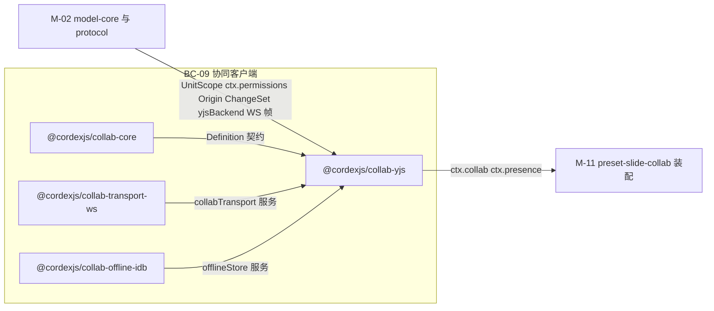
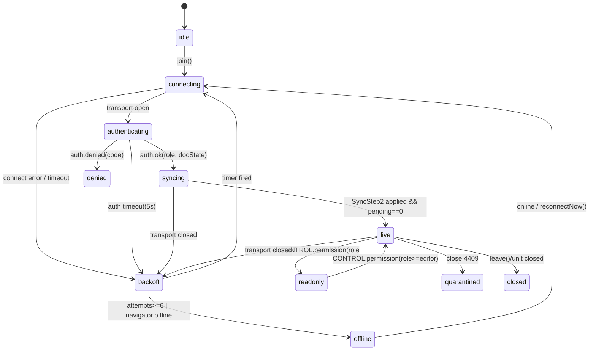
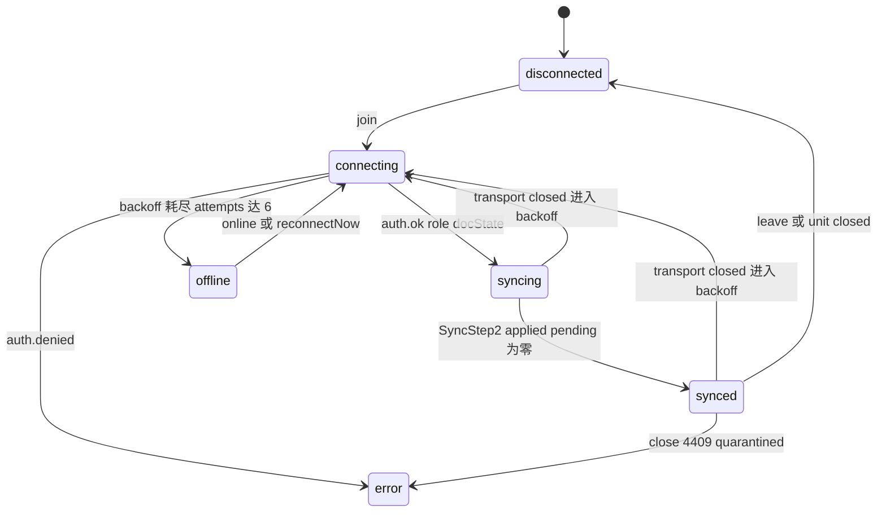
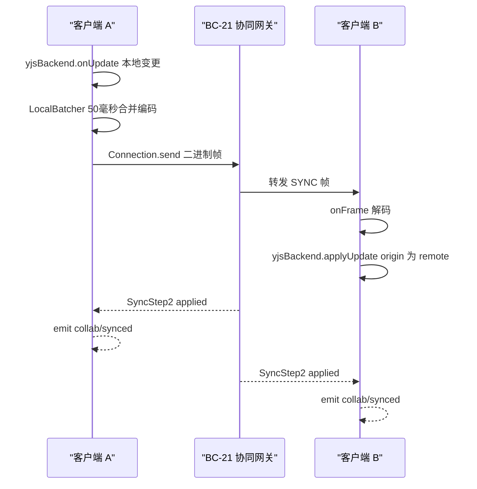
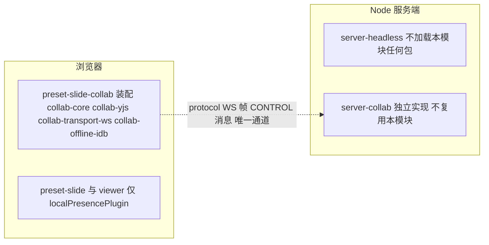
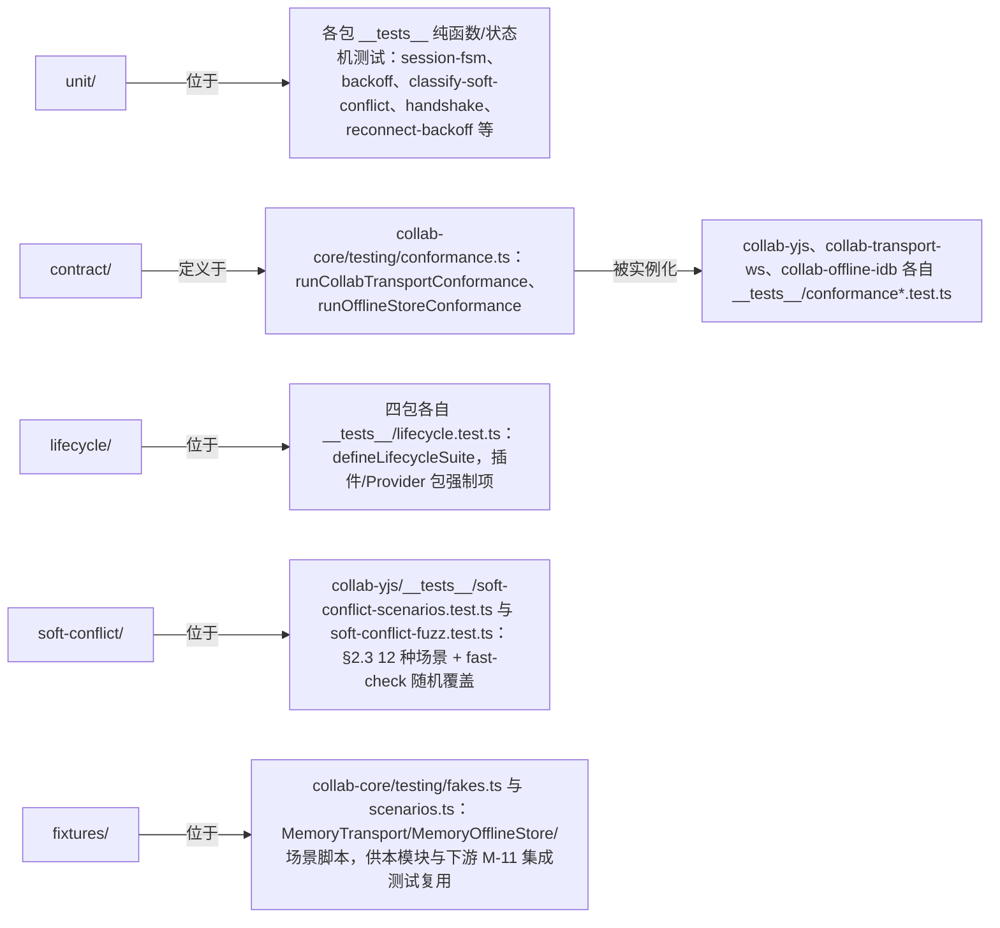
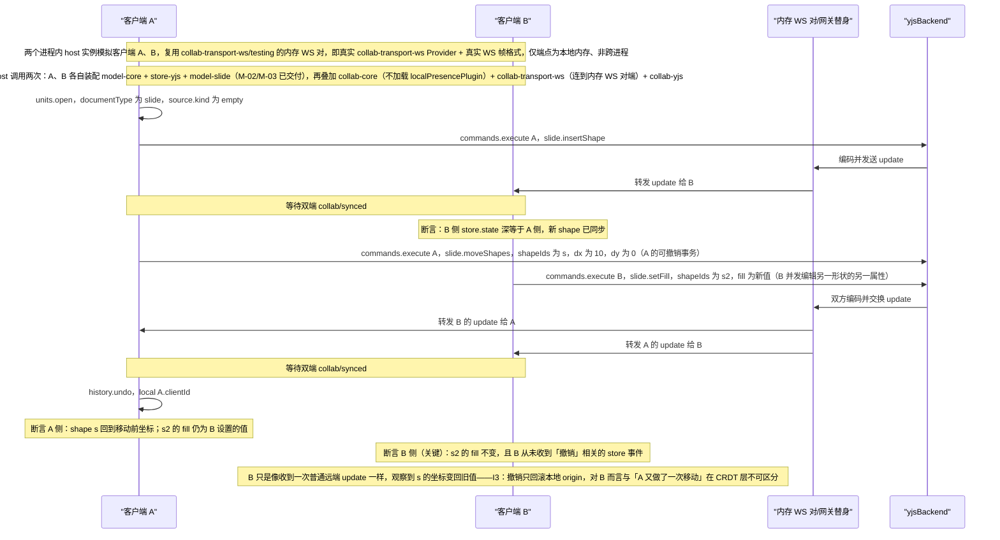

> 状态：草稿 v0.1 | 负责：架构-模块（阶段二，M-05） | 更新：2026-09-18；2026-09-24（rulings §4.15）；2026-09-24（复核修正，rulings §4.17：M9 IDB 键 `{userId}/{documentId}` 与 `OfflineStore.open({userId, documentId})`；M2/M3 撤销载荷与用例名照抄 M-02；D4 不复活他人删除；D5 `store/undo-skipped` 单独统计） | 依赖：00-module-map.md M-05、charter v0.2 §4.2/§5.2 collab-\* 四包行/§5.5、30-architecture `06-collaboration.md` 全篇（含 §18 v0.2 对齐）、`02-layering-and-packages.md` §4.11/§4.12/§4.12b、`02-kernel-protocol-and-document-core.md`（`yjsBackend`/protocol WS 帧/`ctx.permissions`/按 origin 撤销）、ADR-0020/0023/0024/0025/0032/0033、PRD `10-prd/03-features/03-collaboration.md`

# 05 协同（客户端）（限界上下文 BC-09 协同（客户端））

## 0. 一页总览

| 项 | 值 |
|---|---|
| 职责一句话 | 客户端 Session/Room 状态机（内部 11 态 → 对外 `SyncState` 六态）、CRDT 同步的客户端编排（经 `store-yjs` 的 `yjsBackend` 受控访问面，不直接触碰 `Y.*`）、awareness/presence 模型、离线队列与重连退避、权限变更在客户端命令管线前的检查点落地、12 种软冲突的分类与 fuzz 覆盖 |
| 覆盖的上下文 | BC-09 协同（客户端） |
| 承载包 / 目录 | `@cordexjs/collab-core`（L4，秩 40，iso，definition）、`@cordexjs/collab-yjs`（L4，秩 40，iso，provider）、`@cordexjs/collab-transport-ws`（L4，秩 40，iso，provider）、`@cordexjs/collab-offline-idb`（L4，秩 40，**dom**，provider），均在各自 `packages/<pkg>/src/` |
| cordis 形态 | `collab-core`=definition + 内置默认 provider（presence 单人兜底，随装配层选择性加载）；`collab-yjs`=provider（`implements:['collab','presence']`）；`collab-transport-ws`=provider（`implements:['collabTransport']`）；`collab-offline-idb`=provider（`implements:['offlineStore']`） |
| 运行位置 | 仅浏览器（module-map §5：collab-core/yjs/transport-ws 虽为 iso 但只在浏览器场景实例化；服务端对应能力是独立的 BC-21/`server-collab`，不复用本模块任何包，见 §7） |
| 上游（依赖） | M-02：`model-core` 的 `UnitScope`/`ctx.permissions`（`applyRemoteDecisions`/`permission/changed`）/`Origin`/`ChangeSet`/`Selection<A>.serialize()`；`store-yjs` 的 `yjsBackend` 服务面；`protocol` 的 WS 帧/CONTROL 消息/关闭码/能力位/角色 schema |
| 下游（被依赖） | M-11：`preset-slide-collab` 装配本模块四包（替换 `preset-slide` 的 `store-memory`→`store-yjs` 并加入 `collab-*`） |
| 对外服务 | 根作用域：`ctx.collab`、`ctx.collabTransport`；UnitScope 内：`ctx.presence`；Unit 内可选：`offlineStore` |
| 贡献点 | 提供：无；消费：无（charter §5.5：「协同传输与 Blob 存储不是贡献点，而是服务的 Provider 座」） |
| doc / sheet 通用性 | generic（对文档类型盲；协同契约按 `Unit`/`DocumentStore` 的通用存储原语工作，不认识 `slide`/`shape` 等词汇，§8） |
| 批次 | 2（与 M-09 共享 `06-collaboration.md` 定义的协议契约，两者无包依赖但需协议帧版本一致，并行开工） |

### 0.1 图示

**图 0-1 模块包关系与上下游**



怎么读：四包中只有 `collab-yjs` 是真正的编排中枢——它消费 `collab-core` 的 Definition、`collab-transport-ws` 的传输、`collab-offline-idb` 的离线存储，再把 `ctx.collab`/`ctx.presence` 交给下游装配。

## 1. 限界上下文与边界

### 1.1 职责与非职责

**做什么**：

- 定义并驱动客户端 `Session` 状态机：内部 FSM 11 态（`idle/connecting/authenticating/backoff/syncing/live/readonly/denied/offline/quarantined/closed`，06 §5.1）投影为对外 `SyncState` 六态（`disconnected/connecting/syncing/synced/offline/error`，02-layering §4.11）。
- 编排 CRDT 同步的**客户端一侧**：通过 `store-yjs` 暴露的 `yjsBackend`（`encodeStateAsUpdate`/`applyUpdate`/`onUpdate`/`stateVector`/`stats`）收发 update，自身**不**导入或暴露 `Y.*` 类型（唯一受控访问面，charter §4.2 第 3 条边界）。
- 实现 awareness/presence：本地状态节流广播、远端状态校验清洗、光标/选区经 `RelativePosition` 编解码。
- 实现离线队列：`OfflineStore` Definition + 内存降级实现（Provider 缺失时）+ `collab-offline-idb` 的 IndexedDB Provider。
- 落地权限检查点：把服务端 `CONTROL.permission` 帧编排为对 `permissions.applyRemoteDecisions()` 的唯一调用（不自行判定权限、不自行发 `permission/changed`）。
- 定义并覆盖 12 种软冲突场景的确定性分类与 fuzz（§2.3、§9）。
- 实现 WebSocket 传输、Ticket 握手、指数退避重连、应用层心跳（`collab-transport-ws`）。

**不做什么（指向负责模块）**：

- 不做 CRDT 数据结构本身、`Y.Doc` 持有、`StoreOp`→Y 操作映射、`DocumentStore` 契约定义——是 M-02（`model-core`/`store-yjs`）的职责；本模块只消费 `yjsBackend` 这一受控服务面。
- 不做 WS 帧/CONTROL 消息/错误码/能力位/角色 schema 的**定义**——是 M-02（`protocol`）的职责；本模块只引用 `@cordexjs/protocol` 的推导类型，不私定义跨进程 DTO（module-map §4.2 第 1 条铁律）。
- 不做服务端 Room 状态机、update 持久化与压缩、硬/软门禁校验、跨实例 pub/sub——是 M-09（`server-collab`）的职责；本模块与其仅通过 `06-collaboration.md` 定义的协议帧握手，无包依赖。
- 不认识 `slide`/`shape`/`parentId` 等词汇——保持文档类型盲（generic，§8）；06 §8 用幻灯片场景描述的 12 种软冲突，在本模块内一律用 `@cordexjs/model-core/testing` 的通用 `fixture` 文档类型复现（§2.3）。
- 不做在线头像/远端光标渲染/冲突提示 UI/协同诊断面板——是 M-10（`slide-ui`）的职责；本模块只发出事件与暴露只读状态，不渲染任何 DOM。
- 不做权限**判定**（fail-closed 的决策逻辑）——是 M-02（`permissions` 服务）的职责；本模块只是决策从服务端进入客户端的**唯一入口**（06 §18.3）。

### 1.2 通用语言

复用 charter §4.2 协同术语：Room、Session、Ticket、Update / StateVector、Compaction、Repair、FracKey、Version、Soft Conflict（软冲突）。本上下文补充术语表：

| 术语 | 定义 | 对应类型名 |
|---|---|---|
| `SyncState`（对外六态） | `Session.state` 的公开取值：`disconnected\|connecting\|syncing\|synced\|offline\|error` | `domain/session-state.ts` |
| 内部 FSM（十一态） | `session-fsm.ts` 的 reducer 状态：`idle/connecting/authenticating/backoff/syncing/live/readonly/denied/offline/quarantined/closed`（06 §5.1） | `domain/session-state.ts` |
| `AwarenessState` | 单 client 的在场状态（user/client/view/selection/caret/editing/idle/ts，ADR-0024） | `domain/awareness-state.ts`（对齐 `@cordexjs/protocol/collab/awareness.ts`） |
| `OfflineQueue` | 本地未确认 update 与被拒事务的队列聚合（内存态或经 `OfflineStore` 持久化） | `domain/offline-queue.ts` |
| `BackoffPolicy` | 指数退避 + 抖动的纯函数策略（1 s→30 s，±20%） | `domain/backoff.ts` |
| `SoftConflictType` | 12 种软冲突场景的分类字面量联合（06 §8/ADR-0020 附表 D/PRD CO-08） | `domain/soft-conflict.ts` |
| `SessionDriver` | 执行 `session-fsm` 产出的 `Effect`（connect/send/schedule/backoff/notify）的 Provider 侧执行器 | `collab-yjs/infrastructure/session-driver.ts` |
| `AwarenessHandle` | `yjsBackend.awareness()` 返回的抽象句柄（无 `Y.*` 类型），`collab-yjs` 只持有此句柄 | 类型来自 store-yjs（M-02），本模块消费 |
| `LocalBatcher` | 本地 update 合并/节流/背压/ack 追踪器（50 ms 合并窗口）；按两级 ack 追踪：`spill` 只标记「服务端已暂存」，`db` 才触发 `ackUpTo` 清 pending（rulings §4.15 S-3a） | `collab-yjs/infrastructure/sync/local-batcher.ts` |

### 1.3 上下文映射

| 相邻上下文 | 关系类型 | ACL / 落点文件 | 传递的契约 |
|---|---|---|---|
| BC-05 文档内核（上游，`store-yjs`） | Customer–Supplier（受控依赖，module-map §4.2 第 3 条） | `store-yjs/src/yjs-backend.service.ts` | `YjsBackend`（`encodeStateAsUpdate`/`applyUpdate`/`onUpdate`/`awareness()`/`stats()`），**不**含 `Y.*` 类型 |
| BC-05 文档内核（上游，`model-core`） | Customer–Supplier（下游 Conformist） | `model-core/src/permission/permissions.service.ts` | `applyRemoteDecisions(decisions)`（唯一入口）、`Origin`、`ChangeSet`、`Selection<A>.serialize()` |
| BC-03 协议（上游） | Published Language | `protocol/src/{ws,errors,permissions}/*.ts` | SYNC/AWARENESS/CONTROL 二进制信封、关闭码、`Capability`/`RoleName` |
| BC-21 协同网关与持久化（下游进程，跨进程） | **Published Language**（同一份 06 号协议契约，两侧各自实现，无包依赖） | `protocol/src/collab/*.ts` | WS 帧、CONTROL 消息、Ticket、`permVersion` |
| BC-06 幻灯片领域模型（水平，间接） | Conformist（本模块对其透明；对幻灯片词汇零感知） | — | 无共享类型（仅共享 `DocumentStore`/`ChangeSet` 等通用契约） |
| BC-15 幻灯片 UI（下游） | Customer–Supplier | `ctx.collab`/`ctx.presence` 只读事件与状态 | `Session.state`/`stats`、`presence.remotes`、`collab/*`/`presence/*` 事件 |

## 2. 领域模型

### 2.1 聚合与实体

**`Session`（聚合根；`collab-core/domain/session.ts`）**

```ts
interface Session {
  readonly state: SyncState                 // 对外六态；见下方投影表
  readonly role: RoleName                   // 来自服务端 auth.ok / CONTROL.permission
  readonly stats: SessionStats              // pendingLocalUpdates/lastSyncedAt/bytesIn/Out/rtt
  flush(): Promise<void>                    // 等待本地 pending 全部被服务端 ack{tier:'db'}（spill 级 ack 不算）
  reconnectNow(): void
  close(): Promise<void>
}
```

- 不变量：一个 `UnitId` 至多一个活跃 `Session`（`ctx.collab.join()` 幂等，重复 join 返回同一实例）；`state` 只能由内部 FSM 驱动迁移，UI/插件无 public setter。
- 并发/CRDT 下的合并语义：`Session` 是**本地连接句柄**，不参与 CRDT、不跨端合并；它管理的是「本地文档副本与服务端的同步关系」，收敛发生在 `store-yjs` 持有的 `Y.Doc`（M-02），`Session` 只是该收敛过程的连接状态投影。
- **状态机**：内部 FSM 11 态（Provider 执行 effects，纯 reducer 见 §2.3）投影为对外 `SyncState` 六态（`domain/session-state.ts`，02-layering §4.11 定稿）：



| 内部态 | 对外 `SyncState` | 备注 |
|---|---|---|
| `idle` | `disconnected` | 尚未 `join()` |
| `connecting`、`authenticating` | `connecting` | 含首次连接与 `backoff` 重试期（重试不占用第 7 个字面量，UI 层用 `stats.reconnectAttempt>0` 区分「重连中」文案，§13 Q-05-1） |
| `syncing` | `syncing` | HTTP 快照已应用，WS 差量同步中；此时已可编辑（本地 pending 排队） |
| `live` | `synced` | 正常在线；`role>=editor` |
| `readonly` | `synced` + `role` 降级标志 | `Session.role` 本身即降级信号，不新增 `SyncState` 字面量（06 §18.3） |
| `backoff` | `connecting` | 退避重试未超过 `maxAttemptsBeforeOffline`（6 次） |
| `offline` | `offline` | 退避耗尽或 `navigator.onLine=false`；本地仍可编辑 |
| `denied`、`quarantined` | `error` | 均附 `code`（`collab.forbidden`/`collab.room_full`/… 或 `collab.quarantined`） |
| `closed` | `disconnected` | 终态；`leave()`/Unit 关闭 |

**图 2-1 对外六态会话状态机**



怎么读：这是上表"内部态→对外 SyncState"投影的状态机版本，是 UI 实际绑定的六个字面量；内部 `authenticating`/`backoff`/`live`/`readonly`/`denied`/`quarantined`/`idle` 等十一态全部折叠进这六态，具体折叠规则见上表与 §2.1 内部 FSM 图。

**`Room`（客户端侧只读投影，非聚合；`collab-core/domain/room-descriptor.ts`）**：`RoomDescriptor{ documentId; endpoint; token }`（连接参数）与 `RoomInfo{ clients: number; draining?: boolean }`（来自 `CONTROL.room` 帧的房间元信息，用于 UI「N 人在线」）。**Room 的权威状态机在服务端**（`loading/active/draining/persisting/closed/failed`，06 §5.2，M-09 `RoomManager` 拥有）；本模块不复制该状态机，只被动接收 `RoomInfo` 快照，不参与决策。

**`Presence`/`Awareness`（聚合；UnitScope；`collab-core/application/contracts/presence.service.ts`）**：`PresenceService{ setLocal(patch); readonly local: AwarenessState; readonly remotes: ReadonlyMap<ClientId, AwarenessState> }`；`remotes` 是反应式只读集合，变化触发 `presence/changed`。并发语义：每 client 一份 LWW 状态（y-protocols/awareness 原生语义，ADR-0024），30 s 超时自动移除，不参与文档 CRDT 收敛。

**`OfflineQueue`（聚合；`collab-core/domain/offline-queue.ts`）**：`{ pending: readonly PendingUpdate[]; rejected: readonly RejectedEntry[]; meta: { epoch; schemaVersion; lastAckSeq } }`。不变量：`pending` 按 `localSeq` 严格升序；`ackUpTo(seq)` 只删除 `≤seq` 的项，且**只由 `ack{tier:'db', seq}` 触发**——服务端 PG 故障溢写期的 `ack{tier:'spill'}` 只更新 `SessionStats`/诊断，不清 pending（rulings §4.15 S-3a 两级 ack；正式 `seq` 由 PG 在回放时分配）；`epoch`/`schemaVersion` 与服务端不一致时整体移入 `rejected`（ADR-0033）。有 `OfflineStore` Provider 时持久化到 IndexedDB，缺失时纯内存（刷新即丢，"降级"不改变接口形状）。

### 2.2 值对象

| 名称 | 字段（要点） | 校验 schema | 所在文件 |
|---|---|---|---|
| `SyncState` | 六态字面量联合 | 无 zod（内部运行时值，不跨进程） | `domain/session-state.ts` |
| `SessionStats` | `{ pendingLocalUpdates; lastSyncedAt?; bytesIn; bytesOut; rtt?; reconnectAttempt }` | 无 | `domain/session.ts` |
| `Ticket` | `{ value: string; expiresAt; permVersion; refreshAt }` | 无（不透明凭据，由服务端签发/校验；类型形状供刷新逻辑用） | `domain/ticket.ts` |
| `AwarenessState` | `v:1; user{id,name,color,avatar?}; client{id,device,appVersion}; view?; selection?: SerializedSelection; caret?; editing?; idle?; ts` | zod（对齐 `@cordexjs/protocol/collab/awareness.ts`，≤2 KiB） | `domain/awareness-state.ts` |
| `SerializedSelection` | `{ kind; slideId?; ids: string[]; range?: { anchor; head } }`（`range` 为 `RelativePosition` base64） | 由 `DocumentType.selectionKinds` 对应 schema 校验，本模块内容不透明 | `domain/awareness-state.ts` |
| `PendingUpdate` | `{ localSeq: number; update: Uint8Array }` | 无（本地运行时，不跨进程序列化外的额外校验） | `domain/offline-queue.ts` |
| `RejectedEntry` | `{ update: Uint8Array; records: TransactionRecordSummary[]; reason; at }` | 无 | `domain/offline-queue.ts` |
| `BackoffPolicy` | `{ baseMs:1000; maxMs:30000; jitter:0.2; maxAttemptsBeforeOffline:6 }` | 无（纯策略配置） | `domain/backoff.ts` |
| `SoftConflictType` | 12 种字面量联合（见 §2.3 表） | 无（内部事件载荷判别字段） | `domain/soft-conflict.ts` |
| `RoomDescriptor`/`RoomInfo` | 见 §2.1 | `RoomDescriptor` 部分字段来自 `@cordexjs/protocol` ids | `domain/room-descriptor.ts` |

### 2.3 领域服务

纯函数清单（全部 `iso`，无 IO，不读时钟除非标注）：

| 签名（草案） | 所在文件 | 两端共用 | 备注 |
|---|---|---|---|
| `reduce(state: InternalState, event: SessionEvent): { next: InternalState; effects: readonly Effect[] }` | `domain/fsm/session-fsm.ts` | 否（服务端 Room FSM 是 M-09 独立实现，不复用本函数） | §2.1 状态机的权威实现；`effects` 为描述对象（`connect`/`send`/`schedule`/`backoff`/`notify`），由 `collab-yjs` 的 `SessionDriver` 执行，reducer 本身零 IO |
| `projectSyncState(internal: InternalState, degraded: boolean): SyncState` | `domain/session-state.ts` | 否 | 11→6 投影（§2.1 表） |
| `nextDelay(attempt: number, policy: BackoffPolicy, rand: () => number): number` | `domain/backoff.ts` | 是（算法本身通用；`rand` 显式注入以保证可测试确定性） | 指数退避 + 抖动；`collab-transport-ws` 与未来其它传输 Provider 均可复用 |
| `classifySoftConflict(input: ConflictSignal): SoftConflictType \| null` | `domain/classify-soft-conflict.ts` | 是（对文档类型盲，输入只含通用 `ChangeSet`/本地操作日志，见下表） | 12 种场景的判定核心，§8 冲突表覆盖 |
| `serializeAwareness(state: AwarenessState): Uint8Array` / `parseAwareness(bytes): Result<AwarenessState, CordexError>` | `domain/awareness-state.ts` | 是 | zod `safeParse`；非法状态返回 `err`，由调用方丢弃并计数（不抛异常） |

**12 种软冲突场景**（权威列表 = 06 §8 全部 12 行；本模块对文档类型盲，用 `@cordexjs/model-core/testing` 的通用 `fixture` 文档类型——键值树 + 文本块——复现，而非 06 原文的幻灯片示例；幻灯片示例仅作直觉参照，实际收敛规则与验证在 M-02/M-04 的 `store-yjs`/`model-slide` 契约套件重复覆盖一次）：

| # | 06 §8 幻灯片示例（直觉参照） | 本模块通用场景（`fixture` 词汇） | 原语层结果 | `SoftConflictType` / 事件 | 测试用例 |
|---|---|---|---|---|---|
| 1 | A、B 并发移动同一形状 | 两客户端并发 `set` 同一 Record 叶子键 | 键级 LWW，后写者胜 | `prop-lww`（`collab/soft-conflict`） | `soft-conflict-scenarios.test.ts::concurrent-key-lww` |
| 2 | A 删除形状，B 并发编辑其文本 | 并发软删除（`set(实体._deleted)`）一个实体 vs 该实体子路径的 `text`/`set` | **rulings §4.15 Q3 改写**：删除只写墓碑，B 的编辑保留在墓碑实体上；读路径视该实体为已删；A（删除方）撤销删除即带着 B 的编辑恢复；B 若撤销自己删除前的编辑，目标已被 A 删除 → 跳过并提示、**不复活**（rulings §4.17 D4，TTL 内亦然） | `delete-vs-edit`（B 端提示「元素已被 A 删除」+「恢复」，恢复=清除墓碑的新事务） | `::delete-vs-edit` |
| 3 | A 删除页，B 在页内新增形状 | 软删除容器实体（级联墓碑） vs 在该容器内 `insert` 子实体 | 容器为墓碑，B 新增的子实体未被级联标记但因容器已删而不可见；A 撤销删除后 B 的子实体随容器一起出现；TTL 硬删除（服务端单写者）时一并清理 | `delete-vs-edit`（同上，粒度更高一层） | `::delete-parent-vs-child-insert` |
| 4 | A、B 都在同一位置之后插入新实体（页） | 两客户端在 `Ordered` 集合同一间隙各 `insert` 一项 | 两项都存在，按 `(order, id)` 全序，两端一致 | 新增建议：`concurrent-insert`（06/PRD 未单列 tag，§12） | `::concurrent-insert-same-gap` |
| 5 | A 把 X 放入组 G，B 把 G 放入 X（父子环） | 两客户端并发 `set` 造成通用树形字段（如 `fixture` 的 `parentId`）互指成环 | 两个 `parentId` 各自 LWW 成功 → 成环 → 修复规则：环上 id 字典序最大者回根 | `collab/repair{rule:'cycle'}`（**不是** `soft-conflict`，06 §8/PRD CO-08 一致） | `::parent-child-cycle-repair` |
| 6 | A 改填充色，B 改位置 | 两客户端并发 `set` 同一实体的**不同**键 | 都存活（不同键无冲突） | 无提示（期望行为） | `::independent-keys-both-survive` |
| 7 | A、B 同时编辑同一文本框不同位置 | 同一 `RichText` 段落内不同偏移量并发插入 | 字符级 YATA 合并，两处都保留 | 无提示 | `::concurrent-richtext-same-paragraph` |
| 8 | A 回车分段，B 给被移动的尾部文本加粗 | 段落 `remove`+`insert`（分段）与该尾部文本的属性 `text` 操作并发 | 尾部文本被删除+重插，格式化落空（已知限制，与 y-prosemirror 同） | 无提示 | `::split-paragraph-vs-format` |
| 9 | A 更换版式，B 编辑占位符文本 | 并发修改**引用型**字段（如 `layoutId`）与**内容型**字段（如 `txBody`），不同实体或不同键 | 都存活，各自生效 | 无提示 | `::reference-field-vs-content-field` |
| 10 | A 撤销自己的移动，其间 B 也移动了同一形状 | 本地 `undo(origin=local)` 与远端后写同一键 | **rulings §4.15 Q3 改写**：`store-yjs` 撤销包装层（包装 `Y.UndoManager`）**跳过**被他人后写的键，不覆盖 B；本步其余键照常回滚；若整步都被跳过则出栈即停、不连撤上一步 | `store/undo-skipped`（M-02 事件，**不是** `soft-conflict`）→ 提示条「部分内容已被他人修改，未撤销」+「恢复我的值」（新事务，PRD CO-08） | `::undo-vs-concurrent-remote-change` |
| 11 | 离线 A 修改 S，在线 B 早已删除 S | 离线队列重放的 `set`/`text` vs 已持久化的软删除 | S 仍为墓碑，A 的修改保留在其上（B 撤销删除即可见）；若 A 离线超过墓碑 TTL（默认 24h）、S 已被服务端硬删除，则 A 的修改落在已删类型上被丢弃，可从「未同步更改」导出 | `delete-vs-edit`（离线变体） | `::offline-edit-vs-online-delete` |
| 12 | A 降权为 viewer 时仍有 pending update | `permission-gate` 拦截 outbound + 服务端硬门禁拒绝 | 不落库不广播；本地回滚到服务端状态，被拒事务移入 `rejected` 供导出 | `collab/update-rejected`（**不是** `soft-conflict`，06 §18.4） | `::permission-downgrade-with-pending` |

**撤销语义附加用例（rulings §4.15 Q3；不新增 `SoftConflictType`，与 12 种场景同文件；用例名照抄 M-02 §2.5「撤销协同契约用例名表」，2026-09-24 复核 M3）**：

| 用例 | 场景（`fixture` 词汇） | 断言 |
|---|---|---|
| `::remote-conflict-skip` | A 写键 k1、k2 为一步；B 随后写 k1；A 撤销 | k1 保持 B 的值、k2 回滚；`store/undo-skipped{skipped:[k1], wholeStep:false}` 恰一次 |
| `::undo-skip-no-cascade` | A 连续两步：步 1 写 k1，步 2 写 k2；B 随后写 k2；A 撤销一次 | 步 2 整步跳过、出栈，`wholeStep:true`；k1 **未**被连带撤销；再撤销一次才回滚 k1 |
| `::delete-vs-edit-undo` | (a) A 软删除实体 E；B 编辑 E 的文本与属性；A 撤销删除。(b) B 先编辑 E，A 随后删除 E，B 撤销自己的编辑 | (a) E 以同一 id 恢复，且带 B 的编辑；两端收敛哈希一致。(b) B 的撤销整步跳过（`UndoSkip.reason:'remote-deleted'`），E **不**复活，`store/undo-skipped{wholeStep:true}` 恰一次（rulings §4.17 D4） |
| `::offline-replay-not-other-writer`（本模块特有补充，非契约套件用例名） | A 离线编辑后重连回放（`origin=local`，本端 clientId） | 回放写入**不**计为「他人后写」，A 之后仍可正常撤销自己离线前的步骤 |

fuzz 追加两条性质（`soft-conflict-fuzz.test.ts`）：(1) 任一客户端的撤销从不覆盖其他 clientId 在该步之后写入的键；(2) 软删除前后实体 id 不变，撤销删除后实体子树与未删分支的并发编辑一致。

- 确定性用例（表中 12 项）位于 `collab-yjs/src/__tests__/soft-conflict-scenarios.test.ts`（固定 clientID 与时钟）；随机覆盖位于同目录 `soft-conflict-fuzz.test.ts`（fast-check，随机 op 序列 + 随机分区/乱序交换 update，断言收敛后状态哈希一致，含场景 4/5 的重复触发）。
- 场景 1/4/6/7/9 的收敛结果同时被 M-02/M-04 的 `runDocumentStoreConformance` 协同分节复用同一断言（06 §18.2：memory 与 yjs 结果必须相同），本模块的用例额外覆盖 `collab-yjs` 特有的**事件与 UI 信号**（`collab/soft-conflict`/`collab/repair`/`collab/update-rejected` 是否按此表触发），而非重复验证 CRDT 收敛本身。

### 2.4 领域事件

全部在 `collab.contribution.ts` 中 `declare module '@cordexjs/kernel'` 声明（扫描器 `events-declared`）；域名为章程 §5.5 保留域 `collab`/`presence` 之一。**权威列表 = module-map BC-09 行 + charter §5.5**，与 ADR-0023/0024 v0.2 定稿名一致：

| 事件 | 模式 | 载荷（要点） | 发布者文件 | 典型订阅者 |
|---|---|---|---|---|
| `collab/state-changed` | emit | `(unitId, prev: SyncState, next: SyncState)` | `collab-yjs/infrastructure/session-driver.ts`（执行 `session-fsm` 效果时发出） | UI 状态指示（M-10）、telemetry `cordex_collab_session_transitions_total{from,to}` |
| `collab/synced` | emit | `(unitId)` | `collab-yjs/infrastructure/session-driver.ts`（`syncing→live` 迁移时） | 打开进度 UI、e2e 断言 |
| `collab/soft-conflict` | emit | `(unitId, { type: SoftConflictType; paths? })` | `collab-yjs/infrastructure/sync/yjs-sync-engine.ts`（应用远端 update 后调用 `classifySoftConflict()`，观察到 §2.3 表中场景时） | 冲突提示 UI（M-10）、telemetry |
| `collab/auth-failed` | emit | `(unitId, { code })` | `collab-transport-ws/infrastructure/handshake.ts` → 经 `SessionDriver` 转发 | 错误提示 UI、审计 |
| `collab/reconnect` | emit | `(unitId, { reason })` | `collab-yjs/infrastructure/session-driver.ts`（`backoff`/`offline→connecting`） | 状态指示、telemetry |
| `collab/update-rejected` | emit | `(unitId, { code, count })` | `collab-yjs/infrastructure/permission/permission-gate.ts`（§18.4「导出后重载」触发点） | 「未保存更改」横幅（M-10）、审计 |
| `collab/repair` | emit | `(unitId, { reason, paths })` 或 `{ rule }`（如 `'cycle'`） | `collab-yjs/infrastructure/sync/yjs-sync-engine.ts`（收到 `CONTROL.repair`/本地轻量修复时） | 非阻断提示「已自动修正」、telemetry（**与服务端 `collab-server/repair` 是两个不同事件**，14 §1 C-08：本事件是客户端收到 `CONTROL.repair` 后自发的本地事件，载荷面向 UI；服务端事件载荷面向审计，发布者/订阅者均不同，见 00-module-map §3 BC-26 行） |
| `store/undo-skipped`（M-02 事件，本模块**订阅**，不发布） | on | `(unitId, { skipped: UndoSkip[]; wholeStep: boolean })`（载荷照抄 M-02 §2.4，复核 M2） | `store-memory`/`store-yjs` Provider（M-02） | 提示条（M-10）；telemetry **单独统计**跳过次数与整步跳过次数（`cordex_store_undo_skipped_total{whole_step}`），**不**派生 `collab/soft-conflict`、**不**计入软冲突率 MT-15（rulings §4.17 D5） |
| `presence/joined` | emit | `(unitId, clientId)` | `collab-yjs/infrastructure/awareness/presence.service.ts` | 在场头像列表（M-10） |
| `presence/left` | emit | `(unitId, clientId)` | `collab-yjs/infrastructure/awareness/presence.service.ts` | 在场头像列表（M-10） |
| `presence/changed` | emit | `(unitId, clientId \| null)` | `collab-yjs/infrastructure/awareness/presence.service.ts`（`null` = 本地状态变化） | 光标/选区覆盖层（M-10） |

**新增建议，已提请章程收编**（14-cross-module-review.md §1 C-24 采纳：PRD CO-13 诊断面板明确需要，06 §3.1 已定义背压阈值；未进入 module-map §3 BC-09 官方列表，本文档提议补入 charter §5.5 事件总表，见 §12 G-3）：

| 事件 | 模式 | 载荷 | 理由 |
|---|---|---|---|
| `collab/backpressure` | emit | `(unitId, { queued: number })` | 06 §3.1 草案已定义（`outboundHighWater` 超限），PRD CO-13 诊断面板需要「发送积压」信号；当前缺席会使 UI 无法区分「慢」与「离线」 |
| `collab/latency` | emit | `(unitId, { rttMs })`（采样，非逐帧） | PRD CO-13 明确列出 `collab/latency`（采样）为诊断事件，但 module-map/charter §5.5 尚未登记 |

**明确不发出**：`permission/changed` **不由本模块发出**——CONTROL.permission 帧经 `degrade-permission` 应用服务唯一调用 `permissions.applyRemoteDecisions()`（M-02），该服务是 `permission/changed` 的**唯一**发布者（06 §18.3；draft 名 `collab/permission-changed` 已弃用）。命令管线与 UI 均只订阅 `permissions` 服务发出的事件，不订阅任何 `collab/*` 事件来判断权限。

### 2.5 仓储 / 存储契约

本模块定义三个 Definition（均为服务契约，非数据仓储，但按模板本节承载「Definition 名与 id、方法签名、默认 Provider、契约套件」）：

| Definition（服务名） | 方法签名草案 | 默认 / 生产 Provider | 契约套件 |
|---|---|---|---|
| `collab`（`CollabService`） | `join(unitId, opts: JoinOptions): Session`（幂等，重复 join 返回同一实例）；`leave(unitId): Promise<void>`；`session(unitId): Session \| undefined` | `collab-yjs`（唯一生产实现） | **无独立套件**：`CollabService` 与 `store-yjs` 强耦合（依赖 `yjsBackend`），不是「可自由替换实现」的 Definition；其正确性由 `store-yjs` 的 `runDocumentStoreConformance` 协同分节（收敛）+ `collab-yjs` 自身 `__tests__`（状态机/事件）共同覆盖，不重复定义 `runCollabConformance` |
| `collabTransport`（`CollabTransport`） | `connect(target: TransportTarget, ticket: string, signal: AbortSignal): Promise<Connection>`；`Connection{ send(frame: Uint8Array): void; onFrame(cb): Disposable; onClose(cb): Disposable; close(code?, reason?): void }` | `collab-transport-ws`（生产，WebSocket）；`MemoryTransport`（测试） | `runCollabTransportConformance(factory)`（`collab-core/testing`）：握手成功/超时、断线触发重连、背压事件在超过 `outboundHighWater` 时触发、乱序/重复帧不崩溃、`close(code)` 精确传递关闭码 |
| `offlineStore`（`OfflineStore`） | 见下方签名（06 §18.6，权威） | `collab-offline-idb`（生产，IndexedDB）；`collab-yjs` 内置**同接口**内存实现（Provider 缺失时的降级路径，非契约套件的「测试替身」） | `runOfflineStoreConformance(factory)`（`collab-core/testing`）：`appendPending`→`loadPending` 顺序一致、`ackUpTo` 幂等（重复调用无副作用）、`compact` 原子性（并发 `appendPending` 不丢追加）、配额超限返回 `Result.err` 不抛异常、`moveToRejected`/`listRejected`/`clearRejected` 往返 |

```ts
// OfflineStore（collab-core/application/contracts/offline-store.ts；06 §18.6 权威签名）
interface OfflineStore {
  open(scope: { userId: UserId; documentId: DocumentId }): Promise<OfflineDocStore>  // T-0 去 tenantId；IDB 键 `{userId}/{documentId}`（同机多账号隔离，复核 M9）
  clearAll(scope: { userId: UserId }): Promise<void>
  estimate(): Promise<{ usedBytes: number; quotaBytes: number }>
}
interface OfflineDocStore {
  readonly meta: OfflineMeta | null
  loadState(): Promise<Uint8Array | null>
  loadPending(): Promise<readonly PendingUpdate[]>
  appendPending(update: Uint8Array, localSeq: number): Promise<Result<void, CordexError<'collab.offline_quota_exceeded'>>>
  ackUpTo(localSeq: number): Promise<void>
  compact(state: Uint8Array, meta: OfflineMeta): Promise<void>
  moveToRejected(entries: readonly RejectedEntry[]): Promise<void>
  listRejected(): Promise<readonly RejectedEntry[]>
  clearRejected(): Promise<void>
  close(): Promise<void>
}
```

- `collab`/`presence` 两个服务名共用同一 Provider（`collab-yjs` 的 `plugin.ts` 同时 `provide:['collab','presence']`），但契约上是两个独立 Definition（`CollabService` 根作用域、`PresenceService` UnitScope），拆分理由：单人模式下仍需要 `presence`（本地用户自己的状态，供未来「跟随自己视角」等特性）而不需要 `collab`（无远端可同步）。
- `collabTransport` 无「缺失时降级」路径——它是**硬依赖**（§5.4 可插拔表：协同整体移除后退化为单人模式，但一旦选择协同 Provider，`collabTransport` PENDING 即整个 `collab-yjs` PENDING，不是「静默无操作」）。

### 2.6 应用服务与命令

**本模块不贡献任何 `core.command`/`core.mutation`**——协同是服务 Provider 座（charter §5.5），不产生文档编辑操作；用户可感知的运维态动作（如「立即重连」）是 `Session` 上的直接方法调用，不经 `commands.execute()` 管线（不改 `DocumentStore`、无需撤销/权限位）。本节按「连接/断开/同步/离线回放/权限降级」五个应用服务描述编排步骤（纯描述，实际 IO 由 Provider 执行，对齐 cordis 的 `ctx.effect` 所有权模型）：

| 应用服务 | 编排步骤 | 触发者 | 描述所在文件 / 执行所在文件 |
|---|---|---|---|
| 连接（connect） | `join()` → FSM `idle→connecting` → `collabTransport.connect()` → CONTROL.auth 握手 → `authenticating→syncing`（与 HTTP 快照 bootstrap 并行，06 §9.1）→ SyncStep1/2 → pending 清空 → `syncing→live` | `ctx.collab.join(unitId, opts)`（`preset-slide-collab` 在 Unit 打开后调用） | `application/session-lifecycle.ts`（描述）→ `collab-yjs/infrastructure/session-driver.ts`（执行） |
| 断开（disconnect） | `leave()` → `flush()`（等待 pending 清空，超时跳过）→ `Connection.close(1000)` → awareness 广播移除 → FSM → `closed` | `ctx.collab.leave(unitId)`（Unit 关闭时自动调用） | `application/session-lifecycle.ts`（描述）→ `collab-yjs/infrastructure/session-driver.ts`（执行） |
| 同步（sync） | 出站：`yjsBackend.onUpdate` → `LocalBatcher`（50 ms 合并）→ 编码 → `Connection.send`；入站：`onFrame` → 解码 → `yjsBackend.applyUpdate(origin=remote)` | 持续循环，无显式调用者 | `collab-yjs/infrastructure/sync/{yjs-sync-engine,local-batcher}.ts` |
| 离线回放（offline replay） | Unit 打开：`offlineStore.loadState()` → `applyUpdate(origin=import)` → `loadPending()` → 按 `localSeq` 升序 `applyUpdate(origin=local，重放，不入撤销栈)` → WS 同步 → 收到 `ack{tier:'db'}` 后 `ackUpTo` 清理（`tier:'spill'` 不清，rulings §4.15 S-3a）→ `synced` 后 `compact` | Unit 打开时自动 | `application/replay-offline-queue.ts`（描述）→ `collab-yjs/infrastructure/offline/offline-queue-runtime.ts`（执行） |
| 权限降级（permission degradation） | 收到 `CONTROL.permission` → `permissions.applyRemoteDecisions(decisions)`（唯一入口，M-02）→ 若降权：`permission-gate` 本地拦截后续 outbound update + FSM `live→readonly`；若彻底撤销：`Connection.close(4403)` | 服务端推送（被动） | `application/degrade-permission.ts`（描述）→ `collab-yjs/infrastructure/permission/permission-gate.ts`（执行） |

事务边界与撤销：五个应用服务均**不产生** `Transaction`/`TransactionRecord`（那是 M-02 命令管线的职责）；撤销语义（跳过他人后写、整步跳过即停、软删除墓碑）由 M-02 `store-yjs` 的撤销包装层实现，本模块只保证入站远端 update 一律以 `origin=remote` 应用，使包装层的「键→最后写入 origin」表能识别他人后写（rulings §4.15 Q3）；离线回放阶段重放的 update 以 `origin=local` 应用是为了让 `Y.UndoManager` 正确识别其为「可能被本地撤销」的历史（但显式标注「重放，不入撤销栈」——即重放本身不创建新的可撤销单元，只恢复既有 CRDT 状态）。

**图 2-2 两端同步时序**



怎么读：出站方向经 `LocalBatcher` 合并节流再编码发送；入站方向解码后交给 `yjsBackend.applyUpdate` 且 `origin` 标记为 remote；两端各自在 `SyncStep2` 完成、`pending` 清零后独立发出 `collab/synced`，不存在跨端同步的单一事件。

## 3. cordis 插件定义

> 四包按 cordis 形态分三类：`collab-core` 是 definition 包，但**额外**导出一个自成一体的最小函数插件（单人 presence 兜底，装配层显式挂载，不随包 import 自动注册）；`collab-yjs`/`collab-transport-ws`/`collab-offline-idb` 是标准 provider（各自 `implements` 一个服务名）。四包均无自身贡献点（协同是服务 Provider 座，charter §5.5）。

**`@cordexjs/collab-core`**

| 项 | 值 |
|---|---|
| 插件名 / `name` | 包本身**无**面向装配层自动注册的插件；额外导出 `localPresencePlugin`（`infrastructure/local-presence.provider.ts`），由装配层显式 `ctx.plugin(localPresencePlugin)` |
| `inject`（`localPresencePlugin`） | 必需：无；可选：无（UnitScope 内由 `unit-plugin.ts` 挂载） |
| `provide`（`localPresencePlugin`） | `['presence']`（单人兜底：`remotes` 恒为空 Map，无远端） |
| 贡献点：提供 / 消费 | 无 / 无 |
| 事件：发布 / 订阅 | 声明全部 `collab/*`/`presence/*` 事件类型（§2.4），但**不发出**任何事件（真正发出者是 `collab-yjs`；`localPresencePlugin` 单人模式下无 `remotes` 变化） |
| 配置 schema | `localPresencePlugin` 无 Config（无可配置项） |
| 生命周期 | ready = `local` 状态对象构造完成；dispose = no-op（无外部资源）；UnitScope 内；PENDING：不会（无硬依赖） |
| Manifest 片段 | `{ "id": "@cordexjs/collab-core#local-presence", "provides": ["presence"], "injects": [], "unitScoped": true }` |
| 装配关系 | `preset-slide` 加载 `localPresencePlugin`；`preset-slide-collab` **替换**为 `collab-yjs`（同一 UnitScope 只能有一个 `presence` 供给者，装配层用 override/exclude 二选一，module-map §6.1） |

**`@cordexjs/collab-yjs`**

| 项 | 值 |
|---|---|
| 插件名 / `name` | `collab-yjs` |
| `inject`（必需 / 可选） | 必需：`['store', 'yjsBackend', 'collabTransport', 'permissions']`；可选：`ctx.get('telemetry', false)`、`ctx.get('offlineStore', false)`（缺失即内存降级，§2.5） |
| `provide` | `['collab', 'presence']` |
| 贡献点：提供 / 消费 | 无 / 无 |
| 事件：发布 | §2.4 表中除 `permission/changed` 外的全部 `collab/*`/`presence/*` 事件（本包是真正的发布者） |
| 事件：订阅 | `store/transaction`（`yjsBackend.onUpdate` 的间接来源；本包不直接 `ctx.on('store/transaction')`，而是通过 `yjsBackend.onUpdate` 只接收非 remote 的 update，避免重复编码） |
| 配置 schema | `Config{ flushMs:50; awareness:{cursorHz:20; stateHz:2; timeoutMs:30000}; maxUpdateBytes:1MiB; outboundHighWater:200; offline:{enabled:true; maxBytes:50MiB} }` |
| 生命周期 | ready = `SyncEngine`+`AwarenessAdapter`+`SessionDriver` 挂载完成并开始尝试连接（`connecting`，**不等于** `synced`，初始同步是异步过程）；dispose = 关闭 transport 连接、清理 awareness（广播移除）、尽力 flush 离线队列、`ctx.effect` 逆序清理；UnitScope 内；PENDING：`store-memory` 场景下 `yjsBackend` 未就位 → 整体 `PENDING`（可诊断，非失败，ADR-0005 第 3 条） |
| Manifest 片段 | `{ "id": "@cordexjs/collab-yjs", "provides": ["collab","presence"], "injects": ["store","yjsBackend","collabTransport","permissions"], "unitScoped": true }` |

**`@cordexjs/collab-transport-ws`**

| 项 | 值 |
|---|---|
| 插件名 / `name` | `collab-transport-ws` |
| `inject`（必需 / 可选） | 必需：无（根作用域插件，连接参数经 `connect(target, ticket, signal)` 调用时传入）；可选：`ctx.get('telemetry', false)` |
| `provide` | `['collabTransport']`（根作用域） |
| 贡献点：提供 / 消费 | 无 / 无 |
| 事件：发布 / 订阅 | 无 cordis `Events`——只通过 `Connection.onFrame`/`onClose` 回调暴露给上层（`collab-yjs`），不直接 `ctx.emit` 任何 `collab/*` 事件（域事件由感知「Session」语义的 `collab-yjs` 统一发出） |
| 配置 schema | `Config{ urlTemplate:'wss://{host}/collab/v1/rooms/{documentId}'; connectTimeoutMs:5000; backoff:{baseMs:1000; maxMs:30000; jitter:0.2; maxAttemptsBeforeOffline:6}; heartbeatMs:15000 }` |
| 生命周期 | ready = Provider 注册完成（**不**主动连接，`connect()` 按需调用）；dispose = 关闭全部经 `ctx.effect` 追踪的活跃 socket；根作用域（跨 Unit 复用同一 Provider 实例，每次 `connect()` 各自独立 socket）；PENDING：不会 |
| Manifest 片段 | `{ "id": "@cordexjs/collab-transport-ws", "provides": ["collabTransport"], "injects": [], "implements": ["collabTransport"], "unitScoped": false }` |

**`@cordexjs/collab-offline-idb`**

| 项 | 值 |
|---|---|
| 插件名 / `name` | `collab-offline-idb` |
| `inject`（必需 / 可选） | 必需：无；可选：`ctx.get('telemetry', false)` |
| `provide` | `['offlineStore']`（UnitScope） |
| 贡献点：提供 / 消费 | 无 / 无 |
| 事件：发布 / 订阅 | 无（纯存储 Provider，配额告警经 `errors`/`telemetry` 上报，不发 `collab/*` 事件） |
| 配置 schema | `Config{ dbNamePrefix:'cordex-collab'; maxPendingBytes:50MiB; ttlDays:30 }` |
| 生命周期 | ready = 为该 `{userId}/{documentId}` 打开/建库成功（T-0 去租户，rulings §4.15；键含 userId，复核 M9）；dispose = 关闭 db 连接句柄（**不**删除数据）；UnitScope 内；PENDING：几乎不会（IndexedDB 不可用时返回错误而非 PENDING，由 `collab-yjs` 捕获后走内存降级路径，而非 cordis 依赖解析层面的 PENDING） |
| Manifest 片段 | `{ "id": "@cordexjs/collab-offline-idb", "provides": ["offlineStore"], "injects": [], "implements": ["offlineStore"], "unitScoped": true }` |
| M3/M4 状态 | M3 默认**不加载**本包（会话内内存队列已满足「离线重连」验收）；M4 P2 起随 `preset-slide-collab` 可选启用（PRD CO-06） |

## 4. 目录树（完整到文件）

> 四包根配置文件均遵循 02 §4.0 包模板：`package.json`/`tsconfig.json`/`tsconfig.test.json`/`vitest.config.ts`/`api-extractor.json`/`etc/<pkg>.api.md`/`README.md`/`CHANGELOG.md`/`cordex-manifest.json`，共 9 个 × 4 = 36 个，同构不逐包重复展开；`cordex` 字段差异见 §3。顶层按 00-module-map §1 的 DDD 对照表组织为 `domain/`/`application/`/`infrastructure/`/`testing/`（本模块无 UI，省略 `interface/`；三个纯 Provider 包按 module-map §1 规则只设 `infrastructure/`，无 `domain/`/`application/`，与 02 §4.11/4.12/4.12b 现存扁平结构的映射关系、差异原因见 §12 G-1）。四包 `src/` 共 86 个源文件。

### 4.1 `@cordexjs/collab-core`（34 个源文件）

```text
packages/collab-core/src/
├── index.ts                          公共 API 面（§6）
├── manifest.ts                       localPresencePlugin 的 Manifest 生成物
├── collab.contribution.ts            Context 增强（collab/presence/collabTransport/offlineStore）+ Events 全表（§2.4）
├── events.ts                         事件名常量（与 contribution.ts 一致）
├── errors.ts                         collab.* 错误码声明
├── domain/                           聚合 / 值对象 / 纯函数 / 事件类型（DDD domain 层，零 IO）
│   ├── session.ts                    Session 聚合类型 + SessionStats（§2.1/§2.2）
│   ├── session-state.ts              SyncState 六态 + 内部 FSM 十一态 + projectSyncState()（§2.1）
│   ├── room-descriptor.ts            RoomDescriptor/RoomInfo 只读投影（§2.1）
│   ├── ticket.ts                     Ticket 值对象
│   ├── awareness-state.ts            AwarenessState + SerializedSelection（§2.2）
│   ├── cursor.ts                     RelativePosition base64 值对象与占位编解码类型
│   ├── offline-queue.ts              OfflineQueue + PendingUpdate + RejectedEntry（§2.1/§2.2）
│   ├── backoff.ts                    BackoffPolicy 值对象 + nextDelay() 纯函数（§2.3）
│   ├── soft-conflict.ts              SoftConflictType 12 种字面量联合（§2.3 表）
│   ├── classify-soft-conflict.ts     classifySoftConflict() 纯函数（§2.3）
│   └── fsm/
│       ├── session-fsm.ts            reduce(state,event) 纯 reducer + 允许迁移表（§2.1/§2.3）
│       └── session-fsm-effects.ts    Effect 判别联合类型（connect/send/schedule/backoff/notify）
├── application/                      Definition 契约 + 应用服务编排描述（DDD application 层）
│   ├── contracts/
│   │   ├── collab.service.ts         abstract CollabService（join/leave/session，§2.5）
│   │   ├── presence.service.ts       abstract PresenceService（setLocal/local/remotes）
│   │   ├── transport.ts              CollabTransport/Connection + 背压水位常量
│   │   ├── sync-engine.ts            SyncEngine/SyncOutcome 接口（供 Provider 实现）
│   │   └── offline-store.ts          OfflineStore/OfflineDocStore（06 §18.6 签名，§2.5）
│   ├── session-lifecycle.ts          「连接」+「断开」编排步骤描述（§2.6）
│   ├── replay-offline-queue.ts       「离线回放」编排步骤描述（§2.6）
│   └── degrade-permission.ts         「权限降级」编排：唯一调用 permissions.applyRemoteDecisions（§2.6）
├── infrastructure/                   本包唯一的运行时实现（DDD infrastructure 层）
│   └── local-presence.provider.ts    单人默认 PresenceService Provider（无 peers）；扮演本包唯一「plugin.ts」角色（§3）
├── testing/                          契约套件与测试替身（子路径导出 `./testing`）
│   ├── index.ts                      桶导出
│   ├── conformance.ts                runCollabTransportConformance + runOfflineStoreConformance（§2.5）
│   ├── fakes.ts                      MemoryTransport（可脚本化延迟/乱序/丢包/断线）+ MemoryOfflineStore + FakeTicketIssuer
│   └── scenarios.ts                  join→synced/断线重连/离线队列/降权拒写/房间满/schema 过新 等场景脚本
└── __tests__/                        同位测试（02 §4.0 惯例）
    ├── session-fsm.test.ts           reducer 全迁移路径 + 11→6 投影
    ├── backoff.test.ts               指数退避 + 抖动边界
    ├── classify-soft-conflict.test.ts 12 种场景分类正确性（§2.3 表）
    └── lifecycle.test.ts             defineLifecycleSuite（local-presence Provider）
```

每个顶层目录一句职责：`domain/` 不依赖 `application/`/`infrastructure/`（只依赖 `@cordexjs/model-core`/`@cordexjs/protocol`/`@cordexjs/shared` 的类型）；`application/contracts/` 只声明接口，不实现；`application/` 其余文件依赖 `domain/`，产出编排描述供 Provider 包消费；`infrastructure/` 依赖 `domain/`+`application/contracts/`，是本包唯一有 `ctx.effect` 副作用的文件；`testing/` 依赖以上全部，供本包与 `collab-yjs`/`collab-transport-ws`/`collab-offline-idb` 的契约测试复用。

### 4.2 `@cordexjs/collab-yjs`（27 个源文件）

```text
packages/collab-yjs/src/
├── index.ts                          公共 API 面
├── plugin.ts                         name='collab-yjs'；inject/provide 见 §3；apply 内全部资源经 ctx.effect
├── manifest.ts                       生成物
├── collab-yjs.contribution.ts        结构占位（无新增 Context 成员；collab/presence 类型均由 collab-core 声明，同 store-memory.contribution.ts 先例）
├── config.ts                         zod Config（§3 表）
├── errors.ts                         本包错误码（transport 相关错误见 collab-transport-ws；此处为 sync/awareness/offline 特有码）
├── infrastructure/                   本包全部内容（纯 Provider 包，无 domain/application，module-map §1 规则）
│   ├── collab-session.service.ts     YjsCollabService implements CollabService：join/leave/session
│   ├── session-driver.ts             执行 session-fsm 的 Effect：connect/send/schedule/backoff/notify
│   ├── sync/
│   │   ├── yjs-sync-engine.ts        SyncEngine 实现（step1/step2/update）；「已同步」= 收到 step2 且本地 pending 为空
│   │   ├── frame-codec.ts            @cordexjs/protocol 信封 ↔ y-protocols 负载（lib0 encoding）；CONTROL JSON zod 解析
│   │   └── local-batcher.ts          合并/节流/背压/两级 ack 追踪（§2.6 同步；spill 不清 pending，db 才清）
│   ├── awareness/
│   │   ├── presence.service.ts       PresenceService Provider：基于 AwarenessHandle（不持有 Y.Doc，§1.2）
│   │   ├── awareness-adapter.ts      AwarenessHandle 生命周期封装；远端状态 schema 校验，非法丢弃计数
│   │   └── cursor-codec.ts           SerializedSelection ↔ RelativePosition base64
│   ├── offline/
│   │   ├── offline-queue-runtime.ts  OfflineStore 之上的运行时队列：load→重放→ack 清理→compact（§2.6）
│   │   └── memory-offline-fallback.ts ctx.get('offlineStore') 缺失时的生产级内存兜底实现（同 OfflineStore 接口）
│   └── permission/
│       └── permission-gate.ts        CONTROL.permission → permissions.applyRemoteDecisions（唯一入口）；outbound 本地拦截
├── testing/
│   └── index.ts                      createCollabCluster(n, networkModel)、NetworkModel（`@cordexjs/collab-yjs/testing`）
└── __tests__/
    ├── conformance.test.ts           跑 collab-core/testing 的两个契约套件（针对内存 transport/offline 实现）
    ├── sync-engine.test.ts           step1/step2/update 与参考实现帧互操作
    ├── batcher.test.ts               50 ms 合并、背压事件、ack 回收
    ├── awareness.test.ts             节流、超时清理、非法状态清洗
    ├── permission-gate.test.ts       降权后本地拦截、升权恢复、事件顺序
    ├── offline-queue.test.ts         离线积累 → 重连合并；拒绝路径保留可导出
    ├── lifecycle.test.ts             多 Unit 并存；卸载无 effect；Provider 替换（memory transport ↔ ws）
    ├── soft-conflict-scenarios.test.ts 12 种场景确定性用例（§2.3 表，固定 clientID 与时钟）
    └── soft-conflict-fuzz.test.ts    fast-check 随机 op 序列 + 随机分区/乱序交换 update，收敛哈希断言
```

本包（唯一插件包）依赖方向：`infrastructure/` 全部文件依赖 `@cordexjs/collab-core`（`domain/`+`application/contracts`）与 `@cordexjs/store-yjs` 的 `yjsBackend`；`sync/`/`awareness/` 允许 `import 'yjs'`/`'y-protocols'`（章程 §5.3 规则 4）但仅用于**编码工具函数**（`Y.mergeUpdates`/`Y.decodeUpdateV2`等操作 `Uint8Array` 的静态函数）与 awareness 协议编解码，**不**持有或导出 `Y.Doc`/`Awareness` 实例——真正的 `new Awareness(doc)` 构造封装在 `store-yjs` 的 `yjsBackend.awareness()` 内部并以 `AwarenessHandle` 返回（§1.2、06 §2.3），这是「`yjsBackend` 唯一受控访问面」约束在本包的具体落地点。

### 4.3 `@cordexjs/collab-transport-ws`（13 个源文件）

```text
packages/collab-transport-ws/src/
├── index.ts                          公共 API 面
├── plugin.ts                         provide=['collabTransport']；Config 校验（url 模板/超时/退避）
├── manifest.ts                       生成物
├── config.ts                         zod Config（§3 表）
├── errors.ts                         transport.*：connect_timeout / auth_timeout / closed_by_server{code}
├── infrastructure/                   本包全部内容（纯 Provider 包）
│   ├── ws-transport.provider.ts      CollabTransport Provider：connect → 握手 → Connection；binaryType='arraybuffer'
│   ├── handshake.ts                  发送 CONTROL.auth{ticket,protocolVersion,clientId,capabilities} → 等待 auth.ok/denied（5s 超时）；auth.refresh 续期（ADR-0023 v0.2）
│   ├── heartbeat.ts                  应用层 ping/pong（CONTROL.ping），2 次未响应判死
│   └── reconnect.ts                  调用 `@cordexjs/collab-core` 的 `nextDelay()` 纯函数；online/offline 事件钩子（iso 安全）
├── testing/
│   └── index.ts                      内存 WS 对（服务端替身，供本包与 collab-yjs 测试）
└── __tests__/
    ├── handshake.test.ts             成功/超时/拒绝/协议版本不匹配（4427）
    ├── reconnect-backoff.test.ts     指数退避序列、抖动范围、1012 首轮不退避
    └── heartbeat-and-close-codes.test.ts  心跳判死、全部关闭码（06 §6.5）到客户端行为的映射
```

### 4.4 `@cordexjs/collab-offline-idb`（12 个源文件）

```text
packages/collab-offline-idb/src/
├── index.ts                          公共 API 面
├── plugin.ts                         provide=['offlineStore']（UnitScope 内挂载，随 Unit 打开建库、关闭释放）
├── manifest.ts                       生成物
├── config.ts                         zod Config：{ dbNamePrefix:'cordex-collab'; maxPendingBytes:50MiB; ttlDays:30 }
├── errors.ts                         collab.offline_quota_exceeded 等本地存储错误码
├── infrastructure/                   本包全部内容（纯 Provider 包；**唯一**允许 import `y-indexeddb`（或自写 IDB 适配）的包）
│   ├── idb-offline-store.provider.ts OfflineStore 实现：open/loadState/loadPending/appendPending/ackUpTo/compact/moveToRejected/…
│   ├── idb-schema.ts                 对象仓定义：`updates`/`state`/`rejected`/`meta`（ADR-0033 布局，键为 `{userId}/{documentId}`，T-0 复核 M9）
│   └── quota-eviction.ts             50 MiB 上限判定与 TTL 淘汰策略（有淘汰测试，A29）
├── testing/
│   └── index.ts                      fake-indexeddb 环境助手（`@cordexjs/collab-offline-idb/testing`）
└── __tests__/
    ├── conformance.test.ts           跑 `@cordexjs/collab-core/testing` 的 runOfflineStoreConformance
    ├── refresh-recovery.test.ts      刷新后恢复（重建宿主 + 复用同一 IDB fake）
    └── quota-eviction.test.ts        配额超限行为、TTL 淘汰、Unit 关闭后无残留连接（defineLifecycleSuite）
```

后两包（`collab-transport-ws`/`collab-offline-idb`）均为「纯 Provider 包」：只有 `infrastructure/` 一个 DDD 目录（module-map §1 规则 1），领域概念（`BackoffPolicy`/`OfflineQueue` 等）属于 `collab-core`，本包只做技术实现；`collab-offline-idb` 的 `cordex.iso='dom'` 使其不得被任何 `iso` 包依赖（R16），`collab-core`/`collab-yjs`/`collab-transport-ws` 均不 import 本包，只通过 `offlineStore` 服务名的运行时查找间接感知其存在。

## 5. 文件职责表

> 逐文件一行，与 §4 一一对应；「允许依赖」省略 `@cordexjs/kernel`/`@cordexjs/shared`（隐式可用）。四包根配置同构，先给一张通用表（9 行，`cordex` 字段值差异见 §3），不逐包重复。

**根配置（9 × 4 包，同构）**

| 文件 | 职责 | 允许依赖 | 备注 |
|---|---|---|---|
| `package.json` | 包元数据与 `cordex` 字段 | — | 四包 `layer:'L4'`；`iso` 三 `'iso'` 一 `'dom'`；`role`/`implements` 见 §3 |
| `tsconfig.json` | extends `tooling/tsconfig/{iso\|dom}.json` | — | `collab-offline-idb` 用 `dom.json`，其余 `iso.json` |
| `tsconfig.test.json` | 测试专用 tsconfig | — | include `__tests__`/`testing` |
| `vitest.config.ts` | 测试运行配置 | — | `collab-offline-idb` 用 `happy-dom`（IndexedDB 需 DOM 环境或 `fake-indexeddb`），其余 `node` |
| `api-extractor.json` | API 报告配置 | — | mainEntry `lib/index.d.ts` |
| `etc/<pkg>.api.md` | api-extractor 基线报告 | — | 入库，PR diff 必审；`collab-yjs` 额外守护「不新增 `Y.*` 类型」正则 |
| `README.md` | 包职责与公共 API 概览 | — | manifest-gen 写入标记区 |
| `CHANGELOG.md` | 版本记录 | — | Changesets 生成 |
| `cordex-manifest.json` | 静态插件清单产物 | — | 由 `src/manifest.ts` 序列化 |

**`@cordexjs/collab-core`（34）**

| 文件 | 职责 | 主要导出 | 允许依赖 | 备注 |
|---|---|---|---|---|
| `index.ts` | 公共 API 面唯一入口 | 见 §6 | `domain/*`、`application/contracts/*`、`infrastructure/local-presence.provider` | 禁止副作用 |
| `manifest.ts` | `localPresencePlugin` 的 Manifest | `manifest` | `infrastructure/local-presence.provider` | 头部标记 generated |
| `collab.contribution.ts` | Context/Events 增强 | `Context.collab/presence/collabTransport/offlineStore`、`Events` | `domain/*` 类型 | 无运行时 import（`contribution-file-purity`） |
| `events.ts` | 事件名常量 | 事件名对象 | — | 与 contribution.ts 一致（`events-declared`） |
| `errors.ts` | 错误码 | `defineErrors('collab', table)` | — | `collab.auth_failed`/`collab.room_full` 等引用型码（实际抛出方在 provider 包） |
| `domain/session.ts` | `Session` 聚合 + `SessionStats` | `Session`、`SessionStats` | `@cordexjs/protocol`（`RoleName`） | 只读句柄，无 public setter |
| `domain/session-state.ts` | 会话状态机的状态类型 | `SyncState`、`InternalState`、`projectSyncState()` | — | §2.1 投影表的实现 |
| `domain/room-descriptor.ts` | 房间只读投影 | `RoomDescriptor`、`RoomInfo` | `@cordexjs/protocol`（ids） | 不复制服务端 Room FSM |
| `domain/ticket.ts` | 短时凭据值对象 | `Ticket` | — | 类型形状，签发/校验在服务端 |
| `domain/awareness-state.ts` | 在场状态值对象 | `AwarenessState`、`SerializedSelection`、`serializeAwareness()`、`parseAwareness()` | `@cordexjs/protocol`（awareness zod） | ≤2 KiB 校验 |
| `domain/cursor.ts` | 稳定位置值对象 | `StablePosition` 类型、base64 编解码占位 | — | 实际编解码算法在 store-yjs |
| `domain/offline-queue.ts` | 离线队列聚合与其值对象 | `OfflineQueue`、`PendingUpdate`、`RejectedEntry` | — | 不变量见 §2.1 |
| `domain/backoff.ts` | 退避策略 | `BackoffPolicy`、`nextDelay()` | — | 纯函数，`rand` 显式注入 |
| `domain/soft-conflict.ts` | 软冲突类型 | `SoftConflictType`（12 种字面量） | — | §2.3 表 |
| `domain/classify-soft-conflict.ts` | 冲突分类纯函数 | `classifySoftConflict()`、`ConflictSignal` | `./soft-conflict` | 对文档类型盲 |
| `domain/fsm/session-fsm.ts` | 会话 FSM reducer | `reduce()`、迁移表 | `../session-state` | 无 IO |
| `domain/fsm/session-fsm-effects.ts` | FSM 副作用描述类型 | `Effect`（判别联合） | — | 由 Provider 执行 |
| `application/contracts/collab.service.ts` | `CollabService` 契约 | `CollabService`（abstract）、`JoinOptions` | `../../domain/session` | §2.5 |
| `application/contracts/presence.service.ts` | `PresenceService` 契约 | `PresenceService`（abstract） | `../../domain/awareness-state` | — |
| `application/contracts/transport.ts` | 传输契约 | `CollabTransport`、`Connection`、背压常量 | — | §2.5 |
| `application/contracts/sync-engine.ts` | 同步引擎契约 | `SyncEngine`、`SyncOutcome` | — | 供 Provider 实现，非跨包契约 |
| `application/contracts/offline-store.ts` | 离线存储契约 | `OfflineStore`、`OfflineDocStore` | `../../domain/offline-queue` | 06 §18.6 签名 |
| `application/session-lifecycle.ts` | 连接/断开编排描述 | 编排步骤类型/文档字符串常量 | `./contracts/collab.service` | 无 IO，供 Provider 参照实现 |
| `application/replay-offline-queue.ts` | 离线回放编排描述 | 编排步骤类型/文档字符串常量 | `./contracts/offline-store` | 无 IO，供 Provider 参照实现 |
| `application/degrade-permission.ts` | 权限降级编排描述 | 编排步骤类型/文档字符串常量 | `./contracts/collab.service` | 标注「唯一入口」约束 |
| `infrastructure/local-presence.provider.ts` | 单人默认 Provider | `localPresencePlugin` | `../application/contracts/presence.service` | 扮演本包 `plugin.ts` 角色 |
| `testing/index.ts` | 测试子路径桶导出 | 见下三个文件的导出 | — | `./testing` |
| `testing/conformance.ts` | 两个契约套件 | `runCollabTransportConformance`、`runOfflineStoreConformance` | `../application/contracts/*` | §2.5 |
| `testing/fakes.ts` | 测试替身 | `MemoryTransport`、`MemoryOfflineStore`、`FakeTicketIssuer` | `../application/contracts/*` | 可注入延迟/乱序/丢包/断线 |
| `testing/scenarios.ts` | 场景脚本 | 场景工厂函数 | `./fakes` | join→synced 等 |
| `__tests__/session-fsm.test.ts` | FSM 单测 | — | `../domain/fsm/*` | 全迁移路径 |
| `__tests__/backoff.test.ts` | 退避单测 | — | `../domain/backoff` | 边界值 |
| `__tests__/classify-soft-conflict.test.ts` | 分类单测 | — | `../domain/classify-soft-conflict` | 12 种全覆盖 |
| `__tests__/lifecycle.test.ts` | 生命周期单测 | — | `defineLifecycleSuite`（`@cordexjs/kernel/testing`） | 插件包强制项 |

**`@cordexjs/collab-yjs`（27）**

| 文件 | 职责 | 主要导出 | 允许依赖 | 备注 |
|---|---|---|---|---|
| `index.ts` | 公共 API 面 | 见 §6 | `infrastructure/*` | 不导出 `Y.*` 类型 |
| `plugin.ts` | 函数插件 | `name`/`inject`/`provide`/`Config`/`apply` | `infrastructure/*` | §3 |
| `manifest.ts` | Manifest 生成物 | `manifest` | — | `implements:['collab','presence']` |
| `collab-yjs.contribution.ts` | Context 增强占位 | 无新增声明 | `@cordexjs/collab-core`（类型） | 结构占位，与 store-memory 先例一致 |
| `config.ts` | 配置 schema | `Config` | — | §3 表 |
| `errors.ts` | 本包错误码 | `defineErrors('collab-yjs', table)` | — | sync/awareness/offline 特有 |
| `infrastructure/collab-session.service.ts` | `CollabService` 实现 | `YjsCollabService` | `@cordexjs/collab-core`、`@cordexjs/store-yjs`（`yjsBackend` 类型） | join 幂等，session() 查表 |
| `infrastructure/session-driver.ts` | FSM 效果执行器 | `SessionDriver` | `@cordexjs/collab-core`（`domain/fsm`） | connect/send/schedule/backoff/notify |
| `infrastructure/sync/yjs-sync-engine.ts` | 同步引擎实现 | `YjsSyncEngine` | `yjs`、`y-protocols`（静态编码函数） | 不持有 `Y.Doc`，只经 `yjsBackend` |
| `infrastructure/sync/frame-codec.ts` | 帧编解码 | `encodeFrame()`/`decodeFrame()` | `@cordexjs/protocol`（`ws/frames`）、`y-protocols` | CONTROL 走 zod，SYNC/AWARENESS 走 y-protocols |
| `infrastructure/sync/local-batcher.ts` | 合并/节流/背压/ack | `LocalBatcher` | `yjs`（`mergeUpdates`，静态函数） | 50 ms 窗口，§1.2；两级 ack（rulings §4.15 S-3a）：收到 `ack{tier:'spill'}` 只更新诊断，收到 `ack{tier:'db',seq}` 才调用 `offlineStore.ackUpTo()` |
| `infrastructure/awareness/presence.service.ts` | `PresenceService` 实现 | `YjsPresenceService` | `./awareness-adapter` | remotes 反应式 |
| `infrastructure/awareness/awareness-adapter.ts` | `AwarenessHandle` 封装 | `AwarenessAdapter` | `@cordexjs/store-yjs`（`yjsBackend.awareness()`） | 不导入 `y-protocols/awareness` 的 `Awareness` 类本身持有 doc |
| `infrastructure/awareness/cursor-codec.ts` | 光标编解码 | `encodeCursor()`/`decodeCursor()` | `@cordexjs/collab-core`（`domain/cursor`） | RelativePosition base64 |
| `infrastructure/offline/offline-queue-runtime.ts` | 离线队列运行时 | `OfflineQueueRuntime` | `@cordexjs/collab-core`（`application/contracts/offline-store`） | load→重放→ack→compact |
| `infrastructure/offline/memory-offline-fallback.ts` | 内存降级实现 | `MemoryOfflineFallback` | `@cordexjs/collab-core`（同接口） | Provider 缺失时使用，非测试替身 |
| `infrastructure/permission/permission-gate.ts` | 权限降级落地 | `PermissionGate` | `@cordexjs/collab-core`（`application/degrade-permission`） | 调用 `permissions.applyRemoteDecisions` |
| `testing/index.ts` | 测试子路径 | `createCollabCluster()`、`NetworkModel` | `infrastructure/*` | `./testing` |
| `__tests__/conformance.test.ts` | 契约测试 | — | `@cordexjs/collab-core/testing` | 两套契约套件 |
| `__tests__/sync-engine.test.ts` | 同步引擎测试 | — | `infrastructure/sync/*` | step1/2/update 互操作 |
| `__tests__/batcher.test.ts` | 批处理测试 | — | `infrastructure/sync/local-batcher` | 合并窗口/背压/ack；负向：只收到 `spill` 级 ack 时 pending 不减少、`flush()` 不 resolve；收到 `db` 级 ack 后清理到对应 `localSeq` |
| `__tests__/awareness.test.ts` | Awareness 测试 | — | `infrastructure/awareness/*` | 节流/超时/清洗 |
| `__tests__/permission-gate.test.ts` | 权限门测试 | — | `infrastructure/permission/*` | 降权/升权/事件顺序 |
| `__tests__/offline-queue.test.ts` | 离线队列测试 | — | `infrastructure/offline/*` | 积累/合并/拒绝可导出 |
| `__tests__/lifecycle.test.ts` | 生命周期测试 | — | `defineLifecycleSuite` | 多 Unit、Provider 替换 |
| `__tests__/soft-conflict-scenarios.test.ts` | 12 种场景确定性用例 | — | `@cordexjs/model-core/testing`（`fixture`） | §2.3 表逐行 |
| `__tests__/soft-conflict-fuzz.test.ts` | fuzz 覆盖 | — | `fast-check`、`@cordexjs/model-core/testing` | 随机 op + 随机分区/乱序 |

**`@cordexjs/collab-transport-ws`（13）**

| 文件 | 职责 | 主要导出 | 允许依赖 | 备注 |
|---|---|---|---|---|
| `index.ts` | 公共 API 面 | `CollabTransport` Provider 工厂 | `infrastructure/*` | — |
| `plugin.ts` | 函数插件 | `name`/`inject`/`provide`/`Config`/`apply` | `infrastructure/*` | `provide=['collabTransport']` |
| `manifest.ts` | Manifest 生成物 | `manifest` | — | `implements:['collabTransport']` |
| `config.ts` | 配置 schema | `Config` | — | urlTemplate/超时/退避/心跳 |
| `errors.ts` | 传输错误码 | `defineErrors('transport', table)` | — | connect_timeout/auth_timeout/closed_by_server |
| `infrastructure/ws-transport.provider.ts` | `CollabTransport` 实现 | `WsTransportProvider` | 全局 `WebSocket`（iso 内建，非 `ws` 包） | binaryType='arraybuffer' |
| `infrastructure/handshake.ts` | 握手与续期 | `performHandshake()`、`refreshTicket()` | `@cordexjs/protocol`（`ws/handshake`） | auth/auth.ok/auth.denied/auth.refresh |
| `infrastructure/heartbeat.ts` | 应用层心跳 | `Heartbeat` | — | 2 次未响应判死 |
| `infrastructure/reconnect.ts` | 重连编排 | `Reconnector` | `@cordexjs/collab-core`（`domain/backoff`） | online/offline 钩子 |
| `testing/index.ts` | 测试子路径 | 内存 WS 对工厂 | `infrastructure/*` | `./testing` |
| `__tests__/handshake.test.ts` | 握手测试 | — | `infrastructure/handshake` | 成功/超时/拒绝/协议不匹配 |
| `__tests__/reconnect-backoff.test.ts` | 重连测试 | — | `infrastructure/reconnect` | 退避序列/抖动/1012 首轮 |
| `__tests__/heartbeat-and-close-codes.test.ts` | 心跳与关闭码测试 | — | `infrastructure/heartbeat` | 06 §6.5 关闭码全表 |

**`@cordexjs/collab-offline-idb`（12）**

| 文件 | 职责 | 主要导出 | 允许依赖 | 备注 |
|---|---|---|---|---|
| `index.ts` | 公共 API 面 | `OfflineStore` Provider 工厂 | `infrastructure/*` | — |
| `plugin.ts` | 函数插件 | `name`/`inject`/`provide`/`Config`/`apply` | `infrastructure/*` | `provide=['offlineStore']` |
| `manifest.ts` | Manifest 生成物 | `manifest` | — | `implements:['offlineStore']` |
| `config.ts` | 配置 schema | `Config` | — | dbNamePrefix/maxPendingBytes/ttlDays |
| `errors.ts` | 存储错误码 | `defineErrors('offline-idb', table)` | — | `collab.offline_quota_exceeded` |
| `infrastructure/idb-offline-store.provider.ts` | `OfflineStore` 实现 | `IdbOfflineStore` | `y-indexeddb`（或自写适配，唯一点） | 全部方法幂等 |
| `infrastructure/idb-schema.ts` | 对象仓定义 | `DB_SCHEMA` | — | updates/state/rejected/meta；键 `{userId}/{documentId}`（ADR-0033，T-0 去租户，复核 M9）；`clearAll({userId})` 按前缀删除 |
| `infrastructure/quota-eviction.ts` | 配额与淘汰 | `enforceQuota()` | `./idb-schema` | 50 MiB 上限、TTL 淘汰 |
| `testing/index.ts` | 测试子路径 | fake-indexeddb 环境助手 | `infrastructure/*` | `./testing` |
| `__tests__/conformance.test.ts` | 契约测试 | — | `@cordexjs/collab-core/testing` | `runOfflineStoreConformance` |
| `__tests__/refresh-recovery.test.ts` | 刷新恢复测试 | — | `infrastructure/idb-offline-store.provider` | 重建宿主复用同一 IDB fake |
| `__tests__/quota-eviction.test.ts` | 配额测试 | — | `infrastructure/quota-eviction` | 超限/TTL/无残留连接 |

## 6. 对外 API 面

各包 `.` 子路径导出的具体符号见 §5「主要导出」列；`./testing` 只导出测试替身/构造器/契约套件工厂，生产代码禁止 import（`no-testing-in-prod`）。

| 包 | `.` 导出概要 | `./testing` 导出概要 | 稳定级（推荐） |
|---|---|---|---|
| `@cordexjs/collab-core` | `Session`/`SyncState`/`AwarenessState`/`OfflineQueue`/`SoftConflictType`/`BackoffPolicy` 等值对象类型、`CollabService`/`PresenceService`/`CollabTransport`/`SyncEngine`/`OfflineStore` 抽象契约、`localPresencePlugin`、纯函数（`nextDelay`/`classifySoftConflict`/`projectSyncState`） | `runCollabTransportConformance`、`runOfflineStoreConformance`、`MemoryTransport`、`MemoryOfflineStore`、`FakeTicketIssuer`、场景脚本 | `beta`（推荐）：`SoftConflictType`/`Effect` 判别联合随实践可能增删分支，M3 起收紧 |
| `@cordexjs/collab-yjs` | `YjsCollabService`/`YjsPresenceService` 类型（`implements:['collab','presence']`） | `createCollabCluster`、`NetworkModel` | `beta`（推荐） |
| `@cordexjs/collab-transport-ws` | `WsTransportProvider` 类型（`implements:['collabTransport']`） | 内存 WS 对工厂 | `beta`（推荐） |
| `@cordexjs/collab-offline-idb` | `IdbOfflineStore` 类型（`implements:['offlineStore']`） | fake-indexeddb 环境助手 | `experimental`（M3 默认不加载，M4 P2 落地后收紧为 `beta`） |

关键类型契约草案（本模块两个最核心的抽象，≤ 40 行）：

```ts
// collab-core：CollabService 是协同能力的唯一入口
interface CollabService extends Service<'collab'> {
  join(unitId: UnitId, opts: JoinOptions): Session
  leave(unitId: UnitId): Promise<void>
  session(unitId: UnitId): Session | undefined
}
interface Session {
  readonly state: SyncState                 // disconnected|connecting|syncing|synced|offline|error
  readonly role: RoleName
  readonly stats: SessionStats
  flush(): Promise<void>
  reconnectNow(): void
  close(): Promise<void>
}

// collab-core：OfflineStore 是离线持久化的唯一入口（缺失时 collab-yjs 用同接口内存实现）
interface OfflineStore {
  open(scope: { userId: UserId; documentId: DocumentId }): Promise<OfflineDocStore>  // T-0 去 tenantId；IDB 键 `{userId}/{documentId}`（同机多账号隔离，复核 M9）
  clearAll(scope: { userId: UserId }): Promise<void>
  estimate(): Promise<{ usedBytes: number; quotaBytes: number }>
}
interface OfflineDocStore {
  loadPending(): Promise<readonly PendingUpdate[]>
  appendPending(update: Uint8Array, localSeq: number): Promise<Result<void, CordexError<'collab.offline_quota_exceeded'>>>
  ackUpTo(localSeq: number): Promise<void>
  compact(state: Uint8Array, meta: OfflineMeta): Promise<void>
}
```

## 7. 前后端与运行时

三个 iso 包（`collab-core`/`collab-yjs`/`collab-transport-ws`）通过 `node --import` 冒烟（`iso-smoke`，§10），**理论上**可被任意 iso 宿主加载；但 module-map §5（BC-09 行）明确：服务端对应能力是**独立**的 BC-21/`server-collab`，不复用本模块任何一个包。因此「两端适用性」当前是非对称的：

| 场景 | 是否加载本模块 | 说明 |
|---|---|---|
| 浏览器（`preset-slide-collab`） | 是，四包全部 | 唯一的生产使用场景 |
| 浏览器（`preset-slide`/`preset-slide-viewer`） | 仅 `collab-core` 的 `localPresencePlugin` | 单人模式presence 兜底；`preset-slide-viewer` 是否加载留待 M-11 判断（查看器通常无需展示"自己"的 presence） |
| `server-headless`（M-09，导入/导出/校验/迁移批处理） | 否 | 批处理任务不参与协同会话；三个 iso 包对其安全（冒烟通过）但未被 `preset-server`（08 §4.2）纳入插件清单 |
| `server-collab`（M-09，协同网关） | 否（独立实现） | 服务端 Room 状态机、硬/软门禁是 `server-collab` 自身代码；仅通过 `@cordexjs/protocol` 的 WS 帧与本模块通信，无包依赖 |

`apps/web` 不直接 import 本模块任何包——接入点是 `packages/preset-slide-collab/src/plugins.ts`（M-11）：装配 `store-yjs`（替换 `store-memory`）+ `collab-core`（不加载 `localPresencePlugin`）+ `collab-yjs` + `collab-transport-ws` + 可选 `collab-offline-idb`；`apps/web` 只调用 `createSlidePreset({ mode: 'collab', collabEndpoint, getToken })` 一类工厂（module-map §5.2）。

进程间契约：本模块与 M-09 之间**唯一**允许的跨进程通道是 `@cordexjs/protocol` 的 `ws/{handshake,frames}.ts`、`errors/codes.ts`、`permissions/{actions,roles,decision}.ts`（§1.3、module-map §4.2 第 1 条）；SYNC/AWARENESS 段的 payload 对 `protocol` 不透明（`Uint8Array`），由本模块与 `server-collab` 各自用 y-protocols 解码——协议帧版本（`PROTOCOL_VERSION`）与能力位形状是本模块与 M-09 唯一需要对齐的地方，两者按同一份 `06-collaboration.md` 规格并行开发、无包依赖（module-map §7 M-05 行）。

**图 7-1 两端 Provider 装配边界**



怎么读：本模块只在浏览器实例化，服务端两个宿主都不复用其任何包——`server-collab` 是完全独立的服务端实现，与浏览器四包只通过 `@cordexjs/protocol` 的 WS 帧握手，无包依赖。

## 8. doc / sheet 扩展缝

四包**全部标注 generic**（对文档类型盲，无 `cordex.bundle` 字段，水平层）：

- `collab-core`/`collab-yjs` 的全部类型与逻辑只操作 `UnitId`/`ChangeSet`/`Origin`/`Selection<A>`/`DocumentStore` 通用契约（M-02），不出现 `slide`/`shape`/`layoutId` 等词汇；§2.3 的 12 种软冲突场景用 `@cordexjs/model-core/testing` 的 `fixture`/`fixture-grid` 文档类型复现，而非 `model-slide`，这本身就是「文档类型盲」的机械证据（depcruise `horizontal-tests-use-fixture-only`，R3）。
- `collab-transport-ws`/`collab-offline-idb` 更进一步对**文档模型**本身无感知，只处理字节流（Uint8Array）与连接元数据（`documentId`；T-0 后无 `tenantId`），甚至不 import `@cordexjs/model-core`。
- **doc/sheet 复用时零改动的文件清单**：四包 `src/**` 全部文件（86 个）。M-13（`model-doc`/`model-sheet`）落地时，`preset-doc`/`preset-sheet`（追加建议包名，module-map §8 G-3）若需要协同能力，直接复用本模块四包、只需在装配层引用同一批服务名（`collab`/`collabTransport`/`presence`/`offlineStore`），无需新建 `collab-doc`/`collab-sheet` 或修改本模块任何文件。
- 对应 12 号文档（`12-extension-to-doc-and-sheet.md`）§3 的参数化点：本模块**不在**已内建的四处参数化点清单中（那四处专属 `model-slide`/`ooxml-pptx` 等垂直束），是「水平层零改动」承诺的直接对象，与 `model-core`/`store-yjs`（M-02）同级。

## 9. 测试布局

物理位置遵循 02 §4.0 包模板的同位测试约定（`src/__tests__/` + `src/testing/` 子路径），四包均无独立顶层 `tests/` 目录（§4/§5 已逐文件列出）：

**测试类别到物理位置映射（四包共 86 个源文件，含 22 个测试文件）**



怎么读：从左侧的测试逻辑类别出发，沿箭头找到其在四包源码树中的物理文件位置；`contract` 类别经过「定义→实例化」两跳，其余类别一跳到底。

| 测试类别 | 覆盖内容 | 源文件 | 补充 |
|---|---|---|---|
| unit | FSM 全迁移路径、11→6 投影、退避序列、握手成功/超时/拒绝、心跳判死 | `collab-core/__tests__/{session-fsm,backoff}.test.ts`、`collab-transport-ws/__tests__/*.test.ts` | 确定性，固定时钟/`rand` 注入 |
| contract | `collabTransport`/`offlineStore` 两个 Definition 的一致性套件 | `collab-core/testing/conformance.ts` | 由 `collab-yjs`（内存 transport/offline）、`collab-transport-ws`、`collab-offline-idb` 三包各自 `__tests__` 实例化（`provider-runs-conformance` 扫描器强制） |
| lifecycle | 插件/Provider 生命周期（无残留 effect、Provider 替换、多 Unit 隔离） | 四包 `__tests__/lifecycle.test.ts` | `defineLifecycleSuite`（02 §4.0） |
| 软冲突（确定性） | §2.3 表 12 种场景，逐一断言收敛结果 + 事件/`SoftConflictType` 触发 | `collab-yjs/__tests__/soft-conflict-scenarios.test.ts` | 用 `@cordexjs/model-core/testing` 的 `fixture` 文档类型（§8） |
| 软冲突（fuzz） | 随机 op 序列 + 随机网络分区/乱序/重复交换 update，断言最终一致 | `collab-yjs/__tests__/soft-conflict-fuzz.test.ts` | fast-check；覆盖场景 4/5 的重复触发路径 |
| 收敛互操作 | sync 引擎与 y-protocols 参考实现帧级互操作、批处理/背压/ack | `collab-yjs/__tests__/{sync-engine,batcher}.test.ts` | y-websocket 编号兼容性（06 §6.2） |
| 权限/离线集成 | 降权本地拦截、升权恢复、离线积累→合并、拒绝可导出 | `collab-yjs/__tests__/{permission-gate,offline-queue}.test.ts` | 对应 §2.3 场景 11/12 |
| IndexedDB 专项 | 刷新后恢复、配额超限、TTL 淘汰 | `collab-offline-idb/__tests__/*.test.ts` | `fake-indexeddb`（`testing/index.ts`） |

**不在本模块文件清单内、但依赖本模块的测试**：跨进程全链路 fuzz（`test/collab-sim/`，仓库根级，与 M-09 共享，20 客户端 × 1,000 次随机命令，PRD CO-02 验收）与端到端双浏览器测试（Playwright，M-11/架构 11）；本模块只保证**自身**四包在「内存 transport + 内存/IDB offline」组合下的确定性与 fuzz 正确，不在本文档重复定义跨进程测试的文件结构。覆盖率与性能预算引用架构 `11-testing-strategy.md`（本文档不逐条核对，仅按其编号引用）。

## 10. 机械约束

| 规则 | 机制 | 依据 |
|---|---|---|
| `package.json#cordex` | `collab-core`/`collab-yjs`/`collab-transport-ws`：`{layer:'L4', iso:'iso'}`；`collab-offline-idb`：`{layer:'L4', iso:'dom'}` | 02 §4.0.1 schema |
| 只向下依赖 | R2：四包只能 import 秩 ≤40 的包（`kernel`/`shared`/`protocol`/`model-core`/`store-yjs`） | depcruise |
| 第三方单点 | R5：`yjs`/`y-protocols` 仅 `store-yjs`/`collab-yjs`/`server-collab`，`yjs` 在 catalog 锁 **13.6.x 精确版本**（rulings §4.15 Q3，ADR-0020；Yjs 14 GA 后 M3 前另做升级 spike）；`lib0` 仅 `collab-yjs`/`server-collab`；`y-indexeddb` 仅 `collab-offline-idb` | depcruise `third-party-single-entry`（charter §5.3 规则 4） |
| 同构隔离 | R16 `cordex-isomorphism-compatibility`：`collab-offline-idb` 为 dom，不得被任何 `iso` 包依赖；`collab-core`/`collab-yjs`/`collab-transport-ws` 通过 `node --import` 冒烟 | depcruise + `iso-smoke`（A20） |
| 三角色 | Provider（`collab-yjs`/`collab-transport-ws`/`collab-offline-idb`）互不 import；均只 import `collab-core`（Definition）与各自技术依赖 | depcruise（module-map §1） |
| `yjsBackend` 受控访问 | `collab-yjs` 允许 `import 'yjs'`/`'y-protocols'` 做**编码工具函数**，但不得导出或长期持有 `Y.Doc`/`Awareness` 实例类型 | api-extractor（store-yjs 侧守护 `Y.*` 不外泄，本包侧靠代码评审 + `awareness-adapter.test.ts` 断言无 `doc` 字段泄漏；**新增建议**：补一条 `collab-yjs` 专属正则扫描，见 §12） |
| Provider 必过契约套件 | `provider-runs-conformance`：`collab-yjs`（内存路径）、`collab-transport-ws`、`collab-offline-idb` 的 `__tests__` 必须实例化 `collab-core/testing` 对应套件 | 扫描器（02 §4.0.2） |
| 水平层测试盲性 | R3 `horizontal-tests-use-fixture-only`：本模块测试只用 `fixture`/`fixture-grid`，不得 import `model-slide` | depcruise |
| `testing/` 不进生产 | `no-testing-in-prod`：`domain/**`/`application/**`/`infrastructure/**` 不得 import `./testing` | depcruise（02 §4.0.2） |
| 事件先声明后使用 | `events-declared`：`events.ts` 与 `*.contribution.ts` 一致；`permission/changed` 不得出现在本模块任何 `emit()` 调用中（新增建议扫描项，§12） | 扫描器 |
| Mutation/Command 缺席 | 本模块不贡献 `core.command`/`core.mutation`——若出现即架构违规 | code review + `command-id-format` 扫描器隐式约束（无 `collab.*` 前缀的命令 id） |
| 无深引用 | R7：跨包只走 `exports` 的 `.`/`./testing`；禁止 `@cordexjs/collab-*/src/*` | depcruise |
| API 报告 | 四份 `etc/<pkg>.api.md` 入库，PR diff 必审 | api-extractor + CI |
| 类型治理 | 品牌类型/`Result`/禁 `enum`（`SyncState`/`SoftConflictType` 等用字面量联合） | 09-type-discipline（ADR-0042/0047） |

## 11. 里程碑与实施顺序

**M0 骨架**（与 M-01 工具链并行，晚于 M-02 的 `store-yjs`/`protocol` 落地）：建包顺序 `collab-core → collab-transport-ws → collab-offline-idb → collab-yjs`（先建 Definition 与两个技术相对独立的 Provider，`collab-yjs` 最后建因其需同时对接 `store-yjs`/`collab-transport-ws`/`collab-offline-idb` 三方）。范围：四包根配置各 9 个文件落地；`collab-core` 的 `domain/**`（全部值对象与 `session-fsm` reducer）+ `application/contracts/**`（五个抽象契约）+ `infrastructure/local-presence.provider.ts`；`collab-transport-ws`/`collab-offline-idb` 的 `provide` 声明到位、`__tests__/lifecycle.test.ts` 通过；`collab-yjs` 的 `plugin.ts`/`infrastructure/**` 骨架落地，`inject:['yjsBackend']` 在 `store-memory` 场景下正确 `PENDING`（可诊断，非失败）。验收：`pnpm check` 全绿；四包 `runCollabTransportConformance`/`runOfflineStoreConformance` 骨架存在但允许暂时跳过实现细节。

**M2：首个可运行切片——两个客户端经 ws 同步一次形状移动 + 本地撤销不回滚对方改动**（本模块无独立 M1，批次 2 的首个切片直接对齐章程 M2 里程碑，需 M-02 `store-yjs`/`protocol`、M-03 `model-slide` 已具备；后两者**仅作为集成测试的场景素材**，不构成 §0 表「上游模块」列之外的新增包依赖）：

**M2 首个可运行切片：两客户端经内存 WS 对同步、本地撤销不回滚对方改动**



怎么读：`yjsBackend` 泳道代表 A、B 两端各自独立的编码与解码层，图中合并展示以精简；关键断言在末尾两条 Note——B 全程未感知「撤销」这一操作，只观察到一次普通的远端坐标变化，对应正文 I3 不变量。

验收命令（草案）：

```bash
pnpm --filter "@cordexjs/{collab-core,collab-transport-ws,collab-offline-idb,collab-yjs}" build
pnpm --filter "@cordexjs/{collab-core,collab-transport-ws,collab-offline-idb}" test
pnpm --filter @cordexjs/collab-yjs test -- --grep "conformance|soft-conflict-scenarios"
turbo run typecheck lint depcruise manifest api iso-smoke policy \
  --filter="@cordexjs/{collab-core,collab-transport-ws,collab-offline-idb,collab-yjs}"
# 集成切片（新增测试文件，建议落在 collab-yjs/__tests__/two-client-ws-move-undo.test.ts）：
pnpm --filter @cordexjs/collab-yjs test -- --grep "two clients.*ws.*move.*undo"
```

通过标准：`runCollabTransportConformance`/`runOfflineStoreConformance` 在各自 Provider 上全绿；`soft-conflict-scenarios.test.ts` 12 项 + 4 个撤销语义附加用例（rulings §4.15 Q3；用例名照抄 M-02 §2.5，`::delete-vs-edit-undo` 含 D4 分支）全部通过；`batcher.test.ts` 的两级 ack 用例通过（S-3a）；上述两客户端集成切片通过（尤其 I3 断言：B 侧从不出现「B 的编辑被撤销」）。

**M3 展望**（不在本模块交付范围，仅标注依赖前提）：`collab-offline-idb` 实际接入 `preset-slide-collab`（PRD CO-06 M4 P2，M3 默认仍为内存队列）；与 M-09 的真实跨进程握手/权限即时生效/软门禁修复联调（需 `server-collab` 就绪）；`test/collab-sim/` 跨进程 fuzz（20 客户端 × 1,000 次随机命令，PRD CO-02）需 M-09 配合。

## 12. 与现有文档的差异与追加建议

延续 module-map §8 与各阶段二模块文档的编号惯例（每文档独立起 G-1，非全局序列，参照 40-modules/03 §12 前例），以下为本文档写作过程中发现、按硬规则「不得擅自改写既有骨架」原则记录于此：

| # | 涉及文档 | 差异 / 发现 | 追加建议（不直接生效） |
|---|---|---|---|
| G-1 | `02-layering-and-packages.md` §4.11/§4.12/§4.12b | 三节给出的是扁平骨架（`contracts/`/`presence/`/`sync/`/`awareness/` 等直接挂在 `src/` 下，无 `domain/`/`application/`/`infrastructure/` 顶层目录） | 总编排裁定本文档 §4/§5 按 DDD 五目录物理落地为事实源（见本文档裁定说明）；建议 02 §4.11/§4.12/§4.12b 在下一次修订中补充「与 40-modules/05 的映射关系」脚注，仿 40-modules/03 §12 G-1 先例 |
| G-2 | `06-collaboration.md` §3.2 | 草案目录树未展示 `collab-core` 如何把 `presence/local-presence.ts` 挂载为可运行 Provider（无 `plugin.ts`），容易误读为纯类型包 | 本文档明确设计：`local-presence.provider.ts` 是一个独立最小函数插件，由装配层（`preset-slide`）显式 `ctx.plugin()` 挂载，`preset-slide-collab` 用 override/exclude 替换为 `collab-yjs`（§3、§4.1）；建议 06 §3.2 补一句说明或直接引用本文档 |
| G-3 | module-map §3 BC-09 行、charter §5.5 事件表 | 官方事件列表未包含 `collab/backpressure`（06 §3.1 草案已定义）与 `collab/latency`（PRD CO-13 明确要求的诊断事件） | **已裁定并采纳（14-cross-module-review.md §1 C-24）**：标「新增建议，已提请章程 §5.5 收编」，见 §2.4；收编前扫描器按临时白名单放行（与 `40-modules/02` §2.4 的 `export` 域同类处理） |
| G-4 | ADR-0033「后果」段 | 该 ADR 末尾提到 `collab-offline-idb`「同时提供浏览器侧 `BlobStore` 的 IndexedDB Provider（本地媒体缓存，04 §10）」，但 module-map BC-09 行、charter §5.2 `collab-offline-idb` 行、本模块 §0/§3 均只描述其 `implements:['offlineStore']`，未提及 `BlobStore` | **已结案（14-cross-module-review.md §1 C-30）**：**不纳入**——`collab-offline-idb` 明确不兼任 `BlobStore`，保持单一职责（`implements:['offlineStore']`）。依据：`OfflineStore` 与 `BlobStore` 是两个不同 Definition，混入一个 Provider 包会让「移除协同后本地媒体缓存也没了」；浏览器侧本无持久 `BlobStore`（00 §5.1：媒体经 CRDT 只存 `BlobRef`，字节由服务端持有）。ADR-0033「后果」段该句已确认应删除，由架构-结构条线回写；本文档 §4/§5 不追加任何 `BlobStore` Provider 文件，Q-05-2 同步结案 |
| G-5 | `06-collaboration.md` §3.2 | 草案把 `testing/index.ts` 命名为单一 `runCollabConformance(factory)` 契约套件（针对整个 `CollabService`） | 本文档遵照总编排硬性要求，改为 `runCollabTransportConformance`/`runOfflineStoreConformance` 两套（对应真正「可换 Provider」的 `collabTransport`/`offlineStore`），`collab` 本身因与 `store-yjs` 强耦合而不设独立套件（§2.5 已说明理由）；建议 06 §3.2 同步更新命名 |
| G-6 | `06-collaboration.md` §2.2/§18.2 vs `02-kernel-protocol-and-document-core.md` §2.2 | 06 用 `TransactionMeta{origin: TransactionOrigin}` 与类层级命名（`LocalOrigin`/`RemoteOrigin`/`RepairOrigin`…），02 用判别字面量 `Origin = local(clientId,via?) \| remote \| system(reason) \| replay`；06 §18.2 已自陈「以 04/05 契约为准」并请求 02 增补 `system.reason∈{'repair','restore','maintenance'}`、`local.via∈{'undo','redo'}` | **已结案（14-cross-module-review.md §1 C-14）**：02 已正式接受该增补并回填（`02-kernel-protocol-and-document-core.md` §2.2、§12 收敛小节），`TransactionOrigin`/类层级命名作废，以 02 的 `Origin` 判别字面量为准。本文档 `domain/session-state.ts` 等处 `system('repair')`/`local.via` 的写法与 02 口径一致，不再是假定，删除原「假定…已被接受」的假设前提表述 |

### 2026-09-18 收敛（回写员 R1，依据 `14-cross-module-review.md` §1 全部 30 条推荐裁定）

本次收敛落实的裁定编号与本文档改动位置：

| 裁定 | 改动位置 | 摘要 |
|---|---|---|
| C-14 | G-6（已结案，删除假设前提措辞） | `Origin` 口径确认与 M-02 §2.2 增补一致，不再是单方假定 |
| C-30 | G-4（已结案）、Q-05-2（已结案） | 明确 `collab-offline-idb` **不**兼任 `BlobStore`，保持单一职责 |
| C-08 | §2.4（`collab/repair` 行末尾加注） | 客户端 `collab/repair` 与服务端 `collab-server/repair` 是两个不同事件，不合并 |
| C-24 | §2.4（「新增建议」表前言）、G-3（已裁定） | `collab/backpressure`/`collab/latency` 标注「新增建议，已提请章程收编」 |

### 2026-09-24 回写（rulings §4.15，章程 §10 Q1–Q10 裁决）

| 裁决 | 改动位置 | 摘要 |
|---|---|---|
| Q3 撤销语义 | §2.3 场景 2/3/10/11 改写、新增「撤销语义附加用例」表与两条 fuzz 性质、§2.6 事务边界段 | 撤销跳过他人后写并提示（`store/undo-skipped`，不是 `soft-conflict`）；整步跳过即停；软删除墓碑使 delete-vs-edit 的编辑得以保留；离线回放写入不计为他人后写 |
| Q3 版本锁 | §10 第三方单点行 | `yjs` 锁 13.6.x 精确版本；Yjs 14 GA 后 M3 前做升级 spike |
| S-3a 两级 ack | §1.2 `LocalBatcher`、§2.1 `Session.flush`/`OfflineQueue` 不变量、§2.6 离线回放、§4/§5 `local-batcher.ts`、§9 `batcher.test.ts` | `ack{tier:'spill'}` 不清 pending，只有 `ack{tier:'db',seq}` 清；帧形状由 M-02 `ws/frames.ts` 定义 |
| T-0 去租户 | §2.5 与 §7 的 `OfflineStore` 签名、§3 `collab-offline-idb` 生命周期、§8 | `open`/`clearAll` 的 scope 去掉 `tenantId`；`open` 改 `{userId, documentId}`、IDB 键 `{userId}/{documentId}`（2026-09-24 复核 M9） |

需要其他文件配合：30-architecture/06-collaboration.md §8 #2/#3/#10/#11（:587–:595，撤销与删除语义改写）与 §18.6（`OfflineStore` 权威签名去 `tenantId`）；M-02 §2.5（撤销包装层与墓碑，已同步）；M-09（服务端发 `ack{tier}`、TTL 硬删除单写者）；PRD 03-collaboration CO-08/CO-09 与 07:465、设计 05 §6（提示条文案「恢复我的值」）。


### 2026-09-24 复核修正（rulings §4.17；复核报告 `00-charter/_evidence/review-2026-09-24.html`）

| 条目 | 本文档改动位置 | 要点 |
|---|---|---|
| M2 `store/undo-skipped` 载荷 | §2.3 附加用例表、§2.4 新增订阅行 | 照抄 M-02 §2.4：`{skipped: UndoSkip[], wholeStep}`（不用 `paths: Path[]`） |
| M3 撤销协同契约用例名 | §2.3「撤销语义附加用例」表 | 用例名照抄 M-02 §2.5 用例名表（`remote-conflict-skip`/`undo-skip-no-cascade`/`delete-vs-edit-undo` 等）；原 `::undo-skip-remote-conflict`、`::delete-vs-edit-then-deleter-undo` 作废；`::offline-replay-not-other-writer` 为本模块特有补充，不属于契约套件 |
| D4 撤销不复活他人删除 | §2.3 场景 2、附加用例 `::delete-vs-edit-undo` | 他人撤销时目标已被删除（TTL 内亦然）→ 跳过并提示，不复活；恢复只由删除方撤销或「恢复元素」 |
| D5 撤销跳过埋点 | §2.4 订阅行 | `store/undo-skipped` 单独统计（跳过次数、整步跳过次数，指标 `cordex_store_undo_skipped_total{whole_step}`），**不**派生 `collab/soft-conflict`、**不**计入软冲突率 MT-15 |
| M9 T-0 残留 | §2.5/§7 `OfflineStore.open`、§4/§5 `idb-schema.ts` | IDB 键 `{userId}/{documentId}`；`OfflineStore.open({userId, documentId})`（与 30-architecture/06 §18.6、ADR-0033 一致） |

## 13. 未决问题

| 编号 | 问题 | 推荐默认值 | 影响范围 |
|---|---|---|---|
| Q-05-1 | 对外 `SyncState` 只有六个字面量，PRD `03-collaboration.md` §3 的 UI 表却区分 `connecting`（首次）与 `reconnecting`（重试）两种文案；本文档默认两者都投影为 `connecting`，由 UI 层用 `Session.stats.reconnectAttempt>0` 派生「重连中」文案 | 维持六态不变，`reconnectAttempt` 计数已在 `SessionStats`（§2.2）中，UI 侧（M-10）零成本派生 | `domain/session.ts`（`SessionStats`）；M-10 状态指示组件 |
| Q-05-2（**已结案**，14 §1 C-30） | ADR-0033 提到的 `collab-offline-idb` 浏览器侧 `BlobStore` Provider 能力（G-4）是否纳入本模块 | **不纳入**——保持 `collab-offline-idb` 单一职责（`OfflineStore`），`BlobStore` 的浏览器侧本地缓存如需实现，建议新增追加包或并入 M-11 装配层；总编排已按此裁定，ADR-0033「后果」段该句待架构-结构条线删除 | `collab-offline-idb` 文件清单；module-map BC-09/BC-20 行 |
| Q-05-3 | §2.3 场景 4（并发插入同一间隙）缺少 06/PRD 官方 `SoftConflictType`/事件 tag，本文档新增建议 `concurrent-insert` | 采纳为「新增建议」（`domain/soft-conflict.ts` 第 13 个预留位或复用 `reorder`）；因结果对用户始终「符合预期、无需提示」，也可选择**不**下发用户可见事件、仅保留 telemetry 计数 | `domain/soft-conflict.ts`；§2.3/§2.4 表；telemetry 登记表 |
| Q-05-4 | `collab`（`CollabService`）当前唯一生产 Provider 是 `collab-yjs`，未来若出现第二个（如接入 Loro，ADR-0020 已预留 `store-loro`/`collab-loro`）是否需要补一个 `runCollabConformance` | 暂不预先设计；届时按「出现第二个 Provider 才需要契约套件」的一般原则由该实现的规划者决定套件形状（可能仍是「同步收敛」外包给 `store-<crdt>` 的 conformance，`collab-<crdt>` 只需状态机/事件层面的套件） | `collab-core/testing/`；未来 `collab-loro` 规划文档 |
| Q-05-5 | 本文档 §11 M2 切片依赖 M-03（`model-slide`）作为测试场景素材，但 §0/module-map 的「上游模块」列只列 M-02；是否需要在 module-map 中把 M-03 登记为「测试期依赖」而非运行时依赖 | 不需要——`model-slide` 仅用于集成测试场景真实感，四包源码零 import `model-slide`（§8 已证明 generic）；若总编排要求测试期依赖也需登记，建议在 module-map §7 表格新增一列而非改写「上游模块」语义 | module-map §7 表格；本文档 §11 |
