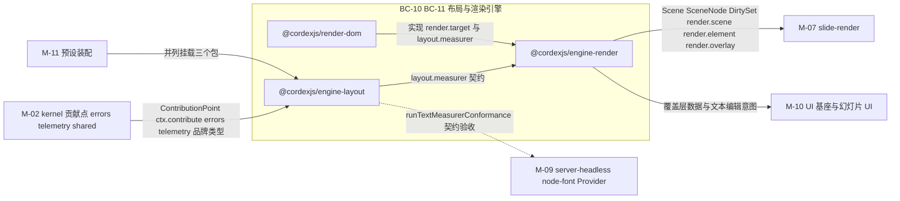
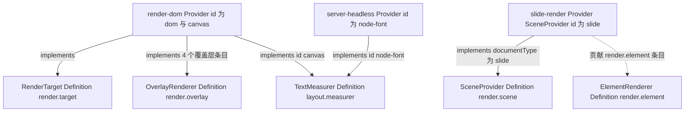
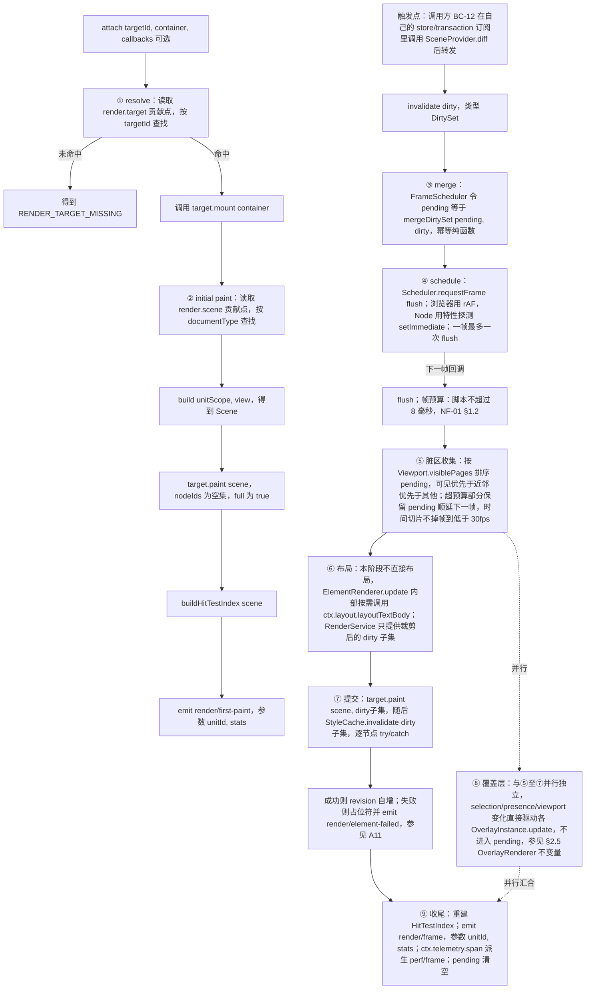
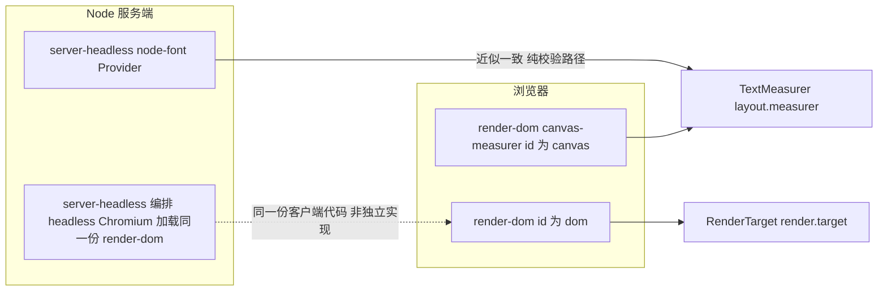

> 状态：草稿 v0.1 | 负责：架构-模块（阶段二） | 更新：2026-09-18；2026-09-24（rulings §4.15）；2026-09-24（复核修正，rulings §4.17 L11：服务端缩略图格式描述更正为 WebP） | 依赖：00-module-map.md M-06 行、charter §5.2 engine-layout/engine-render/render-dom 三行、30-architecture 07-rendering.md §0–§14、02-layering-and-packages.md §4.13–§4.15、ADR-0021/0026/0027/0028、00-charter/rulings-2026-09-14.md §4.15（Q4/Q7）、40-modules/14-cross-module-review.md §5.3

# 06 布局与渲染引擎（限界上下文 BC-10 布局与度量引擎、BC-11 渲染管线与目标）

## 0. 一页总览

| 项 | 值 |
|---|---|
| 职责一句话 | 文档类型盲的文本度量/断行/预设几何求值引擎（`engine-layout`）与场景图渲染管线：帧调度、脏区消费、样式/媒体缓存、命中测试契约、DOM/SVG 渲染目标与文本编辑宿主（`engine-render` + `render-dom`） |
| 覆盖的上下文 | BC-10 布局与度量引擎、BC-11 渲染管线与目标（BC-12 幻灯片渲染是唯一下游消费者与语言适配层，不在本模块交付范围，只在 §1.3/§8 说明接缝） |
| 承载包 / 目录 | `@cordexjs/engine-layout`（L5，iso，秩 50）、`@cordexjs/engine-render`（L5，iso，秩 50）、`@cordexjs/render-dom`（L5，dom，秩 50） |
| cordis 形态 | `engine-layout`：definition + plugin（`provide=['layout']`）；`engine-render`：definition（`provide=['render']`，UnitScope 内）；`render-dom`：provider（`implements:['render.target:dom','layout.measurer:canvas']`） |
| 运行位置 | `engine-layout`/`engine-render` 两端（iso 契约层；服务端经 `server-headless` 使用其 iso 部分）；`render-dom` 仅浏览器（headless Chromium 场景下作为「真实浏览器进程」间接运行，不是服务端独立实现） |
| 上游（依赖） | M-02（`@cordexjs/kernel` 贡献点机制/`errors`/`telemetry`、`@cordexjs/shared` 品牌类型） |
| 下游（被依赖） | M-07 幻灯片渲染（`SceneProvider`/`ElementRenderer` 实现方；`PageRenderer` 是架构 07 §14.1 术语对齐前的旧名，本模块以 `SceneProvider` 为准）、M-09 服务端 headless 宿主（Node 字体度量 `TextMeasurer` Provider，契约在本模块定义）、M-10 UI 基座与幻灯片 UI（覆盖层数据与文本编辑意图的消费方）、M-11 预设装配（组装 preset 时并列挂载三个包） |
| 对外服务 | `ctx.layout`（根作用域，两端）、`ctx.render`（UnitScope，两端契约 + 浏览器完整运行） |
| 贡献点 | 提供（定义处）：`render.scene`、`render.target`、`render.element`、`render.overlay`（`engine-render`）、`layout.measurer`（`engine-layout`）；消费：上述五个（`engine-render`/`engine-layout` 自身定义、自身查表消费；`render-dom` 向 `render.target`、`layout.measurer`、`render.overlay` 贡献条目） |
| doc / sheet 通用性 | generic（三包契约只认 `kind: string` + 几何盒 + 中性 `TextBodyModel`，对 slide/doc/sheet 一无所知；12 §2 已核对，§8 给出零改动证明方式） |
| 批次 | 2 |

### 0.1 图示

**图 0-1 模块包关系与上下游**



怎么读：三包只有一个上游 M-02（内核基础设施），下游三个方向分别对应「幻灯片渲染消费 Scene 契约」「server-headless 只验收 TextMeasurer 契约」「UI 基座消费覆盖层与编辑意图」；`render-dom` 是唯一的浏览器专属 Provider 包。

## 1. 限界上下文与边界

### 1.1 职责与非职责

**做什么**：

- `engine-layout`：`TextMeasurer` Definition（`layout.measurer`）；断行（UAX#14 机会点 + CJK 禁则 + `wrap="none"` + 强制换行）；段落/正文布局（缩进/悬挂/项目符号/对齐/行距 `spcPct|spcPts`/段前后/多栏/`anchor`/`autofit` 迭代 ≤ 6 次）；`CaretMap`（偏移↔像素双向映射）；187 种 `prstGeom` 公式表求值 + `custGeom` + 连接点坐标/法向；字体回退表（客户端/服务端共用同一 JSON）；`Emu`/`Pt`/`Px` 单位换算。
- `engine-render`：`Scene`/`SceneNode` 契约与四个贡献点（`render.scene`/`render.target`/`render.element`/`render.overlay`）的类型化注册与查表；帧调度（`DirtySet` 合并、时间切片、可见性优先级、8 ms 脚本预算）；两处缓存（`StyleCache`、`MediaCache`）与其淘汰测试；`Viewport` 与虚拟化（可见页窗口、fit 计算）；命中测试契约（`HitTestIndex` + `bail` 链）；逐元素错误隔离（try/catch → 占位符 + `render/element-failed`，不影响同页其他元素）。
- `render-dom`：`RenderTarget`（`id:'dom'`）Provider——HTML/SVG 输出、图元 API（path/rect/image/text/group/clipPath/gradient/pattern）、覆盖层（选中框+手柄、远端光标、参考线、评论钉）；`TextMeasurer`（`id:'canvas'`）Provider；文本编辑宿主（隐藏 `textarea` + IME 组合 + 自绘光标/选区 + a11y 镜像，ADR-0028）；字体加载（`FontFaceLoader`）；媒体 `blob:` URL 生命周期；SVG→PNG/JPEG 导出（`toImage`，**主线程**栅格化：游离 DOM → SVG 序列化 → `Image` → `Canvas`，供位图缩略图与图片导出；可见缩略图不走本路径，由 M-07 的 `dom-scaled` 直接挂载缩小 SVG）。

**渲染介质口径（rulings §4.15 Q4，ADR-0021 已接受）**：**DOM/SVG 单实现**——编辑、查看、放映、服务端缩略图与 PDF 共用同一套 SVG 渲染（服务端经 headless Chromium 加载同一份 `render-dom`，§7）。canvas 只承担三个角色：①`toImage` 的栅格化画板（主线程，不做 Worker 版本）；②`measureText` 度量器（`layout.measurer('canvas')`）；③`RenderTarget` 的预留座位 `id:'canvas'`（无生产 Provider，M3 末用最小 canvas Provider 验证 `render.target` 契约，见 §2.5/§11）。**不存在**「缩略图/放映走 canvas」的路径；DX-1000 性能不达标时先做合成层优化，仍不达标才考虑仅查看/放映启用 canvas（届时另立 ADR，不在本模块当前范围）。`toImage` 取不到页面 Web 字体（SVG-as-image 隔离，CJK 尤甚）列为 **M2 位图 spike**，结论出来前位图封面与批量 PNG 自 M3 起走 `server-png`（M-07/M-12 编排，Q8 联动）。

**不做什么（明确边界，指向负责模块）**：

1. 不知道「幻灯片/母版/版式/页」等文档结构概念，不做母版→版式→页三层合成——属 BC-12（M-07 `slide-render`）；本模块只消费/产出 `Scene`。
2. 不定义任何 `kind` 特定的绘制逻辑（`sp`/`pic`/`table`/`graphicFrame:chart` 怎么画）——由 BC-12 及其图表子插件以 `render.element` 贡献方提供；本模块的 `render.element` 查表找不到条目时只画通用 `unknown` 占位符。
3. 不做样式继承链解析（Element→Placeholder→Layout→Master→Theme）——那是 `model-slide`（M-03，架构 04）的纯函数；`engine-render` 的 `StyleCache` 只缓存「已解析完成」的样式结果，不参与解析。
4. 不实现 Node 端字体解析度量——那是 `server-headless`（M-09）的 `TextMeasurer`（`id:'node-font'`）Provider；本模块只在 `engine-layout` 定义 Definition 契约与 `runTextMeasurerConformance`，供 M-09 验收（§7 说明契约，不涉及 M-09 目录）。
5. 不解释「文本编辑意图对应哪个 Mutation、该调用哪个 Command」——`render-dom` 的 `TextInputHost` 只产出中性编辑意图对象（`TextEditIntent`），把它变成 `text.*`/`slide.*` 之类 Mutation 并调用 `commands.execute` 是上层（M-07/M-10）的职责，本模块保持对文档类型无知（R15）；消费方与回调形状已按 14 §5.3/§6.2 结案（§13 Q-2）：`RenderService.attach(targetId, container, callbacks?)` 的可选 `callbacks.onEditIntent`（IoC），消费方为 `slide-ui`（M-10）。
6. 不做图表/表格的数据建模与交互式编辑——属 BC-12 下游（`slide-render-chart` 等）；本模块的 `graphicFrame:chart` 渲染只有通用 `unknown`/占位兜底路径。
7. 不产生协同在场信息（awareness/presence 广播）——那是 BC-09（M-05）；`render-dom` 的 `remote-presence-overlay.ts` 只消费调用方已解析好的中性 presence 快照（`{id,color,name,position}[]`），不 import 任何 collab 包。
8. 不做文档打开管线的 Worker 分片调度与解析——那是架构 07 §14.2 描述的打开流程，主体在 `model-slide`/`ooxml-pptx`（M-03/M-04）；本模块只在解析结果就绪、`store.load()` 完成后接手渲染。

### 1.2 通用语言

本上下文复用 charter §4.1 已收录的核心术语，不重复定义：`Scene`/`SceneNode`、`SceneProvider`、`RenderTarget`、`ElementRenderer`、`TextMeasurer`、`Preset`、`Presence`/`Awareness`、同构类、层带、`fixture`。

本上下文特有术语表（charter §4 未收录，仅在 BC-10/11 内部使用）：

| 术语 | 定义 | 对应类型名 |
|---|---|---|
| 脏集 | 一次 `SceneProvider.diff()` 产出的、需要重绘的节点集合；可选携带属性级精度 | `DirtySet{ nodeIds, full, changed? }` |
| 视口 | UnitScope 内的缩放/平移/模式/可见页状态；驱动虚拟化挂载/卸载 | `Viewport{ zoom, pan, mode, page }` |
| 命中测试索引 | 由 `Scene` 派生的、按 `zIndex` 降序 + 预计算逆变换的查询结构，供命中测试纯函数使用 | `HitTestIndex` |
| 布局结果 | `layoutTextBody()` 的输出：行盒数组、内容高度、是否溢出、autofit 缩放/行距缩减、`CaretMap` | `TextLayout`（历史草案曾用名 `LayoutResult`，本文档统一为 `TextLayout`，见 §12） |
| 行盒 | 一行文本的排版结果：基线位置、上升/下降高度、run 片段（含 x 推进） | `LineBox` |
| 光标映射 | (段落偏移) ↔ (行号, x 像素) 的双向映射，供光标/选区/命中复用 | `CaretMap` |
| 几何路径 | 预设/自定义几何求值后的命令序列 + 文本内接矩形 + 连接点 + adj 手柄描述 | `GeometryPath` |
| 覆盖层渲染器 | 不属于文档内容、独立图层重绘的贡献（选中框/手柄/远端光标/参考线/评论钉） | `OverlayRenderer` / `OverlayInstance` |
| 帧调度器 | 合并同一帧内多次 `invalidate()`、按可见性优先级时间切片的调度模块 | `FrameScheduler` |
| 样式缓存 / 媒体缓存 | `(pageId,nodeId)→已解析样式` 与 `sha256→已解码媒体句柄` 的两个 LRU，反向依赖索引驱动失效 | `StyleCache` / `MediaCache` |
| 文本编辑宿主 | 单一隐藏输入元素 + 自绘光标/选区的可插拔策略（ADR-0028） | `TextInputHost`（本包内部 Definition，非跨包贡献点，见 §2.5） |
| 编辑意图 | `TextInputHost` 把浏览器输入事件归约成的中性对象，不含任何 Mutation 知识 | `TextEditIntent` |

### 1.3 上下文映射

| 相邻上下文 | 关系类型 | 防腐层落点 | 传递的契约 |
|---|---|---|---|
| BC-01 内核与插件运行时 | Open Host Service（本模块是 Customer） | 无需 ACL，直接消费 | `ContributionPoint`/`ctx.contribute`/`ctx.contributions`、`errors`/`telemetry` 服务 |
| BC-02 共享基础设施 | Shared Kernel | 无 | `Emu`/`Pt`/`Px`/`NodeId`/`UnitId` 品牌类型、`Result` |
| BC-05 文档内核（`model-core`） | 无直接包依赖（**不是** Customer–Supplier）：`engine-render`/`engine-layout`/`render-dom` 与 `model-core` 的服务由 L8 预设包并列挂载在同一 UnitScope 内，互不 import；两者仅通过 §4.2 第 4 条描述的间接路径耦合 | 无（本模块内无落点；ACL 在 BC-12） | 无直接契约；`UnitId` 经 `@cordexjs/shared` 间接共用 |
| BC-06 幻灯片领域模型 / BC-12 幻灯片渲染 | Customer–Supplier（BC-12 是 Customer，本模块是 Supplier）+ Published Language（`Scene`/`SceneNode`/`DirtySet`） | `slide-render/src/scene/slide-scene-provider.ts`（BC-12 内，本模块外）——唯一知道「幻灯片」与「Scene」两边语言的适配层 | `SceneProvider`/`ElementRenderer`/`OverlayRenderer` 的实现义务；`ChangeSet.touched → DirtySet` 的映射义务在 BC-12 一侧 |
| BC-09 协同（客户端） | 无直接包依赖：`render-dom` 的覆盖层只接受调用方传入的中性 presence 快照，不 import `collab-core`/`collab-yjs` | `render-dom` 的 `OverlayContext.presence` 入参（数据已由 BC-09/UnitScope 的 `presence` 服务或 BC-12 转换为中性形状） | 中性 `{id,color,name,position}[]`（非 `Awareness` 类型） |
| BC-14 UI 基座 / BC-15 幻灯片 UI | Conformist（本模块对二者无感知，二者是 `TextEditIntent`/覆盖层交互回调的潜在消费方） | 调用方在 `attach()`/`mount()` 时传入的回调（IoC，避免反向依赖） | `TextEditIntent`；命中测试结果 `HitResult` |
| BC-27 服务端 Headless 渲染与批处理宿主（M-09） | Conformist（对本模块的 `TextMeasurer`/`RenderTarget` 契约照单全收，不议价） | `server-headless` 内的 `node-font` Provider（不在本模块目录） | `runTextMeasurerConformance` 契约套件验收 |

## 2. 领域模型

> 本节跨 `engine-layout`/`engine-render`/`render-dom` 三包统一建模（模块粒度，非包粒度）；每行标注所在包与文件。这里的「聚合」是运行时派生结构而非持久化实体——权威事实源始终是 `model-core` 的 `DocumentStore`（BC-05），本模块的全部结构在文档重新打开或 `SceneProvider.build()` 重新调用时可从零重建，不参与 CRDT 合并（协同层面的并发只发生在 BC-05/09；本节结构是单进程、每次 `build`/`layoutTextBody` 调用后即重新生成的派生视图）。

### 2.1 场景图与视口聚合

| 名称 | 归类 | 关键字段 | 不变量 | 所在文件（包） |
|---|---|---|---|---|
| `Scene` | 聚合根（每次 `SceneProvider.build()` 调用的返回值，UnitScope + ViewDescriptor 定位） | `id`、`size:{w,h:Emu}`、`nodes: SceneNode[]`、`background?: SceneNode` | 不可变值：`build()` 每次返回全新引用；`nodes[].id` 在同一 `Scene` 内唯一（by construction，运行时用 `Set` 断言） | `engine-render/src/domain/contracts/scene.ts` |
| `SceneNode` | 实体（属于某个 `Scene`，可嵌套 `children`） | `id: NodeId`、`kind: string`、`bbox: Rect<Emu>`、`transform?: Transform`、`zIndex: number`、`children?: SceneNode[]`、`data: unknown`、`revision: number` | `kind` 引擎不解释（只做查表 key 的一部分）；`revision` 单调递增，`diff()` 用它判断节点是否需要重新 `update()` | `engine-render/src/domain/contracts/scene.ts` |
| `Viewport` | 聚合根（UnitScope 内，一次 `attach()` 一个实例，非持久化） | `zoom: ZoomFactor`、`pan: Point`、`mode: 'single'\|'continuous'\|'grid'\|'show'`、`page?: NodeId` | `zoom` 恒 clamp 在 `config.zoom.min..max`；`mode:'show'` 时 `pan`/`zoom` 由 fit-to-screen 计算覆盖用户手动值 | `engine-render/src/domain/contracts/viewport.ts`（类型 + 纯函数）、`application/services/viewport-state.ts`（有状态实例） |
| `DirtySet` | 聚合根（`SceneProvider.diff()` 的返回值，一帧内可被多次 `invalidate()` 合并） | `nodeIds: ReadonlySet<NodeId>`、`full: boolean`、`changed?: ReadonlyMap<NodeId, PathKey[]>` | `full:true` 时语义为「该 `Scene` 全部节点」，消费方必须整页重绘；`merge(a,b)` 是幂等、可结合的纯函数（并集 `nodeIds`、`full` 取或、`changed` 逐键并集） | `engine-render/src/domain/contracts/dirty-set.ts` |
| `HitTestIndex` | 派生索引（由某一版本的 `Scene` 派生，只读） | 按 `zIndex` 降序排列的节点引用 + 预计算的世界坐标逆变换 | 生命周期绑定其所属 `Scene` 版本；`Scene` 更新后旧索引失效，禁止对失效索引查询（`hitTest()` 内部断言） | `engine-render/src/domain/contracts/hit-test.ts`（类型）；由 `render.service.ts` 在每次 `paint()` 后重建 |
| `TextLayout`（历史称 `LayoutResult`，§12 统一命名） | 聚合根（`layoutTextBody()` 的返回值，绑定某个 `TextBodyModel` + 几何盒 + 样式的一次求值） | `lines: LineBox[]`、`contentHeight: Px`、`overflow: boolean`、`fontScale: number`、`lnSpcReduction: number`、`caretMap: CaretMap` | 给定相同 `(body, box, style, measurer 版本)` 输入必须确定性复现（客户端/服务端一致性前提，ADR-0027）；`autofit` 收敛后 `fontScale ∈ (0, 1]` | `engine-layout/src/domain/contracts/text-layout.ts` |

### 2.2 值对象

| 名称 | 字段 | 校验 schema（Standard Schema） | 所在文件 |
|---|---|---|---|
| `Rect<U>` | `{ x, y, w, h }`（单位品牌 `U` 通常为 `Emu`，命中测试路径下换算为 `Px`） | zod：四个有限数，`w ≥ 0`、`h ≥ 0` | `engine-layout/src/domain/contracts/geometry.ts`（`engine-render` 复用，依赖方向 `engine-render → engine-layout` 合规） |
| `Transform` | `{ tx, ty, scaleX, scaleY, rotation: Angle60k, flipH, flipV }` | zod：`scaleX/scaleY ≠ 0` | `engine-render/src/domain/contracts/scene.ts` |
| `GeometryPath` | `{ commands: GeometryCommand[]; fill; stroke; extrusionOk; textRect: Rect<Emu>; connections: ConnectionPoint[]; adjHandles: AdjHandle[] }` | zod：`commands` 非空 | `engine-layout/src/domain/contracts/geometry.ts` |
| `ResolvedFont` / `FontKey` | `{ family, size: Pt, bold, italic }` / 规范化字符串键 | zod：`size > 0` | `engine-layout/src/domain/contracts/text-measurer.ts` |
| `MeasureResult` | `{ width: Px, ascent: Px, descent: Px }` | zod：三者均 `≥ 0` | `engine-layout/src/domain/contracts/text-measurer.ts` |
| `LineBox` | `{ y: Px, ascent, descent, runs: RunBox[] }`；`RunBox{ x: Px, text, attrs }` | zod | `engine-layout/src/domain/contracts/text-layout.ts` |
| `CaretMap` | `(paragraphIndex, offset) ↔ (lineIndex, x: Px)` 双向查表结构 | 无（运行时结构，非线上数据） | `engine-layout/src/domain/contracts/text-layout.ts` |
| `ZoomFactor` | `Brand<number, 'ZoomFactor'>`，恒正 | zod：`0 < value`，业务上再由 `config.zoom.{min,max}` clamp | `engine-render/src/domain/contracts/viewport.ts` |
| `HitResult` | `{ nodeId: NodeId, region: 'body'\|'handle'\|'text', local: Point }` | zod | `engine-render/src/domain/contracts/hit-test.ts` |

### 2.3 纯函数

| 函数 | 签名草案 | 所在文件 | 两端共用 |
|---|---|---|---|
| `lineBreakOpportunities` | `(text: string, locale: string) → BreakPoint[]` | `engine-layout/src/domain/text/line-breaker.ts` | 是（`Intl.Segmenter` 可用时用之，否则内置表；Node/浏览器均可用） |
| `layoutParagraph` | `(paragraph: ParagraphInput, width: Px, measurer: TextMeasurer) → Line[]` | `engine-layout/src/domain/text/paragraph-layout.ts` | 是 |
| `layoutTextBody` | `(body: TextBodyModel, box: Rect<Emu>, style: ResolvedTextStyle, measurer: TextMeasurer, opts: { autofit: AutofitSpec }) → TextLayout` | `engine-layout/src/domain/text/body-layout.ts` | 是（多栏/`anchor`/insets/autofit 迭代 ≤ 6 次，纯函数，`measurer` 以参数传入而非闭包捕获） |
| `buildCaretMap` | `(lines: LineBox[]) → CaretMap` | `engine-layout/src/domain/text/caret-map.ts` | 是 |
| `presetGeometryPath` | `(name: PresetGeometryName, adj: Record<string, number>, box: Rect<Emu>) → GeometryPath` | `engine-layout/src/domain/geometry/preset-table.ts` + `formula-eval.ts` | 是（187 种 `prstGeom` 编译期表，`tooling/scripts/compile-preset-geometry` 生成） |
| `customGeometryPath` | `(spec: CustomGeometrySpec, box: Rect<Emu>) → GeometryPath` | `engine-layout/src/domain/geometry/custom-geometry.ts` | 是 |
| `pathToSvgString` / `pathToPolygon` | `(path: GeometryPath) → string` / `(path: GeometryPath) → Point[]` | `engine-layout/src/domain/geometry/path-builder.ts` | 是（服务端不启动 Chromium 的校验路径用 `pathToPolygon` 做命中/几何断言） |
| `composeTransform` / `invertTransform` | `(base: Transform, delta: Partial<Transform>) → Transform` / `(t: Transform) → Transform` | `engine-render/src/domain/geometry/transform.ts` | 是 |
| `rotatedBBox` | `(bbox: Rect<Emu>, transform: Transform) → Rect<Emu>` | `engine-render/src/domain/geometry/bbox.ts` | 是 |
| `pointInRotatedRect` / `pointInPolygon` | `(point: Point, bbox: Rect, transform: Transform) → boolean` / `(point: Point, polygon: Point[]) → boolean` | `engine-render/src/domain/geometry/hit-geometry.ts` | 是 |
| `mergeDirtySet` | `(a: DirtySet, b: DirtySet) → DirtySet` | `engine-render/src/domain/contracts/dirty-set.ts` | 是（幂等、可结合，A28 反制测试的断言基础） |
| `visiblePages` | `(viewport: Viewport, pages: readonly NodeId[], overscan: number) → NodeId[]` | `engine-render/src/domain/contracts/viewport.ts` | 是 |
| `buildHitTestIndex` / `queryHitTestIndex` | `(scene: Scene) → HitTestIndex` / `(index: HitTestIndex, point: Point) → HitResult \| null` | `engine-render/src/domain/contracts/hit-test.ts` | 是 |
| `mapViewMode` | `(viewMode: string) → ViewDescriptor['mode']`（已知输入 `'normal'\|'master'\|'presenter'` 时返回对应 `'edit'\|'master'\|'present'`；未知输入原样透传，供未来 doc/sheet 复用同一函数而不强制它们采用 slide 的三态词汇） | `engine-render/src/domain/view-mode-map.ts` | 是 |

**视图模式三层词汇映射表为正式契约（新增，14-cross-module-review.md §1 C-13）**：`DocumentType.viewModes`（M-02/M-03，文档类型的合法编辑视图取值，slide 为 `normal\|master\|presenter`）、`ViewDescriptor.mode`（本模块，渲染描述，见 §2.5，`edit\|master\|thumbnail\|present`）、`Viewport.mode`（本模块，视口排布，见 §2.1/§2.2，`single\|continuous\|grid\|show`）三层各有语义、不强行统一为一套词汇（统一会丢失区分：文档类型合法模式 / 渲染描述 / 视口排布）；`mapViewMode()` 是前两层之间**唯一**权威映射，固定为 `normal→edit`、`master→master`、`presenter→present`（`thumbnail` 无 `viewModes` 对应项，是渲染层内部概念，如缩略图 Provider 的批量渲染，不经用户可见的视图切换产生）。本函数上移到 `engine-render`（`ViewDescriptor` 的定义包）而非 `ui-core` 的理由：`doc-render`/`sheet-render`（M-13）同样需要该映射，放 `ui-core` 会让 headless 路径（无 `ui-core`）无法转换；`ui-core`（M-10）的 `domain/view-mode.ts` 改为对本函数的 re-export，不重新实现。

### 2.4 领域事件

全部在 `layout.contribution.ts`（`engine-layout`）/`render.contribution.ts`（`engine-render`）的 `Events` 增强中声明（扫描器 `events-declared`）；域名固定为章程 §5.5 保留域 `layout`/`render`/`perf` 之一。与 M-02 §2.4 的模式一致：事件在 Definition 包声明，但**发布者文件可以是 Provider 包**（此处即 `render-dom`）。

| 事件 | 模式 | 载荷（要点） | 发布者文件 | 典型订阅者 |
|---|---|---|---|---|
| `layout/measurer-changed` | emit | `(measurerId: string)` | `engine-layout/src/application/services/layout.service.ts` | `render-dom` 度量缓存失效；`slide-render` 的已缓存 `TextLayout` 标脏重排 |
| `render/first-paint` | emit | `(unitId, stats: { ms })` | `engine-render/src/application/services/render.service.ts` | 首屏计时遥测（NF-01 D50/D200 门禁） |
| `render/frame` | emit | `(unitId, stats: { pages, elements, ms })`（进程内消费，公开订阅按 ≥ 50 ms 合并；`render/painted` 已弃用，见 §12） | `engine-render/src/application/services/frame-scheduler.ts` | 渲染统计面板；`slide-render` 缩略图去抖；`perf/frame` 遥测事件由其派生（**`render/frame`/`perf/frame` 两层区分已获总编排正式追认**，14-cross-module-review.md §1 C-25：进程内业务事件与遥测事件并存非改名，`00-charter/rulings-2026-09-14.md` §4.11 已补注确认，不再是本文档单方立场） |
| `render/element-failed` | emit | `(unitId, nodeId, kind, code)` | `render-dom/src/infrastructure/paint/painter.ts` | `errors.report`、审计、UI 错误提示（A11 反制测试的断言点） |
| `render/element-degraded` | emit | `(unitId, nodeId, kind, reason)` | `render-dom/src/infrastructure/paint/painter.ts`（本模块内仅媒体解码失败等通用原因；`chart-unavailable` 等文档类型相关原因由 M-07 发出） | UI 提示、遥测 |
| `render/font-fallback` | emit | `(unitId, requested, fallback, scope)` | `render-dom/src/infrastructure/fonts/font-face-loader.ts` | 诊断面板、字体许可审计 |
| `render/page-mounted` / `render/page-unmounted` | emit | `(unitId, pageId)` | `render-dom/src/infrastructure/target/dom-render-target.ts` | 缩略图挂载策略、资源清理 |
| `perf/frame`（遥测事件，非 `Events` 声明式；经 `telemetry.defineTelemetryEvents` 注册） | span/event | 由 `render/frame` 抽样派生 | `engine-render/src/application/services/render.service.ts`（`ctx.telemetry.span('render.frame', …)`） | 遥测后端（10 号文档） |

`TextEditIntent` 不是 cordis `Events`：它经调用方在 `attach()` 时传入的回调 `callbacks.onEditIntent`（IoC）交付，消费方 `slide-ui`，理由见 §1.1 第 5 条与 §13 Q-2（已结案），避免 `render-dom` 反向依赖 UI 层。

### 2.5 仓储 / 存储契约（本模块语境下 = Definition 契约）

**`RenderTarget`（Definition；贡献点 `render.target`；`engine-render/src/domain/contracts/render-target.ts`；默认 Provider：`render-dom`，`id:'dom'`）**

```ts
interface RenderTarget {
  readonly id: string                                    // 'dom' | 'canvas'（预留座位，无生产 Provider）| 第三方
  mount(container: unknown, opts?: MountOptions): TargetHandle
  paint(scene: Scene, dirty: DirtySet): void
  hitTest(point: Point): HitResult | null
  toImage?(scene: Scene, opts: ToImageOptions): Promise<Blob | Uint8Array>
  dispose(): void
}
interface TargetHandle { readonly pageId: NodeId; setTransform(zoom: number, pan: Point): void; setSize(size: Size): void; dispose(): void }
```

契约套件 `runRenderTargetConformance(factory: () => RenderTarget)`（`engine-render/src/testing/index.ts`），覆盖：重复 `paint` 同一 `dirty` 不重复触发 `ElementRenderer.render`（只触发 `update`）；`dirty.full` 时全部可见节点被访问；空场景 `hitTest` 返回 `null`；`dispose()` 后无残留 effect（配合 `@cordexjs/kernel/testing` 的 `assertNoLiveEffects`）。`render-dom` 的 `__tests__` **必须**实例化本套件（扫描器 `provider-runs-conformance`）。

`render.target` 契约的介质中立性验证（rulings §4.15 Q4）：`'canvas'` 只是预留座位，本模块不交付生产 canvas Provider；**M3 末**在 `engine-render/src/__tests__/canvas-target-contract.test.ts` 用一个最小 canvas Provider（仅画矩形/路径/文本三类图元，不追求保真）跑同一套 `runRenderTargetConformance`，证明契约不隐含 DOM 假设——这是 PRD 04-plugin-sdk「`render.target`：dom；canvas 预留，Stable 前须通过最小 canvas Provider 契约」的验收点。`toImage?` 在 `render-dom` 中的实现固定为**主线程**（游离 DOM → SVG 序列化 → `Image` → `Canvas`），不提供 Worker/OffscreenCanvas 版本（SVG 在 Worker 内无法解码；不挂 DOM 的 canvas 栅格化等于第二套渲染器，违背 ADR-0026），大批量导出由调用方主线程分片或转 `server-png`。

**`SceneProvider`（Definition；贡献点 `render.scene`，key = `documentType`；`engine-render/src/domain/contracts/scene-provider.ts`；本模块无默认实现，由 M-07 `slide-render` 实现 `SceneProvider('slide')`）**

```ts
interface SceneProvider {
  readonly documentType: string
  build(unitScope: UnitScopeHandle, view: ViewDescriptor): Scene
  diff(changeSet: ChangeSetLike, prev: Scene): DirtySet
}
interface ViewDescriptor { mode: 'edit' | 'master' | 'thumbnail' | 'present'; page?: NodeId; target?: NodeId; [k: string]: unknown }
```

不设 `runSceneProviderConformance`：`build`/`diff` 的正确性取决于各文档类型自身的模型语义，本模块只保证「查表机制」正确（`renderer-table.test.ts`）；`fixture` 文档类型提供最小 `SceneProvider` 实现用于文档类型盲验证（§8），实现层正确性由各文档类型自己的测试负责（如未来 `slide-render` 的 `compose-reconcile.test.ts`）。

**`ElementRenderer<TData>`（Definition；贡献点 `render.element`，key = `` `${targetId}:${kind}` ``；`engine-render/src/domain/contracts/element-renderer.ts`；本模块无默认实现）**

```ts
interface ElementRenderer<TData = unknown> {
  readonly targetId: string
  readonly kind: string
  render(node: SceneNode & { data: TData }, ctx: RenderContext): ElementHandle
  update(handle: ElementHandle, node: SceneNode & { data: TData }): void
  dispose(handle: ElementHandle): void
}
interface RenderContext { layout: LayoutService; resolveMedia(ref: BlobRefLike): MediaHandle; onError(err: unknown): void }
```

同样不设通用 conformance 套件（理由同 `SceneProvider`）；`testing/index.ts` 只提供 `SpyRenderer(kind)`/`RecordingTarget` 供任意实现方自测调用次数/参数，具体断言由实现方（`slide-render`）自行组装（§12 追加建议：若未来出现第二个 `ElementRenderer` 大类可回头补 `runElementRendererConformance`）。

**`OverlayRenderer`（Definition；贡献点 `render.overlay`，key = `id`；`engine-render/src/domain/contracts/overlay.ts`；默认 Provider：`render-dom`，贡献 4 个条目：`selection`、`remote-presence`、`guides`、`comment-pins`）**

```ts
interface OverlayRenderer {
  readonly id: string
  readonly zIndex: number
  mount(ctx: OverlayContext, target: TargetHandle): OverlayInstance
}
interface OverlayContext { selection: SelectionSnapshot; presence: PresenceSnapshot[]; viewport: Readonly<Viewport> }
interface OverlayInstance { update(ctx: OverlayContext): void; dispose(): void }
```

覆盖层不参与内容脏区：改变 `selection`/`presence` 不触发任何 `ElementInstance.update()`（`overlay-independent.test.ts` 断言，见架构 07 §7）。

**`TextMeasurer`（Definition；贡献点 `layout.measurer`，key = `id`；`engine-layout/src/domain/contracts/text-measurer.ts`；默认 Provider：`render-dom`，`id:'canvas'`；M-09 追加 `id:'node-font'`，契约在此定义、实现不在本模块）**

```ts
interface TextMeasurer {
  readonly id: string
  measure(text: string, font: ResolvedFont): MeasureResult
  supports(font: ResolvedFont): boolean
}
```

契约套件 `runTextMeasurerConformance(factory: () => TextMeasurer)`（`engine-layout/src/testing/index.ts`），覆盖：空字符串 `width:0`；单调性（更长文本 `width` 不减）；`ascent+descent > 0`；`supports` 对未知字体族返回 `false` 而非抛错。`render-dom` 与 M-09 的 `node-font` Provider 都**必须**实例化本套件。

**`TextInputHost`（本包内部可插拔点，非跨包贡献点；`render-dom/src/infrastructure/text-host/text-input-host.ts`；默认 Provider `'hidden-textarea'`，备选 `'contenteditable-mirror'`，ADR-0028 v0.2 补充，spike 后定稿，R-M2-1）**

```ts
interface TextInputHostProvider {
  readonly id: 'hidden-textarea' | 'contenteditable-mirror'
  attach(host: HTMLElement, opts: TextInputHostOptions): TextInputHostHandle
}
interface TextInputHostHandle {
  focus(caret: CaretMap, position: StablePosition): void
  onIntent(cb: (intent: TextEditIntent) => void): () => void
  dispose(): void
}
```

不经 `ctx.contribute` 的理由：两个候选 Provider 都是 DOM 相关实现细节（与渲染介质无关——IME 归因是「隐藏 textarea」而非 SVG/canvas 之选），选择权只在 `render-dom` 自己的 `config.textHost.provider`。**已结案（14 §5.3 M-06/G-5 + Q-3，ADR-0028 回写为包内可插拔点）**：维持包内可插拔点；**升级为 `render.textInputHost` 贡献点的条件**（须同时满足前两条之一与第三条）：① R-M2-1 spike 判定 `'hidden-textarea'` 方案不可行（IME/无障碍/移动端任一硬伤无法在包内修复）；或 ② 出现需跨包可发现的第三方/框架特定文本宿主实现；③ 升级时同步回写章程 §5.5 贡献点清单与 ADR-0028，并为其补 `runTextInputHostConformance`。M0–M2 不登记该贡献点 id。

**图 2-1 Definition 与 Provider 关系**



怎么读：五个 Definition 都定义在本模块（`engine-layout`/`engine-render`），但默认实现方不全在本模块内——`SceneProvider`/`ElementRenderer` 的真正落地在 M-07 `slide-render`，`TextMeasurer` 的 `node-font` 变体在 M-09 `server-headless`。

### 2.6 应用服务（渲染管线阶段）

`RenderService`（`engine-render/src/application/services/render.service.ts`，UnitScope 内 `'render'`）编排下列阶段；这是**纯函数调用序列**而非 `waterfall` 拦截链——渲染热路径禁止第三方插入中间件（A30，由 lint 在 `engine-render`/`render-dom`/`slide-render` 中禁止调用 `ctx.waterfall`/`ctx.bail` 之外的拦截式 API 承接，09-02）：

**RenderService 调用流程：attach → invalidate → flush（步骤编号沿用正文 ①–⑨）**



怎么读：三条纵向链分别由 `attach`/`invalidate`/`flush` 触发，编号沿用原文 ①–⑨；虚线表示 ⑧ 覆盖层与 ⑤–⑦ 内容渲染并行独立执行，二者在 ⑨ 收尾汇合。

**图 2-2 渲染管线**

```mermaid
flowchart LR
  changeSetTouched["ChangeSet.touched BC-12 diff"]
  dirtySet["DirtySet mergeDirtySet 合并"]
  layoutMeasure["布局与度量：由 ElementRenderer.update 按需调用 ctx.layout，经 layout.measurer 贡献点度量；非独立编排阶段"]
  elementPoint["render.element 贡献点 逐节点绘制"]
  scene["Scene render.scene 贡献点 build"]
  renderTargetCommit["RenderTarget 提交 render.target 贡献点 paint"]
  overlay["覆盖层 render.overlay 贡献点独立刷新"]
  changeSetTouched -- "diff 产出" --> dirtySet
  dirtySet -- "flush 触发" --> layoutMeasure
  layoutMeasure -- "ElementRenderer.update 消费" --> elementPoint
  elementPoint -- "写入节点" --> scene
  scene -- "target.paint" --> renderTargetCommit
  renderTargetCommit -- "与内容脏区并行" --> overlay
```



怎么读：`BC-12`（`slide-render`）把 `ChangeSet.touched` 转换成 `DirtySet` 推给本模块；`flush()` 内部按可见性排序后才做布局度量与逐元素绘制；覆盖层始终独立于内容脏区刷新，不会因选区/在场变化而触发整页重绘。

## 3. cordis 插件定义

> 三个包按 cordis 形态分两类：`engine-layout`/`engine-render` 是标准函数插件（`engine-layout` 的形态标注 definition + plugin，因为它的核心价值是 `TextMeasurer` 契约而非某个可替换实现；`engine-render` 标注 definition，因为其四个贡献点才是价值所在）；`render-dom` 是 provider（`implements` 两个 Definition 的贡献条目）。三者均不提供新的 UnitScope 隔离机制，`engine-render`/`render-dom` 挂载在 model-core 的 UnitScope 内（由 L8 预设包并列装配，§1.3）。

**`@cordexjs/engine-layout`**

| 项 | 值 |
|---|---|
| 插件名 / `name` | `engine-layout` |
| `inject`（必需 / 可选） | 必需：`['contributions']`；可选：无（`layout.measurer` 的当前 Provider 经 `ctx.contributions(layoutMeasurerPoint)` 运行时查表取得，不是 `inject` 名依赖——缺失是运行时诊断而非启动期 `PENDING`，见生命周期行） |
| `provide` | `['layout']` |
| 贡献点：提供 | `layout.measurer`（`TextMeasurer`，key=`id`，`conflict:'error'`——同一 `id` 重复注册视为配置错误，不静默覆盖） |
| 贡献点：消费 | `layout.measurer`（取当前唯一注册的 Provider；找不到 → `LAYOUT_MEASURER_MISSING` 诊断） |
| 事件：发布 | `layout/measurer-changed` |
| 事件：订阅 | 无 |
| 配置 schema | `Config{ dpi: 96; fallbackFonts: string[]（默认内置回退表，07 §5.3）; measureCache: { maxEntries: 50_000 }; autofit: { maxIterations: 6 } }` |
| 生命周期 | ready = `LayoutService` 构造完成（此时 `measurer` 贡献可能仍为空，属预期）；dispose = 清空度量缓存；**不在**任何 UnitScope 内（host 级，两端通用，秩 50）；PENDING：`contributions` 未挂载时 PENDING（几乎不会，L0 内部顺序） |
| Manifest 片段 | `{ "id": "@cordexjs/engine-layout", "provides": ["layout"], "injects": ["contributions"], "points": ["layout.measurer"], "unitScoped": false }` |

**`@cordexjs/engine-render`**

| 项 | 值 |
|---|---|
| 插件名 / `name` | `engine-render` |
| `inject`（必需 / 可选） | 必需：`['contributions', 'layout']`（`layout` 供 `RenderContext.layout` 透传给 `ElementRenderer`）；可选：`ctx.get('errors', false)`/`ctx.get('telemetry', false)`（缺失时降级为静默） |
| `provide` | `['render']`（UnitScope 内） |
| 贡献点：提供 | `render.scene`（key=`documentType`）、`render.target`（key=`id`）、`render.element`（key=`` `${targetId}:${kind}` ``）、`render.overlay`（key=`id`）；四者均 `conflict:'error'` |
| 贡献点：消费 | 同上四个（自身定义、自身在 `renderer-table.ts`/`render.service.ts` 中查表消费） |
| 事件：发布 | `render/first-paint`、`render/frame`、`render/element-failed`、`render/element-degraded`、`render/font-fallback`、`render/page-mounted`、`render/page-unmounted`（`Events` 声明处；实际 `ctx.emit` 调用点分布在本包与 `render-dom`，见 §2.4 备注） |
| 事件：订阅 | 无（不订阅 `store/transaction`；`invalidate(dirty)` 由调用方主动推送，§1.3/§4.2 第 4 条边界） |
| 配置 schema | `Config{ frameBudgetMs: 8; overscanPages: 1; unmountDelayMs: 5000; zoom: { min: 0.1; max: 8 }; styleCache: { maxEntriesFactor: 2 }; mediaCache: { maxBytes: 256 MiB } }` |
| 生命周期 | ready = `RenderService` 在 UnitScope 隔离 `ctx` 下挂载完成（尚未 `attach` 任何 target）；dispose = 卸载全部已挂载 `TargetHandle` + 清空两处缓存（`ctx.effect` 拥有）；**UnitScope 内**；PENDING：`layout` 未就位时 PENDING |
| Manifest 片段 | `{ "id": "@cordexjs/engine-render", "provides": ["render"], "injects": ["contributions", "layout"], "points": ["render.scene", "render.target", "render.element", "render.overlay"], "unitScoped": true }` |

**`@cordexjs/render-dom`**

| 项 | 值 |
|---|---|
| 插件名 / `name` | `render-dom` |
| `inject`（必需 / 可选） | 必需：`['render', 'layout']`（读取 `render` 的 `Viewport`/配置如 `pixelRatioCap`，调用 `layout` 做度量与几何求值）；可选：无 |
| `provide` | `[]`（Provider 不新增服务名，只 `implements` 已有 Definition 的贡献条目） |
| 贡献点：提供 | `render.target`（`{ id:'dom', ... }`）、`render.overlay` × 4（`id ∈ {'selection','remote-presence','guides','comment-pins'}`）、`layout.measurer`（`{ id:'canvas', ... }`） |
| 贡献点：消费 | `render.element`（`painter.ts` 按 `` `dom:${kind}` `` 查表以决定用哪个渲染器） |
| 事件：发布 | `render/element-failed`、`render/element-degraded`、`render/font-fallback`、`render/page-mounted`、`render/page-unmounted`（`Events` 声明在 `engine-render`，`ctx.emit` 调用点在本包，模式同 M-02 的 `store/transaction`） |
| 事件：订阅 | 无（不监听 `store/transaction`；被动响应 `target.paint(scene, dirty)` 调用） |
| 配置 schema | `Config{ svgPrecision: 2; pixelRatioCap: 3; textHost: { provider: 'hidden-textarea', imeCandidateOffsetPx: 2 }; overlays: { remoteCursorFadeMs: 3000 } }` |
| 生命周期 | ready = 三类贡献条目注册完成（尚未 `mount` 任何容器；真正 DOM 操作发生在 `RenderTarget.mount()` 被调用时）；dispose = 卸载全部已挂载 Surface + 撤销贡献（`ctx.effect` 拥有 `ResizeObserver`/字体加载等）；**UnitScope 内**；PENDING：`render` 或 `layout` 未就位时 PENDING |
| Manifest 片段 | `{ "id": "@cordexjs/render-dom", "provides": [], "injects": ["render", "layout"], "implements": ["render.target:dom", "layout.measurer:canvas"], "unitScoped": true }` |

## 4. 目录树（完整到文件）

> **总编排裁定**：三棵树均把 DDD 五目录 `domain/`、`application/`、`infrastructure/`、`interface/`、`testing/` 作为 `src/` 下的物理目录（不是 §1 表格式的概念映射注释）；02 §4.13–4.15 的扁平骨架（`scene/`、`target/`、`viewport/`、`hit-test/`、`cache/`、`scheduler/`、`registry/`、`layers/`、`paint/`、`primitives/`、`overlay/` 等）在此按 00-module-map §1 规则重新落入这五个物理目录，新旧路径对照与差异见 §12。三包均无 UI/协议对外呈现面（不像 `ui-react`/`apps/server` 那样有 `interface/`/`ui/` 消费者），因此**不设 `interface/`**：对外 API 完全由 `src/index.ts` 汇总（§6），贡献点声明本身即是 OHS 对外接口，归入 `domain/contracts/`（同 00-module-map §1 对 `model-core` 的处理）。`render-dom` 是纯 Provider 包（00-module-map §1 规则 1）：**不设 `domain/`**，全部实现细节归入单一 `infrastructure/`。包级样板文件（`package.json`/`tsconfig.json`/`tsconfig.test.json`/`vitest.config.ts`/`api-extractor.json`/`etc/<name>.api.md`/`README.md`/`CHANGELOG.md`/`cordex-manifest.json`）三个包完全遵循 02 §4.0「包模板」，不在下列三棵树中重复展开。测试布局沿用 02 §4.0：`src/__tests__/`（单测，本节不展开，见 §9）+ `src/testing/`（`./testing` 子路径，契约套件与测试替身，本节展开）。

### 4.1 `@cordexjs/engine-layout`

```text
packages/engine-layout/src/
├── index.ts                        公共 API 面（§6）
├── plugin.ts                       函数插件：provide=['layout']；inject=['contributions']
├── manifest.ts                     生成物
├── config.ts                       Config schema（§3）
├── layout.contribution.ts          Context.layout；Events：layout/measurer-changed；layout.measurer 贡献点定义（与 TextMeasurer 接口同文件登记，见 domain/contracts/text-measurer.ts 备注）
├── events.ts                       事件名常量对象
├── errors.ts                       layout.measurer_missing / layout.geometry_formula_error
├── domain/
│   ├── contracts/
│   │   ├── text-measurer.ts        TextMeasurer Definition 接口 + `layout.measurer` 贡献点 defineContributionPoint()（OHS 登记）+ ResolvedFont/FontKey/MeasureResult 值对象
│   │   ├── text-layout.ts          TextBodyModel（引擎中性输入，与 model-slide 解耦）、ParagraphInput、RunInput、LineBox、CaretMap、TextLayout、AutofitSpec
│   │   └── geometry.ts             Rect、GeometryPath、GeometryCommand、ConnectionPoint、AdjHandle
│   ├── text/
│   │   ├── shaper.ts               run 切分（字体/脚本/方向边界）
│   │   ├── line-breaker.ts         UAX#14 机会点 + CJK 禁则 + wrap=none + 强制换行(br)
│   │   ├── paragraph-layout.ts     缩进/悬挂/项目符号/对齐/行距(spcPct|spcPts)/段前后
│   │   ├── body-layout.ts          多栏、anchor、insets、autofit 迭代（≤6 次，measurer 以参数传入）
│   │   └── caret-map.ts            (段落,偏移) ↔ (行,x) 双向映射构造
│   ├── geometry/
│   │   ├── preset-table.ts         187 种 prstGeom 公式表（生成物，来自 tooling/scripts/compile-preset-geometry）
│   │   ├── formula-eval.ts         OOXML 几何公式求值器（+- */ ?: abs at2 cat2 cos max min mod pin sat2 sin sqrt tan val）
│   │   ├── custom-geometry.ts      custGeom 路径求值
│   │   ├── path-builder.ts         命令序列 → SVG path 字符串 / 采样多边形（供命中测试）
│   │   └── connector-points.ts     预设几何连接点坐标与法向（ED-28 连接符重算的输入，局部坐标系）
│   ├── fonts/
│   │   ├── fallback-table.ts       默认回退表数据（07 §5.3）+ 合并策略纯函数
│   │   └── font-key.ts             family/weight/style/size → 规范化 FontKey
│   └── units.ts                    Emu↔Px（dpi）、Pt↔Px 换算纯函数
├── application/
│   └── services/
│       └── layout.service.ts       LayoutService('layout')：layoutTextBody/presetGeometry/customGeometry/fonts/measurer() 门面；查表取当前 measurer 贡献；驱动 autofit 迭代；emit layout/measurer-changed
├── infrastructure/
│   └── cache/
│       ├── measure-cache.ts        (fontKey, word) → MeasureResult，LRU 50k 条（A29 反制测试对象之一）
│       └── layout-result-cache.ts  内容哈希(body+box+style+measurer版本) → TextLayout，LRU（避免重复断行）
└── testing/
    └── index.ts                    `@cordexjs/engine-layout/testing`：FixedWidthMeasurer（每字符固定宽度，确定性）、runTextMeasurerConformance(factory)
```

### 4.2 `@cordexjs/engine-render`

```text
packages/engine-render/src/
├── index.ts                        公共 API 面（§6）
├── plugin.ts                       函数插件：provide=['render']（UnitScope 内挂载）；inject=['contributions','layout']
├── manifest.ts                     生成物
├── config.ts                       Config schema（§3）
├── render.contribution.ts          Context.render；Events 全表（§2.4）
├── events.ts                       事件名常量对象
├── errors.ts                       render.renderer_missing / render.element_failed / render.target_missing / render.frame_overrun
├── domain/
│   ├── contracts/
│   │   ├── scene.ts                Scene、SceneNode、Transform 值对象（§2.1/2.2）
│   │   ├── scene-provider.ts       SceneProvider Definition + `render.scene` 贡献点定义（OHS 登记）+ ViewDescriptor
│   │   ├── dirty-set.ts            DirtySet 类型 + 纯函数 mergeDirtySet/isEmptyDirtySet
│   │   ├── render-target.ts        RenderTarget Definition + `render.target` 贡献点定义 + TargetHandle
│   │   ├── element-renderer.ts     ElementRenderer<TData> Definition + `render.element` 贡献点定义 + RenderContext/ElementHandle
│   │   ├── overlay.ts              OverlayRenderer Definition + `render.overlay` 贡献点定义 + OverlayContext/OverlayInstance
│   │   ├── hit-test.ts             HitResult、HitTestIndex 类型 + buildHitTestIndex/queryHitTestIndex 签名
│   │   └── viewport.ts             Viewport、ZoomFactor 值对象 + visiblePages()/fit 计算纯函数
│   ├── view-mode-map.ts            （新增，14 §1 C-13）mapViewMode()：DocumentType.viewModes → ViewDescriptor.mode 三层词汇映射表，正式契约
│   └── geometry/
│       ├── transform.ts            composeTransform/invertTransform（旋转/翻转/缩放/平移矩阵合成求逆）
│       ├── bbox.ts                 rotatedBBox、包围盒相交/包含
│       └── hit-geometry.ts         pointInRotatedRect、pointInPolygon（Path 采样命中）
├── application/
│   └── services/
│       ├── render.service.ts       RenderService('render')：attach/detach/setView/invalidate(dirty)/requestPaint()/hitTest/snapshotImage；编排 §2.6 九阶段
│       ├── frame-scheduler.ts      合并 DirtySet（调 mergeDirtySet）、按 Viewport 优先级时间切片、8ms 预算超限顺延
│       └── viewport-state.ts       持有当前 Viewport 值、setZoom/setPan/setMode 变更入口、emit 内部变更供 frame-scheduler 消费
├── infrastructure/
│   ├── cache/
│   │   ├── style-cache.ts          (pageId,nodeId)→ResolvedStyle；依赖键集合；invalidateByPath；LRU；统计(hits/misses/evicted)（A29 之一）
│   │   ├── media-cache.ts          sha256→已解码资源句柄；字节 LRU（默认 256 MiB）；引用计数与 revoke 钩子（A29 之二）
│   │   └── lru.ts                  通用 LRU（带 onEvict 回调，测试可断言调用）
│   ├── scheduler/
│   │   └── default-scheduler.ts    Scheduler Provider：特性探测 requestAnimationFrame，否则 setImmediate/Promise 微任务兜底（iso 安全）
│   └── registry/
│       └── renderer-table.ts       render.element 贡献表 → `${targetId}:${kind}` 查表；unknown 占位；contribution/changed 时重建（effect 拥有）
└── testing/
    └── index.ts                    `@cordexjs/engine-render/testing`：ManualScheduler（手动步进）、SpyRenderer(kind)、RecordingTarget（记录 paint/dirty 调用而不需要真实 DOM）、fakeScene()、runRenderTargetConformance(factory)
```

### 4.3 `@cordexjs/render-dom`

```text
packages/render-dom/src/
├── index.ts                        公共 API 面（§6）
├── plugin.ts                       函数插件：inject=['render','layout']；contribute render.target('dom')、layout.measurer('canvas')、render.overlay×4
├── manifest.ts                     生成物
├── config.ts                       Config schema（§3）
├── render-dom.contribution.ts      本包无新增 Context/Events 声明（render.target/layout.measurer 的类型由 engine-render/engine-layout 声明）；保留用于结构一致性（同 M-02 store-memory.contribution.ts 先例）
├── errors.ts                       render.dom.font_load_failed / render.dom.media_decode_failed
├── infrastructure/                 纯 Provider 包：全部实现细节在此（00-module-map §1 规则 1，不设 domain/）
│   ├── target/
│   │   ├── dom-render-target.ts    RenderTarget Provider 主体：mount/paint/hitTest/toImage/dispose（组合下列内部模块）
│   │   ├── dom-surface.ts          容器/多页管理、ResizeObserver（effect 拥有）、DPR 变化监听
│   │   ├── dom-page-view.ts        单页三层 svg（master/layout/slide）+ overlay + text-host 容器；setTransform → CSS transform；模板层 cloneNode
│   │   └── layer-handle.ts         z-order 插入（按 FracKey 风格比较后 insertBefore）、DocumentFragment 批量提交
│   ├── paint/
│   │   ├── painter.ts              paint(scene,dirty)：按 dirty 子集增量更新；查表 contributions(render.element) by `dom:${kind}`；逐节点 try/catch→占位渲染+emit render/element-failed（A11）
│   │   └── reconcile.ts            keyed diff（z 序变化只移动节点，不重新 mount）
│   ├── primitives/
│   │   ├── svg-primitives.ts       path/rect/image/text/group/clipPath/gradient/pattern 句柄工厂（属性 diff，只写变化的 attribute；只经 createElementNS/setAttribute 建树，禁 innerHTML/insertAdjacentHTML/DOMParser 注入文档内容）
│   │   ├── paint-server.ts         fill/stroke → SVG 属性/linearGradient/pattern/image 平铺；混合模式与不透明度
│   │   ├── text-lines.ts           TextLayout → 每行一个 `<text>` 块（行级定位 x/y），run 为不设 x 的 `<tspan>`（交给浏览器 bidi 重排）；竖排 vert/vert270 以文本框旋转实现；下划线/删除线用 `<line>`
│   │   └── clip.ts                 几何裁切、图片 srcRect 裁切
│   ├── measurer/
│   │   └── canvas-measurer.ts      TextMeasurer Provider（id:'canvas'）：OffscreenCanvas.measureText + fontBoundingBox；字体可用性检测(document.fonts)
│   ├── fonts/
│   │   └── font-face-loader.ts     FontFace 加载/去重/失败回退；document.fonts.load 完成后 emit render/font-fallback（回退命中时）
│   ├── media/
│   │   └── media-resolver.ts       BlobRef → blob: URL；接入 engine-render MediaCache；`<image>` decode 事件；revoke 时机；文档内 SVG（asvg:svgBlip）只以图像上下文 `<image href=blob:>` 渲染，永不内联为 DOM
│   ├── overlay/
│   │   ├── overlay-layer.ts        覆盖层 svg 容器管理、zIndex 排序
│   │   ├── selection-overlay.ts    选中框（含旋转）、8 个缩放手柄+旋转手柄
│   │   ├── remote-presence-overlay.ts 远端选区色框+名字标签+文本光标（消费中性 PresenceSnapshot[]，§1.3）
│   │   ├── guides-overlay.ts       智能参考线/对齐线（数据来自交互层入参，本包不计算吸附）
│   │   └── comment-pins-overlay.ts 评论钉（数据由调用方以 OverlayContext 传入，无则不挂）
│   ├── text-host/
│   │   ├── text-input-host.ts      TextInputHost 默认 Provider('hidden-textarea')：隐藏 textarea、聚焦管理、beforeinput/keydown/composition* 事件转发为 TextEditIntent
│   │   ├── contenteditable-mirror.ts TextInputHost 备选 Provider（ADR-0028 v0.2 spike 候选，R-M2-1，默认不启用）
│   │   ├── ime-composition.ts      组合态：瞬态覆盖层文本 + 候选窗定位（textarea 移到光标像素处）
│   │   ├── caret-renderer.ts       自绘光标（闪烁 timer 归 effect）、本地选区高亮
│   │   └── a11y-mirror.ts          屏幕阅读器镜像：当前段落文本同步、aria-*、只读态 role=document
│   ├── hit-test/
│   │   └── dom-hit-test.ts         elementFromPoint→data-cordex-node；几何回退（调用 engine-render 的 rotatedBBox/pointInPolygon）
│   └── export/
│       └── to-image.ts             主线程栅格化：游离 DOM→SVG 序列化→Image→Canvas→PNG/JPEG；blob: 图片内联为 data URI（SVG-as-image 限制）；无 Worker 版本
├── styles/
│   └── layers.css                  仅结构定位样式；不依赖 @cordexjs/design（R18 边界，本包不声明 design 依赖）
└── testing/
    └── index.ts                    `@cordexjs/render-dom/testing`：mountTestSurface()/mountInHappyDom()、snapshotSvg()（规范化 SVG 字串）、FakeFontFace
```

## 5. 文件职责表

> 逐文件一行，与 §4 一一对应（`src/__tests__/` 见 §9）；「允许依赖」只列外部包，省略「本包其它模块」（包内互引受文件级无环规则 `cordex-no-circular-file` 约束，不受包间 depcruise 规则约束）。

### 5.1 `@cordexjs/engine-layout`

| 文件 | 职责 | 主要导出 | 允许依赖 | 备注 |
|---|---|---|---|---|
| `index.ts` | 公共 API 面 | 见 §6 | 无（仅 re-export） | api-extractor 入口 |
| `plugin.ts` | 函数插件 | `name`/`inject`/`provide`/`Config`/`apply` | `@cordexjs/kernel`（类型） | `provide=['layout']` |
| `manifest.ts` | Manifest 生成物 | `manifest: Manifest` | 无 | `manifest-gen --check` 校验无 diff |
| `config.ts` | 配置 schema | `Config`、`ConfigSchema` | `@cordexjs/shared` | zod 字段见 §3 |
| `layout.contribution.ts` | Context/Events 增强 | `Context.layout`、`layout/measurer-changed` | `@cordexjs/kernel`（类型）、`./domain/contracts/text-measurer` | 唯一运行时限 `import type`（`contribution-file-purity`） |
| `events.ts` | 事件名常量 | `LayoutEvents` | 无 | 与 contribution 声明一致（`events-declared`） |
| `errors.ts` | 错误码表 | `LayoutErrors` | `@cordexjs/kernel` | `layout.measurer_missing`/`layout.geometry_formula_error` |
| `domain/contracts/text-measurer.ts` | 度量契约与贡献点 | `TextMeasurer`、`layoutMeasurerPoint`、`ResolvedFont`、`FontKey`、`MeasureResult` | `@cordexjs/kernel`（`defineContributionPoint` 类型）、`@cordexjs/shared` | key=`id`，`conflict:'error'` |
| `domain/contracts/text-layout.ts` | 布局类型 | `TextBodyModel`、`ParagraphInput`、`RunInput`、`LineBox`、`CaretMap`、`TextLayout`、`AutofitSpec` | `@cordexjs/shared` | 与 `model-slide` 解耦的中性输入（A4） |
| `domain/contracts/geometry.ts` | 几何类型 | `Rect`、`GeometryPath`、`GeometryCommand`、`ConnectionPoint`、`AdjHandle` | `@cordexjs/shared` | — |
| `domain/text/shaper.ts` | run 切分 | `shapeRuns()` | `@cordexjs/shared` | 字体/脚本/方向边界识别 |
| `domain/text/line-breaker.ts` | 断行机会点 | `lineBreakOpportunities()` | `@cordexjs/shared` | `Intl.Segmenter` 探测 + 内置表兜底 |
| `domain/text/paragraph-layout.ts` | 段落布局 | `layoutParagraph()` | 无 | 缩进/悬挂/项目符号/对齐/行距 |
| `domain/text/body-layout.ts` | 正文布局与 autofit | `layoutTextBody()` | 无 | 纯函数，`measurer` 参数传入 |
| `domain/text/caret-map.ts` | 光标映射构造 | `buildCaretMap()` | 无 | — |
| `domain/geometry/preset-table.ts` | 预设几何公式表 | `PRESET_GEOMETRY_TABLE`（生成物） | 无 | 来自 `tooling/scripts/compile-preset-geometry` |
| `domain/geometry/formula-eval.ts` | 几何公式求值器 | `evalGeometryFormula()` | 无 | `gd`/`avLst`/`gdLst`/`ahLst`/`cxnLst` |
| `domain/geometry/custom-geometry.ts` | 自定义几何 | `customGeometryPath()` | 无 | `custGeom` |
| `domain/geometry/path-builder.ts` | 路径转换 | `pathToSvgString()`、`pathToPolygon()` | 无 | 供 SVG 渲染与命中回退 |
| `domain/geometry/connector-points.ts` | 连接点几何 | `connectorPoints()` | 无 | ED-28 连接符重算输入 |
| `domain/fonts/fallback-table.ts` | 字体回退表 | `DEFAULT_FALLBACK_TABLE`、`mergeFallbackTable()` | 无 | 07 §5.3 数据 |
| `domain/fonts/font-key.ts` | 字体键规范化 | `normalizeFontKey()` | 无 | — |
| `domain/units.ts` | 单位换算 | `emuToPx()`/`pxToEmu()`/`ptToPx()` | `@cordexjs/shared` | dpi 由 Config 提供 |
| `application/services/layout.service.ts` | 布局应用服务 | `LayoutService`（`'layout'`） | `@cordexjs/kernel` | 查表当前 `measurer` 贡献；驱动 autofit |
| `infrastructure/cache/measure-cache.ts` | 度量结果缓存 | `MeasureCache` | 无 | LRU 50k（A29） |
| `infrastructure/cache/layout-result-cache.ts` | 布局结果缓存 | `LayoutResultCache` | 无 | 内容哈希键 LRU |
| `testing/index.ts` | 测试子路径聚合 | `FixedWidthMeasurer`、`runTextMeasurerConformance()` | `@cordexjs/kernel/testing`（类型） | `./testing` |

### 5.2 `@cordexjs/engine-render`

| 文件 | 职责 | 主要导出 | 允许依赖 | 备注 |
|---|---|---|---|---|
| `index.ts` | 公共 API 面 | 见 §6 | 无 | api-extractor 入口 |
| `plugin.ts` | 函数插件 | `name`/`inject`/`provide`/`Config`/`apply` | `@cordexjs/kernel`（类型）、`@cordexjs/engine-layout`（类型） | `provide=['render']` |
| `manifest.ts` | Manifest 生成物 | `manifest: Manifest` | 无 | — |
| `config.ts` | 配置 schema | `Config` | `@cordexjs/shared` | 字段见 §3 |
| `render.contribution.ts` | Context/Events 增强 | `Context.render`、Events 全表 | `@cordexjs/kernel`（类型） | `contribution-file-purity` |
| `events.ts` | 事件名常量 | `RenderEvents` | 无 | — |
| `errors.ts` | 错误码表 | `RenderErrors` | `@cordexjs/kernel` | `render.renderer_missing` 等四个 |
| `domain/contracts/scene.ts` | 场景类型 | `Scene`、`SceneNode`、`Transform` | `@cordexjs/shared` | charter §4.1 权威定义 |
| `domain/contracts/scene-provider.ts` | 场景提供者契约 | `SceneProvider`、`renderScenePoint`、`ViewDescriptor` | `@cordexjs/kernel`（类型）、`@cordexjs/shared` | key=`documentType` |
| `domain/contracts/dirty-set.ts` | 脏集类型与合并 | `DirtySet`、`mergeDirtySet()`、`isEmptyDirtySet()` | 无 | A28 断言基础 |
| `domain/contracts/render-target.ts` | 渲染目标契约 | `RenderTarget`、`renderTargetPoint`、`TargetHandle` | `@cordexjs/kernel`（类型） | key=`id` |
| `domain/contracts/element-renderer.ts` | 元素渲染器契约 | `ElementRenderer`、`renderElementPoint`、`RenderContext`、`ElementHandle` | `@cordexjs/kernel`（类型）、`@cordexjs/engine-layout`（类型） | key=`` `${targetId}:${kind}` `` |
| `domain/contracts/overlay.ts` | 覆盖层契约 | `OverlayRenderer`、`renderOverlayPoint`、`OverlayContext`、`OverlayInstance` | `@cordexjs/kernel`（类型） | key=`id` |
| `domain/contracts/hit-test.ts` | 命中测试类型 | `HitResult`、`HitTestIndex`、`buildHitTestIndex()`、`queryHitTestIndex()` | 无 | — |
| `domain/contracts/viewport.ts` | 视口类型与纯函数 | `Viewport`、`ZoomFactor`、`visiblePages()` | `@cordexjs/shared` | — |
| `domain/view-mode-map.ts` | 视图模式三层词汇映射 | `mapViewMode()` | `./contracts/scene-provider`（`ViewDescriptor` 类型） | 新增（14 §1 C-13）；`ui-core`（M-10）`domain/view-mode.ts` re-export 本文件 |
| `domain/geometry/transform.ts` | 变换合成/求逆 | `composeTransform()`、`invertTransform()` | 无 | — |
| `domain/geometry/bbox.ts` | 包围盒运算 | `rotatedBBox()` | 无 | — |
| `domain/geometry/hit-geometry.ts` | 命中几何 | `pointInRotatedRect()`、`pointInPolygon()` | 无 | — |
| `application/services/render.service.ts` | 渲染应用服务 | `RenderService`（`'render'`） | `@cordexjs/kernel` | 编排 §2.6 九阶段 |
| `application/services/frame-scheduler.ts` | 帧调度编排 | `FrameScheduler` | 无（引用本包 `infrastructure/scheduler`） | 合并/切片/优先级 |
| `application/services/viewport-state.ts` | 视口状态服务 | `ViewportState` | 无 | setZoom/setPan/setMode |
| `infrastructure/cache/style-cache.ts` | 样式缓存 | `StyleCache` | 无 | A29 之一 |
| `infrastructure/cache/media-cache.ts` | 媒体缓存 | `MediaCache` | 无 | A29 之二 |
| `infrastructure/cache/lru.ts` | 通用 LRU | `createLru()` | 无 | `onEvict` 回调 |
| `infrastructure/scheduler/default-scheduler.ts` | 默认调度器 | `defaultScheduler` | 无 | rAF/setImmediate 特性探测 |
| `infrastructure/registry/renderer-table.ts` | 渲染器查表 | `RendererTable` | `@cordexjs/kernel`（类型） | unknown 占位 |
| `testing/index.ts` | 测试子路径聚合 | `ManualScheduler`、`SpyRenderer()`、`RecordingTarget`、`fakeScene()`、`runRenderTargetConformance()` | `@cordexjs/kernel/testing`（类型） | `./testing` |

### 5.3 `@cordexjs/render-dom`

| 文件 | 职责 | 主要导出 | 允许依赖 | 备注 |
|---|---|---|---|---|
| `index.ts` | 公共 API 面 | 见 §6 | 无 | api-extractor 入口 |
| `plugin.ts` | 函数插件 | `name`/`inject`/`provide`/`Config`/`apply` | `@cordexjs/engine-render`（类型）、`@cordexjs/engine-layout`（类型） | `inject=['render','layout']` |
| `manifest.ts` | Manifest 生成物 | `manifest: Manifest` | 无 | — |
| `config.ts` | 配置 schema | `Config` | `@cordexjs/shared` | 字段见 §3 |
| `render-dom.contribution.ts` | 结构占位 | 无新增声明 | `@cordexjs/engine-render`/`@cordexjs/engine-layout`（类型） | 类型由上游 Definition 声明（同 M-02 `store-memory.contribution.ts` 先例） |
| `errors.ts` | 错误码表 | `RenderDomErrors` | `@cordexjs/kernel` | `render.dom.font_load_failed`/`media_decode_failed` |
| `infrastructure/target/dom-render-target.ts` | RenderTarget Provider 主体 | `createDomRenderTarget()` | `@cordexjs/engine-render`（类型） | 组合 `dom-surface`/`dom-page-view` |
| `infrastructure/target/dom-surface.ts` | 容器/多页管理 | `DomSurface` | 无（浏览器全局 API） | `ResizeObserver` 由 effect 拥有 |
| `infrastructure/target/dom-page-view.ts` | 单页三层容器 | `DomPageView` | 无 | 模板层 `cloneNode` |
| `infrastructure/target/layer-handle.ts` | z-order 插入 | `LayerHandle` | 无 | `DocumentFragment` 批量提交 |
| `infrastructure/paint/painter.ts` | 场景绘制 | `paint()` | `@cordexjs/engine-render`（类型） | 逐节点 try/catch（A11） |
| `infrastructure/paint/reconcile.ts` | keyed diff | `reconcile()` | 无 | z 变化只移动节点 |
| `infrastructure/primitives/svg-primitives.ts` | SVG 图元句柄 | `path()`/`rect()`/`image()`/`text()`/`group()`/`clipPath()`/`gradient()`/`pattern()` | 无 | 属性 diff；只经 `createElementNS`/`setAttribute` 建树，禁 `innerHTML`/`insertAdjacentHTML`/`DOMParser` 注入文档内容（rulings §4.15 Q4 安全基线，§10） |
| `infrastructure/primitives/paint-server.ts` | 填充/描边 | `resolvePaint()` | `@cordexjs/engine-layout`（类型，颜色值已由 04 解析） | 渐变/图案/混合模式 |
| `infrastructure/primitives/text-lines.ts` | 文本行绘制 | `renderTextLines()` | `@cordexjs/engine-layout`（`TextLayout` 类型） | 每行一个 `<text>` 块、run 为不设 `x` 的 `<tspan>`（RTL 查看交给浏览器 bidi）；竖排 M1 以旋转近似（rulings §4.15 Q7 分阶段口径） |
| `infrastructure/primitives/clip.ts` | 裁切 | `applyClip()` | `@cordexjs/engine-layout`（`GeometryPath` 类型） | 几何裁切、`srcRect` 裁切 |
| `infrastructure/measurer/canvas-measurer.ts` | canvas 度量 Provider | `canvasMeasurer`（`TextMeasurer`，`id:'canvas'`） | `@cordexjs/engine-layout`（类型） | `OffscreenCanvas.measureText` |
| `infrastructure/fonts/font-face-loader.ts` | 字体加载 | `FontFaceLoader` | 无 | 去重、失败回退、`fonts-ready` |
| `infrastructure/media/media-resolver.ts` | 媒体解析 | `MediaResolver` | `@cordexjs/engine-render`（`MediaCache` 类型） | `BlobRef→blob:` URL；文档内 SVG 只经 `<image>` 图像上下文渲染（脚本/外链在 SVG-as-image 中天然失效） |
| `infrastructure/overlay/overlay-layer.ts` | 覆盖层容器 | `OverlayLayer` | `@cordexjs/engine-render`（类型） | zIndex 排序 |
| `infrastructure/overlay/selection-overlay.ts` | 选中框/手柄 | `selectionOverlay`（`OverlayRenderer`，`id:'selection'`） | 无 | 8 手柄 + 旋转手柄 |
| `infrastructure/overlay/remote-presence-overlay.ts` | 远端光标 | `remotePresenceOverlay`（`id:'remote-presence'`） | 无 | 消费中性 `PresenceSnapshot[]` |
| `infrastructure/overlay/guides-overlay.ts` | 参考线 | `guidesOverlay`（`id:'guides'`） | 无 | 数据来自调用方 |
| `infrastructure/overlay/comment-pins-overlay.ts` | 评论钉 | `commentPinsOverlay`（`id:'comment-pins'`） | 无 | 无数据时不挂 |
| `infrastructure/text-host/text-input-host.ts` | 隐藏输入宿主（默认） | `hiddenTextareaProvider`（`TextInputHostProvider`） | 无 | `beforeinput`/`composition*` → `TextEditIntent` |
| `infrastructure/text-host/contenteditable-mirror.ts` | 备选文本宿主 | `contenteditableMirrorProvider` | 无 | ADR-0028 v0.2 spike 候选（R-M2-1），默认不启用 |
| `infrastructure/text-host/ime-composition.ts` | IME 组合态 | `CompositionOverlay` | 无 | 候选窗定位 |
| `infrastructure/text-host/caret-renderer.ts` | 自绘光标 | `CaretRenderer` | `@cordexjs/engine-layout`（`CaretMap` 类型） | 闪烁 timer 归 effect |
| `infrastructure/text-host/a11y-mirror.ts` | a11y 镜像 | `A11yMirror` | 无 | `aria-*`、只读 `role=document` |
| `infrastructure/hit-test/dom-hit-test.ts` | DOM 命中回退 | `domHitTest()` | `@cordexjs/engine-render`（几何纯函数类型） | `elementFromPoint` + 几何回退 |
| `infrastructure/export/to-image.ts` | SVG 导出 | `toImage()` | `@cordexjs/engine-render`（`RenderTarget.toImage` 类型） | 主线程栅格化，无 Worker 版本；data URI 内联；Web 字体缺失列 M2 spike |
| `styles/layers.css` | 结构定位样式 | CSS 类名 | 无 | 不依赖 `@cordexjs/design`（R18 边界） |
| `testing/index.ts` | 测试子路径聚合 | `mountTestSurface()`、`mountInHappyDom()`、`snapshotSvg()`、`FakeFontFace` | 无 | `./testing` |

## 6. 对外 API 面

各包 `.` 子路径导出的具体符号见 §5「主要导出」列（不重复枚举）；`./testing` 子路径只导出测试替身/构造器/契约套件工厂，生产代码禁止 import（depcruise `no-testing-in-prod`）。

| 包 | `.` 导出概要 | `./testing` 导出概要 | 稳定级（推荐） |
|---|---|---|---|
| `@cordexjs/engine-layout` | `TextMeasurer`/`layoutMeasurerPoint`、`TextBodyModel`/`LineBox`/`CaretMap`/`TextLayout`、`GeometryPath`、`LayoutService` 类型、单位换算函数 | `FixedWidthMeasurer`、`runTextMeasurerConformance` | `beta`（推荐）：`TextBodyModel` 形状随 M-03/M-13 首次真实接入可能微调 |
| `@cordexjs/engine-render` | `Scene`/`SceneNode`/`Transform`、`SceneProvider`/`renderScenePoint`、`RenderTarget`/`renderTargetPoint`、`ElementRenderer`/`renderElementPoint`、`OverlayRenderer`/`renderOverlayPoint`、`DirtySet`、`Viewport`、`HitResult`、`RenderService` 类型、`mapViewMode()`（新增，14 §1 C-13） | `ManualScheduler`、`SpyRenderer`、`RecordingTarget`、`fakeScene`、`runRenderTargetConformance` | `beta`（推荐）：`DirtySet.changed` 的属性级精度随 M-07 首个真实 `SceneProvider` 落地后收紧 |
| `@cordexjs/render-dom` | `domRenderTarget`/`canvasMeasurer`（两个 Provider 工厂）、`TextInputHostProvider` 类型 | `mountTestSurface`、`mountInHappyDom`、`snapshotSvg`、`FakeFontFace` | `beta`（推荐）：`TextInputHost` 二选一 Provider 由 R-M2-1 spike 定稿前不收紧 |

关键类型契约草案（本模块最核心的两组抽象，≤ 40 行）：

```ts
// engine-render：Scene 是渲染引擎唯一认识的输入（charter §4.1）
interface Scene { id: string; size: { w: Emu; h: Emu }; nodes: SceneNode[]; background?: SceneNode }
interface SceneNode {
  id: NodeId; kind: string; bbox: Rect<Emu>; transform?: Transform
  zIndex: number; children?: SceneNode[]; data: unknown; revision: number
}
interface DirtySet { nodeIds: ReadonlySet<NodeId>; full: boolean; changed?: ReadonlyMap<NodeId, PathKey[]> }
interface RenderTarget {
  readonly id: string
  mount(container: unknown, opts?: MountOptions): TargetHandle
  paint(scene: Scene, dirty: DirtySet): void
  hitTest(point: Point): HitResult | null
  toImage?(scene: Scene, opts: ToImageOptions): Promise<Blob | Uint8Array>
  dispose(): void
}

// engine-layout：TextMeasurer 是文本度量的唯一 Definition（charter §4.1）
interface TextMeasurer {
  readonly id: string
  measure(text: string, font: ResolvedFont): { width: Px; ascent: Px; descent: Px }
  supports(font: ResolvedFont): boolean
}
```

## 7. 前后端与运行时

`engine-layout`/`engine-render` 两端契约层可用；`render-dom` 仅浏览器。「同一 Definition 两端不同 Provider」矩阵：

| Definition | 浏览器 Provider | 服务端 Provider | 说明 |
|---|---|---|---|
| `TextMeasurer`（`layout.measurer`） | `render-dom` 的 `canvas-measurer.ts`（`id:'canvas'`，`OffscreenCanvas.measureText`） | `server-headless`（M-09）的 `node-font` Provider（Node 解析字体文件，标注「近似一致」）；**headless Chromium 渲染路径下仍用 canvas 度量**（Chromium 本身是浏览器进程） | `node-font` 只用于服务端不启动 Chromium 的路径（纯校验、`spAutoFit` 重排）；本模块只定义 Definition 与 `runTextMeasurerConformance`，`node-font` 实现属 M-09，不在本模块目录 |
| `RenderTarget`（`render.target`） | `render-dom`（`id:'dom'`） | 无独立服务端实现——`server-headless` 编排的 headless Chromium 加载同一份 `render-dom` 代码（架构 07 §14.5：`server-headless` 允许依赖 `engine-render`/`engine-layout` 的 iso 契约，**不得** import `render-dom`） | 「服务端渲染」= 同一客户端渲染代码在浏览器进程中运行，不是独立 Node 实现；canvas 仅为预留座位 `id:'canvas'`（无生产 Provider，M3 末最小 Provider 只用于契约验证） |

介质口径（rulings §4.15 Q4）：两端都只有 DOM/SVG 一套渲染实现——编辑、查看、放映、可见缩略图（`dom-scaled`）、位图缩略图（主线程 `toImage`）、服务端缩略图与 PDF（headless Chromium 加载同一份 `render-dom`）全部走 `RenderTarget('dom')`；不存在「缩略图/放映走 canvas」或「导出在 Worker」的路径。

`apps/web`/`apps/server` 接入点（均不在本模块目录内，只记录消费方式）：

- `apps/web`：不直接 import 本模块——经 `preset-slide`/`preset-slide-viewer`（M-11）间接装配；`/render` headless 渲染路由（架构 07 §10/§14.7）加载同一 preset，使 `render-dom` 在 headless Chromium 内运行。
- `apps/server`：`modules/thumbnails`（M-12）编排 Playwright 打开 `apps/web` 的 `/render` 路由；`server-headless`（M-09）只依赖 `engine-layout`/`engine-render` 的 iso 部分做校验/重排，不依赖 `render-dom`。

本模块**不产生任何跨进程契约**（不 import `@cordexjs/protocol`）：服务端缩略图（640 px WebP，rulings §4.15 Q8；2026-09-24 复核 L11 更正原「PNG」）的下载 HTTP 契约（`GET /documents/:id/thumbnails/:slideId`）由 M-08/M-09/M-12 在 `@cordexjs/protocol` 中定义，本模块只是那条链路末端「像素怎么画出来」的实现者。

**图 7-1 两端 Provider 矩阵**



怎么读：`TextMeasurer` 在服务端有真正独立的 `node-font` 实现（仅用于不启动 Chromium 的校验路径）；`RenderTarget` 没有独立服务端实现——headless Chromium 只是在 Node 里运行同一份浏览器 `render-dom` 代码，不是另一套实现。

## 8. doc / sheet 扩展缝

三包（`engine-layout`/`engine-render`/`render-dom`）标注 **generic**（00-module-map §6.1 汇总口径）：契约只认 `kind: string` + 几何盒 + 中性 `TextBodyModel`，对 `slide`/`doc`/`sheet` 一无所知（R15 `engine-no-model`，§1.1 非职责第 1/2 条）。

**扩展为 doc/sheet 时新增或替换的文件清单**：无——三包内**零文件**变化。`doc-render`/`sheet-render`（M-13 追加建议包名）只需：

1. 各自实现一个 `SceneProvider`（`documentType:'doc'|'sheet'`）并 `ctx.contribute(renderScenePoint, ...)`；
2. 各自贡献若干 `render.element`（key 前缀 `` `dom:${kind}` ``，`kind` 取值如 `doc:paragraph`/`sheet:cell` 由该文档类型自定，本模块不关心具体字符串）；
3. 复用 `engine-layout` 的 `layoutTextBody`/`presetGeometry` 与 `render-dom` 的 `RenderTarget('dom')`/`TextMeasurer('canvas')`——不新增 Provider。

**「必须零改动」的证明方式**（引用架构 12 §4「文档类型盲」自动化测试套件，ADR-0016）：

- 静态层：depcruise 规则 `doc-type-blind`（水平层不得反向依赖有 `cordex.bundle` 的包）对三包天然成立（三包本来就不 import 任何垂直束）；lint `no-doc-type-literals` 扫描 `packages/{engine-layout,engine-render,render-dom}/src/**` 源码，禁止出现 `slide|sheet|workbook|docx|pptx|xlsx|paragraph` 等词根。
- 夹具层：`model-core/testing/fixture-document-type.ts` 已声明 `SceneProvider`：「每个 `box` 一个 `SceneNode`（`kind:'fixture:box'`）」，`ElementRenderer` 在 `RecordingTarget` 上记录——本模块 `testing/index.ts` 的 `RecordingTarget`/`fakeScene` 正是这条夹具链路的被消费方，证明契约不含文档类型知识。
- 冻结层：M5（对应 M-13）验收时，`tooling/scanners/horizontal-freeze.ts` 对三包 `src/**`（排除 `__tests__/`）计算内容哈希写入 `fixtures/horizontal-freeze.lock`；`model-doc`/`model-sheet`/`doc-render`/`sheet-render` 的 PR 要求该锁文件**无 diff**——这是「零改动」在 CI 层面的可审计证明，而非仅设计意图。

## 9. 测试布局

> **总编排裁定**：测试布局沿用 02 §4.0，即 `src/__tests__/`（单测，含契约/生命周期用例）+ `src/testing/`（`./testing` 子路径，契约套件工厂与测试替身，已在 §4/§5 列出）；不设包级 `tests/` 目录。`vitest.config.ts` 的 `environment`：`engine-layout`/`engine-render`（iso）→ `node`；`render-dom`（dom）→ `happy-dom` + browser mode（真实 `measureText`/IME 合成事件）。

### 9.1 `@cordexjs/engine-layout`

```text
src/__tests__/
├── lifecycle.test.ts               defineLifecycleSuite()（primer MUST #7）
├── line-breaker.test.ts            断行黄金用例（含 CJK/混排/禁则），对应 domain/text/line-breaker.ts
├── paragraph-layout.test.ts        缩进/悬挂/项目符号/对齐/行距，对应 domain/text/paragraph-layout.ts
├── body-layout-autofit.test.ts     autofit 收敛 ≤ 6 次，对应 domain/text/body-layout.ts
├── preset-geometry.test.ts         187 种全量求值不抛错，对应 domain/geometry/{preset-table,formula-eval}.ts
├── caret-map.test.ts               对应 domain/text/caret-map.ts（含单位换算 domain/units.ts 边界断言）
└── measure-cache-eviction.test.ts  A29 反制：LRU 50k 塞满 3× 断言 evicted>0，对应 infrastructure/cache/measure-cache.ts
```

fixture 来源：`testing/index.ts` 的 `FixedWidthMeasurer`（确定性度量，避免真实字体渲染差异）。

### 9.2 `@cordexjs/engine-render`

```text
src/__tests__/
├── lifecycle.test.ts
├── dirty-consumed.test.ts          A28 反制：100 元素挂 SpyRenderer，改 1 属性断言 update 恰调用 1 次且 changed 集合等于该路径；改 layoutId 断言页级重合成但已挂载元素被复用（不重新 mount）
├── cache-eviction.test.ts          A29 反制：StyleCache 上限=已挂载页元素数×2，塞入 3× 断言 evicted>0 且命中率可读；MediaCache 同理（按字节 LRU，默认 256 MiB）
├── frame-scheduler.test.ts         合并/时间切片/优先级（ManualScheduler 手动步进，避免真实 rAF 计时不确定性）
├── hit-test.test.ts                旋转/翻转/组合下命中，对应 domain/geometry/hit-geometry.ts
├── error-isolation.test.ts         A11 反制：抛错渲染器→占位符，其余元素不受影响（配合 SpyRenderer 抛错模式）
├── renderer-table.test.ts          查表 + unknown 占位 + contribution/changed 时重建
└── canvas-target-contract.test.ts  M3 末：最小 canvas Provider（仅矩形/路径/文本）跑 runRenderTargetConformance，验证 render.target 契约介质中立（rulings §4.15 Q4）
```

fixture 来源：`testing/index.ts` 的 `fakeScene()`/`RecordingTarget`/`SpyRenderer(kind)`/`ManualScheduler`。

### 9.3 `@cordexjs/render-dom`

```text
src/__tests__/                      vitest browser mode（真实 Chromium）+ happy-dom 混合
├── lifecycle.test.ts
├── dom-target.test.ts              图元属性 diff、层 cloneNode，对应 infrastructure/target/**
├── reconcile.test.ts               z 变化只移动节点，对应 infrastructure/paint/reconcile.ts
├── font-fallback.test.ts           字体回退命中 → emit render/font-fallback，对应 infrastructure/fonts/font-face-loader.ts
├── ime-composition.test.ts         合成 compositionstart/update/end 事件序列，对应 infrastructure/text-host/**
├── overlay-coordinates.test.ts     覆盖层坐标 + overlay-independent 断言（改 selection 不触发任何 ElementInstance.update）
├── hit-test.test.ts                elementFromPoint + 几何回退，对应 infrastructure/hit-test/dom-hit-test.ts
├── text-lines-bidi.test.ts         每行一个 <text>、run 不设 x；RTL/混排行由浏览器 bidi 重排（阿拉伯/希伯来黄金用例），对应 infrastructure/primitives/text-lines.ts
├── svg-image-context.test.ts       安全基线：文档内 SVG 只以 <image> 渲染、含 <script>/外链的 SVG 不执行不出网；断言本包无 innerHTML/insertAdjacentHTML/DOMParser 调用点
└── to-image.test.ts                主线程 toImage 输出尺寸/像素比；Web 字体缺失现象记录（M2 spike 基线），对应 infrastructure/export/to-image.ts
```

fixture 来源：`testing/index.ts` 的 `mountTestSurface()`/`mountInHappyDom()`/`FakeFontFace`；`snapshotSvg()` 用于规范化 SVG 快照断言。

覆盖率与性能预算：三包只保证**单元级**性能预算（如 A28 单属性变更断言、`cache-eviction` 的塞入规模）；端到端预算（首屏 D50 ≤ 1.5s、拖拽 ≥ 55 fps 等 NF-01 指标）在 M-11 装配 `preset-slide` 后用 `test/perf/budgets.json`（架构 07 §9/§14.6）统一跑，见 §11 里程碑验收命令。

## 10. 机械约束

| 约束 | 依据 / 机制 | 落点文件 |
|---|---|---|
| `engine-render` 对 `model-*` 零依赖 | depcruise R15 `engine-no-model`；`package.json#cordex.layer=L5` 秩表只向下 | `packages/engine-render/package.json`（`dependencies` 只含 `@cordexjs/kernel`/`@cordexjs/engine-layout`/`@cordexjs/shared`） |
| `render-dom` 为 `dom`，不得被 `LS`（node）包依赖 | depcruise R16 `cordex-isomorphism-compatibility`；00-module-map §9 BC-11 行 | `packages/render-dom/package.json#cordex.iso='dom'` |
| `engine-layout`/`engine-render` 为 `iso`，无 DOM lib、禁止 `node:*` | tsconfig `iso` 预设 + `no-restricted-globals` + `iso-smoke`（`node --import` 冒烟） | `tooling/tsconfig/iso.json`；两包 `tsconfig.json` |
| `DirtySet` 必须被消费（A28） | `dirty-consumed.test.ts` 反制测试；`RecordingTarget` 断言 `update` 调用次数与 `changed` 集合 | `engine-render/src/__tests__/dirty-consumed.test.ts` |
| 三处 LRU 必须有淘汰测试（A29） | `cache-eviction.test.ts`（style/media）+ `measure-cache-eviction.test.ts`（度量）断言 `evicted>0` 且命中率可读 | `engine-render/src/infrastructure/cache/{style-cache,media-cache}.ts`、`engine-layout/src/infrastructure/cache/measure-cache.ts`（与架构 07 §11「style/media/template」表述的对应关系见 §12） |
| 渲染热路径无拦截链（A30） | lint 禁止在 `engine-render`/`render-dom`/`slide-render` 调用 `ctx.waterfall`（`render/hit-test` 一处 `bail` 命中链例外，架构 07 §7） | 09-02 lint 规则（本模块只承接约束，不新增豁免） |
| 逐元素错误隔离（A11） | `error-isolation.test.ts`；`painter.ts` 的 try/catch + 占位符 + `render/element-failed` | `render-dom/src/infrastructure/paint/painter.ts` |
| 文本编辑用隐藏 `textarea` + 自绘光标（ADR-0028） | `ime-composition.test.ts`；`TextInputHostProvider` 默认 `'hidden-textarea'` | `render-dom/src/infrastructure/text-host/text-input-host.ts` |
| 贡献点校验失败走诊断而非抛错 | `ContributionService.contribute()` 语义（架构 03 §3.3，同 M-02 §10） | 四个 `render.*` 贡献点 + `layout.measurer` 的注册处（domain/contracts/**） |
| `./testing` 子路径生产代码禁止 import | depcruise `no-testing-in-prod` | 三包 `src/testing/index.ts` |
| Provider 必须实例化契约套件 | 扫描器 `provider-runs-conformance` | `render-dom/src/__tests__/`（`runRenderTargetConformance`、`runTextMeasurerConformance` 均需实例化） |
| 无本模块新增第三方库单点 | 章程 §5.3 规则 4（不引入 `cordis`/`yjs`/`react` 等受控第三方库） | 三包 `package.json#dependencies` |
| 禁以 `innerHTML`/`insertAdjacentHTML`/`DOMParser`（及 `outerHTML`/`createContextualFragment`）注入文档内容（rulings §4.15 Q4 安全基线） | 09-type-discipline/08 矩阵新增 TD 行 + M-01 新增对应扫描器（待 M-01/08 矩阵分配编号）；本包 `svg-image-context.test.ts` 负向用例 | `render-dom/src/infrastructure/primitives/svg-primitives.ts`、`text-lines.ts` 等全部 DOM 写入点 |
| 文档内 SVG（`asvg:svgBlip`）只以图像上下文渲染 | 09-type-discipline/08 矩阵新增的同一 TD 行（`asvg:svgBlip` 只能经 `<image>` 渲染）；`svg-image-context.test.ts` | `render-dom/src/infrastructure/media/media-resolver.ts` |
| 无 canvas 生产渲染路径、`toImage` 不入 Worker（ADR-0021/ADR-0026） | 代码评审 + `render.target` 贡献表只有 `'dom'` 生产条目（`canvas-target-contract.test.ts` 的最小 Provider 只存在于 `__tests__/`） | `render-dom/src/plugin.ts`、`infrastructure/export/to-image.ts` |

## 11. 里程碑与实施顺序

建包顺序：`engine-layout → engine-render → render-dom`（`engine-render` 依赖 `engine-layout`；`render-dom` 依赖二者）；每个包先用 `tooling/scripts/create-package` 生成占位骨架，使 `pnpm check` 全绿。

### M0：骨架

- `engine-layout`：`plugin.ts`/`layout.contribution.ts`/`domain/contracts/text-measurer.ts`（`TextMeasurer` 接口 + `layout.measurer` 贡献点定义）骨架就位；`domain/units.ts` 全部落地（零外部依赖，最快完成）；`FixedWidthMeasurer` + `runTextMeasurerConformance` 骨架存在。
- `engine-render`：`plugin.ts`/`render.contribution.ts`/`domain/contracts/{scene,scene-provider,render-target,element-renderer,overlay}.ts` 四个贡献点定义骨架；`application/services/render.service.ts` 的 `attach`/`dispose` 骨架（`invalidate`/`flush` 可暂时打桩）。
- `render-dom`：`plugin.ts` 贡献 `render.target('dom')`/`layout.measurer('canvas')` 骨架（`paint`/`measure` 可暂时抛 `NOT_IMPLEMENTED`）；三包 `__tests__/lifecycle.test.ts` 均通过。

### M1：首个可运行切片——fixture 场景 → dom 目标渲染 → 命中测试

1. `engine-layout`：`domain/text/{line-breaker,paragraph-layout,body-layout}.ts` 与 `domain/geometry/{preset-table,formula-eval,path-builder}.ts` 落地到可跑通 `layoutTextBody`/`presetGeometryPath` 的黄金用例。
2. `engine-render`：`domain/contracts/dirty-set.ts`（`mergeDirtySet`）、`application/services/{render.service,frame-scheduler,viewport-state}.ts`、`infrastructure/{cache/*,registry/renderer-table}.ts` 全部落地；用 `testing/index.ts` 的 `fakeScene()` + `SpyRenderer('fixture:box')` + `RecordingTarget` 跑通 §2.6 九阶段管线（不依赖真实 DOM）。
3. `render-dom`：`infrastructure/target/{dom-render-target,dom-surface,dom-page-view}.ts` + `infrastructure/paint/{painter,reconcile}.ts` + `infrastructure/primitives/svg-primitives.ts` 落地，实现 `render.target('dom')` 真实 `mount`/`paint`；`infrastructure/measurer/canvas-measurer.ts` 实现 `layout.measurer('canvas')`。
4. 端到端切片：用 `model-core/testing/fixture-document-type.ts` 的 `SceneProvider`（`kind:'fixture:box'`）+ 一个最小 `ElementRenderer('dom:fixture:box')`（画一个矩形）+ 真实 `render-dom` 挂载到 happy-dom/浏览器容器 → `hitTest(point)` 返回正确 `HitResult`。

**验收命令**（示例，具体脚本随 M-01 工具链落地后定稿）：

```
pnpm --filter @cordexjs/engine-layout test                  # 含 runTextMeasurerConformance
pnpm --filter @cordexjs/engine-render test                  # 含 dirty-consumed/cache-eviction/A11
pnpm --filter @cordexjs/render-dom test                      # 含 runRenderTargetConformance（browser mode）
pnpm --filter @cordexjs/render-dom test:e2e:fixture-scene    # M1 端到端切片（fixture 场景→dom 挂载→命中测试）
```

性能预算测试（M1 只跑单元级子集，端到端预算延后到 M-11）：`engine-render/src/__tests__/cache-eviction.test.ts`、`engine-layout/src/__tests__/measure-cache-eviction.test.ts` 在 M1 即须通过；`test/perf/budgets.json` 的完整 NF-01 指标断言在 M-11 `preset-slide` 装配后接入。

### M2/M3 展望（不在本模块交付范围，仅标注依赖前提）

- M1（本模块内，rulings §4.15 Q7 竖排/RTL 分阶段）：`text-lines.ts` 按「每行一个 `<text>`、run 不设 x」输出，RTL **查看**交给浏览器 bidi；竖排 `vert`/`vert270` 以文本框旋转实现、`eaVert` 近似；竖排编辑 E~(P2)，RTL 编辑与 HarfBuzz shaping 放 M4/M5（ADR-0027 口径不变：canvas `measureText` + 自研断行）。
- M2：`server-headless`（M-09）实现 `node-font` Provider，实例化本模块的 `runTextMeasurerConformance`；`TextInputHost` 的 `contenteditable-mirror` 备选 spike（R-M2-1）定案（结论决定 §2.5 升级条件是否触发）；**`toImage` Web 字体位图 spike**（SVG-as-image 取不到页面字体，CJK 尤甚），结论前位图封面/批量 PNG 自 M3 起走 `server-png`。
- M3：`slide-render-chart` 等新 `render.element` 贡献方接入，验证 §8 的「零改动」冻结层锁文件仍无 diff；**M3 末**以最小 canvas Provider 跑 `runRenderTargetConformance`（`canvas-target-contract.test.ts`），验证 `render.target` 契约（rulings §4.15 Q4）。

## 12. 与现有文档的差异与追加建议

| # | 涉及文档 | 差异 / 发现 | 追加建议（不直接生效） |
|---|---|---|---|
| G-1 | 架构 07 §2.4/§3.2/§5.4、02 §4.13–4.15（扁平骨架）vs 本文档 §4 | 07/02 的目录都是 `scene/`、`target/`、`viewport/`、`hit-test/`、`cache/`、`scheduler/`、`registry/`、`layers/`、`paint/`、`primitives/`、`overlay/`、`text-host/` 等扁平命名；本文档按总编排裁定把它们重新归位到物理 `domain/`/`application/`/`infrastructure/`/`testing/` 五目录下（如 `cache/`→`infrastructure/cache/`，`scene.ts`→`domain/contracts/scene.ts`） | 建议 02 §4.13–4.15 补一条旁注指向本文档 §4 作为「物理目录事实源」，避免读者混用两份目录树；不建议改写 02/07 正文（历史草图定位已由总编排裁定明确） |
| G-2 | 00-module-map §1「DDD 目录映射」vs `40-modules/02`（已发布）§4 前言 | 00-module-map §1 原文允许「不要求重命名现有目录名」，`40-modules/02` 据此保留 `contribution/`/`manifest/`/`services/` 等扁平名 + prose 映射说明；本文档收到的总编排裁定要求物理落地五目录，与已发布的 `40-modules/02` 写法**不一致** | 建议总编排明确「`40-modules/02` 沿用旧例」还是「补一次修订使七包目录物理对齐五目录」，二选一，避免同批次模块文档风格分裂；本文档按新裁定执行，不回头改 `40-modules/02`（不得修改其它文件） |
| G-3 | 架构 07 §5.2 `LayoutResult`/`Measurer` vs 本文档 §2.1/§2.5 `TextLayout`/`TextMeasurer` | 07 v0.1 用 `LayoutResult`/`Measurer`；07 §14.1 已注明「术语以 02/04 为准」但未给出 `LayoutResult` 的新名；02 §4.13 与 charter §4.1 用的是 `TextLayout`（隐含）/`TextMeasurer`（权威） | 本文档统一为 `TextLayout`/`TextMeasurer`，建议架构 07 补一行到 §14.1 术语对齐表，正式弃用 `LayoutResult`/`Measurer` 两个旧名 |
| G-4 | 02 §4.13 `TextMeasurer.measure()` vs 07 §5.2 `Measurer.measure()` | 02：`measure(text,font)→{width,ascent,descent}`（单值）；07：`measure(text,font)→{advances:Float32Array,ascent,descent,lineGap}`（逐字符）。07 §14.1 定裁「签名以 02/04 为准」，本文档采用 02 的简化签名 | 追加一个**可选**方法 `measureRun?(text,font)→{advances:Float32Array;ascent;descent;lineGap}`，供 Provider 在需要逐字符光标定位时给出更高效实现；`CaretMap` 构造优先用 `measureRun`，否则退化为逐字符调用 `measure`。不改现有字段名 |
| G-5 | 章程 §5.5 贡献点 id 清单 vs 本文档 §2.5 `TextInputHost` | 章程 §5.5 保留清单不含 `render.textInputHost`；ADR-0028 v0.2 补充只说「TextInputHost 为可替换 Definition」，未定义是否需跨包贡献点 | **已结案（14 §5.3 → ADR-0028）**：`TextInputHost` 为 `render-dom` 包内部可插拔点（非 `ctx.contribute`），升级条件见 §2.5；仅在条件触发时补贡献点 id `render.textInputHost` 并回写章程 §5.5 |
| G-6 | 02 §4.15 `layers/ime-host.ts` 注释「交给 ui-core 输入管线」vs 章程 §5.2 `ui-core` 依赖上限（不含 render-dom/engine-render） | `ui-core` 依赖上限只有 `kernel, model-core, design(仅 token)`，不可能直接消费 `render-dom` 产出的事件对象；07/02 未说明跨越 L5→L7 的具体传递机制 | 本文档裁定为 IoC 回调（调用方在 `attach()`/`mount()` 时传入 `onEditIntent` 回调），由 `slide-render`/`slide-ui`（M-07/M-10）持有闭包，`render-dom` 不新增依赖边；**已结案（14 §5.4/§6.2）**：消费方为 `slide-ui`；M-10 §1.3 登记、02 §4.15 注释回写由对应条线执行 |
| G-7 | 架构 07 §11「三处 LRU（style/media/template）」vs 本文档 §10「三处 LRU」 | 07 §11 的 `template` 特指 `slide-render`（M-07）的 `LayerTemplateCache`，不在本模块三包内；00-module-map M-06 行「三处 LRU」约束若字面对应 07 §11 会跨模块统计 | **已结案（14-cross-module-review.md §1 C-12）**：系统级共 **4 处**缓存，模块级分别为——本模块三处（`style-cache`/`media-cache`/`measure-cache`）+ M-07 一处（`LayerTemplateCache`）。`00-module-map.md` §7 M-06/M-07 两行已加注区分（M-06 行「模块内三处，不含 M-07 的 `LayerTemplateCache`」；M-07 行「含 1 处模板 LRU」），`30-architecture/07-rendering.md` §11 待架构-运行时条线改为「四处」并注明归属，本文档口径与已结案裁定一致，无需再改 |
| G-8 | 07 §2.4 `testing/index.ts` 历史草案含 `runElementRendererConformance` vs 本文档 §2.5/§5 未落地该套件 | 07 历史草案列出 `runElementRendererConformance(renderer, fixtures)`；本文档判断 `ElementRenderer`/`SceneProvider`/`OverlayRenderer` 的正确性天然依赖文档类型语义，不设通用契约套件（§2.5 已说明理由） | 若 M-07 后续发现多个 `ElementRenderer` 实现方间有共性可测（如「`dispose` 后无残留 DOM」），可在 `engine-render/src/testing/index.ts` 补 `runElementRendererConformance`；本追加建议不计入本文档 90–110 文件预算 |
| G-9 | 本文档新增类型 `ZoomFactor`、`HitTestIndex` | 章程/07/02 均未显式命名这两个类型（07 只说「zoom: number」「命中：几何优先」）；本文档按 §2.1/§2.2 硬性要求补了品牌类型与索引结构名 | 建议采纳为正式类型名；若总编排要求与 07 表述逐字对齐，可改回匿名 `number`/内联逻辑（影响 `engine-render` 两个文件的导出符号） |
| G-10 | 本文档 §3 为 `render.scene`/`render.target`/`render.element`/`render.overlay` 补 `conflict:'error'` | 章程/07/02 均未逐一注明四个贡献点的 `conflict` 策略（只有 `layout.measurer`/`i18n.bundle` 等少数点在既有文档中注明） | **已裁定（14-cross-module-review.md §1 C-23）**：`render.overlay` 项类型以本文档 §2.5 的 `OverlayRenderer{id;zIndex;mount(ctx,target)}` 为准（`30-architecture/03-kernel-and-plugin-model.md` §3.6 此前给出的 `OverlayContribution{id;layer;render(ctx)}` 形状作废，`mount/unmount` 生命周期是覆盖层持有 DOM 节点的必要形态，`zIndex` 数字比四值 `layer` 枚举更利于第三方插入层间）；四个贡献点 `conflict` 同时按本文档 `'error'` 选择裁定。**`30-architecture/03` §3.6 将按本文档（M-06）回写**，非本文档待改 |

### 2026-09-18 收敛（回写员 R1，依据 `14-cross-module-review.md` §1 全部 30 条推荐裁定）

本次收敛落实的裁定编号与本文档改动位置：

| 裁定 | 改动位置 | 摘要 |
|---|---|---|
| C-13 | §2.3（新增 `mapViewMode()` 行与三层词汇映射说明）、§4.2/§5.2（新增 `domain/view-mode-map.ts`）、§6（导出概要） | 视图模式三层词汇映射表定为正式契约，上移到 `engine-render`（非 `ui-core`） |
| C-12 | §12 G-7（已结案） | 系统级四处 LRU（本模块三处 + M-07 一处），`00-module-map.md` §7 已加注区分 |
| C-23 | §12 G-10（已裁定，补充 03 §3.6 回写说明） | `render.overlay` 项类型以本文档 `OverlayRenderer{id;zIndex;mount}` 为准，`30-architecture/03` §3.6 将据此回写 |
| C-25 | §2.4（`render/frame` 行加注） | `render/frame`/`perf/frame` 两层区分已获总编排追认（rulings §4.11），非本文档单方立场 |

### 2026-09-24 回写（依据 `00-charter/rulings-2026-09-14.md` §4.15 Q4/Q7 与 14 §5.3）

| 裁决 | 改动位置 | 摘要 |
|---|---|---|
| Q4 DOM/SVG 单实现（ADR-0021 已接受） | §1.1（新增「渲染介质口径」段）、§2.5 `RenderTarget`（`'canvas'` 改为预留座位 + 契约验证段）、§7（介质口径段） | canvas 只做 `toImage` 栅格化 / `measureText` / 预留座位；删除「缩略图/放映可走 canvas」；DX-1000 不达标先做合成层优化 |
| Q4 toImage 主线程 | §1.1、§2.5、§4.3/§5.3 `to-image.ts`、§9.3 `to-image.test.ts` | 游离 DOM → SVG 序列化 → Image → Canvas，不做 Worker/OffscreenCanvas 版本；Web 字体问题列 M2 spike |
| Q4 M3 末最小 canvas Provider | §2.5、§9.2 `canvas-target-contract.test.ts`、§11 | 验证 `render.target` 契约介质中立，不作生产 Provider |
| Q4 安全基线 | §4.3/§5.3 `svg-primitives.ts`/`media-resolver.ts`、§9.3 `svg-image-context.test.ts`、§10 两行 | 文档内 SVG 只以 `<image>` 图像上下文渲染；禁 `innerHTML`/`insertAdjacentHTML`/`DOMParser` 注入文档内容 |
| Q7 竖排/RTL 分阶段 | §4.3/§5.3 `text-lines.ts`、§9.3 `text-lines-bidi.test.ts`、§11 M1 行 | 每行一个 `<text>` 块、run 不设 x（交给浏览器 bidi）；竖排 M1 旋转近似；竖排编辑 E~(P2)；RTL 编辑 M4/M5 |
| 14 §5.3 M-06/G-5+Q-3、§6.2 M-06/Q-2+G-6 | §1.1 第 5 条、§2.4 末段、§2.5 `TextInputHost` 段、§13 Q-2/Q-3 | Q-2/Q-3 结案：`callbacks.onEditIntent` IoC、消费方 `slide-ui`；`TextInputHost` 维持包内可插拔点并写明升级条件 |

说明：§4 目录树与 §5 文件表**未增删文件**（新增的均为 `__tests__/` 下测试文件，列于 §9），§4/§5 计数不变。

## 13. 未决问题

| 编号 | 问题 | 推荐默认值 | 影响范围 |
|---|---|---|---|
| Q-1 | `TextMeasurer.measure()` 单值返回 vs 逐字符 `advances` 批量返回的性能取舍（G-4）是否需要在 M1 就补 `measureRun` | M1 不加；等 `CaretMap` 逐字符调用 `measure()` 的实测性能不达标（键入延迟 p95 > 33 ms 或命中测试 p95 > 2 ms）再补批量方法 | `engine-layout/src/domain/contracts/text-measurer.ts`、`engine-layout/src/domain/text/caret-map.ts`、`render-dom/src/infrastructure/measurer/canvas-measurer.ts` |
| Q-2 | ~~`TextEditIntent` 的确切消费方（`slide-render` 还是 `slide-ui`）与回调注册 API 形状（G-6）~~ **已结案（14 §5.4 M-06/G-6+Q-2、§6.2，rulings §4.15 Q4 回写）** | 定稿：`RenderService.attach(targetId, container, callbacks?)` 的可选 `callbacks.onEditIntent`（IoC），消费方为 `slide-ui`（持有编辑态与命令调用权）；`render-dom` 不新增依赖边 | `engine-render/src/application/services/render.service.ts`（`attach` 签名）、`render-dom/src/infrastructure/text-host/**`；M-10 §1.3 登记消费方、02 §4.15 `layers/ime-host.ts` 注释回写（14 §5.4） |
| Q-3 | ~~`TextInputHost` 是否需要升级为跨包贡献点（G-5）~~ **已结案（14 §5.3 M-06/G-5+Q-3 → ADR-0028 回写）** | 定稿：维持 `render-dom` 包内可插拔点；升级为 `render.textInputHost` 贡献点的条件见 §2.5（R-M2-1 spike 否定隐藏 textarea，或出现需跨包可发现的第三方实现；升级时回写章程 §5.5 与 ADR-0028 并补契约套件） | `render-dom/src/infrastructure/text-host/text-input-host.ts`；仅触发升级条件时才动章程 §5.5 |
| Q-4 | `HitTestIndex` 在单页 300+ 元素、频繁缩放场景下是否需要空间加速结构（四叉树/BVH）而非按 `zIndex` 线性扫描，以满足 NF-01 命中测试 p95 ≤ 2 ms | M1 用线性扫描（配合包围盒提前退出）；M2 按 bench 结果决定是否引入四叉树 | `engine-render/src/domain/contracts/hit-test.ts` |
| Q-5 | `render.overlay` 默认 4 个条目（`selection`/`remote-presence`/`guides`/`comment-pins`）是否为最终集合，还是应把手柄拆成独立条目 | 维持 4 个（对齐架构 07 §3.2 的文件清单）；缩放/旋转手柄作为 `selection-overlay.ts` 内部子部件，不单独贡献 | `render-dom/src/plugin.ts`、`render-dom/src/infrastructure/overlay/**`；M-10 UI 设计需确认 |
| Q-6 | 四个 `render.*` 贡献点与 `layout.measurer` 的 `conflict` 策略是否应统一为 `'error'`（G-10） | `'error'`（同 id 重复注册视为配置错误，不静默覆盖） | `engine-render/src/render.contribution.ts`、`engine-layout/src/layout.contribution.ts` |
| Q-7 | `Viewport.zoom` 的 min/max 默认值（本文档示例 0.1/8）未见产品侧规定 | `min: 0.1`（10%）/`max: 8`（800%），参考主流桌面演示软件常见缩放范围 | `engine-render/src/config.ts`；若产品侧有既定范围，PRD 应补充并覆盖本默认值 |
