> 状态：草稿 v0.1 | 负责：架构-模块（阶段二，M-07） | 更新：2026-09-19；2026-09-24（rulings §4.15）；2026-09-24（复核修正，rulings §4.17：服务端缩略图为 640 px WebP；`raster` 移出可配置 Provider 枚举、只用于单页导出；`cordex-slide-render-allowlist` 降为说明、`emf-converter` 单点登记进 M-01 规则 5）；2026-09-25（补图）；2026-09-25（矛盾收口，rulings §4.18）；2026-09-25（§4.19）；2026-09-26（§4.20）；2026-09-26（§4.21：图表渲染路线定为 d3-scale / d3-shape / d3-array + 自研 OOXML 布局、`./chart` 新增 5 个版式与绘制文件、`slide-render-chart` 目标形态补 4 个文件；新增 §2.7 元素渲染器登记表；emf-converter 改评 4.0.x；媒体预处理入口归 render-dom；chartex 占位改由 `fallback.renderer` 发出）；2026-09-26（§4.21 整合：exportImage 增 svg 与 embedFonts；classify 增 slidenum 形状与连接符依赖两个派生索引；pic、cxnSp、table 渲染器按 50/19 §6 与 50/22、50/23 补口径；§7 补主线程只读解析分片与元素级降级、numfmt）；2026-09-26（§4.21 Remap：原 30/07 迁出节的引用改指 50/01 §4a、50/19、50-frontend/04、50-frontend/13 等新位置）；2026-09-30（§4.22 设计待决收口：`chart-number-format` 的文档语言定为先取图表部件 `c:lang`、没有时取演示文稿默认语言）；2026-10-04（design-language-v3 第 0 批：§1.1 不做项改为工具条 / 检查器 / 缩略图侧栏（rulings §4.25 DS-1））；2026-10-15（design-language-v3 第 2 批：§4 / §5 `fallback.renderer.ts` 的占位画法统一为虚线框 + 类型图标 + 一行标题 + 一行原因，缺插件占位同一画法、原三行作废，rulings §4.25 DS-52；文件数不变）；2026-10-22（design-language-v3 第 3 批：登记页级回退的落点——整页解析失败的页（保真「此页内容无法解析」）由 `composeSlide`、合成某一页抛错的页（放映单页渲染失败「此页内容暂时无法显示」）由 `slide-scene-provider.service.ts` 换成覆盖纸面的页级占位节点，母版与版式层照常，`fallback.renderer.ts` 与元素级占位同一组画笔画在纸面内，客户端与服务端缩略图一致（rulings §4.25 TB-151、DS-52）；§1.1、§4.1、§5.1、§9 `degrade.test.ts`、§12 新增「2026-10-22 回写」；文件数不变）；2026-10-22（design-language-v3 第 3 批回写收口：§1.1「页级回退」与 §4.1 / §5.1 `compose-slide.ts`、`slide-scene-provider.service.ts` 写明两种来源的上报分开——合成时抛错的页上报 `render.page_failed{pageId}` 并发 `render/element-failed{ kind: 'page' }`（§2.4、§3 增登），`/render` 在 `ready` 诊断里按页带出、renderer 记该页失败、不回传字节，整页解析失败的保真占位不报码、照常回传（rulings §4.25 TB-157）；§9 `degrade.test.ts` 补对应断言并注明它就是 70/04 §8、70/13 §6.9 引用的页级回退单测；§12 增 TB-157 一行；文件数不变；2026-10-22 复核修正：§1.1「页级回退」原写「两者的差别只对服务端渲染有意义」，按 rulings §4.25 TB-166 改为也对浏览器生成的图片导出有意义（遇运行时页级回退即失败，判定以 50-frontend/18 EXP-03 为准），并注明测试部署的「指定页在合成时抛错一次」作用在本包合成上（TB-169），§4.1 / §5.1 `slide-scene-provider.service.ts` 与 §12 同步；§2.1「可访问描述的派生」字段清单补 2026-09-26 整合的 `links`、`table` / `chartData` 与 `role` 取值 `link`（50-frontend/05 §11）；§1.1、§4.1 / §5.1 注明这个注入点只由 apps/web 的诊断接口在测试部署里打开（40/11 `application/host/diagnostics.ts`）、`/render` 不设注入点（rulings §4.25 TB-174），§12 增一行；本状态头里指向「页级回退」的四处「§1.2」改为 §1.1——这一条在 §1.1「职责与非职责」，§1.2 是通用语言表，与他文改引 §1.1 同一修法；§1.1 与 §12 TB-174 一行里 `/render` 一侧合成出错的用例改指 apps/web 单测 `application/render-page.usecase.test.ts`（70/06 §6.3 R8））；2026-11-04（design-language-v3 母版视图改版：覆盖层改为占位符标注覆盖层，key 由 `master-inheritance` 改为 `master-annotations`、文件改名 `master-annotations.overlay.ts`——给全部占位符画线与类型名（本版式虚线、继承点线 +「母版 · 〈类型〉」），M2 时另给选中项画锁形标签，二者同一遍定落位，只在画布上画（§0、§1.1、§1.2、§2.5、§2.6、§3、§4.1、§5.1、§8、§9、§11）；落位纯函数单独成件，登记 `domain/compose/master-annotation-plan.ts` 与它的单测 `__tests__/master-annotation-plan.test.ts`（§2.3、§4.1、§5.1、§9、§11，测试文件逐个登记；slide-render 65 → 67、两包 97 → 99，§5.1「`domain/`」小标题的文件数一并更正为 12；图 4-1 补 overlay 到 compose 的依赖）；§2.1 母版视图画布上的提示框不画框线、文本类提示画第 1–5 级样例，目标为版式或母版的缩略图画一种细线框、提示字按尺寸整行取舍；§2.6 母版视图切换的触发者改为进出入口与母版窗格选中；§0 下游行改为 slide-ui 不另画标注；§2.5 增「`master-annotations` 的启用入参 `MasterAnnotationsOptions`」——标注文案 `labels` 与是否 M2 `m2Locked` 由启用它的 slide-ui 给出，类型在 `domain/compose/master-annotation-plan.ts` 声明、经 `src/index.ts` 导出，本包不登记 i18n 命名空间、不贡献 `i18n.bundle`（§0 下游行、§1.3 BC-15 一行与图 1-1、§5.1 覆盖层行与落位纯函数行、§6 类型同步）；§5.1 覆盖层行补框线、类型名与 M2 锁签对读屏隐藏（以设计 03-26 §9 为准）；§9 母版视图集成测试的说明补覆盖全部占位符、类型名与锁签同一遍定落位、不进缩略图、放映与导出；§12 G-10 一行行末补取代注记、新增「2026-11-04 回写」一节；§13 Q-3 推荐改为选中与视口从 selection 服务与 Viewport 取、是否 M2 由启用入参的 `m2Locked` 给出、不扩展 `OverlayContext`（rulings §4.25 DS-146、DS-148、DS-149、DS-156、DP-8、TB-188…TB-191）；需求编号、优先级与里程碑不变） | 依赖：00-module-map.md M-07、charter v0.2 §4/§5.2 `slide-render`/`slide-render-chart` 行/§5.5/§6.1 D16、30-architecture `07-rendering.md` §4/§11/§14.1/§14.4、`04-document-model.md` §12.4、`02-layering-and-packages.md` §4.16/§4.16b、40-modules `03-slide-domain-model.md` §2/§6、`06-layout-and-render-engine.md` §2.5/§4.3/§5.3/§6/§12/§13、PRD `10-prd/03-features/01-open-and-fidelity.md` OF-07…OF-15、rulings §4.15（Q4/Q7/Q8）、§4.21（q-chart-route、R-d-23、R-d-24）、`07-masters-layouts-and-themes.md` ML-01 §3、ADR-0021/0026/0036、50-frontend/19、50-frontend/24、rulings §4.25（DS-146、DS-148、DS-149、DS-156、DP-8、TB-188…TB-191）、20-design 03-26 §1.1/§4.2/§7/§9、50-frontend/05 §5.2、50-frontend/16 §1、70-testing/06 §2.2

# 07 幻灯片渲染（限界上下文 BC-12 幻灯片渲染）

## 0. 一页总览

| 项 | 值 |
|---|---|
| 职责一句话 | 实现 `SceneProvider('slide')`：读 `slides` 服务（BC-06 的语言）按母版→版式→页三层合成，产出 `Scene`（BC-11 的语言）——是唯一同时懂两种语言的适配层（00-module-map §4.2 第 4 条）；并提供按 `kind` 的元素渲染器（含图表只读解析）、母版视图渲染、两种可配置缩略图 Provider（`dom-scaled`/`server-png`）与单页导出栅格化（放映模式编排 2026-09-18 起归 M-10 `slide-ui`，见跨模块评审 C-04） |
| 覆盖的上下文 | BC-12 幻灯片渲染 |
| 承载包 / 目录 | `@cordexjs/slide-render`（V-render，秩 55，dom）、`@cordexjs/slide-render-chart`（V-render，dom，M3 起从前者拆出）；`packages/slide-render/src/`、`packages/slide-render-chart/src/` |
| cordis 形态 | plugin（两包均为 plugin；主包 `slide-render` 在 `dom:graphicFrame:chart` 上只注册占位渲染器，M1–M2 的只读图表渲染器是主包惰性子路径 `@cordexjs/slide-render/chart`，M3 起拆为 `slide-render-chart`；二者都以同 key 覆盖主包占位——`render.element` 贡献点在定义时声明 `conflict:'replace'`（D16，rulings §4.18 FE-08/GV-24）） |
| 运行位置 | 浏览器（服务端经 headless Chromium 加载同一份代码间接运行，不构成独立服务端实现，06 §7） |
| 上游（依赖） | M-03（`model-slide`：`slides` 服务、`ChangeSet.touched`、样式继承与占位符匹配纯函数、`slide.shapeKind`）、M-06（`engine-layout`/`engine-render`/`render-dom`：`TextMeasurer`/`TextLayout`、`Scene`/`SceneNode`/`DirtySet`、`RenderTarget`/`ElementRenderer`/`OverlayRenderer`/`SceneProvider` 契约、`TextEditIntent` 回调通道）、M-04（`ooxml-core`：仅只读解析 chartml `parseChartSpace` 与 SmartArt `dsp:drawing`，rulings §4.15 Q7 修订 §4.11 C-28 放行）；第三方（2026-09-26，rulings §4.21）：d3-scale / d3-shape / d3-array 与 numfmt 只在图表惰性目录（ADR-0036），emf-converter 4.0.x 只在 EMF Worker |
| 下游（被依赖） | M-10（`slide-ui` 消费 `ctx.thumbnails`；母版视图的占位符标注由本包的覆盖层画在画布上，slide-ui 不另画，标注文案与是否 M2 由 slide-ui 启用覆盖层时给出（2026-11-04，rulings §4.25 TB-188，§2.5）；放映编排 2026-09-18 起由 M-10 自行实现，不再消费本包）、M-11（预设装配挂载） |
| 对外服务 | `ctx.thumbnails`（UnitScope） |
| 贡献点 | 提供：`render.scene`（key=`'slide'`）、`render.element` × 10（key=`` `dom:${kind}` ``）、`render.overlay`（key=`'master-annotations'`：母版视图的占位符标注覆盖层，2026-11-04 起，rulings §4.25 TB-188）；消费：无独立贡献点 id（按 `kind`/`id` 查表分派是内部机制，不经 `ctx.contribute`） |
| doc / sheet 通用性 | vertical（`bundle=slide`；对应未来 `doc-render`/`sheet-render`，本包是样板，00-module-map §6.2） |
| 批次 | 2 |

### 0.1 图示

**图 0-1 模块内包与上下游关系**

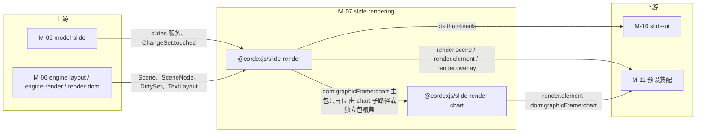

图怎么读：左侧两个上游模块分别提供领域数据与渲染契约；中间两个包是本模块产物，`slide-render` 主包在图表 key 上只放占位，M1–M2 由主包惰性子路径 `./chart`、M3 起由 `slide-render-chart` 以同 key 覆盖（`render.element` 贡献点定义为 `replace`）；右侧下游模块消费贡献点与 `ctx.thumbnails` 服务。

## 1. 限界上下文与边界

### 1.1 职责与非职责

**做什么**：

- 实现 `SceneProvider('slide')`（`domain/compose/**` + `application/services/slide-scene-provider.service.ts`）：`build(unitScope, view)` 读 `slides` 服务，按母版→版式→页三层合成（`showMasterSp`、普通页上母版 / 版式占位符不绘制只作继承源、背景来源 slide→layout→master；2026-09-25 按 PowerPoint 行为更正，F68）产出 `Scene`；`diff(changeSet, prev)` 把 `ChangeSet.touched` 按实体类型映射为 `DirtySet`。
- 复用 M-03 的样式继承与占位符匹配纯函数（`resolveShapeVisual`/`matchPlaceholder`/`dependentsOf` 等），不重新实现继承算法本体，只把其结果转换为 `SceneNode.data`。
- 按 `kind` 提供 `render.element`：`sp`/`pic`/`grpSp`/`cxnSp`/`graphicFrame:table`/`graphicFrame:ole`/`graphicFrame:diagram`/`unknown`/`background`；`graphicFrame:chart` 在主包只注册占位渲染器（`chart-placeholder.renderer.ts`：渲染器未加载时占位并发 `render/element-degraded{reason:'chart-unavailable'}`，由此触发惰性加载）；M1–M2 的只读渲染器（章程 D16 原文：`c:chart` 部件不透明保留，渲染器只读解析部件与缓存数据以满足查看，SSIM ≥ 0.80；**不是**「缓存位图或占位」）位于主包惰性子路径 `@cordexjs/slide-render/chart`（独立 chunk ≤ 400 KB，遇到图表元素才加载，架构 02 §4.16、07 §4.x 为准，rulings §4.18 FE-08），M3 起由拆出的 `slide-render-chart` 以同 key 覆盖；`cx:`（chartex）图表 D16 不覆盖，直接占位并上报 `chartex-unsupported`，不渲染其 Fallback（rulings §4.15 Q7；2026-09-26 起 chartex 导入为 `UnknownShape{source:'chartex'}`，占位由 `fallback.renderer` 发出，图表渲染器不再处理 `cx:`）。**渲染路线（2026-09-26，rulings §4.21 q-chart-route，ADR-0036）**：d3-scale / d3-shape / d3-array（ISC）只做比例尺、路径与数组运算，版式按 OOXML 语义自研（`manualLayout`、Excel 自动刻度、柱宽与堆积、饼图标签避让、图例与标题排布），文字经 `engine-layout` 度量，数值格式用 numfmt；管线与文件见 §2.7。
- SmartArt（`graphicFrame:diagram`）与 OLE（`graphicFrame:ole`）是**真实渲染器**而非占位（rulings §4.15 Q7）：diagram 经 M-04 `ooxml-core` 只读解析 `dsp:drawing`（含 `dsp:txXfrm`）后复用 `sp` 画笔绘制；ole 走 `pic` 路径显示 M-04 `ole.ts` 提取的 `Ole.preview`（取自 `mc:Fallback` 的 `p:pic`）。仅无 `dsp:drawing` / 无预览时才降级占位。
- EMF/WMF（含 OLE 预览）：M2 以 `emf-converter`（Apache-2.0）在惰性 Worker chunk 中栅格化（不计入 350 KB 基线；记录数/像素/耗时设上限，OF-24；headless 同一份代码），矢量渲染留 M4+。**2026-09-26 改评 4.0.x（rulings §4.21 R-d-24）**：npm 最新 4.0.0（2026-09-25 发布）默认 PNG 不再抗锯齿，调用时显式传 `gdiAntialias: true`；可选 peer `@napi-rs/canvas` 只给 Node 用，浏览器与 headless 不安装；过 `minimumReleaseAge` 后在 catalog 精确锁版本；M4+ 矢量路线用其 `convertMetafileToSvg` 输出，经 `<image href=blob:>` 渲染（图像上下文，不内联）。
- 外链资源（`TargetMode="External"` 且 http(s) 的图片/媒体）**默认自动加载**（rulings §4.15 Q7 用户选择）；部署配置 `externalResources` 可收紧为 `confirm`/`never`，被拦截时占位并上报 `external-resource-blocked`；服务端（headless）永不加载外链。
- 动画结束态按场景（rulings §4.15 Q7）：编辑/缩略图/PDF 为静态且全部元素可见；放映视图（`mode:'present'`）应用主序列可见性终态（M2 P1）。受限字体（`fsType` 限制嵌入）仅用于只读渲染，编辑态文本用回退字体（字体可用性由 M-06 度量层提供）。
- 文档内 SVG（`asvg:svgBlip`）只以图像上下文渲染（`<image href=blob:…>`），禁止 `innerHTML`/`insertAdjacentHTML`/`DOMParser` 注入文档内容（rulings §4.15 Q4 安全基线）。
- 文本渲染接入 `engine-layout.layoutTextBody()`，消费其返回的 `TextLayout`（M-06 G-3 统一命名）绘制 `<text>/<tspan>`；`TextEditIntent`（M-06 G-6）不在本包运行时调用链中出现——本包只保证 `SceneNode.id === ShapeId`、`node.data` 携带 `CaretMap`，使 render-dom → `engine-render.attach()` → 消费方（M-10 `slide-ui`；06 §13 Q-2 已按 14 §5.3 结案：`RenderService.attach(..., callbacks.onEditIntent)`，消费方 `slide-ui`）之间的回调通道能把 `nodeId` 还原为 `ShapeId`（§2.6、§12 G-3）。
- 维护母版/版式渲染模板 LRU（`LayerTemplateCache`，32 项）与其淘汰测试——这是架构 07 §11「三处 LRU」之外、专属本包的第 4 处缓存（06 §12 G-7）。
- 实现母版视图：`ViewDescriptor{mode:'master', target: LayoutId|MasterId}`（04 §12.4）分支合成，叠加占位符标注覆盖层 `render.overlay('master-annotations')`：给全部占位符画线与类型名（本版式虚线、继承点线 +「母版 · 〈类型〉」），M2 时给选中的占位符画锁形标签，类型名与锁签同一遍定落位；只在画布上画，不进缩略图、放映与导出（PRD ML-01；2026-11-04，rulings §4.25 DS-148、DS-156、TB-188；画法与落位规则以设计 03-26 §4.2 为准，落位纯函数见 §2.3）。
- 提供 `ctx.thumbnails`（UnitScope 服务）：两种可配置 Provider 策略（主线程缩放渲染 `dom-scaled` / 服务端 640 px WebP 缩略图 `server-png`——标识符沿用历史名，实际格式 WebP，rulings §4.15 Q8）取舍与切换，另有主线程 toImage 栅格化 `raster` **只用于单页导出**、不作为可配置缩略图 Provider（30-architecture/07 §8、50-frontend/05 §10.3，复核 L12）；**不做 Worker/OffscreenCanvas 版本**（rulings §4.15 Q4 推翻 14 §5.4 对 offscreen-canvas Provider 的采纳）。
- 对不支持/渲染失败的元素提供占位框降级路径，区分「预期降级」（本包自己 `emit render/element-degraded`）与「意外失败」（render-dom 兜底 `emit render/element-failed`，本包只需让错误可分类地抛出）。
- **页级回退**（2026-10-22，rulings §4.25 TB-151）：一页整体画不出来时，本包把这一页的页层换成一个页级占位，母版与版式层照常合成（母版页脚照常）。两种来源：整页解析失败的页（保真「此页内容无法解析」，判定以 50-frontend/05 §9 为准）在 `composeSlide` 里直接换；合成这一页时抛出的意外错误由 `slide-scene-provider.service.ts` 捕获后换成同一个占位（放映里单页渲染失败「此页内容暂时无法显示」，50-frontend/10 §9），错误经 `errors.report('render.page_failed', { pageId, cause })` 上报（码在 engine-render `errors.ts`，40/06 §5，30/10 §1.1a），并发 `render/element-failed`——`kind: 'page'`、`nodeId` 为页级占位节点、带 `pageId` 与 `code: 'render.page_failed'`（§2.4）——其余页不受影响；整页解析失败的页画出来的是这一页的确定内容，不报错误码。两者的差别对服务端渲染与浏览器生成的图片导出有意义（2026-10-22，rulings §4.25 TB-157、TB-166）：`/render` 页把 `render.page_failed` 按页带进 `ready` 的诊断（字段以 50-frontend/12 §11 为准），renderer 据此把这一页记为失败、不回传字节，按后端 60/06 §11.3 重试 1 次后缩略图用占位、导出作业失败；浏览器生成的图片导出（`exportImage`）所导页里只要有一页发出 `kind: 'page'` 的 `render/element-failed`，这次导出即失败、不把一时的出错写进文件（TB-166，判定方法以 50-frontend/18 EXP-03 为准）；保真占位那一页照常回传、照常导出。测试部署里「指定页在合成时抛错一次」的故障注入点就作用在这一处合成上，走同一条页级回退与上报（TB-169，接口以 50-frontend/15 §10 为准）；这个注入点只由 apps/web 的诊断接口在测试部署里打开（40/11 `application/host/diagnostics.ts`），`/render` 不读 RuntimeConfig、不设注入点，那里合成某页出错的用例用 scene provider 桩制造，落在 apps/web 的单测 `application/render-page.usecase.test.ts`（2026-10-22，rulings §4.25 TB-174，70/06 §6.3 R8，40/11 §9）。页级占位是页层里一个覆盖整页纸面的 `unknown` 节点（`data.placeholder: 'page'`，不新增 `render.element` key），由 `fallback.renderer.ts` 用与元素级占位同一组画笔画在纸面内（虚线框 + 图标 + 一行标题 + 一行原因，DS-52）；编辑器、查看器、放映、客户端与服务端缩略图看到的是同一份，界面层（slide-ui）不在画布上另叠一层。
- 定义 `@cordexjs/slide-render-chart` 的拆包边界：M1–M2 图表只读解析代码物理位于 `slide-render` 内；M3 起编辑能力与图表库整体迁入 `slide-render-chart`，`slide-render` 只保留缺省只读渲染器（插件缺席时仍按 D16 只读渲染，解析失败才占位）。

**不做什么（指向负责模块）**：

- 不定义 `Scene`/`SceneNode`/`DirtySet`/`RenderTarget`/`ElementRenderer`/`SceneProvider`/`OverlayRenderer`/`TextMeasurer`/`TextLayout` 契约本身——是 M-06 的职责；本包只实现/消费这些契约。
- 不做帧调度、脏区合并、命中测试索引、覆盖层通用挂载机制、`RenderTarget.paint`/DOM 图元 API——是 M-06（`engine-render`/`render-dom`）的职责；本包渲染器只产出/更新 DOM 句柄，不参与调度。
- 不做 Store 事务、命令执行、Mutation、样式继承算法本体、引用完整性不变量——是 M-03 的职责；本包只读 `slides` 服务与 `ChangeSet`。
- 不做 `c:chart` 等 OOXML 的 XML 解析算法本体——是 M-04（`ooxml-core`/`ooxml-pptx`）的职责；图表 read-model 只调用 M-04 `ooxml-core` 暴露的 `chartml.parseChartSpace`，SmartArt 只调用 `ooxml-core` 的 `dsp:drawing` 只读解析（均为 C-28 修订后放行的唯一 ooxml 依赖面，rulings §4.15 Q7）；外链资源是否激活的判定（仅 http(s) 可激活，其余 Relationship 原样保留）属 M-04 不变量，本包只消费其结果。
- 不做工具条 / 检查器 / 缩略图侧栏等 UI 组件与交互——是 M-10（`slide-ui`）的职责；本包只暴露 `ctx.thumbnails` 服务与 Scene/覆盖层数据，不渲染任何非画布 UI chrome。
- 不做服务端 headless 渲染的任务编排（队列、Playwright 调度）——是 M-09/M-12 的职责；本包代码只是被同一套浏览器代码加载执行，不感知自己在服务端运行。
- 不做媒体预处理（插入时的压缩、GIF 首帧、SVG 与图标的 PNG 回退、视频海报帧）：入口是 render-dom 的 `media/image-preprocess.ts`，由上传队列在插入或替换时调用，用 `createImageBitmap` + canvas（2026-09-26，rulings §4.21 R-d-23；ADR-0021 补「媒体与图标预处理」用途；行为见 50-frontend/23）；本包只消费 MediaCache 给出的 blob URL 与上传中覆盖层的状态。
- 不做放映模式编排（全屏、键盘翻页、黑屏/白屏、`Viewport.mode='show'` 状态机、发 `slide/show-changed`）——**2026-09-18 跨模块评审 C-04 裁定**该职责归 M-10（`slide-ui`）；原 `application/services/slideshow.service.ts` 已删除，本包只响应 `ViewDescriptor.mode` 变化产出对应 `Scene`，不持有放映状态、不发放映相关事件。

### 1.2 通用语言

复用 charter §4.1 核心术语：`Scene`/`SceneNode`/`SceneProvider`/`ElementRenderer`/`RenderTarget`/`OverlayRenderer`/`DirtySet`/`ViewDescriptor`/`TextMeasurer`/`TextLayout`，以及 M-03 的 `PresentationBody`/`slides` 服务/`ChangeSet.touched`。本上下文特有术语：

| 术语 | 定义 | 对应类型名 |
|---|---|---|
| 合成场景 | 母版/版式/页三层合成后的运行时派生结构，`SceneProvider.build()` 的中间产物，不参与 CRDT 合并 | `ComposedSlide`/`ComposedLayer`/`ComposedElement` |
| 继承占位符解析结果 | 复用 M-03 `matchPlaceholder`/`resolvePlaceholderBox` 的输出，标注某形状可继承字段来自哪一层 | `PlaceholderResolution{shapeId, source:'slide'\|'layout'\|'master'}` |
| 模板层 | 母版/版式层渲染结果按 `(layoutId, showMasterSp, themeVersion)` 缓存并 `cloneNode` 复用 | `LayerTemplateCache` |
| 占位符标注覆盖层 | 母版视图画布上给全部占位符画的线与类型名（本版式虚线、继承点线 +「母版 · 〈类型〉」）与 M2 锁形标签，只在画布上画；2026-11-04 起覆盖全部占位符，此前只标继承项（rulings §4.25 DS-148、TB-188；「占位符标注」一词的定义见 20-design README §6） | `OverlayRenderer('master-annotations')` |
| 脏区分类 | `ChangeSet.touched` 按实体类型（slide/shape/layout/master/theme/media）到 `DirtySet` 的映射规则 | `classify(paths, dependentsOf)` |
| 图表只读解析结果 | `c:chart` 部件经 `chartml.parseChartSpace` 后缓存的只读数据视图 | `ChartReadModel` |
| 图表渲染视图 | 只读解析结果叠加 M3 的 `Chart.data`（数据、类型、标题、图例、数据标签以 `data` 为准，未建模外观取自部件）；新插入的图表只有 `data`，外观取主题默认（2026-09-26，ADR-0036 决策 5） | `ChartRenderView` |
| 元素渲染器登记表 | `render.element` 的 key → 渲染器文件 → 承载的元素族与降级原因的对照（§2.7；逐元素的渲染设计在 50-frontend/19–25） | — |

### 1.3 上下文映射

| 相邻上下文 | 关系类型 | ACL / 落点文件 | 传递的契约 |
|---|---|---|---|
| BC-06 幻灯片领域模型（上游） | Customer–Supplier（本包为客户，只读，对 `slides` 服务契约无议价权） | `application/services/slide-scene-provider.service.ts` | `SlidesService`（04 §3.4）、`ChangeSet.touched` |
| BC-11 渲染管线与目标（上游，Open Host Service `render.*`） | Conformist（本包实现四个贡献点，照单全收 `Scene`/`SceneNode`/`DirtySet`/`ElementRenderer` 形状） | `src/plugin.ts` 的 `ctx.contribute` 调用点 | `SceneProvider`/`ElementRenderer`/`OverlayRenderer` 接口（06 §2.5） |
| BC-10 布局与度量引擎（上游，经 BC-11 传入） | Customer–Supplier | `infrastructure/elements/shared/text-body.painter.ts` | `TextMeasurer`（`ctx.layout.measurer()`）、`layoutTextBody()` → `TextLayout` |
| BC-07/08 OOXML 与 PPTX 编解码（上游，经 BlobStore 间接） | Customer–Supplier（图表与 SmartArt 只读解析路径；C-28 修订后 `slide-render→ooxml-core` 放行，rulings §4.15 Q7） | `infrastructure/chart/*`、`infrastructure/elements/diagram.renderer.ts` | `chartml.parseChartSpace`、`dsp:drawing` 只读解析（均 M-04 `ooxml-core`）、`BlobStore`（M-02） |
| BC-15 幻灯片 UI（下游） | Customer–Supplier（`slide-ui` 消费 `ctx.thumbnails`；`TextEditIntent` 的最终消费方，06 §13 Q-2 已按 14 §5.3 结案） | `src/slide-render.contribution.ts` | `ThumbnailService` 类型、`Scene`/`OverlayContext`；`MasterAnnotationsOptions`（slide-ui 在母版视图里启用占位符标注覆盖层时给的入参，类型经 `src/index.ts` 导出，§2.5、§6；2026-11-04） |
| BC-27/M-09 Headless 渲染宿主（下游，间接） | Conformist（同一份代码被加载，无独立实现分支） | — | 无新增契约（复用 `RenderTarget`/`toImage`） |
| BC-29 doc/sheet 扩展占位（同层带兄弟） | Separate Ways（铁律 2） | — | 无共享类型；仅共享水平层 BC-02/05/10/11 |

**图 1-1 对外契约与上下游关系**

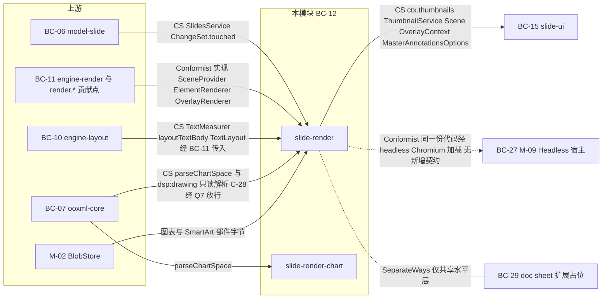

怎么读：箭头从契约提供方指向消费方（与图 0-1 同向），边标签为「关系类型 + 传递的契约」；本模块对 BC-11 是照单全收的实现方，对 BC-06/BC-10/BC-07 是只读客户；虚线表示没有新增契约的关系——M-09 只是在 headless Chromium 里加载同一份代码，BC-29 与本模块互不 import。

依据：本节上表；rulings §4.15 Q7。

---

## 2. 领域模型

> **事实源（rulings §4.19）**：渲染行为（模板层与页层分工、帧管线、缩略图 Provider 选用、元素降级、画布可访问树）以 [50/05](../50-frontend/05-rendering-and-thumbnails.md) 为准，文本编辑与 autofit 回写以 [50/06](../50-frontend/06-text-editing-and-ime.md) 为准；本节保留合成模型、纯函数与服务到文件的落点，冲突以 50 为准。
>
> UI / 基础设施类模块标题替换（模板 §2 说明）；本包无持久化聚合——权威事实源始终是 M-03 的 `PresentationBody`，本节的「聚合」是每次 `SceneProvider.build()` 调用即可从零重建的运行时派生结构，不参与 CRDT 合并（同 06 §2 的措辞）。

### 2.1 合成模型（`ComposedSlide`、继承占位符解析结果、`Layer` 顺序）

| 名称 | 归类 | 关键字段 | 不变量 | 所在文件 |
|---|---|---|---|---|
| `ComposedSlide` | 聚合根（`build()` 调用期间的中间产物） | `target: SlideId\|LayoutId\|MasterId`、`viewMode:'edit'\|'master'\|'thumbnail'\|'present'`、`background: ResolvedBackground`、`layers:{master?; layout?; slide?: ComposedLayer}`、`dependencies:{themeId;masterId;layoutId}` | `viewMode==='master'` 时 `layers.slide` 恒为空（母版视图不合成页层，04 §12.4）；三层同时存在时渲染顺序恒为 master→layout→slide | `domain/contracts/composed-slide.ts` |
| `ComposedLayer` | 实体（属于某个 `ComposedSlide`） | `source:'master'\|'layout'\|'slide'`、`elements: ComposedElement[]`（已按 `(order,id)` 排序） | 元素顺序即 z 序；`occluded:true` 的元素不产出 `SceneNode`，但保留在结构中供诊断/测试断言 | `domain/contracts/composed-slide.ts` |
| `ComposedElement` | 实体 | `shapeId: ShapeId`、`kind: Shape['kind']`、`resolvedVisual: ResolvedShapeVisual`（复用 M-03）、`placeholder?: PlaceholderResolution`、`occluded: boolean`、`inheritedFrom?:'master'\|'layout'` | `occluded` 规则（2026-09-25 按 PowerPoint 行为改写，与 50/01 §4a.3、50/05 §1 一致，F68/F69）：普通页（`edit`/`present`/`thumbnail`）上，母版与版式的**占位符形状一律 `occluded=true`**——只经继承链作用于页层同 `(type, idx)` 形状的样式与位置，自身不绘制（删掉页上的标题占位符不会露出版式的标题占位符）；母版与版式的**非占位符形状**按 `showMasterSp` 进入模板层；原「页上有同 `(type,idx)` 占位符才遮蔽」作废（它会在普通页画出版式的空占位符，与 PowerPoint 365 基线系统性不符，且使 `LayerTemplateKey` 无法跨页共享）；`inheritedFrom` 只在 `viewMode==='master'` 且元素来自非目标层时置位，驱动 §2.6 占位符标注覆盖层的点线与「母版 · 〈类型〉」（标注层另读全部占位符的框与类型，含目标层自己的；2026-11-04，rulings §4.25 DS-148、TB-188） | `domain/contracts/composed-slide.ts` |
| `PlaceholderResolution` | 值对象（附着在 `ComposedElement` 上） | `shapeId`、`source:'slide'\|'layout'\|'master'`、`ref: PlaceholderRef`（M-03 类型） | 直接复用 M-03 `matchPlaceholder`/`resolvePlaceholderBox` 的返回值，本包不重新实现匹配算法 | `domain/contracts/dirty-classification.ts`（与脏区分类值对象合并存放，见 §4 命名说明） |

**Layer 顺序不变量**：背景独立于三层，恒最先绘制；三层内部顺序固定为 master→layout→slide（普通页上母版 / 版式层只绘制非占位符形状，占位符只经继承链作用于页层，见上表 `occluded`）；同层内形状顺序取自 M-03 的 `(order, id)` 全序，本包不重新排序。母版视图分支（`viewMode==='master'`）由 `domain/compose/compose-master-view.ts` 单独实现：目标为 `LayoutId` 时合成 `{layout: 目标版式, master: 其母版}` 两层并置 `showMasterShapes` 语义；目标为 `MasterId` 时只合成 `{master: 目标母版}` 一层；两种情形均不合成 `slide` 层，占位符渲染为提示框（自带 prompt 或按 `type` 的 i18n 默认文案，04 §12.4）。2026-11-04 起（rulings §4.25 DS-148、DS-149、TB-191）：文本类占位符的提示画第 1–5 级样例；母版视图画布上的提示框本身不画框线，线与类型名由 §2.6 的占位符标注覆盖层画；目标为版式或母版的缩略图（窗格与版式画廊，`ctx.thumbnails` 的 `LayoutId` / `MasterId` 目标）与画布同一份内容渲染，另给占位符画一种细线框，不分本版式与继承、不写类型名，提示字按缩略图尺寸排，放不下的行整行省去、不裁半字（线型、线色与排法以设计 03-26 §7 为准）。

**主题预览 `ViewDescriptor.themePreview`（2026-09-26 登记，rulings §4.20 FE-24；行为以 50/11 §9、50/05 为准）**：slide-render 识别 `ViewDescriptor` 的扩展键 `themePreview?: {masterId: MasterId; colors?: Partial<ColorScheme>; fonts?: Partial<FontScheme>}`（M-06 `ViewDescriptor` 以索引签名承载扩展键，engine-render 不感知）：合成时该母版链的主题解析改用覆盖值，只影响渲染——不入 Store、不产生事务、不广播，取消预览即清空该键。单测（`__tests__/master-view.test.ts`）断言渲染取覆盖值且 Store 无事务。

**`viewMode` 取值来源**（2026-09-18，跨模块评审 C-13）：`ComposedSlide.viewMode` 的四个取值 `edit|master|thumbnail|present` 与 `build(unitScope, view: ViewDescriptor)` 传入的 `ViewDescriptor.mode` 一一对应，由**engine-render（M-06）**的 `mapViewMode()` 统一从 ui-core 的 `normal|master|presenter` 映射得出；本包只按 `view.mode` 透传赋值，不重新实现或反向定义该映射（§5.1 `domain/contracts/composed-slide.ts` 备注同步）。

**可访问描述的派生（2026-09-25 登记，50/05 §11，决策 A11Y-TREE）**：`toSceneNodes` 为每个可见元素附 `SceneNode.a11y: A11yDescriptor`（`role`、`name`、`position`、`order{z, placeholder?}`、`missingAlt`、`decorative`，以及 2026-09-26 §4.21 整合增的 `links`、`table` / `chartData` 与 `role` 取值 `link`（只在放映态）；字段与取值以 50/05 §11 为准，`SceneNode.a11y` 是 M-06 `Scene` 契约的类型盲扩展）；**未挂载页**不构建 Scene、不排版、不建 DOM，由 `describeSlideForA11y(slides, slideId)` 以同一派生规则直接读模型生成描述，供 render-dom `a11y-mirror` 覆盖全部已装载页（可访问树不随虚拟化裁剪）；实现文件 `domain/scene/a11y-descriptor.ts`（§4.1）。

**图 2-1 母版/版式/页合成到 Scene 的流程**

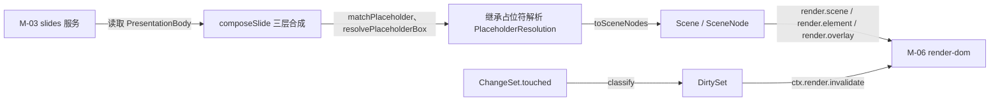

图怎么读：上半条链路是首次合成——从 `slides` 服务读取到产出 `Scene` 再交给 `render-dom` 挂载渲染器；下半条链路是增量更新——`ChangeSet.touched` 经 `classify` 归类为 `DirtySet` 后驱动同一个 `render-dom` 失效重绘。

### 2.2 值对象

| 名称 | 字段摘要 | 校验 schema | 所在文件 |
|---|---|---|---|
| `ThumbnailDescriptor` | `{ target: SlideId\|LayoutId\|MasterId; url?: string; element?: unknown; revision: number; provider: 'dom-scaled'\|'server-png'; provisional?: boolean }`（`raster` 已移出本枚举——主线程 toImage 栅格化只用于单页导出 `exportImage`，不产出缩略图描述，复核 L12；`server-png` 实为 640 px WebP；`provisional` 由 server-png 透传，§2.6） | zod | `domain/contracts/composed-slide.ts` |
| `DirtyClassificationEntry` | `{ entityType:'slide'\|'shape'\|'layout'\|'master'\|'theme'\|'media'; toNodeIds(touched: Path[], deps): NodeId[] \| 'full' }` | 无（运行时策略表，非线上数据） | `domain/contracts/dirty-classification.ts` |
| `ChartReadModel` | 部件、标题、绘图区（`manualLayout`）、图表组、系列（缓存与 `formatCode`）、坐标轴（`scaling`、`majorUnit`、`numFmt` 等）、图例、`dispBlanksAs`、`cacheHash`；字段表以 ADR-0036 为准（2026-09-26 由原 `{type; categories; series; cacheHash}` 扩充，rulings §4.21） | 类型由 M-04 `ooxml-core` `parseChartSpace` 定义并导出（rulings §4.15 Q7 统一归属），本包只消费（M1–M2 只读；M3 起与 `Chart.data` 叠加成 `ChartRenderView`） | `infrastructure/chart/chart-preview.renderer.ts`（消费点；M3 迁至 `slide-render-chart`） |
| `LayerTemplateKey` | `(layoutId: LayoutId, showMasterSp: boolean, themeVersion: number)` 规范化字符串键 | 无 | `infrastructure/cache/layer-template-cache.ts` |
| `ResolvedBackground` | 复用 M-03 `effectiveBackground()` 的返回值（`Background` 值对象），不重定义 | — | `domain/compose/compose-slide.ts`（re-export） |

**图 2-2 图表拆包边界**

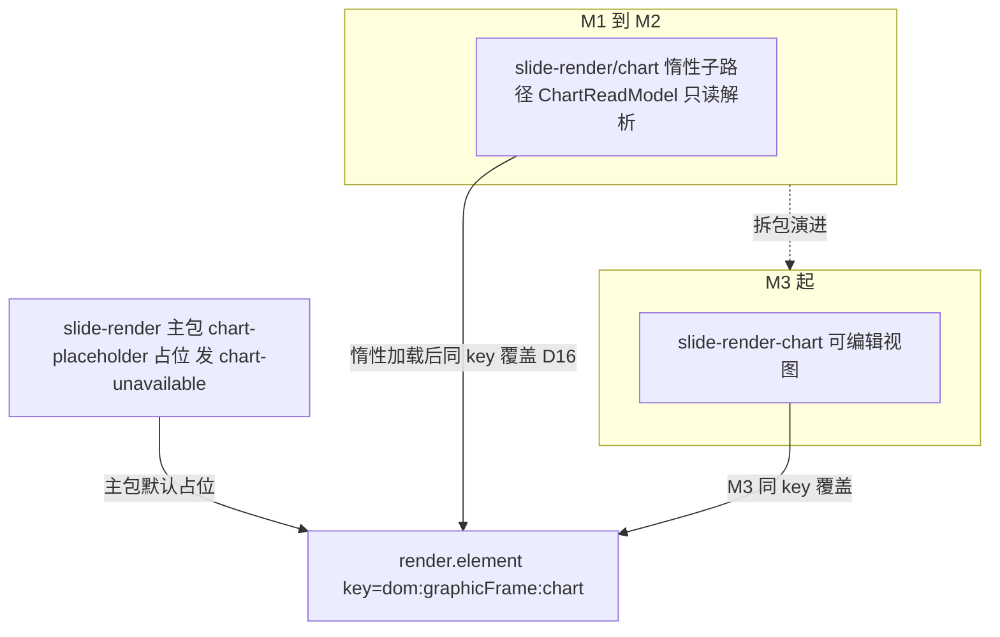

图怎么读：同一个贡献点 key 在不同阶段由不同实现占据：主包始终只注册占位渲染器（未加载时发 `chart-unavailable`）；M1–M2 由惰性子路径 `@cordexjs/slide-render/chart` 的只读解析实现覆盖，M3 起由 `slide-render-chart` 覆盖——覆盖语义来自 `render.element` 贡献点定义时声明的 `conflict:'replace'`（rulings §4.18 FE-08/GV-24）。

### 2.3 纯函数（合成、脏区映射、缩略图尺寸）

| 函数 | 签名（草案） | 所在文件 | 说明 |
|---|---|---|---|
| `composeSlide` | `(slides: SlidesService, slideId: SlideId) => ComposedSlide` | `domain/compose/compose-slide.ts` | 普通编辑/放映视图；内部调用 `effectiveBackground`/`matchPlaceholder`（M-03）；页 `layoutId` 指向墓碑或不存在的版式时，以 M-03 `defaultLayoutOf(body, {masterId, type})` 的结果替代求值（墓碑期读时容错，不写 Store；硬删时由服务端同事务修复，rulings §4.20 FE-03/FE-04） |
| `composeMasterView` | `(slides: SlidesService, target: LayoutId \| MasterId) => ComposedSlide` | `domain/compose/compose-master-view.ts` | 母版视图分支（04 §12.4），标注 `inheritedFrom` |
| `planMasterAnnotations` | `(input: MasterAnnotationInput) => MasterAnnotationPlan` | `domain/compose/master-annotation-plan.ts` | 2026-11-04 新增（rulings §4.25 TB-188…TB-190）：占位符标注的落位——输入数据里的占位符框（含类型与继承来源）、各占位符提示文字首行的文字矩形、母版图形与普通形状的框、选中项与它的尺寸角标、是否 M2 与视口，输出这一画面的一种类型名落位方式和每枚类型名、M2 锁签的位置（放不下的不画）；按数据算，不量 DOM、不等过渡；规则以设计 03-26 §4.2 为准 |
| `toSceneNodes` | `(composed: ComposedSlide) => SceneNode[]` | `domain/scene/to-scene-nodes.ts` | 约定 `SceneNode.id === shapeId`（§2.6、§12 G-3） |
| `toLayoutInput` | `(run: ResolvedRunProperties, paragraph: ResolvedParagraphProperties) => TextBodyModel` | `domain/scene/to-layout-input.ts` | 供 `engine-layout.layoutTextBody()` 消费 |
| `classify` | `(touched: readonly Path[], dependentsOf: DependentsOfFn) => DirtySet` | `domain/dirty/classify.ts` | `ChangeSet.touched` → `DirtySet`；内含按实体类型的映射表（§2.4 表） |
| `thumbnailSize` | `(pageSize: Size, targetWidth: Px) => Size` | `domain/thumbnail/thumbnail-size.ts` | 保持宽高比，供两种缩略图 Provider 与单页导出共用 |
| `resolvePaint` | `(visual: ResolvedShapeVisual, theme: Theme) => PaintParams` | `domain/geometry/resolve.ts` | 颜色变换（`lumMod`/`tint`/`alpha`）复用 M-03 `resolveColor` |
| `shapeGeometryPath` | `(shape: Shape, box: Rect<Emu>) => GeometryPath` | `domain/geometry/resolve.ts` | 委派 `engine-layout` 的 `presetGeometryPath`/`customGeometryPath`，附加文本内接矩形 `txRect` |

全部为纯函数（无 DOM API 调用），便于在 `happy-dom`/Node 环境单测；但本包 `package.json#cordex.iso = 'dom'`，不构成可被 `server-headless`（node）直接 import 的跨端复用面（R16，isomorphism 兼容性），服务端只经 headless Chromium 间接执行同一份代码（06 §7）。

**`classify` 的脏区分类表**（`ChangeSet.touched` 路径前缀 → `DirtySet` 归类；按实体类型逐行，00-module-map §4.2 第 4 条要求的映射由本表落地）：

| Store 路径前缀（实体类型） | 归类结果 | 理由 |
|---|---|---|
| `shapes.<id>.*` | 该 `shapeId` 对应的 `NodeId` 进 `nodeIds`（若形状在多页/多层出现——如同一版式被多页引用——需展开为全部引用者） | 形状级修改只影响自身渲染节点 |
| `slides.<id>.order` / `.layoutId` / `.hidden` / `.background` | 该页 `NodeId` 全量（`full` 相对该页 `Scene`，非跨页） | 页级属性变化通常影响整页合成（背景/版式切换会级联占位符遮蔽结果） |
| `layouts.<id>.*` | `dependentsOf(body, layoutId)`（M-03）返回的全部引用页 → 各自 `full`；命中的 `LayerTemplateCache` 条目一并失效 | 版式改动影响其模板层与全部引用页 |
| `masters.<id>.*` | `dependentsOf(body, masterId)` 返回的全部版式与页 → 各自 `full`；模板缓存失效 | 母版改动级联到其下全部版式 |
| `themes.<id>.*` | `dependentsOf(body, themeId)`（经引用它的母版）返回的全部页 → 各自 `full` | 主题变化改变全部依赖它的颜色/字体解析结果 |
| `media.<id>.*` | 引用该媒体的形状对应 `NodeId` 进 `nodeIds`（不触发整页重排） | 媒体替换只影响使用它的图片形状 |
| 其它（`presentation.*` 等） | `DirtySet.full = true`（相对当前 `Scene`） | 保守兜底，避免遗漏 |

### 2.4 领域事件

| 事件 | 载荷（草案） | 发布者文件 | 典型订阅者 |
|---|---|---|---|
| `slide/thumbnail-updated` | `{ unitId; target: SlideId\|LayoutId\|MasterId; revision: number }` | `application/services/thumbnail.service.ts` | `slide-ui` 缩略图侧栏、母版视图缩略图窗格（PRD ML-01） |
| `slide/autofit-changed`（2026-09-25 登记；声明在 M-03 `events.ts`，本包 emit） | `{ unitId; shapeId; fontScale?; lnSpcReduction?; height? }` | `application/services/slide-scene-provider.service.ts`（文本事务提交后的那一帧比较算得的 `normAutofit`/`spAutoFit` 结果与模型值，不同才发；只对本机正在编辑的形状发，编辑态由 slide-ui 经 `render.attach` 回调标记；打开、查看、放映、`/render` 永不发） | slide-ui `text-editing.ts` → `slide.applyAutofit`（50/06 §7） |
| `slide/show-changed`（**不由本包发布**，2026-09-18 起） | `{ unitId; mode:'entering'\|'exiting'; slideId?: SlideId }` | `slide-ui`（M-10 `application/slideshow.ts` 或等价文件，跨模块评审 C-04；原 `application/services/slideshow.service.ts` 已删除） | `slide-ui` 放映 UI、应用壳全屏控制 |
| `render/element-failed`（页级回退，2026-10-22；Events 声明在 M-06 `engine-render`，元素级的 emit 在 render-dom，只有页级这一种在本包） | `(unitId, nodeId, kind, code, pageId)`，`kind` 为 `'page'`、`nodeId` 为页级占位节点、`code` 为 `render.page_failed`（载荷以 06 §2.4 为准） | `application/services/slide-scene-provider.service.ts`（合成某一页抛错、换成页级占位时发一次；整页解析失败的保真占位不发） | `/render` 页的 `ready` 逐页诊断（`failed{ code }`，50/12 §11.3，rulings §4.25 TB-157）、`errors.report` |
| `render/element-degraded`（Events 声明在 M-06 `engine-render`，emit 调用点在本包） | `{ unitId; nodeId; kind; reason }`；`reason ∈ 'chart-unavailable'\|'chartex-unsupported'\|'emf-no-preview'\|'emf-raster-limit'\|'ole-preview-missing'\|'smartart-no-dsp'\|'external-resource-blocked'\|'unsupported-shape-kind'`（`chartex-unsupported`/`external-resource-blocked`/`emf-raster-limit` 为 rulings §4.15 Q7 新增） | `infrastructure/elements/{pic,ole,diagram,fallback}.renderer.ts`、`infrastructure/chart/chart-preview.renderer.ts`、`infrastructure/media/emf-rasterizer.ts` | `errors.report`、保真诊断面板（OF-13）、`slide-ui` 提示 |

`render/element-failed` **不由本包 emit**：该事件在 render-dom 的 `painter.ts` 捕获 `ElementRenderer.render`/`update` 抛出的意外异常时统一发出（06 §2.4，A11）；本包渲染器对「预期内的降级」（缺失预览、图表插件未加载等）必须自行捕获并转成占位框 + `render/element-degraded`，只把真正意外的错误原样 `throw` 交给上游兜底——两条路径的边界见 §12 G-4。页级回退是例外（2026-10-22，rulings §4.25 TB-157）：合成某一页时抛出的异常在本包的 scene provider 里就被捕获、到不了 render-dom 的 painter，所以由 `slide-scene-provider.service.ts` 发 `kind: 'page'` 的那一条（见上表），元素级的边界不变。

订阅：无跨包订阅。`application/services/slide-scene-provider.service.ts` 内部经 `unitScope.get('store').observe()` 订阅本 Unit 的 `store/transaction`，驱动 `diff()` 调用与向 `ctx.render.invalidate(dirty)` 的转发（06 §2.6「触发点：调用方（BC-12）」），这与 M-03 `slides.service.ts` 内部订阅 `store/transaction` 是同一模式，均非跨包 `Events` 订阅。

### 2.5 消费的 Definition 与自身对外契约（`SlideSceneProvider` 配置）

**消费的 Definition**（全部来自 M-06，本包不重新定义，只 `implements`/调用）：`SceneProvider`（实现方）、`ElementRenderer`（实现方，×10）、`OverlayRenderer`（实现方，`'master-annotations'`）、`RenderTarget`（调用方，经 `ctx.render` 间接使用 `toImage`/`hitTest`，不自己 `implements`）、`TextMeasurer`（调用方，经 `ctx.layout.measurer()`）。

**`master-annotations` 的启用入参 `MasterAnnotationsOptions`**（2026-11-04，rulings §4.25 TB-188、TB-190）：slide-ui 在母版视图里启用这一覆盖层时交给它一个 `MasterAnnotationsOptions`，两个字段——`labels`：标注文案，即各占位符的类型名、继承项的「母版 · 〈类型〉」与 M2 锁签的文字，由 slide-ui 按当前语言给出（键见 50-frontend/16 §1 的母版视图文案键表，锁签与 M2 的原因用同一个键）；`m2Locked`：是否处于 M2（布尔，决定画不画锁签）。做法同 render-dom 的 `guides`、`grid` 覆盖层由交互层入参（40/06 §4.3、§5.3）。类型在 `domain/compose/master-annotation-plan.ts` 声明、经 `src/index.ts` 导出（§6）。本包只负责落位与绘制：不登记 i18n 命名空间、不贡献 `i18n.bundle`（§3）；选中与视口仍取 `OverlayContext` 已有的 `selection`、`viewport`，不扩展 `OverlayContext`（§13 Q-3）。

**自身对外契约：`SlideRenderConfig`**（`src/config.ts`，zod）：

```ts
const SlideRenderConfig = z.object({
  layerTemplateCache: z.object({ maxEntries: z.number().default(32) }),
  thumbnails: z.object({
    provider: z.enum(['dom-scaled', 'server-png']).default('dom-scaled'), // server-png 实为 640 px WebP（Q8）；raster 只用于单页导出，不在此枚举（复核 L12）
    width: z.number().default(192),
    debounceMs: z.number().default(300),
    maxMounted: z.number().default(12),
  }),
  charts: z.object({ enabled: z.boolean().default(true) }),
  // 部署配置下发（rulings §4.15 Q7）：默认自动加载 http(s) 外链；headless 恒按 'never'
  externalResources: z.enum(['auto', 'confirm', 'never']).default('auto'),
  emf: z.object({ maxRecords: z.number(), maxPixels: z.number(), timeoutMs: z.number() }), // M2，OF-24 上限
})
```

**`ctx.thumbnails` 服务面**（`ThumbnailService`，UnitScope 内；`domain/contracts/composed-slide.ts` 声明类型，`application/services/thumbnail.service.ts` 实现）：

```ts
interface ThumbnailService {
  get(target: SlideId | LayoutId | MasterId): ThumbnailDescriptor
  subscribe(target: SlideId | LayoutId | MasterId, cb: (d: ThumbnailDescriptor) => void): () => void
  exportImage(target: SlideId, opts: { format: 'png' | 'jpeg' | 'svg'; width: number; embedFonts?: boolean }): Promise<Blob>  // 单页导出：png/jpeg 走 raster 路径（复核 L12）；'svg' 与 embedFonts 为 2026-09-26 新增（EXP-03，50-frontend/18）：直接序列化该页 SVG，embedFonts 为真时把所用字体子集以 @font-face data URI 内嵌
}
```

### 2.6 应用服务（渲染请求、缩略图请求、母版视图切换）

| 应用服务 | 职责 | 触发者 | 所在文件 |
|---|---|---|---|
| `SlideSceneProvider`（渲染请求） | `build(unitScope,view)`：三层合成 → `toSceneNodes`；`diff(changeSet,prev)`：内部订阅 `store/transaction` → `classify` → 转发 `ctx.render.invalidate(dirty)` | `engine-render.RenderService.attach()`（首次 `build`）；本包内部 store 订阅（后续 `diff`） | `application/services/slide-scene-provider.service.ts` |
| `ThumbnailService`（缩略图请求） | `get(target)`/`subscribe(target,cb)`：按配置选择 Provider（`dom-scaled`/`server-png`）、300 ms 去抖、`maxMounted` 上限、本地脏页在服务端缩略图（640 px WebP）到达前用 `dom-scaled` 兜底；`exportImage(target, opts)` 单页导出走 `raster` 路径（不影响缩略图 Provider 选择）；server-png 响应标记 `provisional`（如 M2 取自包内 `docProps/thumbnail.jpeg` 的封面、或页内容哈希已失效）时仍先显示，但随后回退 `dom-scaled` 重渲覆盖（rulings §4.15 Q8） | `slide-ui` 缩略图侧栏、母版视图缩略图窗格（PRD ML-01 §3） | `application/services/thumbnail.service.ts` |
| 母版视图切换（读侧响应） | `ViewDescriptor.mode` 变为 `'master'` 时 `build()` 走 `composeMasterView` 分支；贡献 `OverlayRenderer('master-annotations')`，给全部占位符画标注：本版式虚线 + 类型名，继承项（`inheritedFrom` 非空）点线 +「母版 · 〈类型〉」；同一画面一种落位，选中项不画自己的类型名，M2 时给选中项画锁形标签、与类型名同一遍定落位（`planMasterAnnotations`，§2.3）；按屏幕像素画，不随缩放变粗细（PRD ML-01；2026-11-04，rulings §4.25 DS-148、DS-156、TB-188…TB-190；画法与落位规则以设计 03-26 §4.2 为准） | `slide-ui`：经 `view.setMode` 进出母版视图（入口见设计 03-26 §1.1），母版窗格选中经 Operation `slide.selectMasterOrLayout` 换编辑对象（M-03 §2.6；窗格选中即编辑对象，2026-11-04，rulings §4.25 DS-146） | `domain/compose/compose-master-view.ts`、`domain/compose/master-annotation-plan.ts`、`infrastructure/overlay/master-annotations.overlay.ts` |

~~`SlideshowService`（放映模式）~~ **已删除（2026-09-18，跨模块评审 C-04）**：`Viewport.mode='show'`、全屏、键盘翻页、黑屏/白屏、发 `slide/show-changed` 的编排职责改由 M-10（`slide-ui`）自行实现，原 `application/services/slideshow.service.ts` 文件不再存在于本包。

`TextEditIntent` 的回调注册与派发**不经过**本包的任何应用服务——它是 render-dom 的 `TextInputHost` → `engine-render.RenderService.attach(targetId, container, callbacks?)` → 消费方（06 §13 Q-2 已结案：`slide-ui`，经 `callbacks.onEditIntent`）之间的直接通道；本包在 §2.1/§2.3 的约定（`SceneNode.id===ShapeId`、`node.data` 携带 `CaretMap`）是这条通道能够把 `TextEditIntent.nodeId` 还原为 `ShapeId` 的必要前提，但本包自身不持有回调、不出现在运行时调用栈中（§12 G-3）。

**图 2-3 首次合成与增量渲染时序**

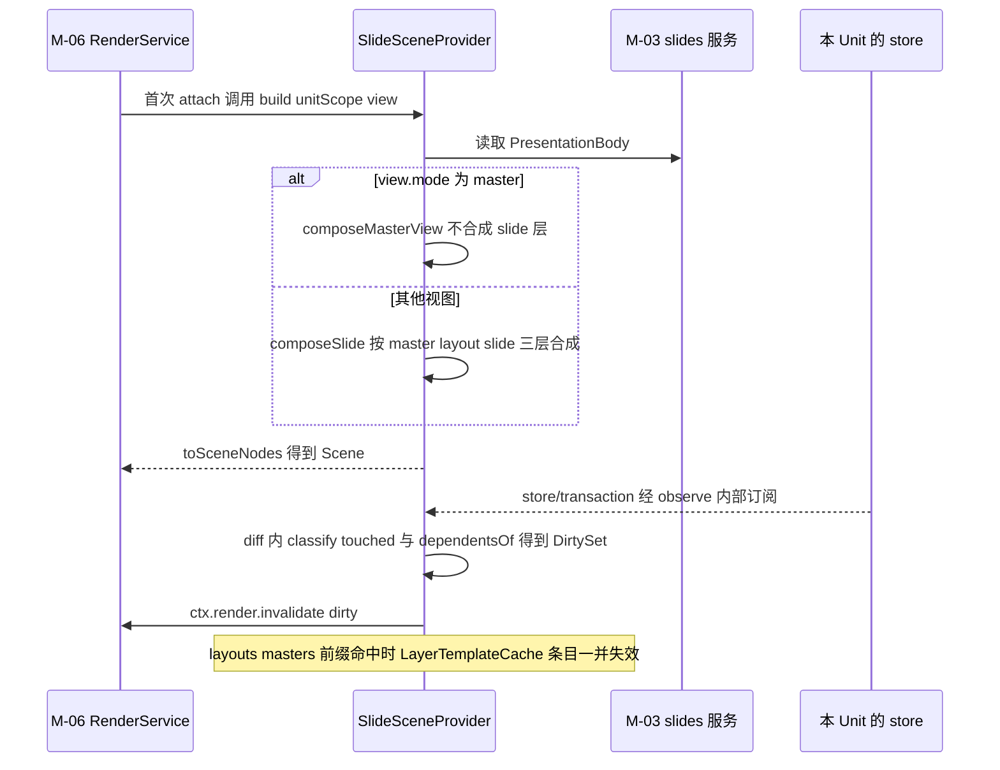

怎么读：上半段是 `attach` 触发的首次 `build`，母版视图走独立分支；下半段是本包自己订阅本 Unit 的 `store/transaction`、按 §2.3 分类表把 `touched` 映射成 `DirtySet` 后转发给 M-06，不存在跨包事件订阅。

依据：§2.1 Layer 顺序不变量；§2.3 `classify` 分类表；§2.4 订阅说明；§2.6 `SlideSceneProvider` 行。

**图 2-4 缩略图请求时序**

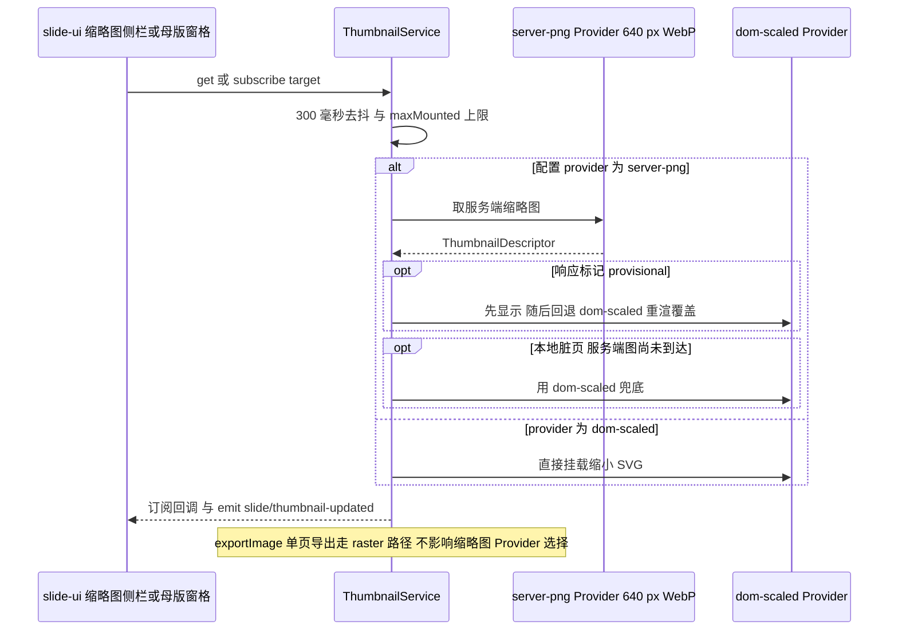

怎么读：Provider 由 `SlideRenderConfig.thumbnails.provider` 决定；`provisional`（如 M2 取自包内 `docProps/thumbnail.jpeg` 的封面或页内容哈希已失效）只是先占位，随后由 `dom-scaled` 覆盖；单页导出与缩略图是两条独立路径。

依据：§2.2 `ThumbnailDescriptor`；§2.5 `SlideRenderConfig`；§2.6 `ThumbnailService` 行；rulings §4.15 Q8。

### 2.7 元素渲染器登记表与图表渲染管线（2026-09-26，rulings §4.21）

> 逐元素「怎么画」的设计（原 30-architecture/07 §4.2 的元素渲染器表）迁到 50-frontend/19，按元素族分篇在 50-frontend/20–25；本节只登记模块层的对照：哪个 `render.element` key 由哪个文件实现、承载哪些元素、会发哪些降级原因。新增元素若复用已有 key（如图标、视频海报都走 `pic`），只在本表「承载的元素」列补一项，不新增渲染器文件。

| `render.element` key | 实现文件 | 承载的元素（设计文档） | M1 | M2 起的变化 | 预期降级 `reason` |
|---|---|---|---|---|---|
| `dom:sp` | `infrastructure/elements/sp.renderer.ts` | 文本框、文本占位符、预设形状、动作按钮、任意多边形、艺术字近似（50-frontend/20、21、22） | 渲染 | 插入与编辑随各元素里程碑 | — |
| `dom:pic` | `infrastructure/elements/pic.renderer.ts` | 位图、SVG、图标、EMF / WMF、视频与音频的海报或图标、外链图片与媒体（50-frontend/23） | 渲染；EMF 用包内预览或占位 | M2 起 EMF 惰性栅格化（emf-converter 4.0.x）；视频编辑态临时播放是覆盖层，不进 Scene | `emf-no-preview`、`emf-raster-limit`、`external-resource-blocked` |
| `dom:grpSp` | `infrastructure/elements/grp-sp.renderer.ts` | 组合（50-frontend/21） | 渲染 | 组合与取消组合 | — |
| `dom:cxnSp` | `infrastructure/elements/cxn-sp.renderer.ts` | 直线、箭头、肘形与曲线连接符（50-frontend/22） | 渲染 | 端点跟随与路径重算的输入由 engine-layout 提供 | — |
| `dom:graphicFrame:table` | `infrastructure/elements/table.renderer.ts` | 表格（50-frontend/24 §2） | 渲染（OF-08） | M2 单元格文字，M3 结构与样式；读视图按 I-TBL1 / I-TBL2 容错 | — |
| `dom:graphicFrame:chart` | 主包 `infrastructure/elements/chart-placeholder.renderer.ts`；M1–M2 由 `./chart` 的 `infrastructure/chart/chart-preview.renderer.ts` 覆盖；M3 由 `slide-render-chart` 覆盖 | 图表五类与其它 `c:` 图表（50-frontend/24 §3、§4） | 只读渲染（OF-09） | M3 五类可编辑，其余 `approx.renderer` | `chart-unavailable` |
| `dom:graphicFrame:diagram` | `infrastructure/elements/diagram.renderer.ts` | SmartArt（50-frontend/25） | 渲染 `dsp:drawing` | 整体变换；「转换为形状」M4+ | `smartart-no-dsp` |
| `dom:graphicFrame:ole` | `infrastructure/elements/ole.renderer.ts` | OLE 嵌入与链接（50-frontend/25） | 显示预览 | EMF 预览 M2 栅格化 | `ole-preview-missing` |
| `dom:unknown` | `infrastructure/elements/fallback.renderer.ts` | `mc:AlternateContent` 对象（公式、墨迹、3D、缩放定位、chartex）、裸 `p:contentPart`、ActiveX、未知 `graphicData`（50-frontend/25） | 有 Fallback 图片按图片画，否则占位 | 整体移动缩放 M2 P1 | `chartex-unsupported`（`UnknownShape.source` 为 `chartex`）、`unsupported-shape-kind` |
| `dom:background` | `infrastructure/elements/background.renderer.ts` | 页、版式、母版背景（50-frontend/21） | 渲染 | 背景编辑随母版里程碑 | — |
| `dom:ext:<vendor>.<name>` | 第三方插件自带 | 第三方元素，如二维码（50-frontend/22） | — | 插件在场时渲染 | 插件缺席时查表未命中，按 `unknown` 占位 |

**图 2-5 元素渲染器登记：key、实现与承载**

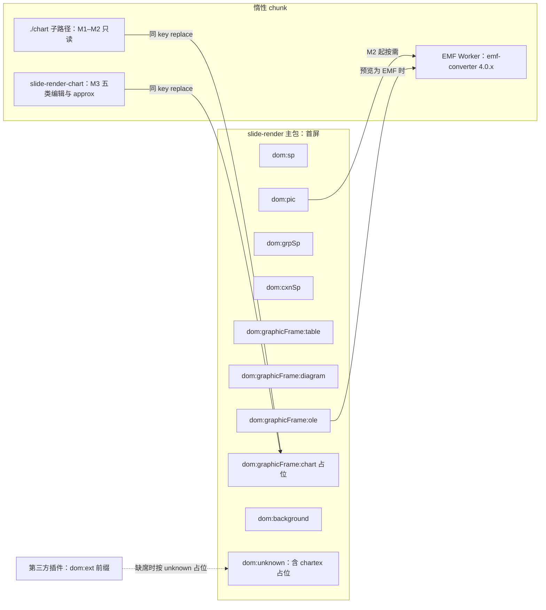

怎么读：左侧子图是主包在首屏注册的十个 key，其中图表 key 只是占位；右侧三个惰性 chunk 都在首次遇到对应元素时加载——两个图表实现以同 key 覆盖占位（`render.element` 贡献点为 `replace`），EMF Worker 被图片与 OLE 预览按需调用；第三方元素缺席时落到 `unknown` 占位。
依据：本节登记表；§3；rulings §4.18 FE-08 / GV-24、§4.21。

**图表渲染管线与文件**（ADR-0036 决策 1–4；M1–M2 的文件都在 `infrastructure/chart/`，只经 `./chart` 子路径可达；M3 迁入 `slide-render-chart`，见 §4.2）：

| 步骤 | 文件（M1–M2） | 第三方 | 说明 |
|---|---|---|---|
| 分派与缓存 | `chart-preview.renderer.ts` | — | `partRef` → BlobStore → `parseChartSpace`（`@cordexjs/xml`，主线程按时间片让出）；解析结果存于 `ElementHandle`，不新增 LRU |
| 框布局与刻度 | `chart-layout.ts` | 无 | `manualLayout` 与自动布局；Excel 自动刻度、对数、日期、百分比轴；纯函数 |
| 几何 | `chart-geometry.ts` | d3-scale、d3-shape、d3-array | 柱宽（`gapWidth` / `overlap`）、堆积与百分比、线与面积、饼与扇区、散点；3D 退 2D |
| 标签 | `chart-labels.ts` | 无 | 刻度标签旋转与跳过、数据标签位置、饼图标签避让、图例排布 |
| 数值格式 | `chart-number-format.ts` | numfmt | `formatCode` + 文档语言：先取图表部件的 `c:lang`，没有时取演示文稿默认语言（rulings §4.22）；数据网格的输入解析在 slide-ui 图表数据分区，同一语言口径、严格解析（50-frontend/24 §3.6） |
| 绘制 | `chart-svg.painter.ts` | 无 | 几何与标签 → SVG；填充线条经 `shared/paint`，文字经 `engine-layout` 度量 |

**图 2-6 图表渲染管线（M1–M2 的 `./chart` 子路径）**

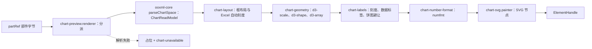

怎么读：实线是一次成功渲染的文件调用顺序，d3 只在几何一步出现、numfmt 只在数值格式一步出现，其余都是按 OOXML 语义自研的纯函数；虚线是解析失败时的降级。M3 拆包后顺序不变，只多一个「叠加 `Chart.data`」的输入（§4.2 `chart-read-model.provider.ts`）。
依据：ADR-0036；rulings §4.21 q-chart-route。

---

## 3. cordis 插件定义

> 两包均为标准插件；`slide-render` 根级只注册贡献点（无需 UnitScope），`ctx.thumbnails` 经 `unitPlugins` 在每个 Unit 内单独挂载（模式同 03 §3 `model-slide` 的 `slides` 服务）；`slide-render` 主包在图表 key 上只注册占位渲染器；M1–M2 的只读渲染器在主包惰性子路径 `./chart`，M3 起由 `slide-render-chart` 以同 key 覆盖占位（D16；覆盖语义来自 `render.element` 贡献点定义的 `conflict:'replace'`，rulings §4.18 FE-08/GV-24），二者不互相 `inject`，只共享同一个 `render.element` 贡献点 key。

**`@cordexjs/slide-render`**

| 项 | 值 |
|---|---|
| 插件名 / `name` | `slide-render` |
| `inject`（必需 / 可选） | 根级必需：`['contributions']`；UnitScope 子插件（`unitPlugins`）必需：`['render', 'layout', 'slides']` |
| `provide` | 根级：无；UnitScope 内：`['thumbnails']` |
| 贡献点：提供 | `render.scene`（key=`'slide'`，`conflict:'error'`）；`render.element` × 10（key=`` `dom:${kind}` ``：`sp`/`pic`/`grpSp`/`cxnSp`/`graphicFrame:table`/`graphicFrame:ole`/`graphicFrame:diagram`/`unknown`/`background` 九项真实渲染器，`graphicFrame:chart` 一项为主包占位渲染器，供 `./chart` 子路径（M1–M2）与 `slide-render-chart`（M3）以同 key 覆盖）；`render.overlay`（key=`'master-annotations'`：母版视图的占位符标注覆盖层，2026-11-04 起，rulings §4.25 TB-188）。冲突策略按贡献点定义（M-06），不在条目上声明：`render.scene` 为 `'error'`，`render.element`/`render.overlay` 为 `'replace'`——取值以架构 03 §3.6 总表 conflict 列为准（K-3，rulings §4.18 GV-24）；本包九项真实渲染器不应被覆盖，被覆盖时的 `replaced` 诊断作排查依据 |
| 贡献点：消费 | 无独立（内部按 `kind` 查表分派到自己的渲染器，属实现细节非 `ctx.contribute` 消费） |
| 事件：发布 | `slide/thumbnail-updated`、`render/element-degraded`（Events 声明在 M-06，emit 调用点在本包，§2.4）、`render/element-failed{ kind: 'page' }`（只在页级回退时，2026-10-22，rulings §4.25 TB-157，§2.4）；`slide/show-changed` **不再由本包发布**（2026-09-18 起改由 `slide-ui`，C-04） |
| 事件：订阅 | `store/transaction`（本 Unit 内部，非跨包，§2.4） |
| 配置 schema | `SlideRenderConfig`（§2.5） |
| 生命周期 | `ready`：根级贡献注册完成；UnitScope 子插件随每个 Unit 挂载/卸载 `thumbnails` 服务与内部 store 订阅（`ctx.effect` 拥有，Unit 关闭时自动撤销）；`dispose`：撤销全部贡献 + 清空 `LayerTemplateCache`；PENDING：`render`/`layout`/`slides` 三者任一未就位 |
| Manifest 片段 | `{"name":"@cordexjs/slide-render","provides":[],"contributes":{"render.scene":["slide"],"render.element":["dom:sp","dom:pic","dom:grpSp","dom:cxnSp","dom:graphicFrame:table","dom:graphicFrame:chart","dom:graphicFrame:ole","dom:graphicFrame:diagram","dom:unknown","dom:background"],"render.overlay":["master-annotations"]},"unitPlugins":{"provides":["thumbnails"],"injects":["render","layout","slides"]},"isomorphism":"dom"}` |

**`@cordexjs/slide-render-chart`**（M3 起独立发包；M1–M2 以主包惰性子路径 `@cordexjs/slide-render/chart` 存在——入口 `src/chart.ts` 注册同一 key 的只读渲染器，同一份代码、同一惰性边界，见 §4.1/§8，rulings §4.18 FE-08）

| 项 | 值 |
|---|---|
| 插件名 / `name` | `slide-render-chart` |
| `inject`（必需 / 可选） | 必需：`['contributions']`；可选：`['commands']`（M3 编辑能力才需要，缺失时只读渲染仍可用） |
| `provide` | 无 |
| 贡献点：提供 | `render.element`（key=`` `dom:graphicFrame:chart` ``，覆盖 `slide-render` 主包的占位渲染器；覆盖语义来自贡献点定义的 `conflict:'replace'`，GV-24） |
| 贡献点：消费 | 无 |
| 事件：发布 | `render/element-degraded{reason:'chart-unavailable'}`（解析失败时的占位路径，与 `slide-render` 共用同一 `reason` 取值；2026-09-26 起 chartex 导入为 `UnknownShape`，其 `chartex-unsupported` 由主包 `fallback.renderer` 发出，§2.7） |
| 事件：订阅 | 无 |
| 配置 schema | `Config{ editableTypes: z.array(z.enum(['bar','line','pie','area','scatter'])).default(['bar','line','pie','area','scatter']) }`（章程 Q18 已由 rulings §4.12 U-06 裁定为五类，M3 起生效） |
| 生命周期 | `ready`：`render.element` 覆盖注册；`dispose`：随 Fiber 清理；不在 UnitScope 内（无状态查表渲染器，与 `slide-render` 主体一致） |
| Manifest 片段 | `{"name":"@cordexjs/slide-render-chart","provides":[],"contributes":{"render.element":["dom:graphicFrame:chart"]},"isomorphism":"dom"}` |

**可插拔证据（OF-09）**：图表渲染器（M1–M2 的 `./chart` 子路径或 M3 的 `slide-render-chart`）缺席或加载失败时，`render.element('dom:graphicFrame:chart')` 查表落回主包占位渲染器 `chart-placeholder.renderer.ts`（按图表框定位占位并发 `render/element-degraded{reason:'chart-unavailable'}`；`replace` 语义决定谁在场谁生效），不影响页面其余元素渲染（rulings §4.18 FE-08）。

---

## 4. 目录树（完整到文件）

> **总编排裁定落地**：`src/` 下按 00-module-map §1 的 DDD 对照表物理落入 `domain/`/`application/`/`infrastructure/`/`testing/` 四个顶层目录（`interface/` 省略——本包无独立 UI/协议对外呈现面，对外 API 完全由 `src/index.ts` 汇总，同 06 §4 对三个引擎包的处理）；架构 07 §4.3 与 02 §4.16 的扁平骨架（`scene/`、`elements/`、`thumbnails/`、`show/` 等）按此重新归位，新旧路径对照与差异见 §12 G-1/G-5。包级样板文件遵循 02 §4.0「包模板」。测试布局同 03/06：`src/__tests__/`（单测/集成，本节展开）+ `src/testing/`（`./testing` 子路径，测试替身与夹具）。两包合计 **85 个文件**（`slide-render` 57 + `slide-render-chart` 28），高于 00-module-map §7 M-07 行给出的 50–70 估计（差异原因见 §12 G-6）。**2026-09-24 更新（rulings §4.15 Q4/Q7）**：`fallback.renderer.ts` 拆出 `diagram.renderer.ts`/`ole.renderer.ts` 两个真实渲染器（`fallback` 只留 `unknown`）；新增 `media/emf-rasterizer.ts`+`media/emf-rasterizer.worker.ts`（M2 EMF/WMF 惰性 Worker 栅格化）、`elements/shared/external-resource.policy.ts`（外链资源加载策略）、`domain/compose/animation-end-state.ts`（放映主序列可见性终态）；`offscreen-canvas.provider.ts` 改名 `raster.provider.ts`（主线程 toImage），`slide-render` 由 51 增至 57。**2026-09-18 更新**：`slide-render` 原 52 文件含 `application/services/slideshow.service.ts`（放映模式编排），按跨模块评审 C-04 裁定该文件删除、职责移交 M-10（`slide-ui`），故本包由 52 降为 51、两包合计由 78 降为 77。

**图 4-1 slide-render 包内子目录依赖**

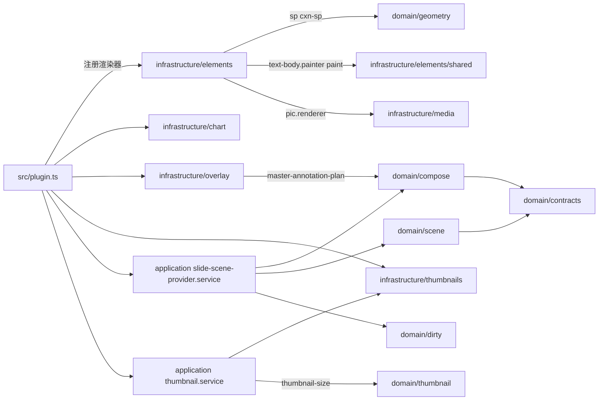

怎么读：箭头为 import 方向；`plugin.ts` 汇总注册 infrastructure 下的渲染器、覆盖层与缩略图 Provider，两条应用服务分别编排「合成 → Scene → 脏区」与「缩略图 Provider 选择」，domain 各子目录只依赖同层 `contracts`；占位符标注覆盖层的落位取自 `domain/compose/master-annotation-plan.ts`（2026-11-04，rulings §4.25 TB-188）。

依据：§5.1 各文件「允许依赖」列。

**图 4-2 两包外部依赖**

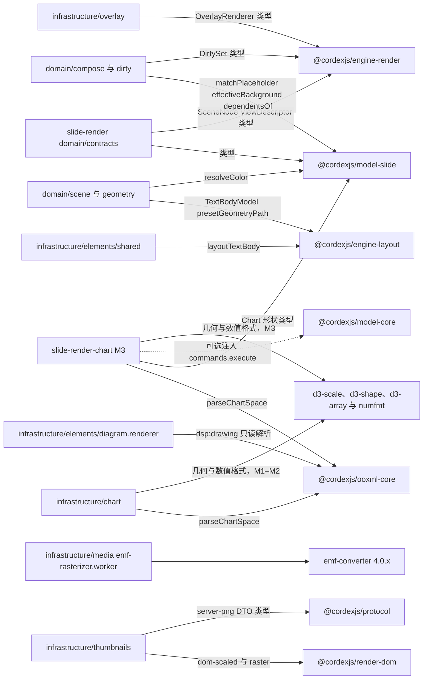

怎么读：箭头为 import 方向；本包是唯一同时认识 `model-slide` 与 `engine-*` 两边语言的适配层，`render-dom` 只被缩略图 Provider 引用，`ooxml-core` 只被图表与 SmartArt 的只读解析路径引用（rulings §4.15 Q7），`emf-converter` 只在 Worker 内动态加载；d3 与 numfmt 只被图表目录引用，M1–M2 在 `./chart` 子路径、M3 在 `slide-render-chart`（2026-09-26，ADR-0036）。

依据：§5.1、§5.2 各文件「允许依赖」列。

### 4.1 `@cordexjs/slide-render`

```text
packages/slide-render/
├── package.json                        # cordex: { layer:'V-render', bundle:'slide', iso:'dom', role:'plugin', publicEntry:['.','./chart','./testing'], stability:'beta' }（§4.18 FE-04/FE-08）
├── tsconfig.json
├── tsconfig.test.json
├── vitest.config.ts                    # environment: happy-dom
├── api-extractor.json
├── etc/
│   └── slide-render.api.md
├── README.md
├── CHANGELOG.md
├── cordex-manifest.json
├── src/
│   ├── index.ts                        # 公共 API 面（§6）
│   ├── plugin.ts                       # 根贡献注册 + UnitScope 子插件（§3）
│   ├── chart.ts                        # 子路径 ./chart 入口（M1–M2）：惰性图表插件，同 key 注册 chart-preview 渲染器（§4.18 FE-08）
│   ├── manifest.ts
│   ├── slide-render.contribution.ts    # declare module 增强：Context.thumbnails、Events
│   ├── config.ts                       # SlideRenderConfig（§2.5）
│   ├── events.ts                       # 事件名常量
│   ├── errors.ts                       # slide.render.* 错误码
│   ├── domain/
│   │   ├── contracts/
│   │   │   ├── composed-slide.ts       # ComposedSlide/Layer/Element、ThumbnailDescriptor（§2.1/§2.2）
│   │   │   └── dirty-classification.ts # PlaceholderResolution、DirtyClassificationEntry（§2.1/§2.2）
│   │   ├── compose/
│   │   │   ├── compose-slide.ts        # composeSlide：三层合成、占位符遮蔽、背景来源（§2.3）；整页解析失败的页把页层换成页级占位、母版与版式层照常、不报错误码（2026-10-22，rulings §4.25 TB-151、TB-157，§1.1）
│   │   │   ├── compose-master-view.ts  # composeMasterView：ViewDescriptor{mode:'master'} 分支（04 §12.4）
│   │   │   ├── master-annotation-plan.ts # planMasterAnnotations：占位符标注的落位纯函数——按数据里的占位符几何、提示文字首行与视口算类型名与 M2 锁签的落位，同一遍定、放不下的不画，不量 DOM（2026-11-04 新增，rulings §4.25 TB-188…TB-190；规则以设计 03-26 §4.2 为准）
│   │   │   └── animation-end-state.ts  # 放映主序列可见性终态（M2 P1）；其余场景全部可见（Q7）
│   │   ├── scene/
│   │   │   ├── to-scene-nodes.ts       # ComposedSlide → SceneNode[]；SceneNode.id===ShapeId 约定
│   │   │   ├── a11y-descriptor.ts      # deriveA11y(composedElement) → A11yDescriptor（toSceneNodes 调用）+ describeSlideForA11y(slides, slideId)（未挂载页直接读模型，不排版不建 DOM；50/05 §11，2026-09-25 登记）
│   │   │   └── to-layout-input.ts      # ResolvedRun/Paragraph → engine-layout TextBodyModel
│   │   ├── dirty/
│   │   │   └── classify.ts             # StorePath → DirtySet 归类；§2.4 脏区分类表
│   │   ├── thumbnail/
│   │   │   └── thumbnail-size.ts       # pageSize+targetWidth → Size（保持宽高比）
│   │   └── geometry/
│   │       └── resolve.ts              # shapeGeometryPath + resolvePaint
│   ├── application/
│   │   └── services/
│   │       ├── slide-scene-provider.service.ts  # SceneProvider('slide')：build/diff；内部订阅 store/transaction；合成某一页时的意外错误捕获后换成页级占位、上报 render.page_failed{pageId} 并发 render/element-failed{kind:'page', pageId}（2026-10-22，TB-151、TB-157）；测试部署的故障注入点「指定页在合成时抛错一次」在这里生效（TB-169，50-frontend/15 §10；只由 apps/web 的诊断接口打开，/render 不设注入点，TB-174）
│   │       └── thumbnail.service.ts             # ThumbnailService：get/subscribe、Provider 选择、去抖
│   ├── infrastructure/
│   │   ├── cache/
│   │   │   └── layer-template-cache.ts # LayerTemplateCache：LRU 32 项 + 失效 + 统计（A29）
│   │   ├── elements/
│   │   │   ├── sp.renderer.ts          # 几何 + 填充/线 + 文本
│   │   │   ├── pic.renderer.ts         # srcRect 裁切、EMF/WMF 栅格化结果或预览、svgBlip 仅 <image>（OF-07）
│   │   │   ├── grp-sp.renderer.ts      # chOff/chExt 子坐标系 <g transform>
│   │   │   ├── cxn-sp.renderer.ts      # stCxn/endCxn 连接点解析（ED-28）
│   │   │   ├── table.renderer.ts       # 行列/合并/tblStyle 继承（OF-08）
│   │   │   ├── diagram.renderer.ts     # SmartArt：ooxml-core 解析 dsp:drawing（含 txXfrm）→ 复用 sp 画笔（OF-10）
│   │   │   ├── ole.renderer.ts         # OLE：走 pic 路径显示 Ole.preview（mc:Fallback 的 p:pic）
│   │   │   ├── fallback.renderer.ts    # unknown 占位（按 UnknownShape.transform 定位 + 渲染提示，OF-13）；source 为 chartex 时发 chartex-unsupported（§4.21）；2026-10-15 占位画法统一为虚线框 + 类型图标 + 一行标题 + 一行原因（「内容已保留」一类的话并进原因行），画在纸面上；第三方元素插件缺席（dom:ext:* 查表未命中）时的缺插件占位同一画法，标题为插件名、原因取足迹比对结果，原三行作废（rulings §4.25 DS-52，50/05 §9）；2026-10-22 起也画页级占位（data.placeholder 为 page 时铺满纸面：「此页内容无法解析」或「此页内容暂时无法显示」，母版页脚由模板层照常画，rulings §4.25 TB-151）
│   │   │   ├── chart-placeholder.renderer.ts # 主包图表占位：图表渲染器未加载时占位并发 chart-unavailable（§4.18 FE-08）
│   │   │   ├── background.renderer.ts
│   │   │   └── shared/
│   │   │       ├── text-body.painter.ts # TextLayout → <text>/<tspan>；autofit 循环
│   │   │       ├── paint.ts             # DrawingML → SVG paint server（fill/line/effect）
│   │   │       └── external-resource.policy.ts # 外链 http(s) 加载策略 auto/confirm/never（Q7）
│   │   ├── chart/                      # 只经 ./chart 子路径可达；d3-* 与 numfmt 只在此目录（ADR-0036，§2.7）
│   │   │   ├── chart-preview.renderer.ts # M1–M2 只读渲染器入口（D16：只读解析部件与缓存数据）；只经 ./chart 子路径加载，不进主包首屏
│   │   │   ├── chart-layout.ts         # 框布局（manualLayout 与自动）+ Excel 自动刻度；纯函数（§4.21）
│   │   │   ├── chart-geometry.ts       # d3-scale / d3-shape / d3-array：柱、线、面积、扇区、散点与堆积（§4.21）
│   │   │   ├── chart-labels.ts         # 刻度标签旋转与跳过、数据标签、饼图标签避让、图例排布（§4.21）
│   │   │   ├── chart-number-format.ts  # numfmt 封装：formatCode + 文档语言（§4.21）
│   │   │   └── chart-svg.painter.ts    # 几何与标签 → SVG 节点（§4.21）
│   │   ├── media/
│   │   │   ├── emf-rasterizer.ts       # M2：EMF/WMF 惰性 Worker 调度 + 上限（OF-24）
│   │   │   └── emf-rasterizer.worker.ts # M2：Worker chunk，封装 emf-converter（Apache-2.0）
│   │   ├── overlay/
│   │   │   └── master-annotations.overlay.ts # render.overlay('master-annotations')：母版视图的占位符标注覆盖层——全部占位符的线与类型名、M2 锁签（2026-11-04 起，rulings §4.25 TB-188；改名记录见 §12）
│   │   └── thumbnails/
│   │       ├── dom-scaled.provider.ts        # 策略①：主线程缩放渲染（真实 Surface + CSS scale）
│   │       ├── raster.provider.ts            # 单页导出栅格化：主线程 toImage（Q4；非可配置缩略图 Provider，复核 L12）
│   │       └── server-png.provider.ts        # 策略②：服务端 640 px WebP 缩略图（ADR-0026；沿用历史文件名）
│   ├── testing/
│   │   └── index.ts                    # `@cordexjs/slide-render/testing`：renderSlideToSvgString、fixtures、builders
│   └── __tests__/
│       ├── lifecycle.test.ts
│       ├── compose-reconcile.test.ts   # 版式切换复用元素实例；z 变化只移动节点
│       ├── master-view.test.ts         # ViewDescriptor{mode:'master'} + 占位符标注覆盖层（覆盖全部占位符，类型名与锁签同一遍定落位，不进缩略图、放映与导出）+ 版式与母版缩略图的细线框
│       ├── master-annotation-plan.test.ts # planMasterAnnotations 的落位规则逐分支：一种落位、放不下不画、不相交、锁签落位链、同一输入同一输出（2026-11-04 登记，rulings §4.25 TB-189、TB-190、DP-8）
│       ├── dirty-mapping.test.ts       # 按实体类型的 classify 断言（§2.4 表）
│       ├── template-cache-eviction.test.ts # A29 反制测试
│       ├── elements.render.test.ts     # 每个 kind 的 SVG 快照 + autofit 收敛
│       ├── degrade.test.ts             # A11：占位框 + render/element-degraded/-failed 边界
│       └── thumbnails.test.ts          # 两种 Provider（dom-scaled/server-png）切换、去抖、maxMounted；exportImage 走 raster；配置 raster 被 zod 拒绝
```

同位测试约定（02 §4.0）：本包无独立顶层 `tests/` 目录，`__tests__/`/`testing/` 均在 `src/` 内，详见 §9。共 **67 个文件**（根配置 9 + `src/` 顶层 8 + `domain/` 12（2026-09-25 增 `scene/a11y-descriptor.ts`，50/05 §11；2026-11-04 增 `compose/master-annotation-plan.ts`，rulings §4.25 TB-188） + `application/` 2 + `infrastructure/` 26 + `testing/` 1 + `__tests__/` 9（2026-11-04 增 `master-annotation-plan.test.ts`，rulings §4.25 DP-8）；2026-09-26 按 rulings §4.21 q-chart-route 在 `infrastructure/chart/` 增 `chart-layout.ts`、`chart-geometry.ts`、`chart-labels.ts`、`chart-number-format.ts`、`chart-svg.painter.ts` 共 5 个；2026-09-25 按 rulings §4.18 FE-08 新增 `src/chart.ts` 与 `chart-placeholder.renderer.ts`；`application/` 原为 3，`slideshow.service.ts` 已按 C-04 删除；`domain/` +1、`infrastructure/` +5 见 §4 开头 2026-09-24 更新）。

### 4.2 `@cordexjs/slide-render-chart`

> M1–M2 阶段本树**不独立存在**——其只读子集以主包惰性子路径 `@cordexjs/slide-render/chart` 的形式落在 4.1 树内（入口 `src/chart.ts` + `infrastructure/chart/chart-preview.renderer.ts`，rulings §4.18 FE-08）；下表是 M3 拆包后的目标形态（章程 D16、02 §4.16b）。拆包动作只搬移文件与改 `preset-slide` 的 import 路径，不改变已跑通的只读渲染逻辑。

```text
packages/slide-render-chart/
├── package.json                        # cordex: { layer:'V-render', bundle:'slide', iso:'dom', role:'plugin', stability:'experimental' }
├── tsconfig.json
├── tsconfig.test.json
├── vitest.config.ts
├── api-extractor.json
├── etc/
│   └── slide-render-chart.api.md
├── README.md
├── CHANGELOG.md
├── cordex-manifest.json
├── src/
│   ├── index.ts                        # 公共 API 面（§6）
│   ├── plugin.ts                       # contribute render.element('dom:graphicFrame:chart')，conflict:'replace'
│   ├── manifest.ts
│   ├── slide-render-chart.contribution.ts
│   ├── errors.ts                       # slide.render.chart.* 错误码
│   ├── domain/
│   │   ├── chart-model.ts              # ChartReadModel（只读）+ Chart.data（M3 可编辑，对齐 30/04 §3.9）+ ChartRenderView 叠加
│   │   └── chart-layout.ts             # 纯函数：框布局与 Excel 自动刻度（自 slide-render infrastructure/chart/ 迁入）；plot-bound 为 OF-09 诊断依据
│   ├── application/
│   │   └── chart-editing.service.ts    # M3：读取/写入图表数据；点选系列/数据点 → 属性面板（ED-15）
│   ├── infrastructure/
│   │   ├── chart-read-model.provider.ts # partRef → BlobStore → ooxml-core chartml 解析，结果存 ElementHandle；叠加 Chart.data；render.element 分派入口
│   │   ├── chart-geometry.ts           # 自 slide-render 迁入：d3-scale / d3-shape / d3-array（§4.21）
│   │   ├── chart-labels.ts             # 自 slide-render 迁入：刻度与数据标签、饼图避让、图例（§4.21）
│   │   ├── chart-number-format.ts      # 自 slide-render 迁入：numfmt（§4.21）
│   │   ├── chart-svg.painter.ts        # 自 slide-render 迁入：SVG 绘制（§4.21）
│   │   └── renderers/
│   │       ├── bar.renderer.ts         # M3 可编辑类型（章程 Q18，rulings §4.12 U-06）
│   │       ├── line.renderer.ts        # M3 可编辑类型
│   │       ├── pie.renderer.ts         # M3 可编辑类型
│   │       ├── area.renderer.ts        # M3 可编辑类型（rulings §4.12 U-06 新增）
│   │       ├── scatter.renderer.ts     # M3 可编辑类型（rulings §4.12 U-06 新增）
│   │       └── approx.renderer.ts      # 其余只读近似类型（气泡/雷达/股价/组合/3D/曲面/地图，§2.6 矩阵）
│   ├── testing/
│   │   └── index.ts                    # fixtures + ChartReadModel builders
│   └── __tests__/
│       ├── lifecycle.test.ts
│       ├── renderers.test.ts           # SSIM ≥0.80 + 数据墨迹 IoU ≥0.85（OF-09 口径）
│       └── chart-data-roundtrip.test.ts # M3：编辑写回 c:numCache/strCache 一致性
```

共 **32 个文件**（根配置 9 + `src/` 顶层 5 + `domain/` 2 + `application/` 1 + `infrastructure/` 11 + `testing/` 1 + `__tests__/` 3；`infrastructure/renderers/` 因 area/scatter 转为可编辑类型由 3 增至 5，rulings §4.12 U-06；2026-09-26 按 rulings §4.21 增 `chart-geometry.ts`、`chart-labels.ts`、`chart-number-format.ts`、`chart-svg.painter.ts`，由 slide-render 的 `infrastructure/chart/` 迁入）。两包合计 99 个文件（2026-11-04 由 97 改：slide-render 增 `domain/compose/master-annotation-plan.ts` 与它的单测 `__tests__/master-annotation-plan.test.ts`）。

---

## 5. 文件职责表

> 逐文件一行，与 §4 一一对应；「允许依赖」省略 `@cordexjs/kernel`/`@cordexjs/shared`（隐式可用）。本节按 §4 的目录分组给出子表，先 `@cordexjs/slide-render`（5.1）再 `@cordexjs/slide-render-chart`（5.2）。

### 5.1 `@cordexjs/slide-render`

**根配置（9）**

| 文件 | 职责 | 主要导出 | 允许依赖 | 备注 |
|---|---|---|---|---|
| `package.json` | 包元数据与 `cordex` 字段 | — | — | `layer:'V-render' bundle:'slide' iso:'dom' role:'plugin'` |
| `tsconfig.json` | extends `tooling/tsconfig/dom.json` | — | — | `isolatedDeclarations:true` |
| `tsconfig.test.json` | 测试专用 tsconfig | — | — | include `__tests__`/`testing` |
| `vitest.config.ts` | 测试运行配置 | — | — | `environment:'happy-dom'` |
| `api-extractor.json` | API 报告配置 | — | — | mainEntry `lib/index.d.ts` |
| `etc/slide-render.api.md` | api-extractor 基线报告 | — | — | 入库，PR diff 必审 |
| `README.md` | 包职责与公共 API 概览 | — | — | manifest-gen 写入标记区 |
| `CHANGELOG.md` | 版本记录 | — | — | Changesets 生成 |
| `cordex-manifest.json` | 静态插件清单产物 | — | — | 由 `src/manifest.ts` 序列化 |

**`src/` 顶层（8）**

| 文件 | 职责 | 主要导出 | 允许依赖 | 备注 |
|---|---|---|---|---|
| `src/index.ts` | 公共 API 面唯一入口 | 见 §6 | `domain/*`（类型）、`application/services/*`（类型/工厂） | 禁止副作用（`sideEffects:false`） |
| `src/plugin.ts` | 根贡献注册 + UnitScope 子插件 | `name/inject/provide/apply` | `infrastructure/**`（elements/overlay/thumbnails 注册；图表只注册 `chart-placeholder`）、`application/services/*` | §3；不静态 import `infrastructure/chart/**`（惰性边界，rulings §4.18 FE-08） |
| `src/chart.ts` | 子路径 `./chart` 入口（M1–M2 惰性图表插件） | 默认导出插件对象（`name/inject/apply`） | `infrastructure/chart/chart-preview.renderer.ts` | 新增（§4.18 FE-08）：`render.element('dom:graphicFrame:chart')` 同 key 覆盖主包占位；独立 chunk ≤ 400 KB gzip；由预设以 `lazy()` 条目在 `render/element-degraded{reason:'chart-unavailable'}` 时加载（M-11 §3.1）；M3 拆包后迁入 `slide-render-chart` |
| `src/manifest.ts` | 生成物 | `manifest: Manifest` | — | 头部标记 generated |
| `src/slide-render.contribution.ts` | `declare module '@cordexjs/kernel'` 增强 | `Context.thumbnails`、`Events` | `domain/contracts/composed-slide`（类型） | 无运行时 import（`contribution-file-purity`） |
| `src/config.ts` | `SlideRenderConfig` schema | `SlideRenderConfig`、`defaultConfig` | zod | §2.5 |
| `src/events.ts` | 事件名常量 | `SLIDE_THUMBNAIL_UPDATED` 等 | — | §2.4 |
| `src/errors.ts` | 错误码 | `CHART_UNAVAILABLE`/`ELEMENT_UNSUPPORTED` 等 | — | 供 `render/element-degraded.reason` 取值对照 |

**`domain/`（12）**（2026-11-04 增 `compose/master-annotation-plan.ts`；原写 10，漏计 2026-09-25 增的 `scene/a11y-descriptor.ts`）

| 文件 | 职责 | 主要导出 | 允许依赖 | 备注 |
|---|---|---|---|---|
| `domain/contracts/composed-slide.ts` | 合成模型类型 | `ComposedSlide`/`ComposedLayer`/`ComposedElement`、`ThumbnailDescriptor` | `@cordexjs/model-slide`（类型）、`@cordexjs/engine-render`（`SceneNode`类型、`ViewDescriptor`类型） | §2.1/§2.2；`viewMode` 字段值透传自 `ViewDescriptor.mode`，映射函数 `mapViewMode()` 归属 `engine-render`（M-06），本包只消费不重新实现（2026-09-18，C-13） |
| `domain/contracts/dirty-classification.ts` | 脏区分类与占位符解析值对象 | `PlaceholderResolution`、`DirtyClassificationEntry` | `@cordexjs/model-slide`（`PlaceholderRef`类型） | §2.1/§2.2 |
| `domain/compose/compose-slide.ts` | 三层合成纯函数（占位符遮蔽 + 背景来源） | `composeSlide` | `domain/contracts/*`、`@cordexjs/model-slide`（`matchPlaceholder`/`effectiveBackground`/`defaultLayoutOf`） | §2.3；引用墓碑版式时读时替代（rulings §4.20 FE-04）；`ViewDescriptor.themePreview` 覆盖值在此处注入主题解析（FE-24）；整页解析失败的页：页层只放一个覆盖整页纸面的页级占位节点（`kind:'unknown'`、`data.placeholder:'page'`），母版与版式层照常；这是这一页的确定内容，不报错误码，`/render` 照常回传（2026-10-22，rulings §4.25 TB-151、TB-157，§1.2） |
| `domain/compose/compose-master-view.ts` | 母版视图分支合成 | `composeMasterView` | `domain/compose/compose-slide.ts` | 04 §12.4 |
| `domain/compose/master-annotation-plan.ts` | 占位符标注的落位纯函数（2026-11-04 新增），并声明覆盖层的启用入参类型 | `planMasterAnnotations`、`MasterAnnotationsOptions`（类型，§2.5） | `domain/contracts/*`、`@cordexjs/engine-render`（`Viewport` 类型） | rulings §4.25 TB-188…TB-190：类型名与 M2 锁签同一遍定落位，同一画面只用一种类型名落位，放不下的不画；输入是数据里的占位符几何、提示文字首行的文字矩形、母版图形与普通形状、选中项与尺寸角标、视口，不量 DOM、不等过渡；规则以设计 03-26 §4.2 为准；由 `infrastructure/overlay/master-annotations.overlay.ts` 调用 |
| `domain/compose/animation-end-state.ts` | 动画结束态按场景：`edit`/`thumbnail`/PDF 全部可见；`present` 时按主序列（`p:timing` 只读保留数据）计算可见性终态 | `resolveEndStateVisibility(view, timing): ReadonlySet<ShapeId>` | `@cordexjs/model-slide`（`p:timing` 只读视图类型） | rulings §4.15 Q7；M2 P1；只读、不编辑动画 |
| `domain/scene/to-scene-nodes.ts` | `ComposedSlide` → `SceneNode[]` | `toSceneNodes` | `domain/contracts/*`、`@cordexjs/engine-render`（类型） | `SceneNode.id===ShapeId` 约定落地处（§12 G-3） |
| `domain/scene/a11y-descriptor.ts` | 可访问描述派生（2026-09-25 登记） | `deriveA11y`、`describeSlideForA11y` | `domain/contracts/*`、`@cordexjs/model-slide`（选择器、`placeholder` 类型）、`@cordexjs/engine-render`（`A11yDescriptor` 类型） | 字段与规则以 50/05 §11 为准（替代文字 → 文本摘要 ≤ 120 字符 → 「类型 + 序号」；占位符阅读序；`decorative` 不入树）；未挂载页只读模型 |
| `domain/scene/to-layout-input.ts` | 已解析样式 → 布局输入 | `toLayoutInput` | `@cordexjs/engine-layout`（`TextBodyModel`类型） | §2.3 |
| `domain/dirty/classify.ts` | `StorePath` → `DirtySet` 归类（v0.1 旧名 `DirtyRegion` 作废，架构 07 §14.1，rulings §4.18 CO-19） | `classify`、`dirtyMappingTable` | `@cordexjs/model-slide`（`dependentsOf`）、`@cordexjs/engine-render`（`DirtySet`类型） | §2.3/§2.4 表；2026-09-26 增两个派生索引：①「含 `slidenum` 字段的形状」索引——`ChangeSet` 触及 `slides.*.order`、页增删或 `presentation.firstSlideNum` 时，只把受影响页上的这些形状标脏重排（50-frontend/06 §9.3 图 9-2）；②「连接符 → 目标」依赖索引——目标形状的变换进入 `DirtySet` 时连带把连向它的连接符标脏（50-frontend/22） |
| `domain/thumbnail/thumbnail-size.ts` | 缩略图目标尺寸计算 | `thumbnailSize` | — | 供两种缩略图 Provider 与单页导出共用 |
| `domain/geometry/resolve.ts` | 几何路径 + paint 参数解析 | `shapeGeometryPath`、`resolvePaint` | `@cordexjs/engine-layout`（`presetGeometryPath`/`customGeometryPath`）、`@cordexjs/model-slide`（`resolveColor`） | §2.3 |

**`application/services/`（2，原 3——`slideshow.service.ts` 已按 2026-09-18 跨模块评审 C-04 删除）**

| 文件 | 职责 | 主要导出 | 允许依赖 | 备注 |
|---|---|---|---|---|
| `application/services/slide-scene-provider.service.ts` | `SceneProvider('slide')` 实现：`build`/`diff`；内部订阅 `store/transaction` 并转发 `ctx.render.invalidate` | `slideSceneProvider` | `domain/compose/*`、`domain/scene/*`、`domain/dirty/classify` | §2.6；本包唯一实现 `render.scene` 的文件；2026-10-22：合成某一页抛出意外错误时捕获，经 `errors.report('render.page_failed', { pageId, cause })` 上报（码在 engine-render `errors.ts`，30/10 §1.1a）并发 `render/element-failed{ kind: 'page', pageId, code: 'render.page_failed' }`（§2.4），并把这一页换成与整页解析失败同一画法的页级占位（放映单页渲染失败「此页内容暂时无法显示」），其余页照常（rulings §4.25 TB-151）；`/render` 页据此码在 `ready` 的逐页诊断里标出这一页，renderer 记它失败、不回传字节（TB-157），浏览器生成的图片导出遇到这一页即失败（TB-166，50-frontend/18 EXP-03）；测试部署的故障注入点「指定页在合成时抛错一次」作用在这里的合成上，走与真实抛错同一条回退与上报（2026-10-22，rulings §4.25 TB-169，接口与开启条件以 50-frontend/15 §10 为准，生产部署不含；只由 apps/web 的诊断接口在测试部署里打开，落点 40/11 `application/host/diagnostics.ts`，`/render` 不设注入点，TB-174） |
| `application/services/thumbnail.service.ts` | `ThumbnailService`：Provider 选择、去抖、订阅脏页 | `createThumbnailService` | `infrastructure/thumbnails/*`、`domain/thumbnail/thumbnail-size` | §2.5/§2.6 |

**`infrastructure/`（26）**

| 文件 | 职责 | 主要导出 | 允许依赖 | 备注 |
|---|---|---|---|---|
| `infrastructure/cache/layer-template-cache.ts` | 母版/版式渲染结果 LRU（键=`(layoutId,showMasterSp,themeVersion)`） | `LayerTemplateCache` | — | 32 项；淘汰测试见 §9；第 4 处 LRU（§12 G-7） |
| `infrastructure/elements/sp.renderer.ts` | 形状渲染器：几何 + 填充/线 + 文本 | `spRenderer`（`ElementRenderer<SpData>`） | `domain/geometry/resolve`、`shared/text-body.painter` | `render.element('dom:sp')` |
| `infrastructure/elements/pic.renderer.ts` | 图片渲染器：裁切、EMF/WMF（M1 用包内预览或占位，M2 起经 `media/emf-rasterizer` 栅格化）、外链图片经 `shared/external-resource.policy` 判定；`asvg:svgBlip` 只经 `<image>` 渲染，禁 `innerHTML`/`DOMParser` 注入；2026-09-26 起（50-frontend/19 §6、50/23）：`svgMediaId` 优先、解码失败回退 PNG（`mediaId`）；GIF 在编辑态、缩略图与 `/render` 用首帧变体 `sha256#frame0`（由 render-dom `image-preprocess` 生成，放映才播放）；视频画海报加播放图标、不支持的编码画角标（二者都不发降级事件，编辑态临时播放在 render-dom `media-playback` 覆盖层）；TIFF 在 M1–M2 按魔数识别后画占位并记 `media-decode-failed`；`BlipFill.effects` 按只读效果画 | `picRenderer` | `shared/paint`、`shared/external-resource.policy`、`media/emf-rasterizer` | `render.element('dom:pic')`；OF-07；rulings §4.15 Q4/Q7 |
| `infrastructure/elements/grp-sp.renderer.ts` | 组合渲染器：子坐标系 `<g transform>` | `grpSpRenderer` | — | `render.element('dom:grpSp')` |
| `infrastructure/elements/cxn-sp.renderer.ts` | 连接符渲染器：端点解析到目标连接点 | `cxnSpRenderer` | `domain/geometry/resolve` | `render.element('dom:cxnSp')`；ED-28；2026-09-26 起已连接的端点一律从目标连接点派生（显示以派生几何为准，存储的 `xfrm` 可能因并发陈旧，30/05 §14.5）；箭头按 `type × w × len` 生成独立闭合 path，尺寸比例表是本渲染器的常量（50-frontend/22 §3.2） |
| `infrastructure/elements/table.renderer.ts` | 表格渲染器：网格/合并/样式继承 | `tableRenderer` | `shared/text-body.painter` | `render.element('dom:graphicFrame:table')`；OF-08；2026-09-26 起经 model-slide `query/table-grid` 读存活行列、缺格按空格画（I-TBL1 读时容错）；样式继承按 `ooxml-core` 的 `parseTableStyleList` 结果（M1 只读，40/04），文档里没有而属内置 74 种的样式取内置数据（来源与许可按 ADR-0018 决策 6、ADR-0008 决策 9 (d)，M3 前定稿） |
| `infrastructure/elements/diagram.renderer.ts` | SmartArt 真实渲染：`partRef`→BlobStore→`ooxml-core` 只读解析 `dsp:drawing`（含 `dsp:txXfrm` 文本框）→ 逐形状复用 `sp` 画笔；无 `dsp:drawing` 时占位 + `smartart-no-dsp` | `diagramRenderer` | `sp.renderer`、`shared/text-body.painter`、`@cordexjs/ooxml-core`（`dsp:drawing` 只读解析） | `render.element('dom:graphicFrame:diagram')`；OF-10；M1 gated；rulings §4.15 Q7 |
| `infrastructure/elements/ole.renderer.ts` | OLE 预览渲染：走 `pic` 路径显示 `Ole.preview`（M-04 `ole.ts` 从 `mc:Fallback` 的 `p:pic` 提取）；预览为 EMF/WMF 时 M2 起栅格化；无预览时占位 + `ole-preview-missing` | `oleRenderer` | `pic.renderer` | `render.element('dom:graphicFrame:ole')`；M1；rulings §4.15 Q7 |
| `infrastructure/elements/fallback.renderer.ts` | 未知图元占位：按 `UnknownShape.transform` 定位、按渲染提示（M-03/M-04 提供）绘制占位框；`UnknownShape.source` 为 `chartex` 时发 `render/element-degraded{reason:'chartex-unsupported'}`，不渲染 Fallback | `unknownRenderer` | `shared/paint` | `render.element('dom:unknown')`；OF-13；原 ole/diagram 分支已拆出（§12 G-5 结案）；chartex 占位 2026-09-26 由图表渲染器移到此处（chartex 导入为 `UnknownShape`，50-frontend/25）；2026-10-15：占位统一为虚线框 + 类型图标 + 一行标题 + 一行原因，缺插件占位同一画法（rulings §4.25 DS-52，50/05 §9）；2026-10-22：`data.placeholder` 为 `page` 时画页级占位、铺满纸面（保真「此页内容无法解析」、放映单页渲染失败「此页内容暂时无法显示」，同一组画笔，rulings §4.25 TB-151） |
| `infrastructure/elements/chart-placeholder.renderer.ts` | 主包图表占位：图表渲染器（`./chart` 子路径或 `slide-render-chart`）未加载时按图表框定位占位，并发 `render/element-degraded{reason:'chart-unavailable'}` 触发惰性加载 | `chartPlaceholderRenderer` | `shared/paint` | 新增（rulings §4.18 FE-08）：`render.element('dom:graphicFrame:chart')` 的主包默认项，被同 key 覆盖后不再出现；不 import `ooxml-core`（保持主包体积） |
| `infrastructure/elements/background.renderer.ts` | 背景渲染器 | `backgroundRenderer` | `shared/paint` | `render.element('dom:background')` |
| `infrastructure/elements/shared/text-body.painter.ts` | `TextLayout` → SVG 文本节点；autofit 循环 | `paintTextBody` | `@cordexjs/engine-layout`（`layoutTextBody`/`TextLayout`） | `normAutofit`/`spAutoFit`（≤6 次迭代）；竖排/RTL 分阶段：每行一个 `<text>` 块、run 级 `<tspan>` 不设 `x`（与 M-06 口径一致）；受限字体（`fsType`）仅只读渲染使用，编辑态用回退字体（rulings §4.15 Q7） |
| `infrastructure/elements/shared/paint.ts` | DrawingML → SVG paint server | `resolveFillPaint`/`resolveLinePaint`/`resolveEffectPaint` | — | `linearGradient`/`radialGradient`/`pattern`/`filter` |
| `infrastructure/elements/shared/external-resource.policy.ts` | 外链资源加载策略：仅对 M-04 标为「可激活」（http(s)）的外部关系生效；`auto` 直接加载、`confirm` 先占位待用户确认、`never` 占位；headless 恒 `never`；被拦截时 emit `external-resource-blocked` | `shouldLoadExternal(url, mode, env)` | `src/config.ts` | rulings §4.15 Q7（用户选择自动加载，部署配置 `externalResources` 可收紧；EM-14） |
| `infrastructure/chart/chart-preview.renderer.ts` | M1–M2 图表只读渲染入口（D16：只读解析 `c:chart` 部件与缓存数据，SSIM ≥ 0.80）：解析 → `chart-layout` → `chart-geometry` → `chart-labels` → `chart-svg.painter`；解析结果存 `ElementHandle`；解析失败占位 + `chart-unavailable` | `chartPreviewRenderer` | `@cordexjs/ooxml-core`（`chartml.parseChartSpace`，经 BlobStore；C-28 修订放行）、同目录 5 个文件 | 只经 `./chart` 子路径（`src/chart.ts`）注册 `render.element('dom:graphicFrame:chart')`，覆盖主包占位，不进主包首屏（rulings §4.18 FE-08）；M3 由 `slide-render-chart` 覆盖并迁入该包；OF-09；M1 gated |
| `infrastructure/media/emf-rasterizer.ts` | M2：EMF/WMF 惰性栅格化调度——按需 `import()` Worker chunk，施加记录数/像素/耗时上限，超限占位 + `emf-raster-limit`；结果按 `MediaId` 缓存为 blob URL | `rasterizeMetafile(mediaId, bytes)` | `media/emf-rasterizer.worker`（动态 import） | rulings §4.15 Q7；OF-24；chunk 不计入 350 KB 基线；headless 同一份代码 |
| `infrastructure/chart/chart-layout.ts` | 图表框布局与刻度：`manualLayout`（inner / outer、edge / factor）与自动布局求图表区、标题、图例、绘图区；Excel 自动刻度、对数、日期、百分比轴 | `layoutChartFrame`、`autoScale` | — | 新增（§4.21，ADR-0036）；纯函数；期望值取维护机 COM 导出（70-testing/04 §8.1）；M3 迁入 `slide-render-chart/src/domain/chart-layout.ts` |
| `infrastructure/chart/chart-geometry.ts` | 五类与近似类几何：柱宽（`gapWidth` / `overlap`）、堆积与百分比、线与面积、饼与扇区、散点；3D 退 2D | `chartGeometry` | d3-scale、d3-shape、d3-array | 新增（§4.21）；M1–M2 d3 的唯一引入点 |
| `infrastructure/chart/chart-labels.ts` | 刻度标签旋转与跳过、数据标签位置、饼图 `bestFit` 与左右避让、图例排布 | `placeLabels`、`layoutLegend` | `chart-number-format` | 新增（§4.21） |
| `infrastructure/chart/chart-number-format.ts` | 按 `formatCode` 与文档语言格式化数值（语言先取 `c:lang`，没有时取演示文稿默认语言，2026-09-30） | `formatChartValue` | numfmt | 新增（§4.21）；本包 numfmt 的唯一引入点 |
| `infrastructure/chart/chart-svg.painter.ts` | 几何与标签 → SVG 节点；填充线条经 `shared/paint`，文字经 `engine-layout` 度量 | `paintChart` | `elements/shared/paint`、`@cordexjs/engine-layout` | 新增（§4.21） |
| `infrastructure/media/emf-rasterizer.worker.ts` | M2：Worker chunk 入口，封装 `emf-converter` 4.0.x（Apache-2.0）把 EMF/WMF 转为位图，调用时显式 `gdiAntialias: true`（4.0.0 起默认不抗锯齿） | Worker 消息处理器 | `emf-converter` | 唯一引入 `emf-converter` 的文件（单点引入）；过 `minimumReleaseAge` 后精确锁版本，可选 peer `@napi-rs/canvas` 不安装（2026-09-26，R-d-24）；矢量渲染留 M4+ |
| `infrastructure/overlay/master-annotations.overlay.ts` | 母版视图的占位符标注覆盖层：给全部占位符画线与类型名（本版式虚线、继承点线 +「母版 · 〈类型〉」），选中项不画自己的类型名，M2 时给选中项画锁形标签；按屏幕像素画、不随缩放变粗细，只在画布上画（不进缩略图、放映与导出）；框线、类型名与 M2 锁签对读屏隐藏，以设计 03-26 §9 为准 | `masterAnnotationsOverlay` | `domain/compose/master-annotation-plan`、`@cordexjs/engine-render`（`OverlayRenderer`、`Viewport` 类型） | `render.overlay('master-annotations')`（2026-11-04 起，rulings §4.25 DS-148、DS-156、TB-188；文件与导出的改名记录见 §12「2026-11-04 回写」）；落位由 `planMasterAnnotations` 按数据里的几何算，不量 DOM、不等过渡（TB-189、TB-190）；合成结果以闭包持有最近一次 `build()` 的 `ComposedSlide`，选中与视口从 `selection` 服务与 Viewport 取（§13 Q-3）；启用入参 `MasterAnnotationsOptions`（标注文案 `labels`、是否 M2 `m2Locked`）由 slide-ui 给出（§2.5），本包不登记 i18n 命名空间；画法与落位规则以设计 03-26 §4.2 为准，文案键以 50-frontend/16 §1 为准 |
| `infrastructure/thumbnails/dom-scaled.provider.ts` | 策略①：主线程真实 Surface + CSS scale | `domScaledThumbnailProvider` | `@cordexjs/render-dom` | 可见项，`maxMounted≤12`，IntersectionObserver 驱动 |
| `infrastructure/thumbnails/raster.provider.ts` | **单页导出**栅格化（`ThumbnailService.exportImage` 的实现）：主线程 `RenderTarget.toImage()`（游离 DOM → SVG 序列化 → Image → Canvas），分片调度，不建 Worker；**不是**可配置缩略图 Provider（30-architecture/07 §8、50-frontend/05 §10.3，复核 L12） | `rasterThumbnailProvider` | `@cordexjs/render-dom` | rulings §4.15 Q4 取代 `offscreen-canvas`（推翻 14 §5.4）；toImage 取不到页面 Web 字体（CJK）列 M2 spike，结论前位图封面/批量缩略图自 M3 走 server-png（WebP） |
| `infrastructure/thumbnails/server-png.provider.ts` | 策略②：服务端缩略图（**640 px WebP**，rulings §4.15 Q8；标识符与文件名沿用历史名 `server-png`，复核 L11）；识别响应的 `provisional` 标记（M2 包内 `thumbnail.jpeg` 封面 / 内容哈希失效），先显示后回退 `dom-scaled` 覆盖 | `serverPngThumbnailProvider` | `@cordexjs/protocol`（DTO 类型） | `GET /documents/:id/thumbnails/:slideId`（ADR-0026；rulings §4.15 Q8） |

**`testing/`（1，`./testing` 子路径导出）**

| 文件 | 职责 | 主要导出 | 允许依赖 | 备注 |
|---|---|---|---|---|
| `testing/index.ts` | 快照断言、夹具、构造器 | `renderSlideToSvgString`、`fixtures`、`buildComposedSlide` | `domain/**`、`@cordexjs/model-slide/testing` | 供 M-10/M-11 复用；生产代码禁止 import（`no-testing-in-prod`） |

**`__tests__/`（9，见 §9 测试布局；2026-11-04 增 `master-annotation-plan.test.ts`）**

| 文件 | 覆盖内容 | 备注 |
|---|---|---|
| `__tests__/lifecycle.test.ts` | 插件生命周期、`defineLifecycleSuite` | 02 §4.0 强制项 |
| `__tests__/compose-reconcile.test.ts` | 版式切换复用元素实例；z 变化只移动 DOM 节点 | 对齐历史用例 `compose-reconcile.test.ts`（07 §4.3） |
| `__tests__/master-view.test.ts` | `ViewDescriptor{mode:'master'}` 合成分支 + 占位符标注覆盖层 `master-annotations`：覆盖全部占位符，有线与类型名、继承项点线 +「母版 · 〈类型〉」，类型名与 M2 锁签按 `planMasterAnnotations` 同一遍定的落位画（同一画面一种落位，选中项不画自己的类型名，锁签放不下不画），标注只在画布上画、不进缩略图、放映与导出（2026-11-04，rulings §4.25 TB-188…TB-190；落位规则各分支的单测在 `master-annotation-plan.test.ts`）；目标为版式或母版的缩略图画一种细线框、提示字整行取舍（TB-191） | 04 §12.4、PRD ML-01 |
| `__tests__/master-annotation-plan.test.ts` | `planMasterAnnotations` 的落位规则逐分支：同一画面一种类型名落位、放不下的不画（不截断、不换落位）；画出的类型名不与提示文字首行、别的框线、母版图形与普通形状、尺寸角标和 M2 锁签相交，不出幻灯片；选中项不画自己的类型名；M2 锁签按落位链取第一个放得下的位置、都放不下不画，类型名给锁签让位；同一输入同一输出（2026-11-04，rulings §4.25 TB-189、TB-190；规则以设计 03-26 §4.2 为准） | 测试文件逐个登记（rulings §4.25 DP-8）；70-testing/06 §2.2「母版视图的占位符标注与缩略图」行 |
| `__tests__/dirty-mapping.test.ts` | `classify` 按实体类型的映射（§2.4 表）逐行断言 | 00-module-map §4.2 第 4 条的反制测试 |
| `__tests__/template-cache-eviction.test.ts` | `LayerTemplateCache` LRU 淘汰、共享版式页仅重渲一次 | A29 |
| `__tests__/elements.render.test.ts` | 每个 `kind` 的 SVG 快照（规范化）+ autofit 收敛（不设 `ElementRenderer` 契约套件，见 M-06 G-8，rulings §4.18 GV-20）；diagram（`dsp:drawing`+`txXfrm`）/ole（`Ole.preview`）真实渲染；`svgBlip` 只产出 `<image>`（断言无 `innerHTML`/`DOMParser` 调用）；放映视图动画终态可见性 | 覆盖 §4.1 全部 `elements/*.renderer.ts` 与 `domain/compose/animation-end-state.ts` |
| `__tests__/degrade.test.ts` | 占位框渲染 + `render/element-degraded` 各 `reason`（含 `chartex-unsupported`、`external-resource-blocked`（`confirm`/`never`/headless）、`emf-raster-limit`）；意外异常 `throw` 后 render-dom 兜底 `render/element-failed` 的边界；2026-10-22 补页级回退：整页解析失败的页与合成时抛错的页都只把页层换成页级占位、母版页脚照常、其余页不受影响，页级占位与元素级占位同一画法（rulings §4.25 TB-151）；合成时抛错的页上报一次 `render.page_failed`（`details.pageId` 为这一页）、发一次 `render/element-failed{ kind: 'page' }`，整页解析失败的页两者都不发（TB-157）。本文件即 70/04 §8「页级占位同一画法」与 70/13 §6.9 `4.25/TB-151` 行引用的页级回退单测 | A11、OF-13、OF-24；§12 G-4 |
| `__tests__/thumbnails.test.ts` | 两种 Provider（`dom-scaled`/`server-png`）去抖、`maxMounted`、切换一致性；server-png `provisional` 回退 `dom-scaled`；`exportImage` 走 `raster`；2026-09-26 起另断言 `format:'svg'` 产出可独立打开的 SVG、`embedFonts:true` 时含所用字体的 `@font-face`（EXP-03）；配置 `provider:'raster'` 被 zod 拒绝（复核 L12） | OF-15；rulings §4.15 Q4/Q8 |

### 5.2 `@cordexjs/slide-render-chart`

> M3 起独立发包（§4.2 已注明 M1–M2 的等价落点）；下表按拆包后的目标形态列出，供 M3 实施直接对照，不重复根配置模板说明。

**根配置（9）**

| 文件 | 职责 | 主要导出 | 允许依赖 | 备注 |
|---|---|---|---|---|
| `package.json` | 包元数据与 `cordex` 字段 | — | — | `layer:'V-render' bundle:'slide' iso:'dom' role:'plugin' stability:'experimental'` |
| `tsconfig.json` | extends `tooling/tsconfig/dom.json` | — | — | 同 5.1 |
| `tsconfig.test.json` | 测试专用 tsconfig | — | — | include `__tests__`/`testing` |
| `vitest.config.ts` | 测试运行配置 | — | — | `environment:'happy-dom'` |
| `api-extractor.json` | API 报告配置 | — | — | mainEntry `lib/index.d.ts` |
| `etc/slide-render-chart.api.md` | api-extractor 基线报告 | — | — | 入库，PR diff 必审 |
| `README.md` | 包职责与公共 API 概览 | — | — | manifest-gen 写入标记区 |
| `CHANGELOG.md` | 版本记录 | — | — | Changesets 生成 |
| `cordex-manifest.json` | 静态插件清单产物 | — | — | 由 `src/manifest.ts` 序列化 |

**`src/` 顶层（5）**

| 文件 | 职责 | 主要导出 | 允许依赖 | 备注 |
|---|---|---|---|---|
| `src/index.ts` | 公共 API 面唯一入口 | 见 §6 | `domain/*`（类型） | 禁止副作用 |
| `src/plugin.ts` | `render.element('dom:graphicFrame:chart')` 覆盖注册 | `name/inject/apply` | `infrastructure/**` | §3；`conflict:'replace'` |
| `src/manifest.ts` | 生成物 | `manifest: Manifest` | — | 头部标记 generated |
| `src/slide-render-chart.contribution.ts` | Events 增强 | `Events` | — | `render/element-degraded{reason:'chart-unavailable'}` |
| `src/errors.ts` | 错误码 | `CHART_PARSE_FAILED`/`CHART_DATA_INVALID` 等 | — | — |

**`domain/`（2）**

| 文件 | 职责 | 主要导出 | 允许依赖 | 备注 |
|---|---|---|---|---|
| `domain/chart-model.ts` | 图表只读/可编辑数据类型与渲染视图 | `ChartReadModel`、`ChartData`（M3）、`ChartRenderView`、`toRenderView` | `@cordexjs/model-slide`（`Chart` 形状类型对齐） | 与 M-03 `domain/model/shape/chart.ts` 的 `data` 字段保持同形（30/04 §3.9，M-03 §11 M3 里程碑）；叠加规则见 ADR-0036 决策 5 |
| `domain/chart-layout.ts` | 框布局与 Excel 自动刻度纯函数（自 slide-render 迁入） | `layoutChartFrame`、`autoScale`、`computePlotBounds` | — | plot-bound/data-ink 诊断依据（继承 pptx-renderer 口径，OF-09）；无第三方依赖 |

**`application/`（1）**

| 文件 | 职责 | 主要导出 | 允许依赖 | 备注 |
|---|---|---|---|---|
| `application/chart-editing.service.ts` | M3：图表数据读写 + 交互编排 | `createChartEditingService` | `@cordexjs/model-core`（`commands.execute`，可选注入） | ED-15；缺失 `commands` 时仅只读 |

**`infrastructure/`（11）**

| 文件 | 职责 | 主要导出 | 允许依赖 | 备注 |
|---|---|---|---|---|
| `infrastructure/chart-read-model.provider.ts` | `partRef`→BlobStore→解析，结果存 `ElementHandle`；叠加 `Chart.data` 成 `ChartRenderView`；按可编辑判定分派到五类渲染器或 `approx`；`render.element` 分派入口 | `chartElementRenderer` | `@cordexjs/ooxml-core`（`chartml.parseChartSpace`，rulings §4.15 Q7 统一归属）、`domain/chart-model` | 有 `Chart.data` 时数据以它为准，新插入的图表无 `partRef`、外观取主题默认（ADR-0036 决策 5） |
| `infrastructure/chart-geometry.ts` | 同 §5.1 同名文件（自 slide-render 迁入） | `chartGeometry` | d3-scale、d3-shape、d3-array | 新增（§4.21）；M3 起 d3 的唯一引入点 |
| `infrastructure/chart-labels.ts` | 同 §5.1 同名文件（自 slide-render 迁入） | `placeLabels`、`layoutLegend` | `chart-number-format` | 新增（§4.21） |
| `infrastructure/chart-number-format.ts` | 同 §5.1 同名文件（自 slide-render 迁入） | `formatChartValue` | numfmt | 新增（§4.21） |
| `infrastructure/chart-svg.painter.ts` | 同 §5.1 同名文件（自 slide-render 迁入） | `paintChart` | `@cordexjs/slide-render`（需公开 `paint` 的 DrawingML → SVG paint 解析，§13 Q-7）、`@cordexjs/engine-layout` | 新增（§4.21） |
| `infrastructure/renderers/bar.renderer.ts` | 柱状图可编辑渲染 | `barRenderer` | `domain/chart-layout`、`chart-geometry`、`chart-labels`、`chart-svg.painter` | 章程 Q18 可编辑类型之一（五类，rulings §4.12 U-06） |
| `infrastructure/renderers/line.renderer.ts` | 折线图可编辑渲染 | `lineRenderer` | `domain/chart-layout`、`chart-geometry`、`chart-labels`、`chart-svg.painter` | 章程 Q18 可编辑类型之一（五类，rulings §4.12 U-06） |
| `infrastructure/renderers/pie.renderer.ts` | 饼图可编辑渲染 | `pieRenderer` | `domain/chart-layout`、`chart-geometry`、`chart-labels`、`chart-svg.painter` | 章程 Q18 可编辑类型之一（五类，rulings §4.12 U-06） |
| `infrastructure/renderers/area.renderer.ts` | 面积图可编辑渲染 | `areaRenderer` | `domain/chart-layout`、`chart-geometry`、`chart-labels`、`chart-svg.painter` | 章程 Q18 可编辑类型之一（新增，rulings §4.12 U-06），与 `bar`/`line`/`pie` 同构 |
| `infrastructure/renderers/scatter.renderer.ts` | 散点图可编辑渲染 | `scatterRenderer` | `domain/chart-layout`、`chart-geometry`、`chart-labels`、`chart-svg.painter` | 章程 Q18 可编辑类型之一（新增，rulings §4.12 U-06），与 `bar`/`line`/`pie` 同构 |
| `infrastructure/renderers/approx.renderer.ts` | 其余只读近似类型渲染 | `approxRenderer` | `domain/chart-layout`、`chart-geometry`、`chart-labels`、`chart-svg.painter` | 气泡/雷达/股价/组合/3D/曲面/地图（§13 Q-2） |

**`testing/`（1）+ `__tests__/`（3）**

| 文件 | 职责 / 覆盖内容 | 主要导出 | 允许依赖 | 备注 |
|---|---|---|---|---|
| `testing/index.ts` | fixtures + `ChartReadModel` 构造器 | `fixtures`、`buildChartReadModel` | `domain/**` | 供本包 `__tests__` 与 `slide-render` 联调用例复用 |
| `__tests__/lifecycle.test.ts` | 插件生命周期、`defineLifecycleSuite` | — | — | 02 §4.0 强制项 |
| `__tests__/renderers.test.ts` | 视觉保真：SSIM≥0.80 + 数据墨迹 IoU≥0.85 | — | — | OF-09 口径 |
| `__tests__/chart-data-roundtrip.test.ts` | M3 编辑写回 `c:numCache`/`c:strCache` 一致性 | — | — | 数据未变则原字节回写（ADR-0036、50/24） |

---

## 6. 对外 API 面

**`@cordexjs/slide-render` `src/index.ts` 导出**：

- **类型**：`ThumbnailService`、`ThumbnailDescriptor`、`SlideRenderConfig`、`ComposedSlide`/`ComposedLayer`/`ComposedElement`（供 M-10 保真诊断面板只读展示合成结果，OF-13）、`PlaceholderResolution`、`MasterAnnotationsOptions`（`master-annotations` 覆盖层的启用入参，M-10 在母版视图里启用这一覆盖层时给出，§2.5；2026-11-04）。
- **值**：默认导出插件对象（`name/inject/provide/apply`，§3）；不导出 `composeSlide`/`classify` 等 `domain/**` 纯函数——本包 `iso:'dom'`，物理上不构成跨端复用面（§2.3 末段），下游应经 `ctx.render`/`ctx.thumbnails` 服务访问能力，不直接调用内部纯函数。
- **子路径导出**：`./chart`（M1–M2 惰性图表插件，入口 `src/chart.ts`，独立 chunk ≤ 400 KB gzip，rulings §4.18 FE-08）、`./testing`（`renderSlideToSvgString`、fixtures、构造器，见 §5.1）；`cordex.publicEntry` 登记为 `['.', './chart', './testing']`，与 `exports` key 集合逐一相等（rulings §4.18 FE-04）。
- **api-extractor 稳定级**：`beta`（M1）——`ComposedSlide` 内部形状随母版视图（ML-03/ML-04）与图表拆包细化的概率高；`ThumbnailService`/`SlideRenderConfig` 是 M-10 直接消费的对外服务面，变更需走 Changesets `minor`。

**`@cordexjs/slide-render-chart` `src/index.ts` 导出**：

- **类型**：`ChartReadModel`、`ChartData`（M3）。
- **值**：默认导出插件对象。
- **api-extractor 稳定级**：整包 `experimental`（M3 起才发布首个版本；可编辑类型集合已由 rulings §4.12 U-06 定为五类，但编辑交互 API 在 M3 验收前不承诺兼容性）。

**关键类型契约草案**（≤ 40 行，两包合计最核心的对外服务面）：

```ts
// @cordexjs/slide-render：ctx.thumbnails（UnitScope）
interface ThumbnailService {
  get(target: SlideId | LayoutId | MasterId): ThumbnailDescriptor
  subscribe(target: SlideId | LayoutId | MasterId, cb: (d: ThumbnailDescriptor) => void): () => void
}
interface ThumbnailDescriptor {
  target: SlideId | LayoutId | MasterId
  url?: string; element?: unknown
  revision: number
  provider: 'dom-scaled' | 'server-png'              // server-png 实为 640 px WebP（Q8）；raster 只用于 exportImage（复核 L12）
  provisional?: boolean                              // server-png 临时图，随后回退 dom-scaled（Q8）
}
interface SlideRenderConfig {
  layerTemplateCache: { maxEntries: number }
  thumbnails: { provider: ThumbnailDescriptor['provider']; width: number; debounceMs: number; maxMounted: number }
  charts: { enabled: boolean }
  externalResources: 'auto' | 'confirm' | 'never'   // 部署配置可收紧（Q7）
}

// @cordexjs/slide-render-chart：M3 可编辑图表数据（对齐 model-slide 的 Chart.data 字段形状）
// ChartData 的字段以 30-architecture/04 §3.9 为准（2026-09-26 起 categories / series 为 Record + FracKey，原数组形态作废）；
// 渲染视图 ChartRenderView = ChartReadModel 叠加 ChartData（ADR-0036 决策 5）
```

## 7. 前后端与运行时

两包均**仅浏览器**（`iso:'dom'`）；服务端不存在独立实现——`server-headless`（M-09）编排 headless Chromium 加载 `apps/web` 的 `/render` 路由，该路由装配同一个 `preset-slide`，在浏览器进程内运行本包完整代码（06 §7「服务端渲染 = 同一客户端渲染代码在浏览器进程中运行」；架构 07 §14.5：`server-headless` 不得 `import render-dom`，本包同理不得被 `server-headless` 直接 import）。

| 场景 | 接入路径 | 说明 |
|---|---|---|
| 浏览器（编辑/协同） | `preset-slide`/`preset-slide-collab` 装配 | `slide-render` 主包随首屏加载（图表 key 上只有占位渲染器）；图表渲染器遇到图表元素时惰性加载——M1–M2 为主包子路径 `@cordexjs/slide-render/chart`，M3 起为 `slide-render-chart`，均按 `charts.enabled` 开关、由 `render/element-degraded{reason:'chart-unavailable'}` 触发（≤ 400 KB gzip，50-frontend/13 §6；rulings §4.18 FE-08）；M2 起 EMF/WMF 栅格化 Worker chunk（`emf-converter`）首次遇到图元文件时惰性加载，不计入 350 KB 基线（rulings §4.15 Q7）；位图导出走主线程 `toImage`，不建 Worker（Q4） |
| 浏览器（查看器） | `preset-slide-viewer` | 同样加载 `slide-render`（渲染本身天然只读，无需 ADR-0015 式两段拆分）；本包缩略图按 OF-14 配置项决定是否加载；放映模式 UI 由 `slide-ui` 提供，不在本包加载范围内（2026-09-18，C-04） |
| 服务端（缩略图/PDF） | `server-headless` 编排 headless Chromium 打开 `/render` 路由，快照由编排方经 `window.__cordex.inject` 注入、页面不回拉（local/remote 两种模式同一路径，rulings §4.18 BE-04）；`/render` 装配 viewer 时关闭惰性加载（`lazy.charts`/`lazy.locales` 置 false），图表子路径随首帧加载，ready 判据见 M-06 §2.4 `render/frame.pendingDirty`（rulings §4.18 FE-09） | `server-png.provider.ts` 客户端消费方 = 该 headless 页面本身用 `dom-scaled` 路径渲染后由 M-09/M-12 截图；本包不感知自己在服务端运行（06 §7、07 §14.7 PDF）；唯一差异由装配配置注入：`externalResources` 恒为 `never`（服务端永不加载外链，零出站 renderer，rulings §4.15 Q7/Q8/Q10），EMF 栅格化与浏览器同一份代码 |

本包**不产生任何跨进程契约**（不 import `@cordexjs/protocol` 的 REST/WS 定义本体）；`server-png.provider.ts` 只是缩略图 REST 契约（`GET /documents/:id/thumbnails/:slideId`，路径相对 `apiBase`＝`https://<host>/api/v1`，rulings §4.18 BE-11；由 M-08/M-09/M-12 在 `@cordexjs/protocol` 定义）的**客户端消费方**，本包对该端点的错误码语义无感知，只做「取不到就回退 dom-scaled」的降级处理。`apps/web`/`apps/server` 均不在本包目录内直接接入，只经预设装配间接引用（M-11）。

**图 7-1 进程边界**

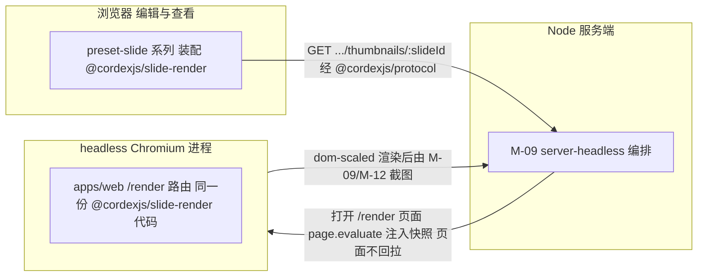

图怎么读：本模块不定义跨进程契约，唯一穿越进程边界的是缩略图 REST 契约（经 `@cordexjs/protocol`）；服务端与 headless Chromium 之间是进程编排关系，不是本模块契约。

---

**主线程只读解析的分片与降级**（2026-09-26 整合，rulings §4.21 X:q-xml-lexer、ADR-0019 决策 2、决策 8）：本包在主线程调用的三类只读解析——`parseChartSpace`（图表）、`parseDiagramDrawing`（SmartArt `dsp:drawing`）、`parseTableStyleList`（`tableStyles.xml`，M1 起）——都经 `@cordexjs/xml` 的 `drive` 按 64 KiB 分片推进，并注入 kernel 调度器的 `shouldYield` 与 `yieldNow`，不在一帧内长时间占用主线程；解析返回 XML 错误（`format.malformed_xml` 或 `format.limit_exceeded`）时只降级该元素（`render/element-degraded`），不影响文档打开与其它元素。图表数据标签与数据网格的数字显示用 `numfmt` 3.2（npm 最新 3.2.6，MIT，ADR-0036），编解码层只原样写 `formatCode`。

## 8. doc / sheet 扩展缝

`@cordexjs/slide-render` 是 `doc-render`/`sheet-render` 的**样板**（00-module-map §6.2：「复制 `SceneProvider` 实现模式（`build`/`diff`/`classify`），复用 `engine-render`/`engine-layout`/`render-dom` 契约」）；下表标出哪些文件是可直接复制的「垂直束模板」，哪些是 slide 专属、复制时必须重写。

| 文件 / 目录 | 标注 | 复制到 doc/sheet 时怎么变 |
|---|---|---|
| `src/plugin.ts`（根贡献注册 + `unitPlugins` 挂载 `thumbnails`） | 垂直束模板 | 结构原样复制；`render.scene` key 从 `'slide'` 改为 `'doc'`/`'sheet'` |
| `src/config.ts`（`layerTemplateCache`/`thumbnails`/惰性扩展开关） | 垂直束模板 | 字段名与默认值可复用；`charts.enabled` 换成各自领域的可选重型渲染开关（若有） |
| `application/services/slide-scene-provider.service.ts`（`SceneProvider.build/diff` 骨架 + 内部订阅 `store/transaction` 转发 `invalidate`） | 垂直束模板 | 「查 slides 服务→合成→`toSceneNodes`」的流程骨架照抄；`slides` 换成 `docs`/`sheets` 服务 |
| `domain/dirty/classify.ts`（`ChangeSet.touched` 按实体类型映射 `DirtySet` 的模式，§2.4 表） | 垂直束模板 | 表结构（路径前缀 → 归类策略）照抄；具体实体类型集合按各自 `PresentationBody`/`DocBody`/`SheetBody` 重写——sheet 尤其需要处理「巨大稀疏 `cells` 表」下 `full` 归类的性能陷阱（新增建议，见 §13 Q-1 的姊妹问题） |
| `application/services/thumbnail.service.ts` + `infrastructure/thumbnails/*.provider.ts`（两种缩略图 Provider 策略取舍 + 单页导出栅格化） | 垂直束模板 | Provider 接口与去抖/挂载上限策略照抄；`dom-scaled` 渲染的「一页」在 doc 语境下可能是「一屏」而非物理页，需要各自定义分页单位 |
| `infrastructure/cache/layer-template-cache.ts`（模板 LRU 模式：缓存键 + `cloneNode` + 失效 + 淘汰测试） | 垂直束模板 | 结构照抄；doc 大概率没有「母版/版式」概念，缓存键改为「样式集/分栏配置」等价物；sheet 可能不需要此文件（无重复模板层） |
| `domain/compose/compose-slide.ts`、`domain/compose/compose-master-view.ts`（三层合成、占位符遮蔽、母版视图分支） | slide 专属，**不复制** | doc 是线性 `blocks` 序列、sheet 是网格 `cells`，均无「母版→版式→页」三层合成概念；doc/sheet 各自的合成规则需从零设计 |
| `infrastructure/elements/{sp,pic,grp-sp,cxn-sp,table}.renderer.ts` | slide 专属，**不复制** | `kind` 集合完全不同（doc 是 `paragraph`/`image`/`table`/`list` 等块级元素；sheet 是 `cell`/`chart`/`pivot`），渲染器需按各自 `shapeKind`/`blockKind` 贡献点重新实现；但「无状态查表渲染器」的设计原则（§1.1）照搬 |
| `infrastructure/overlay/master-annotations.overlay.ts`、`domain/compose/master-annotation-plan.ts` | slide 专属，**不复制** | doc/sheet 无母版视图；若未来 sheet 需要「继承自单元格样式」的类似可视化，另起新 overlay，不直接复用这两个文件 |
| `@cordexjs/slide-render-chart` 整包（M1–M2 为主包惰性子路径 `./chart`、M3 拆包为独立惰性插件，均以同 key 覆盖主包占位，`render.element` 贡献点定义为 `replace`） | **拆包模式**可复制，内容不可复制 | 「重型/可选文档类型特性隔离为独立惰性插件」这一模式（而非图表本身）值得 `doc-render`/`sheet-render` 参考——例如 sheet 的数据透视表渲染、doc 的公式/宏渲染都可能采用同一拆包套路（新增建议，见 §12 G-8） |

铁律 2（束间隔离）在本包的落地：`domain/**`/`application/**`/`infrastructure/**` 不 import 任何 `doc-render`/`sheet-render` 类型；`__tests__/`/`testing/` 只使用本包自己的夹具；本包与 `slide-render-chart` 都会被 M-13 的 `horizontal-freeze` 排除在「冻结对象」之外（二者本身就是垂直束，不是被冻结的水平层）。

---

## 9. 测试布局

物理位置遵循 02 §4.0 包模板的**同位测试**约定（`src/__tests__/` + `src/testing/`），两包均无独立顶层 `tests/` 目录；下表按逻辑类别映射到 §5 已列的物理文件。

**测试类别到物理位置映射（slide-render 与 slide-render-chart 两包）**

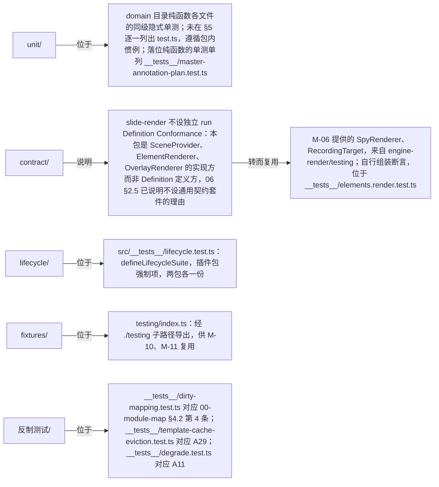

图怎么读：五个逻辑测试类别里，`contract` 类别不是直接指向物理文件，而是先说明「为何不设契约套件」，再指向转而复用的 M-06 测试替身文件；其余四类一跳到底。

| 测试类别 | 覆盖内容 | 源文件 | 补充 |
|---|---|---|---|
| unit | `composeSlide`/`composeMasterView`/`planMasterAnnotations`/`classify`/`thumbnailSize`/`resolvePaint` 等纯函数的确定性与边界用例（`planMasterAnnotations` 的落位规则各分支单列一个测试文件，2026-11-04，rulings §4.25 TB-189、TB-190） | `domain/**`（slide-render）、`domain/chart-layout.ts`（chart）；`__tests__/master-annotation-plan.test.ts`（slide-render） | 同级隐式单测，不在 §5 重复标注；`master-annotation-plan.test.ts` 已在 §4.1、§5.1 登记（测试文件逐个登记，rulings §4.25 DP-8） |
| 集成（合成/回收） | 版式切换复用元素实例；z 变化只移动 DOM 节点；共享模板页联动更新 | `__tests__/compose-reconcile.test.ts`、`__tests__/template-cache-eviction.test.ts` | 对齐历史用例（07 §4.3） |
| 集成（母版视图） | `ViewDescriptor{mode:'master'}` 合成 + 占位符标注覆盖层 `master-annotations`（覆盖全部占位符；类型名与 M2 锁签同一遍定落位，一种落位、选中项不画自己的类型名；只在画布上画，不进缩略图、放映与导出；2026-11-04，rulings §4.25 TB-188…TB-190）+ 占位符提示框（文本类 1–5 级样例）与版式、母版缩略图的细线框（TB-191）；`themePreview` 取覆盖值且 Store 无事务（rulings §4.20 FE-24）；页引用墓碑版式时渲染用 `defaultLayoutOf` 替代版式（FE-04） | `__tests__/master-view.test.ts` | 04 §12.4、PRD ML-01 |
| 反制（脏区） | `ChangeSet.touched` 按实体类型的 `DirtySet` 归类逐行覆盖（§2.4 表 7 行） | `__tests__/dirty-mapping.test.ts` | 00-module-map §4.2 第 4 条「适配层」职责的直接验证 |
| 反制（缓存淘汰） | `LayerTemplateCache` 超 32 项后 LRU 淘汰；被淘汰条目下次访问重渲一次 | `__tests__/template-cache-eviction.test.ts` | A29；架构 07 §11「三处 LRU」外的第 4 处（§12 G-7） |
| 反制（错误隔离） | 元素抛错→占位框+`render/element-failed`（render-dom 兜底）；预期降级→占位框+`render/element-degraded`（本包自发） | `__tests__/degrade.test.ts` | A11、OF-13；§2.4/§12 G-4 |
| 视觉保真 | 每个 `kind` 的 SVG 快照（规范化，含 45 种箭头组合的 path 快照）；图表 SSIM≥0.80 + IoU≥0.85（M1–M2）/编辑后一致性（M3）；判定与基线治理见 70-testing/04，图表语料矩阵与刻度、绘图区结构断言见 70-testing/04 §8.1，形状库默认插入与箭头尺寸见 70-testing/04 §8.2（2026-09-26） | `__tests__/elements.render.test.ts`（slide-render）、`__tests__/renderers.test.ts`+`__tests__/chart-data-roundtrip.test.ts`（chart） | OF-08/OF-09/OF-10 |
| 缩略图 | 两种 Provider 去抖、`maxMounted`、切换一致性、脏页驱动更新 ≤500 ms；单页导出 `exportImage` | `__tests__/thumbnails.test.ts` | OF-15 |
| fixtures | 覆盖每个 `kind` 的最小 `ComposedSlide`/`Scene`；母版继承样例；图表最小夹具 | `testing/index.ts`（两包） | 复用 `@cordexjs/model-slide/testing` 的 body 夹具（03 §9） |

覆盖率门槛与证据归档以 [70/01 §8](../70-testing/01-strategy-and-layers.md) 为准，性能预算以 [70/09](../70-testing/09-performance-and-capacity.md) 为准（rulings §4.20 TX-10，原引架构 11 改指）；性能预算断言见 §11 里程碑的验收命令。

---

## 10. 机械约束

| 规则 | 机制 | 依据 |
|---|---|---|
| `package.json#cordex`（slide-render） | `{layer:'V-render', bundle:'slide', iso:'dom', role:'plugin', stability:'beta'}` | 02 §4.0.1 schema |
| `package.json#cordex`（slide-render-chart） | `{layer:'V-render', bundle:'slide', iso:'dom', role:'plugin', stability:'experimental'}` | 02 §4.0.1 schema |
| 铁律：只依赖白名单 | `slide-render` 只能 import `model-slide`/`engine-render`/`engine-layout`/`render-dom`/`ooxml-core`（+ `kernel`/`shared`/`protocol`——章程 §5.2 上限列对非 L0 包隐式允许 L0，缩略图 Provider 读 `protocol` 的 REST 类型据此合规，rulings §4.18 FE-02；`ooxml-core` 仅限 chartml 与 `dsp:drawing` 只读解析入口，rulings §4.15 Q7 修订 §4.11 C-28）+ `emf-converter`（仅 `media/emf-rasterizer.worker.ts`）；`slide-render-chart` 只能 import `slide-render`/`engine-render`/`model-slide`/`ooxml-core`（`model-core` 仅类型或经注入；+ 图表库；章程上限列已按 rulings §4.18 FE-02 上调到实际用法，由 `scan-manifest` 规则 (i) 校验） | **说明性约束，不设专用规则**（2026-09-24 复核 L18：`cordex-slide-render-allowlist` 降为说明，M-01 九条 depcruise 规则不含此名）：由 `package.json` 依赖清单（新增依赖须评审）+ depcruise 规则 2 `cordex-layer-downward`、3/4 束隔离、5 `cordex-third-party-single-entry`（`emf-converter` 已登记进其单点引入表）共同保证 |
| 只向下依赖 | R2：`slide-render` 只能 import 秩 ≤55 的包；`slide-render-chart` 秩等于 `slide-render`（同秩内的「客户」关系，经 `render.element` 贡献点而非直接秩序依赖） | depcruise |
| 垂直束隔离 | R4 `cordex-bundle-isolation`：两包均不得 import `model-doc`/`model-sheet`/`doc-render`/`sheet-render` | depcruise（铁律 2） |
| 不得被水平层 import | R3：`engine-render`/`render-dom`/`engine-layout`/`model-slide` 不得反向 import 本模块两包 | depcruise（铁律 1；本模块是被保护对象） |
| dom 不被 node import | R16 `cordex-isomorphism-compatibility`：两包 `iso:'dom'`，不得被 `server-headless`（node）直接 import | depcruise（07 §14.5 的机械体现） |
| 渲染热路径禁用拦截式 API | `no-waterfall-in-render-hotpath`：`slide-render` 与 `engine-render`/`render-dom` 一样禁止调用 `ctx.waterfall`/`ctx.bail`（06 §2.6 A30，规则文本已列明本包） | lint（09-02 承接） |
| `testing/` 不进生产 | `no-testing-in-prod`：`domain/**`/`application/**`/`infrastructure/**` 不得 import `./testing` | depcruise（02 §4.0.2） |
| 事件先声明后使用 | `cordex/events-must-be-declared`（08 §11 对照名 `events-declared`）：`src/events.ts`（slide-render）/`slide-render-chart.contribution.ts` 与各自 `*.contribution.ts` 一致 | lint（rulings §4.18 GV-15） |
| 贡献点 `conflict` 策略显式 | 冲突策略属于贡献点定义（M-06），不在条目上声明：`render.scene` 为 `'error'`，`render.element`/`render.overlay` 为 `'replace'`——取值以架构 03 §3.6 总表 conflict 列为准（K-3，rulings §4.18 GV-24）；主包图表占位、`./chart` 子路径与 `slide-render-chart` 共享同一 key，后注册者生效 | 贡献点定义处的 `conflict` 字段（M-06 `render.contribution.ts`）+ `degrade.test.ts` 覆盖顺序断言 |
| LRU 淘汰测试 | `LayerTemplateCache` 必须有淘汰测试（本模块专属，架构 07 §11 三处 LRU 之外的第 4 处） | 契约测试（`template-cache-eviction.test.ts`，A29） |
| 图表库许可与引入点 | 2026-09-26 路线定为 d3-scale / d3-shape / d3-array（ISC）+ 自研布局、numfmt（MIT）格式化（rulings §4.21 q-chart-route，ADR-0036），许可按 ADR-0049 分级（宽松类视同放行）；引入点：M1–M2 只在 `slide-render/src/infrastructure/chart/**`（仅 `./chart` 子路径可达，主包静态图不可达），M3 只在 `slide-render-chart/src/infrastructure/**`；numfmt 另在 slide-ui 图表数据分区（保持基础束体积，S6） | `scanners` job 的许可证扫描步骤（TD-050，白名单 `tooling/policy/license-allowlist.json`；CI job 名维持 13 个封闭集合，rulings §4.18 GV-14/GV-15） |
| EMF 栅格化许可与体积 | `emf-converter` 4.0.x（Apache-2.0，D13 合规；显式 `gdiAntialias: true`，过 `minimumReleaseAge` 后精确锁）只允许出现在 `media/emf-rasterizer.worker.ts`（单点引入）；该 Worker chunk 惰性加载，不计入 350 KB 基线但单独登记体积预算；记录数/像素/耗时上限（OF-24） | depcruise `cordex-third-party-single-entry`（M-01 §5.5 规则 5 单点引入表已登记 `emf-converter` → 仅 `slide-render/src/infrastructure/media/emf-rasterizer.worker.ts`，复核 L18）+ `scan-bundle-budget` + `degrade.test.ts` |
| 文档内容注入禁令 | 本包禁止以 `innerHTML`/`insertAdjacentHTML`/`DOMParser` 注入文档内容；`asvg:svgBlip` 只经 `<image>` 渲染 | 08 矩阵 TD-081 + M-01 `tooling/eslint-config/rules/dom-injection.ts`（rulings §4.15 Q4 安全基线，已落地） |
| 图表体积预算 | `slide-render-chart` 惰性 chunk ≤ 400 KB gzip | `test/perf/budgets.json`（50-frontend/13 §6） |
| API 报告 | `etc/slide-render.api.md`/`etc/slide-render-chart.api.md` 入库，PR diff 必审 | api-extractor + CI |
| 类型治理 | 品牌类型透传（`ShapeId`/`SlideId` 等不重新定义）、`Result` 不适用（本模块无命令式 API，纯查询/渲染）、禁 `enum`（`ThumbnailDescriptor.provider`/`externalResources` 用字符串字面量联合） | 09-type-discipline |

---

## 11. 里程碑与实施顺序

建包顺序：`slide-render` 先行（M1 即需要）；`slide-render-chart` 直到 M3 才独立建包——M1–M2 其只读能力以主包惰性子路径 `@cordexjs/slide-render/chart`（入口 `src/chart.ts` + `infrastructure/chart/chart-preview.renderer.ts`）形式存在，主包只含 `chart-placeholder` 占位（§4.2，rulings §4.18 FE-08）。上游前提：M-03（`model-slide`）与 M-06（`engine-layout`/`engine-render`/`render-dom`）均已完成各自 M1（module-map §7 上游列）。

### M0：骨架

- `slide-render`：根配置 9 文件 + `src/` 顶层 7 文件；`domain/contracts/**` 类型骨架；`plugin.ts` 贡献 `render.scene('slide')`/`render.element × 10`（`build`/`render` 暂时可 `throw NOT_IMPLEMENTED`）；`__tests__/lifecycle.test.ts` 通过。

### M1：首个可运行切片——夹具 pptx 打开 → 渲染首页 → 像素基线对比

1. `domain/compose/compose-slide.ts` + `domain/scene/to-scene-nodes.ts` 落地：给定 M-03 `testing/fixtures.ts` 的「单页文本」夹具 body，`composeSlide` 产出正确的 `ComposedLayer` 顺序与占位符遮蔽结果。
2. `application/services/slide-scene-provider.service.ts` 的 `build()` 跑通（`diff()`/`store/transaction` 订阅可先打桩，M1 不要求增量重绘）。
3. `infrastructure/elements/{sp,pic,text-body.painter,paint}.ts` 落地到可渲染夹具中出现的形状与文本。
3a. **M1 gated 保真项（rulings §4.15 Q7 提前，原排 M2）**：`table.renderer.ts`（OF-08）、`diagram.renderer.ts`（SmartArt 渲染 `dsp:drawing`，OF-10）、`ole.renderer.ts`（显示 `Ole.preview`）、`chart-preview.renderer.ts` 及同目录 5 个版式与绘制文件（D16 只读解析部件与缓存数据，d3 + 自研布局，OF-09 SSIM ≥ 0.80，ADR-0036）、`fallback.renderer.ts`（unknown 按 transform 定位占位；chartex 占位 + `chartex-unsupported`）、`shared/external-resource.policy.ts`（外链默认自动加载，`externalResources` 可收紧）；依赖 M-04 在 M1 交付 `ooxml-core` 的 `dsp:drawing` 只读解析与 `ole.ts` 预览提取。否则 OF-08/09/10 的 M1 SSIM 门禁无法通过。
4. 端到端切片：`preset-slide`（借用 M-11 的最小装配，或本模块 `__tests__` 内直接手工 `ctx.plugin()` 三包：`model-slide`+`engine-render`+`render-dom`+本包）打开 M-04 提供的最小夹具 `.pptx`（或 M-03 `testing` 的内存 body，导入环节尚未就绪时先用后者）→ `ctx.render.attach('dom', container)` → `RenderTarget.toImage()` 导出 PNG → 与语料库预渲染的 PowerPoint 基线图逐像素比对（SSIM，架构 11 口径，M1 阈值可先松于 OF 系列 P0 线，M2 收紧到位）。

切片语义（对应「打开 → 渲染首页 → 像素基线对比」）：pptx 导入本身是 M-04 的职责，本模块在此切片中的验收边界是——给定已导入的 `PresentationBody`（无论来自真实导入还是 M-03 夹具），`SceneProvider('slide').build()` 产出的 `Scene` 经 `render-dom` 挂载后，首页视觉输出与基线图的差异落在预算内；这验证的正是 00-module-map §4.2 第 4 条「适配层」职责本身的正确性。

**验收命令（草案）**：

```bash
pnpm --filter @cordexjs/slide-render build
pnpm --filter @cordexjs/slide-render test src/__tests__/compose-reconcile.test.ts
pnpm --filter @cordexjs/slide-render test -- --grep "build.*first page"
pnpm --filter @cordexjs/slide-render test:visual -- --fixture single-text-slide   # 像素基线对比（M1 首个切片）
```

**性能预算（M1 即接入单元级子集，端到端预算延后到 M-11 装配后）**：

| 指标 | 预算 | 依据 |
|---|---|---|
| 首帧（`build()` + 首次 `paint()`） | 已解析首页 ≤ 50 ms（本模块内部目标，严于 PRD `跳转到已解析页 ≤100 ms`） | 50-frontend/13 §1、§12；模板层缓存命中后的目标值 |
| 脏区重绘范围 | 仅受影响元素 + 覆盖层；`classify()` 对 `shapes.<id>.*` 类改动绝不返回 `full` | A28 反制测试（`dirty-mapping.test.ts`） |
| 模板层缓存命中重渲 | 共享版式的页在版式改动后只重渲模板一次，之后 `cloneNode` 复用 | `template-cache-eviction.test.ts` |
| 缩略图更新 | 去抖 300 ms + 渲染 ≤100 ms（可见项 dom-scaled 路径） | OF-15；50-frontend/13 §1、§12 |

### M2

- `infrastructure/elements/{grp-sp,cxn-sp,background}.renderer.ts` 全部落地；`domain/compose/compose-master-view.ts` + `infrastructure/overlay/master-annotations.overlay.ts` 与落位纯函数 `domain/compose/master-annotation-plan.ts`（ML-01 只读穿透，占位符可选中不可编辑，选中时画锁形标签；2026-11-04，rulings §4.25 DS-156、TB-188）；`infrastructure/thumbnails/{dom-scaled,raster,server-png}.provider.ts` 全部落地：`dom-scaled`/`server-png` 两种缩略图策略可运行时切换（server-png 为 640 px WebP，`provisional` 回退 `dom-scaled`），`raster` 只服务单页导出 `exportImage`（toImage Web 字体问题 M2 spike）；`infrastructure/chart/chart-preview.renderer.ts` 覆盖矩阵 §2.6（本文档引用 50/19 §6 与 50/24）列出的全部图表类型的只读渲染。
- **M2 P1（rulings §4.15 Q7）**：`infrastructure/media/emf-rasterizer{,.worker}.ts` 以 `emf-converter` 4.0.x（`gdiAntialias: true`，R-d-24）惰性 Worker chunk 栅格化 EMF/WMF（含 OLE 预览），记录数/像素/耗时上限（OF-24）；`domain/compose/animation-end-state.ts` 放映主序列可见性终态。验收：`master-view.test.ts`/`master-annotation-plan.test.ts`/`thumbnails.test.ts`/`degrade.test.ts`（`emf-raster-limit`）/图表 SSIM≥0.80 用例全绿。

### M3

- `@cordexjs/slide-render-chart` 独立建包（§4.2 目标形态）；`src/chart.ts` 与 `infrastructure/chart/**` 迁入该包（只读解析并入 `chart-read-model.provider.ts`，`chart-layout.ts` 进 `domain/`，其余 4 个版式与绘制文件进 `infrastructure/`，§4.2），`slide-render` 主包仍只保留 `chart-placeholder.renderer.ts` 作为该 key 的缺省项，`./chart` 子路径随之从 `publicEntry` 删除（rulings §4.18 FE-08）；`bar`/`line`/`pie`/`area`/`scatter` 五类可编辑（章程 Q18 已由 rulings §4.12 U-06 裁定），`chart-editing.service.ts` 接入 `commands.execute`（依赖 M-03 `domain/model/shape/chart.ts` 的 `data` 字段，M-03 §11 M3 里程碑同步交付）。验收：`chart-data-roundtrip.test.ts` 全绿；拆包后 `preset-slide` 只改 import 路径，`__tests__/degrade.test.ts` 的「图表插件缺席时落回主包占位 + `chart-unavailable`、其余元素照常渲染」用例保持全绿（可插拔证据，OF-09）。
- **M3 末（rulings §4.15 Q4）**：以一个最小 canvas Provider（不进产品装配，仅测试夹具）验证 `render.target` 契约可替换——本包渲染器经 `RenderTarget` 抽象输出，不对 DOM 句柄以外的目标做假设；该验证由 M-06 主持，本包提供 `testing/` 夹具与 `elements.render.test.ts` 的对照用例。

---

## 12. 与现有文档的差异与追加建议

| # | 涉及文档 | 差异 / 发现 | 追加建议（不直接生效） |
|---|---|---|---|
| G-1 | `02-layering-and-packages.md` §4.16/§4.16b vs 本文档 §4 | 02 的目录是扁平命名（`scene/`、`elements/`、`thumbnails/`、`show/` 等直接在 `src/` 下）；本文档按总编排裁定把它们收拢进 `domain/`/`application/`/`infrastructure/`/`testing/` 四个顶层目录（`interface/` 省略） | 若总编排采纳 DDD 顶层目录为物理事实源（同 03 G-1、06 G-1 已表达的立场），02 §4.16/§4.16b 需要同步改写；否则本文档 §4/§5 路径前缀需整体回退为扁平结构（机械替换，不影响其余内容） |
| G-2 | 架构 07 §4.3、02 §4.16 历史缩略图 Provider 清单（仅 `dom-scaled`/`server-png` 两种）vs 本文档 §2.5/§4.1/§5.1 三种 | 本文档原新增第三种策略 `offscreen-canvas.provider.ts`（14 §5.4 曾采纳）。**2026-09-24 rulings §4.15 Q4 推翻该采纳**：DOM/SVG 单实现，canvas 只作 toImage 栅格化画板；第三种策略改为 `raster.provider.ts`（主线程 toImage，游离 DOM → SVG 序列化 → Image → Canvas），不做 Worker/OffscreenCanvas 版本；`thumbnails.provider` 枚举改为 `dom-scaled\|raster\|server-png`。**2026-09-24 复核 L12 再修正**：按 30-architecture/07 §4.3，`raster` 只用于单页导出，枚举收回为 `dom-scaled\|server-png`，与架构 07 的两种 Provider 清单一致 | 02 §4.16 与架构 07 §4.3/§8/§14.6 按 `raster` 同步（07 §14.6 删「导出在 Worker」）；14 §5.4 M-07/G-2 行标注「已被 rulings §4.15 Q4 推翻」 |
| G-3 | 06 §2.4/§12 G-6/§13 Q-2（`TextEditIntent` 回调链路：render-dom → `engine-render.attach()` → 消费方） | 06 号文档定义了回调注册 API 形状，但未说明「`nodeId` 如何被消费方还原为 `ShapeId`」这一具体映射方式——`RenderContext`/`TextEditIntent` 契约均未包含此约定 | 本文档在 §2.1/§2.3/§2.6 新增约定：`SceneNode.id === ShapeId`（同一字符串，无需额外映射表）。建议 06 号文档或 charter §5.5 的 `Scene`/`SceneNode` 术语条目正式收编这条约定，否则未来 `doc-render`/`sheet-render` 可能各自发明不同的 id 映射方式，破坏 `TextEditIntent` 回调链路的跨垂直束复用性（§13 Q-4） |
| G-4 | 06 §2.4（`render/element-failed`/`render/element-degraded` 的发布者与语义边界，措辞较隐晦） | 06 号文档虽已注明「本模块内仅媒体解码失败等通用原因；`chart-unavailable` 等文档类型相关原因由 M-07 发出」，但未显式给出「意外异常 `throw`→由 render-dom 兜底 `element-failed`」与「预期降级→由文档类型自己 `emit` `element-degraded`」这条判断规则本身 | 本文档在 §2.4/§9/§12（本条）落地这条边界并给出 `reason` 枚举样例；建议 06 号文档 §2.4 补一句显式规则说明，供 `doc-render`/`sheet-render` 遵循，避免各自对两个事件的选用产生分歧 |
| G-5 | `02-layering-and-packages.md` §4.16（`ole.ts`/`diagram.ts`/`unknown.ts` 三个独立文件）vs `30-architecture/07-rendering.md` §4.3（合并为单一 `fallback.renderer.ts`） | 原采用 07 §4.3 合并版本。**2026-09-24 结案（rulings §4.15 Q7）**：SmartArt 与 OLE 须真实渲染（M1 SSIM 门禁），合并占位不再成立；拆为 `diagram.renderer.ts`（复用 sp 画笔）、`ole.renderer.ts`（走 pic 路径）与只剩 unknown 的 `fallback.renderer.ts` | 02 §4.16 与架构 07 §4.3 按三文件同步；本条与 §13 Q-5 结案 |
| G-6 | 00-module-map §7 M-07 行「预计文件数量级 50–70」vs 本文档两包合计 85 | 母版视图、缩略图 Provider 与单页导出栅格化、完整图表子包（含 M3 编辑与交互），以及 2026-09-24 rulings §4.15 Q7 新增的 diagram/ole 真实渲染器、EMF 栅格化与外链策略文件，超出了粗粒度估计的颗粒度 | 建议 00-module-map §7 M-07 行的估计值随本文档定稿更新为「80–90」，或在该行加注「含 slide-render-chart M3 全量文件」以说明口径；不建议为凑数字而牺牲 §4/§5 已论证的文件粒度 |
| G-7 | 架构 07 §11「三处 LRU」vs 06 §12 G-7（已厘清为「引擎内三处，不含 M-07 的 `LayerTemplateCache`」）vs 00-module-map M-06/M-07 两行 | 06 号文档已给出厘清结论，但 00-module-map 的 M-06/M-07 两行尚未据此加注，读者按模块统计缓存总数时可能遗漏或重复计入本包这第 4 处 | **结案（2026-09-18，跨模块评审 C-12）**：系统级共 4 处缓存（M-06 三处 + 本包 1 处），本包 `LayerTemplateCache` 是系统级第 4 处；00-module-map §7 M-06 行加注「模块内三处，不含 M-07 的 `LayerTemplateCache`」、M-07 行加注「含 1 处模板 LRU（`LayerTemplateCache`）」（由总编排回写 00，本文档 §1.1/§9/§11 的表述已一致，无需改动） |
| G-8 | 00-module-map §6.2（垂直束样板对照表未提及「重型可选特性拆包」这一子模式） | 本文档 §8 指出 `slide-render-chart` 的拆包套路（M1–M2 为主包惰性子路径、M3 拆为独立惰性插件、同 key 覆盖主包占位；2026-09-25 按 rulings §4.18 FE-08 由「M1–M2 内置只读」改写）本身是一种可复用模式，独立于图表这一具体内容 | 建议 00-module-map §6.2 补一行「重型可选特性隔离」样板参照，明确指向本文档 §3/§4.2/§8，供未来 sheet 的数据透视表渲染或 doc 的公式渲染等类似场景参照，而不必重新发明拆包机制 |
| G-9 | 章程 §5.2 依赖上限描述为「职责边界」文字（`model-slide, engine-render, render-dom`）、任务书补充 `engine-layout`，均未落地为具体 depcruise 规则 id | 本文档 §10 曾建议规则名 `cordex-slide-render-allowlist`（**2026-09-24 复核 L18 降为说明**，不再建议新增专用规则，见 §10）。**2026-09-24**：rulings §4.15 Q7 修订 §4.11 C-28，放行 `slide-render→ooxml-core`（仅 chartml 与 `dsp:drawing` 只读解析）；allowlist 同步为 `model-slide`/`engine-render`/`engine-layout`/`render-dom`/`ooxml-core`（+ `emf-converter` 单点）；`slide-render-chart` 为 `slide-render`/`ooxml-core`（+ 图表库） | ~~建议 09-type-discipline 或 `tooling/depcruise` 采纳该规则名与白名单~~（已降为说明）；`emf-converter` 单点已登记进 M-01 规则 5；章程 §5.2 `slide-render` 依赖上限列加 `ooxml-core`（总编排级，随 C-28 修订） |
| G-10 | 00-module-map §3 BC-12 行「提供的贡献点：无独立贡献点 id；向 BC-11 的 `render.scene`/`render.element` 贡献条目」（只登记两个贡献点） | 本文档 §0/§2.6/§3/§4.1/§5.1 新增第三个贡献：`render.overlay('master-inheritance')`——`render.overlay` 本身是 BC-11 已定义的贡献点（06 §2.5），但「继承自母版」这一具体覆盖层只有 BC-12（知道 model 语义）能产出，`render-dom`（BC-11 默认 Provider，文档类型盲）无法实现；这是母版视图（PRD ML-01）覆盖层需求下的必然推论，而非随意新增 | 建议 00-module-map §3 BC-12 行的「提供的贡献点」补充「`render.overlay`（`master-inheritance`，新增建议）」一项，使权威登记表与本文档一致；若总编排认为母版视图覆盖层应改由 M-10（`slide-ui`）而非 M-07 贡献，需相应移除本文档 §2.6/§4.1 的 `overlay/` 文件并调整 §13 Q-3（2026-11-04 起 id 改为 `master-annotations`，取代原名，覆盖全部占位符，rulings §4.25 TB-188） |

### 2026-09-18 收敛

> 总编排已采纳 `40-modules/14-cross-module-review.md` §1 全部 30 条裁定，以下三条涉及本文件，逐条落地；详见对应 §0/§1.1/§2/§3/§4/§5/§7/§12 各处的行内标注。

| C 编号 | 裁定摘要 | 本文件落地位置 |
|---|---|---|
| C-04 | 删除 `slideshow.service.ts` 与 `SlideshowService`，放映编排（全屏/翻页/黑白屏/`slide/show-changed`）改由 M-10（`slide-ui`）承担 | §0 职责一句话/下游行、§1.1 做什么/不做什么、§2.4、§2.6、§3、§4（树 + 文件数 78→77）、§5.1（文件数 3→2）、§7 |
| C-12 | 本包 `LayerTemplateCache` 是架构 07 §11 之外系统级第 4 处缓存（M-06 三处 + 本包 1 处） | §12 G-7 结案（§1.1/§2.2/§5.1/§9/§10 既有表述已一致） |
| C-13 | 视图模式映射函数 `mapViewMode()` 归属 engine-render（M-06），本包 `ComposedSlide.viewMode` 只消费其结果、不重新实现 | §2.1（新增说明段）、§5.1 `composed-slide.ts` 行 |

### 2026-09-24 回写（rulings §4.15 章程 Q1–Q10 裁决）

| 裁决 | 摘要 | 本文件落地位置 |
|---|---|---|
| Q4 渲染介质 | DOM/SVG 单实现；canvas 仅 toImage 栅格化/measureText/预留 RenderTarget；推翻 14 §5.4 offscreen-canvas Provider，改主线程 `raster.provider.ts`；M3 末最小 canvas Provider 验证 `render.target`；文档内 SVG 仅图像上下文、禁注入 | §1.1、§2.2、§2.5、§4.1、§5.1、§6、§10、§11、§12 G-2、§13 Q-1 |
| Q7 保真范围 | D16 口径（删「缓存位图或占位」）；SmartArt/OLE 真实渲染并与表格、图表只读渲染一并提前 M1；EMF/WMF M2 惰性 Worker 栅格化；chartex 占位；外链自动加载（`externalResources` 可收紧，服务端永不加载）；动画结束态按场景；受限字体仅只读；C-28 放行 `slide-render→ooxml-core` | §0、§1.1、§1.3、§2.2、§2.4、§2.5、§3、§4.1、§5、§7、§10、§11、§12 G-5/G-9、§13 Q-2/Q-5 |
| Q8 服务端缩略图 | server-png 识别 `provisional` 并回退 `dom-scaled` | §2.2、§2.6、§5.1、§6 |
| U-06（既有） | 图表可编辑五类，删「Q18 待定/默认三类」 | §3、§6、§11 |


### 2026-09-24 复核修正（rulings §4.17；复核报告 `00-charter/_evidence/review-2026-09-24.html`）

| 条目 | 改动 | 落点 |
|---|---|---|
| L11 服务端缩略图格式 | 服务端缩略图为 **640 px WebP**（rulings §4.15 Q8、ADR-0026），不是 PNG；标识符 `server-png`、文件 `server-png.provider.ts` 沿用历史名不改（避免跨模块改名），仅描述修正；本包无 `source` 字段，`client` 取值问题不适用 | §1.1、§2.6、§4.1 注释、§5.1 |
| L12 `raster` 不是可配置 Provider | 按 30-architecture/07 §4.3：可配置 `thumbnails.provider` 枚举只剩 `dom-scaled`/`server-png`；`raster.provider.ts` 只服务**单页导出**（`ThumbnailService.exportImage`），不进入枚举、不产出 `ThumbnailDescriptor` | §1.1、§2.2、§2.5、§4.1、§5.1、§6、§9、§11 |
| L18 allowlist 与单点引入登记 | `cordex-slide-render-allowlist` **降为说明**（M-01 九条 depcruise 规则不含此名；白名单由 `package.json` 依赖清单 + 既有规则 2/3/4/5 共同保证）；`emf-converter` 单点引入**登记进** M-01 §5.5 规则 5 `cordex-third-party-single-entry` 的单点引入表 | §10、§12 G-9 |
| 注入禁令落点 | 原「待两处回写」已落地：08 矩阵 TD-081 + M-01 `tooling/eslint-config/rules/dom-injection.ts` | §10 |

### 2026-09-25 回写（rulings §4.19 三条设计线拆分与遗留取舍）

| 依据 | 改动位置 | 摘要 |
|---|---|---|
| F68（30/07 §4.1）、F69、50/05 §1 | §1.1、§2.1 `ComposedElement.occluded`、Layer 顺序不变量 | 普通页上母版与版式的占位符一律不绘制，只作继承源；非占位符形状受 `showMasterSp` 控制；删「页上有同 `(type,idx)` 占位符才遮蔽」（PowerPoint 365 基线，rulings §4.19 D-TEST-INFRA） |
| 50/05 §11、决策 A11Y-TREE | §2.1、§4.1、§5.1 | 登记 `domain/scene/a11y-descriptor.ts`：`SceneNode.a11y` 派生与未挂载页直接读模型生成描述 |
| 50/06 §7、§12 | §2.4 | `slide/autofit-changed` 由本包 emit（声明在 M-03），slide-ui 执行 `slide.applyAutofit` |
| §4.19 事实源分工 | §2 首段 | 渲染行为以 50/05、50/06 为准 |

### 2026-09-26 回写（rulings §4.20 遗留小项收口）

| 依据 | 改动位置 | 摘要 |
|---|---|---|
| FE-03、FE-04 ⑥ | §2.3 `composeSlide` 行、§5 `compose-slide.ts` 行、§9 母版视图测试行 | 页 `layoutId` 指向墓碑版式时以 M-03 `defaultLayoutOf` 替代求值（读时容错，不写 Store） |
| FE-24 | §2.1 新增「主题预览」段、§5、§9 | 登记 `ViewDescriptor.themePreview?: {masterId; colors?; fonts?}`：只影响渲染、不入 Store、不广播、取消即清空 |
| TX-10 ⑤ | §9 末段 | 覆盖率与性能预算改指 70/01 §8 与 70/09 |

### 2026-09-26 回写（rulings §4.21 复用优先、架构三件套与编辑器元素）

| 依据 | 改动位置 | 摘要 |
|---|---|---|
| q-chart-route、ADR-0036 | §0 上游行、§1.1、§1.2、§2.2、§2.7（新增）、§4.1、§4.2、§5.1、§5.2、§6、§10、§11 | 图表渲染路线定为 d3-scale / d3-shape / d3-array + 自研 OOXML 布局 + numfmt；`./chart` 增 `chart-layout`、`chart-geometry`、`chart-labels`、`chart-number-format`、`chart-svg.painter` 5 个文件（slide-render 60 → 65）；`slide-render-chart` 目标形态增 4 个文件、`domain/chart-layout.ts` 改为框布局与自动刻度（28 → 32）；`ChartReadModel` 字段按 ADR-0036 扩充，M3 叠加 `Chart.data` 为 `ChartRenderView`；图表库引入点与许可改按 ADR-0049 分级 |
| q-arch-reorg（R-d-04）、50-frontend/19 | §2.7（新增） | 逐元素渲染设计迁 50-frontend/19–25，本文件只留 `render.element` key → 文件 → 承载元素 → 降级原因的登记表 |
| R-d-24 | §1.1、§5.1、§10、§11 | emf-converter 改评 4.0.x：显式 `gdiAntialias: true`，过 `minimumReleaseAge` 后精确锁，可选 peer `@napi-rs/canvas` 不安装；M4+ 矢量走 `convertMetafileToSvg` + `<image>` |
| R-d-23 | §1.1 不做什么 | 媒体与图标预处理入口在 render-dom `media/image-preprocess.ts`（上传队列调用），本包只消费 blob URL |
| 50-frontend/25、40-modules/04 `shape-tree.ts` | §1.1、§2.7、§5.1、§11 | chartex 导入为 `UnknownShape{source:'chartex'}`，占位与 `chartex-unsupported` 改由 `fallback.renderer` 发出，图表渲染器不再处理 `cx:` |

### 2026-10-22 回写（rulings §4.25 design-language-v3 第 3 批）

| 依据 | 改动位置 | 摘要 |
|---|---|---|
| TB-157 | §1.1、§4.1 / §5.1 `compose-slide.ts`、`slide-scene-provider.service.ts`，§9 `degrade.test.ts` | 两种页级回退的上报分开：合成时抛错的页经 `errors` 上报 `render.page_failed{pageId}`（码在 engine-render `errors.ts`，30/10 §1.1a 登记）并发 `render/element-failed{ kind: 'page', pageId }`（§2.4 增一行，页级是元素级边界 G-4 之外唯一由本包发出的一种），`/render` 页据此在 `ready` 的逐页诊断里带出 `failed{ code }`（50/12 §11.3），renderer 据此记这一页失败、不回传字节，按 60/06 §11.3 重试与占位；整页解析失败的保真占位是确定内容，不报错误码、照常回传；`degrade.test.ts` 即 70/04 §8 与 70/13 §6.9 引用的页级回退单测 |
| TB-166、TB-169（2026-10-22 复核时补） | §1.1、§4.1 / §5.1 `slide-scene-provider.service.ts` | 浏览器生成的图片导出同一口径：所导页里有一页走了运行时页级回退，这次导出失败、保真占位照常导出（判定方法以 50-frontend/18 EXP-03 为准）；测试部署的「指定页在合成时抛错一次」作用在本包的合成上（接口以 50-frontend/15 §10 为准）；文件数不变 |
| TB-174、50-frontend/05 §11（2026-10-22 复核时补） | §1.1、§2.1「可访问描述的派生」、§4.1 / §5.1 `slide-scene-provider.service.ts` | 合成处的注入点只由 apps/web 的诊断接口在测试部署里打开（40/11 `application/host/diagnostics.ts`），`/render` 不设注入点，`/render` 一侧合成某页出错由组件级用例以 scene provider 桩制造（40/11 §9 单测 `application/render-page.usecase.test.ts`，70/06 §6.3 R8；生产构建上的 `render/render-page.spec.ts` 只测整页无法解析的一半）；可访问描述的字段清单补 2026-09-26 整合的 `links`、`table` / `chartData` 与 `role` 取值 `link`；文件数不变 |
| TB-151、DS-52 | §1.1、§4.1 / §5.1 `compose-slide.ts`、`slide-scene-provider.service.ts`、`fallback.renderer.ts`，§9 `degrade.test.ts` | 页级占位落在本包：整页解析失败的页（保真「此页内容无法解析」）在合成时、合成某一页抛错（放映单页渲染失败「此页内容暂时无法显示」）在 provider 里，都只把页层换成一个覆盖纸面的 `unknown` 占位节点，母版与版式层照常；由 `fallback.renderer.ts` 与元素级占位同一组画笔画在纸面内，客户端与服务端缩略图一致，不新增 `render.element` key；40/10 §13 Q-18 随之结案 |

源文件数与测试文件数都不变。

### 2026-11-04 回写（rulings §4.25 design-language-v3 母版视图改版）

> 依据：rulings §4.25 DS-146、DS-148、DS-149、DS-156（2026-11-02 至 11-03 用户拍板）与总编排技术口径 TB-188…TB-191，测试文件逐个登记照 DP-8。画法与落位规则以设计 03-26 §4.2 为准，读屏处理以设计 03-26 §9 为准，覆盖层的数据源与刷新以 50-frontend/05 §5.2 为准，标注文案键以 50-frontend/16 §1 为准；本节只登记本模块涉及的条目。

| 依据 | 改动位置 | 摘要 |
|---|---|---|
| DS-148、TB-188 | §0、§1.1、§1.2、§2.5、§2.6、§3、§4.1、§5.1、§8、§9、§11 | 母版视图的覆盖层改为占位符标注覆盖层：key 由 `master-inheritance` 改为 `master-annotations`（文件 `master-annotations.overlay.ts`、导出 `masterAnnotationsOverlay`，取代原名），给全部占位符画线与类型名——本版式虚线、继承点线 +「母版 · 〈类型〉」，只在画布上画，不进缩略图、放映与导出；不再是新增建议，00-module-map BC-12 与 40/16 同步；slide-ui 不另画继承描边（40/10）；§12 G-10 一行保留作复核记录，行末补取代注记 |
| TB-189、TB-190、DS-156、DP-8 | §2.3、§4.1 / §5.1 新增 `domain/compose/master-annotation-plan.ts` 与单测 `__tests__/master-annotation-plan.test.ts`、图 4-1、§9（表与测试类别图）、§11 M2 验收 | 类型名与 M2 锁签同一遍定落位、画在同一覆盖层；落位纯函数单独成件，按数据里的占位符几何算，不量 DOM、不等过渡；它的落位规则各分支单列一个测试文件（测试文件逐个登记，DP-8） |
| DS-148、DS-149、TB-191 | §2.1 Layer 顺序不变量 | 母版视图画布上的提示框本身不画框线、文本类提示画第 1–5 级样例；目标为版式或母版的缩略图与画布同一份内容渲染，另画一种细线框，提示字按缩略图尺寸整行取舍、不裁半字 |
| DS-146 | §2.6 母版视图切换的触发者 | 改为 slide-ui 经 `view.setMode` 进出、母版窗格选中经 `slide.selectMasterOrLayout` 换编辑对象（取代原写的「视图分段/范围条」） |
| TB-188、TB-190 | §0 下游行、§1.3 BC-15 一行与图 1-1、§2.5 新增「`master-annotations` 的启用入参 `MasterAnnotationsOptions`」、§5.1 覆盖层行与落位纯函数行、§6 类型、§13 Q-3 | 推荐更新：合成结果仍以闭包持有，选中与视口从 `selection` 服务与 Viewport 取（`OverlayContext` 已有的字段），不扩展 `OverlayContext`；启用入参 `MasterAnnotationsOptions` 有两个字段——`labels`（类型名、「母版 · 〈类型〉」与 M2 锁签的文案）与 `m2Locked`（是否 M2）——由 slide-ui 启用覆盖层时给出，类型在落位纯函数件里声明、经 `src/index.ts` 导出；本包不登记 i18n 命名空间、不贡献 `i18n.bundle`（文案键以 50-frontend/16 §1 为准） |
| DS-148、DS-156 | §5.1 覆盖层行 | 框线、类型名与 M2 锁签对读屏隐藏，以设计 03-26 §9 为准 |

源文件 +1、测试文件 +1（slide-render 65 → 67，两包 97 → 99；§5.1「`domain/`」小标题的文件数一并由漏计的 10 更正为 12，「`__tests__/`」8 → 9）；需求编号、优先级与里程碑不变。

## 13. 未决问题

| # | 问题 | 推荐默认值 | 影响范围 |
|---|---|---|---|
| Q-1 | ~~`offscreen-canvas.provider.ts`（G-2）是否需要真正跑在 Worker 线程~~ **（结案，2026-09-24）** | 不做 Worker 版本，也不再有 offscreen-canvas Provider：改为主线程 `raster.provider.ts`（toImage 分片调度）。**结案依据**：rulings §4.15 Q4（DOM/SVG 单实现，推翻 14 §5.4 对 offscreen-canvas 的采纳）；toImage Web 字体（CJK）问题转为 M2 位图 spike，结论前位图封面/批量缩略图自 M3 走 server-png（WebP）；2026-09-24 复核 L12 起 `raster` 只用于单页导出 | `infrastructure/thumbnails/raster.provider.ts`（已落地） |
| Q-2 | ~~M1–M2 次要图表类型是否统一走「缓存位图或占位」~~ **（结案，2026-09-24）** | 按章程 D16 原文：M1–M2 `c:chart` 部件不透明保留，`chart-preview.renderer.ts` 只读解析部件与缓存数据渲染全部类型（SSIM ≥ 0.80），解析失败才占位；`cx:` chartex 不在 D16 范围，直接占位 + `chartex-unsupported`；`approx.renderer.ts` 在 M3 拆包后承接非可编辑类型的只读渲染。**结案依据**：rulings §4.15 Q7、crossConflicts D16 机械回写 | `infrastructure/chart/chart-preview.renderer.ts`、`slide-render-chart/infrastructure/renderers/approx.renderer.ts`；§11 M1 |
| Q-3 | `OverlayContext`（06 §2.5）是否需要扩展字段以支持 `master-annotations` overlay 取得 `ComposedElement.inheritedFrom` 与全部占位符框，还是该 overlay 自行重新查询 `ComposedSlide`；2026-11-04 起它还要读当前选中（选中项不画自己的类型名，M2 时给选中项画锁签）与视口（按屏幕像素画） | 推荐不扩展 `OverlayContext`：`master-annotations.overlay.ts` 通过闭包持有最近一次 `build()` 的 `ComposedSlide` 引用（本包内部状态）；选中与视口从 `selection` 服务与 Viewport 取，即 `OverlayContext` 已有的 `selection`、`viewport` 两个字段（40/06 §2.5），不新增字段，避免污染 06 号文档的通用契约（2026-11-04，rulings §4.25 TB-188、TB-190）；是否处于 M2（画不画锁签）与标注文案由 slide-ui 启用覆盖层时作为入参给出——`MasterAnnotationsOptions` 的 `m2Locked` 与 `labels`（§2.5），本包不读 ui-core 的上下文键（秩低于 ui-core）、不登记 i18n 命名空间 | `infrastructure/overlay/master-annotations.overlay.ts`、`domain/compose/master-annotation-plan.ts`；若 M-10 设计条线要求覆盖层支持更丰富的交互（如点击类型名跳转母版），需重新评估 |
| Q-4 | `SceneNode.id === ShapeId`（G-3）是否需要正式写入 charter §5.5 或 06 号文档，还是保持本文档内部约定即可 | 建议正式登记——该约定是 `TextEditIntent` 回调链路能够跨包工作的隐性前提，若仅存在于本文档，`doc-render`/`sheet-render`（M-13 未来工作）复制样板时容易遗漏 | charter §5.5「`Scene`/`SceneNode`」相关表述、06 号文档 §2.1；本文档 §2.1/§2.6 |
| Q-5 | ~~`ole.ts`/`diagram.ts`/`unknown.ts` 合并为 `fallback.renderer.ts`（G-5）最终以哪份历史文档为准~~ **（结案，2026-09-24）** | 拆分：`diagram.renderer.ts`/`ole.renderer.ts` 为真实渲染器，`fallback.renderer.ts` 只留 unknown。**结案依据**：rulings §4.15 Q7（SmartArt M1 渲染 dsp:drawing、OLE 显示预览图） | `infrastructure/elements/{diagram,ole,fallback}.renderer.ts`（已落地）；02 §4.16 同步 |
| Q-6 | ~~章程 Q18（图表可编辑类型集合，默认 bar/line/pie）若最终裁定为更小或更大的集合，`slide-render-chart` 的 `renderers/` 文件粒度是否需要调整~~ **（结案，2026-09-19）** | 已扩为五个具名渲染器（`bar`/`line`/`pie`/`area`/`scatter`）+ 一个 `approx.renderer.ts` 兜底。**结案依据**：rulings §4.12 U-06 裁定章程 Q18 为 bar/line/pie/area/scatter 五类可编辑，§4.2/§5.2 已按此新增 `area.renderer.ts`/`scatter.renderer.ts` | `slide-render-chart/infrastructure/renderers/**`（已落地） |
| Q-7 | M3 拆包后 `slide-render-chart` 的 `chart-svg.painter.ts` 需要复用主包 `infrastructure/elements/shared/paint.ts` 的 DrawingML → SVG paint 解析，而主包 §6 不导出 `domain/**`、`infrastructure/**` | 推荐主包新增子路径导出 `./paint`（只含 `resolveFillPaint` / `resolveLinePaint`，登记 `publicEntry` 与 api-extractor 基线）；备选是在 `slide-render-chart` 复制最小实现（有漂移风险） | `src/index.ts` 与 `publicEntry`（§6）、`slide-render-chart/src/infrastructure/chart-svg.painter.ts`；M3 拆包时定 |
