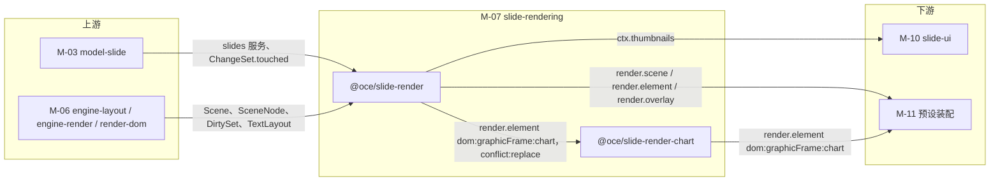
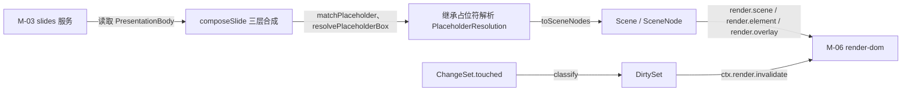
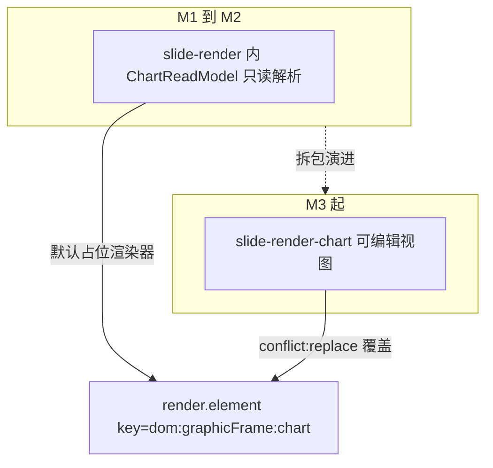
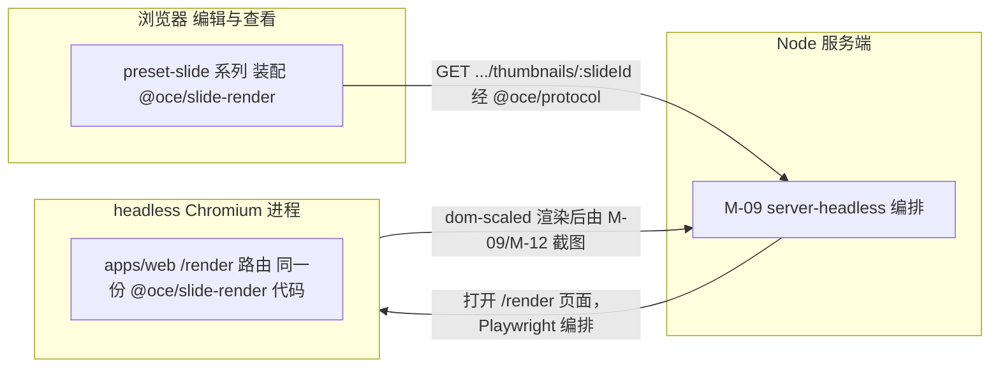
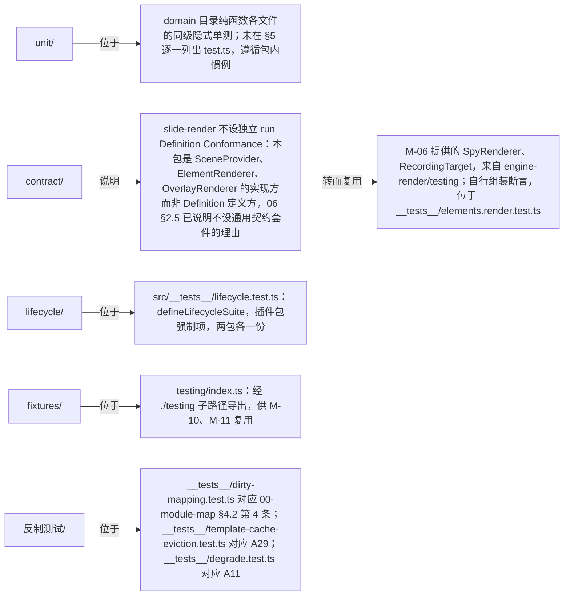

> 状态：草稿 v0.1 | 负责：架构-模块（阶段二，M-07） | 更新：2026-09-19 | 依赖：00-module-map.md M-07、charter v0.2 §4/§5.2 `slide-render`/`slide-render-chart` 行/§5.5/§6.1 D16、30-architecture `07-rendering.md` §4/§11/§14.1/§14.4、`04-document-model.md` §12.4、`02-layering-and-packages.md` §4.16/§4.16b、40-modules `03-slide-domain-model.md` §2/§6、`06-layout-and-render-engine.md` §2.5/§6/§12/§13、PRD `10-prd/03-features/01-open-and-fidelity.md` OF-07…OF-15、`07-masters-layouts-and-themes.md` ML-01 §3、ADR-0021/0026

# 07 幻灯片渲染（限界上下文 BC-12 幻灯片渲染）

## 0. 一页总览

| 项 | 值 |
|---|---|
| 职责一句话 | 实现 `SceneProvider('slide')`：读 `slides` 服务（BC-06 的语言）按母版→版式→页三层合成，产出 `Scene`（BC-11 的语言）——是唯一同时懂两种语言的适配层（00-module-map §4.2 第 4 条）；并提供按 `kind` 的元素渲染器（含图表只读解析）、母版视图渲染、三种策略的缩略图 Provider（放映模式编排 2026-09-18 起归 M-10 `slide-ui`，见跨模块评审 C-04） |
| 覆盖的上下文 | BC-12 幻灯片渲染 |
| 承载包 / 目录 | `@oce/slide-render`（V-render，秩 55，dom）、`@oce/slide-render-chart`（V-render，dom，M3 起从前者拆出）；`packages/slide-render/src/`、`packages/slide-render-chart/src/` |
| cordis 形态 | plugin（两包均为 plugin；`slide-render-chart` 以 `conflict:'replace'` 覆盖 `slide-render` 内置的图表占位渲染器） |
| 运行位置 | 浏览器（服务端经 headless Chromium 加载同一份代码间接运行，不构成独立服务端实现，06 §7） |
| 上游（依赖） | M-03（`model-slide`：`slides` 服务、`ChangeSet.touched`、样式继承与占位符匹配纯函数、`slide.shapeKind`）、M-06（`engine-layout`/`engine-render`/`render-dom`：`TextMeasurer`/`TextLayout`、`Scene`/`SceneNode`/`DirtySet`、`RenderTarget`/`ElementRenderer`/`OverlayRenderer`/`SceneProvider` 契约、`TextEditIntent` 回调通道） |
| 下游（被依赖） | M-10（`slide-ui` 消费 `ctx.thumbnails`、母版视图覆盖层数据；放映编排 2026-09-18 起由 M-10 自行实现，不再消费本包）、M-11（预设装配挂载） |
| 对外服务 | `ctx.thumbnails`（UnitScope） |
| 贡献点 | 提供：`render.scene`（key=`'slide'`）、`render.element` × 10（key=`` `dom:${kind}` ``）、`render.overlay`（key=`'master-inheritance'`，新增建议）；消费：无独立贡献点 id（按 `kind`/`id` 查表分派是内部机制，不经 `ctx.contribute`） |
| doc / sheet 通用性 | vertical（`bundle=slide`；对应未来 `doc-render`/`sheet-render`，本包是样板，00-module-map §6.2） |
| 批次 | 2 |

### 0.1 图示

**图 0-1 模块内包与上下游关系**



图怎么读：左侧两个上游模块分别提供领域数据与渲染契约；中间两个包是本模块产物，`slide-render-chart` 以 `conflict:replace` 覆盖 `slide-render` 的图表占位渲染器；右侧下游模块消费贡献点与 `ctx.thumbnails` 服务。

## 1. 限界上下文与边界

### 1.1 职责与非职责

**做什么**：

- 实现 `SceneProvider('slide')`（`domain/compose/**` + `application/services/slide-scene-provider.service.ts`）：`build(unitScope, view)` 读 `slides` 服务，按母版→版式→页三层合成（`showMasterSp`、占位符 `type/idx` 遮蔽、背景来源 slide→layout→master）产出 `Scene`；`diff(changeSet, prev)` 把 `ChangeSet.touched` 按实体类型映射为 `DirtySet`。
- 复用 M-03 的样式继承与占位符匹配纯函数（`resolveShapeVisual`/`matchPlaceholder`/`dependentsOf` 等），不重新实现继承算法本体，只把其结果转换为 `SceneNode.data`。
- 按 `kind` 提供 `render.element`：`sp`/`pic`/`grpSp`/`cxnSp`/`graphicFrame:table`/`graphicFrame:ole`/`graphicFrame:diagram`/`unknown`/`background`；`graphicFrame:chart` 在 M1–M2 提供只读预览渲染器（`c:chart` 部件不透明保留 + 缓存数据渲染，章程 D16），M3 起被 `slide-render-chart` 以 `conflict:'replace'` 覆盖。
- 文本渲染接入 `engine-layout.layoutTextBody()`，消费其返回的 `TextLayout`（M-06 G-3 统一命名）绘制 `<text>/<tspan>`；`TextEditIntent`（M-06 G-6）不在本包运行时调用链中出现——本包只保证 `SceneNode.id === ShapeId`、`node.data` 携带 `CaretMap`，使 render-dom → `engine-render.attach()` → 消费方（M-10 `slide-ui`，06 §13 Q-2 默认值）之间的回调通道能把 `nodeId` 还原为 `ShapeId`（§2.6、§12 G-3）。
- 维护母版/版式渲染模板 LRU（`LayerTemplateCache`，32 项）与其淘汰测试——这是架构 07 §11「三处 LRU」之外、专属本包的第 4 处缓存（06 §12 G-7）。
- 实现母版视图：`ViewDescriptor{mode:'master', target: LayoutId|MasterId}`（04 §12.4）分支合成，叠加「继承自母版」覆盖层标记（PRD ML-01）。
- 提供 `ctx.thumbnails`（UnitScope 服务）：三种 Provider 策略（主线程缩放渲染 dom-scaled / OffscreenCanvas 后台栅格化 / 服务端 PNG）取舍与切换。
- 对不支持/渲染失败的元素提供占位框降级路径，区分「预期降级」（本包自己 `emit render/element-degraded`）与「意外失败」（render-dom 兜底 `emit render/element-failed`，本包只需让错误可分类地抛出）。
- 定义 `@oce/slide-render-chart` 的拆包边界：M1–M2 图表只读解析代码物理位于 `slide-render` 内；M3 起编辑能力与图表库整体迁入 `slide-render-chart`，`slide-render` 只保留缺省占位渲染器。

**不做什么（指向负责模块）**：

- 不定义 `Scene`/`SceneNode`/`DirtySet`/`RenderTarget`/`ElementRenderer`/`SceneProvider`/`OverlayRenderer`/`TextMeasurer`/`TextLayout` 契约本身——是 M-06 的职责；本包只实现/消费这些契约。
- 不做帧调度、脏区合并、命中测试索引、覆盖层通用挂载机制、`RenderTarget.paint`/DOM 图元 API——是 M-06（`engine-render`/`render-dom`）的职责；本包渲染器只产出/更新 DOM 句柄，不参与调度。
- 不做 Store 事务、命令执行、Mutation、样式继承算法本体、引用完整性不变量——是 M-03 的职责；本包只读 `slides` 服务与 `ChangeSet`。
- 不做 `c:chart` 等 OOXML 的 XML 解析算法本体——是 M-04（`ooxml-core`/`ooxml-pptx`）的职责；图表 read-model 只调用 M-04 暴露的 `chartml.parseChartSpace`。
- 不做 Ribbon/属性面板/缩略图侧栏等 UI 组件与交互——是 M-10（`slide-ui`）的职责；本包只暴露 `ctx.thumbnails` 服务与 Scene/覆盖层数据，不渲染任何非画布 UI chrome。
- 不做服务端 headless 渲染的任务编排（队列、Playwright 调度）——是 M-09/M-12 的职责；本包代码只是被同一套浏览器代码加载执行，不感知自己在服务端运行。
- 不做放映模式编排（全屏、键盘翻页、黑屏/白屏、`Viewport.mode='show'` 状态机、发 `slide/show-changed`）——**2026-09-18 跨模块评审 C-04 裁定**该职责归 M-10（`slide-ui`）；原 `application/services/slideshow.service.ts` 已删除，本包只响应 `ViewDescriptor.mode` 变化产出对应 `Scene`，不持有放映状态、不发放映相关事件。

### 1.2 通用语言

复用 charter §4.1 核心术语：`Scene`/`SceneNode`/`SceneProvider`/`ElementRenderer`/`RenderTarget`/`OverlayRenderer`/`DirtySet`/`ViewDescriptor`/`TextMeasurer`/`TextLayout`，以及 M-03 的 `PresentationBody`/`slides` 服务/`ChangeSet.touched`。本上下文特有术语：

| 术语 | 定义 | 对应类型名 |
|---|---|---|
| 合成场景 | 母版/版式/页三层合成后的运行时派生结构，`SceneProvider.build()` 的中间产物，不参与 CRDT 合并 | `ComposedSlide`/`ComposedLayer`/`ComposedElement` |
| 继承占位符解析结果 | 复用 M-03 `matchPlaceholder`/`resolvePlaceholderBox` 的输出，标注某形状可继承字段来自哪一层 | `PlaceholderResolution{shapeId, source:'slide'\|'layout'\|'master'}` |
| 模板层 | 母版/版式层渲染结果按 `(layoutId, showMasterSp, themeVersion)` 缓存并 `cloneNode` 复用 | `LayerTemplateCache` |
| 继承自母版覆盖层 | 母版视图中标出「此形状定义来自母版」的视觉标记 | `OverlayRenderer('master-inheritance')` |
| 脏区分类 | `ChangeSet.touched` 按实体类型（slide/shape/layout/master/theme/media）到 `DirtySet` 的映射规则 | `classify(paths, dependentsOf)` |
| 图表只读解析结果 | `c:chart` 部件经 `chartml.parseChartSpace` 后缓存的只读数据视图 | `ChartReadModel` |

### 1.3 上下文映射

| 相邻上下文 | 关系类型 | ACL / 落点文件 | 传递的契约 |
|---|---|---|---|
| BC-06 幻灯片领域模型（上游） | Customer–Supplier（本包为客户，只读，对 `slides` 服务契约无议价权） | `application/services/slide-scene-provider.service.ts` | `SlidesService`（04 §3.4）、`ChangeSet.touched` |
| BC-11 渲染管线与目标（上游，Open Host Service `render.*`） | Conformist（本包实现四个贡献点，照单全收 `Scene`/`SceneNode`/`DirtySet`/`ElementRenderer` 形状） | `src/plugin.ts` 的 `ctx.contribute` 调用点 | `SceneProvider`/`ElementRenderer`/`OverlayRenderer` 接口（06 §2.5） |
| BC-10 布局与度量引擎（上游，经 BC-11 传入） | Customer–Supplier | `infrastructure/elements/shared/text-body.painter.ts` | `TextMeasurer`（`ctx.layout.measurer()`）、`layoutTextBody()` → `TextLayout` |
| BC-07/08 OOXML 与 PPTX 编解码（上游，经 BlobStore 间接） | Customer–Supplier（图表只读解析路径） | `infrastructure/chart/*` | `chartml.parseChartSpace`（M-04）、`BlobStore`（M-02） |
| BC-15 幻灯片 UI（下游） | Customer–Supplier（`slide-ui` 消费 `ctx.thumbnails`；`TextEditIntent` 的默认最终消费方，06 §13 Q-2） | `src/slide-render.contribution.ts` | `ThumbnailService` 类型、`Scene`/`OverlayContext` |
| BC-27/M-09 Headless 渲染宿主（下游，间接） | Conformist（同一份代码被加载，无独立实现分支） | — | 无新增契约（复用 `RenderTarget`/`toImage`） |
| BC-29 doc/sheet 扩展占位（同层带兄弟） | Separate Ways（铁律 2） | — | 无共享类型；仅共享水平层 BC-02/05/10/11 |

---

## 2. 领域模型

> UI / 基础设施类模块标题替换（模板 §2 说明）；本包无持久化聚合——权威事实源始终是 M-03 的 `PresentationBody`，本节的「聚合」是每次 `SceneProvider.build()` 调用即可从零重建的运行时派生结构，不参与 CRDT 合并（同 06 §2 的措辞）。

### 2.1 合成模型（`ComposedSlide`、继承占位符解析结果、`Layer` 顺序）

| 名称 | 归类 | 关键字段 | 不变量 | 所在文件 |
|---|---|---|---|---|
| `ComposedSlide` | 聚合根（`build()` 调用期间的中间产物） | `target: SlideId\|LayoutId\|MasterId`、`viewMode:'edit'\|'master'\|'thumbnail'\|'present'`、`background: ResolvedBackground`、`layers:{master?; layout?; slide?: ComposedLayer}`、`dependencies:{themeId;masterId;layoutId}` | `viewMode==='master'` 时 `layers.slide` 恒为空（母版视图不合成页层，04 §12.4）；三层同时存在时渲染顺序恒为 master→layout→slide | `domain/contracts/composed-slide.ts` |
| `ComposedLayer` | 实体（属于某个 `ComposedSlide`） | `source:'master'\|'layout'\|'slide'`、`elements: ComposedElement[]`（已按 `(order,id)` 排序） | 元素顺序即 z 序；`occluded:true` 的元素不产出 `SceneNode`，但保留在结构中供诊断/测试断言 | `domain/contracts/composed-slide.ts` |
| `ComposedElement` | 实体 | `shapeId: ShapeId`、`kind: Shape['kind']`、`resolvedVisual: ResolvedShapeVisual`（复用 M-03）、`placeholder?: PlaceholderResolution`、`occluded: boolean`、`inheritedFrom?:'master'\|'layout'` | `occluded=true` 当且仅当页/版式层存在相同 `(type,idx)` 占位符覆盖了母版/版式对应占位符（`showMasterSp` 语义）；`inheritedFrom` 只在 `viewMode==='master'` 且元素来自非目标层时置位，驱动 §2.6 的继承覆盖层 | `domain/contracts/composed-slide.ts` |
| `PlaceholderResolution` | 值对象（附着在 `ComposedElement` 上） | `shapeId`、`source:'slide'\|'layout'\|'master'`、`ref: PlaceholderRef`（M-03 类型） | 直接复用 M-03 `matchPlaceholder`/`resolvePlaceholderBox` 的返回值，本包不重新实现匹配算法 | `domain/contracts/dirty-classification.ts`（与脏区分类值对象合并存放，见 §4 命名说明） |

**Layer 顺序不变量**：背景独立于三层，恒最先绘制；三层内部顺序固定为 master→layout→slide（后者覆盖前者同位置的占位符）；同层内形状顺序取自 M-03 的 `(order, id)` 全序，本包不重新排序。母版视图分支（`viewMode==='master'`）由 `domain/compose/compose-master-view.ts` 单独实现：目标为 `LayoutId` 时合成 `{layout: 目标版式, master: 其母版}` 两层并置 `showMasterShapes` 语义；目标为 `MasterId` 时只合成 `{master: 目标母版}` 一层；两种情形均不合成 `slide` 层，占位符渲染为提示框（自带 prompt 或按 `type` 的 i18n 默认文案，04 §12.4）。

**`viewMode` 取值来源**（2026-09-18，跨模块评审 C-13）：`ComposedSlide.viewMode` 的四个取值 `edit|master|thumbnail|present` 与 `build(unitScope, view: ViewDescriptor)` 传入的 `ViewDescriptor.mode` 一一对应，由**engine-render（M-06）**的 `mapViewMode()` 统一从 ui-core 的 `normal|master|presenter` 映射得出；本包只按 `view.mode` 透传赋值，不重新实现或反向定义该映射（§5.1 `domain/contracts/composed-slide.ts` 备注同步）。

**图 2-1 母版/版式/页合成到 Scene 的流程**



图怎么读：上半条链路是首次合成——从 `slides` 服务读取到产出 `Scene` 再交给 `render-dom` 挂载渲染器；下半条链路是增量更新——`ChangeSet.touched` 经 `classify` 归类为 `DirtySet` 后驱动同一个 `render-dom` 失效重绘。

### 2.2 值对象

| 名称 | 字段摘要 | 校验 schema | 所在文件 |
|---|---|---|---|
| `ThumbnailDescriptor` | `{ target: SlideId\|LayoutId\|MasterId; url?: string; element?: unknown; revision: number; provider: 'dom-scaled'\|'offscreen-canvas'\|'server-png' }` | zod | `domain/contracts/composed-slide.ts` |
| `DirtyClassificationEntry` | `{ entityType:'slide'\|'shape'\|'layout'\|'master'\|'theme'\|'media'; toNodeIds(touched: Path[], deps): NodeId[] \| 'full' }` | 无（运行时策略表，非线上数据） | `domain/contracts/dirty-classification.ts` |
| `ChartReadModel` | `{ type: ChartType; categories: string[]; series: {name;values:number[]}[]; cacheHash: string }` | zod（M1–M2 只读，M3 起 `slide-render-chart` 扩展为可编辑视图） | `infrastructure/chart/chart-preview.renderer.ts`（类型随实现共同声明，M3 迁至 `slide-render-chart`） |
| `LayerTemplateKey` | `(layoutId: LayoutId, showMasterSp: boolean, themeVersion: number)` 规范化字符串键 | 无 | `infrastructure/cache/layer-template-cache.ts` |
| `ResolvedBackground` | 复用 M-03 `effectiveBackground()` 的返回值（`Background` 值对象），不重定义 | — | `domain/compose/compose-slide.ts`（re-export） |

**图 2-2 图表拆包边界**



图怎么读：同一个贡献点 key 在不同阶段由不同实现占据；M3 起 `slide-render-chart` 以 `conflict:replace` 覆盖 M1 到 M2 阶段 `slide-render` 内置的只读解析实现。

### 2.3 纯函数（合成、脏区映射、缩略图尺寸）

| 函数 | 签名（草案） | 所在文件 | 说明 |
|---|---|---|---|
| `composeSlide` | `(slides: SlidesService, slideId: SlideId) => ComposedSlide` | `domain/compose/compose-slide.ts` | 普通编辑/放映视图；内部调用 `effectiveBackground`/`matchPlaceholder`（M-03） |
| `composeMasterView` | `(slides: SlidesService, target: LayoutId \| MasterId) => ComposedSlide` | `domain/compose/compose-master-view.ts` | 母版视图分支（04 §12.4），标注 `inheritedFrom` |
| `toSceneNodes` | `(composed: ComposedSlide) => SceneNode[]` | `domain/scene/to-scene-nodes.ts` | 约定 `SceneNode.id === shapeId`（§2.6、§12 G-3） |
| `toLayoutInput` | `(run: ResolvedRunProperties, paragraph: ResolvedParagraphProperties) => TextBodyModel` | `domain/scene/to-layout-input.ts` | 供 `engine-layout.layoutTextBody()` 消费 |
| `classify` | `(touched: readonly Path[], dependentsOf: DependentsOfFn) => DirtySet` | `domain/dirty/classify.ts` | `ChangeSet.touched` → `DirtySet`；内含按实体类型的映射表（§2.4 表） |
| `thumbnailSize` | `(pageSize: Size, targetWidth: Px) => Size` | `domain/thumbnail/thumbnail-size.ts` | 保持宽高比，供三种 Provider 共用 |
| `resolvePaint` | `(visual: ResolvedShapeVisual, theme: Theme) => PaintParams` | `domain/geometry/resolve.ts` | 颜色变换（`lumMod`/`tint`/`alpha`）复用 M-03 `resolveColor` |
| `shapeGeometryPath` | `(shape: Shape, box: Rect<Emu>) => GeometryPath` | `domain/geometry/resolve.ts` | 委派 `engine-layout` 的 `presetGeometryPath`/`customGeometryPath`，附加文本内接矩形 `txRect` |

全部为纯函数（无 DOM API 调用），便于在 `happy-dom`/Node 环境单测；但本包 `package.json#oce.iso = 'dom'`，不构成可被 `server-headless`（node）直接 import 的跨端复用面（R16，isomorphism 兼容性），服务端只经 headless Chromium 间接执行同一份代码（06 §7）。

**`classify` 的脏区分类表**（`ChangeSet.touched` 路径前缀 → `DirtySet` 归类；按实体类型逐行，00-module-map §4.2 第 4 条要求的映射由本表落地）：

| Store 路径前缀（实体类型） | 归类结果 | 理由 |
|---|---|---|
| `shapes.<id>.*` | 该 `shapeId` 对应的 `NodeId` 进 `nodeIds`（若形状在多页/多层出现——如同一版式被多页引用——需展开为全部引用者） | 形状级修改只影响自身渲染节点 |
| `slides.<id>.order` / `.layoutId` / `.hidden` / `.background` | 该页 `NodeId` 全量（`full` 相对该页 `Scene`，非跨页） | 页级属性变化通常影响整页合成（背景/版式切换会级联占位符遮蔽结果） |
| `layouts.<id>.*` | `dependentsOf(body, layoutId)`（M-03）返回的全部引用页 → 各自 `full`；命中的 `LayerTemplateCache` 条目一并失效 | 版式改动影响其模板层与全部引用页 |
| `masters.<id>.*` | `dependentsOf(body, masterId)` 返回的全部版式与页 → 各自 `full`；模板缓存失效 | 母版改动级联到其下全部版式 |
| `themes.<id>.*` | `dependentsOf(body, themeId)`（经引用它的母版）返回的全部页 → 各自 `full` | 主题变化改变全部依赖它的颜色/字体解析结果 |
| `media.<id>.*` | 引用该媒体的形状对应 `NodeId` 进 `nodeIds`（不触发整页重排） | 媒体替换只影响使用它的图片形状 |
| 其它（`presentation.*` 等） | `DirtySet.full = true`（相对当前 `Scene`） | 保守兜底，避免遗漏 |

### 2.4 领域事件

| 事件 | 载荷（草案） | 发布者文件 | 典型订阅者 |
|---|---|---|---|
| `slide/thumbnail-updated` | `{ unitId; target: SlideId\|LayoutId\|MasterId; revision: number }` | `application/services/thumbnail.service.ts` | `slide-ui` 缩略图侧栏、母版视图缩略图窗格（PRD ML-01） |
| `slide/show-changed`（**不由本包发布**，2026-09-18 起） | `{ unitId; mode:'entering'\|'exiting'; slideId?: SlideId }` | `slide-ui`（M-10 `application/slideshow.ts` 或等价文件，跨模块评审 C-04；原 `application/services/slideshow.service.ts` 已删除） | `slide-ui` 放映 UI、应用壳全屏控制 |
| `render/element-degraded`（Events 声明在 M-06 `engine-render`，emit 调用点在本包） | `{ unitId; nodeId; kind; reason }`；`reason ∈ 'chart-unavailable'\|'emf-no-preview'\|'ole-preview-missing'\|'smartart-no-dsp'\|'unsupported-shape-kind'` | `infrastructure/elements/{pic,fallback}.renderer.ts`、`infrastructure/chart/chart-preview.renderer.ts` | `errors.report`、保真诊断面板（OF-13）、`slide-ui` 提示 |

`render/element-failed` **不由本包 emit**：该事件在 render-dom 的 `painter.ts` 捕获 `ElementRenderer.render`/`update` 抛出的意外异常时统一发出（06 §2.4，A11）；本包渲染器对「预期内的降级」（缺失预览、图表插件未加载等）必须自行捕获并转成占位框 + `render/element-degraded`，只把真正意外的错误原样 `throw` 交给上游兜底——两条路径的边界见 §12 G-4。

订阅：无跨包订阅。`application/services/slide-scene-provider.service.ts` 内部经 `unitScope.get('store').observe()` 订阅本 Unit 的 `store/transaction`，驱动 `diff()` 调用与向 `ctx.render.invalidate(dirty)` 的转发（06 §2.6「触发点：调用方（BC-12）」），这与 M-03 `slides.service.ts` 内部订阅 `store/transaction` 是同一模式，均非跨包 `Events` 订阅。

### 2.5 消费的 Definition 与自身对外契约（`SlideSceneProvider` 配置）

**消费的 Definition**（全部来自 M-06，本包不重新定义，只 `implements`/调用）：`SceneProvider`（实现方）、`ElementRenderer`（实现方，×10）、`OverlayRenderer`（实现方，`'master-inheritance'`）、`RenderTarget`（调用方，经 `ctx.render` 间接使用 `toImage`/`hitTest`，不自己 `implements`）、`TextMeasurer`（调用方，经 `ctx.layout.measurer()`）。

**自身对外契约：`SlideRenderConfig`**（`src/config.ts`，zod）：

```ts
const SlideRenderConfig = z.object({
  layerTemplateCache: z.object({ maxEntries: z.number().default(32) }),
  thumbnails: z.object({
    provider: z.enum(['dom-scaled', 'offscreen-canvas', 'server-png']).default('dom-scaled'),
    width: z.number().default(192),
    debounceMs: z.number().default(300),
    maxMounted: z.number().default(12),
  }),
  charts: z.object({ enabled: z.boolean().default(true) }),
})
```

**`ctx.thumbnails` 服务面**（`ThumbnailService`，UnitScope 内；`domain/contracts/composed-slide.ts` 声明类型，`application/services/thumbnail.service.ts` 实现）：

```ts
interface ThumbnailService {
  get(target: SlideId | LayoutId | MasterId): ThumbnailDescriptor
  subscribe(target: SlideId | LayoutId | MasterId, cb: (d: ThumbnailDescriptor) => void): () => void
}
```

### 2.6 应用服务（渲染请求、缩略图请求、母版视图切换）

| 应用服务 | 职责 | 触发者 | 所在文件 |
|---|---|---|---|
| `SlideSceneProvider`（渲染请求） | `build(unitScope,view)`：三层合成 → `toSceneNodes`；`diff(changeSet,prev)`：内部订阅 `store/transaction` → `classify` → 转发 `ctx.render.invalidate(dirty)` | `engine-render.RenderService.attach()`（首次 `build`）；本包内部 store 订阅（后续 `diff`） | `application/services/slide-scene-provider.service.ts` |
| `ThumbnailService`（缩略图请求） | `get(target)`/`subscribe(target,cb)`：按配置选择 Provider、300 ms 去抖、`maxMounted` 上限、本地脏页在服务端 PNG 到达前用 `dom-scaled` 兜底 | `slide-ui` 缩略图侧栏、母版视图缩略图窗格（PRD ML-01 §3） | `application/services/thumbnail.service.ts` |
| 母版视图切换（读侧响应） | `ViewDescriptor.mode` 变为 `'master'` 时 `build()` 走 `composeMasterView` 分支；贡献 `OverlayRenderer('master-inheritance')`，在 `inheritedFrom` 非空节点上叠加「母版·〈类型〉」徽标（PRD ML-01 虚线 + 徽标规格） | `slide-ui` 视图分段/范围条（Operation `slide.selectMasterOrLayout`，M-03 §2.6） | `domain/compose/compose-master-view.ts`、`infrastructure/overlay/master-inheritance.overlay.ts` |

~~`SlideshowService`（放映模式）~~ **已删除（2026-09-18，跨模块评审 C-04）**：`Viewport.mode='show'`、全屏、键盘翻页、黑屏/白屏、发 `slide/show-changed` 的编排职责改由 M-10（`slide-ui`）自行实现，原 `application/services/slideshow.service.ts` 文件不再存在于本包。

`TextEditIntent` 的回调注册与派发**不经过**本包的任何应用服务——它是 render-dom 的 `TextInputHost` → `engine-render.RenderService.attach(targetId, container, callbacks?)` → 消费方（06 §13 Q-2 默认 `slide-ui`）之间的直接通道；本包在 §2.1/§2.3 的约定（`SceneNode.id===ShapeId`、`node.data` 携带 `CaretMap`）是这条通道能够把 `TextEditIntent.nodeId` 还原为 `ShapeId` 的必要前提，但本包自身不持有回调、不出现在运行时调用栈中（§12 G-3）。

---

## 3. cordis 插件定义

> 两包均为标准插件；`slide-render` 根级只注册贡献点（无需 UnitScope），`ctx.thumbnails` 经 `unitPlugins` 在每个 Unit 内单独挂载（模式同 03 §3 `model-slide` 的 `slides` 服务）；`slide-render-chart` 用 `conflict:'replace'` 覆盖前者的图表占位渲染器，二者不互相 `inject`，只共享同一个 `render.element` 贡献点 key。

**`@oce/slide-render`**

| 项 | 值 |
|---|---|
| 插件名 / `name` | `slide-render` |
| `inject`（必需 / 可选） | 根级必需：`['contributions']`；UnitScope 子插件（`unitPlugins`）必需：`['render', 'layout', 'slides']` |
| `provide` | 根级：无；UnitScope 内：`['thumbnails']` |
| 贡献点：提供 | `render.scene`（key=`'slide'`，`conflict:'error'`）；`render.element` × 10（key=`` `dom:${kind}` ``：`sp`/`pic`/`grpSp`/`cxnSp`/`graphicFrame:table`/`graphicFrame:ole`/`graphicFrame:diagram`/`unknown`/`background` 九项 `conflict:'error'`，`graphicFrame:chart` 一项 `conflict:'replace'` 供 `slide-render-chart` 覆盖）；`render.overlay`（key=`'master-inheritance'`，新增建议，`conflict:'error'`） |
| 贡献点：消费 | 无独立（内部按 `kind` 查表分派到自己的渲染器，属实现细节非 `ctx.contribute` 消费） |
| 事件：发布 | `slide/thumbnail-updated`、`render/element-degraded`（Events 声明在 M-06，emit 调用点在本包，§2.4）；`slide/show-changed` **不再由本包发布**（2026-09-18 起改由 `slide-ui`，C-04） |
| 事件：订阅 | `store/transaction`（本 Unit 内部，非跨包，§2.4） |
| 配置 schema | `SlideRenderConfig`（§2.5） |
| 生命周期 | `ready`：根级贡献注册完成；UnitScope 子插件随每个 Unit 挂载/卸载 `thumbnails` 服务与内部 store 订阅（`ctx.effect` 拥有，Unit 关闭时自动撤销）；`dispose`：撤销全部贡献 + 清空 `LayerTemplateCache`；PENDING：`render`/`layout`/`slides` 三者任一未就位 |
| Manifest 片段 | `{"name":"@oce/slide-render","provides":[],"contributes":{"render.scene":["slide"],"render.element":["dom:sp","dom:pic","dom:grpSp","dom:cxnSp","dom:graphicFrame:table","dom:graphicFrame:chart","dom:graphicFrame:ole","dom:graphicFrame:diagram","dom:unknown","dom:background"],"render.overlay":["master-inheritance"]},"unitPlugins":{"provides":["thumbnails"],"injects":["render","layout","slides"]},"isomorphism":"dom"}` |

**`@oce/slide-render-chart`**（M3 起独立发包；M1–M2 语义上等同于 `slide-render/chart` 子路径，见 §8）

| 项 | 值 |
|---|---|
| 插件名 / `name` | `slide-render-chart` |
| `inject`（必需 / 可选） | 必需：`['contributions']`；可选：`['commands']`（M3 编辑能力才需要，缺失时只读渲染仍可用） |
| `provide` | 无 |
| 贡献点：提供 | `render.element`（key=`` `dom:graphicFrame:chart` ``，`conflict:'replace'`，覆盖 `slide-render` 的默认占位渲染器） |
| 贡献点：消费 | 无 |
| 事件：发布 | `render/element-degraded{reason:'chart-unavailable'}`（未加载/解析失败时的占位路径，与 `slide-render` 共用同一 `reason` 取值） |
| 事件：订阅 | 无 |
| 配置 schema | `Config{ editableTypes: z.array(z.enum(['bar','line','pie'])).default(['bar','line','pie']) }`（章程 Q18 待定，默认三类，M3 起生效） |
| 生命周期 | `ready`：`render.element` 覆盖注册；`dispose`：随 Fiber 清理；不在 UnitScope 内（无状态查表渲染器，与 `slide-render` 主体一致） |
| Manifest 片段 | `{"name":"@oce/slide-render-chart","provides":[],"contributes":{"render.element":["dom:graphicFrame:chart"]},"isomorphism":"dom"}` |

**可插拔证据（OF-09）**：`slide-render-chart` 缺席或加载失败时，`render.element('dom:graphicFrame:chart')` 查表落回 `slide-render` 内置的 `chart-preview.renderer.ts` 占位渲染器（`conflict:'replace'` 语义决定谁在场谁生效），不影响页面其余元素渲染。

---

## 4. 目录树（完整到文件）

> **总编排裁定落地**：`src/` 下按 00-module-map §1 的 DDD 对照表物理落入 `domain/`/`application/`/`infrastructure/`/`testing/` 四个顶层目录（`interface/` 省略——本包无独立 UI/协议对外呈现面，对外 API 完全由 `src/index.ts` 汇总，同 06 §4 对三个引擎包的处理）；架构 07 §4.3 与 02 §4.16 的扁平骨架（`scene/`、`elements/`、`thumbnails/`、`show/` 等）按此重新归位，新旧路径对照与差异见 §12 G-1/G-5。包级样板文件遵循 02 §4.0「包模板」。测试布局同 03/06：`src/__tests__/`（单测/集成，本节展开）+ `src/testing/`（`./testing` 子路径，测试替身与夹具）。两包合计 **77 个文件**（`slide-render` 51 + `slide-render-chart` 26），高于 00-module-map §7 M-07 行给出的 50–70 估计（差异原因见 §12 G-6）。**2026-09-18 更新**：`slide-render` 原 52 文件含 `application/services/slideshow.service.ts`（放映模式编排），按跨模块评审 C-04 裁定该文件删除、职责移交 M-10（`slide-ui`），故本包由 52 降为 51、两包合计由 78 降为 77。

### 4.1 `@oce/slide-render`

```text
packages/slide-render/
├── package.json                        # oce: { layer:'V-render', bundle:'slide', iso:'dom', role:'plugin', stability:'beta' }
├── tsconfig.json
├── tsconfig.test.json
├── vitest.config.ts                    # environment: happy-dom
├── api-extractor.json
├── etc/
│   └── slide-render.api.md
├── README.md
├── CHANGELOG.md
├── oce-manifest.json
├── src/
│   ├── index.ts                        # 公共 API 面（§6）
│   ├── plugin.ts                       # 根贡献注册 + UnitScope 子插件（§3）
│   ├── manifest.ts
│   ├── slide-render.contribution.ts    # declare module 增强：Context.thumbnails、Events
│   ├── config.ts                       # SlideRenderConfig（§2.5）
│   ├── events.ts                       # 事件名常量
│   ├── errors.ts                       # slide.render.* 错误码
│   ├── domain/
│   │   ├── contracts/
│   │   │   ├── composed-slide.ts       # ComposedSlide/Layer/Element、ThumbnailDescriptor（§2.1/§2.2）
│   │   │   └── dirty-classification.ts # PlaceholderResolution、DirtyClassificationEntry（§2.1/§2.2）
│   │   ├── compose/
│   │   │   ├── compose-slide.ts        # composeSlide：三层合成、占位符遮蔽、背景来源（§2.3）
│   │   │   └── compose-master-view.ts  # composeMasterView：ViewDescriptor{mode:'master'} 分支（04 §12.4）
│   │   ├── scene/
│   │   │   ├── to-scene-nodes.ts       # ComposedSlide → SceneNode[]；SceneNode.id===ShapeId 约定
│   │   │   └── to-layout-input.ts      # ResolvedRun/Paragraph → engine-layout TextBodyModel
│   │   ├── dirty/
│   │   │   └── classify.ts             # StorePath → DirtyRegion；§2.4 脏区分类表
│   │   ├── thumbnail/
│   │   │   └── thumbnail-size.ts       # pageSize+targetWidth → Size（保持宽高比）
│   │   └── geometry/
│   │       └── resolve.ts              # shapeGeometryPath + resolvePaint
│   ├── application/
│   │   └── services/
│   │       ├── slide-scene-provider.service.ts  # SceneProvider('slide')：build/diff；内部订阅 store/transaction
│   │       └── thumbnail.service.ts             # ThumbnailService：get/subscribe、Provider 选择、去抖
│   ├── infrastructure/
│   │   ├── cache/
│   │   │   └── layer-template-cache.ts # LayerTemplateCache：LRU 32 项 + 失效 + 统计（A29）
│   │   ├── elements/
│   │   │   ├── sp.renderer.ts          # 几何 + 填充/线 + 文本
│   │   │   ├── pic.renderer.ts         # srcRect 裁切、EMF/WMF 预览/占位（OF-07）
│   │   │   ├── grp-sp.renderer.ts      # chOff/chExt 子坐标系 <g transform>
│   │   │   ├── cxn-sp.renderer.ts      # stCxn/endCxn 连接点解析（ED-28）
│   │   │   ├── table.renderer.ts       # 行列/合并/tblStyle 继承（OF-08）
│   │   │   ├── fallback.renderer.ts    # graphicFrame:ole / graphicFrame:diagram / unknown 共用占位（OF-10/OF-13）
│   │   │   ├── background.renderer.ts
│   │   │   └── shared/
│   │   │       ├── text-body.painter.ts # TextLayout → <text>/<tspan>；autofit 循环
│   │   │       └── paint.ts             # DrawingML → SVG paint server（fill/line/effect）
│   │   ├── chart/
│   │   │   └── chart-preview.renderer.ts # M1–M2 只读预览渲染器 + 缺省占位（章程 D16；M3 起被覆盖）
│   │   ├── overlay/
│   │   │   └── master-inheritance.overlay.ts # render.overlay('master-inheritance')，新增建议
│   │   └── thumbnails/
│   │       ├── dom-scaled.provider.ts        # 策略①：主线程缩放渲染（真实 Surface + CSS scale）
│   │       ├── offscreen-canvas.provider.ts  # 策略②：OffscreenCanvas 后台栅格化（新增建议）
│   │       └── server-png.provider.ts        # 策略③：服务端 PNG（ADR-0026）
│   ├── testing/
│   │   └── index.ts                    # `@oce/slide-render/testing`：renderSlideToSvgString、fixtures、builders
│   └── __tests__/
│       ├── lifecycle.test.ts
│       ├── compose-reconcile.test.ts   # 版式切换复用元素实例；z 变化只移动节点
│       ├── master-view.test.ts         # ViewDescriptor{mode:'master'} + 继承覆盖层
│       ├── dirty-mapping.test.ts       # 按实体类型的 classify 断言（§2.4 表）
│       ├── template-cache-eviction.test.ts # A29 反制测试
│       ├── elements.render.test.ts     # 每个 kind 的 SVG 快照 + autofit 收敛
│       ├── degrade.test.ts             # A11：占位框 + render/element-degraded/-failed 边界
│       └── thumbnails.test.ts          # 三种 Provider 切换、去抖、maxMounted
```

同位测试约定（02 §4.0）：本包无独立顶层 `tests/` 目录，`__tests__/`/`testing/` 均在 `src/` 内，详见 §9。共 **51 个文件**（根配置 9 + `src/` 顶层 7 + `domain/` 9 + `application/` 2 + `infrastructure/` 15 + `testing/` 1 + `__tests__/` 8；`application/` 原为 3，`slideshow.service.ts` 已按 C-04 删除）。

### 4.2 `@oce/slide-render-chart`

> M1–M2 阶段本树**不独立存在**——其内容以 `@oce/slide-render/infrastructure/chart/` 的只读子集形式落在 4.1 树内（`chart-preview.renderer.ts`）；下表是 M3 拆包后的目标形态（章程 D16、02 §4.16b）。拆包动作只搬移文件与改 `preset-slide` 的 import 路径，不改变已跑通的只读渲染逻辑。

```text
packages/slide-render-chart/
├── package.json                        # oce: { layer:'V-render', bundle:'slide', iso:'dom', role:'plugin', stability:'experimental' }
├── tsconfig.json
├── tsconfig.test.json
├── vitest.config.ts
├── api-extractor.json
├── etc/
│   └── slide-render-chart.api.md
├── README.md
├── CHANGELOG.md
├── oce-manifest.json
├── src/
│   ├── index.ts                        # 公共 API 面（§6）
│   ├── plugin.ts                       # contribute render.element('dom:graphicFrame:chart')，conflict:'replace'
│   ├── manifest.ts
│   ├── slide-render-chart.contribution.ts
│   ├── errors.ts                       # slide.render.chart.* 错误码
│   ├── domain/
│   │   ├── chart-model.ts              # ChartReadModel（只读）+ Chart.data（M3 可编辑，对齐 M-03 domain/model/shape/chart.ts）
│   │   └── chart-layout.ts             # 纯函数：数值域 → 绘图区坐标映射（plot-bound，OF-09 诊断依据）
│   ├── application/
│   │   └── chart-editing.service.ts    # M3：读取/写入图表数据；点选系列/数据点 → 属性面板（ED-15）
│   ├── infrastructure/
│   │   ├── chart-read-model.provider.ts # partRef → BlobStore → ooxml-core chartml 解析 → 缓存（按 hash）；render.element 分派入口
│   │   └── renderers/
│   │       ├── bar.renderer.ts         # M3 可编辑类型（章程 Q18，rulings §4.12 U-06）
│   │       ├── line.renderer.ts        # M3 可编辑类型
│   │       ├── pie.renderer.ts         # M3 可编辑类型
│   │       ├── area.renderer.ts        # M3 可编辑类型（rulings §4.12 U-06 新增）
│   │       ├── scatter.renderer.ts     # M3 可编辑类型（rulings §4.12 U-06 新增）
│   │       └── approx.renderer.ts      # 其余只读近似类型（气泡/雷达/股价/组合/3D/曲面/地图，§2.6 矩阵）
│   ├── testing/
│   │   └── index.ts                    # fixtures + ChartReadModel builders
│   └── __tests__/
│       ├── lifecycle.test.ts
│       ├── renderers.test.ts           # SSIM ≥0.80 + 数据墨迹 IoU ≥0.85（OF-09 口径）
│       └── chart-data-roundtrip.test.ts # M3：编辑写回 c:numCache/strCache 一致性
```

共 **28 个文件**（根配置 9 + `src/` 顶层 5 + `domain/` 2 + `application/` 1 + `infrastructure/` 7 + `testing/` 1 + `__tests__/` 3；`infrastructure/renderers/` 因 area/scatter 转为可编辑类型由 3 增至 5，rulings §4.12 U-06）。两包合计 80 个文件。

---

## 5. 文件职责表

> 逐文件一行，与 §4 一一对应；「允许依赖」省略 `@oce/kernel`/`@oce/shared`（隐式可用）。本节按 §4 的目录分组给出子表，先 `@oce/slide-render`（5.1）再 `@oce/slide-render-chart`（5.2）。

### 5.1 `@oce/slide-render`

**根配置（9）**

| 文件 | 职责 | 主要导出 | 允许依赖 | 备注 |
|---|---|---|---|---|
| `package.json` | 包元数据与 `oce` 字段 | — | — | `layer:'V-render' bundle:'slide' iso:'dom' role:'plugin'` |
| `tsconfig.json` | extends `tooling/tsconfig/dom.json` | — | — | `isolatedDeclarations:true` |
| `tsconfig.test.json` | 测试专用 tsconfig | — | — | include `__tests__`/`testing` |
| `vitest.config.ts` | 测试运行配置 | — | — | `environment:'happy-dom'` |
| `api-extractor.json` | API 报告配置 | — | — | mainEntry `lib/index.d.ts` |
| `etc/slide-render.api.md` | api-extractor 基线报告 | — | — | 入库，PR diff 必审 |
| `README.md` | 包职责与公共 API 概览 | — | — | manifest-gen 写入标记区 |
| `CHANGELOG.md` | 版本记录 | — | — | Changesets 生成 |
| `oce-manifest.json` | 静态插件清单产物 | — | — | 由 `src/manifest.ts` 序列化 |

**`src/` 顶层（7）**

| 文件 | 职责 | 主要导出 | 允许依赖 | 备注 |
|---|---|---|---|---|
| `src/index.ts` | 公共 API 面唯一入口 | 见 §6 | `domain/*`（类型）、`application/services/*`（类型/工厂） | 禁止副作用（`sideEffects:false`） |
| `src/plugin.ts` | 根贡献注册 + UnitScope 子插件 | `name/inject/provide/apply` | `infrastructure/**`（elements/chart/overlay/thumbnails 注册）、`application/services/*` | §3 |
| `src/manifest.ts` | 生成物 | `manifest: Manifest` | — | 头部标记 generated |
| `src/slide-render.contribution.ts` | `declare module '@oce/kernel'` 增强 | `Context.thumbnails`、`Events` | `domain/contracts/composed-slide`（类型） | 无运行时 import（`contribution-file-purity`） |
| `src/config.ts` | `SlideRenderConfig` schema | `SlideRenderConfig`、`defaultConfig` | zod | §2.5 |
| `src/events.ts` | 事件名常量 | `SLIDE_THUMBNAIL_UPDATED` 等 | — | §2.4 |
| `src/errors.ts` | 错误码 | `CHART_UNAVAILABLE`/`ELEMENT_UNSUPPORTED` 等 | — | 供 `render/element-degraded.reason` 取值对照 |

**`domain/`（9）**

| 文件 | 职责 | 主要导出 | 允许依赖 | 备注 |
|---|---|---|---|---|
| `domain/contracts/composed-slide.ts` | 合成模型类型 | `ComposedSlide`/`ComposedLayer`/`ComposedElement`、`ThumbnailDescriptor` | `@oce/model-slide`（类型）、`@oce/engine-render`（`SceneNode`类型、`ViewDescriptor`类型） | §2.1/§2.2；`viewMode` 字段值透传自 `ViewDescriptor.mode`，映射函数 `mapViewMode()` 归属 `engine-render`（M-06），本包只消费不重新实现（2026-09-18，C-13） |
| `domain/contracts/dirty-classification.ts` | 脏区分类与占位符解析值对象 | `PlaceholderResolution`、`DirtyClassificationEntry` | `@oce/model-slide`（`PlaceholderRef`类型） | §2.1/§2.2 |
| `domain/compose/compose-slide.ts` | 三层合成纯函数（占位符遮蔽 + 背景来源） | `composeSlide` | `domain/contracts/*`、`@oce/model-slide`（`matchPlaceholder`/`effectiveBackground`） | §2.3 |
| `domain/compose/compose-master-view.ts` | 母版视图分支合成 | `composeMasterView` | `domain/compose/compose-slide.ts` | 04 §12.4 |
| `domain/scene/to-scene-nodes.ts` | `ComposedSlide` → `SceneNode[]` | `toSceneNodes` | `domain/contracts/*`、`@oce/engine-render`（类型） | `SceneNode.id===ShapeId` 约定落地处（§12 G-3） |
| `domain/scene/to-layout-input.ts` | 已解析样式 → 布局输入 | `toLayoutInput` | `@oce/engine-layout`（`TextBodyModel`类型） | §2.3 |
| `domain/dirty/classify.ts` | `StorePath` → `DirtyRegion` 归类 | `classify`、`dirtyMappingTable` | `@oce/model-slide`（`dependentsOf`）、`@oce/engine-render`（`DirtySet`类型） | §2.3/§2.4 表 |
| `domain/thumbnail/thumbnail-size.ts` | 缩略图目标尺寸计算 | `thumbnailSize` | — | 供三种 Provider 共用 |
| `domain/geometry/resolve.ts` | 几何路径 + paint 参数解析 | `shapeGeometryPath`、`resolvePaint` | `@oce/engine-layout`（`presetGeometryPath`/`customGeometryPath`）、`@oce/model-slide`（`resolveColor`） | §2.3 |

**`application/services/`（2，原 3——`slideshow.service.ts` 已按 2026-09-18 跨模块评审 C-04 删除）**

| 文件 | 职责 | 主要导出 | 允许依赖 | 备注 |
|---|---|---|---|---|
| `application/services/slide-scene-provider.service.ts` | `SceneProvider('slide')` 实现：`build`/`diff`；内部订阅 `store/transaction` 并转发 `ctx.render.invalidate` | `slideSceneProvider` | `domain/compose/*`、`domain/scene/*`、`domain/dirty/classify` | §2.6；本包唯一实现 `render.scene` 的文件 |
| `application/services/thumbnail.service.ts` | `ThumbnailService`：Provider 选择、去抖、订阅脏页 | `createThumbnailService` | `infrastructure/thumbnails/*`、`domain/thumbnail/thumbnail-size` | §2.5/§2.6 |

**`infrastructure/`（15）**

| 文件 | 职责 | 主要导出 | 允许依赖 | 备注 |
|---|---|---|---|---|
| `infrastructure/cache/layer-template-cache.ts` | 母版/版式渲染结果 LRU（键=`(layoutId,showMasterSp,themeVersion)`） | `LayerTemplateCache` | — | 32 项；淘汰测试见 §9；第 4 处 LRU（§12 G-7） |
| `infrastructure/elements/sp.renderer.ts` | 形状渲染器：几何 + 填充/线 + 文本 | `spRenderer`（`ElementRenderer<SpData>`） | `domain/geometry/resolve`、`shared/text-body.painter` | `render.element('dom:sp')` |
| `infrastructure/elements/pic.renderer.ts` | 图片渲染器：裁切、EMF/WMF 预览/占位 | `picRenderer` | `shared/paint` | `render.element('dom:pic')`；OF-07 |
| `infrastructure/elements/grp-sp.renderer.ts` | 组合渲染器：子坐标系 `<g transform>` | `grpSpRenderer` | — | `render.element('dom:grpSp')` |
| `infrastructure/elements/cxn-sp.renderer.ts` | 连接符渲染器：端点解析到目标连接点 | `cxnSpRenderer` | `domain/geometry/resolve` | `render.element('dom:cxnSp')`；ED-28 |
| `infrastructure/elements/table.renderer.ts` | 表格渲染器：网格/合并/样式继承 | `tableRenderer` | `shared/text-body.painter` | `render.element('dom:graphicFrame:table')`；OF-08 |
| `infrastructure/elements/fallback.renderer.ts` | OLE/SmartArt/未知图元共用占位渲染器 | `oleRenderer`/`diagramRenderer`/`unknownRenderer` | `shared/paint` | 三个 `render.element` 条目共用一个实现文件（07 §4.3 既有先例，§12 G-5）；OF-10/OF-13 |
| `infrastructure/elements/background.renderer.ts` | 背景渲染器 | `backgroundRenderer` | `shared/paint` | `render.element('dom:background')` |
| `infrastructure/elements/shared/text-body.painter.ts` | `TextLayout` → SVG 文本节点；autofit 循环 | `paintTextBody` | `@oce/engine-layout`（`layoutTextBody`/`TextLayout`） | `normAutofit`/`spAutoFit`（≤6 次迭代） |
| `infrastructure/elements/shared/paint.ts` | DrawingML → SVG paint server | `resolveFillPaint`/`resolveLinePaint`/`resolveEffectPaint` | — | `linearGradient`/`radialGradient`/`pattern`/`filter` |
| `infrastructure/chart/chart-preview.renderer.ts` | M1–M2 图表只读预览 + 缺省占位 | `chartPreviewRenderer` | `@oce/ooxml-pptx`（`chartml.parseChartSpace`，经 BlobStore） | `render.element('dom:graphicFrame:chart')`，`conflict:'replace'` 可被 M3 覆盖；OF-09 |
| `infrastructure/overlay/master-inheritance.overlay.ts` | 母版视图「继承自母版」徽标 | `masterInheritanceOverlay` | `@oce/engine-render`（`OverlayRenderer`类型） | `render.overlay('master-inheritance')`，新增建议 |
| `infrastructure/thumbnails/dom-scaled.provider.ts` | 策略①：主线程真实 Surface + CSS scale | `domScaledThumbnailProvider` | `@oce/render-dom` | 可见项，`maxMounted≤12`，IntersectionObserver 驱动 |
| `infrastructure/thumbnails/offscreen-canvas.provider.ts` | 策略②：OffscreenCanvas 后台栅格化 | `offscreenCanvasThumbnailProvider` | — | 新增建议（§12 G-2）；不挂载 DOM，供批量后台生成 |
| `infrastructure/thumbnails/server-png.provider.ts` | 策略③：服务端 PNG | `serverPngThumbnailProvider` | `@oce/protocol`（DTO 类型） | `GET /documents/:id/thumbnails/:slideId`（ADR-0026） |

**`testing/`（1，`./testing` 子路径导出）**

| 文件 | 职责 | 主要导出 | 允许依赖 | 备注 |
|---|---|---|---|---|
| `testing/index.ts` | 快照断言、夹具、构造器 | `renderSlideToSvgString`、`fixtures`、`buildComposedSlide` | `domain/**`、`@oce/model-slide/testing` | 供 M-10/M-11 复用；生产代码禁止 import（`no-testing-in-prod`） |

**`__tests__/`（8，见 §9 测试布局）**

| 文件 | 覆盖内容 | 备注 |
|---|---|---|
| `__tests__/lifecycle.test.ts` | 插件生命周期、`defineLifecycleSuite` | 02 §4.0 强制项 |
| `__tests__/compose-reconcile.test.ts` | 版式切换复用元素实例；z 变化只移动 DOM 节点 | 对齐历史用例 `compose-reconcile.test.ts`（07 §4.3） |
| `__tests__/master-view.test.ts` | `ViewDescriptor{mode:'master'}` 合成分支 + 继承覆盖层 | 04 §12.4、PRD ML-01 |
| `__tests__/dirty-mapping.test.ts` | `classify` 按实体类型的映射（§2.4 表）逐行断言 | 00-module-map §4.2 第 4 条的反制测试 |
| `__tests__/template-cache-eviction.test.ts` | `LayerTemplateCache` LRU 淘汰、共享版式页仅重渲一次 | A29 |
| `__tests__/elements.render.test.ts` | 每个 `kind` 的 SVG 快照（规范化）+ `runElementRendererConformance`（若适用）+ autofit 收敛 | 覆盖 §4.1 全部 `elements/*.renderer.ts` |
| `__tests__/degrade.test.ts` | 占位框渲染 + `render/element-degraded` 各 `reason`；意外异常 `throw` 后 render-dom 兜底 `render/element-failed` 的边界 | A11、OF-13；§12 G-4 |
| `__tests__/thumbnails.test.ts` | 三种 Provider 去抖、`maxMounted`、切换一致性 | OF-15 |

### 5.2 `@oce/slide-render-chart`

> M3 起独立发包（§4.2 已注明 M1–M2 的等价落点）；下表按拆包后的目标形态列出，供 M3 实施直接对照，不重复根配置模板说明。

**根配置（9）**

| 文件 | 职责 | 主要导出 | 允许依赖 | 备注 |
|---|---|---|---|---|
| `package.json` | 包元数据与 `oce` 字段 | — | — | `layer:'V-render' bundle:'slide' iso:'dom' role:'plugin' stability:'experimental'` |
| `tsconfig.json` | extends `tooling/tsconfig/dom.json` | — | — | 同 5.1 |
| `tsconfig.test.json` | 测试专用 tsconfig | — | — | include `__tests__`/`testing` |
| `vitest.config.ts` | 测试运行配置 | — | — | `environment:'happy-dom'` |
| `api-extractor.json` | API 报告配置 | — | — | mainEntry `lib/index.d.ts` |
| `etc/slide-render-chart.api.md` | api-extractor 基线报告 | — | — | 入库，PR diff 必审 |
| `README.md` | 包职责与公共 API 概览 | — | — | manifest-gen 写入标记区 |
| `CHANGELOG.md` | 版本记录 | — | — | Changesets 生成 |
| `oce-manifest.json` | 静态插件清单产物 | — | — | 由 `src/manifest.ts` 序列化 |

**`src/` 顶层（5）**

| 文件 | 职责 | 主要导出 | 允许依赖 | 备注 |
|---|---|---|---|---|
| `src/index.ts` | 公共 API 面唯一入口 | 见 §6 | `domain/*`（类型） | 禁止副作用 |
| `src/plugin.ts` | `render.element('dom:graphicFrame:chart')` 覆盖注册 | `name/inject/apply` | `infrastructure/**` | §3；`conflict:'replace'` |
| `src/manifest.ts` | 生成物 | `manifest: Manifest` | — | 头部标记 generated |
| `src/slide-render-chart.contribution.ts` | Events 增强 | `Events` | — | `render/element-degraded{reason:'chart-unavailable'}` |
| `src/errors.ts` | 错误码 | `CHART_PARSE_FAILED`/`CHART_DATA_INVALID` 等 | — | — |

**`domain/`（2）**

| 文件 | 职责 | 主要导出 | 允许依赖 | 备注 |
|---|---|---|---|---|
| `domain/chart-model.ts` | 图表只读/可编辑数据类型 | `ChartReadModel`、`ChartData`（M3） | `@oce/model-slide`（`Chart` 形状类型对齐） | 与 M-03 `domain/model/shape/chart.ts` 的 `data` 字段保持同形（M-03 §11 M3 里程碑） |
| `domain/chart-layout.ts` | 绘图区坐标映射纯函数 | `computePlotBounds` | — | plot-bound/data-ink 诊断依据（继承 pptx-renderer 口径，OF-09） |

**`application/`（1）**

| 文件 | 职责 | 主要导出 | 允许依赖 | 备注 |
|---|---|---|---|---|
| `application/chart-editing.service.ts` | M3：图表数据读写 + 交互编排 | `createChartEditingService` | `@oce/model-core`（`commands.execute`，可选注入） | ED-15；缺失 `commands` 时仅只读 |

**`infrastructure/`（7）**

| 文件 | 职责 | 主要导出 | 允许依赖 | 备注 |
|---|---|---|---|---|
| `infrastructure/chart-read-model.provider.ts` | `partRef`→BlobStore→解析→缓存；`render.element` 分派入口 | `chartElementRenderer` | `@oce/ooxml-pptx`（`chartml.parseChartSpace`） | M3 起优先读 `model-slide` 的 `Chart.data`，无则回退只读解析 |
| `infrastructure/renderers/bar.renderer.ts` | 柱状图可编辑渲染 | `barRenderer` | `domain/chart-layout` | 章程 Q18 可编辑类型之一（五类，rulings §4.12 U-06） |
| `infrastructure/renderers/line.renderer.ts` | 折线图可编辑渲染 | `lineRenderer` | `domain/chart-layout` | 章程 Q18 可编辑类型之一（五类，rulings §4.12 U-06） |
| `infrastructure/renderers/pie.renderer.ts` | 饼图可编辑渲染 | `pieRenderer` | `domain/chart-layout` | 章程 Q18 可编辑类型之一（五类，rulings §4.12 U-06） |
| `infrastructure/renderers/area.renderer.ts` | 面积图可编辑渲染 | `areaRenderer` | `domain/chart-layout` | 章程 Q18 可编辑类型之一（新增，rulings §4.12 U-06），与 `bar`/`line`/`pie` 同构 |
| `infrastructure/renderers/scatter.renderer.ts` | 散点图可编辑渲染 | `scatterRenderer` | `domain/chart-layout` | 章程 Q18 可编辑类型之一（新增，rulings §4.12 U-06），与 `bar`/`line`/`pie` 同构 |
| `infrastructure/renderers/approx.renderer.ts` | 其余只读近似类型渲染 | `approxRenderer` | `domain/chart-layout` | 气泡/雷达/股价/组合/3D/曲面/地图（§13 Q-2） |

**`testing/`（1）+ `__tests__/`（3）**

| 文件 | 职责 / 覆盖内容 | 主要导出 | 允许依赖 | 备注 |
|---|---|---|---|---|
| `testing/index.ts` | fixtures + `ChartReadModel` 构造器 | `fixtures`、`buildChartReadModel` | `domain/**` | 供本包 `__tests__` 与 `slide-render` 联调用例复用 |
| `__tests__/lifecycle.test.ts` | 插件生命周期、`defineLifecycleSuite` | — | — | 02 §4.0 强制项 |
| `__tests__/renderers.test.ts` | 视觉保真：SSIM≥0.80 + 数据墨迹 IoU≥0.85 | — | — | OF-09 口径 |
| `__tests__/chart-data-roundtrip.test.ts` | M3 编辑写回 `c:numCache`/`c:strCache` 一致性 | — | — | 数据未变则原字节回写（架构 07 §14.4） |

---

## 6. 对外 API 面

**`@oce/slide-render` `src/index.ts` 导出**：

- **类型**：`ThumbnailService`、`ThumbnailDescriptor`、`SlideRenderConfig`、`ComposedSlide`/`ComposedLayer`/`ComposedElement`（供 M-10 保真诊断面板只读展示合成结果，OF-13）、`PlaceholderResolution`。
- **值**：默认导出插件对象（`name/inject/provide/apply`，§3）；不导出 `composeSlide`/`classify` 等 `domain/**` 纯函数——本包 `iso:'dom'`，物理上不构成跨端复用面（§2.3 末段），下游应经 `ctx.render`/`ctx.thumbnails` 服务访问能力，不直接调用内部纯函数。
- **子路径导出**：`./testing`（`renderSlideToSvgString`、fixtures、构造器，见 §5.1）。
- **api-extractor 稳定级**：`beta`（M1）——`ComposedSlide` 内部形状随母版视图（ML-03/ML-04）与图表拆包细化的概率高；`ThumbnailService`/`SlideRenderConfig` 是 M-10 直接消费的对外服务面，变更需走 Changesets `minor`。

**`@oce/slide-render-chart` `src/index.ts` 导出**：

- **类型**：`ChartReadModel`、`ChartData`（M3）。
- **值**：默认导出插件对象。
- **api-extractor 稳定级**：整包 `experimental`（M3 起才发布首个版本，章程 Q18 图表可编辑类型集合未定案前不承诺兼容性）。

**关键类型契约草案**（≤ 40 行，两包合计最核心的对外服务面）：

```ts
// @oce/slide-render：ctx.thumbnails（UnitScope）
interface ThumbnailService {
  get(target: SlideId | LayoutId | MasterId): ThumbnailDescriptor
  subscribe(target: SlideId | LayoutId | MasterId, cb: (d: ThumbnailDescriptor) => void): () => void
}
interface ThumbnailDescriptor {
  target: SlideId | LayoutId | MasterId
  url?: string; element?: unknown
  revision: number
  provider: 'dom-scaled' | 'offscreen-canvas' | 'server-png'
}
interface SlideRenderConfig {
  layerTemplateCache: { maxEntries: number }
  thumbnails: { provider: ThumbnailDescriptor['provider']; width: number; debounceMs: number; maxMounted: number }
  charts: { enabled: boolean }
}

// @oce/slide-render-chart：M3 可编辑图表数据（对齐 model-slide 的 Chart.data 字段形状）
interface ChartData { type: 'bar' | 'line' | 'pie'; categories: string[]; series: { name: string; values: number[] }[] }
```

## 7. 前后端与运行时

两包均**仅浏览器**（`iso:'dom'`）；服务端不存在独立实现——`server-headless`（M-09）编排 headless Chromium 加载 `apps/web` 的 `/render` 路由，该路由装配同一个 `preset-slide`，在浏览器进程内运行本包完整代码（06 §7「服务端渲染 = 同一客户端渲染代码在浏览器进程中运行」；架构 07 §14.5：`server-headless` 不得 `import render-dom`，本包同理不得被 `server-headless` 直接 import）。

| 场景 | 接入路径 | 说明 |
|---|---|---|
| 浏览器（编辑/协同） | `preset-slide`/`preset-slide-collab` 装配 | `slide-render` 全量加载；`slide-render-chart`（M3 起）按 `charts.enabled` 惰性加载（≤ 400 KB gzip，架构 07 §14.6） |
| 浏览器（查看器） | `preset-slide-viewer` | 同样加载 `slide-render`（渲染本身天然只读，无需 ADR-0015 式两段拆分）；本包缩略图按 OF-14 配置项决定是否加载；放映模式 UI 由 `slide-ui` 提供，不在本包加载范围内（2026-09-18，C-04） |
| 服务端（缩略图/PDF） | `server-headless` 编排 headless Chromium 打开 `/render` 路由 | `server-png.provider.ts` 客户端消费方 = 该 headless 页面本身用 `dom-scaled` 路径渲染后由 M-09/M-12 截图；本包不感知自己在服务端运行（06 §7、07 §14.7 PDF） |

本包**不产生任何跨进程契约**（不 import `@oce/protocol` 的 REST/WS 定义本体）；`server-png.provider.ts` 只是缩略图 REST 契约（`GET /documents/:id/thumbnails/:slideId`，由 M-08/M-09/M-12 在 `@oce/protocol` 定义）的**客户端消费方**，本包对该端点的错误码语义无感知，只做「取不到就回退 dom-scaled」的降级处理。`apps/web`/`apps/server` 均不在本包目录内直接接入，只经预设装配间接引用（M-11）。

**图 7-1 进程边界**



图怎么读：本模块不定义跨进程契约，唯一穿越进程边界的是缩略图 REST 契约（经 `@oce/protocol`）；服务端与 headless Chromium 之间是进程编排关系，不是本模块契约。

---

## 8. doc / sheet 扩展缝

`@oce/slide-render` 是 `doc-render`/`sheet-render` 的**样板**（00-module-map §6.2：「复制 `SceneProvider` 实现模式（`build`/`diff`/`classify`），复用 `engine-render`/`engine-layout`/`render-dom` 契约」）；下表标出哪些文件是可直接复制的「垂直束模板」，哪些是 slide 专属、复制时必须重写。

| 文件 / 目录 | 标注 | 复制到 doc/sheet 时怎么变 |
|---|---|---|
| `src/plugin.ts`（根贡献注册 + `unitPlugins` 挂载 `thumbnails`） | 垂直束模板 | 结构原样复制；`render.scene` key 从 `'slide'` 改为 `'doc'`/`'sheet'` |
| `src/config.ts`（`layerTemplateCache`/`thumbnails`/惰性扩展开关） | 垂直束模板 | 字段名与默认值可复用；`charts.enabled` 换成各自领域的可选重型渲染开关（若有） |
| `application/services/slide-scene-provider.service.ts`（`SceneProvider.build/diff` 骨架 + 内部订阅 `store/transaction` 转发 `invalidate`） | 垂直束模板 | 「查 slides 服务→合成→`toSceneNodes`」的流程骨架照抄；`slides` 换成 `docs`/`sheets` 服务 |
| `domain/dirty/classify.ts`（`ChangeSet.touched` 按实体类型映射 `DirtySet` 的模式，§2.4 表） | 垂直束模板 | 表结构（路径前缀 → 归类策略）照抄；具体实体类型集合按各自 `PresentationBody`/`DocBody`/`SheetBody` 重写——sheet 尤其需要处理「巨大稀疏 `cells` 表」下 `full` 归类的性能陷阱（新增建议，见 §13 Q-1 的姊妹问题） |
| `application/services/thumbnail.service.ts` + `infrastructure/thumbnails/*.provider.ts`（三种 Provider 策略取舍） | 垂直束模板 | Provider 接口与去抖/挂载上限策略照抄；`dom-scaled` 渲染的「一页」在 doc 语境下可能是「一屏」而非物理页，需要各自定义分页单位 |
| `infrastructure/cache/layer-template-cache.ts`（模板 LRU 模式：缓存键 + `cloneNode` + 失效 + 淘汰测试） | 垂直束模板 | 结构照抄；doc 大概率没有「母版/版式」概念，缓存键改为「样式集/分栏配置」等价物；sheet 可能不需要此文件（无重复模板层） |
| `domain/compose/compose-slide.ts`、`domain/compose/compose-master-view.ts`（三层合成、占位符遮蔽、母版视图分支） | slide 专属，**不复制** | doc 是线性 `blocks` 序列、sheet 是网格 `cells`，均无「母版→版式→页」三层合成概念；doc/sheet 各自的合成规则需从零设计 |
| `infrastructure/elements/{sp,pic,grp-sp,cxn-sp,table}.renderer.ts` | slide 专属，**不复制** | `kind` 集合完全不同（doc 是 `paragraph`/`image`/`table`/`list` 等块级元素；sheet 是 `cell`/`chart`/`pivot`），渲染器需按各自 `shapeKind`/`blockKind` 贡献点重新实现；但「无状态查表渲染器」的设计原则（§1.1）照搬 |
| `infrastructure/overlay/master-inheritance.overlay.ts` | slide 专属，**不复制** | doc/sheet 无母版视图；若未来 sheet 需要「继承自单元格样式」的类似可视化，另起新 overlay，不直接复用本文件 |
| `@oce/slide-render-chart` 整包（M1–M2 只读随包、M3 拆包为独立惰性插件，`conflict:'replace'` 覆盖默认占位） | **拆包模式**可复制，内容不可复制 | 「重型/可选文档类型特性隔离为独立惰性插件」这一模式（而非图表本身）值得 `doc-render`/`sheet-render` 参考——例如 sheet 的数据透视表渲染、doc 的公式/宏渲染都可能采用同一拆包套路（新增建议，见 §12 G-8） |

铁律 2（束间隔离）在本包的落地：`domain/**`/`application/**`/`infrastructure/**` 不 import 任何 `doc-render`/`sheet-render` 类型；`__tests__/`/`testing/` 只使用本包自己的夹具；本包与 `slide-render-chart` 都会被 M-13 的 `horizontal-freeze` 排除在「冻结对象」之外（二者本身就是垂直束，不是被冻结的水平层）。

---

## 9. 测试布局

物理位置遵循 02 §4.0 包模板的**同位测试**约定（`src/__tests__/` + `src/testing/`），两包均无独立顶层 `tests/` 目录；下表按逻辑类别映射到 §5 已列的物理文件。

**测试类别到物理位置映射（slide-render 与 slide-render-chart 两包）**



图怎么读：五个逻辑测试类别里，`contract` 类别不是直接指向物理文件，而是先说明「为何不设契约套件」，再指向转而复用的 M-06 测试替身文件；其余四类一跳到底。

| 测试类别 | 覆盖内容 | 源文件 | 补充 |
|---|---|---|---|
| unit | `composeSlide`/`composeMasterView`/`classify`/`thumbnailSize`/`resolvePaint` 等纯函数的确定性与边界用例 | `domain/**`（slide-render）、`domain/chart-layout.ts`（chart） | 同级隐式单测，不在 §5 重复标注 |
| 集成（合成/回收） | 版式切换复用元素实例；z 变化只移动 DOM 节点；共享模板页联动更新 | `__tests__/compose-reconcile.test.ts`、`__tests__/template-cache-eviction.test.ts` | 对齐历史用例（07 §4.3） |
| 集成（母版视图） | `ViewDescriptor{mode:'master'}` 合成 + 继承覆盖层 + 占位符提示框 | `__tests__/master-view.test.ts` | 04 §12.4、PRD ML-01 |
| 反制（脏区） | `ChangeSet.touched` 按实体类型的 `DirtySet` 归类逐行覆盖（§2.4 表 7 行） | `__tests__/dirty-mapping.test.ts` | 00-module-map §4.2 第 4 条「适配层」职责的直接验证 |
| 反制（缓存淘汰） | `LayerTemplateCache` 超 32 项后 LRU 淘汰；被淘汰条目下次访问重渲一次 | `__tests__/template-cache-eviction.test.ts` | A29；架构 07 §11「三处 LRU」外的第 4 处（§12 G-7） |
| 反制（错误隔离） | 元素抛错→占位框+`render/element-failed`（render-dom 兜底）；预期降级→占位框+`render/element-degraded`（本包自发） | `__tests__/degrade.test.ts` | A11、OF-13；§2.4/§12 G-4 |
| 视觉保真 | 每个 `kind` 的 SVG 快照（规范化）；图表 SSIM≥0.80 + IoU≥0.85（M1–M2）/编辑后一致性（M3） | `__tests__/elements.render.test.ts`（slide-render）、`__tests__/renderers.test.ts`+`__tests__/chart-data-roundtrip.test.ts`（chart） | OF-08/OF-09/OF-10 |
| 缩略图 | 三种 Provider 去抖、`maxMounted`、切换一致性、脏页驱动更新 ≤500 ms | `__tests__/thumbnails.test.ts` | OF-15 |
| fixtures | 覆盖每个 `kind` 的最小 `ComposedSlide`/`Scene`；母版继承样例；图表最小夹具 | `testing/index.ts`（两包） | 复用 `@oce/model-slide/testing` 的 body 夹具（03 §9） |

覆盖率与性能预算引用架构 11（`11-testing-strategy.md`，本文档未逐条核对，仅按编号引用）；性能预算断言见 §11 里程碑的验收命令。

---

## 10. 机械约束

| 规则 | 机制 | 依据 |
|---|---|---|
| `package.json#oce`（slide-render） | `{layer:'V-render', bundle:'slide', iso:'dom', role:'plugin', stability:'beta'}` | 02 §4.0.1 schema |
| `package.json#oce`（slide-render-chart） | `{layer:'V-render', bundle:'slide', iso:'dom', role:'plugin', stability:'experimental'}` | 02 §4.0.1 schema |
| 铁律：只依赖白名单 | `slide-render` 只能 import `model-slide`/`engine-render`/`engine-layout`/`render-dom`（+ `kernel`/`shared`）；`slide-render-chart` 只能 import `slide-render`（+ 图表库） | depcruise 自定义规则（本模块新增，建议命名 `oce-slide-render-allowlist`，§12 G-9） |
| 只向下依赖 | R2：`slide-render` 只能 import 秩 ≤55 的包；`slide-render-chart` 秩等于 `slide-render`（同秩内的「客户」关系，经 `render.element` 贡献点而非直接秩序依赖） | depcruise |
| 垂直束隔离 | R4 `oce-bundle-isolation`：两包均不得 import `model-doc`/`model-sheet`/`doc-render`/`sheet-render` | depcruise（铁律 2） |
| 不得被水平层 import | R3：`engine-render`/`render-dom`/`engine-layout`/`model-slide` 不得反向 import 本模块两包 | depcruise（铁律 1；本模块是被保护对象） |
| dom 不被 node import | R16 `oce-isomorphism-compatibility`：两包 `iso:'dom'`，不得被 `server-headless`（node）直接 import | depcruise（07 §14.5 的机械体现） |
| 渲染热路径禁用拦截式 API | `no-waterfall-in-render-hotpath`：`slide-render` 与 `engine-render`/`render-dom` 一样禁止调用 `ctx.waterfall`/`ctx.bail`（06 §2.6 A30，规则文本已列明本包） | lint（09-02 承接） |
| `testing/` 不进生产 | `no-testing-in-prod`：`domain/**`/`application/**`/`infrastructure/**` 不得 import `./testing` | depcruise（02 §4.0.2） |
| 事件先声明后使用 | `events-declared`：`src/events.ts`（slide-render）/`slide-render-chart.contribution.ts` 与各自 `*.contribution.ts` 一致 | 扫描器 |
| 贡献点 `conflict` 策略显式 | `render.scene('slide')`/`render.overlay('master-inheritance')` 为 `'error'`；`render.element('dom:graphicFrame:chart')` 为 `'replace'`（两包共享同一 key，需在两处插件定义中都声明一致的 `conflict`） | lint（对齐 06 §12 G-10 的推荐默认值） |
| LRU 淘汰测试 | `LayerTemplateCache` 必须有淘汰测试（本模块专属，架构 07 §11 三处 LRU 之外的第 4 处） | 契约测试（`template-cache-eviction.test.ts`，A29） |
| 图表库许可 | 第三方图表渲染库须 Apache-2.0/MIT（章程 D13）；引入点集中在 `slide-render-chart/infrastructure/renderers/**`，禁止在 `slide-render` 主包引入（保持基础束体积，S6） | `tooling/scanners/license-check` |
| 图表体积预算 | `slide-render-chart` 惰性 chunk ≤ 400 KB gzip | `test/perf/budgets.json`（架构 07 §14.6） |
| API 报告 | `etc/slide-render.api.md`/`etc/slide-render-chart.api.md` 入库，PR diff 必审 | api-extractor + CI |
| 类型治理 | 品牌类型透传（`ShapeId`/`SlideId` 等不重新定义）、`Result` 不适用（本模块无命令式 API，纯查询/渲染）、禁 `enum`（`ThumbnailDescriptor.provider` 用字符串字面量联合） | 09-type-discipline |

---

## 11. 里程碑与实施顺序

建包顺序：`slide-render` 先行（M1 即需要）；`slide-render-chart` 直到 M3 才独立建包——M1–M2 其只读能力以 `slide-render/infrastructure/chart/chart-preview.renderer.ts` 形式存在（§4.2）。上游前提：M-03（`model-slide`）与 M-06（`engine-layout`/`engine-render`/`render-dom`）均已完成各自 M1（module-map §7 上游列）。

### M0：骨架

- `slide-render`：根配置 9 文件 + `src/` 顶层 7 文件；`domain/contracts/**` 类型骨架；`plugin.ts` 贡献 `render.scene('slide')`/`render.element × 10`（`build`/`render` 暂时可 `throw NOT_IMPLEMENTED`）；`__tests__/lifecycle.test.ts` 通过。

### M1：首个可运行切片——夹具 pptx 打开 → 渲染首页 → 像素基线对比

1. `domain/compose/compose-slide.ts` + `domain/scene/to-scene-nodes.ts` 落地：给定 M-03 `testing/fixtures.ts` 的「单页文本」夹具 body，`composeSlide` 产出正确的 `ComposedLayer` 顺序与占位符遮蔽结果。
2. `application/services/slide-scene-provider.service.ts` 的 `build()` 跑通（`diff()`/`store/transaction` 订阅可先打桩，M1 不要求增量重绘）。
3. `infrastructure/elements/{sp,pic,text-body.painter,paint}.ts` 落地到可渲染夹具中出现的形状与文本（无表格/图表/连接符，留到 M2）。
4. 端到端切片：`preset-slide`（借用 M-11 的最小装配，或本模块 `__tests__` 内直接手工 `ctx.plugin()` 三包：`model-slide`+`engine-render`+`render-dom`+本包）打开 M-04 提供的最小夹具 `.pptx`（或 M-03 `testing` 的内存 body，导入环节尚未就绪时先用后者）→ `ctx.render.attach('dom', container)` → `RenderTarget.toImage()` 导出 PNG → 与语料库预渲染的 PowerPoint 基线图逐像素比对（SSIM，架构 11 口径，M1 阈值可先松于 OF 系列 P0 线，M2 收紧到位）。

切片语义（对应「打开 → 渲染首页 → 像素基线对比」）：pptx 导入本身是 M-04 的职责，本模块在此切片中的验收边界是——给定已导入的 `PresentationBody`（无论来自真实导入还是 M-03 夹具），`SceneProvider('slide').build()` 产出的 `Scene` 经 `render-dom` 挂载后，首页视觉输出与基线图的差异落在预算内；这验证的正是 00-module-map §4.2 第 4 条「适配层」职责本身的正确性。

**验收命令（草案）**：

```bash
pnpm --filter @oce/slide-render build
pnpm --filter @oce/slide-render test src/__tests__/compose-reconcile.test.ts
pnpm --filter @oce/slide-render test -- --grep "build.*first page"
pnpm --filter @oce/slide-render test:visual -- --fixture single-text-slide   # 像素基线对比（M1 首个切片）
```

**性能预算（M1 即接入单元级子集，端到端预算延后到 M-11 装配后）**：

| 指标 | 预算 | 依据 |
|---|---|---|
| 首帧（`build()` + 首次 `paint()`） | 已解析首页 ≤ 50 ms（本模块内部目标，严于 PRD `跳转到已解析页 ≤100 ms`） | 架构 07 §14.6；模板层缓存命中后的目标值 |
| 脏区重绘范围 | 仅受影响元素 + 覆盖层；`classify()` 对 `shapes.<id>.*` 类改动绝不返回 `full` | A28 反制测试（`dirty-mapping.test.ts`） |
| 模板层缓存命中重渲 | 共享版式的页在版式改动后只重渲模板一次，之后 `cloneNode` 复用 | `template-cache-eviction.test.ts` |
| 缩略图更新 | 去抖 300 ms + 渲染 ≤100 ms（可见项 dom-scaled 路径） | OF-15；架构 07 §14.6 |

### M2

- `infrastructure/elements/{grp-sp,cxn-sp,table,fallback,background}.renderer.ts` 全部落地；`domain/compose/compose-master-view.ts` + `infrastructure/overlay/master-inheritance.overlay.ts`（ML-01 只读穿透，占位符可选中不可编辑）；`infrastructure/thumbnails/{dom-scaled,offscreen-canvas,server-png}.provider.ts` 三种策略全部落地并可运行时切换；`infrastructure/chart/chart-preview.renderer.ts` 覆盖矩阵 §2.6（本文档引用架构 07 §4.2）列出的全部图表类型的只读近似渲染。验收：`master-view.test.ts`/`thumbnails.test.ts`/图表 SSIM≥0.80 用例全绿。

### M3

- `@oce/slide-render-chart` 独立建包（§4.2 目标形态）；`slide-render` 侧仅保留 `chart-preview.renderer.ts` 作为 `conflict:'replace'` 的缺省项；`bar`/`line`/`pie` 三类可编辑（章程 Q18 待用户裁决），`chart-editing.service.ts` 接入 `commands.execute`（依赖 M-03 `domain/model/shape/chart.ts` 的 `data` 字段，M-03 §11 M3 里程碑同步交付）。验收：`chart-data-roundtrip.test.ts` 全绿；拆包后 `preset-slide` 只改 import 路径，`__tests__/degrade.test.ts` 的「插件缺席仍占位」用例保持全绿（可插拔证据，OF-09）。

---

## 12. 与现有文档的差异与追加建议

| # | 涉及文档 | 差异 / 发现 | 追加建议（不直接生效） |
|---|---|---|---|
| G-1 | `02-layering-and-packages.md` §4.16/§4.16b vs 本文档 §4 | 02 的目录是扁平命名（`scene/`、`elements/`、`thumbnails/`、`show/` 等直接在 `src/` 下）；本文档按总编排裁定把它们收拢进 `domain/`/`application/`/`infrastructure/`/`testing/` 四个顶层目录（`interface/` 省略） | 若总编排采纳 DDD 顶层目录为物理事实源（同 03 G-1、06 G-1 已表达的立场），02 §4.16/§4.16b 需要同步改写；否则本文档 §4/§5 路径前缀需整体回退为扁平结构（机械替换，不影响其余内容） |
| G-2 | 架构 07 §4.3、02 §4.16 历史缩略图 Provider 清单（仅 `dom-scaled`/`server-png` 两种）vs 本文档 §2.5/§4.1/§5.1 三种 | 本文档按任务书硬规则新增第三种策略 `offscreen-canvas.provider.ts`（后台栅格化，不挂载 DOM，用于视口外/批量后台缩略图生成，填补「少量可见高保真」与「服务端往返」之间的空档，见 §2.5 config 的 `thumbnails.provider` 三值枚举） | 建议 07 §4.3/02 §4.16 同步补充第三种 Provider 的文件行与取舍说明；`config.ts` 的 `provider` 枚举值需在两份历史文档中同步登记，避免下游（M-10）按旧文档只实现二选一的切换 UI |
| G-3 | 06 §2.4/§12 G-6/§13 Q-2（`TextEditIntent` 回调链路：render-dom → `engine-render.attach()` → 消费方） | 06 号文档定义了回调注册 API 形状，但未说明「`nodeId` 如何被消费方还原为 `ShapeId`」这一具体映射方式——`RenderContext`/`TextEditIntent` 契约均未包含此约定 | 本文档在 §2.1/§2.3/§2.6 新增约定：`SceneNode.id === ShapeId`（同一字符串，无需额外映射表）。建议 06 号文档或 charter §5.5 的 `Scene`/`SceneNode` 术语条目正式收编这条约定，否则未来 `doc-render`/`sheet-render` 可能各自发明不同的 id 映射方式，破坏 `TextEditIntent` 回调链路的跨垂直束复用性（§13 Q-4） |
| G-4 | 06 §2.4（`render/element-failed`/`render/element-degraded` 的发布者与语义边界，措辞较隐晦） | 06 号文档虽已注明「本模块内仅媒体解码失败等通用原因；`chart-unavailable` 等文档类型相关原因由 M-07 发出」，但未显式给出「意外异常 `throw`→由 render-dom 兜底 `element-failed`」与「预期降级→由文档类型自己 `emit` `element-degraded`」这条判断规则本身 | 本文档在 §2.4/§9/§12（本条）落地这条边界并给出 `reason` 枚举样例；建议 06 号文档 §2.4 补一句显式规则说明，供 `doc-render`/`sheet-render` 遵循，避免各自对两个事件的选用产生分歧 |
| G-5 | `02-layering-and-packages.md` §4.16（`ole.ts`/`diagram.ts`/`unknown.ts` 三个独立文件）vs `30-architecture/07-rendering.md` §4.3（合并为单一 `fallback.renderer.ts`） | 这是两份**既存**历史文档彼此的不一致，非本文档新造差异；本文档 §4.1/§5.1 选择遵循 07 §4.3 的合并版本以控制两包文件总数（G-6） | 建议 02 §4.16 同步改为 `fallback.renderer.ts` 一行，消除与 07 号文档的不一致；若总编排认为三者应保持独立文件（便于分别演进 SmartArt/OLE/未知类型的降级策略），则本文档 §4.1/§5.1 需要拆回三个文件，两包总数相应上调 3 |
| G-6 | 00-module-map §7 M-07 行「预计文件数量级 50–70」vs 本文档两包合计 78 | 母版视图、三种缩略图 Provider、完整图表子包（含 M3 编辑与交互）三方面的具体化超出了粗粒度估计的颗粒度；参考 03 号文档落在其区间上沿（110/90–110）的先例，本文档略超上沿（78/50–70，超 8） | 建议 00-module-map §7 M-07 行的估计值随本文档定稿更新为「70–85」，或在该行加注「含 slide-render-chart M3 全量文件」以说明口径；不建议为凑数字而牺牲 §4/§5 已论证的文件粒度 |
| G-7 | 架构 07 §11「三处 LRU」vs 06 §12 G-7（已厘清为「引擎内三处，不含 M-07 的 `LayerTemplateCache`」）vs 00-module-map M-06/M-07 两行 | 06 号文档已给出厘清结论，但 00-module-map 的 M-06/M-07 两行尚未据此加注，读者按模块统计缓存总数时可能遗漏或重复计入本包这第 4 处 | **结案（2026-09-18，跨模块评审 C-12）**：系统级共 4 处缓存（M-06 三处 + 本包 1 处），本包 `LayerTemplateCache` 是系统级第 4 处；00-module-map §7 M-06 行加注「模块内三处，不含 M-07 的 `LayerTemplateCache`」、M-07 行加注「含 1 处模板 LRU（`LayerTemplateCache`）」（由总编排回写 00，本文档 §1.1/§9/§11 的表述已一致，无需改动） |
| G-8 | 00-module-map §6.2（垂直束样板对照表未提及「重型可选特性拆包」这一子模式） | 本文档 §8 指出 `slide-render-chart` 的拆包套路（M1–M2 内置只读、M3 拆为独立惰性插件、`conflict:'replace'` 覆盖默认占位）本身是一种可复用模式，独立于图表这一具体内容 | 建议 00-module-map §6.2 补一行「重型可选特性隔离」样板参照，明确指向本文档 §3/§4.2/§8，供未来 sheet 的数据透视表渲染或 doc 的公式渲染等类似场景参照，而不必重新发明拆包机制 |
| G-9 | 章程 §5.2 依赖上限描述为「职责边界」文字（`model-slide, engine-render, render-dom`）、任务书补充 `engine-layout`，均未落地为具体 depcruise 规则 id | 本文档 §10 新增建议规则名 `oce-slide-render-allowlist`（`slide-render` 只能 import 白名单四包；`slide-render-chart` 只能 import `slide-render`），此规则 id 此前任何文档均未登记 | 建议 09-type-discipline 或 `tooling/depcruise` 规划落地时采纳该规则名（或给出总编排偏好的命名），并回写章程 §5.2 依赖上限列为机器可读形式 |
| G-10 | 00-module-map §3 BC-12 行「提供的贡献点：无独立贡献点 id；向 BC-11 的 `render.scene`/`render.element` 贡献条目」（只登记两个贡献点） | 本文档 §0/§2.6/§3/§4.1/§5.1 新增第三个贡献：`render.overlay('master-inheritance')`——`render.overlay` 本身是 BC-11 已定义的贡献点（06 §2.5），但「继承自母版」这一具体覆盖层只有 BC-12（知道 model 语义）能产出，`render-dom`（BC-11 默认 Provider，文档类型盲）无法实现；这是母版视图（PRD ML-01）覆盖层需求下的必然推论，而非随意新增 | 建议 00-module-map §3 BC-12 行的「提供的贡献点」补充「`render.overlay`（`master-inheritance`，新增建议）」一项，使权威登记表与本文档一致；若总编排认为母版视图覆盖层应改由 M-10（`slide-ui`）而非 M-07 贡献，需相应移除本文档 §2.6/§4.1 的 `overlay/` 文件并调整 §13 Q-3 |

### 2026-09-18 收敛

> 总编排已采纳 `40-modules/14-cross-module-review.md` §1 全部 30 条裁定，以下三条涉及本文件，逐条落地；详见对应 §0/§1.1/§2/§3/§4/§5/§7/§12 各处的行内标注。

| C 编号 | 裁定摘要 | 本文件落地位置 |
|---|---|---|
| C-04 | 删除 `slideshow.service.ts` 与 `SlideshowService`，放映编排（全屏/翻页/黑白屏/`slide/show-changed`）改由 M-10（`slide-ui`）承担 | §0 职责一句话/下游行、§1.1 做什么/不做什么、§2.4、§2.6、§3、§4（树 + 文件数 78→77）、§5.1（文件数 3→2）、§7 |
| C-12 | 本包 `LayerTemplateCache` 是架构 07 §11 之外系统级第 4 处缓存（M-06 三处 + 本包 1 处） | §12 G-7 结案（§1.1/§2.2/§5.1/§9/§10 既有表述已一致） |
| C-13 | 视图模式映射函数 `mapViewMode()` 归属 engine-render（M-06），本包 `ComposedSlide.viewMode` 只消费其结果、不重新实现 | §2.1（新增说明段）、§5.1 `composed-slide.ts` 行 |

## 13. 未决问题

| # | 问题 | 推荐默认值 | 影响范围 |
|---|---|---|---|
| Q-1 | `offscreen-canvas.provider.ts`（G-2）是否需要真正跑在 Worker 线程，还是主线程 `OffscreenCanvas` 已足够满足「不阻塞可见渲染」的目标 | M1–M2 先在主线程实现（`OffscreenCanvas` + 2D context，不建 Worker）；M2 按「全部缩略图后台生成」的实测主线程占用（架构 07 §14.6：后台全部解析完成 ≤6/20 s）决定是否迁入 Worker | `infrastructure/thumbnails/offscreen-canvas.provider.ts`；若迁入 Worker 需新增消息协议文件 |
| Q-2 | `approx.renderer.ts`（`slide-render-chart`）与 M1–M2 阶段 `chart-preview.renderer.ts` 的关系——次要图表类型（雷达/散点/气泡/股价/组合/3D 等）在 M1–M2 是否已需要类型相关的近似渲染，还是统一走「缓存位图或占位」 | M1–M2 全部图表类型统一用 `chart-preview.renderer.ts` 的「缓存位图（若有）否则占位」路径（架构 07 §4.2 原文口径），不区分类型；`approx.renderer.ts` 只在 M3 `slide-render-chart` 拆包后才为「不可编辑但仍需近似绘制」的次要类型提供比占位更好的渲染 | `infrastructure/chart/chart-preview.renderer.ts`（slide-render）、`infrastructure/renderers/approx.renderer.ts`（slide-render-chart）；M2/M3 里程碑边界（§11） |
| Q-3 | `OverlayContext`（06 §2.5）是否需要扩展字段以支持 `master-inheritance` overlay 取得 `ComposedElement.inheritedFrom` 列表，还是该 overlay 自行重新查询 `ComposedSlide` | 推荐扩展调用约定：`master-inheritance.overlay.ts` 通过闭包持有最近一次 `build()` 的 `ComposedSlide` 引用（本包内部状态，不经 `OverlayContext` 新增字段，避免污染 06 号文档的通用契约） | `infrastructure/overlay/master-inheritance.overlay.ts`；若 M-10 设计条线要求覆盖层支持更丰富的交互（如点击徽标跳转母版），需重新评估 |
| Q-4 | `SceneNode.id === ShapeId`（G-3）是否需要正式写入 charter §5.5 或 06 号文档，还是保持本文档内部约定即可 | 建议正式登记——该约定是 `TextEditIntent` 回调链路能够跨包工作的隐性前提，若仅存在于本文档，`doc-render`/`sheet-render`（M-13 未来工作）复制样板时容易遗漏 | charter §5.5「`Scene`/`SceneNode`」相关表述、06 号文档 §2.1；本文档 §2.1/§2.6 |
| Q-5 | `ole.ts`/`diagram.ts`/`unknown.ts` 合并为 `fallback.renderer.ts`（G-5）最终以哪份历史文档为准 | 维持本文档已采用的合并版本（07 §4.3 口径），文件数更省；若三种降级场景未来需要差异化的 i18n 文案/图标（当前 OF-10/OF-13 验收标准未要求区分），可在同一文件内用参数区分渲染函数，不必物理拆分 | `infrastructure/elements/fallback.renderer.ts`；02 §4.16 是否同步修订 |
| Q-6 | ~~章程 Q18（图表可编辑类型集合，默认 bar/line/pie）若最终裁定为更小或更大的集合，`slide-render-chart` 的 `renderers/` 文件粒度是否需要调整~~ **（结案，2026-09-19）** | 已扩为五个具名渲染器（`bar`/`line`/`pie`/`area`/`scatter`）+ 一个 `approx.renderer.ts` 兜底。**结案依据**：rulings §4.12 U-06 裁定章程 Q18 为 bar/line/pie/area/scatter 五类可编辑，§4.2/§5.2 已按此新增 `area.renderer.ts`/`scatter.renderer.ts` | `slide-render-chart/infrastructure/renderers/**`（已落地） |

