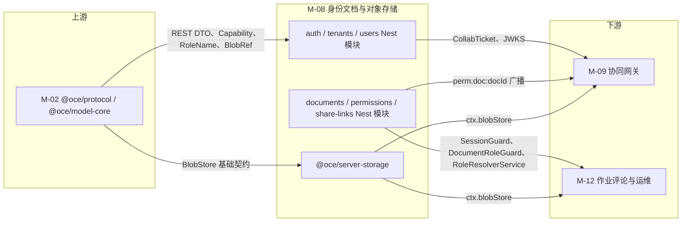
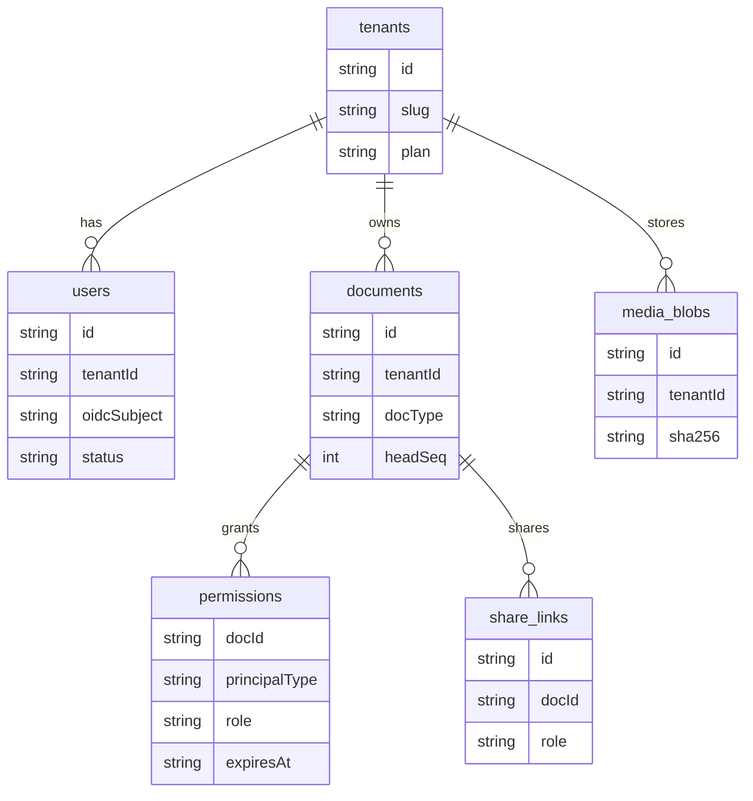
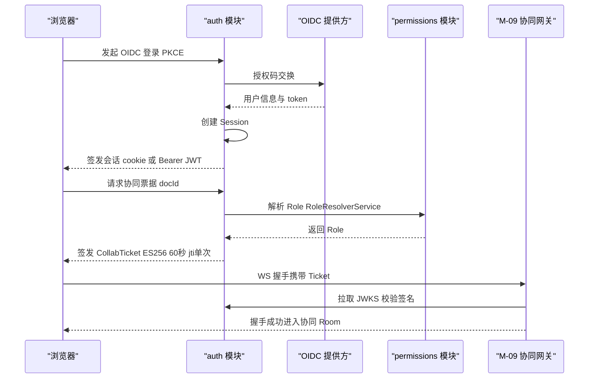
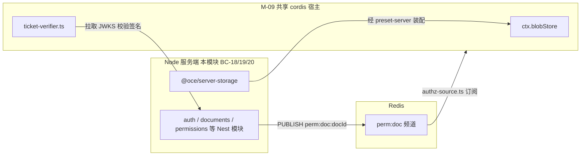

> 状态：草稿 v0.1 | 负责：架构-模块（阶段二） | 更新：2026-09-21 | 依赖：00-module-map.md M-08 行/§4.2/§5.3/§9；40-modules/02-kernel-protocol-and-document-core.md §1.2/§2.5/§2.6/§4.3/§5.3/§6/§7/§12–13；30-architecture/08-backend-nestjs.md §0/§1/§2/§3.2/§5/§6/§9/§11/§16.4；30-architecture/02-layering-and-packages.md §3.2/§4.23；charter v0.2 §5.2 apps/server·server-storage 行/§6.1 D8；PRD 10-prd/03-features/06-server-and-ops.md SV-06/SV-08；PRD 10-prd/03-features/03-collaboration.md §1/CO-05/CO-15；ADR-0029；ADR-0030（观测栈，只读）

# 08 服务端身份、文档与对象存储（限界上下文 BC-18 身份与租户、BC-19 文档目录与权限、BC-20 对象存储与媒体）

## 0. 一页总览

| 项 | 值 |
|---|---|
| 职责一句话 | OIDC 登录与会话/协同票据签发、租户与用户与配额管理（BC-18）；文档目录 CRUD、权限授予撤销与分享链接（BC-19）；`BlobStore` 服务端实现与内容寻址媒体上传（BC-20） |
| 覆盖的上下文 | BC-18 身份与租户、BC-19 文档目录与权限、BC-20 对象存储与媒体 |
| 承载包 / 目录 | `apps/server/src/modules/{auth,tenants,users,groups,documents,permissions,share-links,storage,media}`（L8 · node · app，秩 80，`groups` 为新增，rulings §4.12 U-11）、`@oce/server-storage`（LS · node · provider `implements:['blobStore']`，秩 58） |
| cordis 形态 | library（BC-18/19 的七个 Nest 模块 auth/tenants/users/groups/documents/permissions/share-links——纯 Nest DI，非 cordis Fiber，`groups` 为新增，rulings §4.12 U-11）+ provider（`@oce/server-storage`：唯一 `implements:['blobStore']` 的服务端包；`storage`/`media` 两个 Nest 模块是它的薄绑定层，本身仍是 library） |
| 运行位置 | 服务端 |
| 上游（依赖） | M-02（`@oce/protocol` 的 REST DTO/错误码/`Capability`/`RoleName`/`ROLE_CAPABILITIES`/`BlobRef`；`@oce/model-core` 的 `BlobStore` 基础契约，仅类型引用，不 import 运行时） |
| 下游（被依赖） | M-09（协同网关消费本模块签发的 collab ticket 契约、`perm:doc:{id}` 广播、`ctx.blobStore`）、M-12（导入导出/缩略图/评论/审计/`common/*` 复用本模块的 `SessionGuard`/`DocumentRoleGuard`/`RoleResolverService`/`ctx.blobStore`，并为本模块的 `@Audited()`/限流注解提供解释器） |
| 对外服务 | 无 cordis 服务（BC-18/19：REST `/auth/*`、`/tenants/*`、`/users/*`、`/documents/*`、`/documents/:id/permissions`、`/documents/:id/share-links`）；`ctx.blobStore`（BC-20，`@oce/server-storage` 经 `preset-server` 装配进 M-09 持有的共享 cordis 宿主，见 §7） |
| 贡献点 | 提供：无；消费：无（三个 BC 均不参与 `ctx.contribute`/`ctx.contributions`，module-map §3 BC-18/19/20 行已定） |
| Nest 侧导出（非 cordis 贡献点） | `SessionGuard`、`ApiKeyGuard`、`DocumentRoleGuard`、`TenantAdminGuard`、`RoleResolverService`、`IssueCollabTicketUseCase`——经 DI `exports` 供 M-09/M-12 的 controller/gateway 复用，见 §3 |
| doc / sheet 通用性 | generic（`Document` 只是目录条目 + `docType` 字符串字段透传，三个 BC 对幻灯片/文档/表格内容一无所知） |
| 批次 | 2 |

### 0.1 图示

**图 0-1 模块内 Nest 模块与上下游关系**



图怎么读：左侧 M-02 提供协议与基础契约；中间三组 Nest 模块 / 包是本模块产物；右侧下游中 M-09 消费票据与权限广播，M-12 复用守卫与 `ctx.blobStore`。

## 1. 限界上下文与边界

### 1.1 职责与非职责

**BC-18 身份与租户**
- 做：OIDC 授权码 + PKCE 登录/回调/登出、会话（httpOnly cookie 或 Bearer JWT）签发与刷新、集成方签名 JWT 校验（嵌入场景）、API Key 签发与校验、协同 ticket 签发（ES256、60 s、`jti` 单次，ADR-0029）、JWKS 暴露、租户与成员管理、租户配额读取点（SV-08）。
- 不做：不做协同 ticket **校验**（WS 握手校验是 M-09 `ticket-verifier.ts` 的职责，本模块只签发并暴露 JWKS/校验函数供其调用，见 §7）；不做文档级权限判定（BC-19）；不做审计落库（只在 controller/usecase 标注 `@Audited()` 使用点，不持有 `audit_log` 表与拦截器实现，M-12/BC-26）。

**BC-19 文档目录与权限**
- 做：文档目录条目 CRUD（标题/状态/回收站/锁定）、权限授予/撤销/列出（fail-closed：无显式允许即拒绝）、`permVersion` 递增与 `perm:doc:{id}` 广播、分享链接创建/撤销/解析、角色解析（直接授权 + 分享链接 + 租户默认，5 s 缓存）；分享链接访问经 `ShareLinkGuard` 校验令牌未撤销/未过期后，把链接角色叠加到当前**已登录** Principal 的能力位集合，不产出匿名 Principal，未登录访客返回需登录错误码由前端跳转登录（rulings §4.13 S-1，2026-09-21）；文档硬删除采用编排式级联（`schedule-purge.usecase.ts` 发起，各模块清理自己的表，rulings §4.13 S-2，2026-09-21）。
- 不做：不持有文档**内容**（幻灯片树/CRDT update 在 BC-05/21，`Document` 只是目录条目——`headSeq`/`epoch` 由 BC-21/27 写入，本模块只读展示）；不做 WS 握手第二道 fail-closed 检查点的**实现**（契约在此定义，实现在 M-09）；不做版本历史的存储与恢复执行（BC-22/M-09，本模块只声明 `history.read`/`history.restore` 两个能力位供其检查点复用）。

**BC-20 对象存储与媒体**
- 做：`BlobStore` Definition 的服务端实现（S3/MinIO/本地）、内容寻址（sha256，租户级去重）、预签名 PUT/GET、通用文件上传 presign 端点（供 M-12 导入通道复用）、媒体专属上传提交校验（MIME 嗅探优先于声明、SVG 消毒、尺寸探测、配额）。
- 不做：不解析媒体所属的文档语义（`document_media` 只是薄关联表，"这张图在哪一页/哪个占位符"由 BC-06 幻灯片领域模型持有）；不做导入导出格式转换（BC-23/M-12 调用 BC-27 完成，本模块只提供字节存取）；不做缩略图渲染（BC-24/M-12）。

### 1.2 通用语言

| 术语 | 定义 | 所在文件 |
|---|---|---|
| `Principal` | 已鉴权主体：`{kind:'user'\|'apiKey', id, tenantId, scopes}`；服务端对 `protocol.Principal` 的加宽形态。**不含 `kind:'shareLink'`**（rulings §4.13 S-1，2026-09-21 修订）：分享链接不产出独立 Principal，只把链接角色叠加进已登录 `user`/`apiKey` Principal 的 `scopes`，见 `ShareLink` 行与 §2.6 | `auth/domain/principal.ts` |
| `Session` | 登录会话：`sessionId,userId,tenantId,issuedAt,expiresAt` | `auth/domain/session.ts` |
| `CollabTicket` | 协同握手票据 claims：`sub,tid,doc,role,permVersion,jti,exp,sid?`（ADR-0029） | `auth/domain/collab-ticket.ts` |
| `Document`（目录条目） | 文档的元数据行，非内容；`status ∈ active\|trashed\|locked` | `documents/domain/document.ts` |
| `Permission`/`Grant` | `(principalType,principalId) → role` 的一条授权；无行即无权 | `permissions/domain/permission.ts` |
| `RoleName`/`ROLE_CAPABILITIES` | 角色→能力位表，权威类型定义在 `protocol/permissions/roles.ts`（M-02 Q-5 留白），本模块回填运行时初始值（§2.2） | `protocol/src/permissions/roles.ts`；回填于 `permissions/domain/role.ts` |
| `ShareLink` | 角色叠加令牌，`role ∈ {viewer,commenter,editor}`（不可为 owner）。**需登录**方可兑现（rulings §4.13 S-1，2026-09-21 修订，原"免登录"字面定义已否决）：持有有效令牌的**已登录**用户经 `ShareLinkGuard` 把 `role` 叠加进自身能力位；无账号者先经 `auth` 模块个人账号自助注册（§2.6） | `share-links/domain/share-link.ts` |
| `MediaBlob` | 租户级内容寻址媒体（`(tenantId,sha256)` 唯一） | `media/domain/media-blob.ts` |
| `BlobRef` | `{hash,size,contentType}`，与 `protocol/src/blob.ts`、`model-core` 同一定义源 | `server-storage/src/domain/blob-ref.ts` |
| `ServerBlobStore` | `BlobStore` 服务端扩展接口：`+ head/delete/presignPut/presignGet/list` | `server-storage/src/infrastructure/contracts/blob-store.ts` |
| fail-closed 双点 | REST `DocumentRoleGuard` 与 WS 握手（M-09）都是"无显式允许即拒绝"；客户端命令管线检查点是第三道（UX，非安全边界） | ADR-0029；charter D12 |
| `permVersion` | 文档权限变更计数器，随 `PUBLISH perm:doc:{id}` 广播，供 ticket 与 WS 会话比对 | `document_perm_versions` 表 |

### 1.3 上下文映射

| 上游 | 下游 | 关系类型 | 防腐层落点 | 传递的契约 |
|---|---|---|---|---|
| BC-03 协议（模块外 M-02） | BC-18/19/20 | Published Language | 各 `*.controller.ts` 的 `@Body()`/`@Query()` | `z.infer` DTO、`Capability`、`RoleName`、`ErrorEnvelope` |
| BC-05 文档内核（模块外 M-02，仅类型） | BC-20 | Customer–Supplier（Conformist：`ServerBlobStore` 须结构兼容 `BlobStore{get,put,has}`） | `server-storage/src/infrastructure/contracts/blob-store.ts` | `BlobRef` |
| BC-18 | BC-19（`issue-collab-ticket` 依赖 `RoleResolverService`） | Customer–Supplier（模块内） | `auth/application/issue-collab-ticket.usecase.ts` | `Role` |
| BC-19 | 模块外 BC-21（M-09，Redis `perm:doc:{id}`） | Customer–Supplier | `permissions/infrastructure/perm-change.publisher.ts` | `permVersion`、频道消息 |
| BC-18 | 模块外 BC-21（M-09，ticket 校验） | **Published Language**（ADR-0029 claims 形状） | `auth/domain/collab-ticket.ts`、JWKS 端点 | `CollabTicket` claims、公钥 |
| BC-20 | BC-19/模块外 BC-23/24（M-12） | Open Host Service（`ctx.blobStore`） | `server-storage/src/plugin.ts` | `ServerBlobStore` |
| BC-18/19（Nest） | 模块外 BC-21/27（M-09，cordis 宿主） | Open Host Service（只调用不重实现，module-map §4.2 第 5 条） | `cordis-host.service.ts`（M-09 承载，本模块只消费） | `openUnit`/`closeUnit`/`ctx.blobStore` 读取面 |
| BC-19（`DocumentRoleGuard`/`RoleResolverService`） | 模块外 BC-25/26（M-12，评论/审计 controller 复用守卫） | Open Host Service（DI `exports`） | `permissions/interface/guards/document-role.guard.ts` | Guard 类、`Role` |
| 模块外 BC-26（M-12，`@Audited()`/限流解释器） | BC-18/19/20 | Customer–Supplier（反向：本模块是消费方） | `common/decorators/audited.decorator.ts`（M-12 承载，本模块只标注使用点） | 审计记录契约 |

命名冲突处理：本文档采用 M-02 §12 G-5 裁定后的 `Capability` 词汇（`doc.read/doc.comment/doc.write/doc.export/doc.manage/history.read/history.restore`），不采用 `02-layering-and-packages.md` §4.3 的旧词汇 `PermissionAction`（`document.read/edit/comment/export/share/manage`）；PRD `03-collaboration.md` §1「查看/评论/编辑/管理」四列与本词汇的映射见 §2.2（回填 M-02 Q-5）。

## 2. 领域模型

### 2.1 聚合与实体

| 聚合根 / 实体 | 归属 BC | 关键字段 | 不变量 | 所在文件 |
|---|---|---|---|---|
| `Tenant`（聚合根） | BC-18 | `id,slug,name,settings,plan,quotas` | `slug` 全局唯一；`quotas` 各维度 ≥ 0；降配额不追溯已产生的用量 | `tenants/domain/tenant.ts` |
| `User`（实体，隶属 Tenant） | BC-18 | `id,tenantId,oidcIssuer,oidcSubject,emailHash,status` | `(tenantId,oidcIssuer,oidcSubject)` 唯一；`status='suspended'` 时一切写操作在应用层 fail-closed 拒绝；**个人账号**（经分享链接自助注册，rulings §4.13 S-1，2026-09-21）`tenantId` 为 `null`，不受该唯一约束限制、不隶属任何 `Tenant`，与 U-10「租户不开放自助创建」不冲突（开放的是个人账号，不是租户），架构 `08-backend-nestjs.md` §5 `users` 表同步 | `users/domain/user.ts` |
| `ApiKey`（实体，隶属 Tenant） | BC-18 | `id,tenantId,scopes,keyHash,revokedAt` | 明文 key 只在签发响应中出现一次，落库只存 hash；`revokedAt` 非空即立即失效（不等缓存过期） | `auth/domain/api-key.ts` |
| `Group`（聚合根，新增，rulings §4.12 U-11） | BC-18 | `id,tenantId,name,createdAt` | `tenantId` 创建后不可变更；组名同租户内唯一；删除组时级联撤销以其为 `principal` 的全部权限授权（同事务，见 §2.6） | `groups/domain/group.ts` |
| `GroupMember`（实体，隶属 Group，新增，rulings §4.12 U-11） | BC-18 | `groupId,userId,addedAt` | `(groupId,userId)` 唯一；成员必须为同租户用户（`userId` 对应 `User.tenantId` 必须等于 `Group.tenantId`） | `groups/domain/group-member.ts` |
| `Document`（聚合根，目录条目） | BC-19 | `id,tenantId,title,docType,status,headSeq,ownerId,folderId,schemaVersion,epoch,sizeBytes` | `status` 状态机 `active⇄trashed`、`active⇄locked`（仅系统/管理操作可转 `locked`，如导入/恢复/迁移窗口，ADR-0029 §4）、`trashed→purging`（30 天宽限期满，单向不可逆，由 `schedule-purge.usecase.ts` 触发，rulings §4.13 S-2，2026-09-21，见 §2.6/§7）；`tenantId` 创建后不可变更；`headSeq`/`epoch` 只读展示，写入权属于 BC-21/27（M-09），本聚合的写操作**不得**修改这两个字段——`DocumentRepository` 更新方法入参类型收紧为 `Omit<Document,'headSeq'\|'epoch'>`，编译期而非人工审查排除这两列（§3.4 修复，rulings §4.13 同时确认段，2026-09-21，见 §2.5/§7） | `documents/domain/document.ts` |
| `Permission`/`Grant`（实体，隶属 Document） | BC-19 | `principalType∈{user,group,tenant,link},principalId,role,expiresAt` | `(docId,principalType,principalId)` 唯一；无匹配行 = 无权（fail-closed，本模块核心不变量）；每份文档至少保留一条 `role='owner'` 记录（撤销/降级最后一个 owner 前必须先转移，见 §2.6） | `permissions/domain/permission.ts` |
| `ShareLink`（实体，隶属 Document） | BC-19 | `id,tokenHash,role,expiresAt,revokedAt` | `role ∈ {viewer,commenter,editor}`（不可为 `owner`，链接不能造出所有者）；`expiresAt`/`revokedAt` 任一命中即视为失效，校验时实时判断，不依赖定时清理 | `share-links/domain/share-link.ts` |
| `MediaBlob`（聚合根，租户级） | BC-20 | `id,tenantId,sha256,mime,byteSize,storageKey,width?,height?` | `(tenantId,sha256)` 唯一——去重边界是租户，不跨租户去重（防止跨租户存在性侧信道） | `media/domain/media-blob.ts` |
| `DocumentMedia`（关联实体） | BC-20 | `docId,mediaId,firstSeenSeq` | 弱不变量：GC 只在 30 天内无任何 `document_media` 引用时删除对应 `MediaBlob`（异步维护，非本模块同步事务） | `media/domain/document-media.ts` |

并发与合并语义：本模块全部聚合是关系型行，**不经过 CRDT**——写入用标准数据库事务 + 行级锁/条件更新（如"至少一个 owner"校验用 `SELECT … FOR UPDATE`）解决并发，冲突以"后写入事务失败并重试"处理，不存在 Yjs 意义上的合并。这与 BC-05/21 的 `DocumentStore`（CRDT）截然不同：`Document` 聚合根的目录属性（标题/状态/权限）永远不进 CRDT；只有文档内容（幻灯片树）在 CRDT 里；二者是两条独立写路径——REST 事务 vs WS update 流——职责边界见 §1.3、§7。

**`epoch` 语义（2026-09-18，跨模块评审 C-17 结案）**：`Document.epoch` 递增 = **强制全体客户端重连**（踢出，用于快照恢复/迁移窗口等需要所有会话重新握手的场景）；由 `internal/admin.controller.ts` 的 `.../epoch` 端点触发，本聚合的常规写操作不得修改该字段（同上不变量）。`epoch` 与 `permVersion`（§2.2）是两个**故意不联动**的独立计数器，语义差异见 §7 边界表。

**图 2-1 核心实体关系**



图怎么读：`tenants` 是最外层边界，`users`/`documents`/`media_blobs` 均按 `tenantId` 隔离；`documents` 派生出 `permissions`（fail-closed 授权行）与 `share_links`（免登录角色化访问）。

### 2.2 值对象

| 值对象 | 字段 | 校验 schema | 所在文件 |
|---|---|---|---|
| `Role` | `'owner'\|'editor'\|'commenter'\|'viewer'` 字面量联合 | `protocol.permissions.roles.RoleName`（zod 字面量） | `permissions/domain/role.ts`（re-export + 运行时初始值） |
| `Capability` | 7 个字面量之一 | `protocol.permissions.actions.Capability` | 直接复用 `@oce/protocol`，本模块不重复定义 |
| `DocumentId`/`TenantId`/`UserId` | 品牌字符串（uuid v7） | `protocol.ids.*` | 直接复用 `@oce/protocol` |
| `GroupId`（新增，rulings §4.12 U-11） | 品牌字符串（uuid v7） | `protocol.ids.*`（新增，随 `rest/groups.ts` 一并创建，见 §12 G-7） | 直接复用 `@oce/protocol` |
| `BlobRef` | `{hash,size,contentType}` | `protocol.blob.BlobRef` | `server-storage/src/domain/blob-ref.ts`（re-export） |
| `PresignedUrl`（新增） | `{url,method,headers?,expiresAt}` | 本模块新增 zod schema（建议回写 `protocol/src/rest/media.ts`，见 §12） | `storage/application/get-presigned-put.usecase.ts` 内联 schema |
| `Quota`（新增） | `{dimension,limit,used}`；`dimension` 覆盖 SV-08 中与身份/存储直接相关的两维：`file_size`、`storage_bytes`（`pages`/`concurrent_editors` 等运行时维度由 M-09 承载） | 本模块新增 | `tenants/domain/tenant.ts` 内联类型 |
| `CollabTicketClaims` | `{sub,tid,doc,role,permVersion,jti,exp,sid?}`（ADR-0029） | 本模块新增，建议回写 `protocol/src/collab/ticket.ts`（08 §11 已预留路径，M-09 落地时创建） | `auth/domain/collab-ticket.ts` |

**`ROLE_CAPABILITIES` 运行时初始值（回填 M-02 Q-5，对齐 PRD `03-collaboration.md` §1 与 CO-07）：**

| Role | doc.read | doc.comment | doc.write | doc.export | doc.manage | history.read | history.restore |
|---|---|---|---|---|---|---|---|
| `viewer` | ✓ | | | | | | |
| `commenter` | ✓ | ✓ | | | | | |
| `editor` | ✓ | ✓ | ✓ | ✓ | | ✓ | |
| `owner` | ✓ | ✓ | ✓ | ✓ | ✓ | ✓ | ✓ |

推导依据：`doc.read/doc.comment/doc.write` 与 PRD §1 的"查看/评论/编辑"三列逐一对应；`doc.manage`（分享/权限/删除）与 `history.restore` 仅 `owner`（对应 PRD §1"管理"列的字面定义，含"版本恢复"）；`doc.export`/`history.read` 下放至 `editor`（默认值，产品可否决，理由与替代方案见 §13 Q-1）。此表是 `permissions/domain/role.ts` 里 `ROLE_CAPABILITIES: Record<RoleName, readonly Capability[]>` 的字面量来源，类型仍以 `protocol/src/permissions/roles.ts` 为准（本模块只提供运行时初始值，不重复裁决类型形状）。

**`Capability` 词汇统一（2026-09-18，跨模块评审 C-15 结案）**：本表与 `Capability` 值对象（表首行）已是全仓统一词汇的落地点；`CapabilityBit`（M-01 旧称）、`PermissionAction`（`02-layering-and-packages.md` §4.3 旧词汇，§1.3 已拒绝采用）均正式作废，至多保留一个版本的 `@deprecated` 别名，本模块不提供该别名（无历史调用方）。

**`permVersion` 语义（2026-09-18，跨模块评审 C-17 结案）**：`permVersion`（§1.2 通用语言、`document_perm_versions` 表）递增 = **仅重算权限、不断连**——任一 `permission/granted|revoked` 或分享链接变更后由 `perm-change.publisher.ts` 递增并经 Redis 广播（§2.4），M-09 收到后只重新计算受影响会话的能力位，不强制客户端断开重连。与 `Document.epoch`（§2.1）的"强制全体重连"语义互不联动，两者分别由不同触发点（本模块权限变更 usecase vs `internal/admin.controller.ts`）独立递增；边界对照见 §7。

### 2.3 领域服务

| 纯函数 | 签名草案 | 所在文件 | 两端共用 |
|---|---|---|---|
| `mergeRoles` | `(grants: RoleGrant[], now: number) => Role \| 'none'` | `permissions/domain/role-resolution.ts` | 否（服务端专有） |
| `capabilitiesOf` | `(role: Role) => readonly Capability[]` | `permissions/domain/role.ts` | 否 |
| `documentStatusTransition` | `(current: DocumentStatus, action: 'trash'\|'restore'\|'lock'\|'unlock') => Result<DocumentStatus, DocumentError>` | `documents/domain/document-status.ts` | 否 |
| `computeQuotaUsage` | `(quota: Quota, used: number) => { exceeded: boolean; remaining: number }` | `tenants/domain/quota-policy.ts` | 否 |
| `validateUploadPolicy` | `(input: {declaredMime,sniffedMime,byteSize,quota}) => Result<void, MediaError>` | `media/domain/upload-policy.ts` | 否 |
| `buildCollabTicketClaims` | `(principal: Principal, role: Role, permVersion: number) => CollabTicketClaims` | `auth/domain/collab-ticket.ts` | 与 M-09 `ticket-verifier.ts` 共用**形状**（非共用代码——M-09 是独立包，只共用 claims 类型契约） |

### 2.4 领域事件

本模块三个 BC 均非 cordis 插件（library/provider），下列条目**不**是 cordis 事件、**不**经由 `ctx.emit`/`Events` 声明（module-map §3 BC-18/19/20 行：发布事件"无 cordis 事件"）。**命名口径（2026-09-18，跨模块评审 C-24 结案）**：早前版本沿用 charter §5.5 的 `<域>/<动作>` 记账习惯书写这些条目，容易被误读为待收编的 cordis 事件域；现改为审计 `action` 点式串（`<域>.<动作>`，与 `40-modules/12` §2.4/§4 的 `@Audited(action)` 解释器口径一致），彻底脱离事件命名体系。实际传输分两种：①进程内——usecase 成功后调用 M-12 提供的 `@Audited(action)` 写入 `audit_log`（无跨进程广播）；②跨进程——仅 `permission/changed` 一项经 Redis `PUBLISH perm:doc:{id}` 广播给 M-09（module-map §3 BC-19 行，`permission` 是 charter 已注册域，命名不受本条影响，维持 `/` 形式）。

| 审计 action | 载荷类型（草案） | 发布者文件 | 传输 | 典型消费者 |
|---|---|---|---|---|
| `tenant.created` | `{tenantId,slug}` | `tenants/application/create-tenant.usecase.ts` | 仅审计 | M-12 AuditModule |
| `tenant.quota-changed` | `{tenantId,dimension,oldLimit,newLimit}` | `tenants/application/update-tenant-settings.usecase.ts` | 仅审计 | M-12 |
| `user.provisioned` | `{userId,tenantId,oidcIssuer}` | `users/application/find-or-create-by-oidc.usecase.ts` | 仅审计 | M-12 |
| `auth.login-succeeded`／`auth.login-failed` | `{principalId?,tenantId?,reason?}` | `auth/application/handle-oidc-callback.usecase.ts` | 仅审计 | M-12（SV-07 安全类别） |
| `auth.collab-ticket-issued` | `{doc,sub,role,jti}` | `auth/application/issue-collab-ticket.usecase.ts` | 仅审计 | M-12 |
| `document.created`／`document.renamed`／`document.trashed`／`document.restored` | `{docId,tenantId,actorId,…}` | `documents/application/*.usecase.ts` | 仅审计 | M-12 |
| `document.locked`／`document.unlocked` | `{docId,reason:'import'\|'restore'\|'migration'}` | `documents/application/lock-document.usecase.ts` | 仅审计（网关轮询锁定态见 M-09） | M-09、M-12 |
| `permission/granted`／`permission/revoked`（**维持 `/` 形式**，`permission` 为已注册域） | `{docId,principalType,principalId,role}` | `permissions/application/grant-permission.usecase.ts`／`revoke-permission.usecase.ts` | 仅审计 | M-12 |
| `permission/changed`（**维持 `/` 形式**） | `{docId,permVersion}` | `permissions/infrastructure/perm-change.publisher.ts` | **Redis `perm:doc:{id}`（跨进程）+ 审计** | M-09 `authz-source.ts`（module-map §4.1 已定） |
| `share-link.created`／`share-link.revoked` | `{docId,linkId,role,expiresAt?}` | `share-links/application/*.usecase.ts` | 仅审计 | M-12 |
| `share-link.accessed`（新增，rulings §4.13 S-1，2026-09-21） | `{docId,linkId,principalId,role}` | `share-links/interface/guards/share-link-access.guard.ts` | 仅审计（每次外部访问必写，不采样） | M-12 AuditModule |
| `media.uploaded`／`media.deduplicated` | `{tenantId,sha256,byteSize,reused:boolean}` | `media/application/commit-upload.usecase.ts` | 仅审计 | M-12 |

### 2.5 仓储 / 存储契约

本模块七个纯 Nest 库模块（auth/tenants/users/groups/documents/permissions/share-links，`groups` 为新增，rulings §4.12 U-11）**不构成 cordis Definition/Provider**——它们的"仓储"是普通 Nest `@Injectable` 类，经 Drizzle 直接操作 Postgres，接口即实现（TS 结构类型，替换靠 DI token 而非多 Provider `implements`）；唯一符合模板"Definition / 默认 Provider / 契约套件"三件套的是 BC-20 的 `BlobStore`。

**普通仓储（Nest DI，非 cordis）：**

| 仓储 | 方法签名草案 | 所在文件 |
|---|---|---|
| `TenantRepository` | `findById\|findBySlug\|create\|updateSettings\|updateQuotas` | `tenants/infrastructure/tenant.repository.ts` |
| `UserRepository` | `findByOidcSubject\|findById\|create\|updateProfile\|listByTenant` | `users/infrastructure/user.repository.ts` |
| `ApiKeyRepository` | `findByHash\|create\|revoke\|listByTenant` | `auth/infrastructure/api-keys/api-key.repository.ts` |
| `GroupRepository`（新增，rulings §4.12 U-11） | `findById(tenantId,groupId)\|findByTenant\|create\|rename\|delete\|addMember\|removeMember\|listMembers\|isMember(groupId,userId)` — `findById` 签名 2026-09-21 补 `tenantId`（严重缺口修复，评审 §3.1/rulings §4.13 同时确认段：原签名不带 `tenantId`，`grant-permission` 校验 `principalType='group'` 存在性时无法核对跨租户越权，见 §2.6） | `groups/infrastructure/group.repository.ts` |
| `DocumentRepository` | `findById(tenantId,id)\|list(tenantId,opts)\|create\|updateMeta\|softTrash\|restore\|setStatus` — 全部方法强制 `tenantId` 参数，无租户参数的方法不允许存在（08 §9.1）；`updateMeta`/`softTrash`/`restore`/`setStatus` 入参类型 2026-09-21 收紧为 `Omit<Document,'headSeq'\|'epoch'>`，编译期排除这两列（§3.4 修复，rulings §4.13 同时确认段） | `documents/infrastructure/document.repository.ts` |
| `PermissionRepository` | `findByDoc(docId)\|upsertGrant\|deleteGrant\|countOwners(docId)\|bumpPermVersion(docId)`——后两者必须与 `upsertGrant`/`deleteGrant` 同事务 | `permissions/infrastructure/permission.repository.ts` |
| `ShareLinkRepository` | `findByTokenHash\|create\|revoke\|listByDoc` | `share-links/infrastructure/share-link.repository.ts` |
| `MediaBlobRepository` | `findByHash(tenantId,sha256)\|create\|linkToDocument(docId,mediaId,seq)\|sumBytesByTenant(tenantId)` | `media/infrastructure/media-blob.repository.ts` |

**`BlobStore`（Definition；`model-core/src/snapshot/blob-store.ts`，M-02 §2.5 已定基础三方法）→ 服务端扩展 `ServerBlobStore`：**

```ts
interface ServerBlobStore extends BlobStore {           // get/put/has 继承自 model-core
  head(key: string): Promise<{ size: number; contentType: string } | undefined>
  delete(key: string): Promise<void>
  presignPut(key: string, opts: { contentType: string; maxBytes: number }): Promise<PresignedUrl>
  presignGet(key: string, ttlSec: number): Promise<PresignedUrl>
  list(prefix: string): AsyncIterable<{ key: string; size: number }>
}
```

默认 Provider：`S3BlobStoreProvider`（`@aws-sdk/client-s3` + `lib-storage` 分片，兼容 MinIO）、`LocalBlobStoreProvider`（开发/测试，落本地磁盘）；两者互不 import（三角色规则）。契约套件 `runBlobStoreConformance(factory: () => ServerBlobStore)`（`server-storage/src/testing/run-blob-store-conformance.ts`）覆盖：`put→get` 字节往返、`has` 一致性、`head` 元数据准确、`delete` 后 `has=false`、`presignPut` 返回的 URL 可被匿名 HTTP 客户端直传并通过后续 `head` 校验、`presignGet` TTL 到期后拒绝、`list(prefix)` 分页游标正确。`__tests__/{s3,local}-blob-store.provider.spec.ts` **必须**各自实例化本套件（扫描器 `provider-runs-conformance`，沿用 M-02 §2.5 同一约定）。差异记录：M-02 未给 `BlobStore` 定义过 `run*Conformance`，本条目属新增（§12 G-8）。

### 2.6 应用服务与命令

本模块没有 `CommandDef`/`MutationDef`（那是 BC-05 的 Command/Mutation/Operation 三分法，只存在于 CRDT 文档内容层）；这里的"命令"是普通 Nest 用例（Application Service / UseCase），事务边界是数据库事务而非 `store.transact`，"逆操作"是关系型补偿动作而非 CRDT 求逆。

| 用例 | 参数（protocol DTO） | 权限能力位 / 前置检查 | 事务边界 | 补偿/逆操作 | 所在文件 |
|---|---|---|---|---|---|
| 登录（OIDC 回调） | `rest/auth.ts` callback schema | 无（未登录态） | 单事务：`findOrCreateByOidc` + 会话创建 | 无 | `auth/application/handle-oidc-callback.usecase.ts` |
| 刷新会话 | `refresh` schema | 会话本身有效 | 无库事务（Redis/JWT 操作） | 无 | `auth/application/refresh-session.usecase.ts` |
| 签发协同票据 | `{docId}` | `RoleResolver` 解出 Role ≠ `none`（≥ viewer） | 无库事务 | 无（60 s 自然过期） | `auth/application/issue-collab-ticket.usecase.ts` |
| 创建租户 | `rest/tenants.ts`（新增）create schema | 系统/管理员范围（**内部 / 管理脚本，M3**；不对外开放自助注册，公开注册留待产品化阶段，见 rulings §4.12 U-10、§13 Q-2） | 单事务 | 删除租户（M3 不提供，见 §13） | `tenants/application/create-tenant.usecase.ts` |
| 个人账号自助注册（新增，rulings §4.13 S-1，2026-09-21） | `rest/auth.ts`（新增）register-personal schema | 无（未登录态；仅创建个人账号，不开放租户自助创建，与 U-10 不冲突） | 单事务：`users` insert（`tenantId=null`）+ 会话创建，与 OIDC 回调平行的第二条建号路径 | 无（M3 不提供注销） | `auth/application/register-personal-account.usecase.ts` |
| 创建组（新增，rulings §4.12 U-11） | `rest/groups.ts`（新增）create schema | `TenantAdminGuard`（租户管理员） | 单事务 | 逆操作 = 删除组 | `groups/application/create-group.usecase.ts` |
| 重命名组（新增，rulings §4.12 U-11） | `rest/groups.ts` rename schema | `TenantAdminGuard` | 单事务 | 需客户端重放旧名称 | `groups/application/rename-group.usecase.ts` |
| 删除组（新增，rulings §4.12 U-11） | `{id}` | `TenantAdminGuard` | 单事务：删除 `groups`+`group_members`，级联撤销以该组为 `principal` 的 `permissions` 行（同事务） | 不可逆（需人工重建） | `groups/application/delete-group.usecase.ts` |
| 增加组成员（新增，rulings §4.12 U-11） | `{groupId,userId}` | `TenantAdminGuard`；校验 `userId` 与组同租户 | 单事务 | 逆操作 = 移除组成员 | `groups/application/add-group-member.usecase.ts` |
| 移除组成员（新增，rulings §4.12 U-11） | `{groupId,userId}` | `TenantAdminGuard` | 单事务 | 逆操作 = 增加组成员 | `groups/application/remove-group-member.usecase.ts` |
| 创建文档 | `rest/documents.ts` create schema | 租户成员即可（无需既有 `doc.*`，文档尚不存在） | 单事务：`documents` insert + `permissions` insert（创建者 = owner） | 逆操作 = 删除该文档（回收站语义） | `documents/application/create-document.usecase.ts` |
| 列出/详情文档 | `list`/`get` schema | `doc.read`（详情）；列表按 `RoleResolver` 逐条过滤 | 只读，无事务 | 不适用 | `documents/application/queries/document-queries.ts` |
| 最近文档 / 固定（M2） | `rest/documents.ts` recent/pinned schema（`GET /documents?filter=recent`、`PATCH /documents/:id{pinned}`） | `doc.read`（`recent` 按 `RoleResolver` 逐条过滤，同列表口径）；`pinned` 为用户级标记，不改变文档权限 | 单事务：recent/pinned 记账表 upsert | 逆操作 = 从最近移除 / 取消固定 | `documents/application/list-recent.usecase.ts`、`pin-document.usecase.ts`（rulings §4.12 U-04） |
| 重命名文档 | `rename` schema | `doc.write` | 单事务 | 需客户端重放旧标题（无自动求逆） | `documents/application/rename-document.usecase.ts` |
| 回收站（trash/restore） | `{id}` | `doc.manage` | 单事务，各自独立 | 互为逆操作 | `documents/application/trash-and-restore.usecase.ts` |
| 锁定/解锁文档 | `{id,reason}` | 仅系统调用（M-09/M-12 内部，非用户可达 REST） | 单事务 | 互为逆操作 | `documents/application/lock-document.usecase.ts` |
| 授予权限 | `documents.ts` permissions PUT schema | `doc.manage` | 单事务：`principalType='group'` 时先经 `GroupRepository.findById(tenantId,groupId)` 校验存在**且同租户**（rulings §4.12 U-11，原 G-10 不可达分支起可达；`tenantId` 核对为 §3.1 严重缺口修复，2026-09-21）→ `upsertGrant` + `bumpPermVersion`；提交后异步 `PUBLISH` | 逆操作 = `revoke-permission` | `permissions/application/grant-permission.usecase.ts` |
| 撤销权限 | permissions DELETE schema | `doc.manage`；若目标是最后一个 `owner` → 拒绝（`permission.last_owner`） | 单事务，同上（`principalType='group'` 同样适用，同经 `tenantId` 核对） | 逆操作 = `grant-permission` | `permissions/application/revoke-permission.usecase.ts` |
| 解析角色（内部） | `{principal,docId}` | 无（本身即权限检查实现） | 只读 + 5 s 缓存 | 不适用 | `permissions/application/resolve-role.usecase.ts` |
| 创建分享链接 | `rest/share-links.ts`（新增）POST schema | `doc.manage` | 单事务 | 逆操作 = `revoke-share-link` | `share-links/application/create-share-link.usecase.ts` |
| 分享链接访问叠加（新增，rulings §4.13 S-1，2026-09-21） | 请求 Header/Query 携带 `shareToken` | 需先过 `SessionGuard`/`ApiKeyGuard`（**已登录**，否则 401 由前端跳登录）；令牌未撤销/未过期（复用 `ResolveShareLinkUseCase` token→role） | 无库事务：只读解析 + 叠加进当前请求 `Principal.scopes`，不落库、不产出新 Principal | 不适用（每次请求即时解析，无需撤销） | `share-links/interface/guards/share-link-access.guard.ts` |
| 获取预签名上传 | `rest/media.ts`（新增，见 §12）presign schema | `doc.write`（媒体归属文档时）；无文档上下文时按租户配额 | 无库事务（调用 `ctx.blobStore.presignPut`） | 不适用 | `storage/application/get-presigned-put.usecase.ts` |
| 提交媒体上传 | media commit schema | `doc.write` | 单事务：`head`+重算 sha256 一致 → `media_blobs` upsert（去重）→ `document_media` 关联 | 不适用（幂等：重复 commit 同 sha256 直接复用） | `media/application/commit-upload.usecase.ts` |
| 编排硬删除（新增，rulings §4.13 S-2，2026-09-21） | `{docId}`（系统触发：回收站 30 天宽限期满，或 GDPR 擦除请求） | 仅系统调用（非用户可达 REST） | 单事务：`documents.status` `trashed→purging`（不可逆）+ 写 `job_runs`（kind=`document-purge`）或发编排领域事件，供 `permissions`/`media`/M-09/M-12 各自订阅清理 | 不可逆（§2.1 已注明） | `documents/application/schedule-purge.usecase.ts` |
| 清理文档权限（新增，rulings §4.13 S-2，2026-09-21） | `{docId}`（订阅编排触发） | 仅系统调用 | 单事务：删除 `permissions`/`document_perm_versions` 中 `docId` 相关行（"谁的表谁写"；`share_links` 不在本用例范围，边界说明见 §7/§12） | 不可逆 | `permissions/application/purge-document-permissions.usecase.ts` |
| 清理文档媒体关联（新增，rulings §4.13 S-2，2026-09-21） | `{docId}`（订阅编排触发） | 仅系统调用 | 单事务：删除 `document_media` 关联行；`media_blobs` 本身仍按既有 30 天无引用 GC 规则异步清理，不在本用例内同步删除（§2.1 弱不变量） | 不可逆 | `media/application/purge-document-media.usecase.ts` |

**图 2-2 登录与协同 Ticket 签发时序**



图怎么读：登录换会话在前，签发协同票据在后——后者需要 `permissions` 模块解出 `Role` 才能签发；M-09 只负责用 JWKS 校验票据签名，不负责签发，边界见 §7。

## 3. Nest 模块定义表

Nest 模块不是 cordis Fiber（module-map §5.3），本节列 imports/providers/controllers/exports/守卫，取代模板原§3 的插件定义表。

| 模块 | imports | providers（关键） | controllers | exports | 守卫 |
|---|---|---|---|---|---|
| `AuthModule` | `ConfigModule`、`RedisModule`、`UsersModule` | `OidcClientProvider`、`JwtService`、`StateStoreRedis`、`ApiKeyRepository`、6 个 usecase（新增 `RegisterPersonalAccountUseCase`，S-1） | `AuthController` | `SessionGuard`、`ApiKeyGuard`、`IssueCollabTicketUseCase`、`@CurrentPrincipal()` 装饰器 | `SessionGuard`、`ApiKeyGuard`（本模块定义） |
| `TenantsModule` | `ConfigModule` | `TenantRepository`、3 个 usecase | `TenantsController` | `TenantAdminGuard`、`GetTenantQuotaUsageUseCase` | `TenantAdminGuard`（本模块定义） |
| `UsersModule` | 无 | `UserRepository`、3 个 usecase | `UsersController` | `FindOrCreateByOidcUseCase`（供 `AuthModule` 消费） | 无（复用 `SessionGuard`） |
| `GroupsModule`（新增，rulings §4.12 U-11） | `ConfigModule` | `GroupRepository`、5 个 usecase | `GroupsController` | `GroupRepository`（供 `PermissionsModule` 校验 `principalType='group'`） | 复用 `SessionGuard`+`TenantAdminGuard` |
| `DocumentsModule` | `AuthModule`、`PermissionsModule` | `DocumentRepository`、6 个 usecase（新增 `SchedulePurgeUseCase`，S-2） | `DocumentsController` | `DocumentRepository`（供 M-09/M-12 只读查询复用） | 复用 `SessionGuard`+`DocumentRoleGuard` |
| `PermissionsModule` | `RedisModule`、`GroupsModule`（新增，校验 `principalType='group'`，U-11） | `PermissionRepository`、5 个 usecase（新增 `PurgeDocumentPermissionsUseCase`，S-2）、`PermChangePublisher` | `PermissionsController` | `RoleResolverService`、`DocumentRoleGuard` | `DocumentRoleGuard`（本模块定义） |
| `ShareLinksModule` | `PermissionsModule` | `ShareLinkRepository`、3 个 usecase | `ShareLinksController` | `ResolveShareLinkUseCase`（供 `RoleResolverService` 消费）、`ShareLinkAccessGuard`（新增，供 `documents`/`media` 组合鉴权复用，S-1） | 复用 `SessionGuard`；新增 `ShareLinkAccessGuard`（本模块定义，S-1，叠加角色不产出匿名 Principal） |
| `StorageModule` | `ConfigModule` | `BlobStoreAccessor` | `PresignController` | `BlobStoreAccessor`（供 `MediaModule`/M-12 消费） | 复用 `SessionGuard` |
| `MediaModule` | `StorageModule`、`DocumentsModule` | `MediaBlobRepository`、4 个 usecase（新增 `PurgeDocumentMediaUseCase`，S-2）、`AssetInspector`、`SvgSanitizer` | `MediaController` | 无 | 复用 `SessionGuard`+`DocumentRoleGuard` |

**模块目录内以 cordis 插件形式存在的 IO 适配器**：本模块**没有**这类文件。对比 BC-21（M-09）在 `apps/server/src/modules/collab/` 下放置 `redis-fanout.bus.ts`/`pg-update-store.ts` 等实现 `server-collab` Definition 的 Provider（module-map §4.2 第 5 条例外），BC-20 的 Node Provider（`S3BlobStoreProvider`/`LocalBlobStoreProvider`）已完整地活在 `@oce/server-storage` **包内部**（§2.5），不需要在 Nest 模块目录下另建适配器；`StorageModule`/`MediaModule` 只是该包的**消费者**（经 `BlobStoreAccessor` 读取共享 cordis 宿主的 `ctx.blobStore`，见 §7），不产出新 Provider。这一"留空"本身是值得记录的架构事实，差异见 §12。

**守卫的物理归属裁定**：`SessionGuard`/`ApiKeyGuard`/`DocumentRoleGuard`/`TenantAdminGuard` 编码的是 BC-18/19 的授权**策略**，本文档裁定它们物理归属各自 owning 模块的 `interface/guards/`，而非 `apps/server/src/common/guards/`（08-backend-nestjs.md §2 历史草图把它们放在 common/）——差异与理由见 §12。`common/`（M-12 承载）只保留与 BC 策略无关的纯机制：异常过滤器、trace/audit 拦截器、zod 校验管道、限流 token bucket 原语（`@Audited()`/`@RateLimit()` 的**解释器**在 M-12，装饰器标注在哪些 controller 方法上由本模块接口层决定）。

## 4. 目录树（完整到文件）

九个 Nest 模块（含新增 `groups`，见 §4.10，rulings §4.12 U-11）均挂在 `apps/server/src/modules/` 之下（与 M-09/M-12 的模块同级）；`*.module.ts` 在模块根，五个 DDD 子目录按总编排裁定组织，第五个目录在 Nest 侧材质化为 `__tests__/`（非 `testing/`，理由见 §9）。

### 4.1 `apps/server/src/modules/auth/`

```text
auth/
├── auth.module.ts                        装配 imports/providers/controllers/exports（见 §3）
├── domain/
│   ├── principal.ts                      Principal 值对象
│   ├── session.ts                        Session 实体
│   ├── collab-ticket.ts                  CollabTicketClaims 值对象 + buildCollabTicketClaims()（§2.3）
│   ├── api-key.ts                        ApiKey 实体
│   └── errors.ts                         auth.* 错误码
├── application/
│   ├── login-with-oidc.usecase.ts        生成 state+PKCE→StateStore，返回 authorizationUrl
│   ├── handle-oidc-callback.usecase.ts   code→token 交换→UsersModule.findOrCreateByOidc→签发 Session
│   ├── refresh-session.usecase.ts        会话/刷新令牌轮换
│   ├── logout.usecase.ts                 撤销会话
│   ├── issue-collab-ticket.usecase.ts    RoleResolverService → CollabTicket JWT（ADR-0029）
│   └── register-personal-account.usecase.ts  个人账号自助注册（`tenantId=null`），新增，rulings §4.13 S-1
├── infrastructure/
│   ├── oidc/oidc-client.provider.ts      openid-client v6 discovery 缓存 + PKCE 生成
│   ├── oidc/state-store.redis.ts         Redis 状态存储（10 min TTL）
│   ├── tokens/jwt.service.ts             ES256 签发/验签、JWKS 轮换与 kid、httpOnly cookie 编解码
│   └── api-keys/api-key.repository.ts    Drizzle：api_keys 表
├── interface/
│   ├── auth.controller.ts                /auth/oidc/{login,callback}、/logout、/me、/token/refresh、/.well-known/jwks.json、/register-personal（S-1）
│   ├── guards/session.guard.ts           会话 JWT / API Key → Principal（fail-closed：无有效凭据 401）；同文件导出 @CurrentPrincipal()
│   └── guards/api-key.guard.ts           API Key 专用（集成方服务端调用）
└── __tests__/
    ├── issue-collab-ticket.usecase.spec.ts
    ├── handle-oidc-callback.usecase.spec.ts
    └── jwt.service.spec.ts
```

### 4.2 `apps/server/src/modules/tenants/`

```text
tenants/
├── tenants.module.ts
├── domain/
│   ├── tenant.ts                         Tenant 聚合根 + Quota 值对象（内联）
│   ├── quota-policy.ts                   computeQuotaUsage()（§2.3，纯函数）
│   └── errors.ts
├── application/
│   ├── create-tenant.usecase.ts
│   ├── update-tenant-settings.usecase.ts
│   └── get-tenant-quota-usage.usecase.ts
├── infrastructure/
│   └── tenant.repository.ts              Drizzle：tenants 表
├── interface/
│   ├── tenants.controller.ts
│   └── guards/tenant-admin.guard.ts       principal.tenantId 匹配 + role ∈ {owner,admin}
└── __tests__/
    └── get-tenant-quota-usage.usecase.spec.ts
```

### 4.3 `apps/server/src/modules/users/`

```text
users/
├── users.module.ts
├── domain/
│   ├── user.ts
│   └── errors.ts
├── application/
│   ├── find-or-create-by-oidc.usecase.ts
│   ├── update-profile.usecase.ts
│   └── list-tenant-members.usecase.ts
├── infrastructure/
│   └── user.repository.ts
├── interface/
│   └── users.controller.ts
└── __tests__/
    └── find-or-create-by-oidc.usecase.spec.ts
```

### 4.4 `apps/server/src/modules/documents/`

```text
documents/
├── documents.module.ts
├── domain/
│   ├── document.ts                       Document 聚合根（含 DocumentId 品牌类型引用）
│   ├── document-status.ts                documentStatusTransition()（§2.3，纯函数）
│   └── errors.ts
├── application/
│   ├── create-document.usecase.ts
│   ├── rename-document.usecase.ts
│   ├── trash-and-restore.usecase.ts      TrashDocumentUseCase + RestoreDocumentUseCase（互逆，同文件）
│   ├── lock-document.usecase.ts          导入/恢复/迁移窗口锁定（ADR-0029 §4）
│   ├── list-recent.usecase.ts            ListRecentDocumentsUseCase（M2，服务端同步「最近」，rulings §4.12 U-04）
│   ├── pin-document.usecase.ts           PinDocumentUseCase + UnpinDocumentUseCase（互逆，同文件；M2，rulings §4.12 U-04）
│   ├── schedule-purge.usecase.ts         编排式硬删除发起：status→purging + 入队/发领域事件（新增，rulings §4.13 S-2）
│   └── queries/document-queries.ts       ListDocumentsQuery + GetDocumentDetailQuery
├── infrastructure/
│   └── document.repository.ts            Drizzle：documents 表（tenant_id 强制列；含 recent/pinned 记账）
├── interface/
│   └── documents.controller.ts           GET/POST /documents、GET/PATCH/DELETE /documents/:id、POST /:id/restore、POST /:id/collab-ticket（委托 AuthModule.IssueCollabTicketUseCase）、GET /documents?filter=recent、PATCH /documents/:id{pinned}（M2，rulings §4.12 U-04）
└── __tests__/
    ├── create-document.usecase.spec.ts
    └── trash-and-restore.usecase.spec.ts
```

### 4.5 `apps/server/src/modules/permissions/`

```text
permissions/
├── permissions.module.ts
├── domain/
│   ├── permission.ts                     Permission/Grant 聚合
│   ├── role.ts                           RoleName + ROLE_CAPABILITIES 运行时初始值（§2.2）
│   └── role-resolution.ts                mergeRoles()（§2.3，纯函数）
├── application/
│   ├── grant-permission.usecase.ts
│   ├── revoke-permission.usecase.ts
│   ├── list-permissions.usecase.ts
│   ├── resolve-role.usecase.ts           编排：查直接授权+share link+租户默认 → mergeRoles → 5 s 缓存
│   └── purge-document-permissions.usecase.ts  清 permissions/document_perm_versions（新增，rulings §4.13 S-2；share_links 不在本用例范围，见 §7）
├── infrastructure/
│   ├── permission.repository.ts          Drizzle：permissions + document_perm_versions
│   └── perm-change.publisher.ts          Redis PUBLISH perm:doc:{id}（供 M-09 订阅）
├── interface/
│   ├── permissions.controller.ts         GET/PUT/DELETE /documents/:id/permissions…
│   └── guards/document-role.guard.ts     @RequireDocRole('editor')：resolve-role → capability 检查 → fail-closed 403
└── __tests__/
    ├── resolve-role.usecase.spec.ts
    └── grant-permission.usecase.spec.ts
```

### 4.6 `apps/server/src/modules/share-links/`

```text
share-links/
├── share-links.module.ts
├── domain/
│   ├── share-link.ts
│   └── errors.ts
├── application/
│   ├── create-share-link.usecase.ts
│   ├── revoke-share-link.usecase.ts
│   ├── resolve-share-link.usecase.ts     token → role（供 RoleResolverService 消费，不直接对外）
│   └── purge-document-share-links.usecase.ts  订阅编排事件，清理本文档的 share_links（新增，rulings §4.13 S-2）
├── infrastructure/
│   └── share-link.repository.ts          Drizzle：share_links；含 token 生成与哈希
├── interface/
│   ├── share-links.controller.ts
│   └── guards/share-link-access.guard.ts 叠加链接角色到已登录 Principal，不产出匿名 Principal（新增，rulings §4.13 S-1）
└── __tests__/
    ├── resolve-share-link.usecase.spec.ts
    └── share-link-access.guard.spec.ts   覆盖未登录 401、过期/撤销拒绝、角色叠加正确性（新增，S-1）
```

### 4.7 `apps/server/src/modules/storage/`

```text
storage/
├── storage.module.ts                     按 config.storage.provider 绑定，装配见 §7
├── application/
│   └── get-presigned-put.usecase.ts      校验 contentType/maxBytes 策略后调用 ctx.blobStore.presignPut
├── infrastructure/
│   └── blob-store.accessor.ts            CordisHostService → ctx.blobStore 读取面（新增方法，见 §7/§13）
├── interface/
│   └── presign.controller.ts             通用预签名端点（供 M-12 导入通道复用，与 media 专属通道分离，见 §1.1）
└── __tests__/
    └── get-presigned-put.usecase.spec.ts
```

### 4.8 `apps/server/src/modules/media/`

```text
media/
├── media.module.ts
├── domain/
│   ├── media-blob.ts                     MediaBlob 聚合（内容寻址不变量）
│   ├── document-media.ts                 DocumentMedia 关联实体
│   ├── upload-policy.ts                  validateUploadPolicy()（§2.3，纯函数）
│   └── errors.ts
├── application/
│   ├── presign-upload.usecase.ts         POST /media/presign
│   ├── commit-upload.usecase.ts          POST /media/commit：HEAD+流式重算 sha256 校验 + 去重判定
│   ├── get-media.usecase.ts              GET /media/:sha256 → 302 预签名/代理
│   └── purge-document-media.usecase.ts   清 document_media 关联行（新增，rulings §4.13 S-2）
├── infrastructure/
│   ├── media-blob.repository.ts          Drizzle：media_blobs + document_media
│   ├── asset-inspector.ts                MIME 嗅探（优先于声明）+ 尺寸探测
│   └── svg-sanitizer.ts                  去脚本/事件/外链或转栅格化
├── interface/
│   └── media.controller.ts               POST /media/presign, POST /media/commit, GET /media/:sha256
└── __tests__/
    ├── commit-upload.usecase.spec.ts
    └── svg-sanitizer.spec.ts
```

### 4.9 `@oce/server-storage`

```text
packages/server-storage/
├── package.json                          oce:{layer:'LS',iso:'node',stability:'beta'}；deps: @aws-sdk/client-s3、@aws-sdk/lib-storage
├── tsconfig.json
├── src/
│   ├── index.ts                          公共 API 面（§6）
│   ├── plugin.ts                         provide=['blobStore']；Config.provider ∈ 's3'|'local'
│   ├── config.ts                         zod Config schema：{provider,s3:{…},local:{rootDir},presign:{putTtlSec,getTtlSec}}
│   ├── storage.contribution.ts           Context{blobStore: ServerBlobStore} 声明合并
│   ├── domain/
│   │   └── blob-ref.ts                   BlobRef re-export（与 model-core/protocol 同一定义源，§2.2）
│   ├── application/
│   │   └── content-addressing.ts         sha256 命名/去重策略（纯函数）
│   ├── infrastructure/
│   │   ├── contracts/blob-store.ts       ServerBlobStore 接口（§2.5）
│   │   ├── providers/s3-blob-store.provider.ts      @aws-sdk/client-s3 + lib-storage 分片；MinIO 兼容
│   │   ├── providers/local-blob-store.provider.ts   开发/测试，落本地磁盘
│   │   ├── hashing.ts                    流式 sha256（与浏览器 WebCrypto 结果一致的十六进制小写）
│   │   └── keys.ts                       对象键布局函数（§6 对象存储布局）
│   ├── errors.ts                         storage.*（not_found/integrity_mismatch/quota_exceeded）
│   ├── __tests__/
│   │   ├── s3-blob-store.provider.spec.ts
│   │   └── local-blob-store.provider.spec.ts
│   └── testing/
│       ├── index.ts                      re-export（`./testing` 子路径入口）
│       ├── memory-blob-store.ts          MemoryBlobStore（与 model-core testing 行为一致）
│       └── run-blob-store-conformance.ts runBlobStoreConformance(factory)（§2.5）
```

### 4.10 `apps/server/src/modules/groups/`（新增，rulings §4.12 U-11，2026-09-19）

M3 即实现组管理（用户裁决 U-11，回填 §2.1/§2.2/§2.5/§2.6 的 Group 聚合/值对象/仓储/用例）；BC-18 归属，与 `tenants/`/`users/` 同级，供 `PermissionsModule` 校验 `principalType='group'`（原 G-10 不可达分支起可达）。

```text
groups/
├── groups.module.ts                      装配 imports/providers/controllers/exports（见 §3）
├── domain/
│   ├── group.ts                          Group 聚合根（§2.1）
│   ├── group-member.ts                   GroupMember 实体（§2.1）
│   └── errors.ts                         group.* 错误码
├── application/
│   ├── create-group.usecase.ts
│   ├── rename-group.usecase.ts
│   ├── delete-group.usecase.ts           级联撤销以该组为 principal 的 permissions 行（同事务）
│   ├── add-group-member.usecase.ts
│   └── remove-group-member.usecase.ts
├── infrastructure/
│   └── group.repository.ts               Drizzle：groups + group_members
├── interface/
│   └── groups.controller.ts              GET/POST /groups、PATCH/DELETE /groups/:id、POST/DELETE /groups/:id/members
└── __tests__/
    ├── create-group.usecase.spec.ts
    └── add-group-member.usecase.spec.ts
```

## 5. 文件职责表

### 5.1 `auth/`

| 文件 | 职责 | 主要导出 | 允许依赖 | 备注 |
|---|---|---|---|---|
| `auth.module.ts` | 模块装配 | `AuthModule` | Nest、本模块下列全部 | exports 见 §3 |
| `domain/principal.ts` | 已鉴权主体值对象 | `Principal` | `@oce/protocol` | 服务端加宽形态 |
| `domain/session.ts` | 会话实体 | `Session` | 无 | — |
| `domain/collab-ticket.ts` | 协同票据 claims + 构造函数 | `CollabTicketClaims`、`buildCollabTicketClaims` | `./principal` | ADR-0029 |
| `domain/api-key.ts` | API Key 实体 | `ApiKey` | 无 | scopes 结构见 SV-06 |
| `domain/errors.ts` | `auth.*` 错误码 | `AuthError` | 无（点式码） | invalid_token/expired/forbidden/oidc_state_mismatch |
| `application/login-with-oidc.usecase.ts` | 发起登录 | `LoginWithOidcUseCase` | `../infrastructure/oidc/*` | 生成 authorizationUrl |
| `application/handle-oidc-callback.usecase.ts` | 回调处理 | `HandleOidcCallbackUseCase` | `../domain/*`、`UsersModule` 导出的 usecase | 跨模块调用 |
| `application/refresh-session.usecase.ts` | 会话刷新 | `RefreshSessionUseCase` | `../infrastructure/tokens/jwt.service` | — |
| `application/logout.usecase.ts` | 登出 | `LogoutUseCase` | `../infrastructure/tokens/jwt.service` | 撤销会话/黑名单 |
| `application/issue-collab-ticket.usecase.ts` | 签发协同票据 | `IssueCollabTicketUseCase` | `PermissionsModule.RoleResolverService` | 导出供 `documents.controller.ts` 调用 |
| `application/register-personal-account.usecase.ts` | 个人账号自助注册（新增，rulings §4.13 S-1） | `RegisterPersonalAccountUseCase` | `../infrastructure/*`、`UsersModule` | `tenantId=null`；供分享链接访客建号，不开放租户自助创建 |
| `infrastructure/oidc/oidc-client.provider.ts` | OIDC discovery/交换 + PKCE | `OidcClientProvider` | `openid-client` | 唯一 import 点 |
| `infrastructure/oidc/state-store.redis.ts` | state/nonce 存储 | `OidcStateStore` | `ioredis` | TTL 10 min |
| `infrastructure/tokens/jwt.service.ts` | ES256 签发/验签 + JWKS + cookie 编解码 | `JwtService` | `jose`（或等价库） | kid 轮换 |
| `infrastructure/api-keys/api-key.repository.ts` | `api_keys` 表 | `ApiKeyRepository` | `drizzle-orm` | tenant_id 强制 |
| `interface/auth.controller.ts` | REST 端点 | `AuthController` | protocol `rest/auth.ts` | 含 `/.well-known/jwks.json` |
| `interface/guards/session.guard.ts` | Principal 解析，fail-closed | `SessionGuard`、`CurrentPrincipal` | `../../infrastructure/tokens/jwt.service` | 401 |
| `interface/guards/api-key.guard.ts` | API Key 鉴权 | `ApiKeyGuard` | `../../infrastructure/api-keys/*` | 集成方服务端调用 |
| `__tests__/issue-collab-ticket.usecase.spec.ts` | 单测 | — | — | 覆盖 ttl/jti/role 边界 |
| `__tests__/handle-oidc-callback.usecase.spec.ts` | 单测 | — | — | 覆盖首次登录建号 |
| `__tests__/jwt.service.spec.ts` | 单测 | — | — | 覆盖 kid 轮换/过期 |

### 5.2 `tenants/`

| 文件 | 职责 | 主要导出 | 允许依赖 | 备注 |
|---|---|---|---|---|
| `tenants.module.ts` | 模块装配 | `TenantsModule` | Nest | — |
| `domain/tenant.ts` | 聚合根 + `Quota` 值对象 | `Tenant`、`Quota` | 无 | §2.1/§2.2 |
| `domain/quota-policy.ts` | 配额用量纯函数 | `computeQuotaUsage` | `./tenant` | §2.3 |
| `domain/errors.ts` | `tenant.*` 错误码 | `TenantError` | 无 | not_found/slug_taken/quota_exceeded |
| `application/create-tenant.usecase.ts` | 创建租户 | `CreateTenantUseCase` | `../infrastructure/tenant.repository` | 系统范围，见 §13 |
| `application/update-tenant-settings.usecase.ts` | 更新设置/配额 | `UpdateTenantSettingsUseCase` | `../infrastructure/tenant.repository` | — |
| `application/get-tenant-quota-usage.usecase.ts` | 配额用量查询 | `GetTenantQuotaUsageUseCase` | `../domain/quota-policy` | SV-08 管理面板读取点 |
| `infrastructure/tenant.repository.ts` | `tenants` 表 | `TenantRepository` | `drizzle-orm` | — |
| `interface/tenants.controller.ts` | REST 端点 | `TenantsController` | protocol `rest/tenants.ts`（新增，§12） | — |
| `interface/guards/tenant-admin.guard.ts` | 租户管理员校验 | `TenantAdminGuard` | `SessionGuard` 输出的 `Principal` | fail-closed |
| `__tests__/get-tenant-quota-usage.usecase.spec.ts` | 单测 | — | — | 覆盖超限判定 |

### 5.3 `users/`

| 文件 | 职责 | 主要导出 | 允许依赖 | 备注 |
|---|---|---|---|---|
| `users.module.ts` | 模块装配 | `UsersModule` | Nest | exports `FindOrCreateByOidcUseCase` |
| `domain/user.ts` | 实体 | `User` | 无 | `(tenantId,oidcIssuer,oidcSubject)` 唯一 |
| `domain/errors.ts` | `user.*` 错误码 | `UserError` | 无 | not_found/suspended |
| `application/find-or-create-by-oidc.usecase.ts` | subject↔user 映射/建号 | `FindOrCreateByOidcUseCase` | `../infrastructure/user.repository` | AuthModule 回调调用 |
| `application/update-profile.usecase.ts` | 更新资料 | `UpdateProfileUseCase` | `../infrastructure/user.repository` | — |
| `application/list-tenant-members.usecase.ts` | 成员列表 | `ListTenantMembersUseCase` | `../infrastructure/user.repository` | 供管理面板 |
| `infrastructure/user.repository.ts` | `users` 表 | `UserRepository` | `drizzle-orm` | — |
| `interface/users.controller.ts` | REST 端点 | `UsersController` | protocol `rest/users.ts`（新增，§12） | — |
| `__tests__/find-or-create-by-oidc.usecase.spec.ts` | 单测 | — | — | 覆盖首次/重复登录 |

### 5.4 `documents/`

| 文件 | 职责 | 主要导出 | 允许依赖 | 备注 |
|---|---|---|---|---|
| `documents.module.ts` | 模块装配 | `DocumentsModule` | `AuthModule`、`PermissionsModule` | exports `DocumentRepository` |
| `domain/document.ts` | 聚合根（目录条目） | `Document`、`DocumentId` | `@oce/protocol` ids | §2.1 |
| `domain/document-status.ts` | 状态机纯函数 | `documentStatusTransition` | `./document` | §2.3 |
| `domain/errors.ts` | `document.*` 错误码 | `DocumentError` | 无 | not_found/locked/trashed |
| `application/create-document.usecase.ts` | 建文档 + 创建者=owner | `CreateDocumentUseCase` | `../infrastructure/document.repository`、`PermissionsModule` | 单事务 |
| `application/rename-document.usecase.ts` | 重命名 | `RenameDocumentUseCase` | `../infrastructure/document.repository`、`PermissionsModule` | 需 `doc.write` |
| `application/trash-and-restore.usecase.ts` | 回收站互逆操作 | `TrashDocumentUseCase`、`RestoreDocumentUseCase` | `../infrastructure/document.repository`、`PermissionsModule` | 需 `doc.manage` |
| `application/lock-document.usecase.ts` | 锁定/解锁 | `LockDocumentUseCase`、`UnlockDocumentUseCase` | `../infrastructure/document.repository`、`PermissionsModule` | 仅系统调用，非用户可达 REST |
| `application/list-recent.usecase.ts` | 最近文档列表（服务端同步） | `ListRecentDocumentsUseCase` | `../infrastructure/document.repository`、`RoleResolverService` | M2；rulings §4.12 U-04，按角色过滤同 §2.6 列表口径 |
| `application/pin-document.usecase.ts` | 固定/取消固定（互逆） | `PinDocumentUseCase`、`UnpinDocumentUseCase` | `../infrastructure/document.repository` | M2；rulings §4.12 U-04，用户级标记，不改变文档权限 |
| `application/schedule-purge.usecase.ts` | 编排式硬删除发起（新增，rulings §4.13 S-2） | `SchedulePurgeUseCase` | `../infrastructure/document.repository`、`jobs` 基础设施（M-12，Open Host Service） | 仅系统调用；`status→purging` 不可逆，见 §2.1/§2.6/§7 |
| `application/queries/document-queries.ts` | 列表/详情查询 | `ListDocumentsQuery`、`GetDocumentDetailQuery` | `RoleResolverService` | 列表按角色过滤 |
| `infrastructure/document.repository.ts` | `documents` 表 | `DocumentRepository` | `drizzle-orm` | 方法强制 `tenantId`（08 §9.1）；含 recent/pinned 记账表 |
| `interface/documents.controller.ts` | REST 端点 | `DocumentsController` | protocol `rest/documents.ts`；`AuthModule.IssueCollabTicketUseCase` | 含 `POST /:id/collab-ticket`、`GET /documents?filter=recent`、`PATCH /documents/:id{pinned}`（M2，rulings §4.12 U-04） |
| `__tests__/create-document.usecase.spec.ts` | 单测 | — | — | 覆盖 owner 授权同事务 |
| `__tests__/trash-and-restore.usecase.spec.ts` | 单测 | — | — | 覆盖互逆语义 |

### 5.5 `permissions/`

| 文件 | 职责 | 主要导出 | 允许依赖 | 备注 |
|---|---|---|---|---|
| `permissions.module.ts` | 模块装配 | `PermissionsModule` | `RedisModule` | exports `RoleResolverService`/`DocumentRoleGuard` |
| `domain/permission.ts` | 聚合（Grant） | `Permission` | 无 | §2.1 |
| `domain/role.ts` | 角色→能力位 | `RoleName`、`ROLE_CAPABILITIES` | `@oce/protocol` | 运行时初始值回填 M-02 Q-5（§2.2） |
| `domain/role-resolution.ts` | 角色合并纯函数 | `mergeRoles` | `./role` | §2.3 |
| `application/grant-permission.usecase.ts` | 授予 | `GrantPermissionUseCase` | `../infrastructure/permission.repository`、`perm-change.publisher` | 单事务 + 异步 PUBLISH |
| `application/revoke-permission.usecase.ts` | 撤销 | `RevokePermissionUseCase` | `../infrastructure/permission.repository`、`perm-change.publisher` | 最后一个 owner 拒绝 |
| `application/list-permissions.usecase.ts` | 列出授权 | `ListPermissionsUseCase` | `../infrastructure/permission.repository` | — |
| `application/resolve-role.usecase.ts` | 角色解析编排 | `RoleResolverService` | `./role-resolution`、`ShareLinksModule` 导出的 usecase | 5 s 缓存 |
| `application/purge-document-permissions.usecase.ts` | 清理文档权限（新增，rulings §4.13 S-2） | `PurgeDocumentPermissionsUseCase` | `../infrastructure/permission.repository` | 仅系统调用；清 `permissions`/`document_perm_versions`；`share_links` 已纳入（由 `share-links/application/purge-document-share-links.usecase.ts` 订阅编排事件清理，不经 DocumentsModule 直接调用）（依赖方向限制，见 §7/§12） |
| `infrastructure/permission.repository.ts` | `permissions`+`document_perm_versions` 表 | `PermissionRepository` | `drizzle-orm` | `bumpPermVersion` 同事务 |
| `infrastructure/perm-change.publisher.ts` | 权限变更广播 | `PermChangePublisher` | `ioredis` | 频道 `perm:doc:{id}` |
| `interface/permissions.controller.ts` | REST 端点 | `PermissionsController` | protocol `rest/documents.ts`（权限段） | — |
| `interface/guards/document-role.guard.ts` | 文档角色守卫 | `DocumentRoleGuard`、`@RequireDocRole()` | `../../application/resolve-role.usecase` | fail-closed 403 |
| `__tests__/resolve-role.usecase.spec.ts` | 单测 | — | — | 覆盖直接/link/租户默认优先级 |
| `__tests__/grant-permission.usecase.spec.ts` | 单测 | — | — | 覆盖 permVersion 递增 |

### 5.6 `share-links/`

| 文件 | 职责 | 主要导出 | 允许依赖 | 备注 |
|---|---|---|---|---|
| `share-links.module.ts` | 模块装配 | `ShareLinksModule` | `PermissionsModule` | exports `ResolveShareLinkUseCase` |
| `domain/share-link.ts` | 聚合 | `ShareLink` | 无 | `role` 不可为 owner |
| `domain/errors.ts` | `share_link.*` 错误码 | `ShareLinkError` | 无 | expired/revoked/not_found |
| `application/create-share-link.usecase.ts` | 创建 | `CreateShareLinkUseCase` | `../infrastructure/share-link.repository` | 需 `doc.manage` |
| `application/revoke-share-link.usecase.ts` | 撤销 | `RevokeShareLinkUseCase` | `../infrastructure/share-link.repository` | — |
| `application/resolve-share-link.usecase.ts` | token→role | `ResolveShareLinkUseCase` | `../infrastructure/share-link.repository` | 供 `RoleResolverService` 消费，亦供新 Guard 复用 |
| `application/purge-document-share-links.usecase.ts` | 编排式硬删除下游：清理本文档的 `share_links`（新增，rulings §4.13 S-2） | `PurgeDocumentShareLinksUseCase` | `../infrastructure/share-link.repository`、`jobs` 基础设施（M-12，订阅编排事件） | 由 `schedule-purge` 编排触发，非 `DocumentsModule` 直接调用，避免反向 DI 依赖 |
| `infrastructure/share-link.repository.ts` | `share_links` 表 + token 哈希 | `ShareLinkRepository` | `drizzle-orm`、`node:crypto` | 明文 token 只在创建响应出现一次 |
| `interface/share-links.controller.ts` | REST 端点 | `ShareLinksController` | protocol `rest/share-links.ts`（新增，§12） | — |
| `interface/guards/share-link-access.guard.ts` | 叠加链接角色（新增，rulings §4.13 S-1） | `ShareLinkAccessGuard` | `../../application/resolve-share-link.usecase`、上游 `SessionGuard`/`ApiKeyGuard` 解出的 `Principal` | 组合鉴权：先登录后叠加，不产出匿名 Principal；写 `share-link.accessed` 审计（§2.4） |
| `__tests__/resolve-share-link.usecase.spec.ts` | 单测 | — | — | 覆盖过期/撤销实时判定 |
| `__tests__/share-link-access.guard.spec.ts` | 单测（新增，S-1） | — | — | 覆盖未登录 401、过期/撤销拒绝、角色叠加正确性 |

### 5.7 `storage/`

| 文件 | 职责 | 主要导出 | 允许依赖 | 备注 |
|---|---|---|---|---|
| `storage.module.ts` | 模块装配 | `StorageModule` | `ConfigModule` | exports `BlobStoreAccessor` |
| `application/get-presigned-put.usecase.ts` | 通用预签名 PUT | `GetPresignedPutUseCase` | `../infrastructure/blob-store.accessor` | 校验 contentType/maxBytes |
| `infrastructure/blob-store.accessor.ts` | 读取共享宿主 `ctx.blobStore` | `BlobStoreAccessor` | M-09 `CordisHostService`（新增读取面，见 §7/§13） | 不新建 Provider |
| `interface/presign.controller.ts` | REST 端点 | `PresignController` | protocol `rest/media.ts`（新增，§12） | 供 M-12 导入通道复用 |
| `__tests__/get-presigned-put.usecase.spec.ts` | 单测 | — | — | 覆盖 maxBytes 拒绝 |

### 5.8 `media/`

| 文件 | 职责 | 主要导出 | 允许依赖 | 备注 |
|---|---|---|---|---|
| `media.module.ts` | 模块装配 | `MediaModule` | `StorageModule`、`DocumentsModule` | — |
| `domain/media-blob.ts` | 聚合 | `MediaBlob` | 无 | `(tenantId,sha256)` 唯一 |
| `domain/document-media.ts` | 关联实体 | `DocumentMedia` | 无 | GC 依据 |
| `domain/upload-policy.ts` | 上传校验纯函数 | `validateUploadPolicy` | `./media-blob` | §2.3；对齐 08 §9.2 |
| `domain/errors.ts` | `media.*` 错误码 | `MediaError` | 无 | mime_mismatch/unsupported_type/quota_exceeded/svg_rejected |
| `application/presign-upload.usecase.ts` | 预签名 | `PresignUploadUseCase` | `StorageModule.BlobStoreAccessor` | — |
| `application/commit-upload.usecase.ts` | 提交校验 + 去重 | `CommitUploadUseCase` | `../infrastructure/*`、`../domain/upload-policy` | HEAD + 重算 sha256 |
| `application/get-media.usecase.ts` | 下载/代理 | `GetMediaUseCase` | `StorageModule.BlobStoreAccessor` | 302 或流式代理 |
| `application/purge-document-media.usecase.ts` | 清理文档媒体关联（新增，rulings §4.13 S-2） | `PurgeDocumentMediaUseCase` | `../infrastructure/media-blob.repository` | 仅系统调用；清 `document_media` 关联行，`media_blobs` 仍按既有 30 天无引用 GC 异步清理 |
| `infrastructure/media-blob.repository.ts` | `media_blobs`+`document_media` 表 | `MediaBlobRepository` | `drizzle-orm` | — |
| `infrastructure/asset-inspector.ts` | MIME 嗅探 + 尺寸探测 | `sniffMime`、`probeDimensions` | `file-type`（或等价库） | 嗅探优先于声明 |
| `infrastructure/svg-sanitizer.ts` | SVG 消毒 | `sanitizeSvg` | 无第三方（自研最小规则） | 去脚本/事件/外链 |
| `interface/media.controller.ts` | REST 端点 | `MediaController` | protocol `rest/media.ts`（新增，§12） | — |
| `__tests__/commit-upload.usecase.spec.ts` | 单测 | — | — | 覆盖去重命中/未命中 |
| `__tests__/svg-sanitizer.spec.ts` | 单测 | — | — | 覆盖脚本/外链剥离 |

### 5.9 `@oce/server-storage`

| 文件 | 职责 | 主要导出 | 允许依赖 | 备注 |
|---|---|---|---|---|
| `package.json` | 包元数据 | — | — | `oce:{layer:'LS',iso:'node'}` |
| `tsconfig.json` | 类型配置 | — | — | node lib，无 dom |
| `src/index.ts` | 公共 API 面 | 全部下列符号 | 本包 | `.` 导出 |
| `src/plugin.ts` | cordis 插件入口 | `serverStoragePlugin`（`provide:['blobStore']`） | `./config`、`./storage.contribution` | Config.provider 择一装配 Provider |
| `src/config.ts` | 配置 schema | `ServerStorageConfig` | zod | s3/local 两分支 |
| `src/storage.contribution.ts` | Context 声明合并 | `Context.blobStore` 类型 | `./infrastructure/contracts/blob-store` | — |
| `src/domain/blob-ref.ts` | `BlobRef` re-export | `BlobRef` | `@oce/protocol` | 同一定义源 |
| `src/application/content-addressing.ts` | 去重/命名策略 | `computeContentKey` | `./domain/blob-ref` | 纯函数 |
| `src/infrastructure/contracts/blob-store.ts` | 服务端扩展接口 | `ServerBlobStore` | `@oce/model-core`（类型） | §2.5 |
| `src/infrastructure/providers/s3-blob-store.provider.ts` | S3/MinIO 实现 | `S3BlobStoreProvider` | `@aws-sdk/client-s3`、`@aws-sdk/lib-storage` | 唯一 S3 SDK 引入点（连同 media/infrastructure 走本包） |
| `src/infrastructure/providers/local-blob-store.provider.ts` | 本地磁盘实现 | `LocalBlobStoreProvider` | `node:fs/promises` | 开发/测试 |
| `src/infrastructure/hashing.ts` | 流式 sha256 | `hashStream` | `node:crypto` | 与浏览器 WebCrypto 十六进制一致 |
| `src/infrastructure/keys.ts` | 对象键布局 | `mediaKey`、`snapshotKey`、`importKey`、`exportKey`、`thumbKey` | 无 | §6 |
| `src/errors.ts` | `storage.*` 错误码 | `StorageError` | 无 | not_found/integrity_mismatch/quota_exceeded |
| `src/__tests__/s3-blob-store.provider.spec.ts` | 单测（testcontainers MinIO） | — | — | 实例化 `runBlobStoreConformance` |
| `src/__tests__/local-blob-store.provider.spec.ts` | 单测 | — | — | 实例化 `runBlobStoreConformance` |
| `src/testing/index.ts` | `./testing` 子路径入口 | re-export | 无 | — |
| `src/testing/memory-blob-store.ts` | 内存实现 | `MemoryBlobStore` | 无 | 与 model-core testing 行为一致 |
| `src/testing/run-blob-store-conformance.ts` | 契约套件 | `runBlobStoreConformance` | 无 | §2.5 |

### 5.10 `groups/`（新增，rulings §4.12 U-11）

| 文件 | 职责 | 主要导出 | 允许依赖 | 备注 |
|---|---|---|---|---|
| `groups.module.ts` | 模块装配 | `GroupsModule` | Nest | exports `GroupRepository`（见 §3） |
| `domain/group.ts` | 聚合根 | `Group` | 无 | §2.1 |
| `domain/group-member.ts` | 实体 | `GroupMember` | 无 | §2.1，成员同租户不变量 |
| `domain/errors.ts` | `group.*` 错误码 | `GroupError` | 无 | not_found/name_taken/member_not_in_tenant |
| `application/create-group.usecase.ts` | 创建组 | `CreateGroupUseCase` | `../infrastructure/group.repository` | 需 `TenantAdminGuard` |
| `application/rename-group.usecase.ts` | 重命名组 | `RenameGroupUseCase` | `../infrastructure/group.repository` | — |
| `application/delete-group.usecase.ts` | 删除组 | `DeleteGroupUseCase` | `../infrastructure/group.repository`、`PermissionsModule` | 级联撤销以该组为 principal 的权限授权 |
| `application/add-group-member.usecase.ts` | 增加成员 | `AddGroupMemberUseCase` | `../infrastructure/group.repository`、`UsersModule` | 校验成员同租户 |
| `application/remove-group-member.usecase.ts` | 移除成员 | `RemoveGroupMemberUseCase` | `../infrastructure/group.repository` | — |
| `infrastructure/group.repository.ts` | `groups`+`group_members` 表 | `GroupRepository` | `drizzle-orm` | 供 `PermissionsModule` 校验存在性；`findById(tenantId,groupId)` 2026-09-21 补 `tenantId` 参数（评审 §3.1 严重缺口修复，跨租户越权，rulings §4.13 同时确认段） |
| `interface/groups.controller.ts` | REST 端点 | `GroupsController` | protocol `rest/groups.ts`（新增，§12 G-7） | — |
| `__tests__/create-group.usecase.spec.ts` | 单测 | — | — | 覆盖组名租户内唯一 |
| `__tests__/add-group-member.usecase.spec.ts` | 单测 | — | — | 覆盖跨租户成员拒绝 |

## 6. 对外 API 面

`@oce/server-storage` 是本模块唯一可发布包，其 `.`/`./testing` 导出面见下表；七个 Nest 库模块（含新增 `groups`，rulings §4.12 U-11）的"对外 API"是两类物件：①REST 端点（真正的跨进程契约，见端点清单）；②供 M-09/M-12 经 Nest DI `imports`/`exports` 复用的服务类（已在 §3 逐模块列出，不重复）。

| 导出面 | 概要 | 稳定级（推荐） |
|---|---|---|
| `.`（server-storage） | `serverStoragePlugin`、`ServerStorageConfig`、`ServerBlobStore`、`BlobRef` | `beta`（S3/local 配置形状随部署实践可能微调） |
| `./testing`（server-storage） | `MemoryBlobStore`、`runBlobStoreConformance` | `beta`，随 `ServerBlobStore` 契约一起收紧 |

**REST 端点清单**（DTO 来自 `@oce/protocol`；`rest/tenants.ts`/`rest/users.ts`/`rest/share-links.ts`/`rest/media.ts`/`rest/groups.ts` 为本文档新增建议，见 §12 G-7；`rest/groups.ts` 为 U-11 新增）：

| 方法 路径 | Controller | DTO | 能力位 / 守卫 |
|---|---|---|---|
| POST `/auth/oidc/login`、GET `/auth/oidc/callback` | `auth.controller.ts` | `rest/auth.ts` | 无（未登录） |
| POST `/auth/register-personal`（新增，rulings §4.13 S-1） | `auth.controller.ts` | `rest/auth.ts`（新增 register-personal schema） | 无（未登录；仅限个人账号，`tenantId=null`） |
| POST `/auth/logout`、GET `/auth/me`、POST `/auth/token/refresh` | `auth.controller.ts` | `rest/auth.ts` | `SessionGuard` |
| GET `/auth/.well-known/jwks.json` | `auth.controller.ts` | 无（JWK Set） | 公开（供 M-09 验签） |
| GET/POST `/tenants`、PATCH `/tenants/:id/settings`、GET `/tenants/:id/quota-usage` | `tenants.controller.ts` | `rest/tenants.ts`（新增） | `TenantAdminGuard` |
| GET `/tenants/:id/members`、PATCH `/users/:id/profile` | `users.controller.ts` | `rest/users.ts`（新增） | `SessionGuard` |
| GET/POST `/groups`、PATCH/DELETE `/groups/:id`（新增，rulings §4.12 U-11） | `groups.controller.ts` | `rest/groups.ts`（新增） | `TenantAdminGuard` |
| POST/DELETE `/groups/:id/members`（新增，rulings §4.12 U-11） | `groups.controller.ts` | `rest/groups.ts`（新增） | `TenantAdminGuard` |
| GET/POST `/documents`、GET/PATCH/DELETE `/documents/:id`、POST `/documents/:id/restore` | `documents.controller.ts` | `rest/documents.ts` | `SessionGuard`+`DocumentRoleGuard`（`GET/:id` 可选叠加 `ShareLinkAccessGuard`，携带 `shareToken` 时生效，S-1） |
| GET `/documents?filter=recent`、PATCH `/documents/:id`{`pinned`} | `documents.controller.ts` | `rest/documents.ts`（`recent`/`pinned` 字段，M2，rulings §4.12 U-04） | `SessionGuard`+`DocumentRoleGuard` |
| POST `/documents/:id/collab-ticket` | `documents.controller.ts`（委托 Auth） | `rest/documents.ts` | `DocumentRoleGuard`（≥ viewer，可选叠加 `ShareLinkAccessGuard`，S-1，取代 ADR-0029 决策 6 旧描述） |
| GET/PUT/DELETE `/documents/:id/permissions` | `permissions.controller.ts` | `rest/documents.ts`（权限段） | `DocumentRoleGuard`（`doc.manage`） |
| POST/GET/DELETE `/documents/:id/share-links` | `share-links.controller.ts` | `rest/share-links.ts`（新增） | `DocumentRoleGuard`（`doc.manage`） |
| POST `/storage/presign` | `presign.controller.ts` | `rest/media.ts`（新增，通用段） | `SessionGuard` |
| POST `/media/presign`、POST `/media/commit`、GET `/media/:sha256` | `media.controller.ts` | `rest/media.ts`（新增，媒体段） | `SessionGuard`+`DocumentRoleGuard`（`doc.write`） |

关键类型契约草案（跨模块最常被复用的两个面，≤ 30 行）：

```ts
// permissions：跨模块复用面（M-09 authz-source.ts、M-12 comments/snapshots controller 均消费）
interface RoleResolverService {
  resolveRole(principal: Principal, documentId: DocumentId): Promise<Role | 'none'>
}
function RequireDocRole(min: Role): MethodDecorator   // DocumentRoleGuard 的声明式用法

// storage：ctx.blobStore 的服务端读取面（StorageModule 消费，见 §7）
interface BlobStoreAccessor {
  get(): ServerBlobStore
}
```

## 7. 前后端与运行时

本模块**仅服务端**（module-map §5：BC-18…26 一栏"仅服务端"），无浏览器 Provider，无 iso 共享代码。与 M-09 共享的唯一运行时资源是 `preset-server` 装配出的 cordis 宿主：

| 资源 | 归属 | 本模块的访问方式 |
|---|---|---|
| `CordisHostService`（`openUnit`/`closeUnit`/`diagnostics()`） | M-09（`apps/server/src/cordis-host/`） | 不直接调用（不涉及文档内容读写）；仅 `StorageModule.BlobStoreAccessor` 需要从同一宿主读 `ctx.blobStore` |
| `ctx.blobStore` | `@oce/server-storage`，经 `preset-server` 装配进 M-09 持有的共享宿主 | `blob-store.accessor.ts` 依赖 `CordisHostService` **新增**的读取面（建议签名 `getService<T>(name): T` 或专用 `get blobStore(): ServerBlobStore`）；精确方法名以 M-09 定案为准（§13 Q-5）；**已结案：M-09 §5.3 定为 `getService<T>(name)` / `diagnostics()`（2026-09-19 回填）** |
| collab ticket 校验 | M-09 `ticket-verifier.ts` | 本模块只签发（`issue-collab-ticket.usecase.ts`）+ 暴露 JWKS，不实现验签逻辑 |
| `perm:doc:{id}` Redis 频道 | 本模块发布（`perm-change.publisher.ts`），M-09 `authz-source.ts` 订阅 | 单向：本模块只 `PUBLISH`，不 `SUBSCRIBE` |

**与 M-09 的模块边界**：M-09 写 `document_updates`/`document_snapshots`（文档内容与协同状态）；本模块写 `documents`（目录元数据）/`permissions`/`document_perm_versions`/`media_blobs`/`document_media`/`tenants`/`users`/`api_keys`/`share_links`。两者对 `documents` 表**共写不同列**——本模块写 `title/status/ownerId/…`，M-09 写 `headSeq`（每次 update 持久化后递增）；这是唯一的跨模块共享表列冲突面，建议 `headSeq` 更新语句限定 `UPDATE documents SET head_seq=… WHERE id=… AND head_seq<…`（M-09 落地时的乐观递增，本模块不参与、不读写该列）。**2026-09-21 补强（评审 §3.4，rulings §4.13 同时确认段）**：仅靠约定不足以隔离并发修改风险，`DocumentRepository` 的 `updateMeta`/`softTrash`/`restore`/`setStatus` 入参类型收紧为 `Omit<Document,'headSeq'\|'epoch'>`，令"M-08 不得设置这两列"从代码约定升级为编译期强制（§2.1/§2.5 同步）。

**硬删除编排边界（rulings §4.13 S-2，2026-09-21，"谁的表谁写"）**：`documents/application/schedule-purge.usecase.ts` 是唯一编排发起点——30 天回收站宽限期满（或收到 GDPR 擦除请求）后把 `documents.status` 置为 `purging`（不可逆，§2.1）并写 `job_runs`/发领域事件；下游各自订阅并清理**自己的表**：本模块内 `permissions/application/purge-document-permissions.usecase.ts` 清 `permissions`/`document_perm_versions`，`media/application/purge-document-media.usecase.ts` 清 `document_media`（`media_blobs` 仍走既有 30 天无引用 GC，不在本次编排内同步清理）；M-09 的 `UpdateStore`/`SnapshotStore` 契约新增 `purgeAll(docId)` 清 `document_updates`/`document_snapshots`；M-12 的 `thumbnails`/`comments` 各自新增 `purge-document-*.usecase.ts`。`share_links` 表**已纳入（由 `share-links/application/purge-document-share-links.usecase.ts` 订阅编排事件清理，不经 DocumentsModule 直接调用）本轮编排**——`share-links` 模块在依赖图中只被 `PermissionsModule` 等下游引用（§3 Nest 模块表），本模块内没有任何模块反向依赖 `ShareLinksModule`，为避免引入反向依赖，本次不新增 `share-links` 侧的 purge 用例，记为已知缺口（§12 新增条目，非阻塞：`share_links` 有 `expiresAt`/`revokedAt` 实时失效判定，孤儿行不可再被解析出有效角色，纯数据卫生问题）。`audit_log` 按规则保留，不参与清理。

**`epoch` / `permVersion` 边界表**（2026-09-18，跨模块评审 C-17 结案，与 `40-modules/09` §2/§7 同口径）：

| 字段 | 归属写方 | 递增触发点 | 效果 | 是否联动 |
|---|---|---|---|---|
| `Document.epoch` | 本模块（`documents` 表列），强制操作由 `internal/admin.controller.ts` 触发 | 管理员显式调用 `.../epoch` 端点（快照恢复、迁移窗口等） | **强制全体客户端重连**（M-09 `collabServer.forceEpoch()` 踢出全部会话） | 否——与 `permVersion` 各自独立递增 |
| `permVersion` | 本模块（`document_perm_versions` 表），`perm-change.publisher.ts` 写入 | 权限/分享链接变更 usecase 成功后 | **仅重算受影响会话的能力位**，不断连（M-09 `authz-source.ts` 订阅 `perm:doc:{id}`） | 否——不因 `epoch` 变化而重算，也不触发 `epoch` |

两者不自动联动的理由：语义完全不同（强制断连 vs 静默重算），若合并会让"仅权限微调"也附带断连全部在线用户的副作用；ADR-0029 的 ticket claims 因此也不携带 `epoch`（校验在 Room 侧，见 `40-modules/09` §2）。

**与 M-12 的模块边界**：`audit_log`/`comments`/`job_runs`/`thumbnails` 四张表与 `common/*`（异常过滤器/审计拦截器/限流原语）全部由 M-12 承载；本模块 controller 只**引用** `common/` 的装饰器（`@Audited()`、`@RateLimit()`），不实现其解释器（§3 已裁定）。`DocumentRoleGuard`/`RoleResolverService` 由本模块导出、M-12 的 `comments`/`snapshots` controller 复用。

**图 7-1 进程边界与共享资源**（本模块仅服务端，无浏览器/headless Chromium 代码，故以下改画本模块与 M-09 之间的实际跨进程资源）



图怎么读：本模块只 `PUBLISH`、不 `SUBSCRIBE`；`ctx.blobStore` 由 `@oce/server-storage` 经 `preset-server` 装配进 M-09 持有的共享宿主，票据校验则是 M-09 反向调用本模块暴露的 JWKS。

## 8. doc / sheet 扩展缝

全部 generic（对文档类型盲）；`Document.docType` 是唯一参数化点：

| 文件 | 参数化点 | M5（doc/sheet）扩展时的变化 |
|---|---|---|
| `documents/domain/document.ts` | `docType: string`（当前唯一取值 `'slide'`） | 新增取值 `'doc'`/`'sheet'`，字段/校验逻辑零改动（本模块不 `switch` on `docType`） |
| `media/application/commit-upload.usecase.ts`、`upload-policy.ts` | 无（媒体上传对宿主文档类型无感知） | 零改动 |
| `permissions/domain/role.ts`（`ROLE_CAPABILITIES`） | 无（能力位是文档类型盲的通用词汇） | 零改动 |
| `documents` 表 `doc_type text default 'slide'`（08 §5） | 数据库层已预留 | 零改动（列已存在） |

"必须零改动"的文件清单：本模块**全部**文件——这是 BC-18/19/20 的设计目标（module-map §3 三行均标 `doc-sheet 通用性: generic`），不允许任何文件出现 `'slide'`/`'doc'`/`'sheet'` 字面量分支（建议 M-01 补充服务端等价扫描器 `no-doc-type-literals-server`，见 §12 G-13）。对应 12 号文档 §3 的参数化点：本模块贡献且仅贡献 `Document.docType` 一个枚举扩展点，无代码路径参数化点。

## 9. 测试布局

```text
apps/server/test/                         端到端（跨模块）：Nest Testing + testcontainers（PG/Redis/MinIO）+ mock OIDC（oidc-provider）
├── e2e/auth-login.e2e-spec.ts             OIDC 全流程 + 会话/ticket
├── e2e/documents-permissions.e2e-spec.ts  文档 CRUD + 权限 fail-closed + 跨租户 100% 拒绝（SV-06）
├── e2e/media-upload.e2e-spec.ts           预签名 → commit → 去重 → SVG 消毒
├── e2e/groups-management.e2e-spec.ts      组 CRUD + 成员增删 + 按组授权端到端（M3，新增，rulings §4.12 U-11）
├── fixtures/                              夹具（租户/用户/文档种子数据）
└── helpers/                               supertest 封装、mock OIDC provider 启动器

packages/server-storage/src/__tests__/     见 §4.9（S3/local 两 Provider 各自跑 runBlobStoreConformance）
```

命名裁定：Nest 模块内第五个 DDD 目录在本仓库材质化为 `__tests__/`（而非模板通用名 `testing/`）——`apps/server` 不发布、无 `./testing` 子路径导出的必要，module-map DDD 对照表"`testing/` ↔ `testing/`(子路径导出)+`__tests__/`"的双重形态中，Nest 应用只取后半；`@oce/server-storage` 是可被其他包 import 的真实库，保留完整双形态。覆盖率与性能预算引用 08-backend-nestjs.md §12（REST p95 ≤ 150 ms 等）；本模块特有预算：`resolve-role.usecase` 5 s 缓存命中率、`commit-upload` 去重判定 ≤ 50 ms p95（自定新增，见 §12）。

## 10. 机械约束

| 约束 | 规则 / 字段 | 引用 |
|---|---|---|
| `package.json#oce`（server-storage） | `{layer:'LS',iso:'node',stability:'beta'}` | charter §5.2；02 §4.23 |
| `server-app-thin` | `apps/server/src/modules/**` 不得 `import 'yjs'`/`@oce/model-*`/`@oce/ooxml-*` | module-map §9；02 §3.2 |
| 第三方单点 | `openid-client`/JWT 库建议限 `auth/infrastructure/`；`@aws-sdk/*` 仅 `server-storage` | charter §5.3 规则 4 |
| protocol-only DTO | controller `@Body()`/`@Query()` 类型只能是 `z.infer<typeof X>`，`X` 来自 `@oce/protocol` | module-map §4.2 第 1 条；08 §11 |
| 租户隔离 | `*.repository.ts` 全部方法强制 `tenantId` 参数；建议新增扫描器 `repo-requires-tenant-id`（§12 G-14） | 08 §9.1 |
| fail-closed | `DocumentRoleGuard`/WS 握手（M-09）无显式允许即拒绝 | charter D12；ADR-0029 |
| `provider-runs-conformance` | `server-storage/src/__tests__/{s3,local}-blob-store.provider.spec.ts` 必须实例化 `runBlobStoreConformance` | M-02 §2.5 同一约定 |
| 三角色 | `S3BlobStoreProvider`/`LocalBlobStoreProvider` 互不 import | charter §5.3 规则 6 |
| 09-type-discipline 章节 | 03-boundaries §3.3（LS·node 秩 58） | module-map §9 BC-20 行 |

## 11. 里程碑与实施顺序

**M0 骨架**：9 个 `*.module.ts`（含 `groups.module.ts`，rulings §4.12 U-11；实现推迟到 M3，见下） + 各 `domain/` 聚合类型（无实现）+ `server-storage` 的 `package.json`/`plugin.ts`/`config.ts` 空实现（`LocalBlobStoreProvider` 落盘即可，`S3BlobStoreProvider` 可延后）；`AppModule` 尚未装配本模块（根装配由 M-12 完成，见 §7）。

**M1**：`auth`（OIDC 登录/会话，暂不含协同 ticket）、`tenants`/`users` 基本 CRUD、`documents` CRUD（不含锁定）、`permissions` 授予/撤销/`RoleResolverService`（不含分享链接）、`server-storage` `LocalBlobStoreProvider` 完整 + `runBlobStoreConformance` 通过。

**M2 首个可运行切片**：登录 → 建租户 → 建文档 → 授权 → 预签名上传，覆盖 `share-links`、`media`（含 SVG 消毒/去重）、`issue-collab-ticket`（供 M-09 联调）、`S3BlobStoreProvider`（对 MinIO）。

验收命令（草案，最终以 CI 配置为准）：
```bash
pnpm --filter @oce/server-storage test               # runBlobStoreConformance × 2 Provider
pnpm --filter apps-server test:e2e -- auth documents  # OIDC mock + 文档/权限 e2e
pnpm --filter apps-server test:e2e -- media           # presign→commit→去重→SVG 消毒
```

**M3 组管理**（rulings §4.12 U-11，2026-09-19 新增，属本模块交付范围）：新增 `groups` Nest 模块——创建/重命名/删除组、成员增删（§2.6/§4.10/§5.10）；`permissions` 模块 `grant-permission`/`revoke-permission` 用例接入 `GroupRepository` 存在性校验，`principalType='group'` 从"保留不可达"变为可达（§12 G-10 结案）。验收：`pnpm --filter apps-server test:e2e -- groups`（组 CRUD + 成员增删 + 按组授权端到端，见 §9）。

**M3 展望**（不在本模块交付范围）：与 M-09 联调协同 ticket 校验 + `perm:doc:{id}` 端到端 ≤ 2 s 传播（ADR-0029）；与 M-12 联调审计/限流解释器接入 `@Audited()`/`@RateLimit()` 标注点。

## 12. 与现有文档的差异与追加建议

延续 module-map §8 的编号（G-1…G-4 已在该文档），以下延续为 G-5 起：

| # | 涉及文档 | 差异 / 发现 | 追加建议（不直接生效） |
|---|---|---|---|
| G-5 | `08-backend-nestjs.md` §2 vs module-map §3 BC-19 行 | 08 §2 把 `permissions/`、`share-links/` 写成 `documents/` 的子目录；module-map §3 明确列出三者为并列的 `modules/{documents,permissions,share-links}` | 本文档采用 module-map 的并列结构（§4.4–4.6）；建议 08 §2 同步拆分为三个平级目录 |
| G-6 | `08-backend-nestjs.md` §2 `common/guards/*` | 08 §2 把 `session.guard.ts`/`document-role.guard.ts`/`tenant-admin.guard.ts` 放在全局 `common/guards/`；本文档裁定授权策略类守卫物理归属各自 owning 模块的 `interface/guards/`（DDD 所有权原则，§3 已述） | 建议 08 §2 同步移动，并在 M-12 规划文档中把 `common/*` 的范围收窄为"与 BC 策略无关的纯机制"（异常过滤器/tracing/audit 拦截器/限流原语） |
| G-7 | `40-modules/02` §4.3 `@oce/protocol` 目录树 | `rest/` 子树只有 `documents`/`snapshots`/`import-export`/`auth`/`audit` 五个文件，缺 `tenants.ts`/`users.ts`/`share-links.ts`/`media.ts`/`groups.ts`（本模块 §4/§5/§6 大量引用；`groups.ts` 为 rulings §4.12 U-11 新增） | 建议 M-08 实现期在 `@oce/protocol` 包内直接新增这五个文件（不新建包、不违反发布语言铁律），事后知会 M-02 文档维护者回补 §4.3/§5.3；`groups.ts` 一项已由总编排回写 `40-modules/02` §4/§5（新增建议→已采纳） |
| G-8 | `40-modules/02` §2.5 `BlobStore` | model-core 未给 `BlobStore` 定义 `run*Conformance` 契约套件（只有 `DocumentStore` 有）；本文档 §2.5 为 `ServerBlobStore` 新增 `runBlobStoreConformance`，是全仓库第一个覆盖 `BlobStore` 家族的契约套件 | 建议 M-02 评估是否让 `model-core/testing` 的 `MemoryBlobStore` 也可选跑本套件的"基础三方法子集"，不强制 |
| G-9 | ADR-0029 vs `08-backend-nestjs.md` §5/§2 | ADR-0029 的 ticket claims 不含 `epoch`；但 `documents.epoch` 存在且 `internal/admin.controller.ts` 有 `.../epoch` 强制操作 | **结案（2026-09-18，跨模块评审 C-17）**：`epoch` 递增＝强制全体重连，`permVersion` 递增＝仅重算权限不断连，两者不自动联动，由 `internal/admin.controller.ts` 分别触发；语义对照表见 §7、值定义见 §2.1/§2.2；ADR-0029 补注"ticket 不携带 epoch，epoch 校验在 Room 侧"（由总编排回写 `30-architecture/adr/0029`） |
| G-10 | `08-backend-nestjs.md` §5 `permissions` 表 | `principal_type` 枚举含 `'group'`，但全部架构文档未定义 `groups` 表/`Group` 聚合 | **已结案（2026-09-19，rulings §4.12 U-11）**：M3 即实现组管理——新增 `Group`/`GroupMember` 聚合（§2.1）、`GroupRepository`（§2.5）、`groups` 模块（§4.10/§5.10）、`groups`/`group_members` 表（架构 08 §5）；`principal_type='group'` 从"保留不可达"变为可达（§2.6 grant/revoke-permission 用例） |
| G-11 | `08-backend-nestjs.md` §2 `cordis-host.service.ts` | 现有方法只有 `openUnit`/`closeUnit`/`diagnostics()`，未提供通用 `ctx.<name>` 读取面；本文档 §4.7/§7 假设新增读取面供 `StorageModule` 读 `ctx.blobStore` | 建议 M-09 定案具体方法签名（`getService<T>(name)` 或专用 `get blobStore()`），登记于 §13 Q-5；**已结案：M-09 §5.3 定为 `getService<T>(name)` / `diagnostics()`（2026-09-19 回填）** |
| G-12 | module-map §7 M-08 行"预计文件数量级 80–100" | 本文档实际 136 个文件（9 个 Nest 模块 117（原 130 版本的 111 + 本次评审回写新增 6 个：`auth/application/register-personal-account.usecase.ts`、`share-links/interface/guards/share-link-access.guard.ts` 与其单测、`documents/application/schedule-purge.usecase.ts`、`permissions/application/purge-document-permissions.usecase.ts`、`media/application/purge-document-media.usecase.ts`，rulings §4.13 S-1/S-2，2026-09-21）+ `server-storage` 19，§4/§5 树表两侧计数一致） | 差值主要来自 DDD 五分法对 `auth`/`media`/`permissions` 三个安全关键路径的单一职责细分，以及 `server-storage` 作为真实可发布包需要完整 `index/plugin/config/contribution/errors/testing` 骨架（对齐 M-02 同级包颗粒度）；`groups` 模块（U-11 新增）与本次评审新增的 6 个 purge/guard/注册用例文件（S-1/S-2）进一步扩大差值；不建议为凑数量合并本应分离的安全校验文件，记录差异供总编排知悉 |
| G-13 | module-map §9 机械约束映射（BC-18…26 行只列 `server-app-thin` 一条） | 本文档 §8 需要"文档类型字面量零出现"的机械保证，但现有 13 个扫描器（M-01 §9）未覆盖服务端 | 建议 M-01 追加扫描器 `no-doc-type-literals-server`（对 `apps/server/src/modules/**` 做与浏览器侧 `no-doc-type-literals` 同语义的字面量扫描） |
| G-14 | `08-backend-nestjs.md` §9.1"多租户：所有查询以 `tenant_id` 限定（repository 层强制参数）" | 该约束目前只是文字表述，未指定由哪个扫描器机械验证 | 建议 M-01 追加扫描器 `repo-requires-tenant-id`（静态检查本模块七个 `*.repository.ts` 的每个公共方法签名含 `tenantId` 参数，含新增 `GroupRepository`，rulings §4.12 U-11） |
| G-15（U-04 落地） | `40-modules/11` §12 G-8、§13 Q-6；用户裁决 rulings §4.12 U-04 | 开始页「最近 / 固定」M2 曾只做本地 IndexedDB，服务端同步推迟到 M3 | **已落地（2026-09-19）**：documents 模块 M2 新增 `list-recent.usecase.ts`/`pin-document.usecase.ts`（§2.6/§4.4/§5.4）与 REST 端点 `GET /documents?filter=recent`/`PATCH /documents/:id{pinned}`（§6）；`rest/documents.ts` 的 `recent`/`pinned` 字段由本模块落地，M-02 §4.3 目录树待同步补注；M-11 §11 M2 切片、§12 G-8、§13 Q-6 已同步回写为「M2 服务端同步，IndexedDB 仅离线缓存」 |
| G-16（U-11 落地） | `40-modules/14` §6.1；用户裁决 rulings §4.12 U-11 | `permissions.principal_type='group'` 缺 Group 聚合（G-10） | **已落地（2026-09-19）**：新增 `groups` Nest 模块（BC-18，七个 library 模块之一）——聚合 `Group`/`GroupMember`（§2.1）、值对象 `GroupId`（§2.2）、仓储 `GroupRepository`（§2.5）、用例创建/重命名/删除组 + 增删成员（§2.6）、目录树与文件表 §4.10/§5.10（13 个文件）、REST 端点（§6）、M3 交付切片（§11）；`permissions/application/{grant,revoke}-permission.usecase.ts` 新增对 `GroupRepository` 的存在性校验（§2.6/§5.5）；`rest/groups.ts` 由 M-02 §4/§5 补目录树行（G-7 同步扩为五个缺失文件）；架构 `08-backend-nestjs.md` §5 补 `groups`/`group_members` 两表；PRD `03-collaboration.md` CO-04、`05-milestones-and-scope.md` M3 同步 |
| G-17（评审 §3.1 落地） | `40-modules/15` §3.1（严重）；rulings §4.13 同时确认段 | `GroupRepository.findById` 不带 `tenantId`，`grant-permission` 校验组存在性时无法核对跨租户，构成跨租户越权风险 | **已落地（2026-09-21）**：`findById` 签名改为 `findById(tenantId,groupId)`（§2.5）；`grant-permission`/`revoke-permission` 用例校验 `principalType='group'` 时同步核对 `tenantId`（§2.6）；`group.repository.ts` 文件行同步（§5.10） |
| G-18（评审 §3.4 落地） | `40-modules/15` §3.4（有问题）；rulings §4.13 同时确认段 | `documents.head_seq`/`epoch` 仅靠代码约定（注释）隔离多写者，非编译期强制 | **已落地（2026-09-21）**：`DocumentRepository` 的 `updateMeta`/`softTrash`/`restore`/`setStatus` 入参类型收紧为 `Omit<Document,'headSeq'\|'epoch'>`（§2.1/§2.5/§7）；架构 `08-backend-nestjs.md` 未改 SQL（该约束是类型层面，非 schema 变更） |
| G-19（S-1 落地） | `40-modules/15` §3.2（严重）；rulings §4.13 S-1 | `ShareLink` 声称"免登录"但无匿名鉴权路径，`Principal.kind='shareLink'` 有声明无实现 | **已落地（2026-09-21）**：**不做匿名**——`share-links` 新增 `ShareLinkGuard`（`interface/guards/share-link-access.guard.ts`）把链接角色叠加到已登录 Principal，不产出匿名 Principal（§2.6/§3/§4.6/§5.6/§6）；`Principal.kind` 移除 `'shareLink'` 字面量（§1.2）；`auth` 新增 `register-personal-account.usecase.ts`（个人账号自助注册，`tenantId=null`，不开放租户自助创建，与 U-10 不冲突，§2.6/§4.1/§5.1/§6）；每次外部访问写 `share-link.accessed` 审计（§2.4）；PRD `03-collaboration.md` CO-15「免登录」措辞由另一回写员同步改为「登录后凭链接即得角色」；ADR-0029 补一节（由本回写员同步） |
| G-20（S-2 落地） | `40-modules/15` §3.3（严重）；rulings §4.13 S-2 | SV-11 硬删除级联与 GDPR 擦除无模块归属，若无人分配易被实现为跨模块直接 `DELETE` | **已落地（2026-09-21，M-08 部分）**：采用编排式（choreography）——`documents/application/schedule-purge.usecase.ts` 发起（`status→purging`，30 天宽限期满或 GDPR 擦除触发）；`permissions/application/purge-document-permissions.usecase.ts` 清 `permissions`/`document_perm_versions`；`media/application/purge-document-media.usecase.ts` 清 `document_media`（§2.6/§4.4/§4.5/§4.8/§5.4/§5.5/§5.8/§7）；M-09（`server-collab` 契约 `purgeAll(docId)`）与 M-12（`thumbnails`/`comments` purge 用例）由对应回写员落地；`share_links` 表本轮已纳入（由 `share-links/application/purge-document-share-links.usecase.ts` 订阅编排事件清理，不经 DocumentsModule 直接调用）编排，已知缺口见 §7 边界表末段（依赖方向限制：本模块内无模块反向依赖 `ShareLinksModule`） |

### 2026-09-18 收敛

> 总编排已采纳 `40-modules/14-cross-module-review.md` §1 全部 30 条裁定，以下三条涉及本文件，逐条落地；详见对应 §1.3/§2.1/§2.2/§2.4/§7/§12/§13 各处的行内标注。

| C 编号 | 裁定摘要 | 本文件落地位置 |
|---|---|---|
| C-15 | 能力位词汇统一为 `Capability`，`CapabilityBit`/`PermissionAction` 均作废 | §1.3（已采用，本次补充"已裁定"标注）、§2.2 |
| C-17 | `epoch` 递增＝强制全体重连；`permVersion` 递增＝仅重算权限不断连；两者不自动联动 | §2.1、§2.2（新增语义段）、§7（新增边界表）、§12 G-9 结案、§13 Q-4 结案 |
| C-24 | 六个记账域（`tenant`/`user`/`auth`/`document`/`share-link`/`media`）改为审计 `action` 点式串，不用 `<域>/<动作>` 事件形式；`permission` 域维持原形式 | §2.4（表头改"审计 action"、全部条目改点式） |

### 2026-09-21 收敛

> 总编排已采纳 `40-modules/15-server-architecture-review.md` 服务端拆分评审的裁决（`00-charter/rulings-2026-09-14.md` §4.13 S-1…S-5 + "同时确认"段），以下四条涉及本文件，逐条落地；详见对应 §1.2/§2.1/§2.4/§2.5/§2.6/§3/§4/§5/§6/§7/§12/§13 各处的行内标注。

| S/评审 编号 | 裁定摘要 | 本文件落地位置 |
|---|---|---|
| S-1 | 分享链接不做匿名，链接角色叠加在已登录 Principal 上；无账号者走个人账号自助注册（与 U-10 不冲突）；每次外部访问写审计 | §1.2（`Principal`/`ShareLink` 定义）、§2.4（`share-link.accessed`）、§2.6（两条新用例）、§3（`AuthModule`/`ShareLinksModule` 行）、§4.1/§4.6、§5.1/§5.6、§6（新端点 + 守卫组合）、§12 G-19、§13 Q-8 结案 |
| S-2（M-08 部分） | 文档硬删除与 GDPR 擦除采用编排式，"谁的表谁写" | §2.1（`purging` 状态）、§2.6（三条新用例）、§4.4/§4.5/§4.8、§5.4/§5.5/§5.8、§7（新边界段）、§12 G-20 |
| 评审 §3.1（严重） | `GroupRepository.findById` 缺 `tenantId`，跨租户越权风险 | §2.5、§2.6（grant/revoke-permission 用例）、§5.10、§12 G-17 |
| 评审 §3.4（有问题） | `documents.head_seq`/`epoch` 多写者仅靠约定隔离 | §2.1、§2.5、§7、§12 G-18 |

## 13. 未决问题

| # | 问题 | 推荐默认值 | 影响范围 |
|---|---|---|---|
| Q-1 | ~~`ROLE_CAPABILITIES` 中 `doc.export`/`history.read` 下放至 `editor`（而非仅 `owner`）是否符合产品预期~~ **（结案，2026-09-19）** | **下放到 `editor`**（commenter/viewer 不可），维持本文档 §2.2 表格。**结案依据**：用户裁决 rulings §4.12 U-09，PRD `03-collaboration.md` CO-04 权限矩阵已核对一致 | `permissions/domain/role.ts`；`protocol/permissions/roles.ts` 运行时常量 |
| Q-2 | ~~`create-tenant.usecase` 的调用权限范围（系统脚本 vs 公开自助注册）未定~~ **（结案，2026-09-19）** | **内部 / 管理脚本，M3**：不对外暴露公开注册 REST，公开自助注册留待产品化阶段。**结案依据**：用户裁决 rulings §4.12 U-10，PRD `06-server-and-ops.md` SV-06 已补一句 | `tenants.controller.ts` 路由是否注册；`TenantAdminGuard` 之上是否需要更高权限层 |
| Q-3 | ~~`permissions.principal_type='group'` 无对应聚合/表（G-10）~~ **（结案，2026-09-19）** | **M3 即实现组管理**：新增 `Group` 聚合、`GroupRepository`、`groups` Nest 模块，`principal_type='group'` 变为可达。**结案依据**：用户裁决 rulings §4.12 U-11，落地见 §2.1/§2.2/§2.5/§2.6/§4.10/§5.10/§6/§11/§12 G-10、G-16 | `permissions/domain/permission.ts`；`groups/domain/group.ts`；架构 08 §5 `groups`/`group_members` 表 |
| Q-4 | ~~`epoch` 字段与 `permVersion` 是否应合并或建立关联机制以支持"强制踢出/强制重连"~~（G-9）**（结案，2026-09-18）** | 不合并，各自独立演进：`epoch` 递增＝强制全体重连，`permVersion` 递增＝仅重算权限不断连，两者不自动联动。**结案依据**：跨模块评审 C-17 采纳本行推荐默认值并补齐"为什么不联动"的成文理由，见 §2.1/§2.2/§7 | `documents/domain/document.ts`；M-09 admin epoch 动作 |
| Q-5 | `CordisHostService` 读取 `ctx.blobStore` 的确切方法签名未定（G-11） | `getService<T>(name: string): T` 通用读取面（对齐 `diagnostics()` 风格） | `storage/infrastructure/blob-store.accessor.ts`；M-09 `cordis-host.service.ts`；**已结案：M-09 §5.3 定为 `getService<T>(name)` / `diagnostics()`（2026-09-19 回填）** |
| Q-6 | `rest/tenants.ts`/`rest/users.ts`/`rest/share-links.ts`/`rest/media.ts`/`rest/groups.ts` 五个 protocol 文件由谁创建（G-7；`groups.ts` 为 U-11 新增，已由总编排在 M-02 §4/§5 补齐） | M-08 实现期直接在 `@oce/protocol` 包内新增，事后知会 M-02 文档维护者补录 | `@oce/protocol` 目录结构；M-02 §4.3/§5.3 |
| Q-7 | ~~本模块用例的"逆操作"多数标"需客户端重放"而非自动求逆，是否需要补充服务端操作日志以支持管理员"撤销误操作"~~ **（结案，2026-09-19，降至 M4）** | **M3 不做**，只靠 `audit_log` 人工核对 + 回收站兜底；服务端操作日志能力降至 M4。**结案依据**：用户裁决 rulings §4.12 U-12 | `documents`/`permissions` 应用层；M-12 审计范围 |
| Q-8 | ~~`ShareLink` 声称"免登录"但无匿名鉴权路径：完全匿名（无 OIDC 账号）的访客如何先获得一个可供"折叠"link 角色的 `Principal`，ADR-0029 决策 6 与本文档 §1.2 均未定义（评审 40-modules/15 §3.2，严重）~~ **（结案，2026-09-21）** | **不支持匿名访问**：链接角色只叠加在**已登录** Principal 上（任意已登录账号，含其它租户用户）；无账号者先经 `auth` 模块个人账号自助注册（`tenantId=null`）取得 Principal 再兑现链接。`Principal.kind` 不新增 `'shareLink'`。**结案依据**：用户裁决 rulings §4.13 S-1，落地见 §1.2/§2.4/§2.6/§3/§4.1/§4.6/§5.1/§5.6/§6/§12 G-19；ADR-0029 同步补一节 | `share-links/interface/guards/share-link-access.guard.ts`；`auth/application/register-personal-account.usecase.ts` |
