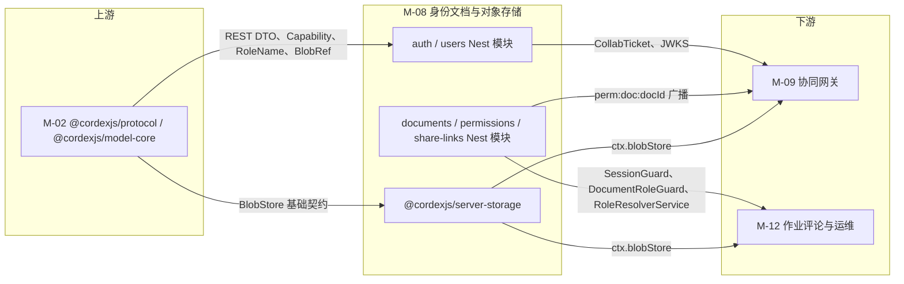
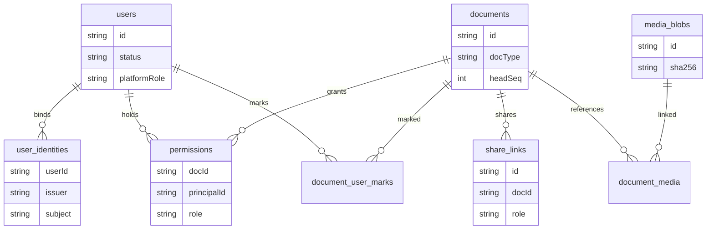
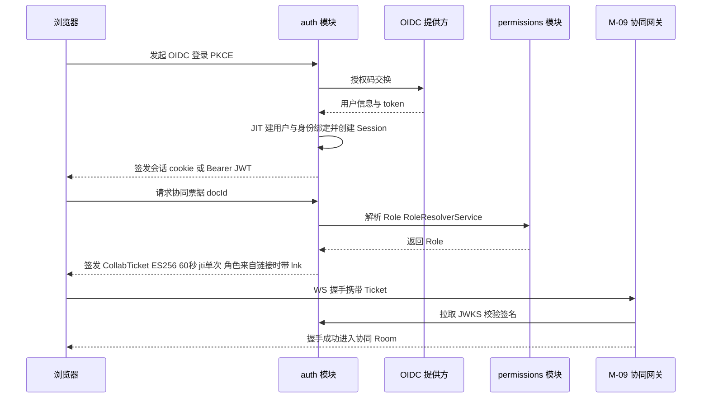
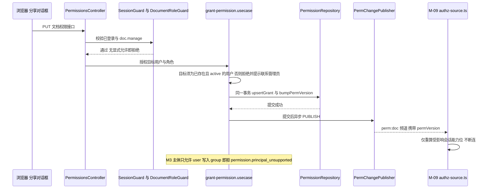
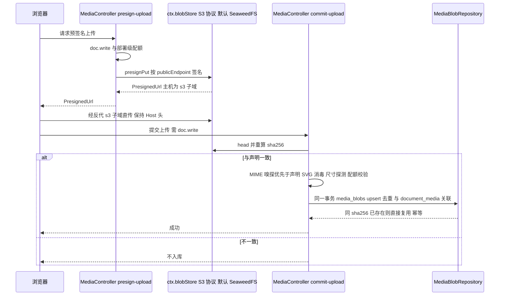
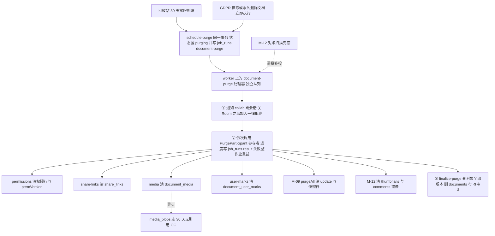
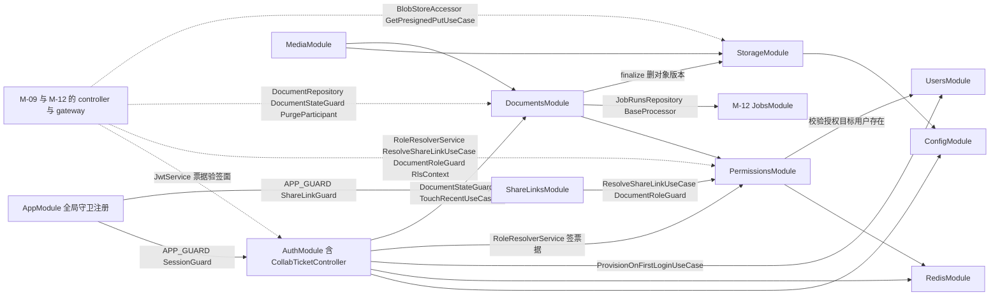
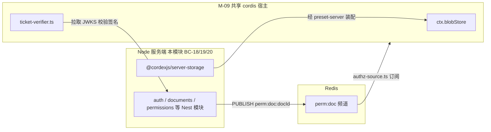

> 状态：草稿 v0.1 | 负责：架构-模块（阶段二） | 更新：2026-09-21、2026-09-24（rulings §4.15）、2026-09-24（复核修正，rulings §4.17）、2026-09-25（补图）、2026-09-25（矛盾收口，rulings §4.18）、2026-09-25（§4.19）、2026-09-25（审稿）、2026-09-25（§4.19 N1） | 依赖：00-module-map.md M-08 行/§4.2/§5.3/§9；40-modules/02-kernel-protocol-and-document-core.md §1.2/§2.5/§2.6/§4.3/§5.3/§6/§7/§12–13；30-architecture/08-backend-nestjs.md §0/§1/§2/§3.2/§5/§6/§9/§11/§16.4；30-architecture/02-layering-and-packages.md §3.2/§4.23；charter v0.2 §5.2 apps/server·server-storage 行/§6.1 D8；PRD 10-prd/03-features/06-server-and-ops.md SV-06/SV-08；PRD 10-prd/03-features/03-collaboration.md §1/CO-05/CO-15；ADR-0029；ADR-0030（观测栈，只读）

# 08 服务端身份、文档与对象存储（限界上下文 BC-18 身份与会话、BC-19 文档目录与权限、BC-20 对象存储与媒体）

## 0. 一页总览

| 项 | 值 |
|---|---|
| 职责一句话 | 外置 OIDC 登录（服务端不持有密码）、首次登录 JIT 建用户、会话/协同票据签发、平台管理员（部署级）（BC-18）；文档目录 CRUD、权限授予撤销与分享链接（BC-19）；`BlobStore` 服务端实现与内容寻址媒体上传（BC-20） |
| 覆盖的上下文 | BC-18 身份与会话、BC-19 文档目录与权限、BC-20 对象存储与媒体 |
| 承载包 / 目录 | `apps/server/src/modules/{auth,users,documents,permissions,share-links,storage,media}`（L8 · node · app，秩 80；2026-09-24 删除 `tenants`（T-0 单组织去租户）与 `groups`（U-11 组管理推迟），rulings §4.15）、`@cordexjs/server-storage`（LS · node · provider `implements:['blobStore']`，秩 58） |
| cordis 形态 | library（BC-18/19 的五个 Nest 模块 auth/users/documents/permissions/share-links——纯 Nest DI，非 cordis Fiber；2026-09-24 删 `tenants`/`groups`，rulings §4.15）+ provider（`@cordexjs/server-storage`：唯一 `implements:['blobStore']` 的服务端包；`storage`/`media` 两个 Nest 模块是它的薄绑定层，本身仍是 library） |
| 运行位置 | 服务端 |
| 上游（依赖） | M-02（`@cordexjs/protocol` 的 REST DTO/错误码/`Capability`/`RoleName`/`ROLE_CAPABILITIES`/`BlobRef`；`@cordexjs/model-core` 的 `BlobStore` 基础契约，仅类型引用，不 import 运行时） |
| 下游（被依赖） | M-09（协同网关消费本模块签发的 collab ticket 契约与票据验签面、`perm:doc:{id}` 广播、`RoleResolverService`/`ResolveShareLinkUseCase`（`AuthzSource` 重算链接角色）、`ctx.blobStore`，以及 document-purge 参与者登记）、M-12（导入导出/缩略图/评论/审计/`common/*` 复用本模块的 `DocumentRoleGuard`/`RoleResolverService`/`GetPresignedPutUseCase`/`ctx.blobStore`，并为本模块的 `@Audited()`/限流注解提供解释器；`SessionGuard` 与 `ShareLinkGuard` 由 AppModule 以 `APP_GUARD` 全局注册，业务模块不再为鉴权 import 本模块，rulings §4.18 BE-06/BE-05） |
| 对外服务 | 无 cordis 服务（BC-18/19：REST `/auth/*`、`/users/*`、`/documents/*`、`/documents/:id/permissions`、`/documents/:id/share-links`，全部相对 `apiBase`（`/api/v1`，rulings §4.18 BE-11））；`ctx.blobStore`（BC-20，`@cordexjs/server-storage` 经 `preset-server` 装配进 M-09 持有的共享 cordis 宿主，见 §7） |
| 贡献点 | 提供：无；消费：无（三个 BC 均不参与 `ctx.contribute`/`ctx.contributions`，module-map §3 BC-18/19/20 行已定） |
| Nest 侧导出（非 cordis 贡献点） | `SessionGuard`（AppModule 全局注册）、`@Public()`、`ApiKeyGuard`（M4）、`DocumentRoleGuard`、`ShareLinkGuard`（AppModule 注册为第二个全局守卫）、`PlatformAdminGuard`（部署级平台管理员，取代 `TenantAdminGuard`，rulings §4.15 T-0）、`RoleResolverService`、`ResolveShareLinkUseCase`（2026-09-25 移入 permissions，rulings §4.18 BE-02）、`IssueCollabTicketUseCase`、`JwtService` 票据验签面（供 M-09 `TicketVerifier`，§4.18 BE-07）、`@PurgeParticipant()`（document-purge 参与者登记，§4.18 BE-15）——经 DI `exports` 供 M-09/M-12 的 controller/gateway 复用，见 §3 |
| doc / sheet 通用性 | generic（`Document` 只是目录条目 + `docType` 字符串字段透传，三个 BC 对幻灯片/文档/表格内容一无所知） |
| 批次 | 2 |

### 0.1 图示

**图 0-1 模块内 Nest 模块与上下游关系**



图怎么读：左侧 M-02 提供协议与基础契约；中间三组 Nest 模块 / 包是本模块产物；右侧下游中 M-09 消费票据与权限广播，M-12 复用守卫与 `ctx.blobStore`。

## 1. 限界上下文与边界

### 1.1 职责与非职责

**BC-18 身份与会话**（2026-09-24 由「身份与租户」改名，rulings §4.15 T-0：单组织、完全去租户——一次部署 = 一个组织，数据模型/API/权限中无 tenant）
- 做：外置 IdP 的 OIDC 授权码 + PKCE 登录/回调/登出（M1–M3 服务端**只认 OIDC**、**不持有密码**；compose 可选内置 Casdoor，可换任意 OIDC IdP，rulings §4.15 Q6）、首次登录 JIT 建用户（`users` + `user_identities`，`(issuer,subject)` 唯一）、会话（httpOnly cookie 或 Bearer JWT）签发与刷新、协同 ticket 签发（ES256、60 s、`jti` 单次，ADR-0029）、JWKS 暴露、平台管理员（部署级 `platform_role='admin'`）校验、部署级注册开关 `auth.selfSignup`（默认关：由管理员在 IdP（Casdoor）建号；开启时登录页显示 IdP 注册入口）；**分享邀请只对已存在账号生效**，目标无账号时提示联系管理员，服务端不设待接受邀请表（rulings §4.17 D1）。集成方签名 JWT 校验与 API Key 签发/校验**降为 M4**（届时 JIT 建影子用户，Q6）。
- 不做：不做密码/注册表单/找回密码（全部在 IdP）；不做租户与组管理（T-0 删除；组管理 U-11 推迟，M3 只按人分享）；不做协同 ticket **校验**（WS 握手校验是 M-09 `ticket-verifier.ts` 的职责，本模块只签发并暴露 JWKS/校验函数供其调用，见 §7）；不做文档级权限判定（BC-19）；不做审计落库（只在 controller/usecase 标注 `@Audited()` 使用点，不持有 `audit_log` 表与拦截器实现，M-12/BC-26）。

**BC-19 文档目录与权限**
- 做：文档目录条目 CRUD（标题/状态/回收站/锁定）与最近/固定记账（`document_user_marks`，rulings §4.18 BE-31）、权限授予/撤销/列出（fail-closed：无显式允许即拒绝）、`permVersion` 递增与 `perm:doc:{id}` 广播、分享链接创建/撤销/列表（**令牌解析归 `permissions`**：`ResolveShareLinkUseCase` 经 `SECURITY DEFINER` 函数只读 `share_links`，守卫与 `RoleResolverService` 共用这一个用例，rulings §4.18 BE-02）、角色解析（直接授权与本文档链接角色取高，直接授权部分 5 s 缓存；2026-09-24 删除「租户默认」来源，T-0）、文档级 Postgres RLS 会话上下文（M3 出口，Q6，见 §10）；分享链接访问经 `ShareLinkGuard` 校验令牌未撤销/未过期后，把链接角色叠加到当前**已登录** Principal 的能力位集合，不产出匿名 Principal，未登录访客返回需登录错误码由前端跳转登录（rulings §4.13 S-1，2026-09-21；分享链接**始终要求登录**，§4.15 Q6 延续）；文档硬删除采用「单作业 + 参与者」编排（`schedule-purge.usecase.ts` 同一事务置 `purging` 并写 `job_runs(kind=document-purge)`，worker 上的 `document-purge.processor.ts` 依次调用各模块以 `@PurgeParticipant` 登记的幂等清理用例，`finalize-purge.usecase.ts` 收尾，各模块只清自己的表，rulings §4.13 S-2、§4.18 BE-15；文档擦除与「永久删除文档」不等回收站宽限期、立即硬删，§4.15 Q3。术语：文档级操作 2026-09-25 起称「永久删除文档」（原「立即彻底删除」），元素级「彻底删除元素」由 M-09 承接，rulings §4.18 CO-07）。
- 不做：不持有文档**内容**（幻灯片树/CRDT update 在 BC-05/21，`Document` 只是目录条目——`headSeq`/`epoch` 由 BC-21/27 写入，本模块只读展示）；不做 WS 握手第二道 fail-closed 检查点的**实现**（契约在此定义，实现在 M-09）；不做版本历史的存储与恢复执行（BC-22/M-09，本模块只声明 `history.read`/`history.restore` 两个能力位供其检查点复用）。

**BC-20 对象存储与媒体**
- 做：`BlobStore` Definition 的服务端实现（S3 协议——自托管默认 SeaweedFS，替换 MinIO，rulings §4.15 Q10——/本地）、内容寻址（sha256，部署级去重；2026-09-24 由租户级改，T-0）、预签名 PUT/GET（一律按部署配置 `storage.s3.publicEndpoint` 生成——浏览器经反代子域 `s3.<域名>` 到达 SeaweedFS S3 网关且保持 Host 头，服务端自身读写走内网 endpoint，rulings §4.18 BE-01）、通用预签名用例 `GetPresignedPutUseCase`（**仅内部使用**：M-12 两步导入按服务端预分配的对象键调用，客户端不能提交任意对象键，`POST /storage/presign` 已删除，§4.18 BE-10）、媒体专属上传提交校验（MIME 嗅探优先于声明、SVG 消毒、尺寸探测、部署级配额）。
- 不做：不解析媒体所属的文档语义（`document_media` 只是薄关联表，"这张图在哪一页/哪个占位符"由 BC-06 幻灯片领域模型持有）；不做导入导出格式转换（BC-23/M-12 调用 BC-27 完成，本模块只提供字节存取）；不做缩略图渲染（BC-24/M-12）。

### 1.2 通用语言

> 2026-09-25（rulings §4.19）：术语的定义与行为以 [60/02](../60-backend/02-auth-chain.md)（鉴权链路）、[60/03](../60-backend/03-modules-identity-and-access.md)、[60/04](../60-backend/04-modules-documents-storage-media.md)、[60/09](../60-backend/09-ddl-identity-and-access.md)、[60/10](../60-backend/10-ddl-documents-marks-media.md) 为准；本表只保留术语到文件的落点，冲突以 60 为准。

| 术语 | 定义 | 所在文件 |
|---|---|---|
| `Principal` | 已鉴权主体：`{kind:'user'\|'apiKey', id, platformRole, scopes}`（2026-09-24 删 `tenantId`，T-0；`kind:'apiKey'` 为 M4）；服务端对 `protocol.Principal` 的加宽形态。**不含 `kind:'shareLink'`**（rulings §4.13 S-1，2026-09-21 修订）：分享链接不产出独立 Principal，只把链接角色叠加进已登录 `user`/`apiKey` Principal 的 `scopes`，见 `ShareLink` 行与 §2.6。`scopes` 中的链接条目形状为 `{docId, role, linkId, expiresAt}`（2026-09-25，rulings §4.18 BE-02/BE-05：由 `ShareLinkGuard` 写入；`RoleResolverService` 按 `linkId` 经同一个 `ResolveShareLinkUseCase` 复核仍有效后与直接授权取高；`RlsContext` 据此设置 `app.share_doc_id`） | `auth/domain/principal.ts` |
| `Session` | 登录会话：`sessionId,userId,issuedAt,expiresAt`（2026-09-24 删 `tenantId`） | `auth/domain/session.ts` |
| `UserIdentity`（新增，rulings §4.15 Q6） | 外置 IdP 身份与本地用户的绑定：`{userId,issuer,subject}`，`(issuer,subject)` 唯一；首次登录 JIT 建 `User` + `UserIdentity` | `users/domain/user-identity.ts` |
| 平台管理员（新增，§4.15 T-0） | 部署级管理员：`User.platformRole='admin'`；管理部署级设置、用户状态、Webhook 注册、强制 `epoch` 等；**不**隐含任何文档角色（读写文档仍须文档权限） | `auth/interface/guards/platform-admin.guard.ts` |
| `DocAccess`（新增，§4.15 T-0 / Q6） | 权限服务签发的「已校验的文档访问」品牌类型 `{docId,userId,role}`；以 `docId` 为键的仓储公共方法只接受 `DocAccess` 或 `SystemContext`，由扫描器 `doc-access-via-permission` 机械保证（取代已作废的租户参数检查，rulings §4.18 GV-15 删去旧名） | `permissions/application/resolve-role.usecase.ts` |
| RLS 会话上下文（新增，§4.15 Q6） | 每个请求事务 `SET LOCAL app.user_id` / `app.share_doc_id`，文档级 Postgres RLS 策略据此判定行可见性；系统作业（压缩、溢写回放、缩略图、墓碑硬删除）用**独立系统作业角色** `cordex_system` + 显式系统作业上下文（`SystemContext`），该角色**无 `BYPASSRLS`**；`BYPASSRLS` 只给迁移角色（ADR-0022 决策 3，2026-09-24 复核 H4） | `permissions/infrastructure/rls-context.ts` |
| `CollabTicket` | 协同握手票据 claims：`sub,doc,role,permVersion,jti,exp,sid?,lnk?`（ADR-0029；2026-09-24 删 `tid`，T-0）。`sid` 是**登录会话 id**；`lnk` 是可选的分享链接 id，仅当签发时的角色来自本文档链接条目才写入，供 M-09 `AuthzSource` 重算时复核链接是否仍有效、并按链接到期时间主动降权（2026-09-25，rulings §4.18 BE-02） | `auth/domain/collab-ticket.ts` |
| `Document`（目录条目） | 文档的元数据行，非内容；`status ∈ active\|trashed\|locked\|purging`（C-02） | `documents/domain/document.ts` |
| `Permission`/`Grant` | `(principalType,principalId) → role` 的一条授权；无行即无权 | `permissions/domain/permission.ts` |
| `RoleName`/`ROLE_CAPABILITIES` | 角色→能力位表，权威类型定义在 `protocol/permissions/roles.ts`（M-02 Q-5 留白），本模块回填运行时初始值（§2.2） | `protocol/src/permissions/roles.ts`；回填于 `permissions/domain/role.ts` |
| `ShareLink` | 角色叠加令牌，`role ∈ {viewer,commenter,editor}`（不可为 owner）。**需登录**方可兑现（rulings §4.13 S-1，2026-09-21 修订，原"免登录"字面定义已否决）：持有有效令牌的**已登录**用户经 `ShareLinkGuard` 把 `role` 叠加进自身能力位；无账号者在 IdP 取得账号后首次登录 JIT 建号（2026-09-24 取代原「个人账号自助注册」，服务端不持有密码，rulings §4.15 Q6；IdP 是否开放注册由 `auth.selfSignup` 决定） | `share-links/domain/share-link.ts` |
| `MediaBlob` | 部署级内容寻址媒体（`sha256` 唯一；2026-09-24 由租户级改，T-0） | `media/domain/media-blob.ts` |
| `BlobRef` | `{hash,size,contentType}`，与 `protocol/src/blob.ts`、`model-core` 同一定义源 | `server-storage/src/domain/blob-ref.ts` |
| `ServerBlobStore` | `BlobStore` 服务端扩展接口：`+ head/delete/presignPut/presignGet/list` | `server-storage/src/infrastructure/contracts/blob-store.ts` |
| fail-closed 双点 | REST `DocumentRoleGuard` 与 WS 握手（M-09）都是"无显式允许即拒绝"；客户端命令管线检查点是第三道（UX，非安全边界） | ADR-0029；charter D12 |
| `permVersion` | 文档权限变更计数器，随 `PUBLISH perm:doc:{id}` 广播，供 ticket 与 WS 会话比对 | `document_perm_versions` 表 |
| document-purge 参与者（新增，rulings §4.18 BE-15） | 文档硬删除编排中负责清理某一张（组）表的幂等用例，以 `@PurgeParticipant(name)` 登记，由 `document-purge.processor.ts` 经 Nest `DiscoveryService` 收集后依次调用；`documents` 不 import 下游；启动断言登记集合 = `{permissions, share-links, media, collab, thumbnails, comments, user-marks}` | `documents/application/purge-participant.ts` |

### 1.3 上下文映射

> 2026-09-25（rulings §4.19）：跨模块依赖与 imports 的唯一源是 [60/01 §8](../60-backend/01-service-overview-and-roles.md)；本表保留 BC 级关系与防腐层落点文件。

| 上游 | 下游 | 关系类型 | 防腐层落点 | 传递的契约 |
|---|---|---|---|---|
| BC-03 协议（模块外 M-02） | BC-18/19/20 | Published Language | 各 `*.controller.ts` 的 `@Body()`/`@Query()` | `z.infer` DTO、`Capability`、`RoleName`、`ErrorEnvelope` |
| BC-05 文档内核（模块外 M-02，仅类型） | BC-20 | Customer–Supplier（Conformist：`ServerBlobStore` 须结构兼容 `BlobStore{get,put,has}`） | `server-storage/src/infrastructure/contracts/blob-store.ts` | `BlobRef` |
| BC-18 | BC-19（`issue-collab-ticket` 依赖 `RoleResolverService`） | Customer–Supplier（模块内） | `auth/application/issue-collab-ticket.usecase.ts` | `Role` |
| BC-19 | 模块外 BC-21（M-09，Redis `perm:doc:{id}`） | Customer–Supplier | `permissions/infrastructure/perm-change.publisher.ts` | `permVersion`、频道消息 |
| BC-18 | 模块外 BC-21（M-09，ticket 校验） | **Published Language**（ADR-0029 claims 形状） | `auth/domain/collab-ticket.ts`、JWKS 端点 | `CollabTicket` claims、公钥 |
| BC-20 | BC-19/模块外 BC-23/24（M-12） | Open Host Service（`ctx.blobStore`） | `server-storage/src/plugin.ts` | `ServerBlobStore` |
| BC-18/19（Nest） | 模块外 BC-21/27（M-09，cordis 宿主） | Open Host Service（只调用不重实现，module-map §4.2 第 5 条） | `cordis-host.service.ts`（M-09 承载，本模块只消费） | `openUnit`/`closeUnit`/`ctx.blobStore` 读取面 |
| BC-19（`DocumentRoleGuard`/`RoleResolverService`） | 模块外 BC-25/26（M-12，评论/审计 controller 复用守卫） | Open Host Service（DI `exports`） | `permissions/interface/guards/document-role.guard.ts` | Guard 类、`Role` |
| 模块外 BC-26（M-12，`@Audited()`/限流解释器） | BC-18/19/20 | Customer–Supplier（反向：本模块是消费方） | `common/decorators/audited.decorator.ts`（M-12 承载，本模块只标注使用点） | 审计记录契约 |

命名冲突处理：本文档采用 M-02 §12 G-5 裁定后的 `Capability` 词汇（`doc.read/doc.comment/doc.write/doc.export/doc.manage/history.read/history.restore`），不采用 `02-layering-and-packages.md` §4.3 的旧词汇 `PermissionAction`（`document.read/edit/comment/export/share/manage`）；PRD `03-collaboration.md` §1「查看/评论/编辑/管理」四列与本词汇的映射见 §2.2（回填 M-02 Q-5）。

## 2. 领域模型

### 2.1 聚合与实体

> **事实源（rulings §4.19）**：身份与访问（Auth、Users、Permissions、ShareLinks）的用例、事务边界与守卫以 [60/02](../60-backend/02-auth-chain.md)、[60/03](../60-backend/03-modules-identity-and-access.md) 为准；文档、存储与媒体（含永久删除编排唯一源）以 [60/04](../60-backend/04-modules-documents-storage-media.md) 为准；表结构、RLS 与 SECURITY DEFINER 函数以 [60/09](../60-backend/09-ddl-identity-and-access.md)、[60/10](../60-backend/10-ddl-documents-marks-media.md) 为准；路由、DTO、错误码与限流以 [60/15](../60-backend/15-rest-api-catalog.md) 为准。本节（§2）只保留聚合 / 仓储到文件的落点与本包接口清单，冲突以 60 为准。

| 聚合根 / 实体 | 归属 BC | 要点（细节见 60） | 所在文件 |
|---|---|---|---|
| `User`（聚合根） | BC-18 | `status`、`platformRole ∈ {member,admin}`（至少一名 admin）；无租户（T-0） | `users/domain/user.ts` |
| `UserIdentity`（实体） | BC-18 | `(issuer,subject)` 全局唯一；首次登录 JIT（Q6） | `users/domain/user-identity.ts` |
| `ApiKey`（实体，**M4**） | BC-18 | 只存 hash；M1–M3 不启用 | `auth/domain/api-key.ts` |
| `Document`（聚合根，目录条目） | BC-19 | `status` 四值 `active \| trashed \| locked \| purging`（决策 MECH-C 之 C-02；状态机见 60/04 §2）；`head_seq`/`epoch` 等 M-09 列本模块不写（编译期 `Omit`，60/04 §5） | `documents/domain/document.ts` |
| `UserMark`（实体，`document_user_marks`，BE-31） | BC-19 | `(user_id, doc_id)` 主键、`last_opened_at?`、`pinned_at?`；只返回本人行；document-purge 参与者 `user-marks`；M2 建表（决策 MECH-C 之 C-04） | `documents/infrastructure/user-marks.repository.ts` |
| `Permission`/`Grant`（实体） | BC-19 | 主体 M3 只有 `user`（U-11 推迟组）；至少一个 owner；`bumpPermVersion(tx)` 为 `document_perm_versions` 唯一写入点（C-28） | `permissions/domain/permission.ts` |
| `ShareLink`（实体） | BC-19 | `role ∈ {viewer,commenter,editor}`；需登录（S-1）；令牌解析归 permissions（BE-02） | `share-links/domain/share-link.ts` |
| `MediaBlob`（聚合根，部署级） | BC-20 | `sha256` 唯一；读取须经 `document_media` 关联与文档作用域端点（INC-21） | `media/domain/media-blob.ts` |
| `DocumentMedia`（关联实体） | BC-20 | `detached_at`/`unreferenced_since` 维护与 30 天无引用 GC（决策 C-25，60/04 §7.4） | `media/domain/document-media.ts` |

并发与合并语义：本模块全部聚合是关系型行，**不经过 CRDT**——写入用数据库事务与行级锁 / 条件更新，冲突以「后写入事务失败并重试」处理；`Document` 的目录属性永远不进 CRDT，文档内容只在 CRDT（M-09，M2 起以协同快照为唯一事实源，rulings §4.19 D-M2-CONTENT）。`epoch`（强制全体重连，M-09 写）与 `permVersion`（只重算权限、不断连）是两个故意不联动的计数器（C-17，§7）。
**图 2-1 核心实体关系**



图怎么读：单组织部署（2026-09-24 删除 `tenants` 表，rulings §4.15 T-0）——不再有「最外层租户边界」；隔离边界改为**文档**：`permissions` 是 fail-closed 授权行（主体 M3 只有用户，组管理推迟），`share_links` 是需登录的角色叠加令牌，二者同时是文档级 RLS 策略的判定依据（§10）；`user_identities` 以 `(issuer,subject)` 唯一绑定外置 IdP 身份；`media_blobs` 部署级去重，经 `document_media` 关联到文档；`document_user_marks` 是用户对文档的「最近打开 / 固定」记账（主键 `(user_id, doc_id)`，受文档级 RLS 且只返回本人行，rulings §4.18 BE-31）。

### 2.2 值对象

| 值对象 | 字段 | 校验 schema | 所在文件 |
|---|---|---|---|
| `Role` | `'owner'\|'editor'\|'commenter'\|'viewer'` 字面量联合 | `protocol.permissions.roles.RoleName`（zod 字面量） | `permissions/domain/role.ts`（re-export + 运行时初始值） |
| `Capability` | 7 个字面量之一 | `protocol.permissions.actions.Capability` | 直接复用 `@cordexjs/protocol`，本模块不重复定义 |
| `DocumentId`/`UserId` | 品牌字符串（uuid v7） | `protocol.ids.*` | 直接复用 `@cordexjs/protocol`（2026-09-24 删 `TenantId`；`GroupId` 随 U-11 推迟不再新增，rulings §4.15） |
| `BlobRef` | `{hash,size,contentType}` | `protocol.blob.BlobRef` | `server-storage/src/domain/blob-ref.ts`（re-export） |
| `PresignedUrl`（新增） | `{url,method,headers?,expiresAt}` | 本模块新增 zod schema（建议回写 `protocol/src/rest/media.ts`，见 §12） | `storage/application/get-presigned-put.usecase.ts` 内联 schema |
| `Quota`（新增） | `{dimension,limit,used}`；`dimension` 取存储维度 `bytes`（存储字节）/ `documents`（每用户文档数），与 30-architecture/10 §1.4 取值表一致（2026-09-24 复核修正；单文件 200 MB 属导入期 `format.quota_exceeded{fileSize}`，不在本类型）；`limit` 取自**部署配置** `quotas.*`（完全可调，rulings §4.15 Q5；2026-09-24 由租户配额改，T-0）；`bytes` 按部署总量与可选的按 owner 用户上限两级判定（`pages`/`elements`/编辑者名额等运行时维度由 M-09 承载，名额按用户计） | 本模块新增 | `media/domain/quota-policy.ts` 内联类型 |
| `CollabTicketClaims` | `{sub,doc,role,permVersion,jti,exp,sid?,lnk?}`（ADR-0029；2026-09-24 删 `tid`，T-0；2026-09-25 增 `lnk?`，`sid` 为登录会话 id，rulings §4.18 BE-02，与 §1.2 `CollabTicket` 行一致） | 本模块新增，建议回写 `protocol/src/collab/ticket.ts`（08 §11 已预留路径，M-09 落地时创建） | `auth/domain/collab-ticket.ts` |

**`ROLE_CAPABILITIES` 运行时初始值（回填 M-02 Q-5，对齐 PRD `03-collaboration.md` §1 与 CO-07）：**

| Role | doc.read | doc.comment | doc.write | doc.export | doc.manage | history.read | history.restore |
|---|---|---|---|---|---|---|---|
| `viewer` | ✓ | | | | | | |
| `commenter` | ✓ | ✓ | | | | | |
| `editor` | ✓ | ✓ | ✓ | ✓ | | ✓ | |
| `owner` | ✓ | ✓ | ✓ | ✓ | ✓ | ✓ | ✓ |

推导依据：`doc.read/doc.comment/doc.write` 与 PRD §1 的"查看/评论/编辑"三列逐一对应；`doc.manage`（分享/权限/删除）与 `history.restore` 仅 `owner`（对应 PRD §1"管理"列的字面定义，含"版本恢复"）；`doc.export`/`history.read` 下放至 `editor`（默认值，产品可否决，理由与替代方案见 §13 Q-1）。此表是 `permissions/domain/role.ts` 里 `ROLE_CAPABILITIES: Record<RoleName, readonly Capability[]>` 的字面量来源，类型仍以 `protocol/src/permissions/roles.ts` 为准（本模块只提供运行时初始值，不重复裁决类型形状）。

**`Capability` 词汇统一（2026-09-18，跨模块评审 C-15 结案）**：本表与 `Capability` 值对象（表首行）已是全仓统一词汇的落地点；`CapabilityBit`（M-01 旧称）、`PermissionAction`（`02-layering-and-packages.md` §4.3 旧词汇，§1.3 已拒绝采用）均正式作废，至多保留一个版本的 `@deprecated` 别名，本模块不提供该别名（无历史调用方）。

**`permVersion` 语义（2026-09-18，跨模块评审 C-17 结案）**：`permVersion`（§1.2 通用语言、`document_perm_versions` 表）递增 = **仅重算权限、不断连**——任一 `permission/granted|revoked` 或分享链接变更后由 `perm-change.publisher.ts` 递增并经 Redis 广播（§2.4），M-09 收到后只重新计算受影响会话的能力位，不强制客户端断开重连。与 `Document.epoch`（§2.1）的"强制全体重连"语义互不联动，两者分别由不同触发点（本模块权限变更 usecase vs `internal/admin.controller.ts`）独立递增；边界对照见 §7。

### 2.3 领域服务

| 纯函数 | 签名草案 | 所在文件 | 两端共用 |
|---|---|---|---|
| `mergeRoles` | `(grants: RoleGrant[], now: number) => Role \| 'none'` | `permissions/domain/role-resolution.ts` | 否（服务端专有） |
| `capabilitiesOf` | `(role: Role) => readonly Capability[]` | `permissions/domain/role.ts` | 否 |
| `documentStatusTransition` | `(current: DocumentStatus, action: 'trash'\|'restore'\|'lock'\|'unlock') => Result<DocumentStatus, DocumentError>` | `documents/domain/document-status.ts` | 否 |
| `computeQuotaUsage` | `(quota: Quota, used: number) => { exceeded: boolean; remaining: number }` | `media/domain/quota-policy.ts`（2026-09-24 自已删除的 `tenants/` 迁入，T-0） | 否 |
| `validateUploadPolicy` | `(input: {declaredMime,sniffedMime,byteSize,quota}) => Result<void, MediaError>` | `media/domain/upload-policy.ts` | 否 |
| `buildCollabTicketClaims` | `(principal: Principal, role: Role, permVersion: number) => CollabTicketClaims` | `auth/domain/collab-ticket.ts` | 与 M-09 `ticket-verifier.ts` 共用**形状**（非共用代码——M-09 是独立包，只共用 claims 类型契约） |

### 2.4 领域事件

本模块三个 BC 均非 cordis 插件，下列条目**不**是 cordis 事件（module-map §3 BC-18/19/20 行），而是审计 action 或跨进程频道消息。2026-09-25 起审计 action 的名称、载荷与里程碑以 [60/07 §9](../60-backend/07-modules-comments-webhooks-audit.md)（全后端唯一登记表）为准，本节只保留发布点落点：

| 类别 | 发布点（文件） | 传输 |
|---|---|---|
| 身份：`user.provisioned`、`auth.login_succeeded`/`auth.login_failed`、`auth.logout`、票据签发 | `users/application/provision-on-first-login.usecase.ts`、`auth/application/{handle-oidc-callback,logout,issue-collab-ticket}.usecase.ts` | 仅审计 |
| 文档：`document.created`/`renamed`/`trashed`/`restored`/`locked`/`unlocked`、`document.purge_scheduled`/`document.purged` | `documents/application/*.usecase.ts` | 仅审计 |
| 权限与分享：`permission.granted`/`permission.revoked`、`share_link.created`/`revoked`/`accessed`（每次外部访问必写，S-1） | `permissions/application/*.usecase.ts`、`share-links/**` | 仅审计 |
| `permission/changed`（`{docId, permVersion}`） | `permissions/infrastructure/perm-change.publisher.ts` | **Valkey `perm:doc:{docId}`（跨进程）**；M-09 `authz-source.ts` 订阅 |
| 媒体：`media.uploaded`/`media.deduplicated` | `media/application/commit-upload.usecase.ts` | 仅审计 |

### 2.5 仓储 / 存储契约

本模块五个纯 Nest 库模块的仓储是普通 `@Injectable` 类（Drizzle 直操 Postgres），不构成 cordis Definition；方法集的唯一源是 [60/03](../60-backend/03-modules-identity-and-access.md)（身份与访问）与 [60/04 §8](../60-backend/04-modules-documents-storage-media.md)（文档、记账、媒体），以 `docId` 为键的方法首参一律 `DocAccess | SystemContext`（扫描器 `scan-doc-access-via-permission`）。

| 仓储 | 表 | 所在文件 |
|---|---|---|
| `UserRepository` | `users`、`user_identities` | `users/infrastructure/user.repository.ts` |
| `ApiKeyRepository`（M4） | `api_keys` | `auth/infrastructure/api-keys/api-key.repository.ts` |
| `DocumentRepository` | `documents`（M-08 列） | `documents/infrastructure/document.repository.ts` |
| `UserMarksRepository`（2026-09-25 登记，自 `DocumentRepository` 拆出） | `document_user_marks` | `documents/infrastructure/user-marks.repository.ts` |
| `PermissionRepository` | `permissions`、`document_perm_versions` | `permissions/infrastructure/permission.repository.ts` |
| `ShareLinkReader`（只读，经两个 SECURITY DEFINER 函数，BE-02、C-35） | `share_links` | `permissions/infrastructure/share-link-reader.ts` |
| `ShareLinkRepository` | `share_links` | `share-links/infrastructure/share-link.repository.ts` |
| `MediaBlobRepository` | `media_blobs` | `media/infrastructure/media-blob.repository.ts` |
| `DocumentMediaRepository`（2026-09-25 登记，自 `MediaBlobRepository` 拆出） | `document_media` | `media/infrastructure/document-media.repository.ts` |

**`ServerBlobStore`（`BlobStore` 的服务端扩展；Definition 契约文件 `server-storage/src/infrastructure/contracts/blob-store.ts`）**：签名与两个桶 / 两个端点的规则以 [60/04 §6.2](../60-backend/04-modules-documents-storage-media.md) 为准（`head`、`delete`、`presignPut`/`presignGet` 按 `storage.s3.publicEndpoint` 签名，BE-01、`list`、`listVersions`/`deleteVersion` 供 `finalize-purge`，BE-15）；对象键布局以 [60/14](../60-backend/14-valkey-object-storage-and-retention.md) 为准。Provider：`S3BlobStoreProvider`（S3 协议通用，自托管默认 SeaweedFS，Q10）、`LocalBlobStoreProvider`（开发 / 测试），互不 import。契约套件 `runBlobStoreConformance(factory)`（`server-storage/src/testing/run-blob-store-conformance.ts`；用例 id 见 [70/02](../70-testing/02-contract-suites-and-pluggability.md) §3 第 2 行）：包内 `src/__tests__/conformance-local-blob-store.test.ts` 实例化 Local 版，容器版 `apps/server/test/integration/conformance/s3-blob-store.int-spec.ts` 实例化 S3 版（决策 T-NAMING，70/02 §14 第 6 条；`scan-manifest` 规则 (e)）。

### 2.6 应用服务与命令

本模块没有 `CommandDef`/`MutationDef`；「命令」是普通 Nest 用例，事务边界是数据库事务。用例的参数、守卫、事务与补偿以 60 为准（2026-09-25 起本表只保留「用例 → 文件 → 事实源」）：

| 用例 | 所在文件 | 事实源 |
|---|---|---|
| OIDC 登录与回调、首次登录 JIT、刷新会话、登出 | `auth/application/{login-with-oidc,handle-oidc-callback,refresh-session,logout}.usecase.ts`、`users/application/provision-on-first-login.usecase.ts` | [60/02](../60-backend/02-auth-chain.md)、60/03 §2–§3 |
| 签发协同票据（`POST /documents/:id/collab-ticket`，归 AuthModule） | `auth/application/issue-collab-ticket.usecase.ts`、`auth/interface/collab-ticket.controller.ts` | 60/03 §2；60/02 §8（claims 封闭集合） |
| 用户状态与平台角色 | `users/application/*.usecase.ts` | 60/03 §3 |
| 文档目录 CRUD、回收站、锁定、最近 / 固定 | `documents/application/*.usecase.ts`、`documents/application/queries/document-queries.ts` | [60/04 §3](../60-backend/04-modules-documents-storage-media.md) |
| 授予 / 撤销权限、解析角色、解析分享令牌 | `permissions/application/*.usecase.ts` | 60/03 §4 |
| 分享链接创建 / 撤销 / 访问叠加 | `share-links/application/*.usecase.ts`、`share-links/interface/guards/share-link-access.guard.ts` | 60/03 §5；60/02 §7 |
| 媒体预签名、提交、读取（`/documents/:id/media/*`，INC-21） | `media/application/{presign-upload,commit-upload,get-media}.usecase.ts` | 60/04 §7 |
| 预签名 PUT（仅内部，导入两步上传用，BE-10） | `storage/application/get-presigned-put.usecase.ts` | 60/04 §6.3；60/06 §6.1 |
| 永久删除编排：发起、处理器（独立队列 `document-purge`，INC-23 / C-05）、参与者、收尾 | `documents/application/{schedule-purge,finalize-purge,purge-document-user-marks}.usecase.ts`、`documents/interface/document-purge.processor.ts`、各模块 `purge-*.usecase.ts` | 60/04 §4（唯一源） |
| 彻底删除元素的鉴权（执行在 M-09，CO-07） | `permissions/interface/guards/document-role.guard.ts` | 60/05 §8 |
**图 2-2 登录与协同 Ticket 签发时序**



图怎么读：登录换会话在前，签发协同票据在后——后者需要 `permissions` 模块解出 `Role` 才能签发（直接授权与本文档链接角色取高，角色来自链接时票据带 `lnk`，rulings §4.18 BE-02）；M-09 只负责用 JWKS 校验票据签名，不负责签发，边界见 §7。OIDC 回调地址为 `/api/v1/auth/oidc/callback`（§4.18 BE-11），浏览器经反代子域 `idp.<域名>` 打开 Casdoor 登录页，issuer 用对外 URL（§4.18 BE-01）。

**图 2-3 授予权限与 permVersion 广播时序**



怎么读：授权行与 `permVersion` 递增在同一数据库事务内完成，广播在提交之后异步发出；M-09 收到后只静默重算能力位，与 `epoch` 递增的「强制全体重连」互不联动；邀请只对已存在账号生效，服务端没有待接受邀请表。

依据：§2.6「授予权限」行；§7 `epoch`/`permVersion` 边界表；rulings §4.15 Q6、§4.17 D1。

**图 2-4 媒体预签名直传与提交时序**



怎么读：字节流经预签名 URL 直达对象存储，应用服务器只签发 URL 与做提交校验；预签名按 `storage.s3.publicEndpoint` 生成，浏览器经反代子域 `s3.<域名>` 到达 SeaweedFS S3 网关（反代保持 Host 头，否则签名失效；SeaweedFS 桶按应用源配 CORS，允许 PUT/GET、暴露 ETag）；内容寻址按 sha256 做部署级去重，重复提交同一内容幂等复用。媒体专属通道是文档作用域的 `POST /documents/:id/media/presign` 与 `.../media/commit`（PUT 先落 `uploads/tmp/{uploadId}`，commit 校验后服务端复制到 `media/` 键；读取 `GET /documents/:id/media/:sha256` 须 `doc.read` 且存在 `document_media` 关联，决策 INC-21，2026-09-25），通用 `POST /storage/presign` 已删除（rulings §4.18 BE-10）；步骤细节以 [60/04 §7.2](../60-backend/04-modules-documents-storage-media.md) 为准。

依据：§1.1 BC-20；§2.5 `ServerBlobStore`；§2.6「提交媒体上传」行、§5.8 `presign-upload.usecase.ts`；rulings §4.15 Q10、T-0；§4.18 BE-01/BE-10。

**图 2-5 文档硬删除编排流程**



怎么读：一个发起点写一行持久化作业，worker 上的处理器分三步执行：先让 collab 踢掉在线会话并拒绝再加入（防止在线 Room 把新 update 写回），再逐个调用各模块以 `@PurgeParticipant` 登记的幂等清理用例（`documents` 经 `DiscoveryService` 收集、不 import 下游，「谁的表谁写」不变），最后由 `finalize-purge` 用 `ListObjectVersions` 清掉 `docs/{docId}/` 下的全部对象版本、删除 `documents` 行并写审计；`media_blobs` 本体不同步删除。启动断言参与者集合 = `{permissions, share-links, media, collab, thumbnails, comments, user-marks}`。

依据：§2.6「编排硬删除」「执行 document-purge 作业」「收尾硬删除」与各清理行；§7「硬删除编排边界」段；rulings §4.13 S-2、§4.15 Q3、§4.18 BE-15/BE-31/CO-07。

## 3. Nest 模块定义表

> 结构规则（2026-09-25，[60/01](../60-backend/01-service-overview-and-roles.md) §5）：有 rest 部件的业务模块拆为两个 Nest 模块——`XxxModule` 只含 providers 与 exports、供其他模块 import；`XxxHttpModule` 只含 controllers、import `XxxModule`，只由角色根模块 `AppModule.forRole(role)` import。本组涉及 `DocumentsHttpModule`、`MediaHttpModule` 等（逐模块以 60/03、60/04 为准）；机密由 `ConfigModule` 导出的 secrets provider 提供，不设 `SecretsModule`。

Nest 模块不是 cordis Fiber（module-map §5.3），本节取代模板原 §3 的插件定义表。2026-09-25 起改为摘要 + 链接（rulings §4.19）：`imports`/`providers`/`controllers`/`exports`/守卫的唯一源是 [60/03](../60-backend/03-modules-identity-and-access.md)（Auth、Users、Permissions、ShareLinks 模块卡）与 [60/04 §8](../60-backend/04-modules-documents-storage-media.md)（Documents、Storage、Media）；imports 总图与无环约束见 [60/01 §8](../60-backend/01-service-overview-and-roles.md)，角色装配见 60/01 §5。

| 模块 | imports（摘要） | 关键 exports（摘要） | 事实源 |
|---|---|---|---|
| `AuthModule` | `ConfigModule`、`RedisModule`、`UsersModule`、`PermissionsModule`、`DocumentsModule`（只取 `DocumentStateGuard`、`TouchRecentUseCase`） | `SessionGuard`（AppModule `APP_GUARD` 全局注册，BE-06）、`PlatformAdminGuard`、`@Public()`、`IssueCollabTicketUseCase`、`JwtService` 票据验签面（BE-07）；**`CollabTicketController` 归本模块**（`POST /documents/:id/collab-ticket`，2026-09-25） | 60/03 §2；60/02 |
| `UsersModule` | 无 | `ProvisionOnFirstLoginUseCase` | 60/03 §3 |
| `DocumentsModule` | `PermissionsModule`、`JobsModule`（`JobRunsRepository.create(tx, …)` 写 `document-purge` 作业行、`BaseProcessor`）、`StorageModule`（`finalize-purge` 删对象版本）；**不再 import `AuthModule`**（2026-09-25，票据控制器归 AuthModule） | `DocumentRepository`、`UserMarksRepository`（只读查询复用）、`DocumentStateGuard`、`TouchRecentUseCase`、`PurgeParticipant` 装饰器与接口；`DocumentPurgeProcessor` 只在 worker 注册（独立队列 `document-purge`） | 60/04 §1–§5、§8 |
| `PermissionsModule` | `RedisModule`、`UsersModule` | `RoleResolverService`、`ResolveShareLinkUseCase`（BE-02）、`DocumentRoleGuard`、`RlsContext`、`bumpPermVersion(tx)` 唯一写入点（C-28） | 60/03 §4 |
| `ShareLinksModule` | `PermissionsModule` | `ShareLinkGuard`（第二个 `APP_GUARD`，BE-05） | 60/03 §5 |
| `StorageModule` | `ConfigModule` | `BlobStoreAccessor`、`GetPresignedPutUseCase`（仅内部，BE-10） | 60/04 §6 |
| `MediaModule` | `StorageModule`、`DocumentsModule` | `SyncDocumentMediaRefsUseCase`、`PruneDetachedMediaLinksUseCase`（供 M-09 写快照时同事务调用，决策 C-25） | 60/04 §7 |

**图 3-1 Nest 模块 imports 依赖**



怎么读：实线为 Nest `imports` 方向（引入方 → 被引入模块）；虚线是模块外对本模块 `exports` 的消费。2026-09-25（rulings §4.19 回写 60/03、60/04）：删 `DocumentsModule → AuthModule`（协同票据控制器归 AuthModule），补 `DocumentsModule → JobsModule`、`→ StorageModule`；`AuthModule → DocumentsModule` 只取状态守卫与「最近」记账，DocumentsModule 不反向 import AuthModule，全图无环，由 depcruise `no-circular` 覆盖 `apps/server/src/modules/**`。

依据：60/01 §8；60/03 §2；60/04 §8；rulings §4.18 BE-02/BE-05/BE-06/BE-07、§4.19。

**模块目录内以 cordis 插件形式存在的 IO 适配器**：本模块**没有**这类文件——BC-20 的 Node Provider（`S3BlobStoreProvider`/`LocalBlobStoreProvider`）完整地活在 `@cordexjs/server-storage` 包内部（§2.5），`StorageModule`/`MediaModule` 只经 `BlobStoreAccessor` 读取共享 cordis 宿主的 `ctx.blobStore`（§7），差异见 §12。

**守卫的物理归属**：`SessionGuard`/`ApiKeyGuard`/`DocumentRoleGuard`/`PlatformAdminGuard`/`ShareLinkGuard` 编码 BC-18/19 的授权策略，物理归属各自 owning 模块的 `interface/guards/`（rulings §4.18 BE-08）；注册方式与执行顺序（限流 → `SessionGuard` → `ShareLinkGuard` → 控制器级 `DocumentRoleGuard`/`PlatformAdminGuard`）以 [60/02](../60-backend/02-auth-chain.md) 为准；`common/`（M-12）只保留与 BC 策略无关的纯机制。
## 4. 目录树（完整到文件）

七个 Nest 模块（2026-09-24 删除原 §4.2 `tenants/` 与原 §4.10 `groups/`，rulings §4.15 T-0 / U-11 推迟；小节编号保留空位以免外部引用错位）均挂在 `apps/server/src/modules/` 之下（与 M-09/M-12 的模块同级）；`*.module.ts` 在模块根，五个 DDD 子目录按总编排裁定组织，第五个目录在 Nest 侧材质化为 `__tests__/`（非 `testing/`，理由见 §9）。

**不在本模块的 `apps/server` 公共件**（2026-09-25 审稿登记）：进程入口 `main.ts`、根模块 `app.module.ts`（`AppModule.forRole`，全局守卫链以 `APP_GUARD` 注册本模块的 `SessionGuard`、`CsrfGuard` 与 `ShareLinkGuard`）以及 `observability/`、`redis/`、`db/`（连接池与系统事务入口 `db/client.ts`、drizzle 类型镜像 `db/schema/*.ts`、迁移 SQL `db/migrations/NNNN_<name>.sql`）统一登记在 [M-12 §4.13、§5.13](12-server-jobs-comments-and-ops.md)。本模块仓储只 import `db/schema/<表>.ts` 与 `db/client.ts` 给出的事务句柄，请求路径的 `withRls` 由本模块 `permissions/infrastructure/rls-context.ts` 提供；本模块各表（`users`、`user_identities`、`documents` 的 M-08 列、`document_user_marks`、`permissions`、`document_perm_versions`、`share_links`、`media_blobs`、`document_media`）的 DDL 与迁移以 60/09、60/10 为准，写方以 60/08 §7 为准。

### 4.1 `apps/server/src/modules/auth/`

```text
auth/
├── auth.module.ts                        装配 imports/providers/controllers/exports（见 §3）
├── domain/
│   ├── principal.ts                      Principal 值对象
│   ├── session.ts                        Session 实体
│   ├── collab-ticket.ts                  CollabTicketClaims 值对象 + buildCollabTicketClaims()（§2.3）
│   ├── api-key.ts                        ApiKey 实体（M4，rulings §4.15 Q6）
│   └── errors.ts                         auth.* 错误码
├── application/
│   ├── login-with-oidc.usecase.ts        生成 state+PKCE→StateStore，返回 authorizationUrl
│   ├── handle-oidc-callback.usecase.ts   code→token 交换→UsersModule.provisionOnFirstLogin（JIT）→签发 Session
│   ├── refresh-session.usecase.ts        会话/刷新令牌轮换
│   ├── logout.usecase.ts                 撤销会话
│   └── issue-collab-ticket.usecase.ts    RoleResolverService → CollabTicket JWT（ADR-0029）
├── infrastructure/
│   ├── oidc/oidc-client.provider.ts      openid-client v6 discovery 缓存 + PKCE 生成
│   ├── oidc/state-store.redis.ts         Redis 状态存储（10 min TTL）
│   ├── tokens/jwt.service.ts             ES256 签发/验签、JWKS 轮换与 kid、httpOnly cookie 编解码
│   └── api-keys/api-key.repository.ts    Drizzle：api_keys 表（M4）
├── interface/
│   ├── auth.controller.ts                /auth/oidc/{login,callback}、/logout、/me、/token/refresh、/.well-known/jwks.json、/auth/config（公开：selfSignup 开关与 IdP 注册地址）；全部相对 /api/v1，公开端点标 @Public()
│   ├── collab-ticket.controller.ts       POST /documents/:id/collab-ticket（CollabTicketController 归本模块，2026-09-25 自 documents.controller 迁入；借 DocumentsModule 导出的 DocumentStateGuard 与 TouchRecentUseCase，60/03 §2）
│   ├── decorators/
│   │   └── public.decorator.ts           @Public()：全局 SessionGuard 的放行标记（白名单快照见 §6，新增，rulings §4.18 BE-06）
│   ├── guards/session.guard.ts           会话 JWT → Principal（fail-closed：无有效凭据 401）；由 AppModule 以 APP_GUARD 全局注册，非 http 上下文直接放行（BE-06）；同文件导出 @CurrentPrincipal()
│   ├── guards/api-key.guard.ts           API Key 专用（集成方服务端调用，M4）
│   └── guards/platform-admin.guard.ts    部署级平台管理员校验 principal.platformRole='admin'（新增，取代 TenantAdminGuard，§4.15 T-0）
└── __tests__/
    ├── issue-collab-ticket.usecase.test.ts
    ├── handle-oidc-callback.usecase.test.ts  覆盖受信 issuer 校验、JIT 建号、服务端不落密码
    └── jwt.service.test.ts
```

### 4.2 （已删除）`apps/server/src/modules/tenants/`

2026-09-24 整个删除（rulings §4.15 T-0：单组织、完全去租户）。原 11 个文件去向：`tenant-admin.guard.ts` → `auth/interface/guards/platform-admin.guard.ts`（部署级平台管理员）；`quota-policy.ts` → `media/domain/quota-policy.ts`（配额取部署配置）；其余（`Tenant` 聚合、`create-tenant`/`update-tenant-settings`/`get-tenant-quota-usage` 用例、`tenant.repository`、`tenants.controller`、错误码与单测）无替代，直接删除。

### 4.3 `apps/server/src/modules/users/`

```text
users/
├── users.module.ts
├── domain/
│   ├── user.ts                           User 聚合根（platformRole、status；无 tenantId，§4.15 T-0）
│   ├── user-identity.ts                  UserIdentity 实体：(issuer,subject) 唯一（新增，§4.15 Q6）
│   └── errors.ts
├── application/
│   ├── provision-on-first-login.usecase.ts  首次登录 JIT 建 User + UserIdentity（取代 find-or-create-by-oidc，Q6）
│   ├── update-profile.usecase.ts         本人资料 + 管理员分支（status / platformRole）
│   └── list-users.usecase.ts             用户列表与分享对话框按人搜索（取代 list-tenant-members，T-0）
├── infrastructure/
│   └── user.repository.ts                Drizzle：users + user_identities
├── interface/
│   └── users.controller.ts
└── __tests__/
    └── provision-on-first-login.usecase.test.ts  覆盖首次/重复登录、同 subject 不同 issuer、并发首登唯一冲突
```

### 4.4 `apps/server/src/modules/documents/`

```text
documents/
├── documents.module.ts
├── domain/
│   ├── document.ts                       Document 聚合根（含 DocumentId 品牌类型引用）
│   ├── document-status.ts                documentStatusTransition()（§2.3，纯函数）
│   └── errors.ts
├── application/
│   ├── create-document.usecase.ts
│   ├── rename-document.usecase.ts
│   ├── duplicate-document.usecase.ts     DuplicateDocumentUseCase：POST /documents/:id/duplicate（doc.export；预分配新 docId、写 job_runs(kind=import, payload.source=duplicate) 并入 import 队列；M2，60/04 §3.3、60/06 §6.6）
│   ├── trash-and-restore.usecase.ts      TrashDocumentUseCase + RestoreDocumentUseCase（互逆，同文件）
│   ├── lock-document.usecase.ts          覆盖导入/迁移窗口的锁定、解锁、续期与到期释放（ADR-0029 决策 5；版本恢复不加锁，rulings §4.19 N1）
│   ├── list-recent.usecase.ts            ListRecentDocumentsUseCase（M2，服务端同步「最近」，rulings §4.12 U-04）
│   ├── pin-document.usecase.ts           PinDocumentUseCase + UnpinDocumentUseCase（互逆，同文件；M2，rulings §4.12 U-04）
│   ├── schedule-purge.usecase.ts         编排式硬删除发起：同一事务 status→purging + 写 job_runs(kind=document-purge)（rulings §4.13 S-2；§4.18 BE-15 删「或发领域事件」）
│   ├── purge-participant.ts              @PurgeParticipant(name) 装饰器 + PurgeParticipant 接口 { purge(ctx: SystemContext, docId) }（新增，§4.18 BE-15）
│   ├── finalize-purge.usecase.ts         收尾：ListObjectVersions 删 docs/{docId}/ 全部对象版本 → 删 documents 行 → 审计 document.purged（新增，BE-15）
│   ├── purge-document-user-marks.usecase.ts  参与者 user-marks：清 document_user_marks（新增，§4.18 BE-31）
│   └── queries/document-queries.ts       ListDocumentsQuery + GetDocumentDetailQuery
├── infrastructure/
│   ├── document.repository.ts            Drizzle：documents（以 docId 为键的方法首参 DocAccess|SystemContext）
│   └── user-marks.repository.ts          UserMarksRepository：document_user_marks（touchRecent/setPinned/clearRecent/listRecent/listPinned/purgeByDoc；BE-31，2026-09-25 自 document.repository 拆出，60/04 §8）
├── interface/
│   ├── documents.controller.ts           GET/POST /documents、GET/PATCH/DELETE /documents/:id、POST /:id/restore、GET /documents?filter=recent|pinned、PUT/DELETE /documents/:id/pin、DELETE /documents/:id/recent、POST /documents/:id/purge（路由表以 60/15 §3.3 为准）；全部相对 /api/v1；collab-ticket 路由 2026-09-25 移归 AuthModule
│   └── document-purge.processor.ts       worker 角色 BullMQ 处理器，独立队列 document-purge（不并入 maintenance，决策 MECH-INC 之 INC-23 / MECH-C 之 C-05）：踢会话 → 依次调参与者 → finalize（BE-15）
└── __tests__/
    ├── create-document.usecase.test.ts
    ├── trash-and-restore.usecase.test.ts
    └── document-purge.processor.test.ts  参与者登记集合断言、中途失败整作业重试结果一致（内存替身；接真实 PG / Valkey / SeaweedFS 的版本在 apps/server/test/e2e/document-purge.e2e-spec.ts，§9；T-NAMING）
```

### 4.5 `apps/server/src/modules/permissions/`

```text
permissions/
├── permissions.module.ts
├── domain/
│   ├── permission.ts                     Permission/Grant 聚合
│   ├── role.ts                           RoleName + ROLE_CAPABILITIES 运行时初始值（§2.2）
│   └── role-resolution.ts                mergeRoles()（§2.3，纯函数）
├── application/
│   ├── grant-permission.usecase.ts
│   ├── revoke-permission.usecase.ts
│   ├── list-permissions.usecase.ts
│   ├── resolve-role.usecase.ts           编排：直接授权（5 s 缓存）与 Principal.scopes 链接条目（按 linkId 复核）取高 → mergeRoles；authorize() 签发 DocAccess
│   ├── resolve-share-link.usecase.ts     token→{linkId,role,expiresAt}、linkId→状态；供 ShareLinkGuard、RoleResolver、M-09 AuthzSource 共用（2026-09-25 自 share-links 移入，rulings §4.18 BE-02）
│   └── purge-document-permissions.usecase.ts  参与者 permissions：清 permissions/document_perm_versions（rulings §4.13 S-2；§4.18 BE-15）
├── infrastructure/
│   ├── permission.repository.ts          Drizzle：permissions + document_perm_versions
│   ├── share-link-reader.ts              只读：经 SECURITY DEFINER 函数 cordex_share_link_by_token / cordex_share_link_status 查 share_links，不直接 SELECT、不写表（新增，BE-02）
│   ├── perm-change.publisher.ts          Redis 协议（部署为 Valkey）PUBLISH perm:doc:{id}（供 M-09 订阅）
│   └── rls-context.ts                    请求事务内 SET LOCAL app.user_id / app.share_doc_id（文档级 RLS，新增，§4.15 Q6）
├── interface/
│   ├── permissions.controller.ts         GET/PUT/DELETE /documents/:id/permissions…（相对 /api/v1）
│   └── guards/document-role.guard.ts     @RequireDocRole('editor')：resolve-role → capability 检查 → fail-closed 403
└── __tests__/
    ├── resolve-role.usecase.test.ts
    ├── resolve-share-link.usecase.test.ts  覆盖过期/撤销实时判定、token 与 linkId 两条路径结果一致（2026-09-25 自 share-links 移入）
    └── grant-permission.usecase.test.ts
```

### 4.6 `apps/server/src/modules/share-links/`

```text
share-links/
├── share-links.module.ts
├── domain/
│   ├── share-link.ts
│   └── errors.ts
├── application/
│   ├── create-share-link.usecase.ts
│   ├── revoke-share-link.usecase.ts
│   └── purge-document-share-links.usecase.ts  参与者 share-links：清理本文档的 share_links（rulings §4.13 S-2；§4.18 BE-15/BE-16）
├── infrastructure/
│   └── share-link.repository.ts          Drizzle：share_links 写方（create/revoke/listByDoc/purgeByDoc）；含 token 生成与哈希
├── interface/
│   ├── share-links.controller.ts
│   └── guards/share-link-access.guard.ts ShareLinkGuard：第二个 APP_GUARD，经 permissions 的 ResolveShareLinkUseCase 解析令牌后叠加链接角色到已登录 Principal，不产出匿名 Principal（rulings §4.13 S-1；§4.18 BE-02/BE-05）
└── __tests__/
    └── share-link-access.guard.test.ts   覆盖未登录 401、无 shareToken 直通、过期/撤销拒绝、角色叠加正确性（新增，S-1）
```

### 4.7 `apps/server/src/modules/storage/`

```text
storage/
├── storage.module.ts                     按 config.storage.provider 绑定，装配见 §7
├── application/
│   └── get-presigned-put.usecase.ts      仅内部：按调用方预分配的对象键校验 contentType/maxBytes 后调用 ctx.blobStore.presignPut（presign.controller.ts 与 POST /storage/presign 已删除，rulings §4.18 BE-10）
├── infrastructure/
│   └── blob-store.accessor.ts            CordisHostService → ctx.blobStore 读取面（新增方法，见 §7/§13）
└── __tests__/
    └── get-presigned-put.usecase.test.ts
```

### 4.8 `apps/server/src/modules/media/`

```text
media/
├── media.module.ts
├── domain/
│   ├── media-blob.ts                     MediaBlob 聚合（内容寻址不变量）
│   ├── document-media.ts                 DocumentMedia 关联实体
│   ├── upload-policy.ts                  validateUploadPolicy()（§2.3，纯函数）
│   ├── quota-policy.ts                   computeQuotaUsage() + Quota（部署配置 quotas.*；自 tenants/ 迁入，§4.15 T-0）
│   └── errors.ts
├── application/
│   ├── presign-upload.usecase.ts         POST /documents/:id/media/presign（doc.write；PUT 落 uploads/tmp/{uploadId}）
│   ├── commit-upload.usecase.ts          POST /documents/:id/media/commit：HEAD+流式重算 sha256 校验 + 去重判定 + 服务端复制到 media/ 键
│   ├── get-media.usecase.ts              GET /documents/:id/media/:sha256 → doc.read 且 document_media 关联存在，200 JSON {url, expiresAt}（1 h 预签名 GET，不 302，60/15 §3.6；决策 INC-21：删无文档作用域的 /media/* 三端点）
│   └── purge-document-media.usecase.ts   清 document_media 关联行（新增，rulings §4.13 S-2）
├── infrastructure/
│   ├── media-blob.repository.ts          Drizzle：media_blobs
│   ├── document-media.repository.ts      DocumentMediaRepository：document_media（link/syncDetached/deleteLinks，唯一删除方法同语句置 unreferenced_since；2026-09-25 自 media-blob.repository 拆出，60/04 §8）
│   ├── asset-inspector.ts                MIME 嗅探（优先于声明）+ 尺寸探测
│   └── svg-sanitizer.ts                  去脚本/事件/外链或转栅格化
├── interface/
│   └── media.controller.ts               POST /documents/:id/media/presign、POST /documents/:id/media/commit、GET /documents/:id/media/:sha256（文档作用域，决策 INC-21）
└── __tests__/
    ├── commit-upload.usecase.test.ts
    └── svg-sanitizer.test.ts
```

### 4.9 `@cordexjs/server-storage`

```text
packages/server-storage/
├── package.json                          cordex:{layer:'LS',iso:'node',stability:'beta'}；deps: @aws-sdk/client-s3、@aws-sdk/lib-storage
├── tsconfig.json
├── src/
│   ├── index.ts                          公共 API 面（§6）
│   ├── plugin.ts                         provide=['blobStore']；Config.provider ∈ 's3'|'local'
│   ├── config.ts                         zod Config schema：{provider,s3:{endpoint,publicEndpoint,…},local:{rootDir},presign:{putTtlSec,getTtlSec}}（publicEndpoint = 反代子域 s3.<域名>，预签名专用，rulings §4.18 BE-01）
│   ├── storage.contribution.ts           Context{blobStore: ServerBlobStore} 声明合并
│   ├── domain/
│   │   └── blob-ref.ts                   BlobRef re-export（与 model-core/protocol 同一定义源，§2.2）
│   ├── application/
│   │   └── content-addressing.ts         sha256 命名/去重策略（纯函数）
│   ├── infrastructure/
│   │   ├── contracts/blob-store.ts       ServerBlobStore 接口（§2.5）
│   │   ├── providers/s3-blob-store.provider.ts      @aws-sdk/client-s3 + lib-storage 分片；S3 协议通用，自托管默认 SeaweedFS（§4.15 Q10）
│   │   ├── providers/local-blob-store.provider.ts   开发/测试，落本地磁盘
│   │   ├── hashing.ts                    流式 sha256（与浏览器 WebCrypto 结果一致的十六进制小写）
│   │   └── keys.ts                       对象键布局函数（§6 对象存储布局）
│   ├── errors.ts                         storage.*（not_found/integrity_mismatch/quota_exceeded）
│   ├── __tests__/
│   │   └── conformance-local-blob-store.test.ts   LocalBlobStoreProvider 实例化 runBlobStoreConformance（70/02 §14 第 6 条；S3 版需容器，移到 apps/server/test/integration/conformance/s3-blob-store.int-spec.ts，§9）
│   └── testing/
│       ├── index.ts                      re-export（`./testing` 子路径入口）
│       ├── memory-blob-store.ts          MemoryBlobStore（与 model-core testing 行为一致）
│       └── run-blob-store-conformance.ts runBlobStoreConformance(factory)（§2.5）
```

```text
apps/server/test/integration/conformance/    # 需要容器的 Provider 契约调用（决策 T-NAMING，70/02 §1）
└── s3-blob-store.int-spec.ts               S3BlobStoreProvider 对 testcontainers SeaweedFS S3 网关实例化 runBlobStoreConformance（自 server-storage/src/__tests__/s3-blob-store.provider.spec.ts 迁出）
```

### 4.10 （已删除）`apps/server/src/modules/groups/`

2026-09-24 整个删除（rulings §4.15 Q6：组管理 U-11 推迟，M3 只按人分享）。原 13 个文件（`Group`/`GroupMember` 聚合、5 个用例、`group.repository`、`groups.controller`、错误码与 2 个单测）无替代；将来恢复组管理时另立项，届时 `permissions.principal_type` 扩展位启用 `'group'`。

## 5. 文件职责表

### 5.1 `auth/`

| 文件 | 职责 | 主要导出 | 允许依赖 | 备注 |
|---|---|---|---|---|
| `auth.module.ts` | 模块装配 | `AuthModule` | Nest、本模块下列全部、`PermissionsModule`（签票据，rulings §4.18 BE-07） | exports 见 §3；`SessionGuard` 由 AppModule 以 `APP_GUARD` 全局注册（BE-06） |
| `domain/principal.ts` | 已鉴权主体值对象 | `Principal` | `@cordexjs/protocol` | 服务端加宽形态 |
| `domain/session.ts` | 会话实体 | `Session` | 无 | — |
| `domain/collab-ticket.ts` | 协同票据 claims + 构造函数 | `CollabTicketClaims`、`buildCollabTicketClaims` | `./principal` | ADR-0029 |
| `domain/api-key.ts` | API Key 实体（M4） | `ApiKey` | 无 | scopes 结构见 SV-06；M1–M3 不启用（rulings §4.15 Q6） |
| `domain/errors.ts` | `auth.*` 错误码 | `AuthError` | 无（点式码） | invalid_token/expired/forbidden/oidc_state_mismatch |
| `application/login-with-oidc.usecase.ts` | 发起登录 | `LoginWithOidcUseCase` | `../infrastructure/oidc/*` | 生成 authorizationUrl |
| `application/handle-oidc-callback.usecase.ts` | 回调处理 | `HandleOidcCallbackUseCase` | `../domain/*`、`UsersModule` 导出的 `ProvisionOnFirstLoginUseCase` | 跨模块调用；校验 `issuer` 在受信 IdP 列表内（Q6） |
| `application/refresh-session.usecase.ts` | 会话刷新 | `RefreshSessionUseCase` | `../infrastructure/tokens/jwt.service` | — |
| `application/logout.usecase.ts` | 登出 | `LogoutUseCase` | `../infrastructure/tokens/jwt.service` | 撤销会话/黑名单 |
| `application/issue-collab-ticket.usecase.ts` | 签发协同票据 | `IssueCollabTicketUseCase` | `PermissionsModule.RoleResolverService`（`AuthModule` imports 已补，rulings §4.18 BE-07） | 导出供 `documents.controller.ts` 调用；角色来自链接条目时 claims 写 `lnk`，`sid` 为登录会话 id（BE-02） |
| `infrastructure/oidc/oidc-client.provider.ts` | OIDC discovery/交换 + PKCE | `OidcClientProvider` | `openid-client` | 唯一 import 点 |
| `infrastructure/oidc/state-store.redis.ts` | state/nonce 存储 | `OidcStateStore` | `ioredis` | TTL 10 min |
| `infrastructure/tokens/jwt.service.ts` | ES256 签发/验签 + JWKS + cookie 编解码 | `JwtService` | `jose`（或等价库） | kid 轮换；票据验签面经 `AuthModule` 导出供 M-09 `TicketVerifier`（rulings §4.18 BE-07） |
| `infrastructure/api-keys/api-key.repository.ts` | `api_keys` 表（M4） | `ApiKeyRepository` | `drizzle-orm` | 按 `owner_user_id` 归属（2026-09-24 删 tenant_id 强制，T-0） |
| `interface/auth.controller.ts` | REST 端点 | `AuthController` | protocol `rest/auth.ts` | 含 `/.well-known/jwks.json`、`/auth/config`（公开 selfSignup 开关，默认关）；2026-09-24 删 `/register-personal`（Q6）；公开端点标 `@Public()`，路径相对 `/api/v1`（rulings §4.18 BE-06/BE-11） |
| `interface/collab-ticket.controller.ts` | 协同票据 REST 端点（2026-09-25 自 `documents.controller.ts` 迁入） | `CollabTicketController` | `../application/issue-collab-ticket.usecase`、`DocumentsModule` 导出的 `DocumentStateGuard`/`TouchRecentUseCase` | `POST /documents/:id/collab-ticket`（相对 `/api/v1`）；票据的 claims、密钥与签发策略都属鉴权，DocumentsModule 因此不 import AuthModule（[60/03](../60-backend/03-modules-identity-and-access.md) §2） |
| `interface/decorators/public.decorator.ts` | 全局守卫放行标记（新增，rulings §4.18 BE-06） | `Public`（`@Public()`）、`IS_PUBLIC_KEY` | `@nestjs/common`（`SetMetadata`） | 白名单快照由路由鉴权覆盖 e2e 断言（§9） |
| `interface/guards/session.guard.ts` | Principal 解析，fail-closed | `SessionGuard`、`CurrentPrincipal` | `../../infrastructure/tokens/jwt.service`、`../decorators/public.decorator` | 401；AppModule 以 `APP_GUARD` 全局注册、默认拒绝，`@Public()` 放行，非 `http` 上下文直接放行（BE-06） |
| `interface/guards/api-key.guard.ts` | API Key 鉴权（M4） | `ApiKeyGuard` | `../../infrastructure/api-keys/*` | 集成方服务端调用 |
| `interface/guards/platform-admin.guard.ts` | 部署级平台管理员校验（新增，rulings §4.15 T-0） | `PlatformAdminGuard` | `SessionGuard` 输出的 `Principal` | fail-closed 403；取代 `TenantAdminGuard` |
| `__tests__/issue-collab-ticket.usecase.test.ts` | 单测 | — | — | 覆盖 ttl/jti/role 边界 |
| `__tests__/handle-oidc-callback.usecase.test.ts` | 单测 | — | — | 覆盖受信 issuer、首次登录 JIT 建号、不落密码 |
| `__tests__/jwt.service.test.ts` | 单测 | — | — | 覆盖 kid 轮换/过期 |

### 5.2 （已删除）`tenants/`

2026-09-24 整个删除，11 行随之移除；去向见 §4.2（rulings §4.15 T-0）。

### 5.3 `users/`

| 文件 | 职责 | 主要导出 | 允许依赖 | 备注 |
|---|---|---|---|---|
| `users.module.ts` | 模块装配 | `UsersModule` | Nest | exports `ProvisionOnFirstLoginUseCase` |
| `domain/user.ts` | 聚合根 | `User` | 无 | `platformRole ∈ {member,admin}`；无 `tenantId`（§4.15 T-0） |
| `domain/user-identity.ts` | IdP 身份绑定实体（新增，§4.15 Q6） | `UserIdentity` | 无 | `(issuer,subject)` 唯一 |
| `domain/errors.ts` | `user.*` 错误码 | `UserError` | 无 | not_found/suspended/last_admin/untrusted_issuer |
| `application/provision-on-first-login.usecase.ts` | 首次登录 JIT 建号 / 已有身份直接取用 | `ProvisionOnFirstLoginUseCase` | `../infrastructure/user.repository` | AuthModule 回调调用；同事务写 `users`+`user_identities` |
| `application/update-profile.usecase.ts` | 更新资料；管理员分支改 status/platformRole | `UpdateProfileUseCase` | `../infrastructure/user.repository` | 管理员分支需 `PlatformAdminGuard` |
| `application/list-users.usecase.ts` | 用户列表 / 按人搜索 | `ListUsersUseCase` | `../infrastructure/user.repository` | 供管理面板与分享对话框（取代 `list-tenant-members`，T-0） |
| `infrastructure/user.repository.ts` | `users`+`user_identities` 表 | `UserRepository` | `drizzle-orm` | — |
| `interface/users.controller.ts` | REST 端点 | `UsersController` | protocol `rest/users.ts`（新增，§12） | — |
| `__tests__/provision-on-first-login.usecase.test.ts` | 单测 | — | — | 覆盖首次/重复登录、并发首登唯一冲突 |

### 5.4 `documents/`

| 文件 | 职责 | 主要导出 | 允许依赖 | 备注 |
|---|---|---|---|---|
| `documents.module.ts` | 模块装配 | `DocumentsModule` | `AuthModule`（仅委托签票据）、`PermissionsModule` | exports `DocumentRepository`、`PurgeParticipant`；`DocumentPurgeProcessor` 仅 worker 角色注册（rulings §4.18 BE-13/BE-15） |
| `domain/document.ts` | 聚合根（目录条目） | `Document`、`DocumentId` | `@cordexjs/protocol` ids | §2.1 |
| `domain/document-status.ts` | 状态机纯函数 | `documentStatusTransition` | `./document` | §2.3 |
| `domain/errors.ts` | `document.*` 错误码 | `DocumentError` | 无 | not_found/locked/trashed |
| `application/create-document.usecase.ts` | 建文档 + 创建者=owner | `CreateDocumentUseCase` | `../infrastructure/document.repository`、`PermissionsModule` | 单事务 |
| `application/rename-document.usecase.ts` | 重命名 | `RenameDocumentUseCase` | `../infrastructure/document.repository`、`PermissionsModule` | 需 `doc.write` |
| `application/duplicate-document.usecase.ts` | 创建副本（2026-09-25 登记） | `DuplicateDocumentUseCase` | `../infrastructure/document.repository`、`jobs` 基础设施（M-12） | M2；需源文档 `doc.export`；作业化，复用 `import` 队列，幂等键 `duplicateKey`（40/12 §2.2）；语义以 60/04 §3.3 为准 |
| `application/trash-and-restore.usecase.ts` | 回收站互逆操作 | `TrashDocumentUseCase`、`RestoreDocumentUseCase` | `../infrastructure/document.repository`、`PermissionsModule` | 需 `doc.manage` |
| `application/lock-document.usecase.ts` | 锁定/解锁/续期/到期释放 | `LockDocumentUseCase`、`UnlockDocumentUseCase`、`RenewLockUseCase`、`ReleaseExpiredLocksUseCase` | `../infrastructure/document.repository`、`PermissionsModule` | 仅系统调用，非用户可达 REST；调用方只有 M-12 覆盖导入（开工加锁、`persist` 事务内或失败 / 取消时解锁、重跑续期）、M-09 迁移窗口与周期作业 `trash-expiry`（到期释放）；`reason ∈ {import, migration}`，版本恢复不调用（rulings §4.19 N1，60/04 §3.2） |
| `application/list-recent.usecase.ts` | 最近文档列表（服务端同步） | `ListRecentDocumentsUseCase` | `../infrastructure/document.repository`、`RoleResolverService` | M2；rulings §4.12 U-04，按角色过滤同 §2.6 列表口径 |
| `application/pin-document.usecase.ts` | 固定/取消固定（互逆） | `PinDocumentUseCase`、`UnpinDocumentUseCase` | `../infrastructure/document.repository` | M2；rulings §4.12 U-04，用户级标记，不改变文档权限 |
| `application/schedule-purge.usecase.ts` | 编排式硬删除发起（新增，rulings §4.13 S-2） | `SchedulePurgeUseCase` | `../infrastructure/document.repository`、`jobs` 基础设施（M-12，Open Host Service） | 仅系统调用；同一事务 `status→purging`（不可逆，允许自 `active` 进入）+ 写 `job_runs(kind=document-purge)`，见 §2.1/§2.6/§7（§4.18 BE-15） |
| `application/purge-participant.ts` | 参与者登记（新增，rulings §4.18 BE-15） | `PurgeParticipant`（装饰器 + 接口）、`PURGE_PARTICIPANTS`（期望集合常量） | `@nestjs/common`、`@nestjs/core`（`DiscoveryService` 元数据键） | 下游模块只 import 本文件的装饰器，`documents` 不 import 下游 |
| `application/finalize-purge.usecase.ts` | 收尾硬删除（新增，BE-15） | `FinalizePurgeUseCase` | `../infrastructure/document.repository`、`StorageModule.BlobStoreAccessor`（`listVersions`/`deleteVersion`） | 删 `docs/{docId}/` 全部对象版本 → 删 `documents` 行 → 审计 `document.purged` |
| `application/purge-document-user-marks.usecase.ts` | 参与者 user-marks（新增，§4.18 BE-31） | `PurgeDocumentUserMarksUseCase` | `../infrastructure/document.repository` | `@PurgeParticipant('user-marks')`；清 `document_user_marks` |
| `application/queries/document-queries.ts` | 列表/详情查询 | `ListDocumentsQuery`、`GetDocumentDetailQuery` | `RoleResolverService` | 列表按角色过滤 |
| `infrastructure/document.repository.ts` | `documents` 表 | `DocumentRepository` | `drizzle-orm` | 以 `docId` 为键的方法首参 `DocAccess\|SystemContext`（扫描器 `scan-doc-access-via-permission`）；方法集以 [60/04 §8](../60-backend/04-modules-documents-storage-media.md) 为准 |
| `infrastructure/user-marks.repository.ts` | `document_user_marks` 表（2026-09-25 自 `document.repository.ts` 拆出） | `UserMarksRepository` | `drizzle-orm` | `touchRecent`/`setPinned`/`clearRecent`/`listRecent`/`listPinned`/`purgeByDoc`（60/04 §8，BE-31）；RLS 只返回本人行 |
| `interface/documents.controller.ts` | REST 端点 | `DocumentsController` | protocol `rest/documents.ts` | 路由表以 [60/15 §3.3](../60-backend/15-rest-api-catalog.md) 为准；2026-09-25 删 `POST /:id/collab-ticket`（移归 AuthModule `collab-ticket.controller.ts`），本模块不再 import `AuthModule` |
| `interface/document-purge.processor.ts` | document-purge 作业处理器（新增，BE-15；独立队列 `document-purge`，不并入 maintenance，决策 INC-23 / C-05） | `DocumentPurgeProcessor` | `@nestjs/bullmq`、`DiscoveryService`、`../application/*`、Valkey 控制频道（经 M-09 契约） | 仅 worker 角色注册（40-modules/12 §7.1 矩阵）；启动断言参与者集合 = `{permissions, share-links, media, collab, thumbnails, comments, user-marks}` |
| `__tests__/create-document.usecase.test.ts` | 单测 | — | — | 覆盖 owner 授权同事务 |
| `__tests__/trash-and-restore.usecase.test.ts` | 单测 | — | — | 覆盖互逆语义 |
| `__tests__/document-purge.processor.test.ts` | 单测（新增，BE-15） | — | — | 参与者集合断言、第 2 个参与者失败后整作业重试结果一致、finalize 后无对象版本残留（内存 BlobStore） |

### 5.5 `permissions/`

| 文件 | 职责 | 主要导出 | 允许依赖 | 备注 |
|---|---|---|---|---|
| `permissions.module.ts` | 模块装配 | `PermissionsModule` | `RedisModule`、`UsersModule` | exports `RoleResolverService`/`ResolveShareLinkUseCase`/`DocumentRoleGuard`/`RlsContext`（2026-09-25 增 `ResolveShareLinkUseCase`，rulings §4.18 BE-02）；不 import `ShareLinksModule` |
| `domain/permission.ts` | 聚合（Grant） | `Permission` | 无 | §2.1 |
| `domain/role.ts` | 角色→能力位 | `RoleName`、`ROLE_CAPABILITIES` | `@cordexjs/protocol` | 运行时初始值回填 M-02 Q-5（§2.2） |
| `domain/role-resolution.ts` | 角色合并纯函数 | `mergeRoles` | `./role` | §2.3 |
| `application/grant-permission.usecase.ts` | 授予 | `GrantPermissionUseCase` | `../infrastructure/permission.repository`、`perm-change.publisher` | 单事务 + 异步 PUBLISH |
| `application/revoke-permission.usecase.ts` | 撤销 | `RevokePermissionUseCase` | `../infrastructure/permission.repository`、`perm-change.publisher` | 最后一个 owner 拒绝 |
| `application/list-permissions.usecase.ts` | 列出授权 | `ListPermissionsUseCase` | `../infrastructure/permission.repository` | — |
| `application/resolve-role.usecase.ts` | 角色解析编排 + 签发 `DocAccess` | `RoleResolverService`、`DocAccess` | `./role-resolution`、`./resolve-share-link.usecase`（同模块，2026-09-25 起不再依赖 `ShareLinksModule`，rulings §4.18 BE-02） | 直接授权部分 5 s 缓存；与 `Principal.scopes` 中本文档链接条目（按 `linkId` 复核）取高；2026-09-24 删「租户默认」来源（T-0） |
| `application/resolve-share-link.usecase.ts` | 令牌/链接解析（2026-09-25 自 `share-links` 移入，BE-02） | `ResolveShareLinkUseCase` | `../infrastructure/share-link-reader` | token→`{linkId,role,expiresAt}`、linkId→状态；`ShareLinkGuard`、`RoleResolverService`、M-09 `AuthzSource` 共用，保证各处解析一致 |
| `application/purge-document-permissions.usecase.ts` | 清理文档权限（新增，rulings §4.13 S-2） | `PurgeDocumentPermissionsUseCase` | `../infrastructure/permission.repository`、`DocumentsModule` 的 `PurgeParticipant` 装饰器 | 仅系统调用；`@PurgeParticipant('permissions')`；清 `permissions`/`document_perm_versions`；`share_links` 由 `share-links` 自己的参与者清理（§7，§4.18 BE-15/BE-16） |
| `infrastructure/permission.repository.ts` | `permissions`+`document_perm_versions` 表 | `PermissionRepository` | `drizzle-orm` | `bumpPermVersion` 同事务 |
| `infrastructure/share-link-reader.ts` | 分享链接只读查询（新增，BE-02） | `ShareLinkReader` | `drizzle-orm`（只调 `SECURITY DEFINER` 函数） | 不直接 `SELECT share_links`、不写表；函数定义在 60/09 迁移 0033（文件 `db/migrations/0033_share_link_lookup_functions.sql`，文件级见 M-12 §4.13；2026-09-25 审稿改指，原 30-architecture/08 §5 草案已删）；入参是令牌哈希或链接 id、不以 `docId` 为键，文件也不是 `*.repository.ts`，不落入 `doc-access-via-permission` 判定面（09-type-discipline/06 该扫描器「规则」行）；豁免常量仍只有 `PermissionRepository`/`ShareLinkRepository` |
| `infrastructure/perm-change.publisher.ts` | 权限变更广播 | `PermChangePublisher` | `ioredis` | 频道 `perm:doc:{id}`；自托管部署为 Valkey（Redis 协议兼容，§4.15 Q10） |
| `infrastructure/rls-context.ts` | 文档级 RLS 会话上下文（新增，§4.15 Q6，M3 出口） | `RlsContext` | `drizzle-orm` | 请求事务内 `SET LOCAL app.user_id`/`app.share_doc_id`；系统路径改用独立系统作业角色 `cordex_system`（无 `BYPASSRLS`）+ 系统作业上下文，RLS 策略对系统上下文显式放行（复核 H4） |
| `interface/permissions.controller.ts` | REST 端点 | `PermissionsController` | protocol `rest/documents.ts`（权限段） | — |
| `interface/guards/document-role.guard.ts` | 文档角色守卫 | `DocumentRoleGuard`、`@RequireDocRole()` | `../../application/resolve-role.usecase` | fail-closed 403 |
| `__tests__/resolve-role.usecase.test.ts` | 单测 | — | — | 覆盖直接授权/link 叠加优先级（取高）、链接撤销或过期后不再计入、缓存只含直接授权、`DocAccess` 仅经 `authorize()` 签发 |
| `__tests__/resolve-share-link.usecase.test.ts` | 单测（2026-09-25 自 `share-links` 移入） | — | — | 覆盖过期/撤销实时判定、token 与 linkId 两条路径结果一致 |
| `__tests__/grant-permission.usecase.test.ts` | 单测 | — | — | 覆盖 permVersion 递增 |

### 5.6 `share-links/`

| 文件 | 职责 | 主要导出 | 允许依赖 | 备注 |
|---|---|---|---|---|
| `share-links.module.ts` | 模块装配 | `ShareLinksModule` | `PermissionsModule` | exports `ShareLinkGuard`（由 AppModule 注册为第二个 `APP_GUARD`，rulings §4.18 BE-05）；2026-09-25 不再导出 `ResolveShareLinkUseCase`（移入 `PermissionsModule`，BE-02） |
| `domain/share-link.ts` | 聚合 | `ShareLink` | 无 | `role` 不可为 owner |
| `domain/errors.ts` | `share_link.*` 错误码 | `ShareLinkError` | 无 | expired/revoked/not_found |
| `application/create-share-link.usecase.ts` | 创建 | `CreateShareLinkUseCase` | `../infrastructure/share-link.repository` | 需 `doc.manage` |
| `application/revoke-share-link.usecase.ts` | 撤销 | `RevokeShareLinkUseCase` | `../infrastructure/share-link.repository` | 撤销与 `permVersion` 递增同事务，经 `perm:doc:{id}` 广播让 M-09 ≤ 1 s 降权链接会话（BE-02） |
| `application/purge-document-share-links.usecase.ts` | 参与者 share-links：清理本文档的 `share_links`（新增，rulings §4.13 S-2） | `PurgeDocumentShareLinksUseCase` | `../infrastructure/share-link.repository`、`DocumentsModule` 的 `PurgeParticipant` 装饰器 | `@PurgeParticipant('share-links')`，由 document-purge 处理器调用，`DocumentsModule` 不 import 本模块（§4.18 BE-15/BE-16） |
| `infrastructure/share-link.repository.ts` | `share_links` 表（唯一写方）+ token 哈希 | `ShareLinkRepository` | `drizzle-orm`、`node:crypto` | 明文 token 只在创建响应出现一次；令牌查找已移至 `permissions/infrastructure/share-link-reader.ts`（BE-02） |
| `interface/share-links.controller.ts` | REST 端点 | `ShareLinksController` | protocol `rest/share-links.ts`（新增，§12） | — |
| `interface/guards/share-link-access.guard.ts` | 叠加链接角色（新增，rulings §4.13 S-1） | `ShareLinkGuard`（2026-09-25 由 `ShareLinkAccessGuard` 统一改名，文件名不变，BE-05） | `PermissionsModule.ResolveShareLinkUseCase`、上游全局 `SessionGuard`/`ApiKeyGuard` 解出的 `Principal` | 执行顺序 `SessionGuard → ShareLinkGuard → DocumentRoleGuard`；无 `shareToken` 直通；把 `{docId, role, linkId, expiresAt}` 写入 `Principal.scopes`；不产出匿名 Principal；写 `share-link.accessed` 审计（§2.4） |
| `__tests__/share-link-access.guard.test.ts` | 单测（新增，S-1） | — | — | 覆盖未登录 401、无 `shareToken` 直通、过期/撤销拒绝、角色叠加正确性 |

### 5.7 `storage/`

| 文件 | 职责 | 主要导出 | 允许依赖 | 备注 |
|---|---|---|---|---|
| `storage.module.ts` | 模块装配 | `StorageModule` | `ConfigModule` | exports `BlobStoreAccessor`、`GetPresignedPutUseCase`；无控制器（rulings §4.18 BE-10） |
| `application/get-presigned-put.usecase.ts` | 通用预签名 PUT（仅内部） | `GetPresignedPutUseCase` | `../infrastructure/blob-store.accessor` | 校验 contentType/maxBytes；对象键由调用方（M-12 `create-import-upload.usecase.ts`）在服务端预分配，客户端不能提交任意键；按 `publicEndpoint` 签名（BE-01/BE-10） |
| `infrastructure/blob-store.accessor.ts` | 读取共享宿主 `ctx.blobStore` | `BlobStoreAccessor` | M-09 `CordisHostService`（新增读取面，见 §7/§13） | 不新建 Provider |
| `__tests__/get-presigned-put.usecase.test.ts` | 单测 | — | — | 覆盖 maxBytes 拒绝 |

### 5.8 `media/`

| 文件 | 职责 | 主要导出 | 允许依赖 | 备注 |
|---|---|---|---|---|
| `media.module.ts` | 模块装配 | `MediaModule` | `StorageModule`、`DocumentsModule` | — |
| `domain/media-blob.ts` | 聚合 | `MediaBlob` | 无 | `sha256` 部署级唯一（§4.15 T-0） |
| `domain/document-media.ts` | 关联实体 | `DocumentMedia` | 无 | GC 依据 |
| `domain/upload-policy.ts` | 上传校验纯函数 | `validateUploadPolicy` | `./media-blob` | §2.3；对齐 08 §9.2 |
| `domain/quota-policy.ts` | 配额用量纯函数 + `Quota`（自 `tenants/` 迁入，§4.15 T-0） | `computeQuotaUsage`、`Quota` | 无 | §2.2/§2.3；limit 取部署配置 `quotas.*` |
| `domain/errors.ts` | `media.*` 错误码 | `MediaError` | 无 | mime_mismatch/unsupported_type/quota_exceeded/svg_rejected |
| `application/presign-upload.usecase.ts` | 预签名 | `PresignUploadUseCase` | `StorageModule.BlobStoreAccessor` | `POST /documents/:id/media/presign`（`doc.write`；PUT 落 `uploads/tmp/{uploadId}`，决策 INC-21） |
| `application/commit-upload.usecase.ts` | 提交校验 + 去重 | `CommitUploadUseCase` | `../infrastructure/*`、`../domain/upload-policy` | `POST /documents/:id/media/commit`：HEAD + 重算 sha256，校验后服务端复制到 `media/` 键（INC-21） |
| `application/get-media.usecase.ts` | 读取 | `GetMediaUseCase` | `StorageModule.BlobStoreAccessor`、`../infrastructure/document-media.repository` | `GET /documents/:id/media/:sha256`：`doc.read` 且 `document_media` 关联存在，否则 404；返回 200 JSON `{url, expiresAt}`（1 h 预签名 GET，不 302，60/15 §3.6、INC-21、INC-25） |
| `application/purge-document-media.usecase.ts` | 清理文档媒体关联（新增，rulings §4.13 S-2） | `PurgeDocumentMediaUseCase` | `../infrastructure/media-blob.repository`、`DocumentsModule` 的 `PurgeParticipant` 装饰器 | 仅系统调用；`@PurgeParticipant('media')`（§4.18 BE-15）；清 `document_media` 关联行，`media_blobs` 仍按既有 30 天无引用 GC 异步清理 |
| `infrastructure/media-blob.repository.ts` | `media_blobs` 表 | `MediaBlobRepository` | `drizzle-orm` | 方法集以 60/04 §8 为准 |
| `infrastructure/document-media.repository.ts` | `document_media` 表（2026-09-25 自 `media-blob.repository.ts` 拆出） | `DocumentMediaRepository` | `drizzle-orm` | `link`/`syncDetached`/`deleteLinks`（唯一删除方法，同语句置 `unreferenced_since`，60/04 §7.4、§8） |
| `infrastructure/asset-inspector.ts` | MIME 嗅探 + 尺寸探测 | `sniffMime`、`probeDimensions` | `file-type`（或等价库） | 嗅探优先于声明 |
| `infrastructure/svg-sanitizer.ts` | SVG 消毒 | `sanitizeSvg` | 无第三方（自研最小规则） | 去脚本/事件/外链 |
| `interface/media.controller.ts` | REST 端点 | `MediaController` | protocol `rest/media.ts`（新增，§12） | 三端点均在 `/documents/:id/media/*` 作用域（决策 INC-21，2026-09-25 删无文档作用域的 `/media/*`） |
| `__tests__/commit-upload.usecase.test.ts` | 单测 | — | — | 覆盖去重命中/未命中 |
| `__tests__/svg-sanitizer.test.ts` | 单测 | — | — | 覆盖脚本/外链剥离 |

### 5.9 `@cordexjs/server-storage`

| 文件 | 职责 | 主要导出 | 允许依赖 | 备注 |
|---|---|---|---|---|
| `package.json` | 包元数据 | — | — | `cordex:{layer:'LS',iso:'node'}` |
| `tsconfig.json` | 类型配置 | — | — | node lib，无 dom |
| `src/index.ts` | 公共 API 面 | 全部下列符号 | 本包 | `.` 导出 |
| `src/plugin.ts` | cordis 插件入口 | `serverStoragePlugin`（`provide:['blobStore']`） | `./config`、`./storage.contribution` | Config.provider 择一装配 Provider |
| `src/config.ts` | 配置 schema | `ServerStorageConfig` | zod | s3/local 两分支；`s3.publicEndpoint` 供预签名、`s3.endpoint` 供服务端内网读写（rulings §4.18 BE-01） |
| `src/storage.contribution.ts` | Context 声明合并 | `Context.blobStore` 类型 | `./infrastructure/contracts/blob-store` | — |
| `src/domain/blob-ref.ts` | `BlobRef` re-export | `BlobRef` | `@cordexjs/protocol` | 同一定义源 |
| `src/application/content-addressing.ts` | 去重/命名策略 | `computeContentKey` | `./domain/blob-ref` | 纯函数 |
| `src/infrastructure/contracts/blob-store.ts` | 服务端扩展接口 | `ServerBlobStore` | `@cordexjs/model-core`（类型） | §2.5 |
| `src/infrastructure/providers/s3-blob-store.provider.ts` | S3 协议实现（自托管默认 SeaweedFS，§4.15 Q10） | `S3BlobStoreProvider` | `@aws-sdk/client-s3`、`@aws-sdk/lib-storage` | 唯一 S3 SDK 引入点（连同 media/infrastructure 走本包） |
| `src/infrastructure/providers/local-blob-store.provider.ts` | 本地磁盘实现 | `LocalBlobStoreProvider` | `node:fs/promises` | 开发/测试 |
| `src/infrastructure/hashing.ts` | 流式 sha256 | `hashStream` | `node:crypto` | 与浏览器 WebCrypto 十六进制一致 |
| `src/infrastructure/keys.ts` | 对象键布局 | `mediaKey`、`snapshotKey`、`importKey`、`exportKey`、`thumbKey` | 无 | §6 |
| `src/errors.ts` | `storage.*` 错误码 | `StorageError` | 无 | not_found/integrity_mismatch/quota_exceeded |
| `apps/server/test/integration/conformance/s3-blob-store.int-spec.ts` | 容器版契约调用（自 `src/__tests__/s3-blob-store.provider.spec.ts` 迁出，T-NAMING） | — | testcontainers SeaweedFS S3 网关 | 实例化 `runBlobStoreConformance`；含经保持 Host 头的反代后预签名可用（BE-01） |
| `src/__tests__/conformance-local-blob-store.test.ts` | 契约测试（2026-09-25 由 `local-blob-store.provider.spec.ts` 改名，70/02 §14 第 6 条） | — | — | 实例化 `runBlobStoreConformance` |
| `src/testing/index.ts` | `./testing` 子路径入口 | re-export | 无 | — |
| `src/testing/memory-blob-store.ts` | 内存实现 | `MemoryBlobStore` | 无 | 与 model-core testing 行为一致 |
| `src/testing/run-blob-store-conformance.ts` | 契约套件 | `runBlobStoreConformance` | 无 | §2.5 |

### 5.10 （已删除）`groups/`

2026-09-24 整个删除，13 行随之移除（rulings §4.15 Q6：组管理 U-11 推迟），见 §4.10。

## 6. 对外 API 面

`@cordexjs/server-storage` 是本模块唯一可发布包，其 `.`/`./testing` 导出面见下表；七个 Nest 模块（2026-09-24 删 `tenants`/`groups`，rulings §4.15）的"对外 API"是两类物件：①REST 端点（真正的跨进程契约，见端点清单）；②供 M-09/M-12 经 Nest DI `imports`/`exports` 复用的服务类（已在 §3 逐模块列出，不重复）。

| 导出面 | 概要 | 稳定级（推荐） |
|---|---|---|
| `.`（server-storage） | `serverStoragePlugin`、`ServerStorageConfig`、`ServerBlobStore`、`BlobRef` | `beta`（S3/local 配置形状随部署实践可能微调） |
| `./testing`（server-storage） | `MemoryBlobStore`、`runBlobStoreConformance` | `beta`，随 `ServerBlobStore` 契约一起收紧 |

**REST 端点**：路由、守卫、DTO、成功码、错误码、审计与里程碑的唯一源是 [60/15](../60-backend/15-rest-api-catalog.md)（§3.1 auth、§3.2 users、§3.3 documents、§3.4 permissions、§3.5 share-links、§3.6 media、§3.7 collab-ticket 与元素彻底删除）；路径一律相对 `apiBase`（`/api/v1`，rulings §4.18 BE-11）。2026-09-25 起本节只保留 controller 到路由组的落点：

| Controller（文件） | 路由组（相对 `/api/v1`） | DTO 文件（`@cordexjs/protocol`） |
|---|---|---|
| `auth/interface/auth.controller.ts` | `/auth/*`（OIDC 登录回调、`/auth/config`、`/auth/me`、刷新、登出、JWKS） | `rest/auth.ts` |
| `auth/interface/collab-ticket.controller.ts` | `POST /documents/:id/collab-ticket`（2026-09-25 自 documents 迁入） | `rest/documents.ts` |
| `users/interface/users.controller.ts` | `/users*` | `rest/users.ts` |
| `documents/interface/documents.controller.ts` | `/documents`、`/documents/:id`、`/restore`、`/pin`、`/recent`、`/purge` | `rest/documents.ts` |
| `permissions/interface/permissions.controller.ts` | `/documents/:id/permissions*` | `rest/documents.ts`（权限段） |
| `share-links/interface/share-links.controller.ts` | `/documents/:id/share-links*` | `rest/share-links.ts` |
| `media/interface/media.controller.ts` | `/documents/:id/media/*`（决策 INC-21；无文档作用域的 `/media/*` 已删） | `rest/media.ts` |
| （M-09 承载）`collab/interface/element-purge.controller.ts` | `POST /documents/:id/elements/purge`（本模块只提供 `DocumentRoleGuard(doc.manage)`，CO-07） | `rest/documents.ts` |
关键类型契约草案（跨模块最常被复用的两个面，≤ 30 行）：

```ts
// permissions：跨模块复用面（M-09 authz-source.ts、M-12 comments/snapshots controller 均消费）
interface RoleResolverService {
  // 直接授权（5 s 缓存）与 principal.scopes 中本文档链接条目取高（§4.18 BE-02/BE-05）
  resolveRole(principal: Principal, documentId: DocumentId): Promise<Role | 'none'>
}
interface ResolveShareLinkUseCase {   // 2026-09-25 移入 permissions；守卫、RoleResolver、M-09 AuthzSource 共用
  byToken(token: string): Promise<ShareLinkGrant | undefined>
  byLinkId(linkId: string): Promise<ShareLinkGrant | undefined>   // 撤销或过期即 undefined
}
type ShareLinkGrant = { linkId: string; docId: DocumentId; role: Role; expiresAt?: number }
function RequireDocRole(min: Role): MethodDecorator   // DocumentRoleGuard 的声明式用法

// storage：ctx.blobStore 的服务端读取面（StorageModule 消费，见 §7）
interface BlobStoreAccessor {
  get(): ServerBlobStore
}
```

## 7. 前后端与运行时

本模块**仅服务端**（module-map §5），无浏览器 Provider，无 iso 共享代码。2026-09-25 起本节改为摘要 + 链接（rulings §4.19）：

- **角色装配**：以 [60/01 §5](../60-backend/01-service-overview-and-roles.md) 矩阵为准（迁自 40/12 §7.1）——REST 装在 api；`PermissionsModule`、`ShareLinksModule`（及 `UsersModule`）另装在 collab；`DocumentPurgeProcessor` 与各 `@PurgeParticipant` 在 worker；全局守卫三角色都注册。
- **与 M-09 共享的运行时资源**：`ctx.blobStore` 由 `@cordexjs/server-storage` 经 `preset-server` 装配进 M-09 持有的共享宿主，`StorageModule.BlobStoreAccessor` 经 `CordisHostService.getService('blobStore')` 读取（M-09 §2.5 `ServiceMap`）；协同票据由本模块签发、JWKS 与 `JwtService` 验签面由 `AuthModule` 导出，M-09 `TicketVerifier` 校验（BE-07，链路见 [60/02](../60-backend/02-auth-chain.md)）；`perm:doc:{docId}` 频道本模块只 `PUBLISH`，授权变更与分享链接撤销都递增 `permVersion`（BE-02）；链接会话重算经 `ResolveShareLinkUseCase`（60/03 §4）。
- **永久删除编排**：唯一源是 [60/04 §4](../60-backend/04-modules-documents-storage-media.md)（单作业 + 参与者 + 收尾，独立队列 `document-purge`，启动断言参与者集合 `{permissions, share-links, media, collab, thumbnails, comments, user-marks}`，BE-15）。
- **表写方与 `epoch`/`permVersion` 边界**：表写方所有权以 [60/08 §7](../60-backend/08-db-conventions-roles-rls-migrations.md) 为准，`documents` 列写方以 60/04 §5 为准；`epoch` 由 M-09 写（强制全体重连）、`permVersion` 由本模块写（只重算能力位、不断连），二者故意不联动（C-17），票据 claims 不携带 `epoch`。
- **与 M-12 的边界**：`audit_log`/`comments`/`job_runs`/`thumbnails` 与 `common/*` 由 M-12 承载；本模块 controller 只引用 `@Audited()`、`@RateLimit()` 装饰器；`DocumentsModule` 经 M-12 `JobsModule` 导出的 `JobRunsRepository` 写 `document-purge` 作业行（60/04 §4.1）。
**图 7-1 进程边界与共享资源**（本模块仅服务端，无浏览器/headless Chromium 代码，故以下改画本模块与 M-09 之间的实际跨进程资源）



图怎么读：本模块只 `PUBLISH`、不 `SUBSCRIBE`；`ctx.blobStore` 由 `@cordexjs/server-storage` 经 `preset-server` 装配进 M-09 持有的共享宿主，票据校验则是 M-09 反向调用本模块暴露的 JWKS。

## 8. doc / sheet 扩展缝

全部 generic（对文档类型盲）；`Document.docType` 是唯一参数化点：

| 文件 | 参数化点 | M5（doc/sheet）扩展时的变化 |
|---|---|---|
| `documents/domain/document.ts` | `docType: string`（当前唯一取值 `'slide'`） | 新增取值 `'doc'`/`'sheet'`，字段/校验逻辑零改动（本模块不 `switch` on `docType`） |
| `media/application/commit-upload.usecase.ts`、`upload-policy.ts` | 无（媒体上传对宿主文档类型无感知） | 零改动 |
| `permissions/domain/role.ts`（`ROLE_CAPABILITIES`） | 无（能力位是文档类型盲的通用词汇） | 零改动 |
| `documents` 表 `doc_type text default 'slide'`（08 §5） | 数据库层已预留 | 零改动（列已存在） |

"必须零改动"的文件清单：本模块**全部**文件——这是 BC-18/19/20 的设计目标（module-map §3 三行均标 `doc-sheet 通用性: generic`），不允许任何文件出现 `'slide'`/`'doc'`/`'sheet'` 字面量分支（机械保证：lint 规则 `cordex/no-doc-type-literals` 的作用范围扩展到 `apps/server/src/modules/**`，原称 `no-doc-type-literals-server`，归并登记见 09-type-discipline/08 §11，rulings §4.18 GV-15；见 §12 G-13）。对应 12 号文档 §3 的参数化点：本模块贡献且仅贡献 `Document.docType` 一个枚举扩展点，无代码路径参数化点。

## 9. 测试布局

```text
apps/server/test/                         端到端（跨模块）：Nest Testing + testcontainers（PG 18/Valkey/SeaweedFS，rulings §4.15 Q10）+ OIDC（PR 层：Casdoor 容器 + oidc-provider mock；nightly：Keycloak/Entra/飞书等真实 IdP，§4.15 Q6）
├── e2e/auth-login.e2e-spec.ts             OIDC 全流程 + 首次登录 JIT 建号 + 会话/ticket；selfSignup 开关两态
├── e2e/documents-permissions.e2e-spec.ts  文档 CRUD + 权限 fail-closed + 无授权用户 100% 拒绝（SV-06；2026-09-24 由「跨租户」改为「跨用户」，T-0）
├── e2e/smoke/security-rls.e2e-spec.ts     文档级 RLS（M3 起阻断，每个 PR 的冒烟子集，GV-16）：故障注入绕过应用层权限检查后 SQL 仍不可见（原 document-rls.e2e-spec.ts，70/07 §17 改名）
├── integration/conformance/s3-blob-store.int-spec.ts  S3 Provider 容器版契约调用（§4.9，T-NAMING）
├── e2e/media-upload.e2e-spec.ts           预签名 → commit → 去重 → SVG 消毒；按 publicEndpoint 签名的 URL 经保持 Host 的反代后仍可直传（§4.18 BE-01）
├── e2e/route-auth-coverage.e2e-spec.ts    遍历路由表：除 @Public 快照清单外，无会话一律 401（新增，§4.18 BE-06）
├── e2e/share-link-access.e2e-spec.ts      只有链接、无直接授权的用户访问 GET /documents/:id 与 POST /collab-ticket 均 200；链接撤销后 403（新增，§4.18 BE-05/BE-02）
├── e2e/document-purge.e2e-spec.ts         在线编辑中「永久删除文档」后无 update 落库；清理后对象存储无该文档任何版本；中途失败重试结果一致（新增，§4.18 BE-15）
├── fixtures/                              夹具（用户/IdP 身份/文档种子数据）
└── helpers/                               supertest 封装、mock OIDC provider / Casdoor 容器启动器

packages/server-storage/src/__tests__/     见 §4.9（conformance-local-blob-store.test.ts；S3 版在 apps/server/test/integration/conformance/）
```

命名裁定：Nest 模块内第五个 DDD 目录在本仓库材质化为 `__tests__/`（而非模板通用名 `testing/`）——`apps/server` 不发布、无 `./testing` 子路径导出的必要，module-map DDD 对照表"`testing/` ↔ `testing/`(子路径导出)+`__tests__/`"的双重形态中，Nest 应用只取后半；`@cordexjs/server-storage` 是可被其他包 import 的真实库，保留完整双形态。覆盖率与性能预算引用 08-backend-nestjs.md §12（REST p95 ≤ 150 ms 等）；本模块特有预算：`resolve-role.usecase` 5 s 缓存命中率、`commit-upload` 去重判定 ≤ 50 ms p95（自定新增，见 §12）。

## 10. 机械约束

| 约束 | 规则 / 字段 | 引用 |
|---|---|---|
| `package.json#cordex`（server-storage） | `{layer:'LS',iso:'node',stability:'beta'}` | charter §5.2；02 §4.23 |
| `server-app-thin` | `apps/server/src/modules/**` 不得 `import 'yjs'`/`@cordexjs/model-*`/`@cordexjs/ooxml-*` | module-map §9；02 §3.2 |
| 第三方单点 | `openid-client`/JWT 库建议限 `auth/infrastructure/`；`@aws-sdk/*` 仅 `server-storage` | charter §5.3 规则 4 |
| protocol-only DTO | controller `@Body()`/`@Query()` 类型只能是 `z.infer<typeof X>`，`X` 来自 `@cordexjs/protocol` | module-map §4.2 第 1 条；08 §11 |
| 文档访问须经权限服务（2026-09-24 取代「租户隔离」，rulings §4.15 T-0） | 以 `docId` 为键的 `*.repository.ts` 公共方法首参必须是 `DocAccess`（仅 `RoleResolverService.authorize()` 可构造的品牌类型）或 `SystemContext`（仅系统用例/作业可构造）；`PermissionRepository`/`ShareLinkRepository` 作为权限服务自身的数据源豁免并显式登记；扫描器 `doc-access-via-permission`（**M-01 第 14 个扫描器**，rulings §4.17 D3；取代已作废的租户参数检查，§12 G-14）；2026-09-25 起豁免登记增 `permissions/infrastructure/share-link-reader.ts`（只调 `SECURITY DEFINER` 函数，rulings §4.18 BE-02） | 08 §9.1；rulings §4.15 T-0 |
| 文档级 RLS（M3 出口，§4.15 Q6） | 全部含 `doc_id` 列的业务表（`documents`/`permissions`/`share_links`/`document_media`/`document_perm_versions` 及 M-09/M-12 的内容、评论、缩略图等表）启用 Postgres RLS，策略按 `app.user_id` 存在授权行或 `app.share_doc_id` 命中判定；应用角色与系统作业角色 `cordex_system` 均无 `BYPASSRLS`（系统路径以独立角色 + 显式系统作业上下文通过策略；`BYPASSRLS` 只给迁移角色，ADR-0022 决策 3，复核 H4）；治理检查 `check-rls-coverage`（M-01 `tooling/scripts/check-rls-coverage.ts`，例外登记 `policy/rls-exceptions.json`）（迁移目录里每张含 `doc_id` 的表必须有 `ENABLE ROW LEVEL SECURITY` + 策略，例外表显式登记） | charter D12；rulings §4.15 Q6 |
| 不持有密码（§4.15 Q6） | `apps/server/src/**` 不得出现密码哈希库（`bcrypt`/`argon2`/`scrypt` 用于口令）与 `password` 列；登录只经 `openid-client` | rulings §4.15 Q6 |
| fail-closed | `DocumentRoleGuard`/WS 握手（M-09）无显式允许即拒绝；`SessionGuard` 全局注册、默认拒绝，路由鉴权覆盖 e2e 断言「除 `@Public` 快照清单外无会话一律 401」（rulings §4.18 BE-06） | charter D12；ADR-0029 |
| Nest 模块无环 | `apps/server/src/modules/**` 的 `*.module.ts` imports 图无环（depcruise `no-circular`；本模块依赖图见图 3-1，rulings §4.18 BE-02/BE-07） | charter §5.3 |
| Provider 必跑契约套件（`scan-manifest` 规则 (e)，原称 `provider-runs-conformance`，rulings §4.18 GV-15） | `server-storage/src/__tests__/conformance-local-blob-store.test.ts` 与 `apps/server/test/integration/conformance/s3-blob-store.int-spec.ts` 必须实例化 `runBlobStoreConformance`（2026-09-25 改名与迁出，T-NAMING；扫描范围含 `apps/server/test/integration/conformance/`，70/02 §14 第 1 条） | M-02 §2.5 同一约定；09-type-discipline/06 §6 |
| 三角色 | `S3BlobStoreProvider`/`LocalBlobStoreProvider` 互不 import | charter §5.3 规则 6 |
| 09-type-discipline 章节 | 03-boundaries §3.3（LS·node 秩 58） | module-map §9 BC-20 行 |

## 11. 里程碑与实施顺序

**M0 骨架**：7 个 `*.module.ts`（2026-09-24 删 `tenants.module.ts`/`groups.module.ts`，rulings §4.15 T-0 / U-11 推迟） + 各 `domain/` 聚合类型（无实现）+ `server-storage` 的 `package.json`/`plugin.ts`/`config.ts` 空实现（`LocalBlobStoreProvider` 落盘即可，`S3BlobStoreProvider` 可延后）；`AppModule` 尚未装配本模块（根装配由 M-12 完成，见 §7）。

**M1**：`auth`（外置 IdP OIDC 登录/会话，暂不含协同 ticket；服务端不持有密码）、`users`（首次登录 JIT 建号、`users`+`user_identities` 用户模型 M1 前定稿，rulings §4.15 Q6）、`documents` CRUD（不含锁定）、`permissions` 授予/撤销/`RoleResolverService`（不含分享链接）、`server-storage` `LocalBlobStoreProvider` 完整 + `runBlobStoreConformance` 通过。

**M2 首个可运行切片**（2026-09-25 按 rulings §4.19 D-M2-CONTENT 改写：协同后端提前到 M2，服务端文档内容自 M2 起以协同快照为唯一事实源，不设 pptx 内容版本端点）：登录（JIT 建号）→ 建文档（空白 / 内置模板与创建副本均经服务端导入）→ 改名、回收站移入与恢复 → 「最近 / 固定」（`document_user_marks` M2 建表，U-04、BE-31、决策 C-04）→ 签发协同票据并与 M-09 网关联调校验（`collab-ticket.controller.ts`；打开 = `GET snapshots/latest` + 票据 + WS）→ 文档作用域的媒体预签名 / 提交 / 读取（INC-21）→ 导入两步上传（`GetPresignedPutUseCase` 供 M-12 `POST /imports/uploads`，BE-10；新建空白 / 内置模板与导入 .pptx 都经服务端导入生成 `import` 快照）；同时交付全局 `SessionGuard` 与 `@Public()` 白名单（BE-06）、`publicEndpoint` 预签名（BE-01）、`S3BlobStoreProvider`（对 SeaweedFS，§4.15 Q10）。M2 只有文档所有者单人编辑，按人授权与分享属 M3；逐项边界以 [PRD 05 §0.3](../10-prd/05-milestones-and-scope.md) 为准。

验收命令（草案，最终以 CI 配置为准）：
```bash
pnpm --filter @cordexjs/server-storage test               # conformance-local-blob-store
pnpm --filter apps-server test:integration -- conformance/s3-blob-store
pnpm --filter apps-server test:e2e -- auth documents media route-auth-coverage
```

**M3 出口**（2026-09-24 改写，rulings §4.15；2026-09-25 按 §4.19 把「权限细化」收进本段）：按人授权 REST 与 `permVersion` 经 `perm:doc:{id}` ≤ 2 s 端到端传播（ADR-0029）；`share-links`（始终要求登录）、`ShareLinkGuard`（BE-05）与令牌解析移入 `permissions`、链接会话重算（BE-02，与 M-09 联调）；文档级 Postgres RLS + `rls-context.ts` + 扫描器 `scan-doc-access-via-permission`/`check-rls-coverage`；永久删除文档（含回收站到期清理）与用户数据擦除（SV-11，P1）：document-purge 单作业 + 参与者编排与 `finalize-purge`（BE-15，独立队列）；CI 分层 OIDC 认证（PR：Casdoor 容器 + oidc-provider mock；nightly：Keycloak/Entra/飞书等）。组管理（U-11）推迟，M3 只按人分享。验收：`pnpm --filter apps-server test:e2e -- smoke/security-rls share-link-access document-purge`（见 §9）。

**M4**：集成方签名 JWT 校验 + API Key（`ApiKeyGuard`/`api-key.*`），届时 JIT 建影子用户（§4.15 Q6）。

**跨模块联调**：与 M-09 的票据校验联调随 M2；与 M-12 的审计 / 限流解释器接入 `@Audited()`/`@RateLimit()` 标注点随各路由的里程碑（60/15 各行）。
## 12. 与现有文档的差异与追加建议

延续 module-map §8 的编号（G-1…G-4 已在该文档），以下延续为 G-5 起：

| # | 涉及文档 | 差异 / 发现 | 追加建议（不直接生效） |
|---|---|---|---|
| G-5 | `08-backend-nestjs.md` §2 vs module-map §3 BC-19 行 | 08 §2 把 `permissions/`、`share-links/` 写成 `documents/` 的子目录；module-map §3 明确列出三者为并列的 `modules/{documents,permissions,share-links}` | 本文档采用 module-map 的并列结构（§4.4–4.6）；建议 08 §2 同步拆分为三个平级目录。**2026-09-25**：已按 rulings §4.18 BE-08 回写架构 08 |
| G-6 | `08-backend-nestjs.md` §2 `common/guards/*` | 08 §2 把 `session.guard.ts`/`document-role.guard.ts`/`tenant-admin.guard.ts` 放在全局 `common/guards/`；本文档裁定授权策略类守卫物理归属各自 owning 模块的 `interface/guards/`（DDD 所有权原则，§3 已述） | 建议 08 §2 同步移动，并在 M-12 规划文档中把 `common/*` 的范围收窄为"与 BC 策略无关的纯机制"（异常过滤器/tracing/audit 拦截器/限流原语）。**2026-09-24**：`tenant-admin.guard.ts` 已删，改为 `auth/interface/guards/platform-admin.guard.ts`（rulings §4.15 T-0）。**2026-09-25**：已按 rulings §4.18 BE-08 回写架构 08（session/platform-admin → `auth/interface/guards/`，document-role → `permissions/interface/guards/`，share-link → `share-links/interface/guards/`） |
| G-7 | `40-modules/02` §4.3 `@cordexjs/protocol` 目录树 | `rest/` 子树只有 `documents`/`snapshots`/`import-export`/`auth`/`audit` 五个文件，缺 `tenants.ts`/`users.ts`/`share-links.ts`/`media.ts`/`groups.ts`（本模块 §4/§5/§6 大量引用；`groups.ts` 为 rulings §4.12 U-11 新增） | 建议 M-08 实现期在 `@cordexjs/protocol` 包内直接新增这五个文件（不新建包、不违反发布语言铁律），事后知会 M-02 文档维护者回补 §4.3/§5.3；`groups.ts` 一项已由总编排回写 `40-modules/02` §4/§5（新增建议→已采纳）。**2026-09-24 覆盖（rulings §4.15）**：缺失清单收窄为 `users.ts`/`share-links.ts`/`media.ts` 三个——`tenants.ts` 撤回（T-0），`groups.ts` 随 U-11 推迟撤回（M-02 §4/§5 已补的 `groups.ts` 行需同步删除或标推迟） |
| G-8 | `40-modules/02` §2.5 `BlobStore` | model-core 未给 `BlobStore` 定义 `run*Conformance` 契约套件（只有 `DocumentStore` 有）；本文档 §2.5 为 `ServerBlobStore` 新增 `runBlobStoreConformance`，是全仓库第一个覆盖 `BlobStore` 家族的契约套件 | 建议 M-02 评估是否让 `model-core/testing` 的 `MemoryBlobStore` 也可选跑本套件的"基础三方法子集"，不强制 |
| G-9 | ADR-0029 vs `08-backend-nestjs.md` §5/§2 | ADR-0029 的 ticket claims 不含 `epoch`；但 `documents.epoch` 存在且 `internal/admin.controller.ts` 有 `.../epoch` 强制操作 | **结案（2026-09-18，跨模块评审 C-17）**：`epoch` 递增＝强制全体重连，`permVersion` 递增＝仅重算权限不断连，两者不自动联动，由 `internal/admin.controller.ts` 分别触发；语义对照表见 §7、值定义见 §2.1/§2.2；ADR-0029 补注"ticket 不携带 epoch，epoch 校验在 Room 侧"（由总编排回写 `30-architecture/adr/0029`） |
| G-10 | `08-backend-nestjs.md` §5 `permissions` 表 | `principal_type` 枚举含 `'group'`，但全部架构文档未定义 `groups` 表/`Group` 聚合 | **已结案（2026-09-19，rulings §4.12 U-11）**：M3 即实现组管理——新增 `Group`/`GroupMember` 聚合（§2.1）、`GroupRepository`（§2.5）、`groups` 模块（§4.10/§5.10）、`groups`/`group_members` 表（架构 08 §5）；`principal_type='group'` 从"保留不可达"变为可达（§2.6 grant/revoke-permission 用例）。**2026-09-24 重新打开并改判（rulings §4.15 Q6）**：组管理推迟，`groups` 模块与两表撤回，`principal_type='group'` 回到「保留扩展位、不可写入」；`'tenant'` 取值删除（T-0） |
| G-11 | `08-backend-nestjs.md` §2 `cordis-host.service.ts` | 现有方法只有 `openUnit`/`closeUnit`/`diagnostics()`，未提供通用 `ctx.<name>` 读取面；本文档 §4.7/§7 假设新增读取面供 `StorageModule` 读 `ctx.blobStore` | 建议 M-09 定案具体方法签名（`getService<T>(name)` 或专用 `get blobStore()`），登记于 §13 Q-5；**已结案：M-09 §5.3 定为 `getService<T>(name)` / `diagnostics()`（2026-09-19 回填）** |
| G-12 | module-map §7 M-08 行"预计文件数量级 80–100" | 本文档实际 **116** 个文件（7 个 Nest 模块 97 + `server-storage` 19，§4/§5 树表两侧计数一致；2026-09-24 回写前为 137 = Nest 118 + 19，原文「136」为旧计数笔误）。2026-09-24 变更（rulings §4.15）：删 `tenants/` 11 个、`groups/` 13 个、`auth/application/register-personal-account.usecase.ts` 1 个；增 `auth/interface/guards/platform-admin.guard.ts`、`users/domain/user-identity.ts`、`media/domain/quota-policy.ts`（自 tenants 迁入）、`permissions/infrastructure/rls-context.ts` 4 个；`users/` 两个用例与一个单测改名（不计增减）；净 −21。**2026-09-25 变更（rulings §4.18）**：增 `auth/interface/decorators/public.decorator.ts`（BE-06）、`documents/application/{purge-participant,finalize-purge.usecase,purge-document-user-marks.usecase}.ts`、`documents/interface/document-purge.processor.ts`、`documents/__tests__/document-purge.processor.spec.ts`（BE-15/BE-31）、`permissions/infrastructure/share-link-reader.ts`（BE-02）；`resolve-share-link.usecase.ts` 及其单测自 `share-links/` 移入 `permissions/`（不计增减）；删 `storage/interface/presign.controller.ts`（BE-10）；净 +6 | 差值主要来自 DDD 五分法对 `auth`/`media`/`permissions` 三个安全关键路径的单一职责细分，以及 `server-storage` 作为真实可发布包需要完整骨架（对齐 M-02 同级包颗粒度）；不建议为凑数量合并本应分离的安全校验文件，记录差异供总编排知悉 |
| G-13 | module-map §9 机械约束映射（BC-18…26 行只列 `server-app-thin` 一条） | 本文档 §8 需要"文档类型字面量零出现"的机械保证，但现有扫描器（M-01 §9；2026-09-24 起为 14 个，第 14 个为 `doc-access-via-permission`，rulings §4.17 D3）未覆盖服务端文档类型字面量 | 建议 M-01 对 `apps/server/src/modules/**` 做与浏览器侧 `no-doc-type-literals` 同语义的字面量检查。**2026-09-25 归并（rulings §4.18 GV-15）**：不另设扫描器，由 lint 规则 `cordex/no-doc-type-literals` 扩展作用范围实现，原名 `no-doc-type-literals-server` 只作别名登记于 09-type-discipline/08 §11 |
| G-14 | `08-backend-nestjs.md` §9.1"多租户：所有查询以 `tenant_id` 限定（repository 层强制参数）" | 该约束目前只是文字表述，未指定由哪个扫描器机械验证 | 建议 M-01 追加租户参数检查（静态检查本模块七个 `*.repository.ts` 的每个公共方法签名含 `tenantId` 参数，含新增 `GroupRepository`，rulings §4.12 U-11；该检查名已作废，2026-09-25 按 rulings §4.18 GV-15 从正文删去）。**2026-09-24 覆盖（rulings §4.15 T-0）**：无租户即无 `tenantId` 可强制；扫描器改为 `doc-access-via-permission`（以 `docId` 为键的仓储公共方法首参须为 `DocAccess`/`SystemContext`），另增 `check-rls-coverage`，二者由 M-01 落地（见 §10） |
| G-15（U-04 落地） | `40-modules/11` §12 G-8、§13 Q-6；用户裁决 rulings §4.12 U-04 | 开始页「最近 / 固定」M2 曾只做本地 IndexedDB，服务端同步推迟到 M3 | **已落地（2026-09-19）**：documents 模块 M2 新增 `list-recent.usecase.ts`/`pin-document.usecase.ts`（§2.6/§4.4/§5.4）与 REST 端点 `GET /documents?filter=recent`/`PATCH /documents/:id{pinned}`（§6）；`rest/documents.ts` 的 `recent`/`pinned` 字段由本模块落地，M-02 §4.3 目录树待同步补注；M-11 §11 M2 切片、§12 G-8、§13 Q-6 已同步回写为「M2 服务端同步，IndexedDB 仅离线缓存」 |
| G-16（U-11 落地） | `40-modules/14` §6.1；用户裁决 rulings §4.12 U-11 | `permissions.principal_type='group'` 缺 Group 聚合（G-10） | **已落地（2026-09-19）**：新增 `groups` Nest 模块（BC-18，七个 library 模块之一）——聚合 `Group`/`GroupMember`（§2.1）、值对象 `GroupId`（§2.2）、仓储 `GroupRepository`（§2.5）、用例创建/重命名/删除组 + 增删成员（§2.6）、目录树与文件表 §4.10/§5.10（13 个文件）、REST 端点（§6）、M3 交付切片（§11）；`permissions/application/{grant,revoke}-permission.usecase.ts` 新增对 `GroupRepository` 的存在性校验（§2.6/§5.5）；`rest/groups.ts` 由 M-02 §4/§5 补目录树行（G-7 同步扩为五个缺失文件）；架构 `08-backend-nestjs.md` §5 补 `groups`/`group_members` 两表；PRD `03-collaboration.md` CO-04、`05-milestones-and-scope.md` M3 同步。**2026-09-24 撤回（rulings §4.15 Q6：组管理推迟，M3 只按人分享）**：本行落地内容全部移除（§4.10/§5.10 置为已删除占位） |
| G-17（评审 §3.1 落地） | `40-modules/15` §3.1（严重）；rulings §4.13 同时确认段 | `GroupRepository.findById` 不带 `tenantId`，`grant-permission` 校验组存在性时无法核对跨租户，构成跨租户越权风险 | **已落地（2026-09-21）**：`findById` 签名改为 `findById(tenantId,groupId)`（§2.5）；`grant-permission`/`revoke-permission` 用例校验 `principalType='group'` 时同步核对 `tenantId`（§2.6）；`group.repository.ts` 文件行同步（§5.10）。**2026-09-24 失效（rulings §4.15 T-0）**：无租户、无组，`GroupRepository` 已随 `groups/` 删除 |
| G-18（评审 §3.4 落地） | `40-modules/15` §3.4（有问题）；rulings §4.13 同时确认段 | `documents.head_seq`/`epoch` 仅靠代码约定（注释）隔离多写者，非编译期强制 | **已落地（2026-09-21）**：`DocumentRepository` 的 `updateMeta`/`softTrash`/`restore`/`setStatus` 入参类型收紧为 `Omit<Document,'headSeq'\|'epoch'>`（§2.1/§2.5/§7）；架构 `08-backend-nestjs.md` 未改 SQL（该约束是类型层面，非 schema 变更） |
| G-19（S-1 落地） | `40-modules/15` §3.2（严重）；rulings §4.13 S-1 | `ShareLink` 声称"免登录"但无匿名鉴权路径，`Principal.kind='shareLink'` 有声明无实现 | **已落地（2026-09-21）**：**不做匿名**——`share-links` 新增 `ShareLinkGuard`（`interface/guards/share-link-access.guard.ts`）把链接角色叠加到已登录 Principal，不产出匿名 Principal（§2.6/§3/§4.6/§5.6/§6）；`Principal.kind` 移除 `'shareLink'` 字面量（§1.2）；`auth` 新增 `register-personal-account.usecase.ts`（个人账号自助注册，`tenantId=null`，不开放租户自助创建，与 U-10 不冲突，§2.6/§4.1/§5.1/§6）；每次外部访问写 `share-link.accessed` 审计（§2.4）；PRD `03-collaboration.md` CO-15「免登录」措辞由另一回写员同步改为「登录后凭链接即得角色」；ADR-0029 补一节（由本回写员同步）。**2026-09-24 部分覆盖（rulings §4.15 Q6）**：「不做匿名 + 叠加角色 + 访问审计」保留；`register-personal-account.usecase.ts` 与 `/auth/register-personal` 撤回——服务端不持有密码，注册在 IdP，由 `auth.selfSignup`（默认关）决定是否开放，首次登录 JIT 建号 |
| G-20（S-2 落地） | `40-modules/15` §3.3（严重）；rulings §4.13 S-2 | SV-11 硬删除级联与 GDPR 擦除无模块归属，若无人分配易被实现为跨模块直接 `DELETE` | **已落地（2026-09-21，M-08 部分）**：采用编排式（choreography）——`documents/application/schedule-purge.usecase.ts` 发起（`status→purging`，30 天宽限期满或 GDPR 擦除触发）；`permissions/application/purge-document-permissions.usecase.ts` 清 `permissions`/`document_perm_versions`；`media/application/purge-document-media.usecase.ts` 清 `document_media`（§2.6/§4.4/§4.5/§4.8/§5.4/§5.5/§5.8/§7）；M-09（`server-collab` 契约 `purgeAll(docId)`）与 M-12（`thumbnails`/`comments` purge 用例）由对应回写员落地；`share_links` 表已纳入编排，由 `share-links/application/purge-document-share-links.usecase.ts` 清理，不经 DocumentsModule 直接调用。**2026-09-25（rulings §4.18 BE-15/BE-16）**：编排定为「单作业 + 参与者登记」，各清理用例改为 `@PurgeParticipant` 被 document-purge 处理器调用，另增 `finalize-purge`（删对象全部版本与 `documents` 行）与 `user-marks` 参与者，见 §2.6/§7 |
| G-21（§4.15 落地） | `08-backend-nestjs.md` §5/§9.1、ADR-0029、PRD `06-server-and-ops.md` SV-06/SV-08 | 架构与 PRD 仍按多租户描述（`tenants` 表、`tenant_id` 列、租户配额、租户管理员、按租户隔离） | **已落地于本文件（2026-09-24，T-0/Q6）**；建议总编排同步：08-backend §5 删 `tenants`/`groups`/`group_members` 表与各表 `tenant_id`，新增 `user_identities`，§9.1 改为「按文档读写须经权限服务 + 文档级 RLS」；ADR-0029 claims 删 `tid`；SV-08 配额改为部署配置 |
| G-22（§4.15 落地） | `40-modules/01` 扫描器清单 | 14 §4.2 N-6 曾拟采纳的租户参数检查已失效（旧名 2026-09-25 按 rulings §4.18 GV-15 删去）；M-01 已以治理检查 `check-rls-coverage.ts` + `policy/rls-exceptions.json` 取代（RLS 覆盖面） | **已裁决（rulings §4.17 D3）**：代码层扫描器 `doc-access-via-permission` 登记为 M-01 第 14 个扫描器（以 `docId` 为键的仓储公共方法首参须为 `DocAccess`/`SystemContext`，§10）——RLS 是数据库兜底，本扫描器是应用层「按文档读写须经权限服务」的机械保证，二者互补 |
| G-23（§4.15 落地） | `40-modules/02` §4.3 `@cordexjs/protocol` | `ids.ts` 的 `TenantId`、`rest/groups.ts`、`Principal.tenantId`、collab ticket `tid` 均已无消费方 | 建议 M-02 删除 `TenantId`/`tid`、撤回 `rest/groups.ts`，并新增 `rest/auth.ts` 的 `/auth/config` 响应 schema |

### 2026-09-18 收敛

> 总编排已采纳 `40-modules/14-cross-module-review.md` §1 全部 30 条裁定，以下三条涉及本文件，逐条落地；详见对应 §1.3/§2.1/§2.2/§2.4/§7/§12/§13 各处的行内标注。

| C 编号 | 裁定摘要 | 本文件落地位置 |
|---|---|---|
| C-15 | 能力位词汇统一为 `Capability`，`CapabilityBit`/`PermissionAction` 均作废 | §1.3（已采用，本次补充"已裁定"标注）、§2.2 |
| C-17 | `epoch` 递增＝强制全体重连；`permVersion` 递增＝仅重算权限不断连；两者不自动联动 | §2.1、§2.2（新增语义段）、§7（新增边界表）、§12 G-9 结案、§13 Q-4 结案 |
| C-24 | 六个记账域（`tenant`/`user`/`auth`/`document`/`share-link`/`media`）改为审计 `action` 点式串，不用 `<域>/<动作>` 事件形式；`permission` 域维持原形式 | §2.4（表头改"审计 action"、全部条目改点式） |

### 2026-09-21 收敛

> 总编排已采纳 `40-modules/15-server-architecture-review.md` 服务端拆分评审的裁决（`00-charter/rulings-2026-09-14.md` §4.13 S-1…S-5 + "同时确认"段），以下四条涉及本文件，逐条落地；详见对应 §1.2/§2.1/§2.4/§2.5/§2.6/§3/§4/§5/§6/§7/§12/§13 各处的行内标注。

| S/评审 编号 | 裁定摘要 | 本文件落地位置 |
|---|---|---|
| S-1 | 分享链接不做匿名，链接角色叠加在已登录 Principal 上；无账号者走个人账号自助注册（与 U-10 不冲突）；每次外部访问写审计 | §1.2（`Principal`/`ShareLink` 定义）、§2.4（`share-link.accessed`）、§2.6（两条新用例）、§3（`AuthModule`/`ShareLinksModule` 行）、§4.1/§4.6、§5.1/§5.6、§6（新端点 + 守卫组合）、§12 G-19、§13 Q-8 结案（→ 2026-09-24 rulings §4.15 Q6 覆盖：个人账号自助注册撤回，改 IdP + 首次登录 JIT） |
| S-2（M-08 部分） | 文档硬删除与 GDPR 擦除采用编排式，"谁的表谁写" | §2.1（`purging` 状态）、§2.6（三条新用例）、§4.4/§4.5/§4.8、§5.4/§5.5/§5.8、§7（新边界段）、§12 G-20 |
| 评审 §3.1（严重） | `GroupRepository.findById` 缺 `tenantId`，跨租户越权风险 | §2.5、§2.6（grant/revoke-permission 用例）、§5.10、§12 G-17（→ 2026-09-24 rulings §4.15 覆盖：T-0 去租户 + U-11 推迟，本条失效） |
| 评审 §3.4（有问题） | `documents.head_seq`/`epoch` 多写者仅靠约定隔离 | §2.1、§2.5、§7、§12 G-18 |

### 2026-09-24 收敛

> 总编排按 `00-charter/rulings-2026-09-14.md` §4.15（章程 §10 Q1–Q10 用户裁决）回写；与 §4.12 U-10/U-11、§4.13 S-1 跨租户措辞与「同时确认」段 `GroupRepository.findById` 补 `tenantId` 冲突处，以 §4.15 为准。

| 编号 | 裁定摘要 | 本文件落地位置 |
|---|---|---|
| T-0 | 单组织、完全去租户：删除 `tenants` 模块与表、`tenantId` 字段、租户默认角色、租户配额、租户管理员、跨租户措辞；BC-18 改名「身份与会话」；平台管理员（部署级）保留 | 标题、§0、§1.1/§1.2、§2.1（ER 图重画）、§2.2–§2.6、§3、§4.2/§5.2（删除占位）、§6、§7、§9、§10、§11、§12 G-12/G-14/G-17/G-21–G-23、§13 Q-2 |
| Q6 | 外置 OIDC、服务端不持有密码、首次登录 JIT（`users`+`user_identities`，`(issuer,subject)` 唯一）；`auth.selfSignup` 默认关；分享链接始终要求登录；文档级 RLS（M3 出口）+ 文档权限检查；集成方 JWT / API Key 降 M4；组管理（U-11）推迟 | §1.1/§1.2、§2.1、§2.6、§3、§4.1/§4.3/§4.5、§4.10/§5.10（删除占位）、§5.1/§5.3/§5.5、§6、§9、§10、§11、§12 G-7/G-10/G-16/G-19、§13 Q-3/Q-8 |
| Q3（M-08 部分） | 文档擦除与「立即彻底删除」（2026-09-25 更名「永久删除文档」，rulings §4.18 CO-07）不等 TTL，立即硬删 | §1.1、§2.1、§2.6、§7 |
| Q5（M-08 部分） | 配额数字取部署配置、完全可调 | §2.2、§2.6 |
| Q10（M-08 部分） | 对象存储自托管默认 SeaweedFS（替换 MinIO，重跑 `runBlobStoreConformance`）；Redis 协议部署为 Valkey；PG 18 | §1.1、§2.5、§4.5/§4.9、§5.5/§5.9、§9、§11 |

### 2026-09-25 收敛（rulings §4.18 矛盾收口）

> 按 `00-charter/rulings-2026-09-14.md` §4.18（15 项决策、23 项默认值、67 项机械修正）回写；与旧正文冲突处以 §4.18 为准。BE-02 按用户选定的「解析归权限模块」落地（非推荐项），并补 WS 侧缺口。

| 编号 | 裁定摘要 | 本文件落地位置 |
|---|---|---|
| BE-01 | 反代子域 `idp.`/`s3.` 暴露；预签名按 `storage.s3.publicEndpoint` 生成，服务端读写走内网；契约套件增「经保持 Host 的反代后预签名仍可用」 | §1.1 BC-20、§2.5、§4.9/§5.9 `config.ts`、图 2-2/2-4、§9 |
| BE-02 | `ResolveShareLinkUseCase` 移入 `PermissionsModule`（经 `SECURITY DEFINER` 函数只读 `share_links`）并导出；ShareLinks 只管创建/撤销/列表/守卫；票据加 `lnk?`、`sid` = 登录会话 id；`Principal.scopes` 链接条目形状 | §0、§1.1、§1.2、§2.5、§2.6、图 3-1、§3、§4.5/§4.6、§5.5/§5.6、§6、§7、§10 |
| BE-05 | 守卫顺序 `SessionGuard → ShareLinkGuard → DocumentRoleGuard`；`ShareLinkAccessGuard` 统一改名 `ShareLinkGuard`（文件名不变） | §2.4、§2.6、§3、§5.6、§6、§9 |
| BE-06 | `SessionGuard` 以 `APP_GUARD` 全局注册、默认拒绝，`@Public()` 白名单；路由鉴权覆盖 e2e | §0、§3、§4.1/§5.1、§6、§9、§10 |
| BE-07 | `AuthModule` imports 增 `PermissionsModule`，exports 增票据验签面 | §3、图 3-1、§5.1、§7 |
| BE-10 | 删 `POST /storage/presign` 与 `presign.controller.ts`，`GetPresignedPutUseCase` 仅内部供两步导入 | §1.1、§2.6、§3、§4.7/§5.7、§6 |
| BE-11 | REST 全部相对 `/api/v1`；OIDC 回调 `/api/v1/auth/oidc/callback` | §0、§4.1/§4.4/§4.5、§6 |
| BE-13 | 角色装配以 12 §7.1 矩阵为准（2026-09-25 矩阵迁入 60/01 §5，rulings §4.19） | §3「角色装配」段、§7 |
| BE-15 | 硬删除「单作业 + 参与者」：`schedule-purge` 同事务写 `job_runs`、worker 处理器三步、`finalize-purge` 删对象全部版本与 `documents` 行；`active→purging` | §1.1、§1.2、§2.1、§2.4、§2.5、§2.6、图 2-5、§3、§4.4/§5.4、§7、§9 |
| BE-16 | 删除 `share_links`「已纳入又是缺口」的自相矛盾 | §7、§12 G-20 |
| BE-21 | `documents.epoch` 写方为 M-09 | §2.1、§7 边界表 |
| BE-31 | `document_user_marks` 表、仓储方法、purge 参与者 | §1.1、§2.1 图 2-1、§2.5、§2.6、§4.4/§5.4 |
| CO-07 | 文档级改称「永久删除文档」；元素级「彻底删除元素」由 M-09 执行、本模块按 owner（`doc.manage`）鉴权 | §1.1、§2.1、§2.6、§6、§7 |
| GV-15 | `provider-runs-conformance` → `scan-manifest` 规则 (e)；`no-doc-type-literals-server` → lint `cordex/no-doc-type-literals` 扩展范围；作废的租户参数检查旧名删去 | §1.2、§2.5、§8、§10、§12 G-13/G-14/G-22 |

### 2026-09-25 审稿（应用骨架与数据库基础设施的文件级收口）

| 依据 | 改动位置 | 摘要 |
|---|---|---|
| rulings §4.19（30-architecture/08 §2 目录树与 §5 SQL 草案删除） | §4 引言、§5.5 `share-link-reader.ts` 行 | `main.ts`、`app.module.ts`、`observability/`、`redis/`、`db/`（含 `db/schema/*.ts` 与 `db/migrations/*.sql`）登记在 M-12 §4.13、§5.13，本模块只 import，§4/§5 文件数不变；分享链接只读函数的定义改指 60/09 迁移 0033 |

### 2026-09-25 回写（rulings §4.19 三条设计线拆分与遗留取舍）

| 依据 | 改动位置 | 摘要 |
|---|---|---|
| §4.19 事实源分工 + referencePlan | §1.2、§1.3、§2、§3、§6、§7 | 改为摘要 + 链接 60/02–04、09、10、15（§3 imports 与 exports 以 60/03、60/04 §8、60/01 §8 为准）；§4、§5 保留为文件级事实源 |
| 60 线回写表（60/03 §2、60/04 §1/§8） | §3、§4.1、§4.4、§5 | 删 `DocumentsModule → AuthModule`（`CollabTicketController` 归 AuthModule，新增 `auth/interface/collab-ticket.controller.ts`）；补 `DocumentsModule → JobsModule`、`→ StorageModule`；新增 `UserMarksRepository`（`user-marks.repository.ts`）、`DocumentMediaRepository`（`document-media.repository.ts`） |
| 决策 MECH-INC 之 INC-23、MECH-C 之 C-05 | §2.6、§4.4、§5.4、图 2-5 | document-purge 为独立队列，不并入 maintenance |
| 决策 INC-21 | 图 2-4、§4.8、§5.8、§6 | `/media/*` 三端点改为 `/documents/:id/media/*` 文档作用域 |
| 决策 T-NAMING + 70/02 §14 第 6 条 + 70/07 §17 | §2.5、§4、§5、§9、§10 | 包内纯逻辑 `*.spec.ts` → `*.test.ts`；blob store 测试改为 `conformance-local-blob-store.test.ts` 与 `apps/server/test/integration/conformance/s3-blob-store.int-spec.ts`；`document-rls.e2e-spec.ts` → `smoke/security-rls.e2e-spec.ts` |
| §4.19 D-M2-CONTENT | §11 | M2 切片：登录、建文档、最近 / 固定、票据签发与网关联调、文档作用域媒体、导入两步上传、全局守卫、`publicEndpoint`；按人授权 REST、分享链接、RLS、永久删除编排归 M3（权限细化） |

## 13. 未决问题

| # | 问题 | 推荐默认值 | 影响范围 |
|---|---|---|---|
| Q-1 | ~~`ROLE_CAPABILITIES` 中 `doc.export`/`history.read` 下放至 `editor`（而非仅 `owner`）是否符合产品预期~~ **（结案，2026-09-19）** | **下放到 `editor`**（commenter/viewer 不可），维持本文档 §2.2 表格。**结案依据**：用户裁决 rulings §4.12 U-09，PRD `03-collaboration.md` CO-04 权限矩阵已核对一致 | `permissions/domain/role.ts`；`protocol/permissions/roles.ts` 运行时常量 |
| Q-2 | ~~`create-tenant.usecase` 的调用权限范围（系统脚本 vs 公开自助注册）未定~~ **（结案，2026-09-19）** | **内部 / 管理脚本，M3**：不对外暴露公开注册 REST，公开自助注册留待产品化阶段。**结案依据**：用户裁决 rulings §4.12 U-10，PRD `06-server-and-ops.md` SV-06 已补一句 | `tenants.controller.ts` 路由是否注册；`TenantAdminGuard` 之上是否需要更高权限层；**2026-09-24 覆盖（rulings §4.15 T-0）**：无租户，`create-tenant` 与 `tenants.controller.ts` 均删除，本问题不再存在 |
| Q-3 | ~~`permissions.principal_type='group'` 无对应聚合/表（G-10）~~ **（结案，2026-09-19）** | **M3 即实现组管理**：新增 `Group` 聚合、`GroupRepository`、`groups` Nest 模块，`principal_type='group'` 变为可达。**结案依据**：用户裁决 rulings §4.12 U-11，落地见 §2.1/§2.2/§2.5/§2.6/§4.10/§5.10/§6/§11/§12 G-10、G-16 | `permissions/domain/permission.ts`；`groups/domain/group.ts`；架构 08 §5 `groups`/`group_members` 表；**2026-09-24 覆盖（rulings §4.15 Q6）**：组管理推迟，M3 只按人分享，`groups` 模块撤回 |
| Q-4 | ~~`epoch` 字段与 `permVersion` 是否应合并或建立关联机制以支持"强制踢出/强制重连"~~（G-9）**（结案，2026-09-18）** | 不合并，各自独立演进：`epoch` 递增＝强制全体重连，`permVersion` 递增＝仅重算权限不断连，两者不自动联动。**结案依据**：跨模块评审 C-17 采纳本行推荐默认值并补齐"为什么不联动"的成文理由，见 §2.1/§2.2/§7 | `documents/domain/document.ts`；M-09 admin epoch 动作 |
| Q-5 | `CordisHostService` 读取 `ctx.blobStore` 的确切方法签名未定（G-11） | `getService<T>(name: string): T` 通用读取面（对齐 `diagnostics()` 风格） | `storage/infrastructure/blob-store.accessor.ts`；M-09 `cordis-host.service.ts`；**已结案：M-09 §5.3 定为 `getService<T>(name)` / `diagnostics()`（2026-09-19 回填）** |
| Q-6 | `rest/tenants.ts`/`rest/users.ts`/`rest/share-links.ts`/`rest/media.ts`/`rest/groups.ts` 五个 protocol 文件由谁创建（G-7；`groups.ts` 为 U-11 新增，已由总编排在 M-02 §4/§5 补齐） | M-08 实现期直接在 `@cordexjs/protocol` 包内新增，事后知会 M-02 文档维护者补录 | `@cordexjs/protocol` 目录结构；M-02 §4.3/§5.3；**2026-09-24**：收窄为 `users.ts`/`share-links.ts`/`media.ts` 三个（`tenants.ts`/`groups.ts` 撤回，§12 G-7） |
| Q-7 | ~~本模块用例的"逆操作"多数标"需客户端重放"而非自动求逆，是否需要补充服务端操作日志以支持管理员"撤销误操作"~~ **（结案，2026-09-19，降至 M4）** | **M3 不做**，只靠 `audit_log` 人工核对 + 回收站兜底；服务端操作日志能力降至 M4。**结案依据**：用户裁决 rulings §4.12 U-12 | `documents`/`permissions` 应用层；M-12 审计范围 |
| Q-8 | ~~`ShareLink` 声称"免登录"但无匿名鉴权路径：完全匿名（无 OIDC 账号）的访客如何先获得一个可供"折叠"link 角色的 `Principal`，ADR-0029 决策 6 与本文档 §1.2 均未定义（评审 40-modules/15 §3.2，严重）~~ **（结案，2026-09-21）** | **不支持匿名访问**：链接角色只叠加在**已登录** Principal 上（任意已登录账号，含其它租户用户）；无账号者先经 `auth` 模块个人账号自助注册（`tenantId=null`）取得 Principal 再兑现链接。`Principal.kind` 不新增 `'shareLink'`。**结案依据**：用户裁决 rulings §4.13 S-1，落地见 §1.2/§2.4/§2.6/§3/§4.1/§4.6/§5.1/§5.6/§6/§12 G-19；ADR-0029 同步补一节 | `share-links/interface/guards/share-link-access.guard.ts`；`auth/application/register-personal-account.usecase.ts`；**2026-09-24 覆盖（rulings §4.15 Q6）**：「个人账号自助注册」改为在 IdP 取得账号后首次登录 JIT 建号（服务端不持有密码），任意已登录用户凭链接得角色（单组织，无「其它租户」） |
| Q-9（新增，2026-09-24） | `auth.selfSignup=false` 时是否需要服务端邀请表（邀请码 / 预登记邮箱）来限制 IdP 中「任意账号」首次登录即 JIT 建号 | **结案（rulings §4.17 D1）**：不需要——管理员在 IdP（Casdoor）建号，分享邀请只对已存在账号生效，没有账号提示联系管理员；服务端无 `pending_invitations` 表、邀请服务与邀请接口。IdP 是注册闸门；服务端只校验 `issuer` 受信；若共用企业 IdP 需收窄，另加部署配置 `auth.allowedEmailDomains`（留待实现期评估） | `users/application/provision-on-first-login.usecase.ts`；部署配置 |
