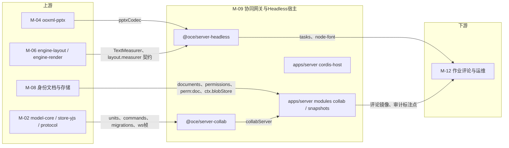
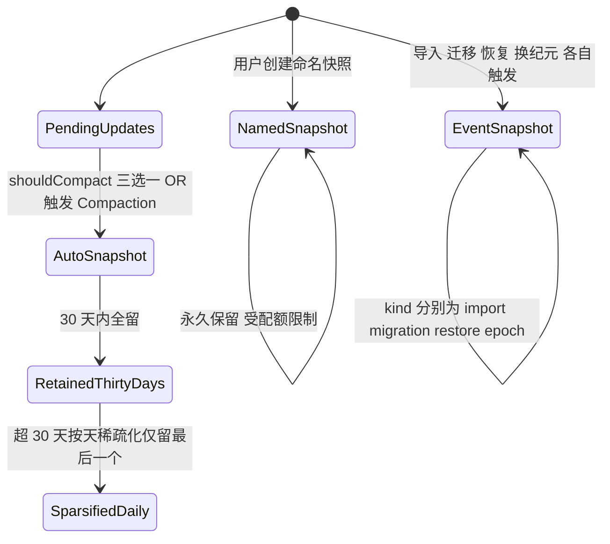
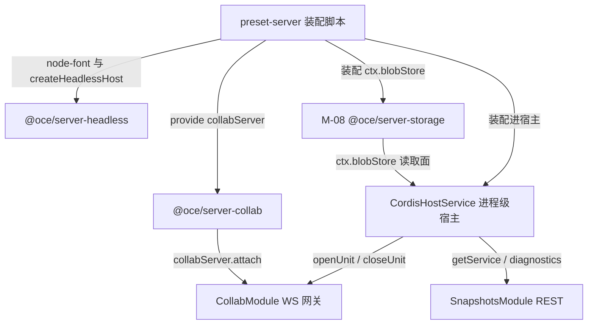
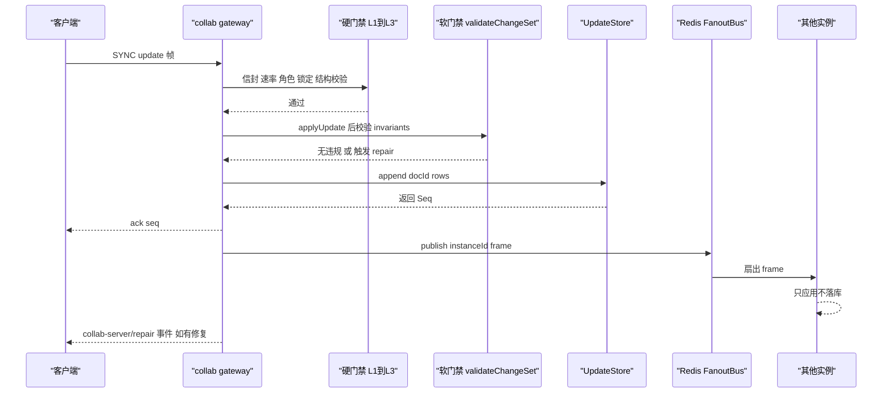
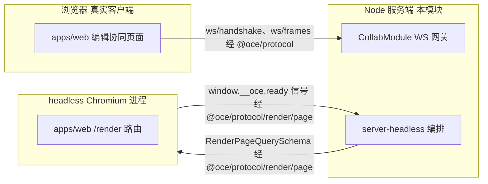

> 状态：草稿 v0.1 | 负责：架构-模块（阶段二） | 更新：2026-09-21 | 依赖：00-module-map.md M-09 行/§4.1/§4.2/§5.1/§5.3/§7/§9；40-modules/02-kernel-protocol-and-document-core.md §2.5/§2.6/§6/§7/§13；40-modules/04-ooxml-format-and-pptx-codec.md §2.5/§2.6/§7；40-modules/06-layout-and-render-engine.md §2.5/§7；40-modules/08-server-identity-documents-and-storage.md §2.1/§2.5/§7/§12 G-9/G-11/§13；30-architecture/08-backend-nestjs.md §1/§2/§3.1/§3.3/§4/§5/§8/§9/§11/§16.1–16.5；30-architecture/06-collaboration.md §5/§6/§8/§9/§10/§11/§18；30-architecture/07-rendering.md §10；30-architecture/02-layering-and-packages.md §4.22/§4.24；ADR-0022/0023/0025/0026/0034/0035；PRD 10-prd/03-features/03-collaboration.md CO-07/CO-08；PRD 10-prd/03-features/06-server-and-ops.md SV-03/SV-04/SV-05/SV-13；charter §5.1/§5.2/§6.1 D8

# 09 服务端协同网关与 Headless 宿主（限界上下文 BC-21 协同网关与持久化、BC-22 快照与版本、BC-27 Headless 渲染与批处理宿主）

## 0. 一页总览

| 项 | 值 |
|---|---|
| 职责一句话 | Room（=服务端 Unit）生命周期状态机、两级 CRDT 门禁（硬门禁 L1–L3 + 软门禁 L4 修复）、update 持久化与 Compaction、快照/版本 REST 面与恢复、跨实例 Redis 扇出（BC-21/22）；Postgres 持续故障期两级溢写背压（一级 Redis、二级 BlobStore，不拒写，恢复后按 `seq` 回放，rulings §4.13 S-3）；编排式硬删除清理入口 `purgeAll(docId)`（rulings §4.13 S-2）；Node cordis headless 宿主承载导入/导出/校验/迁移任务执行、Node 字体度量 Provider、headless Chromium 缩略图/PDF 渲染适配器契约（BC-27） |
| 覆盖的上下文 | BC-21 协同网关与持久化、BC-22 快照与版本、BC-27 Headless 渲染与批处理宿主 |
| 承载包 / 目录 | `apps/server/src/modules/{collab,snapshots}`、`apps/server/src/cordis-host`**（含 `adapters/`）**（均 L8 · node · app，秩 80；`cordis-host/` 整个目录物理归属本模块，见 08 §7 G-11、§7 本文档；**M-12 只引用不新增文件，2026-09-18 跨模块评审 C-10 结案**）、`@oce/server-collab`（LS · 秩 58 · node，library + plugin，`provide=['collabServer']`）、`@oce/server-headless`（LS · 秩 58 · node，host `createHeadlessHost` + provider `layout.measurer:'node-font'`） |
| cordis 形态 | plugin + provider（`server-collab`：Nest 解耦的函数库，同时经 `plugin.ts` 提供 `collabServer` 服务）；host + provider（`server-headless`：`createHeadlessHost()` 组装的独立 cordis 宿主，另贡献 `node-font` 度量 Provider）；library（`apps/server` 内 `collab`/`snapshots`/`cordis-host` 三个 Nest 目录——纯 Nest DI，非 cordis Fiber；其中 `collab/infrastructure/*.ts` 五个文件是挂在 `server-collab` 契约上的 cordis Provider，物理位置在 Nest 目录、逻辑归属 BC-21，见 00-module-map §4.2 第 5 条） |
| 运行位置 | 服务端（`server-headless` 编排的 headless Chromium 是浏览器进程，但由本模块从 Node 侧发起） |
| 上游（依赖） | M-02（`model-core` 的 `units`/`commands`/`migrations`/`permissions`/`core.restoreVersion`、`store-yjs` 的 `yjsBackend`、`protocol` 的 `ws/{handshake,frames}`/错误码/能力位）、M-04（`ooxml-pptx` 的 `pptxCodec`）、M-06（`engine-layout` 的 `TextMeasurer`/`layout.measurer` 契约与 `runTextMeasurerConformance`、`engine-render`/`engine-layout` 的 iso 契约层）、M-08（`documents`/`permissions`/`issue-collab-ticket`/`perm:doc:{id}`/`ctx.blobStore`/`CordisHostService` 读取面） |
| 下游（被依赖） | M-12（`server-headless.tasks` 的 Open Host Service：导入导出/缩略图 BullMQ 处理器编排；评论镜像经 Room 控制帧广播；审计/限流解释器接入本模块的标注点） |
| 对外服务 | `ctx.collabServer`（server-collab）；`layout.measurer`（`node-font`，server-headless）；Nest 侧导出 `CordisHostService`（`openUnit`/`closeUnit`/`getService`/`diagnostics()`，供 M-08/M-12 读取 `ctx.blobStore` 等共享服务） |
| 贡献点 | 提供：`layout.measurer`（key=`node-font`，M-06 定义的贡献点，本模块新增 Provider）；消费：无 |
| 事件 | 发布：`collab-server/room-opened`、`collab-server/room-closed`、`collab-server/update-rejected`、`collab-server/repair`（四个事件名为准，2026-09-18 跨模块评审 C-08 结案；`collab-server` 域已提请收编进 charter §5.5/03 §3.6 保留域名单，收编前扫描器 `event-domain-whitelist` 需临时放行）；订阅：Redis 频道 `perm:doc:{id}`（M-08 发布） |
| doc / sheet 通用性 | generic（Room 即 Unit，两个包与三个 Nest 目录对 `slide` 一词均无感知） |
| 批次 | 2 |

### 0.1 图示

**图 0-1 模块内包/Nest 模块与上下游关系**



图怎么读：本模块合并了三个限界上下文，上游四个模块分别提供文档内核、编解码、度量与身份权限契约；中间四个包/目录是本模块产物；下游只有 M-12 消费其任务编排与标注点。

## 1. 限界上下文与边界

### 1.1 职责与非职责

**做**：

- Room 生命周期状态机（`loading→active⇄draining→evicting/persisting→closed`）与会话（Session/RoleSession）管理、awareness 中继与广播。
- 两级校验：硬门禁 L1（信封/大小/速率）、L2（角色与文档锁定）、L3（结构可解析与结构数上限）；软门禁 L4（`documentType.validateChangeSet` + `invariants` 修复，含 `reassignTo` 悬空引用兜底 I-ML2 一类的确定性纯函数）。
- `document_updates` 追加持久化（`headSeq` 乐观递增）与 Compaction（触发判定→租约锁→压缩为新快照→裁剪日志）。
- `document_snapshots` 快照与版本 REST 面：列表、`latest`（ETag/zstd）、命名快照、恢复（经 M-02 `core.restoreVersion` 命令）。
- Redis 跨实例扇出（不要求房间亲和）、单写者任务租约锁（压缩/迁移/换纪元）、在线人数聚合。
- WS 握手第二道 fail-closed 检查点：collab ticket 校验（JWT 验签 + `jti` 防重放 + `permVersion` 比对）。
- **Room 背压溢写**（新增，rulings §4.13 S-3，2026-09-21）：Postgres 持续故障期间不拒绝新编辑——按 Room 未持久化字节两级阈值判定，超一级阈值溢写 Redis，超二级阈值分块落 `BlobStore`；PG 恢复后按 `seq` 顺序回放到 `document_updates`。
- **编排式硬删除清理**（新增，rulings §4.13 S-2，2026-09-21）：`UpdateStore`/`SnapshotStore` 契约新增 `purgeAll(docId)`，响应 M-08 `documents` 发起的编排信号，清理 `document_updates`/`document_snapshots`（"谁的表谁写"）。
- Node cordis headless 宿主 `createHeadlessHost`：装配与浏览器同构的 iso 插件束，提供导入/导出/校验/迁移/模型级 diff 任务执行入口（供 M-12 作业调用）、Node 字体 `TextMeasurer` Provider、headless Chromium 缩略图/PDF 渲染适配器契约。
- `apps/server/src/cordis-host`：Nest 进程级 cordis 宿主生命周期（`createHost`/`preset-server` 装配/`fiber.await()`/优雅关闭）与只读诊断面，供全部 Nest 模块以 OHS 方式调用；**类型安全 `ServiceMap` 与启动期角色一致性断言**（新增，评审 §3.6，2026-09-21）：`getService<T>(name)` 由字符串弱类型查找升级为 `ServiceMap` 编译期 key 校验，`role=collab` 等启动路径新增 `config/roles.ts` 与 `preset-server.ts` 两套装配开关的一致性断言，不一致则 fail-fast。

**不做**（指向负责模块）：

- 不签发 collab ticket、不做文档目录/权限判定本身（M-08 `auth`/`permissions`；本模块只校验票据、订阅 `perm:doc:{id}` 并执行判定结果）。
- 不实现 `BlobStore`（M-08 `server-storage`；本模块经 `ctx.blobStore` 消费）。
- 不实现 OOXML 编解码算法本身（M-04 `ooxml-pptx`；headless 宿主只调用 `pptxCodec`）。
- 不做缩略图/导入导出 BullMQ 作业编排、评论镜像读模型、审计落库（M-12；本模块只提供 `tasks`/`ThumbnailRenderer` 适配器与 Room 控制帧广播能力）。
- 不实现客户端 CRDT 同步逻辑（M-05 `collab-core`/`collab-yjs`；本模块是服务端对称实现，两者按同一份 `@oce/protocol` 帧契约并行开发，无包依赖）。
- 不 import `render-dom` 或任何 dom 包（同构铁律 4）；像素渲染发生在 headless Chromium 加载的 `apps/web` `/render` 路由内，本模块只做进程编排与适配。

### 1.2 通用语言

| 术语 | 定义 | 来源 |
|---|---|---|
| Room | 服务端为一份文档维护的协同会话集合与其 Y.Doc 副本（= 服务端 Unit） | 06 §术语补充 |
| Session | 一个客户端与一个 Room 的连接生命周期 | 06 §术语补充 |
| Ticket | 60 s 单次签名凭据，携带 `sub/tid/doc/role/permVersion/jti/exp`，用于 WS 握手 | 06 §术语补充、ADR-0029 |
| Update | Yjs 二进制增量（V2 编码） | 06 §术语补充 |
| StateVector | Yjs 各 client 已知时钟的向量，用于差量同步 | 06 §术语补充 |
| Compaction | 用一个快照替换其前的 update 序列 | ADR-0025 |
| Repair | 服务端软门禁发出的补偿事务（`origin=system('repair')`） | ADR-0034 |
| HeadSeq | `documents.head_seq`：已持久化的最大 update seq，与 `document_updates.seq` 同事务递增 | 08-backend-nestjs §5 |
| Epoch | `documents.epoch`：结构数过大时的"换纪元"计数器，仅本模块可写；递增即**强制全体客户端重连**（断连再握手），与 `permVersion`（仅重算权限、不断连）不自动联动（2026-09-18，C-17，与 08 §2.1/§2.2/§7 同口径） | 06 §9.4、08 §7 |
| SnapshotKind | `document_snapshots.kind` 枚举：`import\|auto\|named\|migration\|restore\|epoch` | 08-backend-nestjs §5、ADR-0025 |
| HardGate / SoftGate | 应用前的协议/权限/结构校验（拒绝不广播不落库）／应用后的语义与不变量校验（修复不回滚） | ADR-0034 |
| LeaseLock / FanoutBus | 单写者租约锁（compaction/migration/epoch 选举）／跨实例 pub/sub 扇出抽象 | 08-backend-nestjs §3.1 |
| UnitRunner | headless 宿主内 `withUnit()` 生命周期封装：打开 Unit→执行任务→必然关闭 | module-map BC-27 行 |
| Spill / SpillTier（新增，rulings §4.13 S-3） | Room 未持久化字节超阈值时的降级持久化：一级溢写 Redis（`SpillTier='redis'`），超二级阈值分块落 `BlobStore`（`SpillTier='blob'`）；PG 恢复后按 `seq` 回放，不拒绝新编辑 | ADR-0025 补充（本文档 §2.1/§2.3/§2.5） |
| ServiceMap（新增，评审 §3.6） | `CordisHostService.getService<T>(name)` 的编译期 key→类型映射表，替代裸字符串弱类型查找 | `cordis-host/cordis-host.service.ts` |

### 1.3 上下文映射

| 相邻上下文 | 关系类型 | 防腐层落点（文件） | 传递的契约 |
|---|---|---|---|
| BC-05 文档内核（`store-yjs`） | Customer–Supplier | `server-collab` 经 `ctx.units`/`ctx.store` 消费 `yjsBackend` | `DocumentStore`/`YjsBackend` |
| BC-05（`core.restoreVersion`/`migrations`） | Customer–Supplier | `snapshots/application/restore-snapshot.usecase.ts`、`server-headless` `tasks/migrate.ts` | `commands.execute`、`migrations.run` |
| BC-08 PPTX 编解码 | Customer–Supplier | `server-headless/application/tasks/{import-pptx,export-pptx}.ts` | `FormatCodec`（`pptxCodec`） |
| BC-10 布局与度量引擎 | Customer–Supplier（Conformist：契约由 M-06 定义） | `server-headless/infrastructure/measurer/node-font-measurer.ts` | `TextMeasurer`、`runTextMeasurerConformance` |
| BC-19 文档目录与权限 | Customer–Supplier（经 Redis） | `collab/infrastructure/authz-source.ts` | 频道 `perm:doc:{id}`、`permVersion` |
| BC-20 对象存储与媒体 | Open Host Service | `cordis-host/preset-server.ts` 装配 `ctx.blobStore` | `ServerBlobStore` |
| BC-09 协同（客户端） | **Published Language**（不共享代码，共享协议） | `@oce/protocol` `ws/frames.ts` + 新增 `collab/*.ts` | SYNC/AWARENESS/CONTROL 二进制信封 |
| BC-23/24 导入导出与作业 / 缩略图（M-12） | Open Host Service（本模块是供给方） | `server-headless` `application/tasks/*`、`infrastructure/thumbnails/*` | `ImportResult`/导出 `bytes`/`PNG[]` |
| BC-25 评论（M-12） | Open Host Service（本模块转发） | `server-collab/application/broadcast.ts` | `CONTROL.event{comments.changed}` |
| BC-18…20/22…26（其余 Nest 模块） | Open Host Service（只调用不重实现） | `cordis-host/cordis-host.service.ts` | `openUnit`/`closeUnit`/`getService`/`diagnostics()` |

## 2. 领域模型

### 2.1 聚合与实体

| 聚合 / 实体 | 字段 / 持有 | 不变量 / 并发语义 | 所在文件 |
|---|---|---|---|
| `Room`（聚合根，= 服务端 `Unit`） | `docId`、`state`（状态机）、`unit: UnitHandle`（持有 store-yjs Unit）、`sessions: Map<SessionId,RoomSession>`、`headSeq`、`epoch`、`schemaVersion`、`pendingBytes`/`spillTier`（新增，rulings §4.13 S-3：未持久化字节计数与当前溢写档位 `'none'\|'redis'\|'blob'`） | 一个 doc 在**一个实例内**至多一个 Room；跨实例可有多个副本（ADR-0035，正确性由 CRDT 保证）；状态转换见 06 §5.2（`loading→active⇄draining→evicting/persisting→closed`）；**2026-09-21 补强（S-3）**：PG 持续故障期间 `pendingBytes` 超一级阈值即溢写 `SpillStore` Redis 档，超二级阈值转分块落 `BlobStore` 档，**不拒绝新编辑**；PG 恢复后 `replay-spilled.usecase.ts` 按 `seq` 顺序把溢写内容回放进 `document_updates`，回放完成前 Room 保持 `persisting` 态 | `server-collab/domain/room.ts` |
| `RoomSession`（实体，= `Participant`） | `sessionId`、`role`、`clientId`（yjs）、令牌桶状态、`lastActiveAt`、违规计数、`ackTracking` | 同一 `userId` 可多端同时在线（各自独立 Session）；降权/踢出立即生效（fail-closed，06 §10） | `server-collab/domain/room-session.ts` |
| `UpdateLog`（聚合，`document_updates` 追加日志的领域投影） | `docId`、`seq`（与 `documents.headSeq` 同事务递增）、`byteSize`、`clientId`、`sessionId` | 只追加、`seq` 严格单调；裁剪只删 `seq ≤ 最新 auto 快照.seq_upto` 且 `created_at < now()-7d` 的行（ADR-0022/0025）；**新增（rulings §4.13 S-2）**：`purgeAll(docId)` 整表清空该 `docId` 全部行，由 M-08 `documents.schedule-purge` 编排触发，"谁的表谁写" | `domain/contracts/update-store.ts`（契约）+ `application/persistence/update-writer.ts`（写入） |
| `Snapshot` / `Version`（聚合，`document_snapshots` 一行的服务端投影） | `id`、`docId`、`seqUpto`、`kind: SnapshotKind`、`name?`、`stateInline\|stateKey`、`stateVector`、`epoch`、`layoutAlgoVersion`、`baselineKey?`（`kind='import'` 专用，见 §12 补齐项） | `named` 永久保留（配额限制）；`auto` 保留 30 天后按天稀疏化（每天仅留最后一个，ADR-0025 决策 5）；`documents.latest_snapshot_id` 只指向 `import\|auto\|migration\|restore\|epoch` 中最新一个（不含 `named`）；**新增（rulings §4.13 S-2）**：`purgeAll(docId)` 整表清空该 `docId` 全部行，语义同上 | `domain/contracts/snapshot-store.ts`（契约）+ `application/snapshot/snapshot.service.ts`（生成/恢复） |
| `HeadlessJobContext`（聚合，headless 宿主内一次任务执行域） | `unit: UnitHandle`、`documentType`、`principal='system'`、`traceId` | 一次 `withUnit()` 调用 = 一个 `HeadlessJobContext`；`finally` 必然关闭 Unit；dev/test 下 `assertNoLiveEffects` | `server-headless/domain/unit-runner.ts` |

**`Room.epoch` 与权限重算的边界（2026-09-18，跨模块评审 C-17，与 `40-modules/08` §2.1/§2.2/§7 同口径）**：`Room.epoch` 只读镜像 `documents.epoch`（本模块是唯一写方，§7.3）；其递增语义是**强制全体会话断线重连**，触发点是 `collabServer.forceEpoch()`（§2.5）经 `internal/admin.controller.ts`（M-12）调用。这与权限变更导致的 `permVersion` 递增（M-08 写、本模块经 `AuthorizationSource.onPermissionChanged` 订阅、§2.5）语义不同——后者只驱动受影响会话**静默重算能力位**，不断开连接。两者不自动联动：一次纯粹的权限调整不应附带踢出全部在线用户的副作用。

**图 2-1 快照与版本保留策略**



图怎么读：`auto` 快照由 Compaction 阈值触发并按 30 天规则稀疏化；`named` 快照永久保留；`import`/`migration`/`restore`/`epoch` 四种事件性快照各自在触发点生成一次，不参与稀疏化。

### 2.2 值对象

| 名称 | 字段 / 校验 | 所在文件 |
|---|---|---|
| `RoomId` | `Brand<DocumentId,'RoomId'>`（与 `documents.id` 1:1） | `server-collab/domain/ids.ts` |
| `Seq` | `Brand<bigint,'Seq'>`，严格单调、与 `headSeq` 同源 | `server-collab/domain/ids.ts` |
| `CollabTicketClaims`（= 通用语言 Ticket） | `{sub,tid,doc,role,permVersion,jti,exp,sid?}`（M-08 `auth/domain/collab-ticket.ts` 定义形状；本模块只消费与验签） | `collab/domain/collab-principal.ts` |
| `SnapshotKind` | `'import'\|'auto'\|'named'\|'migration'\|'restore'\|'epoch'`（08-backend-nestjs §5 固定枚举，逐字对齐 ADR-0025） | `server-collab/domain/contracts/snapshot-store.ts` |
| `CompactionThresholds`（= Compaction 阈值） | `{maxPendingUpdates:500, maxPendingBytes:5 MiB, maxAgeMs:600000}`（三选一 OR 触发，ADR-0025 决策 3） | `server-collab/config.ts` |
| `GateLimits` | `{maxFrameBytes:1 MiB, msgRateHz:200, msgBurst:500, awarenessMinIntervalMs:50, awarenessMaxBytes:2 KiB, structsPerUpdate:50000}` | `server-collab/config.ts` |
| `RoomCapacity` | `{maxEditors:20, maxViewers:50, drainGraceMs:60000, maxActiveRooms:200, memoryAdmissionPct:75}` | `server-collab/config.ts` |
| `SoftGateMode` | `mode:'repair'\|'report-only'\|'off'`；`schemaMode` 同枚举独立配置（ADR-0034 v0.2） | `server-collab/config.ts` |
| `CloseCode` | WS 关闭码常量对象：`1000/1001/1006/1012/4400/4401/4403/4404/4408/4409/4413/4426/4427/4429/4503` | `@oce/protocol` `collab/close-codes.ts`（新增建议，见 §12） |

### 2.3 领域服务（纯函数）

| 函数 | 签名草案 | 所在文件 | 两端共用 |
|---|---|---|---|
| `checkHardGate` | `(frame: RawFrame, session: RoomSessionSnapshot, limits: GateLimits) => GateDecision`（L1 信封/大小/速率 + L2 角色/锁定 + L3 结构可解析） | `server-collab/domain/gate/hard-gate.ts` | 否（客户端无对称实现，仅本地乐观校验属 M-05 范围） |
| `runSoftGate` | `(changeSet: ChangeSetLike, documentType: DocumentType) => { violations: InvariantViolation[] }`（调用 `documentType.validateChangeSet(paths)` + 迭代 `documentType.invariants` 逐项 `check`；本函数**文档类型盲**，具体规则如 I-ML2 由 model-slide 的 `invariants` 表提供） | `server-collab/domain/gate/soft-gate.ts` | 是（客户端 observe 时对"环/孤儿"两类调用同一 `invariants.repair`，结果确定性一致，ADR-0034） |
| `planRepair` | `(violations: InvariantViolation[], body: Persisted<S>) => Mutation[]`（逐条调用触发不变量的 `repair()`） | `server-collab/domain/gate/repair-planner.ts` | 是 |
| `shouldCompact` | `(pending: {count:number;bytes:number;ageMs:number}, thresholds: CompactionThresholds) => boolean`（三选一 OR，ADR-0025 决策 3） | `server-collab/domain/gate/compaction-policy.ts` | 否 |
| `checkSpillTier`（新增，rulings §4.13 S-3） | `(pendingBytes: number, thresholds: SpillThresholds) => 'none'\|'redis'\|'blob'`（两级阈值判定，纯函数，不触发 IO；PG 持续故障期间由 `spill-coordinator.ts` 调用后决定写 `SpillStore` 的哪一档） | `server-collab/domain/gate/spill-policy.ts` | 否（服务端专有，与 compaction 阈值同量级配置） |
| `planVersionRetention` | `(snapshots: readonly SnapshotMeta[], now: number) => { keep: SnapshotId[]; sparsify: SnapshotId[] }`（30 天内全留，30 天外按天稀疏化只留每天最后一个，`named` 永久排除在外，ADR-0025 决策 5） | `server-collab/domain/gate/version-retention-policy.ts` | 否 |
| `consumeTokenBucket` | `(bucket: TokenBucketState, cost: number, now: number) => Result<TokenBucketState, 'rate_limited'>` | `server-collab/domain/gate/token-bucket.ts` | 否 |
| `diffForRestore` | `(current: Persisted<S>, target: Persisted<S>, documentType: DocumentType<S>) => Mutation[]`（薄封装 `documentType.diff()`；供版本对比预览与 `core.restoreVersion` 命令内部共用同一纯函数，避免重复实现，见 §2.6/§13） | `server-headless/application/tasks/diff-snapshots.ts` | 是（纯函数来自 model-core/model-slide，两端均可调用） |

> 说明（呼应 M-03 §1.3/§13 Q3）：`runSoftGate`/`planRepair` 对具体不变量（如 `I-ML2` 悬空 `layoutId` 兜底："重指该母版首个版式并 materialize 占位符"）**完全无感知**——它们只按 `DocumentType.invariants` 表机械迭代 `check`/`repair`；I-ML2 的选取函数物理定义在 `model-slide/domain/style/**`，命令层前置拒绝（`LAYOUT_IN_USE`）与本模块的并发兜底必须复用同一纯函数（M-03 §1.3 已强调），本模块契约套件需在协同分节显式引用它（见 §9）。

### 2.4 领域事件

| 事件 | 载荷 | 发布者文件 | 典型订阅者 |
|---|---|---|---|
| `collab-server/room-opened` | `{docId, epoch}` | `server-collab/application/room-manager.ts` | 遥测、M-12 审计镜像 |
| `collab-server/room-closed` | `{docId, reason: 'idle'\|'shutdown'\|'evicted'}` | `server-collab/application/room-manager.ts` | 遥测 |
| `collab-server/update-rejected` | `{docId, sessionId, code}` | `server-collab/domain/gate/hard-gate.ts` | 审计（`collab.update_rejected`，M-12） |
| `collab-server/repair` | `{docId, reason, paths}` | `server-collab/domain/gate/repair-planner.ts` | `CONTROL.repair` 广播（`application/broadcast.ts`）、审计（`collab.repaired`） |
| `unit/migrated`（M-02 既有事件，本模块触发方） | `(unitId, from, to)` | `server-collab/application/persistence/migration-runner.ts` 调用 `migrations.run` 触发 | 审计（M-12） |
| `render/frame` / `perf/frame`（M-06/M-07 既有命名，本模块只是消费方） | 沿用既有载荷 | headless Chromium 内加载的 `apps/web` `/render` 页面（进程外） | `server-headless/infrastructure/thumbnails/thumbnail-renderer.ts` 监听 `window.__oce.ready` 信号（非 cordis 事件，是页面协议，见 §2.5 `render-page-protocol.ts`） |

### 2.5 仓储 / 存储契约

**`collabServer`（服务面；`plugin.ts` 以 `provide=['collabServer']` 暴露；实现 = `application/room-manager.ts`）**：

```ts
interface CollabServer {
  attach(connection: ServerConnection, claims: CollabTicketClaims): Promise<Result<RoomSession, GateError>>
  drainAll(reason: string): Promise<void>
  getRoomStats(docId: RoomId): RoomStats | undefined
  forceEpoch(docId: RoomId): Promise<void>              // internal/admin 强制换纪元 = 强制全体重连（08 §7、本文档 §2.1，C-17）
}
```

契约套件：`runCollabServerConformance(createCluster: (n: number) => ServerCluster)`（消费 `testing/index.ts` 的 `createServerCluster`），覆盖：两实例去重扇出、崩溃后重放、限流、软门禁修复、容量驱逐、drain（§9）。

**`UpdateStore`（Definition；`domain/contracts/update-store.ts`；默认 Provider：`collab/infrastructure/pg-update-store.ts`）**：
```ts
interface UpdateStore {
  append(docId: RoomId, rows: readonly UpdateRow[]): Promise<Seq[]>     // 与 documents.headSeq 同事务
  loadSince(docId: RoomId, seq: Seq): AsyncIterable<UpdateRow>
  pruneBefore(docId: RoomId, seq: Seq, olderThan: Date): Promise<number>
  purgeAll(docId: RoomId): Promise<void>          // 新增（rulings §4.13 S-2）：整表清空该 docId 全部行，编排式硬删除的本模块落点
}
```

**`SnapshotStore`（Definition；`domain/contracts/snapshot-store.ts`；默认 Provider：`collab/infrastructure/pg-snapshot-store.ts`）**：
```ts
interface SnapshotStore {
  latest(docId: RoomId): Promise<SnapshotMeta | undefined>
  put(docId: RoomId, snap: SnapshotInput): Promise<SnapshotMeta>
  get(id: SnapshotId): Promise<SnapshotBody | undefined>
  list(docId: RoomId, opts?: { limit?: number; cursor?: string }): Promise<Page<SnapshotMeta>>
  purgeAll(docId: RoomId): Promise<void>          // 新增（rulings §4.13 S-2）：语义同 UpdateStore.purgeAll
}
```

**`SpillStore`（Definition，新增；`domain/contracts/spill-store.ts`；两个 Provider：`collab/infrastructure/spill/redis-spill.store.ts`（一级）、`collab/infrastructure/spill/blob-spill.store.ts`（二级），rulings §4.13 S-3）**：
```ts
interface SpillStore {
  writeTier1(docId: RoomId, rows: readonly UpdateRow[]): Promise<void>       // Redis：有界列表/流，超一级阈值时改走本方法而非 UpdateStore.append
  writeTier2(docId: RoomId, chunk: Uint8Array, seqRange: [Seq, Seq]): Promise<void>  // BlobStore：超二级阈值分块落盘
  readAllOrdered(docId: RoomId): AsyncIterable<UpdateRow>                    // 恢复用：按 seq 升序合并两档内容
  clear(docId: RoomId): Promise<void>                                       // 回放成功后清空溢写暂存
}
```
契约套件：`runSpillStoreConformance(factory)`（`server-collab/testing/index.ts` 新增 `MemorySpillStore`；两个 Provider 各自 `.spec.ts` 实例化，扫描器 `provider-runs-conformance` 同一约定）。**未持久化字节两级阈值判定**（`checkSpillTier`，§2.3）与本契约是纯函数/IO 分离的标准搭配：门禁只决定"该写哪一档"，`SpillStore` 只负责把字节写进去/读出来，不做阈值判断。

两者契约套件：`runUpdateStoreConformance`/`runSnapshotStoreConformance`（`server-collab/testing/index.ts` 的 `MemoryUpdateStore`/`MemorySnapshotStore` 自测；`collab/infrastructure/{pg-update-store,pg-snapshot-store}.spec.ts` 用 testcontainers Postgres 实例化同一套件，扫描器 `provider-runs-conformance` 沿用 M-02 §2.5 约定；2026-09-21 起两套件均追加 `purgeAll` 断言：清空后 `loadSince`/`latest` 返回空，rulings §4.13 S-2）。`FanoutBus`/`LeaseLock`/`AuthorizationSource` 同为 Definition + Provider 模式（Provider 分别是 `collab/infrastructure/{redis-fanout.bus,redis-lease-lock,authz-source}.ts`），签名：

```ts
interface FanoutBus { publish(docId: RoomId, msg: { instanceId: string; frame: Uint8Array }): Promise<void>; subscribe(docId: RoomId, handler: (msg: FanoutMessage) => void): Disposable }
interface LeaseLock { acquire(key: string, ttlMs: number): Promise<Lease | null> }
interface AuthorizationSource { resolveRole(docId: RoomId, principal: Principal): Promise<Role>; onPermissionChanged(docId: RoomId, cb: (permVersion: number) => void): Disposable }
```

**`ThumbnailRenderer`（适配器接口；`server-headless/infrastructure/thumbnails/thumbnail-renderer.ts`；本模块唯一实现）**：
```ts
interface ThumbnailRenderer {
  render(docState: Uint8Array, slideIds: readonly string[], opts: RenderOptions): Promise<readonly PngResult[]>
  renderPdf(docState: Uint8Array, opts: PdfOptions): Promise<Uint8Array>
}
interface RenderOptions { deviceScaleFactor: number; layoutAlgoVersion: number; fontProfile: string }
```
**取得方式（2026-09-18，跨模块评审 C-09 结案）**：`HeadlessHost` 增只读字段 `thumbnails: ThumbnailRenderer`（§6），M-12 的 BullMQ 处理器（`headless-renderer.accessor.ts`）经 `createHeadlessHost(adapters).thumbnails` 取得实例，是唯一调用方；不再规划独立的 `renderThumbnails` 工厂函数导出（该命名已作废，历史见 `30-architecture/08-backend-nestjs.md` §2，由总编排回写改名）。不设跨包契约套件（本模块是唯一实现，且强依赖真实 Chromium 进程）；`__tests__/thumbnails.test.ts` 仅在 CI 具备 Chromium 时运行像素级 oracle（服务端 PNG 与客户端 Playwright 截图差 ≤ 0.5%，ADR-0026）。

**`RenderPageProtocol`（跨进程契约；2026-09-18，跨模块评审 C-27 结案）**：`headless Chromium ↔ apps/web /render 路由`是真实跨进程边界，`RenderPageQuerySchema`/`RenderPageSignal`/`RenderStateResponse` 三个 schema 现由 **M-02 在 `@oce/protocol/render/page.ts` 统一定义**（token/state 拉取 URL、`window.__oce.ready` 信号、错误上报三部分）；本模块的 `infrastructure/thumbnails/render-page-protocol.ts` 改为**薄适配层**，只 `import type { RenderPageQuerySchema, RenderPageSignal, RenderStateResponse } from '@oce/protocol/render/page'` 并补 Node 侧 URL 拼装辅助函数，不再是该契约的定义源（§4.5/§5.5 同步）。`render/frame`/`perf/frame`（上表末行）与本契约是两回事：前者是渲染帧遥测，后者是页面加载状态机协议。

**`TextMeasurer`（M-06 定义的 Definition，本模块提供 `node-font` Provider）**：`server-headless/infrastructure/measurer/node-font-measurer.ts` **必须**实例化 M-06 的 `runTextMeasurerConformance(factory)`（`engine-layout/testing`），与 `render-dom` 的 `canvas` Provider 共用同一套件，度量结果标注"近似一致"而非逐字节相同（06-layout-and-render-engine §2.5）。

**`ServiceMap`（新增，评审 §3.6，2026-09-21；`cordis-host/cordis-host.service.ts`）**：`CordisHostService.getService<T>(name)`（08 §13 Q-5 在此定案）此前是裸字符串查找，`name` 拼错或服务未装配只在运行时报诊断，不在编译期报错。新增编译期 key→类型映射，替代弱类型签名：
```ts
interface ServiceMap {
  collabServer: CollabServer
  blobStore: ServerBlobStore
  // 随新增服务持续登记；未登记的 name 编译期报错
}
declare class CordisHostService {
  getService<K extends keyof ServiceMap>(name: K): ServiceMap[K] | undefined
  diagnostics(): HostDiagnostics
}
```
配套**启动期角色一致性断言**（`cordis-host/preset-server.ts`/`cordis-host.module.ts` 的 `OnApplicationBootstrap`）：比对 `config/roles.ts`（角色→模块列表）与 `preset-server.ts`（角色→插件束）两套独立维护的开关，`role=collab` 必须能 `getService('collabServer')` 成功，`role=worker` 必须能取得 headless 宿主，否则 fail-fast 退出（而非运行时静默 `undefined`），符合 D8"先失败、不部分激活"（架构08:259）。

**图 2-2 preset-server 宿主装配**



图怎么读：`preset-server` 是唯一的装配入口，把 `server-collab`/`server-headless`/M-08 的 `server-storage` 一起挂进同一个 `CordisHostService`；Nest 模块只经该宿主的读取面消费服务，不各自重复装配。

### 2.6 应用服务与命令

| 应用服务 | 职责 | 所在文件 |
|---|---|---|
| 加入房间 | ticket 校验（`interface/ticket-verifier.ts`）→ `collabServer.attach()` → Room 不存在则 `loading`（bootstrap：latest snapshot + `loadSince` → `applyUpdate` → 必要时迁移）→ `auth.ok` | `collab/interface/{collab.gateway,ticket-verifier}.ts` + `server-collab/application/room-manager.ts` |
| 离开房间 | 移除 Session → awareness 广播"移除" → 最后一个客户端离开则进入 `draining`（60 s 宽限，超时未回归则 `persisting→closed`） | `server-collab/application/room-manager.ts` |
| 接收 update | `interface/frame-router.ts` 解出 SYNC → 硬门禁（L1–L3）→ `applyUpdate`（origin `remote`）→ 软门禁 L4 → 落库（`persistBeforeBroadcast` 分支控制顺序）→ `ack{seq}` → 广播 | `server-collab/interface/frame-router.ts` + `application/persistence/update-writer.ts` |
| 广播 | 本地 Session 遍历 + `FanoutBus.publish`；按 `instanceId` 去重；**只持久化自身客户端发来的 update**，跨实例扇入的 update 只应用不落库（ADR-0035 决策 3） | `server-collab/application/broadcast.ts` |
| 快照生成（自动/命名） | Compaction 触发判定（`shouldCompact`）→ `LeaseLock` → `encodeStateAsUpdateV2` → zstd → `SnapshotStore.put(kind:'auto'\|'named')` → 裁剪日志 | `server-collab/application/persistence/compactor.ts`、`snapshots/application/create-named-snapshot.usecase.ts` |
| 快照恢复 | 解析目标快照 → 解码得 `targetBody: Persisted<S>` → 权限检查 `history.restore` → `commands.execute(unitId,'core.restoreVersion',{targetBody},{principal:'system'})`（复用 M-02 内置命令，单事务、`origin:system('restore')`）→ 落 `kind:'restore'` 快照 | `snapshots/application/restore-snapshot.usecase.ts` |
| Room 背压溢写（新增，rulings §4.13 S-3） | `update-writer.ts` 持久化失败（PG 不可达）→ `checkSpillTier(pendingBytes)` 判定档位 → 未超阈值走原退避重试；超一级阈值改调用 `SpillStore.writeTier1`；超二级阈值改调用 `SpillStore.writeTier2` 分块；全程仍对客户端 `ack{seq}`（不拒写），`Room.spillTier` 同步更新 | `server-collab/application/persistence/spill-coordinator.ts` |
| 回放溢写数据（新增，rulings §4.13 S-3） | PG 恢复信号 → Room 进入 `persisting` → `SpillStore.readAllOrdered(docId)` 按 `seq` 升序读出 → 逐条 `UpdateStore.append` 写回 `document_updates` → 成功后 `SpillStore.clear(docId)` → Room 回到 `active`（在线客户端不断连，仅短暂延迟新 `ack`） | `server-collab/application/persistence/replay-spilled.usecase.ts` |
| 编排式清理协同数据（新增，rulings §4.13 S-2） | 订阅 M-08 `documents.schedule-purge` 编排信号 → `UpdateStore.purgeAll(docId)` + `SnapshotStore.purgeAll(docId)`（同一用例内先后调用，非跨库事务，任一失败可重试） | `collab/application/purge-collab-data.usecase.ts` |
| headless 任务执行 | `withUnit(source, fn)` 在隔离 Unit 上执行 import/export/validate/migrate/diff，`finally` 关闭 Unit | `server-headless/domain/unit-runner.ts` + `application/tasks/*.ts` |

> 恢复"可撤销"的产品期望（PRD CO-07："可撤销"）与 `origin:system('restore')` 不进入标准撤销栈（M-02 §13 Q-2）之间的张力：`restore-snapshot.usecase.ts` 在执行恢复前，若当前 `headSeq` 距最近一次快照超过一个 Compaction 周期，仍会强制先落一个覆盖"恢复前状态"的 `auto` 快照（数据安全兜底，保留）；但**「恢复到那个快照」即等同撤销**这一结论已被否决——**转专项设计（2026-09-19，rulings §4.12 U-07）**：撤销语义需在多人协同场景下专项设计 `version-restore-undo`（M-02 × M-05 × M-09，M3 前出 ADR），§13 本文档 Q-9 记录。

**图 2-3 update 接收与扇出**



图怎么读：硬门禁先于落库拒绝非法帧；软门禁在 `applyUpdate` 之后修复语义违规并可能触发 `collab-server/repair`；只有发起方实例持久化，跨实例扇入只应用不重复落库。

## 3. cordis 插件定义

### 3.1 `@oce/server-collab`（library + plugin）

| 项 | 值 |
|---|---|
| 插件名 / `name` | `'server-collab'` |
| `inject`（必需） | `['units','updateStore','snapshotStore','fanoutBus','leaseLock','authzSource','telemetry','spillStore']`（`spillStore` 2026-09-21 新增，rulings §4.13 S-3） |
| `inject`（可选） | 无 |
| `provide` | `['collabServer']` |
| 贡献点：提供 / 消费 | 均无（能力经服务名暴露，不占用贡献点机制） |
| 事件：发布 | `collab-server/room-opened`、`collab-server/room-closed`、`collab-server/update-rejected`、`collab-server/repair` |
| 事件：订阅 | 无 cordis 事件（Redis `perm:doc:{id}` 经注入的 `authzSource.onPermissionChanged` 回调转译为内部调用，不是 cordis Events） |
| 配置 schema | `{ room:{drainGraceMs,maxEditors,maxViewers,maxActiveRooms,memoryAdmissionPct}, limits:{maxFrameBytes,msgRateHz,msgBurst,updateBytesPerMin,awarenessMinIntervalMs,awarenessMaxBytes,structsPerUpdate}, persistence:{flushMs,flushMaxUpdates,persistBeforeBroadcast}, compaction:{maxPendingUpdates,maxPendingBytes,maxAgeMs,retainUpdatesAfterSnapshotMs}, softGate:{mode,schemaMode}, repair:{quarantineThreshold,windowMs}, spill:{tier1MaxBytesPerDoc,tier2ChunkBytes} }`（zod，默认值见 §11、架构 08 §3.1/§12；`spill` 段 2026-09-21 新增，S-3） |
| 生命周期 | `ready`：向宿主暴露 `collabServer`；`dispose`：`drainAll('shutdown')` → flush → 释放全部 Room 的 effect；本包**不**在单一 `UnitScope` 内运行——它自行管理"每 Room 一个 Unit"的多份隔离域，不经宿主一次性 `isolate()` |
| Manifest 片段 | `{ "id":"@oce/server-collab", "provides":["collabServer"], "injects":["units","updateStore","snapshotStore","fanoutBus","leaseLock","authzSource","telemetry","spillStore"], "points":[], "unitScoped": false }` |

### 3.2 `@oce/server-headless`（host + provider）

| 项 | 值 |
|---|---|
| 形态 | host：`createHeadlessHost(adapters)`（内部调用 kernel `createHost` 并挂载与浏览器同构的 iso 插件束）；provider：`node-font` 的 `layout.measurer` 贡献子插件 |
| `inject` / `provide` | 宿主本身不是被注入的 Fiber，无对外 `inject`；`provide`：无新服务名（复用 BC-05/06/07/08 既有服务，module-map BC-27 行）；node-font 子插件：`inject:[]`、`provide:['layout.measurer']` |
| 贡献点：提供 | `layout.measurer`，item = node-font 度量器实例，`key:'node-font'` |
| 贡献点：消费 | 无 |
| 事件：发布 / 订阅 | 均无新增（内部错误经 `errors` 服务上报，走 BC-01 既有通道） |
| 配置 schema | `{ fonts:{bundleDir,fallbackFamily}, browserPool:{poolSize,pageTimeoutMs}, worker:{timeoutMs,memoryLimitMb} }` |
| 生命周期 | `createHeadlessHost()` 每次调用产出**独立宿主实例**（非进程单例）；`domain/unit-runner.ts` 的 `withUnit()` 保证 `finally` 必然关闭 Unit；`infrastructure/worker.ts` 用 `worker_threads` 给每个任务分配新宿主（超时/内存限额隔离，08-backend-nestjs §2/§16.1） |
| Manifest 片段 | `{ "id":"@oce/server-headless", "provides":[], "injects":[], "points":["layout.measurer"], "unitScoped": false }`（片段特指 node-font 子插件；host 工厂本身不进任何宿主的 Manifest 登记） |

### 3.3 Nest 模块定义表

| 模块 | `imports` | `providers`（含 IO 适配器） | `controllers` / gateway | `exports` |
|---|---|---|---|---|
| `CollabModule` | `CordisHostModule`、`ConfigModule`、`DbModule`、`RedisModule` | `RedisFanoutBus`、`RedisLeaseLock`、`PgUpdateStore`、`PgSnapshotStore`、`AuthzSource`、`TicketVerifier`、`WsConnectionAdapter`、`RedisSpillStore`、`BlobSpillStore`（新增，S-3）、`PurgeCollabDataUseCase`（新增，S-2） | `CollabGateway`（`@WebSocketGateway({path:'/collab/v1/rooms/:documentId'})`） | 无（网关为终端） |
| `SnapshotsModule` | `CordisHostModule` | `CollabServerAccessor`、四个 usecase | `SnapshotsController` | 无 |
| `CordisHostModule`（`global`） | `ConfigModule` | `CordisHostService`、`PinoLoggerAdapter`、`OtelTelemetryAdapter`、`ErrorsReporterAdapter` | 无 | `CordisHostService` |

### 3.4 IO 适配器插件表（挂在 `server-collab` 契约上的 Provider，物理位置 `collab/infrastructure/`，逻辑归属 BC-21）

| 适配器 | 实现的 Definition | `implements` | 关键依赖 | 所在文件 |
|---|---|---|---|---|
| `RedisFanoutBus` | `FanoutBus` | `['fanoutBus']` | `ioredis`（pub/sub 连接与命令连接分离） | `collab/infrastructure/redis-fanout.bus.ts` |
| `RedisLeaseLock` | `LeaseLock` | `['leaseLock']` | `ioredis`（`SET NX PX` + 续租 + fencing token） | `collab/infrastructure/redis-lease-lock.ts` |
| `PgUpdateStore` | `UpdateStore` | `['updateStore']` | Drizzle（`document_updates` 按 `hash(doc_id)` 16 分区） | `collab/infrastructure/pg-update-store.ts` |
| `PgSnapshotStore` | `SnapshotStore` | `['snapshotStore']` | Drizzle + `ctx.blobStore`（> 1 MiB 落 S3） | `collab/infrastructure/pg-snapshot-store.ts` |
| `AuthzSource` | `AuthorizationSource` | `['authzSource']` | M-08 `RoleResolverService` + Redis 订阅 `perm:doc:{id}` | `collab/infrastructure/authz-source.ts` |
| `RedisSpillStore`（新增，rulings §4.13 S-3） | `SpillStore`（一级方法 `writeTier1`） | `['spillStore']`（与 `BlobSpillStore` 共同实现同一 Definition，见下） | `ioredis`（有界列表，按 `docId` 分 key） | `collab/infrastructure/spill/redis-spill.store.ts` |
| `BlobSpillStore`（新增，rulings §4.13 S-3） | `SpillStore`（二级方法 `writeTier2`/`readAllOrdered`/`clear`） | `['spillStore']` | `ctx.blobStore`（分块对象键，复用 §6 对象存储布局命名风格） | `collab/infrastructure/spill/blob-spill.store.ts` |

> 七个适配器（原五个 + 新增两个溢写档位）由 `CollabModule.onModuleInit` 装配进 `preset-server` 的 `server-collab` 配置项（对应其 `inject` 数组的服务名），落地 charter D8/08-backend-nestjs S7："Definition 的 Node 适配器（pg/redis/s3）作为 cordis 插件放在 `apps/server` 对应模块目录下"。`RedisSpillStore`/`BlobSpillStore` 合组实现同一个 `SpillStore` Definition（一级/二级分工），装配层按 `inject:'spillStore'` 注入一个组合实例（内部按方法名路由到对应档位的 Provider），不违反"三角色规则"（Provider 互不 import——两者不互相 import，只被同一个组合器分别持有）。

## 4. 目录树（完整到文件）

> 五棵树：两个 Nest 目录（`collab/`、`snapshots/`）+ 一个宿主装配目录（`cordis-host/`，物理归属本模块，见 §1.3/08 §7 G-11）+ 两个包（`server-collab`、`server-headless`）。每个目录一句职责；DDD 五层套用 00-module-map §1 的规则，`interface/` 是"外部世界进入本目录的唯一入口"。

### 4.1 `apps/server/src/modules/collab/`

```text
apps/server/src/modules/collab/
├── collab.module.ts                        # Nest 模块装配：imports/providers/gateway（§3.3）
├── domain/                                 # 纯类型与命名规则，无 IO
│   ├── redis-keys.ts                       # Redis 键/频道命名函数：collab:doc:{id}、room:{id}:clients、lock:compact:{doc}
│   ├── collab-principal.ts                 # CollabTicketClaims 消费端值对象 + 解析后的 Principal
│   └── errors.ts                           # 握手阶段（attach 之前）拒绝原因码，与 server-collab 自身 errors.ts 互补不重叠
├── application/                            # 模块启动期编排
│   ├── bootstrap-collab-server.service.ts  # OnModuleInit：把 7 个 infra 适配器注入 preset-server 的 server-collab 配置项
│   └── purge-collab-data.usecase.ts        # 订阅 M-08 编排信号 → UpdateStore/SnapshotStore.purgeAll（新增，rulings §4.13 S-2）
├── infrastructure/                         # Definition 的 Node 适配器（D8/S7，逻辑归属 BC-21，见 §3.4）
│   ├── redis-fanout.bus.ts                 # FanoutBus Provider
│   ├── redis-lease-lock.ts                 # LeaseLock Provider
│   ├── pg-update-store.ts                  # UpdateStore Provider（新增 purgeAll，S-2）
│   ├── pg-snapshot-store.ts                # SnapshotStore Provider（新增 purgeAll，S-2）
│   ├── authz-source.ts                     # AuthorizationSource Provider
│   └── spill/                              # 新增，rulings §4.13 S-3
│       ├── redis-spill.store.ts            # SpillStore 一级 Provider：Redis 有界列表
│       └── blob-spill.store.ts             # SpillStore 二级 Provider：ctx.blobStore 分块
├── interface/                              # 外部世界进入本模块的唯一入口
│   ├── collab.gateway.ts                   # WS Gateway：连接计数/IP 限流/首帧 5 s 超时，把 socket 交给 RoomManager.attach()
│   ├── ws-connection.adapter.ts            # ws.WebSocket → server-collab ServerConnection 契约
│   └── ticket-verifier.ts                  # JWT 验签 + jti 防重放（Redis SETNX）+ permVersion 比对
└── __tests__/
    ├── ticket-verifier.spec.ts
    ├── redis-fanout.bus.spec.ts             # testcontainers Redis
    ├── pg-update-store.spec.ts              # testcontainers Postgres，实例化 runUpdateStoreConformance（含 purgeAll 断言，S-2）
    ├── collab.gateway.e2e-spec.ts           # 两浏览器模拟客户端经网关同步
    └── spill/                               # 新增，实例化 runSpillStoreConformance（S-3）
        ├── redis-spill.store.spec.ts
        └── blob-spill.store.spec.ts
```

### 4.2 `apps/server/src/modules/snapshots/`

```text
apps/server/src/modules/snapshots/
├── snapshots.module.ts                     # Nest 模块装配
├── domain/
│   ├── version.ts                          # Version 值对象（命名快照的 REST 视图）
│   ├── snapshot-view.ts                    # Snapshot REST 视图值对象（脱敏字段裁剪）
│   └── errors.ts                           # snapshot.* 错误码（not_found、quota_exceeded 等）
├── application/
│   ├── list-snapshots.usecase.ts           # 分页列表
│   ├── get-latest-snapshot.usecase.ts      # ETag/zstd 协商，Cache-Control: private, max-age=0, must-revalidate
│   ├── create-named-snapshot.usecase.ts    # 用户手动"保存版本"，附名称与说明
│   ├── restore-snapshot.usecase.ts         # 核心恢复流程，见 §2.6
│   └── diff-snapshots.usecase.ts           # 新增建议：两版本模型级 diff 预览（`GET .../diff`，对应 PRD CO-07 P2，见 §12）
├── infrastructure/
│   └── collab-server.accessor.ts           # 经 CordisHostService.getService('collabServer') 取快照能力，不直连 PG/S3
├── interface/
│   └── snapshots.controller.ts             # GET 列表/latest/:id、POST 命名、POST :id/restore
└── __tests__/
    ├── restore-snapshot.usecase.spec.ts
    ├── get-latest-snapshot.usecase.spec.ts
    └── create-named-snapshot.usecase.spec.ts
```

### 4.3 `apps/server/src/cordis-host/`（宿主装配，物理归属本模块）

> **归属声明（2026-09-18，跨模块评审 C-10 结案）**：整个 `cordis-host/`（含 `adapters/` 三个文件）物理归属本模块；00-module-map §7 M-12 行虽把该目录列入"覆盖的包与目录"，但 M-12 §3/§4 已自行记录"本模块新增 0 个文件"——即 **M-12 只引用（经 `CordisHostService` OHS 调用），不新增/不拥有本目录下任何文件**，双方无双写风险。

```text
apps/server/src/cordis-host/
├── cordis-host.module.ts                   # global 模块：OnModuleInit createHost；OnApplicationBootstrap 装配 preset-server + 角色一致性断言（新增，评审 §3.6）；OnApplicationShutdown dispose
├── cordis-host.service.ts                  # root: Context；openUnit/closeUnit；withRequestMeta；getService<K extends keyof ServiceMap>(name: K)（类型安全，2026-09-21 补强，评审 §3.6）；diagnostics()
├── preset-server.ts                        # preset-server 插件束与默认配置（§8）；新增与 config/roles.ts 的启动期一致性比对（评审 §3.6）
├── adapters/
│   ├── pino-logger.adapter.ts              # kernel logger 服务的 Node 实现
│   ├── otel-telemetry.adapter.ts           # kernel telemetry 服务的 Node 实现
│   └── errors-reporter.adapter.ts          # kernel errors 服务的 Node 实现
└── __tests__/
    └── cordis-host.service.spec.ts         # getService 未知名称报诊断而非抛错；diagnostics() 输出结构；新增：role=collab/worker 断言缺失服务时 fail-fast（评审 §3.6）
```

### 4.4 `packages/server-collab/`

```text
packages/server-collab/
├── package.json                            # oce: { layer:'LS', iso:'node', role:'plugin' }；deps: yjs y-protocols lib0 @oce/collab-core @oce/store-yjs @oce/model-core @oce/protocol @oce/kernel
├── tsconfig.json
├── src/
│   ├── index.ts                            # 公共 API 面（§6）
│   ├── plugin.ts                           # cordis 插件入口：name/inject/provide（§3.1）
│   ├── manifest.ts                         # 生成物
│   ├── config.ts                           # zod Config（room/limits/persistence/compaction/softGate/repair/spill，`spill` 新增 S-3）
│   ├── domain/                             # 聚合/实体/值对象/纯领域函数（无 IO）
│   │   ├── room.ts                         # Room 聚合根：状态机 + 持有 UnitHandle + sessions + pendingBytes/spillTier（新增字段，S-3）
│   │   ├── room-session.ts                 # RoomSession 实体：role/令牌桶/ack 追踪/违规计数
│   │   ├── ids.ts                          # RoomId/Seq 品牌类型
│   │   ├── errors.ts                       # collab.server.*（room_full、capacity、bootstrap_failed、lock_lost…）
│   │   ├── collab-server.contribution.ts   # Context{collabServer,updateStore,snapshotStore,fanoutBus,leaseLock,authzSource,spillStore}；Events 声明
│   │   ├── contracts/                      # 仓储/适配器契约（无实现，纯接口）
│   │   │   ├── update-store.ts             # UpdateStore Definition（新增 purgeAll，S-2）
│   │   │   ├── snapshot-store.ts           # SnapshotStore Definition（新增 purgeAll，S-2）
│   │   │   ├── fanout-bus.ts               # FanoutBus Definition
│   │   │   ├── lease-lock.ts               # LeaseLock Definition
│   │   │   ├── authz-source.ts             # AuthorizationSource Definition
│   │   │   └── spill-store.ts              # SpillStore Definition（新增，S-3）
│   │   └── gate/                           # 门禁与策略纯函数（§2.3）
│   │       ├── hard-gate.ts                # L1/L2/L3 判定
│   │       ├── soft-gate.ts                # L4：validateChangeSet + invariants 迭代（doc-type 盲）
│   │       ├── repair-planner.ts           # 违规 → 补偿 Mutation
│   │       ├── compaction-policy.ts        # shouldCompact 三选一判定
│   │       ├── version-retention-policy.ts # planVersionRetention（30 天稀疏化）
│   │       ├── token-bucket.ts             # 令牌桶算法
│   │       └── spill-policy.ts             # checkSpillTier 两级阈值判定（新增，S-3）
│   ├── application/                        # 应用服务：编排领域对象、调用注入的仓储
│   │   ├── room-manager.ts                 # docId → Room；容量与驱逐（LRU）；drainAll；attach(connection, claims)
│   │   ├── broadcast.ts                    # 本地 + FanoutBus 扇出；按 instanceId 去重；只持久化自身客户端 update
│   │   ├── persistence/
│   │   │   ├── update-writer.ts            # 批量写（flushMs/flushMaxUpdates）→ 提交后 ack；持久化失败改路由 spill-coordinator（S-3）
│   │   │   ├── bootstrap-loader.ts         # latest snapshot + loadSince → applyUpdate；schemaVersion 检查
│   │   │   ├── compactor.ts                # 触发判定 → leaseLock → 压缩 → snapshotStore.put(auto) → 裁剪
│   │   │   ├── migration-runner.ts         # leaseLock → migrations.run → snapshot(kind migration) → 通知旧客户端 4426
│   │   │   ├── spill-coordinator.ts        # checkSpillTier 判定后调用 spillStore 对应档位（新增，S-3）
│   │   │   └── replay-spilled.usecase.ts   # PG 恢复后按 seq 顺序回放 spillStore 内容到 updateStore（新增，S-3）
│   │   ├── snapshot/
│   │   │   └── snapshot.service.ts         # 命名快照 + restore：解析目标 → commands.execute('core.restoreVersion')
│   │   └── awareness/
│   │       └── awareness-relay.ts          # 服务端 Awareness 实例；新加入者拿全量；断开即移除广播
│   ├── infrastructure/
│   │   └── telemetry.ts                    # span/metric 常量（本包自身无 pg/redis 依赖，全部经 inject 获得）
│   ├── interface/                          # 外部世界进入本包的唯一入口
│   │   ├── contracts/
│   │   │   └── connection.ts               # ServerConnection 契约：本包期待宿主适配器实现的连接接口
│   │   └── frame-router.ts                 # 信封解码 → hardGate → sync/awareness/control 分派
│   └── __tests__/                          # 全部基于 testing/ 的内存实现
│       ├── room-lifecycle.test.ts
│       ├── fanout-dedup.test.ts            # 两实例去重扇出
│       ├── crash-replay.test.ts            # 崩溃后重放
│       ├── rate-limit.test.ts
│       ├── soft-gate-repair.test.ts        # 引用 model-slide invariants 的协同分节（呼应 M-03 §13 Q3）
│       ├── capacity-eviction.test.ts
│       ├── restore.test.ts
│       └── spill-and-replay.test.ts        # 新增：一级→二级溢写、PG 恢复后按 seq 回放、在线客户端不断连（S-3）
└── testing/
    └── index.ts                            # MemoryUpdateStore·MemorySnapshotStore·MemoryFanoutBus·MemoryLeaseLock·StaticAuthz·MemorySpillStore（新增，S-3）·createServerCluster(n)·MemoryServerConnection
```

### 4.5 `packages/server-headless/`

```text
packages/server-headless/
├── package.json                            # oce: { layer:'LS', iso:'node', role:'plugin' }；deps: @oce/kernel @oce/model-core @oce/store-yjs @oce/model-slide @oce/ooxml-core @oce/ooxml-pptx @oce/engine-layout；playwright-core 为可选 peer
├── tsconfig.json
├── src/
│   ├── index.ts                            # 公共 API 面（§6）
│   ├── domain/
│   │   ├── unit-runner.ts                  # UnitRunner：withUnit(source, fn) → 结果；finally 关闭 Unit
│   │   └── errors.ts                       # headless.*（zip_limit_exceeded、decode_failed、browser_crashed、render_timeout）
│   ├── application/
│   │   └── tasks/
│   │       ├── import-pptx.ts              # bytes → zipLimits 校验 → ooxml-pptx.decode → Snapshot → withUnit(store-yjs) → {state,mediaRefs,warnings}
│   │       ├── export-pptx.ts              # state → withUnit → ooxml-pptx.encode（脏部件 + 不透明保留）→ bytes
│   │       ├── validate.ts                 # 全量 schema + 不变量校验报告（供 admin/诊断）
│   │       ├── migrate.ts                  # from → to 迁移（server-collab 的 migration-runner 复用同一任务）
│   │       └── diff-snapshots.ts           # 两 state 模型级 diff → Mutation[]（纯函数封装，§2.3）
│   ├── infrastructure/
│   │   ├── measurer/
│   │   │   └── node-font-measurer.ts       # TextMeasurer Provider('node-font')：Node 解析字体文件，"近似一致"
│   │   ├── fonts/
│   │   │   └── font-bundle.ts              # 字体包清单校验（与 engine-layout fallback 表一致；缺失告警）
│   │   ├── thumbnails/
│   │   │   ├── browser-pool.ts             # playwright-core Chromium 池：1 browser + N page；崩溃自愈
│   │   │   ├── thumbnail-renderer.ts       # ThumbnailRenderer 实现：render()/renderPdf()
│   │   │   ├── render-page-protocol.ts     # 薄适配层：re-export @oce/protocol/render/page 类型 + Node 侧 URL 拼装（C-27，契约定义已上移 protocol）
│   │   │   └── png.ts                      # 截图后处理（尺寸、sRGB）
│   │   └── worker.ts                       # worker_threads 任务运行器（超时/内存限额；每任务新宿主）
│   ├── interface/
│   │   └── host/
│   │       └── create-server-host.ts       # 导出 createHeadlessHost(adapters)：本包对外的唯一入口
│   └── __tests__/
│       ├── import-export-roundtrip.test.ts # 语料库子集
│       ├── validate.test.ts
│       ├── thumbnails.test.ts              # 仅 CI 有 Chromium 时运行
│       └── measurer-conformance.test.ts    # 实例化 runTextMeasurerConformance（engine-layout/testing）
└── testing/
    └── index.ts                            # createTestHost()、fixtures
```

## 5. 文件职责表

> 与 §4 一一对应，逐文件一行；测试文件单列（对应 §9）。

### 5.1 `apps/server/src/modules/collab/`

| 文件 | 职责 | 主要导出 | 允许依赖 | 备注 |
|---|---|---|---|---|
| `collab.module.ts` | Nest 模块装配 | `CollabModule` | `@nestjs/*`、本目录五个子层 | §3.3 |
| `domain/redis-keys.ts` | Redis 键/频道命名 | `docChannel()`、`clientsKey()`、`compactLockKey()` | 无 | 纯函数，无 IO |
| `domain/collab-principal.ts` | 解析后的连接主体值对象 | `CollabPrincipal` | `@oce/protocol`（类型） | 与 M-08 `CollabTicketClaims` 同形状 |
| `domain/errors.ts` | 握手阶段（attach 前）拒绝原因码 | `HandshakeError` | 无 | 与 server-collab 自身 `errors.ts` 互补不重叠 |
| `application/bootstrap-collab-server.service.ts` | 装配 7 个 infra 适配器进 `preset-server` 的 server-collab 配置 | `BootstrapCollabServerService` | `CordisHostService`、`infrastructure/*` | `OnModuleInit`；2026-09-21 补 `spillStore` 两个 Provider（S-3） |
| `application/purge-collab-data.usecase.ts` | 编排式清理协同数据（新增，S-2） | `PurgeCollabDataUseCase` | `infrastructure/{pg-update-store,pg-snapshot-store}.ts` | 订阅 M-08 `documents.schedule-purge` 信号，见 §2.6/§7 |
| `infrastructure/redis-fanout.bus.ts` | `FanoutBus` Provider | `RedisFanoutBus` | `ioredis` | §3.4 |
| `infrastructure/redis-lease-lock.ts` | `LeaseLock` Provider | `RedisLeaseLock` | `ioredis` | §3.4 |
| `infrastructure/pg-update-store.ts` | `UpdateStore` Provider | `PgUpdateStore` | Drizzle、`db/schema/document_updates.ts` | §3.4；新增 `purgeAll` 方法（S-2） |
| `infrastructure/pg-snapshot-store.ts` | `SnapshotStore` Provider | `PgSnapshotStore` | Drizzle、`ctx.blobStore` | §3.4；新增 `purgeAll` 方法（S-2） |
| `infrastructure/authz-source.ts` | `AuthorizationSource` Provider | `AuthzSource` | M-08 `RoleResolverService`、`ioredis` | §3.4 |
| `infrastructure/spill/redis-spill.store.ts` | `SpillStore` 一级 Provider（新增，S-3） | `RedisSpillStore` | `ioredis` | §3.4；`writeTier1` |
| `infrastructure/spill/blob-spill.store.ts` | `SpillStore` 二级 Provider（新增，S-3） | `BlobSpillStore` | `ctx.blobStore` | §3.4；`writeTier2`/`readAllOrdered`/`clear` |
| `interface/collab.gateway.ts` | WS Gateway | `CollabGateway` | `@nestjs/websockets`、`ws-connection.adapter.ts` | 路由 `/collab/v1/rooms/:documentId` |
| `interface/ws-connection.adapter.ts` | 连接适配 | `WsConnectionAdapter` | `ws`、`server-collab`（`ServerConnection` 类型） | — |
| `interface/ticket-verifier.ts` | 票据校验 | `TicketVerifier` | M-08 JWKS、`ioredis`（SETNX） | ADR-0029 |
| `__tests__/ticket-verifier.spec.ts` | 单测 | — | — | ttl/jti/permVersion 边界 |
| `__tests__/redis-fanout.bus.spec.ts` | 集成测试 | — | testcontainers | 两实例扇出 |
| `__tests__/pg-update-store.spec.ts` | 契约测试 | — | testcontainers、`runUpdateStoreConformance` | 含 `purgeAll` 断言（S-2） |
| `__tests__/collab.gateway.e2e-spec.ts` | e2e | — | Nest Testing | 两浏览器模拟客户端经网关同步 |
| `__tests__/spill/redis-spill.store.spec.ts` | 契约测试（新增，S-3） | — | testcontainers Redis、`runSpillStoreConformance` | — |
| `__tests__/spill/blob-spill.store.spec.ts` | 契约测试（新增，S-3） | — | `runSpillStoreConformance` | — |

### 5.2 `apps/server/src/modules/snapshots/`

| 文件 | 职责 | 主要导出 | 允许依赖 | 备注 |
|---|---|---|---|---|
| `snapshots.module.ts` | Nest 模块装配 | `SnapshotsModule` | `@nestjs/*` | — |
| `domain/version.ts` | 命名快照 REST 视图值对象 | `Version` | 无 | — |
| `domain/snapshot-view.ts` | Snapshot REST 视图值对象 | `SnapshotView` | 无 | 字段裁剪，不泄漏内部存储路径 |
| `domain/errors.ts` | 错误码 | `SnapshotError` | 无 | `not_found`/`quota_exceeded` |
| `application/list-snapshots.usecase.ts` | 分页列表 | `ListSnapshotsUseCase` | `infrastructure/collab-server.accessor.ts` | — |
| `application/get-latest-snapshot.usecase.ts` | `latest` 协商 | `GetLatestSnapshotUseCase` | `infrastructure/collab-server.accessor.ts` | ETag/zstd |
| `application/create-named-snapshot.usecase.ts` | 创建命名快照 | `CreateNamedSnapshotUseCase` | `infrastructure/collab-server.accessor.ts` | 权限 `doc.manage`，见 §6 |
| `application/restore-snapshot.usecase.ts` | 恢复到指定版本 | `RestoreSnapshotUseCase` | 同上、`CordisHostService` | §2.6 核心流程；权限 `history.restore` |
| `application/diff-snapshots.usecase.ts` | 两版本模型级 diff 预览 | `DiffSnapshotsUseCase` | 同上、`CordisHostService` | 新增建议（P2，见 §12） |
| `infrastructure/collab-server.accessor.ts` | `collabServer` 服务面访问器 | `CollabServerAccessor` | `CordisHostService.getService('collabServer')` | 不直连 PG/S3（Conformist，module-map BC-22 行） |
| `interface/snapshots.controller.ts` | REST 端点 | `SnapshotsController` | `@oce/protocol` `rest/snapshots.ts` | §6 |
| `__tests__/restore-snapshot.usecase.spec.ts` | 单测 | — | — | 权限/事务边界 |
| `__tests__/get-latest-snapshot.usecase.spec.ts` | 单测 | — | — | ETag 命中/未命中 |
| `__tests__/create-named-snapshot.usecase.spec.ts` | 单测 | — | — | 配额上限 |

### 5.3 `apps/server/src/cordis-host/`

| 文件 | 职责 | 主要导出 | 允许依赖 | 备注 |
|---|---|---|---|---|
| `cordis-host.module.ts` | 宿主生命周期装配 | `CordisHostModule` | `@nestjs/*`、`preset-server.ts` | `global`，§4；`OnApplicationBootstrap` 新增角色一致性断言调用（评审 §3.6） |
| `cordis-host.service.ts` | 宿主访问面 | `CordisHostService`、`ServiceMap`（新增，评审 §3.6） | `@oce/kernel` | `openUnit`/`closeUnit`/`getService<K extends keyof ServiceMap>(name: K)`/`diagnostics()`（M-08 §13 Q-5 在此定案；2026-09-21 由弱类型字符串查找收紧为 `ServiceMap` 编译期 key 校验） |
| `preset-server.ts` | 插件束装配与默认配置 | `presetServer`、`assertRoleConsistency`（新增，评审 §3.6） | M-02/04/06/08/09 全部 iso 包、`config/roles.ts`（类型，比对用） | §8；新增启动期比对 `config/roles.ts` 与本文件两套装配开关，不一致 fail-fast |
| `adapters/pino-logger.adapter.ts` | kernel `logger` 服务的 Node 实现 | `PinoLoggerAdapter` | `pino` | — |
| `adapters/otel-telemetry.adapter.ts` | kernel `telemetry` 服务的 Node 实现 | `OtelTelemetryAdapter` | `@opentelemetry/*` | — |
| `adapters/errors-reporter.adapter.ts` | kernel `errors` 服务的 Node 实现 | `ErrorsReporterAdapter` | 无 | — |
| `__tests__/cordis-host.service.spec.ts` | 单测 | — | — | `getService` 未知名称报诊断而非抛错；新增：`role=collab`/`worker` 关键服务缺失时 fail-fast（评审 §3.6） |

### 5.4 `packages/server-collab/`

| 文件 | 职责 | 主要导出 | 允许依赖 | 备注 |
|---|---|---|---|---|
| `package.json` | 包清单 | — | — | `oce:{layer:'LS',iso:'node',role:'plugin'}`；无 `pg`/`ioredis` 依赖 |
| `tsconfig.json` | 编译配置 | — | — | — |
| `src/index.ts` | 公共 API 面 | 类型 + `plugin` 默认导出 | 本包各子路径 | §6 |
| `src/plugin.ts` | cordis 插件入口 | `name`/`inject`/`provide`/`Config`/`apply` | kernel、`application/room-manager.ts` | §3.1 |
| `src/manifest.ts` | Manifest 生成物 | — | — | — |
| `src/config.ts` | 配置 schema | `ServerCollabConfig`（zod） | zod | §2.2/§3.1 |
| `domain/room.ts` | Room 聚合根 | `Room`、`RoomState` | `./room-session`、store-yjs `UnitHandle`（类型） | §2.1；新增 `pendingBytes`/`spillTier` 字段（S-3） |
| `domain/room-session.ts` | RoomSession 实体 | `RoomSession` | `./ids` | §2.1 |
| `domain/ids.ts` | 品牌类型 | `RoomId`、`Seq` | `@oce/shared` | §2.2 |
| `domain/errors.ts` | 领域错误码 | `CollabServerError` | kernel `errors` 契约 | `room_full`/`capacity`/`bootstrap_failed`/`lock_lost` |
| `domain/collab-server.contribution.ts` | Context/Events 声明 | `Context.collabServer` 类型增强 | kernel（类型） | §2.4 事件登记 |
| `domain/contracts/update-store.ts` | `UpdateStore` Definition | `UpdateStore` | `./ids`（类型） | §2.5；新增 `purgeAll` 方法（S-2） |
| `domain/contracts/snapshot-store.ts` | `SnapshotStore` Definition | `SnapshotStore` | `./ids`（类型） | §2.5；新增 `purgeAll` 方法（S-2） |
| `domain/contracts/fanout-bus.ts` | `FanoutBus` Definition | `FanoutBus` | 无 | §2.5 |
| `domain/contracts/lease-lock.ts` | `LeaseLock` Definition | `LeaseLock`、`Lease` | 无 | §2.5 |
| `domain/contracts/authz-source.ts` | `AuthorizationSource` Definition | `AuthorizationSource` | `@oce/protocol`（`Role`类型） | §2.5 |
| `domain/contracts/spill-store.ts` | `SpillStore` Definition（新增，S-3） | `SpillStore` | `./ids`（类型） | §2.5 |
| `domain/gate/hard-gate.ts` | L1/L2/L3 判定 | `checkHardGate` | `./token-bucket`、`../ids` | §2.3 |
| `domain/gate/soft-gate.ts` | L4 语义校验 | `runSoftGate` | `@oce/model-core`（`DocumentType`类型） | §2.3，doc-type 盲 |
| `domain/gate/repair-planner.ts` | 违规 → 补偿 Mutation | `planRepair` | `@oce/model-core`（`Mutation`类型） | §2.3 |
| `domain/gate/compaction-policy.ts` | Compaction 触发判定 | `shouldCompact` | `../../config`（类型） | §2.3、ADR-0025 |
| `domain/gate/version-retention-policy.ts` | 版本保留策略 | `planVersionRetention` | 无 | §2.3，30 天稀疏化 |
| `domain/gate/token-bucket.ts` | 令牌桶算法 | `consumeTokenBucket` | 无 | §2.3 |
| `domain/gate/spill-policy.ts` | 两级阈值判定（新增，S-3） | `checkSpillTier` | `../../config`（类型） | §2.3 |
| `application/room-manager.ts` | Room 生命周期编排 | `RoomManager`（即 `collabServer` 服务实现） | `../domain/*`、`persistence/*`、`awareness/*` | §2.5 `CollabServer` |
| `application/broadcast.ts` | 本地 + 跨实例广播 | `Broadcaster` | `FanoutBus`（注入） | §2.6，ADR-0035 决策 3 |
| `application/persistence/update-writer.ts` | 批量持久化 | `UpdateWriter` | `UpdateStore`（注入） | flush 策略；失败改路由 `spill-coordinator.ts`（S-3） |
| `application/persistence/bootstrap-loader.ts` | Room 启动加载 | `BootstrapLoader` | `SnapshotStore`/`UpdateStore`（注入） | §2.6 |
| `application/persistence/compactor.ts` | 压缩执行 | `Compactor` | `LeaseLock`/`SnapshotStore`（注入）、`compaction-policy.ts` | ADR-0025 |
| `application/persistence/migration-runner.ts` | 迁移执行 | `MigrationRunner` | `@oce/model-core`（`migrations.run`） | 4426 通知旧客户端 |
| `application/persistence/spill-coordinator.ts` | 溢写协调（新增，S-3） | `SpillCoordinator` | `SpillStore`（注入）、`spill-policy.ts` | §2.6；不拒写，PG 故障期降级持久化 |
| `application/persistence/replay-spilled.usecase.ts` | 恢复后按 `seq` 回放（新增，S-3） | `ReplaySpilledUseCase` | `SpillStore`/`UpdateStore`（注入） | §2.6；成功后 `SpillStore.clear` |
| `application/snapshot/snapshot.service.ts` | 命名快照 + 恢复 | `SnapshotService` | `@oce/model-core`（`commands.execute`） | §2.6 核心 |
| `application/awareness/awareness-relay.ts` | Awareness 中继 | `AwarenessRelay` | `y-protocols`（awareness 编码） | §7.1（06 号文档） |
| `infrastructure/telemetry.ts` | 遥测常量 | span/metric 名常量 | kernel `telemetry`（类型） | 本包无 pg/redis |
| `interface/contracts/connection.ts` | `ServerConnection` 契约 | `ServerConnection` | 无 | §2.5 |
| `interface/frame-router.ts` | 信封解码与分派 | `FrameRouter` | `@oce/protocol`（`ws/frames`）、`../domain/gate/hard-gate` | 外部字节唯一入口 |
| `__tests__/room-lifecycle.test.ts` | 单测 | — | `../testing` | 状态机全路径 |
| `__tests__/fanout-dedup.test.ts` | 集成测试 | — | `createServerCluster(2)` | 两实例去重扇出 |
| `__tests__/crash-replay.test.ts` | 集成测试 | — | `createServerCluster` | 崩溃后重放幂等 |
| `__tests__/rate-limit.test.ts` | 单测 | — | — | 令牌桶边界 |
| `__tests__/soft-gate-repair.test.ts` | 集成测试 | — | `@oce/model-slide`（`invariants`） | 呼应 M-03 §13 Q3 协同分节 |
| `__tests__/capacity-eviction.test.ts` | 单测 | — | — | LRU 驱逐、内存准入 |
| `__tests__/restore.test.ts` | 集成测试 | — | — | 恢复后在线客户端不断连 |
| `__tests__/spill-and-replay.test.ts` | 集成测试（新增，S-3） | — | `../testing`（`MemorySpillStore`） | 一级→二级溢写、PG 恢复后按 `seq` 回放、在线客户端不断连 |
| `testing/index.ts` | 测试替身与夹具 | `MemoryUpdateStore`、`MemorySnapshotStore`、`MemoryFanoutBus`、`MemoryLeaseLock`、`StaticAuthz`、`MemorySpillStore`（新增，S-3）、`createServerCluster(n)`、`MemoryServerConnection` | 无 | 子路径导出 |

### 5.5 `packages/server-headless/`

| 文件 | 职责 | 主要导出 | 允许依赖 | 备注 |
|---|---|---|---|---|
| `package.json` | 包清单 | — | — | `oce:{layer:'LS',iso:'node',role:'plugin'}`；`playwright-core` 为可选 peer |
| `tsconfig.json` | 编译配置 | — | — | — |
| `src/index.ts` | 公共 API 面 | `createHeadlessHost`、任务函数类型 | 本包各子路径 | §6 |
| `domain/unit-runner.ts` | UnitRunner 生命周期封装 | `withUnit` | `@oce/model-core`（`units`类型） | §2.1 |
| `domain/errors.ts` | 领域错误码 | `HeadlessError` | kernel `errors` 契约 | `zip_limit_exceeded`/`decode_failed`/`browser_crashed`/`render_timeout` |
| `application/tasks/import-pptx.ts` | 导入任务 | `importPptx` | `@oce/ooxml-pptx`、`domain/unit-runner.ts` | zipLimits 校验（09.2） |
| `application/tasks/export-pptx.ts` | 导出任务 | `exportPptx` | `@oce/ooxml-pptx`、`domain/unit-runner.ts` | 字节级确定性（08 §16.2） |
| `application/tasks/validate.ts` | 校验任务 | `validateSnapshotTask` | `@oce/model-core`（`validateSnapshot`） | 供 admin/诊断 |
| `application/tasks/migrate.ts` | 迁移任务 | `migrateTask` | `@oce/model-core`（`migrations.run`） | server-collab 复用 |
| `application/tasks/diff-snapshots.ts` | 模型级 diff | `diffSnapshots` | `@oce/model-core`/`@oce/model-slide`（`documentType.diff`） | §2.3 `diffForRestore` |
| `infrastructure/measurer/node-font-measurer.ts` | `TextMeasurer` Provider | `nodeFontMeasurer`（`id:'node-font'`） | `opentype.js` 一类字体解析库 | 必跑 `runTextMeasurerConformance` |
| `infrastructure/fonts/font-bundle.ts` | 字体包清单校验 | `verifyFontBundle` | 无 | 启动时缺失告警 |
| `infrastructure/thumbnails/browser-pool.ts` | Chromium 进程池 | `BrowserPool` | `playwright-core` | 崩溃自愈 |
| `infrastructure/thumbnails/thumbnail-renderer.ts` | `ThumbnailRenderer` 实现，经 `HeadlessHost.thumbnails` 只读字段导出 | `render`、`renderPdf` | `browser-pool.ts`、`render-page-protocol.ts` | §2.5/§6；C-09 |
| `infrastructure/thumbnails/render-page-protocol.ts` | 薄适配层：re-export `@oce/protocol/render/page` 类型 + URL 拼装辅助函数（**不再是契约定义源**） | `RenderPageQuerySchema`/`RenderPageSignal`/`RenderStateResponse`（re-export）+ `buildRenderUrl` 等辅助函数 | `@oce/protocol/render/page`（M-02） | token/state URL/ready 信号；C-27 |
| `infrastructure/thumbnails/png.ts` | 截图后处理 | `postProcessPng` | 无 | 尺寸、sRGB |
| `infrastructure/worker.ts` | worker_threads 任务运行器 | `runInWorker` | `node:worker_threads`、`interface/host/create-server-host.ts` | 超时/内存限额，每任务新宿主 |
| `interface/host/create-server-host.ts` | 宿主工厂（本包唯一对外入口） | `createHeadlessHost` | `@oce/kernel`（`createHost`）、全部 iso 插件 | §3.2 |
| `__tests__/import-export-roundtrip.test.ts` | 集成测试 | — | 语料库子集 | import→export 字节级一致 |
| `__tests__/validate.test.ts` | 单测 | — | — | — |
| `__tests__/thumbnails.test.ts` | 集成测试 | — | 需 Chromium | 仅 CI 有 Chromium 时运行 |
| `__tests__/measurer-conformance.test.ts` | 契约测试 | — | `@oce/engine-layout/testing` | `runTextMeasurerConformance` |
| `testing/index.ts` | 测试替身与夹具 | `createTestHost()`、fixtures | 无 | 子路径导出 |

## 6. 对外 API 面

| 包 / 目录 | `.` 导出概要 | `./testing` 导出概要 | 稳定级（推荐） |
|---|---|---|---|
| `@oce/server-collab` | `CollabServer`、`Room`/`RoomSession`（只读快照类型）、`UpdateStore`/`SnapshotStore`/`FanoutBus`/`LeaseLock`/`AuthorizationSource`/`ServerConnection` 五个 Definition、`ServerCollabConfig` | `MemoryUpdateStore`/`MemorySnapshotStore`/`MemoryFanoutBus`/`MemoryLeaseLock`/`StaticAuthz`/`createServerCluster`/`MemoryServerConnection` | `beta`（推荐）：`Config` 字段在 M2 联调期可能微调 |
| `@oce/server-headless` | `createHeadlessHost`、`importPptx`/`exportPptx`/`validateSnapshotTask`/`migrateTask`/`diffSnapshots`、`HeadlessJobContext`、**`ThumbnailRenderer`类型**（经 `HeadlessHost.thumbnails` 访问，2026-09-18 C-09） | `createTestHost()`、语料库 fixtures | `beta`（推荐）：`node-font` 度量精度随字体库演进 |
| `apps/server/src/modules/{collab,snapshots}`、`cordis-host` | 无公共包导出（Nest 应用内部模块，不对外发布） | — | 不适用（`apps/*` 不产出 npm 包） |

关键类型契约草案（≤ 40 行；`CollabServer` 已在 §2.5 给出，此处补 headless 宿主工厂签名）：

```ts
// server-headless：宿主工厂是本包对外的唯一入口
interface HeadlessHostAdapters {
  logger: LoggerAdapter
  telemetry: TelemetryAdapter
  errors: ErrorsAdapter
  measurer?: { fontsDir: string; fallbackFamily: string }
}
declare function createHeadlessHost(adapters: HeadlessHostAdapters): HeadlessHost
interface HeadlessHost {
  readonly ctx: Context                 // 只读诊断用途，不对外暴露写操作
  readonly thumbnails: ThumbnailRenderer // 2026-09-18 新增（C-09）：M-12 BullMQ 处理器的唯一取得方式；`renderThumbnails` 工厂导出已作废
  withUnit<T>(source: Snapshot<unknown> | Uint8Array, fn: (unit: UnitHandle) => Promise<T> | T): Promise<T>
  dispose(): Promise<void>
}
```

## 7. 前后端与运行时

本模块**仅服务端**（module-map §5：BC-21/22/27 均"仅服务端"一栏；唯一例外是 headless Chromium 内运行的 `render-dom` 代码——那是浏览器进程，由本模块从 Node 侧编排但产出物不在本模块目录内，属 M-06/M-11）。

### 7.1 服务端进程内位置

| 资源 | 归属 | 激活的进程角色（`OCE_ROLE`） |
|---|---|---|
| `CordisHostService`（进程单例 Context） | `apps/server/src/cordis-host` | 全部角色（`api`/`collab`/`worker`） |
| `collabServer` 服务 | `preset-server` 装配进同一进程 Context，仅 `role=collab` 时激活 | `collab` |
| `server-headless` 宿主 | 按需 `createHeadlessHost()`（每任务独立实例；`infrastructure/worker.ts` 用 `worker_threads` 隔离） | `worker` |
| WS 网关 | `apps/server/src/modules/collab/interface/collab.gateway.ts` | `collab` |
| 快照 REST | `apps/server/src/modules/snapshots` | `api`/`collab` 均可挂载 |

### 7.2 与浏览器共享的 protocol schema 清单

| schema | 文件（现状 / 新增建议） | 用途 |
|---|---|---|
| WS 信封判别联合 | `@oce/protocol` `ws/frames.ts`（M-02 既有） | SYNC/AWARENESS/CONTROL/QUERY_AWARENESS 顶层判别 |
| WS 握手 | `@oce/protocol` `ws/handshake.ts`（M-02 既有） | 握手请求/应答骨架 |
| 二进制信封细节 | `@oce/protocol` `collab/frame.ts`（**新增建议**，与 M-05 共同落地） | encode/decode 帮助函数 |
| CONTROL 判别联合 | `@oce/protocol` `collab/control.ts`（**新增建议**） | `auth`/`auth.ok`/`auth.denied`/`permission`/`ack`/`error`/`repair`/`ping`/`pong`/`room` |
| 关闭码 | `@oce/protocol` `collab/close-codes.ts`（**新增建议**） | 常量对象（非 `enum`，A3） |
| Awareness 状态 | `@oce/protocol` `collab/awareness.ts`（**新增建议**） | `AwarenessState` |
| Ticket claims | `@oce/protocol` `collab/ticket.ts`（**新增建议**，08 §2.2 已预留路径） | `CollabTicketClaims` |
| 快照/版本 REST DTO | `@oce/protocol` `rest/snapshots.ts`（M-02 既有骨架，本模块按需补字段） | 列表/`latest`/命名/恢复/`diff` |
| 错误码 / 权限位 | `@oce/protocol` `errors/codes.ts`、`permissions/actions.ts`（M-02 既有） | `collab.*`/`history.read`/`history.restore` |

> 五个"新增建议"文件由本模块与 M-05（客户端协同）**联合落地**——两者按同一份帧格式并行开工，无包依赖但协议版本必须一致（module-map §7 M-05/M-09 行）；本模块只消费/编码这些 schema，不改变 M-02 已交付的 `ws/{handshake,frames}.ts` 字面内容。

### 7.3 与 M-08 / M-12 的边界表（谁写哪张表、谁发哪些事件）

| 关注点 | 谁写 | 谁读 / 订阅 |
|---|---|---|
| `documents.title/status/ownerId/…` | M-08 | 本模块只读展示 |
| `documents.headSeq`/`documents.epoch` | **本模块**（乐观递增：`UPDATE … SET head_seq=… WHERE id=… AND head_seq<…`；`epoch` 递增＝强制全体重连，触发点 `forceEpoch()`） | M-08 只读展示，不写这两列（08 §7）；2026-09-21 起该约束由 M-08 `DocumentRepository` 更新方法入参类型 `Omit<Document,'headSeq'\|'epoch'>` 在编译期强制（评审 §3.4，rulings §4.13 同时确认段），本行是该修复在本模块侧的对应记录 |
| `permissions`/`document_perm_versions`（`permVersion`） | M-08（递增＝仅重算权限，不断连） | 本模块订阅 `perm:doc:{id}` 频道，经 `AuthorizationSource.onPermissionChanged` 回调 |
| `document_updates`/`document_snapshots` | **本模块** | M-12（导出/审计只读引用 `latest` 快照） |
| `document_updates`/`document_snapshots` 的编排式清空（新增，rulings §4.13 S-2，2026-09-21） | **本模块**（`UpdateStore.purgeAll`/`SnapshotStore.purgeAll`，由 `purge-collab-data.usecase.ts` 订阅触发） | M-08 `documents.schedule-purge.usecase.ts` 是唯一编排发起点（30 天宽限期满或 GDPR 擦除），本模块只响应不发起；M-12 `thumbnails`/`comments` 各自订阅同一信号清自己的表，互不跨表写 |
| Room 背压溢写暂存（Redis 一级 / BlobStore 二级，新增，rulings §4.13 S-3，2026-09-21） | **本模块**（`spill-coordinator.ts` 写，`replay-spilled.usecase.ts` 读并回放后清空） | 纯本模块内部状态，不对 M-08/M-12 暴露；PG 恢复前 Room 停留 `persisting` 态，M-12 的导出/缩略图任务读 `latest` 快照不受影响（快照恢复路径与溢写回放路径相互独立） |
| `audit_log` | M-12（拦截器实现，只追加） | 本模块只发布事件供其记录，不直接写表 |
| `comments`（读模型） | M-12（观察 Room 广播后 upsert） | 本模块只转发 `CONTROL.event{comments.changed}`，不持有该表 |
| `thumbnails`/`job_runs` | M-12 | 本模块只提供 `ThumbnailRenderer`/`tasks.*` 被调用，不写这两张表 |
| 事件 `collab-server/*` | **本模块**发布 | M-12 审计拦截器订阅 |
| 事件 `command/audited`（M-02 既有，经本模块 headless 任务以 `principal:system` 执行命令时产生） | 本模块触发 | M-12 |

**图 7-1 进程边界**



图怎么读：真实浏览器客户端与网关之间、以及本模块编排的 headless Chromium 与其加载的 `/render` 页面之间，都是真实进程边界，全部经 `@oce/protocol` 定义的 schema 通信，本模块不直接引入 `render-dom`。

## 8. doc / sheet 扩展缝

全部 **generic**（Room 即 Unit，两个包与三个 Nest 目录对 `slide` 一词均无感知，module-map §3 BC-21/22/27 行）。

**扩展为 doc/sheet 时新增或替换的文件清单**：无——本模块全部文件零改动。`preset-server` 组合根按 `DocumentType` 参数化的点：

| 参数化点 | 装配位置 | 说明 |
|---|---|---|
| `FormatCodec` | `cordis-host/preset-server.ts` 的 `core.format` 贡献列表 | 新增 `ooxml-docx`/`ooxml-xlsx` 只需在此追加；`server-headless/application/tasks/{import,export}-pptx.ts` 届时改名为文档类型无关的 `import.ts`/`export.ts`（M5 时机，非本次范围） |
| 软门禁修复规则 | `domain/gate/soft-gate.ts`/`repair-planner.ts` 迭代的 `documentType.invariants` | 本模块对具体规则内容零感知，`model-doc`/`model-sheet` 只需各自声明 `invariants` 表即可接入 |
| 缩略图页面路由 | `infrastructure/thumbnails/render-page-protocol.ts` 的 `documentType` 查询参数 | 路由本身在 `apps/web`（M-11），本模块只透传 `documentType` 字符串 |
| Node 字体度量 | `infrastructure/measurer/node-font-measurer.ts` | 对文档类型无感知，字体解析与 `slide`/`doc`/`sheet` 无关 |
| `document_snapshots.kind` 枚举 | `domain/contracts/snapshot-store.ts` | 固定六值，与文档类型无关 |

**"必须零改动"的文件清单**：本模块全部文件（两个 Nest 目录 + `cordis-host` + 两个包）——对应 12 号文档 §3 的参数化点，本模块只**消费** `DocumentType` 抽象，源码中不得出现任何文档类型字面量（建议扩展 08 §12 G-13 的 `no-doc-type-literals-server` 扫描器路径覆盖 `apps/server/src/modules/{collab,snapshots}/**`，见 §12）。

## 9. 测试布局

```text
packages/server-collab/
├── src/__tests__/             单元 + 集成（内存实现 / testcontainers Redis）
└── testing/                   契约套件消费的测试替身与夹具（子路径导出）
packages/server-headless/
├── src/__tests__/             round-trip、validate、缩略图（CI 有 Chromium 时）、measurer 契约
└── testing/                   createTestHost()、语料库 fixtures
apps/server/
├── src/modules/collab/__tests__/       握手/适配器/网关 e2e
├── src/modules/snapshots/__tests__/    usecase 单测
├── src/cordis-host/__tests__/          宿主装配单测
└── test/                                集成/e2e（Nest Testing + testcontainers PG/Redis/MinIO + mock OIDC）
    ├── e2e/collab-two-clients.e2e-spec.ts    两浏览器经网关同步（§11 M2 验收）
    ├── e2e/snapshot-restore.e2e-spec.ts      命名快照→编辑→恢复（§11 M2 验收）
    └── fixtures/
```

| 测试类型 | 覆盖 | 对应源文件 |
|---|---|---|
| 契约（`run<Definition>Conformance`） | `UpdateStore`/`SnapshotStore`/`CollabServer`/`TextMeasurer`/`SpillStore`（新增，S-3）五套 | §2.5 |
| collab-sim 场景（06 §8 十二种软冲突） | 引用 `model-slide/domain/invariants` 的"协同分节"（回应 M-03 §13 Q3） | `server-collab/__tests__/soft-gate-repair.test.ts` |
| 多实例混沌 | Redis 断开、崩溃重放、双实例去重（ADR-0035） | `server-collab/__tests__/{fanout-dedup,crash-replay}.test.ts` |
| headless 同构冒烟 | Node 打开全部语料，零 dom 全局引用（`iso-smoke`，M-01） | `server-headless/__tests__/import-export-roundtrip.test.ts` |
| e2e | 两浏览器协同、快照恢复、优雅停机 | `apps/server/test/e2e/*` |

> 覆盖率与性能预算引用 §11 验收命令与架构 08 §12（预算与测量表）；软门禁 p95 ≤ 5 ms、update 处理 p95 ≤ 20 ms、Room bootstrap p95 ≤ 500 ms@8MB 等预算由 `test/perf/budgets.json`（M-01 骨架）承接。

## 10. 机械约束

| 目录 / 包 | `package.json#oce`（layer/iso/bundle/role） | 关键 depcruise 规则 | 关键 eslint / 扫描器规则 | 09-type-discipline 章节 |
|---|---|---|---|---|
| `@oce/server-collab` | `LS / node / — / plugin` | R2 `oce-layer-downward`；R5 `third-party-single-entry`（`pg`/`ioredis` 只出现在 `apps/server` 适配器目录，本包自身不直接 `import`，经 Definition 注入） | `provider-runs-conformance`（`UpdateStore`/`SnapshotStore` 契约套件必须被适配器实例化） | 03-boundaries §3.3 |
| `@oce/server-headless` | `LS / node / — / plugin`（host） | R2（可依赖 L5 的 `engine-layout`/`engine-render` iso 契约）；R16 `oce-isomorphism-compatibility`（**禁止** `import render-dom`，铁律 4 的机械体现） | `iso-smoke`（M-01，Node 冒烟零 dom 全局引用）；`.api.md` 正则扫描禁止 `Y.*`/dom 类型泄漏 | 03-boundaries §3.2（`LS=58` 推导段落） |
| `apps/server/src/modules/{collab,snapshots}`、`cordis-host` | `L8 / node / — / app` | R9 变体 `server-app-thin`（不得 `import 'yjs'`/`@oce/model-*`/`@oce/ooxml-*`） | protocol-only DTO（`no-restricted-imports` + 类型测试）；建议扩展 `no-doc-type-literals-server`（08 §12 G-13）覆盖路径至本模块两目录 | 08 §11（对应表格） |
| 全部（本模块） | — | — | `provider-runs-conformance`、`horizontal-freeze` 不适用（本模块非水平层）；`repo-requires-tenant-id` 不适用（`document_updates`/`document_snapshots` 以 `doc_id` 而非 `tenant_id` 为分区键，租户隔离由 M-08 的 `documents.tenant_id` 间接保证——本模块不重复该检查，见 §12） | — |

## 11. 里程碑与实施顺序

### M0：骨架

- 两个包最小骨架：`package.json`/`tsconfig.json`/`index.ts`/`plugin.ts`/`config.ts`（`server-collab`）、`index.ts`/`interface/host/create-server-host.ts`（`server-headless`，`createHeadlessHost` 先返回空宿主）；三个 Nest 目录的 `*.module.ts` 空壳注册进 `AppModule`。
- `domain/contracts/*.ts` 五个 Definition 接口、`domain/ids.ts`、`config.ts` 落地；`cordis-host/preset-server.ts` 能装配 M-02 的 `model-core`+`store-memory`（尚不含 `store-yjs`/协同能力）跑通 `fiber.await()`。
- 验收命令：`pnpm --filter @oce/server-collab build && pnpm --filter @oce/server-headless build`；`pnpm --filter apps/server test -- cordis-host.service.spec.ts` 全绿。

### M1 展望（不在本模块 M0/M2 交付范围，仅标注依赖前提）

- 依赖 M-04（`ooxml-pptx`）与 M-06（`engine-layout`）的 M1 交付：在此之前 `server-headless` 的 `application/tasks/{import-pptx,export-pptx,validate}.ts` 只有骨架签名，无法编写真实逻辑。
- 依赖 M-02 的 `store-yjs`/`yjsBackend`（M1 交付）：在此之前 `server-collab` 的 `domain/room.ts` 无法持有真实 Unit。

### M2：首个可运行切片——两个浏览器客户端经网关同步 + 服务端快照 + 恢复

- `server-collab`：`domain/gate/*` 全部四级门禁、`application/room-manager.ts`/`broadcast.ts`/`persistence/*` 落地（单实例验收；`FanoutBus`/`LeaseLock` 允许用内存 Provider 通过本切片，暂不要求 `createServerCluster(2)` 全绿）。
- `collab/interface/*` 三文件 + `collab/infrastructure/*` 五个适配器落地（真实 Redis/Postgres，经 testcontainers）。
- `snapshots`：`restore-snapshot.usecase.ts` 打通 `commands.execute('core.restoreVersion')`（依赖 M-02 M2 交付的该内置命令）。
- `server-headless`：`import-pptx`/`export-pptx` 任务打通（依赖 M-04 M1 交付的 `pptxCodec`）。
- 验收命令与场景：
  1. `pnpm --filter apps/server test:e2e -- collab-two-clients.e2e-spec.ts`：浏览器 A 编辑一个形状 → 浏览器 B（经同一 Nest 进程）≤ 300 ms 内看到；
  2. 写入 ≥ 500 个 update 后断言触发一次 Compaction（`document_snapshots` 新增一行 `kind='auto'`，`document_updates` 对应裁剪）；
  3. `pnpm --filter apps/server test:e2e -- snapshot-restore.e2e-spec.ts`：命名快照 → 继续编辑 → 恢复到命名快照 → 两个在线客户端**不断连**且状态收敛为目标快照。

### M3 展望（不在本模块 M0/M2 交付范围，仅标注依赖前提）

- ADR-0035 完整多实例（`createServerCluster` 全部场景绿）、SV-05 全部容量数值达标、`softGate.mode` 从 `report-only` 收紧为生产默认、headless Chromium 缩略图/PDF（依赖 M-11 的 `apps/web` `/render` 路由与 M-12 的 BullMQ 处理器编排）、epoch 换纪元手动触发路径。
- **Room 背压溢写**（新增，rulings §4.13 S-3，2026-09-21）：`spill-policy.ts`/`spill-coordinator.ts`/`replay-spilled.usecase.ts` 三件套落地 + `redis-spill.store.ts`/`blob-spill.store.ts` 两个 Provider；验收：故障注入测试（kill PG 连接）验证不拒写、两级阈值正确触发、恢复后 `document_updates` 按 `seq` 完整无重复，纳入 §11 M3 故障注入测试矩阵。
- **编排式硬删除清理**（新增，rulings §4.13 S-2，2026-09-21）：`UpdateStore`/`SnapshotStore` 的 `purgeAll(docId)` 落地 + `purge-collab-data.usecase.ts`；验收：与 M-08/M-12 联调端到端级联清理（SV-11）。
- **`ServiceMap` 与角色一致性断言**（新增，评审 §3.6，2026-09-21）：`cordis-host.service.ts`/`preset-server.ts` 补强；验收：`role=collab` 故意漏配 `server-collab` 时进程 fail-fast 退出（而非静默 `undefined`）。

## 12. 与现有文档的差异与追加建议

> 延续 module-map §8、08-server-identity-documents-and-storage §12 的编号（G-1…G-14 已在该两份文档），以下延续为 G-15 起。

| # | 涉及文档 | 差异 / 发现 | 追加建议（不直接生效） |
|---|---|---|---|
| G-15 | `30-architecture/08-backend-nestjs.md` §11 vs `40-modules/02-kernel-protocol-and-document-core.md` §4.3/§5.3 | 08 §11 提议 `protocol/src/collab/{frame,control,close-codes,awareness,ticket}.ts` 五个文件（标注"草案，提请 A 线在 02 中采纳"），但 M-02 实际交付只有 `ws/{handshake,frames}.ts`，从未创建 `collab/` 子目录 | 本文档 §7.2 已把五个文件标注"新增建议"并划给本模块与 M-05 联合落地；建议 M-02 维护者在下次修订登记这一未采纳事实，避免读者以为 08 §11 已生效 |
| G-16 | `30-architecture/08-backend-nestjs.md` §5 vs §16.2、ADR-0025 | 08 §5 的 `document_snapshots` SQL 草案未列 `baseline_key` 字段，但 §16.2（"`kind import` 快照记录 `baseline_key`"）与 ADR-0025 补充（"导入基线包...记录 `baseline_key`"）均要求该字段存在，用于导出复用不透明部件（SV-02 字节级一致的前提之一） | 本文档 §2.1 `Snapshot` 聚合已补齐 `baselineKey?` 字段（仅 `kind='import'` 有值）；建议 08 号文档 §5 SQL 草案同步补一列 `baseline_key text null` |
| G-17 | `30-architecture/02-layering-and-packages.md` §4.24 vs `08-backend-nestjs.md` §3.1/§16.1 | 02 §4.24（历史扁平草图）把宿主工厂放在单文件 `host.ts` 并写 `createHeadlessHost(options)`；08 §3.1 的实际目录树把它拆到 `host/create-server-host.ts`（内部注释只写 `createHost(adapters)`）；module-map BC-27 行与 08 §16.1 又都用 `createHeadlessHost` 这个导出名 | 本文档 §4.5/§6 统一为：文件路径遵 08 §3.1（`interface/host/create-server-host.ts`），导出符号名用 `createHeadlessHost`（避免与 kernel 的通用 `createHost` 同名，减少排查成本）；建议 02 §4.24 与 08 §3.1 在下次修订时对齐这一措辞 |
| G-18 | module-map §8 G-1、08-backend-nestjs §16.1 S8 | `server-collab` 的 cordis 形态在 02-layering §4.22 标"library"，08 §16.1 提案"library + plugin" | 本文档 §0/§3.1 直接采纳"library + plugin"（既是可被 Nest 解耦调用的函数库，又经 `plugin.ts` 提供 `collabServer` 服务），视为对 module-map G-1/Q-M1 类问题在本模块范围内的落地确认，不是新差异，特此记录采纳事实 |
| G-19（新增建议） | ADR-0023 v0.2 补充 | 存在"集成方签名 JWT（≤ 1 h，JWKS 验签，claims `sub/tenant/doc/caps[]/exp`）直接放入 `auth` 帧"的第二条鉴权路径（EM-03），与常规 60 s 单次 ticket 并列；本文档 §4.1/§5.1 对 `interface/ticket-verifier.ts` 的职责描述只概括为"票据校验" | 建议实现期把 `ticket-verifier.ts` 显式拆成两个校验分支（一方 ticket / 集成方 JWT），`domain/collab-principal.ts` 的 `CollabPrincipal` 值对象需要区分两种来源，否则容易在实现时遗漏第二条路径 |
| G-20 | `30-architecture/08-backend-nestjs.md` §13 B5 vs ADR-0025 决策 5、PRD CO-07 | 08 §13 B5 单独写"`document_updates` 保留期 7 天（待决）"，容易让人误以为整个版本历史只保留 7 天；ADR-0025 决策 5 与 PRD CO-07 清楚区分"update 追加日志 7 天"与"`auto` 快照 30 天后按天稀疏化 + `named` 快照永久"两层保留策略 | 本文档 §2.1/§2.2 已明确写出两层；建议 08 号文档在 B5 旁加一句指路到 ADR-0025 决策 5，避免读者只读到"7 天"就误解整体版本历史保留期 |
| G-21（新增建议） | `10-prd/03-features/03-collaboration.md` CO-07 vs `40-modules/02-kernel-protocol-and-document-core.md` §13 Q-2 | PRD CO-07 验收标准原文"恢复……因此可撤销"，与 M-02 §13 Q-2 选定 `core.restoreVersion` 用 `origin:system('restore')`（**不**进入标准撤销栈）之间存在字面张力 | **转专项设计 `version-restore-undo`（2026-09-19，rulings §4.12 U-07）**：本文档 §2.6 曾给出的务实折中（恢复前落一个可回退的 `auto` 快照变相撤销）与"进本地撤销栈"两个简单方案均已否决；改由 M-02 × M-05 × M-09 联合专项设计，M3 前出 ADR，需回答多人协同下他人已在恢复后内容继续编辑时如何回退、是否引入受保护的"恢复事务"与二次确认、与 CRDT 合并/快照链的关系（本文档 §13 Q-9） |
| G-22（新增建议） | `30-architecture/08-backend-nestjs.md` §2（`SnapshotsController` 路由列举） | 08 §2 列举的 `snapshots.controller.ts` 路由（列表/`latest`/`:id`/命名/恢复）不含"版本对比"端点 | 本文档 §4.2/§5.2 新增 `diff-snapshots.usecase.ts` 与隐含的 `GET .../:a/diff/:b`，承接 PRD CO-07"可对比（元素级增删改高亮，P2）"验收标准；标记"新增建议"，P2 优先级，不阻塞 §11 M2 验收范围 |
| G-23（S-2 落地） | `40-modules/15` §3.3（严重）；rulings §4.13 S-2 | SV-11 硬删除级联与 GDPR 擦除无模块归属 | **已落地（2026-09-21，M-09 部分）**：`UpdateStore`/`SnapshotStore` 契约新增 `purgeAll(docId)`（§2.5）；`PgUpdateStore`/`PgSnapshotStore` 补实现（§4.1/§5.1）；`collab/application/purge-collab-data.usecase.ts` 订阅 M-08 编排信号（§2.6/§4.1/§5.1）；§7.3 边界表新增一行；M-08/M-12 部分由对应回写员落地 |
| G-24（S-3 落地） | `40-modules/15` §3.7（有问题）；rulings §4.13 S-3 | Room 在 Postgres 持续故障下的内存背压无硬上限，理论上可致单实例 OOM 波及其它文档 | **已落地（2026-09-21）**：不拒绝新编辑，改为两级溢写——`domain/gate/spill-policy.ts` 纯函数判定档位（§2.3），`SpillStore` Definition（§2.5）+ `RedisSpillStore`/`BlobSpillStore` 两个 Provider（§3.4/§4.1/§5.1），`application/persistence/{spill-coordinator,replay-spilled.usecase}.ts` 编排溢写与回放（§2.6/§4.4/§5.4），`Room` 聚合新增 `pendingBytes`/`spillTier` 字段（§2.1）；里程碑落 M3（§11） |
| G-25（评审 §3.6 落地） | `40-modules/15` §3.6（有问题） | 进程角色装配的两套开关（`config/roles.ts` vs `preset-server.ts`）缺一致性校验；`CordisHostService.getService<T>(name)` 是字符串弱类型查找 | **已落地（2026-09-21）**：新增 `ServiceMap` 编译期 key→类型映射（§2.5），`getService` 签名收紧；`cordis-host.module.ts`/`preset-server.ts` 新增启动期角色一致性断言，`role=collab` 缺 `collabServer` 等关键服务时 fail-fast（§4.3/§5.3） |
| G-26（命名/位置偏离说明） | 总编排任务指示 vs 本文档落地 | 任务指示建议路径 `server-collab` 包内 `infrastructure/spill/{redis-spill.store,blob-spill.store,spill-coordinator}.ts`（三文件同目录） | 本文档实际落地时把三者拆到两处：①两个 Provider（`redis-spill.store.ts`/`blob-spill.store.ts`）因直接依赖 `ioredis`/`ctx.blobStore` 等 IO，按本包既有 R5 `third-party-single-entry` 规则（"pg/ioredis 只出现在 apps/server 适配器目录，本包自身不直接 import"）放在 Nest `collab/infrastructure/spill/`，与 `redis-fanout.bus.ts` 等既有五个适配器同级（§3.4/§4.1/§5.1）；②纯编排的 `spill-coordinator.ts`（不含直接 IO，只调用注入的 `SpillStore`）按本包既有 `compactor.ts`/`update-writer.ts` 同类编排文件的惯例放在 `packages/server-collab/src/application/persistence/`（§4.4/§5.4）。命名本身未改（`redis-spill.store.ts`/`blob-spill.store.ts`/`spill-coordinator.ts`/`replay-spilled.usecase.ts`），仅目录归属按既有架构规则调整，任务指示"命名可调整但须在 §4/§5 一致"已满足 |

### 2026-09-21 收敛

> 总编排已采纳服务端拆分评审的裁决（`00-charter/rulings-2026-09-14.md` §4.13 S-2/S-3 + "同时确认"段的评审 §3.6），以下三条涉及本文件，逐条落地；详见对应 §0/§1.1/§1.2/§2.1/§2.3/§2.5/§2.6/§3/§4/§5/§7.3/§11/§12/§13 各处的行内标注。

| S/评审 编号 | 裁定摘要 | 本文件落地位置 |
|---|---|---|
| S-2（M-09 部分） | 文档硬删除与 GDPR 擦除采用编排式，`UpdateStore`/`SnapshotStore` 各自新增 `purgeAll(docId)` | §2.5、§2.6、§3.3/§3.4、§4.1、§5.1、§7.3、§11 M3 展望、§12 G-23 |
| S-3 | Postgres 持续故障期间 Room 背压不拒写，改两级溢写（Redis→BlobStore），恢复后按 `seq` 回放 | §0、§1.1、§1.2、§2.1、§2.3、§2.5、§2.6、§3.1、§3.4、§4.1/§4.4、§5.1/§5.4、§7.3、§9、§11 M3 展望、§12 G-24/G-26、§13 Q-8 结案 |
| 评审 §3.6（有问题） | 进程角色装配两套开关缺一致性校验；`getService<T>(name)` 弱类型 | §1.1、§1.2、§2.5、§4.3、§5.3、§12 G-25 |

### 2026-09-18 收敛

> 总编排已采纳 `40-modules/14-cross-module-review.md` §1 全部 30 条裁定，以下六条涉及本文件，逐条落地；详见对应 §0/§1.2/§2.1/§2.5/§4.3/§4.5/§5.5/§6/§7.3/§13 各处的行内标注。

| C 编号 | 裁定摘要 | 本文件落地位置 |
|---|---|---|
| C-08 | 服务端事件名以 `collab-server/*` 四个为准；`collab-server` 域已提请收编进保留域名单 | §0 事件行 |
| C-09 | `HeadlessHost` 增只读字段 `thumbnails: ThumbnailRenderer`；`renderThumbnails` 工厂导出作废 | §2.5、§5.5、§6 |
| C-10 | `cordis-host/`（含 `adapters/`）整个目录物理归属本模块；M-12 只引用不新增文件 | §0、§4.3、§13 Q-6 结案 |
| C-17 | `epoch` 递增＝强制全体重连；`permVersion` 递增＝仅重算权限不断连；两者不自动联动，与 M-08 同口径 | §1.2、§2.1、§2.5、§7.3、§13 Q-4 结案 |
| C-27 | `RenderPageProtocol` 三个 schema 改由 `@oce/protocol/render/page`（M-02）定义；本模块 `render-page-protocol.ts` 降为薄适配层 | §2.5、§4.5、§5.5 |
| C-07 | 装配运行时（`PresetEntry`/`mountEntries` 等）收编进 `@oce/kernel/preset` | 本文件未引用该装配运行时（`preset-server.ts` 是服务端插件束装配，与 C-07 所指的客户端 `assembly/` 无关），无需改动 |

## 13. 未决问题

| # | 问题 | 推荐默认值 | 影响范围 |
|---|---|---|---|
| Q-1 | Q-M5：`server-collab` 与 `server-headless` 是否应拆分为两个规划模块（`09a`/`09b`） | **不拆分**：两者共享"Room=Unit"生命周期语义与同一 `preset-server` 组合根，文件数（112，2026-09-21 由 102 增至此，新增 10 个见 §12 G-23/G-24）落在目标区间内，拆分不会减少总工作量、反而割裂 §1.3/§7 的边界表；若阶段二实现期证实两者团队分工彻底独立，再按本文档 §4.4/§4.5 已经边界清晰的两棵树直接物理拆分（无需重写内容） | §7 表格 M-09 行；不影响其余模块编号 |
| Q-2 | 08 §13 B5（`document_updates` 保留 7 天）与 ADR-0025 决策 5（`auto` 快照 30 天稀疏化）是否需要在一处文档正式合并表述 | 以 ADR-0025 决策 3/5 为准，08 号文档 B5 旁补指路（G-20） | 08-backend-nestjs.md §13；本文档 §2.1 已按两层落地 |
| Q-3 | EM-03 集成方 JWT 直连路径的实现分工（`ticket-verifier.ts` 内部分支 vs 独立文件） | 先做内部分支，若校验逻辑膨胀（如引入多个集成方 JWKS 源）再拆 `interface/integration-jwt-verifier.ts` | `collab/interface/ticket-verifier.ts` |
| Q-4 | ~~`epoch` 与 `permVersion` 是否需要联动机制以支持"强制踢出"~~（继承 08 §7 G-9/Q-4，本模块是实际落地方）**（是否联动已结案，2026-09-18）** | 不联动（跨模块评审 C-17 结案，语义见 §2.1/§7）；本模块只提供 `collabServer.forceEpoch()` 供 `internal/admin.controller.ts` 调用，**具体触发策略（自动 vs 纯手动）仍留待 M3**（本条子问题未结案） | `server-collab/domain/room.ts`；`internal/admin.controller.ts`（M-12） |
| Q-5 | `diff-snapshots.usecase.ts`/`GET .../diff` 端点（G-22）是否采纳进 M3 正式交付范围 | 采纳为新增建议，P2 优先级，不阻塞 §11 M2 核心验收 | `snapshots` 模块 §4.2/§5.2 |
| Q-6 | ~~`apps/server/src/cordis-host` 物理归属本模块（继承 08 §7 G-11）是否需要总编排在 00-module-map §7 表格显式确认~~ **（结案，2026-09-18）** | 确认归属本模块（已在 §0/§1.3/§4.3 落地）。**结案依据**：跨模块评审 C-10 裁定归 M-09，00-module-map §7 M-09 行"覆盖的包与目录"补 `cordis-host/**`、M-12 行加注"引用非新增"（由总编排回写 00） | `00-module-map.md` §7 表格 M-09 行的"覆盖的包与目录"列 |
| Q-7 | `domain/gate/soft-gate.ts`/`repair-planner.ts` 遍历 `DocumentType.invariants` 的方式目前是本模块自行实现循环，是否应由 M-02 在 `model-core` 提供统一的 `runInvariants(documentType, body)`/`repairInvariants(documentType, violations, body)` 两个薄封装纯函数 | 建议 M-02 补齐（避免本模块与未来其他消费方如 CLI 校验工具各自重复遍历逻辑）；本文档 M0/M2 范围内先自行实现，接口收敛后再替换 | M-02 `model-core/src/document-type/` 或 `invariant/` 目录；本模块 `domain/gate/soft-gate.ts` |
| Q-8 | "恢复前自动快照"（§2.6 恢复流程注记）的精确触发阈值 | 复用 `compaction-policy.ts` 的 `shouldCompact()` 判定，不新增独立阈值参数 | `snapshots/application/restore-snapshot.usecase.ts` |
| （Q-9 预留） | — | G-21/§2.6 恢复流程注记提及"本文档 §13 Q-9 记录"`version-restore-undo` 专项设计（rulings §4.12 U-07，M-02×M-05×M-09 联合 ADR），但该行此前未实际创建；本次回写核对后确认编号占位仍待联合 ADR 产出时一并补齐，不由本次 S-2/S-3 评审回写员代填 | `snapshots/application/restore-snapshot.usecase.ts` |
| Q-10 | ~~Room 在 Postgres 持续故障下的内存背压无硬上限：已在线 Room 是否应在超限后拒绝新编辑（体验降级但安全），还是维持无上限攒积（体验不降级但有 OOM 风险，可能波及同实例其它文档房间）（评审 40-modules/15 §3.7，有问题）~~ **（结案，2026-09-21）** | **不拒绝新编辑**，改为两级溢写背压：超一级阈值溢写 Redis，超二级阈值分块落 `BlobStore`；PG 恢复后按 `seq` 顺序回放到 `document_updates`。**结案依据**：用户裁决 rulings §4.13 S-3，落地见 §1.1/§2.1/§2.3/§2.5/§2.6/§3.1/§4.1/§4.4/§5.1/§5.4/§7.3/§11/§12 G-24 | `server-collab/domain/room.ts`；`server-collab/domain/gate/spill-policy.ts`；`collab/infrastructure/spill/*.ts` |
| Q-9 | ~~PRD CO-07"可撤销"与 `core.restoreVersion` 的 `origin:system('restore')` 不进入标准撤销栈之间的张力（G-21）~~ **（转专项设计，2026-09-19）** | §2.6 的务实折中（恢复前落一个可回退的 `auto` 快照变相撤销）与"进本地撤销栈"均已否决（rulings §4.12 U-07）；**转专项设计 `version-restore-undo`**（M-02 × M-05 × M-09，M3 前出 ADR） | M-02 `command/builtin/restore-version-command.ts`、`store/origin.ts`；本模块 `snapshot.service.ts`；ADR（待建） |
