> 状态：草稿 v0.1 | 负责：架构-模块（阶段二） | 更新：2026-09-21；2026-09-24（rulings §4.15）；2026-09-24（复核修正，rulings §4.17）；2026-09-25（补图）；2026-09-25（矛盾收口，rulings §4.18）；2026-09-25（§4.19）；2026-09-25（§4.19 N1） | 依赖：00-module-map.md M-09 行/§4.1/§4.2/§5.1/§5.3/§7/§9；40-modules/02-kernel-protocol-and-document-core.md §2.5/§2.6/§6/§7/§13；40-modules/04-ooxml-format-and-pptx-codec.md §2.5/§2.6/§7；40-modules/06-layout-and-render-engine.md §2.5/§7；40-modules/08-server-identity-documents-and-storage.md §2.1/§2.5/§7/§12 G-9/G-11/§13；30-architecture/08-backend-nestjs.md §1/§2/§3.1/§3.3/§4/§5/§8/§9/§11/§16.1–16.5；30-architecture/06-collaboration.md §5/§6/§8/§9/§10/§11/§18；30-architecture/07-rendering.md §10；30-architecture/02-layering-and-packages.md §4.22/§4.24；ADR-0022/0023/0025/0026/0034/0035；PRD 10-prd/03-features/03-collaboration.md CO-07/CO-08；PRD 10-prd/03-features/06-server-and-ops.md SV-03/SV-04/SV-05/SV-13；charter §5.1/§5.2/§6.1 D8

# 09 服务端协同网关与 Headless 宿主（限界上下文 BC-21 协同网关与持久化、BC-22 快照与版本、BC-27 Headless 渲染与批处理宿主）

## 0. 一页总览

| 项 | 值 |
|---|---|
| 职责一句话 | Room（=服务端 Unit）生命周期状态机、两级 CRDT 门禁（硬门禁 L1–L3 + 软门禁 L4 修复）、update 持久化与 Compaction、快照/版本 REST 面与恢复、跨实例 Redis 扇出（BC-21/22）；Postgres 持续故障期两级溢写背压（一级 Redis、二级 BlobStore，不拒写，**两级 ack**：溢写 `ack{tier:'spill'}`、落库 `ack{seq,tier:'db'}`，正式 `seq` 回放时由 PG 分配，rulings §4.13 S-3 + §4.15 S-3a）；删除墓碑 TTL 硬删除的服务端单写者（rulings §4.15 Q3）；按文档实测权重的房间准入（rulings §4.15 Q5）；编排式硬删除清理入口 `purgeAll(docId)`（rulings §4.13 S-2）；Node cordis headless 宿主承载导入/导出/校验/迁移任务执行、Node 字体度量 Provider、headless Chromium 缩略图/PDF 渲染适配器契约（BC-27；local 进程内池 与 remote 独立零出站 renderer sidecar 两种模式，rulings §4.15 Q8） |
| 覆盖的上下文 | BC-21 协同网关与持久化、BC-22 快照与版本、BC-27 Headless 渲染与批处理宿主 |
| 承载包 / 目录 | `apps/server/src/modules/{collab,snapshots}`、`apps/server/src/cordis-host`**（含 `adapters/`）**（均 L8 · node · app，秩 80；`cordis-host/` 整个目录物理归属本模块，见 08 §7 G-11、§7 本文档；**M-12 只引用不新增文件，2026-09-18 跨模块评审 C-10 结案**）、`@cordexjs/server-collab`（LS · 秩 58 · node，library + plugin，`provide=['collabServer']`）、`@cordexjs/server-headless`（LS · 秩 58 · node，host `createHeadlessHost` + provider `layout.measurer:'node-font'`） |
| cordis 形态 | plugin + provider（`server-collab`：Nest 解耦的函数库，同时经 `plugin.ts` 提供 `collabServer` 服务）；host + provider（`server-headless`：`createHeadlessHost()` 组装的独立 cordis 宿主，另贡献 `node-font` 度量 Provider）；library（`apps/server` 内 `collab`/`snapshots`/`cordis-host` 三个 Nest 目录——纯 Nest DI，非 cordis Fiber；其中 `collab/infrastructure/*.ts` 五个文件是挂在 `server-collab` 契约上的 cordis Provider，物理位置在 Nest 目录、逻辑归属 BC-21，见 00-module-map §4.2 第 5 条） |
| 运行位置 | 服务端（`server-headless` 编排的 headless Chromium 是浏览器进程，但由本模块从 Node 侧发起） |
| 上游（依赖） | M-02（`model-core` 的 `units`/`commands`/`migrations`/`permissions`/`formats`/`documentTypes`/`core.restoreVersion`、`store-yjs` 的 `yjsBackend`、`protocol` 的 `ws/{handshake,frames}`/错误码/能力位）、M-04（`ooxml-core`；`ooxml-pptx` 的 `pptxCodec` 只由组合根 `cordis-host/preset-server.ts` 装配，`server-headless` 按 `documentType` 经 `formats` 服务取 codec，不直接 import，rulings §4.18 FE-01）、M-05（`collab-core` 的 Definition 契约，`server-collab` 复用，不复用 `collab-yjs`/transport 等 Provider；帧格式另经 `protocol`，rulings §4.18 FE-15）、M-06（`engine-layout` 的 `TextMeasurer`/`layout.measurer` 契约与 `runTextMeasurerConformance`、`engine-render`/`engine-layout` 的 iso 契约层）、M-08（`documents`/`permissions`（`RoleResolverService`、`ResolveShareLinkUseCase`）/`issue-collab-ticket` 与票据验签面/`perm:doc:{id}`/`ctx.blobStore`/`CordisHostService` 读取面/`@PurgeParticipant`） |
| 下游（被依赖） | M-12（`server-headless.tasks` 的 Open Host Service：导入导出/缩略图 BullMQ 处理器编排；评论镜像经 Room 控制帧广播；审计/限流解释器接入本模块的标注点） |
| 对外服务 | `ctx.collabServer`（server-collab）；`layout.measurer`（`node-font`，server-headless）；Nest 侧导出 `CordisHostService`（`openUnit`/`closeUnit`/`getService`/`diagnostics()`，供 M-08/M-12 读取 `ctx.blobStore` 等共享服务） |
| 贡献点 | 提供：`layout.measurer`（key=`node-font`，M-06 定义的贡献点，本模块新增 Provider）；消费：无 |
| 事件 | 发布：`collab-server/room-opened`、`collab-server/room-closed`、`collab-server/update-rejected`、`collab-server/repair`（四个事件名为准，2026-09-18 跨模块评审 C-08 结案；`collab-server` 域已提请收编进 charter §5.5/03 §3.6 保留域名单，收编前 lint 规则 `cordex/events-must-be-declared` 规则 3（域白名单，原称 `event-domain-whitelist`，rulings §4.18 GV-15）需临时放行）；订阅：Redis 频道 `perm:doc:{id}`（M-08 发布） |
| doc / sheet 通用性 | generic（Room 即 Unit，两个包与三个 Nest 目录对 `slide` 一词均无感知） |
| 批次 | 2 |

### 0.1 图示

**图 0-1 模块内包/Nest 模块与上下游关系**

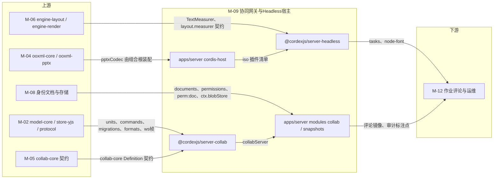

图怎么读：本模块合并了三个限界上下文，上游五个模块分别提供文档内核、编解码、协同契约、度量与身份权限契约；中间四个包/目录是本模块产物；下游只有 M-12 消费其任务编排与标注点。`ooxml-pptx` 与 `model-slide` 只由组合根 `cordis-host/preset-server.ts` 装配，再把 iso 插件清单交给文档类型盲的 `server-headless`（rulings §4.18 FE-01）；`server-collab` 依赖 M-05 `collab-core` 的契约（FE-15）。

## 1. 限界上下文与边界

### 1.1 职责与非职责

**做**：

- Room 生命周期状态机（照抄 06 §5.2 七态：`loading`/`active`/`draining`/`evicting`/`persisting`/`closed`/`failed`；转换 `loading→active`、`loading→failed`、`active⇄draining`（宽限 60 s）、`draining→persisting`（宽限到期，或内存压力/准入不足按 LRU 提前结束）、`active→evicting`（shutdown，或回收空闲房间后仍超预算，发 1012）、`evicting→persisting`、`persisting→closed`；PG 故障期与溢写回放期间 Room 保持 `active`，rulings §4.18 CO-13/CO-14/CO-15，见图 2-2）与会话（Session/RoleSession）管理、awareness 中继与广播。
- 两级校验：硬门禁 L1（信封/大小/速率）、L2（角色与文档锁定）、L3（结构可解析与结构数上限）；软门禁 L4（`documentType.validateChangeSet` + `invariants` 修复，含 `reassignTo` 悬空引用兜底 I-ML2 一类的确定性纯函数）。
- `document_updates` 追加持久化（`headSeq` 乐观递增）与 Compaction（触发判定→租约锁→压缩为新快照→裁剪日志）。
- `document_snapshots` 快照与版本 REST 面：列表、`latest`（ETag/zstd）、命名快照、恢复（经 M-02 `core.restoreVersion` 命令）。
- Redis 跨实例扇出（不要求房间亲和）、单写者任务租约锁（压缩/迁移/换纪元）、在线人数聚合。
- WS 握手第二道 fail-closed 检查点：collab ticket 校验（JWT 验签 + `jti` 防重放 + `permVersion` 比对）；文档 `status='purging'` 一律拒绝加入（rulings §4.18 BE-15）。
- **链接会话的角色重算**（新增，rulings §4.18 BE-02）：票据带可选 claim `lnk`（分享链接 id）的会话，`AuthzSource` 重算时取 `max(直接授权, 该链接仍有效时的角色)`（链接状态经 M-08 `PermissionsModule` 导出的 `ResolveShareLinkUseCase` 复核），因此他人修改权限不会把只凭链接的会话误降为 `none` 踢出；链接撤销随 `permVersion` 广播 ≤ 1 s 降权；会话记录 `linkExpiresAt`，到期由本模块主动重算降权。
- **Room 背压溢写**（新增，rulings §4.13 S-3，2026-09-21）：Postgres 持续故障期间不拒绝新编辑——按 Room 未持久化字节两级阈值判定，超一级阈值溢写 Redis，超二级阈值分块落 `BlobStore`；PG 恢复后按溢写临时键顺序回放到 `document_updates`。**两级 ack（2026-09-24，rulings §4.15 S-3a）**：溢写成功回 `ack{tier:'spill'}`（客户端保留 pending，不清 OfflineStore），落库成功回 `ack{seq,tier:'db'}` 才清 pending；溢写行只带临时键 `(instanceId, localCounter)`，正式 `seq` 在回放时由 PG 分配；回放完成后断言 Room 的 Y.Doc 无 `pendingStructs`。**2026-09-25 补充（rulings §4.18）**：PG 写失败即进入降级期，update 通过门禁、进入 `none`/`valkey`/`blob` 任一档后**立即**在本实例广播并跨实例扇出，不等持久化，`persistBeforeBroadcast` 只约束 PG 可用时的顺序，指标 `cordex_collab_broadcast_before_persist_total`（CO-08）；故障期与回放期 Room 保持 `active`（`spillTier≠none` 或 `replaying=true`），不进 `persisting`（CO-15）；存活实例只回放自己 `instanceId` 的溢写行，心跳过期实例的遗留行由下次加载该文档的 Room 持 `lock:spill:{doc}` 租约认领回放；关闭或 SIGTERM 时 PG 不可达则先把内存档强制写入一级溢写再 `closed`（CO-16）。**2026-09-25 追加（rulings §4.19 INC-09）**：PG 写失败 ≤ 1 s 内经 `CONTROL.room` 的可选字段 `persist:'degraded'` 通知房间内全部会话（不新增帧类型），回放完成且无溢写后推 `persist:'ok'`；客户端据此与自身在途状态分级提示「未保存到服务器 N 项」/「服务器保存延迟」（[60/05 §6.1](../60-backend/05-modules-collab-and-snapshots.md)、[50/07 §6.1](../50-frontend/07-collaboration-client.md)）。
- **删除墓碑 TTL 硬删除**（新增，2026-09-24，rulings §4.15 Q3）：元素删除在 CRDT 内为软删除墓碑（id 稳定；删除方撤销或「恢复元素」可恢复，他人撤销不会复活——rulings §4.17 D4），TTL（默认 24 h，部署配置）到期后由服务端**单写者**（`LeaseLock` 选举，与 Compaction 同一锁族）发出 `origin=system('maintenance')` 硬删除事务（`reason` 取 M-02 `store/origin.ts` 既有枚举 `'repair'|'restore'|'maintenance'`，不另增取值）；客户端从不自行硬删除。**执行者事实源（2026-09-24 复核 H2，rulings §4.17）**：墓碑硬删除只有一条执行路径——本模块 `server-collab/application/persistence/tombstone-sweeper.ts` + `LeaseLock` 单写者；`30-architecture/08` 中的 BullMQ `tombstone-purge` 周期任务路径作废、以本模块为准。到期判定读墓碑字段 `_deleted.at`（M-03/架构 04 §3.1a 墓碑形状 `{at, by}`），TTL 取部署配置 `tombstone.ttlHours`（默认 24，与架构 08 配置表同键）。文档擦除（S-2）与「永久删除文档」（文档级，原称「立即彻底删除」）不等 TTL，作为 document-purge 参与者走 `purgeAll` 立即硬删。**彻底删除元素**（元素级，新增，rulings §4.18 CO-07）：只对墓碑态元素开放、只能由 owner 发起（`POST /documents/:id/elements/purge{ids}`，M-08 `DocumentRoleGuard(doc.manage)` 鉴权），由同一单写者复用 `tombstone-sweeper` 的 `system('maintenance')` 事务立即硬删（房间未加载时先加载再执行），写审计 `document.element_purged`；只清当前文档状态，历史快照与 update 表按保留期存在，引用的图片原件按 30 天无引用 GC；删除方此后撤销该步按整步跳过（`wholeStep:true`，同 TTL 到期）。
- **按文档实测权重准入**（新增，2026-09-24，rulings §4.15 Q5）：房间准入与内存预算按文档实测权重（元素数/字节/墓碑计入）而非固定房间数；编辑者/查看者名额**按用户计**（同一用户多标签/多设备占 1；commenter 计入查看者；owner 不占编辑者名额）；全部规模数字为部署配置、完全可调（超出性能保证包络时告警）。**2026-09-25（rulings §4.18 CO-17/CO-14）**：按 06 §14 先准入后 `loading`——只在本实例还没有该文档的 Room 时做实例级权重判定（权重取 `documents.element_count`，不需预加载），已有 Room 只判名额；预算不足时先按 LRU 提前结束 `draining` 房间再重判，仍不足才拒绝或驱逐 `active` 房间。
- **编排式硬删除清理**（新增，rulings §4.13 S-2，2026-09-21）：`UpdateStore`/`SnapshotStore` 契约新增 `purgeAll(docId)`，作为 M-08 document-purge 作业的参与者（`@PurgeParticipant('collab')`）被调用，清理 `document_updates`/`document_snapshots`（"谁的表谁写"）；该参与者只依赖 `PgUpdateStore`/`PgSnapshotStore`，在 worker 角色装配、不激活 `collabServer`（rulings §4.18 BE-15/BE-13）。处理器的第一步经 Valkey 控制频道通知本模块踢出该文档会话并关闭 Room。
- Node cordis headless 宿主 `createHeadlessHost({ plugins })`：挂载调用方（组合根 `apps/server` 的 `preset-server.ts`）给定的 iso 插件清单，**本包文档类型盲**——不 import `model-slide`/`ooxml-pptx`，导入导出按 `documentType` 经 `formats` 服务取 codec、diff 经 `documentTypes` 服务（rulings §4.18 FE-01）；提供导入/导出/校验/迁移/模型级 diff 任务执行入口（供 M-12 作业调用）、Node 字体 `TextMeasurer` Provider、headless Chromium 缩略图/PDF 渲染适配器契约。
- `apps/server/src/cordis-host`：Nest 进程级 cordis 宿主生命周期（`createHost`/`preset-server` 装配/`fiber.await()`/优雅关闭）与只读诊断面，供全部 Nest 模块以 OHS 方式调用；**类型安全 `ServiceMap` 与启动期角色一致性断言**（新增，评审 §3.6，2026-09-21）：`getService<T>(name)` 由字符串弱类型查找升级为 `ServiceMap` 编译期 key 校验，`role=collab` 等启动路径新增 `config/roles.ts` 与 `preset-server.ts` 两套装配开关的一致性断言，不一致则 fail-fast。

**不做**（指向负责模块）：

- 不签发 collab ticket、不做文档目录/权限判定本身（M-08 `auth`/`permissions`；本模块只校验票据、订阅 `perm:doc:{id}` 并执行判定结果）。
- 不实现 `BlobStore`（M-08 `server-storage`；本模块经 `ctx.blobStore` 消费）。
- 不实现 OOXML 编解码算法本身（M-04 `ooxml-pptx`；headless 宿主只调用 `pptxCodec`）。
- 不做缩略图/导入导出 BullMQ 作业编排、评论镜像读模型、审计落库（M-12；本模块只提供 `tasks`/`ThumbnailRenderer` 适配器与 Room 控制帧广播能力）。
- 不实现客户端 CRDT 同步逻辑（M-05 `collab-yjs`/transport 等 Provider；本模块是服务端对称实现，`server-collab` 复用 M-05 `collab-core` 的 Definition 契约（package.json 依赖 `@cordexjs/collab-core`），不复用 `collab-yjs`/transport 等 Provider，帧格式另经同一份 `@cordexjs/protocol` 契约，rulings §4.18 FE-15）。
- 不 import `render-dom` 或任何 dom 包（同构铁律 4）；像素渲染发生在 headless Chromium 加载的 `apps/web` `/render` 路由内，本模块只做进程编排与适配。

### 1.2 通用语言

| 术语 | 定义 | 来源 |
|---|---|---|
| Room | 服务端为一份文档维护的协同会话集合与其 Y.Doc 副本（= 服务端 Unit） | 06 §术语补充 |
| Session | 一个客户端与一个 Room 的连接生命周期 | 06 §术语补充 |
| Ticket | 60 s 单次签名凭据，携带 `sub/doc/role/permVersion/jti/exp` 与可选 `sid`（登录会话 id）、`lnk`（分享链接 id，角色来自链接时才有，rulings §4.18 BE-02）（2026-09-24 去租户，`tid` 删除，rulings §4.15 T-0），用于 WS 握手 | 06 §术语补充、ADR-0029 |
| Update | Yjs 二进制增量（V2 编码） | 06 §术语补充 |
| StateVector | Yjs 各 client 已知时钟的向量，用于差量同步 | 06 §术语补充 |
| Compaction | 用一个快照替换其前的 update 序列 | ADR-0025 |
| Repair | 服务端软门禁发出的补偿事务（`origin=system('repair')`） | ADR-0034 |
| HeadSeq | `documents.head_seq`：已持久化的最大 update seq，与 `document_updates.seq` 同事务递增 | 08-backend-nestjs §5 |
| Epoch | `documents.epoch`："换纪元"计数器，仅本模块代码可写（`forceEpoch`；覆盖既有文档的导入由 M-12 处理器经本模块 `SnapshotStore.put` 推进，2026-09-25，rulings §4.19 N1）；用于结构数过大时的治理与覆盖导入；递增即**强制全体客户端重连**（断连再握手），与 `permVersion`（仅重算权限、不断连）不自动联动（2026-09-18，C-17，与 08 §2.1/§2.2/§7 同口径）；版本恢复不递增、不断连 | 06 §9.4、08 §7；[60/05 §9.2](../60-backend/05-modules-collab-and-snapshots.md) |
| SnapshotKind | `document_snapshots.kind` 枚举：`import\|auto\|named\|migration\|restore\|epoch` | 08-backend-nestjs §5、ADR-0025 |
| HardGate / SoftGate | 应用前的协议/权限/结构校验（拒绝不广播不落库）／应用后的语义与不变量校验（修复不回滚） | ADR-0034 |
| LeaseLock / FanoutBus | 单写者租约锁（compaction/migration/epoch 选举）／跨实例 pub/sub 扇出抽象 | 08-backend-nestjs §3.1 |
| UnitRunner | headless 宿主内 `withUnit()` 生命周期封装：打开 Unit→执行任务→必然关闭 | module-map BC-27 行 |
| Spill / SpillTier（新增，rulings §4.13 S-3） | Room 未持久化字节超阈值时的降级持久化：一级溢写 Valkey（`SpillTier='valkey'`，与指标 `cordex_collab_spill_tier_current` 取值 `none|valkey|blob` 一致），超二级阈值分块落 `BlobStore`（`SpillTier='blob'`）；PG 恢复后回放，不拒绝新编辑；溢写行以 `(instanceId, localCounter)` 为临时键、回放时由 PG 分配 `seq`，溢写期只回 `ack{tier:'spill'}`（2026-09-24，rulings §4.15 S-3a） | ADR-0025 补充（本文档 §2.1/§2.3/§2.5） |
| ServiceMap（新增，评审 §3.6） | `CordisHostService.getService<T>(name)` 的编译期 key→类型映射表，替代裸字符串弱类型查找 | `cordis-host/cordis-host.service.ts` |

### 1.3 上下文映射

| 相邻上下文 | 关系类型 | 防腐层落点（文件） | 传递的契约 |
|---|---|---|---|
| BC-05 文档内核（`store-yjs`） | Customer–Supplier | `server-collab` 经 `ctx.units`/`ctx.store` 消费 `yjsBackend` | `DocumentStore`/`YjsBackend` |
| BC-05（`core.restoreVersion`/`migrations`） | Customer–Supplier | `snapshots/application/restore-snapshot.usecase.ts`、`server-headless` `tasks/migrate.ts` | `commands.execute`、`migrations.run` |
| BC-08 PPTX 编解码 | Customer–Supplier（经 `formats` 服务，按 `documentType` 取 codec；`pptxCodec` 由组合根 `preset-server.ts` 装配，rulings §4.18 FE-01） | `server-headless/application/tasks/{import,export}.ts` | `FormatCodec` |
| BC-10 布局与度量引擎 | Customer–Supplier（Conformist：契约由 M-06 定义） | `server-headless/infrastructure/measurer/node-font-measurer.ts` | `TextMeasurer`、`runTextMeasurerConformance` |
| BC-19 文档目录与权限 | Customer–Supplier（经 Redis 与 DI） | `collab/infrastructure/authz-source.ts` | 频道 `perm:doc:{id}`、`permVersion`；`RoleResolverService`、`ResolveShareLinkUseCase`（链接会话重算，rulings §4.18 BE-02） |
| BC-20 对象存储与媒体 | Open Host Service | `cordis-host/preset-server.ts` 装配 `ctx.blobStore` | `ServerBlobStore` |
| BC-09 协同（客户端） | **Published Language** + Customer–Supplier（共享协议；`server-collab` 另依赖 `collab-core` 的 Definition 契约，不共享 Provider 代码，rulings §4.18 FE-15） | `@cordexjs/protocol` `ws/frames.ts` + 新增 `collab/*.ts`；`@cordexjs/collab-core` | SYNC/AWARENESS/CONTROL 二进制信封；collab-core 契约类型 |
| BC-23/24 导入导出与作业 / 缩略图（M-12） | Open Host Service（本模块是供给方） | `server-headless` `application/tasks/*`、`infrastructure/thumbnails/*` | `ImportResult`/导出 `bytes`/缩略图 WebP 字节（640 px） |
| BC-25 评论（M-12） | Open Host Service（本模块转发） | `server-collab/application/broadcast.ts` | `CONTROL.event{comments.changed}` |
| BC-18…20/22…26（其余 Nest 模块） | Open Host Service（只调用不重实现） | `cordis-host/cordis-host.service.ts` | `openUnit`/`closeUnit`/`getService`/`diagnostics()` |

## 2. 领域模型

### 2.1 聚合与实体

> **事实源（rulings §4.19）**：服务端协同的运行机制（Room 生命周期、准入与名额、持久化与扇出、PG 故障降级与 `persist` 信号、压缩与版本保留、墓碑、迁移与换纪元、快照 REST 用例、永久删除参与者）以 [60/05](../60-backend/05-modules-collab-and-snapshots.md) 为准；表结构与 SQL 以 [60/11](../60-backend/11-ddl-collab-updates-and-snapshots.md) 为准；服务端对帧的处理、门禁、ack 与关闭码以 [60/16](../60-backend/16-ws-protocol-server-view.md) 为准；装配矩阵以 [60/01](../60-backend/01-service-overview-and-roles.md) §5 为准；表写方所有权以 [60/08](../60-backend/08-db-conventions-roles-rls-migrations.md) §7 为准。本节（§2）只保留类型到文件的落点与本包接口清单，冲突以 60 为准；本节图为落点示意，机制细节以 60/05 同名图为准。

| 聚合 / 实体 | 要点（机制见 60/05） | 所在文件 |
|---|---|---|
| `Room`（聚合根，= 服务端 `Unit`） | `docId`、`state`（照抄 30/06 §5.2 七态，图 2-2）、`unit`、`sessions`、`headSeq`、`epoch`、`schemaVersion`、`pendingBytes`/`spillTier`（`'none'\|'valkey'\|'blob'`）、`persist: 'ok'\|'degraded'`（2026-09-25 新增，rulings §4.19 INC-09：PG 写失败 ≤ 1 s 内经 `CONTROL.room{persist:'degraded'}` 推给房间内全部会话，回放完成且无溢写后推 `'ok'`，不新增帧类型；[60/05 §6.1](../60-backend/05-modules-collab-and-snapshots.md)）；PG 故障期与回放期保持 `active`（CO-15） | `server-collab/domain/room.ts` |
| `RoomSession`（实体） | `sessionId`、`role`、`clientId`、令牌桶、`ackTracking`（两级 ack，S-3a）、`linkId?`/`linkExpiresAt?`（BE-02）；名额按 `userId` 去重（Q5） | `server-collab/domain/room-session.ts` |
| `UpdateLog`（聚合） | `document_updates` 追加日志的领域投影；`purgeAll(docId)` 供 document-purge 参与者（S-2、BE-15）；裁剪条件以 60/11 §8 为准 | `domain/contracts/update-store.ts` + `application/persistence/update-writer.ts` |
| `Snapshot`/`Version`（聚合） | `document_snapshots` 一行的投影；`SnapshotKind` 六值；保留口径见图 2-1（rulings §4.19 C-06） | `domain/contracts/snapshot-store.ts` + `application/snapshot/snapshot.service.ts` |
| `HeadlessJobContext`（聚合） | 一次 `withUnit()` = 一个上下文，`finally` 必然关闭 Unit | `server-headless/domain/unit-runner.ts` |

`Room.epoch` 只读镜像 `documents.epoch`（本模块唯一写方），递增即强制全体会话断线重连（4428，决策 INC-06），与 `permVersion`（只重算能力位、不断连）不自动联动（C-17；机制见 [60/05 §9.2](../60-backend/05-modules-collab-and-snapshots.md)）。

**图 2-1 快照与版本保留策略**

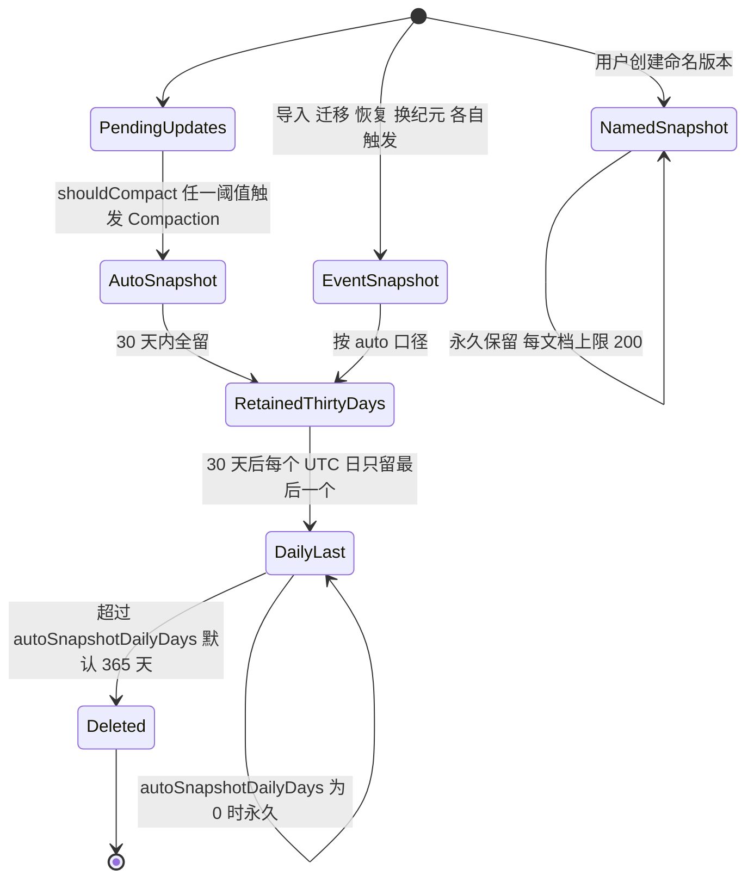

图怎么读：`auto` 快照由 Compaction 阈值触发；`import`/`migration`/`restore`/`epoch` 事件快照按 `auto` 口径（rulings §4.19 C-06）：30 天内全留，之后每天只留最后一个，保留至 `retention.autoSnapshotDailyDays`（默认 365，0 = 永久）；`named` 永久且每文档上限 200（`quota.namedSnapshotsPerDoc`）；`documents.latest_snapshot_id` 所指行永不删除。带基线的 `import` 快照的例外（基线随文档生命周期，决策 C-07）以 [60/11 §8](../60-backend/11-ddl-collab-updates-and-snapshots.md) 为准。全部数值为部署配置可调（rulings §4.16 Q17）。

**图 2-2 Room 生命周期状态机**

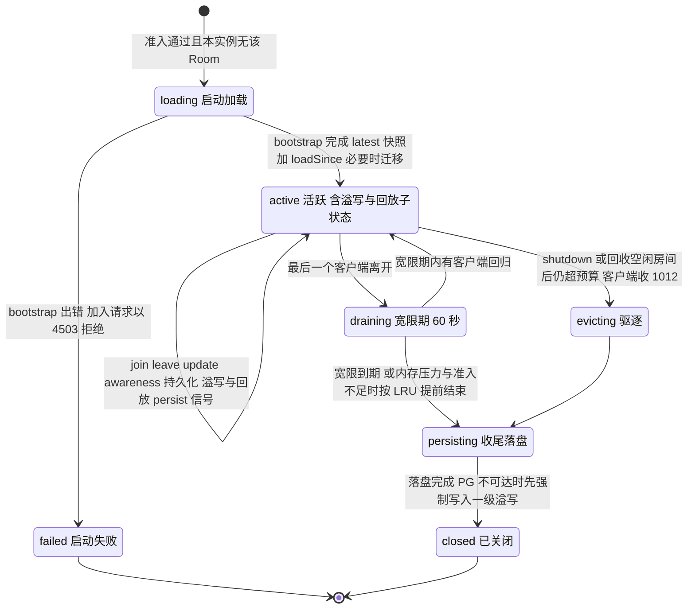

怎么读：状态与转换照抄 30/06 §5.2（rulings §4.18 CO-13）；PG 故障期与溢写回放期间 Room 始终是 `active`，其间经 `CONTROL.room.persist` 通知降级与恢复（rulings §4.19 INC-09）；没有 `draining→evicting` 边（CO-14）；无人在线的 Room 收尾时若 PG 不可达，先写一级溢写再关闭（CO-16）。

依据：30/06 §5.2；[60/05 §3、§6](../60-backend/05-modules-collab-and-snapshots.md)；rulings §4.18 CO-13/CO-14/CO-15/CO-16、§4.19 INC-09。
### 2.2 值对象

| 名称 | 字段 / 校验 | 所在文件 |
|---|---|---|
| `RoomId` | `Brand<DocumentId,'RoomId'>`（与 `documents.id` 1:1） | `server-collab/domain/ids.ts` |
| `Seq` | `Brand<bigint,'Seq'>`，严格单调、与 `headSeq` 同源 | `server-collab/domain/ids.ts` |
| `CollabTicketClaims`（= 通用语言 Ticket） | `{sub,doc,role,permVersion,jti,exp,sid?,lnk?}`（2026-09-24 去 `tid`，rulings §4.15 T-0；2026-09-25 增 `lnk?`，`sid` 明确为登录会话 id，§4.18 BE-02；M-08 `auth/domain/collab-ticket.ts` 定义形状；本模块只消费与验签） | `collab/domain/collab-principal.ts` |
| `SnapshotKind` | `'import'\|'auto'\|'named'\|'migration'\|'restore'\|'epoch'`（08-backend-nestjs §5 固定枚举，逐字对齐 ADR-0025） | `server-collab/domain/contracts/snapshot-store.ts` |
| `CompactionThresholds`（= Compaction 阈值） | `{maxPendingUpdates:500, maxPendingBytes:5 MiB, maxAgeMs:600000}`（三选一 OR 触发，ADR-0025 决策 3） | `server-collab/config.ts` |
| `GateLimits` | `{maxFrameBytes:1 MiB, msgRateHz:200, msgBurst:500, awarenessMinIntervalMs:50, awarenessMaxBytes:2 KiB, structsPerUpdate:50000}` | `server-collab/config.ts` |
| `RoomCapacity` | `{maxEditors:20, maxViewers:50, drainGraceMs:60000, memoryAdmissionPct:75, weight:{maxElementsPerDoc:20000, softWarnElements:15000}}`；2026-09-24（rulings §4.15 Q5）起 `maxActiveRooms` 固定房间数改为**按文档实测权重准入**（`admitByWeight`，§2.3），名额按用户计，全部数值为部署配置可调（超出性能保证包络告警） | `server-collab/config.ts` |
| `SpillAck`（rulings §4.15 S-3a） | 帧形状以 30/06 §6.3 与 M-02 `ws/frames.ts` 为准：`{type:'ack', tier:'spill'}` \| `{type:'ack', tier:'db', seq}`（判别键统一为 `type`，决策 INC-03/04/05，2026-09-25 更正）；`SpillKey = {instanceId, localCounter}` 仅为服务端溢写行临时键，不上线 | 帧：`@cordexjs/protocol` `ws/frames.ts`；`SpillKey`：`server-collab/domain/contracts/spill-store.ts` |
| `TombstoneTtl`（新增，rulings §4.15 Q3；2026-09-24 复核 L10 统一键名） | 部署配置键 `tombstone.ttlHours`（默认 24，与 `30-architecture/08` 配置表同键）；到期判定 `_deleted.at + ttlHours < now` | `server-collab/config.ts`（由 apps/server 配置注入） |
| `SoftGateMode` | `mode:'repair'\|'report-only'\|'off'`；`schemaMode` 同枚举独立配置（ADR-0034 v0.2） | `server-collab/config.ts` |
| `RoomPersist`（新增，rulings §4.19 INC-09） | `'ok' \| 'degraded'`；随 `CONTROL.room` 的可选字段 `persist` 下发（缺席即 `'ok'`），PG 写失败 ≤ 1 s 推 `degraded`，回放完成且无溢写后推 `ok`；客户端判据与受众见 [50/07 §6.1](../50-frontend/07-collaboration-client.md) | 帧字段：`@cordexjs/protocol` `ws/frames.ts`；状态：`server-collab/domain/room.ts` |
| `CloseCode` | WS 关闭码常量对象：`1000/1001/1006/1011/1012/4400/4401/4403/4404/4408/4409/4413/4426/4427/4428/4429/4503`（2026-09-25 补 1011 服务端内部错误、4428 纪元变更，决策 INC-06；触发条件见 [60/16 §10](../60-backend/16-ws-protocol-server-view.md)） | `@cordexjs/protocol` `collab/close-codes.ts`（M-02 §4.3 已登记，决策 INC-01） |

### 2.3 领域服务（纯函数）

| 函数 | 签名草案 | 所在文件 | 两端共用 |
|---|---|---|---|
| `checkHardGate` | `(frame: RawFrame, session: RoomSessionSnapshot, limits: GateLimits) => GateDecision`（L1 信封/大小/速率 + L2 角色/锁定 + L3 结构可解析） | `server-collab/domain/gate/hard-gate.ts` | 否（客户端无对称实现，仅本地乐观校验属 M-05 范围） |
| `runSoftGate` | `(changeSet: ChangeSetLike, documentType: DocumentType) => { violations: InvariantViolation[] }`（调用 `documentType.validateChangeSet(paths)` + 迭代 `documentType.invariants` 逐项 `check`；本函数**文档类型盲**，具体规则如 I-ML2 由 model-slide 的 `invariants` 表提供） | `server-collab/domain/gate/soft-gate.ts` | 是（客户端 observe 时对"环/孤儿"两类调用同一 `invariants.repair`，结果确定性一致，ADR-0034） |
| `planRepair` | `(violations: InvariantViolation[], body: Persisted<S>) => Mutation[]`（逐条调用触发不变量的 `repair()`） | `server-collab/domain/gate/repair-planner.ts` | 是 |
| `shouldCompact` | `(pending: {count:number;bytes:number;ageMs:number}, thresholds: CompactionThresholds) => boolean`（三选一 OR，ADR-0025 决策 3） | `server-collab/domain/gate/compaction-policy.ts` | 否 |
| `checkSpillTier`（新增，rulings §4.13 S-3） | `(pendingBytes: number, thresholds: SpillThresholds) => 'none'\|'valkey'\|'blob'`（两级阈值判定，纯函数，不触发 IO；PG 持续故障期间由 `spill-coordinator.ts` 调用后决定写 `SpillStore` 的哪一档） | `server-collab/domain/gate/spill-policy.ts` | 否（服务端专有，与 compaction 阈值同量级配置） |
| `admitByWeight`（新增，rulings §4.15 Q5） | `(doc: {elements:number; tombstones:number; bytes:number}, capacity: RoomCapacity, instance: {usedWeightBytes:number; budgetBytes:number}) => 'admit'\|'readonly'\|'reject'`（文档实测权重判定：`usedWeightBytes + 新房间权重 ≤ budgetBytes` 才接纳，`budgetBytes` = 容器内存上限（cgroup 限额，`process.constrainedMemory()`；无限额取物理内存）× `memoryAdmissionPct`；超 `maxElementsPerDoc` 的文档不接纳编辑。2026-09-25 更正，rulings §4.18 BE-29/CO-17；原入参 `memory: {usedPct}`（按进程内存占比判定）作废） | `server-collab/domain/gate/admission-policy.ts` | 否 |
| `planVersionRetention` | `(snapshots: readonly SnapshotMeta[], now: number, cfg: { autoSnapshotDays: number; autoSnapshotDailyDays: number }) => { keep: SnapshotId[]; drop: SnapshotId[] }`（rulings §4.19 C-06：非 `named` 快照 30 天内全留，之后每个 UTC 日只留最后一个，保留至 `autoSnapshotDailyDays`（默认 365，0 = 永久）；`named` 与指针所指行永不入 `drop`；生产执行是 worker 上的 `snapshots-retention` 周期作业与 60/11 §8 的 e7 SQL，本函数供 `MemorySnapshotStore` 与单测对照同一规则） | `server-collab/domain/gate/version-retention-policy.ts` | 否 |
| `consumeTokenBucket` | `(bucket: TokenBucketState, cost: number, now: number) => Result<TokenBucketState, 'rate_limited'>` | `server-collab/domain/gate/token-bucket.ts` | 否 |
| `diffForRestore` | `(current: Persisted<S>, target: Persisted<S>, documentType: DocumentType<S>) => Mutation[]`（薄封装 `documentType.diff()`；供版本对比预览与 `core.restoreVersion` 命令内部共用同一纯函数，避免重复实现，见 §2.6/§13） | `server-headless/application/tasks/diff-snapshots.ts` | 是（纯函数来自 model-core/model-slide，两端均可调用） |

> 说明（呼应 M-03 §1.3/§13 Q3）：`runSoftGate`/`planRepair` 对具体不变量（如 `I-ML2` 悬空 `layoutId` 兜底："重指该母版首个版式并 materialize 占位符"）**完全无感知**——它们只按 `DocumentType.invariants` 表机械迭代 `check`/`repair`；I-ML2 的选取函数物理定义在 `model-slide/domain/style/**`，命令层前置拒绝（`LAYOUT_IN_USE`）与本模块的并发兜底必须复用同一纯函数（M-03 §1.3 已强调），本模块契约套件需在协同分节显式引用它（见 §9）。

### 2.4 领域事件

| 事件 | 载荷 | 发布者文件 | 典型订阅者 |
|---|---|---|---|
| `collab-server/room-opened` | `{docId, epoch}` | `server-collab/application/room-manager.ts` | 遥测、M-12 审计镜像 |
| `collab-server/room-closed` | `{docId, reason: 'idle'\|'shutdown'\|'evicted'}` | `server-collab/application/room-manager.ts` | 遥测 |
| `collab-server/update-rejected` | `{docId, sessionId, code}` | `server-collab/domain/gate/hard-gate.ts` | 审计（`collab.update_rejected`，M-12） |
| `collab-server/repair` | `{docId, reason, paths}` | `server-collab/domain/gate/repair-planner.ts` | `CONTROL.repair` 广播（`application/broadcast.ts`）、审计（`collab.repaired`） |
| 审计 action `document.element_purged`（非 cordis 事件，新增，rulings §4.18 CO-07） | `{docId, ids, actorId}` | `collab/application/purge-elements.usecase.ts`（`@Audited`） | M-12 AuditModule |
| `unit/migrated`（M-02 既有事件，本模块触发方） | `(unitId, from, to)` | `server-collab/application/persistence/migration-runner.ts` 调用 `migrations.run` 触发 | 审计（M-12） |
| `render/frame` / `perf/frame`（M-06/M-07 既有命名，本模块只是消费方） | 沿用既有载荷 | headless Chromium 内加载的 `apps/web` `/render` 页面（进程外） | `server-headless/infrastructure/thumbnails/thumbnail-renderer.ts` 监听 `window.__cordex.ready` 信号（非 cordis 事件，是页面协议，见 §2.5 `render-page-protocol.ts`） |

### 2.5 仓储 / 存储契约

> 签名的唯一源是 [60/05 §2.1](../60-backend/05-modules-collab-and-snapshots.md)（`CollabServer`、`UpdateStore`、`SnapshotStore`、`SpillStore`、`FanoutBus`、`LeaseLock`、`AuthorizationSource`、`MembershipRegistry`、`ServerConnection`），IO 适配器表见 60/05 §2.2；本节 2026-09-25 起只列 Definition 到文件、Provider 与契约套件的落点（rulings §4.19）。套件的运行方式与用例 id 以 [70/02](../70-testing/02-contract-suites-and-pluggability.md) 为准；需要容器的 Provider 调用一律在 `apps/server/test/integration/conformance/*.int-spec.ts`（决策 T-NAMING，70/02 §14 第 2 条）。

| Definition / 服务 | 契约文件 | Provider（文件） | 契约套件（导出处 → 实例化处） |
|---|---|---|---|
| `collabServer`（`CollabServer`） | `server-collab/application/room-manager.ts`（实现）；类型在 `index.ts` 导出 | `server-collab` 自身（`plugin.ts` `provide=['collabServer']`） | `runCollabServerConformance(createCluster)`（`server-collab/testing`）→ 内存版 `createServerCluster(n)` 自测；真实适配器版 `apps/server/test/integration/conformance/collab-server.int-spec.ts` |
| `UpdateStore` | `domain/contracts/update-store.ts` | `collab/infrastructure/pg-update-store.ts` | `runUpdateStoreConformance` → `MemoryUpdateStore` 自测；`conformance/pg-update-store.int-spec.ts` |
| `SnapshotStore` | `domain/contracts/snapshot-store.ts` | `collab/infrastructure/pg-snapshot-store.ts` | `runSnapshotStoreConformance` → `MemorySnapshotStore` 自测；`conformance/pg-snapshot-store.int-spec.ts` |
| `SpillStore` | `domain/contracts/spill-store.ts` | `collab/infrastructure/spill/{redis-spill.store,blob-spill.store}.ts`（合组实现） | `runSpillStoreConformance` → `MemorySpillStore` 自测；`conformance/{redis-spill-store,blob-spill-store}.int-spec.ts` |
| `FanoutBus` | `domain/contracts/fanout-bus.ts` | `collab/infrastructure/redis-fanout.bus.ts` | `runFanoutBusConformance`（GV-20）→ `MemoryFanoutBus` 自测；`conformance/redis-fanout-bus.int-spec.ts` |
| `LeaseLock` | `domain/contracts/lease-lock.ts` | `collab/infrastructure/redis-lease-lock.ts` | `runLeaseLockConformance`（GV-20）→ `MemoryLeaseLock` 自测；`conformance/redis-lease-lock.int-spec.ts` |
| `AuthorizationSource` | `domain/contracts/authz-source.ts` | `collab/infrastructure/authz-source.ts` | 不设独立套件；链接会话三场景由 `runCollabServerConformance` 覆盖（BE-02） |
| `MembershipRegistry`（2026-09-25 登记，60/05 §2.1、§4.2：名额跨实例原子判定，决策 C-11） | `domain/contracts/membership-registry.ts` | `collab/infrastructure/redis-membership-registry.ts` | 不设独立套件；准入原子性由 `runCollabServerConformance` 覆盖 |
| `ServerConnection` | `interface/contracts/connection.ts` | `collab/interface/ws-connection.adapter.ts` | 由 `collab-server.int-spec.ts` 覆盖 |
| `layout.measurer`（M-06 定义，`node-font`） | M-06 `engine-layout` | `server-headless/infrastructure/measurer/node-font-measurer.ts` | `runTextMeasurerConformance`（`engine-layout/testing`）→ `__tests__/measurer-conformance.test.ts` |
| `ThumbnailRenderer`（适配器接口，本模块唯一实现） | `server-headless/infrastructure/thumbnails/thumbnail-renderer.ts` | 同左；`local`（`browser-pool.ts`）与 `remote`（`remote-renderer.client.ts`）两种模式 | 不设跨包 kit，由像素 oracle 覆盖（决策 T-KITS）；运行形态、RPC 与 ready 判据见 [60/06 §8–§10](../60-backend/06-modules-jobs-import-export-thumbnails.md) 与 [50/12 §11](../50-frontend/12-viewer-embedding-and-render-page.md) |

- **`/render` 页契约**：`@cordexjs/protocol/render/page.ts`（M-02 定义）与 `render/sidecar.ts`；本模块 `render-page-protocol.ts` 只做 Node 侧薄适配（C-27）；两种模式都由编排方调用 `window.__cordex.inject` 注入，页面零外呼（rulings §4.18 BE-04），注入载荷只收 `snapshot-json`（50/12 §11.3）。
- **`ServiceMap`**（`cordis-host/cordis-host.service.ts`）：`getService<K extends keyof ServiceMap>(name: K): ServiceMap[K] | undefined`，编译期 key 校验（评审 §3.6）；启动期角色一致性断言的条目以 [60/01 §6](../60-backend/01-service-overview-and-roles.md) 为准（含 `role=api` 不装 `SnapshotsModule` 与 `AdminController`、`role=worker` 不激活 `collabServer`、`role=renderer` 不装 `CordisHostModule`，rulings §4.18 BE-03/BE-13）。

**图 2-3 preset-server 宿主装配**

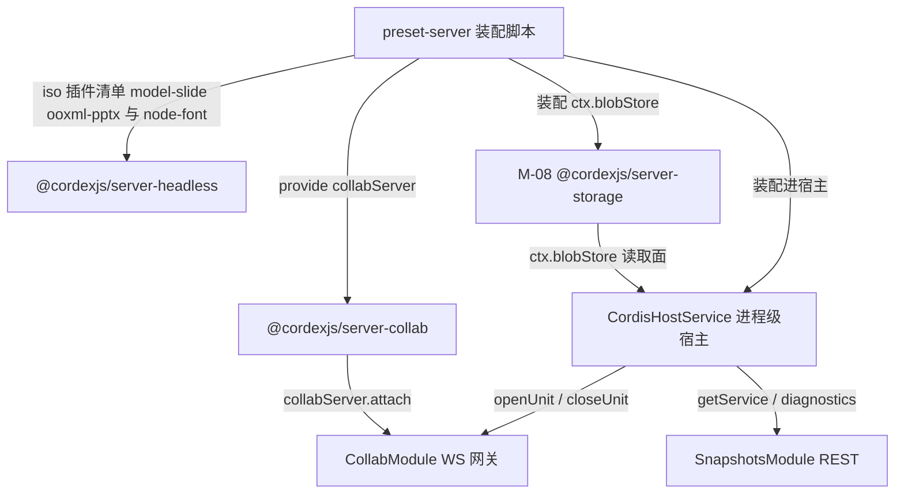

图怎么读：`preset-server` 是唯一的装配入口，把 `server-collab`/`server-headless`/M-08 的 `server-storage` 一起挂进同一个 `CordisHostService`；Nest 模块只经该宿主的读取面消费服务。`preset-server.ts` 位于组合根 `apps/server`（`compositionRoot:true`，R3 豁免），是服务端唯一 import `model-slide`/`ooxml-pptx` 的地方（rulings §4.18 FE-01）；宿主生命周期映射见 [60/01 §9](../60-backend/01-service-overview-and-roles.md)。
### 2.6 应用服务与命令

> 各应用服务的步骤、事务边界与失败处理以 60 线为准（rulings §4.19）；本表只保留「服务 → 文件 → 事实源」。下方图 2-4 至 2-7 保留为落点示意，机制细节以 60/05、60/16 同名流程为准。

| 应用服务 | 所在文件 | 事实源 |
|---|---|---|
| 加入房间（票据校验、`purging` 拒绝、先准入后 `loading`、认领遗留溢写行） | `collab/interface/{collab.gateway,ticket-verifier}.ts` + `server-collab/application/room-manager.ts` | [60/05 §3.1、§4](../60-backend/05-modules-collab-and-snapshots.md)；[60/16 §1、§6](../60-backend/16-ws-protocol-server-view.md) |
| 离开房间、内存压力回收（先回收 `draining` 再驱逐 `active`） | `server-collab/application/room-manager.ts` | 60/05 §3、§4（CO-14、CO-16） |
| 接收 update（L1–L4 门禁、落库或降级、ack、广播；step2 视同一帧） | `interface/frame-router.ts`、`application/persistence/update-writer.ts`、`application/broadcast.ts` | 60/16 §4–§6；60/05 §5 |
| PG 故障降级与 `persist` 信号（rulings §4.19 INC-09：PG 写失败 ≤ 1 s 推 `CONTROL.room{persist:'degraded'}`，回放完成且无溢写后推 `ok`；降级期照常广播，CO-08） | `application/persistence/{update-writer,spill-coordinator}.ts`、`application/broadcast.ts` | [60/05 §6.1–§6.2](../60-backend/05-modules-collab-and-snapshots.md) |
| 回放溢写数据（只回放本实例行、认领过期实例遗留行、补发 `tier:'db'`） | `application/persistence/replay-spilled.usecase.ts` | 60/05 §6.3–§6.4（S-3a、CO-15、CO-16） |
| 广播与跨实例扇出（只持久化自身客户端 update） | `application/broadcast.ts` | 60/05 §5；60/16 §11 |
| 快照生成（自动 / 命名）与版本保留（C-06） | `application/persistence/compactor.ts`、`snapshots/application/create-named-snapshot.usecase.ts`；保留作业在 worker 的 `SnapshotsRetentionUseCase` | 60/05 §7、§10；[60/11 §8](../60-backend/11-ddl-collab-updates-and-snapshots.md) |
| 快照恢复（`core.restoreVersion`，`origin:system('restore')`；持有 Room 的 collab 进程内单事务，不加锁、在线不断连，rulings §4.19 N1） | `snapshots/application/restore-snapshot.usecase.ts` | 60/05 §10–§11 |
| 墓碑 TTL 硬删除、彻底删除元素（CO-07） | `application/persistence/tombstone-sweeper.ts`、`collab/application/purge-elements.usecase.ts`、`collab/interface/element-purge.controller.ts` | 60/05 §8 |
| 迁移与换纪元（4426 / 4428；覆盖导入的换纪元由 worker 上的 M-12 导入处理器经 `pg-snapshot-store.ts` 的 `put(kind='import', epochFrom)` 执行并经 `room:{docId}:ctl` 通知，不经 `collabServer`、不新增 worker → collab 通道，rulings §4.19 N1） | `application/persistence/migration-runner.ts`、`collabServer.forceEpoch`、`collab/infrastructure/pg-snapshot-store.ts` | 60/05 §9；[60/06 §6.5](../60-backend/06-modules-jobs-import-export-thumbnails.md) |
| 链接会话降权（BE-02） | `application/room-manager.ts` + `collab/infrastructure/authz-source.ts` | 60/16 §8；[60/02](../60-backend/02-auth-chain.md) |
| 编排式清理协同数据（document-purge 参与者 `collab`） | `collab/application/purge-collab-data.usecase.ts` | 60/05 §12；[60/04 §4](../60-backend/04-modules-documents-storage-media.md) |
| headless 任务执行（`withUnit`，按 `documentType` 经 `formats` 取 codec） | `server-headless/domain/unit-runner.ts` + `application/tasks/*.ts` | [60/06 §8](../60-backend/06-modules-jobs-import-export-thumbnails.md) |

恢复的撤销语义另立专项 `version-restore-undo`（rulings §4.12 U-07，本文 §13 Q-9；60/05 §11 占位）。
**图 2-4 update 接收与扇出**

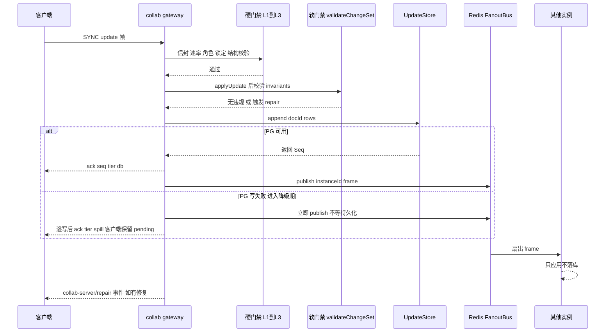

图怎么读：硬门禁先于落库拒绝非法帧；PG 可用时按 `persistBeforeBroadcast` 先落库、回 `tier db` 再广播；PG 写失败即进入降级期，update 进入 `none`/`valkey`/`blob` 任一档后立即广播与跨实例扇出、不等持久化（rulings §4.18 CO-08），溢写成功只回 `tier spill`，回放落库后补 `tier db`（S-3a）；`SyncStep2` 视同一帧，同样恰好回一帧 `tier db`（CO-10）；软门禁在 `applyUpdate` 之后修复语义违规并可能触发 `collab-server/repair`；只有发起方实例持久化，跨实例扇入只应用不重复落库。

**图 2-5 加入房间时序**

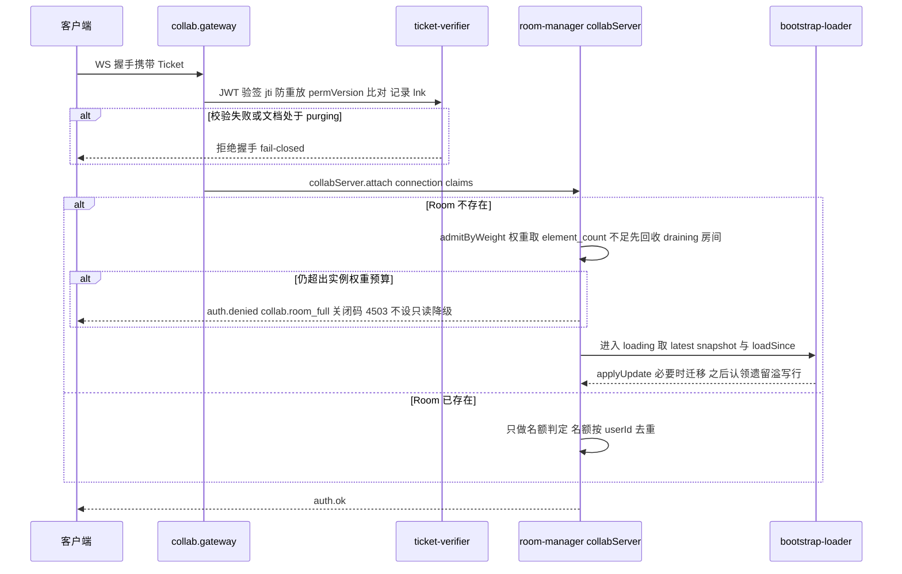

怎么读：票据校验是 WS 侧第二道 fail-closed 检查点，`purging` 文档一律拒绝（rulings §4.18 BE-15），通过后才进入 `attach`；按 06 §14 先准入后 `loading`——只在本实例还没有该 Room 时做实例级权重判定（权重取 `documents.element_count`，不需预加载），预算不足先按 LRU 回收 `draining` 房间再重判，拒绝后客户端重连到其他实例；已有 Room 只判名额（CO-17、CO-14）。

依据：06 §14；§1.1 WS 握手检查点；§2.6「加入房间」「房间准入」行；rulings §4.15 Q5、§4.18 CO-14/CO-17/BE-15/BE-02。

**图 2-6 PG 故障溢写与回放时序**

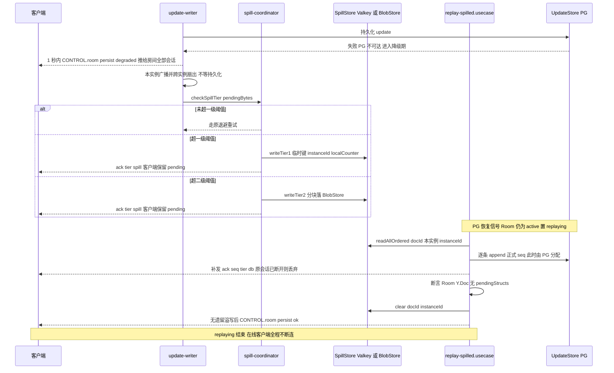

怎么读：PG 持续故障期间不拒绝新编辑，也不停止广播——update 进入任一档后立即广播与扇出（rulings §4.18 CO-08），并在 1 s 内经 `CONTROL.room.persist` 告知房间内全部会话进入降级、回放完成且无遗留溢写后再推 `ok`（rulings §4.19 INC-09，客户端据此分级提示），按未持久化字节两级阈值选择溢写档位，并只回 `tier spill`；PG 恢复后 Room 始终保持 `active`（CO-15），只回放本实例的行（CO-16），正式 `seq` 由 PG 分配后才补发 `tier db`，客户端据此清理 pending；心跳过期实例的遗留行由下次加载该文档的 Room 持 `lock:spill:{doc}` 租约认领。

依据：06 §6.4；§1.1 Room 背压溢写；§2.6「PG 故障降级与 `persist` 信号」「回放溢写数据」行；[60/05 §6](../60-backend/05-modules-collab-and-snapshots.md)；rulings §4.13 S-3、§4.15 S-3a、§4.18 CO-08/CO-15/CO-16、§4.19 INC-09。

**图 2-7 墓碑 TTL 硬删除时序**

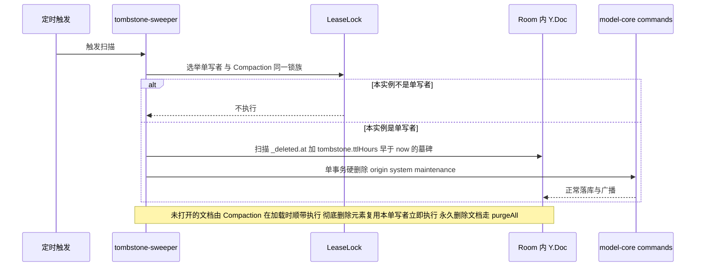

怎么读：墓碑硬删除只有这一条执行路径（`30-architecture/08` 的 BullMQ `tombstone-purge` 路径作废），客户端从不自行硬删；TTL 取部署配置 `tombstone.ttlHours`（默认 24）。owner 发起的「彻底删除元素」不等 TTL，复用同一单写者与 `system('maintenance')` 事务立即硬删指定墓碑（rulings §4.18 CO-07）；文档级「永久删除文档」不经本路径。

依据：§1.1 删除墓碑 TTL 硬删除；§2.6「墓碑 TTL 硬删除」行；rulings §4.15 Q3、§4.17 复核 H2。

## 3. cordis 插件定义

### 3.1 `@cordexjs/server-collab`（library + plugin）

| 项 | 值 |
|---|---|
| 插件名 / `name` | `'server-collab'` |
| `inject`（必需） | `['units','updateStore','snapshotStore','fanoutBus','leaseLock','authzSource','telemetry','spillStore','membershipRegistry']`（`spillStore` 2026-09-21 新增，rulings §4.13 S-3；`membershipRegistry` 2026-09-25 登记，名额跨实例原子判定，60/05 §2.1、§4.2） |
| `inject`（可选） | 无 |
| `provide` | `['collabServer']` |
| 贡献点：提供 / 消费 | 均无（能力经服务名暴露，不占用贡献点机制） |
| 事件：发布 | `collab-server/room-opened`、`collab-server/room-closed`、`collab-server/update-rejected`、`collab-server/repair` |
| 事件：订阅 | 无 cordis 事件（Redis `perm:doc:{id}` 经注入的 `authzSource.onPermissionChanged` 回调转译为内部调用，不是 cordis Events） |
| 配置 schema | `{ room:{drainGraceMs,maxEditors,maxViewers,memoryAdmissionPct,weight:{maxElementsPerDoc,softWarnElements}}, limits:{maxFrameBytes,msgRateHz,msgBurst,updateBytesPerMin,awarenessMinIntervalMs,awarenessMaxBytes,structsPerUpdate}, persistence:{flushMs,flushMaxUpdates,persistBeforeBroadcast}, compaction:{maxPendingUpdates,maxPendingBytes,maxAgeMs,retainUpdatesAfterSnapshotMs}, softGate:{mode,schemaMode}, repair:{quarantineThreshold,windowMs}, spill:{tier1MaxBytesPerDoc,tier2ChunkBytes}, tombstone:{ttlHours} }`（zod，默认值见 §11、架构 08 §3.1/§12；`spill` 段 2026-09-21 新增，S-3；2026-09-24 `room.maxActiveRooms` 改为 `room.weight` 按文档实测权重准入、新增 `tombstone` 段，rulings §4.15 Q3/Q5；全部数值部署配置可调） |
| 生命周期 | `ready`：向宿主暴露 `collabServer`；`dispose`：`drainAll('shutdown')` → flush → 释放全部 Room 的 effect；本包**不**在单一 `UnitScope` 内运行——它自行管理"每 Room 一个 Unit"的多份隔离域，不经宿主一次性 `isolate()` |
| Manifest 片段 | `{ "id":"@cordexjs/server-collab", "provides":["collabServer"], "injects":["units","updateStore","snapshotStore","fanoutBus","leaseLock","authzSource","telemetry","spillStore","membershipRegistry"], "points":[], "unitScoped": false }` |

### 3.2 `@cordexjs/server-headless`（host + provider）

| 项 | 值 |
|---|---|
| 形态 | host：`createHeadlessHost({ adapters, plugins })`（内部调用 kernel `createHost` 并挂载**调用方给定**的 iso 插件清单——由组合根 `apps/server` 的 `preset-server.ts` 选定，本包不 import `model-slide`/`ooxml-pptx`，文档类型盲，rulings §4.18 FE-01）；provider：`node-font` 的 `layout.measurer` 贡献子插件 |
| `inject` / `provide` | 宿主本身不是被注入的 Fiber，无对外 `inject`；`provide`：无新服务名（复用 BC-05/06/07/08 既有服务，module-map BC-27 行）；node-font 子插件：`inject:[]`、`provide:['layout.measurer']` |
| 贡献点：提供 | `layout.measurer`，item = node-font 度量器实例，`key:'node-font'` |
| 贡献点：消费 | 无 |
| 事件：发布 / 订阅 | 均无新增（内部错误经 `errors` 服务上报，走 BC-01 既有通道） |
| 配置 schema | `{ fonts:{bundleDir,fallbackFamily}, browserPool:{poolSize,pageTimeoutMs,contextsPerBrowserBeforeRecycle}, headless:{mode:'local'\|'remote', endpoint?, timeoutMs}, worker:{timeoutMs,memoryLimitMb} }`（`headless` 段 2026-09-24 新增，rulings §4.15 Q8：`remote` 经 `endpoint` 指向独立零出站 renderer sidecar；键名以 ADR-0037 / 架构 08 配置表 `headless.mode/endpoint` 为准，复核 M13） |
| 生命周期 | `createHeadlessHost()` 每次调用产出**独立宿主实例**（非进程单例）；`domain/unit-runner.ts` 的 `withUnit()` 保证 `finally` 必然关闭 Unit；`infrastructure/worker.ts` 用 `worker_threads` 给每个任务分配新宿主（超时/内存限额隔离，08-backend-nestjs §2/§16.1），worker 线程按 `preset-server.ts` 提供的**插件清单模块路径**动态加载插件后再建宿主（FE-01） |
| Manifest 片段 | `{ "id":"@cordexjs/server-headless", "provides":[], "injects":[], "points":["layout.measurer"], "unitScoped": false }`（片段特指 node-font 子插件；host 工厂本身不进任何宿主的 Manifest 登记） |

### 3.3 Nest 模块定义表

> 结构规则（2026-09-25，[60/01](../60-backend/01-service-overview-and-roles.md) §5）：有 rest 部件的业务模块拆为两个 Nest 模块——`XxxModule` 只含 providers 与 exports、供其他模块 import；`XxxHttpModule` 只含 controllers、import `XxxModule`，只由角色根模块 `AppModule.forRole(role)` import。本组为 `CollabHttpModule`（`elements/purge`）与 `SnapshotsHttpModule`，均只由 collab（及 all）根模块 import；worker 上的 collab purge 参与者只装 Pg 存储（`PgUpdateStore` / `PgSnapshotStore`，60/05 §12）。

> 2026-09-25 起改为摘要 + 链接（rulings §4.19）：`imports`/`providers`/`controllers`/`exports` 与按角色装配的唯一源是 [60/05 §1、§10](../60-backend/05-modules-collab-and-snapshots.md)（CollabModule、SnapshotsModule）与 [60/01 §3、§5、§8](../60-backend/01-service-overview-and-roles.md)（模块清单、装配矩阵、imports 总图）；本表只保留模块到目录的落点。

| 模块 | 目录（§4） | 装配角色（摘要） | 事实源 |
|---|---|---|---|
| `CollabModule`（`forRole(role)`） | `apps/server/src/modules/collab/` | collab 装网关、`ElementPurgeController`、`collabServer` 与全部 IO 适配器；worker 只装 purge 参与者与保留作业所需的存储适配器、不激活 `collabServer`（BE-13/BE-15） | 60/05 §1；60/01 §5 |
| `SnapshotsModule` | `apps/server/src/modules/snapshots/` | 只在 collab 与 all 装配；反代把 `/api/v1/documents/:id/snapshots*` 转给 collab；`role=api` 不装配（BE-03） | 60/05 §10；60/01 §6–§7 |
| `CordisHostModule`（global） | `apps/server/src/cordis-host/` | api / collab / worker 装，renderer 不装（BE-13） | 60/01 §9 |

### 3.4 IO 适配器插件表（挂在 `server-collab` 契约上的 Provider，物理位置 `collab/infrastructure/`，逻辑归属 BC-21）

> 摘要 + 链接：适配器、依赖、键与表、契约套件的唯一源是 [60/05 §2.2](../60-backend/05-modules-collab-and-snapshots.md)（八个适配器：`PgUpdateStore`、`PgSnapshotStore`、`RedisSpillStore`、`BlobSpillStore`、`RedisFanoutBus`、`RedisLeaseLock`、`AuthzSource`、`RedisMembershipRegistry`，另有连接适配器 `WsConnectionAdapter`）；Valkey 键模板只由 `collab/domain/redis-keys.ts` 生成，模板登记见 [60/14](../60-backend/14-valkey-object-storage-and-retention.md)。文件落点见 §2.5 表与 §4.1；装配规则不变：由 `CollabModule.onModuleInit` 注入 `preset-server` 的 `server-collab` 配置项（charter D8 / 30/08 S7），两个溢写适配器合组实现同一个 `SpillStore`，Provider 互不 import。
## 4. 目录树（完整到文件）

> 五棵树：两个 Nest 目录（`collab/`、`snapshots/`）+ 一个宿主装配目录（`cordis-host/`，物理归属本模块，见 §1.3/08 §7 G-11）+ 两个包（`server-collab`、`server-headless`）。每个目录一句职责；DDD 五层套用 00-module-map §1 的规则，`interface/` 是"外部世界进入本目录的唯一入口"。

**图 4-1 server-collab 包内分层依赖**

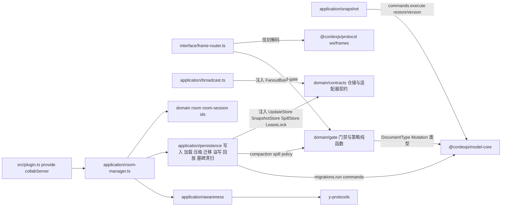

怎么读：箭头为 import 方向；本包自身没有 pg/redis 依赖，全部 IO 经 `domain/contracts` 的 Definition 由宿主注入（Provider 在 `apps/server/src/modules/collab/infrastructure/`，见图 4-2），`domain/gate` 的门禁纯函数对文档类型盲，只经 `model-core` 的类型迭代 `invariants`。

依据：§5.4 各文件「允许依赖」列。

**图 4-2 Nest 目录与宿主装配依赖**

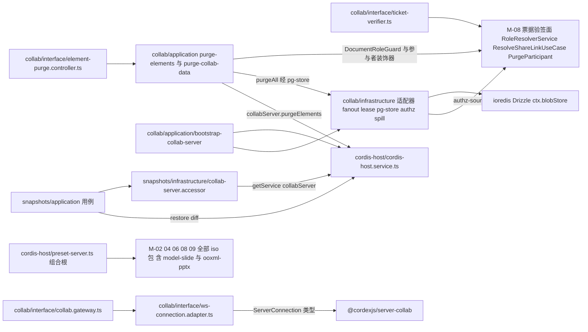

怎么读：箭头为 import 方向；Nest 两个目录都只经 `CordisHostService` 读取面拿到 `collabServer`，不自行装配插件；`element-purge.controller.ts` 与两个清理用例是 2026-09-25 新增（rulings §4.18 CO-07/BE-15）；`preset-server.ts` 在组合根 `apps/server` 内，可 import 装配所需的全部 iso 包（R3 对组合根豁免，FE-01）；`preset-server.ts` 是唯一装配入口（见图 2-3；2026-09-25 图号按出现顺序重排，rulings §4.18 GV-08），`collab/infrastructure/` 是挂在 `server-collab` 契约上的 IO Provider（物理在 Nest 目录、逻辑归 BC-21）。

依据：§5.1–§5.3 各文件「允许依赖」列；§3.4 IO 适配器插件表。

### 4.1 `apps/server/src/modules/collab/`

```text
apps/server/src/modules/collab/
├── collab.module.ts                        # Nest 模块装配：imports/providers/gateway（§3.3）；forRole：collab 全量、worker 只装 purge 参与者（§4.18 BE-13）
├── domain/                                 # 纯类型与命名规则，无 IO
│   ├── redis-keys.ts                       # Redis 键/频道命名函数：collab:doc:{id}、room:{id}:clients、lock:compact:{doc}、lock:spill:{doc}（§4.18 CO-16）、room:ctl:{doc}（踢会话/关 Room 控制频道，BE-03/BE-15）
│   ├── collab-principal.ts                 # CollabTicketClaims 消费端值对象 + 解析后的 Principal（含 linkId，§4.18 BE-02）
│   └── errors.ts                           # 握手阶段（attach 之前）拒绝原因码（含 document_purging），与 server-collab 自身 errors.ts 互补不重叠
├── application/                            # 模块启动期编排与 REST 用例
│   ├── bootstrap-collab-server.service.ts  # OnModuleInit：把 8 个 infra 适配器注入 preset-server 的 server-collab 配置项（2026-09-25 补 membershipRegistry）
│   ├── purge-collab-data.usecase.ts        # @PurgeParticipant('collab')：UpdateStore/SnapshotStore.purgeAll（rulings §4.13 S-2；§4.18 BE-15 由订阅改为参与者被调用）
│   └── purge-elements.usecase.ts           # 彻底删除元素：校验墓碑态 → collabServer.purgeElements → 审计 document.element_purged（新增，§4.18 CO-07）
├── infrastructure/                         # Definition 的 Node 适配器（D8/S7，逻辑归属 BC-21，见 §3.4）
│   ├── redis-fanout.bus.ts                 # FanoutBus Provider
│   ├── redis-lease-lock.ts                 # LeaseLock Provider
│   ├── pg-update-store.ts                  # UpdateStore Provider（新增 purgeAll，S-2）
│   ├── pg-snapshot-store.ts                # SnapshotStore Provider（新增 purgeAll，S-2）
│   ├── authz-source.ts                     # AuthorizationSource Provider
│   ├── redis-membership-registry.ts        # MembershipRegistry Provider：ioredis + Lua，room:{docId}:members、instance:{id}:alive（2026-09-25 登记，60/05 §2.2）
│   └── spill/                              # 新增，rulings §4.13 S-3
│       ├── redis-spill.store.ts            # SpillStore 一级 Provider：Redis 有界列表
│       └── blob-spill.store.ts             # SpillStore 二级 Provider：ctx.blobStore 分块
├── interface/                              # 外部世界进入本模块的唯一入口
│   ├── collab.gateway.ts                   # WS Gateway：连接计数/IP 限流/首帧 5 s 超时，把 socket 交给 RoomManager.attach()
│   ├── ws-connection.adapter.ts            # ws.WebSocket → server-collab ServerConnection 契约
│   ├── ticket-verifier.ts                  # JWT 验签（M-08 票据验签面）+ jti 防重放（Redis SETNX）+ permVersion 比对 + purging 拒绝 + 记录 lnk
│   └── element-purge.controller.ts         # POST /documents/:id/elements/purge{ids}（相对 /api/v1；DocumentRoleGuard doc.manage 即仅 owner；新增，§4.18 CO-07）
└── __tests__/                              # 纯逻辑与内存替身测试（*.test.ts）；接容器的契约调用与 e2e 在 apps/server/test/（下方与 §9，决策 T-NAMING，2026-09-25）
    ├── ticket-verifier.test.ts              # ttl/jti/permVersion 边界、purging 拒绝、记录 lnk（内存 Valkey 替身）
    └── purge-elements.usecase.test.ts       # 非 owner 403、非墓碑 id 拒绝、清除后删除方撤销得 wholeStep:true（CO-07）
```

```text
apps/server/test/integration/conformance/    # 本模块 Provider 的容器版契约调用（testcontainers PG 18 / Valkey / SeaweedFS；70/02 §1、§14 第 2 条）
├── collab-server.int-spec.ts               # runCollabServerConformance：真实适配器组装的集群
├── pg-update-store.int-spec.ts             # runUpdateStoreConformance（含 purgeAll，S-2）
├── pg-snapshot-store.int-spec.ts           # runSnapshotStoreConformance（含 purgeAll）
├── redis-spill-store.int-spec.ts           # runSpillStoreConformance 一级（S-3）
├── blob-spill-store.int-spec.ts            # runSpillStoreConformance 二级（S-3）
├── redis-fanout-bus.int-spec.ts            # runFanoutBusConformance（GV-20）
└── redis-lease-lock.int-spec.ts            # runLeaseLockConformance（GV-20）
```

### 4.2 `apps/server/src/modules/snapshots/`

```text
apps/server/src/modules/snapshots/
├── snapshots.module.ts                     # Nest 模块装配
├── domain/
│   ├── version.ts                          # Version 值对象（命名快照的 REST 视图）
│   ├── snapshot-view.ts                    # Snapshot REST 视图值对象（脱敏字段裁剪）
│   └── errors.ts                           # server.snapshots.* 错误码（not_found、quota_exceeded、persist_degraded，域按决策 INC-10 改名）
├── application/
│   ├── list-snapshots.usecase.ts           # 分页列表
│   ├── get-latest-snapshot.usecase.ts      # ETag/zstd 协商，Cache-Control: private, max-age=0, must-revalidate
│   ├── create-named-snapshot.usecase.ts    # 用户手动"保存版本"，附名称与说明
│   ├── restore-snapshot.usecase.ts         # 核心恢复流程，见 §2.6
│   └── diff-snapshots.usecase.ts           # 新增建议：两版本模型级 diff 预览（`GET .../diff`，对应 PRD CO-07 P2，见 §12）
├── infrastructure/
│   └── collab-server.accessor.ts           # 经 CordisHostService.getService('collabServer') 取快照能力，不直连 PG/S3
├── interface/
│   └── snapshots.controller.ts             # GET 列表/latest/:id、POST 命名、POST :id/restore（相对 /api/v1；只在 collab/all 角色装配，rulings §4.18 BE-03/BE-11）
└── __tests__/
    ├── restore-snapshot.usecase.test.ts
    ├── get-latest-snapshot.usecase.test.ts
    └── create-named-snapshot.usecase.test.ts
```

### 4.3 `apps/server/src/cordis-host/`（宿主装配，物理归属本模块）

> **归属声明（2026-09-18，跨模块评审 C-10 结案）**：整个 `cordis-host/`（含 `adapters/` 三个文件）物理归属本模块；00-module-map §7 M-12 行虽把该目录列入"覆盖的包与目录"，但 M-12 §3/§4 已自行记录"本模块新增 0 个文件"——即 **M-12 只引用（经 `CordisHostService` OHS 调用），不新增/不拥有本目录下任何文件**，双方无双写风险。

```text
apps/server/src/cordis-host/
├── cordis-host.module.ts                   # global 模块：OnModuleInit createHost；OnApplicationBootstrap 装配 preset-server + 角色一致性断言（新增，评审 §3.6；§4.18 BE-03/BE-13 追加 api 不装快照与管理动作、renderer 不装本模块）；OnApplicationShutdown dispose
├── cordis-host.service.ts                  # root: Context；openUnit/closeUnit；withRequestMeta；getService<K extends keyof ServiceMap>(name: K)（类型安全，2026-09-21 补强，评审 §3.6）；diagnostics()
├── preset-server.ts                        # preset-server 插件束与默认配置（§8）：组合根内唯一 import model-slide/ooxml-pptx 处，向 server-headless 提供 iso 插件清单（§4.18 FE-01）；新增与 config/roles.ts 的启动期一致性比对（评审 §3.6）
├── adapters/
│   ├── pino-logger.adapter.ts              # kernel logger 服务的 Node 实现
│   ├── otel-telemetry.adapter.ts           # kernel telemetry 服务的 Node 实现
│   └── errors-reporter.adapter.ts          # kernel errors 服务的 Node 实现
└── __tests__/
    └── cordis-host.service.test.ts         # getService 未知名称报诊断而非抛错；diagnostics() 输出结构；新增：role=collab/worker 断言缺失服务时 fail-fast（评审 §3.6）
```

### 4.4 `packages/server-collab/`

```text
packages/server-collab/
├── package.json                            # cordex: { layer:'LS', iso:'node', role:'plugin' }；deps: yjs y-protocols lib0 @cordexjs/collab-core @cordexjs/store-yjs @cordexjs/model-core @cordexjs/protocol @cordexjs/kernel
├── tsconfig.json
├── src/
│   ├── index.ts                            # 公共 API 面（§6）
│   ├── plugin.ts                           # cordis 插件入口：name/inject/provide（§3.1）
│   ├── manifest.ts                         # 生成物
│   ├── config.ts                           # zod Config（room/limits/persistence/compaction/softGate/repair/spill，`spill` 新增 S-3）
│   ├── domain/                             # 聚合/实体/值对象/纯领域函数（无 IO）
│   │   ├── room.ts                         # Room 聚合根：状态机 + 持有 UnitHandle + sessions + pendingBytes/spillTier（新增字段，S-3）
│   │   ├── room-session.ts                 # RoomSession 实体：role/令牌桶/ack 追踪/违规计数
│   │   ├── ids.ts                          # RoomId/Seq 品牌类型
│   │   ├── errors.ts                       # collab.*（room_full、bootstrap_failed、lock_lost、bad_frame、auth_timeout、quarantined、payload_too_large、rate_limited…；码表以 60/05 §14 为准，collab.server.* 前缀已废，决策 INC-10）
│   │   ├── collab-server.contribution.ts   # Context{collabServer,updateStore,snapshotStore,fanoutBus,leaseLock,authzSource,spillStore,membershipRegistry}；Events 声明
│   │   ├── contracts/                      # 仓储/适配器契约（无实现，纯接口）
│   │   │   ├── update-store.ts             # UpdateStore Definition（新增 purgeAll，S-2）
│   │   │   ├── snapshot-store.ts           # SnapshotStore Definition（新增 purgeAll，S-2）
│   │   │   ├── fanout-bus.ts               # FanoutBus Definition
│   │   │   ├── lease-lock.ts               # LeaseLock Definition
│   │   │   ├── authz-source.ts             # AuthorizationSource Definition
│   │   │   ├── spill-store.ts              # SpillStore Definition（新增，S-3）
│   │   │   └── membership-registry.ts      # MembershipRegistry Definition：名额跨实例原子判定（2026-09-25 登记，60/05 §4.2，决策 C-11）
│   │   └── gate/                           # 门禁与策略纯函数（§2.3）
│   │       ├── hard-gate.ts                # L1/L2/L3 判定
│   │       ├── soft-gate.ts                # L4：validateChangeSet + invariants 迭代（doc-type 盲）
│   │       ├── repair-planner.ts           # 违规 → 补偿 Mutation
│   │       ├── compaction-policy.ts        # shouldCompact 三选一判定
│   │       ├── version-retention-policy.ts # planVersionRetention（30 天稀疏化）
│   │       ├── token-bucket.ts             # 令牌桶算法
│   │       ├── spill-policy.ts             # checkSpillTier 两级阈值判定（新增，S-3）
│   │       └── admission-policy.ts         # admitByWeight 按文档实测权重准入（新增，rulings §4.15 Q5）
│   ├── application/                        # 应用服务：编排领域对象、调用注入的仓储
│   │   ├── room-manager.ts                 # docId → Room；先准入后 loading；内存压力先回收 draining 再驱逐 active（§4.18 CO-14/CO-17）；名额按 userId 计；链接会话 linkExpiresAt 定时降权（BE-02）；drainAll；attach(connection, claims)；closeRoom；purgeElements
│   │   ├── broadcast.ts                    # 本地 + FanoutBus 扇出；按 instanceId 去重；只持久化自身客户端 update
│   │   ├── persistence/
│   │   │   ├── update-writer.ts            # 批量写（flushMs/flushMaxUpdates）→ 提交后 ack；持久化失败改路由 spill-coordinator（S-3）
│   │   │   ├── bootstrap-loader.ts         # latest snapshot + loadSince → applyUpdate；schemaVersion 检查
│   │   │   ├── compactor.ts                # 触发判定 → leaseLock → 压缩 → snapshotStore.put(auto) → 裁剪
│   │   │   ├── migration-runner.ts         # leaseLock → migrations.run → snapshot(kind migration) → 通知旧客户端 4426
│   │   │   ├── spill-coordinator.ts        # checkSpillTier 判定后调用 spillStore 对应档位（新增，S-3）
│   │   │   ├── replay-spilled.usecase.ts   # PG 恢复后只回放本实例行、认领过期实例遗留行（lock:spill:{doc}），seq 由 PG 分配，补发 ack tier db；Room 全程 active（S-3/S-3a；§4.18 CO-15/CO-16）
│   │   │   └── tombstone-sweeper.ts        # 墓碑 TTL 到期硬删除，LeaseLock 单写者（新增，rulings §4.15 Q3）；purgeNow(ids) 供彻底删除元素复用（§4.18 CO-07）
│   │   ├── snapshot/
│   │   │   └── snapshot.service.ts         # 命名快照 + restore：解析目标 → commands.execute('core.restoreVersion')
│   │   └── awareness/
│   │       └── awareness-relay.ts          # 服务端 Awareness 实例；新加入者拿全量；断开即移除广播
│   ├── infrastructure/
│   │   └── telemetry.ts                    # span/metric 常量（本包自身无 pg/redis 依赖，全部经 inject 获得）
│   ├── interface/                          # 外部世界进入本包的唯一入口
│   │   ├── contracts/
│   │   │   └── connection.ts               # ServerConnection 契约：本包期待宿主适配器实现的连接接口
│   │   └── frame-router.ts                 # 信封解码 → hardGate → sync/awareness/control 分派
│   └── __tests__/                          # 全部基于 testing/ 的内存实现
│       ├── room-lifecycle.test.ts          # 06 §5.2 七态全路径（含 failed、无 draining→evicting、无 persisting→active，§4.18 CO-13）
│       ├── fanout-dedup.test.ts            # 两实例去重扇出
│       ├── crash-replay.test.ts            # 崩溃后重放
│       ├── rate-limit.test.ts
│       ├── soft-gate-repair.test.ts        # 改用 fixture 文档类型的 invariants（不 import model-slide）；model-slide 协同分节迁到 apps/server 集成测试（§4.18 FE-01，见 §9）
│       ├── capacity-eviction.test.ts       # 先回收空闲房间再驱逐活跃房间；准入不足先回收再判定（§4.18 CO-14）
│       ├── restore.test.ts
│       └── spill-and-replay.test.ts        # 新增：一级→二级溢写、两级 ack、回放时 PG 分配 seq、回放后 pendingStructs 为空、在线客户端不断连（S-3/S-3a）；降级期照常广播、实例下线后由新实例加载时认领回放、两实例同时在线各自回放无重复行、SIGTERM 时 PG 不可达先写一级溢写（§4.18 CO-08/CO-16）
└── testing/
    └── index.ts                            # MemoryUpdateStore·MemorySnapshotStore·MemoryFanoutBus·MemoryLeaseLock·StaticAuthz·MemorySpillStore（新增，S-3）·createServerCluster(n)·MemoryServerConnection·runFanoutBusConformance·runLeaseLockConformance（§4.18 GV-20）
```

### 4.5 `packages/server-headless/`

```text
packages/server-headless/
├── package.json                            # cordex: { layer:'LS', iso:'node', role:'plugin' }；deps: @cordexjs/kernel @cordexjs/protocol @cordexjs/model-core @cordexjs/store-yjs @cordexjs/ooxml-core @cordexjs/engine-layout @cordexjs/engine-render（iso 契约）；不含 model-slide/ooxml-pptx（由组合根 preset-server 装配，rulings §4.18 FE-01）；playwright-core 为可选 peer
├── tsconfig.json
├── src/
│   ├── index.ts                            # 公共 API 面（§6）
│   ├── domain/
│   │   ├── unit-runner.ts                  # UnitRunner：withUnit(source, fn) → 结果；finally 关闭 Unit
│   │   └── errors.ts                       # headless.* 12 码（task_timeout、task_oom、worker_crashed、bad_request、rpc_unauthorized、request_too_large、version_mismatch、renderer_busy、inject_timeout、browser_crashed、render_timeout、response_invalid，60/06 §12.2）；zip 限额与包解码失败改用 format.limit_exceeded / format.pptx.*（2026-09-25 删 zip_limit_exceeded、decode_failed）
│   ├── application/
│   │   └── tasks/
│   │       ├── import.ts                   # bytes + documentType → zipLimits 校验 → formats 服务取 codec.decode → Snapshot → withUnit(store-yjs) → {state,mediaRefs,warnings}（原 import-pptx.ts，文档类型无关命名提前到 2026-09-25，rulings §4.18 FE-01）
│   │       ├── export.ts                   # state + documentType → withUnit → formats 服务取 codec.encode（脏部件 + 不透明保留）→ bytes（原 export-pptx.ts，FE-01）
│   │       ├── validate.ts                 # 全量 schema + 不变量校验报告（供 admin/诊断）
│   │       ├── migrate.ts                  # from → to 迁移（server-collab 的 migration-runner 复用同一任务）
│   │       └── diff-snapshots.ts           # 两 state 模型级 diff → Mutation[]（经 documentTypes 服务取 documentType.diff，纯函数封装，§2.3）
│   ├── infrastructure/
│   │   ├── measurer/
│   │   │   └── node-font-measurer.ts       # TextMeasurer Provider('node-font')：Node 解析字体文件，"近似一致"
│   │   ├── fonts/
│   │   │   └── font-bundle.ts              # 字体包清单校验（与 engine-layout fallback 表一致；缺失告警）
│   │   ├── thumbnails/
│   │   │   ├── browser-pool.ts             # local 模式 playwright-core Chromium 池：沙箱开启、每任务独立 BrowserContext、按次数回收、崩溃自愈（Q8）
│   │   │   ├── remote-renderer.client.ts   # remote 模式：调用独立零出站 renderer sidecar（契约 @cordexjs/protocol/render/sidecar，新增，rulings §4.15 Q8）
│   │   │   ├── thumbnail-renderer.ts       # ThumbnailRenderer 实现：render()/renderPdf()
│   │   │   ├── content-hash.ts             # computePageHashes：state → [{slideId, index, contentHash}]；页划分与依赖闭包由文档类型提供（2026-09-25 登记，60/06 §8.2、§11.1）
│   │   │   ├── render-page-protocol.ts     # 薄适配层：re-export @cordexjs/protocol/render/page 类型 + Node 侧 /render?renderId= URL 拼装与 window.__cordex.inject 注入（C-27；RenderStateToken 拉取已取消，§4.18 BE-04）
│   │   │   └── png.ts                      # 截图后处理（尺寸、sRGB）
│   │   └── worker.ts                       # worker_threads 任务运行器（超时/内存限额；每任务新宿主，按插件清单模块路径加载插件，§4.18 FE-01）
│   ├── interface/
│   │   └── host/
│   │       └── create-server-host.ts       # 导出 createHeadlessHost({ adapters, plugins })：挂载调用方给定的 iso 插件清单，本包对外的唯一入口（FE-01）
│   └── __tests__/
│       ├── import-export-roundtrip.test.ts # fixture 文档类型 + fixture codec 验证任务管线；pptx 语料往返迁到 apps/server 集成测试（组合根，§9；§4.18 FE-01）
│       ├── validate.test.ts
│       ├── thumbnails.test.ts              # 仅 CI 有 Chromium 时运行；local 与 remote 各跑一次「/render 网络请求数为 0」（§4.18 BE-04）
│       └── measurer-conformance.test.ts    # 实例化 runTextMeasurerConformance（engine-layout/testing）
└── testing/
    └── index.ts                            # createTestHost()、fixtures
```

## 5. 文件职责表

> 与 §4 一一对应，逐文件一行；测试文件单列（对应 §9）。

### 5.1 `apps/server/src/modules/collab/`

| 文件 | 职责 | 主要导出 | 允许依赖 | 备注 |
|---|---|---|---|---|
| `collab.module.ts` | Nest 模块装配 | `CollabModule` | `@nestjs/*`、本目录五个子层、M-08 `PermissionsModule`/`AuthModule`（rulings §4.18 BE-07/BE-02） | §3.3；`forRole`：collab 全量、worker 只装 purge 参与者（BE-13） |
| `domain/redis-keys.ts` | Redis 键/频道命名 | `docChannel()`、`clientsKey()`、`compactLockKey()`、`spillClaimLockKey()`、`roomControlChannel()` | 无 | 纯函数，无 IO；`lock:spill:{doc}`（CO-16）、`room:ctl:{doc}`（踢会话/关 Room，BE-03/BE-15） |
| `domain/collab-principal.ts` | 解析后的连接主体值对象 | `CollabPrincipal` | `@cordexjs/protocol`（类型） | 与 M-08 `CollabTicketClaims` 同形状；含 `sid`（登录会话 id）与可选 `linkId`（来自 `lnk`，rulings §4.18 BE-02） |
| `domain/errors.ts` | 握手阶段（attach 前）拒绝原因码 | `HandshakeError` | 无 | 与 server-collab 自身 `errors.ts` 互补不重叠 |
| `application/bootstrap-collab-server.service.ts` | 装配 8 个 infra 适配器进 `preset-server` 的 server-collab 配置 | `BootstrapCollabServerService` | `CordisHostService`、`infrastructure/*` | `OnModuleInit`；2026-09-21 补 `spillStore` 两个 Provider（S-3）；2026-09-25 补 `membershipRegistry`（60/05 §2.2） |
| `application/purge-collab-data.usecase.ts` | 编排式清理协同数据（新增，S-2） | `PurgeCollabDataUseCase` | `infrastructure/{pg-update-store,pg-snapshot-store}.ts`、M-08 `PurgeParticipant` 装饰器 | `@PurgeParticipant('collab')`，作为 document-purge 参与者被调用（rulings §4.18 BE-15，取代「订阅编排信号」）；可在 worker 装配、不激活 `collabServer`；见 §2.6/§7 |
| `application/purge-elements.usecase.ts` | 彻底删除元素（新增，§4.18 CO-07） | `PurgeElementsUseCase` | `CordisHostService`（`collabServer.purgeElements`）、M-12 `@Audited` | 校验全为墓碑态 → 单写者立即硬删 → 审计 `document.element_purged` |
| `infrastructure/redis-fanout.bus.ts` | `FanoutBus` Provider | `RedisFanoutBus` | `ioredis` | §3.4 |
| `infrastructure/redis-lease-lock.ts` | `LeaseLock` Provider | `RedisLeaseLock` | `ioredis` | §3.4 |
| `infrastructure/pg-update-store.ts` | `UpdateStore` Provider | `PgUpdateStore` | Drizzle、`db/schema/document_updates.ts` | §3.4；新增 `purgeAll` 方法（S-2） |
| `infrastructure/pg-snapshot-store.ts` | `SnapshotStore` Provider | `PgSnapshotStore` | Drizzle、`ctx.blobStore` | §3.4；新增 `purgeAll` 方法（S-2） |
| `infrastructure/authz-source.ts` | `AuthorizationSource` Provider | `AuthzSource` | M-08 `RoleResolverService`、M-08 `ResolveShareLinkUseCase`、`ioredis` | §3.4；取 `max(直接授权, lnk 对应链接仍有效时的角色)` 并返回 `linkExpiresAt`（rulings §4.18 BE-02） |
| `infrastructure/redis-membership-registry.ts` | `MembershipRegistry` Provider（2026-09-25 登记） | `RedisMembershipRegistry` | `ioredis`（Lua 原子判定） | 60/05 §2.2、§4.2；键 `room:{docId}:members`、`instance:{instanceId}:alive`（决策 C-11） |
| `infrastructure/spill/redis-spill.store.ts` | `SpillStore` 一级 Provider（新增，S-3） | `RedisSpillStore` | `ioredis` | §3.4；`writeTier1` |
| `infrastructure/spill/blob-spill.store.ts` | `SpillStore` 二级 Provider（新增，S-3） | `BlobSpillStore` | `ctx.blobStore` | §3.4；`writeTier2`/`readAllOrdered`/`clear` |
| `interface/collab.gateway.ts` | WS Gateway | `CollabGateway` | `@nestjs/websockets`、`ws-connection.adapter.ts` | 路由 `/collab/v1/rooms/:documentId` |
| `interface/ws-connection.adapter.ts` | 连接适配 | `WsConnectionAdapter` | `ws`、`server-collab`（`ServerConnection` 类型） | — |
| `interface/ticket-verifier.ts` | 票据校验 | `TicketVerifier` | M-08 `AuthModule` 导出的票据验签面（`JwtService`，JWKS 公钥）、Drizzle（只读 `documents.status`，BE-15）、`ioredis`（SETNX） | ADR-0029；`purging` 文档拒绝（BE-15）；记录 `lnk`（BE-02）；imports 已补（BE-07） |
| `interface/element-purge.controller.ts` | REST 端点（新增，§4.18 CO-07） | `ElementPurgeController` | `@cordexjs/protocol` `rest/documents.ts`、M-08 `DocumentRoleGuard` | `POST /documents/:id/elements/purge{ids}`（相对 `/api/v1`）；`doc.manage` 即仅 owner；反代转 collab |
| `__tests__/ticket-verifier.test.ts` | 单测（2026-09-25 由 `.spec.ts` 改名，T-NAMING） | — | 内存 Valkey 替身 | ttl/jti/permVersion 边界、`purging` 拒绝、记录 `lnk` |
| `__tests__/purge-elements.usecase.test.ts` | 单测（CO-07；2026-09-25 改名） | — | — | 非 owner 403、非墓碑 id 拒绝、清除后删除方撤销得 `wholeStep:true` |
| `apps/server/test/integration/conformance/collab-server.int-spec.ts` | 容器版契约调用（2026-09-25 登记，T-NAMING） | — | testcontainers、`runCollabServerConformance` | 真实适配器组装的集群；原 `collab.gateway.e2e-spec.ts` 的两客户端同步并入 §9 `collab-two-clients.e2e-spec.ts` |
| `apps/server/test/integration/conformance/pg-update-store.int-spec.ts` | 容器版契约调用（自 `collab/__tests__/pg-update-store.spec.ts` 迁出） | — | testcontainers Postgres、`runUpdateStoreConformance` | 含 `purgeAll` 断言（S-2） |
| `apps/server/test/integration/conformance/pg-snapshot-store.int-spec.ts` | 容器版契约调用（新增登记） | — | testcontainers Postgres + SeaweedFS、`runSnapshotStoreConformance` | 含 `purgeAll` 断言 |
| `apps/server/test/integration/conformance/redis-spill-store.int-spec.ts` | 容器版契约调用（自 `__tests__/spill/redis-spill.store.spec.ts` 迁出） | — | testcontainers Valkey、`runSpillStoreConformance` | 一级（S-3） |
| `apps/server/test/integration/conformance/blob-spill-store.int-spec.ts` | 容器版契约调用（自 `__tests__/spill/blob-spill.store.spec.ts` 迁出） | — | testcontainers SeaweedFS、`runSpillStoreConformance` | 二级（S-3） |
| `apps/server/test/integration/conformance/redis-fanout-bus.int-spec.ts` | 容器版契约调用（自 `__tests__/redis-fanout.bus.spec.ts` 迁出） | — | testcontainers Valkey、`runFanoutBusConformance` | 两实例扇出、去重（GV-20） |
| `apps/server/test/integration/conformance/redis-lease-lock.int-spec.ts` | 容器版契约调用（自 `__tests__/redis-lease-lock.spec.ts` 迁出） | — | testcontainers Valkey、`runLeaseLockConformance` | 互斥、过期后可重取、fencing token 单调（GV-20） |

### 5.2 `apps/server/src/modules/snapshots/`

| 文件 | 职责 | 主要导出 | 允许依赖 | 备注 |
|---|---|---|---|---|
| `snapshots.module.ts` | Nest 模块装配 | `SnapshotsModule` | `@nestjs/*`、M-08 `PermissionsModule` | 只在 collab/all 角色装配（rulings §4.18 BE-03）；imports M-08 `PermissionsModule` 取 `DocumentRoleGuard`（BE-07） |
| `domain/version.ts` | 命名快照 REST 视图值对象 | `Version` | 无 | — |
| `domain/snapshot-view.ts` | Snapshot REST 视图值对象 | `SnapshotView` | 无 | 字段裁剪，不泄漏内部存储路径 |
| `domain/errors.ts` | 错误码 | `SnapshotError` | 无 | `server.snapshots.not_found`/`quota_exceeded`/`persist_degraded`（2026-09-25 域改为 `server.snapshots`，决策 INC-10；HTTP 映射见 60/15 §3.8） |
| `application/list-snapshots.usecase.ts` | 分页列表 | `ListSnapshotsUseCase` | `infrastructure/collab-server.accessor.ts` | — |
| `application/get-latest-snapshot.usecase.ts` | `latest` 协商 | `GetLatestSnapshotUseCase` | `infrastructure/collab-server.accessor.ts` | ETag/zstd |
| `application/create-named-snapshot.usecase.ts` | 创建命名快照 | `CreateNamedSnapshotUseCase` | `infrastructure/collab-server.accessor.ts` | 权限 `doc.manage`，见 §6 |
| `application/restore-snapshot.usecase.ts` | 恢复到指定版本 | `RestoreSnapshotUseCase` | 同上、`CordisHostService` | §2.6 核心流程；权限 `history.restore` |
| `application/diff-snapshots.usecase.ts` | 两版本模型级 diff 预览 | `DiffSnapshotsUseCase` | 同上、`CordisHostService` | 新增建议（P2，见 §12） |
| `infrastructure/collab-server.accessor.ts` | `collabServer` 服务面访问器 | `CollabServerAccessor` | `CordisHostService.getService('collabServer')` | 不直连 PG/S3（Conformist，module-map BC-22 行） |
| `interface/snapshots.controller.ts` | REST 端点 | `SnapshotsController` | `@cordexjs/protocol` `rest/snapshots.ts` | §6；路径相对 `/api/v1`，反代把 `/api/v1/documents/:id/snapshots*` 转 collab（BE-03/BE-11） |
| `__tests__/restore-snapshot.usecase.test.ts` | 单测 | — | — | 权限/事务边界 |
| `__tests__/get-latest-snapshot.usecase.test.ts` | 单测 | — | — | ETag 命中/未命中 |
| `__tests__/create-named-snapshot.usecase.test.ts` | 单测 | — | — | 配额上限 |

### 5.3 `apps/server/src/cordis-host/`

| 文件 | 职责 | 主要导出 | 允许依赖 | 备注 |
|---|---|---|---|---|
| `cordis-host.module.ts` | 宿主生命周期装配 | `CordisHostModule` | `@nestjs/*`、`preset-server.ts` | `global`，§4；`OnApplicationBootstrap` 新增角色一致性断言调用（评审 §3.6）；装 api/collab/worker，renderer 不装（rulings §4.18 BE-13） |
| `cordis-host.service.ts` | 宿主访问面 | `CordisHostService`、`ServiceMap`（新增，评审 §3.6） | `@cordexjs/kernel` | `openUnit`/`closeUnit`/`getService<K extends keyof ServiceMap>(name: K)`/`diagnostics()`（M-08 §13 Q-5 在此定案；2026-09-21 由弱类型字符串查找收紧为 `ServiceMap` 编译期 key 校验） |
| `preset-server.ts` | 插件束装配与默认配置 | `presetServer`、`headlessPluginManifest`（新增，§4.18 FE-01）、`assertRoleConsistency`（新增，评审 §3.6） | M-02/04/06/08/09 全部 iso 包（含 `model-slide`、`ooxml-pptx`；`apps/server` 为组合根 `compositionRoot:true`，R3 豁免，`cordis-host/**` 可 import 装配所需的 iso 包，rulings §4.18 FE-01/FE-02）、`config/roles.ts`（类型，比对用） | §8；向 `server-headless` 提供 iso 插件清单模块路径；新增启动期比对 `config/roles.ts` 与本文件两套装配开关，不一致 fail-fast（含 api 不装快照、renderer 不装宿主，BE-03/BE-13） |
| `adapters/pino-logger.adapter.ts` | kernel `logger` 服务的 Node 实现 | `PinoLoggerAdapter` | `pino` | — |
| `adapters/otel-telemetry.adapter.ts` | kernel `telemetry` 服务的 Node 实现 | `OtelTelemetryAdapter` | `@opentelemetry/*` | — |
| `adapters/errors-reporter.adapter.ts` | kernel `errors` 服务的 Node 实现 | `ErrorsReporterAdapter` | 无 | — |
| `__tests__/cordis-host.service.test.ts` | 单测 | — | — | `getService` 未知名称报诊断而非抛错；新增：`role=collab`/`worker` 关键服务缺失时 fail-fast（评审 §3.6） |

### 5.4 `packages/server-collab/`

| 文件 | 职责 | 主要导出 | 允许依赖 | 备注 |
|---|---|---|---|---|
| `package.json` | 包清单 | — | — | `cordex:{layer:'LS',iso:'node',role:'plugin'}`；无 `pg`/`ioredis` 依赖 |
| `tsconfig.json` | 编译配置 | — | — | — |
| `src/index.ts` | 公共 API 面 | 类型 + `plugin` 默认导出 | 本包各子路径 | §6 |
| `src/plugin.ts` | cordis 插件入口 | `name`/`inject`/`provide`/`Config`/`apply` | kernel、`application/room-manager.ts` | §3.1 |
| `src/manifest.ts` | Manifest 生成物 | — | — | — |
| `src/config.ts` | 配置 schema | `ServerCollabConfig`（zod） | zod | §2.2/§3.1 |
| `domain/room.ts` | Room 聚合根 | `Room`、`RoomState` | `./room-session`、store-yjs `UnitHandle`（类型） | §2.1；新增 `pendingBytes`/`spillTier` 字段（S-3） |
| `domain/room-session.ts` | RoomSession 实体 | `RoomSession` | `./ids` | §2.1 |
| `domain/ids.ts` | 品牌类型 | `RoomId`、`Seq` | `@cordexjs/shared` | §2.2 |
| `domain/errors.ts` | 领域错误码 | `CollabServerError` | kernel `errors` 契约 | `collab.*` 码表以 [60/05 §14](../60-backend/05-modules-collab-and-snapshots.md) 为准（`collab.room_full` 统一、`collab.server.*` 与 `capacity` 已废，决策 INC-10/SG-04，2026-09-25）；关闭码映射见 60/16 §10 |
| `domain/collab-server.contribution.ts` | Context/Events 声明 | `Context.collabServer` 类型增强 | kernel（类型） | §2.4 事件登记 |
| `domain/contracts/update-store.ts` | `UpdateStore` Definition | `UpdateStore` | `./ids`（类型） | §2.5；新增 `purgeAll` 方法（S-2） |
| `domain/contracts/snapshot-store.ts` | `SnapshotStore` Definition | `SnapshotStore` | `./ids`（类型） | §2.5；新增 `purgeAll` 方法（S-2） |
| `domain/contracts/fanout-bus.ts` | `FanoutBus` Definition | `FanoutBus` | 无 | §2.5 |
| `domain/contracts/lease-lock.ts` | `LeaseLock` Definition | `LeaseLock`、`Lease` | 无 | §2.5 |
| `domain/contracts/authz-source.ts` | `AuthorizationSource` Definition | `AuthorizationSource` | `@cordexjs/protocol`（`Role`类型） | §2.5 |
| `domain/contracts/spill-store.ts` | `SpillStore` Definition（新增，S-3） | `SpillStore` | `./ids`（类型） | §2.5 |
| `domain/contracts/membership-registry.ts` | `MembershipRegistry` Definition（2026-09-25 登记） | `MembershipRegistry` | `./ids`（类型） | 签名见 60/05 §2.1；名额跨实例原子判定（决策 C-11） |
| `domain/gate/hard-gate.ts` | L1/L2/L3 判定 | `checkHardGate` | `./token-bucket`、`../ids`、`@cordexjs/collab-core`（L2 角色判定复用权限检查点契约类型，类型导入；rulings §4.18 FE-15） | §2.3 |
| `domain/gate/soft-gate.ts` | L4 语义校验 | `runSoftGate` | `@cordexjs/model-core`（`DocumentType`类型） | §2.3，doc-type 盲 |
| `domain/gate/repair-planner.ts` | 违规 → 补偿 Mutation | `planRepair` | `@cordexjs/model-core`（`Mutation`类型） | §2.3 |
| `domain/gate/compaction-policy.ts` | Compaction 触发判定 | `shouldCompact` | `../../config`（类型） | §2.3、ADR-0025 |
| `domain/gate/version-retention-policy.ts` | 版本保留策略 | `planVersionRetention` | 无 | §2.3，30 天稀疏化 |
| `domain/gate/token-bucket.ts` | 令牌桶算法 | `consumeTokenBucket` | 无 | §2.3 |
| `domain/gate/spill-policy.ts` | 两级阈值判定（新增，S-3） | `checkSpillTier` | `../../config`（类型） | §2.3 |
| `domain/gate/admission-policy.ts` | 按文档实测权重准入（新增，rulings §4.15 Q5） | `admitByWeight` | `../../config`（类型） | §2.3；名额按用户计 |
| `application/room-manager.ts` | Room 生命周期编排；按权重准入（Q5）；先准入后 loading、内存压力先回收 draining（rulings §4.18 CO-17/CO-14）；链接会话到期降权（BE-02）；`closeRoom`/`purgeElements`（BE-15/CO-07） | `RoomManager`（即 `collabServer` 服务实现） | `../domain/*`、`persistence/*`、`awareness/*`、`@cordexjs/collab-core`（`RoomInfo` 房间信息帧契约类型，FE-15） | §2.5 `CollabServer` |
| `application/broadcast.ts` | 本地 + 跨实例广播 | `Broadcaster` | `FanoutBus`（注入） | §2.6，ADR-0035 决策 3 |
| `application/persistence/update-writer.ts` | 批量持久化 | `UpdateWriter` | `UpdateStore`（注入） | flush 策略；失败改路由 `spill-coordinator.ts`（S-3） |
| `application/persistence/bootstrap-loader.ts` | Room 启动加载 | `BootstrapLoader` | `SnapshotStore`/`UpdateStore`（注入） | §2.6 |
| `application/persistence/compactor.ts` | 压缩执行 | `Compactor` | `LeaseLock`/`SnapshotStore`（注入）、`compaction-policy.ts` | ADR-0025 |
| `application/persistence/migration-runner.ts` | 迁移执行 | `MigrationRunner` | `@cordexjs/model-core`（`migrations.run`） | 4426 通知旧客户端 |
| `application/persistence/spill-coordinator.ts` | 溢写协调（新增，S-3） | `SpillCoordinator` | `SpillStore`（注入）、`spill-policy.ts` | §2.6；不拒写，PG 故障期降级持久化 |
| `application/persistence/replay-spilled.usecase.ts` | 恢复后回放（新增，S-3；2026-09-24 S-3a） | `ReplaySpilledUseCase` | `SpillStore`/`UpdateStore`/`LeaseLock`（注入） | §2.6；只读本实例行（`readAllOrdered(docId, instanceId)`），过期实例遗留行持 `lock:spill:{doc}` 认领；正式 `seq` 由 PG 分配，补发 `ack{seq,tier:'db'}`（原会话已断开即丢弃），断言无 `pendingStructs` 后 `SpillStore.clear`；全程 Room 保持 `active`（rulings §4.18 CO-15/CO-16/CO-10） |
| `application/persistence/tombstone-sweeper.ts` | 墓碑 TTL 硬删除（新增，rulings §4.15 Q3） | `TombstoneSweeper` | `LeaseLock`（注入）、`@cordexjs/model-core`（`commands`） | §2.6；服务端单写者，`origin=system('maintenance')`；墓碑硬删除唯一执行者（复核 H2）；`purgeNow(docId, ids)` 供「彻底删除元素」复用同一事务（rulings §4.18 CO-07） |
| `application/snapshot/snapshot.service.ts` | 命名快照 + 恢复 | `SnapshotService` | `@cordexjs/model-core`（`commands.execute`） | §2.6 核心 |
| `application/awareness/awareness-relay.ts` | Awareness 中继 | `AwarenessRelay` | `y-protocols`（awareness 编码）、`@cordexjs/collab-core`（awareness 模型与校验契约，FE-15；不复用 `collab-yjs` Provider） | §7.1（06 号文档） |
| `infrastructure/telemetry.ts` | 遥测常量 | span/metric 名常量 | kernel `telemetry`（类型） | 本包无 pg/redis |
| `interface/contracts/connection.ts` | `ServerConnection` 契约 | `ServerConnection` | 无 | §2.5 |
| `interface/frame-router.ts` | 信封解码与分派 | `FrameRouter` | `@cordexjs/protocol`（`ws/frames`）、`../domain/gate/hard-gate` | 外部字节唯一入口 |
| `__tests__/room-lifecycle.test.ts` | 单测 | — | `../testing` | 06 §5.2 七态全路径，含 `loading→failed`，断言不存在 `draining→evicting`、`persisting→active`（rulings §4.18 CO-13/CO-15） |
| `__tests__/fanout-dedup.test.ts` | 集成测试 | — | `createServerCluster(2)` | 两实例去重扇出 |
| `__tests__/crash-replay.test.ts` | 集成测试 | — | `createServerCluster` | 崩溃后重放幂等 |
| `__tests__/rate-limit.test.ts` | 单测 | — | — | 令牌桶边界 |
| `__tests__/soft-gate-repair.test.ts` | 集成测试 | — | fixture 文档类型（`../testing`，不 import `model-slide`） | 2026-09-25 起只验证门禁机制；引用 `model-slide/invariants` 的协同分节（呼应 M-03 §13 Q3）迁到 `apps/server/test/integration/soft-gate-repair.int-spec.ts`（组合根才能同时 import `server-collab` 与 `model-slide`，rulings §4.18 FE-01） |
| `__tests__/capacity-eviction.test.ts` | 单测 | — | — | LRU 驱逐、内存准入；先回收空闲（draining）房间再驱逐活跃房间、准入不足先回收再判定（rulings §4.18 CO-14） |
| `__tests__/restore.test.ts` | 集成测试 | — | — | 恢复后在线客户端不断连 |
| `__tests__/spill-and-replay.test.ts` | 集成测试（新增，S-3） | — | `../testing`（`MemorySpillStore`） | 一级→二级溢写、两级 ack、回放时 PG 分配 `seq`、回放后 `pendingStructs` 为空、在线客户端不断连（S-3a）；降级期照常广播（CO-08）；两实例同时在线各自只回放本实例行、无重复行，实例下线后由新实例加载时持 `lock:spill:{doc}` 认领回放，SIGTERM 且 PG 不可达时先写一级溢写再关闭（rulings §4.18 CO-16） |
| `testing/index.ts` | 测试替身与夹具 | `MemoryUpdateStore`、`MemorySnapshotStore`、`MemoryFanoutBus`、`MemoryLeaseLock`、`StaticAuthz`、`MemorySpillStore`（新增，S-3）、`createServerCluster(n)`、`MemoryServerConnection`、`runFanoutBusConformance`/`runLeaseLockConformance`（新增，rulings §4.18 GV-20）、fixture 文档类型（FE-01） | 无 | 子路径导出 |

### 5.5 `packages/server-headless/`

| 文件 | 职责 | 主要导出 | 允许依赖 | 备注 |
|---|---|---|---|---|
| `package.json` | 包清单 | — | — | `cordex:{layer:'LS',iso:'node',role:'plugin'}`；`playwright-core` 为可选 peer；内部依赖不含 `model-slide`/`ooxml-pptx`（rulings §4.18 FE-01） |
| `tsconfig.json` | 编译配置 | — | — | — |
| `src/index.ts` | 公共 API 面 | `createHeadlessHost`、任务函数类型（`importDocument`/`exportDocument` 等） | 本包各子路径 | §6 |
| `domain/unit-runner.ts` | UnitRunner 生命周期封装 | `withUnit` | `@cordexjs/model-core`（`units`类型） | §2.1 |
| `domain/errors.ts` | 领域错误码 | `HeadlessError` | kernel `errors` 契约 | `headless.*` 12 码以 [60/06 §12.2](../60-backend/06-modules-jobs-import-export-thumbnails.md) 为准；2026-09-25 删 `headless.zip_limit_exceeded`（统一为 `format.limit_exceeded`）与 `headless.decode_failed`（统一为 `format.pptx.*`），依据 30/08 §16.5、30/10 §1.1（30 > 40，决策 INC-10） |
| `application/tasks/import.ts` | 导入任务（原 `import-pptx.ts`，rulings §4.18 FE-01） | `importDocument` | `@cordexjs/model-core`（`formats` 服务，按 `documentType` 取 codec）、`domain/unit-runner.ts` | zipLimits 校验（09.2）；超系统天花板直接拒绝（`format.quota_exceeded`） |
| `application/tasks/export.ts` | 导出任务（原 `export-pptx.ts`，FE-01） | `exportDocument` | `@cordexjs/model-core`（`formats` 服务）、`domain/unit-runner.ts` | 字节级确定性（08 §16.2） |
| `application/tasks/validate.ts` | 校验任务 | `validateSnapshotTask` | `@cordexjs/model-core`（`validateSnapshot`） | 供 admin/诊断 |
| `application/tasks/migrate.ts` | 迁移任务 | `migrateTask` | `@cordexjs/model-core`（`migrations.run`） | server-collab 复用 |
| `application/tasks/diff-snapshots.ts` | 模型级 diff | `diffSnapshots` | `@cordexjs/model-core`（`documentTypes` 服务取 `documentType.diff`，不 import `model-slide`，FE-01） | §2.3 `diffForRestore` |
| `infrastructure/measurer/node-font-measurer.ts` | `TextMeasurer` Provider | `nodeFontMeasurer`（`id:'node-font'`） | `opentype.js` 一类字体解析库 | 必跑 `runTextMeasurerConformance` |
| `infrastructure/fonts/font-bundle.ts` | 字体包清单校验 | `verifyFontBundle` | 无 | 启动时缺失告警 |
| `infrastructure/thumbnails/browser-pool.ts` | local 模式 Chromium 进程池 | `BrowserPool` | `playwright-core` | 沙箱开启、每任务 `BrowserContext`、回收策略、崩溃自愈（Q8） |
| `infrastructure/thumbnails/remote-renderer.client.ts` | remote 模式 sidecar 客户端（新增，rulings §4.15 Q8） | `RemoteRendererClient` | `@cordexjs/protocol/render/sidecar`（M-02 配合） | 注入 state + 资源字节，sidecar 零出站、无凭据、非 root；版本锁步校验 |
| `infrastructure/thumbnails/thumbnail-renderer.ts` | `ThumbnailRenderer` 实现，经 `HeadlessHost.thumbnails` 只读字段导出；按 `headless.mode` 选 local/remote | `render`、`renderPdf` | `browser-pool.ts`、`remote-renderer.client.ts`、`render-page-protocol.ts` | §2.5/§6；C-09 |
| `infrastructure/thumbnails/content-hash.ts` | 页内容哈希（2026-09-25 登记） | `computePageHashes` | `@cordexjs/model-core`（经 `documentTypes` 取页划分与依赖闭包，文档类型盲） | 哈希输入与失效规则见 [60/06 §11.1](../60-backend/06-modules-jobs-import-export-thumbnails.md)；`ThumbnailsProcessor` 调用（M-12） |
| `infrastructure/thumbnails/render-page-protocol.ts` | 薄适配层：re-export `@cordexjs/protocol/render/page` 类型 + URL 拼装与注入辅助函数（**不再是契约定义源**） | `RenderPageQuerySchema`/`RenderPageSignal`/`RenderStateResponse`（re-export；`RenderStateResponse` 为注入载荷）+ `buildRenderUrl`（`renderId` 仅作日志关联）、`injectRenderState` | `@cordexjs/protocol/render/page`（M-02） | 注入载荷/ready 信号；C-27；`RenderStateToken` 与 token/state 拉取 URL 已取消（rulings §4.18 BE-04） |
| `infrastructure/thumbnails/png.ts` | 截图后处理 | `postProcessPng` | 无 | 尺寸、sRGB |
| `infrastructure/worker.ts` | worker_threads 任务运行器 | `runInWorker` | `node:worker_threads`、`interface/host/create-server-host.ts` | 超时/内存限额，每任务新宿主；按组合根提供的插件清单模块路径动态加载（FE-01） |
| `interface/host/create-server-host.ts` | 宿主工厂（本包唯一对外入口） | `createHeadlessHost` | `@cordexjs/kernel`（`createHost`）；插件由调用方传入（`plugins`），本文件不 import 任何垂直束包 | §3.2；FE-01 |
| `__tests__/import-export-roundtrip.test.ts` | 集成测试 | — | fixture 文档类型与 fixture codec | 任务管线往返一致；pptx 语料字节级往返迁到 `apps/server` 集成测试（FE-01，§9） |
| `__tests__/validate.test.ts` | 单测 | — | — | — |
| `__tests__/thumbnails.test.ts` | 集成测试 | — | 需 Chromium | 仅 CI 有 Chromium 时运行；local 与 remote 两种模式各断言一次「`/render` 页网络请求数为 0」（rulings §4.18 BE-04） |
| `__tests__/measurer-conformance.test.ts` | 契约测试 | — | `@cordexjs/engine-layout/testing` | `runTextMeasurerConformance` |
| `testing/index.ts` | 测试替身与夹具 | `createTestHost()`、fixtures | 无 | 子路径导出 |

## 6. 对外 API 面

| 包 / 目录 | `.` 导出概要 | `./testing` 导出概要 | 稳定级（推荐） |
|---|---|---|---|
| `@cordexjs/server-collab` | `CollabServer`、`Room`/`RoomSession`（只读快照类型）、`UpdateStore`/`SnapshotStore`/`SpillStore`/`FanoutBus`/`LeaseLock`/`AuthorizationSource`/`ServerConnection` 等 Definition、`ServerCollabConfig` | `MemoryUpdateStore`/`MemorySnapshotStore`/`MemorySpillStore`/`MemoryFanoutBus`/`MemoryLeaseLock`/`StaticAuthz`/`createServerCluster`/`MemoryServerConnection`、`run{UpdateStore,SnapshotStore,SpillStore,CollabServer,FanoutBus,LeaseLock}Conformance`（后两者 2026-09-25 新增，rulings §4.18 GV-20） | `beta`（推荐）：`Config` 字段在 M2 联调期可能微调 |
| `@cordexjs/server-headless` | `createHeadlessHost`、`importDocument`/`exportDocument`（2026-09-25 由 `importPptx`/`exportPptx` 改为文档类型无关命名，rulings §4.18 FE-01）/`validateSnapshotTask`/`migrateTask`/`diffSnapshots`、`HeadlessJobContext`、**`ThumbnailRenderer`类型**（经 `HeadlessHost.thumbnails` 访问，2026-09-18 C-09） | `createTestHost()`、语料库 fixtures | `beta`（推荐）：`node-font` 度量精度随字体库演进 |
| `apps/server/src/modules/{collab,snapshots}`、`cordis-host` | 无公共包导出（Nest 应用内部模块，不对外发布） | — | 不适用（`apps/*` 不产出 npm 包） |

关键类型契约草案（≤ 40 行；`CollabServer` 已在 §2.5 给出，此处补 headless 宿主工厂签名）：

```ts
// server-headless：宿主工厂是本包对外的唯一入口
interface HeadlessHostAdapters {
  logger: LoggerAdapter
  telemetry: TelemetryAdapter
  errors: ErrorsAdapter
  measurer?: { fontsDir: string; fallbackFamily: string }
}
// plugins：组合根 preset-server 选定的 iso 插件清单（含 model-slide、ooxml-pptx），本包不 import 束包（§4.18 FE-01）
declare function createHeadlessHost(opts: { adapters: HeadlessHostAdapters; plugins: HeadlessPluginManifest }): HeadlessHost
interface HeadlessHost {
  readonly ctx: Context                 // 只读诊断用途，不对外暴露写操作
  readonly thumbnails: ThumbnailRenderer // 2026-09-18 新增（C-09）：M-12 BullMQ 处理器的唯一取得方式；`renderThumbnails` 工厂导出已作废
  withUnit<T>(source: Snapshot<unknown> | Uint8Array, fn: (unit: UnitHandle) => Promise<T> | T): Promise<T>
  dispose(): Promise<void>
}
```

## 7. 前后端与运行时

本模块**仅服务端**（module-map §5；headless Chromium 内运行的 `render-dom` 属 M-06/M-11）。2026-09-25 起本节改为摘要 + 链接（rulings §4.19）。

### 7.1 服务端进程内位置

角色装配的唯一源是 [60/01 §5](../60-backend/01-service-overview-and-roles.md)（「模块 × 角色 × 部件」矩阵，迁自 40/12 §7.1）与 §6（启动断言）；反代分流见 60/01 §7。摘要：`CordisHostService` 装 api / collab / worker（renderer 不装）；`collabServer`、WS 网关、快照 REST、彻底删除元素 REST 只在 collab（及 all）；`server-headless` 宿主与 document-purge 参与者 `PurgeCollabDataUseCase`、保留周期作业在 worker（不激活 `collabServer`）；踢会话 / 关 Room / `forceEpoch` 通知经 Valkey 控制频道 `room:ctl:{doc}`（BE-03/BE-13/BE-15）。

### 7.2 与浏览器共享的 protocol schema 清单

文件登记的唯一处是 [40/02 §4.3](02-kernel-protocol-and-document-core.md)（M-02）；服务端对各帧的处理见 [60/16](../60-backend/16-ws-protocol-server-view.md)，帧与 CONTROL 的定义见 30/06 §6。本模块消费：`ws/{frames,handshake}.ts`（信封、CONTROL 判别联合含 `ack`、`room.persist?`，判别键 `type`）、`collab/{frame,close-codes,awareness,ticket}.ts`（决策 INC-01 已登记进 M-02，经根入口导出，不建 `collab/control.ts`）、`render/{page,sidecar}.ts`、`rest/snapshots.ts`、`errors/codes.ts`、`permissions/actions.ts`。`server-collab` 另依赖 M-05 `collab-core` 的 Definition 契约，不复用 Provider（rulings §4.18 FE-15）。

### 7.3 与 M-08 / M-12 的边界表（谁写哪张表、谁发哪些事件）

表写方所有权的唯一源是 [60/08 §7](../60-backend/08-db-conventions-roles-rls-migrations.md)；`documents` 列写方见 [60/04 §5](../60-backend/04-modules-documents-storage-media.md)。本模块写：`document_updates`、`document_snapshots`（含永久删除参与者的清空与保留作业的删除）、`documents` 的 M-09 列（`head_seq`、`epoch`、`schema_version`、`element_count`、`slide_count`、`size_bytes`、`content_updated_at`、`latest_snapshot_id`，决策 C-03）、溢写暂存（Valkey 一级 / 对象存储二级）；发布 `collab-server/*` 事件与 `CONTROL.room.persist` 信号（rulings §4.19 INC-09）。不写：`permissions`/`document_perm_versions`（M-08）、`audit_log`、`comments`、`thumbnails`、`job_runs`（M-12）。

**图 7-1 进程边界**

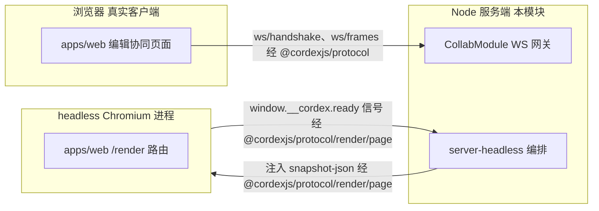

图怎么读：真实浏览器客户端与网关之间、以及本模块编排的 headless Chromium 与其加载的 `/render` 页面之间，都是真实进程边界，全部经 `@cordexjs/protocol` 定义的 schema 通信；`/render` 页只接受注入、零外呼（rulings §4.18 BE-04，[50/12 §11](../50-frontend/12-viewer-embedding-and-render-page.md)）。
## 8. doc / sheet 扩展缝

全部 **generic**（Room 即 Unit，两个包与三个 Nest 目录对 `slide` 一词均无感知，module-map §3 BC-21/22/27 行）。

**扩展为 doc/sheet 时新增或替换的文件清单**：无——本模块全部文件零改动。`preset-server` 组合根按 `DocumentType` 参数化的点：

| 参数化点 | 装配位置 | 说明 |
|---|---|---|
| `FormatCodec` | `cordis-host/preset-server.ts` 的 `core.format` 贡献列表（组合根） | 新增 `ooxml-docx`/`ooxml-xlsx` 只需在此追加；`server-headless` 的任务已于 2026-09-25 改为文档类型无关的 `import.ts`/`export.ts`，按 `documentType` 经 `formats` 服务取 codec（原计划 M5，提前落地，rulings §4.18 FE-01），M5 新增 doc 时 `server-*` diff = 0（PRD 05:230） |
| 软门禁修复规则 | `domain/gate/soft-gate.ts`/`repair-planner.ts` 迭代的 `documentType.invariants` | 本模块对具体规则内容零感知，`model-doc`/`model-sheet` 只需各自声明 `invariants` 表即可接入 |
| 缩略图页面路由 | `infrastructure/thumbnails/render-page-protocol.ts` 的 `documentType` 查询参数 | 路由本身在 `apps/web`（M-11），本模块只透传 `documentType` 字符串 |
| Node 字体度量 | `infrastructure/measurer/node-font-measurer.ts` | 对文档类型无感知，字体解析与 `slide`/`doc`/`sheet` 无关 |
| `document_snapshots.kind` 枚举 | `domain/contracts/snapshot-store.ts` | 固定六值，与文档类型无关 |

**"必须零改动"的文件清单**：本模块全部文件（两个 Nest 目录 + `cordis-host` + 两个包）——对应 12 号文档 §3 的参数化点，本模块只**消费** `DocumentType` 抽象，源码中不得出现任何文档类型字面量（由 lint 规则 `cordex/no-doc-type-literals` 扩展作用范围覆盖 `apps/server/src/modules/{collab,snapshots}/**` 与 `packages/server-*`，原称 `no-doc-type-literals-server`，归并登记见 09-type-discipline/08 §11，rulings §4.18 GV-15；组合根 `cordis-host/preset-server.ts` 例外，它负责按 `documentType` 装配束包，FE-01）。

## 9. 测试布局

```text
packages/server-collab/
├── src/__tests__/             单元 + 集成（内存实现 / testcontainers Valkey）
└── testing/                   契约套件消费的测试替身与夹具（子路径导出）
packages/server-headless/
├── src/__tests__/             round-trip、validate、缩略图（CI 有 Chromium 时）、measurer 契约
└── testing/                   createTestHost()、语料库 fixtures
apps/server/
├── src/modules/collab/__tests__/       握手与用例单测（*.test.ts）
├── src/modules/snapshots/__tests__/    usecase 单测
├── src/cordis-host/__tests__/          宿主装配单测
└── test/                                集成/e2e（Nest Testing + testcontainers Postgres 18/Valkey/SeaweedFS + Casdoor 容器或 oidc-provider mock；2026-09-24 rulings §4.15 Q6/Q10；场景与断言以 70/07、70/05 §12 为准）
    ├── e2e/collab-two-clients.e2e-spec.ts    两客户端经网关同步、单人编辑刷新后经快照 bootstrap 恢复（§11 M2 验收，rulings §4.19 D-M2-CONTENT）
    ├── e2e/snapshot-restore.e2e-spec.ts      命名快照→编辑→恢复（§11 M3 验收，随 CO-07 版本历史）
    ├── e2e/pg-outage-broadcast.e2e-spec.ts   PG 断开时两客户端互见编辑、1 s 内收到 CONTROL.room persist degraded、恢复后推 ok 且 seq 连续不丢（§4.18 CO-08、§4.19 INC-09）
    ├── e2e/share-link-session.e2e-spec.ts    只凭链接的会话：他人改权限不被踢、链接撤销 ≤ 1 s 降权、链接到期主动降权（§4.18 BE-02）
    ├── e2e/smoke/renderer-egress.e2e-spec.ts /render 页网络请求数为 0，local 与 remote 各一次（§4.18 BE-04；自 render-zero-egress.e2e-spec.ts 改名进冒烟子集，GV-16，70/07 §17）
    ├── integration/conformance/*.int-spec.ts  本模块 Provider 的容器版契约调用（§4.1）
    ├── integration/soft-gate-repair.int-spec.ts  组合根内同时装 server-collab 与 model-slide invariants 的协同分节（自 server-collab 迁入，§4.18 FE-01）
    ├── integration/pptx-roundtrip.int-spec.ts    经 preset-server 插件清单驱动 server-headless 的 pptx 语料往返（自 server-headless 迁入，FE-01）
    └── fixtures/
```

| 测试类型 | 覆盖 | 对应源文件 |
|---|---|---|
| 契约（`run<Definition>Conformance`） | `UpdateStore`/`SnapshotStore`/`CollabServer`/`TextMeasurer`/`SpillStore`（新增，S-3）/`FanoutBus`/`LeaseLock`（2026-09-25 新增，rulings §4.18 GV-20）七套 | §2.5 |
| collab-sim 场景（06 §8 十二种软冲突） | 引用 `model-slide/domain/invariants` 的"协同分节"（回应 M-03 §13 Q3）；2026-09-25 起在组合根集成测试中运行，`server-collab` 自身只用 fixture 文档类型（FE-01） | `apps/server/test/integration/soft-gate-repair.int-spec.ts`、`server-collab/__tests__/soft-gate-repair.test.ts` |
| 多实例混沌 | Redis 断开、崩溃重放、双实例去重（ADR-0035）；两实例同时在线各自回放无重复行、实例下线后由新实例加载时认领回放（CO-16） | `server-collab/__tests__/{fanout-dedup,crash-replay,spill-and-replay}.test.ts` |
| 协同服务契约补充（§4.18） | step2 空 diff 也回一帧 db ack（CO-10）、PG 断开期照常广播（CO-08）、先回收空闲房间再驱逐（CO-14）、链接会话三场景（BE-02）、`purging` 拒绝加入且在线编辑中「永久删除文档」后无 update 落库（BE-15） | `runCollabServerConformance`、`apps/server/test/e2e/*` |
| headless 同构冒烟 | Node 打开全部语料，零 dom 全局引用（`iso-smoke`，M-01）；插件清单由组合根注入 | `server-headless/__tests__/import-export-roundtrip.test.ts`、`apps/server/test/integration/pptx-roundtrip.int-spec.ts` |
| e2e | 两浏览器协同、快照恢复、优雅停机、PG 故障广播、链接会话、`/render` 零外呼 | `apps/server/test/e2e/*` |

> 部署口径（2026-09-24，rulings §4.15 Q10）：「Redis」在本文档指 Redis 协议——自托管 compose 部署为 **Valkey**；Postgres 基线 18；对象存储 S3 兼容端为 **SeaweedFS**（替换 MinIO）；镜像基线 Node 26。`collab`/`renderer` 角色经同一镜像 `CORDEX_ROLE` 环境变量切换（`config/roles.ts`，M-12）。

> 覆盖率与性能预算引用 §11 验收命令与架构 08 §12（预算与测量表）；软门禁 p95 ≤ 5 ms、update 处理 p95 ≤ 20 ms、Room bootstrap p95 ≤ 500 ms@8MB 等预算由 `test/perf/budgets.json`（M-01 骨架）承接。

## 10. 机械约束

| 目录 / 包 | `package.json#cordex`（layer/iso/bundle/role） | 关键 depcruise 规则 | 关键 eslint / 扫描器规则 | 09-type-discipline 章节 |
|---|---|---|---|---|
| `@cordexjs/server-collab` | `LS / node / — / plugin` | R2 `cordex-layer-downward`；R5 `third-party-single-entry`（`pg`/`ioredis` 只出现在 `apps/server` 适配器目录，本包自身不直接 `import`，经 Definition 注入） | `scan-manifest` 规则 (e)（原称 `provider-runs-conformance`，rulings §4.18 GV-15：`UpdateStore`/`SnapshotStore`/`SpillStore`/`FanoutBus`/`LeaseLock` 契约套件必须被适配器实例化） | 03-boundaries §3.3 |
| `@cordexjs/server-headless` | `LS / node / — / plugin`（host） | R2（可依赖 L5 的 `engine-layout`/`engine-render` iso 契约）；R3（非组合根的水平层，**不得** import `model-slide`/`ooxml-pptx` 等垂直束包，插件清单由组合根注入，rulings §4.18 FE-01）；R16 `cordex-isomorphism-compatibility`（**禁止** `import render-dom`，铁律 4 的机械体现） | `iso-smoke`（M-01，Node 冒烟零 dom 全局引用）；`.api.md` 正则扫描禁止 `Y.*`/dom 类型泄漏 | 03-boundaries §3.2（`LS=58` 推导段落） |
| `apps/server/src/modules/{collab,snapshots}`、`cordis-host` | `L8 / node / — / app`，`compositionRoot:true`（`apps/server` 包级字段，2026-09-25 补，rulings §4.18 FE-21/FE-01） | R9 变体 `server-app-thin`（`modules/**` 不得 `import 'yjs'`/`@cordexjs/model-*`/`@cordexjs/ooxml-*`）；`cordis-host/**` 作为组合根可 import 装配所需的 iso 包（含 `model-slide`/`ooxml-pptx`），R3 对组合根豁免（FE-01/FE-02） | protocol-only DTO（`no-restricted-imports` + 类型测试）；`cordex/no-doc-type-literals` 扫描路径扩至本模块两目录（原称 `no-doc-type-literals-server`，TD-086，rulings §4.18 GV-15；08 §12 G-13） | 08 §11（对应表格） |
| 全部（本模块） | — | — | `scan-manifest` 规则 (e)（原称 `provider-runs-conformance`，GV-15）；`horizontal-freeze` 适用于 `server-collab`/`server-headless`（非组合根的水平层，M5 起 diff = 0，FE-01），不适用于组合根 `apps/server`；`doc-access-via-permission`（**M-01 第 14 个扫描器**，rulings §4.17 D3；2026-09-24 按 §4.15 T-0/Q6 取代原 `repo-requires-tenant-id`：按文档读写须经权限服务）——本模块的 `document_updates`/`document_snapshots`/溢写行均以 `doc_id` 为键，经 WS 握手 ticket + `AuthorizationSource` 完成文档权限检查后才读写；Postgres 文档级 RLS（M3 出口）下，本模块的适配器以**独立系统作业 DB 角色** `cordex_system`（仅 collab/worker 进程持有，**无 `BYPASSRLS`**）+ 显式系统作业上下文（`SystemContext`，RLS 策略对该上下文放行）连接，不走用户会话变量；`BYPASSRLS` 只给迁移角色（ADR-0022 决策 3，复核 H4） | — |

## 11. 里程碑与实施顺序

### M0：骨架

- 两个包最小骨架：`package.json`/`tsconfig.json`/`index.ts`/`plugin.ts`/`config.ts`（`server-collab`）、`index.ts`/`interface/host/create-server-host.ts`（`server-headless`，`createHeadlessHost` 先返回空宿主）；三个 Nest 目录的 `*.module.ts` 空壳注册进 `AppModule`。
- `domain/contracts/*.ts` 五个 Definition 接口、`domain/ids.ts`、`config.ts` 落地；`cordis-host/preset-server.ts` 能装配 M-02 的 `model-core`+`store-memory`（尚不含 `store-yjs`/协同能力）跑通 `fiber.await()`。
- 验收命令：`pnpm --filter @cordexjs/server-collab build && pnpm --filter @cordexjs/server-headless build`；`pnpm --filter apps/server test -- cordis-host.service.test.ts` 全绿。

### M1 展望（不在本模块 M0/M2 交付范围，仅标注依赖前提）

- 依赖 M-04（`ooxml-pptx`）与 M-06（`engine-layout`）的 M1 交付：在此之前 `server-headless` 的 `application/tasks/{import,export,validate}.ts`（2026-09-25 由 `import-pptx`/`export-pptx` 改名，rulings §4.18 FE-01）只有骨架签名，无法编写真实逻辑。
- 依赖 M-02 的 `store-yjs`/`yjsBackend`（M1 交付）：在此之前 `server-collab` 的 `domain/room.ts` 无法持有真实 Unit。

### M2：协同后端切片——网关、Room、update 持久化与快照、服务端导入（M2 交付）

> 里程碑口径（2026-09-25，rulings §4.19 D-M2-CONTENT）：本切片**是 M2 交付**，不是「M3 前置技术切片」（撤销决策 INC-37 的改名要求）；M2 起服务端文档内容以协同快照为唯一事实源，单人编辑也经网关与 Room 持久化，不设 pptx 内容版本端点。M3 保留多人协同体验层（在场、评论、权限细化、离线重连、服务端缩略图等）；逐项边界以 [PRD 05 §0.3](../10-prd/05-milestones-and-scope.md) 为准。

- `server-collab`（单实例，PRD 05 §0.3）：`domain/gate/*` 全部门禁（L4 `softGate.mode` 可先 `report-only`）、`application/room-manager.ts`（先准入后 `loading`、按权重准入，Q5/CO-17）/`broadcast.ts`/`awareness/awareness-relay.ts`（服务端转发随网关就位；同一用户多标签页经网关互见）/`persistence/*`（`update-writer`、`bootstrap-loader`、`compactor` 与 `auto` 快照、`tombstone-sweeper`（墓碑 TTL 清扫，Q3）、`migration-runner`（schema 迁移）与 `forceEpoch`（换纪元）、`spill-coordinator`、`replay-spilled`——本实例溢写与回放，S-3/S-3a、CO-08/CO-15）落地；保留期作业（`auto` 快照按天稀疏化，rulings §4.19 C-06；update 7 天）随 worker 注册；PG 故障降级期经 `CONTROL.room.persist` 推 `degraded`/`ok`（rulings §4.19 INC-09，客户端「未保存到服务器」提示自 M2 起生效）。单实例验收：`FanoutBus`/`LeaseLock` 可用内存 Provider 通过本切片，但 `redis-fanout-bus`/`redis-lease-lock` 两个容器版契约调用须绿。
- `collab/interface/*` 与 `collab/infrastructure/*` 八个适配器落地（真实 PG/Valkey/SeaweedFS，经 testcontainers）；`apps/server/test/integration/conformance/*.int-spec.ts` 全绿。
- `snapshots`：`get-latest-snapshot.usecase.ts`（`GET /documents/:id/snapshots/latest`，打开时的 HTTP bootstrap）；票据签发 `POST /documents/:id/collab-ticket` 由 M-08 同期交付。
- `server-headless`：`import`/`export`/`validate` 任务打通（codec 经组合根 `preset-server.ts` 装配、按 `documentType` 经 `formats` 取用，FE-01）；M-12 导入作业（两步上传、`GET /jobs/:id`）调用 `import` 任务写 `kind='import'` 快照与 embedded `__cover` 封面（带 `docId` 覆盖既有文档时导入期间文档 `locked`、同一事务纪元加一，在线会话 4428 后重新 bootstrap，rulings §4.19 N1）——新建空白 / 内置模板与导入 .pptx 都经此路径进入编辑器（M-11 §11、[60/06 §6](../60-backend/06-modules-jobs-import-export-thumbnails.md)）。
- `cordis-host`：`ServiceMap` 与 `all` 角色的启动期一致性断言（评审 §3.6；M2 部署为单实例 `all`，按角色拆分部署与逐角色断言属 M3，PRD 05 §0.3）。
- 验收命令与场景：
  1. `pnpm --filter apps/server test:e2e -- collab-two-clients.e2e-spec.ts`：浏览器 A 编辑一个形状 → 浏览器 B（经同一 Nest 进程）≤ 300 ms 内看到；A 刷新后经 `snapshots/latest` + WS 恢复同一状态（技术验收；在场与软冲突提示等体验层属 M3）；
  2. 写入 ≥ 500 个 update 后断言触发一次 Compaction（`document_snapshots` 新增一行 `kind='auto'`，`document_updates` 按 60/11 §8 裁剪）；
  3. 导入一份 D50 pptx → 作业成功 → `import` 快照写入 → 浏览器经 `snapshots/latest` 打开并可编辑（与 M-12 §11 联调）；
  4. `pg-outage-broadcast.e2e-spec.ts`：PG 断开时两客户端互见编辑、1 s 内收到 `persist:'degraded'`、恢复后推 `ok` 且 `seq` 连续不丢（CO-08、INC-09）。

### M3 展望（多人协同体验层与规模化，不在本模块 M0/M2 交付范围）

- **版本历史**（PRD CO-07，P1）：命名版本、版本列表与恢复（`create-named-snapshot`/`list-snapshots`/`restore-snapshot` 三个用例与 `snapshot-restore.e2e-spec.ts`：命名快照 → 继续编辑 → 恢复 → 两个在线客户端**不断连**且收敛为目标快照；依赖 M-02 `core.restoreVersion` 与 `version-restore-undo` ADR，rulings §4.12 U-07）；版本保留按 rulings §4.19 C-06（图 2-1）。
- **权限细化**：链接会话重算与到期降权（BE-02，随 M-08 分享链接）；降权即时生效与被拒回滚的多人场景。
- **彻底删除元素**：`POST /documents/:id/elements/purge`（CO-07，复用 M2 已交付的 `tombstone-sweeper` 单写者）。
- **编排式硬删除清理**（S-2/BE-15）：`purgeAll(docId)` 与 `purge-collab-data.usecase.ts`，随「永久删除文档」（60/15 §3.3，M3）；验收：与 M-08/M-12 联调端到端级联清理（SV-11），在线编辑中立即删除后无 update 落库。
- **规模化**：ADR-0035 完整多实例（`createServerCluster` 与真实集群全部场景绿，Valkey 扇出）、名额按用户计与满员只读、SV-05 容量数值达标（D200 房间内存 ≈ 85 MB 校准）、`softGate.mode` 收紧为生产默认；多实例溢写：只回放本实例行、过期实例遗留行由下一个加载该文档的实例认领（CO-16）；按角色拆分部署与逐角色启动断言（BE-03/BE-13）；溢写三个阈值已在 M2 前落地的自托管 runner 上压测校准（60/05 §6.2、70/09 §12，rulings §4.19 D-TEST-INFRA），M3 只在多实例负载下复核（只收紧）。
- **renderer 双模式**（rulings §4.15 Q8）：M3 前半段服务端缩略图（local + remote 零出站 sidecar，按页内容哈希失效，导入后首页 ≤ 10 s、D200 全量 ≤ 90 s），M3 后半段 PDF；`smoke/renderer-egress.e2e-spec.ts` 自 M3 起阻断（GV-16）。
- **矛盾收口追加**（2026-09-25，rulings §4.18）中已随本切片进入 M2 的：Room 七态（CO-13）、故障期与回放期保持 `active`（CO-15）、降级期照常广播（CO-08）、本实例溢写回放（CO-16 单实例部分）、先准入后 loading 与空闲房间回收（CO-17/CO-14）、step2 应答（CO-10）、`server-headless` 文档类型盲（FE-01）、`FanoutBus`/`LeaseLock` 契约套件（GV-20）；管理动作 compact / migrate / epoch 随换纪元同在 M2（PRD 05 §0.3，60/01 §3）；留在 M3 的：链接会话（BE-02）、快照 REST 的命名 / 列表 / 恢复（BE-03；`SnapshotsModule` 只在 collab 装配的规则自 M2 的 `latest` 起即生效）、`purging` 与 document-purge 参与者（BE-15）、彻底删除元素（CO-07）、`/render` 零外呼（BE-04）；验收见 §9。
## 12. 与现有文档的差异与追加建议

> 延续 module-map §8、08-server-identity-documents-and-storage §12 的编号（G-1…G-14 已在该两份文档），以下延续为 G-15 起。

| # | 涉及文档 | 差异 / 发现 | 追加建议（不直接生效） |
|---|---|---|---|
| G-15 | `30-architecture/08-backend-nestjs.md` §11 vs `40-modules/02-kernel-protocol-and-document-core.md` §4.3/§5.3 | 08 §11 提议 `protocol/src/collab/{frame,control,close-codes,awareness,ticket}.ts` 五个文件（标注"草案，提请 A 线在 02 中采纳"），但 M-02 实际交付只有 `ws/{handshake,frames}.ts`，从未创建 `collab/` 子目录 | 本文档 §7.2 已把其中四个文件标注"新增建议"并划给本模块与 M-05 联合落地（2026-09-24 复核 M1：`control` 不再单建，CONTROL 帧含两级 ack 归 M-02 `ws/frames.ts`）；建议 M-02 维护者在下次修订登记这一未采纳事实，避免读者以为 08 §11 已生效 |
| G-16 | `30-architecture/08-backend-nestjs.md` §5 vs §16.2、ADR-0025 | 08 §5 的 `document_snapshots` SQL 草案未列 `baseline_key` 字段，但 §16.2（"`kind import` 快照记录 `baseline_key`"）与 ADR-0025 补充（"导入基线包...记录 `baseline_key`"）均要求该字段存在，用于导出复用不透明部件（SV-02 字节级一致的前提之一） | 本文档 §2.1 `Snapshot` 聚合已补齐 `baselineKey?` 字段（仅 `kind='import'` 有值）；建议 08 号文档 §5 SQL 草案同步补一列 `baseline_key text null`。**→ 2026-09-25 已回写**：架构 08 §5 `document_snapshots` 已补 `baseline_key text null`（仅 `kind='import'` 有值），ER 图同步（rulings §4.18 BE-25） |
| G-17 | `30-architecture/02-layering-and-packages.md` §4.24 vs `08-backend-nestjs.md` §3.1/§16.1 | 02 §4.24（历史扁平草图）把宿主工厂放在单文件 `host.ts` 并写 `createHeadlessHost(options)`；08 §3.1 的实际目录树把它拆到 `host/create-server-host.ts`（内部注释只写 `createHost(adapters)`）；module-map BC-27 行与 08 §16.1 又都用 `createHeadlessHost` 这个导出名 | 本文档 §4.5/§6 统一为：文件路径遵 08 §3.1（`interface/host/create-server-host.ts`），导出符号名用 `createHeadlessHost`（避免与 kernel 的通用 `createHost` 同名，减少排查成本）；建议 02 §4.24 与 08 §3.1 在下次修订时对齐这一措辞 |
| G-18 | module-map §8 G-1、08-backend-nestjs §16.1 S8 | `server-collab` 的 cordis 形态在 02-layering §4.22 标"library"，08 §16.1 提案"library + plugin" | 本文档 §0/§3.1 直接采纳"library + plugin"（既是可被 Nest 解耦调用的函数库，又经 `plugin.ts` 提供 `collabServer` 服务），视为对 module-map G-1/Q-M1 类问题在本模块范围内的落地确认，不是新差异，特此记录采纳事实 |
| G-19（新增建议） | ADR-0023 v0.2 补充 | 存在"集成方签名 JWT（≤ 1 h，JWKS 验签，claims `sub/tenant/doc/caps[]/exp`）直接放入 `auth` 帧"的第二条鉴权路径（EM-03）；**2026-09-24 rulings §4.15 Q6/T-0 覆盖**：集成方签名 JWT 降为 M4（届时 JIT 建影子用户），claims 去 `tenant`，M1–M3 WS 只认一方 ticket，与常规 60 s 单次 ticket 并列；本文档 §4.1/§5.1 对 `interface/ticket-verifier.ts` 的职责描述只概括为"票据校验" | 建议实现期把 `ticket-verifier.ts` 显式拆成两个校验分支（一方 ticket / 集成方 JWT），`domain/collab-principal.ts` 的 `CollabPrincipal` 值对象需要区分两种来源，否则容易在实现时遗漏第二条路径 |
| G-20 | `30-architecture/08-backend-nestjs.md` §13 B5 vs ADR-0025 决策 5、PRD CO-07 | 08 §13 B5 单独写"`document_updates` 保留期 7 天（待决）"，容易让人误以为整个版本历史只保留 7 天；ADR-0025 决策 5 与 PRD CO-07 清楚区分"update 追加日志 7 天"与"`auto` 快照 30 天后按天稀疏化 + `named` 快照永久"两层保留策略 | 本文档 §2.1/§2.2 已明确写出两层；建议 08 号文档在 B5 旁加一句指路到 ADR-0025 决策 5，避免读者只读到"7 天"就误解整体版本历史保留期 |
| G-21（新增建议） | `10-prd/03-features/03-collaboration.md` CO-07 vs `40-modules/02-kernel-protocol-and-document-core.md` §13 Q-2 | PRD CO-07 验收标准原文"恢复……因此可撤销"，与 M-02 §13 Q-2 选定 `core.restoreVersion` 用 `origin:system('restore')`（**不**进入标准撤销栈）之间存在字面张力 | **转专项设计 `version-restore-undo`（2026-09-19，rulings §4.12 U-07）**：本文档 §2.6 曾给出的务实折中（恢复前落一个可回退的 `auto` 快照变相撤销）与"进本地撤销栈"两个简单方案均已否决；改由 M-02 × M-05 × M-09 联合专项设计，M3 前出 ADR，需回答多人协同下他人已在恢复后内容继续编辑时如何回退、是否引入受保护的"恢复事务"与二次确认、与 CRDT 合并/快照链的关系（本文档 §13 Q-9） |
| G-22（新增建议） | `30-architecture/08-backend-nestjs.md` §2（`SnapshotsController` 路由列举） | 08 §2 列举的 `snapshots.controller.ts` 路由（列表/`latest`/`:id`/命名/恢复）不含"版本对比"端点 | 本文档 §4.2/§5.2 新增 `diff-snapshots.usecase.ts` 与隐含的 `GET .../:a/diff/:b`，承接 PRD CO-07"可对比（元素级增删改高亮，P2）"验收标准；标记"新增建议"，P2 优先级，不阻塞 §11 M2 验收范围 |
| G-23（S-2 落地） | `40-modules/15` §3.3（严重）；rulings §4.13 S-2 | SV-11 硬删除级联与 GDPR 擦除无模块归属 | **已落地（2026-09-21，M-09 部分）**：`UpdateStore`/`SnapshotStore` 契约新增 `purgeAll(docId)`（§2.5）；`PgUpdateStore`/`PgSnapshotStore` 补实现（§4.1/§5.1）；`collab/application/purge-collab-data.usecase.ts` 订阅 M-08 编排信号（§2.6/§4.1/§5.1）；§7.3 边界表新增一行；M-08/M-12 部分由对应回写员落地。**→ 2026-09-25**：「订阅编排信号」改为作为 document-purge 参与者被调用（rulings §4.18 BE-15） |
| G-24（S-3 落地） | `40-modules/15` §3.7（有问题）；rulings §4.13 S-3 | Room 在 Postgres 持续故障下的内存背压无硬上限，理论上可致单实例 OOM 波及其它文档 | **已落地（2026-09-21）**：不拒绝新编辑，改为两级溢写——`domain/gate/spill-policy.ts` 纯函数判定档位（§2.3），`SpillStore` Definition（§2.5）+ `RedisSpillStore`/`BlobSpillStore` 两个 Provider（§3.4/§4.1/§5.1），`application/persistence/{spill-coordinator,replay-spilled.usecase}.ts` 编排溢写与回放（§2.6/§4.4/§5.4），`Room` 聚合新增 `pendingBytes`/`spillTier` 字段（§2.1）；里程碑落 M3（§11） |
| G-25（评审 §3.6 落地） | `40-modules/15` §3.6（有问题） | 进程角色装配的两套开关（`config/roles.ts` vs `preset-server.ts`）缺一致性校验；`CordisHostService.getService<T>(name)` 是字符串弱类型查找 | **已落地（2026-09-21）**：新增 `ServiceMap` 编译期 key→类型映射（§2.5），`getService` 签名收紧；`cordis-host.module.ts`/`preset-server.ts` 新增启动期角色一致性断言，`role=collab` 缺 `collabServer` 等关键服务时 fail-fast（§4.3/§5.3） |
| G-26（命名/位置偏离说明） | 总编排任务指示 vs 本文档落地 | 任务指示建议路径 `server-collab` 包内 `infrastructure/spill/{redis-spill.store,blob-spill.store,spill-coordinator}.ts`（三文件同目录） | 本文档实际落地时把三者拆到两处：①两个 Provider（`redis-spill.store.ts`/`blob-spill.store.ts`）因直接依赖 `ioredis`/`ctx.blobStore` 等 IO，按本包既有 R5 `third-party-single-entry` 规则（"pg/ioredis 只出现在 apps/server 适配器目录，本包自身不直接 import"）放在 Nest `collab/infrastructure/spill/`，与 `redis-fanout.bus.ts` 等既有五个适配器同级（§3.4/§4.1/§5.1）；②纯编排的 `spill-coordinator.ts`（不含直接 IO，只调用注入的 `SpillStore`）按本包既有 `compactor.ts`/`update-writer.ts` 同类编排文件的惯例放在 `packages/server-collab/src/application/persistence/`（§4.4/§5.4）。命名本身未改（`redis-spill.store.ts`/`blob-spill.store.ts`/`spill-coordinator.ts`/`replay-spilled.usecase.ts`），仅目录归属按既有架构规则调整，任务指示"命名可调整但须在 §4/§5 一致"已满足 |
| G-27（T-0/Q6 落地） | 原 §10「`repo-requires-tenant-id` 不适用」声明；rulings §4.15 T-0/Q6 | 单组织完全去租户后，该扫描器与 `tenant_id` 冗余列方案（决策包 Q6 建议）均作废 | **已落地（2026-09-24）**：§10 改为 `doc-access-via-permission` + 文档级 RLS 口径，本模块适配器以 `cordex_system` 独立系统作业角色 + 系统作业上下文连接（非 `BYPASSRLS`，复核 H4）；`CollabTicketClaims` 去 `tid`（§1.2/§2.2）；扫描器本体登记为 M-01 第 14 个扫描器（rulings §4.17 D3） |
| G-28（S-3a 落地） | rulings §4.15 S-3a；原 §2.6「全程 `ack{seq}`」 | 溢写期回 `ack{seq}` 会让客户端误以为已落库而清空 pending，PG 未恢复前实例崩溃即丢数据 | **已落地（2026-09-24）**：两级 ack、`SpillKey=(instanceId, localCounter)`、回放时 PG 分配 `seq`、回放后断言无 `pendingStructs`（§1.1/§2.1/§2.2/§2.5/§2.6/§4.4/§5.4/§11）；`@cordexjs/protocol` `ws/frames.ts` 的 ack 帧 `{kind:'ack',tier:'spill'}|{kind:'ack',tier:'db',seq}`（M-02 定义，复核 M1）与客户端 LocalBatcher 按两级 ack 清理 OfflineStore（M-05）需配合 |
| G-29（Q3/Q5 落地） | rulings §4.15 Q3、Q5 | 删除改软删除墓碑 + TTL 硬删除需要服务端单写者；房间准入由固定 `maxActiveRooms` 改为按文档实测权重 | **已落地（2026-09-24）**：新增 `tombstone-sweeper.ts`、`admission-policy.ts`（§2.3/§2.6/§4.4/§5.4/§7.3），`RoomCapacity`/`TombstoneTtl` 配置（§2.2/§3.1）；`maxElementsPerDoc` 命令守卫需 M-03 配合，导入超系统天花板即拒绝需 M-12/M-04 配合（2026-09-25 更正「超包络」为「超天花板」：性能保证包络只用于告警，rulings §4.18 UX-13） |
| G-30（Q8 落地） | rulings §4.15 Q8；ADR-0026 | headless Chromium 与凭据同容器、沙箱关闭此前未登记；`/render` 页经网络拉取 state | **已落地（2026-09-24）**：`headless.mode` local/remote（键名复核 M13 以 ADR-0037 为准），新增 `remote-renderer.client.ts`，sidecar 零出站/非 root/沙箱/无凭据/每任务 `BrowserContext`，RPC 契约 `@cordexjs/protocol/render/sidecar.ts`（M-02 配合）；`/render` 页从注入取得 state（M-11 配合）；缩略图 M3 前半段、PDF M3 后半段（§2.5/§3.2/§4.5/§5.5/§7.2/§11） |

### 2026-09-25 回写（rulings §4.19 三条设计线拆分与遗留取舍）

| 依据 | 改动位置 | 摘要 |
|---|---|---|
| §4.19 事实源分工 + referencePlan | §2.1–§2.6、§3.3、§3.4、§7.1–§7.3 | 改为摘要 + 链接 60/05、60/11、60/16、60/01、60/08；§2.5 签名改指 60/05 §2.1（本文只留 Definition → 文件 → 套件落点）；§3.1–§3.2、§4、§5、§9 保留为包 / 文件级事实源；图 2-1 至 2-7 保留为落点示意 |
| §4.19 D-M2-CONTENT | §11 | 「M2 切片」保留为 M2 交付（撤销决策 INC-37 的「M3 前置技术切片」改名）：网关、Room、awareness 中继、持久化与 `auto` 快照、墓碑 TTL 清扫、schema 迁移与换纪元、本实例溢写与 `persist` 信号、`snapshots/latest`、服务端导入进 M2（单实例 `all`）；版本历史（命名 / 列表 / 恢复）、链接会话、彻底删除元素、永久删除参与者、多实例规模化与跨实例认领回放、按角色拆分、renderer 留 M3（PRD 05 §0.3）；`snapshot-restore.e2e-spec.ts` 随 CO-07 改为 M3 验收 |
| §4.19 INC-09 | §1.1、§2.1、§2.2 `RoomPersist`、§2.6、图 2-6、§9 | 服务端 PG 写失败 ≤ 1 s 推 `CONTROL.room{persist:'degraded'}`，回放完成且无溢写后推 `ok`；`pg-outage-broadcast.e2e-spec.ts` 增断言 |
| §4.19 C-06 | 图 2-1、§2.3 `planVersionRetention` | 事件快照按 `auto` 口径：30 天全留，之后每天最后一个至 `retention.autoSnapshotDailyDays`（默认 365，0 = 永久）；`named` 永久且每文档 ≤ 200；带基线 `import` 的例外以 60/11 §8 为准 |
| 决策 INC-10/SG-04、F38（30/10 §1.1 > 40） | §4.4/§4.5/§5 各 `errors.ts` | 删 `headless.zip_limit_exceeded`、`headless.decode_failed`（统一 `format.limit_exceeded`、`format.pptx.*`）；`collab.server.*` → `collab.*`；`snapshot.*` → `server.snapshots.*` |
| 60/06 §12.6 回写表 | §4.5、§5.5 | 补 `infrastructure/thumbnails/content-hash.ts`（`computePageHashes`） |
| 决策 T-NAMING + 70/02 §14 第 2 条 + 70/07 §17 | §2.5、§4.1、§5.1、§9 | Pg / Valkey / SeaweedFS 适配器的契约调用移到 `apps/server/test/integration/conformance/*.int-spec.ts`（新增 `collab-server`、`pg-snapshot-store` 两个）；包内纯逻辑测试改 `*.test.ts`；`collab.gateway.e2e-spec.ts` 并入 `collab-two-clients.e2e-spec.ts`；`render-zero-egress` → `smoke/renderer-egress` |
| 60/05 §2.1–§2.2 | §2.5、§3.1、§4.1、§4.4、§5 | 登记 `MembershipRegistry` Definition 与 `RedisMembershipRegistry` 适配器（名额跨实例原子判定，决策 C-11）；`SpillAck` 判别键 `kind` → `type`（INC-03/04/05）；关闭码补 1011、4428（INC-06） |
| §4.19 N1（恢复不锁、覆盖导入换纪元） | §1.2 Epoch、§2.6、§11 M2 | 快照恢复不加锁、在线不断连；覆盖导入 = 换纪元：导入期间 `locked`，M-12 处理器经 `SnapshotStore.put(kind='import', epochFrom)` 同一事务推进 `documents.epoch` 并经既有 `room:{docId}:ctl` 发 `epoch`，在线会话 4428；不新增 worker → collab 通道；机制唯一源 60/05 §9.2、§10 与 60/06 §6.5 |

### 2026-09-25 收敛（rulings §4.18 矛盾收口）

> 按 `00-charter/rulings-2026-09-14.md` §4.18 回写；与旧正文冲突处以 §4.18 为准。BE-02 按用户选定的「解析归权限模块」落地（链接解析用例在 M-08 `PermissionsModule`），并补 WS 侧缺口。

| 编号 | 裁定摘要 | 本文件落地位置 |
|---|---|---|
| BE-02 | 票据可选 claim `lnk`；`AuthzSource` 取 `max(直接授权, 有效链接角色)`；会话记录 `linkExpiresAt` 到期主动降权；测试三场景 | §1.1、§1.2、§1.3、§2.1、§2.2、§2.5、§2.6「链接会话降权」、§3.3/§3.4、§5.1、§7.3、§9 |
| BE-03 | `SnapshotsModule` 与管理动作只在 collab（all）装配；`forceEpoch` 经 Valkey 通知其他实例；`role=api` 启动断言 | §2.1、§2.5、§3.3、§4.2/§4.3、§5.2/§5.3、§7.1 |
| BE-04 | `RenderStateToken` 网络拉取取消，两种模式都注入；`/render` 零外呼 e2e | §2.5、§4.5/§5.5、§9 |
| BE-07 | `CollabModule` imports 增 M-08 `PermissionsModule`/`AuthModule` | §3.3、§5.1 |
| BE-13 | `CollabModule.forRole`；`CordisHostModule` renderer 不装 | §3.3、§4.1/§4.3、§5.3、§7.1 |
| BE-15 | `purging` 拒绝加入；`PurgeCollabDataUseCase` 改为参与者、可在 worker 装配；`closeRoom` | §1.1、§2.1、§2.5、§2.6、§3.3、§4.1、§5.1、§7.1、§7.3 |
| CO-07 | 「永久删除文档」/「彻底删除元素」术语拆分；元素级 REST + 用例 + 审计 | §1.1、§2.4、§2.5、§2.6、图 2-7、§3.3、§4.1、§5.1、§7.1、§7.3 |
| CO-08 | PG 降级期照常广播，指标 `cordex_collab_broadcast_before_persist_total` | §1.1、§2.6、图 2-4、图 2-6、§9 |
| CO-10 | step2 视同一帧、空 diff 也回 db ack、原会话断开即丢弃 | §2.5、§2.6、图 2-4 |
| CO-13 | Room 七态照抄 06 §5.2 | §1.1、§2.1、图 2-2、§5.4 |
| CO-14 | 内存压力先回收 draining 房间，删 `draining→evicting` | §1.1、图 2-2、图 2-5、§2.6、§4.4/§5.4 |
| CO-15 | 故障期与回放期 Room 保持 active | §1.1、§2.1、图 2-2、图 2-6、§2.6、§7.3 |
| CO-16 | 只回放本实例行、`lock:spill:{doc}` 认领、SIGTERM 时写一级溢写 | §1.1、§2.5、§2.6、图 2-2、图 2-6、§4.1/§4.4、§5.4 |
| CO-17 | 先准入后 loading，权重取 `documents.element_count` | §1.1、§2.6、图 2-5 |
| FE-01 | `server-headless` 文档类型盲：任务改 `import.ts`/`export.ts`、`createHeadlessHost({ plugins })`、测试迁组合根 | §0、图 0-1、§1.1、§1.3、图 2-3、§3.2、图 4-2、§4.4/§4.5、§5.3–§5.5、§6、§8、§9、§10 |
| FE-15 | `server-collab` 依赖 M-05 `collab-core` 契约 | §0、图 0-1、§1.1、§1.3、§7.2 |
| FE-21 | `apps/server` 标 `compositionRoot:true` | §10 |
| GV-08 | 图号按出现顺序重排（Room 状态机为图 2-2，原 2-2/2-3 顺延） | §2 各图、图 4-2 怎么读、§12「2026-09-24 收敛」 |
| GV-15 | `provider-runs-conformance` → `scan-manifest` 规则 (e)；`event-domain-whitelist` → lint 规则；`no-doc-type-literals-server` → lint 扩展范围 | §0、§2.5、§8、§10 |
| GV-20 | 补 `FanoutBus`/`LeaseLock` 契约套件 | §2.5、§4.1、§4.4、§5.1、§5.4、§6、§9 |
| UX-13 | 「超包络」拒绝改「超天花板」 | §5.5、§12 G-29 |

### 2026-09-24 收敛

> 总编排按 `00-charter/rulings-2026-09-14.md` §4.15（章程 §10 Q1–Q10 用户裁决）回写；与 §4.13 冲突处以 §4.15 为准。

| 裁决 | 裁定摘要 | 本文件落地位置 |
|---|---|---|
| T-0 | 单组织完全去租户 | §1.2/§2.2（ticket 去 `tid`）、§10、§12 G-27 |
| S-3a | 溢写期两级 ack，`seq` 回放时由 PG 分配 | §0、§1.1、§2.1、§2.2、§2.5、§2.6、图 2-4（2026-09-25 前编号为图 2-3，rulings §4.18 GV-08）、§4.4、§5.4、§7.2、§11、§12 G-28 |
| Q3 | 墓碑 + TTL（默认 24 h）硬删除由服务端单写者执行；擦除立即硬删 | §0、§1.1、§2.2、§2.6、§4.4、§5.4、§7.3、§11、§12 G-29 |
| Q5 | 按文档实测权重准入、名额按用户计、规模数字部署可调 | §0、§1.1、§2.1、§2.2、§2.3、§2.6、§3.1、§4.4、§5.4、§11、§12 G-29 |
| Q6 | 集成方 JWT 降 M4；CI 用 Casdoor 容器 + oidc-provider mock | §9、§12 G-19、§13 Q-3 |
| Q8 | renderer local/remote 双模式，独立零出站 sidecar | §0、§2.5、§3.2、§4.5、§5.5、§7.2、§11、§12 G-30 |
| Q10 | Valkey、SeaweedFS、PG 18、Node 26、同镜像按 `CORDEX_ROLE` | §9 |

### 2026-09-21 收敛

> 总编排已采纳服务端拆分评审的裁决（`00-charter/rulings-2026-09-14.md` §4.13 S-2/S-3 + "同时确认"段的评审 §3.6），以下三条涉及本文件，逐条落地；详见对应 §0/§1.1/§1.2/§2.1/§2.3/§2.5/§2.6/§3/§4/§5/§7.3/§11/§12/§13 各处的行内标注。

| S/评审 编号 | 裁定摘要 | 本文件落地位置 |
|---|---|---|
| S-2（M-09 部分） | 文档硬删除与 GDPR 擦除采用编排式，`UpdateStore`/`SnapshotStore` 各自新增 `purgeAll(docId)` | §2.5、§2.6、§3.3/§3.4、§4.1、§5.1、§7.3、§11 M3 展望、§12 G-23 |
| S-3 | Postgres 持续故障期间 Room 背压不拒写，改两级溢写（Redis→BlobStore），恢复后按 `seq` 回放 | §0、§1.1、§1.2、§2.1、§2.3、§2.5、§2.6、§3.1、§3.4、§4.1/§4.4、§5.1/§5.4、§7.3、§9、§11 M3 展望、§12 G-24/G-26、§13 Q-8 结案 |
| 评审 §3.6（有问题） | 进程角色装配两套开关缺一致性校验；`getService<T>(name)` 弱类型 | §1.1、§1.2、§2.5、§4.3、§5.3、§12 G-25 |

### 2026-09-18 收敛

> 总编排已采纳 `40-modules/14-cross-module-review.md` §1 全部 30 条裁定，以下六条涉及本文件，逐条落地；详见对应 §0/§1.2/§2.1/§2.5/§4.3/§4.5/§5.5/§6/§7.3/§13 各处的行内标注。

| C 编号 | 裁定摘要 | 本文件落地位置 |
|---|---|---|
| C-08 | 服务端事件名以 `collab-server/*` 四个为准；`collab-server` 域已提请收编进保留域名单 | §0 事件行 |
| C-09 | `HeadlessHost` 增只读字段 `thumbnails: ThumbnailRenderer`；`renderThumbnails` 工厂导出作废 | §2.5、§5.5、§6 |
| C-10 | `cordis-host/`（含 `adapters/`）整个目录物理归属本模块；M-12 只引用不新增文件 | §0、§4.3、§13 Q-6 结案 |
| C-17 | `epoch` 递增＝强制全体重连；`permVersion` 递增＝仅重算权限不断连；两者不自动联动，与 M-08 同口径 | §1.2、§2.1、§2.5、§7.3、§13 Q-4 结案 |
| C-27 | `RenderPageProtocol` 三个 schema 改由 `@cordexjs/protocol/render/page`（M-02）定义；本模块 `render-page-protocol.ts` 降为薄适配层 | §2.5、§4.5、§5.5 |
| C-07 | 装配运行时（`PresetEntry`/`mountEntries` 等）收编进 `@cordexjs/kernel/preset` | 本文件未引用该装配运行时（`preset-server.ts` 是服务端插件束装配，与 C-07 所指的客户端 `assembly/` 无关），无需改动 |

## 13. 未决问题

| # | 问题 | 推荐默认值 | 影响范围 |
|---|---|---|---|
| Q-1 | Q-M5：`server-collab` 与 `server-headless` 是否应拆分为两个规划模块（`09a`/`09b`） | **不拆分**：两者共享"Room=Unit"生命周期语义与同一 `preset-server` 组合根，文件数（115，2026-09-21 由 102 增至 112，新增 10 个见 §12 G-23/G-24；2026-09-24 再增 3 个见 §12 G-29/G-30；2026-09-25 再增 4 个：`purge-elements.usecase.ts`、`element-purge.controller.ts`、`redis-lease-lock.spec.ts`、`purge-elements.usecase.spec.ts`，另有 `import-pptx`/`export-pptx` 改名，见 §12「2026-09-25 收敛」）落在目标区间内，拆分不会减少总工作量、反而割裂 §1.3/§7 的边界表；若阶段二实现期证实两者团队分工彻底独立，再按本文档 §4.4/§4.5 已经边界清晰的两棵树直接物理拆分（无需重写内容） | §7 表格 M-09 行；不影响其余模块编号 |
| Q-2 | 08 §13 B5（`document_updates` 保留 7 天）与 ADR-0025 决策 5（`auto` 快照 30 天稀疏化）是否需要在一处文档正式合并表述 | 以 ADR-0025 决策 3/5 为准，08 号文档 B5 旁补指路（G-20） | 08-backend-nestjs.md §13；本文档 §2.1 已按两层落地 |
| Q-3 | EM-03 集成方 JWT 直连路径的实现分工（`ticket-verifier.ts` 内部分支 vs 独立文件） | 先做内部分支，若校验逻辑膨胀（如引入多个集成方 JWKS 源）再拆 `interface/integration-jwt-verifier.ts`；**2026-09-24 rulings §4.15 Q6 覆盖**：集成方签名 JWT 整体降为 M4，M1–M3 不实现该分支 | `collab/interface/ticket-verifier.ts` |
| Q-4 | ~~`epoch` 与 `permVersion` 是否需要联动机制以支持"强制踢出"~~（继承 08 §7 G-9/Q-4，本模块是实际落地方）**（是否联动已结案，2026-09-18）** | 不联动（跨模块评审 C-17 结案，语义见 §2.1/§7）；本模块只提供 `collabServer.forceEpoch()` 供 `internal/admin.controller.ts` 调用，**结构数治理的具体触发策略（自动 vs 纯手动）仍留待 M3**（本条子问题未结案；覆盖既有文档的导入固定换纪元，已由 rulings §4.19 N1 裁定，不属本条） | `server-collab/domain/room.ts`；`internal/admin.controller.ts`（M-12） |
| Q-5 | `diff-snapshots.usecase.ts`/`GET .../diff` 端点（G-22）是否采纳进 M3 正式交付范围 | 采纳为新增建议，P2 优先级，不阻塞 §11 M2 核心验收 | `snapshots` 模块 §4.2/§5.2 |
| Q-6 | ~~`apps/server/src/cordis-host` 物理归属本模块（继承 08 §7 G-11）是否需要总编排在 00-module-map §7 表格显式确认~~ **（结案，2026-09-18）** | 确认归属本模块（已在 §0/§1.3/§4.3 落地）。**结案依据**：跨模块评审 C-10 裁定归 M-09，00-module-map §7 M-09 行"覆盖的包与目录"补 `cordis-host/**`、M-12 行加注"引用非新增"（由总编排回写 00） | `00-module-map.md` §7 表格 M-09 行的"覆盖的包与目录"列 |
| Q-7 | `domain/gate/soft-gate.ts`/`repair-planner.ts` 遍历 `DocumentType.invariants` 的方式目前是本模块自行实现循环，是否应由 M-02 在 `model-core` 提供统一的 `runInvariants(documentType, body)`/`repairInvariants(documentType, violations, body)` 两个薄封装纯函数 | 建议 M-02 补齐（避免本模块与未来其他消费方如 CLI 校验工具各自重复遍历逻辑）；本文档 M0/M2 范围内先自行实现，接口收敛后再替换 | M-02 `model-core/src/document-type/` 或 `invariant/` 目录；本模块 `domain/gate/soft-gate.ts` |
| Q-8 | "恢复前自动快照"（§2.6 恢复流程注记）的精确触发阈值 | 复用 `compaction-policy.ts` 的 `shouldCompact()` 判定，不新增独立阈值参数 | `snapshots/application/restore-snapshot.usecase.ts` |
| （Q-9 预留） | — | G-21/§2.6 恢复流程注记提及"本文档 §13 Q-9 记录"`version-restore-undo` 专项设计（rulings §4.12 U-07，M-02×M-05×M-09 联合 ADR），但该行此前未实际创建；本次回写核对后确认编号占位仍待联合 ADR 产出时一并补齐，不由本次 S-2/S-3 评审回写员代填 | `snapshots/application/restore-snapshot.usecase.ts` |
| Q-10 | ~~Room 在 Postgres 持续故障下的内存背压无硬上限：已在线 Room 是否应在超限后拒绝新编辑（体验降级但安全），还是维持无上限攒积（体验不降级但有 OOM 风险，可能波及同实例其它文档房间）（评审 40-modules/15 §3.7，有问题）~~ **（结案，2026-09-21）** | **不拒绝新编辑**，改为两级溢写背压：超一级阈值溢写 Redis，超二级阈值分块落 `BlobStore`；PG 恢复后按 `seq` 顺序回放到 `document_updates`。**结案依据**：用户裁决 rulings §4.13 S-3，落地见 §1.1/§2.1/§2.3/§2.5/§2.6/§3.1/§4.1/§4.4/§5.1/§5.4/§7.3/§11/§12 G-24 | `server-collab/domain/room.ts`；`server-collab/domain/gate/spill-policy.ts`；`collab/infrastructure/spill/*.ts` |
| Q-9 | ~~PRD CO-07"可撤销"与 `core.restoreVersion` 的 `origin:system('restore')` 不进入标准撤销栈之间的张力（G-21）~~ **（转专项设计，2026-09-19）** | §2.6 的务实折中（恢复前落一个可回退的 `auto` 快照变相撤销）与"进本地撤销栈"均已否决（rulings §4.12 U-07）；**转专项设计 `version-restore-undo`**（M-02 × M-05 × M-09，M3 前出 ADR） | M-02 `command/builtin/restore-version-command.ts`、`store/origin.ts`；本模块 `snapshot.service.ts`；ADR（待建） |
