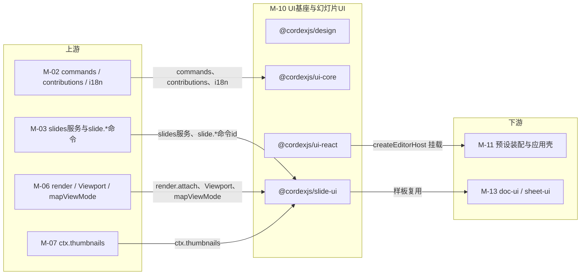
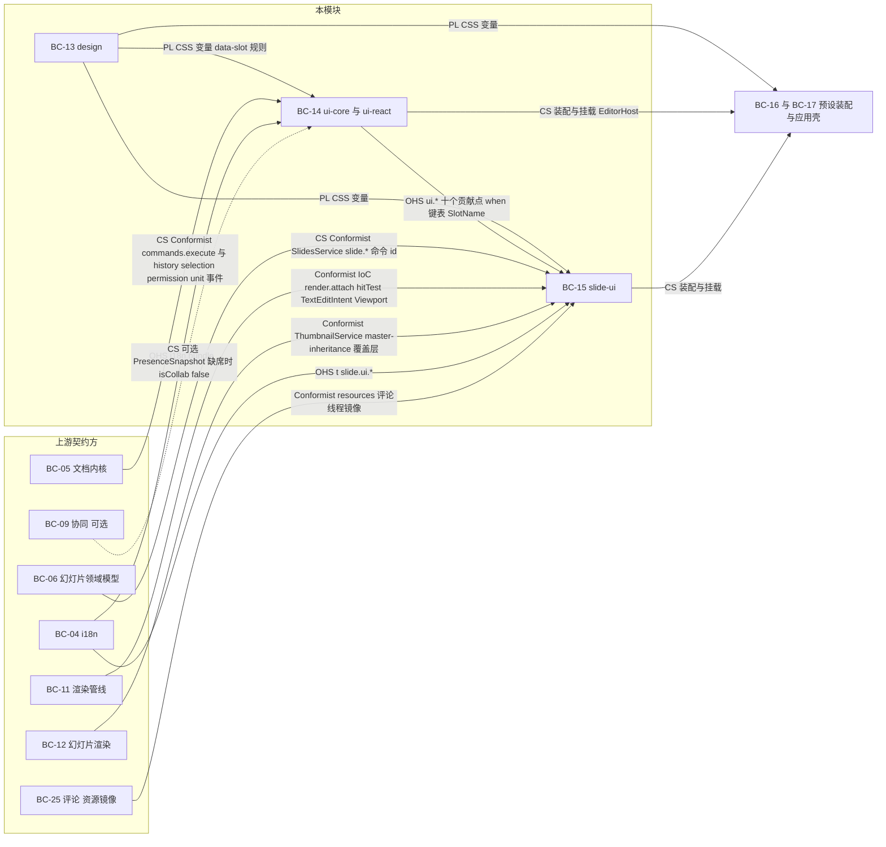
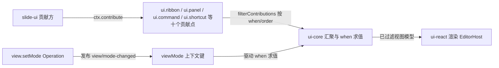
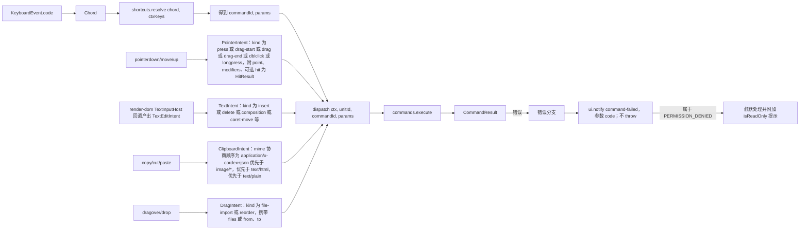
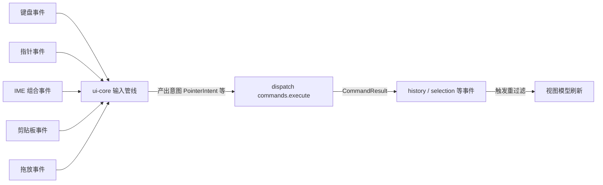
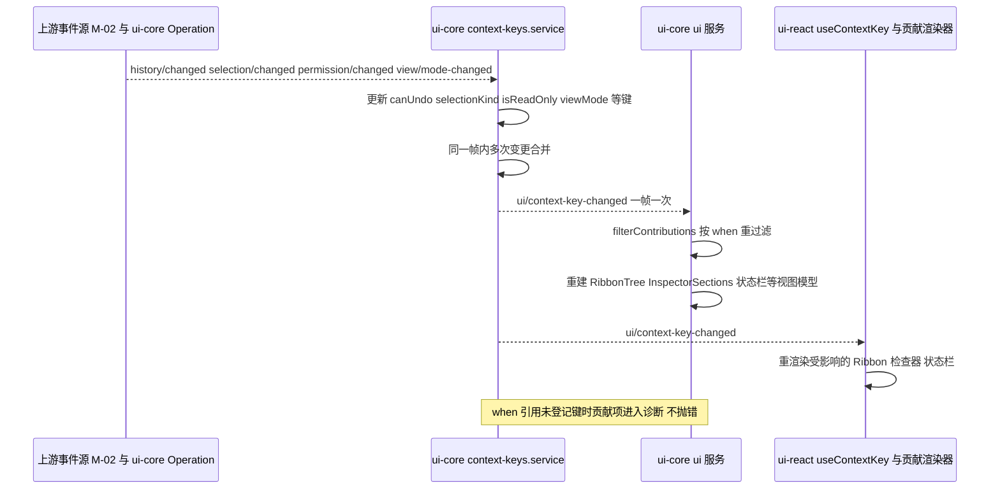
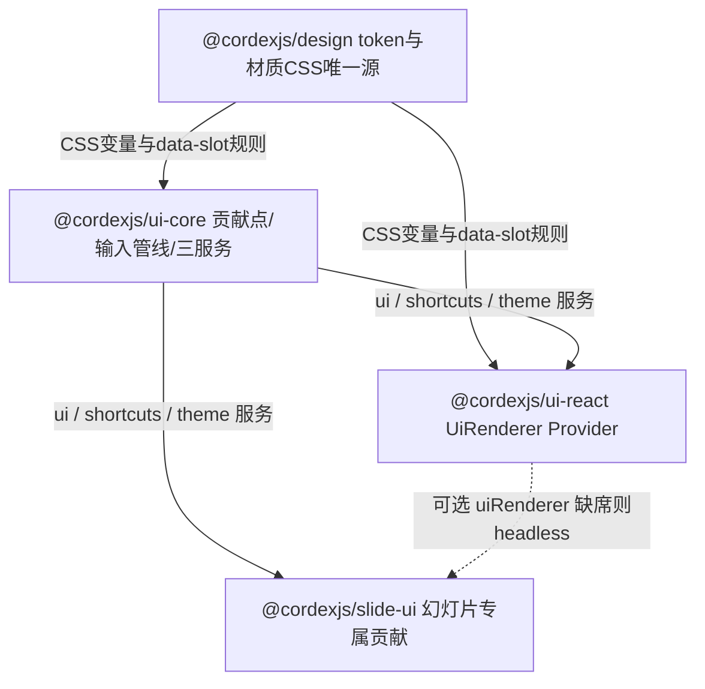
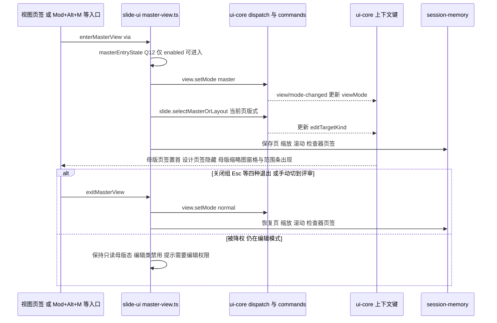

> 状态：草稿 v0.1 | 负责：架构-模块（阶段二，M-10） | 更新：2026-09-19、2026-09-24（rulings §4.15）、2026-09-24（复核修正，rulings §4.17）、2026-09-25（补图）、2026-09-25（矛盾收口，rulings §4.18） | 依赖：00-module-map.md M-10 / BC-13…BC-15（BC-16/17 为下游）、charter v0.2 §5.2（design / ui-core / ui-react / slide-ui 四行）§5.4 UI 行 §5.5、30-architecture 02 §4.17–4.20、03 §3.6、05 §13.3、ADR-0017（含 2026-09-16 Rhea + 材质层修订段与 2026-09-18 术语修订）、rulings §4.6–§4.10（Q9–Q21）、20-design 09 v3.1 / 04 v0.5 / 03-screens 02·03·20·24·26、playground `src/index.css` 与 `src/components/**`；上游模块文档 M-02 §2.4/§2.6/§3/§6、M-03 §2.6/§6、M-06 §2.5、M-07 §2.5/§2.6/§3/§6

# 10 UI 基座与幻灯片 UI（限界上下文 BC-13 设计系统 · BC-14 UI 基座 · BC-15 幻灯片 UI）

## 0. 一页总览

| 项 | 值 |
|---|---|
| 职责一句话 | 把「命令是唯一行为入口」的 SDK 呈现为一个 iOS 27 / macOS Tahoe 风格的悬浮玻璃编辑器：`design` 交付唯一的 token / 材质 / `[data-slot]` CSS 事实源；`ui-core` 定义框架无关的 `ui.*` 贡献点、`when` 上下文键、输入管线与 `ui`/`shortcuts`/`theme` 三个服务；`ui-react` 用 React 19 + shadcn/ui（`radix-rhea`）复制件把贡献渲染成 `<EditorHost>` 壳；`slide-ui` 向壳贡献幻灯片专属的 Ribbon 页签、缩略图窗格、检查器分区、画布交互层、版式画廊、主题面板、放映与母版视图 UI |
| 覆盖的上下文 | BC-13 设计系统、BC-14 UI 基座、BC-15 幻灯片 UI |
| 承载包 / 目录 | `@cordexjs/design`（L7，秩 70，dom，library）、`@cordexjs/ui-core`（L7，秩 70，dom，definition + plugin）、`@cordexjs/ui-react`（L7，秩 70，dom，provider）、`@cordexjs/slide-ui`（V-ui，秩 75，dom，plugin，`bundle=slide`） |
| cordis 形态 | design：library（无 `plugin.ts`）；ui-core：plugin（`provide ['ui','shortcuts','theme']`，定义 `UiRenderer` Definition）；ui-react：provider（`implements ['uiRenderer']`）；slide-ui：plugin（只贡献，不 provide） |
| 运行位置 | 仅浏览器（四包均 `iso:'dom'`；服务端 headless Chromium 路径不加载任何一包，07 §7） |
| 上游（依赖） | M-02（`ctx.commands`/`ctx.contributions`/`ctx.i18n`/`ctx.units`、UnitScope 内 `history`/`selection`/`permissions` 事件、内置 Operation `core.undo`/`core.redo`，2026-09-18 C-02）、M-03（`slides` 只读服务、`slide.*` 命令 id、`SlideSelectionAnchor`、`slideDocumentType.viewModes`）、M-06（`ctx.render.attach/hitTest/setView`、`RenderTarget`/`Viewport`/`HitResult`、`TextEditIntent` 回调、`render.overlay`、`mapViewMode()`，2026-09-18 C-13）、M-07（`ctx.thumbnails`、`ComposedSlide` 只读类型）；间接：M-05（`ctx.presence` 供在场头像与 `isCollab` 键） |
| 下游（被依赖） | M-11（`preset-slide*` 装配四包；`apps/web` 在 `application/host/create-editor-host.ts` 挂 `<EditorHost>`，2026-09-18 路径确认，R-12）、M-13（`doc-ui`/`sheet-ui` 以 `slide-ui` 为样板，复用 `ui-core`/`ui-react`/`design` 零改动） |
| 对外服务 | `ctx.ui`、`ctx.shortcuts`、`ctx.theme`（ui-core）；`ctx.uiRenderer`（ui-react 实现的 Definition）；design / slide-ui 不提供服务 |
| 贡献点 | 提供（ui-core）：`ui.ribbon`、`ui.toolbar`、`ui.panel`、`ui.contextMenu`、`ui.statusBar`、`ui.dialog`、`ui.notification`、`ui.shortcut`、`ui.command`、`ui.theme`（十个，03 §3.6 / charter §5.5 原名，不新增 id）；消费（ui-core `ui`/`shortcuts`/`theme` 服务查表，ui-react 渲染）；slide-ui 向其中七个（`ui.ribbon`/`ui.panel`/`ui.toolbar`/`ui.contextMenu`/`ui.statusBar`/`ui.shortcut`/`ui.command`，除 `ui.dialog`/`ui.notification`/`ui.theme` 外）与 `i18n.bundle` 贡献条目（2026-09-25 更正，以 §3 逐项清单与 Manifest 为准：`ui.notification` 的模板只由 ui-react 贡献，slide-ui 的 toast 经 `ui.notify` 调用既有模板，rulings §4.18 FE-11） |
| doc / sheet 通用性 | design / ui-core / ui-react：generic（`slot` 为开放字符串、`viewModes` 与 `unitType` 由 `DocumentType` 参数化）；slide-ui：vertical（`bundle=slide`，`doc-ui`/`sheet-ui` 样板） |
| 批次 | 3（上游 M-02/M-03/M-07 定稿后可开工；M-11 等待本模块 §6 API 面） |
| 文件规模 | 非复制件 **166** 个（design 26 · ui-core **38** · ui-react 47 · slide-ui 55）+ shadcn 复制件 44 个（机械生成，`pnpm dlx shadcn@4.21.0 add`；**2026-09-24**：`drawer`（vaul）不迁移，45→44，窄屏底部面板改用 `sheet` 的 `side=bottom`，rulings §4.15 Q2）；高于 00 §7 估算的 110–140，原因见 §12 G-15；**2026-09-18 更新**：ui-core 删除 `history-operations.ts`（39→38，C-02，撤销/重做改绑 M-02 `core.undo|redo`）；slide-ui 的放映编排已有 `application/present.ts`（原 55 内，C-04 只改其发布者语义，非新增文件），故仅 ui-core 减 1，总数 167→166 |

### 0.1 图示

**图 0-1 模块内包与上下游关系**



图怎么读：四个上游模块分别提供命令/贡献基础设施、幻灯片数据、渲染回调与缩略图服务；中间是本模块四个包；下游 M-11 挂载渲染结果，M-13 把 `slide-ui` 当样板复制。

## 1. 限界上下文与边界

### 1.1 职责与非职责

**BC-13 `@cordexjs/design`（做）**：以 playground `src/index.css` 为事实基线，生成并入库四份 CSS——基础色 / 语义色（shadcn 变量名 + `--border-control` + Cordex 扩展色 `--success|warning|info(-foreground|-muted)`、`--canvas`、`--doc-paper|ink`、`--stage*`、`--presence-1…12`）、材质 `--glass-*` 与 `--canvas-glow`、字阶 `--text-2xs`、圆角派生刻度、层级、动效、密度；亮暗双套并兼容宿主 `data-theme` 盖章；`@utility glass/glass-strong`；14 个浮层 `[data-slot]` 玻璃化规则与两块退化（`prefers-reduced-transparency` / `@supports not backdrop-filter`）；字段 / tabs / toggle / accordion（`inspector-groups`）/ `.cordex-well` `.cordex-group` / avatar-group 的 `[data-slot]` 规则；`body` 宿主防线；WCAG 对比度核算助手。**不做**：任何组件、图标、React / Radix / Tailwind 运行时 import（R18）；`--cordex-*` 记号（已作废，§12 G-1）；文档内容（幻灯片纸面内文字）的字号 / 颜色——那是 `model-slide` 的数据。

**BC-14 `@cordexjs/ui-core`（做）**：十个 `ui.*` 贡献点的 item schema 与注册；`when` 子句解析 / 求值与反应式上下文键（`unitType`/`viewMode`/`editTargetKind`/`selectionKind`/`selectionCount`/`canUndo`/`canRedo`/`isCollab`/`isReadOnly`/`platform`/`density` + 新增建议 `breakpoint`/`textEditing`/`focusRegion`）；键盘 / 指针 / IME / 剪贴板 / 拖放五条输入管线（只产出**意图**，经 `dispatch` 统一转 `commands.execute`）；`ctx.shortcuts`（`Mod+Alt+M`、`Mod+,`、`Mod+/`、`Mod+Shift+P` 等默认表由贡献方注册，服务只做 chord 规范化、匹配与冲突诊断）；`ctx.theme`（theme / density 状态、根元素属性写入、design CSS 单例注入）；视图模型纯函数（Ribbon 树、检查器分区、状态栏、命令面板、右键菜单）；水平层 Operation `view.setMode`（2026-09-18 确认归本包，C-01；M-02 侧的重复定义 `command/builtin/view-operations.ts` 已删除）、`ui.openPanel|closePanel|toggleRibbonTab`。**不做**：import react / radix / tailwind / lucide（R14）；任何幻灯片字面量（`no-doc-type-literals`）；渲染——由 `UiRenderer` Provider 完成；撤销 / 重做 Operation（`history.undo|redo` 已删除，UI 改绑 M-02 内置 `core.undo|redo`，2026-09-18 C-02）。**`@cordexjs/ui-react`（做）**：`<EditorHost>` / `EditorShell`（三栏 240·画布·300，紧凑 / 仅查看态）、AppBar（返回 / 文档名 / 撤销重做 / 保存态 / 在场 / 分享 / 模式 / ⋯ / 头像）、Ribbon 宿主与 primitives、面板 / 工具条 / 右键 / 对话框 / 通知 / 命令面板宿主、状态胶囊、备注栏、画布宿主 + 缩放胶囊、快捷键面板、设置抽屉框架、`UserMenu`/`Brand`/`ThemeToggle`/`ViewModeSwitch`/`PresenceStack`/`ColorPickerPopover`、45 个 shadcn 复制件（`./ui` 子路径）、贡献渲染适配器（每个贡献一个错误边界）与 `ThemeBridge`。**不做**：任何 `slide.*` 命令绑定或幻灯片语义（页签内容、分区内容、缩略图内容全部来自贡献）；手改复制件（组件级视觉写 design 的 `[data-slot]` 规则，确需改标 `// Cordex override`）。

**BC-15 `@cordexjs/slide-ui`（做）**：开始 / 插入 / 设计 / 切换（只读，Q15）/ 视图 / 母版（五组含独立「关闭」组）页签与控件 → `slide.*` 命令绑定；缩略图栏与母版缩略图窗格 `MasterThumbnails`（listbox 键盘、多选、骨架 / 失败态）；检查器分区（位置与大小 / 填充与线条 / 文本 / 幻灯片 / 占位符 / 版式与母版属性 / 继承说明）；画布交互层（指针意图 → 选择 / 移动 / 缩放 / 旋转命令、文本编辑态、迷你工具条、评论钉、继承占位符描边、范围条）；版式画廊（搜索、跨母版）与删除版式 Q11 流程；主题编辑面板；放映舞台；母版视图进入 / 退出编排、「影响 N 页」徽标与状态栏文案；默认键位表与 `ui.command` 呈现元数据；`slide.ui.*` 语言包。**不做**：任何 Store 写入（全部经 `commands.execute`）；重绘选区框 / 远端光标（那是 render-dom 的 `render.overlay` 条目，本包只提供 React 层浮动 UI 与交互控制器）；缩略图像素生成（`ctx.thumbnails`）；评论线程事实源（读 `resources['slide-comments.threads']` 镜像）；应用级页面（登录 / 文档列表 / 路由，属 `apps/web`，00 §5.2）。

### 1.2 通用语言

引用 charter §4：贡献点、Command / Mutation / Operation、UnitScope、DocumentType、Selection、Provider / Definition、preset。本上下文特有术语：

| 术语 | 定义 | 对应类型名（所在包） |
|---|---|---|
| 槽位 slot | 贡献项落位的开放字符串键（`ribbon`、`inspector`、`statusBar.left`、`toolbar.text-editing`…），不枚举 | `SlotName`（ui-core `ui/slots.ts`） |
| `when` 子句 | 贡献项可见性表达式，只能引用已登记上下文键 | `WhenClause`（ui-core `domain/when-clause.ts`） |
| 上下文键 | 由 Operation / 事件驱动的反应式键值，`when` 的唯一输入 | `ContextKeyName`/`ContextKeyValues`（ui-core `domain/context-keys.ts`） |
| 视图模式 viewMode | `DocumentType.viewModes` 之一（slide：`normal\|master\|presenter`），与 M-06 `ViewDescriptor.mode`（`edit\|master\|present`）经映射表对应；映射函数 `mapViewMode()` **归属 `engine-render`（M-06），本包只消费/re-export**（2026-09-18，C-13，§12 G-18 结案） | `ViewMode`（ui-core `domain/view-mode.ts`，re-export `mapViewMode`） |
| 编辑目标 / 编辑范围 | 母版视图中当前容器种类（`editTargetKind: slide\|layout\|master`）与范围条双态（`slide.editScope: layout\|master`） | `EditTarget`（slide-ui `domain/edit-target.ts`） |
| Ribbon 树 | tab → group → control 三级视图模型，由 `ui.ribbon` 贡献按 `slot`/`order`/`when` 折叠而成 | `RibbonTree`（ui-core `domain/ribbon-model.ts`） |
| 检查器分区 | `ui.panel{slot:'inspector'}` 贡献的手风琴项，按 `selectionKind`/`editTargetKind` 过滤 | `InspectorSection`（ui-core `domain/inspector-model.ts`） |
| 和弦 chord | 平台无关键位串 `Mod+Alt+M`（`Mod` = ⌘ / Ctrl），按 `KeyboardEvent.code` 匹配 | `Chord`（ui-core `domain/chord.ts`） |
| 意图 intent | 输入管线的唯一产物（指针 / 键盘 / IME / 剪贴板 / 拖放），不直接改状态 | `PointerIntent` 等（ui-core `domain/input-intents.ts`） |
| 材质 | `glass`（72%/62%）与 `glass-strong`（84%/78%）两档玻璃；内容层永远不透明 | `GlassTokens`（design `material/glass.ts`） |
| 浮层 data-slot 清单 | 14 个自动玻璃化的 shadcn `data-slot` 名，玻璃化与两块退化共用同一清单 | `FLOATING_SLOTS`（design `slots/slot-list.ts`） |
| 断点 | `desktop ≥ 1024` / `compact 640–1024` / `narrow < 640`（Q19） | `Breakpoint`（ui-core `domain/context-keys.ts`；ui-react `hooks/use-mobile.ts`） |
| 密度 | `comfortable\|compact`，只重映射控件高度簇 | `Density`（design `tokens/density.ts`） |
| 母版缩略图窗格 | 母版大缩略图 + 缩进版式小缩略图的 listbox（非文字树，ADR-0017 2026-09-18） | `MasterThumbnails`（slide-ui `ui/thumbnails/`） |
| 范围条 | 母版视图画布上方「编辑版式 \| 母版」双态单选 + 继承来源 + 图例 | `ScopeBar`（slide-ui `ui/canvas-overlays/`） |
| 影响 N 页 | 当前母版 / 版式被引用页数（`dependentsOf`），驱动应用栏徽标与状态栏文案 | `impactCount()`（slide-ui `domain/edit-target.ts`） |

### 1.3 上下文映射

| 相邻上下文 | 关系 | 防腐层落点（文件） | 传递的契约 |
|---|---|---|---|
| BC-13 design → BC-14/15/17 | Published Language（CSS 变量名 + `data-slot` 规则） | `design/css/theme.css`（唯一被 import 的产物） | shadcn 变量、`--glass-*`、`--text-2xs`、`@utility glass*`、`[data-slot]` 规则 |
| BC-14 ui-core → BC-15 slide-ui / 第三方 | Open Host Service（`ui.*` 十个贡献点） | `ui-core/src/infrastructure/points/ui-points.ts` | item schema、`when` 键表、`SlotName` |
| BC-14 ui-core ↔ ui-react | Definition / Provider（`UiRenderer`） | `ui-core/src/domain/ui-renderer.ts`；`ui-react/src/infrastructure/ui-renderer.provider.ts` | `UiRenderer.mount/update/dispose`、`ComponentRef` 声明合并 |
| BC-05 文档内核 → BC-14 | Customer–Supplier（下游 Conformist） | `ui-core/src/application/input/dispatch.ts`、`application/services/context-keys.service.ts` | `commands.execute()`、`history/changed`、`selection/changed`、`permission/changed`、`unit/*` |
| BC-06 幻灯片模型 → BC-15 | Customer–Supplier（Conformist：只读 `slides`、命令 id 照单全收） | `slide-ui/src/application/command-bindings.ts`、`domain/selection-kind.ts` | `SlidesService`、`slide.*` id、`SlideSelectionAnchor`、`planLayoutChange`/`dependentsOf` |
| BC-11 渲染管线 → BC-15 | Conformist（IoC 回调） | `slide-ui/src/application/canvas-interaction.ts`、`text-editing.ts`；`ui-react/src/ui/shell/CanvasHost.tsx` | `render.attach(targetId, container, callbacks)`、`hitTest → HitResult`、`TextEditIntent`、`Viewport` |
| BC-12 幻灯片渲染 → BC-15 | Conformist | `slide-ui/src/ui/thumbnails/*`（订阅 `ctx.thumbnails`） | `ThumbnailService`、`ThumbnailDescriptor`、`render.overlay('master-inheritance')` 已由 M-07 提供；`slide/show-changed` **不再**由 M-07 提供——2026-09-18 起由本包 `application/present.ts` 自行发布（C-04） |
| BC-04 i18n → BC-14/15 | Open Host Service（`i18n.bundle`） | `slide-ui/src/locales/*.json`、`ui-core/src/ui.contribution.ts`（`I18nKeys 'ui.*'`） | `t('slide.ui.*')`、`i18n/locale-changed` |
| BC-09 协同 → BC-14/15 | Customer–Supplier（可选，缺席时 `isCollab=false`） | `ui-react/src/ui/shell/PresenceStack.tsx`（`ctx.get('presence', false)`） | `PresenceSnapshot`、`collab/*` 事件 |
| BC-25 评论（服务端读模型）/ 客户端评论资源 → BC-15 | Conformist | `slide-ui/src/ui/canvas-overlays/CommentPins.tsx` | `resources['slide-comments.threads']` 镜像 |
| BC-14/15 → BC-16/17 | Customer–Supplier（装配 / 挂载） | `apps/web/src/application/host/create-editor-host.ts`（M-11 定义，本文 §7 只给契约；路径 2026-09-18 确认，R-12） | `createSlidePreset`、`<EditorHost host unitId>` |

**图 1-1 对外契约与上下游关系**



怎么读：箭头从契约提供方指向消费方（与图 0-1 同向），边标签为「关系类型 + 传递的契约」；本模块对文档内核、幻灯片模型与渲染层全部是照单全收的下游，只经命令与 IoC 回调写入；协同是唯一可选上游（虚线），缺席时退化为 `isCollab=false`；`slide/show-changed` 已改由本模块自行发布，不再来自 BC-12。

依据：本节上表。

## 2. 领域模型（UI 模块改写：2.1 视图模型与状态 · 2.2 输入管线与适配器契约 · 2.3 纯函数 · 2.4 事件 · 2.5 外部契约 · 2.6 命令绑定）

### 2.1 视图模型与状态

UI 模块没有持久聚合；全部状态是「派生视图」或「客户端偏好」，事实源分别在 BC-05/06（文档）、BC-11（视口）与 localStorage（个人偏好，不同步）。

| 视图模型 | 字段（要点） | 事实源 / 派生输入 | 所在文件 | 不变量 |
|---|---|---|---|---|
| `ContextKeyValues` | 十一个标准键 + 新增建议三键（`breakpoint`、`textEditing`、`focusRegion`）+ `unitLoaded`（2026-09-25 新增，rulings §4.18 CO-12）+ 前缀键（`slide.editScope`、`slide.hasNotes`、`slide.multiSelectLayouts`） | `history/changed`→`canUndo/canRedo`；`selection/changed`→`selectionKind/selectionCount`（由垂直束桥接器给出种类）；`permission/changed`→`isReadOnly`；`view/mode-changed`→`viewMode`；`slide.selectMasterOrLayout`→`editTargetKind`；`matchMedia`→`platform/breakpoint`；`theme`→`density`；presence 服务在场→`isCollab`；`unit/opened`（按 M-02 `unit.loadState`，渐进打开时为 `false`）/`unit/loaded`→`unitLoaded`——全选（`Mod+A`）、查找替换面板与 M-03 全文类命令的 UI 入口以 `when: unitLoaded` 禁用或显示「正在载入其余页面…」等待态 | ui-core `domain/context-keys.ts`、`application/services/context-keys.service.ts`；slide-ui `infrastructure/context-key-bridge.ts` | `viewMode ∈ documentType.viewModes`；未登记键出现在 `when` 中 → 贡献项进入诊断而非抛错（静态侧由 `scan-contributions` 规则 (e) 检查，原称 `when-keys-declared`，rulings §4.18 GV-15）；键变更批量合并到一次 `ui/context-key-changed` |
| `RibbonTree` | `tabs[]{id, title, accent?, owner?, groups[]{id, title, controls[]{id, kind:'big'\|'small'\|'toggle'\|'select'\|'checkbox'\|'custom', commandId?, params?, component?, when}}}` | `ui.ribbon` 贡献集 × `ContextKeyValues` | ui-core `domain/ribbon-model.ts` | 内置页签 `order < 1000`，第三方 `≥ 1000` 且必带 `owner`；母版页签 `order = -100`（置首）；`design` 页签 `when: viewMode != 'master'`；空组 / 空页签自动隐藏 |
| `InspectorSections` | `tabs[]{id: properties\|comments\|history\|plugins, disabled?, reason?}`、`sections[]{id, title, defaultOpen, owner?, component}` | `ui.panel{slot:'inspector'\|'inspector.tab'}` × 键值 | ui-core `domain/inspector-model.ts` | 内置分区排在插件分区之前并以归属图标分隔；`viewMode=='master'` → `comments` 页签 `disabled` + 原因文案；分区折叠态为个人偏好 |
| `StatusBarModel` / `ContextMenuModel` / `CommandPaletteModel` | `left[]/right[]`；`groups[]{items[]{commandId, title, icon, variant?, chord?}}`；`entries[]{commandId, title, category, chord?, keywords}` | `ui.statusBar` / `ui.contextMenu` / `ui.command` × `ui.shortcut` × 键值 | ui-core `domain/bar-and-menu-models.ts` | 命令面板条目只列 `commands.has(id)` 且 `when` 为真者；右键菜单危险项置末 |
| `ThemeState` | `{ mode: 'system'\|'light'\|'dark'; resolved: 'light'\|'dark'; density: 'comfortable'\|'compact'; hostMark?: 'light'\|'dark' }` | localStorage `cordex-theme` > 宿主 `<html data-theme>` > `prefers-color-scheme` | ui-core `domain/theme-state.ts`、`application/services/theme.service.ts` | 解析顺序固定（04 §3）；写根元素 `.dark` class + `data-cordex-theme` + `data-cordex-density` + `style.colorScheme`；多 host 同页只注入一份 CSS |
| `EditorLayoutState` | `{ railWidth: 240; inspectorWidth: 300; historyWidth: 560; railCollapsed; inspectorOpen; notesOpen; breakpoint }` | `ResizablePanel` 事件、断点、`ui.openPanel` | ui-react `ui/shell/EditorShell.tsx`（React state + localStorage 按 `unitType` 记忆） | 拖拽范围 160–420 / 240–720；`compact` 断点下侧栏为 Sheet 不挤压画布；`narrow` 只查看 |
| `SlideSelectionView` | `{ kind: 'none'\|'slide'\|'shapes'\|'text'\|'picture'\|'table-cell'\|'group'\|'connector'\|'degraded'\|'mixed'\|'layout'\|'master'\|'layouts-multi'; ids; count; containerId }` | `Selection<SlideSelectionAnchor>` + `slides.shape()` | slide-ui `domain/selection-kind.ts` | 派生纯函数；`mixed` 时检查器只显示交集分区 |
| `MasterViewState` | `{ targetId: MasterId\|LayoutId; editScope: 'layout'\|'master'; impact: number; multiSelect: LayoutId[]; entry: 'enabled'\|'review'\|'narrow'; sessionMemory: { slideId, zoom, scroll, inspectorTab } }` | `editTargetKind` 键、`slides.body()`、断点、`isReadOnly` | slide-ui `domain/edit-target.ts`、`application/master-view.ts`、`infrastructure/session-memory.ts` | 入口仅 `entry=='enabled'`（Q12）；已在母版视图中**手动切到评审即退出母版视图**，回到进入前的页、缩放与滚动位置（2026-09-25，rulings §4.18 UX-20）；**被降权**（仍在编辑模式、`readonly-degraded`、Ribbon 还在）时保持只读母版态（编辑类禁用、tooltip「需要编辑权限」、四种退出方式可用）不强制退出；缩窄窗口仍按 Q12 不退出；`impact==0` 时徽标不显示、状态栏降级文案 |
| `ThumbnailListModel` | `items[]{target, page?, refCount?, unused, hidden, commentCount, warning, descriptor: ThumbnailDescriptor, selected, current}` | `slides.order()` / `masters→layouts` + `ctx.thumbnails.subscribe` | slide-ui `domain/thumbnails-model.ts` | 虚拟列表；母版窗格无折叠；引用数 0 显示「未使用」灰字 |

**图 2-1 贡献点流向**



图怎么读：`slide-ui` 只向贡献点写数据，不直接渲染；`ui-core` 按 `when`/`order` 过滤汇聚成视图模型后交给 `ui-react`；`viewMode` 上下文键由 `view.setMode` 触发的事件驱动，反过来影响过滤结果。

### 2.2 输入管线与适配器契约

五条管线全部在 `ui-core/src/application/input/`，只产出意图对象；意图 → 命令的映射由垂直束 / 壳组件通过 `dispatch()` 完成：

**输入管线细化：五路输入到 dispatch 的类型转换与回退路径**



图怎么读：五条管线各自把原始事件转成强类型意图对象后汇入 `dispatch`；`commands.execute` 出错统一走 `ui.notify` 且不抛异常，`PERMISSION_DENIED` 额外触发静默处理与只读提示。本图与下方「图 2-2 输入管线」互补：图 2-2 给出汇聚到视图模型刷新的整体闭环，本图展开每路管线内部的类型转换细节。

适配器契约（谁实现、谁调用）：

| 契约 | 定义方 | 实现 / 调用方 | 要点 |
|---|---|---|---|
| `UiRenderer` Definition | ui-core `domain/ui-renderer.ts` | ui-react `infrastructure/ui-renderer.provider.ts` | `mount(container, host, unitId, opts) → UiRendererHandle{ update(); dispose() }`；`ComponentRef<P>` 泛型占位，React 绑定下 = `React.ComponentType<P & SlotProps>`（声明合并，A14 无 any） |
| `render.attach` 回调 | M-06 `RenderService.attach(targetId, container, callbacks?)` | ui-react `CanvasHost.tsx` 调用；slide-ui `canvas-interaction.ts` / `text-editing.ts` 提供回调 | 回调：`onTextEditIntent(intent)`、`onPointer(hit)`；`SceneNode.id === ShapeId`（M-07 §2.1）使 `intent.nodeId` 可直接作 `ShapeId` |
| `OverlayContext` 供给 | M-06 `OverlayRenderer.mount(ctx, target)` | ui-react `CanvasHost` 把 `selection`/`presence`/`viewport` 快照喂给 `render` 服务；本模块不实现 `OverlayRenderer`（`selection`/`remote-presence`/`guides`/`comment-pins` 属 render-dom，`master-inheritance` 属 slide-render） | 覆盖层不参与内容脏区 |
| `ThumbnailService` | M-07 | slide-ui `ThumbnailRail`/`MasterThumbnails` 订阅 | `subscribe(target, cb)`；`descriptor.url ?? element`；加载态 `Skeleton` > 300 ms 才显示 |
| `TextMeasurer` | M-06 | 不直接使用（检查器字号预览走 CSS） | — |
| 宿主主题盖章 | 宿主页面 `<html data-theme>` | ui-core `infrastructure/root-attributes.ts`（`MutationObserver`） | 用户显式选择 > 宿主盖章 > 系统偏好 |

**图 2-2 输入管线**



图怎么读：五条管线只产出意图对象，不直接改状态；`dispatch` 统一转 `commands.execute`；命令结果引发的事件再驱动上下文键与视图模型刷新，形成单向闭环。

### 2.3 纯函数

| 函数（签名草案） | 所在文件 | 说明 |
|---|---|---|
| `parseWhen(src: string): Result<WhenClause, WhenParseError>` / `evaluateWhen(clause, keys: ContextKeyValues): boolean` | ui-core `domain/when-clause.ts` | 语法：`==`/`!=`/`in`/`&&`/`\|\|`/`!`/括号；键名必须在登记表 |
| `normalizeChord(input: string, platform): Chord` / `chordFromEvent(e: KeyboardEvent, platform): Chord` / `formatChord(chord, platform): string` | ui-core `domain/chord.ts` | `Mod` 展开为 `Meta`（mac）/`Control`；显示 ⌘⌥⇧ 或 Ctrl/Alt/Shift；基于 `code` 不受布局影响 |
| `buildRibbonTree(items: RibbonItem[], keys): RibbonTree` / `buildInspectorSections(items, keys)` / `buildStatusBar(items, keys)` / `buildContextMenu(items, keys, slot)` / `buildPalette(commands, shortcuts, keys)` | ui-core `domain/ribbon-model.ts` 等 | 过滤（`when`）→ 排序（`order`，同序按贡献时间）→ 折叠三级 |
| `filterContributions<T>(set, slot, keys): T[]` | ui-core `application/services/ui.service.ts`（内部纯函数） | 上述五者的共同底座 |
| `mapViewMode(mode: ViewMode): ViewDescriptor['mode']`（**re-export，非本包实现**） | 定义于 `@cordexjs/engine-render`（M-06），ui-core `domain/view-mode.ts` 只 re-export | `normal→edit`、`master→master`、`presenter→present`；其余原样透传（doc/sheet 可扩）；2026-09-18 跨模块评审 C-13 裁定映射表上移至 `engine-render`，本包不再是定义方 |
| `resolveThemeState(stored, hostMark, prefersDark): ThemeState` | ui-core `domain/theme-state.ts` | 04 §3 解析顺序 |
| `detectBreakpoint(width): Breakpoint` / `detectPlatform(nav): Platform` | ui-core `infrastructure/environment.ts` | 1024 / 640；`pointer: coarse` 视为 mobile |
| `deriveSelectionKind(sel: Selection<SlideSelectionAnchor>, slides: SlidesService): SlideSelectionView` | slide-ui `domain/selection-kind.ts` | 多选异类 → `mixed`；容器为 layout/master → `layout`/`master` |
| `impactCount(body, target: MasterId\|LayoutId): number` / `masterEntryState(keys): 'enabled'\|'review'\|'narrow'` | slide-ui `domain/edit-target.ts` | 复用 M-03 `dependentsOf`；Q12 判定 |
| `buildThumbnailList(body, thumbs, selection, mode: 'normal'\|'master'): ThumbnailListModel` | slide-ui `domain/thumbnails-model.ts` | 母版 → 版式两级平铺；引用数实时 |
| `ribbonSpec(): RibbonItem[]` / `inspectorSpec(): PanelItem[]` / `defaultShortcuts(): ShortcutItem[]` | slide-ui `domain/ribbon-spec.ts`、`inspector-spec.ts`、`shortcut-table.ts` | 声明式规格，`infrastructure/contributions/*` 只负责 `ctx.contribute` |
| `contrastRatio(fg, bg): number` / `flattenAlpha(rgba, over): rgb` | design `utilities/contrast.ts` | WCAG 相对亮度；玻璃面板对比先按背景层压平 alpha |
| `emitCss(tokens: TokenSet, opts): string` / `assertWebkitBeforeStandard(css): void` | design `utilities/css-emit.ts` | 生成器底座；`-webkit-backdrop-filter` 必须先于 `backdrop-filter`（09 §6.3） |

### 2.4 事件

ui-core 只在 `ui` 与 `view` 两个域发布事件（`ui-core/src/ui.contribution.ts` 的 `Events` 增强，由 lint 规则 `cordex/events-must-be-declared` 检查，原称 `events-declared`，09-type-discipline/08 §11，rulings §4.18 GV-15）；`view` 域目前不在章程 §5.5 / 03 §3.6 的保留域名单中，见 §12 G-5。**2026-09-18 起（C-04）**：slide-ui 在既有 `slide` 域新增发布 `slide/show-changed`（`slide` 域本已注册，非新增域）——画布交互本身仍全部经命令 / 操作调用，`slide/show-changed` 是放映模式编排的唯一例外。

| 事件 | 模式 | 载荷 | 发布者文件 | 典型订阅者 |
|---|---|---|---|---|
| `ui/context-key-changed` | emit | `(unitId \| null, changed: Partial<ContextKeyValues>)`（批量合并，一帧一次） | ui-core `application/services/context-keys.service.ts` | `ui` 服务重过滤贡献、ui-react `useContextKey`、遥测 |
| `ui/panel-opened` / `ui/panel-closed` | emit | `(unitId, panelId, slot)` | ui-core `application/operations/panel-operations.ts` | 壳布局记忆、遥测 |
| `ui/shortcut-conflict`（新增建议） | emit | `(conflicts: ShortcutConflict[])`——加载期检测到同 chord 同 `when` 的多条绑定 | ui-core `application/services/shortcuts.service.ts` | 快捷键面板「⚠ 冲突」行、插件管理器（M-11） |
| `ui/theme-changed`（新增建议） | emit | `(state: ThemeState)` | ui-core `application/services/theme.service.ts` | ui-react `ThemeBridge`、集成方宿主同步 |
| `view/mode-changed` | emit | `(unitId, mode: ViewMode, prev: ViewMode)` | ui-core `application/operations/view-set-mode.ts` | `viewMode` 键、slide-ui `master-view.ts`（会话记忆恢复）、presence 广播（`broadcast:true`） |
| `slide/show-changed`（**2026-09-18 起本包发布，C-04**） | emit | `{ unitId; mode:'entering'\|'exiting'; slideId?: SlideId }` | slide-ui `application/present.ts` | 应用壳全屏控制、`ui/present/PresenterStage.tsx`；原由 M-07 `slide-render` 发布，已删除其 `slideshow.service.ts` |

订阅（不发布）的上游事件：`history/changed`、`selection/changed`、`permission/changed`、`unit/opened|loaded|closed|dirty-changed|saved|open-progress|open-failed`（`unit/loaded` 驱动 `unitLoaded` 键，rulings §4.18 CO-12）、`command/executed|failed|rejected`（ui-core 上下文键与状态栏）；`i18n/locale-changed`（ui-react 重渲染）；`slide/thumbnail-updated`（slide-ui 缩略图）；`plugin/failed`、`contribution/changed`（ui-react 贡献渲染器刷新与诊断）。`slide/show-changed` 不在此列——本包是发布者而非订阅者（见上表）。

**图 2-4 上下文键驱动贡献重算时序**



怎么读：上下文键是 `when` 子句的唯一输入，事件先归并为键值变更、再一帧一次广播，下游据此重新过滤贡献并重建视图模型；`selectionKind` 的具体种类由 slide-ui 的 `context-key-bridge.ts` 桥接给出，ui-core 本身不认识幻灯片。

依据：§2.1 `ContextKeyValues` 行；§2.3 `evaluateWhen`/`filterContributions`；§2.4 事件表与订阅段。

### 2.5 外部契约（Definition 与配置）

**`UiRenderer`（Definition；由 ui-core 定义，无贡献点——单例可替换能力用服务座而非贡献点，03 §3.6 判据）**

```ts
interface UiRenderer {
  readonly id: string                                   // 'react' | 'vanilla'（embed-vanilla 最小实现，M-11）| 未来 'vue'
  mount(container: HTMLElement, host: Host, opts: UiMountOptions): UiRendererHandle
}
interface UiMountOptions { unitId?: UnitId; layout?: Partial<EditorLayoutOptions>; mode?: 'edit' | 'review' | 'view' }
interface UiRendererHandle { update(opts: Partial<UiMountOptions>): void; dispose(): void }
```

契约套件 `runUiRendererConformance(factory)`（`ui-core/src/testing/index.ts`）：无 Unit 时挂载不抛错并渲染空壳；`dispose()` 后无残留 effect 与 DOM 节点；贡献项渲染抛错只隔离该项（`plugin/failed` 不冒泡到壳）；`ui/context-key-changed` 后 ≤ 1 帧完成重过滤。ui-react `__tests__` **必须**实例化本套件（由 `scan-manifest` 规则 (e) 检查，原称 `provider-runs-conformance`，rulings §4.18 GV-15）。

**2026-09-24 补（rulings §4.15 Q2，React 19 收口 D10）**：①「UI 框架可换」改写为可验证范围——ui-core 全包 + 各 `*-ui` 的 `src/domain/**`、`src/application/**` 框架无关（depcruise 规则 `cordex-ui-bundle-core-framework-free`，M-01 第 9 条、TD-082，全仓统一名，见 §10；2026-09-24 复核 M17），`*-ui` 中 React 仅允许 `src/ui/**`（以类型治理 `30-architecture/09-type-discipline/02-lint-rules.md` 单点引入表为准，`infrastructure/**` 不在允许列表内，复核 L17）；换框架须**同时替换 ui-react 与全部 `*-ui` 的 `ui/` 层**。②形态 B（宿主自绘 UI）由 `embed-vanilla`（M-11）提供最小 `UiRenderer('vanilla')`（只挂画布与宿主容器、不渲染 `ui.*` 贡献），同样实例化 `runUiRendererConformance`；M-11 的 `FRAMEWORK_FREE_EXCLUDES` 同时排除 `ui-react` 与 `slide-ui`。③第三方 UI 贡献 = **声明式**（`kind` 默认控件，零框架代码）+ **React 组件**（`ComponentRef` → `React.ComponentType`）；`custom` 组件一律经 `ContributionRenderer` 的逐项 ErrorBoundary，且须在 ui-react `testing` 的 `axeCheck` 夹具下零违规（插件作者模板自带该用例）。④SDK 对宿主 React 声明 peer `^19.0`。

**配置 schema**（zod，各包 `config.ts`）：

| 包 | 字段 | 默认 |
|---|---|---|
| ui-core | `UiCoreConfig{ theme: { initial: 'system'\|'light'\|'dark'; density: 'comfortable'\|'compact'; injectCss: boolean; honorHostDataTheme: boolean }; shortcuts: { enabled: boolean; ignoreWhenTyping: boolean }; input: { dragThresholdPx; dblClickMs; longPressMs }; breakpoints: { desktop: 1024; compact: 640 } }` | `system` / `comfortable` / `true` / `true`；`true` / `true`；`4` / `300` / `500` |
| ui-react | `UiReactConfig{ layout: EditorLayoutOptions{ railWidth: 240; inspectorWidth: 300; historyWidth: 560; railRange: [160, 420]; inspectorRange: [240, 720] }; iconStrokeWidth: 1.5 \| 2; toastDurationMs: { default: 3500; withAction: 5000 }; maxBackdropFilters: 4 }` | 如列；`strokeWidth` 默认 `2`（Q-6） |
| slide-ui | `SlideUiConfig{ thumbnails: { virtualize: boolean; overscan: number }; masterView: { rememberSession: boolean; minViewport: 1024 }; present: { fullscreen: boolean; blackScreenKey: 'B'; whiteScreenKey: 'W' }; miniToolbar: { enabled: boolean } }` | `true`/`6`；`true`/`1024`；`true`；`true` |
| design | 无运行时配置；`build-theme --check` 校验入库 CSS 与 `tokens/` 一致 | — |

### 2.6 命令绑定（控件 → 命令 id；★ = M-03 §2.6 未列出的新增建议，见 §12 G-13）

`view.setMode`、`ui.openPanel|closePanel|toggleRibbonTab` 为 ui-core 拥有的水平层 Operation（`application/operations/*`，`permission: ['doc.read']`，不入历史；`view.setMode` 归属 2026-09-18 经跨模块评审 C-01 确认，M-02 侧重复定义已删除）；撤销 / 重做**不再**是 ui-core 自有 Operation——应用栏按钮、`Mod+Z`/`Mod+Shift+Z`/`Mod+Y`、命令面板一律绑定 **M-02 内置 `core.undo|redo`**（ui-core 原 `history.undo|redo`/`history-operations.ts` 已删除，2026-09-18 C-02，§13 Q-3 结案）；其余全部引用 M-03 的 `slide.*` id。控件 `when` 省略即继承所属页签的 `when`；只读态（`isReadOnly`）下全部写命令控件禁用而非隐藏。

| 页签（`when`） | 组 | 控件 → 命令 id（参数装配见 slide-ui `application/command-bindings.ts`） |
|---|---|---|
| 开始（恒显） | 剪贴板 | 粘贴 → `slide.pasteShapes`★（MIME 协商后：内部 JSON → 形状；image → `slide.insertPicture`；text → `slide.insertShape{kind:'sp'}` + `slide.insertText`）；剪切 → 序列化 + `slide.deleteShapes`；复制 → 仅序列化（无命令）|
| | 幻灯片 | 新建 ▾ → `slide.addSlide{layoutId?}`；版式 ▾ → `LayoutGallery` → `slide.applyLayout{slideIds, layoutId}`（不匹配元素 toast + [撤销]，Q13）；重置 → 二次确认卡 → `slide.resetSlide`（可撤销 toast，Q16 D9 例外）|
| | 字体 | 字体族 → `slide.setFontFamily`★；字号 → `slide.setFontSize`；B → `slide.toggleBold`；I / U / S → `slide.toggleItalic|toggleUnderline|toggleStrikethrough`★（同 `run.setProperties` 族）；文字颜色 / 高亮 → `slide.setTextColor|setTextHighlight`★；清除格式 → `slide.clearRunFormatting`★ |
| | 段落 | 对齐四态 → `slide.setAlignment`；项目符号 / 编号 → `slide.setBullet`；缩进增减 → `slide.setIndentLevel`★；行距 ▾ → `slide.setLineSpacing`★ |
| | 绘图 | 形状 ▾（网格 flyout）→ `slide.insertShape{containerId, kind, box}`；填充 → `slide.setFill`；线条 → `slide.setLine`；快速样式 ▾（P1）→ `slide.setFill`+`setLine`+`setEffect`★ 同一事务；排列 ▾ → `slide.bringForward|sendBackward|group|ungroup`、对齐分布 → `slide.alignShapes|distributeShapes`★ |
| | 编辑 | 查找 `Mod+F` / 替换 `Mod+H` → UI 查找面板（只读遍历 `slides.body()`）+ `slide.deleteText`/`slide.insertText`；选择 ▾ → `slide.setSelection`（全选 `Mod+A`）；查找替换与全选均带 `when: unitLoaded`，渐进打开未到齐时禁用并提示等待（rulings §4.18 CO-12）|
| 插入（恒显） | 幻灯片 / 表格 / 图像 / 插图 / 文本 / 评论 / 媒体 | 新建幻灯片 → `slide.addSlide`；表格 → `slide.insertTable{rows, cols}`；图片 → 文件选择 → `slide.insertPicture{blob}`；形状网格 → `slide.insertShape`；文本框 → `slide.insertShape{kind:'sp'}` + 进入文本编辑态；图表 → M3 `slide-render-chart` 存在时启用（`when: hasChartEditor`★ 前缀键）；评论 → `comments.addThread`（评论模块贡献，`when: isCollab`；本包只留槽位）；链接 / 媒体 → P2 禁用 |
| 设计（`viewMode != 'master'`） | 主题 / 变体 / 自定义 | 主题预设卡 → `slide.applyTheme{masterId, theme}`；变体色块 → `slide.setThemeColors`；字体方案 → `slide.setThemeFonts`；幻灯片背景 → `slide.setSlideBackground`★（`slide.slide.setBackground` Mutation 已存在）；幻灯片大小 → P2 禁用 |
| 切换（恒显；Q15 只读） | 切换效果 · 只读 / 计时 · 只读 / 说明 | 全部 `disabled`，显示当前页保留的效果名与时长；无命令；说明「已保留原文件的切换效果，M1–M3 暂不可编辑」 |
| 视图（恒显） | 显示 / 缩放 / 窗口 | 网格 / 参考线 / 智能参考线 → `ui.setPreference`★（ui-core Operation，客户端偏好，不入历史）；缩放 ▾ → `slide.setZoom`；缩略图侧栏 / 备注 → `ui.togglePanel('thumbnails' \| 'notes')`（`panel-operations.ts`）；母版视图 → `view.setMode{mode:'master'}`（`entry != 'enabled'` 时禁用 + tooltip「评审模式下不可用」/「需要 ≥ 1024 宽度」，Q12）|
| 母版（`viewMode == 'master'`，`order:-100`，强调色） | 编辑母版 | 新建母版 → `slide.insertMaster`；插入版式 → `slide.insertLayout{masterId, after}`；删除版式 → Q11 流程（引用 0 → `slide.deleteLayout` + 可撤销 toast；引用 N → `AlertDialog` → `slide.deleteLayout{reassignTo: 同母版默认版式}`，不可撤销）；重命名 → `slide.renameLayout` |
| | 母版版式 | 插入占位符 ▾ → `slide.addPlaceholder{containerId, type, box}`（超同类上限 → `PLACEHOLDER_LIMIT_EXCEEDED` → toast，Q16）；标题 / 页脚复选 → `slide.addPlaceholder|removePlaceholder` |
| | 主题 | 编辑主题 → `ThemeEditorPanel` → `slide.setThemeColors|setThemeFonts|applyTheme`；颜色 / 字体小按钮同上（Q10：主题控件留在母版页签） |
| | 背景 | 背景样式 ▾ → `slide.editScope=='master' ? slide.setMasterBackground : slide.setLayoutBackground`；隐藏背景图形 → `slide.setLayoutProperties{showMasterSp}`★；背景格式… → 检查器「幻灯片」分区定位 |
| | 关闭（独立最右组，`CircleX text-destructive`） | 关闭母版视图 → `view.setMode{mode:'normal'}`（恢复会话记忆：页、缩放、滚动、检查器页签）|
| 插件页签 | — | 不由 slide-ui 定义；第三方 `ui.ribbon{kind:'tab', order ≥ 1000, owner}`；ui-react `RibbonHost` 负责排序与归属徽标 |

其它绑定：缩略图右键 → `slide.addSlide|duplicateSlide|deleteSlides|setSlideHidden★|applyLayout|reorderSlides`；母版窗格右键 → `slide.renameLayout|duplicateLayout|insertLayout|deleteLayout|reorderLayouts|insertMaster|duplicateMaster|deleteMaster|setMasterProperties★(保留母版)`；画布拖拽 → `slide.moveShapes|resizeShapes|rotateShapes`（一次拖拽一个命令，连续帧在 `canvas-interaction.ts` 内收口）；文本编辑 → `slide.insertText|deleteText`（IME 组合期缓冲，`compositionend` 才派发）；放映 → `view.setMode{mode:'presenter'}` + `slide.setCurrentSlide`；范围条 → 本地状态 `slide.editScope` 键（不入命令）；母版窗格选择 → `slide.selectMasterOrLayout{targetId}`；「转到版式」→ `view.setMode('master')` + `slide.selectMasterOrLayout`。

**图 2-3 UI 四包分层**



图怎么读：`design` 是最底层唯一 CSS 事实源；`ui-core` 框架无关，不 import React；`ui-react`/`slide-ui` 都依赖 `ui-core` 的三个服务；`slide-ui` 对 `uiRenderer` 只是可选注入，缺席时仍能注册贡献但不渲染。

**图 2-5 进入与退出母版视图时序**



怎么读：进入分三步——Q12 可用性判定、切视图模式、把编辑目标选为当前页版式，然后保存会话记忆；界面变化全部由 `viewMode`/`editTargetKind` 两个上下文键经 `when` 驱动，不在组件里硬编码；退出时恢复会话记忆，`view/mode-changed` 不入撤销历史。手动切到评审与四种退出方式同一路径（评审模式没有 Ribbon 页签，留在母版视图无从退出，rulings §4.18 UX-20）；被降权时仍在编辑模式、Ribbon 还在，保持只读母版态、不强制退出。

依据：§2.1 `MasterViewState` 行；§2.6 母版页签「关闭」组；§5.4 `application/master-view.ts` 行；§9 `master-view.test.ts`。

## 3. cordis 插件定义

> 四包三种形态：`design` 是纯库（无 `plugin.ts`/`manifest.ts`，`cordex.role='library'`，`scan-manifest` 规则 (a)「缺 `manifest.ts`」对 `library` 豁免，原称 `manifest-present`，rulings §4.18 GV-15）；`ui-core` 是标准函数插件（cordis 形态标注 definition，因其核心价值是 `ui.*` 契约与 `UiRenderer` Definition）；`ui-react` 是 provider（`implements:['uiRenderer']`）；`slide-ui` 是只贡献不 provide 的函数插件。三个插件都在 host 级挂载（不在 UnitScope 内），按 `units` 服务与 `unit/opened` 事件感知当前 Unit——UI 壳同时只呈现一个 Unit，但上下文键按 `unitId` 分桶，多 Unit 共存时切换不重建 Fiber。

**`@cordexjs/design`**

| 项 | 值 |
|---|---|
| 插件名 / `name` | N/A——纯库；消费方只 `@import "@cordexjs/design/css/theme.css"`（ui-react）或 `css/tailwind-theme.css`（`*-ui`）与 type-only import `ThemeVarName`/`TokenSet` |
| `inject` / `provide` | N/A |
| 贡献点：提供 / 消费 | 无 |
| 事件 | 无（不 import cordis） |
| 配置 schema | 无运行时配置 |
| 生命周期 | 不适用；`sideEffects: ["*.css"]`，CSS 由 ui-core `theme-style-injector.ts` 注入或由构建链 `@import` |
| Manifest 片段 | 无 `cordex-manifest.json`；`package.json#cordex = { "layer": "L7", "iso": "dom", "role": "library", "publicEntry": [".", "./css/theme.css", "./css/tokens.css", "./css/tailwind-theme.css", "./css/slots.css", "./testing"], "stability": "beta" }`（2026-09-25 删 `rank`：秩由 `layer` 查秩表得出、不写进 package.json，schema 拒绝未知键，rulings §4.18 FE-21；`publicEntry` 与 `exports` 键集合逐一相等，四个 css 逐个列、不写通配，FE-04） |

**`@cordexjs/ui-core`**

| 项 | 值 |
|---|---|
| 插件名 / `name` | `ui-core` |
| `inject`（必需 / 可选） | 必需：`['contributions', 'commands', 'units', 'i18n']`；可选：`['documentTypes']`（校验 `view.setMode` 的 `mode ∈ viewModes`，缺失时只做字符串校验）、`['telemetry']`、`['errors']` |
| `provide` | `['ui', 'shortcuts', 'theme']`；同时声明 `UiRenderer` Definition（服务名 `uiRenderer`，由 Provider 填座；缺席时 `ui` 服务可用但无渲染——headless，charter §5.4「UI 移除后系统能否启动：是」） |
| 贡献点：提供 | `ui.ribbon`（`RibbonItem`，key=`id`，`conflict:'replace'`）、`ui.toolbar`（`ToolbarItem`，key=`id`，replace）、`ui.panel`（`PanelItem`，key=`id`，replace）、`ui.contextMenu`（`ContextMenuItem`，key=`id`，replace）、`ui.statusBar`（`StatusBarItem`，key=`id`，replace）、`ui.dialog`（`DialogItem`，key=`id`，replace）、`ui.notification`（`NotificationKind`，key=`id`，replace）、`ui.shortcut`（`ShortcutItem{id; chord; commandId; params?; when?}`，key=`id`，replace）、`ui.command`（`CommandPresentation{commandId; title; icon?; category; when?; keywords?}`，key=`commandId`，replace）、`ui.theme`（`ThemeContribution{id; tokens: Partial<TokenSet>; density?}`，key=`id`，replace，Beta）；全部 `conflict:'replace'`（03 §3.6：仅 `ui.*` 允许，用于主题 / 移动端覆盖）；item schema 校验失败 → 诊断 + 丢弃该项，不抛错 |
| 贡献点：消费 | 同上十个（`ui` 服务消费前八个 + `ui.command`；`shortcuts` 消费 `ui.shortcut` + `ui.command.chord` 回填；`theme` 消费 `ui.theme`）；`core.command`（只读查表：命令面板只列已注册命令；`scan-contributions` 规则 (e) 校验 `ui.*` 的 `when`，原称 `when-keys-declared`，GV-15） |
| 事件：发布 | `ui/context-key-changed`、`ui/panel-opened`、`ui/panel-closed`、`ui/shortcut-conflict`（新增建议）、`ui/theme-changed`（新增建议）、`view/mode-changed` |
| 事件：订阅 | `history/changed`、`selection/changed`、`permission/changed`、`unit/opened`、`unit/closed`、`command/executed`（刷新 `canUndo`）、`i18n/locale-changed`（重建 title 缓存）；presence 服务存在性（`ctx.get('presence', false)`）驱动 `isCollab` |
| 配置 schema | `UiCoreConfig`（§2.5） |
| 生命周期 | `ready`：十个贡献点注册 + 三个 `Service` 子类挂载 + design CSS 单例注入（`injectCss` 时）+ 根元素主题属性写入 + `matchMedia` 监听挂上（全部 `ctx.effect` 拥有）；`dispose`：移除 `<style data-cordex-tokens>`（若本 host 注入）、还原根元素属性、撤销监听；**不在 UnitScope 内**；PENDING：`commands`/`units`/`i18n` 未就位（L1 内部顺序，正常不会） |
| Manifest 片段 | `{ "id": "@cordexjs/ui-core", "provides": ["ui","shortcuts","theme"], "definitions": ["uiRenderer"], "injects": ["contributions","commands","units","i18n"], "optionalInjects": ["documentTypes","telemetry","errors"], "points": ["ui.ribbon","ui.toolbar","ui.panel","ui.contextMenu","ui.statusBar","ui.dialog","ui.notification","ui.shortcut","ui.command","ui.theme"], "contributes": { "core.command": ["view.setMode","ui.openPanel","ui.closePanel","ui.toggleRibbonTab","ui.togglePanel","ui.setPreference"] }, "events": ["ui/context-key-changed","ui/panel-opened","ui/panel-closed","ui/shortcut-conflict","ui/theme-changed","view/mode-changed"], "unitScoped": false, "isomorphism": "dom" }`（**2026-09-18**：`"history.undo","history.redo"` 已从 `core.command` 移除，改由 M-02 以内置 `core.undo|redo` 提供，C-02） |

**`@cordexjs/ui-react`**

| 项 | 值 |
|---|---|
| 插件名 / `name` | `ui-react` |
| `inject`（必需 / 可选） | 必需：`['ui', 'shortcuts', 'theme', 'commands', 'i18n', 'units', 'contributions']`；可选：`['presence']`（在场头像）、`['render']`（UnitScope 内，画布宿主经 `unitOf` 解析）、`['thumbnails']`（不直接用，透传给贡献组件）、`['telemetry']` |
| `provide` | `['uiRenderer']`（`implements:['uiRenderer']`，`id:'react'`） |
| 贡献点：提供 | 无新贡献点；**自身向 `ui.*` 贡献壳级条目**：`ui.dialog`（`shortcuts-panel`、`settings-drawer`、`command-palette`）、`ui.notification`（`command-failed`、`permission-denied`、`offline`、`undo-toast` 四种通知模板）、`ui.shortcut`（`Mod+Shift+P`→`ui.openDialog('command-palette')`、`Mod+/`→`ui.openDialog('shortcuts-panel')`、`Mod+,`→`ui.openDialog('settings-drawer')`、`Mod+Z`/`Mod+Shift+Z`/`Mod+Y`→**`core.undo|redo`**（2026-09-18 起，C-02；原 `history.undo|redo`））、`ui.command`（以上四条的呈现元数据 + `view.setMode` 各模式的 title/icon 由文档类型盲的 `ui.viewMode.<mode>` i18n 键给出）、`i18n.bundle`（`ui`, zh-CN / en-US） |
| 贡献点：消费 | 十个 `ui.*`（经 `ui` 服务的已过滤视图模型，不直接查贡献表）；`ui.theme`（经 `theme` 服务） |
| 事件：发布 | 无（React 层不发 cordis 事件；用户动作一律经命令 / Operation） |
| 事件：订阅 | `ui/context-key-changed`、`ui/theme-changed`、`ui/panel-opened|closed`、`view/mode-changed`、`unit/*`（壳加载 / 错误 / 脏态 / 保存态）、`command/failed|rejected`（toast）、`i18n/locale-changed`、`plugin/failed`（贡献错误边界文案）、`contribution/changed` |
| 配置 schema | `UiReactConfig`（§2.5） |
| 生命周期 | `ready`：`uiRenderer` 服务就位（尚未挂载任何 React root——挂载由 `apps/web` 调用 `<EditorHost>` 或 `uiRenderer.mount()` 触发）；`dispose`：卸载全部由本 Provider 创建的 React root（`createRoot` 句柄经 `ctx.effect` 拥有）；不在 UnitScope 内；PENDING：`ui`/`shortcuts`/`theme` 未就位（即 ui-core 缺席——此时本插件 PENDING 是可诊断信号，charter §5.4） |
| Manifest 片段 | `{ "id": "@cordexjs/ui-react", "provides": ["uiRenderer"], "implements": ["uiRenderer"], "injects": ["ui","shortcuts","theme","commands","i18n","units","contributions"], "optionalInjects": ["presence","render","thumbnails","telemetry"], "contributes": { "ui.dialog": ["shortcuts-panel","settings-drawer","command-palette"], "ui.notification": ["command-failed","permission-denied","offline","undo-toast"], "ui.shortcut": ["ui.commandPalette","ui.shortcutsPanel","ui.settings","core.undo","core.redo","core.redoAlt"], "i18n.bundle": ["ui:zh-CN","ui:en-US"] }, "unitScoped": false, "isomorphism": "dom", "peer": { "react": "^19", "react-dom": "^19" } }`（**2026-09-18**：`ui.shortcut` 三项 id 从 `history.undo|redo|redoAlt` 改名 `core.undo|redo|redoAlt`，与其绑定的目标命令同名，C-02） |

**`@cordexjs/slide-ui`**

| 项 | 值 |
|---|---|
| 插件名 / `name` | `slide-ui` |
| `inject`（必需 / 可选） | 必需：`['contributions', 'ui', 'shortcuts', 'commands', 'i18n', 'units']`；可选：`['uiRenderer']`（缺席 = headless，贡献仍注册但不渲染）、`['presence']`、`['documentTypes']`；UnitScope 内经 `unitOf(ctx)` 解析：`slides`、`selection`、`history`、`render`、`thumbnails`（均在使用点 `ctx.get(name, false)`，缺失时对应 UI 显示降级态而非抛错） |
| `provide` | 无 |
| 贡献点：提供（向 ui-core / i18n 的点贡献条目） | `ui.ribbon`：6 个页签 + 22 个组 + 约 70 个控件（§2.6 表；id 前缀 `slide.ribbon.*`）；`ui.panel`：`slide.panel.thumbnails`（slot `rail`，`when: viewMode != 'master'`）、`slide.panel.masterThumbnails`（slot `rail`，`when: viewMode == 'master'`）、`slide.panel.notes`（slot `notes`）、7 个检查器分区（slot `inspector`，按 `selectionKind`/`editTargetKind` 的 `when`）、`slide.panel.scopeBar`（slot `canvas.top`，`when: viewMode == 'master'`）；`ui.toolbar`：`slide.toolbar.textEditing`（slot `toolbar.text-editing`）、`slide.toolbar.imageSelected`、`slide.toolbar.appBarBadges`（slot `appBar.badges`：母版视图 + 影响 N 页徽标）；`ui.contextMenu`：`canvas`、`thumbnail`、`masterThumbnail`、`layoutThumbnail` 四个 slot 共 24 项；`ui.statusBar`：`slide.status.page`、`slide.status.selection`、`slide.status.masterScope`（left）、`slide.status.inheritanceHelp`（right，`when: viewMode == 'master'`）；`ui.shortcut`：默认键位表 26 条（`Mod+Alt+M`、`Mod+M`、`Mod+D`、`Mod+G`/`Mod+Shift+G`、`Mod+B/I/U`、`Mod+A`、`Mod+ +/-`、`Mod+Shift+↑/↓`、`PageUp/PageDown/Home/End`、`Delete`、`Esc`、`F5`/`Shift+F5`、`Mod+F`/`Mod+H`…）；`ui.command`：全部 `slide.*` 命令的 title / icon / category（约 60 条）；`i18n.bundle`：`slide.ui`（zh-CN / en-US） |
| 贡献点：消费 | 无（不定义贡献点；`render.overlay` 由 M-06/M-07 提供，本包不再贡献覆盖层渲染器） |
| 事件：发布 | `slide/show-changed`（`{unitId; mode:'entering'\|'exiting'; slideId?}`，`application/present.ts`；2026-09-18 起本包发布，C-04；原 M-07 `slideshow.service.ts` 已删除） |
| 事件：订阅 | `selection/changed`（→ `selectionKind`/`selectionCount` 桥接，`context-key-bridge.ts`）、`view/mode-changed`（会话记忆恢复 / 保存）、`store/transaction`（Unit 内，刷新引用数与「影响 N 页」）、`slide/thumbnail-updated`、`history/changed`（母版视图「未保存改动」文案） |
| 配置 schema | `SlideUiConfig`（§2.5） |
| 生命周期 | `ready`：批量 `ctx.contribute(...)`（全部 effect 拥有）+ 登记前缀上下文键 `slide.editScope`/`slide.hasNotes`/`slide.multiSelectLayouts`/`hasChartEditor`★；每个 `unit/opened{documentType:'slide'}` 挂桥接订阅（Unit 关闭自动撤销）；`dispose`：随 Fiber 清理；PENDING：`ui`/`shortcuts` 未就位（ui-core 缺席） |
| Manifest 片段 | `{ "id": "@cordexjs/slide-ui", "bundle": "slide", "provides": [], "injects": ["contributions","ui","shortcuts","commands","i18n","units"], "optionalInjects": ["uiRenderer","presence","documentTypes"], "contributes": { "ui.ribbon": ["slide.ribbon.home","slide.ribbon.insert","slide.ribbon.design","slide.ribbon.transition","slide.ribbon.view","slide.ribbon.master","…"], "ui.panel": ["slide.panel.thumbnails","slide.panel.masterThumbnails","slide.panel.notes","slide.panel.scopeBar","slide.inspector.positionSize","slide.inspector.fillLine","slide.inspector.text","slide.inspector.slide","slide.inspector.placeholder","slide.inspector.container","slide.inspector.inheritance"], "ui.toolbar": ["slide.toolbar.textEditing","slide.toolbar.imageSelected","slide.toolbar.appBarBadges"], "ui.contextMenu": ["…"], "ui.statusBar": ["slide.status.page","slide.status.selection","slide.status.masterScope","slide.status.inheritanceHelp"], "ui.shortcut": ["…26"], "ui.command": ["…"], "i18n.bundle": ["slide.ui:zh-CN","slide.ui:en-US"] }, "events": ["slide/show-changed"], "contextKeys": ["slide.editScope","slide.hasNotes","slide.multiSelectLayouts","hasChartEditor"], "unitScoped": false, "isomorphism": "dom" }`（**2026-09-18** 新增 `"events"` 字段，C-04） |

**可插拔证据（charter §5.4 UI 行）**：移除 `ui-react` → `ui-core`/`slide-ui` 全部贡献照常注册，`uiRenderer` 服务座为空，宿主 headless 运行（`server-headless` 路径正是如此）；移除 `slide-ui` → 壳渲染空 Ribbon（`ReadonlyRibbonNotice` 位置显示「无可用页签」）、空侧栏与空检查器，画布仍由 `render` 渲染且可缩放；移除 `ui-core` → `ui-react`/`slide-ui` 同时 PENDING（诊断可见，非失败）。三种情形均由 M-11 `preset-order-independence` 套件覆盖。

## 3a. playground 组件 → 目标包 / 文件归位表（M2 启动时迁移；ADR-0017 决策 6「全仓只有一份复制件」）

| playground 源文件（`docs/20-design/playground/src/`） | 目标包 / 文件 | 方式 | 说明 |
|---|---|---|---|
| `index.css` | design `css/tokens.css` + `css/slots.css` + `css/theme.css`（生成物）；`@import "tailwindcss"` 等入口行 → ui-react `styles/index.css` | 拆分 | token / 材质 / `@utility` / `[data-slot]` / 退化 / body 防线 全部进 design；Tailwind 入口与 `@source` 留在 ui-react |
| `components/ui/*.tsx`（45 个，其中 `drawer.tsx` 不迁移，实迁 44 个（rulings §4.15 Q2）） | ui-react `ui/components/ui/*.tsx` | 直接迁移（`pnpm dlx shadcn@4.21.0 add -o -y` 重生成，不手拷；仓库根 `devEngines onFail:error` 下不用 `npx`） | `components.json` 随迁；桶文件 `index.ts` 新建 |
| `lib/utils.ts` | ui-react `lib/utils.ts` | 直接迁移 | `cn()`；playground 当前为 `export { cn } from "cn"`，迁入后改为 clsx + tailwind-merge 实现（shadcn 约定） |
| `hooks/use-mobile.ts` | ui-react `hooks/use-mobile.ts` | 直接迁移 | `useBreakpoint()` 1024/640；同时把探测逻辑下沉为 ui-core `infrastructure/environment.ts` 的 `detectBreakpoint`（hook 只订阅） |
| `lib/theme.ts` | ui-core `domain/theme-state.ts` + `application/services/theme.service.ts` + `infrastructure/root-attributes.ts` | 拆分 | 解析顺序 / store / `MutationObserver` 宿主跟随 → 三个文件；`useSyncExternalStore` 订阅留在 ui-react `hooks/use-context-key.ts`（`useTheme`） |
| `lib/mock-data.ts` | — | 仅演示不迁移 | 事实源为 `slides` 服务与 `ctx.thumbnails` |
| `components/brand.tsx` | ui-react `ui/shell/Brand.tsx` | 直接迁移 | `react-router-dom` `Link` 改为 `href`/`onNavigate` prop（SDK 不依赖路由库） |
| `components/user-menu.tsx` | ui-react `ui/shell/UserMenu.tsx` | 直接迁移 | 菜单项改为 `ui.contextMenu{slot:'userMenu'}` 贡献 + 固定项（设置 `Mod+,` / 快捷键 `Mod+/` / 帮助 / 退出）；退出登录回调由 `apps/web` 经 `EditorHost.onSignOut` 注入 |
| `components/theme-toggle.tsx` | ui-react `ui/shell/ThemeToggle.tsx` | 直接迁移 | 改读 `theme` 服务 |
| `components/editor/EditorShell.tsx` | ui-react `ui/shell/EditorShell.tsx` | 直接迁移 | 三栏 + Sheet 断点态；`useEditorShell()` Context 保留 |
| `components/editor/AppBar.tsx` | ui-react `ui/shell/AppBar.tsx` + `ui/shell/MoreMenu.tsx` | 拆分 | 右侧顺序 Q14；「⋯」菜单 Q20 独立文件，条目来自 `ui.contextMenu{slot:'appBar.more'}` |
| `components/editor/Ribbon.tsx` | ui-react `ui/shell/RibbonHost.tsx` + `ui/shell/ViewModeSwitch.tsx`；`EditorRibbon`/`MasterRibbon` 两套页签集合 → 由 `ui.ribbon` 的 `when` 驱动（不再两个组件） | 拆分 | `RibbonTabValue` 硬编码作废，页签树来自 `buildRibbonTree` |
| `components/editor/ribbon/primitives.tsx` | ui-react `ui/shell/ribbon-primitives.tsx` | 直接迁移 | `RibbonRoot`/`RibbonGroup`/`RibbonBigButton`/`RibbonTextButton`/`ReadonlyRibbonNotice` 供 `*-ui` 复用（经 `@cordexjs/ui-react` 根导出） |
| `components/editor/ribbon/HomeTab.tsx` / `InsertTab.tsx` / `DesignTab.tsx` / `TransitionTab.tsx` / `ViewTab.tsx` / `MasterTab.tsx` | slide-ui `ui/ribbon/HomeTab.tsx` … `MasterTab.tsx` | 直接迁移 | mock 回调改为 `useCommand()` 派发 §2.6 命令；`MasterEntryState`/`LayoutDeleteTarget` 类型进 slide-ui `domain/edit-target.ts` |
| `components/editor/ribbon/PluginTab.tsx` | ui-react `testing/index.ts`（`samplePluginRibbonTab` 夹具） | 仅演示不迁移（转夹具） | 第三方页签由插件贡献 |
| `components/editor/ThumbnailRail.tsx`（含 `MasterThumbnails`、`SlideRow`、`MasterThumb`） | slide-ui `ui/thumbnails/ThumbnailRail.tsx` + `ui/thumbnails/MasterThumbnails.tsx` | 拆分 | `RailMode` 由 `viewMode` 键替代；缩略图像素改为 `ThumbnailDescriptor` |
| `components/editor/Inspector.tsx` | ui-react `ui/shell/InspectorDock.tsx`（`Inspector` 四页签骨架）+ `ui/shell/inspector-fields.tsx`（`PropertyRow`/`PropertyRowPair`/`NumberField`/`MixedValueField`/`InspectorEmptyHint`） | 拆分 | 分区内容全部来自 slide-ui `ui/inspector/*` |
| `components/editor/SlideCanvas.tsx` | ui-react `ui/shell/CanvasHost.tsx` + `ui/shell/ZoomBar.tsx`；`SelectionBox`/`RemoteSelectionBox`/`RemoteCursor` → **不迁移**（由 render-dom `render.overlay` 绘制）；`CommentPin`/`MiniToolbar`/`InheritedPlaceholderOutline` → slide-ui `ui/canvas-overlays/CommentPins.tsx`/`MiniToolbar.tsx`/`InheritedPlaceholderOutline.tsx`；`SLIDE_W/H`、`CanvasElementBox` → 不迁移（尺寸来自 `Viewport`） | 拆分 | 纸面 `bg-doc-paper rounded shadow-md` 由 render-dom 页面节点承担 |
| `components/editor/SlideContent.tsx` / `MiniSlide.tsx` | — | 仅演示不迁移 | 真实渲染 / 缩略图来自 M-06/M-07 |
| `components/editor/StatusBar.tsx` + `status.tsx` | ui-react `ui/shell/StatusBar.tsx` | 合并迁移 | `SaveState`/`SyncState`/`DocStatus`/`statusMeta`/`StatusText`/`OfflineGlyph` 与胶囊容器合一；条目来自 `ui.statusBar` |
| `components/editor/NotesBar.tsx` | ui-react `ui/shell/NotesBar.tsx` | 直接迁移 | 内容组件来自 `ui.panel{slot:'notes'}`（slide-ui 提供只读 / M3 编辑） |
| `components/editor/PresenceStack.tsx` | ui-react `ui/shell/PresenceStack.tsx` | 直接迁移 | 数据改读 `presence` 服务；`presenceRing` 等色表改为 `ring-presence-N` 类名映射 |
| `components/editor/LayoutGallery.tsx` | slide-ui `ui/layouts/LayoutGallery.tsx` | 直接迁移 | 搜索 / 跨母版（Q16）；数据来自 `slides.body().masters/layouts` |
| `components/editor/ThemeEditorPanel.tsx` | slide-ui `ui/theme/ThemeEditorPanel.tsx` | 直接迁移 | 「设置为默认主题」「另存为新主题」已删（Q17） |
| `components/editor/ColorPickerPopover.tsx` | ui-react `ui/shell/ColorPickerPopover.tsx` | 直接迁移 | 通用；主题色板由调用方传入（slide-ui 从 `slides.resolved` 取主题色） |
| `components/editor/DesignBar.tsx` | — | 仅演示不迁移 | playground 设计导航条（路由切换 / 演示选项），非产品 UI |
| `components/editor/index.ts` | ui-react `src/index.ts`（壳组件再导出） | 重写 | — |
| `routes/**`、`registry.ts`、`main.tsx`、`scripts/host-wrap.py` | — | 仅演示不迁移 | playground 迁移后改为依赖 workspace `@cordexjs/ui-react`（ADR-0017 决策 6），`/styleguide` 与 `/editor` 路由继续作为视觉 / a11y 基准 |

## 4. 目录树（完整到文件）

> 四包均遵守 00 §1 的 DDD 目录规范，UI 包以 `ui/` 代替 `interface/`；`design` 无 `domain/`（纯库，00 §1「哪类包可以不设 domain」第 2 条）；测试统一 `src/__tests__/` + `src/testing/`（子路径 `./testing`）。02 §4.17–4.20 的扁平骨架为历史草图，逐目录差异见 §12 G-3。

### 4.1 `@cordexjs/design`（26 文件）

```text
packages/design/
├── package.json                 # cordex:{layer:'L7',iso:'dom',role:'library',publicEntry:[同 exports 键],stability:'beta'}（无 rank，§4.18 FE-21）；exports：'.'（types）、'./css/theme.css'、'./css/tokens.css'、'./css/tailwind-theme.css'、'./css/slots.css'、'./testing'（逐个登记进 publicEntry，FE-04）；dependencies:{}（R18）；sideEffects:['*.css']
├── tsconfig.json
├── css/                         # 生成物（入库便于 diff 评审；`build-theme --check` 守护一致性）
│   ├── tokens.css               # 变量表：:root 亮色 → @media dark 兜底 → .dark / [data-cordex-theme=dark] → 宿主 data-theme 兼容；@theme inline 注册（颜色 / 圆角刻度 / --text-2xs / --font-*）
│   ├── slots.css                # @utility glass/glass-strong + 14 个浮层 data-slot 玻璃化 + 遮罩 / tooltip + 控件 data-slot 规则 + 两块退化 + body 宿主防线（必须位于文件末尾）
│   ├── theme.css                # 完整入口 = @import './tokens.css' + './slots.css'（ui-react 唯一 import 的 design 产物）
│   └── tailwind-theme.css       # 仅 @theme inline 注册片段（*-ui 无 preflight 入口 @import）
├── src/
│   ├── index.ts                 # 仅类型与常量导出（§6）：ThemeVarName / TokenSet / ThemeName / Density / FLOATING_SLOTS
│   ├── tokens/
│   │   ├── index.ts             # TokenSet 类型 + light / dark 两套对象（high-contrast 预留字段，Q-7）
│   │   ├── palette.ts           # 调色板原语（04 §2.1）：中性 / 主色 / 语义色阶，仅供 semantic/extended 引用
│   │   ├── semantic.ts          # shadcn 语义变量亮暗取值：--background … --ring、--input（字段填充基色）、--border-control（#757F8F / #6B7689，Q21）、--chart-1..5、--sidebar-*
│   │   ├── extended.ts          # Cordex 扩展色：--success/--warning/--info(+-foreground/-muted)、--canvas、--doc-paper/--doc-ink、--stage/--stage-chrome/--stage-foreground、--presence-1…12
│   │   ├── typography.ts        # --font-sans（Geist Variable → 系统 → PingFang/YaHei）、--font-heading、--font-mono、--text-2xs（11px/16px）、tabular-nums 声明
│   │   ├── radius.ts            # --radius 0.5rem + 派生刻度 sm/md/lg/xl/2xl/3xl/4xl（×0.6…×2.6）
│   │   ├── layer.ts             # 层级刻度 --layer-canvas 0 / canvas-overlay 10 / chrome 20 / dropdown 100 / popover 110 / sticky 120 / toast 300 / modal-backdrop 400 / modal 410 / command-palette 500 / tooltip 600（原 --cordex-z-* 更名，§12 G-10）
│   │   ├── motion.ts            # --duration-instant 80 / fast 120 / base 180 / slow 240 / slower 320；--ease-standard / decelerate / accelerate / spring；prefers-reduced-motion → 1ms
│   │   └── density.ts           # --control-h-sm/md/lg（28/32/40 ↔ 24/28/32）、--row-h（36 ↔ 28）、[data-cordex-density=compact] 覆盖块；Ribbon 紧凑高度待定（Q-5）
│   ├── material/
│   │   ├── glass.ts             # --glass-bg/-bg-strong/-border-color/-blur/-shadow 亮暗取值 + --canvas-glow 三层渐变；@utility glass/glass-strong 文本
│   │   └── degradation.ts       # prefers-reduced-transparency 与 @supports not (backdrop-filter) 两块退化生成（同一函数生成两份，保证清单一致）
│   ├── slots/
│   │   ├── slot-list.ts         # FLOATING_SLOTS（14）、OVERLAY_SLOTS（4）、TOOLTIP_SLOT 常量——玻璃化与退化的单一事实源
│   │   ├── floating.ts          # 浮层玻璃化 / popover 内嵌 command 去重 / 遮罩 / 深色 tooltip 胶囊规则
│   │   ├── controls.ts          # tabs-list/trigger 选中态、toggle 选中态、字段 hover/focus 填充、inspector-groups accordion、.cordex-well/.cordex-group、avatar-group 间距、toggle outline 描边
│   │   └── host-guard.ts        # body 未分层防线（color/background/font/line-height/antialiased）；生成器断言其后无 body 选择器
│   ├── utilities/
│   │   ├── contrast.ts          # WCAG 相对亮度 / contrastRatio / flattenAlpha（玻璃面板对比核算）
│   │   └── css-emit.ts          # 变量表 → CSS 文本；主题选择器策略；-webkit-backdrop-filter 先于 backdrop-filter 断言
│   ├── testing/index.ts         # parseThemeCss()、contrastOf(fg, bg, over)、assertSlotListsInSync(css)、assertBodyGuardLast(css)
│   └── scripts/build-theme.ts   # tokens + material + slots → css/*.css；`--check` 模式比对入库产物
└── src/__tests__/               # §9
```

### 4.2 `@cordexjs/ui-core`（38 文件，原 39——`history-operations.ts` 已删除，C-02）

```text
packages/ui-core/
├── package.json                 # cordex:{layer:'L7',iso:'dom',role:'definition',publicEntry:['.','./testing'],stability:'beta'}（无 rank，§4.18 FE-21）；exports：'.'、'./testing'；dependencies：@cordexjs/kernel、@cordexjs/shared、@cordexjs/i18n、@cordexjs/model-core（类型 + commands 服务契约）、@cordexjs/design（仅 css + type-only，README C-6）；**无** react/radix/tailwind/lucide（R14）
├── tsconfig.json
├── src/
│   ├── index.ts                 # 公共 API 面（§6）
│   ├── plugin.ts                # 函数插件：inject/provide（§3）；挂三个 Service、注册十个贡献点与 8 个 Operation、注入 CSS、写根属性
│   ├── manifest.ts              # cordex-manifest 生成源（§3 片段）
│   ├── ui.contribution.ts       # declare module '@cordexjs/kernel'：Context.ui/shortcuts/theme/uiRenderer、Events（§2.4 六个事件）、I18nKeys 'ui.*'
│   ├── config.ts                # UiCoreConfig zod（§2.5）
│   ├── errors.ts                # UiError 码：WHEN_PARSE_ERROR / UNKNOWN_CONTEXT_KEY / INVALID_VIEW_MODE / PANEL_NOT_FOUND / DIALOG_NOT_FOUND / SHORTCUT_CONFLICT
│   ├── domain/
│   │   ├── contribution-items.ts    # 十个贡献点 item 类型 + zod strictObject：RibbonItem（kind 三级 union）、ToolbarItem、PanelItem、ContextMenuItem、StatusBarItem、DialogItem、NotificationKind、ShortcutItem、CommandPresentation、ThemeContribution；公共字段 {id, slot, order, when?, owner?}
│   │   ├── component-ref.ts         # ComponentRef<P> 泛型占位（interface 声明合并点）、SlotProps{unitId; slot; ctx: ReadonlyHostCtx}
│   │   ├── when-clause.ts           # WhenClause AST、parseWhen()、evaluateWhen()、collectKeys()（供 scan-contributions 规则 (e)，原称 when-keys-declared）
│   │   ├── context-keys.ts          # ContextKeyName 联合（11 标准 + breakpoint/textEditing/focusRegion 新增建议）、ContextKeyValues、STANDARD_KEYS 登记表、registerPrefixedKey()（垂直束 / 第三方前缀键）
│   │   ├── view-mode.ts             # ViewMode 品牌字符串、isValidMode(documentType, mode)；re-export mapViewMode()（定义方 @cordexjs/engine-render，C-13）
│   │   ├── chord.ts                 # Chord 值对象：normalizeChord / chordFromEvent / formatChord / chordEquals（KeyboardEvent.code 基）
│   │   ├── ribbon-model.ts          # RibbonTree / RibbonTab / RibbonGroup / RibbonControl + buildRibbonTree()
│   │   ├── inspector-model.ts       # InspectorTabs（properties/comments/history/plugins + disabled/reason）/ InspectorSection + buildInspectorSections()
│   │   ├── bar-and-menu-models.ts   # StatusBarModel / ContextMenuModel / CommandPaletteModel + build*()
│   │   ├── theme-state.ts           # ThemeState 值对象 + resolveThemeState()（04 §3 解析顺序）
│   │   ├── input-intents.ts         # PointerIntent / KeyIntent / TextIntent / ClipboardIntent / DragIntent 判别联合（纯类型 + 构造器）
│   │   └── ui-renderer.ts           # UiRenderer Definition 契约、UiMountOptions、UiRendererHandle、EditorLayoutOptions
│   ├── application/
│   │   ├── services/
│   │   │   ├── ui.service.ts            # UiService('ui')：ribbon(unitId)/inspector()/statusBar()/contextMenu(slot)/palette()/toolbar(slot) 反应式视图模型；openPanel/closePanel/openDialog/closeDialog/notify（委托 Operation）；filterContributions() 内部纯函数
│   │   │   ├── shortcuts.service.ts     # ShortcutsService('shortcuts')：bind()/unbind()/resolve(event, keys)/conflicts()/table(keys)（快捷键面板数据）；消费 ui.shortcut；发 ui/shortcut-conflict
│   │   │   ├── theme.service.ts         # ThemeService('theme')：get()/set(mode)/setDensity()/observe()；合并 ui.theme 覆盖集；调用 theme-style-injector 与 root-attributes；发 ui/theme-changed
│   │   │   └── context-keys.service.ts  # 内部（不 provide）：set/get/observe/batch；订阅 history/selection/permission/unit/command 事件 → 标准键；platform/breakpoint/density 来源于 environment 与 theme；发 ui/context-key-changed
│   │   ├── operations/
│   │   │   ├── view-set-mode.ts         # Operation view.setMode{unitId; mode}：校验 ∈ viewModes → 键 viewMode → render.setView({mode: mapViewMode}) → emit view/mode-changed；broadcast:true（mapViewMode 从 @cordexjs/engine-render re-export，C-13）
│   │   │   └── panel-operations.ts      # Operation ui.openPanel/ui.closePanel/ui.togglePanel/ui.toggleRibbonTab/ui.openDialog/ui.closeDialog/ui.setPreference★（客户端偏好：grid/guides/smartGuides 等）
│   │   ├── input/
│   │   │   ├── keyboard-pipeline.ts     # attachKeyboard(root, ctx)：KeyboardEvent → Chord → shortcuts.resolve → dispatch；textEditing 态下只放行编辑类和弦；Esc 逐级链（文本编辑 → 选中子元素 → 选中整个组合（退出组合编辑态）→ 取消选择 →（仅母版视图且已无选区）退出母版视图，每次只退一级，rulings §4.18 UX-06；IME 组合中先交还输入法）
│   │   │   ├── pointer-pipeline.ts      # attachPointer(el)：press/drag-start(阈值 4px)/drag/drag-end/dblclick/longpress → PointerIntent（附 render.hitTest 结果）
│   │   │   ├── ime-pipeline.ts          # TextEditIntent（render-dom 回调）→ TextIntent；compositionstart/update/end 缓冲；caret 位置回传
│   │   │   ├── clipboard-pipeline.ts    # copy/cut/paste 事件 → ClipboardIntent；MIME 优先级协商；内部格式 application/x-cordex+json 信封 {unitType, version, payload}
│   │   │   ├── drag-pipeline.ts         # dragover/drop → DragIntent：文件导入（mime 白名单）/ 列表重排（from/to + FracKey 位置由消费方计算）
│   │   │   └── dispatch.ts              # dispatch(ctx, unitId, commandId, params)：commands.execute → 结果分派（ok 静默；PERMISSION_DENIED → isReadOnly 提示；其它 → ui.notify('command-failed')）；telemetry span
│   ├── infrastructure/
│   │   ├── points/ui-points.ts      # 十个 defineContributionPoint（id / schema / key / conflict:'replace' / describe）——贡献点定义的唯一物理位置（00 §1「Open Host Service」落点）
│   │   ├── theme-style-injector.ts  # 注入 @cordexjs/design/css/theme.css 文本为单一 <style data-cordex-tokens>（按 document 去重；CSP nonce 透传）；dispose 移除
│   │   ├── root-attributes.ts       # 写 / 还原根元素 `.dark` class、data-cordex-theme、data-cordex-density、style.colorScheme；MutationObserver 跟随宿主 <html data-theme>
│   │   └── environment.ts           # detectPlatform()（desktop/mobile，pointer:coarse）、detectBreakpoint(width)、matchMedia 订阅（prefers-color-scheme / reduced-motion / reduced-transparency）、KeyboardEvent.code → 键名表
│   ├── ui/
│   │   └── slots.ts                 # 标准 SlotName 常量：'ribbon'、'rail'、'inspector'、'inspector.tab'、'notes'、'canvas.top'、'canvas.floating'、'statusBar.left'|'right'、'toolbar.<kind>'、'appBar.badges'、'appBar.more'、'userMenu'、'contextMenu.<target>'（开放字符串，仅提供常量避免拼错）
│   └── testing/index.ts             # fakeContextKeys()、dispatchKey(chord)、fakeContributions(point, items)、runUiRendererConformance()、collectWhenKeys(items)
└── src/__tests__/                   # §9
```

### 4.3 `@cordexjs/ui-react`（47 文件 + 44 个 shadcn 复制件）

```text
packages/ui-react/
├── package.json                 # cordex:{layer:'L7',iso:'dom',role:'provider',implements:['uiRenderer'],publicEntry:['.','./ui','./styles.css','./testing'],stability:'beta'}（无 rank、补第八键 implements，§4.18 FE-21/FE-04）；exports：'.'（EditorHost、壳组件、hooks、primitives、插件）、'./ui'（复制件桶，R17 仅 ui-react/*-ui/apps）、'./styles.css'（构建产物 lib/styles.css）、'./testing'；peer：react ^19.0、react-dom ^19.0（SDK 只用 19.0 API 面，lint 禁用 19.1 起新增 API，rulings §4.15 Q2）；dependencies（R5 单点）：radix-ui、class-variance-authority、clsx、tailwind-merge、lucide-react、tw-animate-css、cmdk、sonner、react-resizable-panels、@fontsource-variable/geist
├── tsconfig.json
├── components.json              # shadcn CLI：style 'radix-rhea'、rsc false、tsx、tailwind.css 'src/styles/index.css'、baseColor neutral、cssVariables true、iconLibrary lucide、aliases @/components → src/ui/components、@/lib → src/lib、@/hooks → src/hooks
├── src/
│   ├── index.ts                 # re-export：EditorHost、EditorShell 等壳组件、ribbon-primitives、inspector-fields、hooks、UiReactPlugin（默认导出）
│   ├── plugin.ts                # provider：provide ['uiRenderer']；inject（§3）；向 ui.dialog/notification/shortcut/command/i18n.bundle 贡献壳级条目
│   ├── manifest.ts
│   ├── ui-react.contribution.ts # declare module '@cordexjs/ui-core'：ComponentRef<P> = React.ComponentType<P & SlotProps>（A14 全泛型）；I18nKeys 'ui.shell.*'
│   ├── lib/utils.ts             # cn() = clsx + tailwind-merge（shadcn 约定，复制件依赖）
│   ├── hooks/
│   │   ├── use-mobile.ts        # useBreakpoint() / useIsMobile()（shadcn 复制件 sidebar 依赖）：订阅 ui-core environment，1024 / 640
│   │   ├── use-host.ts          # useHost() / useUnitId() / useUnitCtx()（HostContext 读取，只读 ctx）
│   │   ├── use-contributions.ts # useRibbon() / useInspector() / useStatusBar() / useContextMenu(slot) / useToolbar(slot) / usePalette()（订阅 ui 服务视图模型，避免陈旧引用）
│   │   ├── use-context-key.ts   # useContextKey(name) / useContextKeys(names) / useTheme()（useSyncExternalStore）
│   │   └── use-command.ts       # useCommand(id) → { run(params), enabled, title, icon, chord }（合并 ui.command 元数据与 commands.has）
│   ├── styles/
│   │   ├── index.css            # `@import "tailwindcss"`（含 preflight，**全仓唯一**）+ `@import "tw-animate-css"` + `@import "@fontsource-variable/geist"` + `@import "@cordexjs/design/css/theme.css"` + `@custom-variant dark (&:is(.dark *))` + `@source "../"`；@tailwindcss/cli → lib/styles.css
│   │   └── canvas-isolation.css # `.cordex-canvas-host` 隔离：preflight 不进入画布内容层（render-dom layers.css 自管 svg/img/video）
│   ├── ui/
│   │   ├── components/ui/       # shadcn/ui 复制件（radix-rhea），不手改；`pnpm dlx shadcn@4.21.0 diff` → add/合并；确需改标 `// Cordex override`
│   │   │   ├── index.ts         # 桶文件 = './ui' 子路径；shadcn-copy.test.ts 断言与目录文件集一致（原称 shadcn-components-sync）
│   │   │   └── （44；`drawer`/vaul 不迁移（rulings §4.15 Q2））accordion · alert · alert-dialog · avatar · badge · breadcrumb · button · button-group · card · checkbox · collapsible · command · context-menu · dialog · dropdown-menu · empty · field · hover-card · input · input-group · item · kbd · label · menubar · popover · progress · radio-group · resizable · scroll-area · select · separator · sheet · sidebar · skeleton · slider · sonner · spinner · switch · table · tabs · textarea · toggle · toggle-group · tooltip（各 `.tsx`）
│   │   ├── shell/               # 通用壳组件（只组合 ui/*，不重写原子；无幻灯片语义）
│   │   │   ├── EditorHost.tsx       # <EditorHost host unitId layout? mode? slots? onNavigateBack? onSignOut?>：HostContext.Provider + ThemeBridge + EditorShell + 五个宿主（Toolbar/ContextMenu/Overlay/Notification/CommandPalette）
│   │   │   ├── HostContext.ts       # React Context：{ host, ctx(只读), unitId }
│   │   │   ├── EditorShell.tsx      # T-01：bg-canvas p-2 gap-2；悬浮工具卡（AppBar+RibbonHost）/ ResizablePanelGroup（rail 240 · CanvasHost · InspectorDock 300，像素）/ NotesBar / StatusBar；compact：rail → glass-strong w-11 图标条 + Sheet left w-72，检查器 → Sheet right w-80；narrow：仅查看提示条 + 两侧 Sheet；useEditorShell()
│   │   │   ├── AppBar.tsx           # 48px：返回 · 文档名 + 重命名 · 撤销/重做（core.undo/core.redo，isReadOnly 隐藏，C-02）· 保存/同步态；右侧：PresenceStack · 分享 · 模式 Select（编辑/评审）· MoreMenu · UserMenu avatar；ui.toolbar{slot:'appBar.badges'} 徽标槽
│   │   │   ├── MoreMenu.tsx         # 「⋯」DropdownMenu（Q20）：条目来自 ui.contextMenu{slot:'appBar.more'}；固定项 重命名 / 创建副本；「开发者」when platform=='desktop' && devMode
│   │   │   ├── RibbonHost.tsx       # 页签行 36（Tabs 胶囊；第三方页签 text-primary + 归属徽标；ownerless 与 owner 分组排序）+ 内容区 91（组 self-stretch 83）；右侧：ViewModeSwitch · ThemeToggle · 「?」；渲染 RibbonTree 的 control → ContributionRenderer；只读态 ReadonlyRibbonNotice
│   │   │   ├── ribbon-primitives.tsx # RibbonRoot / RibbonGroup（rounded-xl bg-foreground/[.03]，标题 text-2xs muted/70，gap-1.5 无竖线）/ RibbonBigButton（w-14 h-[60px]）/ RibbonTextButton（h-7）/ ReadonlyRibbonNotice；供 *-ui 复用
│   │   │   ├── ViewModeSwitch.tsx   # ToggleGroup single size=sm 胶囊 28px：项 = documentType.viewModes − 'presenter'，label/icon 来自 ui.command('view.setMode' + params.mode)；when: !isReadOnly && breakpoint=='desktop'（Q12，不渲染而非置灰）；→ view.setMode
│   │   │   ├── PanelHost.tsx        # 通用 ui.panel 宿主：按 slot 渲染贡献（rail / notes / canvas.top / canvas.floating）；每项 ContributionRenderer
│   │   │   ├── InspectorDock.tsx    # 四页签 Tabs（properties/comments/history/plugins；disabled + aria-disabled + tooltip 原因）+ ScrollArea + Accordion.inspector-groups；分区来自 ui.panel{slot:'inspector'}，额外页签来自 slot 'inspector.tab'；折叠态 localStorage；不因属性变化自动切页签
│   │   │   ├── inspector-fields.tsx # PropertyRow（标签列 w-14 text-xs）/ PropertyRowPair / NumberField（inputMode=decimal tabular-nums + 后缀 + scrubbing + ↑↓）/ MixedValueField（「多个值」）/ InspectorEmptyHint / SectionHeader
│   │   │   ├── StatusBar.tsx        # mx-2 mb-2 h-8 rounded-full glass-strong；left/right 来自 ui.statusBar；SaveState/SyncState/DocStatus/statusMeta/StatusText/OfflineGlyph（原 playground status.tsx）
│   │   │   ├── NotesBar.tsx         # 可折叠 mx-2 mb-2 rounded-2xl glass-strong；32 → 120 高；内容 = ui.panel{slot:'notes'}
│   │   │   ├── CanvasHost.tsx       # `.cordex-canvas-host` 容器：render.attach(targetId:'dom', el, callbacks)/detach 与 UnitScope 对齐；OverlayContext 喂给 render；p-6 overflow-auto 视口；slot 'canvas.top'（范围条）与 'canvas.floating'（浮动面板）；键盘焦点区 focusRegion='canvas'
│   │   │   ├── ZoomBar.tsx          # 画布底部居中 glass rounded-full 胶囊：− / Slider / + / 百分比输入(10–400) / 模式 Select（fit / fit-width / 50…200）；→ render.viewport（经 ui.command 'render.setZoom' 或垂直束 Operation，slide 绑 slide.setZoom）
│   │   │   ├── ToolbarHost.tsx      # 迷你工具条宿主：按 selectionKind 选 ui.toolbar slot（toolbar.<kind>），glass-strong rounded-xl p-1 gap-0.5，锚定选区 bbox 上方，避让视口边缘
│   │   │   ├── ContextMenuHost.tsx  # ContextMenu 宿主：按触发区域 slot（canvas / rail 项 / inspector）渲染 ContextMenuModel；危险项 variant=destructive
│   │   │   ├── CommandPalette.tsx   # CommandDialog + cmdk：CommandPaletteModel（title / category / Kbd chord）→ dispatch
│   │   │   ├── OverlayHosts.tsx     # DialogHost（ui.dialog → Dialog/AlertDialog/Sheet；窄屏底部面板用 Sheet side=bottom，不用 vaul Drawer，焦点管理 + live region）+ NotificationHost（sonner Toaster；toast(msg,{action}) 3.5s / 5s）
│   │   │   ├── PresenceStack.tsx    # Avatar + AvatarGroup + ring-presence-N；自己 accent 环；折叠 +N；读 presence 服务；缺席不渲染
│   │   │   ├── ShortcutsPanel.tsx   # Sheet right w-80：搜索 + 按作用域分组（shortcuts.table()）+ 冲突行 ⚠ + 插件分组归属；平台键符
│   │   │   ├── SettingsDrawer.tsx   # Sheet right w-80 框架：.cordex-well m-3 p-3 / .cordex-group；内置 主题 · 密度 · 显示单位 · 关于；扩展分组来自 ui.panel{slot:'settings'}；关闭 = 返回
│   │   │   ├── Brand.tsx            # BrandMark（主色圆角方块 + 16:9 幻灯片 SVG）+ Brand 字标；href/onNavigate 注入
│   │   │   ├── UserMenu.tsx         # DropdownMenu：variant 'row' | 'avatar'（28px 无在场环）；固定项 设置 Mod+, / 键盘快捷键 Mod+/ / 帮助 / 退出；扩展项 ui.contextMenu{slot:'userMenu'}
│   │   │   ├── ThemeToggle.tsx      # ToggleGroup single（系统 / 亮 / 暗，Monitor/Sun/Moon）→ theme.set()
│   │   │   └── ColorPickerPopover.tsx # ColorSwatch + Popover：最近使用 / 主题色板（调用方传入）/ 标准色 / Hex 输入；aria-label 含当前值
│   │   └── bridge/
│   │       ├── ContributionRenderer.tsx # 单个贡献项 → 元素：解析 ComponentRef 或按 kind 生成默认控件（big/small/toggle/select/checkbox → 对应 ui/* 组件 + useCommand）；每项一个 ErrorBoundary（A11：出错显示「该项不可用」+ 重试，report plugin/failed）
│   │       └── ThemeBridge.tsx      # 订阅 theme 服务，把 resolved/density 同步到 EditorHost 根节点 class 与 data-cordex-*（多 host 各自作用域；不用 next-themes）
│   ├── infrastructure/
│   │   ├── ui-renderer.provider.ts  # UiRenderer('react') 实现：createRoot(container) → <EditorHost>；update/dispose；slot → 宿主组件表（PanelHost/ToolbarHost/…）
│   │   └── icon-registry.ts         # Lucide 图标名 → 组件（按名 import 集合，tree-shaking）；第三方可注册同规范 SVG 组件；缺失回退 Puzzle；strokeWidth 统一入口
│   └── testing/index.ts             # renderWithHost(ui, {host, unitId, contributions})、fakeUiRenderer、samplePluginRibbonTab 夹具、axeCheck(container)、countBackdropFilters(root)
└── src/__tests__/                   # §9；/styleguide 路由（Playwright + axe 基准）随 playground 迁移后由本包 testing 提供入口
```

### 4.4 `@cordexjs/slide-ui`（55 文件）

```text
packages/slide-ui/
├── package.json                 # cordex:{layer:'V-ui',iso:'dom',bundle:'slide',role:'plugin',publicEntry:['.','./styles.css','./testing'],stability:'beta'}（无 rank，§4.18 FE-21/FE-04）；exports：'.'、'./styles.css'、'./testing'；dependencies：@cordexjs/ui-react（及其传递的 ui-core/design）、@cordexjs/slide-render（ctx.thumbnails 类型、ComposedSlide 只读）、@cordexjs/model-slide（类型 + 纯函数 dependentsOf/planLayoutChange/placeholderFamily）、@cordexjs/engine-render（HitResult/Viewport 类型）、@cordexjs/model-core（Selection/UnitId 类型）、lucide-react、sonner（R5 允许 *-ui）；原子组件一律 `import … from '@cordexjs/ui-react/ui'`（R17）
├── tsconfig.json
├── src/
│   ├── index.ts                 # 默认导出插件对象 + 类型（§6）
│   ├── plugin.ts                # inject（§3）；ready：contributions/*.ts 批量贡献 + registerPrefixedKey + unit/opened 桥接
│   ├── manifest.ts
│   ├── slide-ui.contribution.ts # declare module '@cordexjs/i18n'：I18nKeys 'slide.ui.*'；declare module '@cordexjs/ui-core'：前缀上下文键 'slide.editScope' | 'slide.hasNotes' | 'slide.multiSelectLayouts' | 'hasChartEditor'
│   ├── config.ts                # SlideUiConfig zod（§2.5）
│   ├── domain/
│   │   ├── selection-kind.ts    # SlideSelectionView + deriveSelectionKind(selection, slides)（none/slide/shapes/text/picture/table-cell/group/connector/degraded/mixed/layout/master/layouts-multi）
│   │   ├── edit-target.ts       # EditTarget{kind, targetId}、EditScope、MasterEntryState、LayoutDeleteTarget；impactCount(body, target)、masterEntryState(keys)、defaultLayoutOf(master)（Q11 reassignTo 计算）
│   │   ├── ribbon-spec.ts       # ribbonSpec(): RibbonItem[]——6 页签 / 22 组 / ~70 控件的声明式规格（§2.6 表的代码形态，含 when 与 commandId/params 装配器名）
│   │   ├── inspector-spec.ts    # inspectorSpec(): PanelItem[]——7 分区 × selectionKind/editTargetKind when 矩阵 + defaultOpen 策略（位置与大小 + 最相关分区默认展开）
│   │   ├── thumbnails-model.ts  # ThumbnailListModel + buildThumbnailList(body, thumbs, selection, mode)；refCount / unused / hidden / commentCount / warning
│   │   └── shortcut-table.ts    # defaultShortcuts(): ShortcutItem[]（26 条，作用域 canvas/thumbnails/text-editing/view/present）+ 平台差异（F5 vs Shift+Cmd+Return）
│   ├── application/
│   │   ├── command-bindings.ts  # 控件 → dispatch 参数装配器表：bindings[controlId](ctx, selection, slides, uiValue) → {commandId, params}；含 containerId 解析（当前页 / 当前编辑目标）与 box 默认值
│   │   ├── when-bindings.ts     # slide 专属 when 片段常量（WHEN_SHAPES、WHEN_TEXT、WHEN_MASTER_VIEW、WHEN_LAYOUT_TARGET…）供 spec 文件引用，集中受 scan-contributions 规则 (e) 校验
│   │   ├── canvas-interaction.ts # PointerIntent → 选择（点选 / 框选 / Shift 追加 → slide.setSelection）、移动 / 缩放 / 旋转（drag-start 记录起点，drag-end 一次 slide.moveShapes|resizeShapes|rotateShapes）、双击进入文本编辑；handle 区域来自 HitResult.region；母版视图 M2 只读：拖动显示锁 + tooltip
│   │   ├── text-editing.ts      # 进入 / 退出文本编辑态（textEditing 键 + render-dom TextInputHost focus）；TextIntent → slide.insertText/deleteText（compositionend 派发）；退出时选区回形状
│   │   ├── master-view.ts       # enterMasterView(via) / exitMasterView()：Q12 可用性判定 → view.setMode('master') + slide.selectMasterOrLayout(当前页版式) → 会话记忆保存；退出恢复页 / 缩放 / 滚动 / 检查器页签；手动切评审即退出、降权保持只读母版态（§4.18 UX-20）；Esc 语义接入；「转到版式」
│   │   ├── layout-actions.ts    # deleteLayouts(ids)：合并引用判定 → 引用 0 直接 slide.deleteLayout + 可撤销 toast；引用 N → LayoutDeleteDialog → slide.deleteLayout{reassignTo}（不可撤销）；applyLayout(slideIds, layoutId) → 不匹配计数 toast [撤销]（Q13）；resetSlides → 二次确认卡 + 可撤销 toast（Q16）；addPlaceholder 上限 toast
│   │   ├── present.ts           # startPresent(from?) / exitPresent()：view.setMode('presenter') + Fullscreen API + 键盘（→/←/Space/PageDown/PageUp/Home/End/B/W/Esc）→ slide.setCurrentSlide；B/W 为黑屏 / 白屏切换键，blank 子态下再按同一键、点击画面或任一翻页键先恢复当前页、不翻页，Esc 仍直接退出（§4.18 UX-07）；**发布** slide/show-changed（2026-09-18 起，C-04；原由 M-07 发布）；不播放动画 / 切换（charter Q7）
│   │   └── guides.ts            # 智能参考线派生（拖拽中相对其它形状 bbox / 页面中线的吸附候选；纯派生，不入 Store）→ 喂给 render-dom 'guides' 覆盖层的 OverlayContext 扩展字段
│   ├── ui/
│   │   ├── ribbon/
│   │   │   ├── HomeTab.tsx          # 剪贴板 / 幻灯片 / 字体 / 段落 / 绘图 / 编辑 六组（左大右两行小；Select w-36 字体、w-16 字号）
│   │   │   ├── InsertTab.tsx        # 幻灯片 / 表格 / 图像 / 插图（形状网格 flyout）/ 文本 / 评论 / 媒体（P2 禁用）
│   │   │   ├── DesignTab.tsx        # 主题预设卡（84×60）/ 变体色块（44×28）/ 字体方案 / 背景；when viewMode != 'master'
│   │   │   ├── TransitionTab.tsx    # Q15 只读：切换效果 · 只读（ToggleGroup disabled）/ 计时 · 只读 / 说明组
│   │   │   ├── ViewTab.tsx          # 显示（网格 / 参考线 / 智能参考线 3×20 复选堆叠）/ 缩放 / 窗口（缩略图侧栏 / 备注 / 母版视图按钮 + Q12 禁用 tooltip + Kbd ⌘⌥M）
│   │   │   └── MasterTab.tsx        # 五组：编辑母版 / 母版版式 / 主题 / 背景 / 关闭（ml-auto，CircleX text-destructive 大按钮）；多选版式时单对象操作禁用
│   │   ├── thumbnails/
│   │   │   ├── ThumbnailRail.tsx    # 普通缩略图栏：虚拟列表 + ScrollArea；SlideRow（原生 button，aria-current，页码标签在卡上方，右上 Badge 警告 / 评论计数，隐藏页斜纹）；拖拽排序 → slide.reorderSlides（Mod+Shift+↑/↓ 等价）；右键 → contextMenu 'thumbnail'；底部「+ 新建」
│   │   │   └── MasterThumbnails.tsx # 母版缩略图窗格：role=listbox / option；母版大卡（编号 · 母版 · 名称 + 「导入」Badge + N 版式 · M 页）→ 缩进 16px 连接线的版式小卡（名称 + 引用数 / 「未使用」）；无折叠；Shift/Mod 多选（同母版）；↑↓ Home End Enter Esc；Skeleton（1 大 + 4 小，>300ms）/ Alert 失败 + 重试；拖拽重排（母版内，跨母版禁止）；「+ 新建母版」虚线按钮
│   │   ├── inspector/
│   │   │   ├── PositionSizeSection.tsx   # X/Y/宽/高（PropertyRowPair）/ 旋转 / 锁定比例；单位换算（cm/in/pt/px，D1）；混合值；→ slide.moveShapes/resizeShapes/rotateShapes
│   │   │   ├── FillLineSection.tsx       # 填充（无 / 纯色 / 渐变 / 图片 P2）+ 线条（宽度 / 虚线 / 箭头）+ 阴影效果预设；ColorPickerPopover（主题色板来自 slides.resolved）；→ slide.setFill/setLine/setEffect★
│   │   │   ├── TextSection.tsx           # 字体 / 字号 / 行距 / B I U S / 对齐 / 项目符号 / 文字颜色；→ text 命令族；文本编辑态自动展开定位
│   │   │   ├── SlideSection.tsx          # 未选中时的幻灯片级：版式（→ LayoutGallery）/ 背景 / 切换效果只读 / 隐藏此页 / 备注字数；面板标题「幻灯片属性」
│   │   │   ├── PlaceholderSection.tsx    # 母版视图专属：占位符类型只读（type · idx）/ 文本样式（大纲级别 1–9 Select）/ 「已在此版式覆盖」Badge / 「重置为母版值」ghost 按钮 → slide.clearOverrides 同族（版式层重置）
│   │   │   ├── ContainerPropertiesSection.tsx # 版式属性（名称唯一性校验 / 所属母版 / 占位符列表 / 引用页数可点击 / 背景 / 显示母版形状）与母版属性（名称 / 主题 / 版式数 / 被引用页数 / 背景 / 保留母版）
│   │   │   └── InheritanceNotice.tsx     # 普通视图选中占位符形状：「继承自版式『X』· [转到版式]」（Q12 不可用时禁用 + tooltip）
│   │   ├── canvas-overlays/
│   │   │   ├── SelectionInteractionLayer.tsx # 透明交互层：绑定 pointer-pipeline，命中区光标（move / resize 八向 / rotate / text）；框选矩形；不绘制选区框（render-dom 'selection' 覆盖层负责）
│   │   │   ├── MiniToolbar.tsx           # ui.toolbar 内容：text-editing（字体 / 字号 / B / I / 颜色 / 对齐 / 项目符号）、image-selected（裁剪 / 替换 / 替代文本）；chart-selected / table-cell M3
│   │   │   ├── CommentPins.tsx           # 评论钉 24px bg-warning-foreground 白描边 + 序号；点击 → 检查器「评论」页签定位线程；读 resources['slide-comments.threads'] 镜像；when isCollab
│   │   │   ├── InheritedPlaceholderOutline.tsx # 母版视图「编辑版式」范围下继承占位符：虚线描边 + 「母版 · 〈类型〉」text-2xs Badge；可选中查看只读属性，编辑需切范围
│   │   │   └── ScopeBar.tsx              # 画布上方 glass h-9 rounded-2xl：「正在编辑：(版式|母版)」role=radiogroup + 当前对象名与继承来源 + 图例（实线 = 此版式 / 虚线 = 继承）；多选时「已选中 N 个版式」
│   │   ├── layouts/
│   │   │   ├── LayoutGallery.tsx    # 版式选择器：搜索框 / 按母版分组 / 跨母版选择（= 同时切母版与主题链，一个事务）/ 当前版式勾选角标 / Empty 态；→ layout-actions.applyLayout
│   │   │   └── LayoutDeleteDialog.tsx # AlertDialog（Q11 文案：「该版式仍被 N 个页面使用，删除后这些页面将改用「与当前页相同」的默认版式，操作不可撤销」[删除][取消]）；多选合计文案
│   │   ├── theme/ThemeEditorPanel.tsx   # 主题编辑：颜色方案 12 槽 / 字体方案（标题 / 正文）Tabs；预设 Popover；→ slide.setThemeColors/setThemeFonts/applyTheme；无「设为默认 / 另存」（Q17）
│   │   ├── present/PresenterStage.tsx   # bg-stage 全屏舞台：画布 fit + 控制条 bg-stage-chrome/80 backdrop-blur-lg rounded-full（翻页 / 页码跳转 / 黑白屏 / 退出）+ 顶部信息胶囊；键盘经 present.ts
│   │   └── status/SlideStatusItems.tsx  # ui.statusBar 条目：「第 N/M 页」「已选中 N 个对象」；母版视图「编辑版式 · 〈名〉 · 未保存改动 · 影响 N 页」（N=0 降级）/ 「关于母版继承 ⓘ」；ui.toolbar appBar.badges：「母版视图」info Badge + 「改动将影响 N 页」secondary Badge
│   ├── infrastructure/
│   │   ├── contributions/
│   │   │   ├── ribbon.contributions.ts           # ribbonSpec() → ctx.contribute(ui.ribbon, …)；页签组件 ComponentRef 绑定
│   │   │   ├── panels.contributions.ts           # ui.panel（rail / masterThumbnails / notes / inspector 7 分区 / scopeBar）、ui.toolbar（3）、ui.statusBar（4）、ui.contextMenu（4 slot 24 项）
│   │   │   └── shortcuts-and-commands.contributions.ts # ui.shortcut（defaultShortcuts）+ ui.command（slide.* 呈现元数据 ~60 条：title i18n 键 / Lucide 图标名 / category / when）
│   │   ├── context-key-bridge.ts    # 每 Unit：selection/changed → deriveSelectionKind → selectionKind/selectionCount；view/mode-changed + slide.selectMasterOrLayout → editTargetKind；store/transaction → slide.hasNotes / impact 刷新；slide-render-chart 存在性 → hasChartEditor
│   │   └── session-memory.ts        # 母版视图进入前状态（页 / 缩放 / 滚动 / 检查器页签）、窗格滚动位置、分区折叠态：localStorage 按 unitType 记忆，不同步协作者
│   ├── locales/
│   │   ├── zh-CN.json               # slide.ui.* 文案（Ribbon / 分区 / 菜单 / toast / 对话框 / 状态栏，含 Q11/Q13/Q15/Q16 定稿文案）
│   │   └── en-US.json
│   ├── styles/index.css             # `@import "tailwindcss/theme" layer(theme); @import "tailwindcss/utilities" layer(utilities); @import "@cordexjs/design/css/tailwind-theme.css";`（无 preflight）+ `@source "../"`；@tailwindcss/cli → lib/styles.css
│   └── testing/index.ts             # fixtureSlideUnit()（fixture 文档 + 三页两版式一母版）、selectShapes(ids)、enterMasterView()、renderSlideEditor()（组合 ui-react renderWithHost）
└── src/__tests__/                   # §9
```

## 5. 文件职责表

> 与 §4 一一对应；测试文件见 §9。「允许依赖」只列包内相对路径与跨包入口，省略 `@cordexjs/shared` 这类无处不在的类型依赖。

### 5.1 `@cordexjs/design`

| 文件 | 职责 | 主要导出 | 允许依赖 | 备注 |
|---|---|---|---|---|
| `package.json` | 包元数据与 exports | — | — | `dependencies:{}`（R18）；`cordex.role='library'` |
| `tsconfig.json` | TS 配置（`lib: ['ES2023','DOM']`，仅构建脚本与类型） | — | `tooling/tsconfig/dom.json` | — |
| `css/tokens.css` | 变量表生成物（亮暗双套 + 宿主兼容 + `@theme inline` 注册） | CSS | — | 入库；`build-theme --check` 比对 |
| `css/slots.css` | `@utility` + 浮层 / 控件 `[data-slot]` 规则 + 两块退化 + body 防线 | CSS | — | body 防线必须在文件末尾（`theme-vars-contract.test.ts` 子断言，原称扫描器，GV-15） |
| `css/theme.css` | 完整入口 | CSS（`@import`×2） | `./tokens.css`、`./slots.css` | ui-react 唯一 import |
| `css/tailwind-theme.css` | 仅 `@theme inline` 注册片段 | CSS | — | `*-ui` 无 preflight 入口 |
| `src/index.ts` | 类型 / 常量导出面 | `ThemeVarName`、`TokenSet`、`ThemeName`、`Density`、`FLOATING_SLOTS`、`LAYER` | `./tokens`、`./slots/slot-list` | 无运行时逻辑（R18 `src/**` 无副作用 import） |
| `src/tokens/index.ts` | TokenSet 装配 | `TokenSet`、`lightTokens`、`darkTokens` | `./palette`…`./density` | high-contrast 预留（Q-7） |
| `src/tokens/palette.ts` | 调色板原语 | `palette` | 无 | 04 §2.1 |
| `src/tokens/semantic.ts` | shadcn 语义变量亮暗值 | `semanticLight`、`semanticDark` | `./palette` | 含 `--border-control`（Q21）、`--input` 字段填充基色 |
| `src/tokens/extended.ts` | Cordex 扩展色 | `extendedLight`、`extendedDark`、`PRESENCE_COUNT=12` | `./palette` | 语义色三件套、canvas、doc、stage、presence |
| `src/tokens/typography.ts` | 字族 / 字阶 | `fontStacks`、`textScale`（含 `2xs`） | 无 | Geist 自托管栈；CJK 回退 |
| `src/tokens/radius.ts` | 圆角刻度 | `radiusScale` | 无 | `--radius` 0.5rem 派生 |
| `src/tokens/layer.ts` | 层级刻度 | `LAYER`（canvas…tooltip） | 无 | 原 `--cordex-z-*` 更名（§12 G-10） |
| `src/tokens/motion.ts` | 时长 / 曲线 | `durations`、`easings`、`reducedMotionBlock` | 无 | 全局 1ms 降级 |
| `src/tokens/density.ts` | 密度簇 | `densityComfortable`、`densityCompact` | 无 | `[data-cordex-density=compact]` |
| `src/material/glass.ts` | 材质 token + `@utility` 文本 | `glassLight`、`glassDark`、`glassUtilities()` | 无 | 09 §6.2 取值 |
| `src/material/degradation.ts` | 两块退化生成 | `degradationBlocks(slots)` | `../slots/slot-list` | 同一函数产两份，清单同源 |
| `src/slots/slot-list.ts` | data-slot 清单事实源 | `FLOATING_SLOTS`、`OVERLAY_SLOTS`、`TOOLTIP_SLOT` | 无 | 14 / 4 / 1 |
| `src/slots/floating.ts` | 浮层玻璃化规则 | `floatingRules(slots)` | `./slot-list` | popover 内嵌 command 去重 |
| `src/slots/controls.ts` | 控件级 data-slot 规则 | `controlRules()` | 无 | tabs / toggle / 字段 / accordion / cordex-well / cordex-group / avatar-group |
| `src/slots/host-guard.ts` | body 未分层防线 | `hostGuardRule()` | 无 | 生成器保证其为最后一段 |
| `src/utilities/contrast.ts` | WCAG 对比计算 | `contrastRatio()`、`flattenAlpha()`、`relativeLuminance()` | 无 | 测试与 `build-theme --check` 共用 |
| `src/utilities/css-emit.ts` | CSS 文本生成与断言 | `emitCss()`、`themeSelectors()`、`assertWebkitBeforeStandard()` | 无 | 主题选择器策略（§12 G-9） |
| `src/testing/index.ts` | 测试助手 | `parseThemeCss()`、`contrastOf()`、`assertSlotListsInSync()`、`assertBodyGuardLast()` | `../utilities/*` | `./testing` 子路径 |
| `src/scripts/build-theme.ts` | 生成器 CLI | `main()` | `../tokens`、`../material`、`../slots`、`../utilities` | `--check` 用于 CI |

### 5.2 `@cordexjs/ui-core`

| 文件 | 职责 | 主要导出 | 允许依赖 | 备注 |
|---|---|---|---|---|
| `package.json` | 包元数据 | — | — | `cordex.role='definition'`；无框架依赖（R14） |
| `tsconfig.json` | TS 配置 | — | `tooling/tsconfig/dom.json` | — |
| `src/index.ts` | 公共 API 面（§6） | 见 §6 | 包内 | — |
| `src/plugin.ts` | 插件入口 | `uiCorePlugin`（默认导出） | 全部 `application/*`、`infrastructure/*` | §3 表 |
| `src/manifest.ts` | manifest 生成物（入库，`--check` 无 diff） | `manifest` | `./plugin` | `scan-manifest` 规则 (a)（原称 `manifest-present`，GV-15/GV-17） |
| `src/ui.contribution.ts` | 声明合并（服务 / 事件 / i18n 键） | 类型增强 | `@cordexjs/kernel`、`@cordexjs/i18n` | lint `cordex/events-must-be-declared`（原称 `events-declared`，GV-15） |
| `src/config.ts` | 配置 schema | `UiCoreConfig` | zod（经 kernel 转发） | §2.5 |
| `src/errors.ts` | 错误码 | `UiError`、`UI_ERROR_CODES` | kernel `errors` | 点式码 |
| `src/domain/contribution-items.ts` | 十个 item 类型 + schema | `RibbonItem`…`ThemeContribution`、`*Schema` | `./component-ref`、`./when-clause` | strictObject；`when` 为字符串源，注册时 parse |
| `src/domain/component-ref.ts` | 框架无关组件引用占位 | `ComponentRef<P>`、`SlotProps` | 无 | ui-react 声明合并 |
| `src/domain/when-clause.ts` | when 语法 | `WhenClause`、`parseWhen()`、`evaluateWhen()`、`collectKeys()` | `./context-keys` | 纯函数 |
| `src/domain/context-keys.ts` | 键登记表与类型 | `ContextKeyName`、`ContextKeyValues`、`STANDARD_KEYS`、`registerPrefixedKey()` | 无 | 新增建议键标注 |
| `src/domain/view-mode.ts` | 视图模式品牌类型 + 映射函数 re-export | `ViewMode`、`isValidMode()`、`mapViewMode`（re-export，定义方为 engine-render） | `@cordexjs/engine-render`（`mapViewMode()`、`ViewDescriptor` 类型） | §12 G-18 结案（C-13，2026-09-18） |
| `src/domain/chord.ts` | 和弦值对象 | `Chord`、`normalizeChord()`、`chordFromEvent()`、`formatChord()` | `../infrastructure/environment`（键名表，type-only） | 纯函数 |
| `src/domain/ribbon-model.ts` | Ribbon 视图模型 | `RibbonTree`、`buildRibbonTree()` | `./contribution-items`、`./when-clause` | 纯函数 |
| `src/domain/inspector-model.ts` | 检查器视图模型 | `InspectorModel`、`buildInspectorSections()` | `./contribution-items`、`./when-clause` | 纯函数 |
| `src/domain/bar-and-menu-models.ts` | 状态栏 / 菜单 / 面板模型 | `buildStatusBar()`、`buildContextMenu()`、`buildPalette()` | `./contribution-items`、`./when-clause` + `./chord` | 纯函数 |
| `src/domain/theme-state.ts` | 主题状态 | `ThemeState`、`resolveThemeState()` | 无 | 04 §3 |
| `src/domain/input-intents.ts` | 意图类型 | `PointerIntent`、`KeyIntent`、`TextIntent`、`ClipboardIntent`、`DragIntent` | `@cordexjs/engine-render`（`HitResult` 类型） | — |
| `src/domain/ui-renderer.ts` | UiRenderer Definition | `UiRenderer`、`UiMountOptions`、`UiRendererHandle`、`EditorLayoutOptions` | 无 | §2.5 |
| `src/application/services/ui.service.ts` | `ui` 服务 | `UiService` | `../../domain/*`、`./context-keys.service` | `Service` 子类 |
| `src/application/services/shortcuts.service.ts` | `shortcuts` 服务 | `ShortcutsService` | `../../domain/chord`、`./context-keys.service` | 冲突诊断 |
| `src/application/services/theme.service.ts` | `theme` 服务 | `ThemeService` | `../../domain/theme-state`、`../../infrastructure/{theme-style-injector,root-attributes,environment}` | 多 host 去重 |
| `src/application/services/context-keys.service.ts` | 上下文键内部服务 | `ContextKeysService` | `../../domain/context-keys`、`../../infrastructure/environment` | 批量合并、一帧一次事件 |
| `src/application/operations/view-set-mode.ts` | `view.setMode` | `viewSetModeOperation` | `../../domain/view-mode`、`../services/context-keys.service` | broadcast:true |
| `src/application/operations/panel-operations.ts` | 面板 / 对话框 / 偏好 Operation | `panelOperations[]` | `../services/*` | `ui.setPreference` 新增建议 |
| `src/application/input/keyboard-pipeline.ts` | 键盘管线 | `attachKeyboard()` | `../../domain/chord`、`../services/shortcuts.service`、`./dispatch` | Esc 逐级链：文本编辑 → 选中子元素 → 选中整个组合 → 取消选择 →（仅母版视图且无选区）退出母版视图（rulings §4.18 UX-06，设计 03-screens/17 选择状态图） |
| `src/application/input/pointer-pipeline.ts` | 指针管线 | `attachPointer()` | `../../domain/input-intents` | 只产意图 |
| `src/application/input/ime-pipeline.ts` | IME / 文本意图 | `createTextIntentAdapter()` | `../../domain/input-intents` | 组合期缓冲 |
| `src/application/input/clipboard-pipeline.ts` | 剪贴板协商 | `attachClipboard()`、`CORDEX_MIME` | `../../domain/input-intents` | 内部信封 |
| `src/application/input/drag-pipeline.ts` | 拖放 | `attachDrop()` | `../../domain/input-intents` | 文件 / 重排 |
| `src/application/input/dispatch.ts` | 意图 → 命令统一出口 | `dispatch()` | `commands` 服务契约、`../services/ui.service` | 错误 → notify |
| `src/infrastructure/points/ui-points.ts` | 十个贡献点定义 | `ribbonPoint`…`themePoint`、`UI_POINTS` | `@cordexjs/kernel`、`../../domain/contribution-items` | 唯一 `defineContributionPoint` 位置 |
| `src/infrastructure/theme-style-injector.ts` | CSS 单例注入 | `injectThemeCss()`、`removeThemeCss()` | `@cordexjs/design/css/theme.css`（`?raw` 或构建内联） | `data-cordex-tokens` 去重 |
| `src/infrastructure/root-attributes.ts` | 根元素属性 | `applyRootAttributes()`、`observeHostTheme()` | 无 | `.dark` + `data-cordex-*` |
| `src/infrastructure/environment.ts` | 平台 / 断点 / 媒体查询 | `detectPlatform()`、`detectBreakpoint()`、`observeMedia()`、`KEY_CODE_NAMES` | 无 | 1024 / 640 |
| `src/ui/slots.ts` | 槽位常量 | `SLOTS`、`SlotName` | 无 | 开放字符串 |
| `src/testing/index.ts` | 测试替身与契约套件 | `fakeContextKeys()`、`dispatchKey()`、`fakeContributions()`、`runUiRendererConformance()`、`collectWhenKeys()` | 包内 | `./testing` |

### 5.3 `@cordexjs/ui-react`（壳、绑定与基础设施；复制件见 5.3b）

| 文件 | 职责 | 主要导出 | 允许依赖 | 备注 |
|---|---|---|---|---|
| `package.json` | 包元数据、exports、第三方单点 | — | — | R5 / R17；peer react ^19.0（Q2） |
| `tsconfig.json` | TS 配置（`jsx: react-jsx`、paths `@/*`） | — | `tooling/tsconfig/dom.json` | — |
| `components.json` | shadcn CLI 配置 | — | — | `style:'radix-rhea'`（`shadcn-copy.test.ts` 断言，原称 `shadcn-components-sync`，GV-15） |
| `src/index.ts` | 公共 API 面 | 见 §6 | 包内 | 不导出 `ui/components/ui/*`（走 `./ui`） |
| `src/plugin.ts` | provider 入口 | `uiReactPlugin`（默认导出） | `./infrastructure/*`、`@cordexjs/ui-core` | 壳级 `ui.*` 贡献在此 |
| `src/manifest.ts` | manifest 源 | `manifest` | `./plugin` | — |
| `src/ui-react.contribution.ts` | `ComponentRef` 具体化 + i18n 键 | 类型增强 | `@cordexjs/ui-core`、react（type） | A14 无 any |
| `src/lib/utils.ts` | `cn()` | `cn` | clsx、tailwind-merge | shadcn 约定 |
| `src/hooks/use-mobile.ts` | 断点 hook | `useBreakpoint()`、`useIsMobile()`、`BREAKPOINT_DESKTOP`、`BREAKPOINT_COMPACT` | `@cordexjs/ui-core`（environment） | 复制件 sidebar 依赖 |
| `src/hooks/use-host.ts` | 宿主上下文 hook | `useHost()`、`useUnitId()`、`useUnitCtx()` | `../ui/shell/HostContext` | 只读 ctx |
| `src/hooks/use-contributions.ts` | 视图模型订阅 | `useRibbon()`、`useInspector()`、`useStatusBar()`、`useContextMenu()`、`useToolbar()`、`usePalette()` | `ui` 服务 | `useSyncExternalStore` |
| `src/hooks/use-context-key.ts` | 键 / 主题订阅 | `useContextKey()`、`useContextKeys()`、`useTheme()` | `ui`/`theme` 服务 | — |
| `src/hooks/use-command.ts` | 命令绑定 hook | `useCommand()` | `commands`、`ui` 服务、`@cordexjs/ui-core` dispatch | enabled 由 `when` + `commands.has` |
| `src/styles/index.css` | 样式入口（preflight 唯一） | CSS | tailwindcss、tw-animate-css、@fontsource-variable/geist、`@cordexjs/design/css/theme.css` | `@source "../"` |
| `src/styles/canvas-isolation.css` | 画布隔离 | CSS | — | 视觉 oracle 回归 |
| `src/ui/components/ui/index.ts` | 复制件桶文件 | 全部复制件 | `./*.tsx` | `./ui` 子路径 |
| `src/ui/shell/EditorHost.tsx` | 顶层宿主组件 | `EditorHost`、`EditorHostProps` | 全部 shell / bridge、hooks | §7 契约 |
| `src/ui/shell/HostContext.ts` | React Context | `HostContext`、`HostContextValue` | react | — |
| `src/ui/shell/EditorShell.tsx` | T-01 三栏壳与断点态 | `EditorShell`、`useEditorShell()`、`EditorShellPanelControl` | `../components/ui`（resizable、sheet、tooltip、button）、hooks | 240 / 300 / 560 像素 |
| `src/ui/shell/AppBar.tsx` | 应用栏 | `AppBar`、`AppBarAction` | ui/*（button、button-group、select、separator）、`./MoreMenu`、`./UserMenu`、`./PresenceStack`、`./StatusBar`（保存态） | Q14 顺序 |
| `src/ui/shell/MoreMenu.tsx` | 「⋯」菜单 | `MoreMenu` | ui/*（dropdown-menu、kbd）、hooks | Q20 条目来自贡献 |
| `src/ui/shell/RibbonHost.tsx` | Ribbon 宿主 | `RibbonHost` | `./ribbon-primitives`、`./ViewModeSwitch`、`./ThemeToggle`、`../bridge/ContributionRenderer`、hooks | 36 + 91 |
| `src/ui/shell/ribbon-primitives.tsx` | Ribbon 原语 | `RibbonRoot`、`RibbonGroup`、`RibbonBigButton`、`RibbonTextButton`、`ReadonlyRibbonNotice`、`RibbonTabDef` | ui/*（tabs、button、kbd、tooltip） | 供 `*-ui` |
| `src/ui/shell/ViewModeSwitch.tsx` | 视图模式分段 | `ViewModeSwitch` | ui/*（toggle-group）、hooks | Q12：不渲染而非置灰 |
| `src/ui/shell/PanelHost.tsx` | 面板槽宿主 | `PanelHost` | `../bridge/ContributionRenderer`、hooks | rail / notes / canvas.* |
| `src/ui/shell/InspectorDock.tsx` | 检查器骨架 | `InspectorDock`、`InspectorTabValue`、`InspectorTabDef` | ui/*（tabs、scroll-area、accordion、badge、tooltip）、`./inspector-fields` | 页签禁用原因 tooltip |
| `src/ui/shell/inspector-fields.tsx` | 属性行原语 | `PropertyRow`、`PropertyRowPair`、`NumberField`、`MixedValueField`、`InspectorEmptyHint`、`SectionHeader` | ui/*（input、field、label、input-group） | 供 `*-ui` |
| `src/ui/shell/StatusBar.tsx` | 状态胶囊 + 保存 / 同步态 | `StatusBar`、`SaveState`、`SyncState`、`DocStatus`、`statusMeta()`、`StatusText`、`OfflineGlyph` | ui/*（badge）、lucide、hooks | 条目来自 `ui.statusBar`；同步项在 PG 降级期显示 warning「未保存到服务器」，判据读 M-05 `Session.stats.spillOnlyInFlight`/`oldestInFlightMs`（M-05 §2.2 `SessionStats` 行，rulings §4.18 CO-08） |
| `src/ui/shell/NotesBar.tsx` | 备注栏容器 | `NotesBar` | ui/*（textarea 由内容贡献使用）、`./PanelHost` | 32 ↔ 120 |
| `src/ui/shell/CanvasHost.tsx` | 画布宿主 | `CanvasHost` | `render` 服务契约、`@cordexjs/ui-core`（pointer / ime 管线）、`./ZoomBar`、`./PanelHost` | `.cordex-canvas-host` |
| `src/ui/shell/ZoomBar.tsx` | 缩放胶囊 | `ZoomBar`、`ZoomValue` | ui/*（slider、button、dropdown-menu、separator） | `fit` 默认 |
| `src/ui/shell/ToolbarHost.tsx` | 迷你工具条宿主 | `ToolbarHost` | `../bridge/ContributionRenderer`、hooks | 锚定与避让 |
| `src/ui/shell/ContextMenuHost.tsx` | 右键宿主 | `ContextMenuHost` | ui/*（context-menu、kbd）、hooks | — |
| `src/ui/shell/CommandPalette.tsx` | 命令面板 | `CommandPalette` | ui/*（command、dialog、kbd）、hooks | `Mod+Shift+P` |
| `src/ui/shell/OverlayHosts.tsx` | 对话框 / 通知宿主 | `DialogHost`、`NotificationHost` | ui/*（dialog、alert-dialog、sheet、sonner）、hooks | 焦点管理 / live region |
| `src/ui/shell/PresenceStack.tsx` | 在场头像堆叠 | `PresenceStack` | ui/*（avatar、tooltip）、`presence` 服务契约 | ring-presence-N |
| `src/ui/shell/ShortcutsPanel.tsx` | 快捷键面板 | `ShortcutsPanel` | ui/*（sheet、input-group、kbd、badge）、`shortcuts` 服务 | 三入口之一 |
| `src/ui/shell/SettingsDrawer.tsx` | 设置抽屉框架 | `SettingsDrawer` | ui/*（sheet、toggle-group、select、field）、`./PanelHost`、`theme` 服务 | 唯一「设置」入口 |
| `src/ui/shell/Brand.tsx` | 品牌标 | `Brand`、`BrandMark` | `../../lib/utils` | 无路由依赖 |
| `src/ui/shell/UserMenu.tsx` | 账户菜单 | `UserMenu`、`UserMenuVariant` | ui/*（avatar、dropdown-menu、kbd）、hooks | 头像 28 无环 |
| `src/ui/shell/ThemeToggle.tsx` | 主题分段 | `ThemeToggle` | ui/*（toggle-group）、`useTheme` | 系统 / 亮 / 暗 |
| `src/ui/shell/ColorPickerPopover.tsx` | 颜色选择器 | `ColorPickerPopover`、`ColorSwatch` | ui/*（popover、field、input-group、separator、tooltip） | 色板由调用方传入 |
| `src/ui/bridge/ContributionRenderer.tsx` | 贡献项渲染 + 错误边界 | `ContributionRenderer`、`ContributionBoundary` | `../components/ui`、`../../infrastructure/icon-registry`、hooks | A11 |
| `src/ui/bridge/ThemeBridge.tsx` | 主题属性桥 | `ThemeBridge` | `useTheme` | 多 host 作用域 |
| `src/infrastructure/ui-renderer.provider.ts` | `UiRenderer('react')` | `createReactUiRenderer()` | react-dom/client、`../ui/shell/EditorHost` | 契约套件必测 |
| `src/infrastructure/icon-registry.ts` | 图标注册表 | `resolveIcon()`、`registerIcon()`、`DEFAULT_STROKE_WIDTH` | lucide-react | 回退 `Puzzle` |
| `src/testing/index.ts` | 测试助手 | `renderWithHost()`、`fakeUiRenderer()`、`samplePluginRibbonTab`、`axeCheck()`、`countBackdropFilters()` | @testing-library/react、axe-core | `./testing` |

#### 5.3b shadcn/ui 复制件清单（`src/ui/components/ui/*.tsx`，44 个；`drawer`/vaul 不迁移（rulings §4.15 Q2）；`radix-rhea`；不手改，视觉定制走 design `slots.css`）

| 文件 | 基座 / 语义 | Cordex 使用处（09 §2 映射） |
|---|---|---|
| `accordion.tsx` | Radix Accordion | 检查器分区（`inspector-groups`，`type="multiple"`） |
| `alert.tsx` | 静态横幅 | 连接 / 权限横幅（`mx-2 mt-2 rounded-2xl`）、母版加载失败 |
| `alert-dialog.tsx` | Radix AlertDialog | 不可撤销确认（删除被引用版式 Q11） |
| `avatar.tsx` | Radix Avatar + AvatarGroup | 在场头像、`UserMenu` 头像 |
| `badge.tsx` | 徽标 | 计数 / 状态 / 「母版视图」/ 「影响 N 页」/ 「未使用」/ 「导入」 |
| `breadcrumb.tsx` | 面包屑 | 应用壳文档列表（`apps/web`）、设置抽屉分组路径 |
| `button.tsx` | Radix Slot + cva | 全部按钮；`size="icon-sm"/"icon"`；Ribbon 小控件 `size="sm"` |
| `button-group.tsx` | 按钮组 | 应用栏撤销 / 重做 |
| `card.tsx` | 卡片 | 文档列表卡（apps）、主题预设卡 |
| `checkbox.tsx` | Radix Checkbox | 视图页签显示组、母版版式组标题 / 页脚、锁定比例 |
| `collapsible.tsx` | Radix Collapsible | 备注栏折叠、设置分组 |
| `command.tsx` | cmdk | 命令面板、可搜索字体 Select |
| `context-menu.tsx` | Radix ContextMenu | 缩略图 / 母版窗格 / 画布右键 |
| `dialog.tsx` | Radix Dialog | 通用对话框宿主、导出对话框（M-11） |
| `dropdown-menu.tsx` | Radix DropdownMenu | 「⋯」菜单、`UserMenu`、缩放模式、新建 ▾ / 版式 ▾ |
| `empty.tsx` | 空态 | 版式画廊无结果、命令面板无匹配、插件页签空 |
| `field.tsx` | Field / FieldLabel / FieldDescription / FieldError | 检查器字段、设置项、颜色选择器 Hex |
| `hover-card.tsx` | Radix HoverCard | 版式引用页悬停列表、协作者详情 |
| `input.tsx` | 填充式输入 | `NumberField`、重命名、搜索 |
| `input-group.tsx` | 组合输入 | 版式画廊搜索、快捷键面板搜索、Hex + 单位后缀 |
| `item.tsx` | 列表项 | 最近文档、快捷键行、插件列表 |
| `kbd.tsx` | 键帽 | tooltip / 菜单 / 面板中的快捷键 |
| `label.tsx` | Radix Label | 字段可见标签（X / Y / 宽 / 高） |
| `menubar.tsx` | Radix Menubar | 预留：集成方经典菜单栏模式（`ui.ribbon` 的替代呈现，P2） |
| `popover.tsx` | Radix Popover | 颜色选择器、主题预设、形状网格 flyout、评论钉气泡 |
| `progress.tsx` | Radix Progress | 打开进度（状态栏）、导入进度 |
| `radio-group.tsx` | Radix RadioGroup | 范围条「版式 \| 母版」、填充类型单选 |
| `resizable.tsx` | react-resizable-panels | 三栏壳分栏（像素宽，手柄静止透明） |
| `scroll-area.tsx` | Radix ScrollArea | 缩略图栏、检查器、面板 |
| `select.tsx` | Radix Select | 字体 / 字号 / 行距 / 大纲级别 / 模式下拉 / 缩放预设 |
| `separator.tsx` | Radix Separator | 应用栏竖分隔、颜色板分隔 |
| `sheet.tsx` | Radix Dialog（侧滑） | 设置抽屉、快捷键面板、紧凑态侧栏 / 检查器、查看器备注抽屉 |
| `sidebar.tsx` | 复合侧栏（依赖 use-mobile） | 应用首页导航卡（apps/web T-07） |
| `skeleton.tsx` | 骨架 | 缩略图 / 母版窗格 / 检查器加载态（> 300 ms） |
| `slider.tsx` | Radix Slider | 缩放胶囊、不透明度、模糊 / 距离 |
| `sonner.tsx` | sonner Toaster | 全部 toast（可撤销 5 s / 普通 3.5 s）；`// Cordex override`：去掉上游对 `next-themes` 的 `useTheme` 依赖，改读 ui-core `theme` 服务，rulings §4.15 Q2 |
| `spinner.tsx` | 加载指示 | 命令执行中（> 300 ms）、导出中 |
| `switch.tsx` | Radix Switch | 隐藏此页、保留母版、显示母版形状、设置开关 |
| `table.tsx` | 表格 | 保真报告 / 版本历史列表（M-11/M-12 UI）、快捷键面板备选 |
| `tabs.tsx` | Radix Tabs（胶囊 TabsList） | Ribbon 页签行、检查器四页签、主题编辑面板、设置分组 |
| `textarea.tsx` | 多行输入 | 备注编辑（M3）、替代文本 |
| `toggle.tsx` | Radix Toggle | B / I / U / S、筛选 chip |
| `toggle-group.tsx` | Radix ToggleGroup | `ViewModeSwitch`、`ThemeToggle`、对齐四态、密度、切换效果（只读 disabled） |
| `tooltip.tsx` | Radix Tooltip（`delayDuration=400`） | 全部仅图标控件；深色玻璃胶囊由 design `slots.css` 接管 |

### 5.4 `@cordexjs/slide-ui`

| 文件 | 职责 | 主要导出 | 允许依赖 | 备注 |
|---|---|---|---|---|
| `package.json` | 包元数据 | — | — | `cordex.bundle='slide'`；R4 不得 import `doc-ui`/`sheet-ui` |
| `tsconfig.json` | TS 配置 | — | `tooling/tsconfig/dom.json` | — |
| `src/index.ts` | 插件默认导出 + 类型 | 见 §6 | 包内 | — |
| `src/plugin.ts` | 插件入口 | `slideUiPlugin`（默认导出） | `./infrastructure/*` | §3 表 |
| `src/manifest.ts` | manifest 源 | `manifest` | `./plugin` | — |
| `src/slide-ui.contribution.ts` | i18n 键与前缀上下文键声明合并 | 类型增强 | `@cordexjs/i18n`、`@cordexjs/ui-core` | `scan-contributions` 规则 (e) 读此登记（原称 `when-keys-declared`，GV-15） |
| `src/config.ts` | 配置 schema | `SlideUiConfig` | zod | §2.5 |
| `src/domain/selection-kind.ts` | 选区种类派生 | `SlideSelectionView`、`deriveSelectionKind()` | `@cordexjs/model-slide`（类型、`SlidesService`）、`@cordexjs/model-core`（`Selection`） | 纯函数 |
| `src/domain/edit-target.ts` | 编辑目标 / 范围 / 入口态 / 影响页数 | `EditTarget`、`EditScope`、`MasterEntryState`、`LayoutDeleteTarget`、`impactCount()`、`masterEntryState()`、`defaultLayoutOf()` | `@cordexjs/model-slide`（`dependentsOf`） | Q11 / Q12 / Q16 |
| `src/domain/ribbon-spec.ts` | Ribbon 声明式规格 | `ribbonSpec()` | `@cordexjs/ui-core`（`RibbonItem`）、`../application/when-bindings` | §2.6 表 |
| `src/domain/inspector-spec.ts` | 分区规格 | `inspectorSpec()` | `@cordexjs/ui-core`（`PanelItem`）、`../application/when-bindings` | 03-screens/03 G-19 矩阵 |
| `src/domain/thumbnails-model.ts` | 缩略图列表模型 | `ThumbnailListModel`、`buildThumbnailList()` | `@cordexjs/model-slide`、`@cordexjs/slide-render`（`ThumbnailDescriptor` 类型） | 纯函数 |
| `src/domain/shortcut-table.ts` | 默认键位表 | `defaultShortcuts()` | `@cordexjs/ui-core`（`ShortcutItem`） | 26 条 |
| `src/application/command-bindings.ts` | 控件 → 命令参数装配 | `bindings`、`resolveContainerId()`、`defaultBoxFor()` | `@cordexjs/ui-core`（`dispatch`）、`@cordexjs/model-slide` | 唯一命令 id 汇集点 |
| `src/application/when-bindings.ts` | when 片段常量 | `WHEN` | `@cordexjs/ui-core`（`parseWhen` 校验） | 集中受扫描 |
| `src/application/canvas-interaction.ts` | 指针意图 → 选择 / 变换命令 | `createCanvasInteraction()` | `@cordexjs/ui-core`（意图类型、dispatch）、`@cordexjs/engine-render`（`HitResult`） | 一次拖拽一个命令 |
| `src/application/text-editing.ts` | 文本编辑态编排 | `createTextEditing()` | `@cordexjs/ui-core`（`TextIntent`）、`render` 服务契约 | `textEditing` 键 |
| `src/application/master-view.ts` | 母版视图进入 / 退出 | `enterMasterView()`、`exitMasterView()`、`goToLayout()` | `../domain/edit-target`、`../infrastructure/session-memory`、`@cordexjs/ui-core` dispatch | Q12 / 四种退出；编辑器模式切到评审时自动 `exitMasterView()`，降权不退出（rulings §4.18 UX-20） |
| `src/application/layout-actions.ts` | 版式动作流程 | `deleteLayouts()`、`applyLayout()`、`resetSlides()`、`addPlaceholder()` | `../ui/layouts/LayoutDeleteDialog`（经 `ui.openDialog`）、sonner、dispatch | Q11 / Q13 / Q16 |
| `src/application/present.ts` | 放映编排，**发布** `slide/show-changed`（2026-09-18 起，C-04） | `startPresent()`、`exitPresent()` | dispatch、Fullscreen API | charter Q7 不播动画；原由 M-07 `slideshow.service.ts` 发布，该文件已删除 |
| `src/application/guides.ts` | 智能参考线派生 | `computeGuides()` | `@cordexjs/model-slide`（bbox）、`@cordexjs/engine-render`（`Viewport`） | 派生不入 Store |
| `src/ui/ribbon/HomeTab.tsx` | 开始页签 | `HomeTab` | `@cordexjs/ui-react`（primitives）、`@cordexjs/ui-react/ui`、`useCommand` | 六组 |
| `src/ui/ribbon/InsertTab.tsx` | 插入页签 | `InsertTab` | `@cordexjs/ui-react`（primitives）、`@cordexjs/ui-react/ui`、`useCommand` | 形状网格 flyout |
| `src/ui/ribbon/DesignTab.tsx` | 设计页签 | `DesignTab` | `@cordexjs/ui-react`（primitives）、`@cordexjs/ui-react/ui`、`useCommand`、`../theme/ThemeEditorPanel` | `when viewMode != 'master'` |
| `src/ui/ribbon/TransitionTab.tsx` | 切换页签（只读） | `TransitionTab`、`TransitionEffectId` | `@cordexjs/ui-react`（primitives）、`@cordexjs/ui-react/ui`、`useCommand`、`../theme/ThemeEditorPanel` | Q15 |
| `src/ui/ribbon/ViewTab.tsx` | 视图页签 | `ViewTab` | `@cordexjs/ui-react`（primitives）、`@cordexjs/ui-react/ui`、`useCommand`、`../../application/master-view` | Q12 禁用 tooltip |
| `src/ui/ribbon/MasterTab.tsx` | 母版页签五组 | `MasterTab` | `@cordexjs/ui-react`（primitives）、`@cordexjs/ui-react/ui`、`useCommand`、`../../application/layout-actions` | 关闭组 `ml-auto` |
| `src/ui/thumbnails/ThumbnailRail.tsx` | 普通缩略图栏 | `ThumbnailRail`、`SlideRow` | `@cordexjs/ui-react/ui`（scroll-area、badge、context-menu）、`thumbnails` 服务、`../../domain/thumbnails-model` | 虚拟列表、DnD |
| `src/ui/thumbnails/MasterThumbnails.tsx` | 母版缩略图窗格 | `MasterThumbnails`、`MasterThumb`、`MasterSelection` | `@cordexjs/ui-react/ui`（scroll-area、badge、context-menu）、`thumbnails` 服务、`../../domain/thumbnails-model`、`../../application/{master-view,layout-actions}` | listbox / 多选 / 骨架 / 失败 |
| `src/ui/inspector/PositionSizeSection.tsx` | 位置与大小 | `PositionSizeSection` | `@cordexjs/ui-react`（inspector-fields）、`useCommand` | 单位换算 D1 |
| `src/ui/inspector/FillLineSection.tsx` | 填充 / 线条 / 效果 | `FillLineSection` | `@cordexjs/ui-react`（inspector-fields）、`useCommand`、`@cordexjs/ui-react`（ColorPickerPopover） | G-14 |
| `src/ui/inspector/TextSection.tsx` | 文本 | `TextSection` | `@cordexjs/ui-react`（inspector-fields）、`useCommand`、`@cordexjs/ui-react`（ColorPickerPopover） | 文本编辑态自动展开 |
| `src/ui/inspector/SlideSection.tsx` | 幻灯片级属性 | `SlideSection` | `@cordexjs/ui-react`（inspector-fields）、`useCommand`、`../layouts/LayoutGallery` | 未选中默认上下文 |
| `src/ui/inspector/PlaceholderSection.tsx` | 占位符（母版视图） | `PlaceholderSection` | `@cordexjs/ui-react`（inspector-fields）、`useCommand`、`../layouts/LayoutGallery` | 覆盖徽标 / 重置为母版值 |
| `src/ui/inspector/ContainerPropertiesSection.tsx` | 版式 / 母版属性 | `ContainerPropertiesSection` | `@cordexjs/ui-react`（inspector-fields）、`useCommand`、`../../domain/edit-target` | G-74 |
| `src/ui/inspector/InheritanceNotice.tsx` | 继承说明行 | `InheritanceNotice` | `@cordexjs/ui-react`（inspector-fields）、`useCommand`、`../../application/master-view` | 「转到版式」 |
| `src/ui/canvas-overlays/SelectionInteractionLayer.tsx` | 画布交互层 | `SelectionInteractionLayer` | `../../application/canvas-interaction`、`@cordexjs/ui-core`（pointer 管线） | 不绘制选区框 |
| `src/ui/canvas-overlays/MiniToolbar.tsx` | 迷你工具条内容 | `TextEditingToolbar`、`ImageSelectedToolbar` | `@cordexjs/ui-react/ui`、`useCommand` | `ui.toolbar` 两 slot |
| `src/ui/canvas-overlays/CommentPins.tsx` | 评论钉 | `CommentPins`、`CommentPin` | `resources` 服务契约、`@cordexjs/ui-react/ui`（popover） | 读镜像；`when isCollab` |
| `src/ui/canvas-overlays/InheritedPlaceholderOutline.tsx` | 继承占位符描边 + 徽标 | `InheritedPlaceholderOutline` | `@cordexjs/ui-react/ui`（badge） | 母版视图专属 |
| `src/ui/canvas-overlays/ScopeBar.tsx` | 范围条 | `ScopeBar` | `@cordexjs/ui-react/ui`（radio-group）、`../../domain/edit-target` | `slot 'canvas.top'` |
| `src/ui/layouts/LayoutGallery.tsx` | 版式画廊 | `LayoutGallery` | `@cordexjs/ui-react/ui`（input-group、scroll-area、empty、badge）、`thumbnails` 服务 | 搜索 / 跨母版 |
| `src/ui/layouts/LayoutDeleteDialog.tsx` | 删除版式确认 | `LayoutDeleteDialog` | `@cordexjs/ui-react/ui`（alert-dialog） | Q11 文案 |
| `src/ui/theme/ThemeEditorPanel.tsx` | 主题编辑面板 | `ThemeEditorPanel` | `@cordexjs/ui-react/ui`（tabs、field、select、input-group）、`ColorPickerPopover` | Q17 |
| `src/ui/present/PresenterStage.tsx` | 放映舞台 + 控制条 | `PresenterStage`、`PresenterControls` | `render` 服务契约、`../../application/present` | T-05 |
| `src/ui/status/SlideStatusItems.tsx` | 状态栏条目 + 应用栏徽标 | `PageStatus`、`SelectionStatus`、`MasterScopeStatus`、`InheritanceHelp`、`MasterViewBadges` | `@cordexjs/ui-react/ui`（badge）、`../../domain/edit-target` | Q16 |
| `src/infrastructure/contributions/ribbon.contributions.ts` | Ribbon 贡献注册 | `contributeRibbon(ctx)` | `../../domain/ribbon-spec`、`../../ui/ribbon/*` | — |
| `src/infrastructure/contributions/panels.contributions.ts` | 面板 / 工具条 / 状态栏 / 右键贡献 | `contributePanels(ctx)` | `../../domain/inspector-spec`、`../../ui/**` | — |
| `src/infrastructure/contributions/shortcuts-and-commands.contributions.ts` | 快捷键 + 命令呈现元数据 | `contributeShortcuts(ctx)`、`contributeCommandPresentation(ctx)` | `../../domain/shortcut-table` | ~60 条 |
| `src/infrastructure/context-key-bridge.ts` | 事件 → 上下文键桥接 | `attachContextKeyBridge(unitCtx)` | `@cordexjs/ui-core`（`ContextKeysService` 契约）、`../domain/selection-kind` | 每 Unit 一份 |
| `src/infrastructure/session-memory.ts` | 会话记忆 | `sessionMemory` | localStorage | 按 unitType |
| `src/locales/zh-CN.json` | 简体中文语言包（Q11 / Q13 / Q15 / Q16 定稿文案） | JSON | — | `i18n.bundle` `slide.ui:zh-CN` |
| `src/locales/en-US.json` | 英文语言包（键集合与 zh-CN 一致，`scan-contributions` 规则 (f)，原称 `i18n-keys-sync`，GV-15） | JSON | — | `i18n.bundle` `slide.ui:en-US` |
| `src/styles/index.css` | 样式入口（无 preflight） | CSS | tailwindcss/theme + utilities、`@cordexjs/design/css/tailwind-theme.css` | ADR-0017 决策 7 |
| `src/testing/index.ts` | 测试助手 | `fixtureSlideUnit()`、`selectShapes()`、`enterMasterView()`、`renderSlideEditor()` | `@cordexjs/ui-react/testing`、`@cordexjs/model-slide/testing` | `./testing` |

## 6. 对外 API 面

| 包 | `.` 导出概要 | 子路径 | 稳定级（推荐） |
|---|---|---|---|
| `@cordexjs/design` | **仅类型与常量**：`ThemeVarName`（shadcn 变量 \| `--glass-*` \| `--text-2xs` \| 扩展色 \| `--layer-*` \| `--duration-*` \| `--ease-*` \| `--control-h-*` 字面量联合）、`TokenSet`、`ThemeName`（`light\|dark`；`high-contrast` 预留）、`Density`、`FLOATING_SLOTS`、`LAYER` | `./css/theme.css`、`./css/tokens.css`、`./css/slots.css`、`./css/tailwind-theme.css`、`./testing` | `beta`：变量**名**一经 M1 发布视为 `stable`（`theme-vars-contract` 扫描器大量硬编码）；取值可随设计线微调（`patch`） |
| `@cordexjs/ui-core` | 类型：`RibbonItem`…`ThemeContribution`、`WhenClause`、`ContextKeyName`/`ContextKeyValues`、`ViewMode`、`Chord`、`RibbonTree`/`InspectorModel`/`StatusBarModel`/`ContextMenuModel`/`CommandPaletteModel`、`ThemeState`、`PointerIntent`/`TextIntent`/`ClipboardIntent`/`DragIntent`、`UiRenderer`/`UiMountOptions`/`UiRendererHandle`/`EditorLayoutOptions`、`SlotProps`/`ComponentRef`、`UiService`/`ShortcutsService`/`ThemeService` 类型、`SlotName`；值：默认导出插件、`UI_POINTS`（十个贡献点对象）、`SLOTS`、`parseWhen`/`evaluateWhen`、`normalizeChord`/`formatChord`、`mapViewMode`（re-export 自 `@cordexjs/engine-render`，C-13）、`registerPrefixedKey`、`dispatch`、`attachKeyboard`/`attachPointer`/`attachClipboard`/`attachDrop`/`createTextIntentAdapter` | `./testing` | `beta`：item schema 字段随 M2 母版视图与移动端贡献实践可能增字段（只增不删）；`when` 语法与标准键名 M2 起 `stable` |
| `@cordexjs/ui-react` | 值：`EditorHost`、`EditorShell`/`useEditorShell`、`AppBar`、`RibbonHost`、`RibbonRoot`/`RibbonGroup`/`RibbonBigButton`/`RibbonTextButton`/`ReadonlyRibbonNotice`、`InspectorDock`、`PropertyRow`/`PropertyRowPair`/`NumberField`/`MixedValueField`/`InspectorEmptyHint`/`SectionHeader`、`StatusBar`/`StatusText`、`NotesBar`、`CanvasHost`、`ZoomBar`、`PanelHost`/`ToolbarHost`/`ContextMenuHost`、`CommandPalette`、`DialogHost`/`NotificationHost`、`PresenceStack`、`ShortcutsPanel`、`SettingsDrawer`、`Brand`/`BrandMark`、`UserMenu`、`ThemeToggle`、`ViewModeSwitch`、`ColorPickerPopover`/`ColorSwatch`、`ContributionRenderer`、hooks（`useHost`/`useUnitId`/`useUnitCtx`/`useRibbon`/`useInspector`/`useStatusBar`/`useContextMenu`/`useToolbar`/`usePalette`/`useContextKey`/`useTheme`/`useCommand`/`useBreakpoint`）、`cn`、`resolveIcon`/`registerIcon`、默认导出插件；类型：`EditorHostProps`、`SaveState`/`SyncState`/`DocStatus`、`ZoomValue`、`InspectorTabValue` | `./ui`（45 复制件桶，R17）、`./styles.css`、`./testing` | `beta`；`./ui` 随 shadcn 上游 `minor` 漂移，由 `scanners` job 的 `shadcn-diff` 步骤报告（rulings §4.18 GV-14） |
| `@cordexjs/slide-ui` | 值：默认导出插件、`ribbonSpec`/`inspectorSpec`/`defaultShortcuts`（供 `doc-ui`/`sheet-ui` 参照与集成方裁剪）；类型：`SlideSelectionView`、`EditTarget`/`EditScope`/`MasterEntryState`、`ThumbnailListModel`、`SlideUiConfig`；**不导出**任何 React 组件（页签 / 分区只经贡献点到达壳；集成方替换用 `conflict:'replace'` 同 id 覆盖） | `./styles.css`、`./testing` | `beta`；M3 ML-03/04 编辑落地后再评估 `stable` |

**关键类型契约草案**（≤ 40 行）：

```ts
// ui-core：贡献项公共骨架 + Ribbon 三级 + when
interface ContributionBase { id: string; slot: SlotName; order: number; when?: string; owner?: string }
type RibbonItem = ContributionBase & (
  | { kind: 'tab'; title: I18nKey; accent?: boolean }
  | { kind: 'group'; title: I18nKey }
  | { kind: 'control'; control: 'big' | 'small' | 'toggle' | 'select' | 'checkbox' | 'custom';
      title: I18nKey; icon?: IconName; commandId?: CommandId; params?: JsonObject | ((ctx: SlotProps) => JsonObject);
      component?: ComponentRef<SlotProps> })
interface ContextKeyValues {
  unitType?: string; viewMode?: ViewMode; editTargetKind?: 'slide' | 'layout' | 'master' | string
  selectionKind?: string; selectionCount: number; canUndo: boolean; canRedo: boolean
  isCollab: boolean; isReadOnly: boolean; platform: 'desktop' | 'mobile'; density: 'comfortable' | 'compact'
  breakpoint: 'desktop' | 'compact' | 'narrow'; textEditing: boolean; focusRegion?: 'canvas' | 'rail' | 'inspector' | 'ribbon'
  [prefixed: `${string}.${string}`]: unknown           // 垂直束 / 第三方前缀键（须先 registerPrefixedKey）
}
interface UiService {
  ribbon(unitId: UnitId): Observable<RibbonTree>; inspector(unitId: UnitId): Observable<InspectorModel>
  statusBar(unitId: UnitId): Observable<StatusBarModel>; contextMenu(unitId: UnitId, slot: SlotName): ContextMenuModel
  toolbar(unitId: UnitId, slot: SlotName): ToolbarModel; palette(unitId: UnitId): CommandPaletteModel
  openPanel(unitId: UnitId, id: string): void; closePanel(unitId: UnitId, id: string): void
  openDialog(id: string, props?: JsonObject): void; notify(kindId: string, params?: JsonObject): void
}
interface ShortcutsService {
  bind(item: ShortcutItem): () => void; resolve(e: KeyboardEvent, keys: ContextKeyValues): { commandId: CommandId; params?: JsonObject } | null
  conflicts(): readonly ShortcutConflict[]; table(keys: ContextKeyValues): readonly ShortcutGroup[]
}
interface ThemeService { get(): ThemeState; set(mode: ThemeState['mode']): void; setDensity(d: Density): void; observe(cb: (s: ThemeState) => void): () => void }

// ui-react：宿主组件 props（§7 契约）
interface EditorHostProps {
  host: Host; unitId?: UnitId; mode?: 'edit' | 'review' | 'view'
  layout?: Partial<EditorLayoutOptions>; slots?: Partial<Record<'appBar.left' | 'appBar.right' | 'rail' | 'inspector.tab', React.ComponentType<SlotProps>>>
  documentTitle?: string; onNavigateBack?(): void; onRename?(title: string): void; onSignOut?(): void; className?: string
}
```

## 7. 前后端与运行时

- **仅浏览器**：四包 `iso:'dom'`，depcruise R16 禁止任何 iso / node 包 import 它们；`server-headless` 的渲染路径只加载 `preset-server`（M-09），页面 `/render` 由 `apps/web` 提供宿主 HTML 但**不挂载** `<EditorHost>`（只挂 `render` 目标容器），因此 UI 四包不进入服务端 Chromium 的 bundle。
- **同一 Definition 的不同 Provider**：`UiRenderer` 有 `react`（本模块 ui-react）与 `vanilla`（`embed-vanilla` 最小实现，形态 B，M-11，rulings §4.15 Q2）两个 Provider；未来 `ui-vue` 须同时替换 ui-react 与全部 `*-ui` 的 `ui/` 层（charter §5.4）；`design` CSS 在浏览器由 ui-core 注入（`injectCss:true`，嵌入宿主场景）或由 `apps/web` 经 `@cordexjs/ui-react/styles.css` 静态引入（`injectCss:false`，独立应用场景）——二者互斥，由 `createEditorHost` 参数决定。
- **进程间契约**：本模块不经 `@cordexjs/protocol` 传输任何数据；应用栏「分享」「版本历史」「保真报告」等条目只是 `ui.contextMenu{slot:'appBar.more'}` 的贡献入口，其 REST 调用在 `apps/web` 页面组件（M-11）中经 protocol schema 发起。
- **`apps/web` 接入契约**（文件由 M-11 定义，此处只给签名）：

```ts
// apps/web/src/application/host/create-editor-host.ts（M-11 拥有；本模块只约定入参与产物；路径 2026-09-18 确认，R-12）
interface CreateEditorHostParams {
  preset: 'slide' | 'slide-collab' | 'slide-viewer'          // 决定是否加载 slide-ui 编辑贡献（viewer 只挂 ui-core + ui-react 精简壳）
  documentType: string; source: UnitSource                    // 交给 units.open
  ui: { theme?: ThemeState['mode']; density?: Density; injectCss?: boolean; locale?: string; layout?: Partial<EditorLayoutOptions> }
  callbacks: { onNavigateBack(): void; onSignOut(): void; onRename(t: string): Promise<void> }
}
declare function createEditorHost(p: CreateEditorHostParams): Promise<{ host: Host; unitId: UnitId; dispose(): void }>
// apps/web/src/pages/editor/EditorPage.tsx：<EditorHost host={host} unitId={unitId} mode={ROLE_TO_MODE[role]} … />
// ROLE_TO_MODE = { owner:'edit', editor:'edit', commenter:'review', viewer:'view' }（M-11 §2.4 三路映射；viewer 进协同编辑器只读变体，绝不映射到 'edit'，rulings §4.18 UX-19）
```

> **查看器壳的归属（2026-09-18，跨模块评审 C-06 结案）**：查看器壳与可选缩略图条 / 备注抽屉**不**属于本模块——归 `preset-slide-viewer/src/shell/**`（`40-modules/11` §4.3），框架无关、不进入 ui-react 的 React 依赖树。本节原有的"查看器"段落（曾把可选条 / 抽屉描述为 `ui-react` 懒加载 chunk）已删除；本文件 §4/§5 自始未单列这些组件的文件行，无需回退。

## 8. doc / sheet 扩展缝

| 分类 | 文件 / 目录 | 说明 |
|---|---|---|
| **generic（零改动，`horizontal-freeze` 锁定）** | `@cordexjs/design/**`、`@cordexjs/ui-core/**`、`@cordexjs/ui-react/**`（含 44 复制件） | 无任何文档类型字面量（lint `no-doc-type-literals`）；`ViewModeSwitch` 读 `DocumentType.viewModes`；`InspectorDock` 页签集合固定四个但可经 `ui.panel{slot:'inspector.tab'}` 增删；`ContributionRenderer` 按 `kind` 生成默认控件，垂直束不必写 React 即可贡献简单按钮 |
| **parametrized（由 `DocumentType` / 上下文键参数化，已内建）** | ui-core `domain/view-mode.ts`（`isValidMode(documentType, mode)`、`mapViewMode` 对未知模式透传）；`domain/context-keys.ts`（`unitType` 键 + `registerPrefixedKey`）；ui-react `ui/shell/ViewModeSwitch.tsx`（项 = `viewModes − 'presenter'`）；`ui/shell/RibbonHost.tsx`（页签集合完全来自贡献）；`ui/shell/InspectorDock.tsx`（分区来自贡献）；`ui/shell/CanvasHost.tsx`（`render.attach` 的 `targetId` 与回调由垂直束提供） | 对应 00 §6.3 第 3 条「`ui.*` 的 `slot` 为开放字符串」与 12 §2 ⚠ 参数化点；`doc-ui` 可新增 slot `'canvas.ruler'` 而无需改 ui-core |
| **vertical（`slide-ui`；`doc-ui`/`sheet-ui` 复制其结构）** | 模板文件（结构照抄、内容重写）：`plugin.ts`、`manifest.ts`、`*.contribution.ts`、`config.ts`、`domain/{selection-kind,ribbon-spec,inspector-spec,thumbnails-model,shortcut-table}.ts`、`application/{command-bindings,when-bindings,canvas-interaction,text-editing}.ts`、`infrastructure/contributions/*.ts`、`infrastructure/context-key-bridge.ts`、`locales/*.json`、`styles/index.css`、`testing/index.ts`；slide 专属（doc/sheet 无对应或形态迥异）：`domain/edit-target.ts`、`application/{master-view,layout-actions,present,guides}.ts`、`ui/ribbon/{DesignTab,TransitionTab,MasterTab}.tsx`、`ui/thumbnails/MasterThumbnails.tsx`、`ui/inspector/{SlideSection,PlaceholderSection,ContainerPropertiesSection,InheritanceNotice}.tsx`、`ui/canvas-overlays/{InheritedPlaceholderOutline,ScopeBar}.tsx`、`ui/layouts/*`、`ui/theme/*`、`ui/present/*`、`ui/status/*` | `doc-ui` 的对应物：页面缩略图 → 大纲 / 页导航（`rail` slot）；母版视图 → 样式集视图（`viewMode:'styles'`）；范围条无对应；`sheet-ui`：`rail` slot 换为工作表页签条（底部）、检查器分区换为单元格格式；两者复用 `HomeTab` 的字体 / 段落组**结构**（命令 id 换为 `doc.*`/`sheet.*`） |

哪些 Ribbon / 检查器结构由 `DocumentType` 参数化：**页签集合与顺序**（全部来自 `ui.ribbon` 贡献 + `viewMode` 的 `when`）、**母版页签置首 / 设计页签隐藏**（`order:-100` 与 `when`，不是壳的 if 分支）、**检查器页签禁用**（贡献项 `disabled`+`reason`，壳只渲染）、**缩略图窗格内容**（`rail` slot 两项互斥 `when`）、**视图模式分段项**（`viewModes`）、**状态栏文案**（`ui.statusBar` 贡献）、**快捷键表**（`ui.shortcut` 贡献，`scope` 由 `focusRegion` 键裁定）。M5 验收（12 §5）对本模块的口径：`horizontal-freeze.lock` 对 design / ui-core / ui-react 无 diff；`fixture` 文档类型在 `preset-blind.test.ts` 中经 `<EditorHost>` 挂载后渲染空 Ribbon + 画布并可 `view.setMode('fixture-alt')`。

## 9. 测试布局

```text
packages/design/src/__tests__/
├── tokens.snapshot.test.ts          # light/dark TokenSet 快照；变量名集合 == ThemeVarName 联合（类型测试 expectTypeOf）
├── contrast.test.ts                 # 全部前景/背景配对 WCAG AA（含 glass-strong 上 foreground/muted-foreground/primary，09 §6.5；--border-control ≥ 3:1，Q21；presence-1..12 on canvas 亮暗 ≥ 3:1）
├── build-theme-check.test.ts        # 运行 build-theme --check：入库 css/*.css 与 tokens 生成结果逐字节一致
├── slots-degradation.test.ts        # assertSlotListsInSync：玻璃化清单 == 两块退化清单；-webkit-backdrop-filter 先于 backdrop-filter；body 防线为末段
├── theme-selectors.test.ts          # 亮 / 暗 / .dark / [data-cordex-theme] / 宿主 data-theme / prefers-color-scheme 六种组合的解析结果（happy-dom + getComputedStyle）
└── theme-vars-contract.test.ts      # 遍历 ui-react / *-ui / apps 的 CSS 与 TSX 字面量：每个扩展变量须在 tokens.css 声明、--cordex-* 出现即失败、body 防线在 slots.css 末尾（原称扫描器 theme-vars-contract，rulings §4.18 GV-15，TD-092）

packages/ui-core/src/__tests__/
├── when-clause.test.ts              # 语法 / 求值 / 未登记键诊断 / fast-check 往返（parse→print→parse）
├── context-keys.service.test.ts     # 事件 → 键映射；批量合并一帧一次；多 Unit 分桶；registerPrefixedKey 冲突
├── ribbon-model.test.ts             # buildRibbonTree：when 过滤、order 排序、空组隐藏、第三方 owner 排序、conflict:'replace' 覆盖
├── inspector-model.test.ts / bar-and-menu-models.test.ts
├── chord.test.ts                    # 平台规范化、code 基匹配、显示文案（⌘⌥⇧ vs Ctrl/Alt/Shift）
├── shortcuts.service.test.ts        # resolve / conflicts（同 chord 同 when）/ textEditing 放行规则 / Esc 逐级链（组合内文本编辑按三次 Esc 才到未选中，§4.18 UX-06）
├── theme.service.test.ts            # 解析顺序、根属性写入与还原、多 host CSS 去重、宿主 data-theme 跟随（MutationObserver）
├── operations.test.ts               # view.setMode 校验与事件；ui.openPanel/closePanel 事件；全部不入历史（createCommandHarness）；撤销/重做绑定测试见 M-02（core.undo|redo）与 ui-react 快捷键测试，C-02
├── input-pipelines.test.ts          # 指针阈值 / 双击 / 长按；IME 组合缓冲；剪贴板 MIME 优先级；拖放白名单；dispatch 错误分派
├── ui-points.test.ts                # 十个贡献点 schema 校验失败 → 诊断不抛错；key / conflict 语义
├── no-framework.test.ts             # 断言包内无 react/radix/tailwind/lucide import（与 depcruise R14 双保险）
└── plugin-lifecycle.test.ts         # defineLifecycleSuite：ready/dispose 无残留 effect；缺 commands 时 PENDING

packages/ui-react/src/__tests__/
├── ui-renderer.conformance.test.ts  # runUiRendererConformance(createReactUiRenderer)（scan-manifest 规则 (e)，原称 provider-runs-conformance）
├── editor-host.test.tsx             # 挂载 / 卸载 / unitId 切换不重建 root；mode edit|review|view 差异（view = 评审外观去掉「评论 / 高亮」等创建类按钮，只留跳转与阅读评论，模式下拉只列「只读浏览」与放映，§4.18 UX-19）；slots 注入
├── editor-shell.breakpoints.test.tsx # 1280 / 800 / 480 三断点：三栏 / 图标条 + Sheet / 仅查看提示条；拖拽范围 clamp
├── ribbon-host.test.tsx             # RibbonTree 渲染；36+91 高度；第三方页签归属徽标；只读态 Notice；ViewModeSwitch 不渲染条件
├── inspector-dock.test.tsx          # 页签禁用 + tooltip；分区折叠持久化；不自动切页签
├── contribution-renderer.test.tsx   # 默认控件生成（big/small/toggle/select/checkbox）；错误边界隔离 + plugin/failed
├── hosts.test.tsx                   # ToolbarHost 锚定避让；ContextMenuHost；DialogHost 焦点回落；NotificationHost 时长
├── theme-bridge.test.tsx            # 根节点 class / data-cordex-* 同步；两个 EditorHost 各自作用域
├── shadcn-copy.test.ts              # components/ui/*.tsx 集合 == index.ts 导出 == components.json 记录；style == 'radix-rhea'；全仓只此一份复制件；无 `// Cordex override` 未登记（2026-09-25 由 shadcn-sync 改名，归并原扫描器 shadcn-components-sync/single-shadcn-copy/shadcn-overrides，rulings §4.18 GV-15，TD-091）
└── e2e/（Playwright）
    ├── styleguide.a11y.spec.ts      # /styleguide 全部组件状态 axe 零违规；tooltip :focus-visible 立即出现
    ├── editor.visual.spec.ts        # /editor 亮暗截图基线；prefers-reduced-transparency 下面板不透明（--card）；宿主外壳（host-wrap）版 body 防线
    └── perf.spec.ts                 # 同屏 backdrop-filter 元素 ≤ 4；编译 CSS 同时含 backdrop-filter 与 -webkit- 版本；体积门禁 ≤ 900 KB gzip（EM-07）

packages/slide-ui/src/__tests__/
├── selection-kind.test.ts           # 全部 SlideSelectionAnchor 形态 → kind；mixed / layouts-multi
├── edit-target.test.ts              # impactCount（dependentsOf）；masterEntryState 三态；defaultLayoutOf
├── ribbon-spec.test.ts              # 规格完整性：每个 control 的 commandId ∈ M-03 §2.6 ∪ ★清单；when 键全部已登记（collectWhenKeys）；页签 when 矩阵（normal / master）
├── inspector-spec.test.ts           # selectionKind × editTargetKind → 分区集合矩阵（03-screens/03 G-19 / G-74）
├── command-bindings.test.ts         # 每个装配器产出参数通过对应 CommandDef.schema（createCommandHarness + fixtureSlideUnit）
├── canvas-interaction.test.ts       # 点选 / 框选 / Shift 追加；拖拽 N 帧 → 一次 moveShapes；母版视图 M2 只读锁
├── text-editing.test.ts             # 进入 / 退出；compositionend 才派发；Esc 回形状
├── master-view.test.ts              # Q12 判定；进入选中当前页版式；四种退出恢复会话记忆；手动切评审即退出并恢复会话记忆（§4.18 UX-20）；降权不强制退出、保持只读母版态；缩窄不强制退出；view/mode-changed 无历史项
├── layout-actions.test.ts           # Q11 引用 0 / N 两路；多选合并判定；Q13 toast 文案；重置二次确认；占位符上限 toast
├── thumbnails.test.tsx              # ThumbnailRail 虚拟化 / DnD → reorderSlides / 键盘等价；MasterThumbnails listbox 键盘 / 多选 / 骨架 > 300ms / 失败重试 / 「未使用」
├── inspector-sections.test.tsx      # 位置与大小编辑 → moveShapes；混合值；单位换算；占位符覆盖徽标 / 重置；InheritanceNotice 禁用条件
├── present.test.ts                  # view.setMode presenter；键盘翻页；黑屏 / 白屏时按翻页键只恢复当前页不翻页、Esc 直接退出（§4.18 UX-07）；**发布** slide/show-changed（进入/退出各一次，C-04）；退出恢复
├── shortcuts.test.ts                # 26 条无冲突（shortcuts.conflicts() 为空）；Mod+Alt+M 三入口等价
├── contributions.test.ts            # 插件 ready 后贡献计数与 id 命名（`slide.ribbon.*` 等）；dispose 全部撤销；ui-core 缺席 PENDING
└── i18n-keys.test.ts                # zh-CN / en-US 键集合一致且覆盖全部 title 键（与 scan-contributions 规则 (f) 同口径，原称 i18n-keys-sync）
```

覆盖率与预算引用 11：语句 ≥ 85%（design 100%：纯生成与核算）；a11y 零违规为阻断门禁；`ribbon-spec.test.ts` 的「commandId ∈ 已注册命令」在 M-03 `editing` 子插件加载后运行，缺失即失败（防止 UI 引用不存在的命令）。夹具来源：`@cordexjs/model-slide/testing` 的 `fixtureSlideUnit`（三页 / 两版式 / 一母版 / 含占位符）、`@cordexjs/model-core/testing` 的 `fixture` 文档类型（文档类型盲验证）、playground 迁移后的 `/styleguide` 与 `/editor` 路由（视觉与 a11y 基准）。

## 10. 机械约束

| 约束 | 机制 / 规则 id | 作用对象 | 说明 |
|---|---|---|---|
| `package.json#cordex` | `layer/iso/bundle/role/implements/publicEntry/stability`（2026-09-25 删 `rank`：秩由 `layer` 查秩表得出，L7 = 70、V-ui = 75，schema 拒绝 `rank` 等未知键；`implements` 为第八键，provider 必填，rulings §4.18 FE-21；`publicEntry` 与 `exports` 键集合逐一相等，FE-04） | design `L7/dom/—/library/—/六项/beta`；ui-core `L7/dom/—/definition/—/'.','./testing'/beta`；ui-react `L7/dom/—/provider/['uiRenderer']/'.','./ui','./styles.css','./testing'/beta`；slide-ui `V-ui/dom/slide/plugin/—/'.','./styles.css','./testing'/beta` | 00 §9 表；`role` 七值按 G-2 折叠为 depcruise 三角色 |
| 秩只向下 | depcruise R2 `cordex-layer-downward` | 四包 | ui-core/ui-react/design（70）只依赖 ≤ 58；slide-ui（75）可依赖 slide-render（55）、ui-react（70） |
| `*-ui` 核心层无框架（新增，rulings §4.15 Q2） | depcruise `cordex-ui-bundle-core-framework-free`（M-01 规则 9，TD-082；复核 M17 统一名） | slide-ui（及未来 doc-ui/sheet-ui）的 `src/domain/**`、`src/application/**` | 禁止 react/react-dom/radix/tailwind/lucide 等 R14 清单；React 系依赖仅 `src/ui/**` 放行（eslint 单点引入表，`infrastructure/**` 不放行，复核 L17） |
| CSP 与 Trusted Types（新增，rulings §4.15 Q2） | ui-core `theme-style-injector.ts` 只用 `textContent` 写 `<style>` 并透传 CSP nonce；lint 禁 `dangerouslySetInnerHTML`/`innerHTML`（ui-react、`*-ui`） | ui-core / ui-react / slide-ui | CSP nonce **M2**；Trusted Types **M2 report-only → M3 强制**（`require-trusted-types-for 'script'`，策略由 M-11 `apps/web` 下发） |
| 无框架 | R14 `ui-core-no-framework`（扩展：react、react-dom、radix-ui、@radix-ui/*、tailwindcss、@tailwindcss/*、lucide-react、class-variance-authority、clsx、tailwind-merge、cmdk、sonner、vaul、react-resizable-panels、@fontsource-variable/geist、next-themes） | ui-core | 同时 eslint `no-restricted-imports` 双保险 + `no-framework.test.ts` |
| design 只允许 CSS 与类型 | README C-6 / R14 子规则 `ui-core-design-css-only-import` | ui-core → design | 仅 `@cordexjs/design/css/*.css` 与 `import type` |
| 复制件私有 | R17 `shadcn-ui-dir-private` | `@cordexjs/ui-react/ui` 与 `ui-react/src/ui/components/ui/**` | 仅 ui-react 自身、`cordex.layer=='V-ui'` 包、`apps/*` 可 import |
| design 零依赖 | R18 `design-css-only` | design | `dependencies` 为空；`src/**` 无 React/Radix/Tailwind import；`exports` 只含类型入口与 `.css` |
| 第三方单点 | R5 `third-party-single-entry` | react 等 15 个包仅 ui-react 与 `V-ui` | ADR-0017 清单 |
| 束隔离 | R4 `cordex-bundle-isolation` | slide-ui | 不得 import `doc-ui`/`sheet-ui`/`model-doc`… |
| 文档类型盲 | R3 `cordex-doc-type-blind` + lint `no-doc-type-literals` | design / ui-core / ui-react | 源码不得出现 `'slide'`/`'doc'`/`'sheet'` 字面量（测试目录除外） |
| 同构 | R16 `cordex-isomorphism-compatibility` | 四包 dom | 不得被 iso/node 包依赖 |
| 贡献点 id / 事件域 | lint `cordex/events-must-be-declared` 规则 3（域白名单，原称 `event-domain-whitelist`）、`scan-command-capabilities` 规则 (c)（id 格式，原称 `command-id-format`）（名称按 09-type-discipline/08 §11/§11.1 对账，rulings §4.18 GV-15） | ui-core 事件 `ui/*`、`view/*`（`view` 域待加入白名单，§12 G-5）；slide-ui 事件 `slide/show-changed`（`slide` 域已注册，C-04）；Operation id `view.setMode`、`ui.openPanel`（撤销/重做绑定 M-02 `core.undo\|redo`，不在本包 Operation id 空间内，C-02） | 二段 camelCase |
| `when` 键登记 | `scan-contributions` 规则 (e)（原称 `when-keys-declared`，GV-15） | 全部 `ui.*` 贡献（slide-ui `when-bindings.ts`、ui-react 壳级贡献） | 读 `STANDARD_KEYS` + `registerPrefixedKey` 声明合并 |
| 事件声明 | lint `cordex/events-must-be-declared`（原称 `events-declared`，GV-15） | ui-core `ui.contribution.ts` | 六个事件 |
| manifest | `scan-manifest` 规则 (a)（重新生成 `manifest.ts` 与入库比对；`plugin`/`provider`/`definition` 缺 `manifest.ts` 即违规；原称 `manifest-present`、`manifest-matches-runtime`，GV-15/GV-17） | ui-core / ui-react / slide-ui | design 豁免（library） |
| 契约套件 | `scan-manifest` 规则 (e)（原称 `provider-runs-conformance`，GV-15） | ui-react `__tests__` 必含 `runUiRendererConformance` | — |
| 单一复制件 | 测试断言 `packages/ui-react/src/__tests__/shadcn-copy.test.ts`（原称 `single-shadcn-copy`，GV-15，`test` job） | 全仓 | `components/ui/button.tsx` 等只存在于 `packages/ui-react`（playground 迁移后） |
| 复制件同步 | 同一测试断言（原称 `shadcn-components-sync`）+ `scanners` job 的 `shadcn-diff` 步骤（报告，M2 稳定后阻断；原写「CI job `shadcn-diff`」，按 13 个 job 封闭集合改为步骤，rulings §4.18 GV-14） | ui-react | `components.json.style == 'radix-rhea'`；文件集 == 桶文件 |
| 复制件改动登记 | 同一测试断言（原称 `shadcn-overrides`）+ `shadcn-diff` 步骤报告 | ui-react | 文件头 `// Cordex override` 清单进 `shadcn-diff` 报告 |
| 主题变量契约 | 测试断言 `packages/design/src/__tests__/theme-vars-contract.test.ts`（原称扫描器 `theme-vars-contract`，GV-15） | ui-react / `*-ui` / apps 中出现的每个 `--glass-*`、扩展色、`--text-2xs`、`--layer-*`、`--duration-*`、`--ease-*`、`--control-h-*` 与 `@theme inline` 注册名 | 必须在 `design/css/tokens.css` 声明；`--cordex-*` 出现即失败（已作废） |
| 对比度门禁 | design `contrast.test.ts` | 全部配对（含玻璃 strong 档、`--border-control`、presence on canvas） | 阻断 |
| 材质退化 / 前缀顺序 / body 防线 | design `slots-degradation.test.ts` + Playwright `editor.visual.spec.ts` | `slots.css`、编译产物 | 编译 CSS 同时含 `backdrop-filter:var(--glass-blur)` 与 `-webkit-` 版；退化态截图断言不透明 `--card`；`body` 选择器唯一且在末尾 |
| 性能 | Playwright `perf.spec.ts` | `/editor`、`/styleguide` | 同屏 `backdrop-filter` ≤ 4；EM-07 编辑器组合 ≤ 900 KB gzip（不含 React 本体）；viewer ≤ 350 KB（M-11 统计） |
| a11y | Playwright + axe（`styleguide.a11y.spec.ts`、slide-ui `renderSlideEditor` + `axeCheck`） | 全部组件状态与编辑器路由 | 零违规阻断；仅图标按钮 `aria-label`；tooltip `:focus-visible` 立即出现；命中区 ≥ 24 px |
| 无 `any` / 泛型具体化 | 09-type-discipline A14；`ComponentRef` 声明合并 | ui-core / ui-react | api-extractor 报告不得出现 `any` |
| 无模块级可变状态 | lint `no-module-level-mutable-state` | ui-core（theme store 必须在 Service 实例内） | playground `lib/theme.ts` 的模块级 `listeners` 迁入后改为实例字段 |
| 命令是唯一行为入口 | lint `no-direct-store-mutation`（`*-ui` 禁止 import `store` 服务写接口）+ lint `cordex/store-transact-in-commands-only`（TD-068；原称 `ui-writes-via-commands`，GV-15） | slide-ui / ui-react | 只允许 `dispatch()`/`commands.execute` |

## 11. 里程碑与实施顺序

**M0 骨架（随 02 §8 骨架创建顺序第 3 步后半段）**：四包 `package.json`/`tsconfig.json`/`src/index.ts`；design：`tokens/*`、`material/*`、`slots/*`、`utilities/*`、`scripts/build-theme.ts` 并首次从 playground `index.css` 反推生成 `css/*.css`（`--check` 通过 = 与 playground 逐字节等价，只允许注释与顺序差异）；ui-core：`plugin.ts`/`manifest.ts`/`ui.contribution.ts`/`config.ts`/`errors.ts`、`domain/{contribution-items,component-ref,when-clause,context-keys,view-mode,chord,ui-renderer}.ts`、`infrastructure/points/ui-points.ts`、`application/services/{ui,shortcuts,theme,context-keys}.service.ts`（空壳可挂载）、`testing/index.ts`；ui-react：`components.json` + 45 复制件迁入 + `lib/utils.ts` + `hooks/use-mobile.ts` + `styles/index.css`、`plugin.ts`、`ui-react.contribution.ts`、`infrastructure/ui-renderer.provider.ts`（挂空 `<EditorHost>`）、`ui/shell/{EditorHost,HostContext,EditorShell}.tsx`；slide-ui：`plugin.ts`/`manifest.ts`/`slide-ui.contribution.ts`/`config.ts`、`domain/{selection-kind,ribbon-spec}.ts`（只含开始页签）、`infrastructure/contributions/ribbon.contributions.ts`、`locales/*.json`、`styles/index.css`、`testing/index.ts`。验收：`pnpm -F @cordexjs/design build:theme --check && pnpm -F @cordexjs/design test`；`pnpm depcruise`（R14/R17/R18 零违规）；`pnpm scan:shadcn-sync`；三个插件在 `createTestHost` 下 ready 无 PENDING。

**M1 首个可运行切片——`<EditorHost>` 挂载 → 开始页签 → 选中形状后检查器显示「位置与大小」并可编辑**：
1. ui-core：`domain/{ribbon-model,inspector-model,bar-and-menu-models,theme-state,input-intents}.ts`、`application/operations/{view-set-mode,panel-operations}.ts`、`application/input/{keyboard-pipeline,pointer-pipeline,dispatch}.ts`、`infrastructure/{theme-style-injector,root-attributes,environment}.ts`、`ui/slots.ts`。
2. ui-react：`ui/shell/{AppBar,MoreMenu,RibbonHost,ribbon-primitives,ViewModeSwitch,PanelHost,InspectorDock,inspector-fields,StatusBar,NotesBar,CanvasHost,ZoomBar,ToolbarHost,ContextMenuHost,CommandPalette,OverlayHosts,PresenceStack,ShortcutsPanel,SettingsDrawer,Brand,UserMenu,ThemeToggle,ColorPickerPopover}.tsx`、`ui/bridge/{ContributionRenderer,ThemeBridge}.tsx`、`hooks/*`、`infrastructure/icon-registry.ts`。
3. slide-ui：`domain/{edit-target,inspector-spec,thumbnails-model,shortcut-table}.ts`、`application/{command-bindings,when-bindings,canvas-interaction,text-editing}.ts`、`ui/ribbon/{HomeTab,InsertTab,ViewTab}.tsx`、`ui/thumbnails/ThumbnailRail.tsx`、`ui/inspector/{PositionSizeSection,FillLineSection,TextSection,SlideSection}.tsx`、`ui/canvas-overlays/{SelectionInteractionLayer,MiniToolbar}.tsx`、`ui/status/SlideStatusItems.tsx`、`infrastructure/contributions/{panels,shortcuts-and-commands}.contributions.ts`、`infrastructure/context-key-bridge.ts`。
4. 端到端：`fixtureSlideUnit()` 打开 → `renderSlideEditor()` 挂 `<EditorHost>` → 断言 Ribbon 渲染「开始」页签六组 → 画布点击形状（`render.hitTest` 命中 → `slide.setSelection`）→ `selectionKind=='shapes'` → 检查器出现「位置与大小」且 X 值 == 形状 `transform.x`（按 D1 单位换算）→ 修改 X 回车 → `slide.moveShapes` 执行一次 → `history/changed{canUndo:true}` → `Mod+Z` 撤销回原值。
5. 验收命令：`pnpm -F @cordexjs/ui-core test`（含 `no-framework`、`operations`、`when-clause` fast-check）；`pnpm -F @cordexjs/ui-react test`（含 `ui-renderer.conformance`、`shadcn-copy`）；`pnpm -F @cordexjs/slide-ui test`（`ribbon-spec`：commandId 全部 ∈ 已注册命令；`inspector-sections`；`command-bindings`）；`pnpm -F @cordexjs/ui-react e2e --grep "a11y|visual|perf"`（axe 零违规、亮暗 + 退化态截图、`backdrop-filter ≤ 4`、CSS 前缀顺序）；`pnpm -F @cordexjs/design test`（对比度门禁）；`pnpm scan:when-keys && pnpm scan:theme-vars && pnpm depcruise`。

**M1–M2（rulings §4.12 U-08）**：`@media (forced-colors: active)` 系统色兜底（design `tokens/*`），不产生第三套 token；第三套 token 延后到 M3 P1（Q-7）。

**M2**：母版视图全链路（`application/master-view.ts`、`ui/ribbon/{MasterTab,DesignTab,TransitionTab}.tsx`、`ui/thumbnails/MasterThumbnails.tsx`（只读 + 骨架 / 失败态）、`ui/canvas-overlays/{ScopeBar,InheritedPlaceholderOutline}.tsx`、`ui/inspector/{PlaceholderSection,InheritanceNotice}.tsx`、`infrastructure/session-memory.ts`、`Mod+Alt+M` 三入口与四种退出、Q12 可用性）；`LayoutGallery` + `layout-actions.applyLayout/resetSlides`（ML-02，Q13/Q16）；缩略图 DnD 与键盘等价；紧凑 / 仅查看断点；`ime-pipeline`/`clipboard-pipeline`/`drag-pipeline`；命令面板、快捷键面板、设置抽屉内容；`CommentPins`（`when isCollab`）；`ui.theme` 覆盖集；`shadcn-diff` 升为阻断；密度 compact 取值定稿（Q-5）；CSP nonce 透传 + Trusted Types report-only（rulings §4.15 Q2）。**M3**：ML-03/ML-04 编辑（`MasterTab` 编辑组启用、`LayoutDeleteDialog` + `deleteLayouts` Q11、多选批量删除、`ContainerPropertiesSection`、`ThemeEditorPanel`、占位符拖动 / 上限 toast）、放映舞台 `PresenterStage` 完整键盘与黑白屏、表格 / 图片分区与 `chart-selected`/`table-cell` 工具条、备注编辑、`guides.ts` 智能参考线、高对比第三套 token（M3 P1，Q-7，rulings §4.12 U-08）、Trusted Types 由 report-only 转强制（rulings §4.15 Q2）。

## 12. 与现有文档的差异与追加建议

| # | 涉及文档 | 差异 / 发现 | 追加建议（不直接生效，不擅自更名） |
|---|---|---|---|
| G-1 | 02 §4.17、ADR-0017 决策 3、00 §3 BC-13 / §4.1 关系表、charter §5.2 `@cordexjs/design` 行 | 四处仍写「shadcn 变量 + `--cordex-*` 扩展」；总编排裁定 `--cordex-*` 记号已作废，事实基线为 playground `index.css`（shadcn 变量 + `--glass-*` + 扩展色以裸名注册为 Tailwind 颜色） | **已采纳（2026-09-18，跨模块评审 C-22）**：`--cordex-*` 记号作废定案，本文档做法（shadcn 变量 + Cordex 扩展变量裸名）为准；建议四处历史文档统一改为「shadcn 变量 + Cordex 扩展变量（`--success/--warning/--info(-foreground/-muted)`、`--canvas(-glow)`、`--doc-*`、`--stage-*`、`--presence-N`、`--glass-*`、`--text-2xs`）」；扫描器 `theme-vars-contract` 把 `--cordex-*` 列为禁用前缀 |
| G-2 | charter §5.2 `@cordexjs/design` 行、04 §4.1 | 仍写「+ 原子组件（纯 CSS 类 + 最小 TS）」「原子组件（`@cordexjs/design`，无框架依赖，仅 CSS 类名 + 可选零依赖 Web Component）」 | ADR-0017 已把组件全部移入 ui-react；建议章程行改为「设计 token / 材质 / data-slot 规则 CSS；零依赖 SDK」，04 §4.1 标注作废并指向 09 §2 |
| G-3 | 02 §4.17–4.20 目录骨架 | 02 为扁平骨架（design 根级 `theme.css`/`tailwind-theme.css`；ui-core `model/`、`services/`、`input/`；ui-react `components/editor/`、`bridge/`、`theme/`；slide-ui `ribbon/`、`master-view/`、`panels/`、`canvas/`、`presenter/`）；本文按 00 §1 DDD 五目录落位：design `css/` + `src/{tokens,material,slots,utilities}`；ui-core `domain/`（model + when + context-keys + 视图模型）、`application/{services,operations,input}`、`infrastructure/{points,…}`、`ui/slots.ts`；ui-react `ui/{components/ui,shell,bridge}`、`infrastructure/`；slide-ui `domain/`、`application/`、`ui/{ribbon,thumbnails,inspector,canvas-overlays,layouts,theme,present,status}`、`infrastructure/{contributions,…}` | 建议 02 §4.17–4.20 在下次修订按本文 §4 回写，并把 charter §5.2 ui-core 行的 `css/tokens.css` 路径口径（本文采纳 `css/` 目录）同步到 02 §4.17 |
| G-4 | M-02 §2.4 / §2.6（`view.setMode` 与 `view/mode-changed` 归 `model-core/command/builtin/view-operations.ts`）vs 03 §3.6、05 §13.3、02 §4.18、M-03 §2.6 末段、rulings §4.6（归 ui-core） | 同一 Operation 两个归属 | **已结案（2026-09-18，跨模块评审 C-01）**：归 **ui-core**（`application/operations/view-set-mode.ts`）；**M-02 已删除** `command/builtin/view-operations.ts` 及其 §2.4 事件行、§4.5/§5.5 文件表行，本文档 §1.1/§2.6/§4.2/§5.2/§6 同步确认 |
| G-5 | charter §5.5 / 03 §3.6 保留域名单 | `view` 域不在名单（`kernel contribution unit command store history selection permission format render layout ui i18n collab presence plugin error perf slide doc sheet`），但 `view/mode-changed` 被 03/05/M-02/00 引用；lint `cordex/events-must-be-declared` 规则 3（域白名单，原称 `event-domain-whitelist`，GV-15）将拒绝 | 建议把 `view` 加入保留域；备选：事件改名 `ui/view-mode-changed`（Operation id `view.setMode` 不受事件域规则约束） |
| G-6 | 总编排任务提示中的 `ui.ribbonTab`、`ui.inspector` | 二者不在 03 §3.6 / charter §5.5 的十个 `ui.*` 中 | **已采纳（2026-09-18，跨模块评审 C-05）**：维持本文映射，不新增贡献点 id——页签 = `ui.ribbon{kind:'tab'}`，检查器分区 = `ui.panel{slot:'inspector'}` |
| G-7 | 03 §3.6 `when` 键表 | 本文新增建议键 `breakpoint`（`desktop\|compact\|narrow`，与 `platform` 正交：Q12/Q19 需要视口宽度而非设备类型）、`textEditing`、`focusRegion`；slide 前缀键 `slide.editScope`、`slide.hasNotes`、`slide.multiSelectLayouts`、`hasChartEditor` | 建议 03 §3.6 键表登记前三者为标准键；前缀键按既有「垂直束可登记前缀键」规则无需修订，但 `hasChartEditor` 应改为 `slide.hasChartEditor`（本文暂用无前缀名，实现前更正） |
| G-8 | 02 §4.19、ADR-0017 决策 4 与 2026-09-18 修订段 | 二者把 `Ribbon/`、`ThumbnailRail/`、`MasterThumbnails/`、`Inspector/`、`DesignBar/`、`presence/` 全部放在 ui-react `components/editor/`；本文只把**骨架 / 宿主**留在 ui-react（`RibbonHost`、`PanelHost`、`InspectorDock`），把**内容**（页签、缩略图栏、母版窗格、分区）放在 slide-ui；`MasterThumbnails` 整体在 slide-ui（母版 / 版式是幻灯片概念）；`DesignBar` 判定为 playground 演示组件不迁移 | 建议 02 §4.19 / ADR-0017 决策 4 措辞改为「ui-react 提供槽位宿主与原语；具体内容由 `*-ui` 贡献」；`MasterThumbnails` 归属见 §13 Q-11 |
| G-9 | 02 §4.18、ADR-0017 决策 5（`data-cordex-theme`）vs 04 §3 当前可执行约定（`.dark` class + 宿主 `<html data-theme>`）与总编排「兼容宿主 `data-theme`」裁定 | 主题切换属性三种口径并存 | **已结案（2026-09-18，跨模块评审 C-21）**：三选择器长期等价**为正式明文契约**，非权宜——design `tokens.css` 必须同时支持 `.dark`、`[data-cordex-theme="dark"]`、宿主 `[data-theme="dark"]` 与 `prefers-color-scheme` 兜底（`utilities/css-emit.ts` 的 `themeSelectors()`），ui-core 同时写 `.dark` 与 `data-cordex-theme`；20-design/04 §3 与 30-architecture/02 §4.18/ADR-0017 决策 5 据此定稿「等价选择器」说明（由总编排回写，§13 Q-1 同步结案） |
| G-10 | 04 §2.7–2.13 | 间距 / 字阶 / 圆角 / 阴影 / z-index / 动效 / 密度 token 仍以 `--cordex-*` 命名，且 playground 未实现 z-index / 动效 / 密度 token | **已采纳（2026-09-18，跨模块评审 C-22，与 G-1 同一裁定）**：`--cordex-*` 前缀作废，本文更名方案为准——层级 `--layer-*`、动效 `--duration-*` / `--ease-*`、密度 `--control-h-*` / `--row-h`；间距不再单独 token（Tailwind 4pt 阶）；字阶只保留 `--text-2xs`；阴影只保留 `--glass-shadow`（09 §1.4「两级阴影」）；建议 04 §2.7–2.13 按此回写 |
| G-11 | 04 §2.13 | Ribbon 紧凑密度高度「待实现，M2 定稿」 | 本文 `density.ts` 预留 `compact` 覆盖块但 Ribbon 高度沿用 36+91；§13 Q-5 |
| G-12 | 03 §3.6 `render.overlay` 项类型 `OverlayContribution{id; layer; render(ctx)}` vs M-06 §2.5 `OverlayRenderer{id; zIndex; mount(ctx, target)}` | 同一贡献点两种载荷形状（非本模块所有，但 slide-ui / ui-react 消费 M-06 版） | 建议 03 §3.6 按 M-06 回写；**已结案（14 §1 C-23：03 §3.6 已按 M-06 `OverlayRenderer{id; zIndex; mount}` 回写）** |
| G-13 | M-03 §2.6 命令清单 | UI 需要但清单未列：`slide.pasteShapes`、`slide.setFontFamily`、`slide.toggleItalic/toggleUnderline/toggleStrikethrough`、`slide.setTextColor/setTextHighlight`、`slide.clearRunFormatting`、`slide.setIndentLevel`、`slide.setLineSpacing`、`slide.setEffect`、`slide.alignShapes/distributeShapes`、`slide.setSlideBackground`、`slide.setSlideHidden`、`slide.setLayoutProperties{showMasterSp}`、`slide.setMasterProperties{preserve}`、`slide.setNotes`（M3） | 建议 M-03 在 §2.6 追加（多数只是既有 Mutation 的薄命令）；本文 §2.6 以 ★ 标注，`ribbon-spec.test.ts` 在其落地前对这些控件标 `disabled` 而非失败；**已结案（14 §1 C-03：M-03 §2.6 已追加 14 条 / 18 个命令 id）** |
| G-14 | M-02 §2.6 内置命令 | 无撤销 / 重做命令 id；UI（应用栏按钮、`Mod+Z`、命令面板）需要可绑定的 id | **已结案（2026-09-18，跨模块评审 C-02）**：M-02 收编为 `core.undo|redo` 内置 Operation（`model-core/src/command/builtin/history-operations.ts`）；ui-core 原 `history.undo|redo`/`application/operations/history-operations.ts` **已删除**，应用栏按钮 / `Mod+Z` / 命令面板全部改绑 `core.undo|redo`，§13 Q-3 同步结案 |
| G-15 | 00 §7 M-10 行「预计 110–140」 | 本文非复制件 167 + 复制件 45（2026-09-24 起 44，`drawer` 不迁移，rulings §4.15 Q2） | 差异来源：DDD 五目录展开（+~20）、母版视图 / 范围条 / Q11–Q21 裁决新增 UI（+~15）、ui-react 壳组件按 playground 一比一归位（+~10）；建议 00 §7 改为「160–180（不含 45 个 shadcn 复制件）」 |
| G-16 | M-07 §3（`provide` 仅 UnitScope `thumbnails`）vs §2.6 `SlideshowService` | 放映编排服务存在于 slide-render 内部但未 provide，slide-ui 无法经 `ctx.*` 访问 | **已结案（2026-09-18，跨模块评审 C-04）**：M-07 已删除 `slideshow.service.ts`/`SlideshowService`；slide-ui `application/present.ts` 自行编排（`view.setMode('presenter')` + `slide.setCurrentSlide` + Fullscreen）并**发布**（不再是订阅）`slide/show-changed`，§13 Q-4 同步结案 |
| G-17 | 02 §4.19 `bridge/contribution-renderer.tsx`、`theme/ThemeBridge.tsx` 在 `src/` 根 | 本文移入 `ui/bridge/` | 同 G-3 |
| G-18 | M-03 `viewModes`（`normal\|master\|presenter`）、M-06 `ViewDescriptor.mode`（`edit\|master\|thumbnail\|present`）、M-06 `Viewport.mode`（`single\|continuous\|grid\|show`） | 三套词汇 | **已结案（2026-09-18，跨模块评审 C-13）**：接受「三层各有词汇 + 一张映射表」为正式契约，但映射表**上移到 `engine-render`（M-06）**——ui-core `domain/view-mode.ts` 改为 re-export `mapViewMode()`，不再是定义方（本包只消费，headless 路径无 ui-core 时仍可用 engine-render 的映射） |
| G-19 | 03-screens/03 「迷你工具条（`ui.toolbar`）按选区类型区分槽位」 | 与本文一致，无差异；但 03 §3.6 未写 `ui.toolbar` 的 slot 命名约定 | 建议 03 §3.6 补 `toolbar.<selectionKind>` 与 `appBar.badges` 两类 slot 示例 |

### 2026-09-18 收敛

> 总编排已采纳 `40-modules/14-cross-module-review.md` §1 全部 30 条裁定，以下九条涉及本文件，逐条落地；详见对应 §0/§1.1/§1.2/§1.3/§2.3/§2.4/§2.6/§3/§4/§5/§6/§7/§9/§10/§11/§12/§13 各处的行内标注。

| C 编号 | 裁定摘要 | 本文件落地位置 |
|---|---|---|
| C-01 | `view.setMode` 归 ui-core（`application/operations/view-set-mode.ts`），M-02 侧重复定义已删除 | §1.1、§2.6、§12 G-4 结案、§13 Q-2 结案 |
| C-02 | 撤销 / 重做改绑 M-02 内置 `core.undo\|redo`；ui-core 自定义 `history.undo\|redo`/`history-operations.ts` 删除 | §0、§1.1、§2.6、§3（ui-core/ui-react 两份 Manifest）、§4.2（38 文件）、§4.3、§5.2、§9、§10、§11、§12 G-14 结案、§13 Q-3 结案 |
| C-04 | 放映编排归 slide-ui（`application/present.ts` 已存在，非新增）；`slide/show-changed` 改由本包发布，M-07 `slideshow.service.ts` 已删除 | §0、§1.3、§2.4、§3（slide-ui 事件 + Manifest）、§4.4、§5.4、§9、§10、§12 G-16 结案、§13 Q-4 结案 |
| C-05 | 维持 `ui.ribbon{kind:'tab'}`/`ui.panel{slot:'inspector'}` 映射，不新增贡献点 id | §12 G-6 标"已采纳" |
| C-06 | 查看器壳与可选缩略图条 / 备注抽屉归 `preset-slide-viewer/src/shell/**`，非本模块 | §7（删除"查看器"段）、§12（删除 G-20） |
| C-13 | `mapViewMode()` 归属 engine-render（M-06），ui-core `domain/view-mode.ts` 改为 re-export | §1.2、§2.3、§4.2、§5.2、§6、§12 G-18 结案 |
| C-21 | 主题三选择器长期等价定为正式明文契约 | §12 G-9 结案、§13 Q-1 结案 |
| C-22 | `--cordex-*` token 前缀作废已采纳 | §12 G-1、G-10 标"已采纳" |
| C-07 | 装配运行时（`PresetEntry`/`mountEntries` 等）收编进 `@cordexjs/kernel/preset` | 本文件未引用该装配运行时，无需改动 |
| R-12（附带修正） | `apps/web` 唯一组合根路径确认为 `apps/web/src/application/host/create-editor-host.ts` | §0（下游行）、§1.3（BC-14/15→BC-16/17 行）、§7（代码注释）三处旧路径 `host/create-editor-host.ts` 已订正 |

### 2026-09-24 收敛

> 用户裁决 `00-charter/rulings-2026-09-14.md` §4.15（章程 §10 Q1–Q10）中涉及本文件的条目逐条落地；与本文件既有表述冲突处以 §4.15 为准。本模块不含租户 / 组相关 UI（T-0 去租户、Q6 组管理推迟对本文件无删改）。

| 裁决 | 裁定摘要 | 本文件落地位置 |
|---|---|---|
| Q2 React 19 收口 | 「可换」改写为可验证范围：ui-core 与 `*-ui` 的 domain/application 框架无关（depcruise 子规则）；形态 B 由 `embed-vanilla` 的最小 `UiRenderer('vanilla')` 跑契约套件 | §2.5（补段 + `id` 注释）、§7 Provider 段、§10 新增两行 |
| Q2 第三方 UI | 声明式 + React 组件；`custom` 组件经 ErrorBoundary 与 `axeCheck` 夹具 | §2.5 补段 ③ |
| Q2 SDK peer | 对宿主 React `^19.0`，lint 禁 19.1 起新增 API | §4.3 `package.json`、§5.3 `package.json` 行 |
| Q2 安全基线 | CSP nonce M2；Trusted Types M2 report-only → M3 强制 | §10 新增行、§11 M2/M3 |
| Q2 × Q9 命令写法 | `npx shadcn add/diff` → `pnpm dlx shadcn@4.21.0 add/diff`（仓库根 `devEngines onFail:error` 使 npx 失败） | §0 文件规模、§3a、§4.3 |
| Q2 复制件 | `sonner.tsx` 标 `// Cordex override` 去 `next-themes`；`drawer`（vaul）不迁移，复制件 45→44，窄屏底部面板改用 `sheet` | §0、§3a、§4.3（树 + package.json 去 vaul）、§5.3（OverlayHosts 行）、§5.3b（删 `drawer.tsx` 行、改 `sonner.tsx` 行）、§8、§12 G-15、§13 Q-6 |
| Q2 `MasterThumbnails` 归属 | 归 slide-ui（本文现状即如此，确认） | §13 Q-11 结案 |

### 2026-09-25 收敛（rulings §4.18 矛盾收口）

> 按 `00-charter/rulings-2026-09-14.md` §4.18 回写；与旧正文冲突处以 §4.18 为准。

| 编号 | 裁定摘要 | 本文件落地位置 |
|---|---|---|
| UX-19 | 查看者进协同编辑器只读变体：接入示例改为 owner/editor→`edit`、commenter→`review`、viewer→`view` 三路映射，`view` 去掉创建类按钮 | §6 接入示例、§9 `editor-host.test.tsx` |
| UX-20 | 母版视图中手动切到评审即退出并恢复会话记忆；被降权保持只读母版态 | §2.1 `MasterViewState`、图 2-5、§4.4/§5.4 `master-view.ts`、§9 `master-view.test.ts` |
| FE-11 | slide-ui 向七个 `ui.*` 点贡献（不含 `ui.notification`） | §0 贡献点行 |
| FE-21 | 四包 `cordex` 删 `rank`（由 `layer` 查秩表得出），ui-react 补第八键 `implements` | §3.1、§4.1–§4.4 `package.json`、§10 |
| FE-04 | 四包 `publicEntry` 逐项登记（design 四个 css 逐个列、ui-react `./ui` 与 `./styles.css`） | §3.1、§4.1–§4.4 `package.json`、§10 |
| GV-14 | `shadcn-diff` 由「CI job」改为 `scanners` job 的步骤 | §10 |
| GV-15 | `events-declared`/`event-domain-whitelist`/`command-id-format`/`when-keys-declared`/`manifest-present`/`provider-runs-conformance`/shadcn 三件套/`theme-vars-contract`/`ui-writes-via-commands` 改为 08 §11/§11.1 的正式机制；ui-react 测试 `shadcn-sync` 改名 `shadcn-copy`，design 新增 `theme-vars-contract.test.ts` | §2.1、§2.4、§2.5、§3、§4、§5、§9、§10、§12 G-5 |

## 13. 未决问题

| # | 问题 | 推荐默认值 | 影响范围 |
|---|---|---|---|
| Q-1 | ~~主题切换的最终属性：`.dark` class（playground 现状）/ `data-cordex-theme`（02 / ADR-0017）/ 宿主 `data-theme` 兼容三者长期并存还是收敛为一~~ **（结案，2026-09-18）** | 长期并存：design CSS 三选择器等价；ui-core 写 `.dark` + `data-cordex-theme`；宿主 `data-theme` 只读跟随。**结案依据**：跨模块评审 C-21 把本行采纳为正式明文契约（非权宜），20-design/04 §3 与 ADR-0017 决策 5 据此定稿 | design `utilities/css-emit.ts`、ui-core `infrastructure/root-attributes.ts`、04 §3 |
| Q-2 | ~~`view.setMode` 归属 ui-core（本文）还是 model-core（M-02）~~ **（结案，2026-09-18）** | ui-core（`viewMode` 键与 `documentType.viewModes` 校验都在 UI 层；headless 无需视图模式）。**结案依据**：跨模块评审 C-01 确认归 ui-core，M-02 已删除 `command/builtin/view-operations.ts` | M-02 `command/builtin/view-operations.ts`（已删除）、本文 `view-set-mode.ts` |
| Q-3 | ~~撤销 / 重做命令 id：ui-core `history.undo|redo` 还是 M-02 `core.undo|redo`~~ **（结案，2026-09-18）** | M-02 收编为 `core.undo|redo`（命令面板 / 审计需要与其它内置命令同域）。**结案依据**：跨模块评审 C-02 采纳本行推荐默认值，ui-core `history-operations.ts` 已删除 | M-02 `model-core/src/command/builtin/history-operations.ts`、ui-react 壳级 `ui.shortcut` 绑定（改绑 `core.undo\|redo`） |
| Q-4 | ~~放映编排服务归属：M-07 `SlideshowService` provide 为 `ctx.slideshow`，还是 slide-ui 自编排~~ **（结案，2026-09-18）** | slide-ui 自编排（放映是 UI 行为；slide-render 只需响应 `ViewDescriptor.mode:'present'`）。**结案依据**：跨模块评审 C-04 采纳本行推荐默认值，M-07 `slideshow.service.ts` 已删除，`slide/show-changed` 改由本包发布 | slide-ui `application/present.ts`（发布 `slide/show-changed`） |
| Q-5 | 密度 `compact` 下 Ribbon 高度与控件尺寸取值（04 §2.13 待定） | M2 定：页签行 32 + 内容区单行 36（小控件 24），组标题隐藏；`--control-h-*` 24/28/32 | design `tokens/density.ts`、ui-react `ribbon-primitives.tsx` |
| Q-6 | Lucide `strokeWidth` 统一 1.5 还是沿用默认 2（04 §2.14「M1 定」） | 沿用 2（与 playground 视觉基线一致，避免 44 复制件内图标与自绘图标不一致） | ui-react `infrastructure/icon-registry.ts` `DEFAULT_STROKE_WIDTH` |
| Q-7 | ~~高对比（`high-contrast` / `forced-colors`）第三套主题何时进入 `TokenSet`~~ **（结案，2026-09-19）** | **M1–M2**：只加 `@media (forced-colors: active)` 系统色兜底，不产第三套取值；**M3 P1**：正式第三套 token。**结案依据**：rulings §4.12 U-08 | design `tokens/index.ts`、`contrast.test.ts`；§11 里程碑 |
| Q-8 | `ui.notification` 贡献点语义：通知**种类模板**（本文）还是通知**接收端 / 渠道** | 种类模板（与 `ui.dialog` 对称：贡献可被 `ui.notify(id)` 调用的模板；渠道替换走 `UiRenderer`） | ui-core `contribution-items.ts`、03 §3.6 |
| Q-9 | `breakpoint` 是否作为标准上下文键（与 `platform` 并存） | 是（Q12 / Q19 需要视口宽度语义） | ui-core `context-keys.ts`、03 §3.6 键表 |
| Q-10 | 数值显示单位换算（D1：内部 EMU，显示 cm/in/pt/px 随设置）落在 ui-react `NumberField`（通用 unit prop）还是 slide-ui 分区 | 换算纯函数在 slide-ui `PositionSizeSection`（EMU 是 model-slide 概念），`NumberField` 只接受 `{ value, unit, onCommit }` | ui-react `inspector-fields.tsx`、slide-ui `PositionSizeSection.tsx` |
| Q-11 | ~~`MasterThumbnails` 归属 slide-ui（本文）还是 ui-react（02 §4.19 / ADR-0017）~~ **（结案，2026-09-24）** | slide-ui（母版 / 版式为 slide 概念；ui-react 只留 `rail` slot）。**结案依据**：rulings §4.15 Q2 子决策确认归 slide-ui；02 §4.19 / ADR-0017 决策 4 待按 G-8 同步 | G-8；`doc-ui` 的样式集窗格将复制而非复用 |
| Q-12 | 应用栏「⋯」六条目（导出 / 保真报告 / 版本历史 / 插件管理器 / 重命名 / 创建副本）各自由谁贡献 | 导出 → M-11 绑定 `core.export`；保真报告 / 版本历史 / 插件管理器 → M-11 `apps/web` 页面组件经 `ui.contextMenu{slot:'appBar.more'}`（apps 可 `ctx.contribute` UI 条目？——ESLint `apps/**` override（原称 `no-domain-defs-in-apps`，TD-093，GV-15）只禁 `defineCommand/defineMutation/ctx.contribute(`，因此需 M-11 经 preset 层插件贡献）；重命名 / 创建副本 → `EditorHost` 固定项回调 | ui-react `MoreMenu.tsx`、M-11 §3 |
| Q-13 | `Mod+Shift+P`（命令面板）在 Firefox/Chrome 为浏览器保留键（隐私窗口 / 打印）时的降级 | 保留 `Mod+Shift+P` 并 `preventDefault`；冲突平台自动追加 `F1` 备用和弦（`shortcuts.conflicts()` 报告） | ui-react 壳级 `ui.shortcut`、`ShortcutsPanel` 冲突行 |
