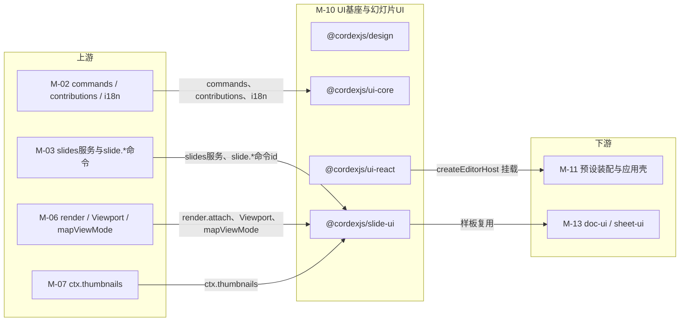
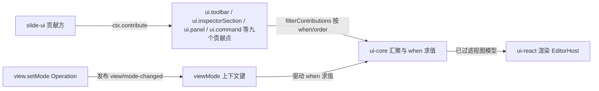
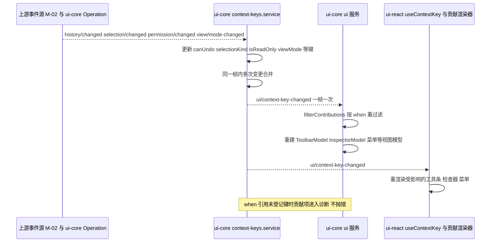
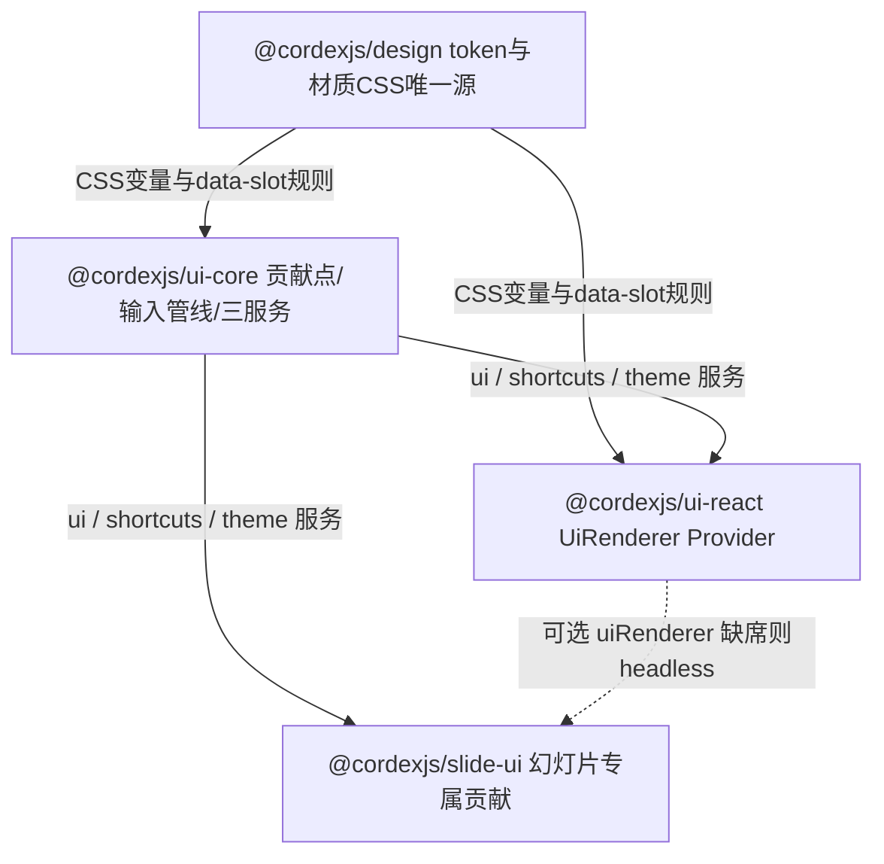

> 状态：草稿 v0.1 | 负责：架构-模块（阶段二，M-10） | 更新：2026-09-19、2026-09-24（rulings §4.15）、2026-09-24（复核修正，rulings §4.17）、2026-09-25（补图）、2026-09-25（矛盾收口，rulings §4.18）、2026-09-25（§4.19）、2026-09-26（§4.20）、2026-09-26（§4.20 FE-08）、2026-09-26（§4.21：插入页签分组与命令绑定按设计 03-04 统一、超链接改 M2 P1、表格 M2 可插入；快捷键逐条登记；cn 改 codemod；颜色面板用 react-colorful；形状库数据文件、插入工具态、元素手柄、图标与符号面板）；2026-09-26（§4.21 整合：登记 ui-react 4 个与 slide-ui 17 个新文件及依赖（GradientEditor、DataGrid、useSchemaForm、表格选区、查找替换、图表数据网格与抽屉、表格样式库等）；§3 增右键菜单与命令对照表；插入页签图表菜单与 M2 禁用、公式灰显；§6 颜色与渐变类型；§9 测试扩充；裁剪控制器统一为 crop.ts）；2026-09-30（§4.21 剩余缺口样张回写 · 复核修正：BorderPicker 的边框预设改为设计 03-30 的 10 个；MiniToolbar 槽位名改为 `toolbar.chart` / `toolbar.table-cell`（前端 50/10 §5 命名））、2026-09-30（§4.22 设计待决收口：材质改三档，新增浮层档 `glass-float`；迷你工具条与画布浮签画在屏幕坐标浮层；`TableGridPicker` 悬停 8 行 × 10 列、新增 `InsertTableDialog`（上限待性能评估，暂按 75 × 75）；新增共用 `ChartTypeMenu`；图表数据面板为检查器加宽到 440；空占位符图标条单一停靠点、可折叠、表格图标弹网格；边框预设删「待用户确认」；公式按钮与 M4+ 条目禁用而不隐藏）；2026-09-30（§4.22 复核修正：§2.6 插入页签绑定行把「图标…」移到形状组（2026-09-30 样张确认），落点补「已选中的空占位符优先」，图表插入后改为展开检查器「数据」分区；§9 `insert-tool.test.ts` 补 Q1 落点断言（50/10 V21））；2026-10-01（§4.23 插件管理：ui-react 增 `ui/plugins/` 六个组件（个人插件面板、管理员插件表、三态单选组、变更确认卡、插件详情、缺插件横幅），作为 SDK 交付物（D22），数据由调用方注入）；2026-10-04（design-language-v3 第 0 批：按 rulings §4.25 DS-1…DS-6 改为 v3 结构——ui-core 删 `ui.ribbon` 与 `ui.statusBar`、增 `ui.inspectorSection`（九个 `ui.*`，全系统贡献点 27 → 26），定稿槽位 `create` / `create.more`、`inspector.<selectionKind>`、`rail.header`、`canvas.grid`、`mainMenu.<menu>`、`docMenu`，增 Operation `ui.setEditorView`★ 与键 `editorView`★、`slide.activeTool`★，`ribbon-model.ts` → `toolbar-model.ts`、`bar-and-menu-models.ts` → `menu-models.ts`；ui-react 删 AppBar / MoreMenu / RibbonHost / ribbon-primitives / ViewModeSwitch / StatusBar / ZoomBar，增 LeftRail / MainMenu / DocMenu / ViewToggle / SyncStatus / CreationToolbar / toolbar-primitives / ZoomMenu / FloatingCapsules；slide-ui 删 `ui/ribbon/` 六个页签、`ui/status/`、`ribbon-spec.ts`、`ribbon.contributions.ts`，增 `toolbar-spec.ts`、`menu-spec.ts`、`ui/toolbar/CreateTools.tsx`、`ui/grid/SlideGrid.tsx`、`NewSlideButton.tsx`、`SelectionTitle.tsx`、`toolbar.contributions.ts`，检查器分区按 v3 三种选中态拆节；§2.6 改为「入口 → 命令」；视觉改 v3 中性平面（DS-2），design 删材质层（`material/glass.ts` → `tokens/elevation.ts`、删 `degradation.ts`）；§3a 改以 `src/v3/` 为迁移来源；§4 与 §5 同步，计数按实数改写；§9–§13 同步）；2026-10-04（design-language-v3 第 0 批：术语残留清理：`ui.ribbon` / `ui.statusBar` / ribbon / 状态栏的历史陈述改用 check-terms 认可的标记措辞（作废、废弃、取代、原名））；2026-10-04（design-language-v3 第 0 批：复验修正——`ui.inspectorSection` 的 `placement` 按 50/09 §6.1 改回 `top` / `body`，面板标题改由选区桥接器给出（§1.2、§2.3、§3、§3a、§4、§5、§6、§9；条目数与 40/16 的 15 一致）；槽位统一为 `inspector`（原 `inspector.tab`）、`grid`（原 `canvas.grid`）、`floating`（原 `canvas.floating`），G-21 结案；ui-react `InspectorDock.tsx` 改名 `Inspector.tsx`、新增横幅通道 `Banner.tsx`（§4.3 与 §5.3 各增 1，64 文件），§9 `inspector-dock.test.tsx` 改名并登记 `banner-priority.test.tsx`；`sectionsCollapsed` 标作废；放映舞台控制条去掉 `backdrop-blur-lg rounded-full` 改实色（DS-2）；`ZoomMenu.tsx` 按样张改为单页与网格同一实测口径；`/styleguide` 相关测试改为「组件状态基准路由」；§12 G-3、G-8、G-21、G-22、G-23、FE-12 与 DS-1/DS-5 回写行按现状改写；原「状态胶囊」改称文件名旁的同步状态行（rulings §4.25 DS-6），带作废标记的历史陈述统一措辞；§1.2 通用语言注明编辑器界面术语以章程 §4.6 为准）；2026-10-04（design-language-v3 第 0 批：复验第 2 轮修正——§6 `focusRegion` 补网格视图的 `'grid'`（与 50/09 §6.3 一致）；§5 `ZoomMenu.tsx` 行与 §4 注释改为单页与网格同一口径（实测读数 + 命令，不带选中态，命令为放大 / 缩小 / 适应窗口 / 适应宽度 / 50%–200%）；§1 术语表与 §2.1 创建工具条的视图模型统一为 `CreationToolbarModel`（上下文与评审条为 `ToolbarModel`）；§3a 改指 `Inspector.tsx`；§4 / §5 `MainMenu` 顶层加「返回首页」、方标改三种中性色，`LeftRail`、`FloatingCapsules`、`Banner`、`EditorShell` 注释按样张补返回首页与模式的落位、网格胶囊同步状态的紧凑形态、横幅在网格视图同样占文档流，`Inspector` 注释补编辑模式降权的 `aria-disabled` 形态；§2.6「更多」行的页眉页脚、图标、公式等改为「入口随第 1 批定稿」不预设放在「更多」；§3 单字母工具键改为「是否采纳随第 1 批」；`ChartDataDrawer` 两处旧称「检查器坞」改为「检查器」；§13 Q-12 与 §2.6 主菜单「视图」「文件 / 插入 / 帮助」两行注明样张已起草的条目（返回首页、导出与保真报告归「文件」、帮助、网格与参考线）；§1 术语表主菜单补「返回首页」，`Brand` 注释与 §3a `brand.tsx` 行的方标改三种中性色；§9 `inspector.test.tsx` 注释补降权形态；BC-16 做清单的旧称「检查器坞」改为「检查器」（目录树与文件表的文件数不变））；2026-10-04（design-language-v3 第 0 批：复验第 2 轮补充——§2.5 ui-react 配置 `inspectorRange` 由 [240, 720] 改为 [240, 480]，与 PRD ED-12、50/10 §2.1 一致（样张固定宽，是否允许拖宽随第 1 批定稿；目录树与文件表的文件数不变））；2026-10-05（design-language-v3 第 0 批修正：按 rulings §4.25 DS-19、DS-20 与 DS-6 收口——§2.6「更多」内置项去掉样张原列的「组件」、链接改注 `Mod+Shift+K`（DS-11），§4.3 `DocMenu.tsx` 去掉「移动到…」（DS-19）；无选中检查器由四节改为版式 · 主题 · 背景三节，「页面颜色」并入背景（BC-15、§2.6、§3 贡献清单、§4.4 `inspector-spec.ts` 与 `SlideSection.tsx`、§5.4 导出去掉 `SlidePageColorSection`、§9 `inspector-spec.test.ts`、§11 端到端断言，DS-20）；§9 `inspector-spec.test.ts` 删去 `placement:'title'` 作废前的「每种类至多一条 title」断言；§4.3 `LeftRail.tsx` 的返回首页与账户入口按 DS-18 写定；§4.3 `toolbar-primitives.tsx`、§4.4 `CreateTools.tsx` 的形状弹层距离写明参照物（距工具条外沿 8、距按钮 13，设计 04 §2.7、03-02 §3.4）；§5.2 `collab-ui-state.ts` 的「协作者胶囊弱提示」改为同步状态行（DS-6）；目录树与文件表的文件数不变）；2026-10-05（design-language-v3 第 0 批修正：快捷键值按 rulings §4.25 DS-11、DS-16 同步——§1.1 BC-14 `ctx.shortcuts`、§3 ui-react `ui.shortcut`、§5.3 `CommandPalette.tsx` 的命令面板由 `Mod+Shift+P` 改为 `Mod+K`；§2.6 主菜单「编辑」、§3 slide-ui `ui.shortcut`、§4.4 `FindReplacePanel.tsx` 的替换改为 Windows / Linux `Ctrl+H`、macOS `Cmd+Shift+H`；§3 slide-ui `ui.shortcut` 的超链接改为 `Mod+Shift+K`、工具单键 V / T / S / C 由「是否采纳随第 1 批」改为已登记，和弦数 63 → 67（§3、§4.4 / §5.4 `shortcut-table.ts`、§9 `shortcuts.test.ts`、§11 M2 追加注记同步），`shortcut-table.ts` 的平台差异改为替换键（原「F5 vs Shift+Cmd+Return」作废）；§13 Q-13 随命令面板改键结案，`F1` 备用和弦作废；目录树与文件表的文件数不变）；2026-10-05（design-language-v3 第 0 批修正：按 rulings §4.25 DS-13 去掉文字迷你工具条——§1.2 槽位示例删 `toolbar.text-editing`（注明 50/09 §6.1 待回写），§3 slide-ui 贡献清单与 Manifest 删 `slide.toolbar.textEditing`，§4.4 `MiniToolbar.tsx` 与 §5.4 文件表删 `TextEditingToolbar` 与 M2 单元格选区文本条、只留对象条（去留随第 1 批）；按 DS-14 改 §4.4 `PlaceholderContentBar.tsx`（检查器不设「插入到占位符」组）；按 DS-15 改 §4.3 `Inspector.tsx` 与 §9 `inspector.test.tsx`（评审、只读浏览与降权统一只读展示，取消表格与图表的 `aria-disabled` 例外）；按 DS-18 改 §1.2 主菜单术语、§2.6 主菜单行、§4.3 / §5.3 `MainMenu.tsx`（顶层项「插件…」，槽位待 50/09 §6.1 补登）与 §3 尾部区去向（主题切换在账户菜单「亮暗主题」、快捷键面板另有主菜单「帮助」），§3a、§4.3、§5.3 `UserMenu.tsx`（由自己的头像打开、条目以 PRD AS-06 为准、头像 24）；按 DS-9 改 §4.1 `semantic.ts`、`controls.ts`（字段 1px `border-control`、选中块 `seg-on-line`）、§9 `contrast.test.ts` 与 §10 对比度门禁（配对以设计 04 §2.6 为准）；§3 Manifest 的 `ui.shortcut` 计数补改为 67；§12 增一行；目录树与文件表的文件数不变）；2026-10-07（design-language-v3 第 0 批余项：§1.2 槽位行注明 50/09 §6.1 已删去 `toolbar.text-editing`（DS-13）；文件数不变）；2026-10-07（design-language-v3 第 1 批：按 rulings §4.25 DS-21…DS-30、TB-1…TB-30 与已拍板样张（设计 03-02 §2–§6、03-04、03-05、03-14…03-21、03-26…03-28、03-30、03-31）回写——§1–§3 删对象上下文槽位 `toolbar.<selectionKind>` 与 `slide.toolbar.imageSelected` / `tableSelected` / `chartSelected`，ui-react 删 `ToolbarHost.tsx`、slide-ui 删 `MiniToolbar.tsx`、`SlideUiConfig.miniToolbar` 作废（TB-29、DS-13、DS-22）；评审条与浏览条的固定项归外壳（TB-1），ui-react 增 `ReviewToolbar.tsx`，`reviewBar` 增评论计数条目；紧凑与仅查看形态定稿（DS-17、DS-21），ui-react 增 `ShellDrawer.tsx`、`NarrowShell.tsx`、`BottomSheet.tsx` 与画布原语 `canvas-primitives.tsx`；母版横幅（DS-21、TB-14）增 `MasterViewBanner.tsx`，左栏「新建版式 ▾」与工具条「占位符」（DS-30）登记为 slide-ui 贡献；检查器分区按第 1 批补齐全部选中种类（矩阵 66 条），增 `PictureSection`、`AltTextSection`、`TableSection`、`GroupConnectorSection`；增 `ImageUrlDialog`（TB-7）、`DateTimePicker`、`UploadPlaceholder`、`ThemeGallery`；图表数据面板 280 → 400、紧凑形态为底部 Sheet，入口只有检查器「数据」分区「展开」，「更改类型」为检查器「类型」字段（DS-22、DS-26、TB-11、TB-12）；层级增 `--layer-panel` 30、轻提示 300 → 15（TB-2）；分隔条可拖、按文档记忆（TB-24、TB-25）；裁剪「取消」回到进入前（TB-4）；快捷键 67 → 70（DS-29）；网格间距 6 / 12 / 18 pt（DS-27）；§2.6 主菜单、右键与命令绑定按样张定稿，去掉「随第 1 批」；§3a 登记第 1 批 kit 与场景件的落点；§4 与 §5 各删 2 增 14（非复制件 217 → 229）；§9 测试说明同步（不新增测试文件）；§11–§13 同步，§13 增 Q-15…Q-17；同批他线回写跟进：§2.1 `EditorLayoutState.drawer` / `sheet`、§2.5 `EditorLayoutOptions.rememberKey` / `view`、§6 `EditorHostProps.onViewChange`（TB-24、TB-30，50/10 §2.1、§2.3、50/02 §2）；§4.2 / §5.2 `slots.ts` 增 `'mainMenu'` 与 `'banner'`，§2.6、§3、§4.3、§4.4、§5 去掉「槽位待 50/09 §6.1 登记」，§12 G-24 结案（50/09 §6.1 已登记）；母版视图「帮助」里的「关于母版继承」改归 M-11 shell-glue 的 `help-center` 意图（50/03 §8）；`EditorShell.tsx` 登记三种形态的区域容器名（50/10 §1.1）；§9 `shortcuts.test.ts` 补 `Mod+Shift+V`（70/06 §14））；2026-10-08（design-language-v3 第 1 批收口：按 rulings §4.25 DS-31…DS-33、TB-31…TB-52 回写——形状检查器增「快速样式」行（「填充」节上方，点开 42 格样式库弹层，DS-31）与「替代文本」节（TB-32），slide-ui 增 `ui/inspector/ShapeStyleSection.tsx`，分区矩阵 66 → 68；形状「不透明度」绑 `slide.setShapeOpacity`★（TB-47）、母版改名绑 `slide.renameMaster`★（TB-46），§13 Q-15…Q-17 结案；「幻灯片大小…」进主菜单「文件」、P2 前不可用（DS-31，slide-ui 增 `mainMenu.file` 条目）；母版检查器占位符勾选项「正文」改「文本」（TB-34）；母版视图不可进入的判定按 TB-44 改为非完整形态、原因「在更大窗口中编辑」；主题画廊内置 5 套、每套 3 个色板变体（DS-32、DS-33），删除版式 / 母版对话框文案、版式重置与页眉页脚「应用」按样张（DS-32）；产品 `/styleguide` 的内容由 ui-react 新增的 `ui/styleguide/StyleguidePage.tsx` 经子路径 `./styleguide` 提供、apps/web 只在测试环境挂出（TB-3、TB-50），ui-react 原 `__tests__/e2e/` 的三个 Playwright spec 改登记到 40/11 §9 的 apps/web/e2e（70/06 §3.1）；布局记忆登出清除（TB-41）、平板仍只读评审（TB-49）、段前段后始终 pt（TB-33）、插件条目收纳暂行规则（TB-31）、「选择」仍由 slide-ui 贡献（TB-38）、帮助中心与开发者面板（TB-39、TB-40）、表格网格未选格描边（TB-35）、内阴影与图片填充 P2（TB-43）、背景「应用到全部」（TB-45）、评审右键说明行（TB-51）、符号面板焦点（TB-52）；§12 G-25 按 TB-48 结案并增「2026-10-08 回写」；非复制件 229 → 231）；2026-10-08（design-language-v3 第 1 批收口：§4.4 `ShapeStyleSection` 注释按设计 04 §4.1a 改为整行一个按钮、在样式库里应用，样张状态已补；§4.x `select.tsx` 用途与 §9 `editor-host.test.tsx` 注释去掉「模式下拉」，rulings §4.25 DS-23、DS-31）；2026-10-08（design-language-v3 第 1 批评审修改：按 rulings §4.25 DS-34…DS-37、TB-55…TB-58 改控件画法与快速样式——安静样式定为缺省（DS-35 修订 DS-9 的「输入框加 1px 独立边界」，控件边界不再要求 3:1）：§1.1 BC-13、§1.2 术语「控件画法（安静样式）」、§3a `v3/v3.css` 与 `v3/ui.tsx` 两行、§4.1 / §5.1 design `tokens/semantic.ts`（增控件语义 token；`--border` 暗色改档；`--border-control` 只留给复选框、单选圈、滑块圆钮、插入表格网格、自己头像外圈、把手与滚动条等）与 `slots/controls.ts`（字段只铺 panel-2 淡底、悬停出细边，下拉透明底加细边，分段选中块面板色加细边并贴边（TB-55），开关按下强调色淡底（DS-36），按钮按下与页签选中只铺 panel-2，次按钮透明底加细边（DS-37），选中与按下另有字重 500、图标描边 2），§4.3 / §5.3 `inspector-fields.tsx`、§4.3 `Banner.tsx`、§5.3b 复制件用途（button、input、select、tabs、toggle、toggle-group）、§4.4 `FindReplacePanel.tsx` 与 `MasterViewBanner.tsx`、§6 design `ThemeVarName`；快速样式库改为「快速样式」节内原位展开（DS-34 修订 DS-31 的「弹层」）、缩略去白衬底（TB-56）：§2.6「检查器 · 形状」、§3a `builtin.tsx` 行、§4.4 / §5.4 `ShapeStyleSection.tsx`（`ShapeStyleGallery` 不再是弹层组件，同文件不改名、不合并，依赖去掉 `ToolPopover` 与 popover 复制件）、§9 `inspector-sections.test.tsx`；§9 `contrast.test.ts` 与 §10 对比度门禁去掉控件边界的 3:1 配对；TB-57、TB-58 范围外的项不改；§12 增「2026-10-08 回写（第 1 批评审）」并给第 0 批 DS-9 行、收口 DS-31 行加修订注记，§13 Q-15 加修订注记；目录树与文件表文件数不变）；2026-10-15（design-language-v3 第 2 批：按 rulings §4.25 DS-38…DS-62 改 §2.5 布局配置（historyWidth 560 作废）、§3 画布空白处右键加「添加评论 C」与降级元素右键、§4.3 / §5.3 `Inspector.tsx`（整栏面板两档宽度、「分享」待处理申请圆点）、`inspector-fields.tsx`（增 FoldRow、LoadingRow、PanelState、Switch、Progress、LoadMoreRow、Attribution、ObjectNotice 与 MenuField 列表行内变体）、`Inspector.tsx` 同文件导出整栏外框 `InspectorTakeover`、`PresenceStack.tsx` 同文件导出 `ShareButton`（50/09 §5a.6 报来的共用件）、§4.1 design `tokens/extended.ts`（身份色 12 色定稿 DS-42、状态色不改 DS-41、`--destructive-solid` / `--destructive-solid-hover` / `--scrim` 契约名）、§2.6 与 §4.2 / §5.2 `toolbar-model.ts`、`inspector-model.ts`、`menu-models.ts` 的插件收纳（DS-49，取代 TB-31 暂行规则）、§4.4 `toolbar-spec.ts` 评论工具保持按下（DS-44）、`Banner.tsx`（版本预览两条叠放、插件横幅先后与重现、中性底插件横幅、六类不可关闭）、`SyncStatus.tsx`（新增各态）、`NarrowShell.tsx`、`canvas-primitives.tsx`、`OverlayHosts.tsx`（轻提示播报与焦点交回）、`PersonalPluginPanel.tsx`（对话框 640）、`MissingPluginsBanner.tsx`，§4.4 / §5.4 `CommentsTab.tsx`、`CommentPins.tsx`、`inspector-spec.ts`（degraded 分区），§9 `banner-priority.test.tsx`；§4.2 `inspector-model.ts`、`slots.ts` 与 §8 generic 行：第三方整页面板改为 400 整栏、不作检查器页签（DS-38）；§3a 迁移表登记 `kit/InspectorTakeover.tsx` 与第 2 批场景件；§12 增「2026-10-15 回写」；目录树与文件表的文件数不变；同日再补：按 rulings §4.25 DS-64、DS-65 与 TB-59…TB-62、TB-68、TB-70 补齐——ui-core `contribution-items.ts`、`inspector-model.ts`、`slots.ts` 与 §3、§6 的 `InspectorSectionItem` 增可选 `expandPanel`，页签只收内置包条目、第三方 `ui.panel{slot:'inspector'}` 只作整栏面板（TB-59）；整栏宽度按 TB-60 改为「沿用检查器宽度（缺省 280）/ max(400, 检查器当前宽度)」（§2.5、§3a、§4.3 / §5.3 `Inspector.tsx`、`EditorShell.tsx`，§4.4 / §5.4 `ChartDataDrawer.tsx`，§8、§9）；§3 降级元素右键在评审、只读浏览与降权下照常出现（DS-64），评论钉右键由 `CommentPins` 直接渲染、不开放贡献（TB-61）；§2.6、§4.4 / §5.4 `insert-tool.ts`、`toolbar-spec.ts` 写明评论工具与 ↵ 的生效条件（TB-62）；slide-ui 增 `ui/canvas-overlays/CommentComposer.tsx`（浮动撰写框、@ 候选与评论工具提示条，换页草稿按页留在内存，DS-65），`CommentPins.tsx` 补悬停小卡、聚合钉、钉右键与整栏面板先收起；§4.3 / §5.3 `PresenceStack.tsx`、`Inspector.tsx` 与 §6 写明「分享」圆点的计数来源与 EditorHost 属性（TB-68）、插件分区展开状态键设备级保留（TB-70）；§3a 登记 `editor/inspector/degraded.tsx` 与 kit `BannerStack` 的落点；§4.1 / §5.1 `extended.ts` 补身份色哈希顺序与中性评论钉色；§9 登记 slide-ui `comments-panel.test.tsx`、`comment-pins.test.tsx`、`comment-tool.test.ts` 与 ui-react `list-states.test.tsx`，改写既有测试注释，`contributions.test.ts` 的分区计数 68 → 71；§12 再增一节 2026-10-15 回写；slide-ui 96 → 97，非复制件 231 → 232；同日再补：§4.3 `SyncStatus.tsx` 的「文档正忙」用中性锁形图标（TB-66），§9 `editor-shell.test.tsx`（分隔条两档，TB-60）、`chrome.test.tsx`（「文档正忙」、`ShareButton` 只从属性取数，TB-66、TB-68）、`hosts.test.tsx`（降级元素菜单在评审、只读浏览与降权下照常弹出，DS-64）、`comment-pins.test.tsx`（钉菜单不经 `ui.contextMenu`，TB-61）按 70/06 §2.2 补注释，§2.6 图表插入行的「加宽到 400」改为「整栏」，§12 同一节的表增一行；文件数不变；同日再补（rulings §4.25 TB-85、TB-79、TB-84、DS-59）：ui-react 增「导出本地副本」对话框 `ui/shell/ExportLocalCopyDialog.tsx`（`ui.dialog` 模板 `export-local-copy`，模板 3 → 4 个，可选注入增 `collab`，§3 与 Manifest 同步），`Banner.tsx` 的「导出为本地副本」改为打开它、长离线「已恢复」的页码改为取自垂直束桥接器；slide-ui 增 `domain/affected-pages.ts`（实体 id → 页码，供长离线提示与对话框列表）；`CommentComposer.tsx` 与 `comment-tool.test.ts` 注释补恢复不改评论工具状态、收起前焦点先交画布、进入网格视图与切到评审模式同换页（TB-79、TB-84）；§12 再增一节 2026-10-15 回写；ui-react 69 → 70、slide-ui 97 → 98，非复制件 232 → 234；同日再补：§4.4 / §5.4 `CommentComposer.tsx` 补文本范围的撰写框恢复后不恢复文字编辑、切模式仍在同一页即当场恢复（rulings §4.25 TB-87）、有恢复的撰写框时再次发起评论只把焦点移进它（TB-88）而评论工具照各入口原有规则按下（TB-97）、锚点不在时的退化（TB-92）与撤销删页不带回草稿（TB-99）；§9 `editor-shell.test.tsx`、`contribution-renderer.test.tsx`、`hosts.test.tsx`、`comment-tool.test.ts` 注释按 70/06 §2.2 补断言（TB-60、TB-77、TB-87、TB-88、TB-92、TB-97、TB-99，设计 07 §2.3）；§4.3 / §5.3 `NarrowShell.tsx` 写明翻页条「评论」只计本页未解决、幻灯片列表每页的读屏名（TB-89）；§12 再增一节 2026-10-15 回写；文件数不变）；2026-10-22（design-language-v3 第 3 批：按 rulings §4.25 DS-75、DS-76、DS-78、DS-82、DS-89…DS-91、DS-94…DS-95、DS-105…DS-117、DS-126…DS-136 与 TB-103…TB-106、TB-111…TB-113、TB-116…TB-121、TB-123…TB-125 回写——design 只留单档控件尺寸（删 `compact` 覆盖块与 `Density` 类型）、增舞台黑屏 / 白屏与备注区底色 token；ui-core 删上下文键 `density`、`ThemeService.setDensity` 与 `ui.theme` 的 `density?`，`explainWhen` 补触控与嵌入的原因；ui-react `SettingsDrawer.tsx` 改名 `SettingsDialog.tsx`（居中对话框 480，`ui.dialog` 模板 `settings-drawer` 改名 `settings`），增 `ui/shell/FollowBar.tsx`（编辑器与放映共用的跟随条与跟随外框），`ShortcutsPanel` 改画布浮动面板、`CommandPalette` 不加遮罩、`UserMenu` 主题三项与 M2 不显示「个人资料…」、`PresenceStack` 他人头像为「跟随」按钮与同色序号角标、`ViewToggle` 改分段画法、`NotesBar` 凹陷底、紧凑抽屉从横幅下沿开始、平板评论面板按方向落位、`ExportLocalCopyDialog` 增 `reason` 参数、`EditorHostProps` 增 `embedded`、`UiReactConfig` 增 `preferences`（TB-118），复制件 `toggle-group.tsx` 的用途删「密度」；slide-ui 放映（吞 F5、结束页、窗口内「全屏」、跟随、停在最后显示的页）与锁定比例未锁时的图标；§2.6 主菜单「导出…」改 `Mod+Shift+E`、文档菜单只给编辑者；§3a 登记第 3 批场景件与转正并入 kit 的件（`roving`、`chord`、`PageJump`、`stage`、`Follow`、`CommandPalette`、`DropOverlay`、`library`、`PagePlaceholder` 的去向），`canvas-primitives.tsx` 增 `PageJumpHint` / `PageJumpInput`（编辑器与放映同一个页导航提示条，TB-104）；§5.3 变更确认卡与两张当下确认卡的初始焦点分开写（TB-120）；§9 登记 ui-react 新增的五个组件测试（user-menu、settings-dialog、shortcuts-panel、command-palette、presence-stack，70/06 §2.2）并同步其余注释；§12 增 2026-10-22 回写；§13 Q-14 结案、增 Q-18（页级占位的渲染侧落点）；ui-react 70 → 71，非复制件 234 → 235）；2026-10-22（design-language-v3 第 3 批，回写中新增的口径：§2.5 `UiReactConfig.preferences` 写全类型——可锁键 `PreferenceKey` 五个、`values: Partial<Preferences>`，§6 导出 `Preferences` / `PreferenceKey`（rulings §4.25 TB-118）；§2.5 `UiCoreConfig` 增只读宿主配置 `host.embedded`，`explainWhen` 据它给嵌入的原因、不新增上下文键，触控设备上的形态原因一律「在电脑上编辑」（TB-150、TB-136）；slide-ui 注册无参 Operation `slide.zoomToFit`、`slide.zoomTo100`，命令面板各列一条、`Mod+0` / `Mod+1` 改绑（TB-149）；降权时文档菜单三项写「需要编辑权限」（TB-138）；「关于母版继承」与命令面板「帮助中心」按配置出现（TB-132）；M2「分享」留在原位不可用写「后续版本提供」（DS-137，宿主属性见新增的 §13 Q-19）；备注为空一律「这一页没有演讲者备注」（DS-138）；放映不允许全屏时「更多」里没有「全屏」（TB-134）；缩略图虚拟化 overscan 6、不超过 12 项（TB-135）；「导出本地副本」未点名原因用中性句（TB-139）；页级占位落到 40/07、Q-18 结案（TB-151）；`extended.ts` 删 `--stage-chrome` / `--stage-foreground`（50/09 §2）；`contrast.test.ts` 补第 3 批四组配对；§2.4 `ui/theme-changed` 注明载荷只含主题（DS-76）；§12 增一节记这些改动；文件数不变）；2026-10-22（design-language-v3 第 3 批回写收口：§6 `EditorHostProps` 增 `shareUnavailable?: 'later'`——M2「分享」留在原位、工具提示「分享 · 后续版本提供」（rulings §4.25 TB-161），§13 Q-19 结案；形态原因按原因定先后，触控设备不论嵌不嵌入都写「在电脑上编辑」、嵌入只改写窗口窄那一句，母版视图 `enablement` 改为触控条件在前（TB-159、TB-136）；命令面板的壳意图来自 shell-glue 的无参 Operation（TB-162）；快捷键面板在手机为底部面板、平板为浮动面板、只在开始页与文档列表上出现，触控形态的菜单项不写键位提示（TB-154）；`ContextMenuItem` / `CommandPresentation` 回填 `external?: true`（DS-89、TB-132）；`ExportLocalCopyDialog` 的 `reason` 改指 50/09 §6.1、`doc-deleted` 改为 `document-deleted`（DS-129、TB-139）；`extended.ts`、`NotesBar.tsx`、`PresenterStage.tsx` 的舞台与备注区 token 写法对齐设计 04（`StageScope`、`--v3-notes-fill` / `--v3-notes-placeholder`）；左栏与网格的 `Mod+D` 为复制幻灯片；放映「全屏」只在非全屏且允许全屏时出现（TB-134）；§9 注释按 70/06 同步；§12 增一节；文件数不变；2026-10-22 复核修正：形态原因按 TB-163 改为「先窗口窄、再触控、再桌面」（「触控设备」只指平板，手机不论是否触控都按窗口窄写，母版视图 `enablement` 同改），ui-react 的 `Mod+/`、`Mod+,` 带仅查看形态不匹配的 `when`（TB-154），触控形态的菜单条目不写键位提示（TB-164）；查看者的「导出…」原因改为「只有查看权限」（DS-105）；§3a 账户菜单一行删去「待决」与「亮暗主题」（DS-90、DS-91）；§5.3b 复制件用途去掉已作废的设置抽屉与快捷键侧滑面板（DS-113、DS-115），复制件数统一为 44；§12 增四行；`BottomSheet` 补手机上偏好设置与快捷键面板用的模态一档（TB-118、TB-154），降权时「创建副本」不可用补引 DS-139，§12 第 3 批第一节嵌入一行补指向 TB-159、TB-163 的细化；`LeftRail` 顶行的 `ViewToggle` 由 24 改为 28（DS-133），§5.3b 复制件用途删去已作废的「设置分组」「设置开关」（DS-113、DS-114）；仅查看形态的横幅在手机与平板都放在最顶上、按钮只在一行放不下时才换到文案下方（TB-172，`NarrowShell.tsx`、`Banner.tsx` 与 §9 `banner-priority.test.tsx`，原写「宽度 < 640 时」），§9 `when-clause.test.ts` 写明手机且触控的一例、「触控设备」限定为平板（TB-163）；§12 再增两行；§2.3 / §4.2 / §5.2 `explainWhen` 写明只读浏览（查看者）里 `editorMode == 'edit'` 与能力位为假都返回「只有查看权限」、评审者与降权仍为「需要编辑权限」，§9 补两例（DS-105，50/09 §6.2）；`NarrowShell.tsx`、`Banner.tsx` 与 §9 `banner-priority.test.tsx` 补触控形态的横幅按钮 44 高、横幅随之撑高，DS-75 的 40 只指非触控形态（TB-172 补句）；`PresenterStage.tsx` 与 §9 `present.test.ts` 补触控形态「更多」不写键位（TB-164）；§12 再增三行；`SettingsDialog.tsx` 的「关于 › 复制」经宿主取诊断包——有 host 时取 `host.dumpDiagnostics()`（40/02 §5.2），没有 host 的独立态经可选属性 `getDiagnostics`（rulings §4.25 TB-177），§12 再增一行）；2026-10-23（design-language-v3 第 3 批评审修改，rulings §4.25 DS-140…DS-143、TB-179…TB-183：全站对话框按 Figma 统一——design `slots/floating.ts` 的对话框规则改为标题栏 40（标题左内边距 16，× 为 24 图标按钮、右内边距 8、用正文色、悬停 panel-2）、圆角 12（confirm 变体同此），右侧模态抽屉的标题行同此，`BottomSheet` 的触控标题行（48 高、44 的关闭）不变（DS-142）；`DialogHost` 的宽度档增导入专用的 import 560（TB-179）；ui-react 增文件类型图标 `infrastructure/file-type-icons.tsx`（Tabler Icons 3.49.0 原件，MIT，复制进本包、不加依赖，按 ADR-0049 登记内置源码，DS-143、TB-182），根导出 `FileTypeIcon`，「导出本地副本」对话框的格式行带图标；`BottomSheet` 的模态一档另给导入对话框的手机形态，可设点遮罩不关（TB-180、TB-181）；`semantic.ts` 的 `--border-control` 补导入落区的例外（DS-141），design `contrast.test.ts` 注释补本次核算；§3a 登记评审修改后并入 kit 的 `importDialog`、`BottomSheet`、`FileTypeIcon` 与导入场景的对话框件；ui-react 71 → 72，非复制件 235 → 236；§12 增一节；§10 对比度门禁一行补本次三组计入项（与 §9 `contrast.test.ts` 注释、50/09 §12 V3 一致））；2026-10-28（design-language-v3 母版视图改版第一步「全局接线」写码前登记，用户尚未拍板：§3a 增「母版视图改版 · 第一步全局接线的新件（2026-10-28 登记，拍板前）」一行，登记 playground 新件 `v3/editor/master/{types,mode,registry}.ts`、`v3/editor/master/host.tsx`、`v3/scenarios/masters-themes/master-impl.tsx` 与 `v3/editor/palette-host.ts` 的去向（`master-impl.tsx` 是第一步的适配层、第二步整份换掉，`registry.ts` 与 `palette-host.ts` 仅演示不迁移）；rulings 编号待用户拍板后补；§4 目录树与 §5 文件表不变）；2026-10-29（design-language-v3 母版视图改版第二步「按标杆重做」写码前登记，用户尚未拍板：§3a 增「母版视图改版 · 第二步按标杆重做的新件（2026-10-29 登记，拍板前）」一行，登记 playground 新件 `v3/editor/master/proposals.ts` 与 `v3/scenarios/masters-themes/master-view-options.scenario.tsx` 的去向（都仅演示、拍板后删）；第一步一行的说明 ① 补「第二步原地重写」一句；rulings 编号待用户拍板后补；§4 目录树与 §5 文件表不变）；2026-11-04（design-language-v3 母版视图改版：§3a `proposals.ts` 删除登记、对比场景改为未采纳演示；rulings §4.25 DS-173）；2026-11-04（design-language-v3 母版视图改版 · 其余回写：§0 文件规模；§1.1 BC-15、§1.2 术语（「编辑对象」「上下文条」「占位符标注」等）、§1.3 与图 1-1；§2.1 视图模型、§2.3 纯函数；§2.6 工具条、左栏顶部、检查器（无选中、形状、文本、空占位符与「转到版式」顶行）、主菜单「编辑」「视图」、文件与文档菜单、母版视图行与绑定段（登记两个无参 Operation `slide.openPlaceholderMenu`、`slide.viewLayoutPages`）；§3 ui-core `ToolbarItem` 签名（增可选 `group`）与 slide-ui 的贡献点、生命周期、Manifest、右键表；§3a 第 1 批场景件、版式件与第一步一行；§4.2–§4.4 目录树（slide-ui 删 `ScopeBar.tsx`、`InheritedPlaceholderOutline.tsx`，增 `ui/canvas-overlays/LayoutsMultiGrid.tsx`）；§5.2–§5.4 文件表与 §5.3b；§6 接口与导出类型；§8；§9 测试说明；§11 里程碑；§12 新增一节，G-7、G-15 两行补注；同日再补：§1.1–§1.3、§4.4 / §5.4 `master-view.ts` 与 §4.4 `locales/zh-CN.json` 写明启用标注覆盖层时传标注文案与是否 M2，§2.1、§4.2 `inspectorTakeover` 没有整栏面板时为 `null`，§2.6 与 §4.4 / §5.4 `PlaceholderSection.tsx` 占位符节的依据改指 PRD ML-03、设计 03-26 §5，§3a 两行（对比场景的题名；第一步一行列全 `mode.ts`、`types.ts`、`host.tsx` 的导出），§4.3 `ViewToggle.tsx`，§4.3 / §5.3 `PresenceStack.tsx`、`FollowBar.tsx`，§4.4 `inspector-spec.ts`，§4.4 / §5.4 `InheritanceNotice.tsx`、`testing/index.ts`（多母版变体），§5.4 `shortcut-table.ts`，§9 测试注释与夹具来源，§12 新节补行；再补：§1.1–§1.3 与图 1-1、§4.4 / §5.4 `master-view.ts`、§9 `master-view.test.ts` 与 §12 写出标注覆盖层的启用入参 `MasterAnnotationsOptions`（`labels`、`m2Locked`），§5.4 `master-view.ts` 的依赖补 slide-render 的这一类型，§2.3 `renameError()` 返回的原因键，§3a 第一步一行补 `host.tsx` 的 `MasterKeysLive` 与 `palette-host.ts` 的 `getPaletteHost`、版式件一行改写 `LayoutArt` 的 `master` 画法一句，§4.3 / §5.3 `PresenceStack.tsx` 与 §9 `presence-stack.test.tsx` 补在线列表各行只去掉悬停底色，§4.4 / §5.4 `locales/zh-CN.json` 写明母版视图的文案与在线列表底部的说明，§5.3b `checkbox.tsx`、`switch.tsx` 两行改正（「放映时跳过此页」「隐藏背景图形」「保留母版」是复选框，开关只用于个人插件的启停；DS-25、DS-56，设计 03-02 §4.1、03-26 §3、§5），「转到版式」顶行只挂空占位符与文本两种选中种类、来自版式占位符的标题与文本框选中与编辑文字都按 `text`（50/10 §5；§2.6「检查器 · 形状」行去掉指向这一行的一句、「检查器 · 文本」行补上选中，「检查器 · 其余选中种类」行与 §4.4 / §5.4 `inspector-spec.ts`、`InheritanceNotice.tsx`、§9 `inspector-spec.test.ts` 的「选中时按 `shapes`」「另挂 `shapes`」作废），分区计数随之为 76（§3、§4.4、§5.4、§9、§12），§2.6「主菜单 · 视图」母版视图的 `enablement` 补 `inspectorTakeover != 'version-history'`、文档打开中由外壳整体置为不可用（TB-209，子句照 50/11 §3），§4.4 `MasterViewBanner.tsx` 说明段的条件与文案按设计 03-26 §6.3 补齐（含引用数 ≥ 1 一条）；rulings §4.25 DS-144…DS-177、TB-186…TB-210；需求编号、优先级与里程碑划分不变）；2026-11-05（prd-v3-current：§4.4 目录树 `shortcut-table.ts` 一行的注释里 Mod+D 在画布上的功能名随 PRD ED-08、ED-16 由「复制对象」改为「原位复制」；文件、和弦数与命令不变） | 依赖：00-module-map.md M-10 / BC-13…BC-15（BC-16/17 为下游）、charter v0.2 §5.2（design / ui-core / ui-react / slide-ui 四行）§5.4 UI 行 §5.5、30-architecture 02 §4.17–4.20、03 §3.6、05 §13.3、ADR-0017（含 2026-09-16 Rhea + 材质层修订段与 2026-09-18 术语修订）、rulings §4.6–§4.10（Q9–Q21）、20-design 09 v3.1 / 04 v0.5 / 03-screens 02·03·04·15·20·24·26、50-frontend 10 §4–§7、§10.4 与 22、rulings §4.21（R-d-12、R-d-13、R-d-61、R-d-62、R-d-66、R-d-67、R-d-72、q-table-depth、q-extra-inserts）、playground `src/index.css` 与 `src/components/**`；上游模块文档 M-02 §2.4/§2.6/§3/§6、M-03 §2.6/§6、M-06 §2.5、M-07 §2.5/§2.6/§3/§6；rulings §4.25 DS-1…DS-8、20-design 03-screens/02（v3 重写）· 04 v1.0 · 06 §2.1 / §2.6 / §2.7 / §2.12、playground `src/v3/`（2026-10-04 起取代 `src/index.css` 与 `src/components/**` 作为视觉与结构基线）；rulings §4.25 DS-21…DS-30、TB-1…TB-30；20-design 03-screens/02（第 1 批）· 04 · 05 · 14–21 · 26–28 · 30 · 31，04 §2.10–§2.13、§4.1a、§4.2、§5；playground `src/v3/kit/` 与 `src/v3/scenarios/`（第 1 批拍板）；rulings §4.25 DS-31…DS-33、TB-31…TB-52（2026-10-08 收口）；rulings §4.25 DS-34…DS-37、TB-55…TB-58（2026-10-08 第 1 批评审）、playground `src/v3/v3.css` 控件语义 token、`src/v3/ui.tsx` 控件外框常量与 `src/v3/editor/inspector/builtin.tsx` 快速样式；rulings §4.12、§4.15、§4.18、§4.19、§4.20、§4.22、§4.23 与 §4.25 DS-9…DS-20、DS-38…DS-143（含 DS-63）、TB-59…TB-185（本文已引用、此前未列，2026-11-04 补列）；rulings §4.25 DS-144…DS-177、TB-186…TB-210（2026-11-04 母版视图改版）、20-design 03-screens/03 与 26、50-frontend 07 §11、09 §5a.6 / §6.1 / §6.3、10 §1.2 / §5、11、16 §1 / §7 / §8、PRD ML-03、70-testing 11 §4、上游模块 M-07（标注覆盖层，§2.5 启用入参 `MasterAnnotationsOptions`、§6 类型导出）

# 10 UI 基座与幻灯片 UI（限界上下文 BC-13 设计系统 · BC-14 UI 基座 · BC-15 幻灯片 UI）

## 0. 一页总览

| 项 | 值 |
|---|---|
| 职责一句话 | 把「命令是唯一行为入口」的 SDK 呈现为 v3 中性平面编辑器（rulings §4.25 DS-1、DS-2，以 Figma Slides 为基准；2026-10-04 起取代 iOS 27 / macOS Tahoe 悬浮玻璃方向）：`design` 交付唯一的 token / `[data-slot]` CSS 事实源；`ui-core` 定义框架无关的 `ui.*` 贡献点、`when` 上下文键、输入管线与 `ui`/`shortcuts`/`theme` 三个服务；`ui-react` 用 React 19 + shadcn/ui（`radix-rhea`）复制件把贡献渲染成 `<EditorHost>` 壳（单页视图：左栏 · 画布与备注 · 底部创建工具条 · 检查器；网格视图：两个浮动胶囊；紧凑形态：同一对胶囊 + 按需展开的抽屉；仅查看形态：顶部条 · 当前页 · 底部翻页条；2026-10-07 第 1 批定稿）；`slide-ui` 向壳贡献幻灯片专属的创建工具、检查器分区、主菜单与右键条目、缩略图栏与网格视图、画布交互层、版式画廊、主题面板、放映与母版视图 UI |
| 覆盖的上下文 | BC-13 设计系统、BC-14 UI 基座、BC-15 幻灯片 UI |
| 承载包 / 目录 | `@cordexjs/design`（L7，秩 70，dom，library）、`@cordexjs/ui-core`（L7，秩 70，dom，definition + plugin）、`@cordexjs/ui-react`（L7，秩 70，dom，provider）、`@cordexjs/slide-ui`（V-ui，秩 75，dom，plugin，`bundle=slide`） |
| cordis 形态 | design：library（无 `plugin.ts`）；ui-core：plugin（`provide ['ui','shortcuts','theme']`，定义 `UiRenderer` Definition）；ui-react：provider（`implements ['uiRenderer']`）；slide-ui：plugin（只贡献，不 provide） |
| 运行位置 | 仅浏览器（四包均 `iso:'dom'`；服务端 headless Chromium 路径不加载任何一包，07 §7） |
| 上游（依赖） | M-02（`ctx.commands`/`ctx.contributions`/`ctx.i18n`/`ctx.units`、UnitScope 内 `history`/`selection`/`permissions` 事件、内置 Operation `core.undo`/`core.redo`，2026-09-18 C-02）、M-03（`slides` 只读服务、`slide.*` 命令 id、`SlideSelectionAnchor`、`slideDocumentType.viewModes`）、M-06（`ctx.render.attach/hitTest/setView`、`RenderTarget`/`Viewport`/`HitResult`、`TextEditIntent` 回调、`render.overlay`、`mapViewMode()`，2026-09-18 C-13）、M-07（`ctx.thumbnails`、`ComposedSlide` 只读类型）；间接：M-05（`ctx.presence` 供在场头像与 `isCollab` 键） |
| 下游（被依赖） | M-11（`preset-slide*` 装配四包；`apps/web` 在 `application/host/create-editor-host.ts` 挂 `<EditorHost>`，2026-09-18 路径确认，R-12）、M-13（`doc-ui`/`sheet-ui` 以 `slide-ui` 为样板，复用 `ui-core`/`ui-react`/`design` 零改动） |
| 对外服务 | `ctx.ui`、`ctx.shortcuts`、`ctx.theme`（ui-core）；`ctx.uiRenderer`（ui-react 实现的 Definition）；design / slide-ui 不提供服务 |
| 贡献点 | 提供（ui-core）：`ui.toolbar`、`ui.panel`、`ui.inspectorSection`、`ui.contextMenu`、`ui.dialog`、`ui.notification`、`ui.shortcut`、`ui.command`、`ui.theme`（九个；2026-10-04 删 `ui.ribbon` 与 `ui.statusBar`、增 `ui.inspectorSection`，rulings §4.25 DS-5、DS-6，全系统贡献点 27 → 26；原「十个，03 §3.6 / charter §5.5 原名，不新增 id」口径由 DS-5 修订）；消费（ui-core `ui`/`shortcuts`/`theme` 服务查表，ui-react 渲染）；slide-ui 向其中六个（`ui.toolbar`/`ui.panel`/`ui.inspectorSection`/`ui.contextMenu`/`ui.shortcut`/`ui.command`，除 `ui.dialog`/`ui.notification`/`ui.theme` 外）与 `i18n.bundle` 贡献条目（2026-09-25 更正，以 §3 逐项清单与 Manifest 为准：`ui.notification` 的模板只由 ui-react 贡献，slide-ui 的 toast 经 `ui.notify` 调用既有模板，rulings §4.18 FE-11） |
| doc / sheet 通用性 | design / ui-core / ui-react：generic（`slot` 为开放字符串、`viewModes` 与 `unitType` 由 `DocumentType` 参数化）；slide-ui：vertical（`bundle=slide`，`doc-ui`/`sheet-ui` 样板） |
| 批次 | 3（上游 M-02/M-03/M-07 定稿后可开工；M-11 等待本模块 §6 API 面） |
| 文件规模 | 非复制件 **235** 个（design **26** · ui-core **40** · ui-react **72** · slide-ui **97**，按 §4 目录树逐个计数、含 `package.json` 与 `tsconfig.json`；2026-11-04 母版视图改版：slide-ui 的范围条 `ui/canvas-overlays/ScopeBar.tsx` 与继承描边 `ui/canvas-overlays/InheritedPlaceholderOutline.tsx` 作废删去（rulings §4.25 DS-146、DS-148、TB-188：范围条撤销，占位符标注改由 slide-render 的标注覆盖层画，40/07），增多选版式时的网格 `ui/canvas-overlays/LayoutsMultiGrid.tsx`（DS-153、TB-206），明细见 §12 的 2026-11-04 回写；2026-10-23 第 3 批评审修改：ui-react 增文件类型图标 `infrastructure/file-type-icons.tsx`（rulings §4.25 DS-143、TB-182），明细见 §12 的 2026-10-23 回写；2026-10-22 第 3 批：ui-react 增跟随条 `ui/shell/FollowBar.tsx`（rulings §4.25 DS-106、TB-113），`ui/shell/SettingsDrawer.tsx` 改名 `SettingsDialog.tsx`（DS-113，数量不变），明细见 §12 的 2026-10-22 回写；2026-10-15 第 2 批：ui-react 增「导出本地副本」对话框 `ui/shell/ExportLocalCopyDialog.tsx`，slide-ui 增受影响页码换算 `domain/affected-pages.ts`（rulings §4.25 TB-85、DS-59，50/07 §4、§8.2），明细见 §12 的 2026-10-15 回写（TB-85 一节）；同日：slide-ui 增评论工具的浮动撰写框 `ui/canvas-overlays/CommentComposer.tsx`（50/08 §5.4，rulings §4.25 DS-44、DS-45、DS-65），明细见 §12 的 2026-10-15 回写（DS-64、DS-65 一节）；2026-10-08 第 1 批收口：ui-react 增组件全状态页 `ui/styleguide/StyleguidePage.tsx`（rulings §4.25 TB-3、TB-50），slide-ui 增形状快速样式 `ui/inspector/ShapeStyleSection.tsx`（DS-31），明细见 §12「2026-10-08 回写」；2026-10-07 design-language-v3 第 1 批：ui-react 作废 `ToolbarHost.tsx`、增 5 个，slide-ui 作废 `MiniToolbar.tsx`、增 9 个（rulings §4.25 TB-29、DS-17、DS-21），明细见 §12「2026-10-07 回写」；2026-10-04 design-language-v3 第 0 批：design 删材质层 1 个（DS-2），ui-react 删 7 增 9、复验再增横幅通道 `Banner.tsx`，slide-ui 删 9 增 7，ui-core 两个视图模型文件改名，明细见 §12「2026-10-04 回写」；此前本行写 182、§4 小节标题写 38 / 53 / 85，均未随 2026-09-26 整合与 2026-10-01 增补同步，本次按 §4 实数改写。历史：2026-09-26 slide-ui 增 13 个：形状库数据与缩略图生成物、符号表、插入工具态、手柄、裁剪、自由曲线与六个插入面板，rulings §4.21；2026-09-26 增 design `css/theme.scoped.css`、ui-react `styles/embed.css` 与 `infrastructure/csp/trusted-style-constants.ts`，rulings §4.20 FE-12、FE-18）+ shadcn 复制件 44 个（机械生成，`pnpm dlx shadcn@4.21.0 add`；**2026-09-24**：`drawer`（vaul）不迁移，45→44，窄屏底部面板改用 `sheet` 的 `side=bottom`，rulings §4.15 Q2）；高于 00 §7 估算的 110–140，原因见 §12 G-15；**2026-09-18 更新**：ui-core 删除 `history-operations.ts`（C-02，撤销/重做改绑 M-02 `core.undo\|redo`）；slide-ui 的放映编排已有 `application/present.ts`（C-04 只改其发布者语义，非新增文件） |

### 0.1 图示

**图 0-1 模块内包与上下游关系**



图怎么读：四个上游模块分别提供命令/贡献基础设施、幻灯片数据、渲染回调与缩略图服务；中间是本模块四个包；下游 M-11 挂载渲染结果，M-13 把 `slide-ui` 当样板复制。

## 1. 限界上下文与边界

### 1.1 职责与非职责

**BC-13 `@cordexjs/design`（做）**：以 playground `src/v3/v3.css` 为事实基线（2026-10-04 起取代 `src/index.css`，rulings §4.25 DS-2；token 契约名见设计 04 §8，样张作用域名 `--v3-*` 在旧版删除后去掉前缀），生成并入库五份 CSS（含作用域变体 `css/theme.scoped.css`，2026-09-26，50/09 §2）——基础色 / 语义色（shadcn 变量名 + `--border-control` + 控件语义 token（字段、下拉、分段、开关与按钮的底与线，2026-10-08 起安静样式为缺省，rulings §4.25 DS-35…DS-37）+ Cordex 扩展色 `--success|warning|info(-foreground|-muted)`、`--canvas`、`--doc-paper|ink`、`--stage*`、`--presence-1…12`）、浮层阴影（只给底部工具条、网格胶囊、菜单与弹层，亮色幻灯片另有极轻阴影）、字阶、圆角 4 / 6 / 8 / 12、层级、动效、控件尺寸（v3 单档，设计 04 §2.13）；亮暗双套并兼容宿主 `data-theme` 盖章；14 个浮层 `[data-slot]` 的实色面板 + 1px 边 + 浮层阴影规则；字段 / 下拉 / 分段 / tabs / toggle / 按钮 / avatar-group 的 `[data-slot]` 规则；`body` 宿主防线；WCAG 对比度核算助手。**不做**：任何组件、图标、React / Radix / Tailwind 运行时 import（R18）；`--cordex-*` 记号（已作废，§12 G-1）；渐变背景、光晕与毛玻璃（`backdrop-filter`）——DS-2 起禁止，原材质层 `--glass-*`、`--canvas-glow`、`@utility glass/glass-strong/glass-float`、浮层玻璃化及其两块退化、`inspector-groups` 手风琴与 `.cordex-well` / `.cordex-group` 分组卡一并作废（设计 04 §8、§9）；文档内容（幻灯片纸面内文字）的字号 / 颜色——那是 `model-slide` 的数据。

**BC-14 `@cordexjs/ui-core`（做）**：九个 `ui.*` 贡献点的 item schema 与注册（2026-10-04 作废 `ui.ribbon`、`ui.statusBar`，增 `ui.inspectorSection`，rulings §4.25 DS-5、DS-6）；`when` 子句解析 / 求值与反应式上下文键（`unitType`/`viewMode`/`editTargetKind`/`selectionKind`/`selectionCount`/`canUndo`/`canRedo`/`isCollab`/`isReadOnly`/`platform` + 新增建议 `breakpoint`/`textEditing`/`focusRegion`/`editorView`★（单页 / 网格，DS-3、DS-4）；原标准键 `density` 2026-10-22 随 rulings §4.25 DS-76 删去：v3 只留单档尺寸）；键盘 / 指针 / IME / 剪贴板 / 拖放五条输入管线（只产出**意图**，经 `dispatch` 统一转 `commands.execute`）；`ctx.shortcuts`（`Mod+Alt+M`、`Mod+,`、`Mod+/`、`Mod+K`（命令面板，2026-10-05 由 `Mod+Shift+P` 改，rulings §4.25 DS-11）等默认表由贡献方注册，服务只做 chord 规范化、匹配与冲突诊断）；`ctx.theme`（theme 状态、根元素属性写入、design CSS 单例注入；density 状态 2026-10-22 随 rulings §4.25 DS-76 删去）；视图模型纯函数（创建工具条与上下文工具条、检查器分区、右键 / 主菜单 / 文档菜单、命令面板）；水平层 Operation `view.setMode`（2026-09-18 确认归本包，C-01；M-02 侧的重复定义 `command/builtin/view-operations.ts` 已删除）、`ui.openPanel|closePanel|togglePanel|setEditorView★`（`ui.toggleRibbonTab` 随 DS-1 作废）。**不做**：import react / radix / tailwind / lucide（R14）；任何幻灯片字面量（`no-doc-type-literals`）；渲染——由 `UiRenderer` Provider 完成；撤销 / 重做 Operation（`history.undo|redo` 已删除，UI 改绑 M-02 内置 `core.undo|redo`，2026-09-18 C-02）。**`@cordexjs/ui-react`（做）**：`<EditorHost>` / `EditorShell`（v3，DS-1…DS-4：单页视图为左栏 240 · 画布 · 检查器 280 贴边全高，网格视图两侧收为左上「文档」、右上「协作与分享」两个浮动胶囊；紧凑形态（640–1024）为同一对胶囊 + 按需展开的整高抽屉，仅查看形态（< 640 或触控）为顶部条 · 当前页与只读备注 · 底部翻页条 · 底部面板，rulings §4.25 DS-17、DS-21，设计 03-02 §5a）、左栏顶部（主菜单 · 单页 / 网格 · 文档菜单 · 同步状态行）、底部创建工具条与评审条 / 浏览条（DS-23）宿主与 primitives、检查器（顶行头像组 · 放映 · 分享，「设计 / 评论」页签与缩放菜单，分区宿主）、面板 / 右键 / 对话框 / 通知 / 命令面板宿主（对象上下文工具条的宿主随 rulings §4.25 TB-29 作废）、画布原语（浮动面板、提示条、提示签、纸面作用域）、备注栏、画布宿主、快捷键面板（画布浮动面板，rulings §4.25 DS-115）、偏好设置对话框（居中对话框 480，DS-113）、跟随条与跟随外框（编辑器与放映共用，DS-106）、`UserMenu`/`Brand`/`ThemeToggle`/`PresenceStack`/`ColorPickerPopover`、44 个 shadcn 复制件（`./ui` 子路径；`drawer` 不迁移，§5.3b）、贡献渲染适配器（每个贡献一个错误边界）与 `ThemeBridge`；组件全状态页 `StyleguidePage`（子路径 `./styleguide`，产品 `/styleguide` 的内容，apps/web 只在测试环境挂出，rulings §4.25 TB-3、TB-50）。**不做**：任何 `slide.*` 命令绑定或幻灯片语义（创建工具、分区内容、缩略图与网格内容全部来自贡献）；手改复制件（组件级视觉写 design 的 `[data-slot]` 规则，确需改标 `// Cordex override`）。

**BC-15 `@cordexjs/slide-ui`（做）**：v3 三类入口的 slide 内容 → `slide.*` 命令绑定（rulings §4.25 DS-1、DS-5；原开始 / 插入 / 设计 / 切换 / 视图 / 母版六个 Ribbon 页签作废，去向见 §2.6）——底部创建工具条的 slide 工具（文本 / 形状 / 图片 / 表格 / 图表 / 评论）与「更多」内置项；检查器分区（全部选中种类按 2026-10-07 拍板的第 1 批样张，DS-21，矩阵见 §3：无选中——版式 / 主题 / 背景 / 放映，原「页面颜色」节按 rulings §4.25 DS-20 并入「背景」；形状——对齐 / 位置与大小 / 快速样式 / 填充 / 描边 / 阴影 / 不透明度 / 操作 / 替代文本（快速样式与替代文本 2026-10-08 增，rulings §4.25 DS-31、TB-32）；文本——字体 / 段落 / 颜色 / 列表 / 文本框；另有图片、媒体、表格、单元格、图表、空占位符、组合、连接符、混合与母版视图各种类；降级元素（保真占位与缺插件元素共用一套）2026-10-15 随第 2 批定稿，rulings §4.25 DS-52）；主菜单、文档菜单与右键的 slide 条目；缩略图栏（含左栏顶部「新建幻灯片」）、网格视图内容与母版缩略图窗格 `MasterThumbnails`（listbox 键盘、多选、就地改名、加载行 / 失败行，rulings §4.25 DS-150、DS-154）；画布交互层（指针意图 → 选择 / 移动 / 缩放 / 旋转命令、文本编辑态、插入工具与裁剪的提示条、数字跳页、评论钉、母版视图多选版式时的网格（DS-153）；对象不设上下文工具条，原迷你工具条全部作废，rulings §4.25 DS-13、DS-22、TB-29；母版视图画布上的占位符标注与 M2 锁签由 slide-render 的标注覆盖层画（40/07，TB-188；本包启用它时以启用入参 `MasterAnnotationsOptions` 给出标注文案与是否 M2，§1.3），原继承占位符描边与范围条 2026-11-04 作废，DS-146、DS-148）；版式画廊（搜索、跨母版）与删除版式 Q11 流程；主题编辑面板；放映舞台；母版视图进入 / 退出编排、上下文条（母版视图的模式横幅：对象段写正在编辑的对象与继承来源，说明段写「影响 N 页」等，右端是唯一的常驻退出入口「关闭母版视图」，DS-21、TB-14、DS-145；组成与画法以设计 03-26 §6.3 为准）、普通视图检查器的两个上下文入口「编辑版式」与「转到版式」（DS-147、DS-174）、左栏「新建版式 ▾」与工具条「占位符 ▾」（DS-30、DS-152）；默认键位表与 `ui.command` 呈现元数据；`slide.ui.*` 语言包。**不做**：任何 Store 写入（全部经 `commands.execute`）；重绘选区框 / 远端光标（那是 render-dom 的 `render.overlay` 条目，本包只提供 React 层浮动 UI 与交互控制器）；缩略图像素生成（`ctx.thumbnails`）；评论线程事实源与 `comments.*` 命令（属 `@cordexjs/comments`，rulings §4.19 D-COMMENTS-PKG；本包只读 `resources['comments.threads']`，并贡献锚点解析器、检查器评论页签与画布评论钉）；应用级页面（登录 / 文档列表 / 路由，属 `apps/web`，00 §5.2）。

### 1.2 通用语言

引用 charter §4：贡献点、Command / Mutation / Operation、UnitScope、DocumentType、Selection、Provider / Definition、preset；编辑器界面术语（底部创建工具条、检查器与检查器分区、主菜单 / 文档菜单、单页 / 网格视图、浮动胶囊、同步状态行）的定义以 charter §4.6 为准，下表只补类型名与所在包。本上下文特有术语：

| 术语 | 定义 | 对应类型名（所在包） |
|---|---|---|
| 槽位 slot | 贡献项落位的开放字符串键（`create`、`create.more`、`reviewBar`、`inspector.<selectionKind>`、`inspector`、`rail`、`rail.header`、`grid`、`mainMenu`（主菜单顶层单项）、`mainMenu.edit`、`docMenu`、`banner`（横幅通道置顶位）…；当前取值以 50/09 §6.1 为准，`mainMenu` 与 `banner` 2026-10-07 登记、只收内置；对象上下文槽位 `toolbar.<selectionKind>`（含此前已按 DS-13 删去的 `toolbar.text-editing`）按 rulings §4.25 TB-29 作废：DS-13、DS-22 取消全部迷你工具条后它没有宿主，`ui.toolbar` 只留 `create`、`create.more`、`reviewBar`），不枚举 | `SlotName`（ui-core `ui/slots.ts`） |
| `when` 子句 | 贡献项可见性表达式，只能引用已登记上下文键 | `WhenClause`（ui-core `domain/when-clause.ts`） |
| 上下文键 | 由 Operation / 事件驱动的反应式键值，`when` 的唯一输入 | `ContextKeyName`/`ContextKeyValues`（ui-core `domain/context-keys.ts`） |
| 视图模式 viewMode | `DocumentType.viewModes` 之一（slide：`normal\|master\|presenter`），与 M-06 `ViewDescriptor.mode`（`edit\|master\|present`）经映射表对应；映射函数 `mapViewMode()` **归属 `engine-render`（M-06），本包只消费/re-export**（2026-09-18，C-13，§12 G-18 结案） | `ViewMode`（ui-core `domain/view-mode.ts`，re-export `mapViewMode`） |
| 编辑对象 | 母版视图里窗格选中的母版或版式就是编辑对象（`editTargetKind: slide\|layout\|master`，普通视图为 `slide`）；继承项（选中版式时的页脚、日期、页码）经检查器顶行「在母版中编辑」改到母版上（2026-11-04，rulings §4.25 DS-146；原「编辑目标 / 编辑范围」与范围条双态 `slide.editScope` 作废） | `EditTarget`（slide-ui `domain/edit-target.ts`） |
| 创建工具条 | 编辑器底部居中常驻的浮动工具条，只管创建（DS-1）：主行 `ui.toolbar{slot:'create'}` 只收第一方条目（slide：选择 / 文本 / 形状 / 图片 / 表格 / 图表 / 评论 / 更多；母版视图中为 选择 · 占位符 ▾ ┊ 文本 / 形状 / 图片 / 表格 / 图表 / 更多，「占位符 ▾」在「选择」之后第 2 位、不显示「评论」，DS-30、DS-152；两组之间的竖分隔由条目的可选字段 `group` 表达，TB-210），「更多」（`kind:'menu'`）展开 `create.more`：内置项在前、插件条目在分隔线后并带归属标识；按 `when`/`order` 过滤排序（2026-10-04 取代 Ribbon 树，DS-5） | `CreationToolbarModel`（ui-core `domain/toolbar-model.ts`；评审条与浏览条另用 `ToolbarModel`） |
| 检查器分区 | `ui.inspectorSection{slot:'inspector.<selectionKind>'}` 贡献的节，按选中对象种类挂载（母版视图的 `layout`/`master` 取 `editTargetKind`）、按 `order` 排序；`placement` 分 `top`（面板标题之上，如形状的对齐行）/ `body`（缺省，面板标题之下）；面板标题（选中对象的名称）不是分区条目，由 slide-ui 的选区桥接器随 `selectionKind` 给出（条目字段以 50/09 §6.1 为准；原 `title` 取值 2026-10-04 复验时作废）；平铺、节间 1px 分隔（2026-10-04 起取代 `ui.panel{slot:'inspector'}` 手风琴项，DS-5，设计 06 §2.12、03-screens/02 §3.5） | `InspectorSection`（ui-core `domain/inspector-model.ts`） |
| 视图（单页 / 网格） | 编辑器唯一的布局视图状态（DS-3、DS-4）：左栏顶部「单页 / 网格」、网格左上胶囊、主菜单「视图」三个入口经 Operation `ui.setEditorView`★ 读写同一状态，`editorView`★ 键供 `when` 使用；与 `viewMode`（普通 / 母版 / 放映）正交 | `EditorView`（ui-core `domain/context-keys.ts`）；`EditorLayoutState.view`（ui-react `EditorShell.tsx`） |
| 浮动胶囊 | 网格视图下左栏与检查器收起成的两个浮层（紧凑形态复用同一对，另在外角放抽屉开关）：左上「文档」（主菜单 · 文件名 · 新建幻灯片 · 单页 / 网格）、右上「协作与分享」（头像组 · 缩放 · 放映 · 分享）（DS-4） | `FloatingCapsules`（ui-react `ui/shell/FloatingCapsules.tsx`） |
| 主菜单 / 文档菜单 | 左栏左上 logo ▾ 的主菜单（顶层「返回首页 ┊ 文件 / 编辑 / 视图 / 插入 / 排列 ┊ 插件… ┊ 帮助」，03-02 §2.3，DS-18、DS-21；条目来自 `ui.contextMenu{slot:'mainMenu.<menu>'}`，「视图」内置单页 / 网格、备注与模式）与文件名 ▾ 的文档菜单（`docMenu`）；承接已废弃的应用栏与 Ribbon 的「其余命令」（DS-1） | `MainMenu` / `DocMenu`（ui-react `ui/shell/`） |
| 同步状态行 | 文件名下方常驻的一行同步 / 会话状态（「已同步」「正在保存…」「离线，N 项待同步」等），取代原状态栏同步项（DS-6） | `SyncStatus`（ui-react `ui/shell/SyncStatus.tsx`） |
| 跟随 | 点检查器协作行（网格视图在右上胶囊）里他人的头像进入：本地视口与当前页随对方走，跟随中这枚头像外圈换对方身份色、画布列四周 2px 对方身份色外框、顶部跟随条「正在跟随 〈姓名〉 ┊ 停止跟随」；跟随中进放映即从对方当前页开始并保持跟随；被跟随者不感知、不改协议（2026-10-22，rulings §4.25 DS-106、TB-113；行为以 50/07 §11 为准） | `FollowBar`、`FollowFrame`、`useFollow`（ui-react `ui/shell/FollowBar.tsx`） |
| 评审条 / 浏览条 | 评审模式与只读浏览时替换底部创建工具条的条（DS-23）：评审条 = 外壳内置「浏览」· `reviewBar` 条目（评论 · 高亮 ┊ 上一处 ‹ N 条评论 › 下一处）┊ 外壳内置「评审模式」与有编辑权限时的「返回编辑」；浏览条 = 跳转条目 ┊ 外壳内置「只读浏览中」（rulings §4.25 TB-1） | `ReviewToolbar` / `ViewerToolbar`（ui-react `ui/shell/ReviewToolbar.tsx`） |
| 抽屉（紧凑形态） | 640–1024 时左栏与检查器原样作为贴边整高的抽屉按需展开，同一时刻一个，开关在窗口两个外角（DS-17，设计 03-02 §5a.1） | `ShellDrawer` / `DrawerToggle`（ui-react `ui/shell/ShellDrawer.tsx`） |
| 仅查看形态 | < 640 或触控时的同一编辑器：顶部条 · 当前页全宽与只读备注 · 底部翻页条 · 三个底部面板（评论、幻灯片列表、更多），编辑类贡献经 `when` 收起（DS-17，设计 03-02 §5a.2） | `NarrowShell`、`BottomSheet`（ui-react `ui/shell/`） |
| 上下文条 | 母版视图的模式横幅，画布列顶部常驻：「母版视图」┊ 对象段（正在编辑的对象与继承来源）┊ 说明段（影响页数等）+ 右端唯一的常驻退出入口「关闭母版视图」；其余横幅在它下方另占一条（DS-21、TB-14、DS-145；叫法见 TB-208，PRD 称「母版视图横幅」；定义以 20-design README §6 为准，组成与画法以设计 03-26 §6.3 为准） | `MasterViewBanner`（slide-ui `ui/canvas-overlays/`，件名不变） |
| 和弦 chord | 平台无关键位串 `Mod+Alt+M`（`Mod` = ⌘ / Ctrl），按 `KeyboardEvent.code` 匹配 | `Chord`（ui-core `domain/chord.ts`） |
| 意图 intent | 输入管线的唯一产物（指针 / 键盘 / IME / 剪贴板 / 拖放），不直接改状态 | `PointerIntent` 等（ui-core `domain/input-intents.ts`） |
| 阴影（浮层） | v3 只有浮层带阴影：底部工具条、网格胶囊、菜单与弹层取浮层阴影，亮色幻灯片取极轻阴影、暗色无；面板贴边、1px 分隔、不透明（DS-2；2026-09-16 起的 `glass` / `glass-strong` / `glass-float` 三档玻璃材质作废，设计 04 §9）；第 1 批起紧凑形态的抽屉、底部面板、轻提示、画布浮动面板与提示条同取浮层阴影（设计 04 §2.10）；契约名随全量迁移定稿（设计 04 §8，样张 `--v3-shadow` / `--v3-slide-shadow`） | `ELEVATION`（design `tokens/elevation.ts`） |
| 浮层 data-slot 清单 | 14 个浮层 shadcn `data-slot` 名，统一取实色面板 + 1px 边 + 浮层阴影（2026-10-04 起不再玻璃化、无退化块，DS-2） | `FLOATING_SLOTS`（design `slots/slot-list.ts`） |
| 控件画法（安静样式） | 检查器与面板里控件的缺省画法（2026-10-08 起，rulings §4.25 DS-35…DS-37）：控件靠底色、标签与当前值识别，边界与分隔线同档，只有按下、选中、聚焦与报错才加强；选中与按下另有字重 500、图标描边 2 的非颜色线索；原 DS-9 的「控件 1px 独立边界、对相邻底色 ≥ 3:1」画法作废；各控件的画法见 §4.1 `controls.ts` 注释，规格以设计 04 §2.6、§4.1 为准 | `controlRules()`（design `slots/controls.ts`）；控件语义 token（design `tokens/semantic.ts`） |
| 断点 | `desktop ≥ 1024` / `compact 640–1024` / `narrow < 640`（Q19）；三种形态：桌面完整、紧凑（两侧收为胶囊 + 按需抽屉）、仅查看（顶部条 · 当前页 · 翻页条 · 底部面板；`pointer: coarse` 同此），rulings §4.25 DS-17、DS-21，设计 03-02 §5a | `Breakpoint`（ui-core `domain/context-keys.ts`；ui-react `hooks/use-mobile.ts`） |
| 控件尺寸（单档） | v3 只有一档控件尺寸：28（字段、下拉、菜单项、页签、28px 图标按钮）/ 24 / 36，仅查看形态触控档 44（设计 04 §2.13）；原两档密度 `comfortable\|compact`、根属性 `data-cordex-density` 与设置里的「密度」一行 2026-10-22 随 rulings §4.25 DS-76 删去，要更大的界面用浏览器缩放（PRD NF-05） | 控件尺寸 token（design `tokens/density.ts`；类型 `Density` 随之删去） |
| 母版缩略图窗格 | 母版大缩略图 + 缩进版式小缩略图的 listbox（非文字树，ADR-0017 2026-09-18）；选中即编辑对象（rulings §4.25 DS-146），缩略图与画布、版式画廊同一份渲染（DS-149） | `MasterThumbnails`（slide-ui `ui/thumbnails/`） |
| 占位符标注 | 母版视图画布上给占位符画的框线与类型名：全部占位符画虚线并写类型名，继承的页脚、日期、页码画点线并写「母版 · 〈类型〉」，M2 时选中框旁另有锁签；只画在母版视图的画布上（rulings §4.25 DS-148、DS-156、TB-188；定义以 20-design README §6 为准，画法与落位以设计 03-26 §4.2 为准）。本包不画，只在母版视图里启用这一覆盖层时把标注文案与是否 M2 作为启用入参 `MasterAnnotationsOptions` 交给它（§1.3）；原范围条（「版式 \| 母版」单选 + 图例，`ScopeBar`）随 DS-146 作废 | slide-render 的标注覆盖层，`render.overlay` 条目 `master-annotations`（40/07） |
| 影响 N 页 | 窗格选中的母版 / 版式被引用页数（`dependentsOf`），随窗格选中更新（rulings §4.25 DS-146）；原应用栏徽标与状态栏文案随 DS-1、DS-6 废弃，v3 显示在上下文条的说明段（`MasterViewBanner`，DS-21、TB-14，设计 03-26 §6.3） | `impactCount()`（slide-ui `domain/edit-target.ts`） |

### 1.3 上下文映射

| 相邻上下文 | 关系 | 防腐层落点（文件） | 传递的契约 |
|---|---|---|---|
| BC-13 design → BC-14/15/17 | Published Language（CSS 变量名 + `data-slot` 规则） | `design/css/theme.css`（唯一被 import 的产物） | shadcn 变量、Cordex 扩展变量（裸名）、`--text-2xs`、浮层阴影、`[data-slot]` 规则（2026-10-04 删 `--glass-*` 与 `@utility glass*`，DS-2） |
| BC-14 ui-core → BC-15 slide-ui / 第三方 | Open Host Service（`ui.*` 九个贡献点，2026-10-04 DS-5、DS-6） | `ui-core/src/infrastructure/points/ui-points.ts` | item schema、`when` 键表、`SlotName` |
| BC-14 ui-core ↔ ui-react | Definition / Provider（`UiRenderer`） | `ui-core/src/domain/ui-renderer.ts`；`ui-react/src/infrastructure/ui-renderer.provider.ts` | `UiRenderer.mount/update/dispose`、`ComponentRef` 声明合并 |
| BC-05 文档内核 → BC-14 | Customer–Supplier（下游 Conformist） | `ui-core/src/application/input/dispatch.ts`、`application/services/context-keys.service.ts` | `commands.execute()`、`history/changed`、`selection/changed`、`permission/changed`、`unit/*` |
| BC-06 幻灯片模型 → BC-15 | Customer–Supplier（Conformist：只读 `slides`、命令 id 照单全收） | `slide-ui/src/application/command-bindings.ts`、`domain/selection-kind.ts` | `SlidesService`、`slide.*` id、`SlideSelectionAnchor`、`planLayoutChange`/`dependentsOf` |
| BC-11 渲染管线 → BC-15 | Conformist（IoC 回调） | `slide-ui/src/application/canvas-interaction.ts`、`text-editing.ts`；`ui-react/src/ui/shell/CanvasHost.tsx` | `render.attach(targetId, container, callbacks)`、`hitTest → HitResult`、`TextEditIntent`、`Viewport` |
| BC-12 幻灯片渲染 → BC-15 | Conformist | `slide-ui/src/ui/thumbnails/*`、`ui/grid/SlideGrid.tsx`（订阅 `ctx.thumbnails`） | `ThumbnailService`、`ThumbnailDescriptor`、占位符标注覆盖层 `render.overlay('master-annotations')`（2026-11-04 起取代原名 `master-inheritance`，覆盖全部占位符，rulings §4.25 TB-188）已由 M-07 提供——本包在母版视图里启用它时，把启用入参 `MasterAnnotationsOptions` 交给它：`labels` 为标注文案（类型名、「母版 · 〈类型〉」与 M2 锁签，按当前语言取 `slide.ui` 的母版视图文案键，键表以 50/16 §1 为准，锁签与 M2 原因同一个键 `slide.ui.master.editLocked`），`m2Locked` 为是否处于 M2（为真时画锁签）；不扩展 `OverlayContext`（类型与字段以 40/07 §2.5、§6 为准）；`slide/show-changed` **不再**由 M-07 提供——2026-09-18 起由本包 `application/present.ts` 自行发布（C-04） |
| BC-04 i18n → BC-14/15 | Open Host Service（`i18n.bundle`） | `slide-ui/src/locales/*.json`、`ui-core/src/ui.contribution.ts`（`I18nKeys 'ui.*'`） | `t('slide.ui.*')`、`i18n/locale-changed` |
| BC-09 协同 → BC-14/15 | Customer–Supplier（可选，缺席时 `isCollab=false`） | `ui-react/src/ui/shell/PresenceStack.tsx`（`ctx.get('presence', false)`） | `PresenceSnapshot`、`collab/*` 事件 |
| 评论客户端插件 `@cordexjs/comments`（iso、文档类型盲）→ BC-15 | Customer–Supplier（slide-ui 贡献 slide 锚点 resolver、检查器评论页签与画布评论钉；2026-09-25，rulings §4.19 D-COMMENTS-PKG） | `slide-ui/src/infrastructure/comments/slide-anchor-resolver.ts`、`ui/canvas-overlays/CommentPins.tsx`、`ui/inspector/CommentsTab.tsx` | `resources['comments.threads']`（ResourceHook 命名空间 `comments.*`，决策 INC-39）、`comments.*` 命令、`comment/*` 事件 |
| BC-14/15 → BC-16/17 | Customer–Supplier（装配 / 挂载） | `apps/web/src/application/host/create-editor-host.ts`（M-11 定义，本文 §7 只给契约；路径 2026-09-18 确认，R-12） | `createSlidePreset`、`<EditorHost host unitId>` |

**图 1-1 对外契约与上下游关系**


怎么读：箭头从契约提供方指向消费方（与图 0-1 同向），边标签为「关系类型 + 传递的契约」；本模块对文档内核、幻灯片模型与渲染层全部是照单全收的下游，只经命令与 IoC 回调写入；协同是唯一可选上游（虚线），缺席时退化为 `isCollab=false`；`slide/show-changed` 已改由本模块自行发布，不再来自 BC-12。

依据：本节上表。

## 2. 领域模型（UI 模块改写：2.1 视图模型与状态 · 2.2 输入管线与适配器契约 · 2.3 纯函数 · 2.4 事件 · 2.5 外部契约 · 2.6 命令绑定）

### 2.1 视图模型与状态

> **事实源分工（rulings §4.19）**：视图模型、输入管线与上下文键以 [50/09](../50-frontend/09-ui-system-and-theming.md) 为准；外壳交互与布局状态以 [50/10](../50-frontend/10-editor-shell-and-interaction.md) 为准；母版视图状态（`MasterEntryState`、`MasterViewState`、会话记忆）以 [50/11](../50-frontend/11-masters-layouts-and-themes.md) 为准；撤销与剪贴板绑定以 [50/04](../50-frontend/04-document-commands-and-undo.md) 为准。本节 2026-09-25 起只保留类型到文件的落点；§2.6 命令绑定表与 §3–§5 仍是包 / 文件级事实源。

| 视图模型 | 事实源 | 所在文件 |
|---|---|---|
| `ContextKeyValues`（标准键 + `breakpoint`/`textEditing`/`focusRegion`/`unitLoaded` + 2026-09-25 新增标准键 `editorMode`；2026-09-26 登记标准键族 `can.<capability>`——`<capability>` 取 protocol `permissions/actions.ts` 能力位全集，`can.` 为 ui-core 保留前缀，第三方不得登记，`isReadOnly` ≡ `!can.doc.write`（rulings §4.20 FE-06）；2026-11-04 新增标准键 `inspectorTakeover`（开着的整栏面板 id，没有时为 `null`；母版视图入口与网格视图的「关闭版本历史后可用」用它，rulings §4.25 TB-209，键名以 50/09 §6.3 的登记为准）；前缀键 `slide.hasNotes`/`slide.multiSelectLayouts`/`slide.hasChartEditor`/`slide.placeholderSelected`/`slide.hasComments`（原 `slide.editScope` 2026-11-04 随范围条撤销作废，DS-146）；键全集以 50/09 §6.3 为准，是 `when` 与 `enablement` 的唯一输入） | 50/09 §6.3 | ui-core `domain/context-keys.ts`；slide 前缀键在 slide-ui `slide-ui.contribution.ts` |
| `CreationToolbarModel`（创建工具条主行与「更多」）/ `ToolbarModel`（评审条与浏览条的 `reviewBar`；对象上下文工具条随 rulings §4.25 TB-29 作废）、`InspectorModel`（「设计 / 评论」页签与 `ui.inspectorSection` 分区：`top` / `body`，原 `title` 取值 2026-10-04 作废）、`ContextMenuModel`（右键、主菜单 `mainMenu.*`、文档菜单 `docMenu`）/`CommandPaletteModel`（2026-10-04 作废 `RibbonTree`、`StatusBarModel`，DS-5、DS-6） | 50/09 §7（v3 回写随第 0 批前端线） | ui-core `domain/{toolbar-model,inspector-model,menu-models}.ts` |
| `ThemeState`（`ThemeService` 2026-09-25 增 `setTokens(partial)`、`registerStyleSheet(id, cssText)`；ui-react 增导出 `./styles.embed.css`；2026-10-22 删 `density` 字段与 `setDensity`，rulings §4.25 DS-76） | 50/09 §3–§4 | ui-core `domain/theme-state.ts`、`application/services/theme.service.ts` |
| `EditorLayoutState`（2026-09-25 增 `notesHeight`、`sectionsCollapsed`——后者 2026-10-04 作废：v3 检查器分区不折叠，50/10 §2.1；`EditorLayoutOptions.remember`，§2.5 已登记；2026-10-04 增 `view: 'single' \| 'grid'`——唯一视图状态，由 `ui.setEditorView` 写、`editorView` 键读，DS-3、DS-4；检查器宽 300 → 280；2026-10-07：左栏 / 检查器 / 备注三条分隔条可拖（160–420 / 240–480 / 64–320），按文档记在本机，rulings §4.25 TB-24、TB-25，设计 03-20 §6；紧凑形态的抽屉与仅查看形态的底部面板开合态只在会话内、不记忆：增 `drawer: null \| 'rail' \| 'inspector'` 与 `sheet: null \| 'comments' \| 'slides' \| 'more'`，各自同一时刻至多一个，跨断点复位为 `null`，`drawer` 进网格视图也复位（50/10 §2.1、§2.2）；50/10 §2.1 同日作废的 `railCollapsed`、`inspectorOpen` 本文未曾登记） | 50/10 §2.1 | ui-react `ui/shell/EditorShell.tsx`（布局记忆的键与清理见 50/02 §10） |
| `CollabUiState`（UI 六态，`deriveCollabUiState` 派生，含「未保存到服务器」分级受众，rulings §4.19 INC-09） | 50/07 §3.2–§3.3、50/10 §11 | ui-core `domain/collab-ui-state.ts` |
| `SlideSelectionView` | 50/09 §6.3 | slide-ui `domain/selection-kind.ts` |
| `MasterEntryState`（七值 `enabled`/`review`/`view`/`degraded`/`narrow`/`history`/`opening`：2026-09-25 补 `degraded`、`view`，2026-11-04 补 `history`（版本历史开着）与 `opening`（文档打开中），rulings §4.25 TB-209）、`MasterViewState`（窗格选中即编辑对象：原先拆开的 `paneSelection` 与 `target` 2026-11-04 合回一个字段 `target`，范围字段 `editScope` 作废，DS-146；字段以 50/11 §4 为准）、会话记忆（只在内存；含左栏、网格与放大后画布的滚动，DS-162） | 50/11 §3、§4、§2 | slide-ui `domain/edit-target.ts`、`application/master-view.ts`、`infrastructure/session-memory.ts` |
| `ThumbnailListModel` | 50/10 §6 | slide-ui `domain/thumbnails-model.ts` |

**图 2-1 贡献点流向**



图怎么读：`slide-ui` 只向贡献点写数据，不直接渲染；`ui-core` 按 `when`/`order` 过滤汇聚成视图模型后交给 `ui-react`；`viewMode` 上下文键由 `view.setMode` 触发的事件驱动，反过来影响过滤结果。

### 2.2 输入管线与适配器契约

五条管线（键盘、指针、IME / 文本、剪贴板、拖放）在 ui-core `src/application/input/`，只产出意图对象，经 `dispatch()` 转 `commands.execute`，错误统一走 `ui.notify`、不抛异常；管线细节、Esc 逐级链与拖拽阈值以 50/09 §8、50/10 §7 为准，剪贴板 MIME 协商与撤销绑定以 50/04 §9 为准（原管线细化图与图 2-2 于 2026-09-25 移交 50/09）。

适配器契约（谁实现、谁调用）：

| 契约 | 定义方 | 实现 / 调用方 | 要点 |
|---|---|---|---|
| `UiRenderer` Definition | ui-core `domain/ui-renderer.ts` | ui-react `infrastructure/ui-renderer.provider.ts` | 签名见 §2.5；契约套件 `runUiRendererConformance` |
| `render.attach` 回调 | M-06 `RenderService.attach(targetId, container, callbacks?)` | ui-react `CanvasHost.tsx` 调用；slide-ui `canvas-interaction.ts` / `text-editing.ts` 提供回调 | 回调名 **`onEditIntent(intent)`**（2026-09-25 由 `onTextEditIntent` 统一改名，50/06 §12）、`onPointer(hit)`；`TextEditIntent` 形状登记在 M-06 TextInputHost 旁（50/06 §4） |
| `OverlayContext` 供给 | M-06 `OverlayRenderer.mount(ctx, target)` | ui-react `CanvasHost` 喂 `selection`/`presence`/`viewport` 快照 | 本模块不实现 `OverlayRenderer`（属 render-dom） |
| `ThumbnailService` | M-07 | slide-ui `ThumbnailRail`/`SlideGrid`/`MasterThumbnails` 订阅 | 加载态 `Skeleton` > 300 ms 才显示 |
| 宿主主题盖章 | 宿主 `<html data-theme>` | ui-core `infrastructure/root-attributes.ts` | 用户显式选择 > 宿主盖章 > 系统偏好 |
| 外部链接激活 | ui-core `infrastructure/open-external.ts` | ui-react、`*-ui`、apps/web | 唯一出口，只放行 `http(s)`（50/14 §5） |
### 2.3 纯函数

| 函数（签名草案） | 所在文件 | 说明 |
|---|---|---|
| `parseWhen(src: string): Result<WhenClause, WhenParseError>` / `evaluateWhen(clause, keys: ContextKeyValues): boolean` | ui-core `domain/when-clause.ts` | 语法：`==`/`!=`/`in`/`&&`/`\|\|`/`!`/括号；键名必须在登记表；`when` 与 `enablement` 共用 |
| `explainWhen(clause, keys): ReasonKey \| null`（2026-09-26 登记，rulings §4.20 FE-12） | ui-core `domain/when-clause.ts` | 子句为真返回 `null`；为假时按求值顺序返回首个为假的原子条件对应的原因键（如 `editorMode == 'edit'` → 「评审模式下不可用」、`breakpoint != 'narrow'` → 「在更大窗口中编辑」（手机：< 640 不论是否触控都按窗口窄写，2026-10-22，rulings §4.25 TB-163）、`platform != 'mobile'` → 「在电脑上编辑」（触控设备，只指平板：触控且 ≥ 640，TB-125 细化 TB-44、TB-163；触控设备上因形态不可用的原因一律如此、含外接键盘按母版视图等快捷键时的提示，TB-136，嵌入里也一样，TB-159）、`breakpoint == 'desktop'` → 「在更大窗口中编辑」（紧凑窗口、不是完整形态，TB-44，与仅查看形态的说明同一口径；原「需要 ≥ 1024 宽度」作废），嵌入时只把窗口窄的「在更大窗口中编辑」改写为「当前区域太窄，暂不可用」（DS-112、TB-159、TB-163）——嵌入标记取 ui-core 只读宿主配置 `UiCoreConfig.host.embedded`（ui-react 由 `EditorHost` 属性 `embedded` 写入，不新增上下文键，TB-150）；按形态判断的子句按「先窗口窄、再触控、再桌面」的次序写作 `breakpoint != 'narrow' && platform != 'mobile' && breakpoint == 'desktop'`（TB-163，50/09 §6.1、50/11 §3；取代同日按 TB-136 的「触控条件写在视口条件之前」），所以手机一律得窗口窄那一句、平板不论嵌不嵌入都得「在电脑上编辑」；`can.doc.write`、`can.doc.export` 这类能力位为假 → 「需要编辑权限」；权限原因按权限写、不按模式写（2026-10-22，rulings §4.25 DS-105，50/09 §6.2）：当前 `editorMode` 为 `'view'`（只读浏览，查看者）时，`editorMode == 'edit'` 与 `can.<capability>` 两类原子条件为假都返回「只有查看权限」，评审者与编辑中被降权的能力位为假仍返回「需要编辑权限」，有编辑权限的人切到评审模式 `can.doc.export` 仍为真、照常可导出）；`viewMode != '<模式>'` 为假时给「〈模式名〉下不可用」，如母版视图里普通视图的入口写「母版视图下不可用」——子句把视图模式条件写在能力位之前，同时被降权时也取这一句（2026-11-04，rulings §4.25 DS-157、TB-200、TB-203）；命令面板条目、按钮 tooltip 与快捷键 Toast 共用同一组 i18n 键（50/09 §6.2，PRD ED-30） |
| `normalizeChord(input: string, platform): Chord` / `chordFromEvent(e: KeyboardEvent, platform): Chord` / `formatChord(chord, platform): string` | ui-core `domain/chord.ts` | `Mod` 展开为 `Meta`（mac）/`Control`；显示 ⌘⌥⇧ 或 Ctrl/Alt/Shift；基于 `code` 不受布局影响 |
| `buildCreationToolbar(items: ToolbarItem[], keys): CreationToolbarModel` / `buildToolbar(items, keys, slot)` / `buildInspectorSections(items: InspectorSectionItem[], keys): InspectorModel` / `buildContextMenu(items, keys, slot)` / `buildPalette(commands, shortcuts, keys)` | ui-core `domain/toolbar-model.ts`、`inspector-model.ts`、`menu-models.ts` | 过滤（`when`）→ 排序（`order`，同序按贡献时间、再按 `id`）→ 分组：创建工具条主行只收内置条目（带 `owner` 的第三方条目投到 `create` 时诊断并丢弃），「更多」内置在前、插件在后；检查器按 `slot == 'inspector.' + selectionKind` 取分区并按 `placement` 分为面板标题上方（top）与下方（body）两段，面板标题由选区桥接器给出；主菜单按 `mainMenu.<menu>` 分组（2026-10-04 取代 `buildRibbonTree` / `buildStatusBar`，DS-5、DS-6） |
| `filterContributions<T>(set, slot, keys): T[]` | ui-core `application/services/ui.service.ts`（内部纯函数） | 上述五者的共同底座 |
| `mapViewMode(mode: ViewMode): ViewDescriptor['mode']`（**re-export，非本包实现**） | 定义于 `@cordexjs/engine-render`（M-06），ui-core `domain/view-mode.ts` 只 re-export | `normal→edit`、`master→master`、`presenter→present`；其余原样透传（doc/sheet 可扩）；2026-09-18 跨模块评审 C-13 裁定映射表上移至 `engine-render`，本包不再是定义方 |
| `resolveThemeState(stored, hostMark, prefersDark): ThemeState` | ui-core `domain/theme-state.ts` | 04 §3 解析顺序 |
| `detectBreakpoint(width): Breakpoint` / `detectPlatform(nav): Platform` | ui-core `infrastructure/environment.ts` | 1024 / 640；`pointer: coarse` 视为 mobile |
| `deriveSelectionKind(sel: Selection<SlideSelectionAnchor>, slides: SlidesService): SlideSelectionView` | slide-ui `domain/selection-kind.ts` | 多选异类 → `mixed`；容器为 layout/master → `layout`/`master`；2026-09-26 补 `table`（整表选中）、`chart`、`media`（音视频）、`placeholder-empty`（页上空的内容族占位符，有内容的占位符仍按内容类型派生），R-d-72，50/10 §5 |
| `shapeGallery(): ShapeGalleryItem[]` / `defaultActionOf(preset): Hyperlink \| null`（2026-09-26） | slide-ui `domain/shape-gallery.ts` | 形状库 10 类、首批 72 项的纯数据（`{id, category, kind:'sp'\|'cxnSp'\|'freeform', preset?, lineEnds?, milestone}`）；动作按钮 12 种的默认动作；名单见 50/22 §2.1、§6.1 |
| `resolveInsertPlacement(tool, gesture, viewport, defaults): {box} \| {from, to}`（2026-09-26） | slide-ui `application/insert-tool.ts` | 插入工具态的纯计算：单击取默认尺寸且左上角在点击处、拖出取矩形（`Shift` 锁比例、`Alt` 中心）或起止点（`Shift` 45°）、键盘取视口中心并按次数错位 0.2 in（PowerPoint 默认值，保留原单位，rulings §4.25 TB-37）；全部换算为 EMU（50/10 §7.4） |
| `impactCount(body, target: MasterId\|LayoutId): number` / `masterEntryState(keys): MasterEntryState` | slide-ui `domain/edit-target.ts` | 复用 M-03 `dependentsOf`（不计墓碑目标，rulings §4.20 FE-04）；`target` 取窗格选中项（2026-11-04 起窗格选中即编辑对象，rulings §4.25 DS-146）；Q12 判定，七值 `enabled`/`review`/`view`/`degraded`/`narrow`/`history`/`opening`，优先级 review/view 先于 degraded 先于 narrow 先于 history 先于 opening（50/11 §3，rulings §4.20 FE-11；`history` 为版本历史开着、读标准键 `inspectorTakeover`，`opening` 为文档打开中、按 Unit 尚未打开判，2026-11-04，rulings §4.25 TB-209）；`narrow` 指不是完整形态（`breakpoint != 'desktop'` 或 `platform == 'mobile'`，rulings §4.25 TB-44）；删除版式的 `reassignTo` 直接调 `@cordexjs/model-slide` 导出的 `defaultLayoutOf`，本包不另实现（FE-03） |
| `contextStripText(view: MasterViewState, body): { object?: string; detail: string }` / `renameError(body, target: MasterId\|LayoutId, name: string): ReasonKey \| null` / `layoutDisplayName(body, layoutId: LayoutId): string`（2026-11-04 登记） | slide-ui `domain/edit-target.ts` | 上下文条的对象段与说明段：对象段选中版式写版式名与继承来源、选中母版写母版名与继承它的版式数，多选、加载中与失败时省去；说明段按设计 03-26 §6.3 的条件次序取第一条，N 取 `impactCount`（rulings §4.25 DS-145）；就地改名与检查器「名称」字段共用的校验：超过 64 字、同一母版里重名时返回原因键（`slide.ui.master.reasonNameTooLong`、`reasonNameTaken`，键表以 50/16 §1 为准，句子见 TB-200；DS-150 ①）；名称为空的版式显示「未命名版式 n」，n 取同一母版里空名版式的序号、从 1 起，名称一改就固定（DS-160） |
| `buildThumbnailList(body, thumbs, selection, mode: 'normal'\|'master'): ThumbnailListModel` | slide-ui `domain/thumbnails-model.ts` | 母版 → 版式两级平铺；引用数实时 |
| `toolbarSpec(): ToolbarItem[]` / `inspectorSpec(): InspectorSectionItem[]` / `menuSpec(): ContextMenuItem[]` / `defaultShortcuts(): ShortcutItem[]` | slide-ui `domain/toolbar-spec.ts`、`inspector-spec.ts`、`menu-spec.ts`、`shortcut-table.ts` | 声明式规格，`infrastructure/contributions/*` 只负责 `ctx.contribute`（2026-10-04 `ribbonSpec` 作废，拆为 `toolbarSpec` + `inspectorSpec` + `menuSpec`，DS-5） |
| `contrastRatio(fg, bg): number` / `flattenAlpha(rgba, over): rgb` | design `utilities/contrast.ts` | WCAG 相对亮度；半透明叠加（强调色浅底、选中文字底、遮罩）先按背景层压平 alpha |
| `emitCss(tokens: TokenSet, opts): string` / `assertFlatCss(css): void` | design `utilities/css-emit.ts` | 生成器底座；断言产物不含 `backdrop-filter` 与渐变背景（DS-2，2026-10-04 取代原「`-webkit-backdrop-filter` 先于 `backdrop-filter`」断言） |

### 2.4 事件

ui-core 只在 `ui` 与 `view` 两个域发布事件（`ui-core/src/ui.contribution.ts` 的 `Events` 增强，由 lint 规则 `cordex/events-must-be-declared` 检查，原称 `events-declared`，09-type-discipline/08 §11，rulings §4.18 GV-15）；`view` 域目前不在章程 §5.5 / 03 §3.6 的保留域名单中，见 §12 G-5。**2026-09-18 起（C-04）**：slide-ui 在既有 `slide` 域新增发布 `slide/show-changed`（`slide` 域本已注册，非新增域）——画布交互本身仍全部经命令 / 操作调用，`slide/show-changed` 是放映模式编排的唯一例外。

| 事件 | 模式 | 载荷 | 发布者文件 | 典型订阅者 |
|---|---|---|---|---|
| `ui/context-key-changed` | emit | `(unitId \| null, changed: Partial<ContextKeyValues>)`（批量合并，一帧一次） | ui-core `application/services/context-keys.service.ts` | `ui` 服务重过滤贡献、ui-react `useContextKey`、遥测 |
| `ui/panel-opened` / `ui/panel-closed` | emit | `(unitId, panelId, slot)` | ui-core `application/operations/panel-operations.ts` | 壳布局记忆、遥测 |
| `ui/shortcut-conflict`（新增建议） | emit | `(conflicts: ShortcutConflict[])`——加载期检测到同 chord 同 `when` 的多条绑定 | ui-core `application/services/shortcuts.service.ts` | 快捷键面板「⚠ 冲突」行、插件管理器（M-11） |
| `ui/theme-changed`（新增建议） | emit | `(state: ThemeState)`（`ThemeState` 只含主题：`mode`、`resolved` 与可选的宿主盖章；`density` 2026-10-22 随 rulings §4.25 DS-76 删去，产品事件 `ui/theme-changed` 的属性只留 `theme`，PRD 06 §3） | ui-core `application/services/theme.service.ts` | ui-react `ThemeBridge`、集成方宿主同步 |
| `view/mode-changed` | emit | `(unitId, mode: ViewMode, prev: ViewMode)` | ui-core `application/operations/view-set-mode.ts` | `viewMode` 键、slide-ui `master-view.ts`（会话记忆恢复）、presence 广播（`broadcast:true`） |
| `slide/show-changed`（**2026-09-18 起本包发布，C-04**） | emit | `{ unitId; mode:'entering'\|'exiting'; slideId?: SlideId }` | slide-ui `application/present.ts` | 应用壳全屏控制、`ui/present/PresenterStage.tsx`；原由 M-07 `slide-render` 发布，已删除其 `slideshow.service.ts` |

订阅（不发布）的上游事件：`history/changed`、`selection/changed`、`permission/changed`、`unit/opened|loaded|closed|dirty-changed|saved|open-progress|open-failed`（`unit/loaded` 驱动 `unitLoaded` 键，rulings §4.18 CO-12）、`command/executed|failed|rejected`（ui-core 上下文键）；`i18n/locale-changed`（ui-react 重渲染）；`slide/thumbnail-updated`（slide-ui 缩略图）；`plugin/failed`、`contribution/changed`（ui-react 贡献渲染器刷新与诊断）。`slide/show-changed` 不在此列——本包是发布者而非订阅者（见上表）。

**图 2-4 上下文键驱动贡献重算时序**



怎么读：上下文键是 `when` 子句的唯一输入，事件先归并为键值变更、再一帧一次广播，下游据此重新过滤贡献并重建视图模型；`selectionKind` 的具体种类由 slide-ui 的 `context-key-bridge.ts` 桥接给出，ui-core 本身不认识幻灯片。

依据：§2.1 `ContextKeyValues` 行；§2.3 `evaluateWhen`/`filterContributions`；§2.4 事件表与订阅段。

### 2.5 外部契约（Definition 与配置）

**`UiRenderer`（Definition；由 ui-core 定义，无贡献点——单例可替换能力用服务座而非贡献点，03 §3.6 判据）**

```ts
interface UiRenderer {
  readonly id: string                                   // 'react' | 'vanilla'（embed-vanilla 最小实现，M-11）| 未来 'vue'
  mount(container: HTMLElement, host: Host, opts: UiMountOptions): UiRendererHandle
}
interface UiMountOptions { unitId?: UnitId; layout?: Partial<EditorLayoutOptions>; mode?: 'edit' | 'review' | 'view' }
interface UiRendererHandle { update(opts: Partial<UiMountOptions>): void; dispose(): void }
```

契约套件 `runUiRendererConformance(factory)`（`ui-core/src/testing/index.ts`）：无 Unit 时挂载不抛错并渲染空壳；`dispose()` 后无残留 effect 与 DOM 节点；贡献项渲染抛错只隔离该项（`plugin/failed` 不冒泡到壳）；`ui/context-key-changed` 后 ≤ 1 帧完成重过滤。ui-react `__tests__` **必须**实例化本套件（由 `scan-manifest` 规则 (e) 检查，原称 `provider-runs-conformance`，rulings §4.18 GV-15）。

**2026-09-24 补（rulings §4.15 Q2，React 19 收口 D10）**：①「UI 框架可换」改写为可验证范围——ui-core 全包 + 各 `*-ui` 的 `src/domain/**`、`src/application/**` 框架无关（depcruise 规则 `cordex-ui-bundle-core-framework-free`，M-01 第 9 条、TD-082，全仓统一名，见 §10；2026-09-24 复核 M17），`*-ui` 中 React 仅允许 `src/ui/**`（以类型治理 `30-architecture/09-type-discipline/02-lint-rules.md` 单点引入表为准，`infrastructure/**` 不在允许列表内，复核 L17）；换框架须**同时替换 ui-react 与全部 `*-ui` 的 `ui/` 层**。②形态 B（宿主自绘 UI）由 `embed-vanilla`（M-11）提供最小 `UiRenderer('vanilla')`（只挂画布与宿主容器、不渲染 `ui.*` 贡献），同样实例化 `runUiRendererConformance`；M-11 的 `FRAMEWORK_FREE_EXCLUDES` 同时排除 `ui-react` 与 `slide-ui`。③第三方 UI 贡献 = **声明式**（`kind` 默认控件，零框架代码）+ **React 组件**（`ComponentRef` → `React.ComponentType`）；`custom` 组件一律经 `ContributionRenderer` 的逐项 ErrorBoundary，且须在 ui-react `testing` 的 `axeCheck` 夹具下零违规（插件作者模板自带该用例）。④SDK 对宿主 React 声明 peer `^19.0`。

**可用性子句 `enablement` 与 `can.*` 键族（2026-09-26 登记，rulings §4.20 FE-06；契约以 50/09 §6.1–§6.3 为准）**：`ContributionBase` 增可选 `enablement?: string`（`ui.shortcut` 的 `ShortcutItem`、`ui.command` 的 `CommandPresentation` 同样带），语法与 `when` 相同。`when` 只管**是否出现**，`enablement` 只管**是否可用**：为假时控件留在原位、`aria-disabled`，原因取 `explainWhen(enablement, keys)`（§2.3），对应 PRD ED-30「不可用必须说明原因」；控件可用性 = 目标命令已注册（`commands.has`）∧ 命令声明的能力位已授予（`can.<capability>`）∧ `enablement` 为真（50/10 §4）。标准键族 `can.<capability>` 的 `<capability>` 取 protocol `permissions/actions.ts` 能力位全集（M-02 §5.3），`can.` 为 ui-core 保留前缀，ui-core 以外的包调用 `registerPrefixedKey('can.…')` 即违规；`scan-contributions` 规则 (e) 检查 `when` **与** `enablement` 子句中的键，并校验 `can.<x>` 的 `<x>` 属于能力位（TD-089 同步，09-type-discipline/06 §3）。

**配置 schema**（zod，各包 `config.ts`）：

| 包 | 字段 | 默认 |
|---|---|---|
| ui-core | `UiCoreConfig{ theme: { initial: 'system'\|'light'\|'dark'; injectCss: boolean; honorHostDataTheme: boolean }; shortcuts: { enabled: boolean; ignoreWhenTyping: boolean }; input: { dragThresholdPx; dblClickMs; longPressMs }; breakpoints: { desktop: 1024; compact: 640 }; host: { embedded: boolean } }` | `system` / `true` / `true`（`theme.density` 2026-10-22 随 rulings §4.25 DS-76 删去）；`true` / `true`；`4` / `300` / `500`；`host.embedded` 缺省 `false`（2026-10-22，rulings §4.25 TB-150）：只读宿主配置，插件读得到、改不了，`explainWhen` 据它给嵌入的不可用原因「当前区域太窄，暂不可用」（DS-112），不新增上下文键；ui-react 在挂载时按 `EditorHost` 属性 `embedded` 写入（§6） |
| ui-react | `UiReactConfig{ layout: EditorLayoutOptions{ railWidth: 240; inspectorWidth: 280; notesHeight: 120; railRange: [160, 420]; inspectorRange: [240, 480]; notesRange: [64, 320]; remember: boolean; rememberKey?: string; view?: 'single' \| 'grid' }; iconStrokeWidth: 1.5 \| 2; toastDurationMs: { default: 3500; withAction: 5000 }; preferences?: { locked?: PreferenceKey[]; values?: Partial<Preferences> } }`（`PreferenceKey = 'theme' \| 'locale' \| 'unit' \| 'readingOrder' \| 'autosave'`） | 如列；`remember` 默认 `true`（`false` 时不读写 localStorage 布局记忆，PRD ED-22「可禁用」；`notesHeight`、`remember` 2026-09-26 登记，50/10 §2.1，rulings §4.20 FE-12）；`strokeWidth` 默认 `1.5`（v3，设计 04 §2.14、06 §2.1；原默认 `2`，§13 Q-6 结案）；2026-10-04：`inspectorWidth` 300 → 280、删 `maxBackdropFilters`（DS-2 起无 `backdrop-filter`）；`inspectorRange` 由 [240, 720] 改为 [240, 480]，与 PRD ED-12、50/10 §2.1 一致；2026-10-07：三条分隔条可拖（设计 03-20 §6；rulings §4.25 TB-25，样张上限 720 作废），增 `notesRange: [64, 320]`（缺省 `notesHeight` 120），`remember` 按文档记在本机、本机存储不可用时只在本次会话生效（TB-24，键见 50/02 §10）；增 `rememberKey`（布局记忆键 `cordex.layout.{rememberKey}` 的后缀，由宿主传入，apps/web 传 `documentId`；不传时只在本次会话生效，TB-24，50/10 §2.1；登出与换人时随分享令牌、离线数据一并清除，rulings §4.25 TB-41，键空间与清理流程见 50/02 §10）与 `view`（视图初值，缺省 `'single'`；地址栏同步由宿主经 `EditorHostProps.onViewChange` 完成，`EditorHost` 不读地址栏，TB-30，50/10 §2.3）；2026-10-15：旧稿的 `historyWidth: 560`（版本历史打开时临时加宽）作废、不进本配置——整栏面板不另设宽度键，列表与报告类沿用 `inspectorWidth` 的当前值，编辑与整页类取 max(400, 当前值)（rulings §4.25 DS-38、TB-60，50/10 §2.1）；2026-10-22 增 `preferences`（集成方锁定与预置偏好，rulings §4.25 TB-118）：`locked` 列出锁定的偏好键、`values` 给出它们的取值，被锁的项在偏好设置与账户菜单里留在原位、只读展示并写「由宿主应用设置」，缺省不锁；preset 选项 `preferences` 原样透传到这里（40/11 §2.2）；偏好键、分组与 SDK 里出现哪些组以 50/10 §10.3 为准。同日写全类型：可锁的键 `PreferenceKey` 只有五个——`theme`（主题）、`locale`（界面语言）、`unit`（度量单位）、`readingOrder`（阅读顺序，对应 `Preferences.a11y.readingOrder`）、`autosave`（自动保存间隔，对应 `Preferences.autosaveSec`，只在单人 preset 有意义），与设计 03-23 §5 一致；`Preferences` 是偏好设置对话框与账户菜单主题三项读写的值类型，由 ui-react 导出（§6），字段与取值以 50/10 §10.3、50/04 §8.1 为准，apps/web `domain/preferences.ts` 只放 schema 与默认值、以 `satisfies` 对齐这一类型（40/11 §2.2）；`values` 里的未知字段与 `locked` 里的未知键由 ui-react 的 `UiReactConfig` schema 拒绝 |
| slide-ui | `SlideUiConfig{ thumbnails: { virtualize: boolean; overscan: number }; masterView: { rememberSession: boolean; minViewport: 1024 }; present: { fullscreen: boolean; blackScreenKey: 'B'; whiteScreenKey: 'W' } }` | `true`/`6`；`true`/`1024`；`true`（2026-10-07 删 `miniToolbar`：对象迷你工具条全部作废，rulings §4.25 TB-29、DS-13、DS-22） |
| design | 无运行时配置；`build-theme --check` 校验入库 CSS 与 `tokens/` 一致 | — |

### 2.6 命令绑定（入口 → 命令 id；★ = M-03 §2.6 未列出的新增建议，见 §12 G-13）

2026-10-04 起按 v3 三类入口组织（rulings §4.25 DS-1、DS-5）：**创建类**在底部工具条（`ui.toolbar{slot:'create' | 'create.more'}`），**格式类**在检查器分区（`ui.inspectorSection{slot:'inspector.<selectionKind>'}`），**其余命令**在主菜单、文档菜单、右键（`ui.contextMenu`）、命令面板（`ui.command`）与快捷键（`ui.shortcut`）。原「页签 → 组 → 控件」表随 `ui.ribbon` 作废，各控件的去向按设计 03-screens/02 §7.1 写在下表「原页签 / 组」列（均已作废）；编辑器族的落位按 2026-10-07 拍板的第 1 批样张定稿（rulings §4.25 DS-21），协作族、应用壳族分别随 2026-10-15、2026-10-22 拍板的第 2、3 批定稿（DS-38…DS-63、DS-79…DS-136）。`view.setMode`、`ui.openPanel|closePanel|togglePanel|setEditorView★` 为 ui-core 拥有的水平层 Operation（`application/operations/*`，`permission: ['doc.read']`，不入历史；`view.setMode` 归属 2026-09-18 经跨模块评审 C-01 确认，M-02 侧重复定义已删除；`ui.toggleRibbonTab` 随 DS-1 作废）；撤销 / 重做**不再**是 ui-core 自有 Operation——主菜单「编辑」、`Mod+Z`/`Mod+Shift+Z`/`Mod+Y`、命令面板一律绑定 **M-02 内置 `core.undo|redo`**（ui-core 原 `history.undo|redo`/`history-operations.ts` 已删除，2026-09-18 C-02，§13 Q-3 结案）；其余全部引用 M-03 的 `slide.*` id。条目 `when` 省略即恒显；只读态（`isReadOnly`）下全部写命令入口禁用而非隐藏（可用性按 §2.5「`enablement` 与 `can.*`」判定，原因经 `explainWhen` 给出，rulings §4.20 FE-06；检查器例外：评审、只读浏览与降权时按 DS-15 只读展示当前值，不渲染禁用控件；同一原因的一组菜单项把原因写在菜单顶部一行，rulings §4.25 TB-22）；同里程碑内的 P2 条目与 M4+ 条目禁用而不隐藏并标注里程碑（50/10 §4、V18）。

| 入口（v3） | 原页签 / 组 | 条目 → 命令 id（参数装配见 slide-ui `application/command-bindings.ts`） |
|---|---|---|
| 底部工具条主行（`create`；八项均由 slide-ui `toolbarSpec()` 贡献——「选择」也是 slide-ui 的内置条目、按 DocumentType 参数化，只有评审条 / 浏览条的固定项由外壳渲染，rulings §4.25 TB-38、TB-1；「更多」为 `kind:'menu'`、展开 `create.more`；按下态读 `slide.activeTool`★；母版视图中次序为 选择 · 占位符 ▾ ┊ 其余创建工具：「占位符 ▾」在「选择」之后第 2 位、与「选择」同一 `group`，其余创建工具另一组，两组之间由创建工具条画竖分隔，不显示「评论」，2026-11-04，rulings §4.25 DS-152、TB-210） | 插入 › 文本 / 形状 / 图像 / 表格 / 图表 / 链接与批注；开始 › 绘图 › 形状 ▾（均已作废） | **选择**（V）→ 本地工具态 `activeTool='select'`（无命令；不带 ▾：没有第二种选择类工具，平移是空格 + 拖动与滚轮，设计 03-02 §3.4）。**文本**（T）→ 插入工具态 → `slide.insertShape{kind:'sp', preset:'rect', textBox:{wrap}}`（`textBox` 参数扩展★）+ 进入文本编辑态。**形状**（S）→ `ShapeGallery` 弹层（4 × 3 常用形状；底部「全部形状 72 ›」在同一弹层、同一锚点原位换成完整形状库：最近使用 + 9 类共 72 项，不设搜索，设计 03-15 §1–§2，50/22 §2.1）→ 插入工具态（`application/insert-tool.ts`，50/10 §7.4；画布顶部提示条「插入 · 〈名称〉 · 单击插入 72 × 72 pt，或拖出大小」，03-15 §3.1）→ `slide.insertShape{containerId, kind, box, preset}`（`preset` 参数扩展★），线条与连接符 `{kind:'cxnSp', preset, from, to}`★（落在连接点的一端以 `ConnectionRef` 代替坐标，仍是这一条命令），曲线类 `slide.insertFreeform`★（P2），动作按钮 `slide.insertShape{…, action}`★ + `ActionSettingsDialog` → `slide.setAction`★（`history.beginGroup` 合为一步，50/22 §6.2）。**图片** ▾（向上菜单，设计 03-04 §5）→ 此设备…（可多选）→ `slide.insertPicture{blob}`；来自 URL… → `ImageUrlDialog`（只接受 https，rulings §4.25 TB-7）→ 同一命令；屏幕截图、相册（M4+，留在原位不可用并写「后续版本提供」）；说明行「也可以把图片拖到画布上，或直接粘贴」；上传期间画布原位出 `UploadPlaceholder`。**表格** → `TableGridPicker`（悬停范围 8 行 × 10 列，读数「R 行 × C 列」，下方放不下时自动翻到上方，TB-8、TB-10）；「插入表格…」先关网格再开 `InsertTableDialog`（行数、列数各 1–75，主按钮「插入」，宽 360，TB-8）→ `slide.insertTable{containerId, box, rows, cols}`（M2，q-table-depth）。**图表** → `enablement: slide.hasChartEditor`（未装载时禁用并给原因，rulings §4.20 FE-11；M2 恒禁用，PRD 05 M2 验收 18、PRD 07 D21）→ `ChartTypeMenu`（与检查器「类型」字段、空占位符图表图标共用，DS-22）列五类及其子类型（柱形 / 条形的簇状、堆积、百分比堆积，折线带或不带标记，饼，面积，散点子类型，50/24 §3）→ `slide.insertChart{chartType, variant}`★（M3），插入后由 UI 自动执行 Operation `slide.chart.openDataEditor`★（不带 `expanded`）展开检查器「数据」分区、焦点在首个数值格，轻提示「已展开数据」（不进整栏的数据面板，rulings §4.25 TB-12，50/24 §3.3）。**评论**（C）→ 评论工具态（`activeTool='comment'`，`application/insert-tool.ts`）：点对象落元素锚点、点空白处落页级锚点，落点旁出浮动撰写框（`CommentComposer`，不切检查器页签），发表时 `comments.addThread`（`when: slide.hasComments && viewMode != 'master'`，`@cordexjs/comments` 包，M3；rulings §4.19 D-COMMENTS-PKG）；发表后工具保持按下，没有撰写框时 Esc 或 V 回到「选择」（2026-10-15，rulings §4.25 DS-44、DS-45）；↵ 只在评论工具开着（有选中对象时落元素锚点，否则在当前页落页级钉）或焦点在工具条「评论」上（落页级钉）时生效，没开工具时选中对象按 C 落元素锚点、↵ 仍是进入文字编辑（TB-62）。**占位符 ▾**（母版视图，`when: viewMode == 'master'`，M3；第 2 位、单键 P，菜单项图标为虚线框变体，DS-152、TB-196）→ 向上菜单：内容 / 文本 / 图片 / 表格 / 图表 / 媒体（P2）┊ 标题 / 页脚 / 日期 / 页码（rulings §4.25 DS-30；当前版式已有的同类项不可用并写「已包含」，Q16）→ 选好类型后在画布上拖出或单击插入默认尺寸；焦点在菜单的某一类型上按 Enter（Space 同）按默认尺寸插到视口中心并选中、焦点交给画布（TB-202）→ `slide.addPlaceholder{containerId, type, box}`（加载中与失败、会话内降权、M2 与多选版式时不可用并写原因，先后与原因句见 TB-200，设计 03-26 §4.3）。表格、图表、图片在页上有空内容占位符时改走 `slide.fillPlaceholder{content:{kind:'table', rows, cols} \| …}` 填入阅读序第一个（已选中的空占位符优先，rulings §4.22）。网格视图里点创建工具先回单页并打开选中页（slide-ui `insert-tool.ts` 读 `editorView` 键后调 `ui.setEditorView{view:'single'}`），提示「在第 N 页添加…」（03-02 §5.3）；评审与只读浏览时整条换成评审条 / 浏览条（§3 `reviewBar`，DS-23）；图片裁剪模式下工具条临时收起（03-18） |
| 底部工具条「更多」（`create.more`） | 插入 › 文本（符号 / 页眉和页脚 / 编号与日期 / 公式）、图像（屏幕截图 / 相册 / 视频 / 音频）、形状（图标…）、链接与批注（超链接）、插件分组（均已作废） | 内置项按设计 03-04 §4.2 定稿（DS-21），四组：「文本」组——页眉和页脚… → `HeaderFooterDialog` → `slide.setHeaderFooter`★（M2 P2）· 日期和时间… · 幻灯片编号（文本编辑态：日期和时间打开 `DateTimePicker` → `slide.insertField`★，幻灯片编号直接在插入符处插入页码字段；不在文本编辑态时两者都打开页眉和页脚对话框，M2 P2）· 符号…（不在文本编辑态时不可用并写「先在文本框中放置光标」，`SymbolPicker` → `slide.insertText`，M3 P2，q-extra-inserts）· 公式（M4+ 不可用：`aria-disabled`，Sigma 图标挂 `M4+` 标记，原因「暂不支持插入公式（M4+）。文稿里已有的公式照常查看、放映、移动和缩放。」，50/25 §4）┊「插图」组——图标… → `IconGallery`（惰性 chunk）→ `slide.insertIcons`★（M3 P2）· 视频、音频 → `slide.insertMedia`★（P2 不可用，q-media-insert）┊ 链接…（`Mod+Shift+K`，DS-11）→ `HyperlinkDialog`（标题「插入链接」，rulings §4.25 TB-6）→ `slide.setHyperlink`★（M2 P1，R-d-67）┊ 插件分组（插件图标 +「〈插件名〉 · 第三方」，插件创建类条目排在内置项之后，第三方不能进主行，设计 06 §2.6）。样张原列的「组件」没有对应能力，按 rulings §4.25 DS-19 删除、不实现；屏幕截图、相册在「图片 ▾」里（M4+）；艺术字 ▾ 属 M4+（50/20 §9）；「更多」在评审与只读浏览下不出现、降权时留在原位不可用（03-04 §4.1） |
| 左栏顶部（`ui.panel{slot:'rail.header'}`；网格视图与紧凑形态在左上胶囊） | 开始 › 幻灯片 › 新建 ▾（已作废） | 新建幻灯片 ▾ → `LayoutGallery`（`mode:'new'`，与检查器「版式」同一组件；默认高亮「与当前页相同」，当前页是标题页时第一张为「建议：标题和内容」，设计 03-14 D14）→ `slide.addSlide{layoutId}`；「+」→ `slide.addSlide`（缺省版式、当前页之后，`Mod+M`）；评审与只读浏览不渲染这一行，打开中与降权留在原位不可用并写原因。母版视图（`slide.panel.newLayout`，`when: viewMode == 'master'`）：新建版式 ▾ → 插入版式 `slide.insertLayout{masterId, after}`（母版视图里 `Mod+M` 同一条）· 复制所选版式 `slide.duplicateLayout`（焦点在窗格时 `Mod+D` 同一条；选中母版时不可用并写「未选中版式」，TB-200）┊ 新建母版 `slide.insertMaster` · 从模板导入母版…（之后的流程随 M3）；「+」→ `slide.insertLayout`（M3；M2、降权、加载中与失败时不可用，原因依次为「版式编辑将在后续版本提供」「需要编辑权限」「母版信息加载后可用」，设计 03-26 §3）；插入位置（含选中母版时）与副本命名以设计 03-26 §3 为准，执行后选中新行，焦点回到「新建版式 ▾」或「+」（2026-11-04，rulings §4.25 DS-150 ②、TB-196、TB-197） |
| 检查器 · 无选中（`inspector.none`，面板标题「幻灯片 N」） | 开始 › 幻灯片 › 版式 ▾；设计 › 主题 / 变体 / 自定义；切换（只读）（均已作废） | 四节（设计 03-02 §4.1，DS-21）：版式 → 下拉 / `LayoutGallery`（`mode:'change'`）→ `slide.applyLayout{slideIds, layoutId}`（不匹配元素 toast + [撤销]，Q13），画廊左下「重置为版式默认」→ 确认对话框 → `slide.resetSlide`（03-27）；字段的小缩略、画廊卡片与重置确认里的预览与母版窗格同一份渲染（DS-149）；节标题右侧动作「编辑版式」（24px，图标与上下文条相同，工具提示「编辑版式 ⌥⌘M」，TB-186）→ `view.setMode{mode:'master'}` + `slide.selectMasterOrLayout{本页所用版式}`，焦点落在窗格选中行；可用性与原因同主菜单「母版视图」，评审、只读浏览与降权的只读展示里也留在原位、不可用（DS-15 的例外，2026-11-04，rulings §4.25 DS-147）；主题 → 主题卡整块点开 `ThemeGallery`（2 列真实预览与变体）→ `slide.applyTheme{masterId, theme}`（直接执行 + 可撤销轻提示，rulings §4.20 FE-07），「调整主题」→ `ThemeEditorPanel`（主题颜色与字体）→ `slide.setThemeColors\|setThemeFonts`（03-28）；背景（先选填充方式 纯色 / 渐变 / 图片，再选颜色；常用主题色做成色块快捷项）→ `slide.setSlideBackground`★（`slide.slide.setBackground` Mutation 已存在；第 0 批样张的「页面颜色」节按 rulings §4.25 DS-20 并入「背景」，不另设分区；「应用到全部」（样张未画，随实现）按 PRD ED-20 写母版级背景 `slide.setMasterBackground`、不逐页复制，TB-45）；放映——「切换」只读字段（显示文件里带来的切换效果、缺省「无」，无命令，Q15；切换效果的编辑是章程非目标）·「放映时跳过此页」勾选 → `slide.setSlideHidden`★（隐藏此页的常驻入口，缩略图右键为第二入口，DS-25）。幻灯片大小（P2）不在检查器，入口为主菜单「文件 › 幻灯片大小…」（rulings §4.25 DS-31，见「主菜单 · 文件」行；原「第 1 批界面里没有入口」与 §13 Q-15 结案） |
| 检查器 · 形状（`inspector.shapes`，面板标题取形状名，如「矩形」） | 开始 › 绘图（填充 / 线条 / 快速样式 / 排列 › 对齐分布）；插入 › 形状 › 更改形状（均已作废） | 九节（设计 03-02 §4.2，DS-21；快速样式与替代文本 2026-10-08 按 rulings §4.25 DS-31、TB-32 增，原「七节」作废）：对齐行（`placement:'top'`；是命令不是属性，只读时不出现）→ 左 / 水平居中 / 右 / 顶 / 垂直居中 / 底 `slide.alignShapes`★ ┊ 横向分布 / 纵向分布 `slide.distributeShapes`★（单选时与不足 3 个对象时不可用，多选另有「对齐参照：所选对象 / 页面」，rulings §4.25 TB-20，03-17 §5）；位置与大小（所有对象共用：X / Y → `slide.moveShapes`，W / H 与锁定比例 → `slide.resizeShapes`，旋转 → `slide.rotateShapes`，水平 / 垂直翻转 → `slide.flipShapes`★；长度按设置的度量单位显示，文档与样张按 pt，DS-27）；快速样式（「填充」节上方一行主题样式缩略图，整行一个按钮；点开后 42 格样式库 `ShapeStyleGallery` 在本节缩略行下方原位展开、下方各节下移，不遮挡画布，M2 P1，PRD ED-06，DS-31；原「点开为 42 格样式库弹层」2026-10-08 被 rulings §4.25 DS-34 修订）→ `slide.setShapeStyle{shapeIds, style}`★（改写 `ShapeStyle` 引用并清除显式填充与线条覆盖，不把主题值烤成显式值，R-d-63）；填充（无 / 纯色 / 渐变 / 图片 P2）→ `slide.setFill`；描边（无 / 实线 / 虚线）→ `slide.setLine`，箭头首尾 → `ArrowheadPicker` → `slide.setLineEnds`★；阴影 → `slide.setEffect`★（预设见 `domain/effect-presets.ts`；内阴影与填充的「图片」按 PRD ED-06 为 P2，留在原位、不可用并标 P2，rulings §4.25 TB-43）；不透明度（滑块 + 数值，与图片、视频同一画法）→ `slide.setShapeOpacity{shapeIds, alpha}`★（同时写填充与描边颜色的 alpha，OOXML 形状没有整体不透明度，一步撤销，rulings §4.25 TB-47；原「命令未登记」与 §13 Q-17 结案）；操作（「单击时 · 〈动作〉 ›」）→ `ActionSettingsDialog` → `slide.setAction`★（与右键「操作设置…」同一对话框，03-15）；替代文本（与图片同一组件 `AltTextSection`：描述框、标记为装饰性、缺失警示，承接右键「编辑替代文本…」，TB-32、TB-18，PRD ED-26）→ `slide.setAltText`★。更改形状（P1）→ `slide.changeShape`★ 在右键「旋转 ▸」之后（TB-18，未开放前不可用） |
| 检查器 · 文本（`inspector.text`，文本编辑态，面板标题「文本」；表格单元格与图表里的文字同样） | 开始 › 字体 / 段落（已作废） | 五节（设计 03-16 §4.1，DS-21；原「字重」作废）：字体——西文 / 中文字体 → `slide.setFontFamily`★（主题字体在值后标「标题 / 正文」）；字号与增大 / 减小 → `slide.setFontSize`；粗体 / 斜体 / 下划线 / 删除线 → `slide.toggleBold`、`slide.toggleItalic\|toggleUnderline\|toggleStrikethrough`★；上标 / 下标 → `slide.setBaseline`★；大小写 → `slide.setCaps`★；节标题右侧「清除格式」→ `slide.clearRunFormatting`★。段落——左对齐 / 居中 / 右对齐 / 两端对齐 / 分散对齐 → `slide.setAlignment`；行距 → `slide.setLineSpacing`★；减少 / 增加缩进 → `slide.setIndentLevel`★；段前、段后 → `slide.setParagraphSpacing`★（段前、段后与固定行距同字号一样始终按 pt 显示、不随度量单位换算，rulings §4.25 TB-33）。颜色——文字颜色 → `slide.setTextColor`★，高亮 → `slide.setTextHighlight`★。列表——项目符号 / 编号 → `slide.setBullet`（列表段落时节标题右侧写「第 N 级」）。文本框——垂直对齐与自动换行 → `slide.setBodyProperties`★，自动调整 → `slide.setAutofitMode`★，文字方向（P2 不可用）。快捷键照常，删除线 `Mod+Shift+X`、上标 `Mod+Shift+=`、下标 `Mod+=` 只在文本编辑时生效（rulings §4.25 DS-29）；选中或编辑来自版式占位符的标题或文本框时，面板顶行另有「转到版式」（选中与编辑文字都按 `text`，50/10 §5；见「检查器 · 其余选中种类」行，DS-174） |
| 检查器 · 其余选中种类（`inspector.picture` / `media` / `table` / `table-cell` / `chart` / `placeholder-empty` / `group` / `connector` / `mixed` / `degraded`；母版视图的 `layout` / `master` 见「母版视图」行） | 原检查器各分区；开始 › 绘图 的对象级命令（均已作废） | 分区按第 1 批样张定稿（DS-21；矩阵见 §3 `ui.inspectorSection` 与 §4.4 `inspector-spec.ts`）：**图片 / 图标**——图形填充（仅图标，`slide.recolorSvg`★，M3 P2）· 图片（替换… → `slide.replacePicture`；裁剪 → 裁剪模式；重置 → `slide.resetPicture`★；压缩…（P1）→ `slide.compressPicture`★）· 不透明度 → `slide.setPictureTransparency`★ · 位置与大小 · 替代文本 → `slide.setAltText`★（设计 03-18 §5）；**媒体**——视频（换海报… → `slide.replacePoster`★；裁剪 P2 不可用）· 位置与大小 · 替代文本（03-18 §9）；**表格**——位置与大小（不旋转不翻转，M2 只改 X / Y）· 表格样式（内联样式库与 6 个标志 → `slide.table.setStyle`，M3）· 文本（全部单元格）· 替代文本；**单元格**——表格样式（收起，排第一）· 单元格（填充、边距、垂直对齐、文字方向 → `slide.table.setCellProperties`，边框 `BorderPicker` → `slide.table.setBorders`，M3）· 文本（所选单元格）· 行高与列宽（`slide.table.resizeRow\|resizeColumn`，M3）（03-30 §6）；**图表**——类型（`ChartTypeMenu` → `slide.chart.setType`）· 图表元素（`slide.chart.setTitle/setLegend/setDataLabels`）· 数据（紧凑网格 → `slide.chart.setData`，「展开」→ `slide.chart.openDataEditor{expanded:true}`）· 位置与大小 · 替代文本 · 坐标轴与格式（P2）；M2 为只读「类型 M3」节，非五类图表为「此类型仅支持查看」说明卡（rulings §4.25 TB-13，03-31）；**空占位符**——「转到版式」顶行（见下）· 占位符（类型、索引、来自，只读）· 位置与大小（逐项「重置为版式值」→ `slide.resetPlaceholderFields`）（DS-14，03-16 §6.7）；**「转到版式」顶行**（`InheritanceNotice`，`placement:'top'`，设计 03-03；2026-11-04，rulings §4.25 DS-147、DS-174）——只在选中对象本身是来自版式占位符的形状时出：空占位符，与来自版式占位符的标题、文本框（选中与编辑文字时都按 `text`，50/10 §5；排在同种类其余分区之前）；填进占位符的表格、图表、图片与媒体按各自对象的分区，不出这一行。「继承自版式「〈名〉」」+「转到版式」→ `view.setMode{mode:'master'}` + `slide.selectMasterOrLayout{本页版式}` + 选中版式上对应的占位符（按继承链匹配，TB-205），焦点落在画布上那个占位符（DS-166）；可用性与原因同主菜单「母版视图」，只读展示时这一行照画、动作不可用并写原因；文档里找不到这个版式时整行不画；**组合**——对齐行 · 位置与大小 · 组合（「取消组合」→ `slide.ungroup`）· 不透明度；**连接符**——连接（起点 / 终点做成「形状 · 连接点」下拉 → `slide.connectEnds`★，TB-21）· 线条（`slide.setLine`、`slide.setLineEnds`★）· 类型（直线 / 肘形 / 曲线 → `slide.changeConnectorType`★）· 位置与大小（03-17 §8）；**混合**——对齐行 · 位置与大小 · 不透明度（交集，03-02 §4.5）；**降级元素**（保真占位与缺插件元素共用，2026-10-15，rulings §4.25 DS-52）——对象说明（中性信息图标、标题、一句原因与带外链图标的次按钮「保真详情 / 查看详情」）· 位置与大小（不旋转、不翻转；缺插件占位的 W / H 不可改并写原因）· 对象自己的节（保真占位为替代文本，缺插件元素为「缺少的插件」）。评审、只读浏览与降权的只读形态由 ui-react `Inspector` 统一转换（DS-15） |
| 主菜单 · 编辑（`mainMenu.edit`） | 应用栏撤销 / 重做；开始 › 剪贴板、编辑；开始 › 幻灯片 › 重置（均已作废） | 条目按设计 03-02 §2.3 定稿（03-19，DS-21）：撤销 / 重做（带步骤名「撤销：〈步骤名〉」，没有可撤销 / 重做的步骤时不可用并写原因）→ `core.undo\|redo`（C-02）┊ 剪切 → 序列化 + `slide.deleteShapes`；复制 → 仅序列化（无命令）；粘贴 → `slide.pasteShapes`★（MIME 协商后：内部 JSON → 形状；image → `slide.insertPicture`；text → `slide.insertShape{kind:'sp'}` + `slide.insertText`）；粘贴选项 ▸（P2 不可用「后续版本提供」：保留源格式 / 仅文本 `Mod+Shift+V` / 作为图片，DS-29）；原位复制 `Mod+D` → `slide.duplicateShapes`★；删除 → `slide.deleteShapes`（未选中对象时剪切、复制、原位复制、删除不可用并写「未选中对象」）┊ 全选 `Mod+A` → `slide.setSelection` ┊ 查找… `Mod+F` / 替换…（Windows / Linux `Ctrl+H`、macOS `Cmd+Shift+H`，2026-10-05 由 `Mod+H` 改，DS-16）→ `FindReplacePanel`（只读遍历 `slides.body()`，M2 只查幻灯片内容，rulings §4.25 TB-27）+ `slide.replaceAll`；查找替换与全选均带 `enablement: unitLoaded`（渐进打开未到齐时条目仍在、禁用并提示等待，rulings §4.18 CO-12、§4.20 FE-06/FE-11）┊ 重置页… → 二次确认 → `slide.resetSlide`（可撤销 toast，Q16 D9 例外；母版视图里留在原位不可用、写「母版视图下不可用」，`enablement` 把 `viewMode != 'master'` 写在能力位之前，命令面板同一条，2026-11-04，rulings §4.25 DS-157、TB-203）。评审、只读浏览与降权时改文档的命令留在原位不可用并写原因（「评审模式下不可用」/「只有查看权限」/「需要编辑权限」），复制、全选、查找照常（03-02 §2.3） |
| 主菜单 · 排列（`mainMenu.arrange`） | 开始 › 绘图 › 排列 ▾（已作废） | 置于顶层 / 上移一层 / 下移一层 / 置于底层 → `slide.bringToFront★\|bringForward\|sendBackward\|sendToBack★` ┊ 组合 / 取消组合 → `slide.group\|ungroup`（与右键「排列 ▸」一致，设计 03-02 §2.3、03-17）。对齐与分布不在主菜单：在检查器对齐行，多选时另有右键「对齐与分布 ▸」；旋转与翻转在检查器「位置与大小」与右键「旋转 ▸」；评审、只读浏览与降权时整组不可用并写原因 |
| 主菜单 · 视图（`mainMenu.view`；单页 / 网格、备注与模式由 ui-react 内置） | 视图（显示 / 缩放 / 窗口）（已作废） | 条目按设计 03-02 §2.3 定稿（03-20，DS-21）：单页视图 / 网格视图 → `ui.setEditorView{view}`★（与左栏顶部、网格左上胶囊读写同一状态，DS-3、DS-4）┊ 备注 → `ui.togglePanel('notes')`（网格视图下不可用、不打勾，右侧注「网格视图下不显示」；母版视图下注「母版视图下不显示」）┊ 网格与参考线 ▸（显示网格 · 显示参考线 ┊ 吸附到网格 · 智能参考线 ┊ 网格间距 6 / 12 / 18 pt 单选、缺省 12 pt，rulings §4.25 DS-27 ┊ 标尺、添加参考线 P2 不可用；与画布空白处右键「网格与参考线 ▸」同一份）→ `ui.setPreference`★（客户端偏好，只存本机、不入历史，03-20 §5、03-17 §7）· 缩放 ▸ → `slide.setZoom`（与检查器页签行、网格右上胶囊的缩放菜单同一份命令，不含比例输入框；命令面板与快捷键 `Mod+0` / `Mod+1` 绑无参的 `slide.zoomToFit`★ / `slide.zoomTo100`★——slide-ui 注册、只转调 `slide.setZoom`，命令面板因此能各列一条「适应窗口 ⌘0」「100% ⌘1」，2026-10-22，rulings §4.25 TB-149、TB-116，30/05 §7）┊ 母版视图 ⌥⌘M → `view.setMode{mode:'master'}`（`enablement: editorMode == 'edit' && !isReadOnly && breakpoint != 'narrow' && platform != 'mobile' && breakpoint == 'desktop' && inspectorTakeover != 'version-history'`（形态子句按「先窗口窄、再触控、再桌面」的次序，2026-10-22 按 rulings §4.25 TB-163 定，取代同日按 TB-136 的「触控条件排在视口条件之前」；末一条读标准键 `inspectorTakeover`，2026-11-04 按 rulings §4.25 TB-209 补；子句以 50/11 §3 为准；`Mod+Alt+M` 的 `enablement` 为 `viewMode == 'master' \|\| (…)`、括号里是同一子句（含末一条），在母版视图中始终能退出），不可用时原因取 `explainWhen`：「评审模式下不可用」/「需要编辑权限」/ 手机（< 640，不论是否触控）「在更大窗口中编辑」（TB-163）/ 触控设备（平板：触控且 ≥ 640）「在电脑上编辑」（含外接键盘按 `Mod+Alt+M` 时的提示，嵌入里也一样，TB-136、TB-159）/ 紧凑窗口「在更大窗口中编辑」（不是完整形态即不可进入，TB-44；原「需要 ≥ 1024 宽度」与只看 `breakpoint` 的判定作废），嵌入时窗口窄的这两句改写为「当前区域太窄，暂不可用」（DS-112、TB-159、TB-163）/ 版本历史开着「关闭版本历史后可用」（2026-11-04，rulings §4.25 TB-209）；原「两者都给在更大窗口中编辑」作废，Q12；文档打开中（Unit 尚未打开）由外壳把这一项整体置为不可用、写「文档打开后可用」，不写进 `enablement`，原因先后排在版本历史开着之后（TB-209，50/11 §3）；与 `masterEntryState` 同键同优先级，50/11 §3，rulings §4.20 FE-11；不能进入时按 `Mod+Alt+M` 不切换、给一次轻提示「母版视图：〈原因〉」，模态对话框或命令面板开着时不响应，DS-163、DS-165；母版视图中同一位置为「关闭母版视图」→ `view.setMode{mode:'normal'}`，「网格视图」不可用并写「母版视图下不可用」，单选「单页视图」不置灰，DS-172）┊ 模式：编辑 / 评审（单选，经 `EditorHost` 的模式切换生效，50/10 §3.3；评审者的「编辑」不可用并写「需要编辑权限」，查看者没有这一组，DS-23）。原「缩略图侧栏」开关取消（03-20 §1） |
| 主菜单 · 文件 / 插入 / 插件… / 帮助；文档菜单（`mainMenu.file` / `mainMenu.insert` / `mainMenu.help`、`docMenu`） | 应用栏「⋯」与文档名；插入页签；页签行「?」（均已作废） | 按设计 03-02 §2.3 定稿（DS-21）：顶层首项「返回首页」（`onNavigateBack`，DS-18；宿主不传 `onNavigateBack` 时不渲染这一项与其后的分隔线，嵌入里宿主经 `cordex:init` 声明能处理才传，2026-10-22，rulings §4.25 DS-112）；文件 = 导出… ⇧⌘E（`Mod+Shift+E`，2026-10-22，rulings §4.25 DS-78：`Mod+E` 归居中对齐，§13 Q-14 结案；`enablement: can.doc.export`，评审者与编辑中被降权时留在原位不可用、写「需要编辑权限」，查看者写「只有查看权限」（按权限写、不按模式写：有编辑权限的人切到评审模式照常可导出，设计 03-02 §2.3），⇧⌘E 无效，DS-105）· 保真报告（M-11 `shell-glue` 贡献，动作统一为 Operation `shell.intent`，40/11 §3.3）┊ 幻灯片大小…（slide-ui `menuSpec()` 的 `mainMenu.file` 条目 → `slide.setSlideSize`★，P2：上线前留在原位、不可用并标 P2，rulings §4.25 DS-31）；不设「打印…」（需要打印时导出 PDF 再用浏览器或系统打印，DS-104）；插入 = 全部插入命令按工具条顺序（与工具条同一组命令，另含图标、公式、页眉和页脚、日期和时间、幻灯片编号）+ 插件分组；「插件…」为顶层单项、排在「排列 ▸」之后与「帮助 ▸」之前，上下各一条分隔线，打开个人插件面板（shell-glue 贡献 `shell.intent{target:'plugin-manager'}`，槽位 `ui.contextMenu{slot:'mainMenu'}` 只收内置，50/09 §6.1；评审、只读浏览与降权下照常可用）；帮助 = 命令面板… `Mod+K` · 键盘快捷键 `Mod+/`（ui-react）┊ 帮助中心（shell-glue `shell.intent{target:'help-center'}`，开关 `ShellOptions.moreMenu.helpCenter`，与其余应用级菜单项同一管线，rulings §4.25 TB-39；只在集成方配置了帮助链接时出现，新标签页打开、右侧外链图标、读屏名带「在新标签页打开」，什么都没配置时「帮助」只剩命令面板与键盘快捷键，DS-89），母版视图中另有「关于母版继承」（TB-15；同一 `help-center` 意图，`when: viewMode == 'master'`，`payload:{topic:'master-inheritance'}`，50/03 §8；同样只在集成方配置了对应链接——母版与版式指南或帮助中心——时出现、新标签页打开、带外链图标，2026-10-22，rulings §4.25 TB-132），开发构建或 `features.developerMenu` 时分隔线之后的最后一组「开发者面板」（shell-glue，TB-40）。文档菜单随角色：编辑模式 = 重命名 · 创建副本 ┊ 版本历史；评审者与查看者没有文档菜单——「创建副本」要 `doc.export`（rulings §4.12 U-09），他们的文件名不再是菜单触发器、只显示文件名（2026-10-22，rulings §4.25 DS-82）；编辑模式降权时条目留在原位不可用、原因按 `enablement` 给出（shell-glue 贡献，40/11 §3.3；条目与原因以设计 03-02 §2.3 为准）——「重命名」「创建副本」「版本历史」三项的原因一律「需要编辑权限」，与「文件 › 导出…」同一规则（2026-10-22，rulings §4.25 TB-138、DS-105，§4.12 U-09；「创建副本」一项按 DS-139，取代第 1 批「降权时照常」的样张修正）。命令面板里的「导出…」「版本历史」「保真报告」「插件…」「帮助中心」是 shell-glue 另注册的无参 Operation（`shell.openExport` 等，只转调 `shell.intent{target}`、各配一条 `ui.command`、可用性同对应菜单条目；`Mod+Shift+E` 改绑 `shell.openExport`，2026-10-22，rulings §4.25 TB-162，40/11 §3.3、30/05 §7），上面这些菜单条目照旧带参数调 `shell.intent`；母版视图里「文件 › 保真报告」「插件…」与文档菜单「版本历史」留在原位、不可用，写「母版视图下不可用」（shell-glue 条目的 `enablement` 把 `viewMode != 'master'` 写在能力位之前，同时被降权时仍写这一句；命令面板里同名的 `shell.open*` 同一可用性，40/11 §3.3；2026-11-04，rulings §4.25 DS-157、TB-203） |
| 母版视图（`viewMode == 'master'`；入口与退出见设计 03-02 §2.4、03-26 §1，DS-21） | 母版 › 编辑母版 / 母版版式 / 主题 / 背景 / 关闭（已作废） | 按 DS-1 拆分（03-26 §1.2）：入口为主菜单「视图 › 母版视图」、`Mod+Alt+M`、命令面板与普通视图检查器的两个上下文入口——无选中时「版式」节标题右侧的「编辑版式」（常驻）与选中占位符形状时顶行的「转到版式」（见「检查器 · 无选中」「检查器 · 其余选中种类」两行；2026-11-04，rulings §4.25 DS-147、DS-174，修订 DS-21「不设常驻按钮」半句；入口原因与次序以设计 03-26 §1.1 为准）；进入时一并收起菜单、弹层与普通视图的浮动层（轻提示、查找面板、键盘快捷键面板、跳页提示条、页级提示条，各自收起），停止跟随，把不依附选中对象的整栏面板隐藏而不卸载、退出后原样显示，清掉 `Mod+Alt+M` 的不可用轻提示（DS-158、DS-162、DS-163、DS-167、TB-204）；进入后焦点落在窗格选中行，从「转到版式」进入时落在画布上对应的占位符（DS-166）；**上下文条**（`MasterViewBanner`，横幅通道置顶位，TB-14、DS-145）右端「关闭母版视图」→ `view.setMode{mode:'normal'}`（恢复会话记忆：页、缩放、滚动、检查器页签、视图；工具回到「选择」），是唯一的常驻退出入口，与主菜单同一位置的「关闭母版视图」、再按 `Mod+Alt+M`、Esc 逐级的最后一级（画布无选区时，TB-195）等价；窗格选中即编辑对象：选中母版编辑母版、选中版式编辑版式（DS-146）；左栏「新建版式 ▾ / +」见「左栏顶部」行，工具条「占位符 ▾」见「底部工具条主行」行（DS-30、DS-152）；检查器（`inspector.layout` / `inspector.master`，03-26 §5；面板标题只写类型，节序 对象 → 占位符 → 主题 → 背景，三种不可编辑的原因写在面板顶行，DS-151）——版式节（名称 → `slide.renameLayout`，与窗格就地改名同一命令；使用此版式，其下「在普通视图查看」→ `slide.viewLayoutPages`★（与右键「在普通视图查看引用页」同一条，有用量时才画，M3，DS-150 ③、TB-207）；所属母版）/ 母版节（名称 → `slide.renameMaster`★（rulings §4.25 TB-46，与 `renameLayout` 对称）、版式数、使用此母版、保留母版 → `slide.setMasterProperties{preserve}`★）· 占位符节（版式：标题、页脚勾选；母版：标题、文本、页脚、页码、日期 → `slide.addPlaceholder\|removePlaceholder`；勾选项「正文」改称「文本」，与工具条「占位符」菜单同名，TB-34、DS-30）· 主题（节标题右侧写「随母版」；`ThemeGallery` / `ThemeEditorPanel` → `slide.applyTheme\|setThemeColors\|setThemeFonts`，Q10；M2 时「调整主题」写「当前版本暂未开放」，TB-200）· 背景（与普通页同一图标分段，版式多首项「跟随母版」与节末「隐藏背景图形」→ 按编辑对象调用 `slide.setMasterBackground` 或 `slide.setLayoutBackground`、`slide.setLayoutProperties{showMasterSp}`★，DS-151）；画布选中占位符——顶行（继承项写「〈类型〉继承自母版「〈名〉」」+「在母版中编辑」→ `slide.selectMasterOrLayout{母版}` 并选中母版上对应的占位符（按继承链匹配，TB-205），焦点落在画布上那个占位符，M2 下同样可用；其余情形 M2 时写「版式编辑将在后续版本提供」，DS-146、DS-156）· 占位符（M3 起类型、方向、大小 → `slide.updatePlaceholder`，其下只读的索引与来自；PRD ML-03，设计 03-26 §5）· 位置与大小 · 文本样式（内容与文本占位符多「级别」1–9，编辑提示文本时随插入符所在的级别切换，DS-150 ④：母版 → `slide.setMasterTextStyle`，版式占位符 → `slide.updatePlaceholder` 的 `lstStyle`）· 填充与描边（继承项没有这一节），覆盖标记为不带边框的一行次级文字 +「↺ 重置为母版值」→ `slide.resetPlaceholderFields`（DS-151）；继承项与 M2 的字段留在原位、不可用，原因按 TB-200 取第一条；多选版式——所选版式 · 背景 · 节末一行操作说明（DS-153）。版式 / 母版右键见 §3 右键表；删除版式 → Q11 流程（引用 0 → `slide.deleteLayout` + 可撤销 toast；引用 N → `AlertDialog`（文案按设计 03-26 §8：受影响页数、改用默认版式、占位符内容保留与「删除后可以撤销」，rulings §4.25 DS-32；不再含「操作不可撤销」）→ `slide.deleteLayout{reassignTo: defaultLayoutOf(body, {masterId, type, exclude: 被删集合})}`（`defaultLayoutOf` 从 `@cordexjs/model-slide` import，rulings §4.20 FE-03）→ 带 [撤销] 的 Toast（Q11 修订为确认后可撤销，rulings §4.20 FE-05））；删除母版 → `AlertDialog`（文案按 03-26 §8：受影响页数、目标母版名与一起删除的版式数、「删除后可以撤销」，DS-32；原「N 个页面将改用剩余母版中对应的版式」按样张改写）→ `slide.deleteMaster{masterId, reassignTo: 按 order 首个剩余母版}`（不加母版选择器，rulings §4.20 FE-23）→ 带 [撤销] 的 Toast；占位符超同类上限 → `PLACEHOLDER_LIMIT_EXCEEDED` → toast「该版式已包含〈类型〉占位符」（Q16）；窗口缩窄到 < 640 进入仅查看形态时退出母版视图（rulings §4.25 TB-16，`master-view.ts`；640–1024 不强制退出）；不是完整形态（`breakpoint != 'desktop'` 或 `platform == 'mobile'`）时不可进入，原因由 `explainWhen` 按手机、平板、紧凑窗口与嵌入分别给出（TB-44、TB-136、TB-163，见「主菜单 · 视图」行）；母版视图中主菜单「帮助」多一项「关于母版继承」（TB-15，见上一行） |
| 插件 | 插件页签（第三方 `ui.ribbon{kind:'tab', order ≥ 1000, owner}`，已作废） | 不再有插件页签：创建类进 `create.more`，格式类挂 `ui.inspectorSection`（`order ≥ 100`，排在同种类内置分区之后），其余经 `ui.command` + `ui.contextMenu`（主菜单 / 右键）；归属标识由 ui-react 渲染（设计 06 §2.1、§4）。插件条目很多时的收纳 2026-10-15 定稿（rulings §4.25 DS-49，取代 TB-31 的暂行规则「每个插件一组、检查器纵向滚动」）：「更多」与主菜单「插入」在插件不超过 3 个、且每个不超过 3 条时每个插件一组平铺，否则改为「插件 · N」小标题、每个插件一行「〈插件名〉 ▸」、条目进子菜单；同一选中对象的检查器插件分区超过 2 个时全部默认折叠为一行，展开状态按分区记在本机；内置项的位置不随插件数量变化（设计 06 §2.6、§2.12，50/09 §6.1）。插件的整页面板（2026-10-15，rulings §4.25 TB-59、TB-60）：分区条目带 `expandPanel`（同一插件的 `ui.panel{slot:'inspector'}` 条目 id）时宿主在分区右下画「展开」，点了打开整栏面板（宽 max(400, 检查器当前宽度)），面板跟着触发它的选中对象、选中别的即收起；命令或快捷键经 Operation `ui.openPanel{id}` 打开 |

画布手柄（2026-09-26，50/10 §7.5）：调整 → `slide.setAdjustValues`★；线条与连接符端点 → 落在连接点 `slide.connectEnds`★，否则 `slide.setLineEnds`★；图片裁剪模式 → 裁剪中只预览，「完成」时一次 `slide.crop`（一个撤销步），「取消」回到进入裁剪前的状态（rulings §4.25 TB-4，`application/crop.ts`）；连接符类型切换 → `slide.changeConnectorType`★；右键「操作设置…」→ `slide.setAction`★、「链接…」（原名「超链接…」，rulings §4.25 TB-6）→ `slide.setHyperlink`★；全部由 `application/handles.ts` 在松手时一次派发。插入工具态的 `activeTool` 是 slide-ui 本地 UI 状态，不是 Operation（不入历史、不广播）；2026-10-04 起经前缀键 `slide.activeTool`★ 暴露给底部工具条的按下态（`ToolbarItem.checked`）。默认快捷键逐条见 50/10 §10.4（`domain/shortcut-table.ts`）。画布拖拽：松手一次 `slide.moveShapes|resizeShapes|rotateShapes`；`Mod`+拖动复制 → `slide.duplicateShapes{shapeIds, dx, dy}`★（一次命令、一个撤销步；2026-09-25 为 50/10 §7.2 登记，M-03 命令表同步）。其它绑定：缩略图与母版窗格右键见 §3「右键菜单条目 → 命令」表；缩略图拖拽排序（含多选与跨节）→ 一次 `slide.reorderSlides{slideIds, after}`，母版窗格拖拽重排 → `slide.reorderLayouts`；画布拖拽 → `slide.moveShapes|resizeShapes|rotateShapes`（一次拖拽一个命令，连续帧在 `canvas-interaction.ts` 内收口）；文本编辑 → `slide.insertText|deleteText`（IME 组合期缓冲，`compositionend` 才派发）；放映（检查器顶行与网格右上胶囊「放映」，工具提示「从当前页放映 ⇧F5」，rulings §4.25 TB-103；全部页都设为放映时跳过时不可用、写「所有幻灯片都已设为放映时跳过」，版本预览期间写「返回当前版本后可用」，TB-111、TB-112）→ `view.setMode{mode:'presenter'}` + `slide.setCurrentSlide`；母版窗格选择 → `slide.selectMasterOrLayout{targetId}`（窗格选中即编辑对象；原范围条与本地键 `slide.editScope` 2026-11-04 随 rulings §4.25 DS-146 作废）；「编辑版式」→ `view.setMode{mode:'master'}` + `slide.selectMasterOrLayout{本页版式}`；「转到版式」→ 同「编辑版式」并选中版式上对应的占位符，「在母版中编辑」→ `slide.selectMasterOrLayout{母版}` 并选中母版上对应的占位符（都按继承链匹配：同类型、同索引；找不到对应占位符时只选中版式或母版，TB-205）；「在普通视图查看」与右键「在普通视图查看引用页」→ `slide.viewLayoutPages`★（无参 Operation：退出母版视图并在普通视图选中所选版式的引用页，命令面板的同名条目同一条，TB-207）；窗格就地改名（双击名称或右键「重命名」，↵ 提交、Esc 取消）→ `slide.renameLayout` / `slide.renameMaster`★（与检查器「名称」字段同一命令，DS-150 ①）；母版视图里 `Mod+M` → `slide.insertLayout`、焦点在窗格时 `Mod+D` → `slide.duplicateLayout`、`P` → `slide.openPlaceholderMenu`★（无参 Operation，打开工具条的「占位符 ▾」菜单，命令面板「插入占位符… P」同一条，TB-207），三键的注册条件见 50/10 §10.4「母版视图的三个键」（DS-150 ②、DS-152、TB-196）。

**图 2-3 UI 四包分层**



图怎么读：`design` 是最底层唯一 CSS 事实源；`ui-core` 框架无关，不 import React；`ui-react`/`slide-ui` 都依赖 `ui-core` 的三个服务；`slide-ui` 对 `uiRenderer` 只是可选注入，缺席时仍能注册贡献但不渲染。

**图 2-5 进入与退出母版视图时序**：2026-09-25 移交 [50/11](../50-frontend/11-masters-layouts-and-themes.md) §3–§5 的同名流程（含「手动切评审即退出」「降权保持只读母版态」，rulings §4.18 UX-20），本文不再保留副本；代码落点仍为 slide-ui `application/master-view.ts`，测试 `master-view.test.ts`（§9）。

## 3. cordis 插件定义

> 四包三种形态：`design` 是纯库（无 `plugin.ts`/`manifest.ts`，`cordex.role='library'`，`scan-manifest` 规则 (a)「缺 `manifest.ts`」对 `library` 豁免，原称 `manifest-present`，rulings §4.18 GV-15）；`ui-core` 是标准函数插件（cordis 形态标注 definition，因其核心价值是 `ui.*` 契约与 `UiRenderer` Definition）；`ui-react` 是 provider（`implements:['uiRenderer']`）；`slide-ui` 是只贡献不 provide 的函数插件。三个插件都在 host 级挂载（不在 UnitScope 内），按 `units` 服务与 `unit/opened` 事件感知当前 Unit——UI 壳同时只呈现一个 Unit，但上下文键按 `unitId` 分桶，多 Unit 共存时切换不重建 Fiber。

**`@cordexjs/design`**

| 项 | 值 |
|---|---|
| 插件名 / `name` | N/A——纯库；消费方只 `@import "@cordexjs/design/css/theme.css"`（ui-react）或 `css/tailwind-theme.css`（`*-ui`）与 type-only import `ThemeVarName`/`TokenSet` |
| `inject` / `provide` | N/A |
| 贡献点：提供 / 消费 | 无 |
| 事件 | 无（不 import cordis） |
| 配置 schema | 无运行时配置 |
| 生命周期 | 不适用；`sideEffects: ["*.css"]`，CSS 由 ui-core `theme-style-injector.ts` 注入或由构建链 `@import` |
| Manifest 片段 | 无 `cordex-manifest.json`；`package.json#cordex = { "layer": "L7", "iso": "dom", "role": "library", "publicEntry": [".", "./css/theme.css", "./css/tokens.css", "./css/tailwind-theme.css", "./css/slots.css", "./testing"], "stability": "beta" }`（2026-09-25 删 `rank`：秩由 `layer` 查秩表得出、不写进 package.json，schema 拒绝未知键，rulings §4.18 FE-21；`publicEntry` 与 `exports` 键集合逐一相等，四个 css 逐个列、不写通配，FE-04） |

**`@cordexjs/ui-core`**

| 项 | 值 |
|---|---|
| 插件名 / `name` | `ui-core` |
| `inject`（必需 / 可选） | 必需：`['contributions', 'commands', 'units', 'i18n']`；可选：`['documentTypes']`（校验 `view.setMode` 的 `mode ∈ viewModes`，缺失时只做字符串校验）、`['telemetry']`、`['errors']` |
| `provide` | `['ui', 'shortcuts', 'theme']`；同时声明 `UiRenderer` Definition（服务名 `uiRenderer`，由 Provider 填座；缺席时 `ui` 服务可用但无渲染——headless，charter §5.4「UI 移除后系统能否启动：是」） |
| 贡献点：提供 | `ui.toolbar`（`ToolbarItem{…; kind: 'tool' \| 'menu' \| 'custom'; title; icon?; commandId?; params?; checked?; group?; component?}`，slot `create`（主行，仅内置）/ `create.more`（「更多」）/ `reviewBar`（评审条与浏览条；对象上下文槽位 `toolbar.<selectionKind>` 2026-10-07 按 rulings §4.25 TB-29 作废），key=`id`，`conflict:'replace'`；`group?` 2026-11-04 增：分组名，相邻两组之间由创建工具条画竖分隔，只在 `create` 槽生效、第三方条目不用，字段语义以 50/09 §6.1 为准，rulings §4.25 TB-210）、`ui.panel`（`PanelItem`，key=`id`，replace）、`ui.inspectorSection`（`InspectorSectionItem{…; slot: 'inspector.<selectionKind>'; title?; placement?: 'top' \| 'body'; expandPanel?: string; component}`，字段以 50/09 §6.1 为准，key=`id`，replace；2026-10-04 新增，DS-5；`expandPanel` 2026-10-15 增，rulings §4.25 TB-59）、`ui.contextMenu`（`ContextMenuItem`，key=`id`，replace；slot 含右键目标、`mainMenu.<menu>`、`docMenu`、`userMenu`；条目可带外链呈现标记 `external?: true`——宿主在条目右侧画 12px 外链图标、读屏名后加「（在新标签页打开）」，只是呈现标记、打开仍由条目的命令完成，帮助中心与「关于母版继承」用它，2026-10-22，rulings §4.25 DS-89、TB-132，定义以 50/09 §6.1 为准）、`ui.dialog`（`DialogItem`，key=`id`，replace）、`ui.notification`（`NotificationKind`，key=`id`，replace）、`ui.shortcut`（`ShortcutItem{id; chord; commandId; params?; when?; enablement?}`，key=`id`，replace）、`ui.command`（`CommandPresentation{commandId; title; icon?; category; when?; enablement?; keywords?; external?}`，key=`commandId`，replace；`external` 同 `ContextMenuItem`，命令面板的「帮助中心」用它，TB-132）、`ui.theme`（`ThemeContribution{id; tokens: Partial<TokenSet>}`，key=`id`，replace，Beta；`density?` 2026-10-22 随 rulings §4.25 DS-76 删去）；2026-10-04 作废 `ui.ribbon`（`RibbonItem`）与 `ui.statusBar`（`StatusBarItem`），rulings §4.25 DS-5、DS-6；全部 `conflict:'replace'`（03 §3.6：仅 `ui.*` 允许，用于主题 / 移动端覆盖）；全部 item 共享 `ContributionBase{id; slot; order; when?; enablement?; owner?}`（`enablement` 2026-09-26 登记，rulings §4.20 FE-06，见 §2.5）；item schema 校验失败 → 诊断 + 丢弃该项，不抛错 |
| 贡献点：消费 | 同上九个（`ui` 服务消费 `ui.toolbar`/`ui.panel`/`ui.inspectorSection`/`ui.contextMenu`/`ui.dialog`/`ui.notification` + `ui.command`；`shortcuts` 消费 `ui.shortcut` + `ui.command.chord` 回填；`theme` 消费 `ui.theme`）；`core.command`（只读查表：命令面板只列已注册命令；`scan-contributions` 规则 (e) 校验 `ui.*` 的 `when` 与 `enablement` 子句中的键及 `can.<x>` 属于能力位（2026-09-26 扩到 `enablement`，rulings §4.20 FE-06），原称 `when-keys-declared`，GV-15） |
| 事件：发布 | `ui/context-key-changed`、`ui/panel-opened`、`ui/panel-closed`、`ui/shortcut-conflict`（新增建议）、`ui/theme-changed`（新增建议）、`view/mode-changed` |
| 事件：订阅 | `history/changed`、`selection/changed`、`permission/changed`、`unit/opened`、`unit/closed`、`command/executed`（刷新 `canUndo`）、`i18n/locale-changed`（重建 title 缓存）；presence 服务存在性（`ctx.get('presence', false)`）驱动 `isCollab` |
| 配置 schema | `UiCoreConfig`（§2.5） |
| 生命周期 | `ready`：九个贡献点注册 + 三个 `Service` 子类挂载 + design CSS 单例注入（`injectCss` 时）+ 根元素主题属性写入 + `matchMedia` 监听挂上（全部 `ctx.effect` 拥有）；`dispose`：移除 `<style data-cordex-tokens>`（若本 host 注入）、还原根元素属性、撤销监听；**不在 UnitScope 内**；PENDING：`commands`/`units`/`i18n` 未就位（L1 内部顺序，正常不会） |
| Manifest 片段 | `{ "id": "@cordexjs/ui-core", "provides": ["ui","shortcuts","theme"], "definitions": ["uiRenderer"], "injects": ["contributions","commands","units","i18n"], "optionalInjects": ["documentTypes","telemetry","errors"], "points": ["ui.toolbar","ui.panel","ui.inspectorSection","ui.contextMenu","ui.dialog","ui.notification","ui.shortcut","ui.command","ui.theme"], "contributes": { "core.command": ["view.setMode","ui.openPanel","ui.closePanel","ui.togglePanel","ui.setEditorView","ui.setPreference"] }, "events": ["ui/context-key-changed","ui/panel-opened","ui/panel-closed","ui/shortcut-conflict","ui/theme-changed","view/mode-changed"], "unitScoped": false, "isomorphism": "dom" }`（**2026-09-18**：`"history.undo","history.redo"` 已从 `core.command` 移除，改由 M-02 以内置 `core.undo\|redo` 提供，C-02；**2026-10-04**：`points` 作废 `ui.ribbon`、`ui.statusBar`，增 `ui.inspectorSection`；`core.command` 删 `ui.toggleRibbonTab`、增 `ui.setEditorView`，rulings §4.25 DS-3…DS-6） |

**`@cordexjs/ui-react`**

| 项 | 值 |
|---|---|
| 插件名 / `name` | `ui-react` |
| `inject`（必需 / 可选） | 必需：`['ui', 'shortcuts', 'theme', 'commands', 'i18n', 'units', 'contributions']`；可选：`['presence']`（在场头像）、`['render']`（UnitScope 内，画布宿主经 `unitOf` 解析）、`['thumbnails']`（不直接用，透传给贡献组件）、`['telemetry']`、`['collab']`（「导出本地副本」对话框经 `collab.rejectedChanges` 读被拒集合，2026-10-15，rulings §4.25 TB-85；单人模式没有被拒集合，不注入也无影响） |
| `provide` | `['uiRenderer']`（`implements:['uiRenderer']`，`id:'react'`） |
| 贡献点：提供 | 无新贡献点；**自身向 `ui.*` 贡献壳级条目**：`ui.dialog`（`shortcuts-panel`、`settings`、`command-palette`、`export-local-copy`——`settings` 2026-10-22 由 `settings-drawer` 改名：偏好设置改为居中对话框（rulings §4.25 DS-113）；`shortcuts-panel` 呈现为非模态的画布浮动面板（DS-115）、`command-palette` 不加遮罩（DS-117），三者仍经 `ui.openDialog(id)` 打开；`export-local-copy` 2026-10-15 增，rulings §4.25 TB-85：「导出本地副本」对话框，横幅与 apps/web 的离开 / 刷新确认框都经 `ui.openDialog('export-local-copy')` 打开，嵌入形态同样有这条兜底，PRD CO-05）、`ui.notification`（`command-failed`、`permission-denied`、`offline`、`undo-toast` 四种通知模板）、`ui.shortcut`（`Mod+K`→`ui.openDialog('command-palette')`（2026-10-05 由 `Mod+Shift+P` 改，DS-11）、`Mod+/`→`ui.openDialog('shortcuts-panel')`、`Mod+,`→`ui.openDialog('settings')`（这两条带 `when: breakpoint != 'narrow' && platform != 'mobile'`，与仅查看形态收起编辑类贡献同一子句：编辑器的仅查看形态里没有快捷键面板与偏好设置的入口，外接键盘按了和弦不匹配、交还浏览器，2026-10-22，rulings §4.25 TB-154、TB-163，50/10 §2.2、§10.4 第 22、23 行）、`Mod+Z`/`Mod+Shift+Z`/`Mod+Y`→**`core.undo\|redo`**（2026-09-18 起，C-02；原 `history.undo\|redo`））、`ui.command`（以上四条的呈现元数据 + `view.setMode` 各模式的 title/icon 由文档类型盲的 `ui.viewMode.<mode>` i18n 键给出 + `ui.setEditorView` 的「单页视图 / 网格视图」title/icon，2026-10-04，DS-3）、`i18n.bundle`（`ui`, zh-CN / en-US） |
| 贡献点：消费 | 九个 `ui.*`（经 `ui` 服务的已过滤视图模型，不直接查贡献表）；`ui.theme`（经 `theme` 服务） |
| 事件：发布 | 无（React 层不发 cordis 事件；用户动作一律经命令 / Operation） |
| 事件：订阅 | `ui/context-key-changed`、`ui/theme-changed`、`ui/panel-opened|closed`、`view/mode-changed`、`unit/*`（壳加载 / 错误 / 脏态 / 保存态）、`command/failed|rejected`（toast）、`i18n/locale-changed`、`plugin/failed`（贡献错误边界文案）、`contribution/changed` |
| 配置 schema | `UiReactConfig`（§2.5） |
| 生命周期 | `ready`：`uiRenderer` 服务就位（尚未挂载任何 React root——挂载由 `apps/web` 调用 `<EditorHost>` 或 `uiRenderer.mount()` 触发）；`dispose`：卸载全部由本 Provider 创建的 React root（`createRoot` 句柄经 `ctx.effect` 拥有）；不在 UnitScope 内；PENDING：`ui`/`shortcuts`/`theme` 未就位（即 ui-core 缺席——此时本插件 PENDING 是可诊断信号，charter §5.4） |
| Manifest 片段 | `{ "id": "@cordexjs/ui-react", "provides": ["uiRenderer"], "implements": ["uiRenderer"], "injects": ["ui","shortcuts","theme","commands","i18n","units","contributions"], "optionalInjects": ["presence","render","thumbnails","telemetry","collab"], "contributes": { "ui.dialog": ["shortcuts-panel","settings","command-palette","export-local-copy"], "ui.notification": ["command-failed","permission-denied","offline","undo-toast"], "ui.shortcut": ["ui.commandPalette","ui.shortcutsPanel","ui.settings","core.undo","core.redo","core.redoAlt"], "i18n.bundle": ["ui:zh-CN","ui:en-US"] }, "unitScoped": false, "isomorphism": "dom", "peer": { "react": "^19", "react-dom": "^19" } }`（**2026-09-18**：`ui.shortcut` 三项 id 从 `history.undo|redo|redoAlt` 改名 `core.undo|redo|redoAlt`，与其绑定的目标命令同名，C-02；**2026-10-15**：`ui.dialog` 增 `export-local-copy`、`optionalInjects` 增 `collab`，rulings §4.25 TB-85；**2026-10-22**：`ui.dialog` 的 `settings-drawer` 改名 `settings`，rulings §4.25 DS-113） |

**`@cordexjs/slide-ui`**

| 项 | 值 |
|---|---|
| 插件名 / `name` | `slide-ui` |
| `inject`（必需 / 可选） | 必需：`['contributions', 'ui', 'shortcuts', 'commands', 'i18n', 'units']`；可选：`['uiRenderer']`（缺席 = headless，贡献仍注册但不渲染）、`['presence']`、`['documentTypes']`；UnitScope 内经 `unitOf(ctx)` 解析：`slides`、`selection`、`history`、`render`、`thumbnails`（均在使用点 `ctx.get(name, false)`，缺失时对应 UI 显示降级态而非抛错） |
| `provide` | 无 |
| 贡献点：提供（向 ui-core / i18n 的点贡献条目） | `ui.toolbar`（`toolbarSpec()`，id 前缀 `slide.toolbar.*`）：创建工具条主行（slot `create`：选择、文本、形状、图片、表格、图表、评论、更多；「更多」为 `kind:'menu'`、展开 `create.more`；`slide.toolbar.comment` 带 `when: slide.hasComments && viewMode != 'master'`；母版视图的 `slide.toolbar.placeholder`「占位符 ▾」（`when: viewMode == 'master'`，rulings §4.25 DS-30，2026-10-07 增）2026-11-04 起排在「选择」之后第 2 位，与 `slide.toolbar.select` 同一 `group`、其余创建工具另一组，两组之间画竖分隔（DS-152、TB-210）），按下态 `checked` 读前缀键 `slide.activeTool`★；「更多」内置项（slot `create.more`，设计 03-04 §4.2 定稿：页眉和页脚…、日期和时间…、幻灯片编号、符号…、公式（M4+）、图标…、视频、音频（P2）、链接…，共 9 项）；评审条目（slot `reviewBar`，2026-09-26 登记，rulings §4.20 FE-12，行为见 50/10 §3.2）五项：`slide.review.comment`（评论）、`slide.review.highlight`（高亮）——创建类，`when: editorMode == 'review' && slide.hasComments`；`slide.review.prevComment`（上一处评论）、`slide.review.commentCount`（两枚跳转箭头之间的「N 条评论」计数，`kind:'custom'`，组件 `CommentCount`，2026-10-07 增，设计 03-02 §6.2）、`slide.review.nextComment`（下一处评论）——跳转类，`when: slide.hasComments`（只读浏览因此只剩跳转，不另写一套条目）；「浏览」工具、模式标识「评审模式」、有编辑权限时的「返回编辑」与浏览条的「只读浏览中」由外壳内置（ui-react `ReviewToolbar.tsx`，rulings §4.25 TB-1、DS-23），**条目全部不可见时**（M2 未装 `comments` 包、`slide.hasComments` 为假）整条换成只读提示「评审模式 · 只读」/「只读浏览中」（ui-react `toolbar-primitives.tsx` 的 `ReadonlyToolbarNotice`，03-02 §6.2）；对象的上下文工具条 `slide.toolbar.imageSelected`、M3 追加的 `slide.toolbar.tableSelected`（slot `toolbar.table`）与 `slide.toolbar.chartSelected`（slot `toolbar.chart`）连同槽位 `toolbar.<selectionKind>` 2026-10-07 按 rulings §4.25 TB-29 作废（DS-13、DS-22 取消全部迷你工具条后没有宿主）：图片、表格、图表的格式只在检查器，图表「编辑数据」并入检查器「数据」分区的「展开」，「更改类型」为检查器「类型」字段的下拉，其余命令在右键、主菜单、命令面板与快捷键，插件针对所选对象的命令改走 `ui.inspectorSection` 与 `ui.contextMenu` 的对象菜单槽位；原文字迷你工具条 `slide.toolbar.textEditing`（slot `toolbar.text-editing`）此前已按 DS-13 作废：文字格式只在检查器 `inspector.text` 分区（表格单元格与图表里的文字同样），粗体、斜体等保留快捷键（50/10 §5、§7.3）；原「主题 · ?」尾部区随 ribbon 取消（rulings §4.20 FE-08 的尾部区作废：快捷键面板经主菜单「帮助 › 键盘快捷键」、账户菜单「键盘快捷键」与 `Mod+/`（50/10 §10.2），主题切换在账户菜单「主题」三项（浅色 / 深色 / 跟随系统，rulings §4.25 DS-18、DS-90，PRD AS-06））；原 `slide.toolbar.appBarBadges`（slot `appBar.badges`）随应用栏删除，母版视图的状态改在上下文条。`ui.panel`：`slide.panel.thumbnails`（slot `rail`，`when: viewMode != 'master'`；仅查看形态的「幻灯片列表」底部面板渲染同一贡献的两列形态）、`slide.panel.masterThumbnails`（slot `rail`，`when: viewMode == 'master'`）、`slide.panel.newSlide`（slot `rail.header`，`when: viewMode != 'master'`：新建幻灯片 ▾ / +，网格视图与紧凑形态由左上胶囊渲染同一贡献）、`slide.panel.newLayout`（slot `rail.header`，`when: viewMode == 'master'`：新建版式 ▾ / +，2026-10-07 增，设计 03-26 §3）、`slide.panel.grid`（slot `grid`：网格视图内容）、`slide.panel.notes`（slot `notes`）、`slide.panel.layoutsMulti`（slot `canvas.top`，`when: viewMode == 'master' && slide.multiSelectLayouts`：多选版式时叠在画布之上的网格 `LayoutsMultiGrid`，2026-11-04 增，rulings §4.25 DS-153、TB-206；取代随范围条作废的 `slide.panel.scopeBar`，DS-146；`canvas.top` 只收内置，50/09 §6.1）、`slide.panel.masterBanner`（slot `banner`，横幅通道的置顶位，`when: viewMode == 'master'`：上下文条 `MasterViewBanner`，2026-10-07 增，rulings §4.25 TB-14；槽位已由 50/09 §6.1 登记、只收内置）。`ui.inspectorSection`（`inspectorSpec()`，id 为 `slide.inspector.<kind>.<分区>`，2026-10-04 新增，DS-5；2026-10-07 按第 1 批样张补齐全部选中种类，同一分区组件用于多个种类时逐种类各一条；2026-10-08 形状增快速样式与替代文本两节（rulings §4.25 DS-31、TB-32）；2026-10-15 增降级元素三节（DS-52），由 68 改为 71；2026-11-04 母版视图改版增 5 条（rulings §4.25 DS-151、DS-153、DS-156、DS-174），共 76 条，矩阵见 §4.4 `inspector-spec.ts`）：无选中 4、形状 9、文本 6、图片 5、媒体 3、表格 4、单元格 4、图表 6、空占位符 3、组合 4、连接符 4、混合 3、降级元素 3（普通视图 58，文本与空占位符各含一条「转到版式」顶行；来自版式占位符的标题与文本框选中与编辑文字都按 `text`，50/10 §5）；母版视图的版式 5、母版 5（各含一条 M2 原因的顶行）、选中占位符 5（含继承项与 M2 的顶行）、多选版式 3（含节末说明；共 18）；面板标题不作为分区条目贡献，由选区桥接器随 `selectionKind` 给出（`SelectionTitle`，50/09 §7）；内置分区 `order < 100`。`ui.contextMenu`（`menuSpec()`）：`canvas`（按 `selectionKind`：画布空白处、形状、文本、组合、图片、媒体、连接符、多选、表格单元格、降级元素）、`thumbnail`、`masterThumbnail`、`layoutThumbnail` 四个 slot（条目见下「右键菜单条目 → 命令」表，设计 03-05 §3、03-26 §3），主菜单 `mainMenu.edit` / `mainMenu.arrange` / `mainMenu.view` / `mainMenu.insert` 的 slide 条目与 `mainMenu.file` 的「幻灯片大小…」（P2 前不可用并标 P2，2026-10-08 增，rulings §4.25 DS-31）（§2.6，03-02 §2.3；母版视图「帮助」里的「关于母版继承」由 M-11 shell-glue 贡献，50/03 §8、rulings §4.25 TB-15）；左栏节标题行的菜单由 `ThumbnailRail` 直接渲染、不开放贡献（TB-23）。原 `ui.statusBar` 四项（`slide.status.page`、`slide.status.selection`、`slide.status.masterScope`、`slide.status.inheritanceHelp`）随 DS-6 删除：页码由缩略图与网格承担，「已选中 N 个对象」并入检查器面板标题，母版视图文案改在上下文条（DS-21）；`ui.shortcut`：默认键位表按 50/10 §10.4 逐条登记，共 71 个和弦（其中放映作用域 10 个；2026-10-05 补登工具单键 4 个，由 63 改；2026-10-07 按 rulings §4.25 DS-29 补登删除线 `Mod+Shift+X`、上标 `Mod+Shift+=`、下标 `Mod+=` 三个文本编辑态和弦，由 67 改——三者只在文本编辑时生效，文本编辑中的 `Mod+=` 执行下标、画布上仍为放大；粘贴为纯文本 `Mod+Shift+V` 为 P2，随「粘贴选项」上线时登记，暂不计入；2026-11-04 补登母版视图的单键 `P`，由 70 改；母版视图的 `Mod+M`（插入版式）、`Mod+D`（焦点在窗格时复制所选版式）是同一和弦的另一作用域、不加数，注册条件见 50/10 §10.4「母版视图的三个键」，rulings §4.25 DS-150、DS-152、TB-196）：PRD ED-16 全部条目（`Mod+D`、`Mod+A`、`Mod+G`/`Mod+Shift+G`、`Delete`/`Backspace`、`Mod+B/I/U`、`Mod+Shift+>`/`<`、`Mod+L/E/R/J`、方向键与 `Shift+方向键`、`Mod+M`、`Mod+]`/`[`、`Mod+Shift+]`/`[`、`Mod+F`/替换（Windows / Linux `Ctrl+H`、macOS `Cmd+Shift+H`，2026-10-05 由 `Mod+H` 改，rulings §4.25 DS-16）、`F5`/`Shift+F5`、`Mod+0`/`Mod+1`、`Enter`、`Mod+Alt+M`、链接 `Mod+Shift+K`（ED-19，原名「超链接」，rulings §4.25 TB-6；2026-10-05 由 `Mod+K` 改，DS-11）、工具单键 `V`/`T`/`S`/`C`（2026-10-05 登记 ED-16，DS-11；`when: focusRegion in ('canvas', 'toolbar') && !textEditing`，50/09 §8，等同点击对应工具，工具不出现时无效）、母版视图的 `P`（`when` 另加 `viewMode == 'master'`，打开「占位符 ▾」菜单，2026-11-04，TB-196）、删除线 `Mod+Shift+X` / 上标 `Mod+Shift+=` / 下标 `Mod+=`（文本编辑态，DS-29））+ `Shift+Alt+方向键`、`Mod+Shift+↑/↓`（ED-29）、`Mod+=`/`Mod+-`、`PageUp/PageDown/Home/End`、`Tab`/`Shift+Tab`、缩略图栏 `Enter`/`Delete`；`Esc` 逐级链与 `F6` 在 ui-core 键盘管线处理、不登记；`Mod+E` 是居中对齐（PRD ED-16），shell-glue 的「导出…」改为 `Mod+Shift+E`，冲突结案（2026-10-22，rulings §4.25 DS-78，§13 Q-14）；2026-09-26 由「26 条……」改为逐条（§4.21）；`ui.command`：全部 `slide.*` 命令的 title / icon / category（约 60 条；母版视图里命令面板另有「母版」一类，普通视图里不出现，条目以设计 03-24 §8.3 为准，2026-11-04）；`core.command`：两个无参 Operation `slide.zoomToFit`★、`slide.zoomTo100`★（只转调 `slide.setZoom('fit')` 与 `slide.setZoom(1)`，供命令面板各列一条与 `Mod+0` / `Mod+1`，2026-10-22，rulings §4.25 TB-149，30/05 §7）与两个无参 Operation `slide.openPlaceholderMenu`★（打开工具条的「占位符 ▾」菜单，`P` 绑它）、`slide.viewLayoutPages`★（退出母版视图并在普通视图选中所选版式的引用页），供命令面板「母版」一类的「插入占位符… P」与「在普通视图查看引用页」，可用性与原因同工具条与窗格右键（2026-11-04，rulings §4.25 TB-207，30/05 §7）；`i18n.bundle`：`slide.ui`（zh-CN / en-US） |
| 贡献点：消费 | 无（不定义贡献点；`render.overlay` 由 M-06/M-07 提供，本包不再贡献覆盖层渲染器） |
| 事件：发布 | `slide/show-changed`（`{unitId; mode:'entering'\|'exiting'; slideId?}`，`application/present.ts`；2026-09-18 起本包发布，C-04；原 M-07 `slideshow.service.ts` 已删除） |
| 事件：订阅 | `selection/changed`（→ `selectionKind`/`selectionCount` 桥接，`context-key-bridge.ts`）、`view/mode-changed`（会话记忆恢复 / 保存）、`store/transaction`（Unit 内，刷新引用数与「影响 N 页」）、`slide/thumbnail-updated`、`history/changed`（母版视图「未保存改动」文案） |
| 配置 schema | `SlideUiConfig`（§2.5） |
| 生命周期 | `ready`：批量 `ctx.contribute(...)`（全部 effect 拥有）+ 登记前缀上下文键 `slide.hasNotes`/`slide.multiSelectLayouts`/`slide.hasChartEditor`★/`slide.placeholderSelected`★/`slide.hasComments`★（2026-09-25 按 50/09 §6.3、50/11 §11.4 改名与补登）/`slide.activeTool`★（2026-10-04，创建工具按下态，DS-1；原 `slide.editScope` 2026-11-04 随范围条撤销作废，rulings §4.25 DS-146）；M3 起向 `@cordexjs/comments` 贡献 slide 锚点 resolver、检查器「评论」页签与画布评论钉（rulings §4.19 D-COMMENTS-PKG）；每个 `unit/opened{documentType:'slide'}` 挂桥接订阅（Unit 关闭自动撤销）；`dispose`：随 Fiber 清理；PENDING：`ui`/`shortcuts` 未就位（ui-core 缺席） |
| Manifest 片段 | `{ "id": "@cordexjs/slide-ui", "bundle": "slide", "provides": [], "injects": ["contributions","ui","shortcuts","commands","i18n","units"], "optionalInjects": ["uiRenderer","presence","documentTypes"], "contributes": { "ui.toolbar": ["slide.toolbar.select","slide.toolbar.text","slide.toolbar.shapes","slide.toolbar.image","slide.toolbar.table","slide.toolbar.chart","slide.toolbar.comment","slide.toolbar.placeholder","slide.toolbar.more","slide.toolbar.more.*","slide.review.comment","slide.review.highlight","slide.review.prevComment","slide.review.commentCount","slide.review.nextComment"], "ui.panel": ["slide.panel.thumbnails","slide.panel.masterThumbnails","slide.panel.newSlide","slide.panel.newLayout","slide.panel.grid","slide.panel.notes","slide.panel.layoutsMulti","slide.panel.masterBanner"], "ui.inspectorSection": ["slide.inspector.none.*","slide.inspector.shapes.*","slide.inspector.text.*","…"], "ui.contextMenu": ["…"], "ui.shortcut": ["…71"], "ui.command": ["…"], "core.command": ["slide.zoomToFit","slide.zoomTo100","slide.openPlaceholderMenu","slide.viewLayoutPages"], "i18n.bundle": ["slide.ui:zh-CN","slide.ui:en-US"] }, "events": ["slide/show-changed"], "contextKeys": ["slide.hasNotes","slide.multiSelectLayouts","slide.hasChartEditor","slide.placeholderSelected","slide.hasComments","slide.activeTool"], "unitScoped": false, "isomorphism": "dom" }`（**2026-09-18** 新增 `"events"` 字段，C-04；**2026-09-26** 补 `reviewBar` 四项，`contextKeys` 改为带前缀的现行键名，rulings §4.20 FE-12；**2026-10-04** 作废 `ui.ribbon`、`ui.statusBar` 两组与 `slide.toolbar.appBarBadges`，增 `ui.inspectorSection` 与创建工具条、`rail.header`、`grid` 条目，`contextKeys` 增 `slide.activeTool`，rulings §4.25 DS-1、DS-5、DS-6；**2026-10-05** `ui.toolbar` 删 `slide.toolbar.textEditing`（DS-13），`ui.shortcut` 计数 63 → 67（DS-11）；**2026-10-07** `ui.toolbar` 删 `slide.toolbar.imageSelected`（TB-29），增 `slide.toolbar.placeholder`（DS-30）与 `slide.review.commentCount`，`ui.panel` 增 `slide.panel.newLayout`、`slide.panel.masterBanner`（TB-14），`ui.shortcut` 67 → 70（DS-29）；**2026-10-22** 增 `core.command` 两个无参缩放 Operation，rulings §4.25 TB-149；**2026-11-04** `ui.panel` 的 `slide.panel.scopeBar` 随范围条作废、增 `slide.panel.layoutsMulti`（DS-146、DS-153、TB-206），`ui.shortcut` 70 → 71（TB-196），`core.command` 增 `slide.openPlaceholderMenu`、`slide.viewLayoutPages`（TB-207），`contextKeys` 删 `slide.editScope`（DS-146）） |

**右键菜单条目 → 命令**（2026-09-26 整合登记，按 50-frontend/18 §24.2 UI-02 逐项对应；2026-10-07 按已拍板的设计 03-05 §3、03-26 §3 与 rulings §4.25 TB-6、TB-18、TB-19、TB-22、TB-23 改写；2026-11-04 母版窗格两行按 DS-150、DS-153、TB-196、TB-197、TB-200、TB-207 改写；`ui.contextMenu` 四个 slot，条目 id 前缀 `slide.contextMenu.*`；下表「剪贴板四项」= 剪切 → 序列化 + `slide.deleteShapes` · 复制 → 仅序列化 · 粘贴 → `slide.pasteShapes` · 原位复制 → `slide.duplicateShapes`★）：

| 槽位 | 条目 → 命令 |
|---|---|
| `canvas` · 画布空白处（无选中） | 粘贴 → `slide.pasteShapes` · 粘贴选项 ▸（P2 不可用）· 全选 → `slide.setSelection` ┊ 网格与参考线 ▸ → `ui.setPreference`★（与主菜单「视图 › 网格与参考线 ▸」同一份）· 更换版式… → `LayoutGallery` → `slide.applyLayout` · 重置页… → 确认后 `slide.resetSlide`（可撤销）┊ 添加评论 C → 进入评论工具、在落点放页级钉并打开撰写框（2026-10-15，rulings §4.25 DS-44，与按 C 相同；有评论权限时可用）┊ 插件分组（原「幻灯片属性…」作废：点空白处时检查器已显示幻灯片属性） |
| `canvas` · 形状 | 剪贴板四项 ┊ 排列 ▸（置于顶层 / 上移一层 / 下移一层 / 置于底层 → `slide.bringToFront`★ / `bringForward` / `sendBackward` / `sendToBack`★）· 旋转 ▸（向右 / 向左旋转 90° → `slide.rotateShapes` ┊ 水平 / 垂直翻转 → `slide.flipShapes`★）· 更改形状 ▸ → `slide.changeShape`★（P1，未开放前不可用，TB-18）· 组合 → `slide.group`（单选时不可用「需选中 2 个以上对象」）┊ 链接… → `slide.setHyperlink`★ · 操作设置… → `ActionSettingsDialog` → `slide.setAction`★ · 编辑替代文本… → 检查器替代文本（`slide.setAltText`★）（三项一组，TB-18）· 添加评论 → `comments.addThread`（M3）┊ 删除 → `slide.deleteShapes` ┊ 插件分组 |
| `canvas` · 文本（文本编辑态选中文字） | 剪切 · 复制 · 粘贴 · 粘贴为纯文本（P2，留在原位不可用并标 P2，TB-19；快捷键 `Mod+Shift+V` 见 DS-29）┊ 链接…（原名「超链接…」，TB-6）→ `slide.setHyperlink`★ · 添加评论（原「字体…」作废：字体在检查器「文本 · 字体」） |
| `canvas` · 组合 | 剪贴板四项 ┊ 取消组合 → `slide.ungroup`（拆一层）· 进入组合编辑（等价于双击，03-17 §6.1）· 排列 ▸ ┊ 添加评论 ┊ 删除 |
| `canvas` · 图片 | 剪贴板四项 ┊ 裁剪（进入裁剪模式，`application/crop.ts`）· 替换图片… → `slide.replacePicture` · 重置图片 → `slide.resetPicture`★ ┊ 排列 ▸ · 旋转 ▸ · 组合 ┊ 编辑替代文本… · 另存为图片…（P2 不可用）· 添加评论 ┊ 删除（设计 03-18） |
| `canvas` · 媒体（文稿里已有的视频 / 音频） | 剪贴板四项 ┊ 播放（临时播放，不写入文档、不广播）· 替换海报… → `slide.replacePoster`★ · 裁剪（P2 不可用）┊ 排列 ▸ · 旋转 ▸（只有向右 / 向左 90°，没有翻转）· 组合 ┊ 编辑替代文本… · 添加评论 ┊ 删除 |
| `canvas` · 连接符 | 剪贴板四项 ┊ 排列 ▸ · 组合 ┊ 添加评论 ┊ 删除（没有旋转、翻转与替代文本；连接状态在检查器「连接」，03-17 §8） |
| `canvas` · 多选 | 剪贴板四项 ┊ 对齐与分布 ▸（六向对齐 → `slide.alignShapes`★ ┊ 横向分布 · 纵向分布 → `slide.distributeShapes`★，不足 3 个对象时不可用 ┊ 对齐参照：所选对象 / 页面）· 排列 ▸ · 组合 → `slide.group` ┊ 添加评论 ┊ 删除 |
| `canvas` · 表格单元格（单元格或单元格选区） | 剪切 · 复制 · 粘贴 · 删除文本 → `slide.table.clearCells`★ ┊ 插入：在上方 / 下方插入行、在左侧 / 右侧插入列 → `slide.table.insertRow` / `insertColumn`（M3）┊ 合并单元格 → `slide.table.mergeCells` · 拆分单元格… → `slide.table.splitCell`（只拆合并过的格，普通格不可用并写原因）┊ 删除行 / 删除列 → `slide.table.removeRow` / `removeColumn` · 删除表格 → `slide.deleteShapes`（M2 可用）；平铺不用子菜单，M2 时结构项不可用、同一原因写在一行常驻说明（设计 03-05 §3.1、03-30 §5.3） |
| `canvas` · 降级元素（保真占位与缺插件元素共用，2026-10-15，rulings §4.25 DS-52） | 剪贴板四项 ┊ 排列 ▸ · 组合 ┊ 编辑替代文本…（改不了时留在原位不可用并写原因：只能在 PowerPoint 里改的写「需在 PowerPoint 中修改」，缺插件元素写「插件不可用时不能修改」；SmartArt、嵌入对象照常可改）· 添加评论 ┊ 查看保真详情（缺插件元素为「查看详情」，打开个人插件面板）┊ 删除；原「复制 · 删除 · 查看保真详情」作废。评审、只读浏览与降权下照常出这份菜单（2026-10-15，rulings §4.25 DS-64，§4.22 D-10 禁用而不隐藏）：编辑类命令留在原位不可用、同一原因写在菜单顶部一行，「复制」、有评论权限时的「添加评论」与「查看保真详情 / 查看详情」照常可用；占位上按 ⇧F10 同样打开（原「评审与只读浏览没有这份菜单」作废） |
| `thumbnail`（单页左栏与网格同一份） | 新建幻灯片 → `slide.addSlide` · 复制幻灯片 ⌘D → `slide.duplicateSlide`（左栏缩略图与网格里按 `Mod+D` 同此，50/10 §10.4 第 3 行）┊ 更换版式… → `LayoutGallery` → `slide.applyLayout` · 隐藏幻灯片 / 取消隐藏 → `slide.setSlideHidden`★（DS-25）· 移动 ▸（上移一页 / 下移一页 ┊ 移到开头 / 移到末尾 → `slide.reorderSlides`）┊ 删除幻灯片 → `slide.deleteSlides`；文档只剩 1 页时「移动」「删除幻灯片」不可用并写原因（设计 03-05 §3、03-14；原「版式 ▸」「重置」作废） |
| `masterThumbnail` | 重命名（在窗格行内就地改名，与双击名称、检查器「名称」字段同一命令 → `slide.renameMaster`★，rulings §4.25 TB-46、DS-150；原「焦点移到检查器『名称』字段」作废；原「母版改名的命令待登记」与 §13 Q-16 结案）· 复制母版 → `slide.duplicateMaster`（含全部版式；不写键位，TB-196）· 插入母版 → `slide.insertMaster` ┊ 保留母版（勾选）→ `slide.setMasterProperties{preserve}`★ ┊ 删除母版 ⌫ → `slide.deleteMaster`（只剩一个母版时不可用并写「至少保留一个母版」）；会话内降权与 M2 时同下一行（M3，设计 03-26 §3） |
| `layoutThumbnail` | 重命名（在窗格行内就地改名 → `slide.renameLayout`，与双击名称、检查器「名称」字段同一命令，DS-150；原「焦点移到检查器『名称』字段」作废）· 复制版式 ⌘D → `slide.duplicateLayout` · 插入版式 ⌘M → `slide.insertLayout`（执行后选中新行、焦点跟新行，TB-197）┊ 在普通视图查看引用页（右侧写页码）→ `slide.viewLayoutPages`★（退出母版视图并选中这些页，TB-207；没有页面使用时留在原位、不可用）┊ 删除版式 ⌫ → `slide.deleteLayout`（Q11 流程，见 §2.6「母版视图」行）；多选版式时是同一份菜单的多选形态：重命名、复制版式、插入版式留在原位不可用（「多选版式时不能重命名」「多选版式时不能复制」「多选版式时不能插入」），引用页取所选版式用量的并集（为空时「没有页面使用所选版式」），删除按集合合并判定（DS-153、TB-200）；会话内降权时改文档的条目留在原位不可用、顶部一行「需要编辑权限」，「在普通视图查看引用页」照常可用（导航，不改文档）；M2 时窗格不开这份菜单（2026-11-04；M3，设计 03-26 §3、§4.4） |

评审、只读浏览与降权下各菜单的条目与编辑模式相同、留在原位不可用，同一原因写在菜单顶部一行常驻说明（rulings §4.25 TB-22，设计 03-05 §4；评审模式下缩略图右键的说明行写「评审模式下不可用」，与主菜单同一口径，TB-51），删除不再用危险色；照常可用的只有复制、全选、网格与参考线等查看类命令、有评论权限时的「添加评论」、降级元素的「查看保真详情 / 查看详情」（DS-64）与母版窗格的「在普通视图查看引用页」（2026-11-04）。评论钉的右键菜单不是 `ui.contextMenu` 的槽位：由 slide-ui `CommentPins` 直接渲染、不开放插件贡献（2026-10-15，rulings §4.25 TB-61，同 TB-23 节标题行的做法）——解决 · 复制链接 ┊ 删除讨论串…（只有文档所有者，模态确认）；评审者对他人线程与导入的批注「解决」留在原位不可用并写原因；查看者没有这份菜单，在钉上右键不拦截浏览器菜单（设计 03-05 §2.5）。插件项在最末的「插件」分组并注明来源（设计 06 §4）。

**可插拔证据（charter §5.4 UI 行）**：移除 `ui-react` → `ui-core`/`slide-ui` 全部贡献照常注册，`uiRenderer` 服务座为空，宿主 headless 运行（`server-headless` 路径正是如此）；移除 `slide-ui` → 壳不渲染底部工具条（没有 `create` 条目）、渲染空左栏（主菜单、文档菜单与同步状态行照常）与没有分区的检查器，「单页 / 网格」切换不渲染（无 `grid` 贡献），画布仍由 `render` 渲染且可缩放；移除 `ui-core` → `ui-react`/`slide-ui` 同时 PENDING（诊断可见，非失败）。三种情形均由 M-11 `preset-order-independence` 套件覆盖。

## 3a. playground 组件 → 目标包 / 文件归位表（M2 启动时迁移；ADR-0017 决策 6「全仓只有一份复制件」）

> 2026-10-04 起视觉与结构基线改为 v3 样张 `src/v3/`（rulings §4.25 DS-1、DS-2）；旧版（ribbon 版，已被 DS-1 取代）的 `src/index.css` 与 `src/components/editor/**` 编辑器外框在 v3 全量迁移后删除（DS-7），不再作为迁移来源，原逐行映射见 git 历史（本文 2026-10-01 版）。下表上半为 v3 样张（2026-10-07 补第 1 批拍板的 kit 共享件与场景件，rulings §4.25 DS-21），下半为与设计语言无关、仍按原方式迁移的通用件与内容组件（视觉按 v3 重做，协作族、应用壳族的样张随第 2、3 批）。

| playground 源文件（`docs/20-design/playground/src/`） | 目标包 / 文件 | 方式 | 说明 |
|---|---|---|---|
| `v3/v3.css` | design `src/tokens/*`（取值）→ 生成 `css/tokens.css` + `css/slots.css` + `css/theme.css`；`@import "tailwindcss"` 等入口行 → ui-react `styles/index.css` | 拆分 | 样张作用域名 `--v3-*` 改为契约名（设计 04 §8：能对上 shadcn 的用 shadcn 名，其余用 Cordex 扩展裸名），未定名的随全量迁移定稿（设计 04 §8）；`data-v3-accent` 的两个备选强调色不发布（DS-2 只发布品牌蓝）；`.v3-slide` 幻灯片内容 token 不进 design（文档配色属 `model-slide` 数据）；控件语义 token（`--v3-field-*`、`--v3-select-*`、`--v3-seg-*`、`--v3-toggle-on`、`--v3-on-*`、`--v3-btn-*`、`--v3-hover-line` 等）以安静样式的取值为缺省（2026-10-08，rulings §4.25 DS-35…DS-37：样张删除 `controls` 参数与原 DS-9 画法，token 名不变），迁入 design `tokens/semantic.ts` |
| `v3/ui.tsx` | ui-react `ui/shell/inspector-fields.tsx`（`Field`、`MenuField`、`Segmented`、`ToggleStrip`、`Swatch`、`Section`、`PanelTitle`、`Cols`）、`ui/shell/toolbar-primitives.tsx`（36px 工具按钮与 `Tip`）；`Button`、`IconButton`、`V3Menu`、`Avatar` → shadcn 复制件（button、dropdown-menu、tooltip、avatar）+ design `[data-slot]` 规则 | 拆分 | 尺寸常量（`ICON` 16 / `ICON_LG` 20，控件 28 / 24 / 36）进 design 控件尺寸 token（`tokens/density.ts`）；控件外框常量 `FIELD_FRAME`、`SELECT_FRAME`、`SEG_TRACK_FRAME`、`SEG_ON`、`TOGGLE_ON`，`IconButton` 的 `on` 变体与 `Button` 的 `secondary` 变体只读控件语义 token，连同选中 / 按下的非颜色线索类（`v3-on-cue`：字重 500、图标描边 2）迁为 design `slots/controls.ts` 的规则（2026-10-08，rulings §4.25 DS-35…DS-37、TB-55，画法见 §4.1 `controls.ts` 注释） |
| `v3/Editor.tsx` | ui-react `ui/shell/EditorShell.tsx` | 重写 | 单页 / 网格两种布局与 `changeView` 的焦点移交（入口随视图卸载时焦点交给新视图的切换按钮，由工具条触发时留在原按钮）；网格里选创建工具先回单页 |
| `v3/editor/LeftRail.tsx` | ui-react `ui/shell/LeftRail.tsx`（顶部）+ `ui/shell/SyncStatus.tsx`（`RailStatus`）；`RailList` / `RailThumb` → slide-ui `ui/thumbnails/ThumbnailRail.tsx`；新建幻灯片 → slide-ui `ui/thumbnails/NewSlideButton.tsx` | 拆分 | 缩略图改为 `ThumbnailDescriptor`（真实渲染，设计质量门 Q8） |
| `v3/editor/Stage.tsx` | ui-react `ui/shell/CanvasHost.tsx` + `ui/shell/NotesBar.tsx`；点选区域 → slide-ui `ui/canvas-overlays/SelectionInteractionLayer.tsx`；`SelectionBox` / `RemoteCursor`（`kit/canvas.tsx`）→ **不迁移**（由 render-dom `render.overlay` 绘制） | 拆分 | 幻灯片宽 = min(可用宽, 可用高 × 16/9) 的容器查询留在 `CanvasHost` 视口层 |
| `v3/editor/Toolbar.tsx` | ui-react `ui/shell/CreationToolbar.tsx` + `ui/shell/toolbar-primitives.tsx`；工具清单 → slide-ui `domain/toolbar-spec.ts`；形状弹层 → slide-ui `ui/toolbar/CreateTools.tsx` + `ui/insert/ShapeGallery.tsx`；`shape-icons.tsx` 的形状图标 → slide-ui `domain/shape-gallery-thumbs.ts`（生成物） | 拆分 | 「更多」与「图片 ▾」的条目改为 `ui.toolbar` 贡献（第 1 批的 `editor/insert-menus.tsx` 同）；`ReviewToolbar` / `ViewerToolbar` / `HintToolbar` → ui-react `ui/shell/ReviewToolbar.tsx`（只读提示为 `toolbar-primitives.tsx` 的 `ReadonlyToolbarNotice`），`CommentNav` 的计数 → slide-ui `reviewBar` 条目 `slide.review.commentCount`；`lockTools` 的不可用原因改由 `enablement` 给出 |
| `v3/editor/Inspector.tsx` | ui-react `ui/shell/Inspector.tsx`（顶行、页签、缩放、分区宿主；原名 `InspectorDock.tsx`，2026-10-04 复验按 50/10 改名）；`CommentsPane` → slide-ui `ui/inspector/CommentsTab.tsx` | 拆分 | 「评论」页签数据改读 `@cordexjs/comments`（交互随第 2 批定稿） |
| `v3/editor/inspector/registry.ts` | ui-core `ui.inspectorSection` 贡献点（`domain/contribution-items.ts`、`domain/inspector-model.ts`、`infrastructure/points/ui-points.ts`） | 重写 | 样张注册表即贡献点雏形：`kinds` → 逐种类 `slot:'inspector.<kind>'`，`inspectorPanel`（每种类的面板标题）→ slide-ui 选区桥接器随 `selectionKind` 给出的标题（`SelectionTitle`，不是分区条目，50/09 §6.1、§7），`order` 与 `placement:'top'` 规则不变 |
| `v3/editor/inspector/builtin.tsx` | slide-ui `ui/inspector/{SlideSection,PositionSizeSection,FillLineSection,TextSection,SelectionTitle}.tsx` + `domain/inspector-spec.ts`（分区 id 与 order） | 拆分 | 示例值改为读 `slides` 服务；`ColorRow` / `LayoutThumb` 进 ui-react `inspector-fields.tsx`；`ShapeActionSection` → `FillLineSection.tsx` 的「操作」节，`BackgroundControl` → `SlideSection.tsx` 的背景节（母版视图的版式 / 母版背景共用），第 1 批的「放映」节 `SlidePlaybackSection` 同落 `SlideSection.tsx`；形状的快速样式行与样式库（样张 `QuickStyleSection` / `QuickStyleGallery`，rulings §4.25 DS-31；样式库 2026-10-08 按 DS-34 改为节内原位展开，原「样式库弹层」作废）→ `ShapeStyleSection.tsx`，形状的替代文本节（TB-32，样张未画）复用 `AltTextSection.tsx` |
| `v3/editor/GridView.tsx` | ui-react `ui/shell/FloatingCapsules.tsx`（两个胶囊）+ slide-ui `ui/grid/SlideGrid.tsx`（幻灯片网格） | 拆分 | 缩放读数由 `SlideGrid` 量出后经 `useEditorShell()` 交给右上胶囊 |
| `v3/editor/chrome.tsx` | ui-react `ui/shell/{MainMenu,DocMenu,ViewToggle,ZoomMenu,PresenceStack}.tsx` | 拆分 | 主菜单 / 文档菜单的条目改为 `ui.contextMenu{slot:'mainMenu.<menu>' \| 'docMenu'}` 贡献，「视图」子菜单的单页 / 网格与备注为内置项；`Collaborators` → `PresenceStack`（数据改读 `presence` 服务，身份色沿用 `ring-presence-N` 类名映射） |
| `v3/params.ts` | ui-core `application/operations/panel-operations.ts`（`ui.setEditorView`）+ `domain/context-keys.ts`（`editorView`）；ui-react `EditorLayoutState.view` | 重写 | 视图写进地址栏查询参数 `view`（缺省的单页不写，切换用 replace、不新增浏览历史），由参考应用 apps/web 同步、嵌入场景由宿主决定（rulings §4.25 TB-30，40/11 §4.3 `EditorPage.tsx`） |
| `v3/kit/Popover.tsx`、`kit/Menu.tsx`、`kit/ContextMenu.tsx`、`kit/Dialog.tsx`、`kit/layer.ts`、`kit/anchor.ts` | ui-react `ui/shell/toolbar-primitives.tsx`（`ToolPopover`、`ToolMenu`）、`ContextMenuHost.tsx`、`OverlayHosts.tsx`（`DialogHost`）+ shadcn popover / dropdown-menu / context-menu / dialog / alert-dialog 复制件 + design `[data-slot]` 规则；菜单条目种类（普通、勾选、单选组、子菜单、分隔线、分组小标题、常驻说明行）→ ui-core `domain/menu-models.ts`；层级 → design `tokens/layer.ts` | 重写 | 行为契约（焦点进入与归还、Esc 逐层、不可用项不隐藏、锚定与按下态）以设计 04 §4.1a、§4.1b 为准；样张的锚点登记、演示态与「一出现就打开」不迁移（2026-10-07，DS-21）；对话框画法（标题栏 40、圆角 12、× 用正文色，confirm 变体同圆角，2026-10-23，rulings §4.25 DS-142）落在 design `slots/floating.ts` 的对话框规则、复制件不手改；kit `Dialog` 的导入专用一档（`size` 取 import，560，TB-179）落为 `DialogHost` 的宽度档之一，apps/web 的导入对话框用这一档（40/11）；关闭时焦点已落在页面里可用的元素上就不再交还（2026-10-23，设计 07 §2.4 第 1 条，样张 kit `focusSettledElsewhere`） |
| `v3/kit/FloatingPanel.tsx`、`kit/paper.tsx`；`kit/canvas.tsx` 的 `CanvasTag` | ui-react `ui/shell/canvas-primitives.tsx`（`FloatingPanel`、`CanvasHint`、`HintDivider`、`CanvasTag`、`PaperScope`） | 拆分 | `kit/canvas.tsx` 其余画布标记——选中框与手柄、框选、悬停框、参考线、尺寸角标、远端光标 / 名签 / 选区——不迁移，由 render-dom `render.overlay` 绘制（40/06）；`CommentPin` → slide-ui `CommentPins.tsx`；裁剪出口浮条 `FloatingBar` → slide-ui `SelectionInteractionLayer.tsx` |
| `v3/kit/Toast.tsx`、`kit/Banner.tsx` | ui-react `ui/shell/OverlayHosts.tsx`（`NotificationHost`，sonner）、`ui/shell/Banner.tsx` | 重写 / 直接迁移（行为） | 轻提示的位置与层级、横幅的位置与 rulings §4.25 TB-14 的例外见 §4.3 两文件注释；第 2 批 kit 的 `BannerStack`（两条叠放：上下文条或版本预览横幅常驻在上，DS-39）即 `Banner.tsx` 的 `BannerLane`，不另设文件（2026-10-15） |
| `v3/kit/PlaceholderBar.tsx`、`kit/TableGridPicker.tsx` | slide-ui `ui/canvas-overlays/PlaceholderContentBar.tsx`、`ui/insert/TableGridPicker.tsx` | 直接迁移（行为） | 图标条画在纸面作用域里（`PaperScope`）；里程碑常量（`PH_M2_ENABLED` 等）改由 `enablement` 表达 |
| `v3/kit/controls.tsx`、`editor/inspector/parts.tsx`（`StaticRow`） | ui-react `ui/shell/inspector-fields.tsx` | 拆分 | 控件清单见 §4.3 `inspector-fields.tsx` 注释；只读行 `StaticRow` 供 DS-15 只读展示 |
| `v3/kit/mainMenu.tsx` | ui-react `ui/shell/MainMenu.tsx`（顶层与「视图」内置项）+ slide-ui `domain/menu-spec.ts`（编辑 / 视图 / 插入 / 排列的 slide 条目）+ M-11 `shell-glue`（文件、「插件…」与文档菜单） | 拆分 | `ZOOM_COMMANDS` → `ZoomMenu.tsx` 与 `mainMenu.view` 同一份命令；`gridGuideItems` → `ui.setPreference` 的网格与参考线条目 |
| `v3/editor/resize.tsx`、`editor/breakpoint.ts` | ui-react `ui/shell/EditorShell.tsx`（分隔条，resizable 复制件）；ui-core `infrastructure/environment.ts`（`detectBreakpoint`）+ ui-react `hooks/use-mobile.ts` | 重写 | 范围与记忆按 rulings §4.25 TB-24、TB-25（检查器上限 480，样张 720 作废） |
| `v3/editor/thumb-menu.tsx`、`editor/insert-menus.tsx` | slide-ui `domain/menu-spec.ts`（`thumbnail` 槽位）、`domain/toolbar-spec.ts`（「更多」与「图片 ▾」条目）+ `ui/toolbar/CreateTools.tsx` | 拆分 | `registerToolLayer` 的面板登记不迁移，对话框经 `ui.dialog` 打开 |
| `v3/editor/shapes/{catalog,ShapeLibrary}.tsx`、`editor/layouts/{LayoutGallery,LayoutArt,data}.*`、`editor/inspector/{geometry,text}.tsx` | slide-ui `domain/shape-gallery.ts` + `shape-gallery-thumbs.ts` + `ui/insert/ShapeGallery.tsx`；`ui/layouts/LayoutGallery.tsx`；`ui/inspector/PositionSizeSection.tsx`（`GeometrySection`）、`ui/inspector/TextSection.tsx` | 拆分 | 版式缩略图改为 `ctx.thumbnails` 真实渲染，示例母版、版式与主题数据不迁移；窗格、版式画廊与检查器「版式」字段的缩略是同一份渲染、一种细线（2026-11-04，rulings §4.25 DS-149、TB-191）；`LayoutArt` 的 `master` 画法（原版式画廊、检查器「版式」字段与重置确认的缩略画法）在这三处改用同一份渲染后没有调用方，迁移不带（母版视图画布上的占位符标注归 slide-render，TB-188） |
| `v3/scenarios/**` 的第 1 批场景件 | `main-states/` → ui-react `ReviewToolbar`、`PresenceStack`（在线列表）与 apps/web 打开失败页（40/11）；`narrow/` → ui-react `ShellDrawer`、`NarrowShell`、`BottomSheet`；`insert/` → slide-ui `ImageUrlDialog`、`UploadPlaceholder`、`PictureSection`、`AltTextSection`、`HeaderFooterDialog`、`IconGallery`、`SymbolPicker`、`ActionSettingsDialog`、`crop.ts`；`text-edit/` → `TextSection`、`DateTimePicker`、`HyperlinkDialog`、`PlaceholderSection`、`PlaceholderContentBar`；`slides-selection/` → `GroupConnectorSection`、`PositionSizeSection`、`ThumbnailRail`（节与拖动）、`SlideGrid`、`menu-spec.ts`；`table/` → `TableSection`、`TableStyleGallery`、`BorderPicker`、`InsertTableDialog`、`table-selection.ts`；`chart/` → `ChartSection`、`ChartTypeMenu`、`ChartDataGrid`、`ChartDataDrawer`；`masters-themes/` → `MasterViewBanner`（上下文条）、`MasterThumbnails`、`NewSlideButton`（新建版式）、`LayoutsMultiGrid`（多选版式时的网格）、`ContainerPropertiesSection`、`PlaceholderSection`、`InheritanceNotice`、`ThemeGallery`、`ThemeEditorPanel`，`mv-state.ts` 的纯函数 → `domain/edit-target.ts`（占位符的对应改用 model-slide 的继承链匹配，样张的类型族表不迁移，TB-205），画布上的占位符标注与 M2 锁签 → slide-render 的标注覆盖层 `master-annotations`（40/07；2026-11-04 起，原 `ScopeBar` 与继承描边随 rulings §4.25 DS-146、DS-148 作废）；`find-view-undo/` → `FindReplacePanel`、`ZoomMenu`（比例输入框）、`SelectionInteractionLayer`（数字跳页）、`MainMenu`（编辑、视图） | 仅作行为与外观依据，按中列文件重写 | 2026-10-07 第 1 批拍板（DS-21）；场景的演示数据、状态配置、`regions` 拼装与私有选中种类（如 `master-view-*`）不迁移 |
| `v3/kit/InspectorTakeover.tsx`（2026-10-15 登记） | ui-react `ui/shell/Inspector.tsx`（整栏面板模式：标题行 + 收起 + 关闭） | 重写 | 宽度按 rulings §4.25 DS-38、TB-60：列表与报告类沿用检查器当前宽度（缺省 280，开着时分隔条照常可拖），编辑与整页类取 max(400, 检查器当前宽度)（开着时分隔条不可拖，关闭后回到原宽）；样张写死的 280 / 400 只是缺省宽下的取值；焦点进入与归还、Esc 逐层按设计 04 §4.1a；样张的演示状态不迁移 |
| `v3/editor/inspector/degraded.tsx`（2026-10-15 登记） | `DegradedPlaceholder`（纸面占位：虚线框 + 图标 + 一行标题 + 一行原因）→ slide-render `fallback.renderer.ts`（40/07，画在纸面、缩略图与画布同一份渲染）；`DegradedSelection`（缺插件占位只画 1px 选中框、不画缩放手柄）→ render-dom `selection-overlay.ts`（40/06）；`DegradedDetailButton` 与对象说明 → ui-react `inspector-fields.tsx` 的 `ObjectNotice`；降级元素的分区与 W / H 的原因 → slide-ui `domain/inspector-spec.ts`、`ui/inspector/PositionSizeSection.tsx`；`degradedMenuItems` 与 ⇧F10 打开（`openContextMenuFromKey`）→ slide-ui `domain/menu-spec.ts` 的 `canvas` · 降级元素条目与 ui-react `ContextMenuHost.tsx` | 拆分 | rulings §4.25 DS-52、DS-64（评审、只读浏览与降权下照常出菜单，编辑类不可用）；样张的演示几何与菜单落点常量 `DEGRADED_MENU_AT` 不迁移 |
| `v3/scenarios/**` 的第 2 批场景件（2026-10-15 登记） | `comments/` → slide-ui `CommentsTab`（分段筛选、已解决折叠、手机面板撰写区）、`CommentPins`（临时钉、预览小卡、聚合钉与钉右键）、`CommentComposer`（浮动撰写框、@ 候选与评论工具提示条，2026-10-15 增）；`version-history/` → apps/web `VersionHistoryPage`（40/11）+ ui-react `Inspector`（整栏，沿用检查器宽度、缺省 280，TB-60）、`Banner`（预览横幅叠放）；`share/` → apps/web `ShareDialog`、`RequestAccessPopover`（40/11）+ ui-react `Inspector`（「分享」圆点）、`inspector-fields`（`MenuField` 列表行内变体）；`plugins/` → ui-react `PersonalPluginPanel`、`MissingPluginsBanner` + apps/web `PluginManagerPage`、`footprint-banner` + slide-ui `menu-spec.ts`（插件收纳）；`fidelity/` → apps/web `FidelityReportPage` + ui-react `canvas-primitives`（页级提示条）+ slide-ui `inspector-spec.ts`、`menu-spec.ts`（降级元素的分区与右键）；`offline-conflict/` → ui-react `Banner`、`SyncStatus`、`NarrowShell` + apps/web `EditorPage`（阻断页与离开确认） | 仅作行为与外观依据，按中列文件重写 | 2026-10-15 第 2 批拍板（rulings §4.25 DS-38…DS-62）；标「未采纳」的备选状态（DS-63）、场景的演示数据与跨样张转场不迁移 |
| `v3/scenarios/**` 的第 3 批场景件与 kit 新件 `kit/{ShellLayout,DocumentCard,BlockingPage,Drawer}.tsx`（2026-10-22 登记） | 编辑器宿主的场景：`present/` → slide-ui `ui/present/PresenterStage.tsx`、`application/present.ts`（舞台、控制条、结束页、跳页提示条）+ ui-react `ui/shell/FollowBar.tsx`（`follow.tsx`：编辑器与放映的跟随条，DS-106、TB-113）、`PresenceStack`（他人头像为「跟随」按钮）；`settings/` → ui-react `ui/shell/SettingsDialog.tsx`；`shortcuts/` → ui-react `ShortcutsPanel`；`command-palette/` → ui-react `CommandPalette`；`account-menu/` → ui-react `UserMenu`；`doc-banners/` → ui-react `Banner`、`SyncStatus`、`Inspector`（顶部一句只读说明）、`ExportLocalCopyDialog`（`reason`）+ apps/web `EditorPage`（刷新确认）；`narrow-review/` → ui-react `ShellDrawer`、`Inspector`（整栏面板进抽屉）、`BottomSheet`（插件整页面板与平板评论面板）、`NarrowShell`；`presence-scale/` → ui-react `PresenceStack`（同色序号角标、在线列表、窗口数）、`CanvasHost`（远端名签文字）；`quiet-leftovers/` → ui-react `ViewToggle`、`NotesBar` + design `tokens/extended.ts`（备注区底色）+ slide-ui `PositionSizeSection`（锁定比例）；`export/` → apps/web `ExportDialog`（格式行的文件类型图标取 ui-react `FileTypeIcon`，2026-10-23，DS-143、TB-182）+ ui-react `MainMenu`（「导出…」⇧⌘E 与不可用原因）；`import/` 的 `snapshot-opening` → apps/web `EditorPage`；`embed/` 的编辑器形态 → ui-react `MainMenu`、`NarrowShell`（`EditorHost` 属性 `embedded` 与 `onNavigateBack`，DS-112）。页面宿主的场景（`documents/`、`home/`、`templates/`、`admin-plugins/`、`import/` 的导入对话框（2026-10-23 起取代导入页与过渡页，rulings §4.25 DS-140）、`shell-pages/`、`embed/` 的登录提示与打开失败）与 kit 的 `ShellLayout`、`DocumentCard`、`BlockingPage` 落在 apps/web，`viewer/` 落在 preset-slide-viewer `shell/**`（40/11 §3a、§4.3、§4.4）；`kit/Drawer.tsx`（右侧模态抽屉 480；标题行 2026-10-23 起同对话框标题栏，DS-142）→ shadcn sheet 复制件（`side=right`），由 apps/web `AdminPluginsPage` 组合 | 仅作行为与外观依据，按中列文件重写 | 2026-10-22 第 3 批拍板（rulings §4.25 DS-79…DS-136）；标「未采纳」的备选状态（DS-63）、样张的演示数据、跨宿主跳转与嵌入宿主外框不迁移 |
| 第 3 批拍板后转正并入 kit 的件（2026-10-22 登记，设计线 50/09 §5a.7 指本行为逐文件去向）：`kit/roving.ts`、`kit/chord.ts`、`kit/PageJump.tsx`、`kit/stage.tsx`、`kit/Follow.tsx`、`kit/CommandPalette.tsx`、`kit/DropOverlay.tsx`、`kit/PagePlaceholder.tsx`、`kit/library.tsx` | `roving.ts`（卡片网格的键盘模型，TB-107）→ apps/web `pages/documents/CardGrid.tsx`（开始页「最近」、文档列表、回收站与模板库同一份，40/11）；`chord.ts`（键位写法，TB-106）→ ui-core `domain/chord.ts` 的 `formatChord`（菜单、工具提示、快捷键面板与命令面板同一种写法）；`PageJump.tsx`（页导航「数字 + ↵」的提示条与输入形态，TB-104）→ ui-react `ui/shell/canvas-primitives.tsx` 的 `PageJumpHint`、`PageJumpInput`，编辑器（slide-ui `SelectionInteractionLayer`）与放映（`PresenterStage`）同一个件、放映里不写「Esc 取消」；`stage.tsx`（舞台作用域）→ slide-ui `PresenterStage.tsx`（舞台与压在上面的控制条、「更多」、跳页条、跟随条、结束页一律取暗色 token，舞台色用 design 的舞台 token）；`Follow.tsx`（`FollowBar` / `FollowFrame` / 编辑器跟随）→ ui-react `ui/shell/FollowBar.tsx`（`FollowBar`、`FollowFrame`、`useFollow`，DS-106、TB-113）；`CommandPalette.tsx` → ui-react `ui/shell/CommandPalette.tsx`（DS-117、TB-106）；`DropOverlay.tsx`（拖入落区，DS-98；2026-10-23 起松开即打开导入对话框的上传态、高亮改为强调色虚线加淡底，TB-180）→ apps/web `pages/import/DropImportOverlay.tsx`（40/11）；`library.tsx`（卡片网格、列表、回收站卡与卡片菜单的组合）→ apps/web `pages/documents/*` 与 `pages/home/RecentSection.tsx`（40/11）；`PagePlaceholder.tsx`（页级占位：保真「此页内容无法解析」与放映「此页内容暂时无法显示」同一画法，DS-52）→ 画在纸面上的页级占位，落在 slide-render 的页级回退（40/07 §1.1、§5.1 `compose-slide.ts`、`slide-scene-provider.service.ts`、`fallback.renderer.ts`；2026-10-22，rulings §4.25 TB-151，§13 Q-18 结案），本模块不另画 | 仅作行为与外观依据，按中列文件重写 | 2026-10-22 第 3 批拍板后转正并入 kit（rulings §4.25 DS-52、DS-98、DS-106、DS-117、TB-104、TB-106、TB-107）；`kit/nav.ts`（样张里跨宿主跳状态）不迁移，见下方「仅演示」行 |
| 第 3 批评审修改后并入 kit 的件与导入场景的对话框件（2026-10-23 登记，rulings §4.25 DS-140…DS-143、TB-179…TB-183）：`kit/importDialog.tsx`、`kit/BottomSheet.tsx`（由 `scenarios/settings/sheet.tsx` 并入，原文件删去）、`kit/FileTypeIcon.tsx`、`scenarios/import/dialog.tsx`、`scenarios/export/fileTypeIcons.tsx` | `importDialog.tsx`（导入对话框的登记、开关与两个入口，DS-140、TB-179、TB-180）→ 不对应 SDK 件：产品里「导入」对话框是 apps/web `/import` 叠在来路之上的路由件 `pages/import/ImportPage.tsx`，顶栏「导入 .pptx」与拖入落区经导航打开它（40/11 §3a、§4.4），样张的 `registerImportDialog` 登记与 `ImportDialogLayer` 挂载层不迁移；`scenarios/import/dialog.tsx`（`ImportDialog`）→ apps/web `pages/import/ImportPage.tsx`（40/11）；`BottomSheet.tsx`（手机的模态底部面板）→ ui-react `ui/shell/BottomSheet.tsx` 的模态一档（偏好设置与导入对话框的手机形态，TB-118、TB-181；点遮罩不关的选项给导入的上传与解析中，TB-180；标题行仍是触控画法 48 + 44 的关闭，DS-142 不改）；`FileTypeIcon.tsx`（DS-143、TB-182）→ ui-react `infrastructure/file-type-icons.tsx`（2026-10-23 新增，§4.3、§5.3），使用方 ui-react `ExportLocalCopyDialog`（.pptx 一行；.json 一行用 lucide `FileBraces`，样张 `offline-conflict/dialogs.tsx`）与 apps/web `ExportDialog`、`ImportPage`；`scenarios/export/fileTypeIcons.tsx`（只留未采纳的 Phosphor / Bootstrap 两套，DS-63）→ 不迁移；评审时画过的 Untitled UI 彩色文件图标授权不明，样张与产品都不保留（TB-183） | 仅作行为与外观依据，按中列文件重写 | 2026-10-23 第 3 批评审修改（rulings §4.25 DS-140…DS-143）；标「未采纳」的备选状态（`import.alt-dialog-dash-control`、`import.alt-dialog-entry-only`、`import.alt-open-blocking`、`export.alt-icons-*`，DS-63）与样张的演示数据不迁移 |
| 母版视图改版 · 第一步全局接线的新件（2026-10-28 登记；2026-11-04 按 rulings §4.25 DS-161…DS-172 改写为已定）：`v3/editor/master/types.ts`、`v3/editor/master/mode.ts`、`v3/editor/master/registry.ts`、`v3/editor/master/host.tsx`、`v3/scenarios/masters-themes/master-impl.tsx`、`v3/editor/palette-host.ts` | `types.ts`（宿主与母版实现之间的两份契约：模式接口 `MasterViewMode`——`enter` 可带目标（版式与占位符，供「编辑版式」「转到版式」）、`exit` 可带要选中的页（供「在普通视图查看引用页」）——与插拔接口 `MasterViewImpl`（含进入后的焦点落点 `entryFocus`：窗格选中行，「转到版式」带了占位符目标时为画布上那个占位符，DS-166），另有 `MasterMemory`（进入前的页、检查器页签、左栏缩略图列表与网格的滚动、放大后画布的滚动 `stageScroll`，以及进入时开着、母版视图里不画的整栏面板 `takeoverOpen` 与它内容区的滚动 `takeoverScroll`（样张里整栏面板随检查器卸下、退出后重新挂上时写回滚动，与产品的隐藏而不卸载行为等价；产品照后者、不进会话记忆），DS-162、DS-169）、`MasterVia`、`MasterTarget`、`MasterExitOptions`、`MasterEntry`）→ slide-ui `domain/edit-target.ts`（`MasterEntryState`）+ `application/master-view.ts`（`enterMasterView`、`exitMasterView`、`goToLayout`）+ `infrastructure/session-memory.ts`，插拔接口 `MasterViewImpl` 本身仅演示；`mode.ts`（入口判定 `masterEntryOf()`（入参 `MasterEntryInput`）、形态判定 `masterFormOf()` / `formReasonOf()` / `useViewportTraits()`（类型 `MasterForm`）与各模式、形态的不可用原因常量 `MASTER_REASON` / `EMBED_MASTER_REASON` / `TABLET_MASTER_REASON` / `MODE_MASTER_REASON`（由 `scenarios/narrow/data.ts` 迁入，原处改为转出）、母版视图图标 `MASTER_VIEW_ICON`（lucide `PanelsTopLeft`，一处定义，TB-186）、主菜单「母版视图」条目的取值 `masterMenuOption()`、场景守卫 `useMasterEntryGuard` / `useViewOnlyMasterGuard` / `useMasterGuards`（类型 `MasterGuard`）与守卫登记、模式接口 `useMasterViewMode()`、进出母版视图时收起另一视图浮动层的钩子 `useDismissOnMasterToggle(active, dismiss)`（查找面板、跳页提示条这类件声明「开着」与「怎么收起」，宿主进出时由它收起、不卸载，DS-158、TB-204）、会话记忆的读写 `readScroll` / `writeScroll`（左栏缩略图列表、网格视图的画布列与整栏面板内容区三块）与 `readStageScroll` / `writeStageScroll`（放大后画布的滚动））→ slide-ui `domain/edit-target.ts`（`masterEntryState`）、`application/master-view.ts`、`infrastructure/session-memory.ts`，不可用原因在产品里由 ui-core `domain/when-clause.ts` 的 `explainWhen` 给出，图标在产品里是各贡献条目的同一个 `icon` 名（上下文条、命令面板「母版视图」、检查器「编辑版式」与背景分段「跟随母版」）；`useDismissOnMasterToggle` 的做法在产品里由各浮动层自己实现（视图模式一变就收起、宿主不卸载，行为以 50/11 §2「进入时一并做的事」为准），不另设对应件；整栏面板内容区的滚动读写只为样张卸下面板后写回，产品不需要；`registry.ts`（`registerMasterView` / `getMasterView`）→ 不迁移：产品由 `viewMode` 经 `when` 驱动各贡献点，壳里没有母版视图的分支（50/11 §2）；`host.tsx`（`MasterModeKeys`（入参类型 `MasterKeysLive`：每次按键时取的模式接口、母版实现、场景仓与编辑器上下文）：⌥⌘M 与 Esc 逐层；`MasterModeToast`：不可用原因的轻提示「母版视图：〈原因〉」，进入时清掉，DS-163；`closeOverlaysThen()`：菜单或弹层开着时先逐层收起再切换，命令面板与 ⌥⌘M 同一规则，DS-165；`masterRegions()`：母版视图里的区域决策与横幅叠放）→ ui-react `ui/shell/EditorShell.tsx`（视图模式外框：母版视图里按单页结构画，横幅叠放即 `Banner.tsx` 的 `BannerLane`，轻提示的落点见上方 `kit/Toast.tsx` 一行）+ slide-ui `application/master-view.ts`（`Mod+Alt+M`、先收起菜单与弹层再切换、Esc 逐级链的最后一级，50/10 §7.1）；`master-impl.tsx`（第一步时把 `MasterRail.tsx`、`MasterStage.tsx`、`MasterChrome.tsx` 各件按 `MasterViewImpl` 登记给宿主的适配层，第二步原地重写为母版件的登记处，见下一行）→ 不对应 SDK 件，被它登记的母版件的去向仍见上方「第 1 批场景件」一行的 `masters-themes/`；`palette-host.ts`（宿主缺省命令面板的登记口 `registerPaletteHost` / `getPaletteHost`，让命令面板在每个编辑器状态原地打开，按 DS-161 定为原地打开）→ 不迁移：产品的命令面板是 ui-react `ui/shell/CommandPalette.tsx`，编辑器里按 `Mod+K` 原地打开（50/10 §10.1） | `types.ts`、`mode.ts`、`host.tsx`：重写（按中列文件）；`master-impl.tsx`：母版件的登记处，仅演示不迁移；`registry.ts`、`palette-host.ts`：仅演示不迁移 | 2026-10-28 母版视图改版第一步（把母版视图接成编辑器宿主的全局模式，现有画面由适配层包住、画法不改）写码前登记；2026-11-03 用户逐题裁决第一步各题（rulings §4.25 DS-161…DS-172），2026-11-04 改写为已定：① `master-impl.tsx` 第二步原地重写，宿主与两份契约不变（见下一行）；② `registry.ts`、`palette-host.ts` 仅演示、不迁移；③ 产品口径见设计 03-26 §1.1 与前端 50/10、50/11 §2–§3、50/16 §7 |
| 母版视图改版 · 第二步按标杆重做的新件（2026-10-29 登记；2026-11-04 按 rulings §4.25 DS-173 改写）：`v3/editor/master/proposals.ts`（已删）、`v3/scenarios/masters-themes/master-view-options.scenario.tsx` | `proposals.ts` 已删（rulings §4.25 DS-173：提议开关删去，采纳的提议改为缺省）；`master-view-options.scenario.tsx`（拍板用的对比场景，推荐与备选并排：模式提示（上下文条 / 工具条模式段，含紧凑形态）、编辑对象（点哪编辑哪 / 条里的范围分段）、占位符标注三种（含选中时）、缩略图三种（含普通视图的版式画廊）、「主题颜色与字体」弹层两种位置（含普通视图同改））保留为未采纳的对比画法（DS-63、DS-173），备选画法由场景自己的数据打开 → 不迁移 | 仅演示不迁移 | 2026-10-29 母版视图改版第二步（按标杆重做：母版视图各件按推荐方向重画、补新状态，另做拍板用的对比场景）写码前登记；2026-11-04 用户裁决对比场景照 DS-63 保留（rulings §4.25 DS-173）：① `proposals.ts` 删去，采纳的提议改为缺省、去掉开关；对比场景 14 态留在样张里，没有采纳的状态标题前加「未采纳 · 」、说明写明由哪条 DS 定为推荐，备选画法的代码路径留着、由场景自己的数据打开，实现以推荐状态为准；② 第一步的适配层 `master-impl.tsx` 不另起新文件，原地重写为第二步母版件的登记处（不再是适配层），仍仅演示不迁移，宿主 `Editor.tsx` 与两份契约不变；被它登记的件（`MasterRail.tsx`、`MasterStage.tsx`、`MasterChrome.tsx` 等，第二步重写）的去向仍见上方「第 1 批场景件」一行的 `masters-themes/` |
| `v3/scenarios/_kit.scenario.tsx`（`#/v3/editor?state=_kit.<状态>`） | ui-react `ui/styleguide/StyleguidePage.tsx`（子路径 `./styleguide`） | 仅作内容依据，按 v3 kit 重写 | 产品 `/styleguide` 组件全状态页的样张（rulings §4.25 TB-3）：按设计 04 §4.1、§4.1a 逐个组件列全部状态；apps/web 只在测试环境挂出该路由（TB-50，40/11 §4.4 `app/routes.tsx`）；场景的演示数据不迁移（2026-10-08 登记） |
| `v3/editor/deck.tsx`、`v3/editor/context.ts`、`v3/editor/scene.ts`、`v3/kit/scene.ts`、`v3/kit/index.ts`、`v3/kit/nav.ts`（2026-10-22 增：样张状态之间的跳转）、`v3/kit/commands.ts`（样张底座的固定入口转发，产品走 `commands.execute` 与壳意图）、`v3/SlideArt.tsx`、`v3/CoverArt.tsx`、`v3/data.ts`、`v3/V3Root.tsx`、`v3/HubGroup.tsx`、`v3/scenario-registry.ts`、`v3/scenarios/types.ts` | — | 仅演示不迁移 | 真实渲染来自 M-06/M-07；`kit/` 与第 1、2 批场景件的落点见上方各行（2026-10-07、2026-10-15 登记），第 3 批的件见上方「第 3 批场景件」一行（2026-10-22 登记） |
| `v3/Home.tsx` | — | 不属本模块 | 开始页归 apps/web（40/11） |
| `components/ui/*.tsx`（45 个，其中 `drawer.tsx` 不迁移，实迁 44 个（rulings §4.15 Q2）） | ui-react `ui/components/ui/*.tsx` | 直接迁移（`pnpm dlx shadcn@4.21.0 add -o -y` 重生成，不手拷；仓库根 `devEngines onFail:error` 下不用 `npx`） | `components.json` 随迁；桶文件 `index.ts` 新建 |
| `lib/utils.ts` | ui-react `lib/utils.ts` | 直接迁移 | `cn()`；playground 当前为 `export { cn } from "cn"`，迁入后改为 clsx + tailwind-merge 实现（shadcn 约定）；`pnpm dlx shadcn add` 生成的复制件若写 `from "cn"`，由生成脚本附带的 codemod 改写为 `../../lib/utils`（`cn` 包发布不足 4 周、0.x 频繁发版，到 1.0 再评估，R-d-12） |
| `hooks/use-mobile.ts` | ui-react `hooks/use-mobile.ts` | 直接迁移 | `useBreakpoint()` 1024/640；同时把探测逻辑下沉为 ui-core `infrastructure/environment.ts` 的 `detectBreakpoint`（hook 只订阅） |
| `lib/theme.ts` | ui-core `domain/theme-state.ts` + `application/services/theme.service.ts` + `infrastructure/root-attributes.ts` | 拆分 | 解析顺序 / store / `MutationObserver` 宿主跟随 → 三个文件；`useSyncExternalStore` 订阅留在 ui-react `hooks/use-context-key.ts`（`useTheme`） |
| `lib/mock-data.ts` | — | 仅演示不迁移 | 事实源为 `slides` 服务与 `ctx.thumbnails` |
| `components/brand.tsx` | ui-react `ui/shell/Brand.tsx` | 直接迁移 | `react-router-dom` `Link` 改为 `href`/`onNavigate` prop（SDK 不依赖路由库）；v3 主菜单按钮的 20px logo 方标（三种中性色，不用强调色）取自 `BrandMark` |
| `components/user-menu.tsx` | ui-react `ui/shell/UserMenu.tsx` | 直接迁移 | 菜单项改为 `ui.contextMenu{slot:'userMenu'}` 贡献 + 固定项（条目与次序以 PRD AS-06 为准，含个人资料…（M2 不显示、M3 起出现，rulings §4.25 DS-91）、主题三项（浅色 / 深色 / 跟随系统，DS-90）与仅平台管理员可见的「管理」，定稿见 §4.3 `UserMenu.tsx` 注释）；退出登录回调由 `apps/web` 经 `EditorHost.onSignOut` 注入；编辑器中由右上角自己的头像打开（检查器协作行的头像组，网格视图在右上胶囊，rulings §4.25 DS-18，03-02 §7；原应用栏最右头像随 DS-1 取消） |
| `components/theme-toggle.tsx` | ui-react `ui/shell/ThemeToggle.tsx` | 直接迁移 | 改读 `theme` 服务 |
| `components/editor/ThumbnailRail.tsx` 中的 `MasterThumbnails`、`MasterThumb` | slide-ui `ui/thumbnails/MasterThumbnails.tsx` | 直接迁移（行为） | `RailMode` 由 `viewMode` 键替代；缩略图像素改为 `ThumbnailDescriptor`；普通缩略图栏改以 `v3/editor/LeftRail.tsx` 为准（见上） |
| `components/editor/LayoutGallery.tsx` | slide-ui `ui/layouts/LayoutGallery.tsx` | 直接迁移 | 搜索 / 跨母版（Q16）；数据来自 `slides.body().masters/layouts` |
| `components/editor/ThemeEditorPanel.tsx` | slide-ui `ui/theme/ThemeEditorPanel.tsx` | 直接迁移 | 「设置为默认主题」「另存为新主题」已删（Q17） |
| `components/editor/ColorPickerPopover.tsx` | ui-react `ui/shell/ColorPickerPopover.tsx` | 直接迁移 | 通用；主题色板由调用方传入（slide-ui 从 `slides.resolved` 取主题色）；自定义色面板（饱和度 / 色相 / 透明度）改用 react-colorful 5.8.1（MIT），经 pnpm patch 删去运行时 `<style>` 注入、改为随 `styles.css` 发布的静态 CSS（仿 sonner 的处理，满足 Trusted Types，R-d-13）；主题 10 × 6 网格、标准色、最近使用与 Hex 输入仍自写 |
| `components/editor/**` 其余（`EditorShell`、`AppBar`、`Ribbon`、`ribbon/*`、`StatusBar`、`status.tsx`、`NotesBar`、`SlideCanvas`、`Inspector`、`PresenceStack`、`SlideContent`、`MiniSlide`、`DesignBar`、`index.ts`）、`index.css`、`routes/**`、`registry.ts`、`main.tsx`、`scripts/host-wrap.py` | — | 不迁移 | 由上半 v3 行取代（DS-1、DS-7）；其中的行为约定（Ribbon 页签的命令绑定、状态栏的保存态判据、Inspector 页签禁用原因等）已分别改写进 §2.6、§4.3 `SyncStatus.tsx` 与 `Inspector.tsx`（原名 `InspectorDock.tsx`）；playground 迁移后改为依赖 workspace `@cordexjs/ui-react`（ADR-0017 决策 6），v3 样张路由作为视觉 / a11y 基准 |

## 4. 目录树（完整到文件）

> 四包均遵守 00 §1 的 DDD 目录规范，UI 包以 `ui/` 代替 `interface/`；`design` 无 `domain/`（纯库，00 §1「哪类包可以不设 domain」第 2 条）；测试统一 `src/__tests__/` + `src/testing/`（子路径 `./testing`）。02 §4.17–4.20 的扁平骨架为历史草图，逐目录差异见 §12 G-3。

### 4.1 `@cordexjs/design`（26 文件；2026-10-04 材质层 `material/glass.ts` 改为 `tokens/elevation.ts`、删 `material/degradation.ts`，DS-2）

```text
packages/design/
├── package.json                 # cordex:{layer:'L7',iso:'dom',role:'library',publicEntry:[同 exports 键],stability:'beta'}（无 rank，§4.18 FE-21）；exports：'.'（types）、'./css/theme.css'、'./css/theme.scoped.css'、'./css/tokens.css'、'./css/tailwind-theme.css'、'./css/slots.css'、'./testing'（逐个登记进 publicEntry，FE-04；theme.scoped.css 2026-09-26 登记，§4.20 FE-12）；dependencies:{}（R18）；sideEffects:['*.css']
├── tsconfig.json
├── css/                         # 生成物（入库便于 diff 评审；`build-theme --check` 守护一致性）
│   ├── tokens.css               # 变量表：:root 亮色 → @media dark 兜底 → .dark / [data-cordex-theme=dark] → 宿主 data-theme 兼容；@theme inline 注册（颜色 / 圆角刻度 / --text-2xs / --font-*）
│   ├── slots.css                # 14 个浮层 data-slot 的实色面板 + 1px 边 + 浮层阴影（DS-2，2026-10-04 起无玻璃化与退化块）+ 遮罩 / tooltip + 控件 data-slot 规则 + body 宿主防线（必须位于文件末尾）
│   ├── theme.css                # 完整入口 = @import './tokens.css' + './slots.css'（ui-react 唯一 import 的 design 产物）
│   ├── theme.scoped.css         # 作用域变体（2026-09-26 登记，§4.20 FE-12，50/09 §10）：同一 token 与 slot 规则限定在 [data-cordex-root] 下，不写 :root、不触碰宿主 body（宿主防线改写到根）；供 ui-react styles.embed.css 与 injectCss 运行时注入
│   └── tailwind-theme.css       # 仅 @theme inline 注册片段（*-ui 无 preflight 入口 @import）
├── src/
│   ├── index.ts                 # 仅类型与常量导出（§6）：ThemeVarName / TokenSet / ThemeName / FLOATING_SLOTS（Density 2026-10-22 随 rulings §4.25 DS-76 删去）
│   ├── tokens/
│   │   ├── index.ts             # TokenSet 类型 + light / dark 两套对象（high-contrast 预留字段，Q-7）
│   │   ├── palette.ts           # 调色板原语（04 §2.1）：中性 / 主色 / 语义色阶，仅供 semantic/extended 引用
│   │   ├── semantic.ts          # shadcn 语义变量亮暗取值：--background … --ring、--input（字段填充基色）、--border（分隔线与面板边，2026-10-08 暗色改档，rulings §4.25 DS-35）、--border-control（「边框就是控件本身」或身份标记的件：复选框与单选圈外框、滑块圆钮、插入表格网格未选格、自己头像外圈、备注拖动把手与分隔条的悬停 / 拖动线、滚动条滑块、虚线落区（导入的落区例外：导入对话框里的落区静止时用 --border，拖入悬停时与开始页、文档列表的拖入落区同为强调色虚线加 --accent-soft 淡底，2026-10-23，rulings §4.25 DS-141、TB-180），对相邻底色 ≥ 3:1，Q21、TB-35，清单同 50/09 §2「控件边界」行；原「字段与选中块的 1px 控件边界」（DS-9）2026-10-08 被 DS-35 修订）、控件语义 token（2026-10-08，DS-35…DS-37：字段、下拉、分段槽与选中块、开关按下、按钮按下、次按钮与网格项悬停环的底与线，样张 --v3-field-* / --v3-select-* / --v3-seg-* / --v3-toggle-on / --v3-on-* / --v3-btn-* / --v3-hover-line，契约名随全量迁移定稿、设计 04 §8；画法见 slots/controls.ts）、--chart-1..5、--sidebar-*；取值以 v3.css 为准（设计 04 §2.2）
│   │   ├── extended.ts          # Cordex 扩展色：--success/--warning/--info(+-foreground/-muted)、--canvas、--doc-paper/--doc-ink、--stage（舞台底与留边；黑屏、白屏两档见本行末）、--presence-1…12（2026-10-15 定稿：已定 5 色 + olive、iris、lake、rose、denim、plum、moss 7 色，按用户哈希取色、撞色顺延，哈希顺序即编号顺序 slate · sand · sage · clay · mist · olive · iris · lake · rose · denim · plum · moss，rulings §4.25 DS-42）；导入批注与聚合钉的中性评论钉色（样张 --v3-pin-neutral #111111，暗亮同值，契约名随全量迁移定稿，DS-43，设计 04 §8）；状态色危险 / 警告 / 成功与浅底取值不改（DS-41）；契约名 --destructive-solid、--destructive-solid-hover（危险实心按钮）与 --scrim（遮罩），设计 04 §8；2026-10-22 第 3 批：舞台不随界面亮暗，--stage（舞台底与留边，样张 --v3-stage #0A0A0A）之外增黑屏、白屏两档（样张 --v3-stage-black #000000、--v3-stage-white #FFFFFF，放映样张转正，rulings §4.25 DS-106…DS-109）；原 --stage-chrome / --stage-foreground 同日作废：舞台上的控制条、「更多」、跳页提示条与跟随条改取舞台暗色作用域（样张 kit StageScope，data-v3-theme="dark"）里的界面 token（50/09 §2、设计 04 §2.2a）；备注区底色与其上的占位字色（样张 --v3-notes-fill、--v3-notes-placeholder，设计 04 §2.2；暗 #151515 / 亮 #EBEBEB，与画布都是 1.09；占位字暗色 text-3、亮色提到 text-2，rulings §4.25 DS-134）；契约名随全量迁移定稿（设计 04 §8）
│   │   ├── typography.ts        # --font-sans（Geist Variable → 系统 → PingFang/YaHei）、--font-heading、--font-mono、--text-2xs（11px/16px）、tabular-nums 声明
│   │   ├── radius.ts            # --radius 0.5rem + 派生刻度 sm/md/lg/xl/2xl/3xl/4xl（×0.6…×2.6）
│   │   ├── layer.ts             # 层级刻度 --layer-canvas 0 / canvas-overlay 10 / toast 15 / chrome 20 / panel 30 / dropdown 100 / popover 110 / sticky 120 / modal-backdrop 400 / modal 410 / command-palette 500 / tooltip 600（2026-10-07 按 rulings §4.25 TB-2：增 panel 30——紧凑形态的抽屉、画布浮动面板、仅查看形态的底部面板与图表数据 Sheet；轻提示 toast 由 300 改为 15，在常驻外壳之下、工具条的弹层盖住它，设计 04 §2.11；原 --cordex-z-* 更名，§12 G-10）
│   │   ├── motion.ts            # --duration-instant 80 / fast 120 / base 180 / slow 240 / slower 320；--ease-standard / decelerate / accelerate / spring；prefers-reduced-motion → 1ms
│   │   ├── density.ts           # 控件尺寸簇 --control-h-*、--row-h：v3 单档取 28（字段、下拉、菜单项、页签、28px 图标按钮）/ 24（小图标按钮）/ 36（工具条按钮）/ 44（仅查看形态的触控按钮，2026-10-07 第 1 批补），设计 04 §2.13；只有这一档：原 [data-cordex-density=compact] 覆盖块与两档密度 2026-10-22 随 rulings §4.25 DS-76 删去；原「Ribbon 紧凑高度待定（Q-5）」随 ribbon 废弃结案
│   │   └── elevation.ts         # 阴影只给浮层（DS-2，2026-10-04 取代 material/glass.ts）：浮层阴影（底部工具条、网格与紧凑形态的胶囊、菜单、弹层；第 1 批起另有对话框、轻提示、画布浮动面板与提示条、紧凑形态的抽屉、仅查看形态的底部浮动条与底部面板、图表数据 Sheet，设计 04 §2.10；样张 --v3-shadow 暗 0 4px 16px rgba(0,0,0,.4) / 亮 .12）与幻灯片阴影（亮色极轻、暗色 none；样张 --v3-slide-shadow）；契约名随全量迁移定稿（设计 04 §8）
│   ├── slots/
│   │   ├── slot-list.ts         # FLOATING_SLOTS（14）、OVERLAY_SLOTS（4）、TOOLTIP_SLOT 常量——浮层规则的单一事实源（2026-10-04 起不再有退化清单，DS-2）
│   │   ├── floating.ts          # 浮层规则：实色面板 + 1px 边 + 浮层阴影 / popover 内嵌 command 去重 / 遮罩 / 深色实底 tooltip（暗亮同为 #111111，设计 03-02 §3.4）；2026-10-04 起不再玻璃化（DS-2）；对话框（dialog / alert-dialog 的内容与标题栏，2026-10-23，rulings §4.25 DS-142，设计 04 §4.1a）：圆角 12（confirm 变体同此）；标题栏 40（含下方 1px 分隔线，标题 13/600、左内边距 16），× 为 24 图标按钮、右内边距 8、用正文色、悬停铺 panel-2；右侧模态抽屉（sheet side=right）的标题行同一画法、贴边不加圆角；底部面板（BottomSheet）的触控标题行不在此列
│   │   ├── controls.ts          # v3 控件 data-slot 规则（2026-10-08 起安静样式为缺省，rulings §4.25 DS-35…DS-37，设计 04 §2.6 使用规则）：28px 数字与文本输入只铺 panel-2 淡底、不描边、框内标签，悬停出一道与分隔线同档的细边，聚焦换强调色、错误换 danger（画法不变），不可用时底色再降一档；下拉与选择触发器透明底 + 与分隔线同档的 1px 细边，悬停铺 panel-2，不可用时细边降为 panel-2；分段控件的槽只铺 panel-2、不描边，选中块为面板色 + 细边并贴边（槽内边距与项间距 0、外框仍 28，TB-55）；切换条（B / I / U / S 等多选开关）项间保留 2px，按下项为强调色淡底、不描边（DS-36）；按钮按下（aria-pressed）与 tabs 选中只铺 panel-2、不描边；选中与按下项字重 500、图标描边 2（非颜色线索；悬停只换底色或字色，与按下分得开）；次按钮透明底 + 细边、主按钮强调色实底（DS-37）；avatar-group 叠放描边；复选框与单选圈的外框仍用 --border-control；原「字段 1px border-control 内描边、选中块 1px seg-on-line 内描边」（DS-9）作废；原 inspector-groups 手风琴与 .cordex-well/.cordex-group 分组卡作废（DS-2）
│   │   └── host-guard.ts        # body 未分层防线（color/background/font/line-height/antialiased）；生成器断言其后无 body 选择器
│   ├── utilities/
│   │   ├── contrast.ts          # WCAG 相对亮度 / contrastRatio / flattenAlpha（半透明叠加的对比核算）
│   │   └── css-emit.ts          # 变量表 → CSS 文本；主题选择器策略；assertFlatCss：产物不含 backdrop-filter 与渐变背景（DS-2，取代原前缀顺序断言）
│   ├── testing/index.ts         # parseThemeCss()、contrastOf(fg, bg, over)、assertFloatingSlotsCovered(css)、assertBodyGuardLast(css)
│   └── scripts/build-theme.ts   # tokens + slots → css/*.css；`--check` 模式比对入库产物
└── src/__tests__/               # §9
```

### 4.2 `@cordexjs/ui-core`（40 文件，含 `package.json` 与 `tsconfig.json`；`history-operations.ts` 已删除，C-02；2026-10-04 `toolbar-model.ts` 取代 `ribbon-model.ts`、`menu-models.ts` 取代 `bar-and-menu-models.ts`，DS-5、DS-6）

```text
packages/ui-core/
├── package.json                 # cordex:{layer:'L7',iso:'dom',role:'definition',publicEntry:['.','./testing'],stability:'beta'}（无 rank，§4.18 FE-21）；exports：'.'、'./testing'；dependencies：@cordexjs/kernel、@cordexjs/shared、@cordexjs/i18n、@cordexjs/model-core（类型 + commands 服务契约）、@cordexjs/design（仅 css + type-only，README C-6）；**无** react/radix/tailwind/lucide（R14）
├── tsconfig.json
├── src/
│   ├── index.ts                 # 公共 API 面（§6）
│   ├── plugin.ts                # 函数插件：inject/provide（§3）；挂三个 Service、注册九个贡献点与 8 个 Operation、注入 CSS、写根属性
│   ├── manifest.ts              # cordex-manifest 生成源（§3 片段）
│   ├── ui.contribution.ts       # declare module '@cordexjs/kernel'：Context.ui/shortcuts/theme/uiRenderer、Events（§2.4 六个事件）、I18nKeys 'ui.*'
│   ├── config.ts                # UiCoreConfig zod（§2.5）；2026-10-22 增只读宿主配置 host.embedded（rulings §4.25 TB-150）
│   ├── errors.ts                # UiError 码：WHEN_PARSE_ERROR / UNKNOWN_CONTEXT_KEY / INVALID_VIEW_MODE / PANEL_NOT_FOUND / DIALOG_NOT_FOUND / SHORTCUT_CONFLICT
│   ├── domain/
│   │   ├── contribution-items.ts    # 九个贡献点 item 类型 + zod strictObject：ToolbarItem（kind tool / menu / custom，checked? 为按下态子句，group? 为分组名：相邻两组之间由创建工具条画竖分隔，只在 create 槽生效、第三方条目不用，2026-11-04，rulings §4.25 TB-210）、PanelItem、InspectorSectionItem（slot inspector.<selectionKind>、title?、placement top / body（缺省），2026-10-04 新增，DS-5；expandPanel?：同一插件的 ui.panel{slot:'inspector'} 条目 id，有它时宿主在分区右下画「展开」，2026-10-15，rulings §4.25 TB-59）、ContextMenuItem（external?: true 为外链呈现标记：宿主画 12px 外链图标、读屏名加「（在新标签页打开）」，打开仍由命令完成，2026-10-22，rulings §4.25 DS-89、TB-132，定义以 50/09 §6.1 为准）、DialogItem、NotificationKind、ShortcutItem、CommandPresentation（external? 同上，TB-132）、ThemeContribution（2026-10-22 删 density?，DS-76）；公共字段 {id, slot, order, when?, enablement?, owner?}（enablement 语法同 when，只管可用性，§4.20 FE-06）；RibbonItem、StatusBarItem 随 DS-5、DS-6 作废
│   │   ├── component-ref.ts         # ComponentRef<P> 泛型占位（interface 声明合并点）、SlotProps{unitId; slot; ctx: ReadonlyHostCtx}
│   │   ├── when-clause.ts           # WhenClause AST、parseWhen()、evaluateWhen()、explainWhen()（首个为假原子条件 → ReasonKey，§4.20 FE-12；形态原因三种写法：窗口窄「在更大窗口中编辑」（手机 < 640 不论是否触控都算窗口窄，紧凑窗口同此）、触控设备（只指平板：触控且 ≥ 640）「在电脑上编辑」（嵌入里也一样）、嵌入只把窗口窄那一句改写为「当前区域太窄，暂不可用」；形态子句按先窗口窄、再触控、再桌面求值；嵌入取 UiCoreConfig.host.embedded，2026-10-22，rulings §4.25 TB-136、TB-150、TB-159、TB-163；权限原因：能力位为假写「需要编辑权限」，只读浏览（editorMode == 'view'，查看者）里 editorMode == 'edit' 与能力位为假都写「只有查看权限」，2026-10-22，DS-105）、collectKeys()（供 scan-contributions 规则 (e)，when 与 enablement 同查，原称 when-keys-declared）
│   │   ├── context-keys.ts          # ContextKeyName 联合（10 标准（原 11 个，标准键 density 2026-10-22 随 rulings §4.25 DS-76 删去） + breakpoint/textEditing/focusRegion/unitLoaded/editorMode/editorView★（single / grid，2026-10-04，DS-4）/inspectorTakeover（开着的整栏面板 id，没有时为 null；母版视图入口与网格视图的「关闭版本历史后可用」用它，2026-11-04，rulings §4.25 TB-209，键名以 50/09 §6.3 为准） + can.<capability> 键族）、ContextKeyValues、STANDARD_KEYS 登记表、registerPrefixedKey()（垂直束 / 第三方前缀键；can. 为 ui-core 保留前缀，§4.20 FE-06）
│   │   ├── view-mode.ts             # ViewMode 品牌字符串、isValidMode(documentType, mode)；re-export mapViewMode()（定义方 @cordexjs/engine-render，C-13）
│   │   ├── chord.ts                 # Chord 值对象：normalizeChord / chordFromEvent / formatChord / chordEquals（KeyboardEvent.code 基）
│   │   ├── toolbar-model.ts         # ToolbarModel / CreationToolbarModel{main, more:{builtin, plugins}} + buildCreationToolbar()（主行只收内置条目，第三方投到 create 时诊断并丢弃）/ buildToolbar(slot)（评审条与浏览条的 reviewBar；对象上下文工具条 2026-10-07 随 rulings §4.25 TB-29 作废）；2026-10-04 取代 ribbon-model.ts（DS-5）；2026-10-15：「更多」插件区按 rulings §4.25 DS-49 收纳（插件 ≤ 3 个且每个 ≤ 3 条时每个插件一组平铺，否则 more.plugins 折成「插件 · N」小标题 + 每个插件一行子菜单，内置项位置不变），条目带按下态所需的工具 id（评论工具发表后保持按下，DS-44）
│   │   ├── inspector-model.ts       # InspectorModel：页签（「设计」为宿主固定页签，其余页签只收内置包的 ui.panel{slot:'inspector'} 条目，当前只有 slide-ui 的「评论」；disabled / reason；第三方 ui.panel{slot:'inspector'} 条目 2026-10-15 起不作页签、只作整栏面板条目 takeover{panelId, kind:'wide'}——宽 max(400, 检查器当前宽度)、开着时分隔条不可拖，不以 order 区分，DS-38、TB-59、TB-60；分区条目带 expandPanel 时模型给出「展开」动作，打开走 ui.openPanel{id}，面板记下触发它的选中对象，选中变化即收起，TB-59）+ 面板标题（选区桥接器给出）+ 分区 {top, body} + buildInspectorSections()（分区来自 ui.inspectorSection，按 slot inspector.<selectionKind> 与 when 过滤、order 排序，DS-5）；原 properties / history / plugins 页签改为「设计 / 评论」两页签（版本历史由文档菜单打开，03-02 §3.5；插件整页面板 2026-10-15 定稿为整栏面板，见上）；2026-10-15：同一选中对象的插件分区超过 2 个时给出默认折叠标记（DS-49），展开状态由 ui-react Inspector 按分区记在本机
│   │   ├── menu-models.ts           # ContextMenuModel（右键目标、主菜单顶层单项 mainMenu 与子菜单 mainMenu.<menu>、文档菜单 docMenu、userMenu）/ CommandPaletteModel + buildContextMenu() / buildPalette()；条目种类为普通项、勾选、单选组、子菜单、分隔线、分组小标题与常驻说明行（同一原因的一组不可用项共用菜单顶部一行说明，rulings §4.25 TB-22，设计 04 §4.1b）；2026-10-04 由 bar-and-menu-models.ts 改名并作废 StatusBarModel（DS-6）；2026-10-15：主菜单「插入」末尾的插件分组与「更多」同一收纳规则（DS-49）；触控形态（手机与平板）的菜单条目一律不附键位提示，快捷键面板里照常列出（2026-10-22，rulings §4.25 TB-164）
│   │   ├── theme-state.ts           # ThemeState 值对象 + resolveThemeState()（04 §3 解析顺序）；2026-10-22 删 density 字段（rulings §4.25 DS-76）
│   │   ├── input-intents.ts         # PointerIntent / KeyIntent / TextIntent / ClipboardIntent / DragIntent 判别联合（纯类型 + 构造器）
│   │   ├── ui-renderer.ts           # UiRenderer Definition 契约、UiMountOptions、UiRendererHandle、EditorLayoutOptions
│   │   └── collab-ui-state.ts       # deriveCollabUiState(state, role, stats)：SyncState + role + SessionStats → UI 六态与横幅 / 同步状态行提示（v3 文件名旁，原状态胶囊随 DS-6 作废）（含「未保存到服务器」分级受众，rulings §4.19 INC-09；文档类型盲；50/07 §3.2，2026-09-25 登记）
│   ├── application/
│   │   ├── services/
│   │   │   ├── ui.service.ts            # UiService('ui')：creationToolbar(unitId)/toolbar(slot)/inspector()/contextMenu(slot)/palette() 反应式视图模型（2026-10-04 作废 ribbon()/statusBar()）；openPanel/closePanel/openDialog/closeDialog/notify（委托 Operation）；filterContributions() 内部纯函数
│   │   │   ├── shortcuts.service.ts     # ShortcutsService('shortcuts')：bind()/unbind()/resolve(event, keys)/conflicts()/table(keys)（快捷键面板数据）；消费 ui.shortcut；发 ui/shortcut-conflict
│   │   │   ├── theme.service.ts         # ThemeService('theme')：get()/set(mode)/observe()/setTokens(partial)/registerStyleSheet(id, cssText)（setDensity() 2026-10-22 随 rulings §4.25 DS-76 删去）；合并 ui.theme 覆盖集（design 默认 < ui.theme < setTokens）；调用 theme-style-injector 与 root-attributes；发 ui/theme-changed
│   │   │   └── context-keys.service.ts  # 内部（不 provide）：set/get/observe/batch；订阅 history/selection/permission/unit/command 事件 → 标准键；platform/breakpoint 来源于 environment（density 键 2026-10-22 删去，DS-76）；发 ui/context-key-changed
│   │   ├── operations/
│   │   │   ├── view-set-mode.ts         # Operation view.setMode{unitId; mode}：校验 ∈ viewModes → 键 viewMode → render.setView({mode: mapViewMode}) → emit view/mode-changed；broadcast:true（mapViewMode 从 @cordexjs/engine-render re-export，C-13）
│   │   │   └── panel-operations.ts      # Operation ui.openPanel/ui.closePanel/ui.togglePanel/ui.setEditorView★（single / grid：写 EditorLayoutState.view 与 editorView 键，DS-3、DS-4）/ui.openDialog/ui.closeDialog/ui.setPreference★（客户端偏好，只存本机：显示网格 / 显示参考线 / 吸附到网格 / 智能参考线 / 网格间距 6 / 12 / 18 pt（缺省 12 pt，rulings §4.25 DS-27）等）；ui.toggleRibbonTab 随 DS-1 作废
│   │   ├── input/
│   │   │   ├── keyboard-pipeline.ts     # attachKeyboard(root, ctx)：KeyboardEvent → Chord → shortcuts.resolve → dispatch；textEditing 态下只放行编辑类和弦；Esc 逐级链（文本编辑 → 选中子元素 → 选中整个组合（退出组合编辑态）→ 取消选择 →（仅母版视图且已无选区）退出母版视图，每次只退一级，rulings §4.18 UX-06；IME 组合中先交还输入法）
│   │   │   ├── pointer-pipeline.ts      # attachPointer(el)：press/drag-start(阈值 4px)/drag/drag-end/dblclick/longpress → PointerIntent（附 render.hitTest 结果）
│   │   │   ├── ime-pipeline.ts          # TextEditIntent（render-dom 回调）→ TextIntent；compositionstart/update/end 缓冲；caret 位置回传
│   │   │   ├── clipboard-pipeline.ts    # copy/cut/paste 事件 → ClipboardIntent；MIME 优先级协商；内部格式 application/x-cordex+json 信封 {unitType, version, payload}
│   │   │   ├── drag-pipeline.ts         # dragover/drop → DragIntent：文件导入（mime 白名单）/ 列表重排（from/to + FracKey 位置由消费方计算）
│   │   │   └── dispatch.ts              # dispatch(ctx, unitId, commandId, params)：commands.execute → 结果分派（ok 静默；PERMISSION_DENIED → isReadOnly 提示；其它 → ui.notify('command-failed')）；telemetry span
│   ├── infrastructure/
│   │   ├── points/ui-points.ts      # 九个 defineContributionPoint（id / schema / key / conflict:'replace' / describe）——贡献点定义的唯一物理位置（00 §1「Open Host Service」落点）
│   │   ├── theme-style-injector.ts  # injectCss:true 时创建单一 <style data-cordex-tokens nonce>（按 document 去重、引用计数）：按序写入 design css/theme.scoped.css 与经 registerStyleSheet 登记的 ui-react / *-ui 嵌入样式（50/09 §10）；只用 textContent；dispose 移除
│   │   ├── root-attributes.ts       # 写 / 还原根元素 `.dark` class、data-cordex-theme、style.colorScheme（data-cordex-density 2026-10-22 随 rulings §4.25 DS-76 删去）；MutationObserver 跟随宿主 <html data-theme>
│   │   ├── open-external.ts         # openExternal(url)：唯一打开外部 URL 的入口，只放行 http(s)，window.open(url,'_blank','noopener,noreferrer')；其余位置禁 window.open（50/14 §5，2026-09-25 登记）
│   │   └── environment.ts           # detectPlatform()（desktop/mobile，pointer:coarse）、detectBreakpoint(width)、matchMedia 订阅（prefers-color-scheme / reduced-motion / reduced-transparency）、KeyboardEvent.code → 键名表
│   ├── ui/
│   │   └── slots.ts                 # 标准 SlotName 常量：'create'、'create.more'、'reviewBar'、'rail'、'rail.header'、'inspector'（检查器整页面板：内置包的条目为页签，当前只有「评论」；第三方条目只作整栏面板，宽 max(400, 检查器当前宽度)，经分区 expandPanel 的「展开」或 ui.openPanel{id} 打开，2026-10-15，DS-38、TB-59、TB-60）、'inspector.<selectionKind>'、'notes'、'canvas.top'（画布区的顶层：叠在画布之上、随画布区大小，只收内置；当前只有母版视图多选版式时的网格，2026-11-04，rulings §4.25 TB-206；原挂的范围条随 DS-146 作废）、'floating'、'grid'、'banner'、'mainMenu'、'mainMenu.<menu>'、'docMenu'、'userMenu'、'contextMenu.<target>'（开放字符串，仅提供常量避免拼错；取值以 50/09 §6.1 为准；2026-10-04 作废 'ribbon'、'statusBar.left'|'right'、'appBar.badges'、'appBar.more'，DS-1、DS-5、DS-6；同日复验把 'inspector.tab' 并入 'inspector'、'canvas.grid' 与 'canvas.floating' 改为 'grid' 与 'floating'；2026-10-07 作废 'toolbar.<kind>'（rulings §4.25 TB-29）；同日增 'banner'（ui.panel 横幅通道置顶位）与 'mainMenu'（ui.contextMenu 主菜单顶层单项），二者只收内置，50/09 §6.1，rulings §4.25 TB-14、DS-18）
│   └── testing/index.ts             # fakeContextKeys()、dispatchKey(chord)、fakeContributions(point, items)、runUiRendererConformance()、collectWhenKeys(items)
└── src/__tests__/                   # §9
```

### 4.3 `@cordexjs/ui-react`（72 文件 + 44 个 shadcn 复制件；2026-10-23 增 `infrastructure/file-type-icons.tsx`（rulings §4.25 DS-143、TB-182）；2026-10-22 增 `ui/shell/FollowBar.tsx`（rulings §4.25 DS-106），`SettingsDrawer.tsx` 改名 `SettingsDialog.tsx`（DS-113）；2026-10-15 增 `ui/shell/ExportLocalCopyDialog.tsx`（rulings §4.25 TB-85）；2026-10-08 增 `ui/styleguide/StyleguidePage.tsx`（rulings §4.25 TB-3、TB-50）；2026-10-07 第 1 批作废 `ToolbarHost.tsx`（rulings §4.25 TB-29），增 `ReviewToolbar`、`ShellDrawer`、`NarrowShell`、`BottomSheet`、`canvas-primitives` 五个（DS-17、DS-21、DS-23）；2026-09-26 整合增 4 个：`GradientEditor.tsx`、`DataGrid.tsx`、`form/use-schema-form.ts`、`styles/vendor/react-colorful.css`；2026-10-01 增 6 个 `ui/plugins/*`，rulings §4.23；2026-10-04 v3 外壳删 7 增 9，DS-1…DS-6；同日复验增 `Banner.tsx`、`InspectorDock.tsx` 改名 `Inspector.tsx`）

```text
packages/ui-react/
├── package.json                 # cordex:{layer:'L7',iso:'dom',role:'provider',implements:['uiRenderer'],publicEntry:['.','./ui','./styles.css','./styles.embed.css','./styleguide','./testing'],stability:'beta'}（无 rank、补第八键 implements，§4.18 FE-21/FE-04）；exports：'.'（EditorHost、壳组件、hooks、primitives、插件）、'./ui'（复制件桶，R17 仅 ui-react/*-ui/apps）、'./styles.css'（构建产物 lib/styles.css）、'./styles.embed.css'（构建产物 lib/styles.embed.css，嵌入宿主静态引入，2026-09-26 登记，§4.20 FE-12）、'./styleguide'（组件全状态页 StyleguidePage，独立 chunk，只供 apps/web 测试环境的 /styleguide 惰性加载；2026-10-08 登记，rulings §4.25 TB-3、TB-50；不放进 './testing'——该子路径只给测试代码，30/09-type-discipline/04 §3）、'./testing'；peer：react ^19.0、react-dom ^19.0（SDK 只用 19.0 API 面，lint 禁用 19.1 起新增 API，rulings §4.15 Q2）；dependencies（R5 单点）：radix-ui、class-variance-authority、clsx、tailwind-merge、lucide-react、tw-animate-css、cmdk、sonner、react-resizable-panels、react-colorful（5.8.1 精确锁 + pnpm patch，2026-09-26 R-d-13）、colord 2.10（Hex / RGB / HSL 解析与换算，R-d-14）、@tanstack/react-table 9.2.4（通用 `DataGrid`，ADR-0036 决策 6）、react-hook-form 7.88 与 @hookform/resolvers（`useSchemaForm`，R-d-18）、use-sync-external-store（选择器绑定，R-d-19）（后四项 2026-09-26 整合登记）、@fontsource-variable/geist
├── tsconfig.json
├── components.json              # shadcn CLI：style 'radix-rhea'、rsc false、tsx、tailwind.css 'src/styles/index.css'、baseColor neutral、cssVariables true、iconLibrary lucide、aliases @/components → src/ui/components、@/lib → src/lib、@/hooks → src/hooks
├── src/
│   ├── index.ts                 # re-export：EditorHost、EditorShell 等壳组件、toolbar-primitives、inspector-fields、hooks、FileTypeIcon（文件类型图标，2026-10-23）、UiReactPlugin（默认导出）
│   ├── plugin.ts                # provider：provide ['uiRenderer']；inject（§3）；向 ui.dialog/notification/shortcut/command/i18n.bundle 贡献壳级条目
│   ├── manifest.ts
│   ├── ui-react.contribution.ts # declare module '@cordexjs/ui-core'：ComponentRef<P> = React.ComponentType<P & SlotProps>（A14 全泛型）；I18nKeys 'ui.shell.*'
│   ├── lib/utils.ts             # cn() = clsx + tailwind-merge（shadcn 约定，复制件依赖）；生成脚本 codemod 把复制件中的 from 'cn' 改写为本文件（R-d-12）
│   ├── hooks/
│   │   ├── use-mobile.ts        # useBreakpoint() / useIsMobile()（shadcn 复制件 sidebar 依赖）：订阅 ui-core environment，1024 / 640
│   │   ├── use-host.ts          # useHost() / useUnitId() / useUnitCtx()（HostContext 读取，只读 ctx）
│   │   ├── use-contributions.ts # useCreationToolbar() / useToolbar(slot) / useInspector() / useContextMenu(slot) / usePalette()（订阅 ui 服务视图模型，避免陈旧引用；useRibbon、useStatusBar 随 DS-5、DS-6 作废）
│   │   ├── use-context-key.ts   # useContextKey(name) / useContextKeys(names) / useTheme()（useSyncExternalStore）
│   │   └── use-command.ts       # useCommand(id) → { run(params), enabled, title, icon, chord }（合并 ui.command 元数据与 commands.has）
│   ├── styles/
│   │   ├── index.css            # `@import "tailwindcss"`（含 preflight，**全仓唯一**）+ `@import "tw-animate-css"` + `@import "@fontsource-variable/geist"` + `@import "@cordexjs/design/css/theme.css"` + `@custom-variant dark (&:is(.dark *))` + `@source "../"`；@tailwindcss/cli → lib/styles.css
│   │   ├── canvas-isolation.css # `.cordex-canvas-host` 隔离：preflight 不进入画布内容层（render-dom layers.css 自管 svg/img/video）
│   │   ├── embed.css            # 嵌入入口（2026-09-26 登记，§4.20 FE-12，50/09 §10「静态 · 嵌入」）：无 preflight；@import "@cordexjs/design/css/theme.scoped.css" + 限定在 [data-cordex-root] 内的最小重置 + @source "../"；@tailwindcss/cli → lib/styles.embed.css；运行时注入时同一文本经 theme.registerStyleSheet 登记
│   │   └── vendor/
│   │       └── react-colorful.css # react-colorful 的静态样式（pnpm patch 删运行时 <style> 注入后抽出，R-d-13；2026-09-26 整合登记，50/09 §5a.3）
│   ├── ui/
│   │   ├── components/ui/       # shadcn/ui 复制件（radix-rhea），不手改；`pnpm dlx shadcn@4.21.0 diff` → add/合并；确需改标 `// Cordex override`
│   │   │   ├── index.ts         # 桶文件 = './ui' 子路径；shadcn-copy.test.ts 断言与目录文件集一致（原称 shadcn-components-sync）
│   │   │   └── （44；`drawer`/vaul 不迁移（rulings §4.15 Q2））accordion · alert · alert-dialog · avatar · badge · breadcrumb · button · button-group · card · checkbox · collapsible · command · context-menu · dialog · dropdown-menu · empty · field · hover-card · input · input-group · item · kbd · label · menubar · popover · progress · radio-group · resizable · scroll-area · select · separator · sheet · sidebar · skeleton · slider · sonner · spinner · switch · table · tabs · textarea · toggle · toggle-group · tooltip（各 `.tsx`）
│   │   ├── shell/               # 通用壳组件（只组合 ui/*，不重写原子；无幻灯片语义）
│   │   │   ├── EditorHost.tsx       # <EditorHost host unitId layout? mode? slots? onNavigateBack? onShare? shareUnavailable? onSignOut? onViewChange?>：HostContext.Provider + ThemeBridge + EditorShell + 四个宿主（ContextMenu/Overlay/Notification/CommandPalette；原 Toolbar 宿主即 ToolbarHost 随 TB-29 作废）；onShare 供检查器顶行与右上胶囊的「分享」（2026-10-04）；layout.view 取视图初值、onViewChange 回报每次视图变化，layout.rememberKey 作布局记忆键（2026-10-07，rulings §4.25 TB-24、TB-30）；onNavigateBack 缺省时主菜单与仅查看顶部条不渲染「返回首页」，embedded 为真时只改写窗口窄引起的说法：仅查看状态行只写「仅查看」、窗口窄的不可用原因改写为「当前区域太窄，暂不可用」（2026-10-22，rulings §4.25 DS-112，§6）；触控设备（平板）不受影响，状态行与原因仍写「仅查看 · 在电脑上编辑」「在电脑上编辑」（TB-159、TB-163）；挂载时把 embedded 写进 ui-core 的只读宿主配置 UiCoreConfig.host.embedded，explainWhen 读它（TB-150）；shareUnavailable: 'later' 时「分享」留在原位不可用（M2，TB-161，§6）
│   │   │   ├── HostContext.ts       # React Context：{ host, ctx(只读), unitId }
│   │   │   ├── EditorShell.tsx      # v3 外壳（DS-1…DS-4，设计 03-02）：单页视图 = LeftRail 240 · 画布列（CanvasHost + NotesBar，底部留 72 给浮动的 CreationToolbar / ReviewToolbar）· Inspector 280，贴边全高、1px 分隔、无外边距与卡片；网格视图 = 两侧不渲染，FloatingCapsules + ui.panel{slot:'grid'} + 底部条；横幅通道（Banner）渲染在画布列顶部（单页在左右栏之间；网格视图与紧凑形态里同样占文档流，胶囊与网格整体下移，03-02 §6.2「横幅通道」）；EditorLayoutState.view 为唯一视图状态（ui.setEditorView 写），入口随视图卸载时焦点交给新视图的「单页 / 网格」按钮、由工具条触发时留在原按钮；三种形态按 breakpoint（rulings §4.25 DS-17、DS-21，03-02 §5a）：桌面为上述布局，左栏右缘、检查器左缘与备注把手三条分隔条可拖（160–420 / 240–480 / 64–320，键盘每次 8、⇧ 32，Home / End，Enter 或双击回缺省；按文档记在本机，TB-24、TB-25，03-20 §6）；紧凑（640–1024）两侧收为 FloatingCapsules 的同一对胶囊，左栏与检查器原样放进 ShellDrawer 按需展开（同一时刻一个，没有分隔条；抽屉从横幅下沿开始、不盖横幅，2026-10-22，rulings §4.25 DS-130），画布左右留白 24；仅查看（< 640 或 pointer: coarse）整列换为 NarrowShell；跨断点时关闭打开中的抽屉与底部面板、尺寸记忆保留；抽屉与底部面板的开合为 EditorLayoutState.drawer / sheet（会话内、不记忆，§2.1）；区域容器 data-cordex-region（DOM 顺序即 F6 顺序，50/10 §1.1、50/16 §6.1）：单页 rail / canvas / notes / toolbar / inspector，网格 capsule-doc / capsule-share / grid / toolbar，紧凑形态展开的抽屉沿用 rail / inspector，仅查看形态 topbar / canvas / toolbar / sheet；页面首个可聚焦元素是「跳至画布」跳转链接（聚焦时才出现）；跟随中画布列四周画 2px 对方身份色外框、顶部为跟随条（FollowBar，2026-10-22，rulings §4.25 DS-106）；应用栏、Ribbon 与状态栏已废弃；useEditorShell()（含 setZoomReadout，供网格内容回报缩放读数）
│   │   │   ├── LeftRail.tsx         # 左栏 240 贴边（只在单页视图渲染，2026-10-04 取代 AppBar.tsx）：顶行 28 高（MainMenu · ViewToggle 28，2026-10-22 起为分段画法、顶行由 52 宽变为 56，rulings §4.25 DS-133；原「ViewToggle 24」作废）、DocMenu、SyncStatus、ui.panel{slot:'rail.header'}（slide：新建幻灯片 ▾ / +）、ui.panel{slot:'rail'}（缩略图列表）；aside 地标；原应用栏的撤销 / 重做进主菜单「编辑」，在场与分享进检查器顶行；返回首页为主菜单「返回首页」（rulings §4.25 DS-18），模式切换在主菜单「视图 › 模式」（DS-23）；母版视图中 rail.header 为「新建版式 ▾ / +」、没有「单页 / 网格」（03-26 §1）；紧凑形态原样作为 ShellDrawer 左侧抽屉（宽 240、没有分隔条）；账户入口是检查器顶行头像组里自己的头像（网格在右上胶囊，DS-18），不在左栏（03-02 §2.3、§7.1）
│   │   │   ├── MainMenu.tsx         # 主菜单（2026-10-04 取代 MoreMenu.tsx，DS-1）：28 高按钮（20px BrandMark，三种中性色 + ▾）；顶层「返回首页 ┊ 文件 / 编辑 / 视图 / 插入 / 排列 ┊ 插件… ┊ 帮助」（设计 03-02 §2.3，DS-18、DS-21；返回首页走 onNavigateBack，宿主不传时不渲染这一项与其后的分隔线（嵌入，2026-10-22，rulings §4.25 DS-112）；「插件…」打开个人插件面板，由 M-11 shell-glue 经 ui.contextMenu{slot:'mainMenu'} 贡献，该槽位只收内置，50/09 §6.1），子菜单条目来自 ui.contextMenu{slot:'mainMenu.<menu>'}（条目见 03-02 §2.3）；「视图」内置单选「单页视图 / 网格视图」（ui.setEditorView）、勾选「备注」（ui.togglePanel('notes')，网格视图下禁用并注「网格视图下不显示」）与「模式：编辑 / 评审」单选（经 EditorHost 的模式切换，评审者的「编辑」不可用并写「需要编辑权限」，查看者没有这一组，DS-23）；评审、只读浏览与降权时改文档的命令留在原位不可用并在右侧写原因，母版视图中「母版视图」项换成「关闭母版视图」，「网格视图」不可用并写「母版视图下不可用」，单选「单页视图」不置灰（rulings §4.25 DS-172）；面板 panel 底 + 1px 边 + 圆角 8 + 浮层阴影、项高 28、最小宽 168；单页在左栏左上，网格与紧凑形态在左上胶囊
│   │   │   ├── DocMenu.tsx          # 文档菜单（2026-10-04）：文件名 13px 600 + ▾（超长截断）；条目来自 ui.contextMenu{slot:'docMenu'}（应用级条目由 M-11 shell-glue 贡献，动作走 Operation shell.intent）并随角色（03-02 §2.3，2026-10-07 定稿）：编辑模式 = 重命名 · 创建副本 ┊ 版本历史；评审者与查看者没有文档菜单：「创建副本」要 doc.export（rulings §4.12 U-09）、改名要编辑权限、版本历史要 history.read，三项都不出现，左栏顶部（网格与紧凑形态在左上胶囊）只显示文件名——13px 600、没有 ▾、不响应悬停与点按、不进 Tab 顺序，读屏照常读到（2026-10-22，rulings §4.25 DS-82；编辑者在评审模式下不变；原「评审者与查看者只有『创建副本』」作废）；编辑模式被降权时条目留在原位、不可用，原因按 enablement 给出（03-02 §2.3），「重命名」「创建副本」「版本历史」一律写「需要编辑权限」，与「文件 › 导出…」同一规则（2026-10-22，rulings §4.25 TB-138、DS-139）；样张原有的「移动到…」没有对应能力，按 rulings §4.25 DS-19 删除、不实现
│   │   │   ├── CreationToolbar.tsx  # 底部创建工具条宿主（2026-10-04 取代 RibbonHost.tsx，DS-1）：role=toolbar aria-label「创建工具」，画布底部居中浮动、两种视图常驻；主行 = useCreationToolbar().main（ui.toolbar{slot:'create'}；slide 为 选择 / 文本 / 形状 / 图片 / 表格 / 图表 / 评论 / 更多，母版视图中为 选择 · 占位符 ▾ ┊ 文本 / 形状 / 图片 / 表格 / 图表 / 更多，rulings §4.25 DS-152）；相邻两组条目（ToolbarItem.group 不同）之间画竖分隔（2026-11-04，TB-210），kind:'menu' 的「更多」展开 create.more（内置在前，插件在分隔线后带归属标识）；没有 create 条目的文档类型不渲染工具条；按钮 36 / 圆角 8、图标 20、条圆角 12、panel 底 + 1px 边 + 浮层阴影；按下态取 ToolbarItem.checked，激活为强调色底白图标；不可用的工具留在原位、提示「名称 · 原因」；网格视图下切回单页由工具自身处理（slide：insert-tool.ts 调 ui.setEditorView('single')，焦点留在按钮），提示文案由条目按 editorView 提供（slide：「在第 N 页添加…」）；评审 / 只读浏览时整条换成 ReviewToolbar / ViewerToolbar（DS-23）；图片裁剪模式下临时收起；紧凑形态八项不变、在未遮挡区居中，仅查看形态由 NarrowShell 的翻页条取代
│   │   │   ├── toolbar-primitives.tsx # 工具条原语（2026-10-04 取代 ribbon-primitives.tsx）：ToolButton（36 / 圆角 8 / 图标 20，aria-pressed，激活强调色底白图标，悬停 panel-2 底）/ ToolPopover（弹层底边距工具条外沿 8、距触发按钮 13——工具条另有 4 内边距与 1px 边，设计 04 §2.7、03-02 §3.4；圆角 8、内边距 4，点外部或 Esc 关闭，开着时按钮按下且不弹提示）/ ToolMenu（「更多」等向上菜单，居中、距 12）/ ToolTip（深色实底 #111111、12px 白字、快捷键 11px）/ ToolbarDivider / ToolbarLabel（评审条的「评审模式」、浏览条的「只读浏览中」等标识，12px text-2，2026-10-07 增）/ ReadonlyToolbarNotice（评审 / 只读无条目时的只读提示，role=status）；前四项与 ToolbarDivider 经根导出供 *-ui 复用
│   │   │   ├── ReviewToolbar.tsx    # 评审条与浏览条（2026-10-07，rulings §4.25 DS-23、TB-1，设计 03-02 §6.2）：ReviewToolbar 在 editorMode == 'review' 时替换底部创建工具条（role=toolbar aria-label「评审工具」，外观同 CreationToolbar）：外壳内置「浏览」（V，即选择工具）· reviewBar 条目（slide：评论 C · 高亮 ┊ 上一处评论 ‹ N 条评论 › 下一处评论）┊ 外壳内置模式标识「评审模式」与有编辑权限时的「返回编辑」（次级按钮，切回 edit）；ViewerToolbar 在 editorMode == 'view' 时出现（aria-label「浏览工具」）：跳转条目 ┊ 外壳内置「只读浏览中」，没有跳转条目时只剩这一标识；reviewBar 一个可见条目都没有时（M2 未装评论包）整条换成 ReadonlyToolbarNotice「评审模式 · 只读」/「只读浏览中」，不出「浏览」与「返回编辑」，切回编辑经主菜单「视图 › 模式」；评审条里的单字母键只有浏览 V 与评论 C
│   │   │   ├── ViewToggle.tsx       # 「单页 / 网格」分段控件（2026-10-22 起，rulings §4.25 DS-133：与检查器分段同一画法——28 高的槽铺 panel-2、不描边，选中块面板色 + 细边、贴边、圆角 4（TB-55），两项各 28 × 28，左栏顶行由 52 宽变为 56；网格胶囊同一个件；原「两枚 24 / 28 图标按钮、当前视图为按下态」作废）；role=group aria-label「视图」、aria-pressed、读屏名、工具提示与焦点交接不变，Lucide RectangleHorizontal / LayoutGrid → ui.setEditorView；入口随视图卸载时挂载即把焦点交给当前视图按钮（DS-3）；没有 grid 贡献的文档类型不渲染（2026-10-04 取代 ViewModeSwitch.tsx：原「普通｜母版」分段随 ribbon 取消，母版视图入口改为主菜单「视图」、Mod+Alt+M 与命令面板，不设常驻按钮，DS-21，03-02 §2.4（2026-11-04 起普通视图检查器「版式」节另有常驻的「编辑版式」，DS-147）；母版视图里不渲染）
│   │   │   ├── PanelHost.tsx        # 通用 ui.panel 宿主：按 slot 渲染贡献（rail / rail.header / notes / canvas.top（画布区的顶层，只收内置，当前只有母版视图多选版式时的网格，2026-11-04，rulings §4.25 TB-206）/ floating / grid，以及 banner——横幅通道置顶位，只收内置，当前只有上下文条，50/09 §6.1）；每项 ContributionRenderer
│   │   │   ├── Inspector.tsx        # 检查器 280 贴边（只在单页视图渲染，v3，DS-1；2026-10-04 复验由 InspectorDock.tsx 改名，50/10）：顶行 48（PresenceStack 头像组 · 放映 → view.setMode{mode:'presenter'}（工具提示「从当前页放映 ⇧F5」，rulings §4.25 TB-103；全部页都设为放映时跳过时不可用、写「所有幻灯片都已设为放映时跳过」，版本预览期间写「返回当前版本后可用」，TB-111、TB-112）· 分享 → onShare 主按钮；M2 宿主改传 shareUnavailable: 'later'，按钮留在原位 aria-disabled、工具提示「分享 · 后续版本提供」，两者都不传时不渲染，2026-10-22，rulings §4.25 TB-161、DS-137）；页签行 44（「设计」+ 内置包贡献的页签，当前只有「评论」；disabled + aria-disabled + tooltip 原因 · 右端 ZoomMenu；2026-10-15 起第三方 ui.panel{slot:'inspector'} 不再追加页签、只作整栏面板：分区条目带 expandPanel 时宿主在分区右下画「展开」，命令经 ui.openPanel{id} 打开，面板跟着触发它的选中对象、选中别的对象即收起，rulings §4.25 DS-38、TB-59）；「设计」页签 = useInspector() 的分区：top → 面板标题（选区桥接器给出，40 高 13/600）→ body，节间 1px 分隔、纵向滚动；第三方分区标题右侧归属图标，插件失败的分区不显示；评审、只读浏览与编辑模式被降权时，由宿主把「设计」页签的全部分区（含表格、图表与插件分区）统一转为只读展示：不渲染禁用的表单控件，只列属性与当前值，面板顶部一行说明权限（rulings §4.25 DS-15，2026-10-05 取代原「降权 aria-disabled」与表格、图表的禁用例外，50/10 §5「只读」）；发现新版本后会话已关闭时这一行写「暂不可编辑 · 发现新版本，刷新后恢复」，文档已达元素上限只读打开时写「只读 · 文档已达元素上限」（2026-10-22，rulings §4.25 DS-126、DS-128）；打开中整栏暂不可用（字段留在原位、aria-disabled、提示「文档打开后可用」，与只读展示不同，03-02 §4.5）；左缘分隔条可拖宽 240–480（TB-25）；紧凑形态原样作为 ShellDrawer 右侧抽屉（宽 280 固定）；图表数据面板展开时整栏加宽到 max(400, 检查器当前宽度)、换成 slide-ui ChartDataDrawer（DS-26、TB-60）；整栏面板两档宽度（2026-10-15，rulings §4.25 DS-38，按 TB-60 执行）：列表与报告类（版本历史、保真报告）就是检查器当前宽度（缺省 280），不加宽、画布不跳动，开着时左缘分隔条照常可拖、拖的就是检查器宽度；编辑与整页类（图表编辑数据、插件整页面板；设置型插件缺省留在插件分区，「展开」才进整栏）宽 max(400, 检查器当前宽度)，开着时分隔条不可拖，关闭后回到检查器原宽；原「版本历史打开时临时加宽到 560」与 historyWidth 作废；紧凑形态（2026-10-22，rulings §4.25 DS-130）：列表与报告类整栏（版本历史、保真报告）进同一个右侧检查器抽屉、宽 280 不变，面板「关闭」与抽屉「收起检查器」各管各的，「单页 / 网格」不可用、原因「关闭版本历史后可用」；编辑与整页类的插件整页面板改为画布底部 Sheet（46vh、整宽、上圆角 12、无遮罩，与图表数据面板 D-17 同一画法，BottomSheet）；顶行「分享」带待处理访问申请的圆点（8px 强调色、2px 面板色外圈、aria-hidden，读屏名「分享（N 个待处理的访问申请）」，计数由宿主经 EditorHost 属性 pendingAccessRequests 传入（50/10 §2.3；apps/web 打开编辑器时取 DocumentDetail.pendingAccessRequests 一次，打开分享对话框时以访问申请列表为准回写，本端批准或拒绝后减一，不做实时推送，rulings §4.25 TB-68，40/11），网格胶囊里的「分享」同一件 ShareButton，DS-48）；插件分区超过 2 个时缺省折叠为一行（标题 + 归属 + ▸），展开状态按分区写本机 cordex.inspector.pluginSections（DS-49；设备级、登出与换人保留，TB-70，50/02 §10.1）；不因属性变化自动切页签；整栏面板外框 InspectorTakeover 同文件导出（协作行原样不动，页签行换成标题行：标题 · 可选说明 · 动作 · 可选「收起到检查器」·「关闭」Esc；宽度缺省取检查器当前宽、编辑与整页类取 max(400, 检查器当前宽度)（TB-60）；关闭时先交出焦点再卸载，50/09 §5a.6，2026-10-15）；命令不在这里
│   │   │   ├── inspector-fields.tsx # v3 检查器控件（设计 03-02 §3.5、04 §4.1a，样张 ui.tsx 与 kit/controls.tsx）：Section（节：左右 16、上下 12，节标题 12/600，右侧可放一个 24px 动作）/ FoldSection（可折叠分区：表格、图表的数据、母版占位符的填充与描边等）/ PanelTitle / Field（28 高，只铺 panel-2 淡底、不描边，悬停出细边，框内标签；rulings §4.25 DS-35，原「1px border-control 独立边界」（DS-9）作废）/ NumberField（inputMode=decimal tabular-nums + 后缀 + scrubbing + ↑↓）/ TextField / TextArea（可带字数 n/max）/ MenuField（下拉字段：透明底 + 与分隔线同档的细边，悬停铺 panel-2，DS-35）/ Segmented（28 槽只铺 panel-2，选中块面板色 + 细边并贴边、撑满槽高，TB-55；原「选项 24」作废）/ ToggleStrip（多选切换条：项间 2px，按下项强调色淡底，DS-36）/ ColorRow / ColorField（色块 + 十六进制 + 色槽名 + 不透明度，色值与不透明度可直接输入，按字段画法）/ SwatchPicker（分组色块）/ SliderField / CheckRow / RadioRow（单选圈 16 · 可选图标插槽 · 标签；图标可用 text-2、不可用 text-3、选中不变色，导出格式行与「导出本地副本」的格式行在这里放 20px 文件类型图标，2026-10-23，rulings §4.25 DS-143）/ PropRow / Cols（两列，间距 8）/ MixedValueField（「多个值」）/ StaticRow（只读行：64 标签列 + 当前值，不画字段外形，DS-15）/ InspectorNotice（面板顶部说明行：权限、组合编辑、锁定等）/ EmptyNote / Tag（M3 / P2 / 当前 / 导入）/ FoldRow（列表折叠行，2026-10-15，设计 04 §2.14：高 32，12px ChevronRight 在文字前、展开转 90°、减少动态效果时不转场，文字 12px 次级色，箭头左缘距面板内缘 16，整行一个按钮带 aria-expanded，离线缓存时置灰并带 aria-disabled；评论「已解决 N」、版本历史的月份行与自动版本组行、「最近删除」共用）/ LoadingRow（列表加载行：转圈 14 + 一句 12px 次级文字，读屏名同文字，不画骨架行，rulings §4.25 DS-53）/ PanelState（面板整块状态：图标、标题、说明与次按钮「重试」，用于版本历史、插件列表等的整块出错，DS-53）/ Switch（安静样式开关，个人插件面板用，DS-56）/ Progress（确定进度条，保真报告生成中，DS-53）/ MenuField（与 ui/select 复制件）的列表行内变体（无框无底、右对齐，悬停、键盘聚焦、展开时铺 panel-2；分享对话框成员行的角色下拉，邀请行与访问申请行仍是带细边的下拉，设计 04 §4.1）/ LoadMoreRow（列表末尾的「再取一页」安静行：左对齐、高 32、不满宽不描边，图标与 FoldRow 箭头同一列，无 aria-expanded；版本历史「加载更早版本」）/ Attribution（插件归属标识：12px 插件图标 + 工具提示「由「〈插件名〉」（〈供应商〉）提供」，插件分区标题、整页面板标题行与菜单插件分组共用，DS-56）/ ObjectNotice（对象说明：中性信息图标 + 标题 + 一句原因 + 带外链图标的次按钮「保真详情 / 查看详情」，降级对象与第 1 批图表「此类型仅支持查看」同一件、不用警告色，DS-52）/ RemoteEditNotice（远端覆盖正在看的字段：字段外圈换成对方身份色，节末「〈谁〉把 X 改成了 …」与「应用远端值 / 保留我的输入」，03-02 §4.5）/ InspectorEmptyHint；不可用控件仍可聚焦并写原因，校验错误 aria-invalid + 说明行；供 *-ui
│   │   │   ├── FloatingCapsules.tsx # 网格视图两个浮动胶囊（2026-10-04，DS-4）：48 高、panel 底、1px 边、圆角 12、浮层阴影，距画布上沿与左 / 右沿各 12，role=group；左上「文档」= MainMenu · DocMenu ·（非缺省同步状态）· 竖分隔 · rail.header 贡献（新建幻灯片）· ViewToggle 28；右上「协作与分享」= PresenceStack · ZoomMenu（实测读数）· 竖分隔 · 放映（工具提示与不可用原因同检查器顶行，TB-103、TB-111、TB-112）· 分享（同一件 ShareButton，M2 不可用同检查器顶行，TB-161）；左上胶囊的同步状态缺省不显示，非缺省状态以紧凑形态跟在文件名后（03-02 §5.1）；紧凑形态（640–1024）复用同一对胶囊：左上最左「显示幻灯片列表」、右上最右「显示检查器」两枚 DrawerToggle 在窗口两个外角，抽屉展开时同侧胶囊让位，母版视图里左上胶囊没有「单页 / 网格」（03-02 §5a.1）；有横幅时排在横幅下面
│   │   │   ├── ShellDrawer.tsx      # 紧凑形态（640–1024）的整高抽屉（2026-10-07，DS-17、DS-21，设计 03-02 §5a.1、04 §5）：ShellDrawer 把桌面的 LeftRail / Inspector 原样放进贴边的抽屉（宽 240 / 280 固定、没有分隔条，盖在画布上所以带浮层阴影，层级 --layer-panel 30，TB-2），不另做组件变体；抽屉从横幅下沿开始、不盖横幅（2026-10-22，rulings §4.25 DS-130：上下文条与版本预览横幅右端的「关闭母版视图」「返回当前版本」「恢复此版本」照常可点；只限编辑器紧凑形态的这两个非模态抽屉，带遮罩的模态抽屉照旧整高、开始页导航抽屉不改；原「整高」作废）；检查器抽屉可整栏换成版本历史或保真报告（宽 280 不变，见 Inspector）；同一时刻只展开一个，抽屉盖住的区域不算画布可用区；DrawerToggle 是窗口外角的「显示幻灯片列表 / 显示检查器」与抽屉同一角的「收起…」（28px、aria-expanded，开与关在同一处）；Esc 逐层（别的浮层先关）、点开关后原开关卸载时焦点交给另一处的同名开关、初始即展开的抽屉不抢焦点；不是用户点开关收起的（进入或退出母版视图、切到网格视图、跨断点）焦点不交给开关，焦点在抽屉里就先交给画布、不掉到 body（2026-11-04，rulings §4.25 DS-168、DS-170）；role=region「幻灯片列表」「检查器」，区域容器 data-cordex-region 沿用 rail / inspector（50/10 §1.1、50/16 §6.1）；母版视图里左侧抽屉为母版窗格（有「新建版式」、没有单页 / 网格）
│   │   │   ├── NarrowShell.tsx      # 仅查看形态（< 640 或 pointer: coarse，2026-10-07，DS-17、DS-21，设计 03-02 §5a.2，PRD NF-07）：同一个编辑器，权限与模式不变，编辑类贡献经 when 收起；区域容器 data-cordex-region 为 topbar / canvas / toolbar / sheet（50/10 §1.1、50/16 §6.1）；NarrowTopBar（高 56、贴边：返回首页 onNavigateBack（宿主不传时不渲染，嵌入同此，2026-10-22，rulings §4.25 DS-112）· 文档标题与 role=status 一行「仅查看 · 在更大窗口中编辑」（手机 < 640 不论是否触控都这样写，2026-10-22，rulings §4.25 TB-163；触控设备即平板（触控、≥ 640）写「仅查看 · 在电脑上编辑」，TB-125、TB-163；嵌入时窗口窄的这一句只写「仅查看」，DS-112；嵌入里又是平板时仍写「仅查看 · 在电脑上编辑」，TB-159）——离线等同步异常时换成同步状态（如「离线 · 3 项待同步」，警告色图标），在线时不变，2026-10-15，rulings §4.25 DS-60 · 更多；横幅放在最顶上、顶部条排在它下面——整个仅查看形态（手机与平板）都如此，按钮只在一行放不下时才换到文案下方独占一行、触控高 44，DS-60；2026-10-22 按 rulings §4.25 TB-172 改，原「宽度 < 640 时」与「按钮一律换到文案下方」作废；触控形态的按钮照常 44 高、横幅随之撑高，DS-75 的 40 只指非触控形态，TB-172）；当前页全宽（CanvasHost，左右 16，横屏或矮窗口按可用高度收窄）与只读备注卡（notes 贡献的只读形态，开关为「更多 › 显示演讲者备注」；当前页没有备注时写「这一页没有演讲者备注」，与桌面只读态、查看器同一句，2026-10-22，rulings §4.25 DS-138）；NarrowPagerBar（role=toolbar「翻页与评论」：上一页 · 页码「N / M」（点开幻灯片列表）· 下一页 ┊ 评论（带本页未解决的条数，没有未解决的不带数字，读屏「评论（本页没有未解决的评论）」，2026-10-15，rulings §4.25 TB-89），44 × 44、间距 8，首末页时上一页 / 下一页不可用并写原因；翻页经 render 视口的页，slide 绑 slide.setCurrentSlide，同 ZoomMenu 的绑定方式；左右轻扫——单指水平位移 ≥ 48 且明显大于竖直位移，页面被双指放大时让给平移——与外接键盘 ← → / PageUp PageDown / Home End）；三个底部面板（BottomSheet，同一时刻一个）：评论 = ui.panel{slot:'inspector'} 的评论页（slide-ui CommentsTab 的窄屏形态：手机（< 640）M3 起可发表与回复（↵ 换行、只用「发送」提交），撰写区上方一行「解决评论请在更大窗口中进行」（嵌入时为「当前区域太窄，暂不能解决评论」，2026-10-22，DS-112），rulings §4.25 DS-28、DS-46；平板（pointer: coarse 且 ≥ 640）按 PRD NF-07 仍为只读评审，TB-49；平板的评论面板按方向落位（2026-10-22，rulings §4.25 DS-131）：竖屏当前页在上、面板在下，与当前页同宽、贴底补满（≥ 40dvh，去掉浮层阴影与把手），有空间时保留只读备注卡、面板不足 40dvh 时备注卡才让位；横屏为右侧整高侧栏 360，当前页与备注卡在左侧）、幻灯片列表 = ui.panel{slot:'rail'} 贡献的两列形态（点一页跳转并收起；每页读作「第 N 页：〈标题〉，M 条未解决评论」，TB-89）、更多 = 查看类命令（从当前页放映 · 从头放映 ┊ 适应窗口 · 显示演讲者备注，行高 48；条目不写键位提示，触控形态的菜单项一律如此，2026-10-22，rulings §4.25 TB-164）；跨断点时关闭打开中的面板
│   │   │   ├── BottomSheet.tsx      # 底部面板（2026-10-07，DS-17、DS-26，设计 03-02 §5a.2、03-31）：贴底、上沿圆角 12、1px 上边、panel 底、浮层阴影，顶部把手 + 标题行（标题 13/600 · 说明 12 · 关闭 44）；role=dialog、不加遮罩（非模态，面板外点按是否收起由调用方定：评论面板不收，幻灯片列表与更多收起）；另有模态一档，只给手机（< 640）上的偏好设置、键盘快捷键面板与导入对话框（导入 2026-10-23 起，rulings §4.25 TB-181）：带遮罩、焦点圈定，Esc / 关闭 / 点遮罩关闭，可设点遮罩不关（导入的上传与解析中，TB-180；Esc 与关闭照常），打开时焦点落在面板本身（2026-10-22，rulings §4.25 TB-118、TB-154，设计 03-23 §7、03-24 §1.5）；标题行是触控画法（48 高、44 的关闭），与对话框 40 高的标题栏不是同一画法，DS-142 不改它（2026-10-23）；关闭时焦点已落在页面里可用的元素上就不再交还（同 DialogHost，设计 07 §2.4 第 1 条）；层级 --layer-panel 30（TB-2）；用户打开时焦点进面板本身、关闭后回到打开它的按钮、初始即打开的面板不抢焦点；规格：仅查看形态最宽 560、水平居中（评论最高 min(58dvh, 520)、幻灯片列表 min(72dvh, 640)）；平板的评论面板不用居中浮层，按方向排成上下（stacked）或右侧侧栏（sidebar），组件属性 layout 取 sheet（缺省）/ stacked / sidebar（2026-10-22，rulings §4.25 DS-131，见 NarrowShell）；紧凑形态的图表数据 Sheet 与插件整页面板整宽、高 46vh（slide-ui ChartDataDrawer；插件整页面板 2026-10-22 起同此，DS-130）；基于 shadcn sheet 复制件（side=bottom），不用 vaul Drawer（rulings §4.15 Q2）
│   │   │   ├── Banner.tsx           # 横幅通道（2026-10-04 复验登记，DS-6，50/10 §11；2026-10-07 第 1 批定稿，03-02 §6.2「横幅通道」）：BannerLane 同一时刻最多一条，按「连接 > 权限 / 文档状态 > 服务器保存 > 其他」取最高者，插件横幅在末档、让位期间不算已展示；母版视图中置顶位的上下文条（slide-ui MasterViewBanner）常驻在上，其余横幅在它下方另占一条（最多两条，rulings §4.25 TB-14，03-12「同一时刻最多一条」的例外；2026-10-15 起版本预览同此：预览横幅是模式横幅、常驻在上，带唯一的「恢复此版本 / 返回当前版本」，离线等横幅在它下方，DS-39；这种两条叠放即样张 kit 的 BannerStack，落在本文件、不另设文件）；多类插件横幅同时成立时同一时刻只放一条，按「缺少插件 > 启动失败 > 设置已更新」取第一条没关过的，本会话关过的不再出现，启动失败关掉后只在有新插件进入失败时再出一次、只写新失败的插件（DS-54）；处理前不可关闭的共六类（DS-58）：权限降级、隔离态、登录已过期、文档已被删除、有更改过大无法同步五条横幅（需要导出的那几条导出后降为可关闭的「已导出本地副本」），以及访问权限已变更——它改为整页阻断页、不在横幅通道（DS-50）；位置为画布列顶部、左右栏之间，单页、网格与紧凑形态里都占文档流（画布、胶囊与网格整体下移），并把自身高度写给画布列供顶部浮动件让开（运行时变量，不是设计 token，设计 04 §8）；Banner 为单条横幅（至少 40 高、含 1px 底边，带按钮的上下内边距 5、按钮 28 垂直居中，多行时照常撑高，2026-10-22，rulings §4.25 DS-75；底部 1px 分隔，信息为 panel 底、警告 / 错误为对应浅底，状态色只给图标；不阻断的插件横幅与「已恢复」用中性底加状态色图标，浅底横幅上不可用或进行中的按钮文字用次级文字色（对比度 ≥ 4.5），由本组件统一处理，2026-10-15，rulings §4.25 DS-41；仅查看形态（手机与平板）里横幅在最顶上、按钮只在一行放不下时才换到文案下方独占一行、触控高 44（DS-60；2026-10-22 按 rulings §4.25 TB-172 改，原「宽度 < 640 时按钮换到文案下方」作废；触控形态（手机与平板）的按钮照常 44 高、横幅随之撑高，前面的高 40 与按钮 28 只指非触控形态，TB-172）；粗体短标题 + 说明 + 次按钮（透明底 + 与分隔线同档的细边，rulings §4.25 DS-37；原「outline 按钮」作废）+ 可选 ×，role=status / alert，实色、不加模糊），× 收起后焦点交给画布；「导出为本地副本」执行 ui.openDialog('export-local-copy')，打开本包的 ExportLocalCopyDialog（2026-10-15，rulings §4.25 TB-85；横幅不自己生成文件）；离线超过 24 小时重连后「已恢复」追加的页码来自垂直束桥接器（slide-ui domain/affected-pages.ts），本组件只显示、点页码调用桥接器给的跳转（DS-59）；第 3 批三条（2026-10-22）：「发现新版本，刷新后继续」警告浅底 + 刷新图标、不可关闭、唯一按钮「刷新」（rulings §4.25 DS-126），换纪元横幅没有未提交更改时中性底 + 信息图标、可关闭、不自动消失，有未提交更改时同「有更改过大无法同步」（DS-127），「文档已达元素上限，只读打开」中性底 + 锁形、可关闭、无按钮（DS-128）；页面一打开就成立的状态横幅用 status，会话中发生的错误才用 alert（TB-119）；另有不播报的 role="none" 一档：上下文条出现时以 status 念一次，用户操作改了内容后在同一次提交里换成这一档、不整条重读，重新进入母版视图再从 status 开始（2026-11-04，rulings §4.25 TB-199，规则以 50/16 §8 为准）
│   │   │   ├── SyncStatus.tsx       # 文件名下方的同步状态行（2026-10-04 取代 StatusBar.tsx，DS-6）：16 高、12px 次级文字 + 12px 图标，任何宽度常驻不收起；读 deriveCollabUiState 六态与 unit 保存态（「已同步」「正在保存…」「离线，N 项待同步」等，文案见 50/07 §3），PG 降级期显示 warning「未保存到服务器」；各态的图标与文字以设计 03-02 §3.1 的表为准（已同步 / 正在打开… / 其余页面加载中 N/M / 同步中 N% / 重连中… / 离线 · N 项待同步 / 只读 · 权限已变更 / 服务器保存延迟；2026-10-15 补「未保存到服务器 N 项」（发起方）、「登录已过期 · N 项待同步」「协同已暂停 · N 项未同步」「只读 · 名额已满」「只读 · 登录账号已变更」「文档已被删除」，还带着待同步计数的用警告色图标，转为只读、文档已不存在与「服务器保存延迟」用中性图标，rulings §4.25 DS-61；文档锁定（覆盖导入、迁移）时为「文档正忙」+ 中性锁形图标，TB-66），网格与紧凑形态里非缺省状态跟在左上胶囊的文件名后；SaveState / SyncState / DocStatus / statusMeta / StatusText / OfflineGlyph 随迁；原状态栏的页码、选中数、缩放、在线人数、插件健康度分别改由缩略图与网格、检查器面板标题、ZoomMenu、PresenceStack、按需横幅承担（设计 06 §2.7）；2026-10-22 补「需要刷新 · N 项未同步」（发现新版本后会话已关闭，rulings §4.25 DS-126）与「只读 · 文档已达元素上限」（DS-128）
│   │   │   ├── NotesBar.tsx         # 备注（v3，设计 03-02 §3.3）：画布下方、工具条之上，左右 48；上方拖拽把手 40 × 4 是高度分隔条（64–320、缺省 120，键盘与记忆同 EditorShell 的分隔条，03-20 §6；紧凑与仅查看形态里只是装饰）+ 文本区（圆角 8；2026-10-22 起为凹陷底，rulings §4.25 DS-134：去掉描边，铺一块比画布深一档的备注区底色（样张 --v3-notes-fill，设计 04 §2.2），悬停出与分隔线同档的细边，占位「添加演讲者备注…」取 --v3-notes-placeholder（暗色 text-3、亮色提到 text-2）；原「1px 边、panel 底」的浮起卡片作废；把手取值不变，DS-135）；开关 = 主菜单「视图 › 备注」（ui.togglePanel('notes')），网格视图与母版视图不显示；评审、只读浏览与 M2 编辑模式只读展示，没有备注时写「这一页没有演讲者备注」（编辑备注 M3，PRD ED-18；桌面只读态、仅查看形态的备注卡与查看器一律这一句，2026-10-22，rulings §4.25 DS-138）；仅查看形态在 NarrowShell 里为只读备注卡；内容 = ui.panel{slot:'notes'}
│   │   │   ├── CanvasHost.tsx       # `.cordex-canvas-host` 容器：render.attach(targetId:'dom', el, callbacks)/detach 与 UnitScope 对齐；OverlayContext 喂给 render（远端名签文字由此给出：同一账号的另一个窗口写「〈姓名〉（你 · 窗口 N）」，同色两人靠名签里的名字区分、名签不加序号，2026-10-22，rulings §4.25 DS-132、TB-124）；canvas 底色视口，幻灯片居中、宽 = min(可用宽, 可用高 × 16/9)（容器查询，左右 48、上 40），亮色极轻阴影、暗色无；slot 'canvas.top'（画布区的顶层，当前只有母版视图多选版式时的网格，rulings §4.25 TB-206；原挂的范围条随 DS-146 作废）与 'floating'（浮动面板）；网格视图不挂载（由 grid 内容替代）；画布 tabIndex=-1，是「跳至画布」与浮层关闭后无处可回时的焦点落点（03-02 §3.2）；紧凑形态左右留白 24、上方给胶囊让出 72，抽屉盖住的部分不算可用区；键盘焦点区 focusRegion='canvas'
│   │   │   ├── canvas-primitives.tsx # 画布原语（2026-10-07，设计 04 §4.1a，样张 kit/FloatingPanel.tsx、kit/paper.tsx 与 kit/canvas.tsx 的 CanvasTag）：FloatingPanel（画布浮动面板：panel 底 + 1px 边 + 浮层阴影，圆角 8、横条式 12；相对画布列右上 / 左上 / 上中 / 右下 / 左下定位、距边 12，顶部让开横幅、底部让开工具条；非模态，role=dialog 或 region + 可读名称；floating 槽位与查找替换用）· CanvasHint（画布顶部居中提示条：高 36、圆角 12、12px text-2、按键用键帽，role=status、polite 播报；2026-10-15 起 announce="next-frame"：内容在出现两帧后才放进无障碍树，不再写容器 aria-live（设计 07 §3）；插入工具态、裁剪、数字跳页等模式提示，取代原状态栏的模式提示，DS-6；保真页级提示条（中性图标、整页无法解析时危险色，带「查看详情」，本会话每页首次进入时出现、约 5 秒淡出、悬停或聚焦时停住、不设 ×，报告开着时不出、选中降级元素时让位）也用它，rulings §4.25 DS-51）· HintDivider · PageJumpHint / PageJumpInput（页导航「数字 + ↵」的提示条与「更多 › 跳至页码…」的输入形态：敲数字浮出「转到第 N 页 ┊ ↵ 跳转 ┊ Esc 取消」，没有这一页时「没有第 N 页 · 共 M 页」，约 3 秒无输入清空；编辑器与放映同一个件，放映里不写「Esc 取消」、换舞台色；2026-10-22，rulings §4.25 TB-104、DS-62，样张 kit/PageJump.tsx）· CanvasTag（画布提示签：高 24、12px，如「吸附已临时关闭 · 松开 Alt 恢复」「组合编辑中」）· PaperScope（纸面上的界面件整套换亮色 token，强调色跟随界面）；层级 FloatingPanel 为 --layer-panel，其余为 --layer-canvas-overlay；经根导出供 *-ui
│   │   │   ├── ZoomMenu.tsx         # 缩放读数 ▾（2026-10-04 取代 ZoomBar.tsx）：单页在检查器页签行右端、网格与紧凑形态在右上胶囊，同一口径——读数为实测比例（幻灯片显示宽 ÷ 1280，100% = 幻灯片按 96 DPI 的实际尺寸；单页由 CanvasHost、网格由网格内容经 useEditorShell().setZoomReadout 回报），可读名称含读数（「缩放 77%」）；菜单（宽 200，读数下方右对齐展开）顶部为比例输入框（28 高、「缩放」标签与 %，只收数字，↵ 确认并夹到 10–400，按键不交给菜单首字母检索，2026-10-07 第 1 批定稿，03-20 §4）┊ 放大 / 缩小（按 10 / 25 / 50 / 75 / 100 / 125 / 150 / 200 / 300 / 400 档位步进）┊ 适应窗口 / 适应宽度 ┊ 50% · 75% · 100% · 150% · 200%，不带选中态；主菜单「视图 › 缩放」是同一份命令、不含输入框；→ render.viewport（slide 绑 slide.setZoom）；03-02 §10 第 8 条已结案
│   │   │   ├── ContextMenuHost.tsx  # ContextMenu 宿主：按触发区域 slot（canvas / rail 项 / inspector）渲染 ContextMenuModel；从落点向右下展开、放不下时翻转，同一目标上再右键按新落点重开；焦点在缩略图等对象上时 Shift+F10 / 菜单键原位打开；分组次序：剪贴板在前，危险项单独一组排在插件分组之前，插件项在最末「插件」分组并注明来源；一组同因不可用时菜单顶部一行常驻说明（rulings §4.25 TB-22，设计 03-05 §2）；危险项 variant=destructive（只读与降权下不用危险色）
│   │   │   ├── CommandPalette.tsx   # 命令面板（2026-10-22 按 rulings §4.25 DS-116、DS-117、TB-106、TB-117 定稿；原「CommandDialog + cmdk」带遮罩的写法作废）：cmdk 的 Command 放在不加遮罩的选择层里——按菜单规则，背后照常可见，层级 --layer-command-palette 盖过对话框，宽 480、水平居中、顶部锚定在 max(64px, 12vh)，panel 底 + 1px 边 + 圆角 8 + 浮层阴影，焦点圈定，Esc / 点外面 / 再按 ⌘K 关闭；搜索框是 kit 淡底字段、不加清除按钮；打开时列「常用」——产品固定的清单（50/10 §10.1 登记，不记个人使用）；结果行 = 图标 · 标题 · 分类 · 快捷键，第三方另起一行「来自〈插件〉」，不可用的置灰并写原因（explainWhen）；「阅读顺序…（无障碍）」打开偏好设置并把焦点放在「无障碍 › 阅读顺序」（DS-116）；「帮助中心」只在集成方配置了帮助链接时出现、带外链图标（external，与主菜单同一规则，2026-10-22，rulings §4.25 TB-132）；「适应窗口」「100%」各一条，绑无参的 slide.zoomToFit / slide.zoomTo100（TB-149）；「导出… ⇧⌘E」「版本历史」「保真报告」「插件…」「帮助中心」这些壳意图是 M-11 shell-glue 注册的无参 Operation（shell.openExport 等）与各自的 ui.command，本组件照常列出、不另做（TB-162，40/11 §3.3）；CommandPaletteModel（title / category / Kbd chord）→ dispatch
│   │   │   ├── LiveAnnouncer.tsx    # 两个 live region（polite / assertive）+ useAnnounce(message, politeness)；polite 每秒至多一句、同类合并，assertive 只用于错误与权限变化（50/16 §8，2026-09-25 登记）
│   │   │   ├── OverlayHosts.tsx     # DialogHost（ui.dialog → Dialog / AlertDialog；宽 sm 360 / md 480 / lg 640，另有导入对话框专用的一档 import 560（2026-10-23，rulings §4.25 TB-179；apps/web 的导入对话框用它，40/11）、confirm 变体、遮罩后的界面不可达，焦点进入与归还按设计 04 §4.1a、§4.1b；画法——标题栏 40、圆角 12、× 用正文色——由 design slots/floating.ts 的对话框规则给出（2026-10-23，rulings §4.25 DS-142）；关闭时焦点已落在页面里可用的元素上（对话框随整页一起卸载、新页面已落好焦点）就不再交还，画布、主区这类兜底落点不算（2026-10-23，设计 07 §2.4 第 1 条，样张 kit focusSettledElsewhere）；live region）+ NotificationHost（sonner Toaster；轻提示在画布列底部居中、工具条上方 12，多条自下而上叠放、新的在下，层级 --layer-toast 15 在常驻外壳之下、工具条的弹层盖住它（rulings §4.25 TB-2，设计 03-02 §6.2）；toast(msg,{action}) 3.5s / 5s，点动作或 × 后焦点交给画布；2026-10-15 起每条轻提示自己是一个 status · polite 播报区，内容在出现两帧后才放进无障碍树，不再写「容器 aria-live=polite」（设计 07 §3）；浮层关闭时在内容卸载的同一个任务里把焦点交回触发处，指针点外面关闭时同一次按压里落在不可聚焦处的 mousedown 不再把焦点移到 body（07 §2）；个人插件面板是对话框 lg 640，其反馈写在对话框底栏而不是轻提示（遮罩会盖住轻提示，rulings §4.25 DS-56））；底部面板改由 BottomSheet 承担，不用 vaul Drawer
│   │   │   ├── PresenceStack.tsx    # 协作者头像组（v3：24px 圆形叠放、后者左移 6、描边取所在面板 / 胶囊底色，身份色低饱和 --presence-N；头像一律身份色底 + 首字，avatar_url 只存不显示，2026-10-22，rulings §4.25 TB-123）；他人的头像是按钮「跟随 〈姓名〉」（aria-pressed），跟随中外圈 2px 换对方身份色（外圈与头像之间留 1px 面板色），再点停止，进入与退出经 FollowBar 的 useFollow（2026-10-22，rulings §4.25 DS-106，行为以 50/07 §11 为准）；母版视图里他人头像与「+N」在线列表各行的「跟随」留在原位、不可用：aria-disabled，头像读屏名「跟随 〈姓名〉（母版视图下不可用）」、在线列表各行在原读屏名后加同一个括注（以设计 03-26 §9 为准），工具提示写原因，点了不跟随；外观不变——身份色不变灰，头像只去掉悬停外圈、在线列表各行只去掉悬停底色；在线列表底部的说明换成不能跟随的那一句（文案以设计 03-26 §1.1 为准）；这几项判定不写在本件与 FollowBar 的 useFollow 里（文档类型盲件，不认 viewMode 的取值）：「跟随」不可用、原因（explainWhen 同一组原因句）与在线列表底部的说明由 slide-ui 按视图模式经垂直束桥接器（同跟随里页的跳转）交给它们，退出母版视图时清掉，本件只照着画（行为以 50/07 §11、50/10 §1.2 为准）（2026-11-04，rulings §4.25 DS-157、DS-177、TB-203）；同色第 13 位起写序号角标：头像组里挂在头像下沿中线（24px 头像配 14），在线列表里在右下（20px 头像配 12），第一位不画，读屏名「〈姓名〉，同色第 N 位」，会话数不上头像（DS-132、TB-124）；自己的头像排第一位、与他人隔 4 不叠放、常驻 1.5px border-control 外圈（悬停与菜单展开时加深为 2px），是打开 UserMenu 的按钮（读屏名「账户：姓名（你）」，DS-18，03-02 §3.5）；超过 5 人时第 6 位起折叠为「+N」，点开在线列表（最窄 256、按内容加宽，2026-10-22 起，rulings §4.25 DS-132；自己在最上、其余按最近编辑排序，逐行头像 · 姓名 · 角色 · 所在页，同一账号开着多个窗口时那一行写「N 个窗口」、仍只占一个头像与一个名额（TB-124），点某人进入跟随，关闭后焦点回「+N」，DS-6 在线人数并入头像组，PRD CO-03）；读 presence 服务，没有 presence 服务（M2）时只渲染自己的头像；打开中不出现、占位保留；同文件导出 ShareButton（2026-10-15，检查器顶行与网格右上胶囊共用：「分享」主按钮 + 待处理访问申请圆点——8px 强调色、2px 面板色外圈、aria-hidden，读屏名与工具提示「分享（N 个待处理的访问申请）」，有无申请时按钮结构不变、焦点不掉，rulings §4.25 DS-48；文档已被删除时不可用，DS-62；计数是 EditorHost 属性 pendingAccessRequests（50/10 §2.3），本组件只渲染、不取数，TB-68；M2 分享未开放时按钮留在原位、aria-disabled，工具提示「分享 · 后续版本提供」（2026-10-22，rulings §4.25 DS-137，同 FE-06），由宿主经 EditorHost 属性 shareUnavailable: 'later' 声明——M3 起改传 onShare，两者都不传时不渲染（TB-161，§6；§13 Q-19 结案））
│   │   │   ├── FollowBar.tsx        # 跟随（2026-10-22 新增，rulings §4.25 DS-106、TB-113；行为以 50/07 §11、设计 05 §4、03-11 为准）：useFollow() 记下正在跟随的人（本会话、按 unitId，不记忆），把对方 awareness 的 view 应用到本地视口与当前页（页经垂直束桥接，slide 绑 slide.setCurrentSlide，同 NarrowShell 的翻页）；手动翻页 / 滚动 / 缩放、对方离开或点「停止跟随」即退出；被跟随者不感知、不改协议；FollowBar 为画布列（放映里为舞台）顶部居中的跟随条：「（头像）正在跟随 〈姓名〉 ┊ 停止跟随」，放映里观众自己翻页后为「已停止跟随 〈姓名〉 ┊ 返回同步」、与主讲人失去连接为「与主讲人失去连接，正在显示最后同步的页面」（这两态常驻，后者没有按钮），跟随中在放映里随控制条显隐；FollowFrame 为跟随中画布列四周 2px 对方身份色外框；编辑器（EditorShell）与放映舞台（slide-ui PresenterStage）共用这一个件，两处按钮统一「停止跟随」；进入母版视图时停止跟随（由 slide-ui application/master-view.ts 进入时经垂直束桥接器发出，2026-11-04，rulings §4.25 DS-167）；母版视图里「跟随」不可用的判定不写在 useFollow 里（文档类型盲），由 slide-ui 按视图模式经同一个桥给出（DS-157、TB-203，50/07 §11）
│   │   │   ├── ShortcutsPanel.tsx   # 快捷键面板（2026-10-22 按 rulings §4.25 DS-115、TB-105、TB-116、TB-117 定稿；原「Sheet right w-80」作废）：画布浮动面板（canvas-primitives 的 FloatingPanel，非模态，画布列右上、宽约 360，与 slide-ui 查找替换面板同一位置、同一时刻只开一个），上沿让开横幅 12、下沿与备注框底边对齐，列表在面板里滚动，开着时画布照常可点、可试键；搜索框是 kit 淡底字段、不加清除按钮；按作用域分组（shortcuts.table()）：全局 · 工具（V / T / S / C，组标题下一行「焦点在画布或工具条、不在输入时生效」）· 画布 · 文本编辑 · 左栏缩略图与网格 · 视图 · 放映，插件各一组在末尾并带归属；功能名与主菜单、命令面板、放映「更多」同一份；SDK 单人 preset 在「全局」组列「保存 ⌘S」，参考应用（协同）不列；冲突行 ⚠；平台键符；手机与触控形态（2026-10-22，rulings §4.25 TB-154；只在开始页与文档列表上出现——编辑器的仅查看形态没有入口，外接键盘按 Mod+/ 也不出面板：本包的 Mod+/ 带 when: breakpoint != 'narrow' && platform != 'mobile'，§3）：手机（< 640）为贴底的底部面板（BottomSheet，同偏好设置的手机形态，带遮罩、焦点圈定），平板（触控、≥ 640）仍用这块浮动面板、关闭与搜索框按触控命中区 44，两者打开时焦点落在面板本身、不自动聚焦搜索框；没有 host 时（开始页）读调用方给的静态表，浮在主区右上（顶栏之下 12、右缘对齐「新建演示文稿」），最上一组「开始页」三条（聚焦搜索框 ⌘K · 偏好设置… ⌘, · 键盘快捷键 ⌘/）由 apps/web 给出（40/11 G-10）
│   │   │   ├── SettingsDialog.tsx   # 偏好设置（2026-10-22 由 SettingsDrawer.tsx 改名并按 rulings §4.25 DS-113 定稿；原「Sheet right w-80 框架」与 .cordex-well / .cordex-group 分组卡作废）：居中模态对话框 md 480，标题「偏好设置」，水平居中、顶部锚定在 max(64px, 12vh)、只向下伸展、最高到视口底留 32，超出时正文滚动、标题与说明固定；改了即生效、无保存按钮，× / Esc / 点遮罩关闭；分组 外观（主题 浅色 / 深色 / 跟随系统，与账户菜单同一偏好，DS-90）· 语言与单位 · 无障碍（阅读顺序，命令面板「阅读顺序…」打开本对话框并聚焦到这一控件，DS-116）· 通知（只留「协作者加入时提示」，DS-114）· 隐私与诊断 · 关于；不设「密度」（DS-76）；SDK 里出现的组为 外观 · 语言与单位 · 编辑（仅单人 preset）· 无障碍 · 关于（TB-118）；集成方锁定的项（UiReactConfig.preferences，§2.5）留在原位只读展示并写「由宿主应用设置」；手机（< 640）用仅查看形态贴底的底部面板（上沿留 24，分组与行上下排，TB-118）；编辑器的仅查看形态里没有入口，Mod+, 带同快捷键面板的 when、不打开（2026-10-22，TB-154，§3）；「关于 › 复制」复制的诊断包经宿主取、本组件不另拼：有 host 时取 host.dumpDiagnostics()（40/02 §5.2，2026-10-22，TB-177），没有 host 的独立态（apps/web 开始页与 /settings，40/11 §12 G-10）由调用方经可选属性 getDiagnostics 给出；扩展分组来自 ui.panel{slot:'settings'}；条目与取值以 50/10 §10.3、设计 03-23 为准
│   │   │   ├── ExportLocalCopyDialog.tsx # 「导出本地副本」对话框（2026-10-15，rulings §4.25 TB-85、DS-58，50/07 §8.2 第 5–6 步）：ui.dialog 模板 export-local-copy，md 480；说明「下面 N 项更改没有保存到文档。」+ 按原因换的第二句（2026-10-22，rulings §4.25 DS-129：模板参数 reason，取值以 50/09 §6.1 ui.dialog 行为准——被拒集合的六值 permission / identity-changed / locked / payload-too-large / quota-exceeded / epoch-changed（即 collab.rejectedChanges(unitId).reason，40/05 §2.5，不传时取它），或打开它的一方按自己的原因传 document-deleted / offline / auth-expired / quarantined / server-unsaved / version-drift / sign-out；第二句按它换：permission、identity-changed 写「导出的副本不会自动合并回文档，获得编辑权限后可以对照重做。」，document-deleted 写「…可以另存为新文档。」，offline、sign-out 写「…恢复连接后可以对照重做。」，其余取值（含将来没有点名的原因）一律写中性句「导出的副本不会自动合并回文档，可以对照重做。」，TB-139；文案以设计 03-12 §7.2、§7.3 为准）· 未保存的更改只读列表（命令名 + 所在页，数据取 collab.rejectedChanges(unitId)，页码由垂直束桥接器给出，点某一项切到那一页对照）· 格式单选：演示文稿副本 .pptx（缺省）/ 更改摘要 .json，两行在单选圈与名称之间各放 20px 图标——.pptx 为 Tabler file-type-ppt（infrastructure/file-type-icons.tsx），.json 为 lucide FileBraces（描边 1.5），同导出对话框的格式行（2026-10-23，rulings §4.25 TB-182）·「取消 / 导出」；导出 .pptx 时经 units 开隔离的临时 Unit（source.kind:'state'、store-yjs、不连协同、historyLimit 0，载入 mergedUpdate()）执行 core.export，下载后关闭临时 Unit；.json 直接下载 summaryJson()；降权后没有 doc.export 也可导出（PRD CO-05）；横幅与 apps/web 的离开 / 刷新确认框都经 ui.openDialog 打开同一个，嵌入形态同样可用
│   │   │   ├── Brand.tsx            # BrandMark（圆角方块 + 16:9 幻灯片 SVG）+ Brand 字标；href/onNavigate 注入；主菜单按钮与首页品牌行用 20px BrandMark（三种中性色：底 text、内框 panel、两条横线 text 与 text-2，不用强调色，设计 04 §2.14）
│   │   │   ├── UserMenu.tsx         # DropdownMenu：variant 'row' | 'avatar'（24px，与协作者头像同一组件，无在场环）；固定项条目与次序以 PRD AS-06 为准（2026-10-22 按 rulings §4.25 DS-89…DS-91 定稿：头部（头像 · 姓名 · 邮箱，不可聚焦）┊ 个人资料…（M2 不显示、连同其下的分隔线，M3 起出现，DS-91）┊ 主题（小标题）浅色 / 深色 / 跟随系统（单选，与偏好设置「外观 › 主题」同一偏好、同一组取值与顺序，选了不关菜单、立即换肤，DS-90；集成方锁定时三项留在原位不可用、组顶一行「由宿主应用设置」，TB-118）┊ 偏好设置… ⌘, · 键盘快捷键 ⌘/（触控形态——手机与平板——里这两项都不写键位提示，2026-10-22，rulings §4.25 TB-154、TB-164）·（仅平台管理员，M3）管理 · 帮助中心（只在配置了链接时出现、外链图标，DS-89）┊ 退出登录（宿主不传 onSignOut 时留在原位不可用、写「由宿主应用管理登录」，FE-06）；开始页用户行、文档列表与编辑器三处同一份；头像一律身份色首字，TB-123）；扩展项 ui.contextMenu{slot:'userMenu'}（编辑器里「帮助中心」由 M-11 shell-glue 经此槽位贡献，50/03 §8）；编辑器由协作行里自己的头像触发（DS-18）
│   │   │   ├── ThemeToggle.tsx      # ToggleGroup single（浅色 / 深色 / 跟随系统，Sun / Moon / Monitor；次序与账户菜单、偏好设置同一份，2026-10-22，rulings §4.25 DS-90）→ theme.set()
│   │   │   ├── ColorPickerPopover.tsx # ColorSwatch + Popover：最近使用 / 主题色板（调用方传入）/ 标准色 / Hex 输入 + react-colorful 自定义色面板（静态 CSS，R-d-13）；aria-label 含当前值
│   │   │   ├── GradientEditor.tsx   # 渐变编辑器：2–10 个 stop 条拖动与增删、线性角度、预设；色值经 ColorPickerPopover，输出 LinearGradient（50/09 §5a.5；2026-09-26 整合登记）
│   │   │   └── DataGrid.tsx         # 通用数据网格：@tanstack/react-table 9 headless + shadcn Table 复制件（react-table 单点引入 ui-react），slide-ui 图表数据分区与抽屉使用（ADR-0036 决策 6；2026-09-26 整合登记）
│   │   ├── plugins/             # 插件管理界面组件（2026-10-01，rulings §4.23，PRD 09；SDK 交付物 D22：只收视图模型与回调，不取数、不调 REST）
│   │   │   ├── PersonalPluginPanel.tsx  # 个人插件面板（PM-10）：三分组「本部署统一启用 / 我的界面插件 / 本文档缺少的插件」、本会话状态、重试、「为我关闭」、诊断复制；2026-10-15 起渲染在居中对话框 640 宽、各状态固定 720 高（不超过视口高 − 64），插件行高 54、行距 55、行间无分隔线、组间一条贴边分隔，开关用安静样式，反馈写在对话框底栏，「本文档缺少的插件」行尾给管理员「去管理 › 插件」，快捷键冲突的说明行吸顶、打开时滚到冲突那一行，加载为「转圈 + 一句文字」、整块出错为居中的整块状态（rulings §4.25 DS-38、DS-53、DS-56）；插件一律显示 cordis 插件 id（如 comments、kernel；model-slide、ooxml-pptx 写 @cordexjs/…，2026-10-22，rulings §4.25 TB-121）
│   │   │   ├── AdminPluginTable.tsx     # 管理员插件清单（PM-06）：DataGrid 行 + 状态分组筛选 + 搜索；整区错误态；2026-10-22 按第 3 批定稿：加载为表头下居中一行「正在加载插件清单…」（rulings §4.25 DS-86，原「骨架行」作废）；草稿行在名称前画 6px 强调色圆点、版本与来源后接 12px 次级文字「· 未保存」，不铺底、不画竖条，改回原值即退出草稿（DS-95）；最近错误码旁显示阶段（lastErrorPhase，TB-119）；「已声明」行只读（策略列写「校验中」、24 h 失败写「—」）；只按桌面设计，表格最小宽 916、更窄时在主区里横向滚动（TB-119）；插件标识显示 cordis 插件 id（TB-121）
│   │   │   ├── PluginPolicyRadioGroup.tsx # 三态单选组 forced / optional / disabled（PM-03、PM-16）：内容级禁用 optional 并给 tooltip；锁定项 aria-disabled 可聚焦读出原因
│   │   │   ├── PluginChangeConfirmCard.tsx # 变更确认卡（PM-06、PM-07）：合并列出本批变更、依赖与缺席后果、首次启用第三方的贡献与能力声明、生效时机文案；2026-10-22 按 rulings §4.25 TB-120：禁用被依赖插件与首次启用第三方两张当下确认卡为模态 md 480，初始焦点在「取消」，主按钮用强调色（只进草稿；危险实底留给销毁类），首次启用卡标题下加 28 图标块与一句说明（清单 description）；界面级插件改为禁用时变更确认卡追加「；改为禁用时，所有人都不再装配，个人选择暂时失效（保留记录）」
│   │   │   ├── PluginDetail.tsx         # 插件详情（PM-06、PM-10 共用）：兼容范围、依赖、贡献计数、能力声明、信任来源、最近变更；管理员页里由 apps/web 放进右侧模态抽屉（贴边整高、宽 480、带遮罩，shadcn sheet 复制件 side=right，2026-10-22，rulings §4.25 DS-94），只读，区块之间 1px 分隔：头部 · 概要 · 信任来源 · 依赖与冲突 · 贡献点摘要 · 能力声明 · 最近策略变更 · 配置（M4），不加「恢复部署默认」（TB-119）
│   │   │   └── MissingPluginsBanner.tsx # 缺插件与插件设置更新横幅（PM-08、PM-12）：role=status、不抢焦点，原因文案 disabled / absent / outdated / failed 与「重新加载」；2026-10-15 起缺少插件、插件启动失败两条用中性底加状态色图标（缺少插件警告色拼图、启动失败危险色），文案与按钮不变（rulings §4.25 DS-41）；启动失败只有一个插件时标题「插件「X」未能启动」、说明只写「暂时不可用，其余功能照常」，多个时「N 个插件启动失败」、说明列出插件名（DS-55）
│   │   ├── form/
│   │   │   └── use-schema-form.ts   # useSchemaForm(schema)：react-hook-form + standardSchemaResolver，直接复用 protocol 的 zod schema（R-d-18；2026-09-26 整合登记）
│   │   ├── styleguide/
│   │   │   └── StyleguidePage.tsx   # 组件全状态页（2026-10-08，rulings §4.25 TB-3、TB-50）：产品 /styleguide 的内容，按 v3 kit 逐个组件列全部状态（设计 04 §4.1、§4.1a 的原子组件与第 1 批共享件，样张为 playground _kit 场景），只组合本包的壳组件、原语与复制件，不含测试库与 axe；经子路径 './styleguide' 导出、独立 chunk；apps/web 只在 RuntimeConfig.env === 'test' 时注册该路由并惰性加载（50/02 §2，40/11 §4.4 app/routes.tsx），因此 a11y 与 csp-strict 在同一份生产包与生产 CSP 下覆盖它
│   │   └── bridge/
│   │       ├── ContributionRenderer.tsx # 单个贡献项 → 元素：解析 ComponentRef 或按 kind 生成默认控件（big/small/toggle/select/checkbox → 对应 ui/* 组件 + useCommand）；每项一个 ErrorBoundary（A11：出错显示「该项不可用」+ 重试，report plugin/failed）
│   │       └── ThemeBridge.tsx      # 订阅 theme 服务，把 resolved 同步到 EditorHost 根节点 class 与 data-cordex-*（多 host 各自作用域；不用 next-themes；density 2026-10-22 随 rulings §4.25 DS-76 删去）
│   ├── infrastructure/
│   │   ├── ui-renderer.provider.ts  # UiRenderer('react') 实现：createRoot(container) → <EditorHost>；update/dispose；slot → 宿主组件表（PanelHost/ContextMenuHost/…）
│   │   ├── csp/
│   │   │   ├── runtime-style-sinks.ts # 第三方运行时样式注入点清单，挂载时统一透传 theme.cssNonce；2026-09-26 定稿（§4.20 FE-18+TX-06）：Radix ScrollArea/Select 经 TT default 策略放行、sonner 静态引入 sonner/dist/styles.css 并 pnpm patch 删 __insertCSS、react-resizable-panels 4.x 用 adoptedStyleSheets 无需处理；每次升级依赖按实际版本复核（50/14 §3）
│   │   │   └── trusted-style-constants.ts # Trusted Types 名为 default 的策略与常量表（2026-09-26 登记，§4.20 FE-18+TX-06）：createHTML 只对登记的两段 Radix 固定样式文本（ScrollArea 1.2.18、Select 2.3.7 的 Viewport 常量）精确比对放行，其余一律返回 null
│   │   ├── file-type-icons.tsx      # 文件类型图标（2026-10-23 新增，rulings §4.25 DS-143、TB-182）：FileTypeIcon（type 写格式 id 或扩展名：pptx / png / svg / pdf 画 Tabler file-type-ppt / png / svg / pdf 的专属字形，其余——插件贡献的格式——画通用 file 字形，不回退 Puzzle）+ hasFileTypeIcon + FILE_TYPE_ICON_SIZE（20）；路径取 Tabler Icons 3.49.0（npm @tabler/icons，MIT）outline 原件逐字复制，只把描边 2 改为 1.5，24 网格、currentColor、圆端点与圆拐角、aria-hidden；文件头写 SPDX-License-Identifier: MIT、上游地址 https://github.com/tabler/tabler-icons、标签 v3.49.0 与对应提交号、版权行，登记为 license-allowlist.json#vendored（ADR-0049），不新增运行时依赖、不进单点表；设计 04 §2.14「单一图标家族」只为它开这一例外
│   │   └── icon-registry.ts         # Lucide 图标名 → 组件（按名 import 集合，tree-shaking）；第三方可注册同规范 SVG 组件；缺失回退 Puzzle；strokeWidth 统一入口；文件类型图标不经本表按名解析（不是 Lucide 家族，见 file-type-icons.tsx，2026-10-23）
│   └── testing/index.ts             # renderWithHost(ui, {host, unitId, contributions})、fakeUiRenderer、samplePluginToolbarItem / samplePluginInspectorSection 夹具（2026-10-04 取代 samplePluginRibbonTab）、axeCheck(container)、countBackdropFilters(root)（v3 断言为 0，DS-2）
└── src/__tests__/                   # §9；a11y 与 csp-strict 门禁的对象是产品 /styleguide（内容为 ui/styleguide/StyleguidePage.tsx，样张为 playground _kit 场景，rulings §4.25 TB-3、TB-50），相应 Playwright spec 在 apps/web/e2e（40/11 §9）；playground 旧版 /styleguide 样张随 DS-7 删除，与产品路由无关（原「接替路由随迁移定稿、由本包 testing 提供入口」作废）
```

### 4.4 `@cordexjs/slide-ui`（97 文件；2026-11-04 母版视图改版删 `ui/canvas-overlays/ScopeBar.tsx`、`InheritedPlaceholderOutline.tsx`（作废，rulings §4.25 DS-146、DS-148、TB-188），增 `ui/canvas-overlays/LayoutsMultiGrid.tsx`（DS-153、TB-206）；2026-10-15 增 `domain/affected-pages.ts`（rulings §4.25 TB-85、DS-59）；2026-10-15 增 `ui/canvas-overlays/CommentComposer.tsx`（rulings §4.25 DS-44、DS-45、DS-65）；2026-10-08 增 `ui/inspector/ShapeStyleSection.tsx`（rulings §4.25 DS-31）；2026-10-07 第 1 批作废 `MiniToolbar.tsx`（rulings §4.25 TB-29），增 `MasterViewBanner`、`UploadPlaceholder`、`ImageUrlDialog`、`DateTimePicker`、`PictureSection`、`AltTextSection`、`TableSection`、`GroupConnectorSection`、`ThemeGallery` 九个（DS-21）；2026-09-26 增 13 个，§4.21；整合阶段再增 17 个，出自 50-frontend/18 §28、50/24、50/21 与 50/17；2026-10-04 v3 删 9 增 7，DS-1、DS-5、DS-6）

```text
packages/slide-ui/
├── package.json                 # cordex:{layer:'V-ui',iso:'dom',bundle:'slide',role:'plugin',publicEntry:['.','./styles.css','./testing'],stability:'beta'}（无 rank，§4.18 FE-21/FE-04）；exports：'.'、'./styles.css'、'./testing'；dependencies：@cordexjs/ui-react（及其传递的 ui-core/design）、@cordexjs/slide-render（ctx.thumbnails 类型、ComposedSlide 只读）、@cordexjs/model-slide（类型 + 纯函数 dependentsOf/planLayoutChange/placeholderFamily）、@cordexjs/engine-render（HitResult/Viewport 类型）、@cordexjs/model-core（Selection/UnitId 类型；2026-10-22 起另用 defineOperation 定义两个缩放 Operation，TB-149）、lucide-react、sonner（R5 允许 *-ui）；2026-09-26 增 lucide-static（ISC，只在惰性 `IconGallery` chunk 内按需导入，M3 P2，q-extra-inserts）、simplify-js（BSD-2-Clause）与 fit-curve（MIT）（只在惰性曲线绘制 chunk 内，P2）、react-hook-form 与 @hookform/resolvers（对话框表单，R-d-18）；整合阶段另登记 @tanstack/react-virtual 3.14（缩略图栏与选择窗格的虚拟列表，R-d-16）、@atlaskit/pragmatic-drag-and-drop 4.x（`infrastructure/dnd/`，R-d-17）、numfmt 3.2（图表数据分区解析输入，M3，ADR-0036），均按 R-d-10 四处同步；原子组件一律 `import … from '@cordexjs/ui-react/ui'`（R17）
├── tsconfig.json
├── src/
│   ├── index.ts                 # 默认导出插件对象 + 类型（§6）
│   ├── plugin.ts                # inject（§3）；ready：contributions/*.ts 批量贡献 + registerPrefixedKey + unit/opened 桥接
│   ├── manifest.ts
│   ├── slide-ui.contribution.ts # declare module '@cordexjs/i18n'：I18nKeys 'slide.ui.*'；declare module '@cordexjs/ui-core'：前缀上下文键 'slide.hasNotes' | 'slide.multiSelectLayouts' | 'slide.hasChartEditor' | 'slide.placeholderSelected' | 'slide.hasComments' | 'slide.activeTool'★（2026-10-04：创建工具按下态，DS-1；2026-09-25：`hasChartEditor` 改前缀名、新增后两键，50/09 §6.3、50/11 §11.4；2026-11-04 删 'slide.editScope'：范围条作废，rulings §4.25 DS-146）
│   ├── config.ts                # SlideUiConfig zod（§2.5）
│   ├── domain/
│   │   ├── selection-kind.ts    # SlideSelectionView + deriveSelectionKind(selection, slides)（none/slide/shapes/text/picture/table/table-cell/chart/media/placeholder-empty/group/connector/degraded/mixed/layout/master/layouts-multi；table、chart、media、placeholder-empty 为 2026-09-26 新增，R-d-72）
│   │   ├── edit-target.ts       # EditTarget{kind, targetId}（窗格选中即编辑对象）、MasterEntryState（七值，2026-11-04 增 history、opening，rulings §4.25 TB-209）、LayoutDeleteTarget；impactCount(body, target)（不计墓碑目标）、masterEntryState(keys)（七态与优先级：review / view > degraded > narrow > history > opening，§4.20 FE-11、TB-209）；contextStripText(view, body)（上下文条的对象段与说明段，写法与条件次序以设计 03-26 §6.3 为准，DS-145）、renameError(body, target, name)（就地改名与「名称」字段共用：超过 64 字、同一母版里重名，TB-200）、layoutDisplayName(body, layoutId)（空名版式显示「未命名版式 n」，DS-160）；原 EditScope 随范围条作废（2026-11-04，DS-146）；reassignTo 由 @cordexjs/model-slide 的 defaultLayoutOf 计算，本包不另实现（§4.20 FE-03）
│   │   ├── toolbar-spec.ts      # toolbarSpec(): ToolbarItem[]——创建工具条主行八项（create：选择 V / 文本 T / 形状 S / 图片 / 表格 / 图表 / 评论 C / 更多（kind:'menu'）；母版视图里为 选择 V · 占位符 ▾ P ┊ 文本 / 形状 / 图片 / 表格 / 图表 / 更多：「占位符 ▾」when: viewMode == 'master'（DS-30），2026-11-04 起排在第 2 位、与「选择」同一 group、其余创建工具另一 group，不显示「评论」（rulings §4.25 DS-152、TB-210），不可用原因按 TB-200 的先后（加载中与失败、降权、M2、多选版式），原因句以设计 03-26 §4.3 为准）、「更多」内置九项（create.more，设计 03-04 §4.2，文本编辑态改变日期和时间 / 幻灯片编号 / 符号的行为）与 reviewBar 五项（评论、高亮、上一处、评论计数、下一处）的声明式规格（§2.6 表工具条三行的代码形态，含 when / enablement / checked 与 commandId / 工具态装配器名）；对象上下文工具条（toolbar.<kind>）的条目 2026-10-07 随 rulings §4.25 TB-29 作废；2026-10-04 取代 ribbon-spec.ts（DS-5）；2026-10-15：「评论」工具发表后保持按下，没有撰写框时 Esc 或 V 回到「选择」，编辑文字时对选中文字发起评论是例外（rulings §4.25 DS-44）；评论工具的 ↵ 只在工具开着或焦点在工具条「评论」上时落钉，没开工具时选中对象按 C 落元素锚点、↵ 仍进入文字编辑（TB-62）
│   │   ├── inspector-spec.ts    # inspectorSpec(): InspectorSectionItem[]——按选中种类展开的分区矩阵（DS-5；2026-10-07 按第 1 批样张补齐，DS-21；2026-10-08 形状增快速样式、替代文本两条，rulings §4.25 DS-31、TB-32；2026-10-15 增 degraded 三条，rulings §4.25 DS-52，由 68 改为 71；2026-11-04 母版视图改版增 5 条，DS-151、DS-153、DS-156、DS-174，共 76 条；id slide.inspector.<kind>.<分区>，分区次序同样张登记）：none 版式 10 · 主题 20 · 背景 30 · 放映 40（03-02 §4.1；原「页面颜色」并入背景，DS-20）；shapes 对齐 0（top）· 位置与大小 10 · 快速样式 20（「填充」上方，DS-31）· 填充 30 · 描边 40 · 阴影 50 · 不透明度 60 · 操作 70 · 替代文本 80（「操作」之后，TB-32）（03-02 §4.2）；text 字体 10 · 段落 20 · 颜色 30 · 列表 40 · 文本框 50（03-16 §4.1）；picture 图形填充 5（仅图标）· 图片 10 · 不透明度 15 · 位置与大小 20 · 替代文本 30；media 视频 10 · 位置与大小 20 · 替代文本 30（03-18 §5）；table 位置与大小 10 · 表格样式 20 · 文本 30 · 替代文本 40；table-cell 表格样式 10 · 单元格 20 · 文本 30 · 行高与列宽 40（03-30 §6.1）；chart 类型 10 · 图表元素 20 · 数据 30 · 位置与大小 40 · 替代文本 50 · 坐标轴与格式 60（P2；M2 与非五类图表的只读变体在类型节内，TB-13，03-31）；placeholder-empty 占位符 10 · 位置与大小 20（03-16 §6.7）；普通视图里选中对象本身是来自版式占位符的形状时（空占位符、来自版式占位符的标题与文本框，含正在编辑文字；填进占位符的对象不算，DS-174），placeholder-empty、text 两种各有一条「转到版式」顶行 InheritanceNotice（top，排在同种类其余分区之前；来自版式占位符的标题与文本框选中与编辑文字都按 text，不另挂 shapes；出现条件以 50/11 §2、50/10 §5 为准）；group 对齐 0（top）· 位置与大小 10 · 组合 20 · 不透明度 30；connector 连接 10 · 线条 20 · 类型 30 · 位置与大小 40；mixed 对齐 0（top）· 位置与大小 10 · 不透明度 30（03-17）；母版视图按 editTargetKind 与前缀键挂载（50/11 §6，03-26 §5）：layout 顶行 0（top，M2 时写原因）· 版式 10 · 占位符 20 · 主题 30 · 背景 40；master 顶行 0（top，同 layout）· 母版 10 · 占位符 20 · 主题 30 · 背景 40（2026-11-04 起与普通视图「版式 → 主题 → 背景」同序，DS-151）；选中占位符（slide.placeholderSelected）顶行 0（top：继承项写来源与「在母版中编辑」，其余情形 M2 时写原因，DS-146、DS-156）· 占位符 10 · 位置与大小 20 · 文本样式 30 · 填充与描边 40（继承项没有这一节）；多选版式（slide.multiSelectLayouts）所选版式 10 · 背景 40 · 说明 50（节末一行，DS-153）；顶行与外壳权限行（只读展示时 ui-react Inspector 画的一行）的组合以设计 03-26 §5 为准；degraded（保真占位与缺插件元素共用一套，2026-10-15，rulings §4.25 DS-52）对象说明 10（中性信息图标、标题、一句原因，入口「保真详情 / 查看详情」为带外链图标的次按钮，不用警告色）· 位置与大小 20（不旋转、不翻转；缺插件占位不能改大小，W / H 下写原因）· 对象自己的节 30（由降级类型给出：保真占位为替代文本，缺插件元素为「缺少的插件」）；面板标题不在分区矩阵内，由选区桥接器随 selectionKind 给出（50/09 §7）；同一分区组件用于多个种类时逐种类各展开一条
│   │   ├── menu-spec.ts         # menuSpec(): ContextMenuItem[]——右键 canvas（按 selectionKind：画布空白处、形状、文本、组合、图片、媒体、连接符、多选、表格单元格、降级元素；降级元素的菜单在评审、只读浏览与降权下照常出现，编辑类条目以 enablement 留在原位不可用，2026-10-15，rulings §4.25 DS-64）、thumbnail、masterThumbnail、layoutThumbnail 四个 slot 的条目（§3 右键表，设计 03-05 §3、03-26 §3）与主菜单 mainMenu.edit / arrange / view / insert 的 slide 条目及 mainMenu.file 的「幻灯片大小…」（→ slide.setSlideSize★，P2 前留在原位、不可用并标 P2，2026-10-08，rulings §4.25 DS-31）（§2.6，03-02 §2.3；母版视图「帮助」的「关于母版继承」归 M-11 shell-glue，50/03 §8）；左栏节标题行的菜单不在此（ThumbnailRail 直接渲染，TB-23），评论钉的右键菜单也不在此（CommentPins 直接渲染、不开放贡献，TB-61）；2026-10-04 新增（DS-1）；母版窗格两个 slot 2026-11-04 改写（rulings §4.25 DS-150、DS-153、TB-196、TB-200、TB-207）：条目右侧写键位（插入版式 ⌘M、复制版式 ⌘D、删除 ⌫；「复制母版」不写键位）、「重命名」改为窗格行内就地改名、「在普通视图查看引用页」接 slide.viewLayoutPages★ 且没有页面使用时不可用、多选版式时的多选形态、会话内降权时顶部一行原因，M2 时不开菜单（设计 03-26 §3、§4.4）
│   │   ├── thumbnails-model.ts  # ThumbnailListModel + buildThumbnailList(body, thumbs, selection, mode)；refCount / unused / hidden / commentCount / warning / 节分组与折叠态（03-14 §3.4，节的增删改 M3）
│   │   ├── shortcut-table.ts    # defaultShortcuts(): ShortcutItem[]（按 50/10 §10.4 逐条，71 个和弦（2026-10-07 补删除线、上标、下标三个文本编辑态和弦，rulings §4.25 DS-29；2026-11-04 补母版视图的 P，TB-196），作用域 canvas/toolbar/thumbnails/text-editing/view/present）+ 平台差异（替换：Windows / Linux Ctrl+H、macOS Cmd+Shift+H，DS-16；原「F5 vs Shift+Cmd+Return」作废，放映两平台均为 F5 / Shift+F5，DS-11）；Mod+E 是居中对齐，导出…的 Mod+Shift+E 由 M-11 shell-glue 登记，冲突结案（2026-10-22，rulings §4.25 DS-78）；适应窗口 Mod+0、100% Mod+1 改绑无参的 slide.zoomToFit / slide.zoomTo100（2026-10-22，TB-149），和弦数不变；Mod+D 在画布是原位复制 slide.duplicateShapes、焦点在左栏缩略图或网格里是复制幻灯片 slide.duplicateSlide（同一和弦两个作用域，计法同 Delete，和弦数不变，50/10 §10.4 第 3 行，设计 03-14 §3.7、03-24「左栏缩略图与网格」组）；快捷键面板的分组与条目名按 TB-105、TB-116（另有「工具」组，「左栏缩略图」组改名「左栏缩略图与网格」，网格里的「打开 ↵」「选中 空格」由 SlideGrid 处理、在面板里列出，是否另登和弦以 50/10 §10.4 为准）；母版视图的三个键（2026-11-04，rulings §4.25 DS-150、DS-152、TB-196）：P（when: viewMode == 'master' && focusRegion in ('canvas', 'toolbar') && !textEditing）→ slide.openPlaceholderMenu★、Mod+M（viewMode == 'master' && !textEditing）→ slide.insertLayout、Mod+D（viewMode == 'master' && focusRegion == 'rail'）→ slide.duplicateLayout；普通视图里同和弦的两条带 viewMode != 'master'，两边 when 不重叠、不算冲突，登记前过 ShortcutsService.conflicts()（50/10 §10.4「母版视图的三个键」）
│   │   ├── shape-gallery.ts     # shapeGallery(): ShapeGalleryItem[]——10 类、首批 72 项（id / category / kind / preset / lineEnds / milestone）；defaultActionOf(preset)：12 种动作按钮默认动作（50/22 §2.1、§6.1）
│   │   ├── shape-gallery-thumbs.ts # 生成物：形状库缩略图 path 数据（tooling/scripts/gen-shape-gallery-thumbs 调 engine-layout presetGeometryPath 生成，CI --check；运行时不求值几何）
│   │   ├── symbol-table.ts      # 自建 Unicode 符号分类表（常用、标点、数学、箭头、货币、希腊字母…），供 SymbolPicker（M3 P2，q-extra-inserts）
│   │   ├── theme-palette.ts     # 主题色板：从 slides.resolved 的 12 槽派生 10 列 × 6 行（主题色与 5 级明暗）+ 标准色，交给 ColorPickerPopover（50/18 FMT；2026-09-26 整合登记）
│   │   ├── effect-presets.ts    # 阴影、发光、柔化边缘、映像的预设表（FMT-06）
│   │   ├── bullet-presets.ts    # 项目符号与编号预设（TXT-07）
│   │   ├── font-size-ladder.ts  # 字号阶梯（Mod+Shift+> / < 的增减档，TXT-03）
│   │   └── affected-pages.ts    # 受影响页码（2026-10-15，rulings §4.25 TB-85、DS-59，50/07 §4、§8.2）：纯函数 affectedPages(entityIds, slides)——实体 id → 所在页 → 页码，按当前页序去重升序，超过 3 页给出前 3 页与总数；经垂直束桥接器交给外壳（与检查器面板标题同一个桥，50/09 §7），供长离线「已恢复」的页码与「导出本地副本」列表的「所在页」；点页码时由桥接器执行 slide.setCurrentSlide
│   ├── application/
│   │   ├── command-bindings.ts  # 控件 → dispatch 参数装配器表：bindings[controlId](ctx, selection, slides, uiValue) → {commandId, params}；含 containerId 解析（当前页 / 当前编辑目标）与 box 默认值
│   │   ├── when-bindings.ts     # slide 专属 when 片段常量（WHEN_SHAPES、WHEN_TEXT、WHEN_MASTER_VIEW、WHEN_LAYOUT_TARGET…）供 spec 文件引用，集中受 scan-contributions 规则 (e) 校验
│   │   ├── canvas-interaction.ts # PointerIntent → 选择（点选 / 框选 / Shift 追加 → slide.setSelection）、移动 / 缩放 / 旋转（drag-start 记录起点，drag-end 一次 slide.moveShapes|resizeShapes|rotateShapes）、双击进入文本编辑；handle 区域来自 HitResult.region；母版视图 M2 只读：拖动显示锁 + tooltip；母版视图里焦点在画布、恰好选中一个可编辑占位符时 Enter 进入提示文本编辑（插入符落在文本末尾），M2、只读与继承项不进入，Enter 与双击给同一条原因、写进画布的读屏播报区（2026-11-04，rulings §4.25 TB-194）；编辑提示文本时插入符所在的级别同步到检查器「级别」（DS-150 ④）
│   │   ├── text-editing.ts      # 进入 / 退出文本编辑态（textEditing 键 + render-dom TextInputHost focus）；TextIntent → slide.insertText/deleteText（compositionend 派发）；退出时选区回形状
│   │   ├── master-view.ts       # enterMasterView(via, target?) / exitMasterView({ slides? })：Q12 可用性判定 → view.setMode('master') + slide.selectMasterOrLayout(目标版式，缺省为当前页所用版式；带占位符目标时一并选中版式上对应的占位符，按继承链匹配，TB-205) → 会话记忆保存；退出恢复页 / 缩放 / 滚动 / 检查器页签，带 slides 时（「在普通视图查看」）停在第一页并选中这些页（DS-150 ③）；手动切评审即退出、降权保持只读母版态（§4.18 UX-20）；窗口缩窄到 < 640 进入仅查看形态时退出母版视图、640–1024 不强制退出（rulings §4.25 TB-16）；不是完整形态（breakpoint != 'desktop' 或 platform == 'mobile'）时不可进入、原因「在更大窗口中编辑」（TB-44），触控设备（平板）写「在电脑上编辑」（含外接键盘按 Mod+Alt+M 时的提示，嵌入里也一样）、手机（< 640）不论是否触控按窗口窄写、嵌入的窗口窄写「当前区域太窄，暂不可用」（2026-10-22，rulings §4.25 TB-136、DS-112、TB-159、TB-163，原因由 explainWhen 给出）；上下文条的说明段按 03-26 §6.3 的条件次序给出（contextStripText、impactCount）；2026-11-04（rulings §4.25 DS-158、DS-162、DS-165、DS-166、DS-167、TB-195、TB-197、TB-204、TB-209）：版本历史开着、文档打开中不能进入；进入时关掉菜单与弹层，收起普通视图的浮动层（轻提示、查找面板、键盘快捷键面板、跳页提示条、页级提示条，各自收起、宿主不卸载），停止跟随，清掉 Mod+Alt+M 的不可用轻提示，把不依附选中对象的整栏面板隐藏而不卸载、退出后原样显示且不抢焦点（依附选中对象的随选区清空收起、不恢复）；模态对话框或命令面板开着时 Mod+Alt+M 不响应，菜单或弹层先逐层收起再切换；进入后焦点落在窗格选中行（窗格没有内容时交给画布，带占位符目标时落在画布上那个占位符）；退出时工具回到「选择」，母版视图里再打开的查找面板、快捷键面板与跳页提示条一并收起，普通视图不再弹出进入前开着的浮动层；Esc 逐级按 TB-195 的七级接入；焦点保持按视图实例（unitId）管理，不用模块级状态；母版视图期间启用 slide-render 的占位符标注覆盖层 master-annotations，启用入参 MasterAnnotationsOptions：labels 为标注文案（按当前语言取 slide.ui 的母版视图文案键，50/16 §1），m2Locked 为是否处于 M2（类型与字段以 40/07 §2.5 为准，TB-188），退出时停用；进入时经垂直束桥接器把「跟随」不可用、原因与在线列表底部的说明交给 ui-react 的 PresenceStack 与 useFollow，退出时清掉（DS-157、DS-177、TB-203，50/07 §11）
│   │   ├── layout-actions.ts    # deleteLayouts(ids)：合并引用判定 → 引用 0 直接 slide.deleteLayout + 可撤销 toast；引用 N → LayoutDeleteDialog → slide.deleteLayout{layoutIds, reassignTo: defaultLayoutOf(…)} + 带 [撤销] 的 toast（Q11 修订为确认后可撤销，§4.20 FE-05）；deleteMaster(id) → 对话框 → slide.deleteMaster{reassignTo: 按 order 首个剩余母版} + 带 [撤销] 的 toast（§4.20 FE-23）；applyLayout(slideIds, layoutId) → 不匹配计数 toast [撤销]（Q13）；resetSlides → 确认对话框 + 可撤销轻提示（Q16；rulings §4.25 DS-32 按样张，原「二次确认卡」即内嵌确认卡作废）；addPlaceholder 上限 toast；2026-11-04（rulings §4.25 DS-150、DS-153、TB-197）：insertLayout / duplicateLayout 后选中新行，经窗格右键执行时焦点跟新行、从「新建版式 ▾」「+」执行时焦点回按钮，插入位置与副本命名以设计 03-26 §3 为准；删除后的选中——本地删除选前一个版式、没有就选母版，他人删除选它的母版；删除后按轻提示「撤销」恢复选中、焦点交给画布；多选删除的确认与提示文案以设计 03-26 §8 为准
│   │   ├── present.ts           # startPresent(from?) / exitPresent()：view.setMode('presenter') + Fullscreen API（在用户手势的同步回调里、await 之前调用 requestFullscreen；目标是跨路由常驻容器——apps/web 为应用根元素、嵌入为 [data-cordex-root]，由宿主注入，不是舞台元素，§4.20 FE-12，50/10 §9.1）+ 键盘（→/←/Space/PageDown/PageUp/Home/End/B/W/Esc）→ slide.setCurrentSlide；B/W 为黑屏 / 白屏切换键，blank 子态下再按同一键、点击画面或任一翻页键先恢复当前页、不翻页，Esc 仍直接退出（§4.18 UX-07）；**发布** slide/show-changed（2026-09-18 起，C-04；原由 M-07 发布）；不播放动画 / 切换（charter Q7）；2026-10-22 按第 3 批定稿（rulings §4.25 DS-106…DS-109、TB-102、TB-104、TB-111、TB-112，行为以 50/10 §9 为准）：放映中吞掉 F5 / ⇧F5、不刷新（DS-108）；末页再前进进入黑底结束页「放映结束，单击退出」，在结束页单击、再前进或按 Esc 都退出，← / PageUp 回到末页（TB-102）；退出回到进入前的模式、停在放映里最后显示的那一页（DS-109）；鼠标单击为下一页，触控单击只显隐控制条、左右轻扫翻页（TB-111）；敲数字出跳页提示条（Backspace 删一位、约 3 秒无输入清空），可跳到隐藏页并照常显示，页码按实际页号（TB-104、TB-111）；进入时正在跟随某人则从对方当前页开始并保持跟随（ui-react useFollow，DS-106）；访问被撤销时立即退出放映、换成阻断页，文档被删除、降权时照常放映（TB-112）；窗口内舞台（全屏被拒或刷新直开）时「更多」多一项「全屏」（DS-108），document.fullscreenEnabled 为假时不出现（TB-134）
│   │   ├── insert-tool.ts       # 插入工具态：activeTool（本地 UI 状态，非 Operation）、十字光标、单击 / 拖出 4 px 阈值、Esc 取消、Enter 视口中心；resolveInsertPlacement 纯计算；命令成功后 slide.setSelection 并按类型进入子编辑态（50/10 §7.4）；网格视图下选创建工具时先 ui.setEditorView('single') 打开选中页再进入工具态，并写 slide.activeTool★（2026-10-04，DS-4）；单击默认尺寸 72 × 72 pt，画布顶部提示条「插入 · 〈名称〉…」（CanvasHint，03-15 §3.1）；「再点同一工具退出」对「形状」不适用（再点是重开弹层）；评论工具（activeTool='comment'，2026-10-15，rulings §4.25 DS-44、DS-45、TB-62）：点对象落元素锚点、点空白处落页级锚点并交给 CommentComposer，发表或取消后工具保持按下（「用后回到选择」的例外），没有撰写框时 Esc 或 V 回到「选择」、Esc 先关撰写框再退工具；↵ 只在工具开着（焦点在画布：有选中对象时落元素锚点，否则落页级钉）或焦点在工具条「评论」上（落页级钉）时生效；编辑文字时对选中文字发起的评论不进入评论工具，结束后回到文字编辑
│   │   ├── handles.ts           # 调整 / 端点 / 连接点手柄拖动：预览只画覆盖层，松手一次 slide.setAdjustValues | setLineEnds | connectEnds；移动带连接的形状时经 layout 服务算 reroute（30/05 §14.5）；连接点吸附 8 px、Alt 关闭；命中优先级端点 > 调整 > 旋转 > 缩放（50/10 §7.5）
│   │   ├── crop.ts              # 图片裁剪模式（文件名与 50/18 PIC-03、50/23 一致；2026-09-26 整合时由 crop-mode.ts 改回）：进入（检查器「图片」节「裁剪」、右键「裁剪」、双击图片）/ 退出；裁剪手柄与框内拖图只更新预览，「完成 ↵」时一次 slide.crop 写 srcRect（一个撤销步），「取消 Esc」回到进入裁剪前的状态、零命令（rulings §4.25 TB-4，取代原「每次松手一次 slide.crop、退出不回滚」）；裁剪中工具条收起、检查器只留裁剪数值；EMF / WMF 不可裁剪（50/23）
│   │   ├── freeform.ts          # 曲线类绘制（P2，惰性）：放点 / 自由段 / 闭合状态机，simplify-js 简化 + fit-curve 拟合（屏幕像素容差），产出 Geometry.custom 后一次 slide.insertFreeform（50/22 §5）
│   │   ├── table-selection.ts   # 表格选区状态机：单格、多格矩形（锚点 tableCells{anchor, focus}，30/04 §3.6）、跨格导航；图表数据网格复用（50/24 §2.4、50/18 TBL-01；2026-09-26 整合登记）
│   │   ├── format-painter.ts    # 格式刷（P2）：取样与落刷 → slide.applyFormat（TXT-18）
│   │   └── guides.ts            # 智能参考线派生（拖拽中相对其它形状 bbox / 页面中线的吸附候选；纯派生，不入 Store）→ 喂给 render-dom 'guides' 覆盖层的 OverlayContext 扩展字段（页面对齐、对象对齐与等间距三类，覆盖层以强调色按线型与数值角标区分，rulings §4.25 DS-24）
│   ├── ui/
│   │   ├── toolbar/
│   │   │   └── CreateTools.tsx      # 创建工具条里需要弹层的 slide 工具（ui.toolbar{slot:'create'} 的 component；2026-10-04 取代 ui/ribbon/ 的六个页签，DS-1、DS-5）：形状 → ShapeGallery 弹层（底边距工具条外沿 8、距形状按钮 13，03-02 §3.4）；图片 ▾（此设备…（可多选）· 来自 URL… → ImageUrlDialog ┊ 屏幕截图、相册 M4+ 不可用 ┊ 拖入与粘贴说明行，03-04 §5）；表格 → TableGridPicker；图表 → ChartTypeMenu（M2 禁用并给原因）；母版视图的「占位符 ▾」→ 插入占位符菜单（DS-30，03-26 §4.3；2026-11-04 起按钮带 ▾、菜单项图标为虚线框变体，单键 P 经 slide.openPlaceholderMenu★ 打开，焦点在某一类型上按 Enter（Space 同）按默认尺寸插到视口中心并选中、焦点交给画布，rulings §4.25 DS-152、TB-196、TB-202、TB-207）；弹层开着时按钮按下，选定、Esc 或点外部后回到「选择」；文本、评论为默认工具按钮（无组件）；工具态经 application/insert-tool.ts、写 slide.activeTool
│   │   ├── insert/
│   │   │   ├── ShapeGallery.tsx     # 形状弹层（底部工具条「形状」，2026-10-04 起唯一入口；2026-10-07 第 1 批定稿，03-15 §1–§2）：4 × 3 常用形状（单元 36、圆角 6，整组一个 Tab 停靠点、方向键回绕，键盘打开时焦点进第一格）+「全部形状 72 ›」一行，点后在同一弹层、同一锚点原位换成完整形状库（最近使用 ≤ 10 项存本机 cordex.prefs + 9 类共 72 项；不设搜索，按名称直达走命令面板；方向键跨类移动、P2 格禁用可停；底部提示行「单击插入 72 × 72 pt，或拖出大小」+ Shift / Alt / Esc 键帽，已选定插入工具时不显示）；整库一个 Tab 停靠点（rulings §4.25 TB-5，样张随实现补）；收起后下次从常用形状开始
│   │   │   ├── TableGridPicker.tsx  # 悬停网格 8 行 × 10 列（role=grid、roving tabindex，方向键移动、Home/End、Enter 插入，读数「R 行 × C 列」aria-live，rulings §4.25 TB-8；下方放不下时自动翻到上方，TB-10；未选格内描边用 border-control（对比度 ≥ 3:1）、底色不变，TB-35）；「插入表格…」先关网格再开 InsertTableDialog；底部工具条「表格」与空占位符表格图标共用（设计 03-04、03-30 §2.1，rulings §4.22）
│   │   │   ├── InsertTableDialog.tsx # 「插入表格」对话框（kit sm 宽 360，rulings §4.25 TB-8，设计 03-30 §2.2）：行数、列数并排，界面只写「行数、列数各 1–75」（「上限待性能评估」只作工程备注，PRD ED-10）；主按钮「插入」；非法时 aria-invalid、报错如「行数最多 75」，「插入」aria-disabled 并以 tooltip 复述原因；打开时焦点进「行数」，关闭后焦点回触发按钮
│   │   │   ├── DateTimePicker.tsx   # 日期和时间格式选择器（文本编辑态，2026-10-07 登记，G-81，设计 03-16 §7、03-04 §4.2）：锚在「更多」上方、宽 332；按当前 run 的语言列 13 种 datetime 格式（缺省第一种）+「自动更新」勾选 → slide.insertField{field:{type:'datetimeN'}}，不勾选插入普通文本 → slide.insertText；焦点进浮层不退出文本编辑，插入、取消或 Esc 后焦点回到插入符（50/10 §7.4）；与页眉和页脚对话框同一张格式表
│   │   │   └── HeaderFooterDialog.tsx # 页眉和页脚对话框（M2 P2）：日期时间 / 幻灯片编号 / 页脚 / 标题页不显示；「应用」作用于左栏所选的页、「全部应用」作用于全部页 → slide.setHeaderFooter{slideIds | 'all'}（50/21 §4.2；rulings §4.25 DS-32 按样张，原「应用只作用于当前页」作废）
│   │   ├── dialogs/
│   │   │   ├── HyperlinkDialog.tsx  # 链接对话框（标题「插入链接」，命令名统一为「链接…」，rulings §4.25 TB-6；文件名沿用）：网页 URL / 本文稿中的页（缩略图选择）/ 显示文字 / 移除；协议白名单内联校验（M2 P1，R-d-67，PRD ED-19）；同文件导出 LinkHoverCard（悬停小卡与失效链接提示，设计 03-16 §5.2）
│   │   │   ├── ImageUrlDialog.tsx   # 「从 URL 插入图片」对话框（2026-10-07 登记，设计 03-04 §5、03-18 §3）：宽 480，说明「图片会下载并内嵌到文稿里，不保留外部链接。」+ 地址框 + 格式与 25 MB 上限说明 +「取消」「插入」；只接受 https（rulings §4.25 TB-7，50/14 §5），部署 externalResources 为 never 时入口不可用并给原因；插入后关闭、焦点回工具条「图片」，轻提示「正在下载图片，完成后内嵌到文稿」，画布原位出 UploadPlaceholder；浏览器按图像上下文加载后转码内嵌，服务端不代抓 → slide.insertPicture，有空占位符时 slide.fillPlaceholder
│   │   │   └── ActionSettingsDialog.tsx # 操作设置：单击 / 悬停（P2）页签，无动作 / 六种放映跳转 / 指定幻灯片 / URL，单击时突出显示；不可编辑的原有动作只读展示（50/22 §6.2）
│   │   ├── find/
│   │   │   └── FindReplacePanel.tsx # 查找替换面板（Mod+F / 替换 Ctrl+H、macOS Cmd+Shift+H；v3 为画布右上角宽 400 的 FloatingPanel，设计 03-21 §1）：查找行（› 展开替换 · 查找框内含区分大小写 / 全字匹配两个开关（按下为强调色淡底，rulings §4.25 DS-36）· 计数 i / n · 上一个 / 下一个 · 关闭）、替换行（展开时）、状态行（未找到 / 位于已隐藏的幻灯片）；匹配来自 model-slide domain/query/text-search，全部替换 → slide.replaceAll（FND-01/02），缩略图右下角命中标记；M2 只查幻灯片内容、不含演讲者备注（rulings §4.25 TB-27）；评审、只读浏览与降权时不显示替换行与展开按钮，替换快捷键只打开查找（TB-28）；紧凑形态宽 320，选项与「替换…」收进「⋯ 更多」（03-21 §1.3）；与 ui-react 快捷键面板同一位置、同一时刻只开一个，打开一个即收起另一个（2026-10-22，rulings §4.25 DS-115）
│   │   ├── selection-pane/
│   │   │   └── SelectionPane.tsx    # 选择窗格（P2）：虚拟列表（@tanstack/react-virtual）列出页上元素，显隐 / 重命名 / 拖动排序 → slide.setShapesHidden / renameShape / reorderShapes（SEL-06）
│   │   ├── chart/
│   │   │   ├── ChartTypeMenu.tsx    # 图表类型菜单（M3）：六项 + 子类型 flyout，高亮当前子类型；底部工具条「图表」、检查器「类型」字段（rulings §4.25 DS-22）与空占位符图表图标共用；切换会移除导入内容时只在菜单底部确认（chart.type-confirm，TB-11，取代原「检查器内联与菜单底部两种」）；工具条菜单首行说明为「插入后展开数据」（TB-12，设计 03-31）
│   │   │   ├── ChartDataGrid.tsx    # 图表数据网格（M3）：消费 ui-react DataGrid，输入经 numfmt 解析、复用 application/table-selection；一次格提交一条 slide.chart.setData（50/24 §3.6）
│   │   │   └── ChartDataDrawer.tsx  # 数据面板（M3，文件名沿用；rulings §4.25 DS-26，设计 03-31）：宽屏为检查器栏加宽到 max(400, 检查器当前宽度)（rulings §4.25 TB-60：开着时检查器分隔条不可拖，关闭后回到原宽）、整栏换成完整数据网格，画布相应收窄、图表始终可见，标题行有「收起到检查器」（回到检查器并展开「数据」分区）与「关闭」；入口只有检查器「数据」分区的「展开」（原迷你工具条「编辑数据」随 DS-22 作废），双击图表或聚焦时 Enter 只展开「数据」分区；紧凑形态（640–1024）改为画布底部 Sheet（ui-react BottomSheet：整宽、高 46vh、不加遮罩，从抽屉打开时抽屉收起、工具条让位，「收起到检查器」重开检查器抽屉，rulings §4.22 D-17）；Esc 逐层（行列菜单 → 格内未提交输入 → 关闭面板）；slide.chart.openDataEditor{expanded:true}（50/24 §3.6）
│   │   ├── table/
│   │   │   └── TableStyleGallery.tsx # 检查器「表格样式」分区内联的样式库（M3，2026-10-07 起不是弹层，设计 03-30 §6.3）：文档中 · 浅色 · 中等 · 深色分组 +「显示全部 74 种」与 6 个标志；整表选中时展开、单元格态收起排第一；缩略图由 table.renderer 离屏画 5 × 5 示意表，按「样式 id + 6 个标志」记忆当前主题下的结果、主题版本变化整体丢弃；点击 → slide.table.setStyle（50/24 §2.9）
│   │   ├── icons/
│   │   │   └── IconGallery.tsx      # 「插入图标」对话框（惰性 chunk，M3 P2，设计 03-15）：lucide-static 搜索、分类、多选，插入为 SVG + PNG 回退（50/23）
│   │   ├── symbols/
│   │   │   └── SymbolPicker.tsx     # 符号面板（M3 P2）：分类、搜索、最近使用，文本编辑态插入字符（50/20）；从「更多」打开、关闭后焦点回到文本插入符（rulings §4.25 TB-52，样张未画）
│   │   ├── thumbnails/
│   │   │   ├── ThumbnailRail.tsx    # 普通缩略图栏（v3，设计 03-02 §3.1、03-14）：nav「幻灯片」+ 虚拟列表 + ScrollArea；SlideRow（原生 button，aria-current；左侧页码 11px 宽 20 + 真实缩略图圆角 4、1px 边；当前页强调色浅底 + 1px 强调色边 + 0.5px 外环；右上评论计数 / 以占位显示的页的警示计数；隐藏页页码加斜线、下方 12px 眼睛斜线图标、缩略图 60% 不透明，工具提示「已隐藏，放映时跳过」，rulings §4.25 DS-25；打开中未解析的页为版式骨架）；节标题行（展开 / 折叠；节标题的右键菜单由本组件直接渲染、不开放贡献，TB-23；节的增删改 M3）；单击切换当前页并清空选区；Shift / Mod 多选，拖拽排序含多选与跨节（插入处 2px 强调色指示线，松手一次 slide.reorderSlides{slideIds}，Mod+Shift+↑/↓ 等价）；右键 → contextMenu 'thumbnail'；新建入口在左栏顶部（NewSlideButton）；仅查看形态的「幻灯片列表」底部面板用本组件的两列形态（03-02 §5a.2）
│   │   │   ├── NewSlideButton.tsx   # 左栏顶部「新建幻灯片 ▾」（28 高次级按钮，2026-10-07 起打开版式画廊 LayoutGallery mode='new'：默认高亮「与当前页相同」，当前页是标题页时第一张为「建议：标题和内容」，Enter 新建 → slide.addSlide{layoutId}，设计 03-14 D14）+「+」（按缺省版式在当前页后新建，slide.addSlide，Mod+M）；ui.panel{slot:'rail.header'}（slide.panel.newSlide），网格视图与紧凑形态在左上胶囊显示为「+ 新建幻灯片」；评审与只读浏览不渲染，打开中与降权留在原位不可用并写原因；同文件导出 NewLayoutButton：母版视图的「新建版式 ▾」（插入版式 · 复制所选版式 ┊ 新建母版 · 从模板导入母版…）+「+」（插入版式），贡献 slide.panel.newLayout（when: viewMode == 'master'，M3，设计 03-26 §3）；2026-11-04：「插入版式」与母版视图的 Mod+M、「复制所选版式」与焦点在窗格时的 Mod+D 同一条命令，选中母版时「复制所选版式」不可用「未选中版式」，执行后焦点回按钮（rulings §4.25 DS-150、TB-196、TB-197、TB-200）
│   │   │   └── MasterThumbnails.tsx # 母版窗格（v3，设计 03-26 §3）：role=listbox「母版与版式」/ option；母版行「母版」+ 名称（+「导入」标记）+ 右侧「N 版式 · M 页」/「N 版式 · 未使用」与整宽真实缩略图（原母版编号去掉）→ 其版式缩进 18、左侧 1px 连接线，每行 92 宽缩略图 + 名称 / 引用页数（0 为「未使用」，不用警示色）；不折叠；Shift / Mod 多选（同母版）；↑↓ Home End Enter Esc；加载行（转圈 +「正在加载母版与版式…」，> 300 ms 才出现）/ 失败一行「母版与版式未能加载」（「重试」只在画布的整块状态里；原 Skeleton 占位块 2026-11-04 作废，rulings §4.25 DS-154）；拖拽重排（母版内，跨母版禁止）；右键 → masterThumbnail / layoutThumbnail；原窗格底部「+ 新建母版」虚线按钮作废，由左栏顶部「新建版式 ▾」取代（NewSlideButton.tsx）；2026-11-04（DS-149、DS-150、DS-175、TB-192、TB-195、TB-197）：缩略图与画布、版式画廊同一份渲染、一种细线；版式名换行显示、不截断、不限行数，计数在名称下一行；双击名称或右键「重命名」就地改名（↵ 提交、Esc 取消，与检查器「名称」字段同一命令）；焦点在窗格时 Mod+D 复制所选版式，Shift+F10 / 菜单键在原位打开右键菜单；Enter 与 Esc 把焦点交给画布（Esc 下一次才按逐级链退出）；菜单执行后焦点跟新的选中行；他人正在编辑的版式行右端一枚身份色头像（M3）；键位与读屏名以设计 03-26 §3、§9 为准
│   │   ├── grid/
│   │   │   └── SlideGrid.tsx        # 网格视图内容（ui.panel{slot:'grid'}，2026-10-04，DS-4）：全部幻灯片网格，最宽 1440 居中；列数按画布可用宽的容器查询（≥ 1180 三列、≥ 760 两列、否则一列），列距 32、行距 40，上 88 下 112 内边距与 scroll-padding；单击选中当前页、双击或 Enter 回单页并定位（ui.setEditorView）；当前页 2px 强调色环 + 页码强调色 + aria-current；键盘焦点为 2px 中性色、偏移 4（「焦点环用强调色」的例外，避免与当前页描边混淆）；评论计数徽标；缩略图来自 ctx.thumbnails（真实渲染），视口外占位；实测缩放读数经 useEditorShell().setZoomReadout() 交给右上胶囊；网格里创建工具的提示「在第 N 页添加…」由此提供；方向键在页间移动焦点（← → 前后一页、↑ ↓ 上下一行，Home / End）只移焦点不改当前页，空格选中、Enter 打开；Shift / Mod 多选与拖拽排序同左栏（源页变淡、列距正中竖向插入线、多选影子叠两张带计数），右键同 thumbnail 槽位（03-02 §5.3、03-14，2026-10-07 定稿）
│   │   ├── inspector/
│   │   │   ├── PositionSizeSection.tsx   # 所有对象共用的「位置与大小」节 GeometrySection（X / Y ┊ W / H + 锁定比例（未锁时为断开的链 Unlink2，锁定时为相连的链 Link2 + 按下态，读屏名「锁定比例」+ aria-pressed 不变，2026-10-22，rulings §4.25 DS-136）┊ 旋转 + 水平 / 垂直翻转，按对象种类关掉旋转、翻转或锁比例；占位符的逐项「重置为版式值」；远端覆盖；锁定对象时字段不可用并写「已锁定移动」，03-17 §6.2）与形状 / 组合 / 多选的对齐行 AlignRow（placement:'top'：六向对齐 + 横向分布、纵向分布两个按钮，单选时与不足 3 个对象时分布不可用，多选另有「对齐参照」，rulings §4.25 TB-20，03-17 §5）→ slide.alignShapes | distributeShapes★、moveShapes / resizeShapes / rotateShapes / flipShapes★；长度按设置的度量单位显示（中文缺省 cm、英文缺省 in，文档与样张按 pt，DS-27，D1）；混合值；只读时是三行 StaticRow
│   │   │   ├── FillLineSection.tsx       # 形状的「填充」（无 / 纯色 / 渐变 / 图片 P2 + 颜色行）、「描边」（无 / 实线 / 虚线；宽度、箭头经 ArrowheadPicker）、「阴影」（无 / 外阴影 / 内阴影，预设见 effect-presets；内阴影与图片填充 P2，留在原位、不可用并标 P2，rulings §4.25 TB-43）、「不透明度」（滑块 + 数值，与图片、视频同一画法；拖动只预览，松手一次 slide.setShapeOpacity★，同时写填充与描边颜色的 alpha，rulings §4.25 TB-47）与「操作」（「单击时 · 〈动作〉 ›」打开 ActionSettingsDialog → slide.setAction★，03-02 §4.2）五节；ColorPickerPopover（主题色板来自 slides.resolved）；→ slide.setFill / setLine / setEffect★ / setShapeOpacity★（原「形状不透明度的命令待登记」与 §13 Q-17 结案）
│   │   │   ├── ShapeStyleSection.tsx     # 形状「快速样式」（2026-10-08 登记，rulings §4.25 DS-31，PRD ED-06 M2 P1，50/18 FMT-07）：ShapeStyleSection 为「填充」节上方的一行主题样式缩略图，整行是一个按钮（`aria-haspopup="listbox"` + `aria-expanded`，点按或 Enter / Space / ↓ 打开样式库，当前所用样式 2px 强调色外圈；缩略格不能单独点按套用，设计 04 §4.1a、07 §1.2b），ShapeStyleGallery 为本节内、缩略行下方原位展开的 42 格样式库（listbox「形状样式」，7 列主题色槽 × 6 行样式强度；下方各节随之下移，不遮挡画布；整库一个 Tab 停靠点、方向键漫游，同形状库，TB-5；Enter / Space 或点按即应用、样式库保持展开，点到别处不收起；展开时节标题右侧出现「收起样式库」，收起按钮、再点缩略行或 Esc 收起，焦点回缩略行；rulings §4.25 DS-34，原「点开的 42 格样式库弹层」作废）；缩略图按当前主题的格式方案与色槽在本地画小样、随主题变化重画，去掉白衬底、形状铺满格子，外圈用色块内线（样张 `--v3-swatch-line`，TB-56）；→ slide.setShapeStyle{shapeIds, style}★（改写 ShapeStyle 引用并清除显式填充与线条覆盖，不烤显式值，R-d-63）；只读时为一行 StaticRow「样式 · 〈当前样式名〉」（DS-15）；样张 `main-states.quick-styles`、`main-states.quick-styles-gallery`（2026-10-08 补）
│   │   │   ├── TextSection.tsx           # 文本编辑态（inspector.text）的五节（设计 03-16 §4.1，2026-10-07 定稿；原「字重」作废）：字体（西文 / 中文字体分开、主题字体标「标题 / 正文」，字体弹层含受限字体说明，03-16 §4.4；字号 + 增大 / 减小；B / I / U / S；上标 / 下标与大小写；节标题右侧「清除格式」）· 段落（五种对齐、行距 + 减少 / 增加缩进、段前 / 段后；段前、段后与固定行距同字号一样始终显示 pt、不随度量单位换算，rulings §4.25 TB-33）· 颜色（文字颜色、高亮）· 列表（项目符号、编号，列表段落时标题右侧「第 N 级」）· 文本框（垂直对齐、自动换行、自动调整、文字方向 P2）；→ text 命令族（§2.6）；表格单元格与图表里的文字复用同一组分区
│   │   │   ├── SlideSection.tsx          # 无选中（inspector.none）的四节（设计 03-02 §4.1）：「版式」（下拉 + 版式缩略 → LayoutGallery / slide.applyLayout）、「主题」（主题卡整块点开 ThemeGallery，「调整主题」→ ThemeEditorPanel）、「背景」（BackgroundControl：先选纯色 / 渐变 / 图片再选颜色，常用主题色色块快捷项 → slide.setSlideBackground★；原「页面颜色」节按 DS-20 并入；母版视图的版式背景多「跟随母版」与「隐藏背景图形」，同一组件）与「放映」（切换只读字段 ·「放映时跳过此页」→ slide.setSlideHidden★，DS-25，2026-10-07 增）；原「备注字数」行在第 1 批样张中没有对应项，不再列出；2026-11-04：「版式」节标题右侧动作「编辑版式」（24px，图标与上下文条相同，TB-186；可用性同主菜单「母版视图」，只读展示时也留在原位不可用，rulings §4.25 DS-147），字段的版式缩略用与窗格同一份渲染（DS-149）；BackgroundControl 在母版视图里与普通页同一图标分段，版式多首项「跟随母版」（图标与上下文条相同，DS-151、TB-186）
│   │   │   ├── SelectionTitle.tsx        # 检查器面板标题（2026-10-04；不是分区条目，由选区桥接器随 selectionKind 交给检查器，50/09 §7）：选中对象的名称——无选中「幻灯片 N」、形状取预设名（「矩形」）、文本编辑「文本」、多选「N 个对象」（取代原状态栏「已选中 N 个对象」，DS-6）、图片 / 图标 / 视频、表格「表格 · R 行 × C 列」与单元格、图表「图表」+ 摘要、空占位符「内容占位符」等、版式 / 母版只写类型「版式」「母版」（2026-11-04，rulings §4.25 DS-151；名称在上下文条与「名称」字段里）、多选版式「N 个版式」（03-18 §5、03-30 §6.1、03-31、03-26 §5）；组合编辑与锁定对象的说明行随标题给出（03-17 §6）
│   │   │   ├── PlaceholderSection.tsx    # 占位符的「占位符」节（类型、索引、来自，三行只读，产品化名称不露 obj / pic）：普通视图的空内容占位符（placeholder-empty，与「位置与大小」两组，DS-14，设计 03-16 §6.7）与母版视图选中的占位符共用；母版视图 M3 起「占位符」节可改类型（同族）、方向与大小 → slide.updatePlaceholder（其下只读的索引与来自；PRD ML-03，设计 03-26 §5）；母版视图另有「文本样式」（内容与文本占位符多「级别」1–9 下拉，字体、字号、颜色随级别切换，另有项目符号与缩进、行距与段距；编辑提示文本时随画布上插入符所在的级别切换，DS-150 ④）与「填充与描边」（折叠；继承项没有这一节），覆盖标记为不带边框的一行次级文字「…已在此版式覆盖」+「↺ 重置为母版值」→ slide.resetPlaceholderFields / slide.clearOverrides 同族（DS-151）；继承项与 M2 的字段留在原位不可用，继承项写「继承自母版，在母版中编辑」（2026-11-04，DS-146、TB-200；原句「继承自母版，切换到「母版」后编辑」作废，设计 03-26 §5）
│   │   │   ├── ContainerPropertiesSection.tsx # 母版视图的版式节（名称字段唯一性校验 → slide.renameLayout · 使用此版式「N 页 · 第 x 页」/「未使用」· 所属母版）、母版节（名称 → slide.renameMaster★（rulings §4.25 TB-46）· 版式 N 个 · 使用此母版 · 保留母版）、两者的「占位符」节（版式：标题、页脚两项勾选；母版：标题、文本、页脚、页码、日期；原「正文」改称「文本」，TB-34）与多选版式的「所选版式」（设计 03-26 §5）；背景与主题复用 SlideSection 的背景节与主题节；2026-11-04（rulings §4.25 DS-150、DS-151、DS-153）：版式节「使用此版式」下方「在普通视图查看 ›」→ slide.viewLayoutPages★（有用量时才画，M3）；节序 对象 → 占位符 → 主题 → 背景，主题节标题右侧写「随母版」；「名称」字段与窗格就地改名写同一命令；多选版式的节末一行操作说明（从画布移来）
│   │   │   ├── CommentsTab.tsx           # 检查器「评论」页签内容（ui.panel{slot:'inspector', id:'comments'}）：线程列表 / 回复 / 解决，数据与命令来自 @cordexjs/comments（comments.* 命令、comment/* 事件）；slide 专属的定位与页码由锚点 resolver 提供（M3，D-COMMENTS-PKG，2026-09-25 登记；行为见 50/08）；2026-10-15 按第 2 批定稿（rulings §4.25 DS-43…DS-46、DS-53、DS-62，设计 03-06）：分段筛选「全部 / 当前页 / 未解决 / @我」缺省「当前页」，有已脱离锚点的线程时追加临时筛选；未解决在前、已解决收进折叠行「已解决 N」（ui-react FoldRow）；列表与钉都不编号，选中的线程铺强调色淡底（左右内缩 8、圆角 6）；@提及与作者名同为 500 字重、不用强调色；导入的批注用中性头像，每条标「来自原文件」、底部「导入为可编辑评论」（P1）；面板不常驻撰写框，空态提示用工具条的「评论」（C）；加载为「转圈 + 一句文字」、筛选与排序随整栏不可用，不设面板级加载失败、只有单条线程的「锚点无法解析」；删除整条讨论串只有所有者可做、走模态确认；仅查看形态的评论底部面板复用本组件（本页评论按时间倒序；手机（< 640）可发表与回复、解决仍在更大窗口，DS-28、DS-46，嵌入时那一句写「当前区域太窄，暂不能解决评论」，2026-10-22，DS-112；平板仍为只读评审，TB-49，面板按方向落位见 ui-react NarrowShell，DS-131）
│   │   │   ├── ChartSection.tsx          # 检查器「图表」的分区（M3；DS-22、DS-26，设计 03-31）：类型（下拉字段，打开 ChartTypeMenu）· 图表元素（标题、图例 + 位置、数据标签，饼图百分比标签）· 数据（可折叠：原工作簿提示、紧凑数据网格只显示前 8 × 4、截断方向不出「+」，说明行 +「展开」→ ChartDataDrawer；插入后、双击或 Enter 只展开本分区）· 坐标轴与格式（P2，不可展开的标题行）；位置与大小、替代文本用共用分区；M2 为只读「类型 M3」节（类型与系列数），非五类图表为「此类型仅支持查看」说明卡（rulings §4.25 TB-13）
│   │   │   ├── ArrowheadPicker.tsx       # 箭头首尾选择器：类型 × 宽 × 长（sm / med / lg）→ slide.setLineEnds（FMT-05）
│   │   │   ├── BorderPicker.tsx          # 「单元格」分区内联的边框选择（M3，2026-10-07 起不是弹层）：10 个预设排成 5 × 2 radiogroup（设计 03-30 §6.4）+ 线型 · 粗细 · 颜色 → slide.table.setBorders（TBL-04）
│   │   │   ├── PictureSection.tsx        # 图片与媒体的分区（2026-10-07 登记，设计 03-18 §5、§9）：「图片」（无节标题：预览 60 × 40 + 文件名 · 格式 · 像素 · 大小；替换… / 裁剪 / 重置 / 压缩…（P1）2 × 2 按钮 → slide.replacePicture、进入裁剪模式、slide.resetPicture★、slide.compressPicture★）、图标的「图形填充」（单色 SVG 重新着色 → slide.recolorSvg★，M3 P2）、图片的「不透明度」（slide.setPictureTransparency★）、裁剪模式下只留的裁剪数值、已有视频的「视频」节（海报 · 文件名 · 时长与尺寸；换海报… → slide.replacePoster★；裁剪 P2 不可用；临时播放说明，检查器不放播放按钮）
│   │   │   ├── AltTextSection.tsx        # 「替代文本」分区（2026-10-07 登记，设计 03-18 §5.4、03-30 §6.7、03-31）：图片、SVG、图标、视频 / 音频、表格与图表共用，2026-10-08 起形状同用（「操作」之后，rulings §4.25 TB-32）——描述框 n/250 +「标记为装饰性」（互斥，勾选后描述框不可用但保留原文）+ 缺失警示（画布另有缺替代文本角标）；图表另有标题输入；→ slide.setAltText★；右键「编辑替代文本…」把检查器切到该对象并聚焦描述框
│   │   │   ├── TableSection.tsx          # 表格与单元格的分区（2026-10-07 登记，设计 03-30 §6）：「表格样式」（内联 TableStyleGallery + 6 个标志 → slide.table.setStyle，M3）·「单元格」（填充、BorderPicker 边框、边距、垂直对齐、文字方向 → slide.table.setCellProperties / setBorders，M3）·「文本」（全部单元格 / 所选单元格，复用 TextSection 的分区）·「行高与列宽」（slide.table.resizeRow / resizeColumn，M3）；位置与大小（表格不旋转不翻转，M2 只改 X / Y）与替代文本用共用分区；M2 时 M3 分区标题带 M3 标记、控件留在原位不可用（「M3 提供」）；分区可折叠（FoldSection），缺省展开组合按 03-30 §6.1
│   │   │   ├── GroupConnectorSection.tsx # 组合与连接符的分区（2026-10-07 登记，设计 03-17 §6.1、§8）：「组合」（包含 N 个对象 · 取消组合 → slide.ungroup）；连接符的「连接」（起点 / 终点写形状与哪一侧连接点，做成「形状 · 连接点」下拉以满足键盘等价，rulings §4.25 TB-21 → slide.connectEnds★；说明「把端点拖离形状即可断开」）·「线条」（复用 StrokeSection 与 ArrowheadPicker）·「类型」（直线 / 肘形 / 曲线 → slide.changeConnectorType★，P1）
│   │   │   └── InheritanceNotice.tsx     # 继承说明与检查器顶行（2026-11-04 按 rulings §4.25 DS-146、DS-147、DS-151、DS-156、DS-174 改写，文件名不变；placement:'top'；样张分区 master-view.inheritance-notice，挂 placeholder-empty 与 text（来自版式占位符的标题与文本框选中与编辑文字都按 text，50/10 §5），见 domain/inspector-spec.ts）：普通视图——选中对象本身是来自版式占位符的形状时（空占位符，来自版式占位符的标题与文本框，含正在编辑文字；填进占位符的表格、图表、图片与媒体不出），顶行「继承自版式「〈名〉」」+「转到版式」（可用性与原因同主菜单「母版视图」，只读展示时照画、动作不可用写原因；文档里找不到这个版式时整行不画，TB-205）；母版视图——选中继承项时「〈类型〉继承自母版「〈名〉」」+「在母版中编辑」（选中母版行与母版上对应的占位符，焦点落在画布上那个占位符，M2 下照常可用），其余情形 M2 时写「版式编辑将在后续版本提供」；与外壳权限行的组合以设计 03-26 §5 为准；原「切换到母版」与只写 slide.editScope 的写法作废
│   │   ├── canvas-overlays/
│   │   │   ├── SelectionInteractionLayer.tsx # 透明交互层：绑定 pointer-pipeline，命中区光标（move / resize 八向 / rotate / text）；框选矩形；不绘制选区框（render-dom 'selection' 覆盖层负责）；画在其上的 React 层提示：插入工具态与裁剪模式的提示条（CanvasHint）、裁剪模式框下方的出口浮条「取消 Esc / 完成 ↵」（裁剪模式唯一的出口，不是对象工具条，03-18）、数字跳页提示「转到第 N 页 · ↵ 跳转 · Esc 取消」（03-20 §7；2026-10-22 起用 ui-react PageJumpHint，与放映同一个件，rulings §4.25 TB-104）与画布提示签（吸附已临时关闭、组合编辑中、已锁定移动、连接到…，CanvasTag，03-17）
│   │   │   ├── CommentPins.tsx           # 评论钉（设计 03-02 §3.2，视觉第 1 批定稿、交互 2026-10-15 随第 2 批定稿，设计 03-06）：24px 身份色圆形、白色首字、左下角尖角指向锚点、2px 白描边；不编号，选中线程的钉加外圈，导入的批注用中性钉，悬停或键盘聚焦出预览小卡（作者 · 时间 · 正文前两行 · 回复数，不可交互、不抢焦点，靠右的钉卡片放左侧）；同一处过密时合并为聚合钉（中性底 --v3-pin-neutral、写数量，不占身份色），点开列出这几条、点一条即定位线程、焦点交给展开后的那一枚钉；编辑模式照常显示（只有放映与母版视图不显示，rulings §4.25 DS-43）；评论工具落点处先画临时钉（自己的钉 + 强调色外圈），撰写框由同目录 CommentComposer 渲染（不切页签，DS-44、DS-45）；点击 → 检查器「评论」页签定位线程（整栏面板开着时先收起面板、再切页签，50/08 §12 V14）；钉的右键菜单由本组件直接渲染、不走 ui.contextMenu、不开放插件贡献（2026-10-15，rulings §4.25 TB-61）：解决 · 复制链接 ┊ 删除讨论串…（只有文档所有者，模态确认），贴在钉右侧、不盖住钉，⇧F10 / 菜单键同一落点，关闭后焦点回钉、不切页签，评审者对他人线程与导入的批注「解决」留在原位不可用并写原因，查看者没有这份菜单、在钉上右键不拦截浏览器菜单（03-05 §2.5）；评审与只读浏览下画布上只有它可点，仅查看形态点按区外扩到 44；读 resources['comments.threads']（由 @cordexjs/comments 的 ResourceHook 提供，2026-09-25 由 slide-comments.threads 改名，rulings §4.19 D-COMMENTS-PKG / 决策 INC-39）；when isCollab && slide.hasComments；同文件导出 CommentCount（reviewBar 条目 slide.review.commentCount：评审条与浏览条两枚跳转箭头之间的「N 条评论」）
│   │   │   ├── CommentComposer.tsx       # 评论工具的提示条与浮动撰写框（2026-10-15 登记，rulings §4.25 DS-44、DS-45、DS-65；行为以 50/08 §5.4 为准，设计 03-06）：评论工具按下时画布顶部提示条「点选对象或空白处添加评论 · Esc 退出」（ui-react CanvasHint，role=status）；落点旁的浮动撰写框，框顶写锚点（「评论 · 图表 1」「评论 · 整页」或文本范围的引文），不盖住钉、离文字行至少 8，放不下时换到钉的上方或另一侧；@ 候选（listbox，焦点留在文本框、aria-activedescendant，在场者在前；候选来自集成方用户目录回调，离线时只列本地在场缓存）；桌面 ↵ 发送、⇧↵ 换行、IME 组合中的 ↵ 不发送，手机 ↵ 换行、只用「发送」；内容为空时「发送」aria-disabled 并写原因；写了内容时 Esc 与点外面不关，只有「取消」放弃；发表 → comments.addThread；写了内容的撰写框遇到换页随旧页收起，草稿（正文、@ 提及、锚点与临时钉位置）按 unitId × 页留在内存、每页至多一份，回到那一页时临时钉与撰写框原样恢复、不抢焦点（焦点留在换页所用的位置——左栏缩略图、翻页键或评审条「上一处 / 下一处」，点撰写框或 Tab 进入），评论工具是否按下也不因恢复而改变（在别的页按 V 回到「选择」后，回来时仍是「选择」，TB-79）；撰写框随旧页收起时焦点若在框里，先交给画布再收起、不经过 body（TB-79，设计 07 §2 浮层焦点规则的例外）；进入网格视图、切到评审模式与换页同样处理，撰写框随单页（或原模式）收起，回到单页的那一页时原样恢复（TB-84）；草稿按页存、不按模式存，切到评审模式（或从评审回到编辑）后仍停在同一页的单页画布时当场原样恢复（TB-87）；有恢复的撰写框时用户又明确发起新评论（「评论」上按 ↵、有选中对象时按 C、右键「添加评论」、开着评论工具点画布别处），不另开撰写框，焦点进恢复的那一个、光标在末尾，临时钉脉冲一次（TB-88），评论工具照各入口原有规则按下、编辑文字时对选中文字发起评论的例外照旧（TB-97）；回到那一页时锚点对象已删即退为同一页的页级锚点（框顶「评论 · 整页」，内容与 @ 提及不丢），文本范围解析不到而元素还在即退为元素锚点，整页已删则草稿随页丢弃、不提示，撤销删页也不带回草稿（草稿不入撤销栈，TB-99）；文本范围的撰写框恢复后不恢复文字编辑，发送或取消后回到画布、工具为「选择」；关闭文档即丢弃，不写本机存储、不同步协作者（DS-65）；与 CommentPins 同属评论的 slide 专属贡献
│   │   │   ├── MasterViewBanner.tsx      # 上下文条（母版视图的模式横幅；2026-10-07 登记，rulings §4.25 DS-21、TB-14；2026-11-04 按 DS-145、TB-199、TB-208 改写，件名不变，组成与画法以设计 03-26 §6.3 为准）：图标 +「母版视图」┊ 对象段（选中版式写版式名与继承来源，选中母版写母版名与继承它的版式数；纯文字、不可点；多选、加载中与失败时省去）┊ 说明段按条件取第一条（加载中「正在加载母版与版式…」· 加载失败「母版信息未能加载」· 会话内被降权「只能查看母版与版式」（图标换锁形）· M2「可以查看并选中占位符，版式编辑将在后续版本提供」· 多选版式「已选中 N 个版式」· 有未提交改动「未保存改动 · 影响 N 页（第 x 页）」· 引用数 ≥ 1「改动将影响 N 页（第 x–y 页）」· 引用数 0「此版式 / 此母版还没有页面使用」；条件与文案以设计 03-26 §6.3 为准），N 取 impactCount（contextStripText）；放不下时说明段整段换到第二行、各段不截断；段间竖分隔对读屏隐藏，出现时以 status 念一次，用户操作改了内容后在同一次提交里换成不播报（kit 横幅的 role="none"），重新进入母版视图再从 status 开始（规则以 50/16 §8 为准）；右端「关闭母版视图」（次按钮：透明底加细边，rulings §4.25 DS-37，原写「outline」；工具提示 ⌥⌘M → view.setMode{mode:'normal'}），是唯一的常驻退出入口，加载中、失败、只读与紧凑形态下都可用；贡献 slide.panel.masterBanner，渲染在横幅通道的置顶位（ui.panel{slot:'banner'}，只收内置，50/09 §6.1），其余横幅在它下方另占一条；第三方不能替换或隐藏
│   │   │   ├── LayoutsMultiGrid.tsx      # 多选版式时的画布（2026-11-04 登记，rulings §4.25 DS-153、TB-198、TB-206，设计 03-26 §6.4）：ui.panel{slot:'canvas.top'} 的内置条目 slide.panel.layoutsMulti（when: viewMode == 'master' && slide.multiSelectLayouts），叠在画布之上、随画布区大小；按网格视图的画法排出所选版式的真实渲染（thumbnails 服务，与窗格同一份渲染、一种细线，DS-149），名称与页数写在卡片下面；在卡片上点按或按 Enter 回到单选该版式，焦点交给画布外框、全程不经过 body；上下文条写「已选中 N 个版式」，操作说明在检查器节末（ContainerPropertiesSection 的 LayoutsMultiSection）；「占位符 ▾」与创建工具留在原位、不可用（TB-200）
│   │   │   ├── UploadPlaceholder.tsx     # 上传占位框（2026-10-07 登记，设计 03-18 §4、03-04 §7.5）：此设备、来自 URL、拖入或粘贴后在落点原位画占位框（PaperScope 纸面亮色 token）：上传中为进度与「取消上传」（不插入，轻提示「已取消上传，未插入图片」），失败态为危险色虚线 +「重试 / 移除」（role=alert）；完成后原地换成图片并选中；不写入文档、不广播
│   │   │   └── PlaceholderContentBar.tsx # 空内容占位符中央的图标条（屏幕坐标浮层，不随缩放）：图片 / 表格 / 图表 / 视频 → slide.fillPlaceholder；role=toolbar 单一 Tab 停靠点、←/→ Home End；放不下时折叠为「插入 ▾」；表格图标弹 TableGridPicker、图表图标弹 ChartTypeMenu；是往占位符插入内容的画布入口（另一入口为底部工具条），检查器不设「插入到占位符」按钮组、只放占位符属性（rulings §4.25 DS-14，50/10 §5、50/21 §3）
│   │   ├── layouts/
│   │   │   ├── LayoutGallery.tsx    # 版式画廊（弹层宽 472，设计 03-27；mode 'change' 供检查器「版式」与右键「更换版式…」，mode 'new' 供左栏「新建幻灯片 ▾」，03-14）：搜索框 / 按母版分组 / 跨母版选择（= 同时切母版与主题链，一个事务）/ 当前版式勾选角标 / Empty 态 / 左下「重置为版式默认」（确认对话框后 slide.resetSlide，关闭后焦点回检查器「版式」字段）；→ layout-actions.applyLayout；卡片缩略与窗格同一份渲染、一种细线，放不下的行整行省去（2026-11-04，rulings §4.25 DS-149、TB-191）
│   │   │   └── LayoutDeleteDialog.tsx # AlertDialog（Q11；文案按设计 03-26 §8 的样张，rulings §4.25 DS-32：标题「删除版式「X」？」，正文写受影响页数与「改用默认版式」、占位符里的内容保留与「删除后可以撤销」，[取消][删除]、焦点在「取消」；删去「操作不可撤销」，§4.20 FE-05；原「改用「与当前页相同」的默认版式」按样张改写）；多选合计文案；删除母版变体写受影响页数、目标母版名与一起删除的版式数（§4.20 FE-23，原「N 个页面将改用剩余母版中对应的版式」按样张改写）
│   │   ├── theme/ThemeGallery.tsx       # 主题画廊（2026-10-07 登记，设计 03-28 §1）：检查器「主题」卡整块点开的弹层（宽 320、2 列真实预览与变体），点主题 → slide.applyTheme（直接执行 + 可撤销轻提示，rulings §4.20 FE-07）；普通视图作用于当前页所属母版，母版视图作用于当前母版；内置主题与开始页模板同一套 5 个——简约 / 商务 / 暗色 / 学术 / 活力（rulings §4.25 DS-33，PRD ML-04、AS-03；原 Office / 极简灰 / 暖色商务 / 深色科技 4 套作废），每个主题 3 个色板变体（DS-32）
│   │   ├── theme/ThemeEditorPanel.tsx   # 主题颜色与字体（「调整主题」打开的弹层，设计 03-28 §2；2026-11-04 起盖在检查器栏上：右缘贴窗口、顶端在页签行下沿、宽同检查器、铺到视口下沿，页头与底栏固定、中间内容区滚动，画布不动，Esc 关闭后焦点回「调整」，普通视图同改，rulings §4.25 DS-155、TB-193；原「宽 300、贴检查器左缘向左展开」作废）：颜色方案 12 槽（色槽名「背景 1、文字 1、背景 2、文字 2…」）/ 字体方案（标题 / 正文）；→ slide.setThemeColors/setThemeFonts/applyTheme；无「设为默认 / 另存」（Q17）
│   │   └── present/PresenterStage.tsx   # 放映舞台（2026-10-22 按第 3 批放映样张定稿，rulings §4.25 DS-106…DS-109、TB-102…TB-104、TB-111…TB-113，设计 03-11）：舞台不随界面亮暗（舞台作用域固定取暗色，舞台底、黑屏、白屏用 design 的舞台 token）；bg-stage 全屏舞台：画布 fit + 控制条（舞台暗色作用域里的 panel 实底、1px 边、浮层阴影，与底部工具条同一外观；舞台作用域即样张 kit StageScope，data-v3-theme="dark"，设计 04 §2.2a；原「实色控制条 bg-stage-chrome」2026-10-22 随 --stage-chrome 作废）（无 backdrop-filter，圆角 12：上一页 · 页码 · 下一页 · 黑屏（aria-pressed）· 更多 · 退出放映；「更多」= 白屏 W · 跳至页码…（触控形态（手机与平板）里条目高 44、不写键位提示，键位照常列在快捷键面板，2026-10-22，rulings §4.25 TB-164，设计 03-11 §1.5），「全屏」只在窗口内舞台（非全屏）且 document.fullscreenEnabled 为真时出现（DS-108；浏览器或容器不允许全屏时不出现、与查看器全屏按钮同一规则，2026-10-22，rulings §4.25 TB-134）；末页时「下一页」留在原位不可用、写「放映已结束」；原 backdrop-blur-lg rounded-full 毛玻璃胶囊随 rulings §4.25 DS-2 作废，设计 09 T-05）；鼠标静止 3 秒后控制条与指针一起隐藏，Tab 进入控制条时照常浮现，不设键盘提示浮层与「显示 / 隐藏光标」（DS-107）；黑底结束页（TB-102）；跳页提示条用 ui-react PageJumpHint / PageJumpInput（与编辑器同一个件、换舞台色、不写「Esc 取消」，TB-104）；跟随中舞台顶部为 ui-react FollowBar（随控制条显隐，自由浏览与失去连接时常驻，DS-106、TB-113）；键盘经 present.ts
│   ├── infrastructure/
│   │   ├── contributions/
│   │   │   ├── toolbar.contributions.ts          # toolbarSpec() → ctx.contribute(ui.toolbar, …)；CreateTools 的 ComponentRef 绑定（2026-10-04 取代 ribbon.contributions.ts）
│   │   │   ├── panels.contributions.ts           # ui.panel（rail / masterThumbnails / rail.header（newSlide、newLayout）/ grid / notes / layoutsMulti / masterBanner；2026-11-04 scopeBar 作废、增 layoutsMulti，rulings §4.25 DS-146、TB-206）、ui.inspectorSection（inspectorSpec 展开）、ui.contextMenu（menuSpec：右键 4 slot + 主菜单 slide 条目）；2026-10-04 起 ui.toolbar 移到 toolbar.contributions.ts、ui.statusBar 作废
│   │   │   └── shortcuts-and-commands.contributions.ts # ui.shortcut（defaultShortcuts）+ ui.command（slide.* 呈现元数据 ~60 条：title i18n 键 / Lucide 图标名 / category / when）+ core.command（两个无参 Operation slide.zoomToFit、slide.zoomTo100，只转调 slide.setZoom，命令面板据此列「适应窗口 ⌘0」「100% ⌘1」，2026-10-22，rulings §4.25 TB-149，30/05 §7；2026-11-04 增两个无参 Operation slide.openPlaceholderMenu（打开工具条的「占位符 ▾」菜单，P 与命令面板「插入占位符… P」）、slide.viewLayoutPages（退出母版视图并在普通视图选中所选版式的引用页），各配一条 ui.command，可用性同工具条与窗格右键，TB-207）
│   │   ├── comments/
│   │   │   └── slide-anchor-resolver.ts # 向 @cordexjs/comments 贡献 slide 专属锚点 resolver：{slideId, shapeId?, range?} ↔ 页码 / 画布位置 / 脱离判定（M3，D-COMMENTS-PKG，2026-09-25 登记）
│   │   ├── dnd/
│   │   │   └── pragmatic-adapter.ts # @atlaskit/pragmatic-drag-and-drop 4.x 适配：缩略图拖拽重排与外部文件拖入 → ui-core 拖放管线；让位动画自写 FLIP（R-d-17，50/17）
│   │   ├── context-key-bridge.ts    # 每 Unit：selection/changed → deriveSelectionKind → selectionKind/selectionCount；view/mode-changed + slide.selectMasterOrLayout → editTargetKind；store/transaction → slide.hasNotes / impact 刷新；slide-render-chart 存在性 → hasChartEditor；insert-tool 工具态 → slide.activeTool★（2026-10-04）
│   │   └── session-memory.ts        # 母版视图进入前状态（页 / 缩放 / 画布滚动（含放大后的滚动）/ 检查器页签 / 单页或网格视图 / 左栏缩略图列表与网格的滚动位置；原「Ribbon 页签」随 DS-1 废弃；2026-11-04，rulings §4.25 DS-162、DS-169）、窗格滚动位置：只在内存按 unitId 分桶（不含分区折叠态，§4.20 FE-11；原「折叠态归 ui-react EditorLayoutState.sectionsCollapsed」随 v3 分区不折叠作废）（HostRegistry 保活期间有效），不写 localStorage、不同步协作者（2026-09-25 更正，50/11 §3、§11.4）；进入时收起的整栏面板不在这里记：面板隐藏而不卸载，退出后原样显示（2026-11-04，DS-162）
│   ├── locales/
│   │   ├── zh-CN.json               # slide.ui.* 文案（工具条 / 检查器分区 / 菜单 / toast / 对话框，含 Q11/Q13/Q15/Q16 定稿文案；2026-10-04 作废 Ribbon 与状态栏文案；2026-11-04 含母版视图的文案，键表以 50/16 §1 为准：其中标注文案——类型名、「母版 · 〈类型〉」与 M2 锁签——作为启用入参 MasterAnnotationsOptions 的 labels 交给 slide-render 的标注覆盖层画，「+N」在线列表在母版视图里的底部说明连同「跟随」不可用与原因经垂直束桥接器交给 ui-react 的 PresenceStack）
│   │   └── en-US.json
│   ├── styles/index.css             # `@import "tailwindcss/theme" layer(theme); @import "tailwindcss/utilities" layer(utilities); @import "@cordexjs/design/css/tailwind-theme.css";`（无 preflight）+ `@source "../"`；@tailwindcss/cli → lib/styles.css
│   └── testing/index.ts             # fixtureSlideUnit(opts?)（fixture 文档 + 三页两版式一母版；opts.variant = 'multi-master' 为多母版变体：两个母版各带版式、其一为导入的，供窗格里拖到别的母版、删除母版与远端删除等组件测试，2026-11-04，70/11 §4）、selectShapes(ids)、enterMasterView()、renderSlideEditor()（组合 ui-react renderWithHost）
└── src/__tests__/                   # §9
```

## 5. 文件职责表

> 与 §4 一一对应；测试文件见 §9。「允许依赖」只列包内相对路径与跨包入口，省略 `@cordexjs/shared` 这类无处不在的类型依赖。

### 5.1 `@cordexjs/design`

| 文件 | 职责 | 主要导出 | 允许依赖 | 备注 |
|---|---|---|---|---|
| `package.json` | 包元数据与 exports | — | — | `dependencies:{}`（R18）；`cordex.role='library'` |
| `tsconfig.json` | TS 配置（`lib: ['ES2023','DOM']`，仅构建脚本与类型） | — | `tooling/tsconfig/dom.json` | — |
| `css/tokens.css` | 变量表生成物（亮暗双套 + 宿主兼容 + `@theme inline` 注册） | CSS | — | 入库；`build-theme --check` 比对 |
| `css/slots.css` | 浮层 / 控件 `[data-slot]` 规则 + body 防线（2026-10-04 删 `@utility glass*` 与两块退化，DS-2） | CSS | — | body 防线必须在文件末尾（`theme-vars-contract.test.ts` 子断言，原称扫描器，GV-15） |
| `css/theme.css` | 完整入口 | CSS（`@import`×2） | `./tokens.css`、`./slots.css` | ui-react 唯一 import |
| `css/theme.scoped.css` | 作用域变体生成物（2026-09-26 登记，rulings §4.20 FE-12） | CSS | — | 规则限定在 `[data-cordex-root]` 下、无 `:root` 变量、宿主防线改写到根；供 ui-react `styles.embed.css` 与 ui-core 运行时注入（50/09 §10）；`build-theme --check` 同样比对 |
| `css/tailwind-theme.css` | 仅 `@theme inline` 注册片段 | CSS | — | `*-ui` 无 preflight 入口 |
| `src/index.ts` | 类型 / 常量导出面 | `ThemeVarName`、`TokenSet`、`ThemeName`、`FLOATING_SLOTS`、`LAYER` | `./tokens`、`./slots/slot-list` | 无运行时逻辑（R18 `src/**` 无副作用 import）；`Density` 2026-10-22 随 rulings §4.25 DS-76 删去 |
| `src/tokens/index.ts` | TokenSet 装配 | `TokenSet`、`lightTokens`、`darkTokens` | `./palette`…`./elevation` | high-contrast 预留（Q-7） |
| `src/tokens/palette.ts` | 调色板原语 | `palette` | 无 | 04 §2.1 |
| `src/tokens/semantic.ts` | shadcn 语义变量与控件语义 token 的亮暗值 | `semanticLight`、`semanticDark` | `./palette` | 含 `--border-control`（Q21；2026-10-08 起只给复选框、单选圈、插入表格网格、自己头像外圈、把手、分隔条与滚动条等「边框就是控件本身」的件，rulings §4.25 DS-35，清单见 §4.1 注释；导入的落区例外：静止用 `--border`、拖入悬停强调色虚线加 `--accent-soft`，2026-10-23，DS-141）、`--input` 字段填充基色；控件语义 token（字段、下拉、分段、开关按下、按钮按下、次按钮、网格项悬停环，DS-35…DS-37；契约名随全量迁移定稿，设计 04 §8） |
| `src/tokens/extended.ts` | Cordex 扩展色 | `extendedLight`、`extendedDark`、`PRESENCE_COUNT=12` | `./palette` | 语义色三件套、canvas、doc、stage、presence（12 色的哈希顺序与 §4.1 注释一致，DS-42）；状态色契约名 `--destructive-solid`、`--destructive-solid-hover`、`--scrim`（DS-41）；中性评论钉色（样张 `--v3-pin-neutral`，契约名随全量迁移定稿，DS-43）；2026-10-22 增舞台黑屏 / 白屏两档（舞台不随界面亮暗，放映样张转正，DS-106…DS-109）与备注区底色及其上的占位字色（样张 `--v3-notes-fill`、`--v3-notes-placeholder`，DS-134），契约名随全量迁移定稿（设计 04 §8）；同日删 `--stage-chrome`、`--stage-foreground`：舞台上的控制条等取舞台暗色作用域（样张 kit `StageScope`，`data-v3-theme="dark"`，设计 04 §2.2a）里的面板、文字与边框 token，外观同底部工具条（50/09 §2「放映舞台」行） |
| `src/tokens/typography.ts` | 字族 / 字阶 | `fontStacks`、`textScale`（含 `2xs`） | 无 | Geist 自托管栈；CJK 回退 |
| `src/tokens/radius.ts` | 圆角刻度 | `radiusScale` | 无 | `--radius` 0.5rem 派生 |
| `src/tokens/layer.ts` | 层级刻度 | `LAYER`（canvas…tooltip） | 无 | 原 `--cordex-z-*` 更名（§12 G-10）；2026-10-07 增 `panel` 30、`toast` 300 → 15（rulings §4.25 TB-2，设计 04 §2.11） |
| `src/tokens/motion.ts` | 时长 / 曲线 | `durations`、`easings`、`reducedMotionBlock` | 无 | 全局 1ms 降级 |
| `src/tokens/density.ts` | 控件尺寸簇（单档） | `controlSizes` | 无 | v3 单档 28 / 24 / 36，仅查看形态触控档 44（设计 04 §2.13）；原 `densityComfortable`、`densityCompact` 两档与 `[data-cordex-density=compact]` 覆盖块 2026-10-22 随 rulings §4.25 DS-76 删去（文件名沿用） |
| `src/tokens/elevation.ts` | 浮层阴影（2026-10-04，DS-2；取代 `material/glass.ts`） | `ELEVATION`、`elevationLight`、`elevationDark` | 无 | 只给浮层（工具条、胶囊、菜单、弹层；第 1 批起含对话框、轻提示、画布浮动面板、抽屉与底部面板，设计 04 §2.10）与亮色幻灯片；契约名随全量迁移定稿（设计 04 §8） |
| `src/slots/slot-list.ts` | data-slot 清单事实源 | `FLOATING_SLOTS`、`OVERLAY_SLOTS`、`TOOLTIP_SLOT` | 无 | 14 / 4 / 1 |
| `src/slots/floating.ts` | 浮层规则（实色面板 + 1px 边 + 浮层阴影，DS-2） | `floatingRules(slots)` | `./slot-list`、`../tokens/elevation` | popover 内嵌 command 去重；遮罩、深色实底 tooltip；2026-10-04 起不再玻璃化；对话框圆角 12、标题栏 40、× 用正文色，右侧模态抽屉的标题行同此（2026-10-23，rulings §4.25 DS-142） |
| `src/slots/controls.ts` | 控件级 data-slot 规则 | `controlRules()` | 无 | v3：字段 / 下拉 / 分段 / tabs / toggle / 按钮 / avatar-group；2026-10-08 起安静样式为缺省（rulings §4.25 DS-35…DS-37、TB-55，画法见 §4.1 注释；原「字段与选中块 1px `border-control`」作废）；accordion 分组与 cordex-well / cordex-group 作废（DS-2） |
| `src/slots/host-guard.ts` | body 未分层防线 | `hostGuardRule()` | 无 | 生成器保证其为最后一段 |
| `src/utilities/contrast.ts` | WCAG 对比计算 | `contrastRatio()`、`flattenAlpha()`、`relativeLuminance()` | 无 | 测试与 `build-theme --check` 共用 |
| `src/utilities/css-emit.ts` | CSS 文本生成与断言 | `emitCss()`、`themeSelectors()`、`assertFlatCss()` | 无 | 主题选择器策略（§12 G-9）；`assertFlatCss` 断言无 `backdrop-filter` 与渐变背景（DS-2，取代 `assertWebkitBeforeStandard`） |
| `src/testing/index.ts` | 测试助手 | `parseThemeCss()`、`contrastOf()`、`assertFloatingSlotsCovered()`、`assertBodyGuardLast()` | `../utilities/*` | `./testing` 子路径 |
| `src/scripts/build-theme.ts` | 生成器 CLI | `main()` | `../tokens`、`../slots`、`../utilities` | `--check` 用于 CI |

### 5.2 `@cordexjs/ui-core`

| 文件 | 职责 | 主要导出 | 允许依赖 | 备注 |
|---|---|---|---|---|
| `package.json` | 包元数据 | — | — | `cordex.role='definition'`；无框架依赖（R14） |
| `tsconfig.json` | TS 配置 | — | `tooling/tsconfig/dom.json` | — |
| `src/index.ts` | 公共 API 面（§6） | 见 §6 | 包内 | — |
| `src/plugin.ts` | 插件入口 | `uiCorePlugin`（默认导出） | 全部 `application/*`、`infrastructure/*` | §3 表 |
| `src/manifest.ts` | manifest 生成物（入库，`--check` 无 diff） | `manifest` | `./plugin` | `scan-manifest` 规则 (a)（原称 `manifest-present`，GV-15/GV-17） |
| `src/ui.contribution.ts` | 声明合并（服务 / 事件 / i18n 键） | 类型增强 | `@cordexjs/kernel`、`@cordexjs/i18n` | lint `cordex/events-must-be-declared`（原称 `events-declared`，GV-15） |
| `src/config.ts` | 配置 schema | `UiCoreConfig` | zod（经 kernel 转发） | §2.5；2026-10-22 增 `host: { embedded }`（只读宿主配置，缺省 `false`，ui-react 按 `EditorHost` 属性写入，插件只读；rulings §4.25 TB-150） |
| `src/errors.ts` | 错误码 | `UiError`、`UI_ERROR_CODES` | kernel `errors` | 点式码 |
| `src/domain/contribution-items.ts` | 九个 item 类型 + schema | `ContributionBase`、`ToolbarItem`、`InspectorSectionItem`…`ThemeContribution`、`*Schema` | `./component-ref`、`./when-clause` | strictObject；`when`、`enablement`（2026-09-26，rulings §4.20 FE-06；`ShortcutItem`、`CommandPresentation` 同带）与 `ToolbarItem.checked` 为字符串源，注册时 parse；2026-10-04 作废 `RibbonItem`、`StatusBarItem`，增 `InspectorSectionItem`（DS-5、DS-6）；2026-10-15 `InspectorSectionItem` 增可选 `expandPanel`（rulings §4.25 TB-59，字段以 50/09 §6.1 为准）；2026-10-22 `ThemeContribution` 删 `density?`（DS-76），`ContextMenuItem` 与 `CommandPresentation` 增可选外链呈现标记 `external?: true`（宿主画外链图标、读屏名加「（在新标签页打开）」，打开仍由命令完成；DS-89、TB-132，定义以 50/09 §6.1 为准）；2026-11-04 `ToolbarItem` 增可选 `group`（分组名，相邻两组之间画竖分隔；只在 `create` 槽生效，第三方条目不用；rulings §4.25 TB-210，字段语义以 50/09 §6.1 为准） |
| `src/domain/component-ref.ts` | 框架无关组件引用占位 | `ComponentRef<P>`、`SlotProps` | 无 | ui-react 声明合并 |
| `src/domain/when-clause.ts` | when / enablement 语法与不可用原因 | `WhenClause`、`parseWhen()`、`evaluateWhen()`、`explainWhen()`、`ReasonKey`、`collectKeys()` | `./context-keys` | 纯函数；`explainWhen` 2026-09-26 登记（rulings §4.20 FE-12，50/09 §6.2）；2026-10-22 补形态原因的两种写法：触控设备「在电脑上编辑」（rulings §4.25 TB-125；触控设备上一律如此，含外接键盘按快捷键时的提示，TB-136），嵌入「当前区域太窄，暂不可用」（DS-112；嵌入标记读 ui-core 只读宿主配置 `UiCoreConfig.host.embedded`，由 ui-react 按 `EditorHost` 属性 `embedded` 写入，不新增上下文键，TB-150）；先后按原因定：手机（< 640）不论是否触控都按窗口窄写（TB-163），触控设备（只指平板：触控且 ≥ 640）不论嵌不嵌入都写「在电脑上编辑」，嵌入只改写窗口窄那一句（TB-159）；形态子句的次序为先窗口窄、再触控、再桌面（TB-163）；权限原因：`can.<capability>` 为假写「需要编辑权限」，只读浏览（`editorMode == 'view'`，查看者）里 `editorMode == 'edit'` 与能力位为假都写「只有查看权限」（2026-10-22，rulings §4.25 DS-105，50/09 §6.2） |
| `src/domain/context-keys.ts` | 键登记表与类型 | `ContextKeyName`、`ContextKeyValues`、`STANDARD_KEYS`、`registerPrefixedKey()` | `@cordexjs/protocol`（`Capability` 类型，`can.*` 键族取其全集） | 新增建议键标注（含 2026-10-04 `editorView`★，DS-4；2026-11-04 标准键 `inspectorTakeover`，rulings §4.25 TB-209，键名以 50/09 §6.3 为准）；`can.` 为 ui-core 保留前缀，他包 `registerPrefixedKey('can.…')` 被拒（rulings §4.20 FE-06）；标准键 `density` 2026-10-22 随 rulings §4.25 DS-76 删去 |
| `src/domain/view-mode.ts` | 视图模式品牌类型 + 映射函数 re-export | `ViewMode`、`isValidMode()`、`mapViewMode`（re-export，定义方为 engine-render） | `@cordexjs/engine-render`（`mapViewMode()`、`ViewDescriptor` 类型） | §12 G-18 结案（C-13，2026-09-18） |
| `src/domain/chord.ts` | 和弦值对象 | `Chord`、`normalizeChord()`、`chordFromEvent()`、`formatChord()` | `../infrastructure/environment`（键名表，type-only） | 纯函数 |
| `src/domain/toolbar-model.ts` | 工具条视图模型（2026-10-04 取代 `ribbon-model.ts`，DS-5） | `ToolbarModel`、`CreationToolbarModel`、`buildCreationToolbar()`、`buildToolbar()` | `./contribution-items`、`./when-clause` | 纯函数；主行只收内置条目；`buildToolbar` 只服务评审条与浏览条的 `reviewBar`（对象上下文槽位 2026-10-07 随 TB-29 作废）；「更多」插件区收纳与评论工具保持按下的工具 id（2026-10-15，DS-49、DS-44） |
| `src/domain/inspector-model.ts` | 检查器视图模型 | `InspectorModel`、`buildInspectorSections()` | `./contribution-items`、`./when-clause` | 纯函数；分区来自 `ui.inspectorSection`，按 `placement` 分 top / body，面板标题由选区桥接器给出（DS-5；字段以 50/09 §6.1 为准）；插件分区超过 2 个时默认折叠标记（2026-10-15，DS-49）；页签只收内置包的条目、第三方 `ui.panel{slot:'inspector'}` 只作整栏面板条目，分区 `expandPanel` 给出「展开」动作（TB-59），整栏宽的取值见 TB-60 |
| `src/domain/menu-models.ts` | 菜单 / 命令面板模型（2026-10-04 由 `bar-and-menu-models.ts` 改名，作废 `buildStatusBar`，DS-6） | `ContextMenuModel`、`CommandPaletteModel`、`buildContextMenu()`、`buildPalette()` | `./contribution-items`、`./when-clause` + `./chord` | 纯函数；主菜单按 `mainMenu.<menu>` 分组；条目种类含分组小标题与常驻说明行（同因不可用项共用一行，TB-22）；主菜单「插入」的插件分组同「更多」收纳规则（2026-10-15，DS-49）；带 `external` 的条目与命令在菜单和命令面板里带外链图标、读屏名加「（在新标签页打开）」（2026-10-22，rulings §4.25 DS-89、TB-132）；触控形态（手机与平板）的菜单条目一律不附键位提示，快捷键面板照常列出（TB-164） |
| `src/domain/theme-state.ts` | 主题状态 | `ThemeState`、`resolveThemeState()` | 无 | 04 §3；`density` 字段 2026-10-22 删去（DS-76） |
| `src/domain/input-intents.ts` | 意图类型 | `PointerIntent`、`KeyIntent`、`TextIntent`、`ClipboardIntent`、`DragIntent` | `@cordexjs/engine-render`（`HitResult` 类型） | — |
| `src/domain/ui-renderer.ts` | UiRenderer Definition | `UiRenderer`、`UiMountOptions`、`UiRendererHandle`、`EditorLayoutOptions` | 无 | §2.5 |
| `src/domain/collab-ui-state.ts` | 协同 UI 六态派生（2026-09-25 登记） | `deriveCollabUiState(state, role, stats)`、`CollabUiState` | `@cordexjs/protocol`（`RoleName` 类型）；`SessionStats`/`SyncState` 以结构类型接收，不 import collab 包 | 纯函数、文档类型盲；与 50/07 §3.2 三层对照表逐行一致（单测）；含 INC-09 分级受众（发起方横幅 / 协作者在文件名旁同步状态行的弱提示；原「状态胶囊」随状态栏作废，rulings §4.25 DS-6） |
| `src/application/services/ui.service.ts` | `ui` 服务 | `UiService` | `../../domain/*`、`./context-keys.service` | `Service` 子类 |
| `src/application/services/shortcuts.service.ts` | `shortcuts` 服务 | `ShortcutsService` | `../../domain/chord`、`./context-keys.service` | 冲突诊断 |
| `src/application/services/theme.service.ts` | `theme` 服务 | `ThemeService`（含 `setTokens(partial)`、`registerStyleSheet(id, cssText)`） | `../../domain/theme-state`、`../../infrastructure/{theme-style-injector,root-attributes,environment}` | 多 host 去重；覆盖顺序 design 默认 < `ui.theme` < `setTokens`，覆盖值经 CSSOM 写到主题根 `style`（50/09 §3.3）；`setDensity()` 2026-10-22 随 rulings §4.25 DS-76 删去 |
| `src/application/services/context-keys.service.ts` | 上下文键内部服务 | `ContextKeysService` | `../../domain/context-keys`、`../../infrastructure/environment` | 批量合并、一帧一次事件 |
| `src/application/operations/view-set-mode.ts` | `view.setMode` | `viewSetModeOperation` | `../../domain/view-mode`、`../services/context-keys.service` | broadcast:true |
| `src/application/operations/panel-operations.ts` | 面板 / 对话框 / 视图 / 偏好 Operation | `panelOperations[]` | `../services/*` | `ui.setPreference`、`ui.setEditorView`（2026-10-04，DS-3、DS-4）为新增建议；`ui.toggleRibbonTab` 作废；`ui.setPreference` 含网格间距 6 / 12 / 18 pt（DS-27） |
| `src/application/input/keyboard-pipeline.ts` | 键盘管线 | `attachKeyboard()` | `../../domain/chord`、`../services/shortcuts.service`、`./dispatch` | Esc 逐级链：文本编辑 → 选中子元素 → 选中整个组合 → 取消选择 →（仅母版视图且无选区）退出母版视图（rulings §4.18 UX-06，设计 03-screens/17 选择状态图） |
| `src/application/input/pointer-pipeline.ts` | 指针管线 | `attachPointer()` | `../../domain/input-intents` | 只产意图 |
| `src/application/input/ime-pipeline.ts` | IME / 文本意图 | `createTextIntentAdapter()` | `../../domain/input-intents` | 组合期缓冲 |
| `src/application/input/clipboard-pipeline.ts` | 剪贴板协商 | `attachClipboard()`、`CORDEX_MIME` | `../../domain/input-intents` | 内部信封 |
| `src/application/input/drag-pipeline.ts` | 拖放 | `attachDrop()` | `../../domain/input-intents` | 文件 / 重排 |
| `src/application/input/dispatch.ts` | 意图 → 命令统一出口 | `dispatch()` | `commands` 服务契约、`../services/ui.service` | 错误 → notify |
| `src/infrastructure/points/ui-points.ts` | 九个贡献点定义 | `toolbarPoint`…`themePoint`（含 `inspectorSectionPoint`）、`UI_POINTS` | `@cordexjs/kernel`、`../../domain/contribution-items` | 唯一 `defineContributionPoint` 位置 |
| `src/infrastructure/theme-style-injector.ts` | CSS 单例注入 | `injectThemeCss()`、`removeThemeCss()` | `@cordexjs/design/css/theme.scoped.css`（`?raw` 或构建内联） | `data-cordex-tokens` 去重、引用计数；按序写入 design 作用域变体与 `registerStyleSheet` 登记的嵌入样式（50/09 §10，rulings §4.20 FE-12） |
| `src/infrastructure/root-attributes.ts` | 根元素属性 | `applyRootAttributes()`、`observeHostTheme()` | 无 | `.dark` + `data-cordex-theme`（`data-cordex-density` 2026-10-22 随 rulings §4.25 DS-76 删去） |
| `src/infrastructure/open-external.ts` | 外部 URL 唯一出口（2026-09-25 登记） | `openExternal(url)` | 无 | 只放行 `http(s)`，`noopener,noreferrer`；其余位置 `window.open` 由 lint `no-restricted-properties` 配置行禁止（50/14 §5），apps/web 复用 |
| `src/infrastructure/environment.ts` | 平台 / 断点 / 媒体查询 | `detectPlatform()`、`detectBreakpoint()`、`observeMedia()`、`KEY_CODE_NAMES` | 无 | 1024 / 640 |
| `src/ui/slots.ts` | 槽位常量 | `SLOTS`、`SlotName` | 无 | 开放字符串；2026-10-04 槽位集合按 v3 改写（§4.2）；2026-10-07 增 `banner`、`mainMenu`（只收内置，50/09 §6.1），作废 `toolbar.<kind>`（TB-29）；2026-11-04 `canvas.top` 说明改为画布区的顶层（只收内置，当前只有母版视图多选版式时的网格，rulings §4.25 TB-206） |
| `src/testing/index.ts` | 测试替身与契约套件 | `fakeContextKeys()`、`dispatchKey()`、`fakeContributions()`、`runUiRendererConformance()`、`collectWhenKeys()` | 包内 | `./testing` |

### 5.3 `@cordexjs/ui-react`（壳、绑定与基础设施；复制件见 5.3b）

| 文件 | 职责 | 主要导出 | 允许依赖 | 备注 |
|---|---|---|---|---|
| `package.json` | 包元数据、exports、第三方单点 | — | — | R5 / R17；peer react ^19.0（Q2）；exports 增 `./styles.embed.css`（2026-09-26，rulings §4.20 FE-12）与 `./styleguide`（组件全状态页，2026-10-08，rulings §4.25 TB-3、TB-50；`publicEntry` 同步，需 api-extractor 基线）；sonner 的 `__insertCSS` 由仓库根 `pnpm-workspace.yaml#patchedDependencies` 登记的 patch 删除（rulings §4.20 FE-18） |
| `tsconfig.json` | TS 配置（`jsx: react-jsx`、paths `@/*`） | — | `tooling/tsconfig/dom.json` | — |
| `components.json` | shadcn CLI 配置 | — | — | `style:'radix-rhea'`（`shadcn-copy.test.ts` 断言，原称 `shadcn-components-sync`，GV-15） |
| `src/index.ts` | 公共 API 面 | 见 §6 | 包内 | 不导出 `ui/components/ui/*`（走 `./ui`） |
| `src/plugin.ts` | provider 入口 | `uiReactPlugin`（默认导出） | `./infrastructure/*`、`@cordexjs/ui-core` | 壳级 `ui.*` 贡献在此 |
| `src/manifest.ts` | manifest 源 | `manifest` | `./plugin` | — |
| `src/ui-react.contribution.ts` | `ComponentRef` 具体化 + i18n 键 | 类型增强 | `@cordexjs/ui-core`、react（type） | A14 无 any |
| `src/lib/utils.ts` | `cn()` | `cn` | clsx、tailwind-merge | shadcn 约定；复制件的 `from "cn"` 由生成脚本 codemod 改写（R-d-12） |
| `src/hooks/use-mobile.ts` | 断点 hook | `useBreakpoint()`、`useIsMobile()`、`BREAKPOINT_DESKTOP`、`BREAKPOINT_COMPACT` | `@cordexjs/ui-core`（environment） | 复制件 sidebar 依赖 |
| `src/hooks/use-host.ts` | 宿主上下文 hook | `useHost()`、`useUnitId()`、`useUnitCtx()` | `../ui/shell/HostContext` | 只读 ctx |
| `src/hooks/use-contributions.ts` | 视图模型订阅 | `useCreationToolbar()`、`useToolbar()`、`useInspector()`、`useContextMenu()`、`usePalette()` | `ui` 服务 | `useSyncExternalStore`；2026-10-04 作废 `useRibbon`、`useStatusBar` |
| `src/hooks/use-context-key.ts` | 键 / 主题订阅 | `useContextKey()`、`useContextKeys()`、`useTheme()` | `ui`/`theme` 服务 | — |
| `src/hooks/use-command.ts` | 命令绑定 hook | `useCommand()` | `commands`、`ui` 服务、`@cordexjs/ui-core` dispatch | `enabled` = `commands.has` ∧ 能力位已授予 ∧ `enablement` 为真；不可用时附 `reason`（`explainWhen` 或权限门），控件 `aria-disabled` 留在原位（rulings §4.20 FE-06） |
| `src/styles/index.css` | 样式入口（preflight 唯一） | CSS | tailwindcss、tw-animate-css、@fontsource-variable/geist、`@cordexjs/design/css/theme.css` | `@source "../"` |
| `src/styles/canvas-isolation.css` | 画布隔离 | CSS | — | 视觉 oracle 回归 |
| `src/styles/embed.css` | 嵌入样式入口（2026-09-26 登记，rulings §4.20 FE-12） | CSS | tailwindcss/theme + utilities、`@cordexjs/design/css/theme.scoped.css` | 无 preflight；规则限定在 `[data-cordex-root]`，含根作用域最小重置；产物 `lib/styles.embed.css`（`./styles.embed.css`）；运行时注入时经 `theme.registerStyleSheet` 登记同一文本（50/09 §10） |
| `src/styles/vendor/react-colorful.css` | react-colorful 静态样式（2026-09-26 整合登记） | CSS | — | pnpm patch 删运行时 `<style>` 注入后抽出的静态样式，随 `styles.css` 构建（R-d-13；TT 强制后不再有 TrustedHTML sink，50/09 §5a.3、50/14 §3） |
| `src/ui/components/ui/index.ts` | 复制件桶文件 | 全部复制件 | `./*.tsx` | `./ui` 子路径 |
| `src/ui/shell/EditorHost.tsx` | 顶层宿主组件 | `EditorHost`、`EditorHostProps` | 全部 shell / bridge、hooks | §7 契约；`onViewChange` 与 `layout.view` / `layout.rememberKey`（2026-10-07，TB-24、TB-30，§6）；2026-10-22 增 `embedded`，`onNavigateBack` 缺省即不渲染「返回首页」（rulings §4.25 DS-112，§6）；挂载时把 `embedded` 写进 ui-core 只读宿主配置 `UiCoreConfig.host.embedded`，嵌入的不可用原因由 `explainWhen` 统一给出（TB-150），触控设备（平板）在嵌入里仍写「在电脑上编辑」、手机按窗口窄写（TB-159、TB-163）；增 `shareUnavailable?: 'later'`：给出时 `ShareButton` 留在原位、`aria-disabled`、工具提示「分享 · 后续版本提供」，apps/web 在 M2 传它、M3 起改传 `onShare`，两者都不传时不渲染「分享」（rulings §4.25 TB-161、DS-137，§6） |
| `src/ui/shell/HostContext.ts` | React Context | `HostContext`、`HostContextValue` | react | — |
| `src/ui/shell/EditorShell.tsx` | v3 外壳：单页 / 网格两种布局与视图切换焦点移交（DS-1…DS-4）；桌面 / 紧凑 / 仅查看三种形态与分隔条（DS-17、DS-21，2026-10-07） | `EditorShell`、`useEditorShell()`、`EditorShellPanelControl` | `../components/ui`（resizable、tooltip、button）、`./LeftRail`、`./Inspector`、`./FloatingCapsules`、`./ShellDrawer`、`./NarrowShell`、`./Banner`、`./CreationToolbar`、`./ReviewToolbar`、`./CanvasHost`、`./NotesBar`、hooks | 240 / 280 像素（左栏与检查器缺省宽；整栏面板不另设宽度，按 rulings §4.25 TB-60 取检查器当前宽度或 max(400, 当前宽度)，原 560 作废，DS-38）；分隔条 160–420 / 240–480 / 64–320，按文档记忆（TB-24、TB-25）；跨断点关闭抽屉与底部面板（`drawer` / `sheet` 复位）；区域容器名见 §4.3 注释（50/10 §1.1）；「跳至画布」跳转链接 |
| `src/ui/shell/LeftRail.tsx` | 左栏顶部与列表容器（2026-10-04 取代 `AppBar.tsx`） | `LeftRail` | `./MainMenu`、`./ViewToggle`、`./DocMenu`、`./SyncStatus`、`./PanelHost`、ui/*（scroll-area） | 只在单页视图渲染；`aside` 地标；紧凑形态由 `ShellDrawer` 承载 |
| `src/ui/shell/MainMenu.tsx` | 主菜单（2026-10-04 取代 `MoreMenu.tsx`） | `MainMenu` | ui/*（dropdown-menu、kbd）、`./Brand`、hooks（`useContextMenu('mainMenu.*')`、`useContextKey('editorView')`） | 顶层为「返回首页 ┊ 文件 / 编辑 / 视图 / 插入 / 排列 ┊ 插件… ┊ 帮助」（rulings §4.25 DS-18、DS-21，03-02 §2.3；顶层单项「插件…」来自 `ui.contextMenu{slot:'mainMenu'}`，只收内置，50/09 §6.1）；「视图」内置单页 / 网格、备注与模式（DS-23）；不可用项留在原位并在右侧写原因；宿主不传 `onNavigateBack` 时没有「返回首页」与其后的分隔线（2026-10-22，rulings §4.25 DS-112）；「文件 › 导出…」⇧⌘E 与「帮助 › 帮助中心」的外链画法见 §2.6（DS-78、DS-89、DS-105） |
| `src/ui/shell/DocMenu.tsx` | 文档菜单（2026-10-04） | `DocMenu` | ui/*（dropdown-menu）、hooks（`useContextMenu('docMenu')`） | 条目来自 `docMenu` 贡献（M-11 `shell-glue`）并随角色：评审者与查看者没有条目，文件名只作显示（不是菜单触发器、不进 Tab 顺序，2026-10-22，rulings §4.25 DS-82；原「评审者与查看者只有『创建副本』」作废），降权时条目留在原位不可用、原因按 `enablement` 给出（03-02 §2.3），三项一律「需要编辑权限」（2026-10-22，rulings §4.25 TB-138、DS-139，与 DS-105 的导出同一规则） |
| `src/ui/shell/CreationToolbar.tsx` | 底部创建工具条宿主（2026-10-04 取代 `RibbonHost.tsx`，DS-1） | `CreationToolbar` | `./toolbar-primitives`、`../bridge/ContributionRenderer`、hooks（`useCreationToolbar`、`useContextKey('editorView')`） | 主行只收第一方条目；「更多」插件条目带归属标识；没有 `create` 条目时不渲染；评审 / 只读浏览由 `EditorShell` 换成 `ReviewToolbar`（DS-23）；图片裁剪模式下收起；相邻两组条目（`group` 不同）之间画竖分隔（2026-11-04，rulings §4.25 TB-210） |
| `src/ui/shell/toolbar-primitives.tsx` | 工具条原语（2026-10-04 取代 `ribbon-primitives.tsx`） | `ToolButton`、`ToolPopover`、`ToolMenu`、`ToolTip`、`ToolbarDivider`、`ToolbarLabel`、`ReadonlyToolbarNotice` | ui/*（button、popover、dropdown-menu、tooltip、kbd） | 前四项与 `ToolbarDivider` 经根导出供 `*-ui`；`ToolbarLabel` 与只读提示供 `ReviewToolbar`（2026-10-07） |
| `src/ui/shell/ReviewToolbar.tsx` | 评审条与浏览条（2026-10-07，rulings §4.25 DS-23、TB-1） | `ReviewToolbar`、`ViewerToolbar` | `./toolbar-primitives`、`../bridge/ContributionRenderer`、hooks（`useToolbar('reviewBar')`、`useContextKey('editorMode')`、`useCommand`） | 「浏览」「评审模式」「返回编辑」「只读浏览中」由本组件内置，`reviewBar` 条目排在中间；没有可见条目时整条换成 `ReadonlyToolbarNotice`（03-02 §6.2） |
| `src/ui/shell/ViewToggle.tsx` | 单页 / 网格切换（2026-10-04 取代 `ViewModeSwitch.tsx`，DS-3） | `ViewToggle` | ui/*（button、tooltip）、hooks（`useContextKey('editorView')`、`useCommand('ui.setEditorView')`） | 2026-10-22 起为分段画法、两处都是 28 高（rulings §4.25 DS-133，规则在 design `controls.ts` 的分段控件）；无 `grid` 贡献时与母版视图中不渲染 |
| `src/ui/shell/PanelHost.tsx` | 面板槽宿主 | `PanelHost` | `../bridge/ContributionRenderer`、hooks | rail / rail.header / notes / canvas.top（画布区的顶层，只收内置，当前只有母版视图多选版式时的网格，2026-11-04，rulings §4.25 TB-206）/ floating / grid 与 `banner`（横幅通道置顶位，只收内置，当前只有上下文条，50/09 §6.1） |
| `src/ui/shell/Inspector.tsx` | 检查器（v3：顶行、「设计 / 评论」页签、缩放、分区宿主；2026-10-04 复验由 `InspectorDock.tsx` 改名） | `Inspector`、`InspectorTabValue`、`InspectorTabDef`、`InspectorTakeover`（整栏面板外框，2026-10-15，50/09 §5a.6） | ui/*（tabs、scroll-area、badge、tooltip、button）、`./inspector-fields`、`./PresenceStack`、`./ZoomMenu`、`../bridge/ContributionRenderer` | 页签禁用原因 tooltip；分区按 `placement` 排列；第三方分区标题右侧归属图标；只读展示规则见 50/10 §5；可拖宽 240–480（TB-25）；图表数据面板展开时整栏加宽到 max(400, 检查器当前宽度)（DS-26、TB-60）；整栏面板列表与报告类沿用检查器当前宽度（缺省 280，分隔条照常可拖），编辑与整页类 max(400, 当前宽度)（分隔条不可拖，关闭后回到原宽）（2026-10-15，DS-38、TB-60，原 560 作废）；页签行只收内置包的页签，第三方 `ui.panel{slot:'inspector'}` 经分区 `expandPanel` 的「展开」或 `ui.openPanel{id}` 打开整栏（TB-59）；「分享」的待处理申请圆点（DS-48）；紧凑形态由 `ShellDrawer` 承载，列表与报告类整栏面板进检查器抽屉、插件整页面板改为画布底部 Sheet（2026-10-22，rulings §4.25 DS-130）；插件分区收纳与本机展开状态（2026-10-15，DS-49）；「放映」的工具提示与不可用原因（TB-103、TB-111、TB-112）；发现新版本、文档已达元素上限时面板顶部一行的说明（DS-126、DS-128） |
| `src/ui/shell/inspector-fields.tsx` | v3 检查器控件 | `Section`、`FoldSection`、`PanelTitle`、`Field`、`NumberField`、`TextField`、`TextArea`、`MenuField`、`Segmented`、`ToggleStrip`、`ColorRow`、`ColorField`、`SwatchPicker`、`SliderField`、`CheckRow`、`RadioRow`、`PropRow`、`Cols`、`MixedValueField`、`StaticRow`、`InspectorNotice`、`EmptyNote`、`Tag`、`RemoteEditNotice`、`InspectorEmptyHint`、`FoldRow`、`LoadingRow`、`PanelState`、`Switch`、`Progress`、`LoadMoreRow`、`Attribution`、`ObjectNotice`（后八者 2026-10-15，第 2 批 kit，50/09 §5a.6） | ui/*（input、field、label、input-group、dropdown-menu、toggle-group、textarea、slider、checkbox、radio-group、collapsible、switch、progress） | 供 `*-ui`；尺寸见设计 03-02 §3.5，外观与行为契约见 04 §4.1a、§4.1b（2026-10-07 按第 1 批 kit 补全）；2026-10-08 起按安静样式画（字段淡底不描边、下拉透明底加细边、分段贴边、开关按下强调色淡底，rulings §4.25 DS-35、DS-36、TB-55，规则在 design `controls.ts`）；`RadioRow` 的可选图标插槽（可用 text-2、不可用 text-3、选中不变色）给导出格式行与「导出本地副本」放 20px 文件类型图标（2026-10-23，rulings §4.25 DS-143） |
| `src/ui/shell/FloatingCapsules.tsx` | 网格视图与紧凑形态的两个浮动胶囊（2026-10-04，DS-4；2026-10-07 紧凑形态复用，DS-17） | `FloatingCapsules` | `./MainMenu`、`./DocMenu`、`./ViewToggle`、`./PanelHost`、`./PresenceStack`、`./ZoomMenu`、`./ShellDrawer`（`DrawerToggle`）、ui/*（button、separator） | `role=group`「文档」「协作与分享」；读数来自 `useEditorShell()`；紧凑形态在窗口两个外角放 `DrawerToggle` |
| `src/ui/shell/ShellDrawer.tsx` | 紧凑形态的整高抽屉与面板开关（2026-10-07，DS-17、DS-21） | `ShellDrawer`、`DrawerToggle` | `./LeftRail`、`./Inspector`、ui/*（button、tooltip）、hooks | 原样承载桌面左栏与检查器，宽 240 / 280 固定、无分隔条；同一时刻一个；层级 `--layer-panel`（TB-2）；Esc 逐层与焦点交接（03-02 §5a.1）；2026-10-22 起从横幅下沿开始、不盖横幅（rulings §4.25 DS-130，只限编辑器紧凑形态的非模态抽屉）；2026-11-04：系统收起抽屉时（进入或退出母版视图、切到网格视图、跨断点）焦点不交给开关，焦点在抽屉里就先交给画布、不掉到 body（DS-168、DS-170） |
| `src/ui/shell/NarrowShell.tsx` | 仅查看形态（2026-10-07，DS-17、DS-21，PRD NF-07） | `NarrowShell`、`NarrowTopBar`、`NarrowPagerBar` | `./CanvasHost`、`./NotesBar`、`./PanelHost`、`./BottomSheet`、ui/*（button、tooltip）、hooks（`useContextKey`、`useCommand`） | 编辑类贡献经 `when` 收起；翻页经 `render` 视口（slide 绑 `slide.setCurrentSlide`）；评论与幻灯片列表面板渲染既有的 `inspector`、`rail` 贡献（评论：手机 M3 起可发表与回复，DS-28；平板仍只读评审，rulings §4.25 TB-49）；翻页条「评论」只计本页未解决，幻灯片列表每页读作「第 N 页：〈标题〉，M 条未解决评论」（TB-89）；触控按钮 44（03-02 §5a.2）；2026-10-22：状态行在触控设备（只指平板：触控且 ≥ 640）写「仅查看 · 在电脑上编辑」（rulings §4.25 TB-125、TB-163），手机（< 640）不论是否触控写「仅查看 · 在更大窗口中编辑」（TB-163），嵌入时窗口窄的这一句只写「仅查看」且不渲染「返回首页」（DS-112），嵌入里又是平板时仍是「仅查看 · 在电脑上编辑」（TB-159）；「更多」底部面板的条目不写键位提示（TB-164），平板评论面板竖屏上下排开、横屏右侧侧栏 360（DS-131）；只读备注卡在当前页没有备注时写「这一页没有演讲者备注」（DS-138）；横幅放在最顶上、顶部条排在它下面，手机与平板都如此，按钮只在一行放不下时才换到文案下方，触控形态的按钮 44 高、横幅随之撑高（DS-60、TB-172） |
| `src/ui/shell/BottomSheet.tsx` | 底部面板（2026-10-07，DS-17、DS-26） | `BottomSheet` | ui/*（sheet、button） | 非模态、不加遮罩；手机上的偏好设置、键盘快捷键面板与导入对话框（导入 2026-10-23 起，TB-181）用模态一档（带遮罩、焦点圈定，可设点遮罩不关——导入的上传与解析中，TB-180；2026-10-22，rulings §4.25 TB-118、TB-154，设计 03-23 §7、03-24 §1.5）；标题行是触控画法（48 + 44 的关闭），DS-142 不改；层级 `--layer-panel`（TB-2）；仅查看形态最宽 560、紧凑形态的图表数据 Sheet 与插件整页面板整宽 46vh（后者 2026-10-22，rulings §4.25 DS-130）；属性 `layout`：`sheet`（缺省）/ `stacked` / `sidebar`，平板评论面板按方向取后两者（DS-131）；不用 vaul Drawer（rulings §4.15 Q2） |
| `src/ui/shell/Banner.tsx` | 横幅通道（2026-10-04 复验登记，DS-6；2026-10-07 第 1 批定稿） | `BannerLane`、`Banner`、`BannerPriority` | ui/*（alert、button）、hooks（`useContextKey`）、`./LiveAnnouncer`、`./PanelHost` | 同一时刻最多一条、按优先级取最高者（50/10 §11 规则 1、规则 10）；母版视图中置顶的上下文条常驻在上、其余横幅另占一条（rulings §4.25 TB-14），版本预览同此（DS-39；两条叠放即样张 kit 的 `BannerStack`，不另设文件）；插件横幅的先后与重现（DS-54）；中性底的插件横幅与浅底上不可用按钮的次级文字色（DS-41）；六类处理前不可关闭（DS-58）；画布列顶部、占文档流（03-02 §6.2）；「导出为本地副本」执行 `ui.openDialog('export-local-copy')`（2026-10-15，TB-85）；长离线「已恢复」的页码来自垂直束桥接器（DS-59）；2026-10-22：带按钮的横幅上下内边距 5、高 40（rulings §4.25 DS-75；只指非触控形态，触控形态的按钮照常 44 高、横幅随之撑高，TB-172），仅查看形态（手机与平板）里横幅在最顶上、按钮一行放不下才换到文案下方（DS-60、TB-172），「发现新版本」「换纪元」「文档已达元素上限」三条的底色、图标与能否关闭（DS-126…DS-128），状态横幅用 status、会话中的错误用 alert（TB-119）；本组件也供 apps/web 应用壳页面的横幅通道用（40/11 `ShellLayout.tsx`，DS-92）；不播报的 `role="none"` 一档供上下文条在用户操作改了内容后换用（2026-11-04，rulings §4.25 TB-199，50/16 §8） |
| `src/ui/shell/SyncStatus.tsx` | 同步状态行（2026-10-04 取代 `StatusBar.tsx`，DS-6） | `SyncStatus`、`SaveState`、`SyncState`、`DocStatus`、`statusMeta()`、`StatusText`、`OfflineGlyph` | lucide、hooks、`@cordexjs/ui-core`（`deriveCollabUiState`） | 同步项在 PG 降级期显示 warning「未保存到服务器」，判据读 M-05 `Session.stats.spillOnlyInFlight`/`oldestInFlightMs`（M-05 §2.2 `SessionStats` 行，rulings §4.18 CO-08）；任何宽度常驻；2026-10-22 增「需要刷新 · N 项未同步」「只读 · 文档已达元素上限」两态（rulings §4.25 DS-126、DS-128） |
| `src/ui/shell/NotesBar.tsx` | 备注栏容器 | `NotesBar` | ui/*（textarea 由内容贡献使用）、`./PanelHost` | v3：文本区缺省 120 高、把手可拖 64–320（TB-24、TB-25）、网格与母版视图不显示；开关在主菜单「视图」；只读时没有备注写「这一页没有演讲者备注」（仅查看形态的备注卡与查看器同一句，rulings §4.25 DS-138）；2026-10-22 起文本区为凹陷底（样张 `--v3-notes-fill`、去掉描边，占位字 `--v3-notes-placeholder`——暗色 text-3、亮色 text-2，rulings §4.25 DS-134，设计 04 §2.2；契约名随全量迁移定稿），把手取值不变（DS-135） |
| `src/ui/shell/CanvasHost.tsx` | 画布宿主 | `CanvasHost` | `render` 服务契约、`@cordexjs/ui-core`（pointer / ime 管线）、`./PanelHost`、`./canvas-primitives` | `.cordex-canvas-host`；画布 `tabIndex=-1` 为焦点落点；紧凑形态留白 24；远端名签文字由此给出（同一账号另一个窗口写「（你 · 窗口 N）」，名签不加同色序号，2026-10-22，rulings §4.25 DS-132、TB-124） |
| `src/ui/shell/canvas-primitives.tsx` | 画布原语（2026-10-07，设计 04 §4.1a） | `FloatingPanel`、`CanvasHint`、`HintDivider`、`PageJumpHint`、`PageJumpInput`（2026-10-22，rulings §4.25 TB-104）、`CanvasTag`、`PaperScope` | ui/*（kbd）、`../../lib/utils` | 经根导出供 `*-ui`；`FloatingPanel` 让开横幅与工具条、层级 `--layer-panel`；`CanvasHint` 为 `role=status`，`announce="next-frame"` 时出现两帧后才进无障碍树（2026-10-15）；保真页级提示条用它（DS-51）；`PageJumpHint` / `PageJumpInput` 是编辑器与放映共用的页导航提示条（放映里不写「Esc 取消」，2026-10-22，TB-104）；选中框、参考线等画布标记不在此（render-dom `render.overlay`） |
| `src/ui/shell/ZoomMenu.tsx` | 缩放菜单（2026-10-04 取代 `ZoomBar.tsx`） | `ZoomMenu`、`ZoomValue` | ui/*（dropdown-menu、button、input） | 单页、网格与紧凑形态同一口径：实测读数 + 命令菜单，不带选中态；菜单顶部比例输入框 10–400（03-20 §4，2026-10-07） |
| `src/ui/shell/ContextMenuHost.tsx` | 右键宿主 | `ContextMenuHost` | ui/*（context-menu、kbd）、hooks | 落点展开与翻转、`Shift+F10`；同因不可用项共用顶部一行说明（TB-22，03-05 §2） |
| `src/ui/shell/CommandPalette.tsx` | 命令面板 | `CommandPalette` | ui/*（command、kbd）、hooks | `Mod+K`（2026-10-05 由 `Mod+Shift+P` 改，DS-11）；2026-10-22 起不加遮罩：按菜单规则的选择层，层级 `--layer-command-palette`、宽 480、顶部锚定、焦点圈定（rulings §4.25 DS-117；原依赖 dialog 复制件的 CommandDialog 作废）；「常用」为产品固定清单（TB-117，50/10 §10.1）；「阅读顺序…」打开偏好设置并聚焦（DS-116）；「帮助中心」按配置出现、带外链图标（TB-132）；缩放两条绑 `slide.zoomToFit` / `slide.zoomTo100`（TB-149）；壳意图五条来自 shell-glue 的无参 Operation 与 `ui.command`（TB-162，40/11 §3.3） |
| `src/ui/shell/LiveAnnouncer.tsx` | 播报通道（2026-09-25 登记） | `LiveAnnouncer`、`useAnnounce(message, politeness)` | React | polite 每秒至多一句、同类合并；assertive 只用于错误与权限变化；文案一律取 i18n 键（50/16 §8） |
| `src/ui/shell/OverlayHosts.tsx` | 对话框 / 通知宿主 | `DialogHost`、`NotificationHost` | ui/*（dialog、alert-dialog、sheet、sonner）、hooks | 焦点管理 / live region；对话框 sm / md / lg 与导入专用的 import 560（2026-10-23，TB-179），画法（标题栏 40、圆角 12、× 用正文色）由 design `slots/floating.ts` 给出（2026-10-23，rulings §4.25 DS-142），关闭时焦点已有去处就不再交还；轻提示在画布列底部、层级 15（TB-2，03-02 §6.2）；每条轻提示自为 status 播报区、出现两帧后才进无障碍树，浮层关闭的焦点交回规则见 07 §2（2026-10-15） |
| `src/ui/shell/PresenceStack.tsx` | 协作者头像组与「分享」按钮（后者 2026-10-15 并入，检查器顶行与网格胶囊共用） | `PresenceStack`、`ShareButton` | ui/*（avatar、tooltip、popover）、`presence` 服务契约、垂直束桥接器（母版视图里「跟随」不可用、原因与在线列表底部的说明，2026-11-04） | `ShareButton` 的待处理圆点计数由宿主经 `EditorHost` 属性 `pendingAccessRequests` 传入（50/10 §2.3；apps/web 打开编辑器时取 `DocumentDetail.pendingAccessRequests` 一次，打开分享对话框时以申请列表为准、本端处理后减一，不做实时推送，DS-48、TB-68）；ring-presence-N；v3 24px、超过 5 人折叠「+N」并打开在线列表（DS-6，PRD CO-03）；自己的头像打开 `UserMenu`（DS-18），没有 presence 服务时只渲染自己；2026-10-22：他人头像是「跟随」按钮、跟随中外圈换对方身份色（rulings §4.25 DS-106，经 `./FollowBar` 的 `useFollow`），同色第 13 位起的序号角标（头像组下沿中线 14、在线列表右下 12）、在线列表最窄 256 按内容加宽、多窗口写「N 个窗口」（DS-132、TB-124），头像一律身份色首字（TB-123）；`ShareButton` 在 M2（分享未开放）留在原位、`aria-disabled`、工具提示「分享 · 后续版本提供」（DS-137），由宿主属性 `shareUnavailable?: 'later'` 声明、M3 起改传 `onShare`、两者都不传时不渲染（TB-161，§6）；2026-11-04：母版视图里他人头像与「+N」在线列表各行的「跟随」留在原位、不可用（`aria-disabled`，读屏名与工具提示写原因，点了不跟随），外观不变：身份色不变灰，头像只去掉悬停外圈、在线列表各行只去掉悬停底色（rulings §4.25 DS-157、DS-177、TB-203）；本件文档类型盲、不写视图模式条件：「跟随」不可用、原因与在线列表底部的说明由 slide-ui 按视图模式经垂直束桥接器交给它，退出母版视图时清掉（50/07 §11、50/10 §1.2），各行读屏名与底部说明的文案以设计 03-26 §9、§1.1 为准 |
| `src/ui/shell/FollowBar.tsx`（2026-10-22，rulings §4.25 DS-106、TB-113） | 跟随：跟随状态、跟随条与跟随外框 | `FollowBar`、`FollowFrame`、`useFollow()` | ui/*（button、avatar）、hooks（`useHost`、`useContextKey`）、`presence` 服务契约（可选注入，缺席即没有跟随）、垂直束桥接器（页的跳转；母版视图里「跟随」不可用与原因，2026-11-04） | 行为以 50/07 §11 为准：对方 awareness 的 `view` 应用到本地视口与当前页，手动翻页 / 滚动 / 缩放、对方离开或「停止跟随」即退出；被跟随者不感知、不改协议；编辑器（`EditorShell`）与放映（slide-ui `PresenterStage`）共用，两处按钮统一「停止跟随」（TB-113）；放映里自由浏览为「已停止跟随 〈姓名〉 ┊ 返回同步」、失去连接为一句常驻说明（DS-106）；文档类型盲；进入母版视图时停止跟随（由 slide-ui `application/master-view.ts` 进入时经垂直束桥接器发出），母版视图里「跟随」不可用的判定不写在 `useFollow` 里、由 slide-ui 按视图模式经同一个桥给出（2026-11-04，rulings §4.25 DS-157、DS-167、TB-203，50/07 §11） |
| `src/ui/shell/ShortcutsPanel.tsx` | 快捷键面板 | `ShortcutsPanel` | ui/*（input-group、kbd、badge）、`./canvas-primitives`（`FloatingPanel`）、`./BottomSheet`（手机形态，TB-154）、`shortcuts` 服务（无 host 时读调用方给的静态表） | 三入口之一；2026-10-22 起为非模态的画布浮动面板（宽约 360，与查找替换同一位置、同一时刻只开一个，rulings §4.25 DS-115；原「Sheet right」作废），分组按 TB-105、TB-116，搜索框不加清除按钮（TB-117）；开始页上浮在主区右上、最上一组「开始页」（40/11 G-10）；手机（< 640）为贴底的底部面板、平板（触控、≥ 640）仍为浮动面板，只在开始页与文档列表上出现，编辑器的仅查看形态里不出面板（rulings §4.25 TB-154；`Mod+/` 的 `when` 在那里不成立、和弦交还浏览器，§3） |
| `src/ui/shell/SettingsDialog.tsx`（2026-10-22 由 `SettingsDrawer.tsx` 改名，rulings §4.25 DS-113） | 偏好设置对话框 | `SettingsDialog` | ui/*（dialog、toggle-group、select、field、checkbox）、`./PanelHost`、`./BottomSheet`（手机形态）、`theme` 服务、`../../hooks/use-host`（可选，诊断包） | 唯一「设置」入口（账户菜单「偏好设置…」与 `Mod+,`；编辑器的仅查看形态里不打开——`Mod+,` 带 `when: breakpoint != 'narrow' && platform != 'mobile'`，§3，2026-10-22，rulings §4.25 TB-154）；居中对话框 md 480、顶部锚定（DS-113），分组 外观 · 语言与单位 · 无障碍 · 通知 · 隐私与诊断 · 关于（DS-114、DS-116；不设密度，DS-76），SDK 里出现的组与手机底部面板按 TB-118；锁定项读 `UiReactConfig.preferences`（§2.5）；`ui.dialog` 模板 `settings`；「关于 › 复制」复制的诊断包经宿主取、不在本组件里另拼（2026-10-22，rulings §4.25 TB-177）：有 host 时取 `useHost()` 的 `host.dumpDiagnostics()`（40/02 §5.2 `diagnostics/bundle.ts`），没有 host 的独立态（apps/web 开始页与 `/settings`，40/11 §12 G-10）由调用方经可选属性 `getDiagnostics` 给出，apps/web 传 `application/host/diagnostics.ts` 的 `diagnostics.dump`（40/11 §5.4）；诊断包内容以 50-frontend/15 §10 为准 |
| `src/ui/shell/ExportLocalCopyDialog.tsx`（2026-10-15，rulings §4.25 TB-85） | 「导出本地副本」对话框（`ui.dialog` 模板 `export-local-copy`） | `ExportLocalCopyDialog` | ui/*（dialog、radio-group、button、scroll-area）、`../../infrastructure/file-type-icons`（2026-10-23）、lucide-react（`FileBraces`）、`collab` 服务契约（`rejectedChanges`，可选注入）、`units` 服务契约（开临时 Unit）、`commands`（`core.export`）、垂直束桥接器（页码与跳转） | md 480（DS-58）；列表与 .json 来自 `collab.rejectedChanges(unitId)`（40/05 §2.5），.pptx 在隔离的临时 Unit 里载入 `mergedUpdate()` 后执行 `core.export`（50/07 §8.2 第 6 步）；横幅与 apps/web 的离开 / 刷新确认框都经 `ui.openDialog('export-local-copy')` 打开；文档类型盲，页码只显示桥接器给的文字；2026-10-22 增模板参数 `reason`：取值以 50/09 §6.1 `ui.dialog` 行为准——被拒集合六值（`permission`、`identity-changed`、`locked`、`payload-too-large`、`quota-exceeded`、`epoch-changed`，不传时取 `rejectedChanges.reason`）加调用方传的 `document-deleted`、`offline`、`auth-expired`、`quarantined`、`server-unsaved`、`version-drift`、`sign-out`；说明的第二句按原因换（rulings §4.25 DS-129，文案以设计 03-12 §7.2、§7.3 为准），没有点名的取值一律用中性句「导出的副本不会自动合并回文档，可以对照重做。」（TB-139）；原写的 `doc-deleted` 改为 `document-deleted`，与 50/09 一致；2026-10-23：格式两行带 20px 图标——.pptx 用 Tabler `file-type-ppt`（`FileTypeIcon`）、.json 用 lucide `FileBraces`，同导出对话框的格式行（rulings §4.25 TB-182） |
| `src/ui/shell/Brand.tsx` | 品牌标 | `Brand`、`BrandMark` | `../../lib/utils` | 无路由依赖 |
| `src/ui/shell/UserMenu.tsx` | 账户菜单 | `UserMenu`、`UserMenuVariant` | ui/*（avatar、dropdown-menu、kbd）、hooks | 头像 24、与协作者头像同一组件，无在场环；固定项以 PRD AS-06 为准；编辑器里由自己的头像触发（rulings §4.25 DS-18）；2026-10-22：主题三项单选、选了不关菜单（DS-90），M2 不显示「个人资料…」（DS-91），帮助中心按配置出现并带外链图标（DS-89），集成方锁定主题时三项不可用并写「由宿主应用设置」（TB-118），宿主不传 `onSignOut` 时「退出登录」留在原位不可用（FE-06）；触控形态（手机与平板）里「偏好设置…」「键盘快捷键」不写键位提示（TB-154、TB-164） |
| `src/ui/shell/ThemeToggle.tsx` | 主题分段 | `ThemeToggle` | ui/*（toggle-group）、`useTheme` | 浅色 / 深色 / 跟随系统（2026-10-22 起与账户菜单、偏好设置同一次序，rulings §4.25 DS-90） |
| `src/ui/shell/ColorPickerPopover.tsx` | 颜色选择器 | `ColorPickerPopover`、`ColorSwatch` | ui/*（popover、field、input-group、separator、tooltip）、react-colorful（patched）、colord | 色板由调用方传入（`ThemeSwatch[]`）；自定义色面板用 react-colorful（静态 CSS、无运行时 `<style>` 注入，R-d-13），Hex / RGB / HSL 输入与换算用 colord；拖动中只更新本地预览，只在提交时回调 `onCommit(ColorChoice)`（一次提交一条命令，50/09 §5a.4）；取色器 EyeDropper P2 |
| `src/ui/shell/GradientEditor.tsx` | 渐变编辑器（2026-09-26 整合登记） | `GradientEditor` | ui/*（slider、popover、button）、`ColorPickerPopover` | 2–10 个 stop、线性角度、预设；输出 `LinearGradient`，只在提交时回调（50/09 §5a.5；FMT-03） |
| `src/ui/shell/DataGrid.tsx` | 通用数据网格（2026-09-26 整合登记） | `DataGrid` | `@tanstack/react-table`（9，单点引入 ui-react）、ui/*（table 复制件） | headless 表格 + shadcn Table；单元格编辑、TSV 粘贴、键盘导航由调用方接入选区状态机；无幻灯片语义（ADR-0036 决策 6、50/09） |
| `src/ui/plugins/PersonalPluginPanel.tsx`（2026-10-01，rulings §4.23） | 个人插件面板 | `PersonalPluginPanel` | `ui/*`（Sheet、Switch、Collapsible、Badge）、`./PluginDetail`、`../shell/LiveAnnouncer` | PRD 09 PM-10、PM-11：M2 只读 + 诊断 + 本会话重试，M3 起「我的界面插件」开关；开关读出「个人设置，只影响你」；数据与回调由 apps/web 注入（`application/plugins/plugin-set.ts`、`pages/plugins/PluginManagerPage.tsx`，40/11；apps/web 没有 `features/` 层）；2026-10-15 起放在居中对话框 640（不再是 Sheet，rulings §4.25 DS-38），反馈写在底栏、开关安静样式（DS-56），依赖改为 `ui/*`（Dialog、Switch、Collapsible、Badge）；2026-10-22 起插件一律显示 cordis 插件 id（rulings §4.25 TB-121） |
| `src/ui/plugins/AdminPluginTable.tsx` | 管理员插件清单 | `AdminPluginTable` | `../shell/DataGrid`、`./PluginPolicyRadioGroup`、`./PluginDetail` | PRD 09 PM-06：列与状态分组、被拒类合并为「未通过部署校验」、空分组隐藏；表格语义（PM-16）；2026-10-22：加载行（rulings §4.25 DS-86）、草稿行的圆点与「· 未保存」（DS-95）、阶段 `lastErrorPhase`、「已声明」行只读、最小宽 916 横向滚动（TB-119）、显示 cordis 插件 id（TB-121） |
| `src/ui/plugins/PluginPolicyRadioGroup.tsx` | 三态单选组 | `PluginPolicyRadioGroup` | `ui/radio-group`、`ui/tooltip` | `radiogroup`；内容级只有两态可选；必需项与 `lockPolicy` 显示锁形图标并以 `aria-disabled` 保持可聚焦（PM-03、PM-16） |
| `src/ui/plugins/PluginChangeConfirmCard.tsx` | 变更确认卡 | `PluginChangeConfirmCard` | `ui/alert-dialog` | 模态 md 480：保存条打开的变更确认卡打开焦点落在首个操作，禁用被依赖插件与首次启用第三方两张当下确认卡初始焦点在「取消」、主按钮强调色（2026-10-22，rulings §4.25 TB-120，设计 03-32 §7.1、§12）；Esc 取消、关闭回到触发控件；文案按作用域写生效时机（PM-07、PM-08、PM-16），首次启用卡的图标块与说明、界面级改禁用时的追加句按 TB-120 |
| `src/ui/plugins/PluginDetail.tsx` | 插件详情 | `PluginDetail` | `ui/*` | 管理员页与个人面板共用；能力声明注明「仅展示，不做运行时限制」（PS-13）；管理员页里放进右侧模态抽屉 480（apps/web 组合 sheet 复制件，2026-10-22，rulings §4.25 DS-94），区块与只读口径见 §4.3 注释（TB-119） |
| `src/ui/plugins/MissingPluginsBanner.tsx` | 缺插件与设置更新横幅 | `MissingPluginsBanner`、`PluginSettingsUpdatedBanner` | `ui/alert`、`ui/button` | `role=status`；每文档每会话一次由调用方控制；「重新加载」回调由调用方先 flush 再刷新（PM-08、PM-12）；2026-10-15 起缺少插件与启动失败为中性底加状态色图标（DS-41），单个失败写插件名、多个写数量（DS-55），多类同时成立时的先后与重现见 `Banner.tsx`（DS-54） |
| `src/ui/form/use-schema-form.ts` | 表单钩子（2026-09-26 整合登记） | `useSchemaForm(schema, opts)` | react-hook-form、`@hookform/resolvers`（standardSchemaResolver） | 直接复用 protocol 的 zod schema，不重写校验（R-d-18）；slide-ui 对话框与 apps/web 表单共用 |
| `src/ui/styleguide/StyleguidePage.tsx` | 组件全状态页（2026-10-08，rulings §4.25 TB-3、TB-50） | `StyleguidePage`（子路径 `./styleguide`） | `../shell/*`、`../components/ui`、`../bridge/ThemeBridge` | 产品 `/styleguide` 的内容：按 v3 kit 逐个组件列全部状态（设计 04 §4.1、§4.1a，样张为 playground `_kit` 场景）；不 import 测试库与 axe-core；apps/web 只在 `RuntimeConfig.env === 'test'` 时注册路由并惰性加载（50/02 §2，40/11 §5.4 `app/routes.tsx`）；a11y 与 csp-strict 门禁对它断言（70/06 §7.2、§10.1） |
| `src/ui/bridge/ContributionRenderer.tsx` | 贡献项渲染 + 错误边界 | `ContributionRenderer`、`ContributionBoundary` | `../components/ui`、`../../infrastructure/icon-registry`、hooks | A11 |
| `src/ui/bridge/ThemeBridge.tsx` | 主题属性桥 | `ThemeBridge` | `useTheme` | 多 host 作用域；不再同步 density（2026-10-22，rulings §4.25 DS-76） |
| `src/infrastructure/ui-renderer.provider.ts` | `UiRenderer('react')` | `createReactUiRenderer()` | react-dom/client、`../ui/shell/EditorHost` | 契约套件必测 |
| `src/infrastructure/csp/runtime-style-sinks.ts` | 运行时样式注入点清单（2026-09-25 登记） | `RUNTIME_STYLE_SINKS`、`applyStyleNonce(nonce)` | 无 | 挂载时把同一 `theme.cssNonce` 交给全部第三方运行时样式注入点；2026-09-26 定稿（rulings §4.20 FE-18+TX-06）：Radix 两处经 TT `default` 策略、sonner 改静态 `sonner/dist/styles.css` + pnpm patch、react-resizable-panels 4.x 用 `adoptedStyleSheets` 无需处理；依赖升级时复核（50/14 §3） |
| `src/infrastructure/csp/trusted-style-constants.ts` | Trusted Types `default` 策略与 Radix 固定样式常量表（2026-09-26 登记，rulings §4.20 FE-18+TX-06） | `TRUSTED_STYLE_CONSTANTS`、`installDefaultTrustedTypesPolicy()` | 无 | `createHTML` 只对 ScrollArea 1.2.18、Select 2.3.7 的 Viewport 常量逐字比对放行，其余一律返回 `null`；升级 Radix 时由 csp-strict e2e 复核（TT 与 style-src 违规都为 0，含拒绝未登记文本的负向用例，70/06） |
| `src/infrastructure/file-type-icons.tsx`（2026-10-23，rulings §4.25 DS-143、TB-182） | 文件类型图标 | `FileTypeIcon`、`hasFileTypeIcon`、`FILE_TYPE_ICON_SIZE` | 无（不依赖 lucide-react 与任何图标包） | Tabler Icons 3.49.0（npm `@tabler/icons`，MIT）outline 原件 `file-type-ppt`、`file-type-png`、`file-type-svg`、`file-type-pdf` 与通用 `file` 的路径逐字复制，只把描边 2 改为 1.5（同 `DEFAULT_STROKE_WIDTH`）；`type` 写格式 id 或扩展名，pptx / png / svg / pdf 画专属字形，其余（插件贡献的格式）画通用 file 字形、不回退 `Puzzle`；缺省 20px、`currentColor`（颜色由所在行给）、`aria-hidden`；图上字样是「PPT」，名称由调用方照旧写「PowerPoint（.pptx）」（DS-143）；文件头写 `SPDX-License-Identifier: MIT`、上游地址 `https://github.com/tabler/tabler-icons`、标签 `v3.49.0` 与对应提交号、版权行，本文件路径登记为 `license-allowlist.json#vendored`（ADR-0049），发布物 `NOTICE` 保留版权行与 MIT 全文；不新增运行时依赖、不进单点表，来源、版本与许可证另登记在 50-frontend/17（TB-182）；设计 04 §2.14「单一图标家族」只为文件类型图标开这一例外；使用方：本包 `ExportLocalCopyDialog`，apps/web `ExportDialog`、`ImportPage`（40/11） |
| `src/infrastructure/icon-registry.ts` | 图标注册表 | `resolveIcon()`、`registerIcon()`、`DEFAULT_STROKE_WIDTH` | lucide-react | 回退 `Puzzle`；文件类型图标不经本表（`file-type-icons.tsx`，2026-10-23） |
| `src/testing/index.ts` | 测试助手 | `renderWithHost()`、`fakeUiRenderer()`、`samplePluginToolbarItem`、`samplePluginInspectorSection`、`axeCheck()`、`countBackdropFilters()` | @testing-library/react、axe-core | `./testing` |

#### 5.3b shadcn/ui 复制件清单（`src/ui/components/ui/*.tsx`，44 个；`drawer`/vaul 不迁移（rulings §4.15 Q2）；`radix-rhea`；不手改，视觉定制走 design `slots.css`）

| 文件 | 基座 / 语义 | Cordex 使用处（09 §2 映射） |
|---|---|---|
| `accordion.tsx` | Radix Accordion | 可折叠区（v3 检查器分区平铺不折叠，原 `inspector-groups` 用法随 DS-2 作废；原「设置分组」随偏好设置改为居中对话框、分组平铺作废，rulings §4.25 DS-113） |
| `alert.tsx` | 静态横幅 | 连接 / 权限 / 插件横幅（横幅通道，03-02 §6.2）、母版加载失败 |
| `alert-dialog.tsx` | Radix AlertDialog | 破坏性操作确认（删除被引用版式 / 母版，Q11；2026-09-26 起确认后可撤销，rulings §4.20 FE-05） |
| `avatar.tsx` | Radix Avatar + AvatarGroup | 在场头像、`UserMenu` 头像 |
| `badge.tsx` | 徽标 | 计数 / 状态 / 「母版视图」/ 「影响 N 页」/ 「未使用」/ 「导入」 |
| `breadcrumb.tsx` | 面包屑 | 应用壳文档列表（`apps/web`）；原「设置抽屉分组路径」随偏好设置改为居中对话框作废（rulings §4.25 DS-113） |
| `button.tsx` | Radix Slot + cva | 全部按钮；`size="icon-sm"/"icon"`；底部工具条 36px 按钮由 `toolbar-primitives` 包装；画法由 design `controls.ts` 给出（2026-10-08）：次按钮（对话框「取消」、横幅「查看详情」、左栏「+」等）透明底 + 与分隔线同档的细边（rulings §4.25 DS-37），主按钮强调色实底；图标按钮按下（aria-pressed，如锁定比例）只铺 panel-2、图标描边 2（DS-35） |
| `button-group.tsx` | 按钮组 | 预留（原应用栏撤销 / 重做随 DS-1 取消，改在主菜单「编辑」） |
| `card.tsx` | 卡片 | 文档列表卡（apps）、主题预设卡 |
| `checkbox.tsx` | Radix Checkbox | 检查器的勾选行（`inspector-fields.tsx` 的 `CheckRow`）：无选中「放映」节的「放映时跳过此页」（隐藏此页的常驻入口，rulings §4.25 DS-25，设计 03-02 §4.1）；母版视图里版式「背景」节末的「隐藏背景图形」（`showMasterSp`，即原「显示母版形状」）、母版节的「保留母版」与母版和版式「占位符」节的勾选项（设计 03-26 §5）；偏好设置的通知与隐私两组（DS-113、DS-114）。菜单里的勾选项不用本件：主菜单「视图」的勾选项用 dropdown-menu 的 CheckboxItem，母版右键的「保留母版」用 context-menu 的 CheckboxItem，与检查器的「保留母版」是同一个值（设计 03-26 §3） |
| `collapsible.tsx` | Radix Collapsible | 备注栏折叠（原「设置分组」随偏好设置改为居中对话框作废，rulings §4.25 DS-113） |
| `command.tsx` | cmdk | 命令面板、可搜索字体 Select |
| `context-menu.tsx` | Radix ContextMenu | 缩略图 / 母版窗格 / 画布右键 |
| `dialog.tsx` | Radix Dialog | 通用对话框宿主、导出对话框与导入对话框（M-11；导入 2026-10-23 起，rulings §4.25 DS-140）；标题栏 40、圆角 12、× 用正文色的画法由 design `slots/floating.ts` 接管，不手改复制件（DS-142） |
| `dropdown-menu.tsx` | Radix DropdownMenu | 主菜单、文档菜单、工具条「更多」与「图片 ▾」、母版视图「新建版式 ▾」与「占位符」、`UserMenu`、缩放菜单、检查器下拉字段 |
| `empty.tsx` | 空态 | 版式画廊无结果、命令面板无匹配、检查器没有分区（原「插件页签空」随 v3 检查器改为两页签而取消） |
| `field.tsx` | Field / FieldLabel / FieldDescription / FieldError | 检查器字段、设置项、颜色选择器 Hex |
| `hover-card.tsx` | Radix HoverCard | 版式引用页悬停列表、协作者详情 |
| `input.tsx` | 填充式输入 | `NumberField`、重命名、搜索；检查器数字与文本输入只铺 panel-2 淡底、不描边，悬停出细边（2026-10-08，rulings §4.25 DS-35） |
| `input-group.tsx` | 组合输入 | 版式画廊搜索、快捷键面板搜索、Hex + 单位后缀 |
| `item.tsx` | 列表项 | 最近文档、快捷键行、插件列表 |
| `kbd.tsx` | 键帽 | tooltip / 菜单 / 面板中的快捷键 |
| `label.tsx` | Radix Label | 字段可见标签（X / Y / 宽 / 高） |
| `menubar.tsx` | Radix Menubar | 预留：集成方经典菜单栏模式（主菜单的替代呈现，P2） |
| `popover.tsx` | Radix Popover | 颜色选择器、工具条形状弹层与形状库、版式画廊（新建幻灯片 ▾ 与检查器「版式」）、主题画廊与主题颜色与字体、在线列表、日期和时间选择器、评论钉气泡 |
| `progress.tsx` | Radix Progress | 打开进度（画布下方「正在解析母版与版式…」一行，03-02 §6.2「加载中」；原在已废弃的状态栏）、导入进度、同步横幅的确定态进度 |
| `radio-group.tsx` | Radix RadioGroup | 填充类型单选、表格边框 5 × 2 预设（03-30 §6.4）；原范围条「版式 \| 母版」随 rulings §4.25 DS-146 作废 |
| `resizable.tsx` | react-resizable-panels | 三栏壳分栏与备注高度（像素宽，手柄静止透明，悬停或拖动显出 2px 中性线；范围与记忆按 TB-24、TB-25） |
| `scroll-area.tsx` | Radix ScrollArea | 缩略图栏、检查器、面板 |
| `select.tsx` | Radix Select | 字体 / 字号 / 行距 / 大纲级别 / 缩放预设（原「模式下拉」作废：模式在主菜单「视图 › 模式」，rulings §4.25 DS-23）；纯下拉的触发器（字体、大纲级别等）透明底 + 与分隔线同档的细边、悬停铺 panel-2，字号、行距这类可直接输入的组合字段按字段画法（2026-10-08，DS-35） |
| `separator.tsx` | Radix Separator | 网格胶囊竖分隔、菜单分隔、颜色板分隔 |
| `sheet.tsx` | Radix Dialog（侧滑） | `BottomSheet`（side=bottom：仅查看形态的底部面板、紧凑形态的图表数据 Sheet 与插件整页面板、手机上的偏好设置、快捷键面板与导入对话框（导入 2026-10-23 起，TB-181））、管理员插件详情的右侧模态抽屉（side=right、宽 480，由 apps/web 组合，rulings §4.25 DS-94；标题行同对话框标题栏，DS-142）；偏好设置是居中对话框（DS-113）、快捷键面板是画布浮动面板（DS-115），桌面上都不再用侧滑 Sheet；查看器壳框架无关、不用复制件（40/11 §4.3）；紧凑形态的抽屉不用 Sheet（`ShellDrawer`，2026-10-07） |
| `sidebar.tsx` | 复合侧栏（依赖 use-mobile） | 应用首页导航卡（apps/web T-07） |
| `skeleton.tsx` | 骨架 | 缩略图 / 检查器加载态（> 300 ms）；母版窗格 2026-11-04 起改为一行加载行、不画骨架（rulings §4.25 DS-154） |
| `slider.tsx` | Radix Slider | 不透明度、模糊 / 距离（缩放胶囊随 DS-1 改为缩放菜单） |
| `sonner.tsx` | sonner Toaster | 全部 toast（可撤销 5 s / 普通 3.5 s）；`// Cordex override`：去掉上游对 `next-themes` 的 `useTheme` 依赖，改读 ui-core `theme` 服务，rulings §4.15 Q2 |
| `spinner.tsx` | 加载指示 | 命令执行中（> 300 ms）、导出中 |
| `switch.tsx` | Radix Switch | 个人插件面板「我的界面插件」的个人启停（`PersonalPluginPanel`，M3；安静样式与行为契约见 50/09 §5a.6，rulings §4.25 DS-56）；原列的「隐藏此页」「保留母版」「显示母版形状」三项都是复选框，2026-11-04 改登记在 `checkbox.tsx` 一行（设计 03-02 §4.1、03-26 §3、§5）；原「设置开关」作废：偏好设置的通知与隐私两组用复选框，rulings §4.25 DS-113、DS-114，设计 03-23 |
| `table.tsx` | 表格 | 保真报告 / 版本历史列表（M-11/M-12 UI）、快捷键面板备选 |
| `tabs.tsx` | Radix Tabs | 检查器「设计 / 评论」页签、主题编辑面板（原「设置分组」随偏好设置改为居中对话框、分组平铺作废，rulings §4.25 DS-113）；选中页签只铺 panel-2、不描边、字重 500（2026-10-08，rulings §4.25 DS-35） |
| `textarea.tsx` | 多行输入 | 备注编辑（M3）、替代文本 |
| `toggle.tsx` | Radix Toggle | B / I / U / S、上下标与查找的区分大小写、全字匹配等开关（按下为强调色淡底、不描边，2026-10-08，rulings §4.25 DS-36）、筛选 chip |
| `toggle-group.tsx` | Radix ToggleGroup | `ThemeToggle`、检查器分段控件与切换条、切换效果（只读 disabled；原用途「密度」2026-10-22 随 rulings §4.25 DS-76 删去）；分段选中块面板色 + 细边并贴边（2026-10-08，rulings §4.25 TB-55），切换条按下项强调色淡底（DS-36） |
| `tooltip.tsx` | Radix Tooltip（`delayDuration=400`） | 全部仅图标控件；深色实底（#111111）由 design `slots.css` 接管（2026-10-04 起不再是玻璃胶囊，DS-2） |

### 5.4 `@cordexjs/slide-ui`

| 文件 | 职责 | 主要导出 | 允许依赖 | 备注 |
|---|---|---|---|---|
| `package.json` | 包元数据 | — | — | `cordex.bundle='slide'`；R4 不得 import `doc-ui`/`sheet-ui` |
| `tsconfig.json` | TS 配置 | — | `tooling/tsconfig/dom.json` | — |
| `src/index.ts` | 插件默认导出 + 类型 | 见 §6 | 包内 | — |
| `src/plugin.ts` | 插件入口 | `slideUiPlugin`（默认导出） | `./infrastructure/*` | §3 表 |
| `src/manifest.ts` | manifest 源 | `manifest` | `./plugin` | — |
| `src/slide-ui.contribution.ts` | i18n 键与前缀上下文键声明合并 | 类型增强 | `@cordexjs/i18n`、`@cordexjs/ui-core` | `scan-contributions` 规则 (e) 读此登记（原称 `when-keys-declared`，GV-15） |
| `src/config.ts` | 配置 schema | `SlideUiConfig` | zod | §2.5 |
| `src/domain/selection-kind.ts` | 选区种类派生 | `SlideSelectionView`、`deriveSelectionKind()` | `@cordexjs/model-slide`（类型、`SlidesService`）、`@cordexjs/model-core`（`Selection`） | 纯函数；2026-09-26 补 `table`、`chart`、`media`、`placeholder-empty`（R-d-72） |
| `src/domain/edit-target.ts` | 编辑对象 / 入口态 / 影响页数 / 上下文条文字 / 改名校验 | `EditTarget`、`MasterEntryState`（七值）、`LayoutDeleteTarget`、`impactCount()`、`masterEntryState()`、`contextStripText()`、`renameError()`、`layoutDisplayName()` | `@cordexjs/model-slide`（`dependentsOf`、`defaultLayoutOf`） | Q11 / Q12 / Q16；本地 `defaultLayoutOf()` 删除，改用 model-slide 导出的同一符号（rulings §4.20 FE-03）；`masterEntryState` 七态与优先级见 50/11 §3（FE-11；2026-11-04 增 `history`、`opening`，rulings §4.25 TB-209）；`impactCount` 不计墓碑目标（FE-04）；2026-11-04：原 `EditScope` 随范围条作废（DS-146），增上下文条的对象段与说明段（DS-145）、就地改名的校验（TB-200）与「未命名版式 n」（DS-160） |
| `src/domain/toolbar-spec.ts` | 工具条声明式规格（2026-10-04 取代 `ribbon-spec.ts`，DS-5） | `toolbarSpec()` | `@cordexjs/ui-core`（`ToolbarItem`）、`../application/when-bindings` | §2.6 表工具条三行（主行、「更多」九项、母版视图「占位符 ▾」——2026-11-04 起第 2 位、与「选择」同一 `group`，rulings §4.25 DS-152、TB-210）与 `reviewBar` 五项；没有 `toolbar.<kind>` 条目（TB-29）；评论工具发表后保持按下与 ↵ 的生效条件（2026-10-15，DS-44、TB-62） |
| `src/domain/inspector-spec.ts` | 检查器分区规格（按选中种类展开） | `inspectorSpec()` | `@cordexjs/ui-core`（`InspectorSectionItem`）、`../application/when-bindings` | 76 条（2026-10-08 形状增快速样式与替代文本，rulings §4.25 DS-31、TB-32，原 66；2026-10-15 增降级元素三条——对象说明、位置与大小、对象自己的节，DS-52，原 68；2026-11-04 增普通视图两条「转到版式」顶行（空占位符与文本）、母版视图版式与母版各一条顶行与多选版式的节末说明，DS-151、DS-153、DS-156、DS-174，原 71），矩阵见 §4.4；分区次序同各设计文档与样张登记（03-02 §4、03-10、03-16 §4.1、03-17、03-18 §5、03-26 §5、03-30 §6.1、03-31） |
| `src/domain/menu-spec.ts` | 菜单条目规格（2026-10-04，DS-1） | `menuSpec()` | `@cordexjs/ui-core`（`ContextMenuItem`）、`../application/when-bindings` | 右键四个 slot（`canvas` 按 `selectionKind` 分十种目标）+ 主菜单 slide 条目（含 `mainMenu.file` 的「幻灯片大小…」，P2 前不可用，rulings §4.25 DS-31；「关于母版继承」归 M-11 shell-glue，50/03 §8、TB-15）；节标题菜单不在此（TB-23）；降级元素菜单在评审、只读浏览与降权下照常出现、编辑类不可用（2026-10-15，DS-64）；评论钉右键不在此（`CommentPins` 直接渲染，TB-61）；母版窗格两个 slot 2026-11-04 按 rulings §4.25 DS-150、DS-153、TB-196、TB-200 改写（键位、引用页不可用、多选形态、降权顶行，M2 不开） |
| `src/domain/thumbnails-model.ts` | 缩略图列表模型 | `ThumbnailListModel`、`buildThumbnailList()` | `@cordexjs/model-slide`、`@cordexjs/slide-render`（`ThumbnailDescriptor` 类型） | 纯函数 |
| `src/domain/shortcut-table.ts` | 默认键位表 | `defaultShortcuts()` | `@cordexjs/ui-core`（`ShortcutItem`） | 按 50/10 §10.4 逐条，71 个和弦（2026-09-26 由 26 条改；2026-10-05 补登工具单键 V / T / S / C，由 63 改，DS-11；2026-10-07 补登删除线、上标、下标三个文本编辑态和弦，由 67 改，DS-29）；`Mod+E` 归居中对齐、导出…改 `Mod+Shift+E`，冲突结案（2026-10-22，rulings §4.25 DS-78）；面板分组按 TB-105、TB-116；`Mod+0` / `Mod+1` 改绑 `slide.zoomToFit` / `slide.zoomTo100`（TB-149，50/10 §10.4），和弦数不变；左栏缩略图与网格作用域登记 `Mod+D` → `slide.duplicateSlide`（与画布的 `slide.duplicateShapes` 同一和弦两个作用域，计法同 Delete，和弦数不变，50/10 §10.4 第 3 行）；2026-11-04 补登母版视图的 `P`（70 → 71），母版视图的 `Mod+M` → `slide.insertLayout`、焦点在窗格时 `Mod+D` → `slide.duplicateLayout` 是同一和弦的另一作用域、不加数，三键按「在母版视图中」的条件注册，普通视图里同和弦的两条（50/10 §10.4 第 11、3 行）带 `viewMode != 'master'`、两边 `when` 不重叠（rulings §4.25 DS-150、DS-152、TB-196） |
| `src/domain/shape-gallery.ts` | 形状库条目与动作按钮默认动作 | `shapeGallery()`、`ShapeGalleryItem`、`defaultActionOf()` | `@cordexjs/model-slide`（`PresetGeometryName`、`Hyperlink` 类型） | 纯数据；10 类、首批 72 项（50/22 §2.1、§6.1，R-d-66、R-d-77） |
| `src/domain/shape-gallery-thumbs.ts` | 形状库缩略图 path 数据（生成物） | `SHAPE_GALLERY_THUMBS` | 无 | 由 `tooling/scripts/gen-shape-gallery-thumbs` 生成，CI `--check`；本包不依赖 engine-layout（依赖上限不含它），几何只在构建期求值 |
| `src/domain/symbol-table.ts` | 符号分类表 | `SYMBOL_TABLE` | 无 | 自建 Unicode 表（M3 P2，q-extra-inserts） |
| `src/domain/theme-palette.ts` | 主题色板（2026-09-26 整合登记） | `themePalette(resolved)` → `ThemeSwatch[]` | `@cordexjs/model-slide`（类型） | 12 槽派生 10 列 × 6 行 + 标准色；供 ColorPickerPopover |
| `src/domain/effect-presets.ts` | 效果预设（2026-09-26 整合登记） | `EFFECT_PRESETS` | 无 | 阴影 / 发光 / 柔化边缘 / 映像（FMT-06） |
| `src/domain/bullet-presets.ts` | 项目符号与编号预设（2026-09-26 整合登记） | `BULLET_PRESETS` | 无 | TXT-07；`setBullet{preset}` 取值来源 |
| `src/domain/font-size-ladder.ts` | 字号阶梯（2026-09-26 整合登记） | `nextFontSize(size, dir)` | 无 | `Mod+Shift+>` / `<` 的增减档（TXT-03） |
| `src/domain/affected-pages.ts`（2026-10-15，rulings §4.25 TB-85、DS-59） | 受影响页码换算 | `affectedPages()`、`AffectedPages` | `@cordexjs/model-slide`（类型与页序） | 纯函数：实体 id → 所在页 → 页码，去重升序，超过 3 页只给前 3 页与总数 N（界面写「等 N 页」）；经垂直束桥接器交给外壳的「已恢复」页码与「导出本地副本」列表（50/07 §4、§8.2）；点页码时由桥接器执行 `slide.setCurrentSlide` |
| `src/application/command-bindings.ts` | 控件 → 命令参数装配 | `bindings`、`resolveContainerId()`、`defaultBoxFor()` | `@cordexjs/ui-core`（`dispatch`）、`@cordexjs/model-slide` | 唯一命令 id 汇集点 |
| `src/application/when-bindings.ts` | when 片段常量 | `WHEN` | `@cordexjs/ui-core`（`parseWhen` 校验） | 集中受扫描 |
| `src/application/canvas-interaction.ts` | 指针意图 → 选择 / 变换命令 | `createCanvasInteraction()` | `@cordexjs/ui-core`（意图类型、dispatch）、`@cordexjs/engine-render`（`HitResult`） | 一次拖拽一个命令；母版视图里单选可编辑占位符时 Enter 进入提示文本编辑，不能进入时原因写进画布的读屏播报区（2026-11-04，rulings §4.25 TB-194）；插入符所在的级别同步到检查器（DS-150 ④） |
| `src/application/text-editing.ts` | 文本编辑态编排 | `createTextEditing()` | `@cordexjs/ui-core`（`TextIntent`）、`render` 服务契约 | `textEditing` 键 |
| `src/application/master-view.ts` | 母版视图进入 / 退出 | `enterMasterView()`、`exitMasterView()`、`goToLayout()` | `../domain/edit-target`、`../infrastructure/session-memory`、`@cordexjs/ui-core` dispatch、`@cordexjs/slide-render`（`MasterAnnotationsOptions` 类型，2026-11-04） | Q12 / 四种退出；编辑器模式切到评审时自动 `exitMasterView()`，降权不退出（rulings §4.18 UX-20）；进入仅查看形态（< 640）时退出（rulings §4.25 TB-16）；不是完整形态时不可进入、原因「在更大窗口中编辑」（TB-44），触控设备（平板）「在电脑上编辑」（嵌入里也一样）、手机（< 640）不论是否触控按窗口窄写、嵌入的窗口窄「当前区域太窄，暂不可用」（2026-10-22，TB-136、DS-112、TB-159、TB-163）；2026-11-04：带目标进入（「编辑版式」「转到版式」）与带页退出（「在普通视图查看」），版本历史开着与文档打开中不能进入（TB-209），进入时收起浮动层、停止跟随、隐藏不依附选中对象的整栏面板、焦点落在窗格选中行，模态与命令面板开着时 `Mod+Alt+M` 不响应，Esc 七级（rulings §4.25 DS-147、DS-150、DS-158、DS-162、DS-165、DS-166、DS-167、TB-195、TB-204）；母版视图期间启用占位符标注覆盖层 `master-annotations`，启用入参 `MasterAnnotationsOptions`（`labels`：标注文案；`m2Locked`：是否处于 M2），退出时停用（TB-188；类型与字段以 40/07 §2.5 为准，文案键以 50/16 §1 为准）；进入时经垂直束桥接器把「跟随」不可用、原因与在线列表底部的说明交给 ui-react，退出时清掉（DS-157、TB-203，50/07 §11） |
| `src/application/layout-actions.ts` | 版式 / 母版动作流程 | `deleteLayouts()`、`deleteMaster()`、`applyLayout()`、`resetSlides()`、`addPlaceholder()` | `../ui/layouts/LayoutDeleteDialog`（经 `ui.openDialog`）、sonner、dispatch、`@cordexjs/model-slide`（`defaultLayoutOf`） | Q11 / Q13 / Q16；带 `reassignTo` 的删除执行后给带 [撤销] 的 Toast（Q11 修订，rulings §4.20 FE-05）；`deleteMaster` 默认目标为按 `order` 首个剩余母版（FE-23）；多选删除走 `slide.deleteLayout{layoutIds}` 单事务，`applyLayout` 的 Toast 计数取命令结果（FE-24）；2026-11-04：插入与复制后的选中与焦点、删除后的选中与「撤销」后的焦点（rulings §4.25 TB-197），插入位置、副本命名与多选删除的文案以设计 03-26 §3、§8 为准（DS-150、DS-153） |
| `src/application/present.ts` | 放映编排，**发布** `slide/show-changed`（2026-09-18 起，C-04） | `startPresent()`、`exitPresent()` | dispatch、Fullscreen API | charter Q7 不播动画；原由 M-07 `slideshow.service.ts` 发布，该文件已删除；全屏目标是跨路由常驻容器（apps/web 应用根元素、嵌入 `[data-cordex-root]`，由宿主注入），且在用户手势的同步回调里调用 `requestFullscreen()`（rulings §4.20 FE-12，50/10 §9.1）；2026-10-22：吞 F5 / ⇧F5、窗口内舞台「更多」多「全屏」（rulings §4.25 DS-108；`document.fullscreenEnabled` 为假时不出现，TB-134），黑底结束页（TB-102），退出停在最后显示的页（DS-109），鼠标与触控单击分开、可跳到隐藏页（TB-111），跳页提示条（TB-104），跟随中进入保持跟随（DS-106），访问被撤销即退出（TB-112） |
| `src/application/insert-tool.ts` | 插入工具态 | `createInsertTool()`、`resolveInsertPlacement()` | `@cordexjs/ui-core`（`PointerIntent`、dispatch）、`@cordexjs/engine-render`（`Viewport` 类型） | `activeTool` 为本地 UI 状态；单击 / 拖出 4 px、Esc、Enter 视口中心；插入后选中并进子编辑态（50/10 §7.4，R-d-62）；网格视图下选创建工具先切回单页（`ui.setEditorView`，2026-10-04）；评论工具（`activeTool='comment'`，2026-10-15）：落点交给 `CommentComposer`、发表后保持按下、Esc 逐层、↵ 的生效条件（DS-44、DS-45、TB-62） |
| `src/application/handles.ts` | 元素手柄拖动 → 命令 | `createHandleInteraction()` | `@cordexjs/ui-core`（dispatch）、`@cordexjs/engine-render`（`HitResult`）、`layout` 服务（运行时经 ctx 取 engine-layout `connectorPoints` / `routeConnector`） | 调整、端点、连接点；一次拖拽一个命令；移动带连接的形状时算出 `reroute` 随 `slide.moveShapes` 等同一命令写回（30/05 §14.5，50/10 §7.5） |
| `src/application/crop.ts` | 图片裁剪模式 | `enterCropMode()`、`exitCropMode()` | `@cordexjs/ui-core`（dispatch）、`@cordexjs/engine-render`（`HitResult`） | 裁剪中只预览，「完成」一次 `slide.crop`（一个撤销步）、「取消」回到进入前（rulings §4.25 TB-4）；EMF / WMF 禁用 |
| `src/application/freeform.ts` | 曲线类绘制（P2，惰性） | `createFreeformTool()` | simplify-js、fit-curve、`@cordexjs/ui-core`（dispatch） | `insert-tool.ts` 的绘制子态委派到本文件（因两库只进惰性 chunk 而单列）；产出 `Geometry.custom` 后一次 `slide.insertFreeform`（50/22 §5） |
| `src/application/table-selection.ts` | 表格选区状态机（2026-09-26 整合登记） | `createTableSelection()` | `@cordexjs/ui-core`（dispatch）、`@cordexjs/engine-render`（`HitResult`）、`@cordexjs/model-slide`（`query/table-grid`） | 单格、多格矩形（`tableCells{anchor, focus}`）、Tab / 方向键跨格；多格 Delete → `slide.table.clearCells`；图表数据网格复用（50/24 §2.4、50/18 TBL-01） |
| `src/application/format-painter.ts` | 格式刷（P2，2026-09-26 整合登记） | `createFormatPainter()` | `@cordexjs/ui-core`（dispatch） | 取样与落刷 → `slide.applyFormat`（TXT-18） |
| `src/application/guides.ts` | 智能参考线派生 | `computeGuides()` | `@cordexjs/model-slide`（bbox）、`@cordexjs/engine-render`（`Viewport`） | 派生不入 Store；页面对齐、对象对齐、等间距三类（DS-24 由覆盖层区分画法） |
| `src/ui/toolbar/CreateTools.tsx` | 创建工具的弹层组件（2026-10-04 取代 `ui/ribbon/*` 六个页签，DS-1、DS-5） | `ShapesTool`、`PictureTool`、`TableTool`、`ChartTool`、`PlaceholderTool` | `@cordexjs/ui-react`（`ToolPopover`、`ToolButton`、`ToolMenu`）、`../insert/{ShapeGallery,TableGridPicker}`、`../dialogs/ImageUrlDialog`、`../chart/ChartTypeMenu`、`../../application/insert-tool` | 文本、评论用默认按钮；图表 M2 禁用；图片 ▾ 菜单（03-04 §5）；母版视图「占位符 ▾」（DS-30，2026-10-07；2026-11-04 起带 ▾、虚线框变体图标、P 打开、菜单项上 Enter 插到视口中心，rulings §4.25 DS-152、TB-196、TB-202） |
| `src/ui/insert/ShapeGallery.tsx` | 形状弹层与形状库 | `ShapeGallery` | `@cordexjs/ui-react/ui`（popover、tooltip、scroll-area）、`../../domain/shape-gallery`、`../../domain/shape-gallery-thumbs` | 底部工具条「形状」唯一入口；4 × 3 常用形状 +「全部形状 72 ›」原位换成形状库（不设搜索，03-15 §1–§2）；最近使用 ≤ 10 项存 `cordex.prefs`；整库一个 Tab 停靠点（TB-5） |
| `src/ui/insert/TableGridPicker.tsx` | 表格网格选择器 | `TableGridPicker` | `@cordexjs/ui-react/ui`（popover）、`./InsertTableDialog` | 悬停范围 8 行 × 10 列，`role=grid` 键盘模型；工具条「表格」与空占位符表格图标共用（2026-09-30 §4.22）；读数「R 行 × C 列」、下方放不下时翻到上方（TB-8、TB-10）；未选格内描边 `border-control`（TB-35） |
| `src/ui/insert/InsertTableDialog.tsx` | 「插入表格」对话框（2026-09-30 §4.22 登记） | `InsertTableDialog` | `@cordexjs/ui-react/ui`（dialog、field、input、tooltip）、react-hook-form（R-d-18） | 宽 360；界面只写「行数、列数各 1–75」、主按钮「插入」（rulings §4.25 TB-8；「上限待性能评估」只作工程备注，PRD ED-10、50/24 §2.14 第 1 条）；非法时「插入」`aria-disabled` 并以 tooltip 复述原因 |
| `src/ui/insert/DateTimePicker.tsx` | 日期和时间格式选择器（文本编辑态，2026-10-07 登记，G-81） | `DateTimePicker` | `@cordexjs/ui-react/ui`（popover、radio-group、checkbox）、`useCommand` | 13 种 `datetimeN` 格式按当前 run 的语言预览、缺省第一种；「自动更新」→ `slide.insertField`，否则 `slide.insertText`；焦点进浮层不退出文本编辑（03-16 §7） |
| `src/ui/insert/HeaderFooterDialog.tsx` | 页眉和页脚对话框（M2 P2，2026-09-26 整合登记） | `HeaderFooterDialog` | `@cordexjs/ui-react/ui`（dialog、checkbox、radio-group、select）、`@cordexjs/ui-react`（`useSchemaForm`） | → `slide.setHeaderFooter`；「应用」作用于左栏所选的页（rulings §4.25 DS-32）；日期格式选择器与展开规则见 50/21 §4.2、§4.3 |
| `src/ui/dialogs/HyperlinkDialog.tsx` | 链接对话框（标题「插入链接」，rulings §4.25 TB-6；文件名沿用） | `HyperlinkDialog`、`LinkHoverCard` | `@cordexjs/ui-react/ui`（dialog、radio-group、field、input、hover-card）、react-hook-form（R-d-18） | M2 P1；只写 http / https / mailto / tel；悬停小卡与失效链接提示（03-16 §5.2） |
| `src/ui/dialogs/ImageUrlDialog.tsx` | 「从 URL 插入图片」对话框（2026-10-07 登记） | `ImageUrlDialog` | `@cordexjs/ui-react/ui`（dialog、field、input）、`@cordexjs/ui-react`（`useSchemaForm`）、`useCommand` | 只接受 https（rulings §4.25 TB-7，50/14 §5）；部署关闭外部资源时入口不可用；插入后出 `UploadPlaceholder`（03-04 §5、03-18 §3） |
| `src/ui/dialogs/ActionSettingsDialog.tsx` | 操作设置对话框 | `ActionSettingsDialog` | `@cordexjs/ui-react/ui`（dialog、tabs、radio-group、checkbox）、react-hook-form | 动作按钮插入后自动弹出；M2 P1 |
| `src/ui/find/FindReplacePanel.tsx` | 查找替换面板（2026-09-26 整合登记） | `FindReplacePanel` | `@cordexjs/ui-react`（`FloatingPanel`）、`@cordexjs/ui-react/ui`（input、button、checkbox、dropdown-menu）、`@cordexjs/model-slide`（`findMatches`） | 大小写、全字；逐个定位 → `slide.setSelection`；全部替换 → `slide.replaceAll`（FND-01/02，M2 P1）；带 `enablement: unitLoaded`；M2 只查幻灯片内容（TB-27）；只读时无替换行（TB-28）；紧凑形态 320 宽、选项收进「⋯」（03-21）；与快捷键面板同一时刻只开一个（2026-10-22，rulings §4.25 DS-115） |
| `src/ui/selection-pane/SelectionPane.tsx` | 选择窗格（P2，2026-09-26 整合登记） | `SelectionPane` | `@tanstack/react-virtual`、`@cordexjs/ui-react/ui`（scroll-area、button） | 显隐 / 重命名 / 拖动排序 → `slide.setShapesHidden`、`renameShape`、`reorderShapes`（SEL-06） |
| `src/ui/chart/ChartTypeMenu.tsx` | 图表类型菜单（M3，2026-09-30 §4.22 登记） | `ChartTypeMenu`、`ChartTypeSwitchConfirm` | `@cordexjs/ui-react/ui`（dropdown-menu） | 六项 + 子类型 flyout，高亮当前子类型；工具条「图表」、检查器「类型」字段（DS-22）与空占位符图表图标共用；切换会移除导入内容时只在菜单底部确认（rulings §4.25 TB-11，设计 03-31） |
| `src/ui/chart/ChartDataGrid.tsx` | 图表数据网格（M3，2026-09-26 整合登记） | `ChartDataGrid` | `@cordexjs/ui-react`（`DataGrid`）、numfmt、`../../application/table-selection` | 紧凑（检查器分区，前 8 × 4）与展开（数据面板）两种尺寸；输入经 numfmt 解析；一次格提交、一次 TSV 粘贴各一条 `slide.chart.setData`（50/24 §3.6） |
| `src/ui/chart/ChartDataDrawer.tsx` | 图表数据面板（M3，2026-09-26 整合登记；文件名沿用） | `ChartDataDrawer` | `@cordexjs/ui-react`（`BottomSheet`，紧凑形态）、`./ChartDataGrid` | 由 Operation `slide.chart.openDataEditor{expanded:true}` 打开，入口只有检查器「数据」分区的「展开」；宽屏为检查器栏加宽到 max(400, 检查器当前宽度)（rulings §4.25 TB-60：开着时检查器分隔条不可拖，关闭后回到原宽）、整栏换成完整数据网格，紧凑形态（640–1024）为画布底部 Sheet（rulings §4.25 DS-26，设计 03-31，rulings §4.22 D-17） |
| `src/ui/table/TableStyleGallery.tsx` | 表格样式库（M3，2026-09-26 整合登记；2026-10-07 起内联在检查器「表格样式」分区） | `TableStyleGallery` | `@cordexjs/ui-react/ui`（scroll-area）、`@cordexjs/ui-react`（inspector-fields）、`thumbnails` 服务（经 slide-render `table.renderer` 离屏渲染） | 分组与「显示全部 74 种」、6 个标志（03-30 §6.3）；按「样式 id + 6 个标志」记忆当前主题下的缩略图，主题版本变化整体丢弃；→ `slide.table.setStyle`（50/24 §2.9） |
| `src/ui/icons/IconGallery.tsx` | 「插入图标」对话框（惰性） | `IconGallery` | lucide-static、`@cordexjs/ui-react/ui` | M3 P2（q-extra-inserts） |
| `src/ui/symbols/SymbolPicker.tsx` | 符号面板 | `SymbolPicker` | `../../domain/symbol-table`、`@cordexjs/ui-react/ui` | M3 P2（q-extra-inserts） |
| `src/ui/thumbnails/ThumbnailRail.tsx` | 普通缩略图栏 | `ThumbnailRail`、`SlideRow` | `@cordexjs/ui-react/ui`（scroll-area、badge、context-menu）、`thumbnails` 服务、`../../domain/thumbnails-model` | 虚拟列表（overscan 6、同时挂载 ≤ 12 项，以 50/10 §6 为准，2026-10-22，rulings §4.25 TB-135；`SlideUiConfig.thumbnails` 缺省同此）、DnD（多选、跨节，一次 `slide.reorderSlides{slideIds}`）；节标题行与其菜单（TB-23）；隐藏页画法（DS-25）；仅查看形态的两列形态；新建入口移到 `NewSlideButton` |
| `src/ui/thumbnails/NewSlideButton.tsx` | 左栏顶部新建幻灯片与母版视图的新建版式（2026-10-04，DS-1；2026-10-07 增 `NewLayoutButton`） | `NewSlideButton`、`NewLayoutButton` | `@cordexjs/ui-react/ui`（button、popover、dropdown-menu）、`useCommand`、`../layouts/LayoutGallery` | `ui.panel{slot:'rail.header'}`（`slide.panel.newSlide` / `slide.panel.newLayout`）；「新建幻灯片 ▾」打开 `LayoutGallery` mode='new'（03-14 D14）；`Mod+M`；母版视图的「新建版式 ▾」与 `Mod+M` / `Mod+D` 同一组命令、选中母版时「复制所选版式」不可用「未选中版式」、执行后焦点回按钮（2026-11-04，rulings §4.25 DS-150、TB-196、TB-197、TB-200） |
| `src/ui/thumbnails/MasterThumbnails.tsx` | 母版缩略图窗格 | `MasterThumbnails`、`MasterThumb`、`MasterSelection` | `@cordexjs/ui-react/ui`（scroll-area、badge、context-menu）、`thumbnails` 服务、`../../domain/thumbnails-model`、`../../application/{master-view,layout-actions}` | listbox / 多选 / 加载行 / 失败行（2026-11-04 起不画骨架，rulings §4.25 DS-154）；无编号、版式缩进 18、92 宽缩略图行（03-26 §3）；原「+ 新建母版」按钮作废；2026-11-04：就地改名、`Mod+D`、Shift+F10、名称换行不截断、Enter / Esc 交画布、在场头像（DS-149、DS-150、DS-175、TB-192、TB-195） |
| `src/ui/grid/SlideGrid.tsx` | 网格视图内容（2026-10-04，DS-4） | `SlideGrid` | `@cordexjs/ui-react`（`useEditorShell`）、`@cordexjs/ui-react/ui`（scroll-area）、`thumbnails` 服务、`@tanstack/react-virtual`、`useCommand` | `ui.panel{slot:'grid'}`；键盘焦点中性色例外（设计 03-02 §5.2）；方向键、多选与拖拽排序、右键同左栏（03-02 §5.3） |
| `src/ui/inspector/PositionSizeSection.tsx` | 所有对象共用的「位置与大小」与对齐行 | `AlignRow`、`GeometrySection` | `@cordexjs/ui-react`（inspector-fields）、`useCommand` | 单位换算 D1（显示单位随设置，文档按 pt，DS-27）；对齐行 `placement:'top'`，六向对齐 + 两个分布按钮（TB-20）；原 `PositionSection`、`SizeSection` 两节合为 `GeometrySection`（2026-10-07，03-02 §4.2）；锁定比例未锁时为断开的链 Unlink2、锁定时为相连的链 + 按下态（2026-10-22，rulings §4.25 DS-136） |
| `src/ui/inspector/FillLineSection.tsx` | 形状的填充、描边、阴影、不透明度与操作 | `FillSection`、`StrokeSection`、`ShadowSection`、`OpacitySection`、`ActionSection` | `@cordexjs/ui-react`（inspector-fields）、`useCommand`、`@cordexjs/ui-react`（ColorPickerPopover）、`../dialogs/ActionSettingsDialog` | G-14；「操作」打开操作设置对话框（03-02 §4.2）；「不透明度」→ `slide.setShapeOpacity`（同时写填充与描边颜色的 alpha，一步撤销，rulings §4.25 TB-47；原「命令待登记」与 §13 Q-17 结案） |
| `src/ui/inspector/ShapeStyleSection.tsx` | 形状快速样式（2026-10-08 登记，rulings §4.25 DS-31；样式库同日按 DS-34 改为节内原位展开） | `ShapeStyleSection`、`ShapeStyleGallery` | `@cordexjs/ui-react`（inspector-fields）、`@cordexjs/ui-react/ui`（button、tooltip）、`useCommand`、`../../domain/theme-palette` | 「填充」节上方一行主题样式缩略图 + 本节缩略行下方原位展开的 42 格样式库（7 色槽 × 6 档强度，FMT-07，PRD ED-06 M2 P1；不是弹层，原依赖 `ToolPopover` 与 popover 复制件随 DS-34 去掉）；节标题右侧「收起样式库」、再点缩略行或 Esc 收起，焦点回缩略行；缩略去白衬底（TB-56）；→ `slide.setShapeStyle`（写 `p:style` 引用，R-d-63）；整库一个 Tab 停靠点（TB-5）；只读时一行 `StaticRow` |
| `src/ui/inspector/TextSection.tsx` | 文本的字体、段落、颜色、列表与文本框 | `FontSection`、`ParagraphSection`、`TextColorSection`、`ListSection`、`TextBoxSection`、`FontPicker` | `@cordexjs/ui-react`（inspector-fields）、`useCommand`、`@cordexjs/ui-react`（ColorPickerPopover）、`../../domain/{bullet-presets,font-size-ladder}` | `inspector.text`（文本编辑态，五节，03-16 §4.1；原「字重」作废）；表格单元格与图表文字复用；字号、段前段后与固定行距始终 pt（rulings §4.25 TB-33） |
| `src/ui/inspector/SlideSection.tsx` | 无选中的版式、主题、背景与放映（原「页面颜色」并入背景，DS-20；「放映」2026-10-07 增，DS-25） | `SlideLayoutSection`、`SlideThemeSection`、`SlideBackgroundSection`、`SlidePlaybackSection`、`BackgroundControl` | `@cordexjs/ui-react`（inspector-fields）、`useCommand`、`../layouts/LayoutGallery`、`../theme/{ThemeGallery,ThemeEditorPanel}` | `inspector.none`，默认上下文；`BackgroundControl` 与母版视图的版式 / 母版背景共用；2026-11-04：「版式」节标题右侧「编辑版式」（rulings §4.25 DS-147、TB-186），版式缩略同窗格一份渲染（DS-149），背景分段图标化（DS-151） |
| `src/ui/inspector/SelectionTitle.tsx` | 检查器面板标题（2026-10-04） | `SelectionTitle` | `@cordexjs/ui-react`（`PanelTitle`）、`../../domain/selection-kind` | 不是分区条目，由选区桥接器随 `selectionKind` 给出（50/09 §7）；多选「N 个对象」取代原状态栏项（DS-6）；各种类的标题与说明行见 §4.4；版式与母版只写类型（2026-11-04，rulings §4.25 DS-151） |
| `src/ui/inspector/PlaceholderSection.tsx` | 占位符（普通视图的空占位符与母版视图的占位符） | `PlaceholderInfoSection`、`PlaceholderTextStyleSection`、`PlaceholderFillLineSection` | `@cordexjs/ui-react`（inspector-fields）、`useCommand`、`./PositionSizeSection` | 「占位符」三行只读（DS-14）；母版视图的文本样式与填充描边、覆盖标记与「↺ 重置为母版值」（03-16 §6.7、03-26 §5）；2026-11-04：M3 的类型 / 方向 / 大小（PRD ML-03，设计 03-26 §5）、级别随插入符同步（rulings §4.25 DS-150 ④）、覆盖标记改为次级文字（DS-151）、继承项字段原因「继承自母版，在母版中编辑」（DS-146、TB-200） |
| `src/ui/inspector/ContainerPropertiesSection.tsx` | 版式 / 母版属性 | `LayoutInfoSection`、`MasterInfoSection`、`ContainerPlaceholdersSection`、`LayoutsMultiSection` | `@cordexjs/ui-react`（inspector-fields）、`useCommand`、`../../domain/edit-target` | G-74；母版视图四类分区（03-26 §5），背景与主题复用 `SlideSection`；母版名称 → `slide.renameMaster`（rulings §4.25 TB-46）；母版占位符勾选项「文本」（原「正文」，TB-34）；2026-11-04：「在普通视图查看」（`slide.viewLayoutPages`★）、节序 对象 → 占位符 → 主题 → 背景、多选节末说明（rulings §4.25 DS-150、DS-151、DS-153、TB-207） |
| `src/ui/inspector/CommentsTab.tsx` | 检查器「评论」页签（2026-09-25 登记） | `CommentsTab` | `@cordexjs/ui-react`、`@cordexjs/comments`（命令与资源类型） | slide-ui 向 `ui.panel{slot:'inspector'}` 贡献；行为见 50/08；M3（D-COMMENTS-PKG）；2026-10-15 按第 2 批定稿：分段筛选缺省「当前页」、已解决折叠、不编号、面板不常驻撰写框、加载不画骨架、无面板级加载失败（rulings §4.25 DS-43、DS-45、DS-53），第 1 批评审、评论者、查看者与紧凑抽屉的评论页签同此（DS-62）；仅查看形态的评论底部面板复用本组件：手机可发表与回复（DS-28、DS-46），平板仍只读评审（rulings §4.25 TB-49）；2026-10-22：嵌入时撰写区上方那一句写「当前区域太窄，暂不能解决评论」（DS-112），平板面板按方向落位由 ui-react `NarrowShell` / `BottomSheet` 承担（DS-131） |
| `src/ui/inspector/ChartSection.tsx` | 检查器图表分区（M3，2026-09-26 整合登记；2026-10-07 按第 1 批拆节） | `ChartTypeSection`、`ChartElementsSection`、`ChartDataSection`、`ChartAxesSection`、`ChartReadonlyNotice` | `@cordexjs/ui-react`（inspector-fields）、`../chart/{ChartDataGrid,ChartTypeMenu}` | 类型 → `slide.chart.setType`；图表元素 → `setTitle/setLegend/setDataLabels`；数据的紧凑网格与「展开」；坐标轴与格式 P2；M2 与非五类图表的只读变体（TB-13，03-31） |
| `src/ui/inspector/ArrowheadPicker.tsx` | 箭头选择器（2026-09-26 整合登记） | `ArrowheadPicker` | `@cordexjs/ui-react/ui`（popover、toggle-group） | 类型 × 宽 × 长 → `slide.setLineEnds`（FMT-05） |
| `src/ui/inspector/BorderPicker.tsx` | 表格边框选择器（M3，2026-09-26 整合登记；2026-10-07 起内联在「单元格」分区） | `BorderPicker` | `@cordexjs/ui-react/ui`（radio-group、toggle-group）、`ColorPickerPopover` | 10 个预设（5 × 2：无、全部、外侧、内部、内部横、上、下、左、右、内部竖，设计 03-30 §6.4，2026-09-30 §4.22 定稿）× 线型 × 粗细 × 颜色 → `slide.table.setBorders`（TBL-04） |
| `src/ui/inspector/PictureSection.tsx` | 图片与媒体的分区（2026-10-07 登记） | `PictureImageSection`、`GraphicFillSection`、`PictureOpacitySection`、`CropSection`、`MediaVideoSection` | `@cordexjs/ui-react`（inspector-fields）、`useCommand`、`../../application/crop` | 图片、图标与已有视频的分区（03-18 §5、§9）；命令见 §2.6「检查器 · 其余选中种类」行 |
| `src/ui/inspector/AltTextSection.tsx` | 替代文本分区（2026-10-07 登记） | `AltTextSection` | `@cordexjs/ui-react`（inspector-fields）、`useCommand` | 图片、SVG、图标、视频 / 音频、表格与图表共用，2026-10-08 起形状同用（rulings §4.25 TB-32，承接右键「编辑替代文本…」）；描述 n/250、装饰性互斥、缺失警示 → `slide.setAltText`（03-18 §5.4） |
| `src/ui/inspector/TableSection.tsx` | 表格与单元格的分区（2026-10-07 登记） | `TableStyleSection`、`TableCellSection`、`TableCellSizeSection` | `@cordexjs/ui-react`（inspector-fields）、`useCommand`、`../table/TableStyleGallery`、`./BorderPicker`、`./TextSection` | 分区次序与缺省展开按 03-30 §6.1；M2 时 M3 分区控件留在原位不可用（「M3 提供」） |
| `src/ui/inspector/GroupConnectorSection.tsx` | 组合与连接符的分区（2026-10-07 登记） | `GroupSection`、`ConnectionSection`、`ConnectorKindSection` | `@cordexjs/ui-react`（inspector-fields）、`useCommand`、`./FillLineSection`、`./ArrowheadPicker` | 连接的起点 / 终点为「形状 · 连接点」下拉（TB-21，WCAG 2.5.7）；类型切换 P1（03-17 §6.1、§8） |
| `src/ui/inspector/InheritanceNotice.tsx` | 继承说明与检查器顶行 | `InheritanceNotice` | `@cordexjs/ui-react`（inspector-fields）、`useCommand`、`../../application/master-view` | `placement:'top'`（03-03、03-26 §5）；样张分区 `master-view.inheritance-notice`（挂 `placeholder-empty` 与 `text`，来自版式占位符的标题与文本框选中与编辑文字都按 `text`，50/10 §5；§4.4 `inspector-spec.ts`）；2026-11-04 改写（rulings §4.25 DS-146、DS-147、DS-156、DS-174、TB-205）：普通视图「转到版式」只出在选中对象本身是来自版式占位符的形状时；母版视图继承项「在母版中编辑」与 M2 原因行；原「切换到母版」作废 |
| `src/ui/canvas-overlays/SelectionInteractionLayer.tsx` | 画布交互层与其上的提示（插入、裁剪、数字跳页、提示签） | `SelectionInteractionLayer`、`CropExitBar` | `../../application/canvas-interaction`、`../../application/crop`、`@cordexjs/ui-core`（pointer 管线）、`@cordexjs/ui-react`（`CanvasHint`、`CanvasTag`） | 不绘制选区框；裁剪出口浮条是裁剪模式的出口，不是对象工具条（03-18） |
| `src/ui/canvas-overlays/CommentPins.tsx` | 评论钉 | `CommentPins`、`CommentPin`、`CommentCount` | `resources` 服务契约（键 `comments.threads`，由 `@cordexjs/comments` 提供）、`@cordexjs/ui-react/ui`（popover） | 2026-09-25 读取键由 `slide-comments.threads` 改为 `comments.threads`（D-COMMENTS-PKG / INC-39）；`when isCollab && slide.hasComments`；M3；2026-10-15：不编号、选中加外圈、导入批注为中性钉、编辑模式照常显示（放映与母版视图除外），评论工具落点的临时钉（rulings §4.25 DS-43、DS-44；撰写框改由 `CommentComposer.tsx` 渲染）；悬停与聚焦的预览小卡、聚合钉、钉右键菜单（本组件直接渲染，不走 `ui.contextMenu`、不开放贡献，TB-61）、整栏面板开着时点钉先收起面板（同日补） |
| `src/ui/canvas-overlays/CommentComposer.tsx`（2026-10-15，rulings §4.25 DS-44、DS-45、DS-65） | 评论工具的提示条与浮动撰写框（含 @ 候选） | `CommentComposer`、`CommentToolHint` | `@cordexjs/ui-react`（`CanvasHint`、`ui/textarea`、`ui/popover`）、`@cordexjs/comments`（`comments.addThread` 与提及类型）、`../../application/insert-tool` | 行为以 50/08 §5.4 为准；↵ 发送与 IME 组合规则（DS-44）；草稿按 `unitId` × 页只在内存、每页至多一份，换页、进入网格视图或切到评审模式时收起，回到单页的那一页原样恢复、不抢焦点、不改评论工具的按下状态，收起时焦点在框里先交给画布，关闭文档即丢弃（DS-65、TB-79、TB-84，50/08 §5.4）；切模式后仍在同一页即当场恢复（TB-87）；有恢复的撰写框时再次发起评论不另开、只把焦点移进它，评论工具照各入口原有规则按下（TB-88、TB-97）；锚点不在时退为页级或元素锚点、整页已删则丢弃，撤销删页不带回草稿（TB-92、TB-99）；文本范围的撰写框恢复后不恢复文字编辑；M3 |
| `src/ui/canvas-overlays/MasterViewBanner.tsx` | 上下文条（母版视图的模式横幅；2026-10-07 登记，rulings §4.25 DS-21、TB-14；2026-11-04 按 DS-145、TB-208 改写，件名不变） | `MasterViewBanner` | `@cordexjs/ui-react`（`Banner`）、`useCommand`、`../../domain/edit-target`、`../../application/master-view` | 对象段与说明段（`contextStripText`），说明段按 03-26 §6.3 条件次序、放不下整段换行；出现时念一次、用户操作改了内容后不再播报（TB-199，50/16 §8）；「关闭母版视图」是唯一的常驻退出入口；横幅通道置顶位（`ui.panel{slot:'banner'}`，50/09 §6.1） |
| `src/ui/canvas-overlays/LayoutsMultiGrid.tsx`（2026-11-04，rulings §4.25 DS-153、TB-206） | 多选版式时的画布网格 | `LayoutsMultiGrid` | `@cordexjs/ui-react/ui`（scroll-area）、`thumbnails` 服务、`../../domain/edit-target`、`../../application/master-view` | `ui.panel{slot:'canvas.top'}` 的内置条目 `slide.panel.layoutsMulti`（`when: viewMode == 'master' && slide.multiSelectLayouts`）；按网格视图的画法排出所选版式的真实渲染，名称与页数在下；卡片上点按或 Enter 回到单选，焦点交给画布外框（TB-198）；画法以设计 03-26 §6.4 为准 |
| `src/ui/canvas-overlays/UploadPlaceholder.tsx` | 上传占位框（2026-10-07 登记） | `UploadPlaceholder` | `@cordexjs/ui-react`（`PaperScope`）、`@cordexjs/ui-react/ui`（button、progress） | 上传中进度与取消、失败态重试与移除；不写入文档、不广播（03-18 §4、03-04 §7.5） |
| `src/ui/canvas-overlays/PlaceholderContentBar.tsx` | 空内容占位符图标条（2026-09-26 整合登记） | `PlaceholderContentBar` | `@cordexjs/ui-react/ui`（button、tooltip、popover、dropdown-menu）、`../insert/TableGridPicker`、`../chart/ChartTypeMenu` | 图片 M2 P1、表格 M2、图表 M3、视频 P2 → `slide.fillPlaceholder`；不显示 SmartArt 与剪贴画；屏幕坐标绘制、单一 Tab 停靠点、放不下时折叠为「插入 ▾」（50/21 §3、设计 03-16 G-80，rulings §4.22） |
| `src/ui/layouts/LayoutGallery.tsx` | 版式画廊 | `LayoutGallery` | `@cordexjs/ui-react/ui`（input-group、scroll-area、empty、badge、popover）、`thumbnails` 服务 | 搜索 / 跨母版；mode 'change' / 'new'（03-27、03-14）；弹层宽 472；「重置为版式默认」；卡片缩略与窗格同一份渲染、一种细线（2026-11-04，rulings §4.25 DS-149、TB-191） |
| `src/ui/layouts/LayoutDeleteDialog.tsx` | 删除版式 / 母版确认 | `LayoutDeleteDialog` | `@cordexjs/ui-react/ui`（alert-dialog） | Q11 文案删去「操作不可撤销」（rulings §4.20 FE-05）；版式与母版两种文案按设计 03-26 §8 的样张（rulings §4.25 DS-32：写「删除后可以撤销」，母版变体写目标母版名与一起删除的版式数，原「N 个页面将改用剩余母版中对应的版式」按样张改写，FE-23） |
| `src/ui/theme/ThemeGallery.tsx` | 主题画廊（2026-10-07 登记） | `ThemeGallery` | `@cordexjs/ui-react/ui`（popover、scroll-area）、`thumbnails` 服务、`useCommand` | 宽 320、2 列真实预览与变体；点主题 → `slide.applyTheme`（直接执行 + 可撤销轻提示，FE-07，03-28 §1）；内置主题与开始页模板同一套 5 个（简约 / 商务 / 暗色 / 学术 / 活力，rulings §4.25 DS-33），每个主题 3 个色板变体（DS-32） |
| `src/ui/theme/ThemeEditorPanel.tsx` | 主题颜色与字体（03-28 §2） | `ThemeEditorPanel` | `@cordexjs/ui-react/ui`（popover、field、select、input-group）、`ColorPickerPopover` | Q17；盖在检查器栏上、宽同检查器、铺到视口下沿，普通视图同改（2026-11-04，rulings §4.25 DS-155、TB-193；原「宽 300」作废） |
| `src/ui/present/PresenterStage.tsx` | 放映舞台 + 控制条 | `PresenterStage`、`PresenterControls` | `render` 服务契约、`../../application/present`、`@cordexjs/ui-react`（`FollowBar`、`PageJumpHint`、`PageJumpInput`） | T-05；2026-10-22 按第 3 批放映样张定稿（rulings §4.25 DS-106…DS-109、TB-102…TB-104、TB-111…TB-113）：舞台作用域固定暗色（样张 kit `StageScope`）、控制条与「更多」条目、指针随控制条隐藏、结束页、跳页提示条、跟随条（见 §4.4 注释）；不允许全屏时「更多」里没有「全屏」（TB-134）；触控形态「更多」的条目高 44、不写键位提示（TB-164）；单页渲染失败的页级占位由 slide-render 画在纸面内（40/07 §1.1，TB-151），舞台不另叠 |
| `src/infrastructure/contributions/toolbar.contributions.ts` | 工具条贡献注册（2026-10-04 取代 `ribbon.contributions.ts`） | `contributeToolbar(ctx)` | `../../domain/toolbar-spec`、`../../ui/toolbar/*` | — |
| `src/infrastructure/contributions/panels.contributions.ts` | 面板 / 检查器分区 / 菜单贡献 | `contributePanels(ctx)` | `../../domain/{inspector-spec,menu-spec}`、`../../ui/**` | 2026-10-04 作废状态栏条目，工具条移出；2026-10-07 增 `newLayout`、`masterBanner` 两个 `ui.panel` 条目；2026-11-04 `scopeBar` 作废、增 `layoutsMulti`（rulings §4.25 DS-146、TB-206），`ui.panel` 仍 8 个；`inspectorSpec` 展开为 76 条 |
| `src/infrastructure/contributions/shortcuts-and-commands.contributions.ts` | 快捷键 + 命令呈现元数据 + 四个无参 Operation | `contributeShortcuts(ctx)`、`contributeCommandPresentation(ctx)`、`contributeZoomOperations(ctx)`、`contributeMasterViewOperations(ctx)` | `../../domain/shortcut-table`、`../../application/master-view`、`@cordexjs/model-core`（`defineOperation`） | ~60 条；2026-10-22 增 `slide.zoomToFit`、`slide.zoomTo100`（无参 Operation，转调 `slide.setZoom('fit')` 与 `slide.setZoom(1)`，权限与不入历史同 `slide.setZoom`，各配一条 `ui.command` 呈现；rulings §4.25 TB-149，30/05 §7），文件数不变；2026-11-04 增 `slide.openPlaceholderMenu`（打开工具条的「占位符 ▾」菜单，`P` 绑它）、`slide.viewLayoutPages`（退出母版视图并在普通视图选中所选版式的引用页），各配一条 `ui.command`，可用性同工具条与窗格右键（rulings §4.25 TB-207，30/05 §7），文件数不变 |
| `src/infrastructure/comments/slide-anchor-resolver.ts` | slide 锚点 resolver（2026-09-25 登记） | `slideAnchorResolver` | `@cordexjs/comments`（resolver 贡献契约）、`@cordexjs/model-slide`（类型） | 锚点 `{slideId, shapeId?, range?}` ↔ 页码与画布位置、脱离判定；M3（D-COMMENTS-PKG） |
| `src/infrastructure/dnd/pragmatic-adapter.ts` | 拖放适配（2026-09-26 整合登记） | `attachDnd()` | `@atlaskit/pragmatic-drag-and-drop`（4.x 子路径导入） | 缩略图拖拽重排与外部文件拖入 → ui-core 拖放管线；让位动画自写 FLIP（R-d-17） |
| `src/infrastructure/context-key-bridge.ts` | 事件 → 上下文键桥接 | `attachContextKeyBridge(unitCtx)` | `@cordexjs/ui-core`（`ContextKeysService` 契约）、`../domain/selection-kind` | 每 Unit 一份；2026-10-04 增 `slide.activeTool`★；2026-11-04 不再写 `slide.editScope`（作废，rulings §4.25 DS-146） |
| `src/infrastructure/session-memory.ts` | 会话记忆 | `sessionMemory` | 无（内存，按 `unitId` 分桶） | 2026-09-25 更正：不写 localStorage、不同步协作者，随 host 生命周期（50/11 §3）；2026-11-04 补左栏、网格与放大后画布的滚动，整栏面板隐藏不卸载、不在这里记（rulings §4.25 DS-162、DS-169） |
| `src/locales/zh-CN.json` | 简体中文语言包（Q11 / Q13 / Q15 / Q16 定稿文案） | JSON | — | `i18n.bundle` `slide.ui:zh-CN`；2026-11-04 起含母版视图的文案，键表以 50/16 §1 为准（标注文案经 `MasterAnnotationsOptions` 的 `labels` 交给 slide-render，在线列表在母版视图里的底部说明交给 ui-react 的 `PresenceStack`） |
| `src/locales/en-US.json` | 英文语言包（键集合与 zh-CN 一致，`scan-contributions` 规则 (f)，原称 `i18n-keys-sync`，GV-15） | JSON | — | `i18n.bundle` `slide.ui:en-US` |
| `src/styles/index.css` | 样式入口（无 preflight） | CSS | tailwindcss/theme + utilities、`@cordexjs/design/css/tailwind-theme.css` | ADR-0017 决策 7 |
| `src/testing/index.ts` | 测试助手 | `fixtureSlideUnit(opts?)`、`selectShapes()`、`enterMasterView()`、`renderSlideEditor()` | `@cordexjs/ui-react/testing`、`@cordexjs/model-slide/testing`（构造器与典型 body） | `./testing`；`fixtureSlideUnit()` 缺省三页 / 两版式 / 一母版 / 含占位符，`fixtureSlideUnit({ variant: 'multi-master' })` 为多母版变体（两个母版各带版式、其一为导入的，供窗格里拖到别的母版、删除母版与远端删除等组件测试；2026-11-04，70/11 §4） |

## 6. 对外 API 面

| 包 | `.` 导出概要 | 子路径 | 稳定级（推荐） |
|---|---|---|---|
| `@cordexjs/design` | **仅类型与常量**：`ThemeVarName`（shadcn 变量 \| `--text-2xs` \| 扩展色 \| `--layer-*` \| `--duration-*` \| `--ease-*` \| `--control-h-*` 字面量联合；2026-10-04 删 `--glass-*`，DS-2；2026-10-08 扩展色含控件语义 token，rulings §4.25 DS-35）、`TokenSet`、`ThemeName`（`light\|dark`；`high-contrast` 预留）、`FLOATING_SLOTS`、`LAYER`（`Density` 2026-10-22 随 rulings §4.25 DS-76 删去） | `./css/theme.css`、`./css/theme.scoped.css`（作用域变体，2026-09-26，rulings §4.20 FE-12）、`./css/tokens.css`、`./css/slots.css`、`./css/tailwind-theme.css`、`./testing` | `beta`：变量**名**一经 M1 发布视为 `stable`（`theme-vars-contract` 扫描器大量硬编码）；取值可随设计线微调（`patch`） |
| `@cordexjs/ui-core` | 类型：`ContributionBase`（含 `enablement?`，FE-06）、`ToolbarItem`、`InspectorSectionItem`…`ThemeContribution`、`WhenClause`、`ReasonKey`、`ContextKeyName`/`ContextKeyValues`、`ViewMode`、`Chord`、`ToolbarModel`/`CreationToolbarModel`/`InspectorModel`/`ContextMenuModel`/`CommandPaletteModel`（2026-10-04 作废 `RibbonItem`、`RibbonTree`、`StatusBarModel`，DS-5、DS-6）、`ThemeState`、`PointerIntent`/`TextIntent`/`ClipboardIntent`/`DragIntent`、`UiRenderer`/`UiMountOptions`/`UiRendererHandle`/`EditorLayoutOptions`、`SlotProps`/`ComponentRef`、`UiService`/`ShortcutsService`/`ThemeService` 类型（`ThemeService` 含 `setTokens`/`registerStyleSheet`，FE-12）、`SlotName`；值：默认导出插件、`UI_POINTS`（九个贡献点对象）、`SLOTS`、`parseWhen`/`evaluateWhen`/`explainWhen`（2026-09-26，FE-12）、`normalizeChord`/`formatChord`、`mapViewMode`（re-export 自 `@cordexjs/engine-render`，C-13）、`registerPrefixedKey`、`dispatch`、`attachKeyboard`/`attachPointer`/`attachClipboard`/`attachDrop`/`createTextIntentAdapter` | `./testing` | `beta`：item schema 字段随 M2 母版视图与移动端贡献实践可能增字段（只增不删）；`when` 语法与标准键名 M2 起 `stable` |
| `@cordexjs/ui-react` | 值：`EditorHost`、`EditorShell`/`useEditorShell`、`LeftRail`、`MainMenu`、`DocMenu`、`ViewToggle`、`SyncStatus`/`StatusText`、`CreationToolbar`、`ReviewToolbar`/`ViewerToolbar`、`ToolButton`/`ToolPopover`/`ToolMenu`/`ToolTip`/`ToolbarDivider`、`Inspector`、`Section`/`FoldSection`/`PanelTitle`/`Field`/`NumberField`/`TextField`/`TextArea`/`MenuField`/`Segmented`/`ToggleStrip`/`ColorRow`/`ColorField`/`SwatchPicker`/`SliderField`/`CheckRow`/`RadioRow`/`PropRow`/`Cols`/`MixedValueField`/`StaticRow`/`InspectorNotice`/`EmptyNote`/`Tag`/`RemoteEditNotice`/`InspectorEmptyHint`、`FloatingCapsules`、`ShellDrawer`/`DrawerToggle`、`NarrowShell`、`BottomSheet`、`FloatingPanel`/`CanvasHint`/`HintDivider`/`PageJumpHint`/`PageJumpInput`（2026-10-22，TB-104）/`CanvasTag`/`PaperScope`、`Banner`/`BannerLane`、`NotesBar`、`CanvasHost`、`ZoomMenu`、`PanelHost`/`ContextMenuHost`、`CommandPalette`、`DialogHost`/`NotificationHost`、`PresenceStack`、`FollowBar`/`FollowFrame`/`useFollow`（2026-10-22，DS-106）、`ShortcutsPanel`、`SettingsDialog`（2026-10-22 由 `SettingsDrawer` 改名，DS-113）、`Brand`/`BrandMark`、`UserMenu`、`ThemeToggle`、`ColorPickerPopover`/`ColorSwatch`、`ContributionRenderer`、hooks（`useHost`/`useUnitId`/`useUnitCtx`/`useCreationToolbar`/`useToolbar`/`useInspector`/`useContextMenu`/`usePalette`/`useContextKey`/`useTheme`/`useCommand`/`useBreakpoint`）、`cn`、`resolveIcon`/`registerIcon`、`FileTypeIcon`/`hasFileTypeIcon`/`FILE_TYPE_ICON_SIZE`（2026-10-23，rulings §4.25 DS-143、TB-182）、`installDefaultTrustedTypesPolicy`/`TRUSTED_STYLE_CONSTANTS`（Trusted Types `default` 策略与两段 Radix 固定样式常量，供 apps/web 与形态 A 宿主，2026-09-26，rulings §4.20 FE-18+TX-06）、默认导出插件；类型：`EditorHostProps`、`SaveState`/`SyncState`/`DocStatus`、`ZoomValue`、`InspectorTabValue`、`Preferences`/`PreferenceKey`（偏好设置对话框与集成方锁定的值类型与可锁键，2026-10-22，rulings §4.25 TB-118，§2.5）（2026-10-04 作废 `AppBar`、`RibbonHost`、Ribbon 原语、`StatusBar`、`ZoomBar`、`ViewModeSwitch`、`PropertyRow` 系列与 `useRibbon`/`useStatusBar`，DS-1、DS-6；2026-10-07 作废 `ToolbarHost`，rulings §4.25 TB-29） | `./ui`（44 复制件桶，R17）、`./styles.css`、`./styles.embed.css`（嵌入宿主静态引入，2026-09-26，rulings §4.20 FE-12）、`./styleguide`（`StyleguidePage` 组件全状态页，产品 `/styleguide` 的内容，2026-10-08，rulings §4.25 TB-3、TB-50）、`./testing` | `beta`；`./ui` 随 shadcn 上游 `minor` 漂移，由 `scanners` job 的 `shadcn-diff` 步骤报告（rulings §4.18 GV-14） |
| `@cordexjs/slide-ui` | 值：默认导出插件、`toolbarSpec`/`inspectorSpec`/`menuSpec`/`defaultShortcuts`（供 `doc-ui`/`sheet-ui` 参照与集成方裁剪；2026-10-04 `ribbonSpec` 作废）；类型：`SlideSelectionView`、`EditTarget`/`MasterEntryState`、`ThumbnailListModel`、`SlideUiConfig`（`EditScope` 2026-11-04 随范围条作废，rulings §4.25 DS-146）；**不导出**任何 React 组件（创建工具 / 分区 / 网格只经贡献点到达壳；集成方替换用 `conflict:'replace'` 同 id 覆盖） | `./styles.css`、`./testing` | `beta`；M3 ML-03/04 编辑落地后再评估 `stable` |

**关键类型契约草案**（≤ 40 行）：

```ts
// ui-core：贡献项公共骨架 + 工具条 / 检查器分区 + when（2026-10-04 起，DS-5；RibbonItem 作废）
interface ContributionBase { id: string; slot: SlotName; order: number; when?: string; enablement?: string; owner?: string }  // enablement：可用性子句，语法同 when（FE-06）
interface ToolbarItem extends ContributionBase {           // slot：'create'（主行，仅内置）| 'create.more' | 'reviewBar'（'toolbar.<kind>' 2026-10-07 作废，TB-29）
  kind: 'tool' | 'menu' | 'custom'; title: I18nKey; icon?: IconName; commandId?: CommandId
  params?: JsonObject | ((ctx: SlotProps) => JsonObject); checked?: string; group?: string; component?: ComponentRef<SlotProps> }  // checked：按下态子句；group：分组名，相邻两组之间画竖分隔，只在 'create' 生效、第三方条目不用（2026-11-04，TB-210）
interface InspectorSectionItem extends ContributionBase {  // slot：'inspector.<selectionKind>'
  title?: I18nKey; placement?: 'top' | 'body'; expandPanel?: string; component: ComponentRef<SlotProps> }   // 字段以 50/09 §6.1 为准；面板标题由选区桥接器给出，不是分区条目；expandPanel = 同一插件的 ui.panel{slot:'inspector'} 条目 id（2026-10-15，TB-59）
interface ContextKeyValues {
  unitType?: string; viewMode?: ViewMode; editTargetKind?: 'slide' | 'layout' | 'master' | string
  selectionKind?: string; selectionCount: number; canUndo: boolean; canRedo: boolean
  isCollab: boolean; isReadOnly: boolean; platform: 'desktop' | 'mobile'   // density 2026-10-22 删去（DS-76）
  breakpoint: 'desktop' | 'compact' | 'narrow'; textEditing: boolean; focusRegion?: 'canvas' | 'rail' | 'inspector' | 'toolbar' | 'grid'
  editorMode: 'edit' | 'review' | 'view'; unitLoaded: boolean; editorView: 'single' | 'grid'; inspectorTakeover: string | null   // editorView 2026-10-04（DS-4）；inspectorTakeover 2026-11-04（TB-209）：开着的整栏面板 id，没有时为 null，键名与取值以 50/09 §6.3 为准
  [can: `can.${Capability}`]: boolean                  // ui-core 保留前缀，能力位全集取 protocol permissions/actions.ts（FE-06）
  [prefixed: `${string}.${string}`]: unknown           // 垂直束 / 第三方前缀键（须先 registerPrefixedKey）
}
interface UiService {
  creationToolbar(unitId: UnitId): Observable<CreationToolbarModel>; inspector(unitId: UnitId): Observable<InspectorModel>
  contextMenu(unitId: UnitId, slot: SlotName): ContextMenuModel
  toolbar(unitId: UnitId, slot: SlotName): ToolbarModel; palette(unitId: UnitId): CommandPaletteModel
  openPanel(unitId: UnitId, id: string): void; closePanel(unitId: UnitId, id: string): void
  openDialog(id: string, props?: JsonObject): void; notify(kindId: string, params?: JsonObject): void
}
interface ShortcutsService {
  bind(item: ShortcutItem): () => void; resolve(e: KeyboardEvent, keys: ContextKeyValues): { commandId: CommandId; params?: JsonObject } | null
  conflicts(): readonly ShortcutConflict[]; table(keys: ContextKeyValues): readonly ShortcutGroup[]
}
interface ThemeService { get(): ThemeState; set(mode: ThemeState['mode']): void; observe(cb: (s: ThemeState) => void): () => void   // setDensity 2026-10-22 删去（DS-76）
  setTokens(partial: Partial<TokenSet>): void; registerStyleSheet(id: string, cssText: string): () => void }  // FE-12，50/09 §3.3、§10

// ui-react：宿主组件 props（§7 契约）
interface EditorHostProps {
  host: Host; unitId?: UnitId; mode?: 'edit' | 'review' | 'view'
  layout?: Partial<EditorLayoutOptions>; slots?: Partial<Record<'rail.header' | 'rail' | 'inspector', React.ComponentType<SlotProps>>>
  documentTitle?: string; onNavigateBack?(): void; onRename?(title: string): void; onShare?(): void; onSignOut?(): void; className?: string
  onViewChange?(view: 'single' | 'grid'): void   // 2026-10-07（rulings §4.25 TB-30，50/10 §2.3）：视图每次变化回报宿主，初值经 layout.view；EditorHost 不读地址栏
  pendingAccessRequests?: number                // 2026-10-15（rulings §4.25 TB-68，50/10 §2.3）：当前用户作为所有者时待处理的访问申请数，ShareButton 据此画圆点与读屏名；缺省或 0 不画、非所有者不传；外壳只显示，不取数也不改写
  embedded?: boolean                             // 2026-10-22（rulings §4.25 DS-112）：编辑器嵌在宿主的容器里（apps/web 的 /embed 传 true）；为真时只改写窗口窄引起的说法：仅查看状态行只写「仅查看」、窗口窄的不可用原因写「当前区域太窄，暂不可用」；触控设备（平板：触控且 ≥ 640）不受影响，状态行与原因仍写「在电脑上编辑」（先后按原因定，TB-159、TB-163）；onNavigateBack 不传即不渲染「返回首页」；挂载时写进 ui-core 只读宿主配置 UiCoreConfig.host.embedded，原因由 explainWhen 统一给出（TB-150）
  shareUnavailable?: 'later'                    // 2026-10-22（rulings §4.25 TB-161、DS-137，50/10 §2.3）：M2 分享未开放——给出时「分享」按钮（检查器顶行与网格右上胶囊的 ShareButton）留在原位、aria-disabled，工具提示「分享 · 后续版本提供」；apps/web 在 M2 传它，M3 起改传 onShare；两者都不传时不渲染「分享」（SDK 不提供分享）
}
```

**颜色与渐变类型**（2026-09-26 整合登记，ui-react 值与类型导出；契约唯一源 [50/09](../50-frontend/09-ui-system-and-theming.md) §5a.4、§5a.5）：`ColorChoice`（主题色槽 + `lumMod`/`lumOff`，或 sRGB 值与 alpha；调用方据此写 `schemeClr` 或 `srgbClr`）、`ThemeSwatch`（色板格：槽名、明暗级、显示色）、`GradientStop`（位置 0–100000 与 `ColorChoice`）、`LinearGradient`（`stops: GradientStop[]` 2–10 个与角度）；`ColorPickerPopover`、`GradientEditor` 的 `onCommit` 只在提交时回调这些值。

## 7. 前后端与运行时

- **仅浏览器**：四包 `iso:'dom'`，depcruise R16 禁止任何 iso / node 包 import 它们；`server-headless` 的渲染路径只加载 `preset-server`（M-09），页面 `/render` 由 `apps/web` 提供宿主 HTML 但**不挂载** `<EditorHost>`（只挂 `render` 目标容器），因此 UI 四包不进入服务端 Chromium 的 bundle。
- **同一 Definition 的不同 Provider**：`UiRenderer` 有 `react`（本模块 ui-react）与 `vanilla`（`embed-vanilla` 最小实现，形态 B，M-11，rulings §4.15 Q2）两个 Provider；未来 `ui-vue` 须同时替换 ui-react 与全部 `*-ui` 的 `ui/` 层（charter §5.4）；`design` CSS 在浏览器由 ui-core 注入（`injectCss:true`，嵌入宿主场景）或由 `apps/web` 经 `@cordexjs/ui-react/styles.css` 静态引入（`injectCss:false`，独立应用场景）——二者互斥，由 `createEditorHost` 参数决定。
- **进程间契约**：本模块不经 `@cordexjs/protocol` 传输任何数据；检查器顶行「分享」经 `EditorHost.onShare` 回调（M2 由 `shareUnavailable: 'later'` 声明原位不可用，TB-161），文档菜单「版本历史」与主菜单「导出… / 保真报告」等是 `ui.contextMenu{slot:'docMenu' | 'mainMenu.*'}` 的贡献入口（M-11 `shell-glue`，2026-10-04 起取代 `appBar.more`；命令面板里的同名条目是 shell-glue 另注册的无参 Operation `shell.openExport` 等，2026-10-22，rulings §4.25 TB-162），其 REST 调用在 `apps/web` 页面组件（M-11）中经 protocol schema 发起。
- **`apps/web` 接入契约**（文件由 M-11 定义，此处只给签名）：

```ts
// apps/web/src/application/host/create-editor-host.ts（M-11 拥有；本模块只约定入参与产物；路径 2026-09-18 确认，R-12）
interface CreateEditorHostParams {
  preset: 'edit' | 'collab' | 'view'                          // 2026-09-25 改名，字段以 40/11 §2.2 为准；view 为框架无关的只读查看器，不装 ui-core / ui-react / slide-ui（40/11 §3.4）
  documentType: string; source: UnitSource                    // 交给 units.open
  ui: { theme?: ThemeState['mode']; injectCss?: boolean; locale?: string; layout?: Partial<EditorLayoutOptions> }   // density 2026-10-22 删去（DS-76）
  callbacks: { onNavigateBack(): void; onShare(): void; onSignOut(): void; onRename(t: string): Promise<void> }   // onShare 2026-10-04；M2 分享未开放时 apps/web 不传 onShare、改给 EditorHost 传 shareUnavailable: 'later'（2026-10-22，TB-161）
}
declare function createEditorHost(p: CreateEditorHostParams): Promise<{ host: Host; unitId: UnitId; dispose(): void }>
// apps/web/src/pages/editor/EditorPage.tsx：<EditorHost host={host} unitId={unitId} mode={ROLE_TO_MODE[role]} layout={{ rememberKey: documentId, view }} onViewChange={syncViewParam} … />
//   view 取自查询参数 view、onViewChange 回写它（缺省单页不写、replace），rememberKey 用 documentId（2026-10-07，rulings §4.25 TB-24、TB-30；40/11 §4.3）
// ROLE_TO_MODE = { owner:'edit', editor:'edit', commenter:'review', viewer:'view' }（M-11 §2.4 三路映射；viewer 进协同编辑器只读变体，绝不映射到 'edit'，rulings §4.18 UX-19）
```

> **查看器壳的归属（2026-09-18，跨模块评审 C-06 结案）**：查看器壳与可选缩略图条 / 备注抽屉**不**属于本模块——归 `preset-slide-viewer/src/shell/**`（`40-modules/11` §4.3），框架无关、不进入 ui-react 的 React 依赖树。本节原有的"查看器"段落（曾把可选条 / 抽屉描述为 `ui-react` 懒加载 chunk）已删除；本文件 §4/§5 自始未单列这些组件的文件行，无需回退。

## 8. doc / sheet 扩展缝

| 分类 | 文件 / 目录 | 说明 |
|---|---|---|
| **generic（零改动，`horizontal-freeze` 锁定）** | `@cordexjs/design/**`、`@cordexjs/ui-core/**`、`@cordexjs/ui-react/**`（含 44 复制件） | 无任何文档类型字面量（lint `no-doc-type-literals`）；`ViewToggle` 只在有 `grid` 贡献时渲染；`Inspector` 只固定「设计」页签，其余页签来自内置包的 `ui.panel{slot:'inspector'}`（slide 为「评论」），第三方整页面板以整栏挂入（2026-10-15 起不作页签，宽 max(400, 检查器当前宽度)，经分区 `expandPanel` 的「展开」或 `ui.openPanel{id}` 打开，DS-38、TB-59、TB-60），「设计」页签内容全部来自 `ui.inspectorSection`；`CreationToolbar` 的工具全部来自 `ui.toolbar`（没有 `create` 条目的文档类型不渲染工具条）；`ContributionRenderer` 按 `kind` 生成默认控件，垂直束不必写 React 即可贡献简单按钮；评审条 / 浏览条、紧凑形态的抽屉、仅查看形态的外框与底部面板、画布原语同样不含文档类型语义（2026-10-07） |
| **parametrized（由 `DocumentType` / 上下文键参数化，已内建）** | ui-core `domain/view-mode.ts`（`isValidMode(documentType, mode)`、`mapViewMode` 对未知模式透传）；`domain/context-keys.ts`（`unitType` 键 + `registerPrefixedKey`）；ui-react `ui/shell/CreationToolbar.tsx`（工具集合来自贡献）；`ui/shell/Inspector.tsx`（分区来自贡献，槽位按 `selectionKind` 参数化）；`ui/shell/MainMenu.tsx`（顶层固定、条目来自贡献）；`ui/shell/CanvasHost.tsx`（`render.attach` 的 `targetId` 与回调由垂直束提供） | 对应 00 §6.3 第 3 条「`ui.*` 的 `slot` 为开放字符串」与 12 §2 ⚠ 参数化点；`doc-ui` 可新增 slot `'canvas.ruler'` 而无需改 ui-core |
| **vertical（`slide-ui`；`doc-ui`/`sheet-ui` 复制其结构）** | 模板文件（结构照抄、内容重写）：`plugin.ts`、`manifest.ts`、`*.contribution.ts`、`config.ts`、`domain/{selection-kind,toolbar-spec,inspector-spec,menu-spec,thumbnails-model,shortcut-table}.ts`、`application/{command-bindings,when-bindings,canvas-interaction,text-editing}.ts`、`infrastructure/contributions/*.ts`、`infrastructure/context-key-bridge.ts`、`locales/*.json`、`styles/index.css`、`testing/index.ts`；slide 专属（doc/sheet 无对应或形态迥异）：`domain/edit-target.ts`、`application/{master-view,layout-actions,present,guides}.ts`、`ui/grid/SlideGrid.tsx`、`ui/thumbnails/{MasterThumbnails,NewSlideButton}.tsx`、`ui/inspector/{SlideSection,PlaceholderSection,ContainerPropertiesSection,InheritanceNotice}.tsx`、`ui/canvas-overlays/{MasterViewBanner,LayoutsMultiGrid}.tsx`、`ui/layouts/*`、`ui/theme/*`、`ui/present/*` | `doc-ui` 的对应物：页面缩略图 → 大纲 / 页导航（`rail` slot）；母版视图 → 样式集视图（`viewMode:'styles'`）；`sheet-ui`：`rail` slot 换为工作表页签条（底部）、检查器分区换为单元格格式；两者复用 `TextSection` 的字体 / 段落节**结构**（命令 id 换为 `doc.*`/`sheet.*`） |

哪些工具条 / 检查器结构由 `DocumentType` 参数化（2026-10-04 按 v3 改写）：**创建工具集合与顺序**（全部来自 `ui.toolbar` 贡献 + `when`，含「选择」与「更多」）、**检查器分区**（`ui.inspectorSection` 按 `selectionKind` / `editTargetKind` 挂载，母版视图差异用 `viewMode` 的 `when`，不是壳的 if 分支）、**检查器页签禁用**（贡献项 `disabled`+`reason`，壳只渲染）、**缩略图窗格内容**（`rail` slot 两项互斥 `when`）、**网格视图有无**（`grid` 贡献）、**主菜单条目**（`ui.contextMenu{slot:'mainMenu.*'}`）、**快捷键表**（`ui.shortcut` 贡献，`scope` 由 `focusRegion` 键裁定）。M5 验收（12 §5）对本模块的口径：`horizontal-freeze.lock` 对 design / ui-core / ui-react 无 diff；`fixture` 文档类型在 `preset-blind.test.ts` 中经 `<EditorHost>` 挂载后渲染画布（无 `create` 贡献，不出底部工具条）并可 `view.setMode('fixture-alt')`。

## 9. 测试布局

```text
packages/design/src/__tests__/
├── tokens.snapshot.test.ts          # light/dark TokenSet 快照；变量名集合 == ThemeVarName 联合（类型测试 expectTypeOf）
├── contrast.test.ts                 # 全部前景/背景配对 WCAG AA（配对清单与基线以设计 04 §2.6 为准，rulings §4.25 DS-9：可读文字只用 text / text-2、≥ 4.5:1，带文字的强调色实底为 accent-solid；text-3 只给占位与不可用项、--border-control（复选框、单选圈、滑块圆钮、插入表格网格未选格、自己头像外圈、把手与滚动条等，TB-35）、焦点环、accent 底上的白图标、身份色 on canvas 与白纸面 ≥ 3:1，Q21；字段、下拉、分段选中块与按下态的边界不再列入 3:1 配对，靠底色、标签与当前值识别（2026-10-08 按 DS-35 修订 DS-9，原「--border-control 与选中描边」配对作废）；2026-10-04 删 glass 档配对，DS-2；2026-10-15 补：身份色 12 色各自对白字 ≥ 4.60、对暗色画布 ≥ 3.59、对亮色画布 ≥ 4.22（DS-42），浅底横幅上不可用或进行中按钮的 text-2 对横幅浅底 ≥ 4.5（DS-41），中性评论钉上白字（DS-43）；2026-10-22 补备注区底色与其上占位字的配对——暗色 text-3、亮色 text-2（rulings §4.25 DS-134）；同日按 50/09 §12 V3「第 3 批的核算」补齐四组计入项：备注区占位字 `--v3-notes-placeholder` 对 `--v3-notes-fill` ≥ 3:1（DS-134）、备注把手 `--v3-handle` 对 canvas ≥ 3:1（DS-135）、序号角标数字 `text` 对 panel ≥ 4.5:1（DS-132）、跟随中头像的身份色外圈对 panel ≥ 3:1（DS-106）；备注区凹陷底对 canvas、画布底上不可用主按钮的 panel-2 底只作参考、不断言（DS-123）；2026-10-23 按设计 04 §2.6「第 3 批评审修改的核算」补计入项：拖入悬停淡底（panel 上叠 accent-soft）上的说明行 text-2 ≥ 4.5:1 与「松开以导入」的 text（TB-180），对话框与模态抽屉标题行的关闭 × 用 text、对 panel 与悬停 panel-2 ≥ 3:1（DS-142）；导入落区的静止虚线、拖入悬停的强调色虚线与文件类型图标只作参考、不断言（DS-141、DS-143））
├── build-theme-check.test.ts        # 运行 build-theme --check：入库 css/*.css 与 tokens 生成结果逐字节一致
├── slots-flat.test.ts               # assertFloatingSlotsCovered：14 个浮层 data-slot 都有实色面板 + 浮层阴影规则；assertFlatCss：产物不含 backdrop-filter 与渐变背景（DS-2）；body 防线为末段（2026-10-04 取代 slots-degradation.test.ts）
├── theme-selectors.test.ts          # 亮 / 暗 / .dark / [data-cordex-theme] / 宿主 data-theme / prefers-color-scheme 六种组合的解析结果（happy-dom + getComputedStyle）
└── theme-vars-contract.test.ts      # 遍历 ui-react / *-ui / apps 的 CSS 与 TSX 字面量：每个扩展变量须在 tokens.css 声明、--cordex-* 出现即失败、body 防线在 slots.css 末尾（原称扫描器 theme-vars-contract，rulings §4.18 GV-15，TD-092）

packages/ui-core/src/__tests__/
├── when-clause.test.ts              # 语法 / 求值 / 未登记键诊断 / fast-check 往返（parse→print→parse）；explainWhen 真子句返回 null、假子句返回首个为假原子条件的原因键（50/09 V16，§4.20 FE-12）；形态原因三种写法：窗口窄「在更大窗口中编辑」、触控「在电脑上编辑」、嵌入「当前区域太窄，暂不可用」（2026-10-22，rulings §4.25 TB-125、DS-112）；触控设备（只指平板，TB-163）上的形态原因一律「在电脑上编辑」（TB-136）；嵌入原因只由 UiCoreConfig.host.embedded 决定，上下文键里没有 embedded（TB-150）；嵌入且是触控设备时仍是「在电脑上编辑」，嵌入只改写窗口窄那一句（TB-159）；手机（< 640）不论是否触控都得「在更大窗口中编辑」（含手机且触控——< 640 且 pointer: coarse——的一例）、嵌入时得「当前区域太窄，暂不可用」，平板得「在电脑上编辑」，形态子句按先窗口窄、再触控、再桌面求值（TB-163）；权限原因（2026-10-22，rulings §4.25 DS-105，50/09 §6.2）：查看者（`editorMode == 'view'`）的「文件 › 导出…」（`can.doc.export` 为假）得「只有查看权限」、评审者得「需要编辑权限」，查看者在 `editorMode == 'edit'` 一条为假时同样得「只有查看权限」
├── context-keys.service.test.ts     # 事件 → 键映射；批量合并一帧一次；多 Unit 分桶；registerPrefixedKey 冲突
├── toolbar-model.test.ts            # buildCreationToolbar：when 过滤、order 排序、第三方条目投到 create 时诊断并丢弃、「更多」内置在前插件在后、conflict:'replace' 覆盖；enablement 为假的工具保留并标 disabled + reason（§4.20 FE-06）；checked 子句求值（2026-10-04 取代 ribbon-model.test.ts）；插件收纳（2026-10-15，DS-49，50/10 V25）：插件 ≤ 3 个且每个 ≤ 3 条时平铺、否则「插件 · N」+ 每个插件一行子菜单，内置项位置不变
├── inspector-model.test.ts / menu-models.test.ts   # 分区按 slot inspector.<kind> 与 order 取用、placement 分为 top / body 两段、面板标题来自选区桥接器；主菜单按 mainMenu.<menu> 分组（2026-10-04）；菜单的分组小标题与常驻说明行、同因不可用项 aria-describedby 指向说明行（TB-22，2026-10-07）；主菜单顶层单项 mainMenu 只收内置，第三方条目丢弃并诊断（50/09 §6.1、V20，2026-10-07）；插件分区超过 2 个时给出默认折叠标记、主菜单「插入」插件分组同「更多」收纳规则（2026-10-15，DS-49，50/10 V25）；CommandPaletteModel 的「常用」为产品固定清单、不记个人使用（2026-10-22，rulings §4.25 TB-117，清单见 50/10 §10.1）
├── chord.test.ts                    # 平台规范化、code 基匹配、显示文案（⌘⌥⇧ vs Ctrl/Alt/Shift）
├── shortcuts.service.test.ts        # resolve / conflicts（同 chord 同 when）/ textEditing 放行规则 / Esc 逐级链（组合内文本编辑按三次 Esc 才到未选中，§4.18 UX-06）
├── theme.service.test.ts            # 解析顺序、根属性写入与还原、多 host CSS 去重、宿主 data-theme 跟随（MutationObserver）；不写 data-cordex-density、没有 setDensity（2026-10-22，rulings §4.25 DS-76）
├── operations.test.ts               # view.setMode 校验与事件；ui.openPanel/closePanel 事件；ui.setEditorView 写 editorView 键（2026-10-04）；全部不入历史（createCommandHarness）；撤销/重做绑定测试见 M-02（core.undo|redo）与 ui-react 快捷键测试，C-02
├── input-pipelines.test.ts          # 指针阈值 / 双击 / 长按；IME 组合缓冲；剪贴板 MIME 优先级；拖放白名单；dispatch 错误分派
├── ui-points.test.ts                # 九个贡献点 schema 校验失败 → 诊断不抛错；key / conflict 语义
├── no-framework.test.ts             # 断言包内无 react/radix/tailwind/lucide import（与 depcruise R14 双保险）
└── plugin-lifecycle.test.ts         # defineLifecycleSuite：ready/dispose 无残留 effect；缺 commands 时 PENDING

packages/ui-react/src/__tests__/
├── conformance-ui-renderer.test.ts  # runUiRendererConformance(createReactUiRenderer)（scan-manifest 规则 (e)；2026-09-25 由 ui-renderer.conformance.test.ts 改名，符合 conformance* 前缀规则，70/02 §14 第 6 条）
├── editor-host.test.tsx             # 挂载 / 卸载 / unitId 切换不重建 root；mode edit|review|view 差异（view = 浏览条（只留上一处 / 下一处评论跳转与「只读浏览中」标识，没有评论、高亮），主菜单没有「视图 › 模式」组（rulings §4.25 DS-23，设计 03-02 §2.3；原「模式下拉」作废），§4.18 UX-19）；slots 注入
├── editor-shell.test.tsx            # 单页 / 网格两种布局（网格时两侧不渲染、两胶囊出现）与视图切换焦点移交（入口卸载时交给新视图切换按钮、工具条触发时留在原按钮）；紧凑形态两胶囊 + ShellDrawer（同一时刻一个抽屉、开关焦点交接、Esc 逐层）与仅查看形态 NarrowShell（顶部条、翻页条、三个底部面板互斥、BottomSheet 焦点进入与归还）；跨断点关闭抽屉与面板；紧凑抽屉从横幅下沿开始、不盖横幅里的按钮，列表与报告类整栏进检查器抽屉、插件整页面板为底部 Sheet（2026-10-22，rulings §4.25 DS-130）；平板评论面板竖屏上下排开、横屏右侧侧栏（DS-131）；嵌入时仅查看状态行只写「仅查看」、触控设备写「仅查看 · 在电脑上编辑」（DS-112、TB-125），嵌入里又是触控设备时仍写「仅查看 · 在电脑上编辑」（TB-159），手机（< 640）不论是否触控写「仅查看 · 在更大窗口中编辑」（TB-163）；仅查看形态的备注卡在当前页没有备注时写「这一页没有演讲者备注」（DS-138）；ViewToggle 为分段画法、两处 28、读屏名与焦点交接不变（DS-133）；分隔条范围 clamp（160–420 / 240–480 / 64–320）、键盘调整与按文档记忆（TB-24、TB-25）；「跳至画布」（2026-10-04 由 editor-shell.breakpoints.test.tsx 改名；2026-10-07 补第 1 批形态）；2026-10-15：整栏面板开着时检查器左缘分隔条分两档——列表与报告类照常可拖、拖的就是检查器宽度，编辑与整页类不可拖、关闭后回到原宽（rulings §4.25 TB-60，70/06 §2.2「面板分隔条」）——不可拖时分隔条仍留在 Tab 顺序（role=separator、aria-valuenow 照旧）、带 aria-disabled，指针拖动与方向键、Home / End、Enter / 双击都不改宽度，关闭面板后去掉 aria-disabled（TB-60，设计 07 §1.2）
├── creation-toolbar.test.tsx        # 主行八项次序同设计 03-02 §3.4、第三方条目只出现在「更多」且带归属标识；没有 create 条目时不渲染；按下态 aria-pressed；形状弹层 Esc / 外部点击关闭；网格视图下创建工具先切回单页且焦点留在按钮；母版视图里「占位符 ▾」在「选择」之后第 2 位、两组之间画竖分隔、不显示「评论」，P 打开它的菜单（2026-11-04，rulings §4.25 DS-152、TB-196、TB-210）；评审 / 只读浏览整条换成 ReviewToolbar / ViewerToolbar：外壳内置「浏览」「评审模式」与有编辑权限时的「返回编辑」、reviewBar 条目在中间，浏览条有跳转条目时同时显示「只读浏览中」，没有条目时整条换成 role=status 只读提示（TB-1，DS-23）；裁剪模式下收起（2026-10-04 取代 ribbon-host.test.tsx）
├── chrome.test.tsx                  # MainMenu「视图」单选与左栏 / 胶囊同一状态、网格时备注项禁用并注原因；DocMenu 随角色（降权时「重命名」「创建副本」「版本历史」留在原位不可用、写「需要编辑权限」，创建副本与 DS-105 的导出同一口径，50/10 §1.3；原「评审者与查看者只有「创建副本」」2026-10-22 作废，见本行末 DS-82）；MainMenu 顶层次序含「插件…」（排列与帮助之间）、「视图 › 模式」单选与不可用原因；评审、只读浏览与降权下改文档的命令留在原位不可用并写原因、同因共用顶部说明行（TB-22）；母版视图「帮助」多「关于母版继承」（条目由 shell-glue 贡献，TB-15）；「文件 › 幻灯片大小…」不可用并标 P2（DS-31）；ZoomMenu 比例输入框 10–400 夹取；SyncStatus 六态文案；ViewToggle 无 grid 贡献时不渲染；FloatingCapsules 两组 role=group 与缩放读数（2026-10-04）；2026-10-15：SyncStatus 第 2 批各态的文案与图标着色（DS-61）、仅查看顶部条在同步异常时换成同步状态（DS-60），「分享」按钮的待处理圆点（强调色、aria-hidden、读屏名带 N）与文档已被删除时不可用（DS-48、DS-62）；文档锁定时同步状态行为「文档正忙」+ 中性锁形图标（TB-66）；ShareButton 的圆点与读屏名只取 EditorHost 属性 pendingAccessRequests，外壳不发请求、不改写计数（TB-68）；2026-10-22（rulings §4.25 第 3 批）：DocMenu 对评审者与查看者没有条目、文件名不是菜单触发器且不在 Tab 顺序（DS-82）；没有 onNavigateBack 时主菜单不出「返回首页」与分隔线（DS-112）；「文件 › 导出…」显示 ⇧⌘E，没有 doc.export 时不可用——评审者与降权写「需要编辑权限」、查看者写「只有查看权限」（DS-78、DS-105）；「帮助 › 帮助中心」只在配置了链接时出现且带外链图标（DS-89），母版视图的「关于母版继承」同此（TB-132）；降权时文档菜单「重命名」「创建副本」「版本历史」三项写「需要编辑权限」（TB-138、DS-139）；宿主传 shareUnavailable: 'later' 时「分享」（检查器顶行与网格胶囊）留在原位 aria-disabled、工具提示「分享 · 后续版本提供」，它与 onShare 都不传时不渲染「分享」（DS-137、TB-161）；SyncStatus「需要刷新 · N 项未同步」「只读 · 文档已达元素上限」（DS-126、DS-128）；2026-11-04（rulings §4.25 DS-157、DS-172、TB-203）：母版视图里「文件 › 保真报告」「插件…」「编辑 › 重置页…」与文档菜单「版本历史」留在原位不可用、写「母版视图下不可用」（同时被降权时仍是这一句），命令面板同名条目同此，主菜单「视图」的单选「单页视图」不置灰；UserMenu、PresenceStack 与 FollowBar、CommandPalette、ShortcutsPanel、SettingsDialog 的第 3 批断言在下面五个 2026-10-22 新增的测试文件里
├── user-menu.test.tsx               # （2026-10-22 新增，70/06 §2.2「账户菜单条目」行，rulings §4.25 DS-89、DS-90、DS-91、TB-118、TB-123）开始页用户行、文档列表与编辑器三处同一份条目（menuitem 与分隔线逐项断言）：主题三项 menuitemradio、选了不关菜单、立即换肤；M2 没有「个人资料…」与其下的分隔线；帮助中心只在配置了链接时出现、带外链图标、读屏名带「在新标签页打开」；（平台管理员）「管理」；头像身份色首字、不加载 avatarUrl；不传 onSignOut 时「退出登录」不可用并写「由宿主应用管理登录」；锁定主题时三项不可用、组顶一行说明且 aria-describedby 指向它；M3 起「个人资料…」只经 onOpenProfile 交给宿主（对话框只改显示名、在 apps/web，TB-137、TB-142）；嵌入时宿主按 cordex:init.intents 决定传不传 onSignOut，组件只看有无 onSignOut（TB-145）；触控形态里「偏好设置…」「键盘快捷键」不写键位提示（TB-154）
├── settings-dialog.test.tsx         # （2026-10-22 新增，70/06 §2.2「偏好设置对话框」行，DS-76、DS-113、DS-114、DS-116、TB-118）居中模态 480、上沿 max(64px, 12vh)、只向下伸展、最高到视口底留 32、正文在框内滚动；分组恰为 外观 · 语言与单位 · 无障碍 · 通知 · 隐私与诊断 · 关于，没有密度，通知只有「协作者加入时提示」；阅读顺序控件可被命令面板聚焦；UiReactConfig.preferences 锁定的项为只读行「当前值 · 由宿主应用设置」；SDK 单人 preset 多「编辑」组、没有通知与隐私两组；< 640 为贴底的底部面板
├── shortcuts-panel.test.tsx         # （2026-10-22 新增，70/06 §2.2「快捷键面板」行，DS-78、DS-115、TB-105、TB-116、TB-117）非模态浮动面板（--layer-panel、宽 360），与 slide-ui 查找替换互斥；用户打开时焦点进搜索框，Esc 先清空再关闭；分组次序与「工具」组的说明行；功能名与主菜单、命令面板同一份；参考应用不列 ⌘S、单人 preset 在「全局」组列「保存 ⌘S」；导出 ⇧⌘E、居中 ⌘E；冲突行；无 host 时读静态表、最上一组「开始页」；手机（< 640）为贴底的底部面板、平板（触控、≥ 640）仍为浮动面板，打开时焦点在面板本身，编辑器的仅查看形态里 Mod+/ 不出面板（2026-10-22，rulings §4.25 TB-154）
├── command-palette.test.tsx         # （2026-10-22 新增，70/06 §2.2「命令面板」行，DS-11、DS-116、DS-117、TB-106、TB-117）Mod+K 与主菜单「帮助 › 命令面板…」打开；没有遮罩节点、层级高于对话框、宽 480、上沿 max(64px, 12vh)、焦点圈定；搜索框为组合框、结果为 listbox；「常用」为固定清单；结果行 = 图标 · 标题 · 分类 · 快捷键，第三方另起一行「来自〈插件〉」，不可用项置灰并写原因、选中只播报不执行；Esc / 点外面 / 再按 Mod+K 关闭，执行前先关面板、焦点交回打开前的元素；「阅读顺序…」打开偏好设置并聚焦到该控件；「适应窗口 ⌘0」「100% ⌘1」各一条（TB-116、TB-149）；没有配置帮助链接时没有「帮助中心」、配置了时带外链图标（TB-132）；「常用」的「导出… ⇧⌘E」「版本历史」与「帮助中心」等壳意图各一条，来自 shell-glue 的无参 Operation 与 ui.command（TB-162，40/11 §3.3）
├── presence-stack.test.tsx          # （2026-10-22 新增，70/06 §2.2「跟随」「头像角标与多窗口」两行，DS-106、DS-132、TB-113、TB-123、TB-124）他人头像是 aria-pressed 的「跟随 〈姓名〉」按钮，跟随中外圈换对方身份色、画布列外框与 FollowBar「正在跟随 〈姓名〉 ┊ 停止跟随」，自己翻页 / 滚动 / 缩放或「停止跟随」即退出；同色序号角标（头像组下沿中线 14、在线列表右下 12、第一位不画、读屏名带「同色第 N 位」）；同一账号多窗口只占一个头像，在线列表写「N 个窗口」，名签「（你 · 窗口 N）」不加序号；在线列表最窄 256 按内容加宽；头像身份色首字；2026-11-04（rulings §4.25 DS-157、DS-167、DS-177、TB-203）：桥接器发出停止跟随时（进入母版视图）跟随条、外框与外圈一起消失；桥接器给出「跟随」不可用时（母版视图）他人头像与在线列表各行留在原位、aria-disabled、读屏名加括注、工具提示写原因、点了不跟随，外观不变（头像只去掉悬停外圈、在线列表各行只去掉悬停底色），在线列表底部换成桥接器给的说明（本件不认 viewMode 的取值）
├── inspector.test.tsx               # 「设计 / 评论」页签禁用 + tooltip；面板标题与 top / body 两段分区渲染、第三方分区带归属图标、插件失败的分区不留空节；评审、只读浏览与编辑模式降权三种情形都为只读展示：分区（含表格、图表与插件分区）内 aria-disabled 的表单控件数为 0、只列属性与当前值、面板顶部一行权限说明（rulings §4.25 DS-15 取代原「降权与表格、图表为 aria-disabled」，50/10 §5「只读」，70/06 §2.2）；打开中整栏 aria-disabled（与只读展示区分）；整栏面板（2026-10-15，DS-38、TB-59、TB-60）：列表与报告类宽度等于检查器当前宽度、打开前后画布区域不变且分隔条可拖，编辑与整页类（图表数据、插件整页面板）宽 max(400, 当前宽度)、开着时分隔条不可拖、关闭后回到原宽，第三方 ui.panel{slot:'inspector'} 不进页签行、经分区 expandPanel 的「展开」或 ui.openPanel{id} 打开、选中别的对象即收起；插件分区超过 2 个时默认折叠、展开状态记本机（DS-49）；紧凑形态的整栏面板落位：版本历史与保真报告进检查器抽屉（280 不变），插件整页面板为画布底部 Sheet（2026-10-22，rulings §4.25 DS-130）；顶部只读说明在发现新版本与元素上限两种情形的文字（DS-126、DS-128）；不自动切页签（2026-10-04 复验由 inspector-dock.test.tsx 改名）
├── banner-priority.test.tsx         # BannerLane：同一时刻至多一条、按档位取最高者，更高档在场时插件横幅让位、消失后再出现且缺插件横幅仍出一次，「插件设置已更新」与版本漂移并存时只出一条；母版视图中置顶的上下文条常驻、其余横幅在其下另占一条、最多两条（TB-14，2026-10-07），版本预览同此（DS-39，2026-10-15）；多类插件横幅按「缺少插件 > 启动失败 > 设置已更新」只放一条、关过的本会话不再出现、启动失败只在有新失败时再出一次（DS-54）；六类处理前不可关闭、导出后降为可关闭（DS-58；其中五类是横幅，访问权限已变更是阻断页，DS-50）；单个插件启动失败的标题「插件「X」未能启动」、多个写数量（DS-55），缺少插件与启动失败为中性底加状态色图标、浅底上不可用按钮用次级文字色（DS-41），仅查看形态（手机与平板）里横幅在最顶上、按钮只在一行放不下时才换到文案下方（DS-60；2026-10-22 按 rulings §4.25 TB-172 改，原「宽度 < 640 时按钮换到文案下方」作废）（50/10 V22；2026-10-04 复验登记；2026-10-15 补）；2026-10-22：「发现新版本」警告浅底、不可关闭、唯一按钮「刷新」，换纪元横幅中性底可关、不自动消失（有未提交更改时同「更改过大」），「文档已达元素上限」中性底锁形可关（rulings §4.25 DS-126…DS-128）；带按钮的横幅高 40（DS-75；只指非触控形态，触控形态的按钮 44 高、横幅随之撑高，TB-172）；ExportLocalCopyDialog 的第二句按 reason 换（DS-129）；上下文条出现时以 status 念一次、用户操作改了内容后换成不播报、重新进入再从 status 开始（2026-11-04，rulings §4.25 TB-199）
├── contribution-renderer.test.tsx   # 默认控件生成（big/small/toggle/select/checkbox）；错误边界隔离 + plugin/failed；enablement 为假时控件仍渲染且带 aria-disabled 与原因 tooltip（§4.20 FE-06）；贡献项渲染抛错时报出 kernel.plugin_failed，details 带 pluginId、version、phase = contribution 与贡献点 point，plugin/failed 带同值 phase（激活抛错的夹具为 activate、不带 point；2026-10-15，rulings §4.25 TB-77，70/06 §2.2）
├── color-picker.test.tsx            # ColorPickerPopover：主题 10 × 6 网格写 schemeClr + lumMod/lumOff；react-colorful 面板挂载后无运行时 <style> 注入、TT 零违规（R-d-13）；colord 换算 Hex / RGB / HSL 往返一致；拖动中不回调、提交时回调一次 onCommit
├── gradient-editor.test.tsx         # （2026-09-26 整合）stop 增删上下限 2–10、拖动排序、角度；提交时回调一次 LinearGradient
├── vendor-styles.test.ts            # （2026-09-26 整合）styles.css 含 react-colorful 静态样式；ui-react 源码与构建产物不出现运行时 <style> 注入
├── hosts.test.tsx                   # ContextMenuHost 落点展开与翻转、同因不可用的顶部说明行（TB-22）；DialogHost 焦点回落；NotificationHost 位置、层级与时长（TB-2）；canvas-primitives 的 FloatingPanel 让开横幅与工具条、CanvasHint role=status；BottomSheet 非模态、焦点进入与归还（2026-10-07：原 ToolbarHost 用例随 TB-29 作废删除；2026-10-22 补模态一档：手机上的偏好设置与快捷键面板带遮罩、焦点圈定、点遮罩关闭，rulings §4.25 TB-118、TB-154）；2026-10-15：每条轻提示与 CanvasHint 出现两帧后才进无障碍树（挂载帧无文本），浮层关闭时焦点在卸载的同一任务里交回触发处、指针点外面关闭时焦点不经过 body（设计 07 §2、§3，细则 1、8）；点外面关闭时焦点留在点的地方，浮层随别处的操作卸载、焦点已在用户点的元素上时不拉回锚点（70/06 §2.2「浮层的焦点契约」）；恢复的评论撰写框挂上时不移焦点，之后用户明确发起新评论时按用户打开处理、焦点进它（TB-79、TB-84、TB-88）；ContextMenuHost 在评审、只读浏览与降权下照常弹出降级元素的「能摆放」菜单：编辑类留在原位不可用、顶部一行写原因，「复制」、有评论权限时的「添加评论」与「查看保真详情 / 查看详情」可用（DS-64）
├── list-states.test.tsx            # （2026-10-15，70/06 §2.2，rulings §4.25 DS-53、DS-62）FoldRow 整行一个按钮带 aria-expanded、高 32、箭头展开转 90°（减少动态效果时不转场）、离线时 aria-disabled，评论「已解决 N」、版本历史的月份行与组行、「最近删除」四处是同一组件；LoadingRow 为 role=status、不渲染骨架条；PanelState 居中、「重试」为次按钮、错误态 role=alert；空态居中两行、不画插画；2026-10-22：应用壳的加载行（开始页「最近」、文档列表、管理员插件清单）与翻页追加行用同一组件（rulings §4.25 DS-86）
├── theme-bridge.test.tsx            # 根节点 class / data-cordex-* 同步；两个 EditorHost 各自作用域
└── shadcn-copy.test.ts              # components/ui/*.tsx 集合 == index.ts 导出 == components.json 记录；style == 'radix-rhea'；复制件中不得出现 `from "cn"`（codemod 已改写为 lib/utils，R-d-12；2026-09-26 整合增负向断言）；全仓只此一份复制件；无 `// Cordex override` 未登记（2026-09-25 由 shadcn-sync 改名，归并原扫描器 shadcn-components-sync/single-shadcn-copy/shadcn-overrides，rulings §4.18 GV-15，TD-091）

packages/ui-react/src/infrastructure/csp/__tests__/
└── trusted-style-constants.test.ts  # default 策略：两段登记常量各一例原样放行；常量多一个空格、换行不同、任意 <b>x</b> 各一例返回 null（70/10 SEC-CL-02，§4.20 FE-18+TX-06）

# 原 packages/ui-react/src/__tests__/e2e/ 的三个 Playwright spec 按 70/06 §3.1「浏览器 e2e 只放 apps/web/e2e/」迁出，2026-10-08 改登记在 40/11 §9：a11y/styleguide.a11y.spec.ts（产品 /styleguide 组件全状态页 axe 零违规，内容为本包 ui/styleguide/StyleguidePage.tsx，rulings §4.25 TB-3、TB-50）、ui/editor.visual.spec.ts（v3 编辑器亮暗截图基线与宿主外壳版 body 防线）、ui/perf.spec.ts（同屏 backdrop-filter 为 0；体积断言降为信息性，阻断点在 scan-bundle-budget，决策 T-BUNDLE）
# 本模块界面的浏览器 e2e 落 apps/web/e2e/（70/06 §3.1，文件登记见 40/11 §9）：embed/style-isolation.spec.ts（嵌入样式隔离，FE-16）、editing/master-layout-delete.spec.ts 与 editing/theme-apply.spec.ts（70/06 §5 第 25 行，FE-05/FE-23/FE-24）、security/csp-strict.spec.ts 追加段与基线 security/fixtures/third-party-styles.json（FE-18+TX-06）

packages/slide-ui/src/__tests__/
├── selection-kind.test.ts           # 全部 SlideSelectionAnchor 形态 → kind；mixed / layouts-multi；table / chart / media / placeholder-empty（有内容的占位符不得派生为 placeholder-empty，§4.21）；保真占位与缺插件元素都派生为 degraded（2026-10-15，DS-52）
├── edit-target.test.ts              # 编辑对象跟窗格选中（DS-146）；impactCount（dependentsOf，不计墓碑目标；版式取使用它的页数，母版取其全部版式引用页数之和，PRD ML-01）；masterEntryState 七态与优先级（§4.20 FE-11；2026-11-04 增版本历史开着与文档打开中，rulings §4.25 TB-209）；上下文条的对象段与说明段（DS-145）、就地改名的校验（64 字、同母版重名，TB-200）与「未命名版式 n」的编号（DS-160）；删除版式的 reassignTo 使用 @cordexjs/model-slide 导出的同一 defaultLayoutOf 符号（§4.20 FE-03）
├── toolbar-spec.test.ts             # （2026-10-15 补：降级元素右键按「能摆放」口径，评审、只读浏览与降权下照常出现且编辑类不可用并共用顶部原因行，DS-52、DS-64；评论工具的 when 与 ↵ 生效条件，TB-62）主行八项次序同设计 03-02 §3.4（选择 / 文本 / 形状 / 图片 / 表格 / 图表 / 评论 / 更多；母版视图为 选择 · 占位符 ▾ ┊ 其余创建工具，「占位符 ▾」与「选择」同一 group、其后一道竖分隔，2026-11-04，DS-152、TB-210；原「母版视图『占位符』取代『评论』」即第 7 位作废）且无「新建幻灯片」；「更多」内置九项按 03-04 §4.2 次序与 P2 / M4+ 条目禁用并标注里程碑（50/10 V18）；工具条、形状弹层与空占位符图标条中无 SmartArt / OLE / 3D / 墨迹 / 缩放定位 / 屏幕录制入口，M2「图表」禁用（PRD 05 M2 验收 18、PRD 07 D21）；规格完整性：每个条目的 commandId ∈ M-03 §2.6 ∪ ★清单；when / enablement / checked 键全部已登记（collectWhenKeys）；评论工具 when 为 slide.hasComments，图表与全文命令（查找替换、全选）用 enablement；reviewBar 五项 when（§4.20 FE-11/FE-12）；没有 toolbar.<kind> 条目（TB-29）；右键四个 slot 与主菜单 slide 条目与 §3、§2.6 表逐项一致（menuSpec）（2026-10-04 取代 ribbon-spec.test.ts）；母版视图里工具条的不可用原因按 TB-200 的先后，母版窗格右键的键位、引用页不可用、多选形态与降权顶行，命令面板「母版」一类（ui.command，只在母版视图出现，条目以设计 03-24 §8.3 为准）的「插入占位符… P」「在普通视图查看引用页」接两个无参 Operation、可用性与原因同工具条与窗格右键（2026-11-04，TB-207）
├── inspector-spec.test.ts           # selectionKind → 分区集合与 order 矩阵，与 §4.4 inspector-spec.ts 逐条一致（76 条（2026-10-08 由 66 改为 68，形状增快速样式 20 与替代文本 80，rulings §4.25 DS-31、TB-32；2026-10-15 增 degraded 3，DS-52；2026-11-04 由 71 改为 76，DS-151、DS-153、DS-156、DS-174）：none 4、shapes 9、text 6、picture 5、media 3、table 4、table-cell 4、chart 6、placeholder-empty 3、group 4、connector 4、mixed 3、degraded 3，母版视图 layout 5、master 5、选中占位符 5、多选版式 3；2026-10-07 第 1 批）；母版矩阵只按 editTargetKind 与前缀键分，不再有 slide.editScope 一维（作废，DS-146），版式与母版的节序 对象 → 占位符 → 主题 → 背景（DS-151），「转到版式」顶行只出在选中对象本身是来自版式占位符的形状时、只挂 placeholder-empty 与 text（标题与文本框选中与编辑文字都按 text，shapes 没有这一条，DS-174；无选中「版式」节标题右侧的「编辑版式」与母版视图面板标题只写类型的断言在 inspector-sections.test.tsx）；`placement` 只取 top / body（原 `title` 取值已作废，面板标题由选区桥接器给出、不是分区条目，§1.2「检查器分区」）
├── comments-panel.test.tsx          # （2026-10-15，70/06 §2.2，rulings §4.25 DS-43、DS-45、DS-53、DS-62）CommentsTab：分段筛选「全部 / 当前页 / 未解决 / @我」缺省「当前页」、临时筛选「已脱离锚点 N」、排序菜单；未解决在前、已解决收进 FoldRow；不编号、选中铺强调色淡底；作者名与 @提及字重 500、不用强调色；导入批注中性头像与「来自原文件」；面板内没有常驻撰写框；加载行与无面板级加载失败；查看者与评审者的权限差异；仅查看形态的手机撰写区
├── comment-pins.test.tsx            # （2026-10-15，70/06 §2.2，DS-40、DS-43、TB-61）CommentPins：编辑与评审模式都显示、放映与母版视图不显示；不编号、选中加外圈、导入批注与聚合钉用中性钉；悬停与聚焦小卡不抢焦点；聚合钉点开列出、点一条即定位；钉右键菜单由本组件渲染、不经 ui.contextMenu，插件贡献的右键条目不进这份菜单（TB-61；解决 · 复制链接 ┊ 删除讨论串…只有所有者），查看者没有菜单、右键不拦截浏览器菜单；整栏面板开着时点钉先收起
├── comment-tool.test.ts             # （2026-10-15，70/06 §2.2，DS-44、DS-45、DS-65、TB-62）评论工具与 CommentComposer：点对象落元素锚点、点空白处落页级锚点、不切页签；发表或取消后工具仍按下，没有撰写框时 Esc 或 V 回到「选择」、Esc 逐层；写了内容时 Esc 与点外面不关；↵ 只在工具开着或焦点在「评论」上时落钉，没开工具时选中对象 ↵ 仍进文字编辑；桌面 ↵ 发送、⇧↵ 换行、IME 组合中不发送；换页、进入网格视图与切到评审模式时草稿随之收起，回到单页的那一页原样恢复且焦点不动、评论工具的按下状态不因恢复改变，收起时焦点在框里先交给画布（不落 body），关闭文档即丢弃（TB-79、TB-84）；在临时钉上按 Tab 或 ↵ 进撰写框（光标在末尾），恢复后没有再发起评论时在恢复的撰写框里发送或取消，工具仍是「选择」；切到评审或返回编辑后仍在同一页即当场恢复（TB-87）；有恢复的撰写框时再次发起评论（↵、C、右键「添加评论」、开着工具点画布别处）不另开、焦点进它、临时钉脉冲一次（TB-88），评论工具照各入口原有规则按下（TB-97）；锚点对象已删退为页级锚点「评论 · 整页」、文本范围解析不到退为元素锚点、整页已删即丢弃且不提示，撤销删页草稿也不回来（TB-92、TB-99）；编辑文字时对选中文字发起评论结束后回到文字编辑
├── command-bindings.test.ts         # 每个装配器产出参数通过对应 CommandDef.schema（createCommandHarness + fixtureSlideUnit）
├── canvas-interaction.test.ts       # 点选 / 框选 / Shift 追加；拖拽 N 帧 → 一次 moveShapes；母版视图 M2 只读锁；母版视图里单选可编辑占位符时 Enter 进入提示文本编辑，M2、只读与继承项不进入且原因送播报区（2026-11-04，rulings §4.25 TB-194），插入符所在级别同步到检查器（DS-150 ④）
├── text-editing.test.ts             # 进入 / 退出；compositionend 才派发；Esc 回形状；符号面板与 DateTimePicker 打开时不退出文本编辑、关闭后焦点回插入符（2026-10-07）
├── master-view.test.ts              # Q12 判定；进入选中当前页版式；四种退出恢复会话记忆；手动切评审即退出并恢复会话记忆（§4.18 UX-20）；降权不强制退出、保持只读母版态；缩窄到 640–1024 不强制退出、进入仅查看形态（< 640）即退出（TB-16）；不是完整形态（breakpoint != 'desktop' 或 platform == 'mobile'）时入口不可用、原因「在更大窗口中编辑」（TB-44），触控设备（平板）「在电脑上编辑」（嵌入里也一样，TB-159）、手机（< 640）不论是否触控按窗口窄写（TB-163）、嵌入的窗口窄「当前区域太窄，暂不可用」（2026-10-22，TB-136、DS-112）；上下文条说明段按 03-26 §6.3 的条件次序、「关闭母版视图」在加载中 / 失败 / 只读下可用；view/mode-changed 无历史项；2026-11-04（rulings §4.25 DS-158、DS-162、DS-163、DS-165、DS-166、DS-167、TB-195、TB-204、TB-209）：版本历史开着（「关闭版本历史后可用」）与文档打开中（「文档打开后可用」）不能进入，原因先后为模式 > 降权 > 形态 > 版本历史开着 > 文档打开中（TB-209）；不能进入时按 Mod+Alt+M 不切换、给一次「母版视图：〈原因〉」轻提示，同一原因还在显示时不另出（DS-163）；进入后焦点在窗格选中行（窗格没有内容时在画布，「转到版式」进入时在画布上对应的占位符，DS-166）；进入时停止跟随、收起普通视图的浮动层与不依附选中对象的整栏面板（隐藏不卸载、退出后原样显示、不抢焦点），清掉 Mod+Alt+M 的不可用轻提示；模态对话框与命令面板开着时 Mod+Alt+M 不响应，菜单或弹层开着时先逐层收起再切换（DS-165）；Esc 七级逐级；「在普通视图查看」退出并选中引用页；退出时工具回到「选择」，母版视图里再打开的浮动层一并收起、普通视图不再弹出进入前开着的浮动层（TB-204）；进入时以 MasterAnnotationsOptions 启用 master-annotations（labels 取当前语言的标注文案，M2 时 m2Locked 为真），退出时停用（TB-188，40/07 §2.5）
├── layout-actions.test.ts           # Q11 引用 0 / N 两路；引用 N 执行后给带 [撤销] 的 toast 且对话框文案不含「不可撤销」（§4.20 FE-05）；deleteMaster 默认目标为 order 首个剩余母版（FE-23）；多选合并判定；Q13 toast 计数取 applyLayout 结果（FE-24）；重置二次确认；占位符上限 toast
├── thumbnails.test.tsx              # ThumbnailRail 虚拟化（overscan 6、同时挂载 ≤ 12 项，50/10 §6，2026-10-22，rulings §4.25 TB-135）/ DnD（多选、跨节一次 reorderSlides{slideIds}）/ 键盘等价 / 节标题折叠与节标题菜单（TB-23）/ 隐藏页画法（DS-25）/ 仅查看形态两列形态；NewSlideButton 打开 LayoutGallery mode='new'、母版视图 NewLayoutButton；MasterThumbnails listbox 键盘 / 多选 / 加载行 > 300ms / 失败一行（不放重试，DS-154）/ 「未使用」/ 无编号；2026-11-04：就地改名（↵ / Esc、64 字与同母版重名的行内提示）、焦点在窗格时 Mod+D 复制、Shift+F10 原位打开右键、名称换行不截断不限行数且计数在名称下一行（TB-192、DS-175）、行的读屏名（以设计 03-26 §9 为准）、缩略与版式画廊同一份渲染与一种细线框（TB-191）、Enter 与 Esc 把焦点交给画布（TB-195）、在场头像（rulings §4.25 DS-149、DS-150）
├── slide-grid.test.tsx              # 列数随容器宽（≥ 1180 三列 / ≥ 760 两列）；单击选中、双击或 Enter 回单页并定位；当前页 aria-current；焦点框中性色、偏移 4；缩放读数回报；方向键只移焦点不改当前页、Shift / Mod 多选与拖拽排序（2026-10-07）；NewSlideButton 按版式新建（2026-10-04）
├── inspector-sections.test.tsx      # 位置与大小编辑 → moveShapes；混合值；单位换算（长度按设置的度量单位显示，DS-27）；占位符覆盖徽标 / 重置；InheritanceNotice：普通视图「转到版式」只出在选中对象本身是来自版式占位符的形状时、可用性同主菜单（2026-11-04，rulings §4.25 DS-174），母版视图继承项「在母版中编辑」、M2 原因行与外壳权限行的组合（DS-146、DS-156），无选中「版式」节标题右侧的「编辑版式」（进入母版视图并选中当前页的版式，可用性同主菜单，只读展示时也留在原位不可用，DS-147），占位符节 M3 的类型 / 方向 / 大小（PRD ML-03）与版式节「在普通视图查看」（DS-150 ③）；SelectionTitle 多选显示「N 个对象」（2026-10-04），母版视图只写类型（「版式」「母版」「内容占位符」…，2026-11-04，DS-151）；第 1 批新增分区：图片 / 图标 / 视频、替代文本（装饰性互斥与缺失警示）、表格与单元格（M2 的 M3 分区不可用）、图表（类型下拉、紧凑网格与「展开」、TB-13 只读变体）、组合与连接符（起终点下拉，TB-21）、空占位符与母版视图占位符（重置为版式值 / 母版值）、无选中「放映」节与主题画廊（2026-10-07）；形状快速样式行与 42 格样式库（缩略行下方原位展开、下方各节下移，收起按钮 / 再点缩略行 / Esc 收起且焦点回缩略行，DS-34；点一格一次 slide.setShapeStyle、样式库保持展开，整库一个 Tab 停靠点，DS-31；原「样式库弹层」作废）、形状「不透明度」松手一次 slide.setShapeOpacity 且同时改填充与描边 alpha（TB-47）、形状替代文本节（TB-32）、母版名称一次 slide.renameMaster（TB-46）、段前段后显示 pt（TB-33）（2026-10-08）；降级对象的三个分区：对象说明（中性图标、不用警告色）、位置与大小（不旋转不翻转，缺插件占位 W / H 不可用并写原因）、对象自己的节（2026-10-15，DS-52）；锁定比例未锁时图标为 Unlink2、锁定时为 Link2 + aria-pressed（2026-10-22，rulings §4.25 DS-136）
├── present.test.ts                  # view.setMode presenter；requestFullscreen 目标为注入的常驻容器而非舞台元素（§4.20 FE-12，50/10 V8）；键盘翻页；黑屏 / 白屏时按翻页键只恢复当前页不翻页、Esc 直接退出（§4.18 UX-07）；**发布** slide/show-changed（进入/退出各一次，C-04）；退出恢复；2026-10-22（rulings §4.25 第 3 批）：放映中 F5 / ⇧F5 被吞、不刷新，窗口内舞台「更多」多「全屏」、全屏时没有（DS-108）；末页再前进进入结束页，单击 / 前进 / Esc 退出、← 回末页（TB-102）；退出停在最后显示的页（DS-109）；鼠标单击下一页、触控单击只显隐控制条（TB-111）；跳页提示条与跳到隐藏页（TB-104、TB-111）；跟随中进入从对方当前页开始（DS-106）；访问被撤销即退出（TB-112）；document.fullscreenEnabled 为假时「更多」里没有「全屏」（TB-134）；单页渲染失败时舞台不另叠占位，那一页是 slide-render 在纸面内画的页级占位「此页内容暂时无法显示」（TB-151，40/07 §1.1）；触控形态（手机与平板）里「更多」的条目高 44、不写键位提示——「白屏」后没有 W、「跳至页码…」后没有「数字 ↵」，键位照常列在快捷键面板（2026-10-22，rulings §4.25 TB-164，70/06 §2.2「放映舞台与控制条」行）
├── shortcuts.test.ts                # 与 50/10 §10.4 逐条一致（ED-16 每行都有条目、和弦与作用域相符，71 个和弦；工具单键在文本编辑态与输入框内不触发；删除线 / 上标 / 下标只在文本编辑态生效，文本编辑中 Mod+= 为下标、画布上仍为放大，DS-29；粘贴为纯文本 Mod+Shift+V 为 P2、不在 71 个和弦内——50/10 §10.4 第 27 行由 ui-core 剪贴板管线处理，「粘贴选项」上线前按下不执行，TB-19）；shortcuts.conflicts() 为空：Mod+E 是居中对齐，shell-glue 的导出…为 Mod+Shift+E（2026-10-22，rulings §4.25 DS-78；原「Mod+E 冲突被报出」的断言作废）；「保存 ⌘S」只在单人 preset 的表里（TB-116）；Mod+0 / Mod+1 绑 slide.zoomToFit / slide.zoomTo100、两个 Operation 各有一条 ui.command 呈现（TB-149）；Mod+D 在画布为 slide.duplicateShapes、焦点在左栏缩略图或网格里为 slide.duplicateSlide（同一和弦两个作用域，50/10 §10.4 第 3 行）；Mod+Alt+M 三入口等价；母版视图的 P、Mod+M、Mod+D 按「在母版视图中」的条件生效，普通视图里同和弦的两条（50/10 §10.4 第 11 行新建幻灯片、第 3 行左栏缩略图与网格的复制幻灯片）带 viewMode != 'master'，两边 when 不重叠、shortcuts.conflicts() 不报（2026-11-04，rulings §4.25 TB-196）
├── shape-gallery.test.ts            # 72 项 prst ∈ ST_ShapeType、类别次序同 PRD ED-05、线条类 kind 为 cxnSp；缩略图生成物与 presetGeometryPath 一致；12 种动作按钮默认动作（§4.21）
├── insert-tool.test.ts              # 单击 ≤ 4 px 默认尺寸且左上角在点击处；拖出矩形 Shift / Alt；线条 Shift 45°；Esc 与切换工具零命令；Enter 视口中心、连续错位 0.2 in；插入后选中并进子编辑态、一个撤销步（50/10 V16）；工具条 / 命令面板插表格、图表、图片时有空内容占位符 → slide.fillPlaceholder，已选中的优先，图标与音视频不填入（50/10 V21，rulings §4.22 Q1）；来自 URL 只接受 https（TB-7）、插入后焦点回「图片」并出上传占位框、取消上传零命令（2026-10-07）
├── handles.test.ts                  # 调整 / 端点手柄拖动 N 帧一次命令；端点落在连接点 → connectEnds、否则 setLineEnds；8 px 吸附、Alt 关闭；命中优先级；锁定隐藏（50/10 V17）
├── crop.test.ts                     # 裁剪模式进入 / 退出；裁剪中只预览、「完成」一次 slide.crop 且一个撤销步、「取消」回到进入前且零命令（TB-4）；EMF 禁用（2026-09-26 整合随 crop.ts 改名）
├── freeform.test.ts                 # （P2）放点 / 自由段 / 闭合状态机；Esc 丢弃；产出的 custGeom 只含 moveTo / lnTo / cubicBezTo / close
├── table-selection.test.ts          # （2026-09-26 整合）单格 / 多格矩形选区、Tab 与方向键跨格、末格 Tab 不加行（M2）；多格 Delete 一次 slide.table.clearCells
├── find-replace.test.tsx            # （2026-09-26 整合）逐个定位 → setSelection；全部替换一次 slide.replaceAll、一步撤销；渐进打开未到齐时禁用；只读时无替换行且替换键只开查找（TB-28）、M2 不查备注（TB-27）、紧凑形态「⋯」收纳（2026-10-07）
├── chart-data.test.tsx              # （2026-09-26 整合，M3）紧凑网格与数据面板（宽屏 max(400, 检查器当前宽度)，TB-60；紧凑形态底部 Sheet）同一数据；numfmt 解析输入；一次格提交一条 slide.chart.setData；TSV 粘贴一条命令
├── contributions.test.ts            # 插件 ready 后贡献计数（ui.toolbar 9 + 9 + 5、ui.panel 8、ui.inspectorSection 76（2026-10-08 由 66 改为 68，DS-31、TB-32；2026-10-15 由 68 改为 71，DS-52；2026-11-04 由 71 改为 76，DS-151、DS-153、DS-156、DS-174）、ui.shortcut 71（2026-11-04 补 P，TB-196））与 id 命名（`slide.toolbar.*`、`slide.inspector.*` 等）；dispose 全部撤销；ui-core 缺席 PENDING
└── i18n-keys.test.ts                # zh-CN / en-US 键集合一致且覆盖全部 title 键（与 scan-contributions 规则 (f) 同口径，原称 i18n-keys-sync）
```

覆盖率与预算引用 11：语句 ≥ 85%（design 100%：纯生成与核算）；a11y 零违规为阻断门禁；`toolbar-spec.test.ts` 的「commandId ∈ 已注册命令」在 M-03 `editing` 子插件加载后运行，缺失即失败（防止 UI 引用不存在的命令）。夹具来源：本包 `./testing` 的 `fixtureSlideUnit`（§5.4 `testing/index.ts`：三页 / 两版式 / 一母版 / 含占位符，另有多母版变体；body 用 `@cordexjs/model-slide/testing` 的构造器与典型 body 搭，2026-11-04 与 §5.4 统一，原写在 model-slide 名下）、`@cordexjs/model-core/testing` 的 `fixture` 文档类型（文档类型盲验证）、产品 `/styleguide` 组件全状态页（内容为 `ui/styleguide/StyleguidePage.tsx`，apps/web 只在测试环境挂出，rulings §4.25 TB-3、TB-50，70/06 §7.2；原「接替路由随迁移定稿」作废）与 v3 样张路由 `#/v3/editor`（视觉基准，2026-10-04 起取代 `/editor`；`_kit` 场景是 `/styleguide` 的样张）。

## 10. 机械约束

| 约束 | 机制 / 规则 id | 作用对象 | 说明 |
|---|---|---|---|
| `package.json#cordex` | `layer/iso/bundle/role/implements/publicEntry/stability`（2026-09-25 删 `rank`：秩由 `layer` 查秩表得出，L7 = 70、V-ui = 75，schema 拒绝 `rank` 等未知键；`implements` 为第八键，provider 必填，rulings §4.18 FE-21；`publicEntry` 与 `exports` 键集合逐一相等，FE-04） | design `L7/dom/—/library/—/六项/beta`；ui-core `L7/dom/—/definition/—/'.','./testing'/beta`；ui-react `L7/dom/—/provider/['uiRenderer']/'.','./ui','./styles.css','./testing'/beta`；slide-ui `V-ui/dom/slide/plugin/—/'.','./styles.css','./testing'/beta` | 00 §9 表；`role` 七值按 G-2 折叠为 depcruise 三角色 |
| 秩只向下 | depcruise R2 `cordex-layer-downward` | 四包 | ui-core/ui-react/design（70）只依赖 ≤ 58；slide-ui（75）可依赖 slide-render（55）、ui-react（70） |
| `*-ui` 核心层无框架（新增，rulings §4.15 Q2） | depcruise `cordex-ui-bundle-core-framework-free`（M-01 规则 9，TD-082；复核 M17 统一名） | slide-ui（及未来 doc-ui/sheet-ui）的 `src/domain/**`、`src/application/**` | 禁止 react/react-dom/radix/tailwind/lucide 等 R14 清单；React 系依赖仅 `src/ui/**` 放行（eslint 单点引入表，`infrastructure/**` 不放行，复核 L17） |
| CSP 与 Trusted Types（新增，rulings §4.15 Q2） | ui-core `theme-style-injector.ts` 只用 `textContent` 写 `<style>` 并透传 CSP nonce；lint 禁 `dangerouslySetInnerHTML`/`innerHTML`（ui-react、`*-ui`）；第三方运行时样式（2026-09-26 定稿，rulings §4.20 FE-18+TX-06）：TT 用名为 `default` 的策略，`createHTML` 只对 ui-react `infrastructure/csp/trusted-style-constants.ts` 登记的两段 Radix 固定样式文本精确比对放行、其余返回 `null`；sonner 静态引入 `sonner/dist/styles.css` 并以 pnpm patch 删 `__insertCSS`；react-resizable-panels 4.x 用 `adoptedStyleSheets` 无需处理 | ui-core / ui-react / slide-ui | CSP nonce **M2**；Trusted Types **M2 report-only → M3 强制**（`require-trusted-types-for 'script'`，策略由 M-11 `apps/web` 下发，`trusted-types` 取值含 `default`，50/14 §2.1）；csp-strict e2e 断言 TT 与 style-src 违规都为 0、Toast 与 ScrollArea 计算样式与基线一致，并含 `default` 策略拒绝未登记文本的负向用例（70/06） |
| 无框架 | R14 `ui-core-no-framework`（扩展：react、react-dom、radix-ui、@radix-ui/*、tailwindcss、@tailwindcss/*、lucide-react、class-variance-authority、clsx、tailwind-merge、cmdk、sonner、vaul、react-resizable-panels、@fontsource-variable/geist、next-themes） | ui-core | 同时 eslint `no-restricted-imports` 双保险 + `no-framework.test.ts` |
| design 只允许 CSS 与类型 | README C-6 / R14 子规则 `ui-core-design-css-only-import` | ui-core → design | 仅 `@cordexjs/design/css/*.css` 与 `import type` |
| 复制件私有 | R17 `shadcn-ui-dir-private` | `@cordexjs/ui-react/ui` 与 `ui-react/src/ui/components/ui/**` | 仅 ui-react 自身、`cordex.layer=='V-ui'` 包、`apps/*` 可 import |
| design 零依赖 | R18 `design-css-only` | design | `dependencies` 为空；`src/**` 无 React/Radix/Tailwind import；`exports` 只含类型入口与 `.css` |
| 第三方单点 | R5 `third-party-single-entry` | react 等 15 个包仅 ui-react 与 `V-ui` | ADR-0017 清单 |
| 束隔离 | R4 `cordex-bundle-isolation` | slide-ui | 不得 import `doc-ui`/`sheet-ui`/`model-doc`… |
| 文档类型盲 | R3 `cordex-doc-type-blind` + lint `no-doc-type-literals` | design / ui-core / ui-react | 源码不得出现 `'slide'`/`'doc'`/`'sheet'` 字面量（测试目录除外） |
| 同构 | R16 `cordex-isomorphism-compatibility` | 四包 dom | 不得被 iso/node 包依赖 |
| 贡献点 id / 事件域 | lint `cordex/events-must-be-declared` 规则 3（域白名单，原称 `event-domain-whitelist`）、`scan-command-capabilities` 规则 (c)（id 格式，原称 `command-id-format`）（名称按 09-type-discipline/08 §11/§11.1 对账，rulings §4.18 GV-15） | ui-core 事件 `ui/*`、`view/*`（`view` 域待加入白名单，§12 G-5）；slide-ui 事件 `slide/show-changed`（`slide` 域已注册，C-04）；Operation id `view.setMode`、`ui.openPanel`（撤销/重做绑定 M-02 `core.undo\|redo`，不在本包 Operation id 空间内，C-02） | 二段 camelCase |
| `when` / `enablement` 键登记 | `scan-contributions` 规则 (e)（原称 `when-keys-declared`，GV-15；2026-09-26 扩到 `enablement` 子句，TD-089 同步，rulings §4.20 FE-06） | 全部 `ui.*` 贡献（slide-ui `when-bindings.ts`、ui-react 壳级贡献） | 读 `STANDARD_KEYS` + `registerPrefixedKey` 声明合并；`can.<x>` 的 `<x>` 须属于 protocol 能力位；ui-core 以外的包登记 `can.` 前缀即违规；三条负向夹具：`enablement` 引用未登记键、拼错的 `can.doc.writ`、第三方登记 `can.` 前缀 |
| 事件声明 | lint `cordex/events-must-be-declared`（原称 `events-declared`，GV-15） | ui-core `ui.contribution.ts` | 六个事件 |
| manifest | `scan-manifest` 规则 (a)（重新生成 `manifest.ts` 与入库比对；`plugin`/`provider`/`definition` 缺 `manifest.ts` 即违规；原称 `manifest-present`、`manifest-matches-runtime`，GV-15/GV-17） | ui-core / ui-react / slide-ui | design 豁免（library） |
| 契约套件 | `scan-manifest` 规则 (e)（原称 `provider-runs-conformance`，GV-15） | ui-react `__tests__` 必含 `runUiRendererConformance` | — |
| 单一复制件 | 测试断言 `packages/ui-react/src/__tests__/shadcn-copy.test.ts`（原称 `single-shadcn-copy`，GV-15，`test` job） | 全仓 | `components/ui/button.tsx` 等只存在于 `packages/ui-react`（playground 迁移后） |
| 复制件同步 | 同一测试断言（原称 `shadcn-components-sync`）+ `scanners` job 的 `shadcn-diff` 步骤（报告，M2 稳定后阻断；原写「CI job `shadcn-diff`」，按 13 个 job 封闭集合改为步骤，rulings §4.18 GV-14） | ui-react | `components.json.style == 'radix-rhea'`；文件集 == 桶文件 |
| 复制件改动登记 | 同一测试断言（原称 `shadcn-overrides`）+ `shadcn-diff` 步骤报告 | ui-react | 文件头 `// Cordex override` 清单进 `shadcn-diff` 报告 |
| 主题变量契约 | 测试断言 `packages/design/src/__tests__/theme-vars-contract.test.ts`（原称扫描器 `theme-vars-contract`，GV-15） | ui-react / `*-ui` / apps 中出现的每个扩展色、`--text-2xs`、`--layer-*`、`--duration-*`、`--ease-*`、`--control-h-*` 与 `@theme inline` 注册名 | 必须在 `design/css/tokens.css` 声明；`--cordex-*` 出现即失败（已作废）；2026-10-04 起 `--glass-*`、`--canvas-glow` 同列禁用（DS-2） |
| 对比度门禁 | design `contrast.test.ts` | 全部配对（以设计 04 §2.6 为准：可读文字、`accent-solid` 上白字、身份色、状态色、`text-3` 占位与不可用项、`--border-control`（复选框、单选圈、插入表格网格、自己头像外圈、把手与滚动条等）与焦点环，DS-9；字段、下拉、分段选中块与按下态的边界 2026-10-08 起不列入，rulings §4.25 DS-35 修订 DS-9 的「控件边界 ≥ 3:1」；2026-10-15 补身份色 12 色配对（DS-42）与浅底横幅上不可用 / 进行中按钮的 text-2 ≥ 4.5（DS-41）；2026-10-22 补备注区占位字、备注把手、序号角标数字与跟随外圈四组（rulings §4.25 DS-106、DS-132、DS-134、DS-135，50/09 §12 V3）；2026-10-23 补拖入悬停淡底上的说明行与「松开以导入」、对话框与模态抽屉标题行的关闭 × 三组（rulings §4.25 DS-142、TB-180，设计 04 §2.6「第 3 批评审修改的核算」，50/09 §12 V3）） | 阻断 |
| 平面材质 / body 防线 | design `slots-flat.test.ts` + Playwright `apps/web/e2e/ui/editor.visual.spec.ts`（40/11 §9） | `slots.css`、编译产物 | 编译 CSS 不含 `backdrop-filter` 与渐变背景（DS-2，2026-10-04 取代「同时含 `backdrop-filter` 与 `-webkit-` 版、退化态截图断言」）；`body` 选择器唯一且在末尾 |
| 性能 | Playwright `apps/web/e2e/ui/perf.spec.ts`（40/11 §9） | 编辑器路由、产品 `/styleguide` | 同屏 `backdrop-filter` 为 0（DS-2）；EM-07 编辑器组合 ≤ 900 KB gzip（不含 React 本体）、viewer ≤ 350 KB（M-11 统计），体积在 spec 内只作信息性断言，阻断点为 `scan-bundle-budget`（09-type-discipline/06） |
| a11y | Playwright + axe（`apps/web/e2e/a11y/styleguide.a11y.spec.ts`，40/11 §9；slide-ui `renderSlideEditor` + `axeCheck`） | 产品 `/styleguide` 的全部组件状态（`StyleguidePage`，rulings §4.25 TB-3、TB-50）与编辑器路由 | 零违规阻断；仅图标按钮 `aria-label`；tooltip `:focus-visible` 立即出现；命中区 ≥ 24 px |
| 无 `any` / 泛型具体化 | 09-type-discipline A14；`ComponentRef` 声明合并 | ui-core / ui-react | api-extractor 报告不得出现 `any` |
| 无模块级可变状态 | lint `no-module-level-mutable-state` | ui-core（theme store 必须在 Service 实例内） | playground `lib/theme.ts` 的模块级 `listeners` 迁入后改为实例字段 |
| 命令是唯一行为入口 | lint `no-direct-store-mutation`（`*-ui` 禁止 import `store` 服务写接口）+ lint `cordex/store-transact-in-commands-only`（TD-068；原称 `ui-writes-via-commands`，GV-15） | slide-ui / ui-react | 只允许 `dispatch()`/`commands.execute` |

## 11. 里程碑与实施顺序

**M0 骨架（随 02 §8 骨架创建顺序第 3 步后半段）**：四包 `package.json`/`tsconfig.json`/`src/index.ts`；design：`tokens/*`（含 `elevation.ts`）、`slots/*`、`utilities/*`、`scripts/build-theme.ts` 并首次从 playground `v3/v3.css` 反推生成 `css/*.css`（`--check` 通过 = 与样张取值等价，只允许注释、顺序与契约名差异；2026-10-04 起基线由 `index.css` 改为 `v3/v3.css`，DS-2）；ui-core：`plugin.ts`/`manifest.ts`/`ui.contribution.ts`/`config.ts`/`errors.ts`、`domain/{contribution-items,component-ref,when-clause,context-keys,view-mode,chord,ui-renderer}.ts`、`infrastructure/points/ui-points.ts`、`application/services/{ui,shortcuts,theme,context-keys}.service.ts`（空壳可挂载）、`testing/index.ts`；ui-react：`components.json` + 44 复制件迁入（`drawer` 不迁移） + `lib/utils.ts` + `hooks/use-mobile.ts` + `styles/index.css`、`plugin.ts`、`ui-react.contribution.ts`、`infrastructure/ui-renderer.provider.ts`（挂空 `<EditorHost>`）、`ui/shell/{EditorHost,HostContext,EditorShell}.tsx`；slide-ui：`plugin.ts`/`manifest.ts`/`slide-ui.contribution.ts`/`config.ts`、`domain/{selection-kind,toolbar-spec}.ts`（只含主行创建工具）、`infrastructure/contributions/toolbar.contributions.ts`、`locales/*.json`、`styles/index.css`、`testing/index.ts`。验收：`pnpm -F @cordexjs/design build:theme --check && pnpm -F @cordexjs/design test`；`pnpm depcruise`（R14/R17/R18 零违规）；`pnpm scan:shadcn-sync`；三个插件在 `createTestHost` 下 ready 无 PENDING。

**M1 首个可运行切片——`<EditorHost>` 挂载 → v3 外壳（左栏 · 画布 · 底部工具条 · 检查器）→ 选中形状后检查器显示「位置与大小」节并可编辑**：
1. ui-core：`domain/{toolbar-model,inspector-model,menu-models,theme-state,input-intents}.ts`、`application/operations/{view-set-mode,panel-operations}.ts`、`application/input/{keyboard-pipeline,pointer-pipeline,dispatch}.ts`、`infrastructure/{theme-style-injector,root-attributes,environment}.ts`、`ui/slots.ts`。
2. ui-react：`ui/shell/{LeftRail,MainMenu,DocMenu,ViewToggle,SyncStatus,CreationToolbar,toolbar-primitives,PanelHost,Inspector,inspector-fields,FloatingCapsules,Banner,NotesBar,CanvasHost,ZoomMenu,ContextMenuHost,CommandPalette,OverlayHosts,PresenceStack,ShortcutsPanel,SettingsDialog,Brand,UserMenu,ThemeToggle,ColorPickerPopover}.tsx`、`ui/bridge/{ContributionRenderer,ThemeBridge}.tsx`、`hooks/*`、`infrastructure/icon-registry.ts`。
3. slide-ui：`domain/{edit-target,inspector-spec,menu-spec,thumbnails-model,shortcut-table}.ts`、`application/{command-bindings,when-bindings,canvas-interaction,text-editing}.ts`、`ui/toolbar/CreateTools.tsx`、`ui/thumbnails/{ThumbnailRail,NewSlideButton}.tsx`、`ui/grid/SlideGrid.tsx`、`ui/inspector/{PositionSizeSection,FillLineSection,TextSection,SlideSection,SelectionTitle}.tsx`、`ui/canvas-overlays/SelectionInteractionLayer.tsx`、`infrastructure/contributions/{panels,shortcuts-and-commands}.contributions.ts`、`infrastructure/context-key-bridge.ts`。
4. 端到端：`fixtureSlideUnit()` 打开 → `renderSlideEditor()` 挂 `<EditorHost>` → 断言底部工具条主行渲染八项、检查器无选中态四节（版式、主题、背景、放映，DS-20、DS-25）→ 画布点击形状（`render.hitTest` 命中 → `slide.setSelection`）→ `selectionKind=='shapes'` → 检查器出现对齐行与「位置与大小」节且 X 值 == 形状 `transform.x`（按 D1 单位换算）→ 修改 X 回车 → `slide.moveShapes` 执行一次 → `history/changed{canUndo:true}` → `Mod+Z` 撤销回原值 → 切到网格视图两侧收为两个胶囊、双击某页回单页并定位。
5. 验收命令：`pnpm -F @cordexjs/ui-core test`（含 `no-framework`、`operations`、`when-clause` fast-check）；`pnpm -F @cordexjs/ui-react test`（含 `conformance-ui-renderer`、`shadcn-copy`）；`pnpm -F @cordexjs/slide-ui test`（`toolbar-spec`：commandId 全部 ∈ 已注册命令；`inspector-sections`；`command-bindings`）；`pnpm --filter apps-web e2e --grep "styleguide|visual|perf"`（apps/web/e2e 的 `a11y/styleguide.a11y.spec.ts`、`ui/editor.visual.spec.ts`、`ui/perf.spec.ts`：axe 零违规、v3 亮暗截图、`backdrop-filter` 为 0；2026-10-08 由 ui-react 包内 e2e 改，70/06 §3.1）；`pnpm -F @cordexjs/design test`（对比度门禁）；`pnpm scan:when-keys && pnpm scan:theme-vars && pnpm depcruise`。

**M1–M2（rulings §4.12 U-08）**：`@media (forced-colors: active)` 系统色兜底（design `tokens/*`），不产生第三套 token；第三套 token 延后到 M3 P1（Q-7）。

**M2**：母版视图全链路（`application/master-view.ts`、母版视图入口（含检查器「编辑版式」「转到版式」，rulings §4.25 DS-147）、上下文条 `MasterViewBanner` 与检查器 `inspector.layout` / `inspector.master` 分区（设计 03-26）、`ui/thumbnails/MasterThumbnails.tsx`（只读 + 加载行 / 失败行，DS-154）、`ui/inspector/{PlaceholderSection,InheritanceNotice}.tsx`、`infrastructure/session-memory.ts`、`Mod+Alt+M` 等入口与四种退出、Q12 可用性；占位符标注与 M2 锁签随 slide-render 的标注覆盖层（40/07），原 `ui/canvas-overlays/{ScopeBar,InheritedPlaceholderOutline}.tsx` 两件 2026-11-04 作废）；`LayoutGallery` + `layout-actions.applyLayout/resetSlides`（ML-02，Q13/Q16）；缩略图 DnD 与键盘等价；紧凑 / 仅查看形态（`ShellDrawer`、`NarrowShell`、`BottomSheet`，rulings §4.25 DS-17、DS-21）与评审条 / 浏览条（`ReviewToolbar`，DS-23）；`ime-pipeline`/`clipboard-pipeline`/`drag-pipeline`；命令面板、快捷键面板、偏好设置对话框内容（2026-10-22 起为居中对话框，rulings §4.25 DS-113）；同步状态行（`SyncStatus.tsx`，原称协同状态胶囊）与横幅宿主（`deriveCollabUiState`、`LiveAnnouncer`，含「未保存到服务器」分级提示——协同后端 M2 起承载服务端文档，rulings §4.19 D-M2-CONTENT / INC-09）；`guides.ts` 智能参考线、放映黑白屏（2026-09-25 按 PRD ED-09、ED-21 自 M3 提前，50/10 §12.3；备注编辑按 PRD 05 仍为 M3 P1，ED-18）；`ui.theme` 覆盖集；`shadcn-diff` 升为阻断；控件尺寸单档定稿（设计 04 §2.13；Q-5 已结案）；CSP nonce 透传 + Trusted Types report-only（rulings §4.15 Q2），TT `default` 策略与 sonner 静态样式随之落地（rulings §4.20 FE-18+TX-06）；三种样式投放路径与嵌入隔离（design `css/theme.scoped.css`、ui-react `./styles.embed.css`、`setTokens`/`registerStyleSheet`，rulings §4.20 FE-12，50/09 §12.2）。**M3**：ML-03/ML-04 编辑（母版编辑命令启用、`LayoutDeleteDialog` + `deleteLayouts` Q11、多选批量删除、`ContainerPropertiesSection`、`ThemeEditorPanel`、占位符拖动 / 上限 toast）、放映舞台 `PresenterStage` 完整键盘、表格与图表的检查器分区（`TableSection`、`ChartSection`、数据面板 `ChartDataDrawer`；原 `chart-selected` / `table-cell` 对象工具条随 rulings §4.25 TB-29 作废）、备注编辑（ED-18，P1）、多人协同体验层（在场 `PresenceStack`、跟随 `FollowBar`（PRD CO-03，2026-10-22，rulings §4.25 DS-106）、软冲突 Toast 与「恢复我的值 / 恢复元素」、降权横幅；评论：`CommentPins`、`CommentsTab`、`slide-anchor-resolver.ts` 随 `@cordexjs/comments`，rulings §4.19 D-COMMENTS-PKG）、高对比第三套 token（M3 P1，Q-7，rulings §4.12 U-08）、Trusted Types 由 report-only 转强制（rulings §4.15 Q2）。

**M2 追加（2026-09-26，rulings §4.21）**：创建工具（原插入页签七组，R-d-61；2026-10-04 起落在底部工具条与「更多」，见 §2.6）与 `ui/insert/{ShapeGallery,TableGridPicker,InsertTableDialog,DateTimePicker}.tsx`、`ui/dialogs/{HyperlinkDialog,ImageUrlDialog,ActionSettingsDialog}.tsx`、`ui/canvas-overlays/UploadPlaceholder.tsx`、`ui/inspector/{PictureSection,AltTextSection,GroupConnectorSection}.tsx`（后五个 2026-10-07 登记）；`domain/{shape-gallery,shape-gallery-thumbs}.ts`（首批 72 项，R-d-66）；`application/{insert-tool,handles}.ts`（插入工具态 P0；缩放 / 旋转 / 端点手柄 P0，调整手柄与连接点 P1）、`application/crop.ts`（裁剪模式 P1）；超链接 M2 P1（R-d-67）、表格插入与单元格文字（q-table-depth）；`selectionKind` 四个新增取值（R-d-72）；默认快捷键 63 个和弦逐条登记（2026-10-05 补登工具单键后为 67 个，rulings §4.25 DS-11；2026-10-07 补登 DS-29 三个文本编辑态和弦后为 70 个）；ui-react `ColorPickerPopover` 接入 react-colorful（R-d-13）、`lib/utils.ts` codemod（R-d-12）；2026-10-08 登记：形状快速样式 `ui/inspector/ShapeStyleSection.tsx`（M2 P1，rulings §4.25 DS-31）与形状「不透明度」、替代文本节（TB-47、TB-32），组件全状态页 `ui/styleguide/StyleguidePage.tsx`（随 playground 迁移，apps/web 测试环境挂出 `/styleguide`，TB-50）；P2：`application/freeform.ts`（可顺延 M3）、主菜单「文件 › 幻灯片大小…」上线前不可用（DS-31）。验收：`pnpm -F @cordexjs/slide-ui test`（含 `shape-gallery`、`insert-tool`、`handles`、`crop-mode`、`shortcuts`、`toolbar-spec`）；e2e 见 70/06 §5 第 26 行。

**M3 追加**：`ui/icons/IconGallery.tsx`、`ui/symbols/SymbolPicker.tsx` 与 `domain/symbol-table.ts`（P2，q-extra-inserts）；`ui/chart/ChartTypeMenu.tsx`（2026-09-30 §4.22）；图表插入按钮随 `slide.hasChartEditor` 可用；原 `slide.toolbar.tableSelected` / `chartSelected` 随 rulings §4.25 TB-29 作废，改为 `ui/inspector/TableSection.tsx` 与 `ChartSection.tsx` 的分区；`ui/theme/ThemeGallery.tsx`（ML-04；内置 5 套主题、每套 3 个色板变体，rulings §4.25 DS-32、DS-33）；母版改名 `slide.renameMaster`（ML-03，TB-46）；连接符类型切换后的肘形与曲线重算（`handles.ts` 随 40/06 `routeConnector` 升级）；2026-11-04 母版视图改版（rulings §4.25 DS-150、DS-152、DS-153，ML-03）：窗格就地改名、`Mod+M` 插入版式、`Mod+D` 复制所选版式与 `P` 打开「占位符 ▾」，检查器「在普通视图查看」（`slide.viewLayoutPages`★），多选版式时的网格 `ui/canvas-overlays/LayoutsMultiGrid.tsx`。

## 12. 与现有文档的差异与追加建议

| # | 涉及文档 | 差异 / 发现 | 追加建议（不直接生效，不擅自更名） |
|---|---|---|---|
| G-1 | 02 §4.17、ADR-0017 决策 3、00 §3 BC-13 / §4.1 关系表、charter §5.2 `@cordexjs/design` 行 | 四处仍写「shadcn 变量 + `--cordex-*` 扩展」；总编排裁定 `--cordex-*` 记号已作废，事实基线为 playground `index.css`（shadcn 变量 + `--glass-*` + 扩展色以裸名注册为 Tailwind 颜色） | **已采纳（2026-09-18，跨模块评审 C-22）**：`--cordex-*` 记号作废定案，本文档做法（shadcn 变量 + Cordex 扩展变量裸名）为准；建议四处历史文档统一改为「shadcn 变量 + Cordex 扩展变量（`--success/--warning/--info(-foreground/-muted)`、`--canvas(-glow)`、`--doc-*`、`--stage-*`、`--presence-N`、`--glass-*`、`--text-2xs`）」；扫描器 `theme-vars-contract` 把 `--cordex-*` 列为禁用前缀（2026-10-04：`--glass-*`、`--canvas-glow` 随 DS-2 作废并同列禁用，事实基线改为 `v3/v3.css`） |
| G-2 | charter §5.2 `@cordexjs/design` 行、04 §4.1 | 仍写「+ 原子组件（纯 CSS 类 + 最小 TS）」「原子组件（`@cordexjs/design`，无框架依赖，仅 CSS 类名 + 可选零依赖 Web Component）」 | ADR-0017 已把组件全部移入 ui-react；建议章程行改为「设计 token / 材质 / data-slot 规则 CSS；零依赖 SDK」，04 §4.1 标注作废并指向 09 §2 |
| G-3 | 02 §4.17–4.20 目录骨架 | 02 为扁平骨架（design 根级 `theme.css`/`tailwind-theme.css`；ui-core `model/`、`services/`、`input/`；ui-react `components/editor/`、`bridge/`、`theme/`；slide-ui `ribbon/`、`master-view/`、`panels/`、`canvas/`、`presenter/`）；本文按 00 §1 DDD 五目录落位：design `css/` + `src/{tokens,material,slots,utilities}`；ui-core `domain/`（model + when + context-keys + 视图模型）、`application/{services,operations,input}`、`infrastructure/{points,…}`、`ui/slots.ts`；ui-react `ui/{components/ui,shell,bridge}`、`infrastructure/`；slide-ui `domain/`、`application/`、`ui/{toolbar,grid,thumbnails,inspector,canvas-overlays,layouts,theme,present}`（原 `ui/ribbon`、`ui/status` 已作废，见本行建议列）、`infrastructure/{contributions,…}` | 建议 02 §4.17–4.20 在下次修订按本文 §4 回写，并把 charter §5.2 ui-core 行的 `css/tokens.css` 路径口径（本文采纳 `css/` 目录）同步到 02 §4.17（2026-10-04：design 不再有 `material/`；slide-ui 的 `ui/ribbon`、`ui/status` 作废，改为 `ui/toolbar`、`ui/grid`，DS-1、DS-2） |
| G-4 | M-02 §2.4 / §2.6（`view.setMode` 与 `view/mode-changed` 归 `model-core/command/builtin/view-operations.ts`）vs 03 §3.6、05 §13.3、02 §4.18、M-03 §2.6 末段、rulings §4.6（归 ui-core） | 同一 Operation 两个归属 | **已结案（2026-09-18，跨模块评审 C-01）**：归 **ui-core**（`application/operations/view-set-mode.ts`）；**M-02 已删除** `command/builtin/view-operations.ts` 及其 §2.4 事件行、§4.5/§5.5 文件表行，本文档 §1.1/§2.6/§4.2/§5.2/§6 同步确认 |
| G-5 | charter §5.5 / 03 §3.6 保留域名单 | `view` 域不在名单（`kernel contribution unit command store history selection permission format render layout ui i18n collab presence plugin error perf slide doc sheet`），但 `view/mode-changed` 被 03/05/M-02/00 引用；lint `cordex/events-must-be-declared` 规则 3（域白名单，原称 `event-domain-whitelist`，GV-15）将拒绝 | 建议把 `view` 加入保留域；备选：事件改名 `ui/view-mode-changed`（Operation id `view.setMode` 不受事件域规则约束） |
| G-6 | 总编排任务提示中的 `ui.ribbonTab`、`ui.inspector` | 二者不在 03 §3.6 / charter §5.5 的十个 `ui.*` 中 | **已采纳（2026-09-18，跨模块评审 C-05）**：维持本文映射，不新增贡献点 id——页签 = `ui.ribbon{kind:'tab'}`，检查器分区 = `ui.panel{slot:'inspector'}`。**2026-10-04 被 rulings §4.25 DS-5 取代**：`ui.ribbon` 删除，检查器分区改走新增贡献点 `ui.inspectorSection`（见 G-22） |
| G-7 | 03 §3.6 `when` 键表 | 本文新增建议键 `breakpoint`（`desktop\|compact\|narrow`，与 `platform` 正交：Q12/Q19 需要视口宽度而非设备类型）、`textEditing`、`focusRegion`；slide 前缀键 `slide.editScope`、`slide.hasNotes`、`slide.multiSelectLayouts`、`hasChartEditor` | 建议 03 §3.6 键表登记前三者为标准键；前缀键按既有「垂直束可登记前缀键」规则无需修订，但 `hasChartEditor` 应改为 `slide.hasChartEditor`（本文暂用无前缀名，实现前更正）（2026-11-04：`slide.editScope` 随范围条撤销作废，rulings §4.25 DS-146） |
| G-8 | 02 §4.19、ADR-0017 决策 4 与 2026-09-18 修订段 | 二者把 `Ribbon/`、`ThumbnailRail/`、`MasterThumbnails/`、`Inspector/`、`DesignBar/`、`presence/` 全部放在 ui-react `components/editor/`；本文只把**骨架 / 宿主**留在 ui-react（`CreationToolbar`（2026-10-04 取代 `RibbonHost`）、`PanelHost`、`Inspector`（原 `InspectorDock`）），把**内容**（创建工具条目、缩略图列表、母版窗格、分区）放在 slide-ui；`MasterThumbnails` 整体在 slide-ui（母版 / 版式是幻灯片概念）；`DesignBar` 判定为 playground 演示组件不迁移 | 建议 02 §4.19 / ADR-0017 决策 4 措辞改为「ui-react 提供槽位宿主与原语；具体内容由 `*-ui` 贡献」；`MasterThumbnails` 归属见 §13 Q-11 |
| G-9 | 02 §4.18、ADR-0017 决策 5（`data-cordex-theme`）vs 04 §3 当前可执行约定（`.dark` class + 宿主 `<html data-theme>`）与总编排「兼容宿主 `data-theme`」裁定 | 主题切换属性三种口径并存 | **已结案（2026-09-18，跨模块评审 C-21）**：三选择器长期等价**为正式明文契约**，非权宜——design `tokens.css` 必须同时支持 `.dark`、`[data-cordex-theme="dark"]`、宿主 `[data-theme="dark"]` 与 `prefers-color-scheme` 兜底（`utilities/css-emit.ts` 的 `themeSelectors()`），ui-core 同时写 `.dark` 与 `data-cordex-theme`；20-design/04 §3 与 30-architecture/02 §4.18/ADR-0017 决策 5 据此定稿「等价选择器」说明（由总编排回写，§13 Q-1 同步结案） |
| G-10 | 04 §2.7–2.13 | 间距 / 字阶 / 圆角 / 阴影 / z-index / 动效 / 密度 token 仍以 `--cordex-*` 命名，且 playground 未实现 z-index / 动效 / 密度 token | **已采纳（2026-09-18，跨模块评审 C-22，与 G-1 同一裁定）**：`--cordex-*` 前缀作废，本文更名方案为准——层级 `--layer-*`、动效 `--duration-*` / `--ease-*`、密度 `--control-h-*` / `--row-h`；间距不再单独 token（Tailwind 4pt 阶）；字阶只保留 `--text-2xs`；阴影只保留 `--glass-shadow`（09 §1.4「两级阴影」；2026-10-04 DS-2 起改为只给浮层的阴影 `tokens/elevation.ts`，契约名随全量迁移定稿，设计 04 §8）；建议 04 §2.7–2.13 按此回写 |
| G-11 | 04 §2.13 | Ribbon 紧凑密度高度「待实现，M2 定稿」 | **结案（2026-10-04）**：ribbon 随 DS-1 废弃；v3 只有一档控件尺寸（设计 04 §2.13），`density.ts` 的 `compact` 覆盖块去留随第 3 批（设置）定稿（设计 04 §2.13，2026-10-07 改；2026-10-22 定为删去，rulings §4.25 DS-76）；§13 Q-5 同步结案 |
| G-12 | 03 §3.6 `render.overlay` 项类型 `OverlayContribution{id; layer; render(ctx)}` vs M-06 §2.5 `OverlayRenderer{id; zIndex; mount(ctx, target)}` | 同一贡献点两种载荷形状（非本模块所有，但 slide-ui / ui-react 消费 M-06 版） | 建议 03 §3.6 按 M-06 回写；**已结案（14 §1 C-23：03 §3.6 已按 M-06 `OverlayRenderer{id; zIndex; mount}` 回写）** |
| G-13 | M-03 §2.6 命令清单 | UI 需要但清单未列：`slide.pasteShapes`、`slide.setFontFamily`、`slide.toggleItalic/toggleUnderline/toggleStrikethrough`、`slide.setTextColor/setTextHighlight`、`slide.clearRunFormatting`、`slide.setIndentLevel`、`slide.setLineSpacing`、`slide.setEffect`、`slide.alignShapes/distributeShapes`、`slide.setSlideBackground`、`slide.setSlideHidden`、`slide.setLayoutProperties{showMasterSp}`、`slide.setMasterProperties{preserve}`、`slide.setNotes`（M3） | 建议 M-03 在 §2.6 追加（多数只是既有 Mutation 的薄命令）；本文 §2.6 以 ★ 标注，`toolbar-spec.test.ts`（原名 `ribbon-spec.test.ts`，2026-10-04 改名）在其落地前对这些控件标 `disabled` 而非失败；**已结案（14 §1 C-03：M-03 §2.6 已追加 14 条 / 18 个命令 id）** |
| G-14 | M-02 §2.6 内置命令 | 无撤销 / 重做命令 id；UI（应用栏按钮、`Mod+Z`、命令面板）需要可绑定的 id | **已结案（2026-09-18，跨模块评审 C-02）**：M-02 收编为 `core.undo|redo` 内置 Operation（`model-core/src/command/builtin/history-operations.ts`）；ui-core 原 `history.undo|redo`/`application/operations/history-operations.ts` **已删除**，应用栏按钮 / `Mod+Z` / 命令面板全部改绑 `core.undo|redo`，§13 Q-3 同步结案 |
| G-15 | 00 §7 M-10 行「预计 110–140」 | 本文非复制件 167 + 复制件 45（2026-09-24 起 44，`drawer` 不迁移，rulings §4.15 Q2） | 差异来源：DDD 五目录展开（+~20）、母版视图 / 范围条 / Q11–Q21 裁决新增 UI（+~15）、ui-react 壳组件按 playground 一比一归位（+~10）；建议 00 §7 改为「160–180（不含 45 个 shadcn 复制件）」（2026-11-04：范围条随 rulings §4.25 DS-146 作废，`ScopeBar.tsx` 删去，现行计数见 §0） |
| G-16 | M-07 §3（`provide` 仅 UnitScope `thumbnails`）vs §2.6 `SlideshowService` | 放映编排服务存在于 slide-render 内部但未 provide，slide-ui 无法经 `ctx.*` 访问 | **已结案（2026-09-18，跨模块评审 C-04）**：M-07 已删除 `slideshow.service.ts`/`SlideshowService`；slide-ui `application/present.ts` 自行编排（`view.setMode('presenter')` + `slide.setCurrentSlide` + Fullscreen）并**发布**（不再是订阅）`slide/show-changed`，§13 Q-4 同步结案 |
| G-17 | 02 §4.19 `bridge/contribution-renderer.tsx`、`theme/ThemeBridge.tsx` 在 `src/` 根 | 本文移入 `ui/bridge/` | 同 G-3 |
| G-18 | M-03 `viewModes`（`normal\|master\|presenter`）、M-06 `ViewDescriptor.mode`（`edit\|master\|thumbnail\|present`）、M-06 `Viewport.mode`（`single\|continuous\|grid\|show`） | 三套词汇 | **已结案（2026-09-18，跨模块评审 C-13）**：接受「三层各有词汇 + 一张映射表」为正式契约，但映射表**上移到 `engine-render`（M-06）**——ui-core `domain/view-mode.ts` 改为 re-export `mapViewMode()`，不再是定义方（本包只消费，headless 路径无 ui-core 时仍可用 engine-render 的映射） |
| G-19 | 03-screens/03 「迷你工具条（`ui.toolbar`）按选区类型区分槽位」 | 与本文一致，无差异；但 03 §3.6 未写 `ui.toolbar` 的 slot 命名约定 | 建议 03 §3.6 补 `toolbar.<selectionKind>` 与 `appBar.badges` 两类 slot 示例（2026-10-04：`appBar.badges` 随应用栏作废；改补 `create` / `create.more` 与 `inspector.<selectionKind>`，见 G-22；2026-10-07：`toolbar.<selectionKind>` 随 rulings §4.25 TB-29 作废，30/03 §3.6 已改写为 `create`、`create.more`、`reviewBar`） |
| G-21 | 设计 06 §2.2 | 写 `ui.panel{slot:'inspector'}` 为检查器页签级整页面板；本文原沿用 `inspector.tab` | **已结案（2026-10-04 复验）**：按 30/03 §3.6、设计 06 §2.2、50/09 §6.1、50/10 §1.1 统一为 `ui.panel{slot:'inspector'}`（原 `inspector.tab` 并入，本文 §4.2 `slots.ts`、§4.3 `Inspector.tsx`、§4.4 `CommentsTab.tsx` 已改；50/08、50/18 同步）；网格内容与浮动面板的槽位同步改为 `grid`、`floating`；06 §2.6 / §2.12 的槽位草案 `create`、`create.more`、`inspector.<selectionKind>` 本文定稿照用 |
| G-22 | 30-architecture/03 §3.6 贡献点总表、charter §5.5、40/14 §1 C-05、40/16 贡献点清单 | 原列已作废的 `ui.ribbon`、`ui.statusBar`（十个 `ui.*`）与「检查器分区 = `ui.panel{slot:'inspector'}`」 | **已回写（2026-10-04）**：30/03 §3.6、charter §5.5、40/16 §4 已按 rulings §4.25 DS-5、DS-6 改为九个 `ui.*`（增 `ui.inspectorSection`）、贡献点总数 26；40/14 是历史稿，保留原文并加取代注记 |
| G-23 | 50/09 §6.3、§7，50/10 §2.1、§5 | 本文签名级定稿的 `ui.setEditorView`★、标准键 `editorView`★、前缀键 `slide.activeTool`★、`EditorLayoutState.view`、`ToolbarItem.checked`、`InspectorSectionItem.placement`、`EditorHost.onShare` | **已结案（2026-10-04 复验）**：前端线已登记；与 50/09 §6.1 冲突的 `placement` 取值按 50/09 改回 `top` / `body`（面板标题由选区桥接器给出，不是分区条目），本文 §1.2、§2.3、§3、§3a、§4、§5、§6、§9 已回改；`ui.inspectorSection` 条目字段的唯一定义在 50/09 §6.1 |
| G-24 | 50/09 §6.1 槽位表 | 本文 2026-10-07 登记的两处挂载点在 50/09 §6.1 还没有槽位名：母版横幅 `slide.panel.masterBanner` 的横幅通道置顶位（本文暂记 `banner`，rulings §4.25 TB-14）与主菜单顶层单项「插件…」（shell-glue 贡献，DS-18） | **已结案（2026-10-07，同批）**：50/09 §6.1 已登记 `ui.panel{slot:'banner'}`（横幅通道置顶位，只收内置，即本文暂记名）与 `ui.contextMenu{slot:'mainMenu'}`（主菜单顶层单项，只收内置，第三方条目记诊断并丢弃）；本文 §1.2、§2.6、§3、§4.2 / §5.2 `slots.ts`、§4.3 / §5.3 `MainMenu.tsx` / `PanelHost.tsx`、§4.4 / §5.4 `MasterViewBanner.tsx` 与 40/11 shell-glue 已改用登记名 |
| G-25 | rulings §4.25 DP-8、80-process/03 §4 | 测试文件须逐个登记进 §4 目录树与 §5 文件表；本文测试仍只在 §9 列出（2026-10-04 回写已注明不在第 0 批），第 1 批没有增删测试文件，只改 §9 用例说明 | **已定（2026-10-08，rulings §4.25 TB-48）**：既有测试文件在 G6（`m0-governance-gates`）落地前由模块线一次性迁入 §4 与 §5，各模块同一口径；在此之前文档阶段新增的测试先登记在 §9。本轮不迁移（原建议同此，按 TB-48 定稿） |

### 2026-09-18 收敛

> 总编排已采纳 `40-modules/14-cross-module-review.md` §1 全部 30 条裁定，以下九条涉及本文件，逐条落地；详见对应 §0/§1.1/§1.2/§1.3/§2.3/§2.4/§2.6/§3/§4/§5/§6/§7/§9/§10/§11/§12/§13 各处的行内标注。

| C 编号 | 裁定摘要 | 本文件落地位置 |
|---|---|---|
| C-01 | `view.setMode` 归 ui-core（`application/operations/view-set-mode.ts`），M-02 侧重复定义已删除 | §1.1、§2.6、§12 G-4 结案、§13 Q-2 结案 |
| C-02 | 撤销 / 重做改绑 M-02 内置 `core.undo\|redo`；ui-core 自定义 `history.undo\|redo`/`history-operations.ts` 删除 | §0、§1.1、§2.6、§3（ui-core/ui-react 两份 Manifest）、§4.2（38 文件）、§4.3、§5.2、§9、§10、§11、§12 G-14 结案、§13 Q-3 结案 |
| C-04 | 放映编排归 slide-ui（`application/present.ts` 已存在，非新增）；`slide/show-changed` 改由本包发布，M-07 `slideshow.service.ts` 已删除 | §0、§1.3、§2.4、§3（slide-ui 事件 + Manifest）、§4.4、§5.4、§9、§10、§12 G-16 结案、§13 Q-4 结案 |
| C-05 | 维持 `ui.ribbon{kind:'tab'}`/`ui.panel{slot:'inspector'}` 映射，不新增贡献点 id | §12 G-6 标"已采纳"（2026-10-04 被 rulings §4.25 DS-5 取代） |
| C-06 | 查看器壳与可选缩略图条 / 备注抽屉归 `preset-slide-viewer/src/shell/**`，非本模块 | §7（删除"查看器"段）、§12（删除 G-20） |
| C-13 | `mapViewMode()` 归属 engine-render（M-06），ui-core `domain/view-mode.ts` 改为 re-export | §1.2、§2.3、§4.2、§5.2、§6、§12 G-18 结案 |
| C-21 | 主题三选择器长期等价定为正式明文契约 | §12 G-9 结案、§13 Q-1 结案 |
| C-22 | `--cordex-*` token 前缀作废已采纳 | §12 G-1、G-10 标"已采纳" |
| C-07 | 装配运行时（`PresetEntry`/`mountEntries` 等）收编进 `@cordexjs/kernel/preset` | 本文件未引用该装配运行时，无需改动 |
| R-12（附带修正） | `apps/web` 唯一组合根路径确认为 `apps/web/src/application/host/create-editor-host.ts` | §0（下游行）、§1.3（BC-14/15→BC-16/17 行）、§7（代码注释）三处旧路径 `host/create-editor-host.ts` 已订正 |

### 2026-09-24 收敛

> 用户裁决 `00-charter/rulings-2026-09-14.md` §4.15（章程 §10 Q1–Q10）中涉及本文件的条目逐条落地；与本文件既有表述冲突处以 §4.15 为准。本模块不含租户 / 组相关 UI（T-0 去租户、Q6 组管理推迟对本文件无删改）。

| 裁决 | 裁定摘要 | 本文件落地位置 |
|---|---|---|
| Q2 React 19 收口 | 「可换」改写为可验证范围：ui-core 与 `*-ui` 的 domain/application 框架无关（depcruise 子规则）；形态 B 由 `embed-vanilla` 的最小 `UiRenderer('vanilla')` 跑契约套件 | §2.5（补段 + `id` 注释）、§7 Provider 段、§10 新增两行 |
| Q2 第三方 UI | 声明式 + React 组件；`custom` 组件经 ErrorBoundary 与 `axeCheck` 夹具 | §2.5 补段 ③ |
| Q2 SDK peer | 对宿主 React `^19.0`，lint 禁 19.1 起新增 API | §4.3 `package.json`、§5.3 `package.json` 行 |
| Q2 安全基线 | CSP nonce M2；Trusted Types M2 report-only → M3 强制 | §10 新增行、§11 M2/M3 |
| Q2 × Q9 命令写法 | `npx shadcn add/diff` → `pnpm dlx shadcn@4.21.0 add/diff`（仓库根 `devEngines onFail:error` 使 npx 失败） | §0 文件规模、§3a、§4.3 |
| Q2 复制件 | `sonner.tsx` 标 `// Cordex override` 去 `next-themes`；`drawer`（vaul）不迁移，复制件 45→44，窄屏底部面板改用 `sheet` | §0、§3a、§4.3（树 + package.json 去 vaul）、§5.3（OverlayHosts 行）、§5.3b（删 `drawer.tsx` 行、改 `sonner.tsx` 行）、§8、§12 G-15、§13 Q-6 |
| Q2 `MasterThumbnails` 归属 | 归 slide-ui（本文现状即如此，确认） | §13 Q-11 结案 |

### 2026-09-25 收敛（rulings §4.18 矛盾收口）

> 按 `00-charter/rulings-2026-09-14.md` §4.18 回写；与旧正文冲突处以 §4.18 为准。

| 编号 | 裁定摘要 | 本文件落地位置 |
|---|---|---|
| UX-19 | 查看者进协同编辑器只读变体：接入示例改为 owner/editor→`edit`、commenter→`review`、viewer→`view` 三路映射，`view` 去掉创建类按钮 | §6 接入示例、§9 `editor-host.test.tsx` |
| UX-20 | 母版视图中手动切到评审即退出并恢复会话记忆；被降权保持只读母版态 | §2.1 `MasterViewState`、图 2-5、§4.4/§5.4 `master-view.ts`、§9 `master-view.test.ts` |
| FE-11 | slide-ui 向七个 `ui.*` 点贡献（不含 `ui.notification`） | §0 贡献点行 |
| FE-21 | 四包 `cordex` 删 `rank`（由 `layer` 查秩表得出），ui-react 补第八键 `implements` | §3.1、§4.1–§4.4 `package.json`、§10 |
| FE-04 | 四包 `publicEntry` 逐项登记（design 四个 css 逐个列、ui-react `./ui` 与 `./styles.css`） | §3.1、§4.1–§4.4 `package.json`、§10 |
| GV-14 | `shadcn-diff` 由「CI job」改为 `scanners` job 的步骤 | §10 |
| GV-15 | `events-declared`/`event-domain-whitelist`/`command-id-format`/`when-keys-declared`/`manifest-present`/`provider-runs-conformance`/shadcn 三件套/`theme-vars-contract`/`ui-writes-via-commands` 改为 08 §11/§11.1 的正式机制；ui-react 测试 `shadcn-sync` 改名 `shadcn-copy`，design 新增 `theme-vars-contract.test.ts` | §2.1、§2.4、§2.5、§3、§4、§5、§9、§10、§12 G-5 |

### 2026-09-25 回写（rulings §4.19 三条设计线拆分与遗留取舍）

| 依据 | 改动位置 | 摘要 |
|---|---|---|
| §4.19 事实源分工 + referencePlan | §2.1、§2.2、图 2-5 | 改为摘要 + 链接 50/09–11、50/04；删管线细化图、图 2-2、图 2-5（移交 50/09、50/11）；§2.3–§2.6、§3–§5 保留为包 / 文件级事实源 |
| §4.19 D-COMMENTS-PKG、决策 INC-39 | §3、§4.4、§5.4、§11 | `CommentPins` 读取键 `resources['slide-comments.threads']` → `comments.threads`；slide-ui 贡献锚点 resolver（`infrastructure/comments/slide-anchor-resolver.ts`）、检查器评论页签（`ui/inspector/CommentsTab.tsx`）与画布评论钉，M3 |
| §4.19 INC-09、D-M2-CONTENT | §2.1、§4.2、§5.2、§11 | 登记 ui-core `domain/collab-ui-state.ts`（`deriveCollabUiState`，含分级受众）；同步状态行（原称协同状态胶囊）与横幅自 M2 起 |
| 50 线回写表（50/06 §12、50/09 §13、50/10 §12.3、50/11 §11.4、50/14 §13、50/16 §11.3）与 70/02 §14 第 6 条 | §2.1、§2.2、§2.6、§3、§4、§5、§9、§11 | `onTextEditIntent` → `onEditIntent`；登记 `LiveAnnouncer`/`useAnnounce`、`infrastructure/csp/runtime-style-sinks.ts`、ui-core `infrastructure/open-external.ts`；上下文键 `editorMode`、`slide.hasChartEditor`（原 `hasChartEditor`）、`slide.placeholderSelected`、`slide.hasComments`；`ThemeService.setTokens`/`registerStyleSheet`；`EditorLayoutState.notesHeight`/`sectionsCollapsed`；`MasterEntryState` 补 `degraded`/`view`、`MasterViewState.targetId` 拆分；会话记忆只在内存；`Mod`+拖动复制 → `slide.duplicateShapes`★；智能参考线、放映黑白屏提前到 M2（备注编辑按 PRD 05 仍为 M3）；`ui-renderer.conformance.test.ts` → `conformance-ui-renderer.test.ts` |

### 2026-09-26 回写（rulings §4.20 遗留小项收口）

| 依据 | 改动位置 | 摘要 |
|---|---|---|
| FE-06（`enablement` 与 `can.*` 键族） | §2.1 `ContextKeyValues`、§2.5 新增段、§2.6 开篇、§3 ui-core 行、§4.2/§5.2 `contribution-items.ts`/`context-keys.ts`、§5.3 `use-command.ts`、§6、§9、§10 键登记行 | `ContributionBase.enablement?`（`ShortcutItem`、`CommandPresentation` 同带），不可用即禁用并给原因；`can.<capability>` 取 protocol 能力位全集、`can.` 为 ui-core 保留前缀；`scan-contributions` 规则 (e) 扩到 `enablement`（TD-089） |
| FE-11（40/10 正文对齐 50） | §2.3 `masterEntryState`、§2.6 编辑组 / 插入页签 / 母版视图按钮、§4.4 `edit-target.ts`/`session-memory.ts`、§5.4、§9 | `MasterEntryState` 五值与优先级；查找替换与全选 `enablement: unitLoaded`；图表 `enablement: slide.hasChartEditor`；评论 `when: slide.hasComments` + `comments.addThread`（M3）；母版视图按钮 `enablement: editorMode == 'edit' && !isReadOnly && breakpoint == 'desktop'`；会话记忆不含分区折叠态 |
| FE-12（待登记回写批） | §2.3 `explainWhen`、§2.5 `EditorLayoutOptions.remember`/`notesHeight`、§3 slide-ui `reviewBar` 四项与空条目只读提示（现名 `ReadonlyToolbarNotice`，原 `ReadonlyRibbonNotice` 随 rulings §4.25 DS-1 作废）、§4.1/§5.1 `css/theme.scoped.css`、§4.2/§5.2 `ThemeService.setTokens`/`registerStyleSheet` 与注入器、§4.3/§5.3 `./styles.embed.css` 与 `styles/embed.css`、§4.4/§5.4 `present.ts` 全屏目标、§6、§11 | 按 50/09 §6.2、§10、§13 与 50/10 §2.1、§3.2、§9.1 定稿登记 |
| FE-13（引用 50 的章节号） | §2.1、§2.2 | 50/09 §6→§7、§5→§6.3、§5→§8；50/10 §4→§2.1、§5→§6；50/11 写为 §3、§4、§2 |
| FE-03 ②、FE-04、FE-05、FE-23、FE-24 | §2.3、§2.6 删除版式 / 母版流程、§4.4/§5.4 `edit-target.ts`/`layout-actions.ts`/`LayoutDeleteDialog.tsx`、§5.3b `alert-dialog.tsx`、§9 | 删除 slide-ui 本地 `defaultLayoutOf`，改用 `@cordexjs/model-slide` 导出；`impactCount` 不计墓碑目标；带 `reassignTo` 的删除确认后可撤销（对话框删「操作不可撤销」、给带 [撤销] 的 Toast）；删除母版默认目标为按 `order` 首个剩余母版；`applyLayout` Toast 计数取命令结果 |
| FE-18+TX-06（Trusted Types 与第三方运行时样式） | §4.3/§5.3 新增 `infrastructure/csp/trusted-style-constants.ts`、`runtime-style-sinks.ts` 与 `package.json` 行、§10 CSP 行、§11 M2 | TT `default` 策略只放行两段登记的 Radix 常量；sonner 静态 CSS + pnpm patch；react-resizable-panels 无需处理 |
| FE-08（评审与只读模式「主题 · ?」位置） | §3 slide-ui `reviewBar` 说明、§3a `Ribbon.tsx`/`primitives.tsx` 行、§4.3/§5.3 `RibbonHost.tsx` 与 `ribbon-primitives.tsx`、§9 `ribbon-host.test.tsx` | 已回写（用户 2026-09-26 确认 playground 亮 / 暗 × 有 / 无条目样张）：尾部区 `RibbonTrailing`（[视图分段] · 主题 · ?）由 `RibbonHost` 直接渲染在页签行右侧、评审工具条右端或 `ReadonlyRibbonNotice` 右端，三处共用 `RibbonTrailingSlot`；`ReviewToolbar`、`ReviewToolbarSeparator` 落 `ribbon-primitives.tsx`、不进根导出；不新增文件（2026-10-04 随 DS-1 作废，见「2026-10-04 回写」） |

### 2026-09-26 回写（rulings §4.21 复用、架构与可追加元素）

| 依据 | 改动位置 | 摘要 |
|---|---|---|
| R-d-61、R-d-67、q-table-depth、q-media-insert、q-extra-inserts | §2.6 插入页签行、§3a `InsertTab.tsx` 行、§4.4/§5.4 `InsertTab.tsx` 与 `ui/{insert,dialogs,icons,symbols}/*` | 插入页签改为文本 / 形状 / 图像 / 表格 / 图表 / 链接与批注 / 插件七组；超链接 M2 P1（原 P2 禁用作废）；表格 M2 可插入；音视频 P2；图标、符号 M3 P2；新建幻灯片移出插入页签 |
| R-d-62、R-d-66、50/22 | §2.3 `shapeGallery`/`resolveInsertPlacement`、§2.6 绘图组与画布手柄段、§4.4/§5.4 新增 `domain/{shape-gallery,shape-gallery-thumbs,symbol-table}.ts`、`application/{insert-tool,handles,crop-mode,freeform}.ts`、`ui/{insert,dialogs,icons,symbols}/*` 六个面板（目录与文件名同 50/18 的待回写清单）、§9 | 插入工具态、元素手柄、形状库数据文件（缩略图由 tooling 生成，slide-ui 不依赖 engine-layout）；快速样式改为 `slide.setShapeStyle`★（R-d-63，不烤显式值） |
| R-d-72 | §2.3 `deriveSelectionKind`、§3 `ui.toolbar`、§4.4/§5.4 `selection-kind.ts`、§9 | `selectionKind` 补 `table`、`chart`、`media`、`placeholder-empty`；M3 登记表格与图表迷你工具条（2026-10-07 随 rulings §4.25 TB-29 作废） |
| ED-16 逐条对齐（KEY-01） | §2.6 末段、§3 `ui.shortcut` 与 Manifest、§4.4/§5.4 `shortcut-table.ts`、§9 `shortcuts.test.ts` | 「26 条……」改为按 50/10 §10.4 逐条登记，63 个和弦；`Mod+E` 与 shell-glue 冲突待裁（2026-10-22 按 rulings §4.25 DS-78 结案：导出…改为 `Mod+Shift+E`，§13 Q-14） |
| R-d-12、R-d-13 | §3a、§4.3、§5.3 `lib/utils.ts` 与 `ColorPickerPopover.tsx`、ui-react `package.json`、§9 `color-picker.test.tsx` | cn 维持 clsx + tailwind-merge，生成脚本 codemod 改写 `from "cn"`；颜色面板用 react-colorful 5.8.1，pnpm patch 改静态 CSS |

| 整合阶段（2026-09-26）：50-frontend/18 §24.2、§28，50/09 §5a，50/24 §2–§3，50/21 §3–§4，50/17 R-d-16…R-d-19，PRD 05 M2 验收 18 | §2.6 插入页签图表菜单、§3 新增右键菜单对照表、§4.3/§5.3（ui-react 4 个新文件与依赖）、§4.4/§5.4（slide-ui 17 个新文件与依赖）、§6 颜色与渐变类型、§9 新增与扩充的测试 | ui-react：`GradientEditor`、通用 `DataGrid`（react-table 单点）、`useSchemaForm`、react-colorful 静态样式；slide-ui：表格选区与格式刷、查找替换、选择窗格、图表数据网格与抽屉、表格样式库、检查器图表分区与箭头 / 边框选择器、占位符图标条、页眉页脚对话框、四个预设数据文件、拖放适配；裁剪控制器统一为 `application/crop.ts`（与 50/18、50/23 一致） |

计数：§4 目录树与 §5 文件表同步各增 13 个文件（slide-ui 55 → 68，非复制件 169 → 182）；整合阶段再增 21 个（ui-react 4 个、slide-ui 17 个，非复制件 182 → 203）。新增命令 id（★）的登记去向为 40/03 §2.6 与 ADR-0018。

### 2026-10-01 回写（rulings §4.23 插件管理）

| 依据 | 改动位置 | 摘要 |
|---|---|---|
| rulings §4.23 裁决 1、3；PRD 09 PM-03、PM-06、PM-07、PM-10、PM-12、PM-16；D22 | §4.3、§5.3 | ui-react 增 `ui/plugins/` 六个组件：个人插件面板、管理员插件表、三态单选组、变更确认卡、插件详情、缺插件与设置更新横幅；只收视图模型与回调，取数与 REST 在 apps/web（40/11 `features/plugins/`）；§4 与 §5 各增 6。InspectorDock 的 `plugins` 页签与应用栏「⋯ › 插件管理器」入口指向个人插件面板（2026-10-04 起两处入口随 rulings §4.25 DS-1 作废，个人插件面板改由主菜单与插件横幅「查看详情」打开）；视觉以设计 03-09（重写）与 03-32（新建）样张确认后回写 |

### 2026-10-04 回写（rulings §4.25 design-language-v3 第 0 批）

> 依据：rulings §4.25 DS-1…DS-8；变更 `openspec/changes/design-language-v3/`（proposal 影响矩阵「其他」行：40/10 slide-ui 的 ribbon 组件与 `ui.ribbon` 贡献由工具条与检查器分区取代）；唯一视觉与结构依据为 playground `src/v3/` 样张（`Editor.tsx`、`editor/{LeftRail,Stage,Toolbar,Inspector,GridView,chrome}.tsx`、`editor/inspector/registry.ts`、`ui.tsx`、`v3.css`、`params.ts`）与设计 03-screens/02（v3 重写）、04 v1.0、06 §2.1 / §2.6 / §2.7 / §2.12。逐文件维护按 rulings §4.25 DP-5 执行。

| 依据 | 改动位置 | 摘要 |
|---|---|---|
| DS-5、DS-6（贡献点） | §0、§1.1、§1.3、§2.1、§3（ui-core / ui-react / slide-ui 三份表与 Manifest）、§6 | ui-core 作废 `ui.ribbon`、`ui.statusBar`，增 `ui.inspectorSection`，九个 `ui.*`；slide-ui 改向六个点贡献；全系统贡献点 27 → 26 |
| DS-1、DS-5（三类入口） | §2.3、§2.6、§3 slide-ui 贡献、§8 | 定稿槽位：`ui.toolbar` 的 `create`（主行，仅内置）/ `create.more`（插件只进「更多」）/ `toolbar.<kind>`（2026-10-07 随 rulings §4.25 TB-29 作废）/ `reviewBar`；`ui.inspectorSection` 的 `inspector.<selectionKind>` 与 `placement: top / body`（复验时删去 `title`，面板标题由选区桥接器给出）；`ui.contextMenu` 的 `mainMenu.<menu>` / `docMenu`；`ui.panel` 增 `rail.header`、`grid`（复验时由 `canvas.grid` 改名），`inspector` 只留检查器页签级整页面板（复验时并入 `inspector.tab`），作废 `statusBar.*`、`appBar.*`；§2.6 由「页签 → 控件」改为「入口 → 命令」，当时推不出落位的条目按批次标注（编辑器族的落位在 2026-10-07 第 1 批拍板后写定，见「2026-10-07 回写」） |
| DS-3、DS-4（视图与胶囊） | §1.2、§2.1、§2.6、§4.2 / §5.2、§4.3 / §5.3、§4.4 / §5.4 | 新增 Operation `ui.setEditorView`★、标准键 `editorView`★、`EditorLayoutState.view`；ui-react 增 `ViewToggle`、`FloatingCapsules`；slide-ui 增 `ui/grid/SlideGrid.tsx`；网格键盘焦点为中性色例外 |
| DS-6（状态栏废弃后的去向） | §1.2、§3、§4.3 / §5.3 `SyncStatus.tsx`、`PresenceStack.tsx`，§4.4 / §5.4 `SelectionTitle.tsx` | 同步状态 → 文件名下方 `SyncStatus`；在线人数 → 头像组「+N」；「已选中 N 个对象」→ 检查器面板标题；插件异常 → 按需横幅；母版视图状态文案当时未定落位，2026-10-07 定为母版横幅（DS-21，见「2026-10-07 回写」） |
| DS-2（视觉） | §0、§1.1、§1.2、§2.3、§2.5、§3a、§4.1 / §5.1、§6、§9、§10、§11 | 中性平面、只有浮层带阴影：design 删 `material/degradation.ts`，`material/glass.ts` → `tokens/elevation.ts`，`slots/*` 去玻璃化；`assertWebkitBeforeStandard` → `assertFlatCss`；`maxBackdropFilters` 删除；检查器宽 300 → 280；图标描边 1.5（Q-6 结案）；性能与视觉门禁改为 `backdrop-filter` 为 0 |
| DS-7（旧版删除） | §3a | 迁移来源改为 `src/v3/`；旧版编辑器外框组件不再迁移，行为约定已改写进 §2.6 与相应文件注释 |
| DS-8（分批） | §2.6、§4、§5 各文件注释 | 当时编辑器族（插入、文本、表格、图表、母版、版式、设计主题、右键、查找等）的具体落位按第 1 批标注，协作族（评论、历史、插件）标「随第 2 批」，应用壳族（设置等）标「随第 3 批」；编辑器族 2026-10-07 已按拍板样张定稿，标注随之删去（见「2026-10-07 回写」），应用壳族 2026-10-22 第 3 批拍板后同样删去（见「2026-10-22 回写」） |
| DS-9、DS-13、DS-14、DS-15、DS-18（2026-10-05 第 0 批修正） | §1.2、§2.6、§3（slide-ui 贡献与 Manifest）、§3a、§4.1 / §4.3 / §4.4、§5.3 / §5.4、§9、§10 | 文字迷你工具条与 M2 单元格选区文本条取消（`slide.toolbar.textEditing`、`TextEditingToolbar` 删去，`MiniToolbar.tsx` 只留对象条；2026-10-07 对象条与该文件也随 rulings §4.25 TB-29 作废）；占位符图标条是往占位符插入内容的画布入口，检查器不设「插入到占位符」组；评审、只读浏览与降权统一为只读展示（取消表格、图表的禁用例外）；主菜单顶层项「插件…」，账户菜单由自己的头像打开、条目以 PRD AS-06 为准、头像 24；字段 1px `border-control` 与对比度测试按设计 04 §2.6（2026-10-08 被 DS-35 修订：字段改为只铺淡底、不描边，控件边界不再要求 3:1，见「2026-10-08 回写（第 1 批评审）」）；目录树与文件表文件数不变 |

计数（§4 目录树与 §5 文件表逐包同步，按 §4 实数）：design 27 → 26（删 `material/glass.ts`、`material/degradation.ts`，增 `tokens/elevation.ts`）；ui-core 40 → 40（`ribbon-model.ts` → `toolbar-model.ts`、`bar-and-menu-models.ts` → `menu-models.ts`）；ui-react 61 → 63（作废 `AppBar`、`MoreMenu`、`RibbonHost`、`ribbon-primitives`、`ViewModeSwitch`、`StatusBar`、`ZoomBar`，增 `LeftRail`、`MainMenu`、`DocMenu`、`ViewToggle`、`SyncStatus`、`CreationToolbar`、`toolbar-primitives`、`ZoomMenu`、`FloatingCapsules`），复验再增 `Banner`（63 → 64，`InspectorDock` 改名 `Inspector` 不计数）；slide-ui 89 → 87（删 `domain/ribbon-spec.ts`、`ui/ribbon/` 六个页签、`ui/status/SlideStatusItems.tsx`、`infrastructure/contributions/ribbon.contributions.ts`，增 `domain/toolbar-spec.ts`、`domain/menu-spec.ts`、`ui/toolbar/CreateTools.tsx`、`ui/thumbnails/NewSlideButton.tsx`、`ui/grid/SlideGrid.tsx`、`ui/inspector/SelectionTitle.tsx`、`infrastructure/contributions/toolbar.contributions.ts`）；非复制件 217 → 216，复验后 217。§9 测试同步改名或新增：`slots-flat`、`toolbar-model`、`menu-models`、`editor-shell`、`creation-toolbar`、`chrome`、`toolbar-spec`、`slide-grid`；测试文件按 DP-8 逐个登记进 §4 / §5 的工作不在本批（见 80-process/03 §4）。

### 2026-10-07 回写（rulings §4.25 design-language-v3 第 1 批）

> 依据：rulings §4.25 DS-21…DS-30 与 TB-1…TB-30；已拍板的设计 03-02 §2–§6（含 §5a 窄屏形态）、03-04、03-05、03-14…03-21、03-26…03-28、03-30、03-31 与 04 §2.10–§2.13、§4.1a、§4.2、§5；playground 第 1 批 `src/v3/kit/` 与 `src/v3/scenarios/`。按「裁决 > 样张 > 文档」取舍；逐文件维护按 DP-5。

| 依据 | 改动位置 | 摘要 |
|---|---|---|
| TB-29、DS-13、DS-22 | §1.1、§1.2、§2.1、§2.5、§3、§3a、§4.2 / §5.2 `slots.ts`、`toolbar-model.ts`，§4.3 / §5.3、§4.4 / §5.4、§6、§9、§11 | 对象上下文槽位 `toolbar.<selectionKind>` 与 `slide.toolbar.imageSelected` / `tableSelected` / `chartSelected` 作废；删 ui-react `ToolbarHost.tsx`、slide-ui `MiniToolbar.tsx`（`ImageSelectedToolbar`）与 `SlideUiConfig.miniToolbar`；`ui.toolbar` 只留 `create`、`create.more`、`reviewBar` |
| TB-1、DS-23 | §1.2、§3、§4.3 / §5.3 | 评审条与浏览条：「浏览」「评审模式」「返回编辑」「只读浏览中」由外壳内置，ui-react 增 `ReviewToolbar.tsx`；`reviewBar` 增 `slide.review.commentCount`，共五项 |
| DS-17、DS-21、TB-2 | §0、§1.1、§1.2、§2.1、§4.1 / §5.1 `layer.ts`、§4.3 / §5.3、§5.3b | 紧凑形态（同一对胶囊 + `ShellDrawer` 抽屉）与仅查看形态（`NarrowShell`、`BottomSheet`）；画布原语 `canvas-primitives.tsx`；层级增 `panel` 30、轻提示 300 → 15 |
| DS-21、TB-14、TB-15、TB-16、DS-30 | §1.1、§1.2、§2.6、§3、§4.4 / §5.4 | 母版视图：母版横幅 `MasterViewBanner.tsx`（`slide.panel.masterBanner`）、左栏「新建版式 ▾」（`slide.panel.newLayout`、`NewLayoutButton`）、工具条「占位符」（`slide.toolbar.placeholder`）、主菜单「帮助」的「关于母版继承」（由 M-11 shell-glue 的 `help-center` 意图贡献，50/03 §8）、缩窄到 < 640 时退出；母版窗格去编号、缩进 18，原「新建母版」按钮作废 |
| DS-21（检查器）、DS-25、DS-26、TB-11、TB-12、TB-13、TB-20、TB-21 | §1.1、§2.6、§3、§4.4 / §5.4、§9 | 检查器分区补齐全部选中种类（当时 66 条，2026-10-08 增至 68，见「2026-10-08 回写」）；slide-ui 增 `PictureSection`、`AltTextSection`、`TableSection`、`GroupConnectorSection`；无选中增「放映」节；形状「位置」「尺寸」合为「位置与大小」并增「操作」；文本五节；图表数据面板 280 → 400、紧凑形态为底部 Sheet；「类型」下拉与菜单底部确认 |
| DS-21（插入）、TB-5、TB-7、TB-8、TB-10 | §2.6、§4.4 / §5.4 | 「选择」去 ▾；形状库在弹层内原位展开、不设搜索；「图片 ▾」与 `ImageUrlDialog`（只接受 https）、`UploadPlaceholder`；「更多」九项与 `DateTimePicker`；表格网格读数与对话框文案 |
| DS-21（菜单）、TB-6、TB-18、TB-19、TB-22、TB-23、TB-27、TB-28 | §2.6、§3 右键表、§4.4 `menu-spec.ts`、`FindReplacePanel.tsx` | 主菜单各项定稿（「插件…」在「排列 ▸」与「帮助 ▸」之间、「视图 › 模式」）；文档菜单随角色；右键按 03-05 §3 改写（「链接…」、形状的链接 / 操作设置 / 替代文本一组、更改形状、粘贴为纯文本 P2、同因不可用的顶部说明行）；节标题菜单不开放贡献；查找只查幻灯片、只读时无替换行 |
| TB-4、TB-24、TB-25、DS-24、DS-27、DS-29 | §2.5、§2.6、§4.2 `panel-operations.ts`、§4.3 `EditorShell` / `NotesBar` / `ZoomMenu`、§4.4 `crop.ts` / `guides.ts` / `shortcut-table.ts` | 裁剪「取消」回到进入前；分隔条可拖、按文档记忆，检查器 240–480，增 `notesRange`；参考线三类用强调色；网格间距 6 / 12 / 18 pt；缩放菜单比例输入框；快捷键 67 → 70 |
| 第 1 批 kit 与场景件 | §3a | 登记 kit 共享件与各场景件到产品文件的落点 |

计数（§4 目录树与 §5 文件表逐包同步）：design 26、ui-core 40 不变；ui-react 64 → 68（作废 `ToolbarHost.tsx`，增 `ReviewToolbar.tsx`、`ShellDrawer.tsx`、`NarrowShell.tsx`、`BottomSheet.tsx`、`canvas-primitives.tsx`）；slide-ui 87 → 95（作废 `MiniToolbar.tsx`，增 `MasterViewBanner.tsx`、`UploadPlaceholder.tsx`、`ImageUrlDialog.tsx`、`DateTimePicker.tsx`、`PictureSection.tsx`、`AltTextSection.tsx`、`TableSection.tsx`、`GroupConnectorSection.tsx`、`theme/ThemeGallery.tsx`）；非复制件 217 → 229。`validate-module.py` 的 §4 计数为 218（+11）、§5 为 273（+12）：`theme/ThemeGallery.tsx` 与既有的 `theme/ThemeEditorPanel.tsx`、`present/PresenterStage.tsx` 一样按「目录/文件」单行写，不进该脚本的 §4 计数。测试文件未增删（只改 §9 用例说明），按 DP-8 逐个登记进 §4 / §5 的工作见 G-25。

### 2026-10-08 回写（rulings §4.25 design-language-v3 第 1 批收口）

> 依据：rulings §4.25 DS-31…DS-33（2026-10-08 用户裁决）与 TB-31…TB-52（总编排技术口径）；第二步各线上报的影响逐条核对后补齐。按「裁决 > 样张 > 文档」取舍；逐文件维护按 DP-5。

| 依据 | 改动位置 | 摘要 |
|---|---|---|
| DS-31、TB-32、TB-47 | §1.1、§2.6「检查器 · 形状」、§3、§3a、§4.4 / §5.4（`inspector-spec.ts`、`FillLineSection.tsx`、`AltTextSection.tsx`，新增 `ShapeStyleSection.tsx`）、§9 | 形状检查器九节：增「快速样式」行（「填充」上方，42 格样式库弹层——同日被 DS-34 修订为节内原位展开，见「2026-10-08 回写（第 1 批评审）」；`slide.setShapeStyle`）与「替代文本」节（复用 `AltTextSection`）；「不透明度」绑 `slide.setShapeOpacity`；分区矩阵 66 → 68 |
| DS-31（幻灯片大小） | §2.6「检查器 · 无选中」与「主菜单 · 文件」、§3、§4.4 / §5.4 `menu-spec.ts` | 「文件 › 幻灯片大小…」由 slide-ui 的 `mainMenu.file` 条目贡献，P2 前留在原位、不可用并标 P2 |
| TB-46、TB-34 | §2.6「母版视图」、§3 右键表 `masterThumbnail`、§4.4 / §5.4 `ContainerPropertiesSection.tsx` | 母版名称与右键「重命名」→ `slide.renameMaster`（40/03 §2.6、30/05 §14.4 同批登记）；母版占位符勾选项「正文」改称「文本」 |
| TB-44 | §2.3、§2.6「主菜单 · 视图」「母版视图」、§4.4 / §5.4 `master-view.ts`、§9 | 母版视图的入口判定改为完整形态（`breakpoint == 'desktop'` 且 `platform != 'mobile'`），不可用原因「在更大窗口中编辑」，原「需要 ≥ 1024 宽度」作废 |
| DS-32、DS-33 | §2.6「母版视图」、§4.4 / §5.4 `layout-actions.ts`、`LayoutDeleteDialog.tsx`、`HeaderFooterDialog.tsx`、`theme/ThemeGallery.tsx` | 删除版式 / 母版对话框文案按 03-26 §8；版式重置为确认对话框 + 可撤销轻提示；页眉页脚「应用」作用于所选页；主题画廊内置 5 套、每套 3 个色板变体 |
| TB-3、TB-50 | §1.1、§3a、§4.3 / §5.3（`package.json`、新增 `ui/styleguide/StyleguidePage.tsx`、`src/__tests__/` 注释）、§6、§9、§10、§11 | 产品 `/styleguide` 的内容由 ui-react 子路径 `./styleguide` 的组件全状态页提供（不放 `./testing`：该子路径只给测试代码，30/09-type-discipline/04 §3），apps/web 只在测试环境挂出（40/11）；原「接替路由随迁移定稿」作废；三个 Playwright spec 改登记到 40/11 §9 的 apps/web/e2e（70/06 §3.1） |
| TB-31、TB-33、TB-35、TB-38、TB-39、TB-40、TB-41、TB-43、TB-45、TB-49、TB-51、TB-52 | §2.5、§2.6、§3 右键说明段、§4.3 / §5.3 `NarrowShell.tsx`、§4.4 / §5.4 `TableGridPicker.tsx`、`TextSection.tsx`、`FillLineSection.tsx`、`SymbolPicker.tsx`、`CommentsTab.tsx` | 插件条目收纳的暂行规则；段前段后始终 pt；表格网格未选格描边；「选择」仍由 slide-ui 贡献；帮助中心走壳意图 `help-center`、开发者面板在分隔线之后；布局记忆登出与换人时清除；内阴影与图片填充 P2 不可用；背景「应用到全部」写母版级背景；平板仍只读评审、手机 M3 起可发表；评审模式右键说明行「评审模式下不可用」；符号面板关闭后焦点回插入符 |
| TB-48 | §12 G-25 | 测试文件迁入 §4 / §5 的时机定为 G6 落地前一次性迁入，本轮不迁移 |

计数（§4 目录树与 §5 文件表逐包同步）：design 26、ui-core 40 不变；ui-react 68 → 69（增 `ui/styleguide/StyleguidePage.tsx`）；slide-ui 95 → 96（增 `ui/inspector/ShapeStyleSection.tsx`）；非复制件 229 → 231。`validate-module.py` 的 §4 计数为 220（+2）、§5 为 275（+2）。测试文件未增删：ui-react 原 `__tests__/e2e/` 的三个 spec 只是改由 40/11 §9 登记（apps/web/e2e），本文 §9 的单测与组件测试说明同步更新。

### 2026-10-08 回写（rulings §4.25 design-language-v3 第 1 批评审）

> 依据：rulings §4.25 DS-34…DS-37（第 1 批评审意见：用户对照 Figma 指出检查器控件的边框与底色突兀，样张做「安静控件」变体并经三视角评审修正后，2026-10-08 逐题裁决）与 TB-55…TB-58；样张 playground `src/v3/v3.css`（控件语义 token，安静取值转为缺省、token 名不变）、`src/v3/ui.tsx`（`FIELD_FRAME`、`SELECT_FRAME`、`SEG_TRACK_FRAME`、`SEG_ON`、`TOGGLE_ON`、`IconButton` 的 `on` 变体、`Button` 的 `secondary` 变体）与 `src/v3/editor/inspector/builtin.tsx`（`QuickStyleSection`）。按「裁决 > 样张 > 文档」取舍；逐文件维护按 DP-5。

| 依据 | 改动位置 | 摘要 |
|---|---|---|
| DS-35（修订 DS-9 的「输入框加 1px 独立边界」） | §1.1 BC-13；§1.2 术语「控件画法（安静样式）」；§3a `v3/v3.css`、`v3/ui.tsx` 两行；§4.1 / §5.1 `tokens/semantic.ts`、`slots/controls.ts`；§4.3 / §5.3 `inspector-fields.tsx`；§5.3b `button.tsx`、`input.tsx`、`select.tsx`、`tabs.tsx`；§6 design `ThemeVarName` | 安静样式为缺省：数字与文本输入只铺 panel-2 淡底、不描边，悬停出与分隔线同档的细边，不可用时底色再降一档；下拉与选择透明底加细边、悬停铺 panel-2，不可用时细边降为 panel-2；分段槽只铺 panel-2，选中块面板色加细边；按钮按下与「设计 / 评论」页签选中只铺 panel-2；选中与按下项字重 500、图标描边 2；分隔线 `--border` 暗色改档。design 增控件语义 token（样张 `--v3-field-*` 等，契约名随全量迁移定稿，设计 04 §8），`--border-control` 只留给复选框、单选圈、滑块圆钮、插入表格网格未选格（TB-35）、自己头像外圈、把手与滚动条等「边框就是控件本身」的件 |
| DS-35（对比度口径） | §9 `contrast.test.ts`、§10 对比度门禁 | 字段、下拉、分段选中块与按下态的边界不再列入 3:1 配对：这类控件靠底色、标签与当前值即可识别，WCAG 1.4.11 不强制其边界对比度；复选框、单选圈、插入表格网格、自己头像外圈与焦点环仍 ≥ 3:1，文字对比度（1.4.3）不变；配对清单仍以设计 04 §2.6 为准 |
| TB-55 | §4.1 `controls.ts`；§4.3 `inspector-fields.tsx`（`Segmented`）；§5.3b `toggle-group.tsx` | 分段选中块贴边：槽内边距与项间距 0、选中块撑满槽高，外框仍 28；原「选项 24」作废；切换条（B / I / U / S）保留 2px 间距 |
| DS-36 | §4.1 `controls.ts`；§4.3 `inspector-fields.tsx`（`ToggleStrip`）；§4.4 `FindReplacePanel.tsx`；§5.3b `toggle.tsx`、`toggle-group.tsx` | B / I / U / S、上下标、查找的区分大小写与全字匹配等开关按下为强调色淡底（暗 40%、亮 22%）、不描边；强调色的使用范围补「按下的开关」，以设计 04 §1 为准 |
| DS-37 | §4.1 `controls.ts`；§4.3 `Banner.tsx`；§4.4 `MasterViewBanner.tsx`；§5.3b `button.tsx` | 次按钮（对话框「取消」、横幅「查看详情」与「关闭母版视图」、左栏「+」等）全局透明底加与分隔线同档的细边，主按钮仍是强调色实底；横幅原写的「outline 按钮」作废 |
| DS-34（修订 DS-31 的「弹层」）、TB-56 | §2.6「检查器 · 形状」；§3a `builtin.tsx` 行；§4.4 / §5.4 `ShapeStyleSection.tsx`；§9 `inspector-sections.test.tsx`；§13 Q-15 | 42 格样式库在「快速样式」节里、缩略行下方原位展开，下方各节下移、不遮挡画布；展开时节标题右侧有「收起样式库」，收起按钮、再点缩略行或 Esc 收起，焦点回缩略行；整库一个 Tab 停靠点、方向键漫游，Enter / Space 或点按即应用、样式库保持展开；`ShapeStyleGallery` 不再是弹层组件（同一文件，不改名、不合并），依赖去掉 `ToolPopover` 与 popover 复制件；缩略去白衬底、外圈用色块内线（TB-56） |
| TB-57、TB-58 | — | 本文不改：可以为空的字段本次不加框内标识（TB-57）；左栏视图切换改分段、备注区底色、拖动把手取值、锁定比例未锁时的图标与暗色珊瑚强调色下当前工具图标的对比度不在本次范围（TB-58），`ViewToggle.tsx`、`NotesBar.tsx` 等注释维持原样（2026-10-22 按第 3 批拍板 DS-133…DS-136 改，见「2026-10-22 回写」） |

计数：§4 目录树与 §5 文件表文件数不变（design 26、ui-core 40、ui-react 69、slide-ui 96，非复制件 231）；`validate-module.py` 的 §4 计数 220、§5 为 275 不变。测试文件未增删，只改 §9 用例说明。

### 2026-10-15 回写（rulings §4.25 design-language-v3 第 2 批）

> 依据：rulings §4.25 DS-38…DS-63（第 2 批协作族样张拍板，2026-10-15 用户逐题裁决，均按推荐；DS-63 备选状态留在样张、标「未采纳」，实现以推荐为准）；样张 playground `src/v3/scenarios/{comments,version-history,share,plugins,fidelity,offline-conflict}/` 与 `src/v3/kit/`（`controls.tsx` 的 FoldRow、LoadingRow、PanelState、Switch、Progress，`InspectorTakeover.tsx`，`Banner.tsx`，`Toast.tsx`）。只改描述到这些行为的段落；面板、对话框与横幅的视觉与交互以设计 03-06…03-12 与 04、07 为准。

| 依据 | 改动位置 | 摘要 |
|---|---|---|
| DS-38 | §2.5 ui-react 配置；§4.2 `inspector-model.ts`、`slots.ts`；§4.3 / §5.3 `Inspector.tsx`、`PersonalPluginPanel.tsx`；§8 generic 行 | 整栏面板两档宽度：列表与报告类 280（版本历史、保真报告），编辑与整页类 400（图表数据、插件整页面板）；`historyWidth: 560` 作废；第三方 `ui.panel{slot:'inspector'}` 不再作检查器页签，渲染为 400 整栏、由插件分区「展开」进入（30/03 §3.6 注记同日）；个人插件面板为居中对话框 640 |
| DS-39、DS-54、DS-41、DS-58、DS-60 | §4.3 / §5.3 `Banner.tsx`、`MissingPluginsBanner.tsx`；§9 `banner-priority.test.tsx` | 版本预览横幅常驻在上、其余横幅在下（最多两条）；插件横幅同一时刻一条、先后与重现规则；不阻断的插件横幅与「已恢复」中性底加状态色图标，浅底上不可用按钮用次级文字色；六类处理前不可关闭；窄屏横幅按钮换行、触控 44 |
| DS-55 | §4.3 / §5.3 `MissingPluginsBanner.tsx` | 单个插件启动失败写「插件「X」未能启动」，多个写数量 |
| DS-61 | §4.3 `SyncStatus.tsx` | 补未保存到服务器、登录已过期、协同已暂停、名额已满、登录账号已变更、文档已被删除各态；带待同步计数的用警告色图标，其余中性 |
| DS-60 | §4.3 `NarrowShell.tsx` | 仅查看形态顶部条在离线等同步异常时显示同步状态 |
| DS-43、DS-44、DS-45、DS-46、DS-53、DS-62 | §4.4 / §5.4 `CommentsTab.tsx`、`CommentPins.tsx`；§3 画布空白处右键 | 分段筛选缺省「当前页」、不编号、已解决折叠、面板不常驻撰写框、评论工具落点出浮动撰写框且发表后保持按下、编辑模式照常显示钉；手机可发表与回复；画布空白处右键加「添加评论 C」；加载不画骨架、无面板级加载失败；第 1 批评论页签同此 |
| DS-52 | §3 降级元素右键；§4.4 `inspector-spec.ts` | 降级对象（保真占位与缺插件元素）共用一套分区：对象说明 · 位置与大小 · 对象自己的节；右键按「能摆放」口径；缺插件占位不能改大小 |
| DS-51 | §4.3 / §5.3 `canvas-primitives.tsx` | 保真页级提示条用 `CanvasHint`（中性图标、约 5 秒淡出、选中降级元素时让位） |
| DS-48 | §4.3 / §5.3 `Inspector.tsx`、`inspector-fields.tsx` | 「分享」按钮的待处理访问申请圆点；成员行角色下拉用 MenuField 的列表行内变体 |
| DS-53、DS-56、细则 2 | §4.3 / §5.3 `inspector-fields.tsx` | 增 FoldRow、LoadingRow、PanelState、Switch、Progress（同一文件新增导出，不新增文件） |
| DS-38、DS-48、DS-52、DS-56（50/09 §5a.6 报来的共用件） | §4.3 / §5.3 `Inspector.tsx`、`PresenceStack.tsx`、`inspector-fields.tsx` | `Inspector.tsx` 同文件导出整栏外框 `InspectorTakeover`（协作行不动、页签行换成标题行，宽度缺省取检查器宽、编辑与整页类传 400，关闭时先交出焦点再卸载）；`PresenceStack.tsx` 同文件导出 `ShareButton`（检查器顶行与网格胶囊共用，待处理圆点计数由宿主经 `EditorHost` 传入）；`inspector-fields.tsx` 再增 `LoadMoreRow`（「加载更早版本」）、`Attribution`（插件归属标识）、`ObjectNotice`（降级对象说明，与第 1 批「此类型仅支持查看」同一件）；均为既有文件新增导出 |
| DS-49 | §2.6 插件行；§4.2 / §5.2 `toolbar-model.ts`、`inspector-model.ts`、`menu-models.ts`；§4.3 / §5.3 `Inspector.tsx`；§9 ui-core 模型测试 | 插件条目收纳定稿、取代 TB-31 暂行规则：「更多」与主菜单「插入」插件 ≤ 3 个且每个 ≤ 3 条时平铺，否则「插件 · N」+ 每个插件一行子菜单；检查器插件分区超过 2 个时默认折叠，展开状态按分区记本机（键 `cordex.inspector.pluginSections`，50/02 §10.1） |
| DS-44 | §4.2 `toolbar-model.ts`；§4.4 `toolbar-spec.ts` | 评论工具发表后保持按下，没有撰写框时 Esc 或 V 回到「选择」；编辑文字时对选中文字发起评论为例外 |
| DS-41、DS-42 | §4.1 design `tokens/extended.ts` | 身份色 `--presence-1…12` 定稿（已定 5 色 + 7 色，按用户哈希取色、撞色顺延）；状态色危险 / 警告 / 成功与浅底取值不改；契约名 `--destructive-solid`、`--destructive-solid-hover` 与 `--scrim` 按设计 04 §8 登记 |
| 细则 1、细则 8 | §4.3 / §5.3 `OverlayHosts.tsx`、`canvas-primitives.tsx` | 每条轻提示与页级提示条出现两帧后才进无障碍树；浮层关闭时焦点交回触发处、不经过 body |
| DS-38…DS-63 | §3a 迁移表 | 登记 `kit/InspectorTakeover.tsx` 与第 2 批六个场景件的落点；标「未采纳」的备选状态不迁移（DS-63） |

计数：§4 目录树与 §5 文件表文件数不变（design 26、ui-core 40、ui-react 69、slide-ui 96，非复制件 231）。版本历史、保真报告与分享对话框的页面组件在 apps/web（40/11），本文只登记其依赖的 ui-react 件。

### 2026-10-15 回写（rulings §4.25 design-language-v3 第 2 批，DS-64、DS-65、TB-59…TB-62、TB-66、TB-68、TB-70）

> 依据：rulings §4.25 DS-64、DS-65（第 2 批回写中用户裁决）与 TB-59…TB-62、TB-68、TB-70（总编排技术口径）；跨线清单里模块线要登记的共享件、测试文件与注释。

| 依据 | 改动位置 | 摘要 |
|---|---|---|
| TB-59 | §2.6 插件行；§3 ui-core 贡献点；§4.2 / §5.2 `contribution-items.ts`、`inspector-model.ts`、`slots.ts`；§4.3 / §5.3 `Inspector.tsx`；§6；§8 generic 行 | `InspectorSectionItem` 增可选 `expandPanel`（同一插件的 `ui.panel{slot:'inspector'}` 条目 id），宿主在分区右下画「展开」；命令经 `ui.openPanel{id}` 打开；页签只收内置包的条目（当前只有「评论」），第三方条目只作整栏面板、不以 `order` 区分；字段定义以 50/09 §6.1 为准 |
| TB-60 | §2.5；§3a；§4.3 / §5.3 `Inspector.tsx`、`EditorShell.tsx`；§4.4 / §5.4 `ChartDataDrawer.tsx`；§8；§9 `inspector.test.tsx`、`chart-data.test.tsx` | 各处「宽 280 / 400」改为：列表与报告类沿用检查器宽度（缺省 280，开着时分隔条照常可拖），编辑与整页类 max(400, 检查器当前宽度)（开着时分隔条不可拖，关闭后回到原宽）；`historyWidth: 560` 作废的注记补进 §2.5 配置表 |
| DS-64 | §3 降级元素右键与表后说明；§4.4 / §5.4 `menu-spec.ts`；§9 `toolbar-spec.test.ts` | 评审、只读浏览与降权下照常出「能摆放」菜单：编辑类留在原位不可用、顶部一行写原因，「复制」、有评论权限时的「添加评论」与「查看保真详情 / 查看详情」照常可用；原「评审、只读浏览没有这份菜单」作废 |
| TB-61 | §3 表后说明；§4.4 / §5.4 `CommentPins.tsx`、`menu-spec.ts` | 评论钉的右键菜单由 `CommentPins` 直接渲染，不走 `ui.contextMenu`、不开放插件贡献；查看者在钉上右键不拦截浏览器菜单 |
| DS-44、DS-45、DS-65、TB-62 | §2.6 工具条主行；§4.4 / §5.4 `insert-tool.ts`、`toolbar-spec.ts`、新增 `CommentComposer.tsx` | 评论工具是插入工具态的一种、发表后保持按下；↵ 只在工具开着或焦点在「评论」上时落钉；新增文件 `ui/canvas-overlays/CommentComposer.tsx` 承载提示条、浮动撰写框与 @ 候选（50/08 §5.4 要求模块线登记），写了内容的撰写框遇到换页时草稿按页留在内存、回页恢复、关闭文档即丢弃 |
| DS-43、DS-40（跨线清单） | §4.4 / §5.4 `CommentPins.tsx` | 悬停与聚焦的预览小卡、聚合钉（中性钉色）、整栏面板开着时点钉先收起 |
| TB-68 | §4.3 / §5.3 `Inspector.tsx`、`PresenceStack.tsx`；§6 `EditorHostProps` | 「分享」圆点的计数是 EditorHost 属性 `pendingAccessRequests?: number`（50/10 §2.3 登记），宿主打开编辑器时取一次、打开分享对话框时以申请列表为准回写、本端处理后减一，不做实时推送 |
| TB-70 | §4.3 `Inspector.tsx` | 插件分区展开状态键 `cordex.inspector.pluginSections` 是设备级、登出与换人保留（50/02 §10.1） |
| DS-52（跨线清单）、细则 | §3a | 登记 `editor/inspector/degraded.tsx` 的拆分落点（占位、选中框、对象说明、分区、⇧F10 菜单）；kit 的 `BannerStack` 即 `Banner.tsx` 的 `BannerLane` 两条叠放，不另设文件 |
| TB-60、TB-61、TB-66、TB-68、DS-64（70/06 §14 第④条） | §2.6 图表插入行；§4.3 `SyncStatus.tsx`；§9 `editor-shell.test.tsx`、`chrome.test.tsx`、`hosts.test.tsx`、`comment-pins.test.tsx` | 「文档正忙」的同步状态行用中性锁形图标；四个测试注释补：整栏面板开着时分隔条两档、「文档正忙」与 `ShareButton` 只从属性取数、降级元素菜单在评审 / 只读浏览 / 降权下照常弹出、钉菜单不经 `ui.contextMenu`；图表插入后「不进加宽到 400 的数据面板」改为「不进整栏的数据面板」（整栏宽见 TB-60） |
| DS-42、DS-43（跨线清单） | §4.1 / §5.1 `extended.ts` | 身份色 12 色的哈希顺序；导入批注与聚合钉的中性评论钉色（契约名随全量迁移定稿） |
| DP-8（测试先登记） | §9 | 新增 slide-ui `comments-panel.test.tsx`、`comment-pins.test.tsx`、`comment-tool.test.ts` 与 ui-react `list-states.test.tsx`；改写 `contrast.test.ts`、`inspector.test.tsx`、`banner-priority.test.tsx`、`chrome.test.tsx`、`hosts.test.tsx`、`selection-kind.test.ts`、`inspector-sections.test.tsx`、`toolbar-spec.test.ts`、`chart-data.test.tsx` 的注释（70/06 §2.2）；`contributions.test.ts` 的 `ui.inspectorSection` 计数 68 → 71；§10 对比度门禁行同步 |

计数：slide-ui 96 → 97（增 `ui/canvas-overlays/CommentComposer.tsx`），非复制件 231 → 232；design、ui-core、ui-react 不变。测试文件不计入上述数目。

### 2026-10-15 回写（rulings §4.25 design-language-v3 第 2 批，TB-79、TB-84、TB-85、DS-59）

> 依据：rulings §4.25 TB-85（「导出本地副本」对话框放在 SDK）、TB-79（修订）与 TB-84（DS-65 的适用范围）、DS-59（长离线提示的页码）；50/07 §4、§8.2 第 6 步报来的代码落点。

| 依据 | 改动位置 | 摘要 |
|---|---|---|
| TB-85、DS-58 | §3 ui-react 注入、贡献点与 Manifest；§4.3 / §5.3 新增 `ui/shell/ExportLocalCopyDialog.tsx`、`Banner.tsx` | ui-react 的 `ui.dialog` 模板 3 → 4 个，增 `export-local-copy`（「导出本地副本」对话框，md 480）；可选注入增 `collab`，列表与 .json 取 `collab.rejectedChanges`（40/05 §2.5），.pptx 在隔离的临时 Unit 里载入合并字节后执行 `core.export`；横幅与 apps/web 的离开 / 刷新确认框都经 `ui.openDialog('export-local-copy')` 打开（40/11 `EditorPage.tsx`），嵌入形态同样有这条兜底（PRD CO-05） |
| TB-85、DS-59 | §4.4 / §5.4 新增 `domain/affected-pages.ts`；§4.3 / §5.3 `Banner.tsx` | 实体 id → 页码的纯函数（去重升序、超过 3 页给前 3 页与总数），经垂直束桥接器交给外壳：长离线「已恢复」的页码与对话框列表的「所在页」是同一换算；ui-react 只显示，跳转由桥接器执行 |
| TB-79、TB-84 | §4.4 / §5.4 `CommentComposer.tsx`；§9 `comment-tool.test.ts` | 恢复的撰写框不抢焦点、不改变评论工具是否按下；随旧页收起时焦点在框里先交给画布；进入网格视图、切到评审模式与换页同样处理 |

计数：ui-react 69 → 70（增 `ui/shell/ExportLocalCopyDialog.tsx`）、slide-ui 97 → 98（增 `domain/affected-pages.ts`），非复制件 232 → 234；design、ui-core 不变。测试文件不计入上述数目。

### 2026-10-15 回写（rulings §4.25 design-language-v3 第 2 批，TB-87、TB-88、TB-89、TB-92、TB-97、TB-99）

> 依据：rulings §4.25 TB-87（切模式时草稿何时恢复）、TB-88（有恢复的撰写框时再次发起评论）、TB-92（草稿保留期间锚点不在了）、TB-97（再次发起评论时评论工具是否按下）、TB-99（整页被删后撤销删页，草稿不回来）、TB-89（仅查看形态「评论」的计数）；70/06 §2.2 对应行已补的断言（TB-60、TB-77、设计 07 §2.3）。

| 依据 | 改动位置 | 摘要 |
|---|---|---|
| TB-79、TB-84、TB-87、TB-88、TB-92、TB-97、TB-99 | §4.4 / §5.4 `CommentComposer.tsx` | 文本范围的撰写框恢复后不恢复文字编辑，发送或取消后回到画布「选择」；切到评审模式或回到编辑后仍在同一页即当场恢复；有恢复的撰写框时再次发起评论只把焦点移进它、不另开，临时钉脉冲一次，评论工具照各入口原有规则按下；锚点对象已删退为页级锚点、文本范围解析不到退为元素锚点、整页已删则丢弃草稿，撤销删页也不带回 |
| TB-60、TB-77、TB-87、TB-88、TB-92、TB-97、TB-99；设计 07 §2.3 | §9 `editor-shell.test.tsx`、`contribution-renderer.test.tsx`、`hosts.test.tsx`、`comment-tool.test.ts` | 注释按 70/06 §2.2 补断言：`comment-tool.test.ts` 补切模式仍在同一页即恢复、再次发起评论只有一个撰写框且评论工具照各入口原有规则按下、锚点不在时的退化与撤销删页草稿不回来，以及在临时钉上按 Tab 或 ↵ 进撰写框；编辑与整页类面板开着时分隔条留在 Tab 顺序、`aria-disabled`、键盘与指针都不改宽度；贡献项抛错报 `kernel.plugin_failed`、`details.phase = contribution`，`plugin/failed` 带同值 `phase`；浮层随别处的操作卸载、焦点已在用户点的元素上时不拉回锚点 |
| TB-89 | §4.3 / §5.3 `NarrowShell.tsx` | 仅查看形态翻页条「评论」的计数取本页未解决的条数、没有未解决的不带数字，读屏「评论（本页没有未解决的评论）」；幻灯片列表每页读作「第 N 页：〈标题〉，M 条未解决评论」（与面板标题、缩略图角标同一口径） |

计数不变：源文件与测试文件都没有增减。

### 2026-10-22 回写（rulings §4.25 design-language-v3 第 3 批）

> 依据：rulings §4.25 DS-71…DS-78（第 3 批开工前）、DS-79…DS-136（第 3 批应用壳族样张拍板，2026-10-21 至 10-22 用户逐题裁决；DS-80、DS-91、DS-96、DS-98、DS-123 按备选执行）与总编排技术口径 TB-101…TB-129；样张 playground `src/v3/scenarios/{present,settings,shortcuts,command-palette,account-menu,doc-banners,narrow-review,presence-scale,quiet-leftovers,embed,export}/` 与 `src/v3/kit/`。只改描述到这些行为的段落；界面规格以设计 03-02、03-11、03-12、03-22、03-23、03-24、03-25 与 04、05、07 为准，浏览器侧行为以 50/07、50/09、50/10、50/12 为准。应用壳页面（开始页、文档列表、模板库、管理页、导入、登录与错误页、嵌入页、查看器壳）的文件在 40/11。

| 依据 | 改动位置 | 摘要 |
|---|---|---|
| DS-76 | §1.1、§1.2「控件尺寸（单档）」、§2.1、§2.5 ui-core 配置、§3 `ui.theme`、§4.1 / §5.1 design `index.ts`、`tokens/density.ts`，§4.2 / §5.2 `context-keys.ts`、`theme-state.ts`、`theme.service.ts`、`context-keys.service.ts`、`root-attributes.ts`、`contribution-items.ts`，§4.3 / §5.3 `ThemeBridge.tsx`，§6 类型契约，§9 `theme.service.test.ts` | 只留单档控件尺寸：删 `compact` 覆盖块、`Density` 类型、标准键 `density`（标准键 11 → 10）、`ThemeState.density`、`ThemeService.setDensity`、根属性 `data-cordex-density`、`UiCoreConfig.theme.density` 与 `ui.theme` 的 `density?`；`tokens/density.ts` 文件名沿用、导出改为单档的 `controlSizes` |
| DS-78 | §2.6 主菜单「文件」、§3 slide-ui 快捷键、§4.4 / §5.4 `shortcut-table.ts`、§9 `shortcuts.test.ts`、§13 Q-14 | 「文件 › 导出…」改为 `Mod+Shift+E`（⇧⌘E），`Mod+E` 归居中对齐，Q-14 结案，`shortcuts.conflicts()` 不再报这一对 |
| DS-82、DS-105 | §2.6 文档菜单与「文件 › 导出…」、§4.3 / §5.3 `DocMenu.tsx`、`MainMenu.tsx`，§9 `chrome.test.tsx` | 评审者与查看者没有文档菜单、文件名只作显示（不是菜单触发器、不进 Tab 顺序）；「导出…」带 `enablement: can.doc.export`，评审者与编辑中被降权时留在原位不可用、写「需要编辑权限」，查看者写「只有查看权限」（复核时按设计 03-02 §2.3 补正） |
| DS-89、DS-90、DS-91、TB-118、TB-123 | §2.6 帮助子菜单，§3 / §4.2 / §5.2 `ContextMenuItem` 外链条目，§4.3 / §5.3 `UserMenu.tsx`、`ThemeToggle.tsx` | 帮助中心只在配置了链接时出现、外链图标与「在新标签页打开」由宿主统一画（字段以 50/09 §6.1 为准）；账户菜单条目定稿：主题三项单选不关菜单、M2 不显示「个人资料…」、集成方锁定主题时三项不可用、宿主不传 `onSignOut` 时「退出登录」不可用；头像一律身份色首字 |
| DS-106、TB-113 | §1.1、§1.2「跟随」，§3a，§4.3 / §5.3 新增 `ui/shell/FollowBar.tsx`、`PresenceStack.tsx`、`EditorShell.tsx`，§4.4 / §5.4 `present.ts`、`PresenterStage.tsx`，§6，§9，§11 M3 | 跟随件进 SDK：他人头像是「跟随」按钮（aria-pressed）、跟随中外圈换对方身份色，画布列 2px 身份色外框与跟随条，进放映从对方当前页开始并保持跟随，两处按钮统一「停止跟随」，放映里自由浏览与失去连接两态常驻；不改协议 |
| DS-107、DS-108、DS-109、TB-102、TB-103、TB-104、TB-111、TB-112 | §2.6 放映入口，§4.3 / §5.3 `Inspector.tsx`、`FloatingCapsules.tsx`，§4.4 / §5.4 `present.ts`、`PresenterStage.tsx`，§4.1 / §5.1 `extended.ts`，§9 `present.test.ts` | 放映：吞 F5 / ⇧F5、窗口内舞台「更多」多「全屏」、黑底结束页、退出停在最后显示的页、指针随控制条隐藏（不做键盘提示浮层与「显示 / 隐藏光标」）、鼠标与触控单击分开、跳页提示条与隐藏页、访问被撤销即退出；「放映」按钮的工具提示「从当前页放映 ⇧F5」与两种不可用原因；舞台不随界面亮暗，增黑屏 / 白屏舞台 token |
| DS-112、TB-125 | §2.3 / §5.2 `explainWhen`，§4.3 / §5.3 `EditorHost.tsx`、`MainMenu.tsx`、`NarrowShell.tsx`，§4.4 / §5.4 `CommentsTab.tsx`，§6 `EditorHostProps.embedded`，§9 | 嵌入时不渲染「返回首页」（宿主不传 `onNavigateBack`）、仅查看状态行只写「仅查看」、因形态不可用的原因写「当前区域太窄，暂不可用」、评论面板写「当前区域太窄，暂不能解决评论」；触控设备的状态行与原因写「在电脑上编辑」（同日随后按 TB-159、TB-163 细化：嵌入只改写窗口窄引起的那一句，平板不受影响，手机不论是否触控按窗口窄写，见本节之后两节） |
| DS-113、DS-114、DS-116、TB-118 | §2.5 `UiReactConfig.preferences`，§3 `ui.dialog`，§4.3 / §5.3 `SettingsDrawer.tsx` 改名 `SettingsDialog.tsx`，§6，§11 | 偏好设置改为居中对话框 480（`ui.dialog` 模板 `settings-drawer` 改名 `settings`，`Mod+,` 同步）；分组 外观 · 语言与单位 · 无障碍（阅读顺序）· 通知（只留一项）· 隐私与诊断 · 关于；SDK 里出现的组与手机底部面板；集成方锁定经 `preferences: { locked?, values? }` 登记于 §2.5 |
| DS-115、TB-105、TB-116、TB-117 | §3、§4.3 / §5.3 `ShortcutsPanel.tsx`，§4.4 / §5.4 `FindReplacePanel.tsx`、`shortcut-table.ts` | 快捷键面板改为非模态的画布浮动面板（宽约 360，与查找替换同一位置、同一时刻只开一个），分组加「工具」、「左栏缩略图与网格」，搜索框不加清除按钮；开始页上浮在主区右上，最上一组「开始页」 |
| DS-117、TB-106、TB-117、DS-116 | §3、§4.3 / §5.3 `CommandPalette.tsx` | 命令面板不加遮罩：按菜单规则的选择层，层级盖过对话框、宽 480、顶部锚定；「常用」为产品固定清单；「阅读顺序…」打开偏好设置并聚焦到控件 |
| DS-75、DS-126、DS-127、DS-128、DS-129、TB-119 | §4.3 / §5.3 `Banner.tsx`、`SyncStatus.tsx`、`Inspector.tsx`、`ExportLocalCopyDialog.tsx`，§9 `banner-priority.test.tsx` | 带按钮的横幅高 40；「发现新版本」「换纪元」「文档已达元素上限」三条横幅的底色、图标与能否关闭，同步状态行与检查器顶部的对应文字；状态横幅用 status、会话中的错误用 alert；「导出本地副本」对话框增模板参数 `reason`，第二句按原因换 |
| DS-130、DS-131 | §4.3 / §5.3 `EditorShell.tsx`、`ShellDrawer.tsx`、`Inspector.tsx`、`BottomSheet.tsx`、`NarrowShell.tsx`，§9 `editor-shell.test.tsx` | 紧凑形态的非模态抽屉从横幅下沿开始；版本历史、保真报告进检查器抽屉（280），插件整页面板改为画布底部 Sheet；平板评论面板竖屏上下排开、横屏右侧侧栏 360（`BottomSheet` 属性 `layout`） |
| DS-132、TB-124 | §4.3 / §5.3 `PresenceStack.tsx`、`CanvasHost.tsx` | 同色第 13 位起的序号角标（头像组下沿中线、在线列表右下），会话数不上头像、在线列表写「N 个窗口」，画布名签写「（你 · 窗口 N）」；在线列表最窄 256、按内容加宽 |
| DS-133、DS-134、DS-135、DS-136 | §4.1 / §5.1 `extended.ts`，§4.3 / §5.3 `ViewToggle.tsx`、`NotesBar.tsx`，§4.4 / §5.4 `PositionSizeSection.tsx`，§9 | 视图切换改分段画法（两处 28）；备注区凹陷底并新增备注区底色 token、亮色占位字 text-2；把手取值不变；锁定比例未锁时为断开的链 |
| DS-86、DS-94、DS-95、TB-119、TB-120、TB-121 | §4.3 / §5.3 `AdminPluginTable.tsx`、`PluginDetail.tsx`、`PluginChangeConfirmCard.tsx`、`PersonalPluginPanel.tsx` | 管理员清单的加载行、草稿行圆点与「· 未保存」、阶段 `lastErrorPhase`、「已声明」行只读与最小宽 916；详情放进右侧模态抽屉 480；两张当下确认卡模态 480、初始焦点在「取消」（保存条打开的变更确认卡仍在首个操作，设计 03-32 §7.1、§12）；插件一律显示 cordis 插件 id |
| DS-71…DS-136 | §3a 迁移表 | 登记第 3 批场景件与 kit 新件（`ShellLayout`、`DocumentCard`、`BlockingPage`、`Drawer`）的落点；拍板后转正并入 kit 的 `roving`、`chord`、`PageJump`、`stage`、`Follow`、`CommandPalette`、`DropOverlay`、`library`、`PagePlaceholder` 另起一行写去向（50/09 §5a.7 指此），`PageJump` 落为 `canvas-primitives.tsx` 的 `PageJumpHint` / `PageJumpInput`（编辑器与放映同一个件，TB-104），`PagePlaceholder` 落在 slide-render 的页级回退（40/07，TB-151，§13 Q-18 结案）；页面宿主的场景落在 apps/web 与 preset-slide-viewer（40/11）；标「未采纳」的备选状态与样张的演示手段不迁移 |

计数：ui-react 70 → 71（增 `ui/shell/FollowBar.tsx`；`SettingsDrawer.tsx` 改名 `SettingsDialog.tsx`，数量不变），非复制件 234 → 235；design、ui-core、slide-ui 不变。测试：§9 登记 ui-react 新增的 `user-menu`、`settings-dialog`、`shortcuts-panel`、`command-palette`、`presence-stack` 五个组件测试（70/06 §2.2 第 3 批各行），`chrome`、`editor-shell`、`inspector`、`banner-priority`、`list-states`、`when-clause`、`theme.service`、`inspector-model / menu-models`、design `contrast`、slide-ui `present`、`shortcuts`、`inspector-sections` 的注释同步。

### 2026-10-22 回写（rulings §4.25 第 3 批回写中新增的 DS-137、DS-138、TB-130…TB-151）

> 依据：rulings §4.25 DS-137、DS-138（2026-10-22 用户裁决，均按推荐）与总编排技术口径 TB-130…TB-151；只改本模块涉及的条目，界面与行为仍以设计 03-02、03-11、03-12、03-23、03-24 与前端 50/09、50/10 为准。

| 依据 | 改动位置 | 摘要 |
|---|---|---|
| TB-118（类型写全） | §2.5 `UiReactConfig.preferences`、§6 | 可锁的键 `PreferenceKey` 只有五个（`theme`、`locale`、`unit`、`readingOrder`、`autosave`，设计 03-23 §5），`values` 为 `Partial<Preferences>`；`Preferences` 由 ui-react 导出，字段以 50/10 §10.3 为准，apps/web 的 schema 以 `satisfies` 对齐 |
| TB-149、TB-116 | §2.6「主菜单 · 视图」，§3 slide-ui 贡献点与 Manifest，§4.4 / §5.4 `package.json` 注释、`shortcut-table.ts`、`shortcuts-and-commands.contributions.ts`，§5.3 `CommandPalette.tsx`，§9 `shortcuts.test.ts`、`command-palette.test.tsx` | slide-ui 注册两个无参 Operation `slide.zoomToFit`、`slide.zoomTo100`（只转调 `slide.setZoom`，30/05 §7），命令面板各列一条「适应窗口」「100%」，`Mod+0` / `Mod+1` 改绑；和弦数与文件数不变 |
| TB-150、TB-136、DS-112 | §2.3 `explainWhen`，§2.5 `UiCoreConfig.host`，§2.6 母版视图，§4.2 / §5.2 `config.ts`、`when-clause.ts`，§4.3 / §5.3 `EditorHost.tsx`，§4.4 / §5.4 `master-view.ts`，§6，§9 `when-clause.test.ts`、`master-view.test.ts` | 嵌入标记经 ui-core 只读宿主配置 `UiCoreConfig.host.embedded` 传入（ui-react 按 `EditorHost` 属性 `embedded` 在挂载时写入，不新增上下文键）；触控设备上因形态不可用的原因一律「在电脑上编辑」，含外接键盘按母版视图等快捷键时的提示 |
| TB-138、DS-105 | §2.6 文档菜单，§4.3 / §5.3 `DocMenu.tsx`，§9 `chrome.test.tsx` | 编辑中被降权时「重命名」「创建副本」「版本历史」留在原位、不可用，原因一律「需要编辑权限」，与「文件 › 导出…」同一规则 |
| TB-132 | §2.6 帮助子菜单，§4.3 / §5.3 `CommandPalette.tsx`，§9 | 母版视图「帮助 › 关于母版继承」与命令面板的「帮助中心」同样只在配置了对应链接时出现 |
| DS-137 | §4.3 / §5.3 `PresenceStack.tsx`（`ShareButton`），§9 `chrome.test.tsx`，§13 Q-19 | M2 分享未开放：「分享」按钮留在原位、不可用，右侧与工具提示写「后续版本提供」（同 FE-06）；由宿主声明（属性 2026-10-22 定为 `shareUnavailable?: 'later'`、工具提示「分享 · 后续版本提供」，rulings §4.25 TB-161，见下一节） |
| DS-138 | §4.3 / §5.3 `NarrowShell.tsx`、`NotesBar.tsx`，§9 `editor-shell.test.tsx` | 备注为空一律写「这一页没有演讲者备注」（桌面只读态、仅查看形态的备注卡、查看器同一句） |
| TB-134 | §4.4 / §5.4 `PresenterStage.tsx`，§9 `present.test.ts` | 浏览器或容器不允许全屏时，放映「更多」里不出现「全屏」，与查看器全屏按钮同一规则 |
| TB-135 | §5.4 `ThumbnailRail.tsx`，§9 `thumbnails.test.tsx` | 缩略图虚拟化以 50/10 §6 为准：overscan 6、同时挂载 ≤ 12 项 |
| TB-139 | §4.3 / §5.3 `ExportLocalCopyDialog.tsx` | DS-129 没点名的原因用中性句「导出的副本不会自动合并回文档，可以对照重做。」 |
| TB-151 | §3a，§12 上一节 DS-71…DS-136 行，§13 Q-18 | 页级占位落在 slide-render 的页级回退（40/07 §1.1、§5.1），本模块不另画；Q-18 结案 |
| DS-106…DS-109（50/09 §2「放映舞台」行） | §4.1 / §5.1 `extended.ts`，§4.4 / §5.4 `PresenterStage.tsx` | `--stage-chrome`、`--stage-foreground` 作废：舞台上的控制条、「更多」、跳页提示条与跟随条取舞台暗色作用域里的面板、文字与边框 token |
| DS-106、DS-132、DS-134、DS-135、DS-123 | §9 `contrast.test.ts`，§10 对比度门禁 | 补第 3 批四组计入配对（备注占位字、备注把手、序号角标数字、跟随外圈），备注区凹陷底与不可用主按钮的底只作参考 |
| DS-76（注记） | §2.4 `ui/theme-changed` | 载荷 `ThemeState` 只含主题，产品事件属性只留 `theme` |

计数：四包文件数不变（非复制件 235）；测试文件数不变。

### 2026-10-22 回写（rulings §4.25 第 3 批回写收口：TB-154、TB-159、TB-161、TB-162 与各线提来的修改）

> 依据：rulings §4.25 总编排技术口径 TB-154、TB-159、TB-161、TB-162（同批的 TB-152、TB-153、TB-155…TB-158、TB-160 不落本模块；之后定的 TB-163、TB-164 在复核时补进本节末几行，TB-165…TB-169 不落本模块；再后定的 TB-172 也补进本节末行，TB-170、TB-171、TB-173、TB-174 不落本模块；TB-172 的补句、TB-164 的放映一条与 DS-105 的原因取法在复核收尾时补进末三行，TB-175 不落本模块；TB-177 的偏好设置「关于 › 复制」在定稿时补进末行），以及设计、前端、测试线提来的修改；界面与行为仍以设计 03-02、03-11、03-24 与前端 50/09、50/10、50/11 为准。

| 依据 | 改动位置 | 摘要 |
|---|---|---|
| TB-161、DS-137 | §4.3 / §5.3 `EditorHost.tsx`、`Inspector.tsx`、`PresenceStack.tsx`（`ShareButton`）、`FloatingCapsules.tsx`，§6 `EditorHostProps`，§7，§9 `chrome.test.tsx`，§13 Q-19 | `EditorHostProps` 增 `shareUnavailable?: 'later'`：给出时「分享」留在原位、`aria-disabled`、工具提示「分享 · 后续版本提供」，apps/web 在 M2 传它、M3 起改传 `onShare`，两者都不传时不渲染；Q-19 结案 |
| TB-159、TB-136、DS-112 | §2.3 `explainWhen`，§2.6「主菜单 · 视图」母版视图，§4.2 / §5.2 `when-clause.ts`，§4.3 / §5.3 `EditorHost.tsx`、`NarrowShell.tsx`，§4.4 / §5.4 `master-view.ts`，§6 `embedded`，§9 `when-clause.test.ts`、`master-view.test.ts`、`editor-shell.test.tsx` | 形态原因按原因定先后：`enablement` 里触控条件排在视口条件之前（这一次序随后按 TB-163 改为先窗口窄、再触控、再桌面，见本节末行），触控设备不论嵌不嵌入都写「在电脑上编辑」（原写「不论宽窄」，随 TB-163 改为只指平板、手机按窗口窄写），仅查看状态行仍是「仅查看 · 在电脑上编辑」；嵌入只把窗口窄那一句「在更大窗口中编辑」改写为「当前区域太窄，暂不可用」；原「两者都给在更大窗口中编辑」与「嵌入里一律写区域太窄」的写法作废 |
| TB-162 | §2.6 文件 / 帮助 / 文档菜单行，§4.3 / §5.3 `CommandPalette.tsx`，§7，§9 `command-palette.test.tsx` | 命令面板里的「导出…」「版本历史」「保真报告」「插件…」「帮助中心」来自 M-11 shell-glue 另注册的无参 Operation（`shell.openExport` 等，只转调 `shell.intent{target}`）与各自的 `ui.command`，`Mod+Shift+E` 改绑 `shell.openExport`；本模块不新增命令，菜单条目照旧带参数调 `shell.intent`（30/05 §7、40/11 §3.3） |
| TB-154 | §4.3 / §5.3 `ShortcutsPanel.tsx`、`UserMenu.tsx`，§9 `shortcuts-panel.test.tsx`、`user-menu.test.tsx` | 快捷键面板在手机（< 640）为贴底的底部面板（同偏好设置的手机形态），平板（触控、≥ 640）仍为浮动面板，这两种形态只在开始页与文档列表上出现、编辑器的仅查看形态里不出面板；触控形态里账户菜单的「偏好设置…」「键盘快捷键」不写键位提示 |
| DS-89、TB-132（50/09 §6.1 已登记字段） | §3「贡献点：提供」，§4.2 / §5.2 `contribution-items.ts`、`menu-models.ts`，§4.3 / §5.3 `CommandPalette.tsx` | `ContextMenuItem` 与 `CommandPresentation` 回填外链呈现标记 `external?: true`：宿主画 12px 外链图标、读屏名加「（在新标签页打开）」，打开仍由命令完成；帮助中心与「关于母版继承」用它；原「字段以 50/09 §6.1 为准」的空位按 50/09 填上 |
| DS-129、TB-139（50/09 §6.1 `ui.dialog` 行） | §4.3 / §5.3 `ExportLocalCopyDialog.tsx` | `reason` 取值改指 50/09 §6.1：被拒集合六值加 `document-deleted`、`offline`、`auth-expired`、`quarantined`、`server-unsaved`、`version-drift`、`sign-out`；原写的 `doc-deleted` 改为 `document-deleted`；没点名的取值用中性句 |
| DS-2、DS-106…DS-109、DS-134（设计 04 §2.2、§2.2a、§8） | §4.1 / §5.1 `extended.ts`，§4.3 / §5.3 `NotesBar.tsx`，§4.4 / §5.4 `PresenterStage.tsx` | 舞台 token 只列 `--stage`（舞台底与留边）与黑屏、白屏两档，`--stage-chrome` / `--stage-foreground` 只在作废说明里出现；放映控制条写作「舞台暗色作用域里的 panel 实底，与底部工具条同一外观」，舞台作用域即样张 kit `StageScope`（`data-v3-theme="dark"`）；备注区的两个 token 写样张名 `--v3-notes-fill`、`--v3-notes-placeholder`（契约名随全量迁移定稿） |
| TB-134、TB-151 | §4.4 / §5.4 `present.ts`、`PresenterStage.tsx`，§9 `present.test.ts` | 「更多 › 全屏」只在窗口内舞台（非全屏）且 `document.fullscreenEnabled` 为真时出现；单页渲染失败的页级占位由 slide-render 画在纸面内、舞台不另叠，测试注释补这一条 |
| 50/10 §10.4 第 3 行（设计 03-14 §3.7、03-24） | §2.6 右键 `thumbnail` 行，§4.4 / §5.4 `shortcut-table.ts`，§9 `shortcuts.test.ts` | 左栏缩略图与网格作用域登记 `Mod+D` → `slide.duplicateSlide`（与画布的 `slide.duplicateShapes` 同一和弦两个作用域，计法同 Delete，「70 个和弦」不变） |
| TB-137、TB-142、TB-145（70/06 §2.2） | §9 `user-menu.test.tsx` | 注释补：M3 起「个人资料…」只经 `onOpenProfile` 交给宿主（对话框只改显示名、在 apps/web），嵌入时宿主按 `cordex:init.intents` 决定传不传 `onSignOut` |
| TB-163（2026-10-22 复核时补） | §2.3 `explainWhen`，§2.6「主菜单 · 视图」与「母版视图」两行，§4.2 / §5.2 `when-clause.ts`，§4.3 / §5.3 `EditorHost.tsx`、`NarrowShell.tsx`，§4.4 / §5.4 `master-view.ts`，§6 `embedded`，§9 `when-clause.test.ts`、`editor-shell.test.tsx`、`master-view.test.ts` | 「触控设备」只指平板（触控、≥ 640）；手机（< 640）不论是否触控都按窗口窄写——状态行「仅查看 · 在更大窗口中编辑」、原因「在更大窗口中编辑」，嵌入里「当前区域太窄，暂不可用」；形态子句按「先窗口窄、再触控、再桌面」写作 `breakpoint != 'narrow' && platform != 'mobile' && breakpoint == 'desktop'`，取代本节 TB-159 一行写的「触控条件在前」 |
| TB-154（50/10 §2.2、§10.4 第 22、23 行，2026-10-22 复核时补） | §3 ui-react `ui.shortcut`，§4.3 / §5.3 `ShortcutsPanel.tsx`、`SettingsDialog.tsx` | `Mod+/` 与 `Mod+,` 带 `when: breakpoint != 'narrow' && platform != 'mobile'`：编辑器的仅查看形态里没有快捷键面板与偏好设置的入口，外接键盘按了也不打开、和弦交还浏览器 |
| TB-164（2026-10-22 复核时补） | §4.2 / §5.2 `menu-models.ts`，§4.3 / §5.3 `UserMenu.tsx`、`NarrowShell.tsx` | 触控形态（手机与平板）的菜单条目一律不附键位提示（「键盘快捷键」⌘/ 与「偏好设置…」⌘, 都不写），快捷键面板里的键位照常列出 |
| DS-90、DS-91、DS-105、DS-113（复核修正） | §1.1、§2.6「文件 › 导出…」、§3 尾部区说明、§3a `user-menu.tsx` 行、§5.3 `PersonalPluginPanel.tsx`、§5.3b `breadcrumb.tsx` / `sheet.tsx`、§6、§7、§9 `chrome.test.tsx`、§11 | 查看者的「导出…」原因写「只有查看权限」；§3a 删去「个人资料…的 M2 行为待决」与「亮暗主题」，改为 M2 不显示、主题三项；§5.3b 的复制件用途去掉已作废的「设置抽屉」「快捷键面板」「查看器备注抽屉」；复制件数统一为 44；§7 的 `CreateEditorHostParams.preset` 取值对齐 40/11 §2.2 |
| TB-172（2026-10-22 复核时补） | §4.3 `NarrowShell.tsx`、`Banner.tsx`，§9 `banner-priority.test.tsx` | 仅查看形态里横幅放在最顶上、顶部条排在它下面，对手机与平板都成立（原写「宽度 < 640 时」）；按钮只在一行放不下时才换到文案下方独占一行（原写「宽度 < 640 时按钮换到文案下方」），触控高 44 不变；界面以设计 03-12 §11、03-02 §5a.2 为准 |
| TB-163（设计线提来，2026-10-22 复核时补） | §9 `when-clause.test.ts` | 注释写明手机且触控（< 640、`pointer: coarse`）时 `explainWhen` 返回「在更大窗口中编辑」的一例，「触控设备上一律在电脑上编辑」限定为平板；§2.3、§2.6、§5.2 已是 TB-163 的次序，未改 |
| DS-105（50/09 §6.2，2026-10-22 复核时补） | §2.3 `explainWhen`，§4.2 / §5.2 `when-clause.ts`，§9 `when-clause.test.ts` | 写明权限原因由哪个原子条件给出：只读浏览（`editorMode == 'view'`，查看者）里 `editorMode == 'edit'` 与 `can.<capability>` 为假都返回「只有查看权限」，评审者与编辑中被降权的能力位为假仍返回「需要编辑权限」；§2.6「文件 › 导出…」原已按权限写原因，未改；单测补查看者与评审者的「导出…」两例 |
| TB-172（补句，2026-10-22 复核时补） | §4.3 / §5.3 `NarrowShell.tsx`、`Banner.tsx`，§9 `banner-priority.test.tsx` | 触控形态（手机与平板）的横幅按钮照常 44 高、横幅随之撑高，DS-75 的高 40 与按钮 28 只指非触控形态；`Banner.tsx` 也供 apps/web 应用壳页面的横幅通道用，同此 |
| TB-164（70/06 §2.2「放映舞台与控制条」行，2026-10-22 复核时补） | §4.4 / §5.4 `PresenterStage.tsx`，§9 `present.test.ts` | 触控形态（手机与平板）里放映「更多」的条目高 44、不写键位提示（「白屏」后没有 W、「跳至页码…」后没有「数字 ↵」），键位照常列在快捷键面板 |
| TB-177（2026-10-22 复核时补） | §4.3 / §5.3 `SettingsDialog.tsx` | 偏好设置「关于 › 复制」复制的诊断包经宿主取、不在本组件里另拼：有 host 时取 `host.dumpDiagnostics()`（kernel 用诊断 API 组成，40/02 §5.2），没有 host 的独立态（apps/web 开始页与 `/settings`）由调用方经可选属性 `getDiagnostics` 给出，apps/web 传 `diagnostics.dump`（40/11 §5.4）；诊断包内容以 50-frontend/15 §10 为准 |

计数：四包文件数不变（非复制件 235）；测试文件数不变。

### 2026-10-23 回写（rulings §4.25 第 3 批评审修改：DS-140…DS-143、TB-179…TB-183）

> 依据：rulings §4.25 DS-140…DS-143（第 3 批文档评审时用户提出的修改，2026-10-23 拍板；DS-142 未采用推荐）与总编排技术口径 TB-179…TB-183；样张 playground `src/v3/kit/{Dialog,Drawer,BottomSheet,FileTypeIcon,importDialog,DropOverlay}.tsx` 与 `src/v3/scenarios/{import,export,offline-conflict,settings}/`。界面规格以设计 04 §2.2、§2.6、§2.9、§2.13、§2.14、§4.1a、§4.1d 与 03-12、03-13、03-22 为准；应用壳页面里的导入对话框与拖入落区在 40/11（同名一节）。

| 依据 | 改动位置 | 摘要 |
|---|---|---|
| DS-142 | §3a `kit/Dialog.tsx` 一行与第 3 批场景件一行（`kit/Drawer.tsx`），§4.1 / §5.1 `slots/floating.ts`，§4.3 / §5.3 `OverlayHosts.tsx`、`BottomSheet.tsx`，§5.3b `dialog.tsx`、`sheet.tsx` | 全站对话框按 Figma 统一：design 的对话框规则改为标题栏 40（标题左内边距 16，× 为 24 图标按钮、右内边距 8、用正文色、悬停 panel-2）、圆角 12（confirm 变体同此），复制件不手改；右侧模态抽屉的标题行同一画法、贴边不加圆角；`BottomSheet` 的触控标题行（48 + 44 的关闭）不在此列；关闭时焦点已有去处就不再交还（设计 07 §2.4 第 1 条，样张 kit `focusSettledElsewhere`） |
| DS-143、TB-182、TB-183 | §0 文件规模，§3a 新增一行，§4.3 / §5.3 增 `infrastructure/file-type-icons.tsx`，`index.ts`、`icon-registry.ts`、`inspector-fields.tsx`（`RadioRow`）、`ExportLocalCopyDialog.tsx`，§6 | 文件类型图标件：Tabler Icons 3.49.0（MIT）的四个 `file-type-*` 与通用 `file` 原件复制进本包（描边 1.5），不新增依赖，按 ADR-0049 登记内置源码；插件格式没有专属图标时画通用字形；「导出本地副本」的 .pptx 一行用它、.json 一行用 lucide `FileBraces`；根导出 `FileTypeIcon` 供 apps/web 的导出与导入对话框；彩色的 Untitled UI 备选不保留（TB-183） |
| DS-140、TB-179、TB-180、TB-181 | §3a `kit/Dialog.tsx` 一行、第 3 批场景件一行与新增一行，§4.3 / §5.3 `OverlayHosts.tsx`（宽度档）、`BottomSheet.tsx`，§5.3b `dialog.tsx`、`sheet.tsx` | 导入改为叠在原页上的对话框，落 apps/web（40/11）；`DialogHost` 的宽度档增导入专用的 import 560，apps/web 的导入对话框用这一档；样张底座 `kit/importDialog.tsx` 不对应 SDK 件；`kit/BottomSheet.tsx`（由偏好设置的场景件并入）即本包 `BottomSheet` 的模态一档，另给导入对话框的手机形态，可设点遮罩不关（导入的上传与解析中） |
| DS-141、TB-180 | §4.1 / §5.1 `tokens/semantic.ts`，§9 design `contrast.test.ts` | `--border-control` 的用途补导入落区的例外（静止用 `--border`，拖入悬停强调色虚线加 `--accent-soft` 淡底）；对比度测试按设计 04 §2.6「第 3 批评审修改的核算」补计入项 |

计数：ui-react 71 → 72（增 `infrastructure/file-type-icons.tsx`），非复制件 235 → 236；design、ui-core、slide-ui 不变；测试文件数不变（design `contrast.test.ts` 只改注释）。

### 2026-11-04 回写（rulings §4.25 design-language-v3 母版视图改版：DS-144…DS-177、TB-186…TB-210）

> 依据：rulings §4.25 DS-144（2026-10-23 用户选择按标杆重新设计母版视图，未采用推荐）、DS-145…DS-172（2026-11-02 至 11-03 用户逐题裁决，均按推荐）、DS-173…DS-177（回写中提出、2026-11-04 用户逐题裁决，均按推荐）与总编排技术口径 TB-186…TB-210；样张 playground `src/v3/editor/master/` 与 `src/v3/scenarios/masters-themes/`（去向见 §3a）。只改描述到这些行为的段落：界面规格以设计 03-03 与 03-26 为准（入口原因与次序在 03-26 §1.1，窗格键位与读屏名在 §3、§9，类型名与锁签的落位在 §4.2，上下文条在 §6.3），浏览器侧行为以 50/07、50/09、50/10、50/11、50/16 为准，占位符标注覆盖层在 40/07。

| 依据 | 改动位置 | 摘要 |
|---|---|---|
| DS-145、TB-199、TB-208 | §1.1、§1.2「上下文条」，§2.6「母版视图」行，§3 `ui.panel`，§3a `kit/Toast.tsx`、`kit/Banner.tsx` 一行，§4.3 / §5.3 `Banner.tsx`、`PanelHost.tsx`、`ShellDrawer.tsx`，§4.4 / §5.4 `MasterViewBanner.tsx`、`master-view.ts`，§9 `banner-priority.test.tsx`、`master-view.test.ts`，§11 | 母版视图横幅在本文改称上下文条（母版视图的模式横幅），件名、贡献 id 与 testid 不变：「母版视图」┊ 对象段 ┊ 说明段 +「关闭母版视图」，说明段放不下时整段换到第二行；出现时以 status 念一次，用户操作改了内容后换成不播报的 `role="none"` |
| DS-146 | §1.1、§1.2「编辑对象」与「影响 N 页」，§2.1，§2.3，§2.6「母版视图」行与绑定段，§3 生命周期与 Manifest，§3a 第 1 批场景件，§4.4 / §5.4 `slide-ui.contribution.ts`、`edit-target.ts`、`context-key-bridge.ts`，§5.3b `radio-group.tsx`，§6，§8，§12 G-7、G-15 | 范围条撤销，窗格选中即编辑对象：`ScopeBar.tsx`、`slide.panel.scopeBar`、前缀键 `slide.editScope` 与类型 `EditScope` 作废删去；`MasterViewState` 的窗格选中与编辑目标合成一个字段（字段以 50/11 §4 为准）；背景按编辑对象调用；继承项经检查器顶行「在母版中编辑」改到母版上 |
| DS-147、DS-174、TB-186、TB-205 | §1.1，§2.6 检查器（无选中、文本、空占位符与「转到版式」顶行）、母版视图行与绑定段，§3 分区计数，§4.3 `ViewToggle.tsx`（入口一句补注常驻的「编辑版式」），§4.4 / §5.4 `SlideSection.tsx`、`InheritanceNotice.tsx`（样张分区 id）、`inspector-spec.ts`（出现条件指 50/11 §2、50/10 §5）、`master-view.ts`，§9 | 普通视图的两个上下文入口：「版式」节标题右侧「编辑版式」（只读展示时也留在原位不可用，DS-15 的例外）与选中占位符形状时顶行的「转到版式」——只在选中对象本身是来自版式占位符的形状时出（空占位符，与来自版式占位符的标题、文本框，含正在编辑文字；挂 `placeholder-empty` 与 `text` 两种选中种类，标题与文本框选中与编辑文字都按 `text`），填进占位符的对象按各自分区；对应占位符按继承链匹配 |
| DS-148、DS-156、TB-188 | §0，§1.1，§1.2「占位符标注」，§1.3 与图 1-1，§3a 第 1 批场景件与版式件，§4.4 / §5.4 删 `InheritedPlaceholderOutline.tsx`，§4.4 / §5.4 `master-view.ts`（启用入参 `MasterAnnotationsOptions`）与 §4.4 / §5.4 `locales/zh-CN.json`（标注文案），§8，§9 `master-view.test.ts`，§11 | 占位符标注与 M2 锁签归 slide-render 的标注覆盖层（覆盖 id `master-annotations` 取代原名 `master-inheritance`，帮助主题不改；40/07），本包不画，`InheritedPlaceholderOutline.tsx` 作废删去；本包在母版视图里启用它时把启用入参 `MasterAnnotationsOptions` 交给它（`labels`：`slide.ui` 的母版视图文案键给出的标注文案，50/16 §1；`m2Locked`：是否处于 M2），退出时停用，不扩展 `OverlayContext`（40/07 §2.5）；`LayoutArt` 的 `master` 画法已没有调用方、迁移不带 |
| DS-149、DS-154、DS-175、TB-191、TB-192 | §1.1、§1.2，§2.6 检查器无选中，§3a 版式件，§4.4 / §5.4 `MasterThumbnails.tsx`、`LayoutGallery.tsx`、`SlideSection.tsx`，§5.3b `skeleton.tsx`，§9 `thumbnails.test.tsx`，§11 | 窗格、版式画廊与检查器「版式」字段的缩略同一份渲染、一种细线；版式名换行、不截断、不限行数；窗格加载为一行加载行、失败为一行（「重试」只在画布），不画骨架 |
| DS-150、DS-160、TB-194、TB-196、TB-197、TB-207 | §2.3，§2.6 左栏顶部、检查器与绑定段，§3 右键表、`ui.shortcut`、`core.command` 与 Manifest，§4.4 / §5.4 `edit-target.ts`、`menu-spec.ts`、`shortcut-table.ts`、`layout-actions.ts`、`canvas-interaction.ts`、`NewSlideButton.tsx`、`MasterThumbnails.tsx`、`ContainerPropertiesSection.tsx`、`shortcuts-and-commands.contributions.ts`，§9，§11 M3 追加 | 窗格就地改名（与检查器「名称」同一命令）、`Mod+M` 插入版式、`Mod+D` 复制所选版式（焦点在窗格时），右键写键位；「在普通视图查看」与右键「在普通视图查看引用页」接无参 Operation `slide.viewLayoutPages`★，`P` 与命令面板「插入占位符… P」接 `slide.openPlaceholderMenu`★（30/05 §7 同登）；画布上恰好选中一个可编辑占位符时 Enter 进入提示文本编辑，级别同步到检查器；菜单执行后与「撤销」后的焦点；和弦 70 → 71；改名校验（返回 50/16 §1 的原因键）与「未命名版式 n」的纯函数 |
| DS-151、DS-153、TB-198、TB-200、TB-206 | §1.1，§2.6 检查器与母版视图行，§3 `ui.panel` 与分区计数，§4.2 / §5.2 `slots.ts`，§4.3 / §5.3 `PanelHost.tsx`、`CanvasHost.tsx`，§4.4 / §5.4 `SelectionTitle.tsx`、`PlaceholderSection.tsx`、`ContainerPropertiesSection.tsx`、`inspector-spec.ts`，新增 `ui/canvas-overlays/LayoutsMultiGrid.tsx`，§9 | 面板标题只写类型，版式与母版节序 对象 → 占位符 → 主题 → 背景，背景分段图标化，覆盖标记改为次级文字，三种不可编辑的原因写在面板顶行（原因先后见 TB-200）；多选版式时画布按网格视图的画法排出所选版式（`slide.panel.layoutsMulti` 挂 `canvas.top`，槽位名不改，`ui.panel` 仍 8 个），操作说明移到检查器节末；分区 71 → 76 |
| DS-152、TB-202、TB-210 | §1.2 创建工具条，§2.6 底部工具条主行，§3 ui-core `ToolbarItem` 与 slide-ui 工具条，§4.2 / §5.2 `contribution-items.ts`，§4.3 / §5.3 `CreationToolbar.tsx`，§4.4 / §5.4 `toolbar-spec.ts`、`CreateTools.tsx`，§6，§9 | 「占位符 ▾」排在「选择」之后第 2 位、单键 P、菜单项图标为虚线框变体；`ToolbarItem` 增可选字段 `group`，相邻两组之间由创建工具条画竖分隔（只在 `create` 槽生效，第三方条目不用；§3、§4.2、§5.2、§6 四处定义同改）；菜单项上按 Enter 插到视口中心 |
| DS-155、TB-193 | §4.4 / §5.4 `ThemeEditorPanel.tsx` | 「主题颜色与字体」盖在检查器栏上，普通视图同改 |
| DS-157、DS-172、DS-177、TB-203 | §2.3 `explainWhen`，§2.6 主菜单「编辑」「视图」与文件、文档菜单行，§4.3 / §5.3 `MainMenu.tsx`、`PresenceStack.tsx`、`FollowBar.tsx`，§4.4 / §5.4 `master-view.ts`、`locales/zh-CN.json`（在线列表底部的说明），§9 `chrome.test.tsx`、`presence-stack.test.tsx` | 母版视图里「版本历史」「保真报告」「插件…」「重置页…」与头像的「跟随」留在原位、不可用，写「母版视图下不可用」（命令面板同名条目同此，同时被降权时仍是这一句）；头像外观不变（在线列表各行只去掉悬停底色），`PresenceStack` 与 `useFollow` 保持文档类型盲，「跟随」不可用、原因与在线列表底部的说明由 slide-ui 按视图模式经垂直束桥接器给出（50/07 §11、50/10 §1.2），在线列表各行的读屏名与底部说明的文案以设计 03-26 §9、§1.1 为准；主菜单单选「单页视图」不置灰 |
| DS-158、DS-161…DS-170、TB-195、TB-204、TB-209 | §2.1，§2.3，§2.6 主菜单「视图」与母版视图行，§3a 第一步一行，§4.2 / §5.2 `context-keys.ts`，§4.3 / §5.3 `ShellDrawer.tsx`、`FollowBar.tsx`，§4.4 / §5.4 `master-view.ts`、`session-memory.ts`、`edit-target.ts`，§6 `ContextKeyValues`，§9 | 入口判定增「版本历史开着」「文档打开中」（`MasterEntryState` 七值，标准键 `inspectorTakeover`）；进入时收起浮动层、停止跟随、隐藏不依附选中对象的整栏面板，焦点落在窗格选中行；模态与命令面板开着时 `Mod+Alt+M` 不响应；系统收起抽屉时焦点先交给画布；Esc 七级；§3a 第一步登记的六件改写为已定（`palette-host.ts` 按 DS-161 仍仅演示，`mode.ts` 列全导出，含进出时收起另一视图浮动层的 `useDismissOnMasterToggle` 与整栏面板内容区的滚动读写，`types.ts` 的 `MasterMemory` 含 `takeoverOpen`、`takeoverScroll`，`host.tsx` 含 `closeOverlaysThen` 与 `MasterModeKeys` 的入参类型 `MasterKeysLive`，`palette-host.ts` 列 `registerPaletteHost` / `getPaletteHost`） |
| DS-173 | 状态头，§3a 第二步一行（先于删件登记） | `proposals.ts` 已删（提议开关删去，采纳的提议改为缺省）；对比场景 `master-view-options` 照 DS-63 保留为未采纳的对比画法，备选画法由场景自己的数据打开 |
| PRD ML-03；70/11 §4 | §2.6 母版视图行，§4.4 / §5.4 `PlaceholderSection.tsx`、`testing/index.ts`，§9 `inspector-sections.test.tsx` 与末段 | 占位符节 M3 可改类型、方向与大小的依据改指 PRD ML-03 与设计 03-26 §5；`fixtureSlideUnit` 增多母版变体（两个母版各带版式、其一为导入的），§9 末段的夹具来源与 §5.4 统一为本包 `./testing` |
| 设计 03-02 §4.1、03-26 §3、§5；rulings §4.25 DS-25、DS-56 | §5.3b `checkbox.tsx`、`switch.tsx` | 「放映时跳过此页」（隐藏此页）、版式「背景」节的「隐藏背景图形」（原「显示母版形状」）与「保留母版」都是复选框，改登记在 `checkbox.tsx`；母版右键的「保留母版」是 context-menu 的勾选项，与检查器的「保留母版」同一个值；`switch.tsx` 只用于个人插件面板「我的界面插件」的个人启停（原一行列的三项都不是开关） |

计数：slide-ui 98 → 97（`ui/canvas-overlays/ScopeBar.tsx`、`InheritedPlaceholderOutline.tsx` 作废删去，增 `ui/canvas-overlays/LayoutsMultiGrid.tsx`），非复制件 236 → 235；design、ui-core、ui-react 不变；slide-ui 贡献：`ui.inspectorSection` 71 → 76，`ui.panel` 仍 8 个（`scopeBar` 换成 `layoutsMulti`），`ui.shortcut` 70 → 71，`core.command` 2 → 4；测试文件数不变（§9 只改用例说明，`testing/index.ts` 增多母版变体）。

## 13. 未决问题

| # | 问题 | 推荐默认值 | 影响范围 |
|---|---|---|---|
| Q-1 | ~~主题切换的最终属性：`.dark` class（playground 现状）/ `data-cordex-theme`（02 / ADR-0017）/ 宿主 `data-theme` 兼容三者长期并存还是收敛为一~~ **（结案，2026-09-18）** | 长期并存：design CSS 三选择器等价；ui-core 写 `.dark` + `data-cordex-theme`；宿主 `data-theme` 只读跟随。**结案依据**：跨模块评审 C-21 把本行采纳为正式明文契约（非权宜），20-design/04 §3 与 ADR-0017 决策 5 据此定稿 | design `utilities/css-emit.ts`、ui-core `infrastructure/root-attributes.ts`、04 §3 |
| Q-2 | ~~`view.setMode` 归属 ui-core（本文）还是 model-core（M-02）~~ **（结案，2026-09-18）** | ui-core（`viewMode` 键与 `documentType.viewModes` 校验都在 UI 层；headless 无需视图模式）。**结案依据**：跨模块评审 C-01 确认归 ui-core，M-02 已删除 `command/builtin/view-operations.ts` | M-02 `command/builtin/view-operations.ts`（已删除）、本文 `view-set-mode.ts` |
| Q-3 | ~~撤销 / 重做命令 id：ui-core `history.undo|redo` 还是 M-02 `core.undo|redo`~~ **（结案，2026-09-18）** | M-02 收编为 `core.undo|redo`（命令面板 / 审计需要与其它内置命令同域）。**结案依据**：跨模块评审 C-02 采纳本行推荐默认值，ui-core `history-operations.ts` 已删除 | M-02 `model-core/src/command/builtin/history-operations.ts`、ui-react 壳级 `ui.shortcut` 绑定（改绑 `core.undo\|redo`） |
| Q-4 | ~~放映编排服务归属：M-07 `SlideshowService` provide 为 `ctx.slideshow`，还是 slide-ui 自编排~~ **（结案，2026-09-18）** | slide-ui 自编排（放映是 UI 行为；slide-render 只需响应 `ViewDescriptor.mode:'present'`）。**结案依据**：跨模块评审 C-04 采纳本行推荐默认值，M-07 `slideshow.service.ts` 已删除，`slide/show-changed` 改由本包发布 | slide-ui `application/present.ts`（发布 `slide/show-changed`） |
| Q-5 | ~~密度 `compact` 下 Ribbon 高度与控件尺寸取值（04 §2.13 待定）~~ **（结案，2026-10-04）** | ribbon 随 rulings §4.25 DS-1 废弃；v3 只有一档控件尺寸 28 / 24 / 36（设计 04 §2.13，DS-2），`compact` 档去留随第 3 批（设置）定稿（设计 04 §2.13）；2026-10-22 定为只留单档、删去 `compact` 档（rulings §4.25 DS-76） | design `tokens/density.ts` |
| Q-6 | ~~Lucide `strokeWidth` 统一 1.5 还是沿用默认 2（04 §2.14「M1 定」）~~ **（结案，2026-10-04）** | 统一 1.5（v3 样张 `ui.tsx` 的 `ICON` / `ICON_LG`，设计 04 §2.14、06 §2.1）；复制件内图标经 `icon-registry` 的 `DEFAULT_STROKE_WIDTH` 一并取 1.5 | ui-react `infrastructure/icon-registry.ts` `DEFAULT_STROKE_WIDTH` |
| Q-7 | ~~高对比（`high-contrast` / `forced-colors`）第三套主题何时进入 `TokenSet`~~ **（结案，2026-09-19）** | **M1–M2**：只加 `@media (forced-colors: active)` 系统色兜底，不产第三套取值；**M3 P1**：正式第三套 token。**结案依据**：rulings §4.12 U-08 | design `tokens/index.ts`、`contrast.test.ts`；§11 里程碑 |
| Q-8 | `ui.notification` 贡献点语义：通知**种类模板**（本文）还是通知**接收端 / 渠道** | 种类模板（与 `ui.dialog` 对称：贡献可被 `ui.notify(id)` 调用的模板；渠道替换走 `UiRenderer`） | ui-core `contribution-items.ts`、03 §3.6 |
| Q-9 | `breakpoint` 是否作为标准上下文键（与 `platform` 并存） | 是（Q12 / Q19 需要视口宽度语义） | ui-core `context-keys.ts`、03 §3.6 键表 |
| Q-10 | 数值显示单位换算（D1：内部 EMU，显示 cm/in/pt/px 随设置）落在 ui-react `NumberField`（通用 unit prop）还是 slide-ui 分区 | 换算纯函数在 slide-ui `PositionSizeSection`（EMU 是 model-slide 概念），`NumberField` 只接受 `{ value, unit, onCommit }` | ui-react `inspector-fields.tsx`、slide-ui `PositionSizeSection.tsx` |
| Q-11 | ~~`MasterThumbnails` 归属 slide-ui（本文）还是 ui-react（02 §4.19 / ADR-0017）~~ **（结案，2026-09-24）** | slide-ui（母版 / 版式为 slide 概念；ui-react 只留 `rail` slot）。**结案依据**：rulings §4.15 Q2 子决策确认归 slide-ui；02 §4.19 / ADR-0017 决策 4 待按 G-8 同步 | G-8；`doc-ui` 的样式集窗格将复制而非复用 |
| Q-12 | ~~应用栏「⋯」六条目（导出 / 保真报告 / 版本历史 / 插件管理器 / 重命名 / 创建副本）各自由谁贡献~~ **（结案，2026-10-04）**：应用栏随 DS-1 删除——导出… / 保真报告 / 插件进主菜单 `mainMenu.*`，版本历史 / 重命名 / 创建副本进文档菜单 `docMenu`，均由 M-11 `shell-glue` 贡献（动作 Operation `shell.intent`，40/11 §3.3），导出…与保真报告归「文件」，插件管理器为主菜单顶层项「插件…」、位于「排列 ▸」与「帮助 ▸」之间（rulings §4.25 DS-18、DS-21）；以下为原推荐 | 导出 → M-11 绑定 `core.export`；保真报告 / 版本历史 / 插件管理器 → M-11 `apps/web` 页面组件经 `ui.contextMenu{slot:'appBar.more'}`（apps 可 `ctx.contribute` UI 条目？——ESLint `apps/**` override（原称 `no-domain-defs-in-apps`，TD-093，GV-15）只禁 `defineCommand/defineMutation/ctx.contribute(`，因此需 M-11 经 preset 层插件贡献）；重命名 / 创建副本 → `EditorHost` 固定项回调 | ui-react `MainMenu.tsx`、`DocMenu.tsx`（原 `MoreMenu.tsx`）、M-11 §3 |
| Q-13 | ~~`Mod+Shift+P`（命令面板）在 Firefox/Chrome 为浏览器保留键（隐私窗口 / 打印）时的降级~~ **（结案，2026-10-05）** | 命令面板改为 `Mod+K`（rulings §4.25 DS-11，PRD ED-30），本条的冲突对象不复存在；原推荐「保留 `Mod+Shift+P` 并 `preventDefault`、冲突平台自动追加 `F1` 备用和弦」作废 | ui-react 壳级 `ui.shortcut`（`Mod+K`）、`ShortcutsPanel` 冲突行 |
| Q-14（2026-09-26，§4.21） | ~~`Mod+E` 同时被 PRD ED-16（居中对齐，slide-ui）与 PRD 07 D27（导出…，shell-glue）占用~~ **（结案，2026-10-22）** | 按推荐裁决（rulings §4.25 DS-78，2026-10-16）：居中对齐保留 `Mod+E`（PowerPoint 习惯），主菜单「文件 › 导出…」改为 `Mod+Shift+E`（macOS 显示 ⇧⌘E）；shell-glue 的 `ui.shortcut` 改登 `Mod+Shift+E`，`shortcuts.conflicts()` 不再报这一对 | slide-ui `domain/shortcut-table.ts`、40/11 `shell-glue`、50/09 §8 放行白名单 |
| Q-15（2026-10-07，第 1 批） | ~~形状「快速样式」（FMT-07，`slide.setShapeStyle`★，M2 P1）与「幻灯片大小」（SLD-07，P2）在第 1 批拍板的检查器与菜单里没有入口~~ **（结案，2026-10-08）** | 按推荐裁决（rulings §4.25 DS-31）：快速样式放形状检查器「填充」节上方，一行主题样式缩略图，点开为 42 格样式库弹层（slide-ui `ShapeStyleSection.tsx`；2026-10-08 被 DS-34 修订：样式库改为本节内原位展开，弹层作废）；幻灯片大小放主菜单「文件 › 幻灯片大小…」，P2 前留在原位、不可用并标 P2（slide-ui `mainMenu.file` 条目）；两处样张状态按 DS-31 补画后确认 | 设计 03-02 §4.2、03-03；本文 §2.6、§3、`ShapeStyleSection.tsx`、`menu-spec.ts` |
| Q-16（2026-10-07） | ~~母版改名：设计 03-26 §1.2 与右键「重命名」要求改母版名，M-03 §2.6 只有 `slide.renameLayout`，没有改母版名的命令~~ **（结案，2026-10-08）** | 按推荐裁定（rulings §4.25 TB-46）：`slide.renameMaster{masterId; name}`（`master.setProperties` 的薄命令，M3，与 `renameLayout` 对称）已在 40/03 §2.6 与 30/05 §14.4 登记 | 40/03 §2.6、30/05 §14.4；本文 §2.6、§3 `masterThumbnail` 行、`ContainerPropertiesSection.tsx` |
| Q-17（2026-10-07） | ~~形状「不透明度」节（设计 03-02 §4.2）没有对应命令：M-03 §2.6 只有图片的 `slide.setPictureTransparency`；OOXML 形状没有整体不透明度，透明度分别在填充与描边颜色上~~ **（结案，2026-10-08）** | 按推荐裁定（rulings §4.25 TB-47）：同时写填充与描边颜色的 alpha，`slide.setShapeOpacity{shapeIds; alpha}`（Mutation `shape.setProperties`，一步撤销）已在 40/03 §2.6 与 30/05 §14.4 登记 | 40/03 §2.6、30/05 §14.4、50/22；本文 §2.6、`FillLineSection.tsx` |
| Q-18（2026-10-22，第 3 批） | ~~页级占位（保真「此页内容无法解析」与放映单页渲染失败「此页内容暂时无法显示」同一画法，rulings §4.25 DS-52，50/05 §9、50/10 §9；样张 `kit/PagePlaceholder.tsx`）由哪一层画~~ **（结案，2026-10-22）** | 按推荐裁定（rulings §4.25 TB-151）：在渲染层的纸面内画——落在 slide-render 的页级回退（40/07 §1.1、§5.1 `compose-slide.ts`、`slide-scene-provider.service.ts`、`fallback.renderer.ts`），与元素级占位、服务端缩略图一致，slide-ui 不在画布上另叠一层；本文 §3a 已改指 | 40/07；本文 §3a；50/05 §9 |
| Q-19（2026-10-22，第 3 批回写） | ~~M2「分享」按钮留在原位不可用、写「后续版本提供」（rulings §4.25 DS-137）要宿主声明，`EditorHostProps` 现在只有 `onShare?`：SDK 不传 `onShare` 时本应不出现「分享」，apps/web 的 M2 却要它在原位不可用，两种情形靠 `onShare` 的有无分不开~~ **（结案，2026-10-22）** | 按推荐裁定（rulings §4.25 TB-161）：增可选属性 `shareUnavailable?: 'later'`——给出时 `ShareButton` 留在原位、`aria-disabled`、工具提示「分享 · 后续版本提供」；apps/web 在 M2 传它、M3 起改传 `onShare`；两者都不传时不渲染「分享」（SDK 没有分享）。已进本文 §6（50/10 §2.3 是同一属性）；原备选「`onShare` 缺省即原位不可用」不采用 | ui-react `PresenceStack.tsx`（`ShareButton`）、`EditorHost.tsx`、§6 `EditorHostProps`；40/11 `EditorPage.tsx`；50/10 §2.3 |
