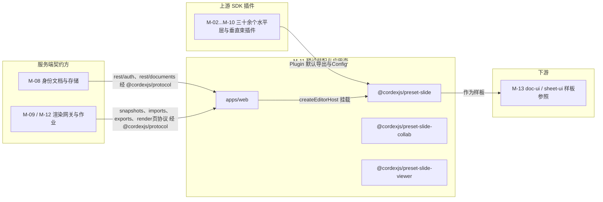
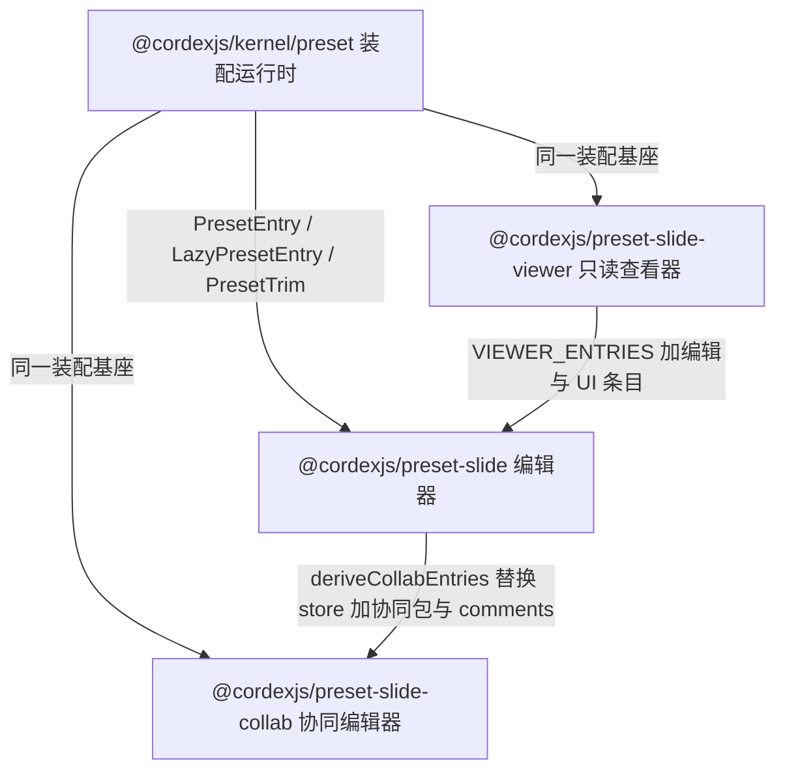
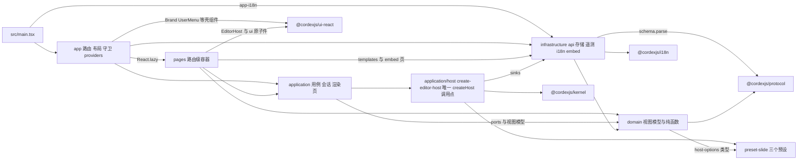
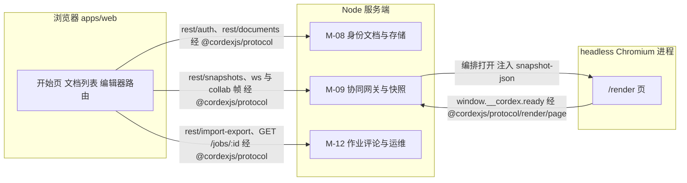

> 状态：草稿 v0.1 | 负责：架构-模块（阶段二，M-11） | 更新：2026-09-19、2026-09-24（rulings §4.15）、2026-09-24（复核修正，rulings §4.17）、2026-09-25（补图）、2026-09-25（矛盾收口，rulings §4.18）、2026-09-25（§4.19）、2026-09-26（§4.20）；2026-09-26（§4.21 整合：登记 z.config jitless 调用点（apps/web main.tsx 与三个 dom preset 的 config/options）；§3.4 登记 50/13 §6 七个新惰性 chunk 的构建入口与 bundle-budget 条目；collab-transport-ws 配置 heartbeatMs 改为 messageReconnectTimeoutMs）；2026-10-01（§4.23 插件管理：apps/web 增 10 个文件——`/admin/plugins` 路由与 `RequirePlatformAdmin` 守卫、`pages/editor/footprint-banner.tsx`、`application/plugins/` 三个文件、`domain/plugins/` 两个纯函数文件、M4 `application/host/load-mounted-plugins.ts`、`plugins.api.ts`；`PluginManagerPage`（`/documents/:id/plugins`）改为个人插件面板）；2026-10-01（§4.23 插件管理样张回写：设计承接 03-09 个人插件面板、03-32 管理员插件管理样张已确认，去掉「待样张」）；2026-10-03（rulings §4.24 AL-2：个人插件面板改为对话框路由）；2026-10-03（§4.24 收尾：§4.4 目录树与 §5.4 b 登记 `domain/plugins/policy-draft.ts`（管理员页依赖 / 互斥纯函数，50/03 §10.1））；2026-10-04（design-language-v3 第 0 批：按 rulings §4.25 DS-1、DS-2、DS-6 同步编辑器外框的通用描述——`shell-glue` 原应用栏「⋯」七项改投主菜单 `mainMenu.file` 与文档菜单 `docMenu`（40/10 §2.6），`EditorHost` 增 `onShare`，exclude 后果、路由迁移表与 M1 切片中的 Ribbon / 状态栏 / 应用栏写法改为 v3 的底部工具条、检查器、同步状态行；开始页 `ShellLayout` 改为 220 贴边导航，`HomePage` / `NewSection` / `RecentSection` / `GuideSection` 注明 v3 首页样张的取舍（指南区去留待产品线确认，设计 03-29 §6），文件集不变；嵌入工具条去 `glass-strong`）；2026-10-04（design-language-v3 第 0 批：术语残留清理：`ui.ribbon` / `ui.statusBar` / ribbon / 状态栏的历史陈述改用 check-terms 认可的标记措辞（作废、废弃、取代、原名））；2026-10-04（design-language-v3 第 0 批：复验修正——BC-17「Ribbon / 缩略图栏」改为底部创建工具条 / 左栏缩略图 / 检查器 / 网格视图；§5 `config/shell.ts` 的 `MORE_MENU_ITEMS` 改为 `SHELL_MENU_ITEMS`（分投主菜单与文档菜单），`editor-intents.spec.ts` 注释同步；§3 与 §12 G-6 的 `appBar.more` 历史陈述加作废标记；§3a 路由迁移表 `/styleguide` 按 DS-7 改为随旧版删除、由接替路由承担基准；§9 apps/web e2e 树登记 `editing/editor-shell.spec.ts`、`editing/ed-22-grid-view.spec.ts`、`ui/design-rules.spec.ts`（70/06 §5 第 40、41 行与 §11，DP-8））；2026-10-04（design-language-v3 第 0 批：复验第 2 轮修正——首屏图中「返回首页」入口改为样张已起草的主菜单首项（设计 03-02 §2.3，待第 1 批拍板））；2026-10-05（design-language-v3 第 0 批修正：开始页按 rulings §4.25 DS-10、DS-12、DS-18 结案——§3a `/home` 迁移行与 §4 / §5 中 `ShellLayout`、`HomePage`、`NewSection`、`RecentSection` 的「PRD AS-01 待回写」「224 待回写」「待产品线确认」改为已按 PRD 08 AS-01…AS-06 改写（导航 220、不设「设置」项、最近最多 8 条、M2 内置 5 套模板、亮暗切换在账户菜单）；原指南段 `pages/home/GuideSection.tsx` 改为左侧导航「帮助」菜单 `app/layouts/HelpMenu.tsx`（AS-04、AS-05），§4 目录树与 §5 文件表各减一增一、数量不变；M1 切片图的「返回首页」入口改为主菜单「返回首页」（DS-18））；2026-10-05（design-language-v3 第 0 批修正：按 rulings §4.25 DS-12 与 PRD AS-02、AS-03 改 §1.2 最近文档条目（最多 8 条、固定项置顶）与 §4 `document-type.ts`（M2 内置 5 套模板卡）；按 DS-18 改 §3.3 `shell-glue` 贡献、§5 `config/shell.ts`、§0 与 §4 / §12 G-6 的槽位说明（「插件…」为主菜单顶层项、不在「文件」下，承载顶层单项的槽位待 50/09 §6.1 补登）与 §3.3、§12 G-10 的 `UserMenu` 接口（由自己的头像打开，条目以 PRD AS-06 为准，补 `onOpenProfile`、`onOpenAdmin` 与亮暗主题的 `preferences/onChange`）；按 PRD AS-01、DS-11 在 §4 / §5 `ShellLayout.tsx` 写明开始页 `Mod+K` 聚焦搜索的处理（无 host、不走 `ui.shortcut`）；§9 apps/web e2e 树按 70/06 §5 第 1、7、8、42 行补登 `shell/home.spec.ts`、`shell/account-menu.spec.ts`、`editing/ed-16-shortcuts.spec.ts`，`home-to-editor.spec.ts` 移入 `shell/`，`editor-intents.spec.ts` 不再断言账户菜单（DP-8；e2e 文件只在 §9 登记，§4 目录树与 §5 文件表的文件数不变））；2026-10-07（design-language-v3 第 1 批：§3 shell-glue 贡献行与 §5 `config/shell.ts` 行按已拍板的设计 03-02 §2.3 改写——「插件…」为主菜单顶层项、排在「排列 ▸」与「帮助 ▸」之间（rulings §4.25 DS-18、DS-21），文档菜单条目随角色，开发者项在拍板的主菜单里未列、落位交 50/03 §8；§4 / §5 `EditorPage.tsx` 补地址栏 `view` 参数同步（TB-30）与打开失败的阻断式全屏页（03-02 §6.2）；§9 按 70/06 §5 第 43–48 行登记第 1 批 12 个 e2e 文件，改写 `editing/editor-shell`、`editing/ed-22-grid-view`、`editing/ed-16-shortcuts`、`ui/design-rules` 四个 spec 的注释（DS-18、DS-21、DS-24、DS-29、TB-2、TB-6、TB-30）；§0 测试文件数按 §9 逐项重数为 80；§12 增 G-18（DP-8 测试文件迁入 §4 / §5 尚未做，同 40/10 G-25）；同批他线回写跟进：§0、§3.3、§3.5、§4、§5、§8、§9、§11 与 §12 G-6 的 shell-glue 按 50/03 §8 改为八个壳意图——新增 `help-center`（帮助中心进主菜单「帮助」与账户菜单，母版视图「帮助」另有「关于母版继承」，TB-15）与开关 `moreMenu.helpCenter`，「插件…」改投主菜单顶层单项槽位 `mainMenu`（50/09 §6.1），开发者面板落在「帮助」最后一组；`EditorPage.tsx` 经 `layout.view` / `onViewChange` 同步地址栏、`layout.rememberKey` 传 `documentId`（TB-24、TB-30）；§4 与 §5 文件数不变）；2026-10-08（design-language-v3 第 1 批收口：按 rulings §4.25 TB-3、TB-50 写明产品 `/styleguide`——§2.2 `RuntimeConfig` 增 `env`，§4.4 / §5.4 `app/routes.tsx` 只在 `env === 'test'` 时注册该路由并惰性加载 ui-react 子路径 `./styleguide` 的组件全状态页（40/10 §4.3），`app/config.ts` 同步；§3a playground `/styleguide` 行改为旧版样张随 DS-7 删除、门禁对象为产品路由（原「接替的组件状态基准路由」作废）；§9 登记由 40/10 §9 迁来的 `a11y/styleguide.a11y.spec.ts`、`ui/editor.visual.spec.ts`、`ui/perf.spec.ts`（70/06 §3.1），测试文件 80 → 83；`editing/master-layout-delete.spec.ts` 的对话框文案按设计 03-26 §8（DS-32），`shell/account-menu.spec.ts` 补头像排第一位与「主题」切换，`editing/narrow-forms.spec.ts` 补平板只读（TB-49）；§12 G-18 按 TB-48 结案；源文件数不变）；2026-10-08（design-language-v3 第 1 批收口：§3 Manifest 片段的 `ui.contextMenu` 补帮助中心两处与「关于母版继承」三个条目 id，与 §3.3 十项一致，rulings §4.25 TB-15、TB-39）；2026-10-15（design-language-v3 第 2 批：按 rulings §4.25 DS-38…DS-60 改 §4.4 / §5.4 `EditorPage.tsx`（申请访问留言弹层、会话中访问被撤销的阻断页、查看人数已满、应用内离开与刷新的确认框）、`ShareDialog.tsx`（链接区不显示地址、有效期、改回仅邀请即撤销、访问申请一节、非所有者只读视图、share 子路由去掉 doc.manage 能力守卫（`routes.tsx` 同步））、`VersionHistoryPage.tsx` 与 `FidelityReportPage.tsx`（检查器整栏面板 280）、`PluginManagerPage.tsx`（对话框 640、底栏反馈）、`footprint-banner.tsx`（插件横幅先后与重现、中性底、单个失败写名字）、`share-document.usecase.ts`、`versions.usecase.ts`、`documents.api.ts`（access-requests 与 share-links `PATCH`）；新增 `src/pages/share/RequestAccessPopover.tsx`（§4.4、§5.4 各增 1）；§12 增回写表；同日再补：TB-60 `VersionHistoryPage.tsx`、`FidelityReportPage.tsx` 的整栏宽改为「沿用检查器宽度（缺省 280）」，版本历史降权即关闭（TB-63）；TB-68 `EditorPage.tsx` 与挂载点表把「分享」待处理申请数作为 EditorHost 属性传入，`share-document.usecase.ts` 以申请列表回写、处理后减一；TB-65、DS-66 `share-document.usecase.ts` 非所有者只读 permissions 读者视图、链接带 `state`；TB-70 `session.usecase.ts` 登出与换人清理补 `cordex.fidelity.*`；DS-50 `domain/editor-page-state.ts` 增 `ready → failed`；§9 登记 70/06 第 2 批新增的 15 个 e2e 并改写 `ui/editor.visual.spec.ts` 注释（rulings §4.25 DP-8、DS-63），测试文件 83 → 98；源文件数不变；同日再补（rulings §4.25 DS-69、DS-70、TB-76、TB-85）：`share-document.usecase.ts` 与 `ShareDialog.tsx` 非所有者在链接授予角色时用读者视图的 `link.token` 复制分享链接（DS-69）；`create-document.usecase.ts` 新建空白与从模板新建在上传申请里声明 `origin` 与 `templateName`（DS-70）；`AdminPluginsPage.tsx` 读深链 `?plugin=<pluginId>`（TB-76）；`EditorPage.tsx` 离开 / 刷新确认框的「导出为本地副本」执行 `ui.openDialog('export-local-copy')`（TB-85）；§12 增一行；源文件数与测试文件数不变；同日再补（rulings §4.25 DP-8、TB-72、TB-79、TB-84…TB-92）：§9 的 `share-dialog`、`access-request`、`comment-tool`、`version-history`、`narrow-forms`、`attention-banners`、`leave-guard` 七个 e2e 注释按 70/06 同日的断言补齐；登记 `pages/PluginManagerPage.test.tsx`、`plugins/personal-panel.spec.ts`、`admin/plugins.spec.ts`，测试文件 98 → 101（§0），其余存量写进 §12 G-18；§4.4 / §5.4 `share-document.usecase.ts` 写明令牌缺省时「复制链接」不可用、不改为复制文档地址（TB-91），`AdminPluginsPage.tsx` 深链改为清单加载后打开详情（TB-76）并删去「待样张」旧注；§12 增一行；源文件数不变；同日再补：§9 `comments/comment-tool.spec.ts` 注释补再次发起评论时评论工具照各入口原有规则按下（rulings §4.25 TB-97）、整页被删后撤销删页草稿不回来（TB-99）；文件数不变）；同日再补：§5.4 `ShareDialog.tsx` 一行补令牌缺省时「复制链接」不可用（TB-91）；2026-10-22（design-language-v3 第 3 批：按 rulings §4.25 DS-71…DS-136 与 TB-101…TB-129 改写应用壳——`shell-glue` 的「导出…」改 `Mod+Shift+E`（DS-78）、带 `can.doc.export` 可用性（DS-105）、文档菜单只给编辑者（DS-82）、帮助中心按配置出现并标外链（DS-89）、宿主不处理的壳意图不贡献（DS-112）；`UserMenu` 的接口按 DS-90、DS-91、TB-118 改写；`SlidePresetOptions` 删 `theme.density`（DS-76）、增 `preferences: { locked?, values? }`（TB-118，40/10 §2.5 登记）；apps/web：删 `pages/documents/FilterTabs.tsx`（左栏即筛选，DS-79），增 `app/layouts/SearchDropdown.tsx`（DS-80）、`app/layouts/BlockingPage.tsx`（DS-71、DS-118、DS-122）、`pages/documents/CardGrid.tsx`（TB-107）、`pages/import/DropImportOverlay.tsx`（DS-98）、`pages/errors/ConfigErrorPage.tsx`（DS-71）、`pages/settings/ProfileDialog.tsx`（M3，DS-91、TB-123），`pages/home/OfflineBanner.tsx` 移到 `app/layouts/OfflineBanner.tsx`（应用壳页面的横幅通道，DS-92）；`/import` 改为 Bare 全屏（DS-97）；开始页、文档列表、模板库、管理页、导入、导出、放映、登录与错误页、嵌入的页面与用例按第 3 批改写；preset-slide-viewer 增 `shell/narrow.ts`（窄屏形态，DS-111），保真摘要与打开失败按 DS-110、TB-114；§4.2 补登漏列的 `testing/mock-collab-server.ts`；§0 源文件按 §4 目录树重数为 182；§9 按 70/06 登记 17 个 e2e、3 个新单测与支撑文件 `support/embed-host.ts`，既有条目注释同步，测试文件 101 → 123（rulings §4.25 DP-8）；本机键按 50/02 §10.1 写明落点（`cordex.auth.next`、`cordex.auth.reauthWindow` 在两个登录用例，`cordex.diagnostics.{userId}`、`cordex.listView` 在 `preferences-store.ts`，TB-118、TB-122、TB-127）；§12 增 2026-10-22 回写）；2026-10-22（design-language-v3 第 3 批，回写中新增的口径：卡片「⋯ › 分享…」与编辑器「分享」在 M2 留在原位不可用、写「后续版本提供」（rulings §4.25 DS-137）；查看器备注为空写「这一页没有演讲者备注」（DS-138）；搜索框下拉的组合框键盘（TB-130）；网格 / 列表一份、开始页与文档列表共用（TB-131）；「关于母版继承」与命令面板「帮助中心」按配置贡献（TB-132，壳意图进命令面板的做法见新增的 §13 Q-15）；导入「取消」回到打开导入页之前的那一页、RuntimeConfig 增 `limits.importMaxBytes`（TB-133、TB-147）；查看器不允许全屏时不画全屏按钮（TB-134）；个人资料只改显示名（TB-137、TB-142）；降权时文档菜单三项写「需要编辑权限」（TB-138）；登录页在 IdP 不支持 `prompt=login` 时补一句（TB-140）；回收站天数取 `/auth/config` 的 `trashDays`、「我的文档」「与我共享」按内容更新时间倒序（TB-141、TB-144）；嵌入「退出登录」发 `cordex:intent{target:'sign-out'}`（TB-145）；浏览器导出图片页数上限初值（TB-148）；`preferences.locked` 五个键、`Preferences` 类型取 ui-react（TB-118）；`user` 不再带 `avatarUrl`（TB-123）；阻断页「复制诊断信息」点后「✓ 已复制」1.5 秒；§9 登记第 3 批改到断言的存量 e2e 15 个与单测 1 个、`viewer.spec.ts` 移到 `viewer/`，测试 123 → 139（DP-8）；§12 增一节；源文件数不变）；2026-10-22（design-language-v3 第 3 批回写收口：shell-glue 另注册 5 个无参 Operation（`shell.openExport` 等，只转调 `shell.intent`）并各配一条 `ui.command`，帮助中心按配置注册、带 `external: true`，`Mod+Shift+E` 改绑 `shell.openExport`，§13 Q-15 结案（rulings §4.25 TB-162）；`EditorPage` 在 M2 传 `shareUnavailable: 'later'`（TB-161），阻断页「申请访问」M2 留在原位不可用（TB-156），「恢复」失败在阻断页内联、在卡片轻提示 +「重试」（TB-155）；平板顶部提示「在电脑上新建或导入演示文稿」（TB-153）；帮助菜单触控形态不写 ⌘/（TB-154）；RuntimeConfig `limits.importMaxBytes` 由 web 容器读 `CORDEX_SCALE_MAX_FILE_BYTES`（TB-158）、增 `templates.sources`（TB-160）；`/render` 的 `ready` 诊断带页级失败标记（TB-157）；分档页数上限只对 PNG、导出取消遇 409 忽略（TB-152、DS-101）；`cordex.listView` 形状 `{ layout, homeSort }`、导入选文件 `replaceState`；§9 按 70/06 改注释并补登 3 个改到断言的存量、`render-page.spec.ts` 移到 `render/`，测试 139 → 142（DP-8）；§12 增一节；源文件数不变；2026-10-22 复核修正：平板上开始页、文档列表的左栏与列数按窗口宽度取（TB-165），手机上的快捷键面板为带遮罩的底部面板、触控形态菜单项不写键位提示（TB-154、TB-164），手机与触控直接打开 `/import` 照常显示（TB-167），浏览器图片导出遇运行时页级回退即失败（TB-166），模板源进 CSP `connect-src`（TB-168），`env === 'test'` 另提供渲染故障注入点（TB-169）；M2「申请访问」工具提示写全为「申请访问 · 后续版本提供」、两处 `<EditorHost …>` 属性清单补 `shareUnavailable`、回收站卡片「恢复」失败写进 `DocumentCard`（TB-155、TB-156、TB-161），降权时「创建副本」补引 DS-139；查看者的「导出…」原因改为「只有查看权限」（DS-105）；查看器壳顶部条、缩略图条、备注面板、键盘与 ⓘ 计数按设计 03-25 改正（DS-110、DS-111）；`#/import` 改为 `/import`，形态 E 改为 M3 只认会话（DS-73）；§12 增四行；§13 Q-7 的放映参数按 §3a 改为 `?page=`；查看器「备注抽屉」的说法在 §1.1、§3.4、§4.3、§6 统一为备注面板（设计 03-25 §4.6）；诊断接口按总编排定的落点单独登记为 `application/host/diagnostics.ts` 与单测 `application/host/diagnostics.test.ts`（`diagnostics.dump()` 与测试部署的 `diagnostics.faults`，rulings §4.25 TB-169，50/15 §10），`AppErrorBoundary`、`EditorPage`、`ImportPage`、`EmbedPage` 的「复制诊断信息」与 `App.tsx` 改引它，源文件 182 → 183、测试 142 → 143，§3.5 增一行；§9 `render/render-page.spec.ts` 的页级失败改为组件级用例（scene provider 桩，`/render` 不设注入点，TB-174）；平板保留网格 / 列表切换与排序、搜索框随左栏（TB-170），卡片第二行缺编辑者或内容时间时的写法（TB-171）；`/render` 的 ready 判据不再复述、只引 50/12 §11.5（rulings §4.18 FE-09）；§12 再增四行；搜索下拉每行、列表形态的时间一列与开始页「最近编辑」排序按卡片第二行的同一取法（TB-171，`SearchDropdown.tsx` 改依赖 `domain/document-card`）；§9 按 70/06 补的断言改写 `app/shell-layout.test.tsx`、`pages/{HomePage,DocumentsPage,SettingsPage,LoginPage}.test.tsx`、`shell/version-drift.spec.ts`、`shell/import.spec.ts`、`viewer/viewer.spec.ts`、`editing/export-dialog.spec.ts`、`editing/narrow-forms.spec.ts`、`editing/ed-21-present.spec.ts` 的注释（TB-164、TB-170…TB-173、TB-175、DS-118），`LoginPage.tsx`、`ImportPage.tsx` 同步说明句与到达焦点；e2e 根目录的 `a11y.spec.ts` 并入 `a11y/` 矩阵、改为 `a11y/matrix.a11y.spec.ts`（70/06 §7、§14），测试数不变；R8 合成时抛错的一半按 70/06 §6.3 从 `render/render-page.spec.ts` 改落到既有单测 `application/render-page.usecase.test.ts`（TB-174），§12 TB-174 一行同步；§10「无外呼」一行改为 local 模式由 `render/render-page.spec.ts` 断言、remote 模式在服务端 `renderer-egress`（70/06 §6.1）；登记第 3 批改到断言的存量单测 `infrastructure/error-copy.test.ts`（70/06 §2.2，TB-173、TB-175，DP-8），测试 143 → 144，§12 G-18 同步；preset-slide 的 `plugins/locales/*` 聚合上游含 engine-render 的 `errors.render`（TB-173，40/06 §5.2），preset-slide 与查看器两个 `en-US.ts` 的上游子路径由 `./locales/zh-CN` 改正为 `./locales/en-US`；§12 再增五行；诊断包归 SDK：`application/host/diagnostics.ts` 的 `dump()` 转调当前 host 的 `host.dumpDiagnostics()`（40/02 §5.2），只补共同的开头与无 host 的情形，`diagnostics.e2eTrace` 为真时挂 `window.__cordex.diagnostics`（`src/env.d.ts` 的 `Window.__cordex` 增可选 `diagnostics`），`SettingsPage.tsx` 经可选属性 `getDiagnostics` 交给偏好设置「关于 › 复制」（rulings §4.25 TB-177）；§9 `render/render-page.spec.ts` 注释只留整页无法解析的一半、补测试部署里 `/render` 页上没有 `window.__cordex.diagnostics`（TB-174）；§12 再增两行；文件数不变）；2026-10-23（design-language-v3 第 3 批评审修改，rulings §4.25 DS-140…DS-143、TB-179…TB-183：「导入 .pptx」改为叠在原页上的「导入」对话框——`/import` 与 `/settings` 同样叠在来路之上、不再挂 `BareLayout`，直接打开时背后是文档列表「最近」，成功后以替换方式进编辑器；`ImportPage.tsx` 改为对话框的路由件（文件名沿用，同 `SettingsPage.tsx`），选文件、拖入、上传、解析与失败都在框里，取消、×、Esc 中止并关闭、留在原页，手机为 ui-react `BottomSheet` 的模态一档；`DropImportOverlay.tsx` 松开即打开对话框的上传态、高亮改为强调色虚线加淡底；`BareLayout`、`BlockingPage` 不再承载导入；导出对话框格式行与导入上传行的文件类型图标取 ui-react `FileTypeIcon`；管理页详情抽屉的标题行随全站对话框改为 40；§1.1、§2.2、§3a、§4.4 / §5.4、§9 注释同步，§12 增一节；源文件与测试文件数不变；§4.4 `ImportPage.tsx`、`application/host/diagnostics.ts` 的注释补导入对话框失败态的诊断信息另带首个失败部件、文件名与大小（与 50/15 §10、设计 03-13 一致））；2026-11-04（design-language-v3 母版视图改版：母版视图里主菜单「文件 › 保真报告」、顶层「插件…」与文档菜单「版本历史」三项留在原位、不可用，写「母版视图下不可用」（同时被降权时也取这句），同名无参 Operation `shell.openFidelityReport`、`shell.openPluginManager`、`shell.openVersionHistory` 同一可用性——§3.3 `shell-glue` 贡献、§4.1 / §5.1 `config/shell.ts`、§9 `shell-glue.test.ts` 同步（rulings §4.25 DS-157、TB-200、TB-203；条件写法以 50/03 §8 为准）；§9 `editing/master-view.spec.ts` 的说明随 70/06 §5 第 6、71–74 行改写——入口与可用性、上下文条与窗格、画布与标注与多选、检查器与 M2 与加载、普通视图的浮层与入口（含上述三项与「重置页…」不可用；DS-145…DS-148、DS-150…DS-154、DS-156…DS-158、DS-162、DS-164、DS-174、DS-175、DS-177、TB-208、TB-209），`ui/editor.visual.spec.ts` 的说明补母版视图改版的代表状态与普通视图的有意重拍（DS-147、DS-149、DS-173、DS-174、TB-196，状态清单以 70/04 §9 为准）；§12 增一节；源文件与测试文件数不变，需求编号、优先级与里程碑不变） | 依赖：00-module-map.md M-11（BC-16/BC-17）、charter v0.2 §5.2 `preset-slide*`/`apps/web` 行与 §5.4、30-architecture 02 §3.1/§4.21/§4.21b、03 §9/§10、ADR-0010、ADR-0015、rulings §4.9/§4.10、PRD AS-01…06 / EM-01…17 / OF-14、设计 03-screens/29、01、23、25、11、26；50-frontend/03 §8、70-testing/04 §9、06 §5；上游模块文档 M-02 §3/§6/§7、M-03 §3、M-04 §3、M-05 §3/§7、M-06 §3、M-07 §3、M-10 §2.5/§3/§3a/§6/§7/§12 G-20/§13 Q-12；rulings §4.25 DS-145…DS-154、DS-156…DS-158、DS-162、DS-164、DS-173…DS-175、DS-177、TB-196、TB-200、TB-203、TB-208、TB-209

# 11 预设装配与应用壳（限界上下文 BC-16 预设装配、BC-17 应用壳）

## 0. 一页总览

| 项 | 值 |
|---|---|
| 职责一句话 | 把 M-02…M-10 交付的三十余个水平层 / 幻灯片垂直束插件组合成三档可运行、可裁剪、可门禁体积的插件束（`preset-slide` 编辑器、`preset-slide-collab` 协同编辑器、`preset-slide-viewer` 只读查看器），并提供仓库中唯一「知道插件存在」的应用壳 `apps/web`：开始页、文档列表、账户菜单、登录会话、编辑器 / 查看器 / 放映路由、分享 / 版本 / 导入 / 导出 / 设置页面与 `/render` headless 渲染页——应用壳零编辑器领域逻辑，只组装、只导航、只经 `@cordexjs/protocol` 与服务端通信 |
| 覆盖的上下文 | BC-16 预设装配、BC-17 应用壳 |
| 承载包 / 目录 | `@cordexjs/preset-slide`（L8，秩 80，dom，bundle，组合根）、`@cordexjs/preset-slide-collab`（L8，秩 80，dom，bundle，组合根）、`@cordexjs/preset-slide-viewer`（L8，秩 80，dom，bundle，组合根）、`apps/web`（L8，dom，app，组合根；Vite 8 + React 19 + react-router 8，2026-09-25 更正，rulings §4.18 FE-13）；四者 `cordex.compositionRoot:true`，R3 文档类型盲规则对组合根豁免（FE-01/FE-21） |
| cordis 形态 | 三个 preset：bundle（`createSlidePreset` / `createSlideCollabPreset` / `createSlideViewerPreset` 返回一个函数插件，`apply` 内无序挂载 `PresetEntry[]`，ADR-0010）；bundle 内各含 1–3 个**极薄胶水插件**（只读权限策略、查看器壳、主菜单与文档菜单的应用级条目 / i18n 胶水，§3；原「应用栏『⋯』」随 rulings §4.25 DS-1 取消）；`apps/web`：host（`application/host/create-editor-host.ts` 是仓库中唯一调用 `createHost` 与 `createSlide*Preset` 的应用代码；非 cordis 插件；由 ESLint `apps/**` override 与 depcruise `cordex-apps-only-assemble` 守护，原称 `no-domain-defs-in-apps`，TD-093，rulings §4.18 GV-15） |
| 运行位置 | 仅浏览器（四者均 `iso:'dom'`）；服务端用等价但独立的 `preset-server`（M-09，08 §4.2），不复用本模块任何包；`/render` 页由服务端 headless Chromium 加载，仍是浏览器环境 |
| 上游（依赖） | M-02（`@cordexjs/kernel` 的 `createHost`/`HostOptions`（`apps/web` 值导入仅限 `application/host/**`，其余只许 `import type`，rulings §4.18 FE-05）、`units.open`/`OpenUnitDescriptor`、`i18n`、`model-core`、`store-memory`/`store-yjs`、`@cordexjs/protocol` 全部 REST/WS schema）、M-03（`@cordexjs/model-slide` 主插件与 `/editing` 子插件）、M-04（`ooxml-pptx`）、M-05（`collab-core#local-presence`、`collab-yjs`、`collab-transport-ws`、`collab-offline-idb`）、M-06（`engine-layout`/`engine-render`/`render-dom`）、M-07（`slide-render`、惰性 `slide-render-chart`）、M-10（`design` CSS、`ui-core`、`ui-react` `<EditorHost>`/`UserMenu`/`Brand`/`SettingsDialog`（2026-10-22 由 `SettingsDrawer` 改名，rulings §4.25 DS-113）、`slide-ui`）；服务端契约方 M-08（`/auth/*`、`/documents/*`）、M-09/M-12（`/render` 渲染页协议与 `window.__cordex.inject` 注入载荷〔2026-09-24 删除 `/internal/render/:token/state` 拉取，rulings §4.15 Q8〕、任务与缩略图 REST） |
| 下游（被依赖） | 无（终端模块）；M-13 以三个 preset 为 `preset-doc`/`preset-sheet` 样板；集成方以 `@cordexjs/preset-*` 为嵌入入口（PRD EM-01 形态 A–D） |
| 对外服务 | 无新增 cordis 服务（BC-16 只透传；胶水插件不 `provide`）；`apps/web` 无服务 |
| 贡献点 | 提供：无；消费：无新贡献点。胶水插件向既有点贡献条目：`core.permissionPolicy`（`read-only`）、`core.command`（Operation `shell.intent`；2026-10-22 另有 5 个无参 Operation `shell.openExport`、`shell.openVersionHistory`、`shell.openFidelityReport`、`shell.openPluginManager`、`shell.openHelpCenter`，只转调 `shell.intent{target}`，rulings §4.25 TB-162）、`ui.contextMenu{slot:'mainMenu' \| 'mainMenu.file' \| 'mainMenu.help' \| 'docMenu' \| 'userMenu'}`（原应用栏「⋯」六条目，Q20；2026-10-04 随 DS-1 改投主菜单与文档菜单，「插件…」为主菜单顶层项，rulings §4.25 DS-18；2026-10-07 按 50/03 §8 定稿为八个壳意图：「插件…」进顶层单项 `mainMenu`，新增帮助中心〔主菜单「帮助」与账户菜单〕与母版视图的「关于母版继承」〔TB-15〕，开发者面板进「帮助」最后一组）、`ui.shortcut`（`Mod+Shift+E` → 导出…，2026-10-22 由 `Mod+E` 改：`Mod+E` 归居中对齐，rulings §4.25 DS-78；同日改绑 `shell.openExport`，TB-162）、`ui.command`（上述 5 个 Operation 各一条，帮助中心只在配置了链接时注册，TB-162、TB-132）、`i18n.bundle`（`app` 命名空间，来自宿主选项） |
| doc / sheet 通用性 | 三个 preset：vertical（`bundle=slide`；`preset-doc`/`preset-sheet` 复制 `preset.ts`/`plugins/*.entries.ts`/`config/options.ts` 结构，§8）；`apps/web`：generic（路由 / 会话 / 文档列表与文档类型无关；`domain/document-type.ts` + `create-editor-host.ts` 的 `switch(documentType)` 是仅有的两个参数化点） |
| 批次 | 3（上游 M-02/M-03/M-05/M-06/M-07/M-10 §6 API 面定稿后开工；本文档按各上游 §3/§6 现稿编写） |
| 文件规模 | 源文件 **183** 个（preset-slide 18 · preset-slide-collab 11 · preset-slide-viewer **31**（原 36，C-07：`assembly/` 六文件迁出；2026-10-22 增 `shell/narrow.ts`，rulings §4.25 DS-111）· apps/web **123**〔根 8 · `public/` 4 · `src/` 111〕；2026-10-22 按 §4 目录树逐个重数：原写 158（apps/web 99〔根 10 + `src/` 89〕）未随 2026-09-25 以来的增补同步，§4.2 补登漏列的 `testing/mock-collab-server.ts`；第 3 批 apps/web 增 6、删 1、移 1，明细见 §12 的 2026-10-22 回写；同日复核时另增诊断接口 `application/host/diagnostics.ts`（`diagnostics.dump()` 与测试部署的 `diagnostics.faults`，rulings §4.25 TB-169，50/15 §10），由 182 改）+ 测试文件 **144** 个（§9 逐项计，不含夹具与支撑文件；2026-10-22 复核收尾时登记第 3 批改到断言的存量单测 `infrastructure/error-copy.test.ts`（70/06 §2.2，TB-173、TB-175，DP-8），由 143 改；2026-10-22 复核时增诊断接口的单测 `application/host/diagnostics.test.ts`，由 142 改；2026-10-22 再补 3 个第 3 批改到断言的存量——`open/open-render.spec.ts`（70/06 §5 第 1 行，rulings §4.25 TB-135）、`auth/login-casdoor.spec.ts` 与 `auth/logout.spec.ts`（70/06 §5 第 9 行：Casdoor 一侧的 selfSignup 两态、登出清理键，DS-119、TB-118、TB-131、TB-122），由 139 改，DP-8；`render-page.spec.ts` 同日按 70/06 §3.1 移到 `render/` 目录，数量不变；2026-10-22 第 3 批按 70/06 §5 第 23、56–69 行登记 17 个 e2e、按 70/06 §2.2 登记 3 个新单测（`app/shell-layout.test.tsx`、`pages/{CallbackPage,PopupCallbackPage}.test.tsx`）与 2 个改到断言的存量（`pages/AdminPluginsPage.test.tsx`、`domain/plugins/policy-draft.test.ts`），由 101 改，rulings §4.25 DP-8；同日再补 16 个第 3 批改到断言的存量——e2e 15 个（`shell/{deep-link,version-drift,import,purge,duplicate}`、`viewer/viewer-readonly`、`auth/reauth-popup`、`share/share-link-landing`、`collab/viewer-variant`、`editing/{master-view,export-dialog}`、`plugins/shortcut-conflict`、`admin/plugins-draft`、`security/external-resources`、`a11y/matrix.completeness`，按 70/06 §5 第 4、5、6、10、11、19、20、21、23、24、35、37、39 行与 §10.1、§13）与单测 `infrastructure/post-message-bridge.test.ts`（50/12 §12），由 123 改；`viewer.spec.ts` 同日按 70/06 §3.1 移到 `viewer/` 目录，数量不变；2026-10-15 第 2 批登记存量缺口里本批改到断言的 3 个——`pages/PluginManagerPage.test.tsx`、`plugins/personal-panel.spec.ts`、`admin/plugins.spec.ts`，由 98 改，rulings §4.25 DP-8，其余存量见 §12 G-18；2026-10-15 第 2 批按 70/06 §5 第 14、15、36、49–54 行登记 15 个 e2e，由 83 改，rulings §4.25 DP-8；原 59——`assembly.test.ts` 随迁出移除后记为 58，此后陆续登记的 e2e 未计入；2026-10-07 按 §9 重数为 80，含第 1 批新登记的 12 个 e2e，70/06 §5 第 43–48 行；2026-10-08 增由 40/10 §9 迁来的 3 个 Playwright spec，70/06 §3.1、rulings §4.25 TB-50）；高于 00 §7 估算的 60–80，原因见 §12 G-12；2026-10-15 apps/web 源文件另增 1（`pages/share/RequestAccessPopover.tsx`，rulings §4.25 DS-48），当时分项数字未随之重数，2026-10-22 按 §4 重数时已计入 |

### 0.1 图示

**图 0-1 模块内包与上下游关系**



图怎么读：本模块是终端模块，没有真正的运行时下游；上游三十余个插件被三个 preset 收拢，`apps/web` 只经 `@cordexjs/protocol` 与服务端三个模块通信，M-13 只是把三个 preset 当参照样板，不构成运行时依赖。

## 1. 限界上下文与边界

> 2026-09-25（rulings §4.19）：BC-17 应用壳的行为（路由、会话、用例、页面状态、存储键与清理）以 [50/02](../50-frontend/02-app-shell-routing-and-session.md) 为准，BC-16 装配语义以 [50/03](../50-frontend/03-preset-assembly-and-plugins.md) 为准；本节只保留职责边界，冲突以 50 为准。

### 1.1 职责与非职责

**BC-16 预设装配（做）**：维护三份显式、可静态分析的插件清单（`plugins/*.entries.ts`），把 Provider 选择（`store-memory` vs `store-yjs`、`local-presence` vs `collab-yjs`）、惰性边界（图表渲染器、语言包、查看器的可选缩略图条、备注面板与搜索）、默认配置与 `exclude`/`override`/`configure` 裁剪点收敛为一个 `createXxxPreset(options)` 工厂；`apply` 内无序挂载并以 `Promise.allSettled` 汇总 `PresetReport`；为 `preset-slide-viewer` 提供两道机械只读保证（不装 `@cordexjs/model-slide/editing` + `read-only` 权限策略，ADR-0015）与 ≤ 350 KB gzip 的体积门禁（`config/bundle-budget.json`）；提供框架无关的查看器壳（`shell/`，02 §4.21b、设计 25）。

**BC-16 不做**：不定义任何 Definition / 贡献点 / 事件（module-map BC-16 行）；不实现编辑器 UI（M-10）、命令（M-03）、渲染（M-06/07）；不知道路由、登录、REST（BC-17）；胶水插件只把宿主传入的回调 / 语言包翻译为既有贡献点的条目，不含业务规则（§3 三个胶水插件的 `apply` 均 ≤ 60 行，由 ESLint `max-lines-per-function` + `no-restricted-imports` 检查，原称 `preset-glue-thin`，09-type-discipline/08 §11.1，rulings §4.18 GV-15）。

**BC-17 应用壳（做）**：Vite + React 19 应用：开始页 `/home`（AS-01…05）、文档列表 `/documents`（设计 01）、账户菜单（AS-06，设置唯一入口）、登录与会话（M-08 服务端 OIDC 的浏览器侧回环）、编辑器族路由（编辑 / 查看 / 放映 / 分享 / 版本 / 导出 / 保真报告 / 插件管理器）、导入对话框（`/import` 叠在来路之上，2026-10-23 起，rulings §4.25 DS-140）、设置页、`/render` headless 渲染页（供 M-09 `ThumbnailRenderer` 调用；state 与资源一律由编排方注入，`RenderStateToken` 已取消，rulings §4.18 BE-04）、宿主事件桥（EM-05 公开事件 → 应用状态 / 集成方回调 / iframe `postMessage`）、品牌替换点、CSP 与体积预算、i18n 接入。

**BC-17 不做**：不出现 `defineCommand`/`defineMutation`/`defineOperation`/`ctx.contribute(`/`defineContributionPoint`（ESLint `no-restricted-syntax` 的 `apps/**` override + depcruise `cordex-apps-only-assemble`，原称 `no-domain-defs-in-apps`，rulings §4.18 GV-15）；不 import 任何 `@cordexjs/model-*`/`ooxml-*`/`engine-*`/`render-dom`/`slide-*`/`collab-*`/`store-*`/`yjs`/`cordis`（depcruise `cordex-apps-only-assemble`；R9 白名单：`preset-*`、`protocol`、`design`、`ui-react`（EditorHost、壳组件、`./ui`、`./styles.css`）、`i18n`、`shared`、`kernel`（值导入仅 `application/host/**`，其余只许 `import type`），另放行 react、react-dom、react-router、tailwind，FE-05；组合根豁免 R3 不等于放开束包，FE-01）；底部创建工具条 / 左栏缩略图 / 检查器 / 网格视图 / 放映舞台 / 母版视图等编辑器内部 UI 全部在 `slide-ui`/`ui-react`（00 §5.2；原 Ribbon 随 rulings §4.25 DS-1 作废），`apps/web` 的编辑器页只挂 `<EditorHost>`；不自定义跨进程 DTO（全部 `z.infer<typeof X>`，X ∈ `@cordexjs/protocol`）。

### 1.2 通用语言

引用 charter §4：Preset（§4.1「预设」）、Plugin / Definition / Provider、Host、Unit / UnitScope、DocumentType、Capability、Snapshot、Ticket。本上下文特有术语：

| 术语 | 定义 | 对应类型名（所在文件） |
|---|---|---|
| 预设条目 | 稳定 id 的插件挂载单元：`{ id; plugin \| lazy(); config?; scope:'host'\|'unit'; provides?; activateWhen? }`；id 与 loader 的条目 id 同义（ADR-0010 决策 1）；`scope:'unit'` 条目不挂根，mount 时经 `units.registerUnitProvider` 登记为 UnitScope 默认 Provider（rulings §4.20 FE-01，M-02 §2.1） | `PresetEntry`（**`@cordexjs/kernel/src/preset/entry.ts`**，2026-09-18 起，C-07；原 `preset-slide-viewer/src/assembly/entry.ts` 已删除） |
| 惰性条目 | `lazy: () => Promise<Plugin>` + 三种触发（`{ event }`/`{ contributionSeen }`/`'manual'`）；未加载前对应能力走占位 | `LazyPresetEntry`、`ActivateWhen`（`@cordexjs/kernel/src/preset/lazy.ts`，C-07） |
| 装配报告 | 全部条目 `allSettled` 后的 `ACTIVE/PENDING/FAILED/LAZY` 汇总，供插件管理器（PS-11）与 `plugin/*` 遥测 | `PresetReport`（`@cordexjs/kernel/src/preset/report.ts`，C-07） |
| 裁剪点 | `exclude: PluginId[]`、`override: Record<PluginId, Plugin>`、`configure: Partial<Record<PluginId, unknown>>` 三种不改 preset 源码的定制手段 | `PresetTrim`（`@cordexjs/kernel/src/preset/entry.ts`，C-07） |
| 超集关系 | `preset-slide ⊇ preset-slide-viewer − {read-only, design-css, viewer-shell, viewer-thumbnails, viewer-notes, viewer-search}`（2026-09-25 补 `viewer-*`，与 §3.1 派生式、02 §4.21b 统一，rulings §4.18 FE-07）；`preset-slide-collab = preset-slide − {store-memory, local-presence} + collab 四包` | `superset.test.ts` 断言 |
| 壳意图 | 主菜单与文档菜单中的应用级条目（原应用栏「⋯」六条目）、`Mod+Shift+E`（导出…，2026-10-22 由 `Mod+E` 改，rulings §4.25 DS-78）等编辑器内需要**离开 SDK 边界**的动作，以 Operation `shell.intent{target}` 经 `commands.execute` 到达宿主回调；命令面板里的五个壳意图另有无参 Operation `shell.openExport` 等，只转调 `shell.intent`（2026-10-22，rulings §4.25 TB-162） | `ShellIntent`（`preset-slide/src/config/shell.ts`） |
| 应用会话 | 浏览器侧登录态：`unknown → anonymous \| authenticated → expired → authenticated`（新窗口重新登录且同一用户时回到 authenticated；不同用户则按只读处理，rulings §4.18 UX-02），主体来自 `GET /auth/me` | `Session`（`apps/web/src/domain/session.ts`） |
| 最近文档条目 | 本地记录与服务端 `recent` 查询合并后的开始页视图模型（最多 8 条、固定项置顶，PRD AS-02，rulings §4.25 DS-12） | `RecentDocumentEntry`（`apps/web/src/domain/recent-document.ts`） |
| 宿主参数 | `apps/web` 页面 → `createEditorHost` 的入参（M-10 §7 已约定形状） | `CreateEditorHostParams`（`apps/web/src/application/host/create-editor-host.ts`） |
| 渲染页协议 | headless Chromium 与 `/render` 页之间的查询参数 + `window.__cordex.inject(payload)` 注入入口 + `window.__cordex.ready/error` 信号（2026-09-24 起不再有状态拉取 URL：状态与资源由零出站 renderer sidecar 注入，rulings §4.15 Q8） | `RenderPageQuery`/`RenderPageSignal`（原始定义 **`@cordexjs/protocol/src/render/page.ts`**，M-02，2026-09-18 起，C-27；`apps/web/src/pages/render/render-page-protocol.ts` 改为 import，§12 G-7 结案） |
| 文档类型参数 | `apps/web` 唯一的文档类型知识：`documentType → { presetKey, icon, label, newCards }` | `DocumentTypeParam`（`apps/web/src/domain/document-type.ts`） |

### 1.3 上下文映射

| 相邻上下文 | 关系类型 | 防腐层落点（文件） | 传递的契约 |
|---|---|---|---|
| BC-01/02/04/05（kernel、shared、i18n、model-core、store-*） → BC-16 | Customer–Supplier（BC-16 为下游 Conformist：只挂载、只传 Config） | `preset-slide-viewer/src/plugins/core.entries.ts` | `Plugin`、各包 `Config`、`HostOptions`（由 BC-17 传 `createHost`） |
| BC-06/08/10/11/12（model-slide、ooxml-pptx、engine-*、render-dom、slide-render） → BC-16 | Customer–Supplier | `plugins/slide.entries.ts`、`plugins/render.entries.ts` | 插件默认导出、`@cordexjs/model-slide/editing` 子路径、图表惰性 import（M1–M2 为 `@cordexjs/slide-render/chart` 子路径，M3 起 `@cordexjs/slide-render-chart`，rulings §4.18 FE-08） |
| BC-09（collab 四包） → BC-16 | Customer–Supplier | `preset-slide-collab/src/plugins/collab.entries.ts` | `collabYjsPlugin`、`collabTransportWsPlugin`、`collabOfflineIdbPlugin`、`CollabConfig` |
| BC-13/14/15（design、ui-core、ui-react、slide-ui） → BC-16 | Customer–Supplier | `preset-slide/src/plugins/ui.entries.ts` | `uiCorePlugin`/`uiReactPlugin`/`slideUiPlugin`、`UiCoreConfig.theme.injectCss` |
| BC-16 → BC-17 | Customer–Supplier | `apps/web/src/application/host/create-editor-host.ts` | `createSlidePreset(options)`、`createSlideCollabPreset(options)`、`createSlideViewerPreset(options)`、`PresetReport` |
| BC-14（ui-react） → BC-17 | Conformist（照单全收 `EditorHostProps`） | `apps/web/src/pages/editor/EditorPage.tsx` | `<EditorHost host unitId mode layout slots documentTitle onNavigateBack onRename onShare shareUnavailable onSignOut onViewChange />`（`onShare` 2026-10-04 增，供检查器顶行与网格胶囊的「分享」，M2 改传 `shareUnavailable: 'later'`、原位不可用，2026-10-22，rulings §4.25 TB-161；`layout.rememberKey = documentId`、`layout.view` 取自 `?view=`、`onViewChange` 以 `replaceState` 写回地址栏，2026-10-07 起，rulings §4.25 TB-24、TB-30，40/10 §6）、`UserMenu`/`Brand`/`SettingsDialog`（2026-10-22 由 `SettingsDrawer` 改名，DS-113）；`EditorHostProps.embedded` 与可选的 `onNavigateBack`（2026-10-22，DS-112，40/10 §6） |
| BC-03 protocol → BC-17 | Published Language | `apps/web/src/infrastructure/api/http.ts`（`parse, don't validate`：响应体一律 `schema.parse`） | `rest/{auth,documents,snapshots,import-export,audit}.ts`、`errors/{codes,envelope}.ts`、`permissions/*`、`ws/*`（间接经 collab 包） |
| BC-18/19/22/23/24（服务端 Nest 模块） ↔ BC-17 | Customer–Supplier（经 protocol） | `infrastructure/api/*.api.ts` | `/auth/*`、`/documents/*`、`/documents/:id/snapshots*`、`/imports/uploads`、`/imports`、`/imports/:jobId/cancel`、`/jobs/:id`（唯一状态查询，2026-09-25 取代 `/imports/:jobId`，决策 SG-08）、`/documents/:id/export`、`/exports/:jobId`、`/documents/:id/thumbnails/*`（2026-09-25 由 `/tasks/*` 改为服务端既定路径，全部相对 `apiBase` = `/api/v1`，rulings §4.18 BE-12/BE-10/BE-11） |
| BC-27（server-headless） ↔ BC-17 | Open Host Service（`apps/web` 向服务端开放 `/render` 页） | `apps/web/src/pages/render/RenderPage.tsx` + `render-page-protocol.ts` | `RenderPageQuery`、`window.__cordex.inject(payload)`（renderer sidecar 注入 state 与资源，页面零外呼，rulings §4.15 Q8）、`window.__cordex.ready/error` |
| BC-16（slide） ↔ BC-29（未来 preset-doc/sheet） | Separate Ways（束间隔离） | — | 无共享；原共用的 `assembly/` 已上移 `@cordexjs/kernel/src/preset/`（2026-09-18，C-07，§12 G-5 结案），`preset-doc`/`preset-sheet` 零成本复用 |

## 2. 领域模型（装配 / 应用模块改写：2.1 装配模型与应用级视图模型 · 2.2 值对象 · 2.3 纯函数 · 2.4 事件 · 2.5 外部契约 · 2.6 用例清单）

> **事实源分工（rulings §4.19）**：`apps/web` 的路由、会话、运行时配置、用例与页面状态以 [50/02](../50-frontend/02-app-shell-routing-and-session.md) 为准；preset 装配语义、选项、嵌入形态与插件管理器以 [50/03](../50-frontend/03-preset-assembly-and-plugins.md) 为准；查看器、嵌入与 `/render` 页以 [50/12](../50-frontend/12-viewer-embedding-and-render-page.md) 为准；事件转发与遥测以 [50/15](../50-frontend/15-events-errors-and-telemetry.md) 为准；体积与路由 chunk 预算以 [50/13](../50-frontend/13-performance-and-bundling.md) 为准。本节 2026-09-25 起只保留类型 / 函数到文件的落点与包级接口名；§3.1–§3.3 装配清单与 §3.5 接入点表仍是包级事实源。

### 2.1 装配模型与应用级视图模型

**装配模型**（`@cordexjs/kernel/src/preset/`，M-02 承载，C-07）：`PresetEntry`、`LazyPresetEntry`（`ActivateWhen` 三种触发 + `when` 谓词，§12 G-6）、`PresetTrim`（`exclude`/`override`/`configure`，`configure` 合并算法见 50/03 §2：对象深合并、数组与标量替换）、`Preset`（`presetId: 'slide' | 'slide-collab' | 'slide-viewer'`）、`PresetReport`（`FAILED` 不阻断其余条目）；五文件见 M-02 §4.2。

**图 2-1 三预设装配关系**



图怎么读：三个 preset 共用 `@cordexjs/kernel/preset` 的装配运行时；`preset-slide` 以 viewer 的 `VIEWER_ENTRIES` 为基础派生，`preset-slide-collab` 再由 `preset-slide` 的 `./entries` 经 `deriveCollabEntries` 派生（rulings §4.18 FE-06）；自 M2 起服务端文档一律经 collab 预设打开（rulings §4.19 D-M2-CONTENT，§11），M3 起 collab 预设另装评论插件 `@cordexjs/comments`（D-COMMENTS-PKG，§3.1）。

**应用级视图模型**（`apps/web/src/domain/`，状态机与字段以 50/02 为准）：

| 视图模型 | 事实源 | 所在文件 |
|---|---|---|
| `Session`（`unknown → anonymous \| authenticated → expired`） | 50/02 §4.1 | `domain/session.ts` |
| `EditorPageState` | 50/02 §6 | `domain/editor-page-state.ts` |
| `RecentDocumentEntry` / `DocumentCardVM`（M2 起卡片封面取导入处理器写的 embedded `__cover`，空白文档用占位；服务端缩略图 M3 前半段替换，`thumbnailProvisional`） | 50/02 §9；60/06 §11.2 | `domain/recent-document.ts`、`domain/document-card.ts` |
| `RenderPageState`（`booting → awaitingInject → opening → painting → ready \| failed`） | 50/12 §11 | `domain/render-page-state.ts` |
| `OnlineState` | 50/02 §9.5 | `domain/online-state.ts` |

### 2.2 值对象

包级选项类型（字段与默认值以 50/03 §4–§5 为准；schema 用 `@cordexjs/protocol/schema` 的 `z`，R5 单点）：

| 名称 | 本包登记的要点 | 所在文件 |
|---|---|---|
| `SlidePresetOptions` | `storeProvider:'memory'`；`theme.density` 2026-10-22 随 rulings §4.25 DS-76 删去；增 `preferences?: { locked?; values? }`（集成方锁定与预置偏好，原样透传 ui-react，定义登记在 40/10 §2.5，TB-118，选项语义以 50/03 §5 为准；同日写全：`locked` 只收五个键 `theme` / `locale` / `unit` / `readingOrder` / `autosave`，`values` 为 ui-react 导出的 `Partial<Preferences>`）；`leaveGuard: boolean`（默认 `true`：单人模式 dirty 时关闭 / 刷新标签页触发 `beforeunload`，集成方可关，50/04 §8，2026-09-25 登记）；`zoom` 默认下发产品范围 10–400%（引擎 clamp 仍为 0.1–8，50/05 §4.1）；`thumbnails.fetchImage?: (req: { documentId; slideId; size: 640 \| 1280; signal }) => Promise<Blob>`——`server-png` 缩略图与封面 `__cover` 的取数回调，缺省时 `server-png` 不可选，apps/web 默认实现经 `http.ts`（带分享令牌头，50/05 §10.2；2026-09-25 登记） | `preset-slide/src/config/options.ts` |
| `ShellOptions` / `ShellIntent` | `shell.intent` Operation 的参数与目标集合 | `preset-slide/src/config/shell.ts` |
| `SlideCollabPresetOptions` | `storeProvider:'yjs'`；`collab{ endpoint; documentId; getToken; user; offline:{enabled:false} }`；离开保护只看协同在途与离线队列（50/02 §10） | `preset-slide-collab/src/config/options.ts` |
| `ViewerPresetOptions` | 查看器选项；i18n 命名空间 `viewer`（查看器工具条与壳文案，随 preset-slide-viewer 的 `i18n.bundle` 贡献，50/16 §11.3，2026-09-25 登记）；打开失败只在给了 `callbacks.onDownloadOriginal` 时出「下载原文件」，不给「重试」「复制诊断信息」（2026-10-22，rulings §4.25 TB-114，50/12 §3） | `preset-slide-viewer/src/config/options.ts` |
| `BundleBudget` | `{ preset; gzipKb; chunks; lazy; tolerancePct: 5 }`（`scan-bundle-budget` 读取） | `preset-slide-viewer/src/config/budget.ts` |
| `RoutePath` | 路由字面量与构造函数（路由表唯一源 50/02 §2） | `apps/web/src/domain/routes.ts` |
| `RuntimeConfig` | 只放静态部署项、由 web 容器渲染进 `index.html`（决策 RUNTIME-CONFIG）；2026-09-25 删 `auth.selfSignup`/`signupUrl`/`csp.styleNonce`/`features.collab`，增 `publicUrl`、`storagePublicOrigin`、`appVersion`、`embed.allowedHostOrigins`、`diagnostics.e2eTrace`；2026-10-08 增 `env`（`'production'` 缺省 \| `'test'`，web 容器按 `CORDEX_WEB_ENV` 渲染，前端用它决定是否注册 `/styleguide`，rulings §4.25 TB-50；同一条件下且 `diagnostics.e2eTrace` 为真时另提供两个渲染故障注入点——下一次渲染抛错一次、指定页在合成时抛错一次，生产部署的 schema 不含这一项，2026-10-22，rulings §4.25 TB-169，接口以 50/15 §10 为准、落在 `application/host/diagnostics.ts`；只在 apps/web 的页面里有，`/render` 不读 RuntimeConfig、不设注入点，TB-174）；2026-10-22 增 `limits.importMaxBytes`（导入文件大小上限，由 web 容器按与服务端同一个部署值渲染——web 容器直接读应用容器同名的 `CORDEX_SCALE_MAX_FILE_BYTES`（缺省 209715200，是 `CORDEX_WEB_` 前缀规则的唯一例外，rulings §4.25 TB-158；部署侧键 `web.limits.importMaxBytes`），同 `embed.allowedHostOrigins` 的做法；导入对话框与拖入落区的「单个文件最大 N MB」与前端预检读它，不写死，rulings §4.25 TB-147；字段以 50/02 §3 为准、部署键以 60/17 §5 为准）；同日增 `templates.sources: { id, name, manifestUrl }[]`（M3 模板库的集成方模板源，缺省为空：浏览器按 `manifestUrl` 取各来源的清单 JSON，某一源失败只影响那一段；到达方式随 PD-23 定稿，在那之前按此设计，rulings §4.25 TB-160；web 容器启动时把各 `manifestUrl` 的源追加进 CSP `connect-src`，与这份列表同一份值两处渲染，TB-168，占位见 50/14 §2.2；字段以 50/02 §3 为准）；可变开关只从 `GET /auth/config` 读（50/02 §3） | `apps/web/src/app/config.ts` |
| `BrandConfig` | 品牌替换点（§7） | `apps/web/src/app/brand.ts` |
| `CreateEditorHostParams` | `preset: 'edit' \| 'collab' \| 'view'`（2026-09-25 由 `'slide' \| 'slide-collab' \| 'slide-viewer'` 改名，与 `DOCUMENT_TYPES[*].presetKeys[params.preset]` 一致，50/03 §5）；`source`：服务端文档一律 `{kind:'state'}` + collab（M2 起，D-M2-CONTENT），`{kind:'bytes' \| 'empty'}` 只留本地文件与 M1 查看器 | `apps/web/src/application/host/create-editor-host.ts` |
| `RenderPageQuery` | `{ renderId; documentType; mode: 'thumbnail' \| 'print' \| 'image'; slides?; deviceScaleFactor; fontProfile; layoutAlgoVersion }`（2026-09-25 `mode` 增 `image`；注入载荷 `state` 只收 `snapshot-json`，50/12 §11.3） | `apps/web/src/domain/render-page-state.ts` |
| `Preferences` | 个人本地偏好；2026-09-25 增 `a11y.readingOrder`（50/16 §9）；2026-10-22（rulings §4.25 第 3 批）：删密度（DS-76）、通知只留「协作者加入时提示」（DS-114），阅读顺序的常驻入口在偏好设置「无障碍」组（DS-116）；`diagnostics.*` 两项按账户记、换人时回到部署默认，是「偏好按设备记」的例外（TB-118，键与清理见 50/02 §10.1）；字段以 50/10 §10.3 为准；类型就是 ui-react 导出的 `Preferences`（偏好设置对话框读写的同一形状，40/10 §2.5、§6），本文件只放 zod schema 与默认值、以 `satisfies` 对齐，不另定义一份 | `apps/web/src/domain/preferences.ts` |
### 2.3 纯函数

| 签名 | 所在文件 | 说明（行为以 50/02、50/03 为准） |
|---|---|---|
| `validateEntries` / `applyTrim` / `isSuperset` | `@cordexjs/kernel/src/preset/validate.ts`（C-07） | 重复 id 诊断；`configure` 深合并；超集断言 |
| `deriveCollabEntries(base)` | `preset-slide-collab/src/plugins/derive.ts` | `store-memory → store-yjs`、删 `local-presence`、加 collab 条目与 `comments`（M3） |
| `computeBudget(stats, budget)` | `preset-slide-viewer/src/config/budget.ts` | 按 chunk 归组 gzip 字节（T-BUNDLE，50/13 §6） |
| `readOnlyPolicy(caps)` | `preset-slide-viewer/src/policies/read-only.policy.ts` | 仅 `doc.read`（+ `doc.export`） |
| `paramsToPresetOptions(p, cfg)` | `apps/web/src/domain/host-options.ts` | 纯映射，不调 `createHost` |
| `mergeRecent`、`resolveDocumentType`、`classifyAuthError`、`isSameReauthPrincipal`、`nextAfterLogin` | `apps/web/src/domain/{recent-document,document-type,session,routes}.ts` | 最近合并、未知类型回退、令牌 401 直接 `expired`（UX-02）、换人判定、站内白名单重定向（样本集见 protocol `testing/redirect-samples.ts`） |

### 2.4 事件

本模块不声明任何 cordis `Events`；`apps/web/src/application/host/host-event-bridge.ts` 只转发。转发表、合并窗口与遥测口径以 [50/15](../50-frontend/15-events-errors-and-telemetry.md) 与 [50/02 §6](../50-frontend/02-app-shell-routing-and-session.md) 为准（放映 URL 参数 2026-09-25 由 `?slide=` 改为 `?page=`）；`/render` 页 ready 判据（rulings §4.18 FE-09）以 [50/12 §11.5](../50-frontend/12-viewer-embedding-and-render-page.md) 为准，代码落点 `domain/render-page-state.ts` 的 `isRenderReady`。应用级事件（非 cordis，域固定 `app`）定义在 `apps/web/src/domain/app-events.ts`。

### 2.5 外部契约

| 契约 | 来源 | 本模块使用点 |
|---|---|---|
| `createHost(options)`（含 `scriptUrlPolicy`，2026-09-25） | M-02 kernel `host.ts`、`host-options.ts` | 仅 `application/host/create-editor-host.ts`（唯一调用点）；Trusted Types 策略由 `infrastructure/security/trusted-types.ts` 在任何 Worker 创建前建立（50/14 §4.2） |
| `units.open(descriptor)`（`source.kind ∈ bytes \| snapshot \| state \| empty`） | M-02 | `create-editor-host.ts`、`/render` 用例 |
| `EditorHostProps` | M-10 ui-react | `pages/editor/EditorPage.tsx`、`pages/present/PresentPage.tsx`（角色 → `mode` 只在打开时映射，会话内降权不改 `editorMode`，50/10 §3.1） |
| protocol REST 与 `render/page.ts` | M-02；路由唯一源 [60/15](../60-backend/15-rest-api-catalog.md) | `infrastructure/api/*.api.ts`（唯一 `fetch` 封装 `http.ts`；预签名直传另走 `direct-upload.ts`，50/02 §7） |
| 服务端 OIDC 回环 | [60/02](../60-backend/02-auth-chain.md) | `GET /auth/oidc/login?mode=redirect\|popup`（2026-09-25 由 `POST` 更正，50/02 §4.4） |

### 2.6 用例清单（`apps/web/src/application/**/*.usecase.ts`）

用例的触发、REST 调用与导航以 [50/02 §8](../50-frontend/02-app-shell-routing-and-session.md) 为准；本表只保留文件落点与 rulings §4.19 D-M2-CONTENT 带来的路径变化：

| 用例 | 所在文件 | 2026-09-25 口径 |
|---|---|---|
| 打开文档 | `application/documents/open-document.usecase.ts` | M2 起服务端文档 = `GET /documents/:id` → `GET snapshots/latest` + `POST collab-ticket` + WS（collab 预设、`source.kind:'state'`）；本地文件与 M1 查看器才走 `bytes` |
| 新建（空白 / 内置模板） | `application/documents/create-document.usecase.ts` | 前端取模板字节（`DOCUMENT_TYPES[*].newCards`）→ 服务端两步导入 → `GET /jobs/:id` → 以 `import` 快照打开；无 pptx 内容版本端点 |
| 导入 .pptx | `application/import-export/import-pptx.usecase.ts` | 本地打开 = `bytes`；入库 = `POST /imports/uploads` → `direct-upload.ts` 直传 → `POST /imports{uploadId}` → 轮询 `GET /jobs/:id`（删 `GET /imports/:jobId`，SG-08） |
| 导出 | `application/import-export/export-document.usecase.ts` | pptx 客户端 `core.export`（M2，只导整份，rulings §4.25 DS-103）；PNG / SVG 在浏览器生成（M2 四种范围、多页打 .zip），M3 起 PNG「全部页」与 PDF 走服务端，生成中可取消（取消端点以 60/15 §3.9 为准，DS-101、DS-102）；对话框不放 JPEG（JPEG 与质量参数只经 API，DS-103） |
| 最近与固定、列表 / 重命名 / 移到回收站 / 恢复 / 永久删除 / 创建副本 | `application/documents/{recent-documents,manage-documents}.usecase.ts` | 服务端同步（U-04），读缓存 `infrastructure/api/query-cache.ts`（决策 APP-DATA）；2026-10-22（rulings §4.25 DS-79、DS-84、DS-85）：列表按左栏视图取（最近 / 我的文档 / 与我共享 / 回收站，搜索为「全部」）、各视图固定次序不排序；永久删除只在回收站视图（M3），恢复与 M2 的移入照常 |
| 分享、版本 | `application/sharing/share-document.usecase.ts`、`application/versions/versions.usecase.ts` | M3（权限细化、版本历史） |
| 设置 | `application/settings/preferences.usecase.ts` | 本地偏好（`diagnostics.*` 按账户记，rulings §4.25 TB-118） |
| 登录 / 会话 / 登出、新窗口重新登录 | `application/auth/{session,reauth-in-window}.usecase.ts` | 50/02 §4–§5、§10（登出清理只看协同在途与离线队列）；2026-10-22（rulings §4.25 DS-120、DS-124、TB-122）：登录失败回到登录页内联报错、重试保住 `next`（sessionStorage `cordex.auth.next`，50/02 §10.1）；停用账号重新发起登录带 `prompt=login`；退出登录先同步、仍有未同步项才弹确认 |
| 分享链接落地 | `application/sharing/share-landing.ts`（2026-09-25 登记，50/02 §11） | 片段令牌读入 sessionStorage 后立即清地址栏 |
| 放映 / 查看、headless 渲染 | `application/render/render-page.usecase.ts` 等 | `/render` 只接受注入（BE-04），`state` 只收 `snapshot-json`，50/12 §11 |

原图 2-2（应用壳路由与 host 创建）、图 2-3（打开文档时序）、图 2-4（`/render` 时序）2026-09-25 移交 50/02 §6、§8 与 50/12 §11 的同名流程图，本文不再保留副本（M2 起打开路径已改为快照 bootstrap，旧图的「字节打开」已不成立）。
## 3. cordis 插件定义

> 三个 preset 均为 bundle：`createXxxPreset(options)` 校验 options 后返回一个函数插件，其 `apply(ctx)` 对 `applyTrim(entries, options)` 的结果**无序**挂载（`for (const e of new Set(entries)) ctx.plugin(e.plugin, e.config)`），依赖由 cordis `inject` 反应式解决，任何顺序结果一致（`order-independence.test.ts` 随机 100 次）；惰性条目只登记触发器，不挂载。`apps/web` 不是 cordis 插件，其接入点表见本节末。

### 3.1 装配清单总表（三预设共用一张表；● 装载 · ○ 不装 · ◐ 惰性 · ▲ 替换默认）

| 条目 id | 来源包 · 插件 | scope | viewer | slide | collab | 默认配置（`configure[id]` 可覆盖） | 顺序无关性说明 | 可替换点（`override`/`exclude` 后果） |
|---|---|---|---|---|---|---|---|---|
| `kernel` | `@cordexjs/kernel`（host 自带，非条目；列出仅为清单完整） | host | ● | ● | ● | `HostOptions` 由 `createHost` 传入 | 秩 0，永不 PENDING | 不可 exclude（不是条目） |
| `i18n` | `@cordexjs/i18n` 默认导出 | host | ● | ● | ● | `{ locale: options.locale, fallback: 'zh-CN' }` | 只依赖 `contributions` | exclude → 文案显示 key（宿主可启动） |
| `model-core` | `@cordexjs/model-core` 默认导出 | host | ● | ● | ● | viewer `{ historyLimit: 0, coalesceMs: 500 }`；slide `{ …, historyLimit: 200 }`；collab 同 slide（原 `defaultStoreProvider` 删除：store 由登记表中唯一的 `provides:['store']` 条目决定，rulings §4.20 FE-01） | 依赖 `contributions/errors/telemetry`（kernel） | 不建议 exclude（无 `units` 即无法打开；`pluggable.test.ts` 仍断言 host 可启动） |
| `store-memory` | `@cordexjs/store-memory` | unit | ● | ● | ○ | `{ historyLimit: 同上, freezeInDev: true }` | UnitScope 内挂载，与根顺序无关；`provides:['store']`，mount 时经 `units.registerUnitProvider` 登记（rulings §4.20 FE-01） | override → `store-yjs`/`noop`（PRD `pluggable:m1`：`store=noop` → `unit/open-failed{code}` 非崩溃） |
| `store-yjs` | `@cordexjs/store-yjs` | unit | ○ | ○ | ▲ | `{ gc: true, undoCaptureTimeout: 500, clientId: user.id }` | 同上；`collab-yjs` 在其 `yjsBackend` 就位前 PENDING（可诊断，ADR-0005） | exclude → `collab-yjs` 永久 PENDING（诊断非失败） |
| `model-slide` | `@cordexjs/model-slide`（主插件，只读部分） | host | ● | ● | ● | 无 | 依赖 `contributions/documentTypes` | exclude → 打开 `slide` 返回 ``format.no_document_type`（常量 `FORMAT_NO_DOCUMENT_TYPE`）`，宿主健康（charter §5.4）；部署的插件策略里按核心组件锁定，slide 部署中不可排除（2026-10-22，rulings §4.25 TB-121，40/16 §2 第 8 行） |
| `model-slide-editing` | `@cordexjs/model-slide/editing`（子路径，独立 chunk） | host | **○（ADR-0015 第一道）** | ● | ● | 无 | 依赖 `contributions/commands` | viewer 中被 `override` 强行装载 → 仍被 `read-only` 策略 `PERMISSION_DENIED`（第二道，`readonly.test.ts`） |
| `ooxml-pptx` | `@cordexjs/ooxml-pptx` | host | ● | ● | ● | `{ lazySlides: true, strictWriteBack: 'preserve', zipLimits: 默认 }` | 依赖 `contributions` | exclude → 无法打开 `.pptx`（`format.no_codec`），`empty` 源仍可用 |
| `engine-layout` | `@cordexjs/engine-layout` | host | ● | ● | ● | `{ dpi: 96, measureCache: { maxEntries: 50_000 } }` | 依赖 `contributions`；measurer 缺席是运行时诊断 | exclude → `engine-render` PENDING |
| `engine-render` | `@cordexjs/engine-render` | unit | ● | ● | ● | viewer `{ zoom: { min: 0.1, max: 4 }, overscanPages: 1 }`；slide `{ zoom: { min: 0.1, max: 8 } }` | UnitScope 内；依赖 `layout` | exclude → 画布空白，命令仍可执行（PRD `render.target=noop`） |
| `render-dom` | `@cordexjs/render-dom` | unit | ● | ● | ● | `{ pixelRatioCap: 3, svgPrecision: 2 }` | UnitScope 内；依赖 `render/layout` | override → `render-canvas`（未来）；exclude → 无 `layout.measurer:canvas`，度量诊断 `LAYOUT_MEASURER_MISSING` |
| `slide-render` | `@cordexjs/slide-render` | host（`unitPlugins` 提供 `thumbnails`） | ● | ● | ● | `SlideRenderConfig` 默认 | 依赖 `contributions`；Unit 内依赖 `render/layout/slides` | exclude → `render.scene:slide` 缺席，画布空白 |
| `slide-render-chart` | `@cordexjs/slide-render-chart`（M1–M2 为 `@cordexjs/slide-render/chart`，M3 起独立包；条目只改 import） | host | ◐ | ◐ | ◐ | 无（沿用 slide-render-chart 默认：bar、line、pie、area、scatter 五类可编辑，默认值只在 M-07 §3 一处定义，rulings §4.12 U-06、§4.18 FE-20） | `activateWhen: { event: 'render/element-degraded', when: p => p.reason === 'chart-unavailable' }`；未加载走主包占位（M-07 §3） | `lazy.charts:false` → 首屏直接装载（`/render` 装配固定为 false，FE-09）；exclude → 永远占位 |
| `locale-packs` | `@cordexjs/i18n` 语言包（`preset-*/src/plugins/locales/*.ts` 各一 chunk，≤ 30 KB） | host | ◐ | ◐ | ◐ | 默认只随首屏装 `options.locale`；`preset-slide` 的 `locale-packs` 以**同一 id** 替换 viewer 的语言包条目（不是追加，避免 `PRESET_DUPLICATE_ENTRY`，rulings §4.18 FE-06） | `activateWhen: { event: 'i18n/locale-changed' }` | `lazy.locales:false` → 全部随首屏（`/render` 装配固定为 false，FE-09） |
| `read-only` | `preset-slide-viewer/src/policies/read-only.plugin.ts`（贡献 `core.permissionPolicy`） | host | ● | ○ | ○ | `{ allowExport: options.allowExport }` | 依赖 `contributions` | **不可 exclude**（`validateEntries` 对 viewer 标 `required`，exclude 报 `PRESET_REQUIRED_ENTRY`） |
| `design-css` | `preset-slide-viewer/src/plugins/design-css.plugin.ts`（注入 `@cordexjs/design/css/theme.css`；viewer 无 ui-core） | host | ● | ○（由 `ui-core.injectCss` 承担） | ○ | `{ inject: options.theme.injectCss, nonce? }` | 无依赖 | `injectCss:false` → 宿主静态引入 CSS |
| `viewer-shell` | `preset-slide-viewer/src/shell/viewer-shell.plugin.ts` | host | ● | ○ | ○ | `ViewerPresetOptions` 中 `fit/zoom/thumbnails/notes/search/fidelitySummary/hyperlinks/callbacks` | 依赖 `units`；Unit 内 `render`（`ctx.get('render', false)`） | exclude → 纯画布（集成方自绘壳，形态 B 的 viewer 版） |
| `viewer-thumbnails` / `viewer-notes` / `viewer-search` | `shell/lazy/{thumbnail-strip,notes-pane,search-panel}.ts`（各一 chunk） | host | ◐（仅 `thumbnails/notes/search: true`） | ○ | ○ | 尺寸常量见设计 25 | `activateWhen: 'manual'`（由 `viewer-shell` 在选项为 true 时触发） | 未开启不渲染入口、不留占位（Q18） |
| `local-presence` | `@cordexjs/collab-core` `localPresencePlugin` | unit | ○（§12 G-13） | ● | ○ | 无 | UnitScope 内 | collab 中替换为 `collab-yjs` 的 `presence` |
| `ui-core` | `@cordexjs/ui-core` | host | ○ | ● | ● | `UiCoreConfig{ theme: { initial: options.theme.mode, injectCss, honorHostDataTheme: true }, breakpoints: { desktop: 1024, compact: 640 } }`（`density` 2026-10-22 随 rulings §4.25 DS-76 删去） | 依赖 `contributions/commands/units/i18n` | exclude → `ui-react`/`slide-ui` PENDING（headless，charter §5.4） |
| `ui-react` | `@cordexjs/ui-react` | host | ○ | ● | ● | `UiReactConfig` 默认（`iconStrokeWidth: 2`） | 依赖 `ui/shortcuts/theme/…` | exclude → 形态 B（须与 `slide-ui` 一并排除，即 `FRAMEWORK_FREE_EXCLUDES`；宿主自绑 DOM，`ui-core` 贡献照常注册，rulings §4.15 Q2） |
| `slide-ui` | `@cordexjs/slide-ui` | host | ○ | ● | ● | `SlideUiConfig` 默认（`masterView.minViewport: 1024`） | 依赖 `contributions/ui/shortcuts/commands/i18n/units` | exclude → 不出底部工具条（没有 `create` 条目）、空左栏与没有分区的检查器，画布可缩放（v3，40/10 §3） |
| `shell-glue` | `preset-slide/src/plugins/shell-glue.plugin.ts` | host | ○ | ● | ● | `ShellOptions` + `i18n.bundles` | 依赖 `contributions`；可选 `ui`（缺席则只贡献 Operation 与语言包） | exclude → 主菜单与文档菜单中的应用级条目为空、命令面板里没有导出、版本历史、保真报告、插件与帮助中心（TB-162）、`Mod+Shift+E`（导出…）无效、`app` 语言包缺失 |
| `collab-transport-ws` | `@cordexjs/collab-transport-ws` | host（根作用域） | ○ | ○ | ● | `{ urlTemplate: options.collab.endpoint, connectTimeoutMs: 5000, backoff: 默认, messageReconnectTimeoutMs: 30000 }`（2026-09-26 取代 `heartbeatMs: 15000`：应用层心跳随 provider 采用而删除，40-modules/05 §5） | 无依赖，按需 `connect()` | override → `collab-transport-webrtc`（未来）；exclude → `collab-yjs` PENDING，单人可编辑 |
| `collab-yjs` | `@cordexjs/collab-yjs` | unit | ○ | ○ | ● | `{ flushMs: 50, awareness: 默认, maxUpdateBytes: 1 MiB, offline: { enabled: options.collab.offline.enabled } }` + `getToken`/`user` | 依赖 `store/yjsBackend/collabTransport/permissions` | exclude → 单人模式（`presence` 缺席，`isCollab=false`） |
| `collab-offline-idb` | `@cordexjs/collab-offline-idb` | unit | ○ | ○ | ◐（`collab.offline.enabled:true` 时装载；M3 默认关，M4 P2） | `{ dbNamePrefix: 'cordex-collab', maxPendingBytes: 50 MiB, ttlDays: 30 }` | 缺失即内存队列降级（M-05 §2.5） | exclude 等价于未启用 |
| `comments` | `@cordexjs/comments` 默认导出（iso 横向能力、文档类型盲：threads / replies 实体、ResourceHook `comments.threads`、`comments.*` 命令、`comment/*` 事件、锚点抽象；2026-09-25 新增，rulings §4.19 D-COMMENTS-PKG） | host（宿主级贡献 ResourceHook `comments.threads` 与 `comments.*` 命令）+ unit（按 Unit 的 `comments` 服务以 `scope:'unit'` 条目在 mount 时经 `units.registerUnitProvider` 登记，rulings §4.20 FE-01；原写「经 `unitPlugins` 挂」作废——`unitPlugins` 属文档类型，文档类型盲的 comments 包用不了，50/03 §6.2） | ○ | ○ | ●（**M3** 起装载） | 无（上限沿用 CO-04 默认） | 依赖 `contributions/commands/units/resources`；slide 专属锚点 resolver、检查器「评论」页签与画布评论钉由 `slide-ui` 贡献（M-10） | exclude → 无评论能力，编辑与协同照常；`pluggable:m3` 白名单含 `+comments` |

**超集 / 派生关系（`superset.test.ts`、`derive.ts`）**：`SLIDE_ENTRIES = VIEWER_ENTRIES − { read-only, design-css, viewer-shell, viewer-thumbnails, viewer-notes, viewer-search } + { model-slide-editing, local-presence, ui-core, ui-react, slide-ui, shell-glue }`（与 §1.2「超集关系」、02 §4.21b 同一扣除集合，rulings §4.18 FE-07），并把 `model-core`/`engine-render` 的 `configure` 换成编辑器默认；`COLLAB_ENTRIES = deriveCollabEntries(SLIDE_ENTRIES)` = `SLIDE_ENTRIES` ▲ `store-yjs` − `local-presence` + { `collab-transport-ws`, `collab-yjs`, `comments`（M3）, ◐`collab-offline-idb` }；`pluggable:m3` manifest 差异白名单 `{ −store-memory, +store-yjs, −collab-core#local-presence, +collab-yjs, +collab-transport-ws, +comments }`（`collab-offline-idb` 可选不计入；PRD 05 原白名单中不存在的 `+comments-ui`/`+presence-ui`/`+history-ui` 与重复的 `+collab-core` 删去，rulings §4.19 D-COMMENTS-PKG，50/03 §11）。三张清单都是**静态数组**（`plugins/index.ts` 导出），`manifest-gen` 据此生成聚合 `manifest.ts`（子插件 manifest 引用列表），供扫描器与文档站在不运行的情况下读出「装了什么」（ADR-0003 精神）。

### 3.2 三个 preset 的装配定义表

| 项 | `@cordexjs/preset-slide` | `@cordexjs/preset-slide-collab` | `@cordexjs/preset-slide-viewer` |
|---|---|---|---|
| 插件名 / `name` | `preset-slide`（`createSlidePreset(options)` 返回；`presetId:'slide'`） | `preset-slide-collab`（`createSlideCollabPreset(options)`；`presetId:'slide-collab'`） | `preset-slide-viewer`（`createSlideViewerPreset(options)`；`presetId:'slide-viewer'`） |
| `inject`（必需 / 可选） | 必需：无（bundle 只 `ctx.plugin` 子条目，自身不 inject）；可选：`ctx.get('errors', false)`（把 `PRESET_*` 诊断上报） | 同左 | 同左 |
| `provide` | 无（BC-16 不新增服务） | 无 | 无 |
| 贡献点：提供 | 无 | 无 | 无 |
| 贡献点：消费 | 无（间接：`shell-glue` 向 `core.command`/`ui.contextMenu`/`ui.shortcut`/`i18n.bundle` 贡献条目） | 同左 | 无（间接：`read-only` 向 `core.permissionPolicy` 贡献） |
| 事件：发布 / 订阅 | 无 / 无（子条目的 `plugin/loaded`/`plugin/failed`/`plugin/incompatible` 由 kernel 发） | 无 / 无 | 无 / 订阅 `render/element-degraded`、`i18n/locale-changed` 仅作惰性触发（`@cordexjs/kernel/src/preset/lazy.ts`，`ctx.once` 后即撤销；C-07） |
| 配置 schema | `SlidePresetOptionsSchema`（§2.2） | `SlideCollabPresetOptionsSchema` | `ViewerPresetOptionsSchema` |
| 生命周期 | `ready` = 全部 host 条目已 `ctx.plugin`（**不**等待子 Fiber 稳定）；`report()` 在 `allSettled` 后解析；`dispose` = 逆序 `fiber.dispose()`（`ctx.effect` 拥有每个句柄）；不在 UnitScope 内；PENDING：不会（无 inject） | 同左；`collab-yjs` 在 UnitScope 内于 `store-yjs` 就位后 ACTIVE | 同左；`viewer-shell` 在 `units` 就位后 ACTIVE |
| Manifest 片段 | `{ "id": "@cordexjs/preset-slide", "role": "bundle", "bundle": "slide", "entries": ["@cordexjs/i18n","@cordexjs/model-core","@cordexjs/store-memory","@cordexjs/model-slide","@cordexjs/model-slide/editing","@cordexjs/ooxml-pptx","@cordexjs/engine-layout","@cordexjs/engine-render","@cordexjs/render-dom","@cordexjs/slide-render","@cordexjs/collab-core#local-presence","@cordexjs/ui-core","@cordexjs/ui-react","@cordexjs/slide-ui","@cordexjs/preset-slide#shell-glue"], "lazy": ["@cordexjs/slide-render/chart","locale:*"], "contributes": { "core.command": ["shell.intent","shell.openExport","shell.openVersionHistory","shell.openFidelityReport","shell.openPluginManager","shell.openHelpCenter"], "ui.contextMenu": ["shell.export","shell.fidelityReport","shell.versionHistory","shell.pluginManager","shell.helpCenter","shell.accountHelpCenter","shell.masterHelp","shell.rename","shell.duplicate","shell.developer"], "ui.shortcut": ["shell.export"], "ui.command": ["shell.openExport","shell.openVersionHistory","shell.openFidelityReport","shell.openPluginManager","shell.openHelpCenter"], "i18n.bundle": ["app:*"] }, "isomorphism": "dom" }` | `{ "id": "@cordexjs/preset-slide-collab", "role": "bundle", "bundle": "slide", "extends": "@cordexjs/preset-slide", "replaces": { "@cordexjs/store-memory": "@cordexjs/store-yjs", "@cordexjs/collab-core#local-presence": "@cordexjs/collab-yjs" }, "adds": ["@cordexjs/collab-transport-ws","@cordexjs/collab-yjs"], "optional": ["@cordexjs/collab-offline-idb"], "isomorphism": "dom" }` | `{ "id": "@cordexjs/preset-slide-viewer", "role": "bundle", "bundle": "slide", "entries": ["@cordexjs/i18n","@cordexjs/model-core","@cordexjs/store-memory","@cordexjs/model-slide","@cordexjs/ooxml-pptx","@cordexjs/engine-layout","@cordexjs/engine-render","@cordexjs/render-dom","@cordexjs/slide-render","@cordexjs/preset-slide-viewer#read-only","@cordexjs/preset-slide-viewer#design-css","@cordexjs/preset-slide-viewer#viewer-shell"], "lazy": ["@cordexjs/slide-render/chart","locale:*","viewer-thumbnails","viewer-notes","viewer-search"], "forbids": ["@cordexjs/model-slide/editing","@cordexjs/ui-core","@cordexjs/ui-react","@cordexjs/slide-ui","@cordexjs/collab-*","react"], "budgetKb": 350, "isomorphism": "dom" }` |

### 3.3 bundle 内的胶水插件（唯一含 `apply` 逻辑的文件，ESLint `max-lines-per-function`（60）+ `no-restricted-imports`（`@cordexjs/model-*` 只许 `import type`）检查：每个 ≤ 60 行、零业务规则；原称扫描器 `preset-glue-thin`，rulings §4.18 GV-15）

| 项 | `preset-slide#shell-glue` | `preset-slide-viewer#read-only` | `preset-slide-viewer#viewer-shell` | `preset-slide-viewer#design-css` |
|---|---|---|---|---|
| 文件 | `preset-slide/src/plugins/shell-glue.plugin.ts` | `preset-slide-viewer/src/policies/read-only.plugin.ts` | `preset-slide-viewer/src/shell/viewer-shell.plugin.ts` | `preset-slide-viewer/src/plugins/design-css.plugin.ts` |
| `inject` | 必需 `['contributions']`；可选 `['ui','shortcuts']`（缺席 = headless，仍贡献 Operation 与语言包） | 必需 `['contributions']` | 必需 `['units']`；Unit 内 `ctx.get('render', false)`、`ctx.get('thumbnails', false)` | 无 |
| `provide` | 无 | 无 | 无 | 无 |
| 贡献 | `core.command`：Operation `shell.intent`（`type:'operation'`，参数 `ShellIntentSchema`，能力位 `doc.read`；handler = `options.shell.onIntent?.(intent)`，缺省 `errors.create('shell.no_host')` 诊断）；另有 5 个无参 Operation（2026-10-22，rulings §4.25 TB-162，命令 id 登记在 30/05 §7）：`shell.openExport`、`shell.openVersionHistory`、`shell.openFidelityReport`、`shell.openPluginManager`、`shell.openHelpCenter`——只转调 `shell.intent{target, unitId}`（`target` 依次为 `export`、`version-history`、`fidelity-report`、`plugin-manager`、`help-center`，`unitId` 取当前 Unit，权限、审计与遥测仍走同一入口），`when` / `enablement` 同对应的菜单条目（导出带 `can.doc.export`；版本历史的出现与降权规则同文档菜单；母版视图里 `shell.openFidelityReport`、`shell.openPluginManager`、`shell.openVersionHistory` 与对应菜单项同样不可用，命令面板里置灰写原因，2026-11-04，rulings §4.25 TB-203），宿主不处理或 `moreMenu` 关掉的意图连同 Operation 一并不注册，`shell.openHelpCenter` 只在配置了帮助链接时注册（TB-132）；`ui.contextMenu` 按八个壳意图贡献十项（2026-10-04 起按 rulings §4.25 DS-1 分投主菜单与文档菜单，2026-10-07 按设计 03-02 §2.3 与 50/03 §8 定稿：导出… `Mod+Shift+E`（2026-10-22 由 `Mod+E` 改，rulings §4.25 DS-78；条目带 `enablement: can.doc.export`，评审者与编辑中被降权时留在原位不可用、写「需要编辑权限」，查看者写「只有查看权限」（按权限写、不按模式写，设计 03-02 §2.3），DS-105）/ 保真报告 → 主菜单「文件」`mainMenu.file`；插件…（个人插件面板）→ 主菜单顶层单项 `mainMenu`（只收内置，50/09 §6.1），排在「排列 ▸」之后、「帮助 ▸」之前、上下各一条分隔线（rulings §4.25 DS-18、DS-21：不在「文件」下）；帮助中心 → 主菜单「帮助」`mainMenu.help` 与编辑器账户菜单 `userMenu` 各一项（PRD AS-06；只在集成方配置了帮助链接时贡献、条目带 `external: true`，宿主画外链图标，2026-10-22，rulings §4.25 DS-89、TB-132），母版视图中「帮助」另多一项「关于母版继承」（`when: viewMode == 'master'`，`payload:{topic:'master-inheritance'}`，rulings §4.25 TB-15，PRD ML-01；同样只在配置了对应链接——`help.guides` 的母版与版式指南或 `help.centerUrl`——时贡献、带 `external: true`，两者都没配置时不出现，2026-10-22，TB-132）；开发者面板 → 主菜单「帮助」最后一组（分隔线后，生产缺省不出现）；版本历史 / 重命名 / 创建副本 → 文档菜单 `docMenu`（只对编辑者及以上贡献：评审者与查看者没有文档菜单，「创建副本」要 `doc.export`（rulings §4.12 U-09），他们的文件名不再是菜单触发器，2026-10-22，rulings §4.25 DS-82；原「评审者与查看者只有『创建副本』」作废；编辑模式降权时条目留在原位不可用、原因按 `enablement` 给出，设计 03-02 §2.3——「重命名」「创建副本」「版本历史」三项一律写「需要编辑权限」，与「文件 › 导出…」同一规则，2026-10-22，rulings §4.25 TB-138；「创建副本」一项按 DS-139，取代第 1 批「降权时照常」的样张修正）；原 slot `appBar.more` 随应用栏作废。母版视图里「文件 › 保真报告」、顶层「插件…」与文档菜单「版本历史」三项留在原位、不可用，写「母版视图下不可用」：条目的 `enablement` 含 `viewMode != 'master'`，母版视图里又被降权时也取这句；导出…、重命名、创建副本与帮助类条目不受影响（2026-11-04，rulings §4.25 DS-157、TB-200、TB-203；条件写法以 50/03 §8 为准）。条目：导出… `Mod+Shift+E` / 保真报告 / 版本历史 / 插件管理器 / 帮助中心（两处）/ 关于母版继承 / 重命名 / 创建副本 / 开发者〔`when: 'shell.developer'`，gating 取或 `import.meta.env.DEV \|\| features.developerMenu`，rulings §4.12 U-16，§13 Q-11〕，各绑 `commandId:'shell.intent'` + `params{target, payload?}`，按 `ShellOptions.moreMenu[*]` 决定是否贡献（`helpCenter` 2026-10-07 增：帮助链接都未配置时 `apps/web` 传 `false`，三项帮助条目不贡献，50/03 §8），Q20；2026-10-22 起宿主没有提供 `onIntent` 或经 `moreMenu` 声明不处理的 `target` 一律不贡献、不留占位，原「菜单项仍在但点击无效果」作废，运行时没接住才返回 `shell.no_host` 诊断，rulings §4.25 DS-112，50/03 §8；命令面板里的「帮助中心」与菜单同一开关，没配置时同样不出现（TB-132）；壳意图进命令面板按 TB-162 定，§13 Q-15 结案）；`ui.command`：上述 5 个无参 Operation 各一条呈现（标题与主菜单同一份，`shell.openHelpCenter` 带 `external: true`，TB-162、TB-132；字段以 50/09 §6.1 为准）；`ui.shortcut`：`Mod+Shift+E → shell.openExport`（2026-10-22 由 `Mod+E` 改，DS-78；同日由带参数的 `shell.intent{target:'export'}` 改绑无参 Operation，命令面板的「导出…」与快捷键面板因此显示同一个 ⇧⌘E，TB-162；`enablement` 同「导出…」条目）；`i18n.bundle`：`options.i18n.bundles`（`app` 命名空间，zh-CN/en-US，由 `apps/web` 经选项传入——apps 自身不 `contribute`） | `core.permissionPolicy`：`{ id:'read-only', evaluate(cap) => cap === 'doc.read' \|\| (allowExport && cap === 'doc.export') ? allow : deny('viewer.read_only') }`（ADR-0015 第 4 条第二道） | 不贡献；`unit/opened` 后 `mount(container)`：工具条（翻页 / 页码跳转 / 缩放 10–400% / 全屏 / 搜索〔M2〕/ ⓘ 保真摘要 / 备注〔`notes:true`〕）、键盘（←→ PageUp/Down Home/End +/- F Esc）、超链接点击（`hyperlinks:'new-tab'`）、打开中 / 失败态（2026-10-22：打开中与编辑器打开中同一画法、失败只在有 `onDownloadOriginal` 时给「下载原文件」，rulings §4.25 TB-114；< 640 为窄屏形态 `shell/narrow.ts`，DS-111）；`thumbnails/notes/search:true` 时 `lazy.activate('viewer-*')` | 注入 `<style data-cordex-tokens nonce?>`（`theme.css`）单例；`injectCss:false` 时 no-op |
| 事件 | 无发布；订阅无（`shell.intent` 由 `commands.execute` 调用） | 无 | 无发布；订阅 `unit/opened`、`unit/closed`、`unit/open-progress`、`unit/open-failed`、`render/first-paint`、`render/element-degraded`（保真计数）、`view/page-changed`、`view/zoom-changed`（若上游提供，否则读 `render` 服务 `Viewport`，§12 G-9） | 无 |
| 配置 schema | `ShellOptionsSchema` + `{ bundles: I18nBundle[] }` | `{ allowExport: boolean }` | `ViewerPresetOptions` 子集 | `{ inject: boolean; nonce?: string }` |
| 生命周期 | `ready` 批量 `ctx.contribute`（effect 拥有）；不在 UnitScope | 同左 | `ready` 只挂订阅；`mount()` 由宿主调用（`createSlideViewerPreset` 返回值上的 `mount(container)` 便捷函数，或 `apps/web ViewerPage`）；`dispose` 卸载 DOM 与 `ResizeObserver` | `ready` 注入；`dispose` 移除 `<style>` |
| Manifest | `{ "id":"@cordexjs/preset-slide#shell-glue", "injects":["contributions"], "optionalInjects":["ui","shortcuts"], "contributes":{ "core.command":["shell.intent","shell.openExport","shell.openVersionHistory","shell.openFidelityReport","shell.openPluginManager","shell.openHelpCenter"], "ui.contextMenu":["shell.*"], "ui.shortcut":["shell.export"], "ui.command":["shell.openExport","shell.openVersionHistory","shell.openFidelityReport","shell.openPluginManager","shell.openHelpCenter"], "i18n.bundle":["app:*"] } }` | `{ "id":"@cordexjs/preset-slide-viewer#read-only", "injects":["contributions"], "contributes":{ "core.permissionPolicy":["read-only"] } }` | `{ "id":"@cordexjs/preset-slide-viewer#viewer-shell", "injects":["units"], "isomorphism":"dom" }` | `{ "id":"@cordexjs/preset-slide-viewer#design-css", "injects":[] }` |

**为何选「preset 层胶水插件」而非「`apps/web` React 组件」承接应用栏「⋯」六条目（二选一说明，M-10 §13 Q-12）**：编辑器内的菜单（2026-10-04 起为 ui-react `MainMenu` 与 `DocMenu`，取代应用栏 `MoreMenu`，rulings §4.25 DS-1）只渲染 `ui.contextMenu{slot:'mainMenu.<menu>' | 'docMenu'}` 的贡献，`apps/web` 受 `no-domain-defs-in-apps` 禁止 `ctx.contribute(`；若改为经 `EditorHost.slots` 注入 React 菜单，则会破坏菜单的固定结构并让 apps 持有编辑器内 UI。因此六条目由 `shell-glue` 贡献、动作统一为 Operation `shell.intent{target}`（经 `commands.execute` 走权限 / 审计 / 遥测单一入口，ADR-0015 第 1 条），`apps/web` 只在 `CreateEditorHostParams.callbacks.onIntent` 里做导航或打开对话框。**开始页 / 文档列表的账户菜单**则相反：这些页面**没有 host**，`UserMenu` 以 ui-react 普通 React 组件（props：`user/onOpenProfile/onOpenSettings/onOpenShortcuts/onOpenAdmin/onHelp/onSignOut`，主题经 `preferences/onChange` 读写，与设置「外观 › 主题」同一偏好；条目与次序以 PRD AS-06 为准，2026-10-22 按 rulings §4.25 DS-89…DS-91 定稿：主题三项「浅色 / 深色 / 跟随系统」单选、选了不关菜单（DS-90），「个人资料…」M2 不显示、M3 起出现——apps/web 只在 M3 传 `onOpenProfile`（DS-91），「帮助中心」只在配置了链接时出现——没配置时不传 `onHelp`（DS-89），「管理」只在 `user.platformRole === 'admin'` 时渲染，集成方锁定主题时三项不可用（TB-118），宿主不传 `onSignOut` 时「退出登录」留在原位不可用（FE-06））直接用于 `apps/web` 页面，不经贡献点；编辑器内的同一 `UserMenu` 由检查器协作行里自己的头像打开（网格视图在右上胶囊，rulings §4.25 DS-18，设计 03-02 §7），退出经 `EditorHost.onSignOut` 回调（M-10 §3a；原由 ui-react `AppBar` 渲染）。

### 3.4 `preset-slide-viewer` 裁剪清单与体积预算分解（≤ 350 KB gzip，PRD OF-14 / EM-07；`config/bundle-budget.json` 为事实源，`scan-bundle-budget`（`tooling/scripts/scan-bundle-budget.ts`，06 §14）读取 Rollup stats）

| 裁掉的能力 | 机制 | 证据 |
|---|---|---|
| 编辑命令与变更（55 命令 / 46 变更） | 不 import `@cordexjs/model-slide/editing`（清单无此条目；depcruise `cordex-viewer-no-editing` 对 viewer 的依赖图断言不含该子路径，原称扫描器 `no-editing-in-viewer`，rulings §4.18 GV-15） | `readonly.test.ts`：`commands.execute(unitId,'slide.insertShape')` → `COMMAND_NOT_FOUND`；`contributions(core.command)` 中无 `slide.*` |
| 写权限 | `read-only` 策略（不可 exclude） | `readonly.test.ts`：`override` 装入 editing 后 → `PERMISSION_DENIED` |
| 编辑器 UI 与 React | 不装 `ui-core`/`ui-react`/`slide-ui`；壳为框架无关 TS + CSS（02 §4.21b、ADR-0010 决策 5、设计 25「不依赖 ui-react/slide-ui 完整依赖树」） | depcruise `cordex-viewer-no-editing` 的 `forbids` 列表含 `react`/`react-dom`（原称 `no-editing-in-viewer`，GV-15） |
| 协同 / 在场 | 不装 collab 四包，也不装 `local-presence` | 清单 |
| 历史 | `model-core.historyLimit: 0`（§13 Q-5） | 配置 |
| 图表 / 语言包 / 缩略图条 / 备注面板 / 搜索 | 惰性 chunk，不计基线 | `lazy.test.ts`：无图表文档 import 计数 0；`thumbnails:false` 时无 `viewer-thumbnails` 请求 |

**预算分解**：各 chunk 的 gzip 预算、编辑器 ≤ 900 KB 与协同增量 ≤ 200 KB 的构成、惰性 chunk 上限与计量口径（T-BUNDLE：`config/bundle-budget.json` + chunk gzip）的唯一源是 [50/13](../50-frontend/13-performance-and-bundling.md) §6、§12（2026-09-25 自本节迁出，rulings §4.19）；本包只保留预算文件落点 `src/config/bundle-budget.json`（schema 与 `computeBudget` 见 §2.2–§2.3）。自 M2 起服务端文档实际加载协同增量（rulings §4.19 D-M2-CONTENT）。

**§4.21 新增惰性 chunk 的构建入口**（2026-09-26 整合登记，50-frontend/13 §6；数值唯一源仍是 50/13，这里只登记入口与 `bundle-budget.json#lazy` 条目，均「只报告、不计基线」）：

| 惰性 chunk | 所在 preset 的 `bundle-budget.json#lazy` 键 | 构建入口（动态 `import()` 所在文件） | 里程碑 |
|---|---|---|---|
| 形状库缩略图 path 数据 | preset-slide：`shape-gallery-thumbs` | slide-ui `ui/insert/ShapeGallery.tsx` 首次打开 flyout 时 `import('../../domain/shape-gallery-thumbs')`（生成物，40/01 `gen-shape-gallery-thumbs.ts`） | M2 |
| 插入图标库 | preset-slide：`icon-gallery` | slide-ui `ui/icons/IconGallery.tsx` 按分类 `import()` lucide-static 数据块 | M3 P2 |
| 剪贴板 HTML 解析 | preset-slide：`clipboard-html` | ui-core 剪贴板管线在粘贴项只有 `text/html` 时 `import()` htmlparser2 | M2 |
| 内嵌字体解压 | 不属 preset 基线：导入 Worker chunk 内 | ooxml-core `infrastructure/fonts/embedded-font.ts` 在包内有 `p:embeddedFontLst` 时 `import('mtx-decompressor')`（40/04） | M2 |
| 复杂文种 shaping | preset-slide：`shaping` | render-dom `harfbuzz-measurer.ts` 在启用 RTL / 复杂文种 Provider 时 `import()` harfbuzzjs 与 bidi-js | M4 / M5 |
| 公式渲染 | preset-slide：`math` | 公式渲染器首个需要可编辑渲染时 `import()` MathJax 4（M1–M3 走 Fallback 图片，不加载） | M4+ |
| 离线持久化 | preset-slide-collab：`offline-idb` | `collab-offline-idb` 条目 `lazy()`，`offline.enabled` 为真时加载 | M4 |

### 3.5 `apps/web` 接入点表（非 cordis 插件；仓库中「知道插件存在」的应用代码仅第一行）

| 接入点 | 文件 | 做什么 | 机械约束 |
|---|---|---|---|
| 调用 `createHost` 与 `createSlidePreset`/`createSlideCollabPreset`/`createSlideViewerPreset` | `apps/web/src/application/host/create-editor-host.ts` | `createHost({ strictManifest, defaultSinks:false, loggerSink })` → `host.plugin(preset)` → 等 `preset.report()` → `units.open(descriptor)` → 返回 `{ host, unitId, report, dispose }`；按 `documentType` 与 `preset` 键 `switch` 选择工厂（§8 参数化点） | ESLint `no-restricted-syntax`（`apps/**` override）：`createHost(` 与 `createSlide*Preset(` 在 `apps/**` 只允许出现在此文件（原称 `single-create-host-callsite`，rulings §4.18 GV-15）；depcruise `cordex-apps-only-assemble`：`@cordexjs/kernel` **值导入**只放行 `application/host/**`（本文件、`sinks.ts`、`host-event-bridge.ts`），其余文件只许 `import type`（与 §10 一致，FE-05） |
| 选择 `errors.sink`/`telemetry.sink` | `application/host/sinks.ts` | 按 `RuntimeConfig.telemetry` 返回 console / OTel Web / no-op sink 实例，经 `HostOptions.loggerSink` 与 `configure['kernel']` 交给 kernel 自身的贡献点（apps 不 `contribute`） | 同上：`application/host/**` 值导入白名单（FE-05） |
| 挂载 `<EditorHost>` | `pages/editor/EditorPage.tsx` | `<EditorHost host unitId mode layout documentTitle onNavigateBack onRename onShare shareUnavailable onSignOut onViewChange />`，另传 `pendingAccessRequests`（「分享」待处理申请数，50/10 §2.3，2026-10-15，rulings §4.25 TB-68）；M2 不传 `onShare`、改传 `shareUnavailable: 'later'`（「分享」原位不可用，2026-10-22，TB-161，40/10 §6）；`mode` 由角色映射；`layout = { rememberKey: documentId, view }`（`view` 取自 `?view=`），`onViewChange` 用 `replaceState` 写回地址栏（缺省单页不写，rulings §4.25 TB-24、TB-30）；卸载时 `dispose()`（除非跳转到编辑器族兄弟路由——由 `HostRegistry` 保活） | ui-react 是 R17 允许 apps 引用的唯一 UI 包 |
| 挂载查看器壳 | `pages/viewer/ViewerPage.tsx` | `createEditorHost({ preset:'view', viewer: { thumbnails, notes } })`（2026-09-25 `preset` 取值改为 `'edit' \| 'collab' \| 'view'`，50/03 §5） → `preset.mount(containerRef.current)` | ui-react 是 R17 允许 apps 引用的唯一 UI 包 |
| 放映 | `pages/present/PresentPage.tsx` | 复用 `HostRegistry.get(documentId)` 的 host；`commands.execute(unitId,'view.setMode',{mode:'presenter'})`（归属 ui-core 已确认，2026-09-18，C-01）+ `<EditorHost mode='view' layout={{ chrome:'none' }} />`；无 host（直接深链）时先走 `open-document.usecase` | — |
| headless 渲染页 | `pages/render/RenderPage.tsx` | 解析 `RenderPageQuery` → 等待 `window.__cordex.inject({ state, resources })`（local 与 remote 都由编排方注入，页面零外呼；等待超时为页面常量，rulings §4.15 Q8、§4.18 BE-04）→ `createEditorHost({ preset:'view', source:{kind:'snapshot'\|'state'}, viewer:{ exclude:['viewer-shell','design-css'], lazy:{ charts:false, locales:false } } })` → `render.attach(#stage, { mode:'thumbnail'\|'print', pages })` → ready 判定（§2.4，FE-09）→ `window.__cordex.ready(pageIds)` | `/render` **不**挂 `<EditorHost>`（M-10 §7），UI 四包不进服务端 Chromium 的 chunk |
| 宿主事件桥 | `application/host/host-event-bridge.ts` | §2.4 事件表 → 应用状态 / 集成方回调 / `postMessage` | `ctx.on` 只读订阅；不 `emit` |
| 诊断接口（2026-10-22，rulings §4.25 TB-169、TB-177） | `application/host/diagnostics.ts` | `diagnostics.dump()` 转调 SDK 的诊断包并补共同的开头与无 host 的情形：先写共同的开头，有 host 时经 `HostRegistry` 取当前 host、其后接它的 `host.dumpDiagnostics()`（Fiber 树、插件清单与版本、最近 200 条事件、性能标记，由 kernel 组成，40/02 §5.2），没有 host 时只有开头；测试部署里另有 `diagnostics.faults`，其中 `throwOnPageCompose(pageId)` 作用在 slide-render 合成这一页的位置（40/07 §1.1）；`diagnostics.e2eTrace` 为真时接口挂到 `window.__cordex.diagnostics`；诊断包内容与开启条件以 50/15 §10 为准 | kernel 只作类型导入（`DiagnosticsBundle`），诊断包经 host 上的方法取；`env` 不是 `test` 或 `diagnostics.e2eTrace` 为假时没有 `faults`（生产部署不含），`e2eTrace` 为假时页面上没有 `window.__cordex.diagnostics`；`/render` 启动路径不经这里、不设注入点（TB-174） |
| 壳意图接收 | `pages/editor/editor-intents.ts` | `onIntent(intent)`：`export → openDialog(ExportDialog)`；`fidelity-report → navigate(…/fidelity)`；`version-history → …/history`；`plugin-manager → …/plugins`；`rename → 内联重命名（同 onRename）`；`duplicate → manage-documents.usecase.duplicate`；`developer → DevPanel`（gating 取或 `import.meta.env.DEV \|\| features.developerMenu`，rulings §4.12 U-16，§13 Q-11 结案；原「`&&`」表述有误已更正）；`help-center → 新标签页打开 RuntimeConfig.help.centerUrl`，`payload.topic:'master-inheritance'` 打开 `help.guides` 里的「母版与版式」指南（PRD AS-04），未配置时退到 `help.centerUrl`（2026-10-07，50/03 §8、50/02 §3） | — |

### 3a. 路由表与 playground 归位表

**`apps/web` 路由表**：唯一源是 [50/02 §2](../50-frontend/02-app-shell-routing-and-session.md)（2026-09-25 自本节迁出，rulings §4.19；同时生效的更正：放映参数 `?slide=` → `?page=`，深链 `/documents/:id?page=&comment=`（INC-35），`/documents/:id/view` 删 `shareToken` 参数并只留给 M1 查看器与嵌入，登录端点 `GET /auth/oidc/login?mode=`，导入轮询 `GET /jobs/:id`，`/documents/:id` 在 M2 起以协同快照打开）。代码落点：`app/routes.tsx`（`createBrowserRouter`，每页 `React.lazy` 独立 chunk）；页面组件见 §4.4 `pages/`。

**v3 第 3 批页面宿主样张 → `apps/web` 归位**（2026-10-22 登记，rulings §4.25 DS-71…DS-136；编辑器宿主的场景件见 40/10 §3a；标「未采纳」的备选状态、样张的演示数据与跨宿主跳转、嵌入宿主外框不迁移）：`scenarios/home/` → `pages/home/*`、`app/layouts/{ShellLayout,HelpMenu,OfflineBanner,SearchDropdown}.tsx`；`scenarios/documents/` → `pages/documents/{DocumentsPage,DocumentCard,CardGrid}.tsx`、`pages/import/DropImportOverlay.tsx`、`app/layouts/SearchDropdown.tsx`，其中 `trash-blocked`、`reader-doc-name` 两态在编辑器侧（`pages/editor/EditorPage.tsx`、ui-react `DocMenu`）；`scenarios/account-menu/` → ui-react `UserMenu`（40/10）+ `pages/settings/ProfileDialog.tsx`（M3）；`scenarios/templates/` → `pages/templates/TemplatesPage.tsx`；`scenarios/admin-plugins/` → `pages/admin/AdminPluginsPage.tsx` + ui-react `ui/plugins/*`；`scenarios/import/` 的导入对话框（`dialog.tsx`，选文件、拖入、上传、解析与失败都在框里，2026-10-23，rulings §4.25 DS-140）→ `pages/import/ImportPage.tsx`，`snapshot-opening` 一态在 `pages/editor/EditorPage.tsx`；`scenarios/export/` → `pages/export/ExportDialog.tsx`；`scenarios/shell-pages/` → `pages/auth/{LoginPage,CallbackPage,PopupCallbackPage}.tsx`、`pages/errors/{NotFoundPage,ConfigErrorPage,AppErrorBoundary}.tsx`、`app/layouts/BlockingPage.tsx`，文档不存在与链接已失效两页在 `pages/editor/EditorPage.tsx`，退出登录确认在 `EditorPage`；`scenarios/embed/` 与隐藏场景 `embed-frame` → `pages/embed/EmbedPage.tsx`、`infrastructure/embed/post-message-bridge.ts`（形态 C 的 `viewer-box` 一态是 preset-slide-viewer 挂在宿主容器里）；`scenarios/viewer/` → `preset-slide-viewer/src/shell/**`；kit `ShellLayout` / `DocumentCard` / `BlockingPage` → `app/layouts/ShellLayout.tsx`、`pages/documents/DocumentCard.tsx`、`app/layouts/BlockingPage.tsx`；拍板后转正并入 kit 的页面宿主件 `kit/roving.ts`（卡片网格键盘模型，TB-107）→ `pages/documents/CardGrid.tsx`，`kit/DropOverlay.tsx`（拖入落区，DS-98；2026-10-23 起松开即打开导入对话框的上传态、高亮改为强调色虚线加淡底，TB-180）→ `pages/import/DropImportOverlay.tsx`，`kit/library.tsx`（卡片网格、列表、回收站卡与卡片菜单的组合）→ `pages/documents/*` 与 `pages/home/RecentSection.tsx`（逐文件去向与编辑器侧的件见 40/10 §3a，2026-10-22）。2026-10-23 评审修改后并入 kit 的页面宿主件 `kit/importDialog.tsx`（导入对话框的登记、开关与两个入口，DS-140、TB-179、TB-180）不对应产品文件：产品里由 `app/routes.tsx` 的 `/import` 叠层挂 `pages/import/ImportPage.tsx`，顶栏「导入 .pptx」与拖入落区经导航打开它（拖入的带着文件、直接进上传态）；同批的 `kit/BottomSheet.tsx`（手机的模态底部面板）与 `kit/FileTypeIcon.tsx`（文件类型图标）落 ui-react（40/10 §3a）。

**playground 19 条路由（`src/routes/registry.ts`）→ `apps/web` 归位**（`/` Hub 未登记于 registry，一并列出）

| playground 路由 | 归位 | 方式 | 说明 |
|---|---|---|---|
| `/`（Hub 目录页）、`/styleguide` | — | 仅演示不迁移 | 设计稿目录与组件状态样张；playground 的 `/styleguide` 属旧版，随 rulings §4.25 DS-7 在 v3 全量迁移后删除，与产品路由无关。a11y 与 csp-strict 门禁的对象是产品的 `/styleguide`：内容为 ui-react 子路径 `./styleguide` 的组件全状态页（40/10 §4.3，样张为 playground `_kit` 场景），apps/web 只在 `RuntimeConfig.env === 'test'` 时注册该路由（rulings §4.25 TB-3、TB-50，50/02 §2，70/06 §7.2；原「视觉 / a11y 基准改由接替的组件状态基准路由承担」作废） |
| `/home` | `/home` | 迁移 | 迁移来源改为 v3 样张 `v3/Home.tsx`（2026-10-04，rulings §4.25 DS-2、DS-7）：顶栏 + 模板行 + 最近网格 / 列表拆为 `HomePage/NewSection/RecentSection`；旧版 `Home.tsx` 的指南段按 rulings §4.25 DS-12 收进左侧导航「帮助」菜单（`app/layouts/HelpMenu.tsx`，PRD AS-04；原 `GuideSection` 删除）；mock 数据改用例 |
| `/documents` | `/documents` | 迁移 | 迁移来源改为 v3 样张 `scenarios/documents/`（2026-10-22，rulings §4.25 DS-79…DS-88）：`DocumentsPage` + `DocumentCard`（kit `DocumentCard`，开始页最近同用）+ `CardGrid`（TB-107）；原 `Documents.tsx` 的页内筛选条 `FilterTabs` 按 DS-79 删去（左栏即筛选） |
| `/import` | `/import` | 迁移 | 进度阶段 / 失败态全集来自 `unit/open-progress`、`unit/open-failed` 与 `TaskState`；2026-10-23 按 v3 样张 `scenarios/import/`（rulings §4.25 DS-140、TB-179）：叠在来路之上的「导入」对话框（同 `/settings`），选文件、拖入、上传、服务端解析与失败都在框里原位换；2026-10-22 写的「先进导入页、过渡与失败为全屏不带壳的同一布局」（DS-97、DS-98）由 DS-140 取代 |
| `/editor` | `/documents/:id` | 迁移（壳内容归 M-10） | 页面只挂 `<EditorHost>`；编辑器外框按 v3（左栏 / 画布 / 底部工具条 / 检查器 / 网格胶囊）归 ui-react / slide-ui（40/10 §3a；旧版 `Main.tsx` 的 AppBar / Ribbon / StatusBar 已被 rulings §4.25 DS-1 取代，按 DS-7 不再迁移） |
| `/editor/masters`、`/editor/layouts`、`/editor/design`、`/editor/insert`、`/editor/text` | 合并入 `/documents/:id` | 合并 | 都是同一编辑器实例的视图模式 / 检查器分区 / 选区态（`view.setMode`、`ui.inspectorSection` 与 `ui.toolbar` 的 `when`；取代原「Ribbon `when`」，DS-5），不再是路由；组件归 slide-ui |
| `/editor/comments` | 合并入 `/documents/:id` | 合并 | 评论面板为 `ui.panel`（M3） |
| `/editor/history` | `/documents/:id/history` | 迁移 | `History.tsx` → `VersionHistoryPage` |
| `/editor/share` | `/documents/:id/share` | 迁移 | `Share.tsx` → `ShareDialog` |
| `/editor/plugins` | `/documents/:id/plugins` | 迁移 | `Plugins.tsx` → `PluginManagerPage`（数据源 `PresetReport`） |
| `/export` | `/documents/:id/export` | 迁移 | `Export.tsx` → `ExportDialog` |
| `/present` | `/documents/:id/present` | 迁移 | 舞台 / 控制条归 slide-ui `ui/present/*`、跟随条归 ui-react `ui/shell/FollowBar.tsx`（M-10，2026-10-22，rulings §4.25 DS-106）；页面只做路由与 host 复用；样张 `scenarios/present/` |
| `/viewer` | `/documents/:id/view` | 迁移 | `Viewer.tsx` 的工具条 / 缩略图条 / 备注抽屉 → `preset-slide-viewer/src/shell/**`（框架无关重写，§12 G-3）；页面只 `mount()`；2026-10-22 起视觉与窄屏形态以 v3 样张 `scenarios/viewer/` 为准（rulings §4.25 DS-110、DS-111、TB-114） |
| `/settings` | `/settings` + 编辑器内 `settings`（ui-react `ui.dialog`；2026-10-22 由 `settings-drawer` 改名，rulings §4.25 DS-113） | 迁移 | 同一 `SettingsDialog` 组件两种宿主（原 `SettingsDrawer` 改为居中对话框，样张 `scenarios/settings/`） |
| `/offline` | — | 合并 | 会话六态横幅 / 权限降级 / 门禁反馈是 ui-react `SyncStatus`（文件名旁同步状态行，2026-10-04 取代 `StatusBar`，DS-6）/`NotificationHost` 状态（M-10）；应用壳页面的离线横幅为 `app/layouts/OfflineBanner.tsx`（2026-10-22 由 `pages/home/OfflineBanner.tsx` 移来，放在 `ShellLayout` 顶栏之下的横幅通道，rulings §4.25 DS-92） |

## 4. 目录树（完整到文件）

> 包级样板文件（`package.json`/`tsconfig.json`/`tsconfig.test.json`/`vitest.config.ts`/`api-extractor.json`/`etc/<name>.api.md`/`README.md`/`CHANGELOG.md`/`cordex-manifest.json`）三个 preset 完全遵循 02 §4.0 包模板，不在树中重复；`src/__tests__/` 见 §9。DDD 目录：bundle 按 00 §1 规则 3 不设 `domain/`/`application/`/`infrastructure/`，只有 `plugins/`（装配清单）、`config/`（选项 schema 与默认值）、`testing/`；`preset-slide-viewer` 持有 `policies/`（只读策略）、`shell/`（框架无关查看器壳）——**不再持有 `assembly/`**（三预设共用的装配运行时已于 2026-09-18 收编进 `@cordexjs/kernel/src/preset/`，C-07，§12 G-5 结案）。`apps/web/src/` 按 `app/`、`pages/`（= interface）、`application/`、`infrastructure/`、`domain/`、`testing/`。

### 4.1 `@cordexjs/preset-slide`（18 文件）

```text
packages/preset-slide/src/
├── index.ts                         # 公共 API：createSlidePreset、SlidePresetOptions、ShellIntent、HEADLESS_EXCLUDES、FRAMEWORK_FREE_EXCLUDES
├── preset.ts                        # createSlidePreset(options): Preset —— 校验 options → applyTrim(SLIDE_ENTRIES) → 函数插件 apply 无序挂载 → report()
├── manifest.ts                      # 生成物：聚合子插件 manifest 引用 + contributes（shell-glue）
├── entries.ts                       # 子路径 ./entries（登记进 publicEntry，rulings §4.18 FE-04）：只导出 SLIDE_ENTRIES 与 editorConfigure（供 preset-slide-collab 派生，零副作用）
├── plugins/
│   ├── index.ts                     # SLIDE_ENTRIES = VIEWER_ENTRIES − viewer 专属 + slide.entries + ui.entries + presence.entries + shell-glue；locale-packs 以同一 id 替换 viewer 的语言包条目而非追加（避免 PRESET_DUPLICATE_ENTRY，§4.18 FE-06）
│   ├── slide.entries.ts             # model-slide-editing（@cordexjs/model-slide/editing 子路径，独立 chunk）
│   ├── ui.entries.ts                # ui-core / ui-react / slide-ui 三条目及其默认 Config（injectCss 透传）
│   ├── presence.entries.ts          # local-presence（@cordexjs/collab-core localPresencePlugin，scope:'unit'）
│   ├── editor-config.ts             # 对继承自 viewer 的条目打编辑器补丁：model-core.historyLimit=200、engine-render.zoom.max=8
│   ├── shell-glue.plugin.ts         # 胶水插件：Operation shell.intent 与 5 个无参 Operation shell.open*（只转调 shell.intent，2026-10-22，rulings §4.25 TB-162）+ ui.contextMenu 十项（八个壳意图：主菜单「文件」、顶层单项 mainMenu「插件…」、「帮助」mainMenu.help 的帮助中心 / 母版视图的关于母版继承 / 开发者面板、账户菜单 userMenu 的帮助中心、文档菜单 docMenu；2026-10-04 起取代 appBar.more，2026-10-07 按 50/03 §8 定稿）+ ui.command 5 条（命令面板，帮助中心按配置，TB-162、TB-132）+ ui.shortcut Mod+Shift+E → shell.openExport（导出…，2026-10-22 由 Mod+E 改，rulings §4.25 DS-78；同日改绑无参 Operation，TB-162）+ i18n.bundle（app）
│   └── locales/
│       ├── zh-CN.ts                 # 惰性语言包聚合（默认语言随首屏，其余 activateWhen i18n/locale-changed）
│       └── en-US.ts
├── config/
│   ├── options.ts                   # SlidePresetOptionsSchema（strictObject）+ 类型
│   ├── defaults.ts                  # DEFAULT_SLIDE_OPTIONS（§2.2 默认值单一来源）
│   ├── shell.ts                     # ShellOptionsSchema、ShellIntentSchema、SHELL_INTENT_TARGETS（八项，2026-10-07 增 help-center）、SHELL_MENU_ITEMS 条目表（id/i18n key/icon/target/slot/when/enablement/payload；保真报告、插件…、版本历史三项的 enablement 含 viewMode != 'master'，母版视图里不可用、原因「母版视图下不可用」，2026-11-04，rulings §4.25 DS-157、TB-203）；ShellOptions.moreMenu 开关（2026-10-07 增 helpCenter；「关于母版继承」与帮助中心同受配置约束，两类链接都没配置时不贡献，2026-10-22，rulings §4.25 TB-132）；五个无参 Operation 的 id 与 target 对照（shell.openExport → export 等，2026-10-22，TB-162）
│   ├── headless.ts                  # HEADLESS_EXCLUDES（形态 D）、FRAMEWORK_FREE_EXCLUDES（形态 B）常量
│   └── bundle-budget.json           # { preset:'slide', gzipKb: 900, chunks: {...}, tolerancePct: 5 }
└── testing/
    └── index.ts                     # mountSlidePreset(host?, opts?)、fakeShellHost()（记录 onIntent 调用）、entryIds()
```

- `plugins/`：唯一允许 import 其它 `@cordexjs/*` 插件默认导出的目录（depcruise `bundle-imports-in-plugins-dir`）。
- `package.json`（2026-09-25，rulings §4.18 FE-06/FE-21/FE-01/FE-04）：`cordex:{ layer:'L8', iso:'dom', role:'bundle', bundle:'slide', compositionRoot:true, publicEntry:['.','./entries','./testing'], stability:'beta' }`（无 `rank`）；上游 preset 写 `dependencies`：`"@cordexjs/preset-slide-viewer": "workspace:*"`；各插件包仍按 §10 写 `peerDependencies`（`workspace:^`）。
- `config/`：只依赖 `@cordexjs/protocol/schema`（`z`）与 `@cordexjs/kernel` 类型；无运行时逻辑。
- `testing/`：子路径 `./testing`，生产代码禁止 import（`no-testing-in-prod`）。

### 4.2 `@cordexjs/preset-slide-collab`（11 文件）

```text
packages/preset-slide-collab/src/
├── index.ts                         # createSlideCollabPreset、SlideCollabPresetOptions（re-export ShellIntent 等自 preset-slide）
├── preset.ts                        # createSlideCollabPreset(options): Preset —— 校验 → deriveCollabEntries(SLIDE_ENTRIES) → applyTrim → apply
├── manifest.ts                      # 生成物：extends @cordexjs/preset-slide + replaces/adds/optional（package.json 见本节末）
├── plugins/
│   ├── index.ts                     # COLLAB_ENTRIES = deriveCollabEntries(SLIDE_ENTRIES, options)
│   ├── derive.ts                    # 纯函数 deriveCollabEntries：store-memory→store-yjs（二者同为 provides:['store'] 的 unit 条目，§4.20 FE-01）；删 local-presence；追加 collab.entries（含 M3 起的 comments）
│   └── collab.entries.ts            # collab-transport-ws（host）、collab-yjs（unit）、collab-offline-idb（unit，offline.enabled 时）、comments（@cordexjs/comments，M3，rulings §4.19 D-COMMENTS-PKG）及 Config 映射（endpoint/getToken/user）
├── config/
│   ├── options.ts                   # SlideCollabPresetOptionsSchema = SlidePresetOptionsSchema.omit(storeProvider).extend({ storeProvider:'yjs', collab })
│   ├── defaults.ts                  # DEFAULT_COLLAB_OPTIONS（offline.enabled:false、awareness 默认）
│   └── bundle-budget.json           # { preset:'slide-collab', incrementKb: 200（相对 slide）, chunks }
└── testing/
    ├── index.ts                     # mountCollabPreset(host, opts)、fakeCollabEndpoint()（内存 WS 对端：只回 handshake/ping，供装配测试；协议级测试在 M-05/M-09）
    └── mock-collab-server.ts        # startMockCollabServer()：内存 WS 对端，仅握手 / ping，供 lifecycle.test.ts（§5.2 早已登记，2026-10-22 补进目录树）
```

- 本包**不**直接 import `@cordexjs/store-memory`/`@cordexjs/ui-*`——一切经 `@cordexjs/preset-slide/entries` 派生，保证「切到 collab 只改 preset」（02 §4.21、M3 验收）。
- 依赖链 `preset-slide-viewer ← preset-slide ← preset-slide-collab` 是 `./entries` 派生链：C-07 后 `assembly/` 链已消失，但 `./entries` 派生仍在，为 L8 内同秩定向 import，由 R1/R2 约束，不另设规则（§10、§12 G-5；rulings §4.18 FE-06）。
- `package.json`（2026-09-25，FE-06/FE-21/FE-04）：`cordex:{ layer:'L8', iso:'dom', role:'bundle', bundle:'slide', compositionRoot:true, publicEntry:['.','./testing'], stability:'beta' }`；`dependencies` 写 `"@cordexjs/preset-slide": "workspace:*"`。

### 4.3 `@cordexjs/preset-slide-viewer`（31 文件，原 36——`assembly/` 六文件已迁出，C-07；2026-10-22 增 `shell/narrow.ts`，rulings §4.25 DS-111；02 §4.21b 骨架的 DDD 化）

```text
packages/preset-slide-viewer/src/
├── index.ts                         # createSlideViewerPreset、ViewerPresetOptions、mountViewer 类型；re-export @cordexjs/kernel/preset 公共类型（PresetEntry/PresetReport/PresetTrim，2026-09-18 起，C-07）
├── preset.ts                        # createSlideViewerPreset(options): Preset & { mount(container): ViewerHandle } —— 校验 → applyTrim(VIEWER_ENTRIES) → apply；required 条目校验
├── manifest.ts                      # 生成物：entries/lazy/forbids/budgetKb
├── entries.ts                       # 子路径 ./entries（登记进 publicEntry，§4.18 FE-04）：VIEWER_ENTRIES 与 viewerConfigure（供 preset-slide 派生）
├── plugins/
│   ├── index.ts                     # VIEWER_ENTRIES = core + slide + render + policy + shell + design-css + lazy locales
│   ├── core.entries.ts              # i18n、model-core（historyLimit 0）、store-memory（unit）
│   ├── slide.entries.ts             # model-slide（主插件，不含 editing）、ooxml-pptx
│   ├── render.entries.ts            # engine-layout、engine-render（unit，zoom 0.1–4）、render-dom（unit）、slide-render；惰性图表条目（M1–M2 import `@cordexjs/slide-render/chart`，M3 起 `@cordexjs/slide-render-chart`；activateWhen render/element-degraded∧chart-unavailable，FE-08）
│   ├── policy.entries.ts            # read-only（required:true，不可 exclude）
│   ├── shell.entries.ts             # viewer-shell + 惰性 viewer-thumbnails / viewer-notes / viewer-search（manual）
│   ├── design-css.plugin.ts         # 注入 @cordexjs/design/css/theme.css 单例（nonce 可选）；viewer 无 ui-core 故自带注入器
│   └── locales/
│       ├── zh-CN.ts                 # 惰性语言包聚合（同 preset-slide，但只含 viewer 用到的命名空间；查看器壳文案命名空间为 `viewer`，50/16 §11.3，2026-09-25 登记）
│       └── en-US.ts
├── policies/
│   ├── read-only.policy.ts          # 纯函数 readOnlyPolicy(allowExport): PermissionPolicy —— 仅 doc.read（+doc.export）
│   └── read-only.plugin.ts          # 向 core.permissionPolicy 贡献 read-only（ADR-0015 第二道保证）
├── shell/                           # 框架无关查看器壳（TS + CSS，≤ 15 KB gzip；不依赖 ui-core/ui-react/React，设计 25 / 02 §4.21b）
│   ├── viewer-shell.plugin.ts       # 胶水插件：unit/opened 后构造 ViewerShell 并挂到 mount() 传入的容器；dispose 卸载
│   ├── viewer-shell.ts              # ViewerShell 类：容器布局（工具条 + 舞台 + 可选缩略图条 / 备注面板槽）、状态切换、ResizeObserver、fit contain|width
│   ├── toolbar.ts                   # T-04 贴边顶部条 DOM（高 48、panel 底、1px 下边线，2026-10-22 按设计 03-25 §4.1、50/12 §3）：◂ ▸ 页码输入 / 总页 ┊ − · 缩放读数 ▾（点开与编辑器同一份缩放菜单，含「适应窗口」）· + ┊ ⛶ 全屏 · 🔍 搜索（search:true，M2）· ⓘ · 📝 备注（notes:true）；aria 属性；浏览器或容器不允许全屏（document.fullscreenEnabled 为假）时不画 ⛶，窄屏「更多」同此（50/12 §3；放映「更多」同一规则，rulings §4.25 TB-134）；< 640 不画顶部工具条、换成 narrow.ts（2026-10-22，rulings §4.25 DS-111；原「< 640 折叠为『更多 ⋯』」作废）
│   ├── narrow.ts                    # 窄屏（< 640）形态（2026-10-22 新增，rulings §4.25 DS-111，向编辑器仅查看形态靠齐，设计 03-25）：当前页全宽、底部浮动翻页条「上一页 · N / M · 下一页 ┊ 更多」（44、间距 8，页码是按钮）、左右轻扫翻页；底部面板同一时刻一个——「更多」（适应窗口 · 全屏 · 搜索 · 保真摘要 ┊ 显示演讲者备注）、两列缩略图、保真摘要；备注为当前页下方的只读卡；搜索为顶部窄屏查找条（search-panel 的窄屏落位）
│   ├── keyboard.ts                  # ←/→/PageUp/PageDown/Home/End 翻页、+/- 与 Mod+滚轮缩放、F 全屏、Esc 关闭打开中的菜单、卡片与面板；全屏下第一次 Esc 由浏览器消费、直接退出全屏，备注面板保持（原「先关抽屉再退全屏」做不到，2026-10-22 作废，设计 03-25 §4.6、§6，50/12 §3）；不占 Mod+F 与 Mod+= / Mod+-
│   ├── states.ts                    # 打开中（与编辑器打开中同一画法：当前页的版式骨架——占位符画成虚线框——加一行阶段文字与进度，工具条照常画出、全部不可用并写「文档打开后可用」，没有「取消」；原「骨架呼吸动效」作废，设计 03-25，2026-10-22）/ 失败态（错误码 → 文案变体，「下载原文件」按回调存在性渲染；不给「重试」「复制诊断信息」，诊断走 error/raised 事件，2026-10-22，rulings §4.25 TB-114）
│   ├── fidelity-summary.ts          # ⓘ 卡片：只给影响「看」的计数（暂不支持显示 / 以占位显示的内容、以静态画面显示的动画与切换、用了替代字体的缺失字体，DS-51；计数来源以 50/12 §3 为准，原「保留 N 处」的写法作废，设计 03-25 §4.3）；「查看详情」调 callbacks.onOpenDetails；2026-10-22：缺插件的内容在卡片最前多一行「N 处内容需要插件「X」，以占位显示」（警告色拼图图标，不加横幅、没有插件面板入口，rulings §4.25 DS-110），没有影响查看的差异时 ⓘ 留在原位、卡片写「未发现影响查看的差异」（中性对勾，TB-114）
│   └── lazy/
│       ├── thumbnail-strip.ts       # 画布下方贴边的缩略图条（每项与编辑器左栏缩略图同款：页码 + 96 宽真实缩略图，当前页强调色边与淡底、aria-current；语义是导航 + 列表，原 h-20 玻璃条与 role=listbox 作废，2026-10-22，设计 03-25 §4.5；读 thumbnails 服务；≥ 50 页虚拟化；1 页不显示）；窄屏为底部面板里的两列缩略图（点页码打开，2026-10-22，DS-111）
│       ├── notes-pane.ts            # 右侧贴边的非模态面板（宽 320，从工具条下沿到底，原玻璃抽屉作废，2026-10-22，设计 03-25 §4.6）：当前页备注纯文本；Esc 或 × 关闭、焦点回「备注」按钮；< 640 为当前页下方的只读卡（2026-10-22，rulings §4.25 DS-111；原「底部 40vh 抽屉」作废）；当前页没有备注时写「这一页没有演讲者备注」，与编辑器只读态、仅查看形态同一句（2026-10-22，DS-138）
│       └── search-panel.ts          # M2 P1：查找面板（不含替换），命中高亮经 render.overlay 由 M-06/07 提供；窄屏为顶部查找条（2026-10-22，DS-111）
├── styles/
│   └── viewer.css                   # 仅用 @cordexjs/design token 变量与 [data-slot] 约定的原子样式（按钮 / 进度 / 胶囊），无 Tailwind 依赖
├── config/
│   ├── options.ts                   # ViewerPresetOptionsSchema
│   ├── defaults.ts                  # DEFAULT_VIEWER_OPTIONS（thumbnails:false、notes:false、search:false、allowExport:false）
│   ├── budget.ts                    # BundleBudgetSchema + computeBudget(stats, budget)（构建期，Node 可运行）
│   └── bundle-budget.json           # { preset:'slide-viewer', gzipKb: 350, chunks: {kernel:25, protocol-i18n:20, model-core:40, model-slide:45, ooxml:90, layout:25, render:45, slide-render:35, design:6, shell:12, glue:2}, lazy: {chart:400, locale:30, viewer-thumbnails:20, viewer-notes:10, viewer-search:15}, tolerancePct: 5 }
└── testing/
    └── index.ts                     # mountViewerPreset(host?, opts?)、openFixturePptx(host)、assertNoEditingCommands(host)、fakeStage()（happy-dom 容器）
```

- `package.json`（2026-09-25，rulings §4.18 FE-21/FE-01/FE-04）：`cordex:{ layer:'L8', iso:'dom', role:'bundle', bundle:'slide', compositionRoot:true, publicEntry:['.','./entries','./testing'], stability:'beta' }`（无 `rank`）。
- `shell/` 不 import `react`，只 import `@cordexjs/design`（type-only + CSS）与 kernel 类型，运行时经 `ctx.get('render'|'thumbnails'|'units')` 取服务（原 `assembly/` 同规则现随其一并迁至 `@cordexjs/kernel/src/preset/`，C-07）。
- 查看器壳的「最小必要原子组件」（设计 25：Button、Progress/Spinner）以 `styles/viewer.css` 的 `[data-slot="button"]` 等类实现，不复用 ui-react 的 React 复制件（§13 Q-4）。

### 4.4 `apps/web`（123 文件：根 8 · `public/` 4 · `src/` 111，2026-10-22 按本树逐个重数；2026-10-01 插件管理增 10 个，rulings §4.23；2026-10-03 增 `domain/plugins/policy-draft.ts`，rulings §4.24；2026-10-15 增 `pages/share/RequestAccessPopover.tsx`，rulings §4.25 DS-48；2026-10-22 第 3 批增 6、删 1、移 1，复核时另增 `application/host/diagnostics.ts`（rulings §4.25 TB-169），见 §12）

**图 4-1 apps/web 分层依赖**



怎么读：箭头为 import 方向；`domain` 只依赖 `protocol` 与 preset 的类型（`host-options.ts`）、无 IO 无 React，`application` 用例经端口注入 IO，只有 `application/host/` 一处知道插件存在（R9 `cordex-apps-only-assemble`；`kernel` 值导入仅限此目录，其余只许 `import type`，rulings §4.18 FE-05），`pages` 与 `app` 只 import L7 呈现层组件、不含领域定义。

依据：§5.4 a/b 各文件「允许依赖」列；module-map §5.2。

```text
apps/web/
├── package.json                     # private；cordex:{ layer:'L8', iso:'dom', role:'app', compositionRoot:true }（§4.18 FE-21/FE-01）；deps: @cordexjs/preset-slide, @cordexjs/preset-slide-collab, @cordexjs/preset-slide-viewer, @cordexjs/kernel（值导入仅 application/host/**，FE-05）, @cordexjs/ui-react, @cordexjs/design, @cordexjs/protocol, @cordexjs/shared, @cordexjs/i18n, react, react-dom, react-router（8.x，FE-13）；vite 8
├── vite.config.ts                   # @vitejs/plugin-react + @tailwindcss/vite；manualChunks 按 preset / 路由拆；resolve 走 workspace lib/（不 alias src）；build.target es2022；sourcemap
├── tsconfig.json                    # extends tooling/tsconfig/dom.json；references 到依赖包；paths 无别名（避免 dev/prod 分叉）
├── index.html                       # 单页入口；<script nonce> 注入 window.__CORDEX_CONFIG__；CSP <meta> 仅开发用（生产由反向代理下发，§7）
├── playwright.config.ts             # e2e：chromium/webkit/firefox 三项目；baseURL；`pnpm --filter apps-web e2e`
├── README.md                        # 运行 / 配置 / 品牌替换 / CSP 说明
├── .env.example                     # VITE_API_BASE、VITE_WS_BASE、VITE_AUTH_MODE…（2026-09-25 删 VITE_FEATURE_COLLAB：服务端文档一律协同打开，RuntimeConfig.features.collab 已删）
├── bundle-budget.json               # 路由 chunk 预算（首屏路由 chunk ≤ 250 KB gzip，不含 preset；BundleBudget 同形态，scan-bundle-budget 读取；数值唯一源 50/13 §12，2026-09-25 登记）
├── public/
│   ├── favicon.svg                  # 品牌替换点（BrandConfig.faviconUrl 覆盖）
│   ├── brand/mark.svg               # 默认 BrandMark（主色圆角方块 + 16:9 幻灯片）
│   ├── fonts/                       # 同源自托管字体 /fonts/<family>/<version>/<subset>.<hash>.woff2（immutable）；部署方字体目录挂载与配置键见 60/17（50/05 §7.1、§7.5，2026-09-25 登记）
│   │   └── font-profile.json        # fontProfile 清单（no-cache，ETag = 清单哈希 = fontProfile id；启动时并入部署方字体）
│   └── fixtures/sample.pptx         # M1 首个切片用的示例文档（软链到 fixtures/pptx/sample-basic.pptx）
├── e2e/                             # Playwright（§9）
└── src/
    ├── main.tsx                     # createRoot(#root) → <App/>；parse RuntimeConfig；注册 app i18n；不创建 host
    ├── env.d.ts                     # import.meta.env 类型 + window.__CORDEX_CONFIG__ / window.__cordex 声明；Window.__cordex 增可选 diagnostics（类型取 application/host/diagnostics.ts 的 diagnostics 导出，只在 diagnostics.e2eTrace 为真时挂上，2026-10-22，rulings §4.25 TB-177）
    ├── app/                         # 入口、路由、布局、运行时配置（= 应用壳骨架）
    │   ├── App.tsx                  # <Providers><RouterProvider router/></Providers>；根错误边界；按 RuntimeConfig 配置诊断接口（application/host/diagnostics.ts），测试部署里 throwOnNextRender() 的抛错点在这里——根错误边界之内、各页面边界之外（2026-10-22，rulings §4.25 TB-169，50/15 §10）
    │   ├── routes.tsx               # createBrowserRouter 路由表（§3a）；每页 React.lazy 独立 chunk；对话框路由（share/export）为子路由；RuntimeConfig.env === 'test' 时才注册 /styleguide（Bare、无会话守卫），路由直接惰性加载 @cordexjs/ui-react/styleguide 的 StyleguidePage、apps/web 不自写页面；其余部署不注册、落 *（2026-10-08，rulings §4.25 TB-3、TB-50，50/02 §2）；share 子路由 2026-10-15 起只要会话、不再要求 doc.manage：所有者打开分享对话框，其余角色打开只读的「谁能访问…」，写操作仍由服务端 doc.manage 守卫（rulings §4.25 DS-48，50/02 §2）；2026-10-22（rulings §4.25 第 3 批，路由与参数以 50/02 §2 为准）：开始页与文档列表上打开「分享…」叠在当前壳页面路由上（?share=<id>，关闭回到原列表与滚动位置，TB-109；M3 起，M2 带 ?share= 打开时忽略、不弹对话框，DS-137）；/documents 不带 filter 落「最近」（DS-79）；2026-10-23（rulings §4.25 DS-140、TB-179，路由与参数以 50/02 §2 为准）：/import 与 /settings 同样叠在来路之上——背后照常渲染发起导入的开始页或文档列表，直接打开时背后是 /documents「最近」并先补一条历史，浏览器后退即关闭，导入成功后以替换方式换成 /documents/:id；2026-10-22 写的「/import 改挂 BareLayout（DS-97）」由 DS-140 取代
    │   ├── providers.tsx            # TooltipProvider / Toaster（ui-react 再导出）/ SessionProvider / PreferencesProvider / OnlineProvider / AppI18nProvider
    │   ├── config.ts                # RuntimeConfigSchema + loadRuntimeConfig()（window.__CORDEX_CONFIG__ ⊕ import.meta.env）；env 字段 'production' | 'test'（2026-10-08，TB-50，50/02 §3）；limits.importMaxBytes（导入文件大小上限，2026-10-22，rulings §4.25 TB-147；web 容器读应用容器同名的 CORDEX_SCALE_MAX_FILE_BYTES，TB-158）；templates.sources（M3 模板库的集成方模板源，TB-160；其源同一份值追加进 CSP connect-src，TB-168）；env 为 'test' 且 diagnostics.e2eTrace 为真时另提供渲染故障注入点（TB-169，50/15 §10；接口落在 application/host/diagnostics.ts，只在 apps/web 的页面里有、/render 不设，TB-174）
    │   ├── brand.ts                 # BrandConfigSchema、DEFAULT_BRAND、applyBrandCss(brand)（写 --primary 等变量到 :root）
    │   ├── layouts/
    │   │   ├── ShellLayout.tsx      # 220 px 贴边导航（v3，设计 03-29 §2.1：品牌行、搜索、主导航，底部「帮助」（HelpMenu）与用户行，不设「设置」项（DS-10）；panel 底 + 右侧 1px 分隔，DS-2 起不用 glass-strong 卡片）+ 主区；开始页作用域 Mod+K 聚焦搜索框（PRD AS-01，DS-11：开始页没有 host、不走 ui.shortcut，document keydown 按 KeyboardEvent.code === 'KeyK' + Meta / Ctrl 判定并 preventDefault，搜索框 aria-keyshortcuts，提示按平台显示 ⌘K / Ctrl+K）；2026-10-22 按第 3 批定稿（rulings §4.25，设计 03-29 §2.1，行为以 50/02 §2.1 为准）：左栏「首页 / 最近 / 我的文档 / 与我共享 / 回收站」即文档列表的筛选（DS-79）；搜索框下拉前 5 条即时结果与「查看全部结果」（SearchDropdown，DS-80）；开始页作用域另接 ⌘, 打开偏好设置、⌘/ 打开快捷键面板（DS-115）；横幅通道在主区顶栏之下、只横跨主区，导航不动，最多两条叠放（DS-92，横幅件同 ui-react Banner）；640–1024 左栏收成左侧抽屉——抽屉就是左栏本身（宽 220、整高、不加遮罩，role=region「导航」），顶栏左端「显示导航」与抽屉里的「收起导航」在同一位置；< 640 或触控时导航项、帮助、用户行为 44 高、间距 8（DS-87）；平板（触控、≥ 640）的左栏同桌面与紧凑按窗口宽度取——≥ 1024 常驻、640–1024 收成抽屉（2026-10-22，rulings §4.25 TB-165），搜索框随左栏（常驻或在抽屉里）、触控高 44、不写 ⌘K（TB-170，与 TB-154、TB-164 同一理由；手机的搜索框在主区提示行之下、抽屉里不再放，设计 03-29 §2.6）；手机（< 640）上 ⌘/ 与「帮助 › 键盘快捷键」打开贴底的底部面板、平板打开浮动面板，触控形态（手机与平板）的菜单项一律不写键位提示——帮助菜单的「键盘快捷键」、账户菜单的「偏好设置…」「键盘快捷键」都不写（TB-154、TB-164）；管理页左栏不放「帮助」（TB-119）；原「< 1024 折叠为顶部抽屉、窄屏形态随第 3 批定稿」作废
    │   │   ├── HelpMenu.tsx         # 2026-10-05 由 pages/home/GuideSection.tsx 改（rulings §4.25 DS-12）：左侧导航底部「帮助」菜单——5 分钟快速入门 / 键盘快捷键 → ShortcutsPanel / 母版与版式 / 协同编辑 / 帮助中心 / 新功能（原五张指南卡与「vX.Y 新功能」徽标收进这里，PRD AS-04、AS-05）；链接来自 RuntimeConfig.help；2026-10-22 按 rulings §4.25 DS-89 定稿：左栏「帮助」向上打开，只列配置了链接的条目（新标签页打开、右侧外链图标、读屏名带「在新标签页打开」），「键盘快捷键 ⌘/」始终在，什么都没配置时只剩它（触控形态——手机与平板——不写 ⌘/，菜单项一律不写键位提示；手机上打开的快捷键面板为贴底的底部面板、平板为浮动面板，件为 ui-react ShortcutsPanel，2026-10-22，rulings §4.25 TB-154、TB-164）；不做站内指南页
    │   │   ├── SearchDropdown.tsx   # 2026-10-22 新增（rulings §4.25 DS-80，设计 03-01）：左栏搜索框与其下拉——输入即在下方弹出前 5 条即时结果（小封面 · 标题 · 编辑者与时间——取法同卡片第二行：缺 lastEditor 只写相对时间，lastEditor 与 contentUpdatedAt 都缺按 createdAt 写，不拿所有者顶替编辑者，由 domain/document-card.ts 给出，2026-10-22，rulings §4.25 TB-171），末行「查看全部结果」进 /documents?filter=all&q= 的结果页，没有命中时一行「没有匹配「…」的文档」；下拉与结果页都不写数量（游标分页没有总数）；combobox 键盘与读屏按设计 07（2026-10-22，rulings §4.25 TB-130）：焦点留在搜索框，↓ / ↑ 在 5 行与「查看全部结果」间移动当前项（aria-activedescendant），↵ 打开当前项，还没移动时 ↵ 等于「查看全部结果」，Esc 先收起下拉、再按一次清空，点外面收起；在结果页改搜索词时下拉照常弹出，↵ 或「查看全部结果」按新词刷新结果页；手机与触控形态同用下拉（行高 44）
    │   │   ├── OfflineBanner.tsx    # 2026-10-22 由 pages/home/OfflineBanner.tsx 移来（rulings §4.25 DS-92）：应用壳页面的离线横幅——与编辑器同一个件（ui-react Banner：警告浅底 + CloudOff，高 40，DS-75），放在 ShellLayout 顶栏之下的横幅通道，标题不跳
    │   │   ├── BareLayout.tsx       # 全幅：编辑器族 / 登录与回调 / 错误页 / 查看器 / 放映（2026-10-22 起挂这里的导入页与过渡页，2026-10-23 起由 rulings §4.25 DS-140 取代：/import 改为叠在来路之上的对话框）
    │   │   ├── BlockingPage.tsx     # 2026-10-22 新增（rulings §4.25 DS-71、DS-118、DS-122，设计 03-33）：阻断页画法（kit BlockingPage）——画布底色上居中一列：32 图标 · 标题上方一行 context · 标题 · 说明（最宽 420）· 主按钮上方一行 notice（如登录失败的内联错误、回收站阻断页「恢复」失败的「无法恢复「〈名〉」，请稍后重试」，TB-155）· 按钮组 · 弱提示；到达时焦点落在标题；登录页、错误页、编辑器打开失败与回收站阻断、嵌入里的登录提示与打开失败共用（导入页与过渡页 2026-10-23 起由导入对话框取代，rulings §4.25 DS-140，不再用本件）；页面级主按钮 28 高（触控 44），同一句主按钮同一宽度规则（TB-122）；画布底上的次按钮一律 outline（TB-128），主按钮不可用与进行中保持主按钮不可用态（DS-123）；按钮组里的「复制诊断信息」点后原位变为「✓ 已复制」约 1.5 秒（按钮定宽不跳，polite 播报一次「已复制诊断信息」，不出轻提示；编辑器打开失败、嵌入里的打开失败与「应用出错」同一颗按钮，设计 03-33 §7.4、50/15 §10；导入对话框失败态的「复制诊断信息」在对话框底栏、结果写在底栏左侧，DS-56、TB-179）
    │   │   └── RenderLayout.tsx     # /render：无 chrome、固定视口、禁字体外呼、<div id="stage">
    │   └── guards/
    │       ├── RequireSession.tsx   # session.state !== 'authenticated' → /login?next=；expired：编辑器页有 pending 时不跳转（交横幅「重新登录」，§4.18 UX-02），否则跳 /login?next=
    │       ├── RequirePlatformAdmin.tsx # 2026-10-01（§4.23）：/admin/* 守卫，Principal.platformRole !== 'admin' → 回 /home 并 toast「需要管理员权限」（PRD 09 PM-01）
    │       └── RenderQuery.tsx      # /render：无会话，仅校验 RenderPageQuery 形状（renderId 只作日志关联，§4.18 BE-04）；失败 → window.__cordex.error('render.bad_query')
    ├── pages/                       # = interface：路由级容器，不持有业务状态
    │   ├── home/
    │   │   ├── HomePage.tsx         # v3 首页（设计 03-29）：56 高顶栏（标题「首页」· 导入 .pptx · 新建演示文稿）+ 模板行 + 最近网格 / 列表；问候语与日期、主题分段随 v3 样张去掉（PRD AS-01 已按 DS-12 改写；亮暗切换在账户菜单，DS-18）；离线横幅在顶栏之下（app/layouts/OfflineBanner.tsx，DS-92）；2026-10-22（rulings §4.25 第 3 批）：640–1024 顶栏左端「显示导航」、模板六张一行、「最近」三列（平板同样按窗口宽度取：≥ 1024 左栏常驻、四列，640–1024 抽屉、三列，TB-165）；< 640 或触控不渲染模板行与顶栏两个按钮，顶部一行提示按原因写：< 640「在更大窗口中新建或导入演示文稿」（DS-87），平板（触控、≥ 640）「在电脑上新建或导入演示文稿」（2026-10-22，rulings §4.25 TB-153）；顶栏「导入 .pptx」打开叠在原页上的导入对话框（导航到 /import，按钮带 aria-haspopup=dialog，对话框关闭后焦点回到它），把 .pptx 拖进主区松开即打开它的上传态（DropImportOverlay；2026-10-23，rulings §4.25 DS-140、TB-179、TB-180）；普通成员访问管理页被送回这里时轻提示「需要管理员权限」（TB-101）
    │   │   ├── NewSection.tsx       # 「从模板开始」模板行（v3：空白 + 模板，真实渲染的 16:9 封面，样张 6 张；M2 内置简约 / 商务 / 暗色 / 学术 / 活力 5 套，PRD AS-03，DS-12）；导入 .pptx 移到顶栏；离线禁用 + tooltip（不可用时保持主按钮不可用态，rulings §4.25 DS-123）；< 640 或触控不渲染（DS-87）；首页点模板直接新建、不弹预览（预览只在模板库，DS-72）
    │   │   └── RecentSection.tsx    # 「最近」网格 / 列表 + 排序（最多 8 条，网格四列两行，PRD AS-02，DS-12）：缩略图 / 标题 / 仅查看徽标 / 固定 / 编辑者 · 相对时间 / 共享者头像 / 更多；2026-10-22（rulings §4.25 第 3 批）：卡片用文档列表同一个 DocumentCard 与同一份「⋯」菜单（DS-81），排在 CardGrid 里（TB-107）；第二行「编辑者 · 相对时间」（缺编辑者或内容时间时按 TB-171，由 domain/document-card.ts 给出），我拥有的共享文档叠 2 位协作者、别人共享给我的是一枚所有者头像（DS-83）；排序菜单（最近打开 / 最近编辑 / 名称 / 创建时间）只是开始页这一段的本机视图偏好、不带到文档列表（TB-127，存在 `cordex.listView` 的 `homeSort`，经 infrastructure/storage/preferences-store.ts，键与形状以 50/02 §10.1 为准）；网格 / 列表的显示方式与文档列表共用同一份本机视图偏好（`cordex.listView` 的 `layout`），在哪一处切换另一处都跟着变（2026-10-22，rulings §4.25 TB-131）；加载超过 300 ms 才出现居中一行「正在加载最近的文档…」，不画骨架（DS-86，原 Skeleton × 4 作废）；空态只留引导句、不放按钮（DS-88）；< 640「最近」单列、「⋯」常显（DS-87），不放网格 / 列表切换与排序；平板的列数同样按窗口宽度取、「⋯」常显（TB-165），网格 / 列表切换与排序菜单照常保留、触发器命中区 44（2026-10-22，rulings §4.25 TB-170：只有手机不放）
    │   ├── documents/
    │   │   ├── DocumentsPage.tsx    # 文档列表（2026-10-22 按 v3 样张 documents 改写，rulings §4.25 DS-79…DS-88，设计 03-01；原「顶卡 + FilterTabs」作废）：左栏即筛选（最近 / 我的文档 / 与我共享 / 回收站，不带 filter 落「最近」），没有页内筛选条（DS-79）；顶栏标题随视图 ·「导入 .pptx」·「新建演示文稿」（回收站只有标题）；列表头只有网格 / 列表切换、不排序、不写数量，各视图固定次序（「最近」按我打开的时间倒序、固定的在前，我的文档与与我共享按内容更新时间倒序——与卡片第二行的时间同源，改名、移入与恢复回收站不改变次序，回收站按移入时间倒序，DS-80、DS-84、TB-144）；网格 / 列表与开始页「最近」共用一份本机视图偏好（TB-131）；搜索结果页 ?filter=all&q=（标题「搜索「…」」，DS-80）；回收站卡片封面变淡、第二行「N 天后永久删除」（M2 写「N 天前移到回收站」；天数取 `GET /auth/config` 的 `trashDays`，前端不另配，TB-141）、右下常驻「恢复」（失败时卡片留在原位、轻提示「无法恢复「〈名〉」」+「重试」，同永久删除失败，2026-10-22，rulings §4.25 TB-155），卡片不是链接，「永久删除…」只在这里（M3：模态确认、不输文档名，初始焦点「取消」，卡片原位「正在永久删除…」，DS-85）；加载为居中一行、翻页在末尾追加一行（DS-86）；空态不放按钮（DS-88）；离线横幅在顶栏之下（DS-92）；640–1024 网格四列改三列（DS-87；平板同样按窗口宽度取，TB-165）；列表头的网格 / 列表切换在平板上照常保留、命中区 44，只有手机（< 640）不放（2026-10-22，rulings §4.25 TB-170）；< 640 或触控不渲染「导入 .pptx」「新建演示文稿」，顶部一行提示同开始页（< 640「在更大窗口中新建或导入演示文稿」、平板「在电脑上新建或导入演示文稿」，DS-87、TB-153）；「导入 .pptx」打开导入对话框、拖入落区松开即打开它的上传态（DropImportOverlay，2026-10-23，rulings §4.25 DS-140、TB-180）；虚拟滚动
    │   │   ├── DocumentCard.tsx     # 文档卡（kit DocumentCard；开始页最近、文档列表、回收站同一个件，DS-81）：卡片是链接 <a href="/documents/:id">（新标签页打开与复制链接地址照常，右键是浏览器原生菜单，TB-108）+ 并列的「⋯」按钮（不进 Tab 顺序，焦点在卡片上时露出，⇧F10 / 菜单键打开，TB-107）；缩略图 + 内联重命名标题 + 角色徽标（「可评论」「仅查看」，UX-19）+ 固定的卡片封面左上带图钉 + 第二行「编辑者 · 相对时间」（缺编辑者或内容时间时的写法按 TB-171，由 domain/document-card.ts 给出）+ 右下共享头像（DS-83）；「⋯」菜单按视图与角色增减：分享… · 创建副本 · 重命名 ┊ 固定 / 取消固定 · 从最近移除 ┊ 移到回收站（只给所有者，危险色），评审者与查看者没有「创建副本」（DS-82），回收站换成「恢复 ┊ 永久删除…」（DS-85；「恢复」失败时卡片留在原位、轻提示「无法恢复「〈名〉」」+「重试」，同永久删除失败，2026-10-22，rulings §4.25 TB-155）；手机与平板上「⋯」常显、命中区 44（DS-87、TB-165）；M2 分享未开放时「分享…」留在原位、不可用，右侧写「后续版本提供」（2026-10-22，rulings §4.25 DS-137，同 FE-06，与回收站「永久删除…」在 M2 的画法一致）；条目由 domain/document-card.ts 给出；列表行画法同首页列表（120 封面 · 标题 · 编辑者 96（缺 lastEditor 时空着，TB-171）· 时间 132（同第二行的时间：缺 contentUpdatedAt 取 createdAt，TB-171）· 头像，不画列名行，DS-84）
    │   │   └── CardGrid.tsx         # 2026-10-22 新增（rulings §4.25 TB-107，设计 07 §1.2b「文档卡片网格」）：卡片网格的键盘模型——整个网格一个 Tab 停靠点，方向键 / Home / End 在卡片间移动，Enter 打开，⇧F10 / 菜单键打开「⋯」；回收站卡片可聚焦但 Enter 不打开；开始页最近、文档列表与模板库共用
    │   ├── import/
    │   │   ├── ImportPage.tsx       # 「导入」对话框的路由件（2026-10-23 按 v3 样张 import 改写，rulings §4.25 DS-140、DS-141、TB-179…TB-182，设计 03-13，行为以 50/02 §9.3 为准；文件名沿用，同 settings/SettingsPage.tsx 承载叠层对话框的做法；2026-10-22 的全屏导入页与过渡页（DS-97、DS-98、TB-129、TB-133、TB-167）由 DS-140 取代）：/import 叠在来路之上（同 /settings，50/02 §2）——背后照常是发起导入的开始页或文档列表，直接打开时背后是文档列表「最近」、先补一条历史，浏览器后退等于关闭（TB-179）；桌面与平板是居中对话框（ui-react 对话框的导入专用宽度档 560、各阶段同一固定高，尺寸以设计 04 §2.13 为准，画法同全站对话框，DS-142；宽度档登记在 40/10 OverlayHosts.tsx），手机（< 640）是 ui-react BottomSheet 的模态一档（TB-181）；选文件、拖入悬停、上传、服务端解析与失败都在框里原位换：选文件阶段为虚线落区（静止时与分隔线同档，拖入悬停时强调色虚线加淡底，DS-141、TB-180），正中「把 PowerPoint 演示文稿带进 Cordex」·「把 .pptx 文件拖到这里，单个文件最大 N MB」（N 取 RuntimeConfig limits.importMaxBytes，不写死，TB-147）·「从电脑选择文件…」（主按钮，只收 .pptx、单选）；触控形态写「选择文件…」+「只支持 .pptx，单个文件最大 N MB」、不写「拖到这里」（TB-181）；只有选文件阶段接收拖入，一次拖多个文件时落区写「一次只能导入一个文件」、不接收，各阶段都拦下拖放的浏览器缺省行为（TB-180）；上传为确定态进度、服务端解析为转圈 + 作业阶段文案（DS-53），文件名前 20px .pptx 图标（ui-react FileTypeIcon，TB-182），阶段由框里常驻的 polite 播报区念；上传与解析中「取消」、× 与 Esc 都是中止并关闭、留在原页（上传中中止直传、解析中调 POST /imports/:jobId/cancel，不留卡片也不留原件，UX-14），× 的读屏名为「取消导入」、点遮罩不关（TB-179、TB-180）；失败原位换成整块状态（按错误码，设计 03-13 失败表）：底栏只有「关闭」，瞬时错误的「重试」是正文里的次按钮（用手里的文件重新走一遍完整导入、回到上传中，DS-53），不是有效的演示文稿另有「复制诊断信息」（diagnostics.dump()：没有 host，共同的开头之后另带这次导入的首个失败部件、文件名与大小，内容以 50/15 §10 为准，application/host/diagnostics.ts），结果写在底栏左侧「已复制诊断信息」（DS-56）；成功后关闭并以替换方式换成 /documents/:id（TB-179），之后的协同快照打开同 DS-99；焦点：从顶栏「导入 .pptx」打开时落在「从电脑选择文件…」，拖入落区松开与「重试」后落在「取消」，换阶段时交给框里对应的按钮、不经过 body，关闭后回到顶栏「导入 .pptx」；手机与平板直接打开 /import 照常显示，背后是文档列表的触控形态，导入完成后按设备进编辑器的仅查看形态（TB-181）；本地打开 → bytes 直开，入库 → 两步上传任务；降级占位（设计 13）
    │   │   └── DropImportOverlay.tsx # 2026-10-22 新增（开始页与文档列表的拖入落区保留，DS-98 的技术口径）；2026-10-23 按 rulings §4.25 TB-180、DS-141 改：把文件拖进开始页或文档列表的主区（回收站视图除外）时顶栏以下整块换成落区——强调色 1px 虚线加淡底（与导入对话框里的拖入悬停同色，画法以设计 04 §4.1d 为准）·「松开以导入」·「只支持 .pptx，单个文件最大 N MB」（同导入对话框，取 limits.importMaxBytes）；松开即带着文件打开导入对话框的上传态（导航到 /import，焦点落在「取消」），不在列表里生成占位卡（UX-14）；拖出窗口或 Esc 收起，导入对话框开着时不出现（由对话框自己处理拖放）；拖动中拿不到文件名，拖的不是 .pptx 时照样显示、松开后在对话框里报「不支持的文件格式」（原「放下即进 /import 的过渡页」「非 .pptx 时提示只支持 .pptx」作废）
    │   ├── editor/
    │   │   ├── EditorPage.tsx       # useLoader(open-document) → createEditorHost → <EditorHost …/>；EditorPageState 渲染（打开失败为阻断式全屏页：文档名 + 标题 + 说明 + 重试 / 复制诊断信息（diagnostics.dump()，application/host/diagnostics.ts）/ 返回文档列表，无访问权限时主操作「申请访问」，返回入口只在按钮组，设计 03-02 §6.2「错误（打开失败）」；2026-10-15 起「申请访问」打开 `share/RequestAccessPopover` 留言弹层，发送后按钮留在原位不可用、页内写「已发送申请，等待文档所有者批准」，24 小时内不能重复，rulings §4.25 DS-48；会话中访问被撤销时整个工作区换成同一布局的阻断页（「申请访问」为主操作、「返回文档列表」），内存里的文档与待同步更改一并清空、不提供导出，DS-50；查看人数已满的阻断页写「有名额空出时会自动打开，保持此页即可」，DS-60；2026-10-22（rulings §4.25 第 3 批，状态以 50/02 §6 为准）：协同快照打开期间编辑器外壳照常、全部不可用，画布中央转圈 +「正在打开…」+「取消」（回到文档列表），不画版式骨架，超过 300 ms 才出现（DS-99）；打开失败按三类人分开（DS-85、DS-122）——文档不存在、永久删除中或有角色的非所有者打开回收站里的文档为「找不到该文档」（只有「返回文档列表」），所有者打开回收站里的文档为「此文档在回收站中」（主按钮「恢复」·「返回文档列表」；「恢复」失败时主按钮上方一行危险色图标 +「无法恢复「〈名〉」，请稍后重试」（role=alert，BlockingPage 的 notice 位，同登录页内联错误 DS-120），按钮恢复可用、再点即重试，2026-10-22，rulings §4.25 TB-155），从未授权的人为「你没有权限访问此文档」+「申请访问」（TB-73）；分享链接失效为「链接已失效」页（DS-71）；这几页的「申请访问」在 M2 留在原位、aria-disabled，工具提示与读屏说明「申请访问 · 后续版本提供」，不打开 RequestAccessPopover、不发请求，「返回文档列表」照常，阻断页的说明句不变，M3 起可用（2026-10-22，rulings §4.25 TB-156，设计 03-08 §4.5）；阻断页用 app/layouts/BlockingPage.tsx）；应用内的离开与刷新（主菜单「返回首页」、隔离态「刷新」、插件设置「重新加载」、发现新版本「刷新」，2026-10-22 起另有账户菜单「退出登录」，rulings §4.25 TB-122）先尝试同步，仍有未同步项时弹应用内确认框、初始焦点在安全项（离开「留下」、刷新「取消」），浏览器刷新与关闭标签页只用原生提示（DS-59）；确认框左下的「导出为本地副本」执行 ui.openDialog('export-local-copy')，与横幅打开同一个对话框（ui-react 模板，2026-10-15，rulings §4.25 TB-85）；地址栏 ?view=grid 与 editorView 双向同步：查询参数经 layout.view 传初值、onViewChange 回写（缺省单页不写、切换用 replace、刷新后保持，rulings §4.25 TB-30；参数表以 50/02 §2 为准）；layout.rememberKey 传 documentId（布局记忆按文档，TB-24，键与登出清理见 50/02 §10.1）；M2 分享未开放时向 EditorHost 传 shareUnavailable: 'later'（「分享」留在原位不可用、工具提示「分享 · 后续版本提供」），M3 起改传 onShare（2026-10-22，rulings §4.25 DS-137、TB-161，40/10 §6）；卸载 dispose（HostRegistry 保活例外）
    │   │   ├── editor-intents.ts    # onIntent(intent) 分发表（§3.5）
    │   │   └── footprint-banner.tsx # 2026-10-01（§4.23）：缺插件横幅与「插件设置已更新」横幅的挂载点（ui-react MissingPluginsBanner）；每文档每会话一次；2026-10-15 起多类插件横幅同时成立时只放一条，按「缺少插件 > 启动失败 > 设置已更新」取第一条没关过的，启动失败关掉后只在有新插件进入失败时再出一次（rulings §4.25 DS-54）；「重新加载」走应用内刷新确认（DS-59）
    │   ├── viewer/ViewerPage.tsx    # preset-slide-viewer：createEditorHost({preset:'view'}) → preset.mount(container)（只留给 M1 查看器与嵌入）
    │   ├── present/PresentPage.tsx  # 复用 HostRegistry host；view.setMode('presenter')；?page= 同步（2026-09-25 由 ?slide= 改名）；退出 → 回到进入前的模式、停在放映里最后显示的那一页（2026-10-22，rulings §4.25 DS-109）；直接深链进入时跟随状态不保留，编辑器里正在跟随时进入则保持跟随（DS-106）；放映中访问被撤销即退出、换成阻断页（TB-112）
    │   ├── share/ShareDialog.tsx    # 对话框路由（设计 08）：按人邀请（只对已存在账号生效，无账号提示联系管理员，rulings §4.17 D1）/ 角色 / 链接权限（链接始终需登录）/ 即时反馈；M3 只按人分享，无组主体（U-11 推迟，rulings §4.15 Q6）；2026-10-15 按第 2 批定稿（rulings §4.25 DS-47、DS-48、DS-53、DS-62）：链接区不显示地址，只留「链接权限下拉 + 复制链接」一行，链接授予角色时多一个有效期（永久 / 7 天 / 30 天），改回「仅邀请」在这一节行内确认并写明原链接永久失效、再放宽生成新链接；成员行角色是无框的列表行内下拉、末项「移除」后行内确认；所有者在顶部「访问申请 N」一节选角色后批准或拒绝；非所有者打开只读的「谁能访问…」（不显示邮箱，顶部「只读 · 只有所有者可以更改分享设置」，share 子路由不再挂 doc.manage 的能力守卫、只要会话，50/02 §2；链接只读一行写当前链接权限、说明行与所有者相同，「复制链接」在链接授予角色时复制分享链接、仅邀请时复制文档地址，2026-10-15，DS-69）；加载为「转圈 + 一句文字」，加载失败为内联错误行，离线为中性说明行；2026-10-22 起也可在开始页与文档列表的卡片「⋯ › 分享…」上打开：对话框叠在当前壳页面路由上（?share=<id>），关闭后回到原列表与滚动位置、焦点回卡片，浏览器后退等于关闭（rulings §4.25 TB-109）
    │   ├── share/RequestAccessPopover.tsx  # 2026-10-15（rulings §4.25 DS-48）：申请访问留言弹层，打开失败与会话中访问被撤销两处阻断页共用；留言可选 ≤ 200 字，发送后按钮不可用、页内写「已发送申请，等待文档所有者批准」，24 小时内不能重复；M3 起才用——M2 两处阻断页的「申请访问」留在原位不可用、工具提示「申请访问 · 后续版本提供」、不打开本弹层（2026-10-22，rulings §4.25 TB-156）
    │   ├── history/VersionHistoryPage.tsx  # 版本历史（设计 07）：2026-10-15 起为检查器整栏面板，沿用检查器宽度（缺省 280）、不加宽，开着时分隔条照常可拖（rulings §4.25 DS-38、TB-60，原「抽屉页」作废）；打开期间被降权（失去 history.read）时面板随即关闭、回到当前版本、焦点交回文件名（TB-63）；命名说明 ≤ 200 字由服务端校验（TB-64）；按天分组，同一天相邻两条及以上的自动版本收成「N 个自动版本」，标「恢复前」的单列，按月折叠、30 天以前每天只留最后一个，命名在面板顶部原位展开（名称 ≤ 30 字），「最近删除」只给所有者（DS-57）；预览时画布与左栏换成所选版本、工具条收起，预览横幅常驻在上（DS-39）；恢复为锚在按钮下的非模态确认卡（原「AlertDialog 确认」作废，DS-40），彻底删除元素为模态确认；不做「以此版本创建副本」；对比 P2
    │   ├── export/ExportDialog.tsx  # 对话框路由（设计 22）：格式 / 范围 / 进度 / 失败重试；2026-10-22 按 v3 样张 export 定稿（rulings §4.25 DS-100…DS-105）：格式 PowerPoint / PNG / SVG / PDF（M3 后半段前留在原位不可用、标 M3），没有 JPEG（DS-103）；PowerPoint 只导整份（DS-103）；PNG 宽度 1280 / 1920 / 3840、范围 全部页（不含隐藏页）/ 当前页 / 选定页 / 自定义页码，多页打 .zip，超出浏览器页数上限时「导出」不可用，M3 起「全部页」由服务端生成、只含已同步的内容（DS-102）；生成中只有「取消」（Esc、× 等同，点遮罩不关闭、免得误点丢掉这次导出），服务端格式先排队、再确定态进度，取消即调导出取消端点（DS-101）；文件就绪即下载并关闭对话框，画布底部轻提示「已导出「X.pptx」」，服务端格式多一个「下载」，不写链接时效（DS-100）；不设打印（DS-104）；没有 doc.export 时入口不可用（DS-105）；浏览器生成图片时所导页里有一页走了运行时页级回退，这次导出失败、进失败态「导出没有完成」+ 按错误码的原因 +「重试」，不下载（2026-10-22，rulings §4.25 TB-166）；格式行在单选圈与名称之间放 20px 文件类型图标（ui-react FileTypeIcon：PowerPoint / PNG / SVG / PDF 为 Tabler file-type-ppt / png / svg / pdf 原件，图上字样是「PPT」、名称照旧写「PowerPoint（.pptx）」；插件提供的格式没有专属图标时用通用 file 字形；中性色，选中由单选圈表达、图标不变色，不可用的行随文字降色，图标只作装饰、aria-hidden，2026-10-23，rulings §4.25 DS-143、TB-182）
    │   ├── fidelity/FidelityReportPage.tsx  # 保真报告（设计 10）：2026-10-15 起为检查器整栏面板，沿用检查器宽度（缺省 280，rulings §4.25 DS-38、TB-60，原「抽屉页」作废）；ImportResult 诊断按类型分组、同类合并计数，受限字体并入「字体」；「定位」跳到那一页并短暂高亮、不改选中；生成中用确定进度条、先列出已发现的差异；常驻入口只有主菜单「文件 › 保真报告」，打开后有差异时出一次中性轻提示（带「查看」），看过或关掉即算已读（DS-51、DS-53）
    │   ├── plugins/PluginManagerPage.tsx    # 对话框路由（居中 Dialog，继承父路由，支持 ?state=conflict；2026-10-03 rulings §4.24 AL-2 由抽屉页改）= 个人插件面板（2026-10-01 改，PRD 09 PM-10 / PS-11，设计 03-09 已重写）：渲染 ui-react PersonalPluginPanel；PresetReport + 生效插件集 + 足迹缺口三源合并；2026-10-15 起对话框宽 640、各状态固定 720 高，反馈写在底栏（rulings §4.25 DS-38、DS-56）
    │   ├── admin/AdminPluginsPage.tsx       # 2026-10-01（§4.23）：/admin/plugins「管理 › 插件」（PRD 09 PM-06、PM-07；设计 03-32 已回写）：AdminPluginTable + 确认卡；If-Match 保存；2026-10-15 起读深链 ?plugin=<pluginId>：清单加载后打开该插件的详情抽屉、在清单里选中这一行并滚进可视区，被拒插件同样可开，部署里没有这个插件时把 id 填进搜索框（rulings §4.25 TB-76，地址登记在 50/02 §2）；2026-10-22 按 v3 样张 admin-plugins 定稿（rulings §4.25 DS-86、DS-92、DS-94…DS-96、TB-119…TB-121，设计 03-32）：横幅在顶栏之下（被拒横幅危险浅底、不可关闭、不带按钮，筛选就在下方，DS-96；非生产警示中性底 + 警告色盾牌、不可关闭；两条叠放时警示在上；页面一打开就成立的这两条用 status，TB-119）；详情为右侧模态抽屉 480（ui-react PluginDetail 放进 sheet 复制件，点行尾「›」打开，Esc / × / 点遮罩关闭、焦点回这一行的「›」，DS-94；抽屉标题行 2026-10-23 起同对话框标题栏，40 高、× 用正文色，DS-142）；草稿行圆点与「· 未保存」（DS-95）；加载行（DS-86）；只按桌面设计、表格最小宽 916；界面不加「恢复部署默认」；插件标识显示 cordis 插件 id（TB-121）；离开时有未保存的草稿先确认
    │   ├── settings/SettingsPage.tsx        # ui-react SettingsDialog 独立态（2026-10-22 由 SettingsDrawer 改名，rulings §4.25 DS-113）：/settings 叠在来路之上，开始页上同一个居中对话框（settings.from-home）；手机为底部面板（TB-118）；关闭 = 保存并返回来路（无来路 → /home）；这里没有 host，「关于 › 复制」经 SettingsDialog 的可选属性 getDiagnostics 交 application/host/diagnostics.ts 的 diagnostics.dump（2026-10-22，rulings §4.25 TB-177）
    │   ├── settings/ProfileDialog.tsx       # 2026-10-22 新增（M3，rulings §4.25 DS-91、TB-123）：账户菜单「个人资料…」打开的个人资料对话框——显示名可改（去首尾空白后 1–128 字，PATCH /users/me/profile 只收 displayName）、邮箱只读、头像只读（身份色首字，avatar_url 只存不显示；本人不能改头像，2026-10-22，rulings §4.25 TB-137、TB-142）；M2 菜单里没有这一项，apps/web 在 M3 才传 UserMenu 的 onOpenProfile；端点以 60/15 §3.2 为准
    │   ├── templates/TemplatesPage.tsx      # M3 模板库（2026-10-22 按 v3 样张 templates 定稿，rulings §4.25 DS-72、DS-93、TB-110，设计 03-29）：只做来源分段与预览——来源分段「全部 · 内置 · 公司模板」只在集成方配置了模板源时出现，「全部」按来源分组，组标题不写数量；模板卡同首页「从模板开始」、五列，排在 CardGrid 里（TB-107）；顶栏不放「导入 .pptx」「新建演示文稿」、网格不含「空白」（TB-110）；点模板打开预览对话框 lg 640（大图 · 主题色条 · 字体 ·「版式 N」+「使用此模板」，同文件）；模板源取 RuntimeConfig templates.sources（浏览器按 manifestUrl 取各来源的清单 JSON，到达方式随 PD-23 定稿，2026-10-22，rulings §4.25 TB-160），某一源取不到只在那一段内联报错、内置模板照常；「使用此模板」同新建的两步导入；离线横幅；不做分类与搜索（DS-93）
    │   ├── auth/
    │   │   ├── LoginPage.tsx        # 「使用组织账号登录」→ GET /auth/oidc/login?mode=redirect → 302 至外置 IdP（可选 Casdoor）；「注册」入口按 GET /auth/config 的 selfSignup 显示（跳 IdP 注册页；2026-09-25 可变开关不再放 RuntimeConfig，50/02 §3、§4.4）；无租户选择 / 切换；auth.mode:'none' 仅 dev 构建直接进 /home（rulings §4.15 Q6）；2026-10-22 按 v3 样张 shell-pages 定稿（rulings §4.25 DS-118…DS-121、DS-124、TB-122，设计 03-33）：阻断页画法、不加卡片（BlockingPage：品牌标 32 · 标题「登录 Cordex」· 说明 · 主按钮 · 弱提示，DS-118）；selfSignup 关时主按钮下常显「没有账号？请联系管理员开通」，开时改为同宽次按钮「注册」（DS-119）；?error= 的失败在主按钮上方内联一行（role=alert），主按钮就是重试（DS-120、DS-121）；error 为账号停用时主按钮发起的登录带 prompt=login（DS-124）；内置 Casdoor 经验证不支持 prompt=login 时这条错误行补一句「如需改用其他账号，请先在登录服务中退出」，支持时不出现（2026-10-22，rulings §4.25 TB-140，文案与条件以设计 03-33 §4.3 为准）；重试保住 next（sessionStorage cordex.auth.next，50/02 §10.1）；/auth/config 取失败时按缺省渲染，离线时点主按钮在上方内联「无法连接网络，请检查网络后重试」（TB-122）；说明句取 /auth/config 的 idpDisplayName：「将跳转到「〈IdP 显示名〉」登录，完成后自动返回」，部署没配显示名（auth.oidc.displayName 缺省为空、接口不带这一项）或取失败时写「将跳转到组织的登录服务，完成后自动返回」（DS-118，设计 03-33 §4.1，60/17 §5.5）
    │   │   ├── CallbackPage.tsx     # 读 ?next= → GET /auth/me → 写 Session → navigate(nextAfterLogin)；2026-10-22：只有「正在登录…」一个过渡态；拿到 ?error= 时，本窗口 sessionStorage 有 cordex.auth.reauthWindow 标记（新窗口重新登录而 state 失效、回到这里）即直接显示新窗口失败页（与 PopupCallbackPage 同一画面，TB-122），否则 replace 到 /login?error=（rulings §4.25 DS-120）；GET /auth/me 网络失败时原地重试（TB-122）
    │   │   └── PopupCallbackPage.tsx  # 新窗口重新登录回调：BroadcastChannel('cordex-auth') 通知原页 → window.close()（新增，§4.18 UX-02）；2026-10-22：回调带 error 时显示新窗口失败页（按错误码写原因，账号停用那句后补「原来页面里未同步的更改，可在离开时导出为本地副本」，「关闭此窗口」；同一画面也由 CallbackPage 在有 cordex.auth.reauthWindow 标记时显示），成功时删掉该标记再 window.close()；原页横幅与 cordex-auth 协议不改（rulings §4.25 DS-125、TB-122，50/02 §5）
    │   ├── render/
    │   │   ├── RenderPage.tsx       # §3.5 渲染页流程；不挂 <EditorHost>
    │   │   └── render-page-protocol.ts  # import RenderPageQuerySchema、RenderPageSignal（window.__cordex.ready/error）自 @cordexjs/protocol/render/page（M-02，2026-09-18 起，C-27，§12 G-7 结案）
    │   ├── embed/EmbedPage.tsx      # 形态 E（M3 P2）：?mode=view|edit；postMessage 桥转发事件与接收 intent；2026-10-22（rulings §4.25 DS-73、DS-112、TB-115，设计 03-33「嵌入」一节、03-02 §5a，协议以 50/12 §9 为准）：按容器尺寸取完整 / 紧凑 / 仅查看形态；给 EditorHost 传 embedded，宿主在 cordex:init.intents 里声明 navigate-back 时才传 onNavigateBack（否则不渲染「返回首页」），声明 sign-out 时才传 onSignOut（否则「退出登录」留在原位不可用、写「由宿主应用管理登录」，FE-06）——此时 onSignOut 发 cordex:intent{target:'sign-out'}、由宿主处理登出（2026-10-22，rulings §4.25 TB-145，50/12 §9）；没有会话时为「请在新窗口登录」三态（未登录 / 登录窗口已打开 / 弹窗被拦截，不加登录页的弱提示）；打开失败只留「重试」「复制诊断信息」（application/host/diagnostics.ts）并发 cordex:error；集成方锁定的偏好按 preferences 选项传入（TB-118）
    │   └── errors/
    │       ├── NotFoundPage.tsx     # 路由兜底「找不到页面」（BlockingPage，2026-10-22，rulings §4.25 DS-71，设计 03-33）
    │       ├── ConfigErrorPage.tsx  # 2026-10-22 新增（rulings §4.25 DS-71，设计 03-33）：RuntimeConfig 解析失败时 main.tsx 渲染的配置错误页——静态、内置双语文案、零网络请求（50/02 §3），BlockingPage 画法
    │       └── AppErrorBoundary.tsx # 根错误边界 + error/raised{fatal} 呈现；「复制诊断信息」调 diagnostics.dump()（application/host/diagnostics.ts；点后原位「✓ 已复制」约 1.5 秒，BlockingPage 统一画法）；「应用出错」页用 BlockingPage（2026-10-22，DS-71）
    ├── application/                 # 页面用例、会话、host 装配
    │   ├── ports.ts                 # Api / Storage / Navigate / Clock / Online 端口接口（用例只依赖端口）
    │   ├── host/
    │   │   ├── create-editor-host.ts    # ★ 仓库中唯一调用 createHost / createSlide*Preset 的应用代码；switch(preset, documentType)
    │   │   ├── sinks.ts             # errors.sink / telemetry.sink 选择（console / otel-web / noop）→ HostOptions.loggerSink + configure['kernel']
    │   │   ├── host-event-bridge.ts # §2.4 转发表：ctx.on → AppEvents / callbacks.onEvent / postMessage；≥ 50 ms 合并
    │   │   ├── host-registry.ts     # documentId → { host, unitId, refCount }；编辑器族路由间切换不重建 host；离开族或 idle 60 s dispose
    │   │   ├── diagnostics.ts       # 2026-10-22 新增（rulings §4.25 TB-169，接口与诊断包内容以 50/15 §10 为准）：apps/web 的诊断接口——diagnostics.dump() 转调 SDK 的诊断包并补共同的开头与无 host 的情形（2026-10-22，rulings §4.25 TB-177）：先写共同的开头（应用版本、去掉查询与片段的路径、时间、错误码或错误名与脱敏后的消息、traceId），有 host 时经 host-registry 取当前 host、其后接 host.dumpDiagnostics()（Fiber 树、插件清单与版本、最近 200 条事件的名称与非内容属性、性能标记，由 kernel 组成，40/02 §5.2），没有 host 时只有开头（导入对话框的失败态另在开头之后接上这次导入的首个失败部件、文件名与大小，由 ImportPage 交给它，2026-10-23，50/15 §10）；不含文档内容与令牌，超过 256 KiB 截断最旧事件；AppErrorBoundary 与编辑器打开失败、导入对话框的失败态、嵌入里打开失败的「复制诊断信息」都调它，开始页与 /settings 的偏好设置「关于 › 复制」经 SettingsPage 交给 SettingsDialog；diagnostics.faults 只在 RuntimeConfig.env === 'test' 且 diagnostics.e2eTrace 为真时存在（生产部署不含）：throwOnNextRender() 让应用壳根部（根错误边界之内、各页面边界之外，抛错点在 app/App.tsx）的下一次渲染抛错一次，throwOnPageCompose(pageId) 让指定页在 slide-render 合成时抛错一次、走页级回退（40/07 §1.1），每次调用只生效一次、不持久、不进诊断包；由 app/App.tsx 按 RuntimeConfig 配置，RuntimeConfig.diagnostics.e2eTrace 为真时 configureDiagnostics 把接口挂到 window.__cordex.diagnostics（类型见 src/env.d.ts），为假时不挂，生产部署的页面上没有这个全局；/render 启动路径不经这里、不设注入点（TB-174），那里的 window.__cordex 只有 inject / ready / error / state
    │   │   └── load-mounted-plugins.ts # M4（§4.23）：按生效插件集的 entry（同源 /plugins/{sha256}/…）动态 import()；CSP script-src 'self' 不放宽；无任何「加载插件」界面
    │   ├── documents/
    │   │   ├── open-document.usecase.ts     # GET /documents/:id → GET …/snapshots/latest 直接取字节（ETag/304，BE-12）+ POST collab-ticket → CreateEditorHostParams{preset:'collab', source:{kind:'state'}}（M2 起服务端文档一律协同快照打开，rulings §4.19 D-M2-CONTENT）；viewer 角色 mode='view'（UX-19）
    │   │   ├── create-document.usecase.ts   # 空白 / 内置模板（DOCUMENT_TYPES[*].newCards）：取模板字节 → 服务端两步导入 → GET /jobs/:id → 以 import 快照打开（M2，D-M2-CONTENT；无 pptx 内容版本端点）；上传申请声明来源：空白 origin='blank'，模板 origin='template' + templateName（取 newCards 的模板名），版本历史据此写首条（2026-10-15，rulings §4.25 DS-70，60/15 §3.9）
    │   │   ├── recent-documents.usecase.ts  # mergeRecent(local, server)；pin / unpin / removeFromRecent（可撤销）；开始页「最近」的排序只在本机、只管这一段（2026-10-22，rulings §4.25 TB-127；按创建时间排读 DocumentSummary 的 createdAt，DS-84；「最近编辑」与卡片第二行同一时间——取 contentUpdatedAt、缺省取 createdAt，同后端 last_activity_at，TB-171、TB-144）
    │   │   └── manage-documents.usecase.ts  # list(view, cursor) / search(q, limit) / rename / trash / restore / purge（M3）/ duplicate；2026-10-22（rulings §4.25 DS-79、DS-80、DS-84、DS-85）：视图取左栏的最近 / 我的文档 / 与我共享 / 回收站（不带视图落「最近」），搜索为「全部」并给下拉取前 5 条，各视图服务端固定次序、不传排序参数；永久删除只从回收站视图发起
    │   ├── import-export/
    │   │   ├── import-pptx.usecase.ts       # 本地 bytes 直开；入库两步：POST /imports/uploads → direct-upload 直传 → POST /imports{uploadId} → 轮询 GET /jobs/:id（BE-10；SG-08 删 GET /imports/:jobId）
    │   │   └── export-document.usecase.ts   # pptx：commands.execute core.export；pdf/png：POST /documents/:id/export → 轮询 GET /exports/:jobId（BE-12）；单人回调式保存（Mod+S / 自动保存）；2026-10-22（rulings §4.25 DS-100…DS-103）：pptx 只导整份；PNG / SVG 在浏览器生成，多页打 .zip；分档页数上限只对 PNG（按 50/13，初值 1280 px 宽 200 页、1920 px 100 页、3840 px 25 页，M2 位图实测后只收紧，2026-10-22，rulings §4.25 TB-148），SVG 只受每份文档的页数天花板（TB-152）；M3 起 PNG「全部页」与 PDF 走服务端，生成中取消即调导出取消端点（路由以 60/15 §3.9 为准，DS-101），遇 409 server.export.job_terminal（作业已终态）时忽略、不下载；就绪即下载并交给对话框关闭与轻提示（DS-100）；不发 JPEG 与质量参数（DS-103）；浏览器生成图片时所导页里只要有一页走了运行时页级回退（合成时抛错，render.page_failed），这次导出即中止：已生成的页丢弃、不打包、不下载，交给对话框进失败态，不把一时的出错写进文件，整页无法解析的保真占位照常导出（2026-10-22，rulings §4.25 TB-166，判定方法以 50/18 EXP-03 为准）
    │   ├── sharing/
    │   │   ├── share-document.usecase.ts    # permissions / share-links / access-requests（M3；2026-10-15 增改链接角色与有效期、取回令牌、访问申请四个动作，rulings §4.25 DS-47、DS-48；同日再补：非所有者只读 permissions 的读者视图（TB-65），链接 state（DS-66），申请列表与处理结果回写「分享」圆点计数（TB-68）；链接授予角色时非所有者用读者视图的 link.token 拼分享链接复制，仅邀请时复制文档地址（DS-69、TB-86）；令牌缺省（服务端解密失败）时「复制链接」留在原位不可用，所有者与非所有者同样处理、不改为复制文档地址（TB-91））
    │   │   └── share-landing.ts             # 分享链接落地：片段令牌读入 sessionStorage cordex.share.{docId} 后清地址栏片段（50/02 §11，2026-09-25 登记）
    │   ├── versions/versions.usecase.ts        # 列表 / 命名 / 恢复（列表带 preRestore 与 restoredFrom，2026-10-15，DS-57）
    │   ├── plugins/                            # 2026-10-01（§4.23，PRD 09）
    │   │   ├── plugin-set.ts                   # GET /users/me/plugins（打开文档前取，指纹入 Auth token 与错误上报）；PUT/DELETE 个人选择后经 EditorHostHandle 对界面级条目 Fiber 启动或 dispose（热切换）；emit plugin/user-toggled
    │   │   ├── admin-plugins.usecase.ts        # 管理员清单、详情、批量保存（If-Match、412 刷新重试）；emit plugin/policy-changed
    │   │   └── footprint-check.usecase.ts      # 会话装配后调 model-core comparePluginFootprint；驱动缺插件横幅（每文档每会话一次）与面板分组；emit plugin/missing-in-document
    │   ├── settings/preferences.usecase.ts     # 读写 Preferences；广播 app/preferences-changed；同步到 host（i18n/theme/ui.setPreference）；2026-10-22：没有密度（rulings §4.25 DS-76），diagnostics.* 按账户读写（TB-118）
    │   ├── auth/
    │   │   ├── session.usecase.ts           # probe（GET /auth/me）/ login / refresh / logout；Session 状态机；刷新 401 → expired，有 pending 时不自动跳 /login（§4.18 UX-02）；logout 与换人按 50/02 §10.1「登出」列清理本机键与离线数据（含 cordex.share.*、cordex.layout.*（TB-41）与 2026-10-15 起的 cordex.fidelity.*（rulings §4.25 TB-70）），保留 cordex.prefs 与 cordex.inspector.pluginSections（2026-10-22 起另保留 cordex.diagnostics.{userId} 与 cordex.listView，rulings §4.25 TB-118、TB-127）；2026-10-22（rulings §4.25 TB-122，键以 50/02 §10.1 为准）：登录失败后重试保住 next（sessionStorage cordex.auth.next，登出与换人时清掉）；退出登录先尝试同步，仍有未同步项才弹应用内确认（导出后回到编辑器、不自动退出）
    │   │   └── reauth-in-window.usecase.ts  # 新窗口重新登录：弹窗或新标签 OIDC → BroadcastChannel/重获焦点探测 → isSameReauthPrincipal → 重连或只读（新增，UX-02）；2026-10-22：拿到空白窗口后、跳到登录地址前给它写 sessionStorage 标记 cordex.auth.reauthWindow，回调带 error 时新窗口直接显示失败页，原页协议不改（rulings §4.25 DS-125、TB-122）
    │   └── render/render-page.usecase.ts       # 等注入（页面常量超时）→ open → attach → ready 判定（§2.4，§4.18 BE-04/FE-09）；ready 的逐页诊断带页级失败标记 failed?: { code }——收到 render/element-failed{ kind: 'page' } 的页记 { code: 'render.page_failed' }，整页解析失败的保真占位页不带（2026-10-22，rulings §4.25 TB-157，50/12 §11.3）
    ├── infrastructure/
    │   ├── api/
    │   │   ├── http.ts              # 唯一 fetch 封装：credentials:'include'、X-Cordex-Request 头、ErrorEnvelope 解析、401 → refresh 一次、`parse(schema)`（parse, don't validate）
    │   │   ├── direct-upload.ts     # 对 storagePublicOrigin 的预签名直传：credentials:'omit'、不带 X-Cordex-* 头、分片（50/02 §7，2026-09-25 登记）
    │   │   ├── query-cache.ts       # 轻量内存缓存：用例名 + 规范化参数为键，stale-while-revalidate，写后失效（决策 APP-DATA，50/02 §9.5，2026-09-25 登记）
    │   │   ├── auth.api.ts          # /auth/oidc/login、/auth/me、/auth/token/refresh、/auth/logout、协同 ticket（rest/auth.ts）；2026-10-22：发起登录可带 prompt=login（只在账号停用后换账号时，rulings §4.25 DS-124，参数以 60/15 §3.1 为准）
    │   │   ├── documents.api.ts     # /documents*、permissions、share-links、access-requests（2026-10-15，DS-48）、thumbnails（rest/documents.ts）；2026-10-22：列表项 DocumentSummary 带最近编辑者、内容更新时间与 createdAt（rulings §4.25 DS-83、DS-84），恢复与永久删除（DS-85，路由以 60/15 §3.3 为准）
    │   │   ├── snapshots.api.ts     # /documents/:id/snapshots*（rest/snapshots.ts）；latest 直接取字节，无预签名中转（§4.18 BE-12）
    │   │   ├── plugins.api.ts       # 2026-10-01（§4.23）：/users/me/plugins*、/admin/plugins*（rest/plugins.ts）
    │   │   └── import-export.api.ts # /imports/uploads、/imports、/imports/:jobId/cancel（UX-14）、/jobs/:id（唯一状态查询，SG-08）、/documents/:id/export、/exports/:jobId（rest/import-export.ts；2026-09-25 由 tasks.api.ts 改名，BE-12/BE-10）；2026-10-22 增 POST /exports/:jobId/cancel（导出取消，rulings §4.25 DS-101，60/15 §3.9）
    │   ├── render-injection.ts      # 等待并校验 window.__cordex.inject({state,resources})（RenderStateResponse schema）；超时为页面常量 RENDER_INJECT_TIMEOUT_MS；页面零外呼（仅 /render 页使用，替代原 api/render-state.api.ts，rulings §4.15 Q8、§4.18 BE-04）
    │   ├── media/
    │   │   └── media-uploader.ts    # 媒体上传默认实现：POST /documents/:id/media/presign → direct-upload → commit（文档作用域，INC-21；50/02 §1，2026-09-25 登记）
    │   ├── security/
    │   │   └── trusted-types.ts     # 建立 cordex-default Trusted Types 策略并经 createHost({scriptUrlPolicy}) 交给 SDK；另调 ui-react 的 installDefaultTrustedTypesPolicy() 建名为 default 的策略（createHTML 只对常量表逐字放行，其余返回 null，§4.20 FE-18）；main.tsx 在任何 Worker 创建前调用（50/14 §4.1–§4.2，2026-09-25 登记）
    │   ├── auth/session-client.ts   # cookie 会话探测 / 刷新计时；token 模式（嵌入）下持有 getToken 回调，不持久化令牌
    │   ├── storage/
    │   │   ├── preferences-store.ts # localStorage `cordex.prefs`（PreferencesSchema 校验；损坏即回默认）；diagnostics.* 两项按账户分开存在 `cordex.diagnostics.{userId}`、换人回到部署默认（2026-10-22，rulings §4.25 TB-118）；另读写 `cordex.listView`（壳页面列表的本机视图偏好，形状 `{ layout, homeSort }`：`layout` 为网格 / 列表、只有一份、开始页「最近」与文档列表共用（2026-10-22，TB-131），`homeSort` 只属开始页「最近」、文档列表不排序（TB-127））；键与形状以 50/02 §10.1 为准
    │   │   └── recent-store.ts      # IndexedDB `cordex.recent`（≤ 50 条本地最近 + pinned）
    │   ├── telemetry/console-sink.ts    # 默认 telemetry.sink / errors.sink（no-op 或 console）；OTel 由集成方注入
    │   ├── network/online-status.ts     # navigator.onLine + /health 心跳 → OnlineState
    │   ├── i18n/
    │   │   ├── app-i18n.ts          # 无 host 页面的独立 I18n 实例（@cordexjs/i18n 纯函数 API）；与 host 共用 Preferences.locale
    │   │   ├── app.zh-CN.json       # `app` 命名空间文案（开始页 / 列表 / 登录 / 设置 / 错误页）
    │   │   └── app.en-US.json
    │   └── embed/post-message-bridge.ts # 形态 E：origin 白名单、事件 → parent.postMessage、intent ← message；2026-10-22：读 cordex:init.intents（navigate-back / sign-out，决定 EmbedPage 传不传 onNavigateBack、onSignOut，rulings §4.25 DS-112），cordex:intent 只发声明过的，打开失败发 cordex:error（TB-115）；字段以 50/12 §9 为准
    ├── domain/                      # 应用级视图模型与纯函数（无 IO、无 React）
    │   ├── session.ts               # Session、classifyAuthError、isSameReauthPrincipal（§4.18 UX-02）
    │   ├── routes.ts                # RoutePath、documentRoute()、nextAfterLogin()；文档列表的视图参数（不带时为「最近」，2026-10-22，rulings §4.25 DS-79）与壳页面上的分享叠层 ?share=<id>（TB-109）
    │   ├── recent-document.ts       # RecentDocumentEntry、mergeRecent
    │   ├── document-card.ts         # DocumentCardVM ← DocumentSummary DTO；2026-10-22（rulings §4.25 DS-81…DS-85）：第二行「编辑者 · 相对时间」（缺 lastEditor——系统作业建的文档——只写相对时间；lastEditor 与 contentUpdatedAt 都缺——还没有快照——按 createdAt 写相对时间、不写编辑者；不拿所有者顶替编辑者，2026-10-22，rulings §4.25 TB-171）、共享头像（我拥有的共享文档 2 位协作者，别人共享给我的是一枚所有者头像）、角色徽标；cardMenuItems(vm, view, role)——同一份「⋯」菜单按视图与角色增减（评审者与查看者没有「创建副本」，回收站为「恢复 ┊ 永久删除…」；M2「分享…」留在原位、不可用、写「后续版本提供」，DS-137）；回收站第二行（M3「N 天后永久删除」、M2「N 天前移到回收站」）
    │   ├── document-type.ts         # DOCUMENT_TYPES：DocumentTypeParam{ id; label; icon; presetKeys:{edit;collab;view}; newCards: TemplateCard[] }（M2 内置 5 套主题模板卡随 newCards，清单以 PRD AS-03 为准，rulings §4.25 DS-12；2026-09-25 自已删的 app/templates.ts 迁入，50/03 §8）+ resolveDocumentType（§8 参数化点 ①）
    │   ├── editor-page-state.ts     # EditorPageState 状态机（纯 reducer）；2026-10-22 失败细分为找不到该文档（404）/ 没有访问权限 / 此文档在回收站中（所有者）/ 链接已失效，打开中另有协同快照装载（rulings §4.25 DS-71、DS-85、DS-99、DS-122，以 50/02 §6 为准）；2026-10-15 增 ready → failed（会话中访问被撤销：host 先 dispose、内存里的文档与待同步更改清空，换成与「打开失败 · 没有访问权限」同一布局的阻断页，不提供导出，rulings §4.25 DS-50，50/02 §6）
    │   ├── render-page-state.ts     # RenderPageState 状态机（awaitingInject）+ isRenderReady(events, P)（判据以 50/12 §11.5 为唯一定义，§4.18 FE-09；2026-10-22 去掉原复述的三条）；页级回退不阻塞 ready（2026-10-22，TB-157）
    │   ├── online-state.ts          # OnlineState
    │   ├── preferences.ts           # PreferencesSchema + 默认；2026-10-22：删密度，通知只留「协作者加入时提示」，阅读顺序在「无障碍」组（rulings §4.25 DS-76、DS-114、DS-116）；类型取 ui-react 导出的 Preferences，schema 以 satisfies 对齐（40/10 §2.5）
    │   ├── host-options.ts          # paramsToPresetOptions（纯映射）；user 只映射 { id, displayName }，不再传 avatarUrl（2026-10-22，rulings §4.25 TB-123，50/03 §5）
    │   ├── plugins/                 # 2026-10-01（§4.23）
    │   │   ├── compute-exclude.ts   # exclude = preset 条目 − (内容级集合 ∪ 强制界面级 ∪ 本人开启的 optional)（纯函数，create-editor-host 调用）
    │   │   ├── plugin-set.ts        # EffectivePluginSetVM、PluginSetFingerprint 比较、面板三分组与横幅文案
    │   │   └── policy-draft.ts      # 2026-10-03（§4.24）：管理员页草稿的依赖 / 互斥派生态（等待依赖、将进入等待依赖、视同强制、互斥、可并存冲突），输入行内 requires / requiredBy / conflictsWith 与 draft（50/03 §10.1）
    │   └── app-events.ts            # typed EventTarget：app/* 事件（§2.4）
    ├── styles/
    │   ├── index.css                # @import "@cordexjs/ui-react/styles.css"（preflight + 主题变量）+ @source 指向 src；应用页面工具类
    │   └── brand.css                # 品牌覆盖变量（空文件 = 默认品牌；集成部署时替换）
    └── testing/
        ├── msw/handlers.ts          # protocol DTO 工厂（@cordexjs/protocol/testing）驱动的 REST mock
        ├── msw/server.ts            # setupServer / setupWorker
        └── fixtures.ts              # 示例文档字节、Session / RuntimeConfig 夹具
```

## 5. 文件职责表

> 逐文件一行，与 §4 一一对应；测试文件见 §9。「允许依赖」列只写包级 / 目录级边界（具体规则见 §10）。

### 5.1 `@cordexjs/preset-slide`

| 文件 | 职责 | 主要导出 | 允许依赖 | 备注 |
|---|---|---|---|---|
| `src/index.ts` | 公共 API 面 | `createSlidePreset`、`SlidePresetOptions`、`ShellOptions`、`ShellIntent`、`HEADLESS_EXCLUDES`、`FRAMEWORK_FREE_EXCLUDES`、re-export `PresetEntry`/`PresetReport`/`PresetTrim` | `./preset`、`./config/*`、`@cordexjs/kernel/preset`（类型，2026-09-18 起，C-07） | 无副作用 |
| `src/preset.ts` | 工厂 + 函数插件 | `createSlidePreset(options?): Preset` | `./plugins`、`./config/options`、`@cordexjs/kernel/preset` | `name:'preset-slide'`；`apply` 调 `mountEntries`；`report()`；工厂入口先经 `./config/options` 模块顶部的 `z.config({ jitless: true })`（SDK 的 dom 组合根，config 文件放行 zod，R-d-56；三个 dom preset 同口径，服务端保留 JIT；2026-09-26 整合登记，50-frontend/14 §4.3） |
| `src/manifest.ts` | 聚合 Manifest 生成物 | `manifest` | 无 | `manifest-gen --check` |
| `src/entries.ts` | `./entries` 子路径（登记 `publicEntry`，rulings §4.18 FE-04） | `SLIDE_ENTRIES`、`editorConfigure` | `./plugins/index` | 供 collab 派生；禁止 import `preset.ts` |
| `src/plugins/index.ts` | 编辑器清单 | `SLIDE_ENTRIES` | `@cordexjs/preset-slide-viewer/entries`（`dependencies` 写 `workspace:*`，FE-06）、`./*.entries`、`./shell-glue.plugin`、`./locales/*` | 静态数组；`applyTrim` 在 `preset.ts`；`locale-packs` 同 id 替换、不追加（FE-06） |
| `src/plugins/slide.entries.ts` | 编辑子插件条目 | `slideEditingEntries` | `@cordexjs/model-slide/editing` | 独立 chunk（`import()` 由 Vite 拆，非 lazy 条目） |
| `src/plugins/ui.entries.ts` | UI 三条目 | `uiEntries(options)` | `@cordexjs/ui-core`、`@cordexjs/ui-react`、`@cordexjs/slide-ui` | `UiCoreConfig.theme.injectCss` 与 `cssNonce` 透传（§12 G-11） |
| `src/plugins/presence.entries.ts` | 单人在场兜底 | `presenceEntries` | `@cordexjs/collab-core` | `scope:'unit'` |
| `src/plugins/editor-config.ts` | 继承条目的编辑器补丁 | `editorConfigure: PresetTrim['configure']` | 无 | `model-core.historyLimit:200`、`engine-render.zoom.max:8` |
| `src/plugins/shell-glue.plugin.ts` | 胶水插件（§3.3） | 默认导出插件 `shellGluePlugin` | `@cordexjs/kernel`、`@cordexjs/model-core`（`defineOperation`）、`@cordexjs/ui-core`（`UI_POINTS` 类型）、`@cordexjs/i18n`、`../config/shell` | ≤ 60 行（ESLint `max-lines-per-function` 60，原称 `preset-glue-thin`，TD-094，GV-15）；2026-10-22 增 5 个无参 Operation 与各自的 `ui.command`，`Mod+Shift+E` 改绑 `shell.openExport`（rulings §4.25 TB-162，30/05 §7） |
| `src/plugins/locales/zh-CN.ts` | 语言包聚合（默认语言） | 默认导出插件 | 各上游包 `./locales/zh-CN` 子路径（待上游提供，§12 G-15；2026-10-22 起含 engine-render 的 `errors.render`，40/06 §5.2，rulings §4.25 TB-173） | 随首屏 |
| `src/plugins/locales/en-US.ts` | 语言包聚合（惰性） | 默认导出插件 | 各上游包 `./locales/en-US` 子路径（待上游提供，§12 G-15；2026-10-22 改正原写的 `./locales/zh-CN`，同日起含 engine-render 的 `errors.render`，40/06 §5.2） | `activateWhen: { event:'i18n/locale-changed' }` |
| `src/config/options.ts` | 选项 schema | `SlidePresetOptionsSchema`、`SlidePresetOptions` | `@cordexjs/protocol/schema`、`@cordexjs/kernel`（类型）、`./shell`、`./defaults` | `strictObject`；模块顶部调用 `z.config({ jitless: true })`（浏览器 dom preset，早于本 schema 首次解析，2026-09-26 整合）；失败抛 `PRESET_INVALID_OPTIONS` |
| `src/config/defaults.ts` | 默认值 | `DEFAULT_SLIDE_OPTIONS` | 无 | §2.2 数值单一来源 |
| `src/config/shell.ts` | 壳意图与菜单条目表 | `ShellOptionsSchema`、`ShellIntentSchema`、`SHELL_INTENT_TARGETS`、`SHELL_MENU_ITEMS`（原 `MORE_MENU_ITEMS` 随应用栏「⋯」作废，rulings §4.25 DS-1） | `@cordexjs/protocol/schema` | 八项：export/fidelity-report/version-history/plugin-manager/help-center/rename/duplicate/developer（`help-center` 2026-10-07 增，50/03 §8），按 DS-1 分投主菜单（导出 / 保真报告进「文件」`mainMenu.file`；插件…进顶层单项 `mainMenu`、位于「排列 ▸」与「帮助 ▸」之间，rulings §4.25 DS-18、DS-21，槽位见 50/09 §6.1；帮助中心、母版视图的关于母版继承（TB-15）与开发者面板进「帮助」`mainMenu.help`，帮助中心另进账户菜单 `userMenu`）与文档菜单 `docMenu`（版本历史 / 重命名 / 创建副本）；`ShellOptions.moreMenu` 增 `helpCenter`；`developer` 项 gating 取或 `import.meta.env.DEV \|\| features.developerMenu`（rulings §4.12 U-16，§13 Q-11 结案）；2026-10-22 增五个无参 Operation 的 id 与 `target` 对照（`shell.openExport` → `export`、`shell.openVersionHistory` → `version-history`、`shell.openFidelityReport` → `fidelity-report`、`shell.openPluginManager` → `plugin-manager`、`shell.openHelpCenter` → `help-center`，rulings §4.25 TB-162）；2026-11-04：保真报告、插件…、版本历史三项与同名无参 Operation 在母版视图里不可用，`enablement` 含 `viewMode != 'master'`、原因「母版视图下不可用」，同时被降权时也取这句（rulings §4.25 DS-157、TB-200、TB-203；条件写法以 50/03 §8 为准） |
| `src/config/headless.ts` | 形态 B/D 裁剪常量 | `HEADLESS_EXCLUDES`（ui-core/ui-react/slide-ui/render-dom/slide-render/local-presence）、`FRAMEWORK_FREE_EXCLUDES`（ui-react、slide-ui；2026-09-24 加 slide-ui，rulings §4.15 Q2） | 无 | EM-01 形态对应见 §6 |
| `src/config/bundle-budget.json` | 体积预算 | — | — | `gzipKb: 900`（不含 React） |
| `src/testing/index.ts` | 测试助手 | `mountSlidePreset`、`fakeShellHost`、`entryIds` | `@cordexjs/kernel/testing`、`./preset` | `./testing` 子路径 |

### 5.2 `@cordexjs/preset-slide-collab`

| 文件 | 职责 | 主要导出 | 允许依赖 | 备注 |
|---|---|---|---|---|
| `src/index.ts` | 公共 API 面 | `createSlideCollabPreset`、`SlideCollabPresetOptions`；re-export `ShellIntent` 等 | `./preset`、`./config/options`、`@cordexjs/preset-slide` | — |
| `src/preset.ts` | 工厂 + 函数插件 | `createSlideCollabPreset(options): Preset` | `./plugins`、`./config/options`、`@cordexjs/kernel/preset` | `name:'preset-slide-collab'` |
| `src/manifest.ts` | 聚合 Manifest 生成物 | `manifest` | 无 | `extends/replaces/adds/optional` |
| `src/plugins/index.ts` | 协同清单 | `collabEntries(options)` | `./derive`、`./collab.entries`、`@cordexjs/preset-slide/entries` | — |
| `src/plugins/derive.ts` | 派生纯函数 | `deriveCollabEntries(base, options)` | `@cordexjs/kernel/preset`（类型，C-07）、`@cordexjs/store-yjs` | 替换 / 删除 / 追加（含 `comments`）；`derive.test.ts` 断言 manifest 差异恰为 `pluggable:m3` 白名单 |
| `src/plugins/collab.entries.ts` | collab 条目 | `transportEntry`、`collabYjsEntry`、`offlineEntry`、`commentsEntry`（M3） | `@cordexjs/collab-transport-ws`、`@cordexjs/collab-yjs`、`@cordexjs/collab-offline-idb`、`@cordexjs/comments` | `getToken`/`user`/`endpoint` 映射到各包 Config；`commentsEntry` 2026-09-25 新增（D-COMMENTS-PKG），M3 起装载 |
| `src/config/options.ts` | 选项 schema | `SlideCollabPresetOptionsSchema` | `@cordexjs/preset-slide`（`SlidePresetOptionsSchema`）、`@cordexjs/protocol`（`DocumentId`） | `collab.endpoint` 须为 `wss:`（开发允许 `ws://localhost`） |
| `src/config/defaults.ts` | 默认值 | `DEFAULT_COLLAB_OPTIONS` | 无 | `offline.enabled:false`（M2–M3；M4 P2 开） |
| `src/config/bundle-budget.json` | 体积预算 | — | — | `incrementKb: 200` |
| `src/testing/index.ts` | 测试助手 | `mountCollabPreset`、`fakeCollabEndpoint` | `@cordexjs/kernel/testing`、`@cordexjs/collab-core/testing` | — |
| `src/testing/mock-collab-server.ts` | 内存 WS 对端 | `startMockCollabServer()` | `@cordexjs/protocol`（`ws` DTO；protocol 未登记 `./ws` 子路径，经根入口 import，rulings §4.18 FE-04） | 仅握手 / ping；供 `lifecycle.test.ts` |

### 5.3 `@cordexjs/preset-slide-viewer`

| 文件 | 职责 | 主要导出 | 允许依赖 | 备注 |
|---|---|---|---|---|
| `src/index.ts` | 公共 API 面 | `createSlideViewerPreset`、`ViewerPresetOptions`、`ViewerHandle`、re-export `@cordexjs/kernel/preset` 公共类型 | `./preset`、`./config/options`、`@cordexjs/kernel/preset` | 无副作用；不导出 `shell/**` 内部类 |
| `src/preset.ts` | 工厂 + 函数插件 + `mount` | `createSlideViewerPreset(options?): Preset & { mount(container: HTMLElement): ViewerHandle }` | `./plugins`、`./config/options`、`@cordexjs/kernel/preset`、`./shell/viewer-shell.plugin` | `required` 条目（`read-only`）被 exclude → `PRESET_REQUIRED_ENTRY` 抛出 |
| `src/manifest.ts` | 聚合 Manifest 生成物 | `manifest` | 无 | 含 `forbids`/`budgetKb` |
| `src/entries.ts` | `./entries` 子路径（登记 `publicEntry`，FE-04） | `VIEWER_ENTRIES`、`viewerConfigure`、`VIEWER_ONLY_IDS` | `./plugins/index` | 供 preset-slide 派生（`VIEWER_ONLY_IDS` = read-only、design-css、viewer-shell、viewer-thumbnails/notes/search，FE-07） |
| `src/plugins/index.ts` | 查看器清单 | `VIEWER_ENTRIES` | `./*.entries`、`./design-css.plugin`、`./locales/*` | 静态数组 |
| `src/plugins/core.entries.ts` | 内核条目 | `coreEntries(options)` | `@cordexjs/i18n`、`@cordexjs/model-core`、`@cordexjs/store-memory` | `historyLimit: 0` |
| `src/plugins/slide.entries.ts` | 领域 / 编解码条目 | `slideEntries(options)` | `@cordexjs/model-slide`（**仅主入口**）、`@cordexjs/ooxml-pptx` | 禁止 `@cordexjs/model-slide/editing`（depcruise `cordex-viewer-no-editing`，原称扫描器 `no-editing-in-viewer`，GV-15） |
| `src/plugins/render.entries.ts` | 布局 / 渲染条目 + 惰性图表 | `renderEntries(options)` | `@cordexjs/engine-layout`、`@cordexjs/engine-render`、`@cordexjs/render-dom`、`@cordexjs/slide-render`；`() => import('@cordexjs/slide-render/chart')`（M1–M2 子路径；M3 起改为 `@cordexjs/slide-render-chart`，条目只改 import，rulings §4.18 FE-08） | `activateWhen` 谓词 `reason==='chart-unavailable'` |
| `src/plugins/policy.entries.ts` | 只读策略条目 | `policyEntries(options)` | `../policies/read-only.plugin` | `required: true` |
| `src/plugins/shell.entries.ts` | 壳条目 + 三惰性条目 | `shellEntries(options)` | `../shell/viewer-shell.plugin`；`() => import('../shell/lazy/*')` | 选项为 false 时惰性条目仍登记但永不触发 |
| `src/plugins/design-css.plugin.ts` | design CSS 注入 | 默认导出插件 | `@cordexjs/design/css/theme.css`（`?inline`） | 与 ui-core 注入器互斥（viewer 无 ui-core） |
| `src/plugins/locales/zh-CN.ts` | 默认语言聚合 | 默认导出插件 | 上游 `./locales/zh-CN` 子路径（待提供） | — |
| `src/plugins/locales/en-US.ts` | 惰性语言聚合 | 默认导出插件 | 上游 `./locales/en-US` 子路径（待提供；2026-10-22 改正原写的 `./locales/zh-CN`） | — |
| `src/policies/read-only.policy.ts` | 只读策略纯函数 | `readOnlyPolicy(allowExport): PermissionPolicy` | `@cordexjs/model-core`（`PermissionPolicy` 类型）、`@cordexjs/protocol/permissions` | deny 原因 `viewer.read_only` |
| `src/policies/read-only.plugin.ts` | 贡献策略 | 默认导出插件 `readOnlyPlugin` | `@cordexjs/kernel`、`@cordexjs/model-core`（`core.permissionPolicy` 点）、`./read-only.policy` | ADR-0015 第二道 |
| `src/shell/viewer-shell.plugin.ts` | 壳胶水插件 | 默认导出插件 `viewerShellPlugin`；`ViewerShellApi` | `@cordexjs/kernel`、`./viewer-shell` | 订阅 `unit/*`；`mount()` 由 `preset.ts` 暴露 |
| `src/shell/viewer-shell.ts` | 壳主体 | `ViewerShell` 类（`mount/update/dispose`）、`ViewerHandle` | `./toolbar`、`./keyboard`、`./states`、`./fidelity-summary`、`../styles/viewer.css` | 框架无关；`render.attach(stage, { mode:'edit'→只读 view })` |
| `src/shell/toolbar.ts` | 工具条 DOM | `createToolbar(model, handlers)` | `@cordexjs/design`（类型） | 贴边顶部条：高 48、panel 底、1px 下边线，缩放读数点开与编辑器同一份缩放菜单（2026-10-22 按设计 03-25 §4.1、§4.2，50/12 §3；原「44 px 实色面板」改；2026-10-04 起不用 `glass-strong`，rulings §4.25 DS-2）；< 640 不渲染、换成 `narrow.ts`（2026-10-22，DS-111）；`document.fullscreenEnabled` 为假时不画全屏按钮（50/12 §3，与放映「更多」同一规则，TB-134） |
| `src/shell/narrow.ts`（2026-10-22，rulings §4.25 DS-111） | 窄屏形态 | `createNarrowShell(model, handlers)` | `@cordexjs/design`（类型）、`./fidelity-summary`、`./keyboard` | 底部浮动翻页条（44、间距 8）、底部面板（更多 / 两列缩略图 / 保真摘要，同一时刻一个）、备注只读卡、顶部查找条、左右轻扫；框架无关，计入壳的 ≤ 15 KB 预算 |
| `src/shell/keyboard.ts` | 键盘 / 滚轮 | `attachViewerKeys(el, handlers)` | 无 | Esc 关闭打开中的菜单、卡片与面板；全屏下第一次 Esc 由浏览器退出全屏、备注面板保持（2026-10-22，设计 03-25 §6、50/12 §3；原「抽屉 → 全屏」作废）；不占 Mod+F 与 Mod+= / Mod+- |
| `src/shell/states.ts` | 加载 / 失败态 | `renderLoading`、`renderFailed(code, callbacks)` | `@cordexjs/protocol`（`errors` 码 → 文案键；经根入口，FE-04） | 「下载原文件」按回调存在性；不给「重试」「复制诊断信息」（2026-10-22，rulings §4.25 TB-114） |
| `src/shell/fidelity-summary.ts` | ⓘ 摘要卡 | `FidelitySummary` | 无 | 只给影响「看」的计数（DS-51），计数来源以 50/12 §3 为准（`unit/opened` 的导入诊断与 `render/element-degraded`；原写的 `ImportResult` + `render/font-fallback` 2026-10-22 改指）；缺插件的一行与「未发现影响查看的差异」（2026-10-22，rulings §4.25 DS-110、TB-114） |
| `src/shell/lazy/thumbnail-strip.ts` | 可选缩略图条（惰性 chunk） | 默认导出插件 `viewerThumbnailsPlugin` | `@cordexjs/slide-render`（`thumbnails` 服务类型） | 设计 25 §4.5：画布下方贴边一条、每项同编辑器左栏缩略图（2026-10-22）；虚拟化 |
| `src/shell/lazy/notes-pane.ts` | 可选备注面板（惰性 chunk；2026-10-22 起为右侧贴边的非模态面板、宽 320，设计 25 §4.6） | 默认导出插件 `viewerNotesPlugin` | `@cordexjs/model-slide`（`slides` 只读类型） | 只读纯文本；当前页没有备注时写「这一页没有演讲者备注」（2026-10-22，rulings §4.25 DS-138） |
| `src/shell/lazy/search-panel.ts` | 可选搜索（M2 P1，惰性 chunk） | 默认导出插件 `viewerSearchPlugin` | `@cordexjs/model-slide`（文本查询） | 不含替换 |
| `src/styles/viewer.css` | 壳样式 | — | `@cordexjs/design` token 变量 | 无 Tailwind；`[data-slot]` 原子类 |
| `src/config/options.ts` | 选项 schema | `ViewerPresetOptionsSchema`、`ViewerPresetOptions` | `@cordexjs/protocol/schema`、`./defaults` | — |
| `src/config/defaults.ts` | 默认值 | `DEFAULT_VIEWER_OPTIONS` | 无 | Q18 默认关 |
| `src/config/budget.ts` | 预算 schema 与计算 | `BundleBudgetSchema`、`computeBudget` | `@cordexjs/protocol/schema` | 构建期由 扫描器 `scan-bundle-budget`（09-type-discipline/06 §14，rulings §4.18 GV-15） 调用 |
| `src/config/bundle-budget.json` | 预算事实源 | — | — | §3.4 表 |
| `src/testing/index.ts` | 测试助手 | `mountViewerPreset`、`openFixturePptx`、`assertNoEditingCommands`、`fakeStage` | `@cordexjs/kernel/testing`、`@cordexjs/ooxml-pptx/testing`（夹具字节） | — |

### 5.4 `apps/web`（a：根、`app/`、`pages/`）

| 文件 | 职责 | 主要导出 | 允许依赖 | 备注 |
|---|---|---|---|---|
| `package.json` | 应用元数据 | — | — | `cordex:{layer:'L8',iso:'dom',role:'app',compositionRoot:true}`（rulings §4.18 FE-21/FE-01）；`private:true`；deps 含 `@cordexjs/kernel`（值导入仅 `application/host/**`，FE-05）；Vite 8、react-router 8（FE-13） |
| `vite.config.ts` | 构建 | 默认导出 config | `@vitejs/plugin-react`、`@tailwindcss/vite` | `manualChunks`：`preset-viewer`/`preset-slide`/`preset-collab`/路由页各一 |
| `tsconfig.json` | 编译 | — | `tooling/tsconfig/dom.json` | `references` 与 deps 一致（`sync-references`） |
| `index.html` | 入口 HTML | — | — | `window.__CORDEX_CONFIG__` 注入点（带 nonce）；品牌 `<title>`/favicon |
| `playwright.config.ts` | e2e 配置 | — | `@playwright/test` | 三浏览器；`webServer` 起 `vite preview` |
| `bundle-budget.json` | 路由 chunk 预算（2026-09-25 登记） | — | — | 首屏路由 chunk ≤ 250 KB gzip（不含 preset），BundleBudget 同形态，`scan-bundle-budget` 读取；数值唯一源 50/13 §12；另登记两个只报告、不计基线的惰性 chunk 条目 `lazy: { 'otel-web', 'cordex.devtools' }`——构建入口分别为 `application/host/sinks.ts` 内对 OTel Web sink 的动态 `import()`（随 `telemetry.otlp` ∧ 用户开关加载，M3）与 ui-react 开发者面板 `cordex.devtools` 的动态 `import()`（开发者菜单可见且打开时加载，M2），50/13 §6 |
| `README.md` / `.env.example` | 文档 / 环境样例 | — | — | 品牌替换、CSP、部署说明 |
| `public/favicon.svg`、`public/brand/mark.svg` | 品牌资源 | — | — | 替换点 |
| `public/fixtures/sample.pptx` | M1 示例文档 | — | — | 软链 `fixtures/pptx/sample-basic.pptx` |
| `public/fonts/font-profile.json` | fontProfile 清单（2026-09-25 登记） | — | — | `/fonts/<family>/<version>/<subset>.<hash>.woff2` 同源自托管；清单 `no-cache`、ETag = fontProfile id；部署方字体目录见 60/17（50/05 §7.1、§7.5） |
| `src/main.tsx` | React 根 | — | `./app/App`、`./app/config`、`./infrastructure/i18n/app-i18n`、`./pages/errors/ConfigErrorPage`（配置解析失败时渲染，2026-10-22）、`zod`（仅 `z.config`） | 不创建 host；**第一条语句**调用 `z.config({ jitless: true })`，早于任何 schema 解析（zod 4.6.5 `v4/core/util.js:218-220` 的 `new Function` 探测在严格 CSP 下即使被捕获也产生违规报告；50-frontend/14 §4.3、§13 V15；2026-09-26 整合登记） |
| `src/env.d.ts` | 环境类型 | `ImportMetaEnv`、`Window.__CORDEX_CONFIG__`、`Window.__cordex` | `./application/host/diagnostics`（类型） | `Window.__cordex` 是 `/render` 页的 `inject` / `ready` / `error` / `state`（50/12 §11.3）与可选的 `diagnostics`（2026-10-22，rulings §4.25 TB-177）：`diagnostics` 的类型取 `diagnostics` 导出，`configureDiagnostics` 在 `RuntimeConfig.diagnostics.e2eTrace` 为真时挂上、为假时不挂，生产部署的页面上没有；`/render` 的启动路径不经那里，`/render` 页上没有 `diagnostics`（50/15 §10） |
| `src/app/App.tsx` | 应用根 | `App` | `./providers`、`./routes`、`react-router`、`../application/host/diagnostics`（2026-10-22） | 根错误边界；按 RuntimeConfig 调 `configureDiagnostics`，测试部署里 `diagnostics.faults.throwOnNextRender()` 之后的下一次渲染在根错误边界之内、各页面边界之外抛错一次（2026-10-22，rulings §4.25 TB-169，50/15 §10） |
| `src/app/routes.tsx` | 路由表（§3a） | `router` | `../pages/**`（`React.lazy`）、`./layouts/*`、`./guards/*`、`../domain/routes`、`./config`、`@cordexjs/ui-react/styleguide`（惰性） | 对话框子路由；`/styleguide` 只在 `RuntimeConfig.env === 'test'` 时注册，惰性加载 ui-react 的 `StyleguidePage`（2026-10-08，rulings §4.25 TB-3、TB-50，50/02 §2；页面在同一份生产包里，csp-strict 在生产 CSP 下覆盖它）；share 子路由 2026-10-15 起不再要求 `doc.manage`（DS-48，50/02 §2）；2026-10-22：开始页与文档列表的分享叠层 `?share=<id>`（TB-109），`/documents` 缺省落「最近」（DS-79）；2026-10-23：`/import` 与 `/settings` 同样叠在来路之上，直接打开时背后是 `/documents`「最近」、先补一条历史，成功后以替换方式进编辑器（rulings §4.25 DS-140、TB-179；2026-10-22 写的「`/import` 挂 `BareLayout`」（DS-97）由 DS-140 取代） |
| `src/app/providers.tsx` | 全局 Provider | `Providers` | `@cordexjs/ui-react`（`TooltipProvider`/`Toaster`）、`../application/*`、`../infrastructure/*` | Session / Preferences / Online / AppI18n |
| `src/app/config.ts` | 运行时配置 | `RuntimeConfigSchema`、`loadRuntimeConfig()`、`useRuntimeConfig()` | `@cordexjs/protocol/schema` | 解析失败 → 配置错误页；`env`（`'production'` \| `'test'`）供路由表决定是否注册 `/styleguide`（2026-10-08，TB-50，50/02 §3），同一条件下且 `diagnostics.e2eTrace` 为真时另提供两个渲染故障注入点（2026-10-22，rulings §4.25 TB-169，接口以 50/15 §10 为准、落在 `application/host/diagnostics.ts`；`/render` 不读 RuntimeConfig、不设注入点，TB-174）；`limits.importMaxBytes` 由 web 容器按部署值渲染，导入对话框与拖入落区的文案和前端预检读它（2026-10-22，rulings §4.25 TB-147；web 容器读应用容器同名的 `CORDEX_SCALE_MAX_FILE_BYTES`，TB-158）；`templates.sources`（M3 模板库的集成方模板源，缺省为空，TB-160；各源由 web 容器同一份值追加进 CSP `connect-src`，TB-168） |
| `src/app/brand.ts` | 品牌替换点 | `BrandConfigSchema`、`DEFAULT_BRAND`、`applyBrandCss` | `@cordexjs/design`（`ThemeVarName` 类型） | 写 `--primary`/`--primary-foreground` 等 |
| `src/app/layouts/ShellLayout.tsx` | 贴边导航布局 | `ShellLayout` | `@cordexjs/ui-react`（`Brand`/`UserMenu`、`./ui` 原子件）、`./HelpMenu`、`../../application/auth/*` | 左栏 220 px（v3，设计 03-29；PRD AS-01 已按 DS-12 改为 220）；底部「帮助」与用户行，不设「设置」项（DS-10）；主题切换在 `UserMenu` 的「主题」三项（DS-18、DS-90）；开始页 `Mod+K` 聚焦搜索框（PRD AS-01，DS-11；无 host，不走 `ui.shortcut`，按 `KeyboardEvent.code` 判定，搜索框带 `aria-keyshortcuts`），同一作用域另接 `Mod+,` 与 `Mod+/`（DS-115）；2026-10-22（rulings §4.25 DS-79、DS-80、DS-87、DS-92、TB-119）：左栏五项即文档列表的筛选（含「回收站」）；搜索框下拉（`./SearchDropdown`）；横幅通道在顶栏之下、只横跨主区、最多两条（`./OfflineBanner` 与页面传入的横幅，件为 ui-react `Banner`）；640–1024 为左侧抽屉（抽屉即左栏本身、不加遮罩，顶栏左端「显示导航」），< 640 或触控时导航行 44，平板的左栏按窗口宽度取（TB-165）、搜索框随左栏且不写 ⌘K（TB-170）；触控形态的菜单项不写键位提示、手机上的快捷键面板为底部面板（TB-154、TB-164）；管理页不放「帮助」 |
| `src/app/layouts/HelpMenu.tsx`（2026-10-05 由 `src/pages/home/GuideSection.tsx` 改，rulings §4.25 DS-12） | 帮助菜单 | `HelpMenu` | `../config`（help 链接）、`@cordexjs/ui-react`（`ShortcutsPanel` 触发、菜单原子件） | 原五张指南卡与新功能徽标收进左侧导航「帮助」菜单（PRD AS-04、AS-05）；2026-10-22 定稿（rulings §4.25 DS-89）：只列配置了链接的条目（新标签页打开、外链图标），「键盘快捷键 ⌘/」始终在（触控形态不写 ⌘/，TB-154、TB-164；手机打开的快捷键面板为贴底的底部面板、平板为浮动面板），不做站内指南页 |
| `src/app/layouts/SearchDropdown.tsx`（2026-10-22，rulings §4.25 DS-80） | 左栏搜索框与即时结果下拉 | `SearchDropdown` | `../../application/documents/manage-documents.usecase`（`search`）、`../../domain/document-card`（编辑者与时间的取法，TB-171）、`@cordexjs/ui-react/ui`（popover、command、input） | 前 5 条即时结果（每行的编辑者与时间同卡片第二行：缺 `lastEditor` 只写相对时间，两项都缺按 `createdAt`，不拿所有者顶替，2026-10-22，rulings §4.25 TB-171）+「查看全部结果」进结果页 `/documents?filter=all&q=`；没有命中时一行「没有匹配「…」的文档」；不写数量；combobox 键盘按设计 07 §1.2、§3（2026-10-22，rulings §4.25 TB-130）：↓ / ↑ 移动当前项、↵ 打开（未移动时等于「查看全部结果」）、Esc 两段（先收起再清空）、点外面收起，结果页上改词照常弹出，手机与触控同用下拉、行高 44 |
| `src/app/layouts/OfflineBanner.tsx`（2026-10-22 由 `src/pages/home/OfflineBanner.tsx` 移来，rulings §4.25 DS-92） | 应用壳页面的离线横幅 | `OfflineBanner` | `../../domain/online-state`、`@cordexjs/ui-react`（`Banner`） | 与编辑器离线横幅同一个件（警告浅底 + CloudOff，高 40，DS-75）；`ShellLayout` 放在顶栏之下的横幅通道 |
| `src/app/layouts/BareLayout.tsx` | 全幅布局 | `BareLayout` | `react-router` | 编辑器族、登录与回调、错误页、查看器、放映（导入页与过渡页 2026-10-22 起挂这里，2026-10-23 起由 rulings §4.25 DS-140 取代：`/import` 叠在来路之上） |
| `src/app/layouts/BlockingPage.tsx`（2026-10-22，rulings §4.25 DS-71、DS-118、DS-122） | 阻断页画法 | `BlockingPage` | `@cordexjs/ui-react/ui`（button） | kit `BlockingPage`：图标 · context · 标题 · 说明 · notice · 按钮组 · 弱提示，到达时焦点落在标题；登录页、错误页、编辑器打开失败与回收站阻断、嵌入里的登录提示与打开失败共用（设计 03-33；导入页与过渡页 2026-10-23 起由导入对话框取代，rulings §4.25 DS-140）；页面级主按钮 28（触控 44，TB-122），次按钮 outline（TB-128），主按钮不可用与进行中保持主按钮不可用态（DS-123）；「复制诊断信息」点后原位「✓ 已复制」约 1.5 秒、按钮定宽、只播报一次、不出轻提示（设计 03-33 §7.4、50/15 §10） |
| `src/app/layouts/RenderLayout.tsx` | 渲染页布局 | `RenderLayout` | — | 禁字体外呼、固定视口 `#stage` |
| `src/app/guards/RequireSession.tsx` | 会话守卫 | `RequireSession` | `../../application/auth/session.usecase`、`../../domain/routes` | `expired`：编辑器页有 pending 时不跳转、交横幅（UX-02），否则跳 `/login?next=` |
| `src/app/guards/RequirePlatformAdmin.tsx`（2026-10-01，rulings §4.23） | 管理员路由守卫 | `RequirePlatformAdmin` | `../../application/auth/session.usecase`、`../../domain/routes` | 非管理员回 `/home` + toast「需要管理员权限」；降为 member 后在会话复核周期内失去访问（PRD 09 PM-01） |
| `src/app/guards/RenderQuery.tsx` | 渲染页查询守卫（2026-09-25 由 `RenderToken.tsx` 改名，BE-04） | `RenderQuery` | `../../pages/render/render-page-protocol` | 非会话；只校验 `RenderPageQuery` 形状 |
| `src/pages/home/HomePage.tsx` | 开始页容器 | `HomePage` | `./NewSection`/`RecentSection`、`../import/DropImportOverlay`、`@cordexjs/ui-react/ui` | v3：顶栏 + 模板行 + 最近网格 / 列表，主区约占应用宽 86%（设计 03-29 §2.2）；原指南段收进左侧导航「帮助」菜单（`app/layouts/HelpMenu.tsx`，DS-12）；2026-10-22：离线横幅由 `ShellLayout` 放在顶栏之下（DS-92），紧凑与手机形态（DS-87；平板的顶部提示句「在电脑上新建或导入演示文稿」，TB-153；平板的左栏与列数按窗口宽度取，TB-165），「导入 .pptx」打开导入对话框、拖入落区松开即打开它的上传态（2026-10-23，rulings §4.25 DS-140、TB-180；2026-10-22 的「拖入导入」（DS-98）由 DS-140 取代），普通成员访问管理页被送回时的轻提示（TB-101） |
| `src/pages/home/NewSection.tsx` | 新建段 | `NewSection` | `../../application/documents/create-document.usecase`、`../../domain/document-type`（`DOCUMENT_TYPES[*].newCards`） | 离线禁用 + tooltip（主按钮不可用态，rulings §4.25 DS-123）；多文档类型时按类型分组；< 640 或触控不渲染（DS-87）；点模板直接新建（DS-72） |
| `src/pages/home/RecentSection.tsx` | 最近段 | `RecentSection` | `../../application/documents/recent-documents.usecase`、`../documents/DocumentCard`、`../documents/CardGrid` | 空态只留引导句（rulings §4.25 DS-88）/ 加载行（超过 300 ms 才出现，DS-86；原 Skeleton × 4 作废）/ 可撤销 toast；与文档列表同一个卡片与菜单（DS-81）；排序菜单是本机视图偏好（TB-127）；网格 / 列表与文档列表共用一份（TB-131）；网格 / 列表切换与排序在平板上照常、只有手机不放（TB-170） |
| `src/pages/documents/DocumentsPage.tsx` | 文档列表 | `DocumentsPage` | `./DocumentCard`、`./CardGrid`、`../import/DropImportOverlay`、`../../application/documents/manage-documents.usecase` | 虚拟滚动；2026-10-22 按 v3 样张改写（rulings §4.25 DS-79…DS-88）：左栏即筛选、没有页内筛选条，列表头只有网格 / 列表切换、不排序、不写数量（网格 / 列表与开始页「最近」共用一份本机视图偏好，TB-131；「我的文档」「与我共享」按内容更新时间倒序，TB-144），搜索结果页，回收站视图（恢复——失败时轻提示「无法恢复「X」」+「重试」，TB-155；M3 永久删除；保留天数取 `GET /auth/config` 的 `trashDays`，TB-141），加载行与翻页追加行，空态不放按钮，紧凑形态三列（平板同样按窗口宽度取，TB-165；列表头的网格 / 列表切换在平板上照常、只有手机不放，TB-170），手机与平板的顶部提示句同开始页（DS-87、TB-153）；原 `FilterTabs.tsx` 删去；2026-10-23：「导入 .pptx」打开导入对话框、拖入落区松开即打开它的上传态（rulings §4.25 DS-140、TB-180） |
| `src/pages/documents/DocumentCard.tsx` | 文档卡 | `DocumentCard`、`SharedAvatars` | `../../domain/document-card`、`@cordexjs/ui-react/ui` | 开始页最近、文档列表、回收站同一个件（rulings §4.25 DS-81）；卡片是链接、「⋯」是并列按钮（TB-108）；内联重命名；第二行与共享头像（DS-83；缺编辑者或内容时间时按 TB-171，由 `domain/document-card` 给出）；菜单条目来自 `cardMenuItems`（DS-81、DS-82、DS-85）；M2「分享…」留在原位不可用、写「后续版本提供」（DS-137）；回收站卡片「恢复」失败时卡片留在原位、轻提示「无法恢复「〈名〉」」+「重试」（TB-155）；手机与平板上「⋯」常显（DS-87、TB-165） |
| `src/pages/documents/CardGrid.tsx`（2026-10-22，rulings §4.25 TB-107） | 卡片网格的键盘模型 | `CardGrid` | react | 一个 Tab 停靠点、方向键 / Home / End 漫游、Enter 打开、⇧F10 / 菜单键打开「⋯」；回收站卡片 Enter 不打开；开始页最近、文档列表、模板库共用（设计 07 §1.2b） |
| `src/pages/import/ImportPage.tsx` | 「导入」对话框（`/import` 的路由件；2026-10-23 由导入页改，文件名沿用） | `ImportPage` | `../../application/import-export/import-pptx.usecase`、`@cordexjs/ui-react/ui`（dialog、button）、`@cordexjs/ui-react`（`BottomSheet`、`FileTypeIcon`）、`../../application/host/diagnostics`（不是有效的演示文稿时的「复制诊断信息」） | 设计 03-13 进度与失败态，行为以 50/02 §9.3 为准；2026-10-23（rulings §4.25 DS-140、DS-141、TB-179…TB-182）：叠在来路之上的对话框——ui-react 对话框的导入专用宽度档 560（40/10 §5.3 `OverlayHosts.tsx`）、各阶段同一固定高（设计 04 §2.13），手机为 `BottomSheet` 的模态一档、平板为对话框（TB-181）；选文件、拖入悬停、上传、解析与失败在框里原位换，只有选文件阶段接收拖入、一次拖多个文件不接收（TB-180）；取消、× 与 `Esc` 中止并关闭、留在原页，上传与解析中 × 读作「取消导入」、点遮罩不关；失败后底栏只有「关闭」，「重试」在正文里，「复制诊断信息」的结果写在底栏（DS-53、DS-56）；成功后以替换方式进编辑器（TB-179）；上传行文件名前 20px .pptx 图标（TB-182）；文件大小上限读 RuntimeConfig `limits.importMaxBytes`（TB-147）；手机与平板直接打开照常显示、背后是文档列表的触控形态（TB-181）；2026-10-22 的全屏导入页与过渡页（DS-97、DS-98、TB-129、TB-133、TB-167）由 DS-140 取代 |
| `src/pages/import/DropImportOverlay.tsx`（2026-10-22，rulings §4.25 DS-98 的技术口径） | 开始页与文档列表的拖入落区 | `DropImportOverlay` | `react-router`（带着文件导航到 `/import`）、`@cordexjs/ui-react/ui` | 2026-10-23（rulings §4.25 TB-180、DS-141）：拖入时顶栏以下整块换成落区，强调色虚线加淡底（与导入对话框的拖入悬停同色，设计 04 §4.1d）；松开即打开导入对话框的上传态（焦点落在「取消」），拖出窗口或 `Esc` 收起，对话框开着时不出现；拖的不是 .pptx 时照样显示、松开后在对话框里报不支持的格式；原「放下即进过渡页」作废 |
| `src/pages/editor/EditorPage.tsx` | 编辑器页 | `EditorPage` | `@cordexjs/ui-react`（`EditorHost`）、`../../application/host/*`（含 `diagnostics`：打开失败页的「复制诊断信息」，2026-10-22）、`../../application/documents/open-document.usecase`、`./editor-intents` | `mode` 由角色三路映射（owner/editor→edit、commenter→review、viewer→view，rulings §4.18 UX-19）；`onNavigateBack → /home`；`?view=grid` 与 `editorView` 同步（经 `layout.view` 传初值、`onViewChange` 回写，缺省单页不写、replace，rulings §4.25 TB-30）；`layout.rememberKey = documentId`（TB-24）；打开失败为阻断式全屏页（设计 03-02 §6.2）；「分享」待处理申请数经 EditorHost 属性 `pendingAccessRequests` 传入（50/10 §2.3）：打开时取自 `DocumentDetail.pendingAccessRequests`（只给 owner），分享对话框按申请列表的结果回写，本端批准或拒绝后减一，不做实时推送（2026-10-15，rulings §4.25 TB-68）；应用内离开 / 刷新确认框左下的「导出为本地副本」执行 `ui.openDialog('export-local-copy')`，打开 ui-react 的「导出本地副本」对话框（与横幅同一个，TB-85，40/10 §4.3）；2026-10-22（rulings §4.25 第 3 批）：协同快照打开期间外壳照常、画布中央转圈 +「取消」（DS-99）；打开失败分为找不到该文档、没有访问权限、此文档在回收站中（所有者，「恢复」）、链接已失效（DS-71、DS-85、DS-122），用 `app/layouts/BlockingPage`；退出登录与离开、刷新同一个确认框（TB-122）；给 `ui.openDialog('export-local-copy', { reason })` 传原因（DS-129）；M2 向 `EditorHost` 传 `shareUnavailable: 'later'`（「分享」原位不可用、工具提示「分享 · 后续版本提供」），M3 起改传 `onShare`（DS-137、TB-161，40/10 §6）；两处「申请访问」在 M2 留在原位、`aria-disabled`，工具提示「申请访问 · 后续版本提供」、不打开 `RequestAccessPopover`、不发请求，阻断页的说明句不变（TB-156）；回收站阻断页「恢复」失败时在主按钮上方内联报错、按钮恢复可用（TB-155） |
| `src/pages/editor/editor-intents.ts` | 壳意图分发 | `createIntentHandler(deps)` | `../../domain/routes`、`../../application/documents/manage-documents.usecase` | §3.5 表 |
| `src/pages/viewer/ViewerPage.tsx` | 查看器页 | `ViewerPage` | `../../application/host/create-editor-host`（`preset:'view'`） | `preset.mount(container)`；只留给 M1 查看器与嵌入 |
| `src/pages/present/PresentPage.tsx` | 放映页 | `PresentPage` | `../../application/host/host-registry`、`@cordexjs/ui-react`（`EditorHost`） | `view.setMode('presenter')`；`?page=`（2026-09-25 由 `?slide=` 改名）；退出停在放映里最后显示的页（2026-10-22，rulings §4.25 DS-109）；访问被撤销即退出（TB-112） |
| `src/pages/share/ShareDialog.tsx` | 分享对话框 | `ShareDialog` | `../../application/sharing/share-document.usecase`、`@cordexjs/ui-react/ui` | 设计 08；只按人分享（无组，rulings §4.15 Q6）；2026-10-15：链接区只留权限下拉与复制、有效期、改回仅邀请即撤销（DS-47）；访问申请一节与非所有者只读视图（DS-48）；非所有者在链接授予角色时复制分享链接（DS-69）；加载与出错按 DS-53；链接授予角色而响应里没有令牌（服务端解密失败只省略 `token`）时，「复制链接」留在原位不可用（`aria-disabled`），工具提示「暂时无法取得分享链接，请稍后重试」，所有者与非所有者同一处理，不改为复制文档地址（2026-10-15，rulings §4.25 TB-91，行为以 50/02 §8 为准）；2026-10-22 起也叠在开始页与文档列表的路由上（`?share=<id>`，关闭回原列表与滚动位置、焦点回卡片，TB-109） |
| `src/pages/share/RequestAccessPopover.tsx`（2026-10-15，rulings §4.25 DS-48） | 申请访问留言弹层 | `RequestAccessPopover` | `../../application/sharing/share-document.usecase`（`requestAccess`）、`@cordexjs/ui-react/ui`（popover、textarea、button） | 打开失败的阻断页与会话中访问被撤销的阻断页共用；非模态，留言可选 ≤ 200 字（计数常显），发送后弹层收起，「申请访问」留在原位不可用（工具提示「已发送申请，24 小时内不能重复申请」），页内另写一行「已发送申请，等待文档所有者批准」、不另出轻提示；Esc / 取消关闭、焦点回按钮（设计 03-08、03-12）；M3 起才用：M2 两处阻断页的「申请访问」留在原位不可用、工具提示「申请访问 · 后续版本提供」、不打开本弹层（2026-10-22，rulings §4.25 TB-156） |
| `src/pages/history/VersionHistoryPage.tsx` | 版本历史 | `VersionHistoryPage` | `../../application/versions/versions.usecase` | 设计 07；2026-10-15 起为检查器整栏面板，沿用检查器宽度（缺省 280，DS-38、TB-60），预览与两条横幅（DS-39），恢复用非模态确认卡（DS-40），收组、命名原位展开与最近删除（DS-57）；降权即关闭并回到当前版本（TB-63） |
| `src/pages/export/ExportDialog.tsx` | 导出对话框 | `ExportDialog` | `../../application/import-export/export-document.usecase`、`@cordexjs/ui-react`（`FileTypeIcon`，2026-10-23） | 设计 22；2026-10-22（rulings §4.25 DS-100…DS-105）：格式与范围、生成中只能取消、就绪即下载并关闭、轻提示（服务端格式带「下载」）、不放 JPEG 与打印、没有 `doc.export` 时入口不可用；浏览器图片导出遇运行时页级回退即进失败态（TB-166）；2026-10-23：格式行带 20px 文件类型图标（`FileTypeIcon`，Tabler 原件；插件格式没有专属图标时用通用 file 字形；图标不随选中变色、不可用随文字降色、`aria-hidden`，rulings §4.25 DS-143、TB-182） |
| `src/pages/fidelity/FidelityReportPage.tsx` | 保真报告 | `FidelityReportPage` | `../../application/host/host-registry`（读 `unit/opened` 载荷缓存） | 设计 10；2026-10-15 起为检查器整栏面板，沿用检查器宽度（缺省 280，DS-38、TB-60），入口与提示按 DS-51，生成中用确定进度条（DS-53）；已读标记写本机 `cordex.fidelity.{documentId}`，登出与换人时删除（TB-70，50/02 §10.1） |
| `src/pages/plugins/PluginManagerPage.tsx` | 个人插件面板（2026-10-01 由「插件管理器」改为 PRD 09 PM-10 的面板） | `PluginManagerPage` | `../../application/host/host-registry`（`PresetReport`）、`../../application/plugins/*`、`@cordexjs/ui-react`（`PersonalPluginPanel`） | 设计 03-09（2026-10-15 按第 2 批样张定稿：对话框 640、底栏反馈，DS-38、DS-56）；PS-11；M2 只读 + 诊断 + 重试，M3 起个人开关 |
| `src/pages/editor/footprint-banner.tsx`（2026-10-01，rulings §4.23） | 缺插件与设置更新横幅 | `FootprintBanner` | `../../application/plugins/footprint-check.usecase`、`@cordexjs/ui-react`（`MissingPluginsBanner`、`PluginSettingsUpdatedBanner`） | 「查看详情」打开 `/documents/:id/plugins` 的「本文档缺少的插件」分组；「重新加载」先 flush 再刷新（50/02 §12） |
| `src/pages/admin/AdminPluginsPage.tsx`（2026-10-01，rulings §4.23） | 管理员插件管理页 | `AdminPluginsPage` | `../../application/plugins/admin-plugins.usecase`、`../../domain/plugins/policy-draft`（2026-10-03）、`@cordexjs/ui-react`（`AdminPluginTable`、`PluginChangeConfirmCard`） | 路由 `/admin/plugins`（50/02 §2）；M3 能看能改（O-4 已确认）；设计 03-32；深链 `?plugin=<pluginId>`：清单加载后打开该插件的详情抽屉、选中这一行并滚进可视区，被拒插件同样可开，没有这个插件时把 id 填进搜索框（2026-10-15，rulings §4.25 TB-76）；2026-10-22（rulings §4.25 DS-86、DS-92、DS-94…DS-96、TB-119…TB-121）：横幅在顶栏之下（被拒横幅不带按钮、非生产警示中性底，两条叠放，status）、右侧模态详情抽屉 480（标题行同对话框标题栏，2026-10-23，rulings §4.25 DS-142）、草稿行圆点、加载行、最小宽 916、不加「恢复部署默认」、显示 cordis 插件 id、离开时草稿确认 |
| `src/pages/settings/SettingsPage.tsx` | 设置页 | `SettingsPage` | `@cordexjs/ui-react`（`SettingsDialog` 独立态；2026-10-22 由 `SettingsDrawer` 改名，rulings §4.25 DS-113）、`../../application/settings/preferences.usecase`、`../../application/host/diagnostics`（2026-10-22） | 关闭 = 保存并返回；开始页上同一个居中对话框，手机为底部面板（TB-118）；这里没有 host，偏好设置「关于 › 复制」经 `SettingsDialog` 的可选属性 `getDiagnostics` 交 `diagnostics.dump`（rulings §4.25 TB-177，40/10 §5.3） |
| `src/pages/settings/ProfileDialog.tsx`（2026-10-22，M3，rulings §4.25 DS-91、TB-123） | 个人资料对话框 | `ProfileDialog` | `../../infrastructure/api/auth.api`（资料端点以 60/15 §3.2 为准）、`@cordexjs/ui-react/ui`（dialog、input） | 显示名可改（1–128 字，`PATCH /users/me/profile` 只收 `{ displayName }`）、邮箱只读、头像只读（身份色首字，`avatar_url` 只存不显示；2026-10-22，rulings §4.25 TB-137、TB-142）；M2 菜单里没有入口，apps/web 在 M3 才给 `UserMenu` 传 `onOpenProfile` |
| `src/pages/templates/TemplatesPage.tsx` | 模板库（M3） | `TemplatesPage` | `../../domain/document-type`（`newCards`）、`../../app/config`（`templates.sources`，2026-10-22，rulings §4.25 TB-160；不依赖服务端模板端点，50/02 §2、§13.3）、`../../application/documents/create-document.usecase`（「使用此模板」同新建的两步导入）、`../documents/CardGrid` | AS-03；2026-10-22（rulings §4.25 DS-72、DS-93、TB-110）：只做来源分段（集成方配置了模板源时才出现）与预览对话框 lg 640（同文件），不做分类与搜索；顶栏不放导入与新建、网格不含「空白」；某一模板源取不到只影响那一段（段内一行内联错误），内置照常（TB-160） |
| `src/pages/auth/LoginPage.tsx` | 登录页 | `LoginPage` | `../../application/auth/session.usecase`、`../../app/layouts/BlockingPage` | 外置 OIDC；注册入口随 `auth.selfSignup`（默认关）；`auth.mode:'none'` 仅 dev 构建直进（rulings §4.15 Q6）；2026-10-22（rulings §4.25 DS-118…DS-121、DS-124、TB-122，设计 03-33）：阻断页画法、不加卡片；selfSignup 关时常显「没有账号？请联系管理员开通」、开时同宽次按钮「注册」；`?error=` 内联一行、主按钮即重试；账号停用时带 `prompt=login`（IdP 不支持时错误行补「如需改用其他账号，请先在登录服务中退出」，TB-140）；`next` 存 sessionStorage `cordex.auth.next`；`/auth/config` 失败按缺省渲染、离线内联提示；说明句按 `idpDisplayName` 有无取两种写法，没配或取失败时为通用说明句（DS-118，设计 03-33 §4.1） |
| `src/pages/auth/CallbackPage.tsx` | 回调页 | `CallbackPage` | `../../application/auth/session.usecase`、`../../domain/routes` | `nextAfterLogin` 白名单；只有「正在登录…」过渡态；带 `error` 时本窗口有 `cordex.auth.reauthWindow` 标记即直接显示新窗口失败页（TB-122），否则 replace 到 `/login?error=`（2026-10-22，rulings §4.25 DS-120）；`GET /auth/me` 网络失败原地重试（TB-122） |
| `src/pages/auth/PopupCallbackPage.tsx` | 新窗口重新登录回调页（新增，rulings §4.18 UX-02） | `PopupCallbackPage` | `../../application/auth/reauth-in-window.usecase` | `BroadcastChannel('cordex-auth')` 通知原页后 `window.close()`；弹窗被拦截时以新标签打开，同样通知；2026-10-22：回调带 `error` 时显示新窗口失败页（按错误码写原因，账号停用补半句、「关闭此窗口」；`CallbackPage` 在有 `cordex.auth.reauthWindow` 标记时显示同一画面），成功时删掉该标记再关闭；原页协议不改（rulings §4.25 DS-125、TB-122，50/02 §5） |
| `src/pages/render/RenderPage.tsx` | headless 渲染页 | `RenderPage` | `../../application/render/render-page.usecase`、`./render-page-protocol` | 不挂 `<EditorHost>` |
| `src/pages/render/render-page-protocol.ts` | 渲染页协议薄适配层（import + `installSignals`） | re-export `RenderPageQuerySchema`、`RenderPageSignal`；`installSignals(window)` | `@cordexjs/protocol/render/page`（2026-09-18 起，C-27） | 与 M-09 `render-page-protocol.ts` 同源同一份 protocol 定义，§12 G-7 结案 |
| `src/pages/embed/EmbedPage.tsx` | iframe 嵌入页（M3 P2） | `EmbedPage` | `../../infrastructure/embed/post-message-bridge`、`./editor`/`./viewer` 复用、`../../app/layouts/BlockingPage`、`../../application/host/diagnostics`（打开失败的「复制诊断信息」，2026-10-22） | 形态 E；2026-10-22（rulings §4.25 DS-73、DS-112、TB-115）：按容器取形态，`EditorHost` 传 `embedded`、`cordex:init.intents` 含 `navigate-back` 才传 `onNavigateBack`、含 `sign-out` 才传 `onSignOut`（发 `cordex:intent{target:'sign-out'}`、由宿主处理登出，TB-145）；「请在新窗口登录」三态；打开失败只留「重试」「复制诊断信息」并发 `cordex:error` |
| `src/pages/errors/NotFoundPage.tsx` | 路由兜底「找不到页面」 | `NotFoundPage` | `../../app/layouts/BlockingPage` | 设计 03-33（2026-10-22，rulings §4.25 DS-71）；文档不存在另由 `EditorPage` 的「找不到该文档」承担（DS-122） |
| `src/pages/errors/ConfigErrorPage.tsx`（2026-10-22，rulings §4.25 DS-71） | 配置错误页 | `ConfigErrorPage` | `../../app/layouts/BlockingPage` | `RuntimeConfig` 解析失败时由 `main.tsx` 渲染；静态、内置双语文案、零网络请求（50/02 §3） |
| `src/pages/errors/AppErrorBoundary.tsx` | 根错误边界 | `AppErrorBoundary` | `../../application/host/diagnostics`（`diagnostics.dump()`；2026-10-22 由 `host-registry` 改指——诊断接口单独成文件，rulings §4.25 TB-169）、`../../app/layouts/BlockingPage` | 「复制诊断信息」（点后原位「✓ 已复制」约 1.5 秒，按钮在 `BlockingPage` 里统一画）；「应用出错」页的画法按设计 03-33（2026-10-22，rulings §4.25 DS-71） |

### 5.4 `apps/web`（b：`application/`、`infrastructure/`、`domain/`、`styles/`、`testing/`）

| 文件 | 职责 | 主要导出 | 允许依赖 | 备注 |
|---|---|---|---|---|
| `src/application/ports.ts` | 端口接口 | `Api`、`Storage`、`Navigate`、`Clock`、`Online` | `@cordexjs/protocol`（类型） | 用例只依赖端口，便于 msw / 假实现 |
| `src/application/host/create-editor-host.ts` | ★ 唯一 `createHost`/`createSlide*Preset` 调用点 | `createEditorHost(params): Promise<EditorHostHandle>`、`CreateEditorHostParamsSchema`、`EditorHostHandle{ host; unitId; report; preset; dispose() }` | `@cordexjs/kernel`、`@cordexjs/preset-slide`、`@cordexjs/preset-slide-collab`、`@cordexjs/preset-slide-viewer`、`./sinks`、`./host-event-bridge`、`../../domain/host-options`、`../../domain/document-type` | `switch(params.preset)` × `resolveDocumentType(documentType).presetKey`（§8 参数化点 ②） |
| `src/application/host/sinks.ts` | sink 选择 | `selectSinks(cfg): { loggerSink; configure }` | `../../infrastructure/telemetry/console-sink`、`@cordexjs/kernel`（类型） | 经 `HostOptions`，非 `contribute` |
| `src/application/host/host-event-bridge.ts` | 事件桥 | `attachHostEventBridge(handle, sinks: { app; onEvent?; postMessage? }): () => void` | `@cordexjs/kernel`（`ctx.on` 类型）、`../../domain/app-events` | §2.4 表；≥ 50 ms 合并 |
| `src/application/host/load-mounted-plugins.ts`（M4，rulings §4.23） | 挂载目录插件加载 | `loadMountedPlugins(entries)` | `@cordexjs/kernel`、`../../infrastructure/security/trusted-types` | 只加载生效插件集给出的同源 `entry`（`/plugins/{sha256}/…`，60-backend/17 §3）；经 `toScriptUrl`；失败按 Fiber 失败隔离 |
| `src/application/host/host-registry.ts` | host 保活登记 | `HostRegistry`（`get/acquire/release`）、`useHostRegistry` | `./create-editor-host` | 编辑器族路由间复用；idle 60 s dispose |
| `src/application/host/diagnostics.ts`（2026-10-22，rulings §4.25 TB-169） | 诊断接口 | `configureDiagnostics(cfg)`、`diagnostics`（`dump(error?)`、`faults?`）、`DiagnosticsFaults` | `./host-registry`（当前 host，调它的 `dumpDiagnostics()`）、`@cordexjs/kernel`（类型 `DiagnosticsBundle`） | 2026-10-22 起 `dump()` 转调 SDK 的诊断包 `host.dumpDiagnostics()`（kernel 用诊断 API 组成，40/02 §5.2），本文件只补共同的开头与无 host 的情形（rulings §4.25 TB-177）；`RuntimeConfig.diagnostics.e2eTrace` 为真时把接口挂到 `window.__cordex.diagnostics`（`src/env.d.ts`），为假时不挂，生产部署的页面上没有这个全局；诊断包内容、`faults` 的开启条件与两个方法的语义以 50/15 §10 为准：`env === 'test'` 且 `diagnostics.e2eTrace` 为真才有 `faults`（生产部署不含），每次调用只生效一次、不持久、不进诊断包；`throwOnNextRender()` 的抛错点在 `app/App.tsx` 根错误边界之内、各页面边界之外，`throwOnPageCompose(pageId)` 作用在 slide-render 的合成上（40/07 §1.1）；调用方 `AppErrorBoundary`、`EditorPage`（打开失败）、`ImportPage`（导入对话框的失败态）、`EmbedPage`（嵌入里的打开失败）、`SettingsPage`（开始页与 `/settings` 的偏好设置「关于 › 复制」）；`/render` 启动路径不经这里、不设注入点（TB-174），那里的 `window.__cordex` 只有 `inject` / `ready` / `error` / `state`；单测见 §9 |
| `src/application/documents/open-document.usecase.ts` | 打开文档 | `openDocument(id, deps): Promise<Result<CreateEditorHostParams, ErrorEnvelope>>` | `../ports`、`../../domain/*` | 服务端文档一律 `preset:'collab'`、`source.kind:'state'`：`GET snapshots/latest` 直接取字节（BE-12）+ 票据 + WS（任何角色，含 viewer 以 `mode='view'`，UX-19）；2026-09-25 删「collab 特性开启」分支——M2 起内容以协同快照为唯一事实源（rulings §4.19 D-M2-CONTENT） |
| `src/application/documents/create-document.usecase.ts` | 新建 | `createDocument({ documentType, title, templateId? })` | `../ports`、`../../domain/document-type`（`newCards`） | 取模板字节 → 服务端两步导入 → `GET /jobs/:id` → 以 `import` 快照打开（M2，D-M2-CONTENT；无 pptx 内容版本端点）；`POST /imports/uploads` 带 `origin`：空白为 `blank`，模板为 `template` 并带 `templateName`（`newCards` 的模板显示名），导入 .pptx 不带（缺省 `upload`）；版本历史的首条据此写「新建演示文稿」「从模板『X』新建」（2026-10-15，rulings §4.25 DS-70，60/15 §3.9） |
| `src/application/documents/recent-documents.usecase.ts` | 最近 / 固定 | `loadRecent`、`pin`、`unpin`、`removeFromRecent`（返回 undo 句柄） | `../ports`、`../../domain/recent-document` | M2 本地 + 服务端合并；开始页排序只在本机、只管这一段（2026-10-22，rulings §4.25 TB-127；创建时间读 `DocumentSummary.createdAt`，DS-84；「最近编辑」取 `contentUpdatedAt`、缺省取 `createdAt`，与卡片第二行同一时间、同后端 `last_activity_at`，TB-171、TB-144） |
| `src/application/documents/manage-documents.usecase.ts` | 列表 / 搜索 / 重命名 / 回收站 / 副本 | `listDocuments(view, cursor)`、`searchDocuments(q, limit)`、`renameDocument`、`trashDocument`、`restoreDocument`、`purgeDocument`（M3）、`duplicateDocument` | `../ports`、`../../domain/document-card` | 游标分页；2026-10-22（rulings §4.25 DS-79、DS-80、DS-84、DS-85）：视图取左栏五项（不带视图为「最近」）、搜索为「全部」并给下拉取前 5 条，不传排序参数、不读总数；永久删除只从回收站视图发起（M3，作业进度经 `GET /jobs/:id`）；原 `deleteDocument` 改称 `trashDocument`；`restoreDocument` 失败只回错误，呈现由调用处定——回收站阻断页上为主按钮上方的内联错误，回收站卡片上为轻提示「无法恢复「X」」+「重试」、卡片留在原位（2026-10-22，rulings §4.25 TB-155，50/02 §6、§9.2） |
| `src/application/import-export/import-pptx.usecase.ts` | 导入 | `importLocal(file)`、`importToServer(file, onProgress)` | `../ports` | 本地 → `source.kind:'bytes'`；入库两步 `POST /imports/uploads` → `direct-upload` 直传 → `POST /imports{uploadId}` → 轮询 `GET /jobs/:id`（SG-08），客户端不提交对象键（BE-10） |
| `src/application/import-export/export-document.usecase.ts` | 导出 / 回调式保存 | `exportPptx(handle)`、`exportServer(id, format)`、`saveIfDirty(handle)` | `../ports`、`@cordexjs/kernel`（`commands` 类型） | `core.export`（M-02 内置命令）；2026-10-22（rulings §4.25 DS-100…DS-103）：增 `cancelServerExport(jobId)`（`POST /exports/:jobId/cancel`；遇 409 `server.export.job_terminal` 时忽略、不下载，DS-101），PNG / SVG 在浏览器生成（分档页数上限只对 PNG：按 50/13 §3，初值 1280 → 200、1920 → 100、3840 → 25，TB-148；SVG 只受每份文档的页数天花板，TB-152）、M3 起 PNG「全部页」走服务端，pptx 只导整份，不发 JPEG 与质量参数；浏览器生成图片时所导页里有一页走了运行时页级回退（`render.page_failed`）即中止这次导出、不下载，保真占位照常导出（2026-10-22，rulings §4.25 TB-166，判定方法以 50/18 EXP-03 为准） |
| `src/application/sharing/share-document.usecase.ts` | 分享 | `loadSharing`、`grant`、`revoke`、`createShareLink`、`updateShareLink`、`deleteShareLink`、`requestAccess`、`listAccessRequests`、`approveAccessRequest`、`rejectAccessRequest` | `../ports` | 2026-10-15：链接改角色与有效期走 `PATCH`、owner 从列表取回令牌拼分享链接（DS-47）；成员列表对非所有者只读（DS-48）；同日再补：非所有者只调 `GET …/permissions`，读者视图里已带当前有效链接的角色，不再调 `GET …/share-links`（TB-65）；读者视图的 `link` 另带 `token`：链接授予角色时非所有者「复制链接」用它拼 `publicUrl` 的 `/documents/{docId}#share={token}`、复制分享链接，仅邀请时复制文档地址，仍只发这一次请求（rulings §4.25 DS-69、TB-86）；`token` 缺省（服务端解密失败、只省略不报错）时「复制链接」留在原位不可用、工具提示「暂时无法取得分享链接，请稍后重试」，所有者与非所有者同样处理，不改为复制文档地址（TB-91，50/02 §8）；owner 的链接列表带 `state`，最新一条已到期时显示「仅邀请」与原到期日期（DS-66）；放宽时 `POST` 得 409 `server.share_links.conflict` 即重新取一次链接设置、改用 `PATCH`，令牌不变（TB-72）；`listAccessRequests` 的条数回写「分享」圆点的计数，`approveAccessRequest` / `rejectAccessRequest` 成功后减一（TB-68）；路由以 60/15 §3.4、§3.5 为准 |
| `src/application/sharing/share-landing.ts` | 分享链接落地（2026-09-25 登记） | `landShareToken(location)` | `../ports`（Storage） | 片段令牌读入 sessionStorage `cordex.share.{docId}` 后清地址栏片段；`share-landing.test.ts`（50/02 §11、§13.1） |
| `src/application/plugins/plugin-set.ts`（2026-10-01，rulings §4.23） | 生效插件集与个人启停 | `loadEffectivePluginSet`、`setPersonalPlugin`、`resetPersonalPlugin` | `../ports`、`../host/host-registry`（`EditorHostHandle`）、`../../domain/plugins/plugin-set` | 打开文档前取；指纹写入协同 Auth token（50/07）与错误上报（50/15）；启停经 `EditorHostHandle` 对界面级条目 Fiber 启动或 dispose，无残留（PS-06 第 2 项）；不写审计 |
| `src/application/plugins/admin-plugins.usecase.ts` | 管理员插件用例 | `listAdminPlugins`、`getAdminPlugin`、`savePluginPolicies` | `../ports` | 412 时重新拉取并提示「设置已被他人修改」 |
| `src/application/plugins/footprint-check.usecase.ts` | 足迹比对 | `checkPluginFootprint(host, unitId, effectiveSet)` | `../ports`、`@cordexjs/model-core`（`comparePluginFootprint`，类型与纯函数） | 打开时与装配完成后各算一次；只在 `affectedSlideIds` 非空时出横幅（ADR-0050） |
| `src/application/versions/versions.usecase.ts` | 版本 | `listVersions`、`nameVersion`、`restoreVersion` | `../ports` | 恢复后 `HostRegistry.release` + 重开；列表带 `preRestore` 与 `restoredFrom`、命名名称 ≤ 30 字、达上限的错误走轻提示（2026-10-15，DS-57） |
| `src/application/settings/preferences.usecase.ts` | 偏好 | `readPreferences`、`updatePreferences(patch)`、`syncPreferencesToHost(handle, prefs)` | `../ports`、`../../domain/preferences`、`../../domain/app-events` | 同步：`i18n.setLocale`、`theme.set`、`ui.setPreference`（`setDensity` 2026-10-22 随 rulings §4.25 DS-76 删去）；`diagnostics.*` 按账户读写（TB-118） |
| `src/application/auth/session.usecase.ts` | 会话 | `probeSession`、`beginLogin(next)`、`refreshSession`、`logout`、`SessionStore` | `../ports`、`../../domain/session` | 状态机唯一写入者；刷新 401 → `expired`、网络错误才 `network`；有 pending 时不自动跳转（UX-02）；登出与换人时按 50/02 §10.1 的「登出」列清理本机键，2026-10-15 起含 `cordex.fidelity.*`（按文档的保真提示已读标记），`cordex.inspector.pluginSections` 设备级保留（rulings §4.25 TB-70）；2026-10-22（TB-122）：`beginLogin(next)` 把 `next` 写进 sessionStorage `cordex.auth.next`、登录失败后重试仍用它（登出与换人时清掉，键以 50/02 §10.1 为准）；登出与换人时保留 `cordex.diagnostics.{userId}` 与 `cordex.listView`（TB-118、TB-127）；账号停用后重新发起登录带 `prompt=login`（DS-124）；`logout` 先尝试同步，仍有未同步项时交给编辑器页的应用内确认框 |
| `src/application/auth/reauth-in-window.usecase.ts` | 新窗口重新登录（新增，UX-02） | `reauthInWindow(deps): Promise<'same-user'\|'other-user'\|'cancelled'>` | `../ports`、`../../domain/session` | 弹窗 / 新标签 OIDC；`BroadcastChannel` + 重获焦点探测 `/auth/me`；同一用户 → 取新票据按 `denied→connecting` 重连；不同用户 → 不重放队列、只读 + 导出本地副本；2026-10-22：拿到空白窗口后、跳到登录地址前给它写 sessionStorage 标记 `cordex.auth.reauthWindow`，回调带 `error` 时新窗口直接显示失败页，原页横幅与 `cordex-auth` 协议不改（rulings §4.25 DS-125、TB-122，键以 50/02 §10.1 为准） |
| `src/application/render/render-page.usecase.ts` | 渲染页流程 | `runRenderPage(query, deps): Promise<void>` | `../host/create-editor-host`、`../../domain/render-page-state` | ready 判定（rulings §4.18 FE-09）以 50/12 §11.5 为唯一定义，判定在 `domain/render-page-state` 的 `isRenderReady`（2026-10-22 去掉原复述的三条：字体结算以 `fontsSettled(P)` 为准，不靠逐页的 `fonts-ready` / `font-fallback` 事件）；装配时 `lazy.charts/locales=false`；注入等待超时为页面常量（BE-04）；2026-10-22：`ready` 的逐页诊断带页级失败标记 `failed?: { code }`——收到 `render/element-failed{ kind: 'page' }` 的页记 `{ code: 'render.page_failed' }`、照常 ready，整页解析失败的保真占位页不带（rulings §4.25 TB-157，字段以 50/12 §11.3 为准） |
| `src/infrastructure/api/http.ts` | HTTP 封装 | `createHttp(cfg)`、`parseWith(schema)` | `@cordexjs/protocol`（`ErrorEnvelope`、`errors/codes` HTTP 映射） | 401 → refresh 一次；`traceId` 透传 |
| `src/infrastructure/api/direct-upload.ts` | 预签名直传（2026-09-25 登记） | `directUpload(target, bytes, onProgress)` | 无（不复用 `http.ts` 的头） | `credentials:'omit'`、无 `X-Cordex-*` 头、分片；目标限 `storagePublicOrigin`（50/02 §7、50/14 §13 V10） |
| `src/infrastructure/api/query-cache.ts` | 读缓存（2026-09-25 登记） | `createQueryCache()` | 无 | 键 = 用例名 + 规范化参数，stale-while-revalidate，写后失效，登出随整页重载清空（决策 APP-DATA） |
| `src/infrastructure/api/auth.api.ts` | 鉴权 REST | `AuthApi` | `./http`、`@cordexjs/protocol`（`rest/auth` DTO；protocol 未登记 `./rest` 子路径，经根入口 import，FE-04） | 协同 ticket 路径以 M-08 为准；发起登录可带 `prompt=login`（2026-10-22，rulings §4.25 DS-124，参数以 60/15 §3.1 为准） |
| `src/infrastructure/api/documents.api.ts` | 文档 REST | `DocumentsApi` | `./http`、`@cordexjs/protocol`（`rest/documents`） | 含 permissions / share-links / access-requests（2026-10-15，DS-48；share-links 增 `PATCH`，DS-47）/ thumbnails；2026-10-22：列表项带最近编辑者、内容更新时间与 `createdAt`（rulings §4.25 DS-83、DS-84，DTO 以 60/15 §3.3 为准），恢复与永久删除（DS-85） |
| `src/infrastructure/api/snapshots.api.ts` | 快照 REST | `SnapshotsApi` | `./http`、`@cordexjs/protocol`（`rest/snapshots`） | `GET …/latest` 直接取字节（ETag/304；2026-09-25 删「预签名 → 字节 fetch」，rulings §4.18 BE-12） |
| `src/infrastructure/api/plugins.api.ts`（2026-10-01，rulings §4.23） | 插件 REST | `PluginsApi` | `./http`、`@cordexjs/protocol`（`rest/plugins`） | `/users/me/plugins*`、`/admin/plugins*`（60-backend/15 §3.15）；`PATCH` 带 `If-Match` |
| `src/infrastructure/api/import-export.api.ts` | 导入导出 REST（2026-09-25 由 `tasks.api.ts` 改名，BE-12） | `ImportExportApi` | `./http`、`@cordexjs/protocol`（`rest/import-export`） | `/imports/uploads`、`/imports`、`/imports/:jobId/cancel`、`/jobs/:id`（唯一状态查询，SG-08；删 `/imports/:jobId`）（导入对话框的「取消」、× 与 `Esc`：上传中中止 PUT、解析中取消作业，作业转 `cancelled`，rulings §4.18 UX-14；2026-10-23 起由整屏过渡页改为对话框，rulings §4.25 DS-140、TB-179）、`/documents/:id/export`、`/exports/:jobId`；`TaskState` 轮询（退避）；2026-10-22 增 `POST /exports/:jobId/cancel`（生成中只有「取消」一个出口，作业转 `cancelled`，终态 409 `server.export.job_terminal`，rulings §4.25 DS-101） |
| `src/infrastructure/render-injection.ts` | 渲染态注入接收（2026-09-24 替代 `api/render-state.api.ts`，rulings §4.15 Q8） | `awaitRenderInjection(renderId)`（超时取页面常量 `RENDER_INJECT_TIMEOUT_MS`，默认 60 s，rulings §4.18 BE-04） | `../pages/render/render-page-protocol` | 仅 `/render` chunk；不 import `./api/http`（零外呼，lint 断言） |
| `src/infrastructure/media/media-uploader.ts` | 媒体上传默认实现（2026-09-25 登记） | `createMediaUploader(api)` | `../api/*` | `POST /documents/:id/media/presign` → `direct-upload` → `.../media/commit`（文档作用域，INC-21）；供 preset 的媒体插入使用 |
| `src/infrastructure/security/trusted-types.ts` | Trusted Types 策略（2026-09-25 登记；2026-09-26 增 `default` 策略，rulings §4.20 FE-18+TX-06） | `installTrustedTypes(): TrustedTypePolicy \| undefined` | `@cordexjs/ui-react`（`installDefaultTrustedTypesPolicy`，40/10 `src/infrastructure/csp/trusted-style-constants.ts`） | `cordex-default` 策略：`createScriptURL` 只放行同源 `/assets/`；`main.tsx` 在任何 Worker 创建、任何组件挂载前调用，经 `createHost({scriptUrlPolicy})` 交给 SDK（50/14 §4.2）；随后调用 ui-react 导出的 `installDefaultTrustedTypesPolicy()` 建名为 `default` 的策略（形态 A 宿主用同一导出）：只有 `createHTML`，输入与常量表中的两段 Radix 固定样式文本逐字相等才原样放行，其余一律返回 `null`，不提供 `createScript`/`createScriptURL`（50/14 §4.1、§4.4）；浏览器不支持时两个策略都不创建；单测 `__tests__/trusted-types.test.ts`（70/10 SEC-CL-02） |
| `src/infrastructure/auth/session-client.ts` | 会话客户端 | `SessionClient`（cookie 模式 / token 模式） | `./api/auth.api` | 不持久化令牌（EM-03） |
| `src/infrastructure/storage/preferences-store.ts` | 偏好存储 | `PreferencesStore` | `../../domain/preferences` | localStorage；损坏回默认；`diagnostics.*` 两项按账户分开存在 `cordex.diagnostics.{userId}`、换人回到部署默认（2026-10-22，rulings §4.25 TB-118）；另读写 `cordex.listView`，形状 `{ layout, homeSort }`（`layout` 为网格 / 列表、一份、开始页「最近」与文档列表共用，TB-131；`homeSort` 只属开始页「最近」，TB-127）；键与形状以 50/02 §10.1 为准 |
| `src/infrastructure/storage/recent-store.ts` | 最近存储 | `RecentStore` | `../../domain/recent-document` | IndexedDB；≤ 50 条 |
| `src/infrastructure/telemetry/console-sink.ts` | 默认 sink | `consoleErrorSink`、`noopTelemetrySink` | `@cordexjs/kernel`（`ErrorSink`/`TelemetrySink` 类型） | OTel 由集成方注入 |
| `src/infrastructure/network/online-status.ts` | 在线探测 | `createOnlineStatus()` | `./api/http` | `navigator.onLine` + `/health` |
| `src/infrastructure/i18n/app-i18n.ts` | 应用侧 i18n | `appI18n`、`useT()` | `@cordexjs/i18n`（纯函数 API）、`./app.*.json` | 无 host 页面用；与 host 共享 locale |
| `src/infrastructure/i18n/app.zh-CN.json`、`app.en-US.json` | 文案 | — | — | `app` 命名空间；同时经 `SlidePresetOptions.i18n.bundles` 交给 `shell-glue` |
| `src/infrastructure/embed/post-message-bridge.ts` | iframe 桥（M3 P2） | `createPostMessageBridge(origins)` | `../../domain/app-events` | origin 白名单；读 `cordex:init.intents`（`navigate-back` / `sign-out`，2026-10-22，rulings §4.25 DS-112），`cordex:intent` 只发声明过的，打开失败发 `cordex:error`（TB-115）；消息字段以 50/12 §9 为准 |
| `src/domain/session.ts` | 会话模型 | `Session`、`SessionState`、`classifyAuthError`、`isSameReauthPrincipal` | `@cordexjs/protocol` | UX-02 |
| `src/domain/routes.ts` | 路由值对象 | `RoutePath`、`documentRoute`、`nextAfterLogin` | 无 | 白名单防开放重定向；文档列表视图参数缺省为「最近」（2026-10-22，rulings §4.25 DS-79），壳页面上的分享叠层 `?share=<id>`（TB-109；M3 起，M2 时忽略这个参数，DS-137）；路由与参数以 50/02 §2 为准 |
| `src/domain/recent-document.ts` | 最近条目 | `RecentDocumentEntry`、`mergeRecent` | `@cordexjs/protocol`（`DocumentSummary`） | — |
| `src/domain/document-card.ts` | 卡片 VM 与菜单条目 | `DocumentCardVM`、`toCardVM`、`cardMenuItems(vm, view, role)` | `@cordexjs/protocol` | 2026-10-22（rulings §4.25 DS-81…DS-85）：第二行「编辑者 · 相对时间」（缺 `lastEditor` 只写相对时间，`lastEditor` 与 `contentUpdatedAt` 都缺按 `createdAt` 写、不写编辑者，不拿所有者顶替，TB-171）与共享头像、角色徽标；同一份「⋯」菜单按视图与角色增减（评审者与查看者没有「创建副本」，回收站为「恢复 ┊ 永久删除…」；M2「分享…」留在原位不可用、写「后续版本提供」，DS-137）；回收站第二行；纯函数 |
| `src/domain/document-type.ts` | 文档类型参数 | `DocumentTypeParam`、`DOCUMENT_TYPES`、`resolveDocumentType` | 无 | §8 参数化点 ①；`presetKeys:{edit;collab;view}` 与 `newCards`（内置模板卡，2026-09-25 自已删的 `app/templates.ts` 迁入，50/03 §8） |
| `src/domain/editor-page-state.ts` | 编辑器页状态机 | `EditorPageState`、`reduceEditorPage` | 无 | 纯 reducer；2026-10-15 增 `ready → failed`（访问撤销，DS-50），测试见 §9 `domain/editor-page-state.test.ts`；2026-10-22：失败分为找不到该文档 / 没有访问权限 / 此文档在回收站中（所有者）/ 链接已失效，打开中含协同快照装载（rulings §4.25 DS-71、DS-85、DS-99、DS-122；状态以 50/02 §6 为准） |
| `src/domain/render-page-state.ts` | 渲染页状态机 | `RenderPageState`、`isRenderReady`、`RENDER_INJECT_TIMEOUT_MS` | 无 | `awaitingInject` 取代 `fetchingState`（BE-04）；`isRenderReady` 按 50/12 §11.5 的判据合取（FE-09，唯一定义在那里；原「三条件」漏了装载完成一条，2026-10-22 改）；页级回退的页照常计入、在诊断里带 `failed`（2026-10-22，rulings §4.25 TB-157） |
| `src/domain/online-state.ts` | 在线态 | `OnlineState` | 无 | — |
| `src/domain/preferences.ts` | 偏好 schema | `PreferencesSchema`、`DEFAULT_PREFERENCES` | `@cordexjs/protocol/schema` | 设计 23 字段；2026-10-22：删密度（rulings §4.25 DS-76），通知只留「协作者加入时提示」（DS-114），阅读顺序在「无障碍」组（DS-116）；字段以 50/10 §10.3 为准；类型取 ui-react 导出的 `Preferences`，schema 以 `satisfies` 对齐、不另定义（40/10 §2.5、§6） |
| `src/domain/host-options.ts` | 参数 → 选项映射 | `paramsToPresetOptions` | `@cordexjs/preset-slide*`（类型） | 不调用工厂；`user` 只映射 `{ id, displayName }`，`avatarUrl` 2026-10-22 起不再传（界面头像一律身份色首字，rulings §4.25 TB-123，50/03 §5） |
| `src/domain/plugins/compute-exclude.ts`（2026-10-01，rulings §4.23） | 按策略计算 preset 裁剪 | `computeExclude(presetEntries, effectiveSet)` | `@cordexjs/protocol`（`rest/plugins` 类型）、`../host-options` | 纯函数；由 `create-editor-host.ts` 调用（50/03 §2、§5） |
| `src/domain/plugins/plugin-set.ts`（2026-10-01，rulings §4.23） | 插件集视图模型 | `EffectivePluginSetVM`、`sameFingerprint`、`groupForPanel`、`missingPluginMessage` | `@cordexjs/protocol`（`rest/plugins` 类型） | 纯函数；横幅文案按 `disabled`/`absent`/`outdated`/`failed` 区分（PRD 09 PM-12） |
| `src/domain/plugins/policy-draft.ts`（2026-10-03，rulings §4.24） | 管理员页草稿的依赖 / 互斥计算 | `derivePolicyDraft(rows, draft)`、`PolicyDraftDerivation`（每行派生态 + 互斥计数，供保存条阻止态） | `@cordexjs/protocol`（`rest/plugins` 的 `AdminPluginRow` 类型，依赖图字段见 60/15 §3.15.1） | 纯函数；由 `pages/admin/AdminPluginsPage.tsx` 调用；只用于呈现与阻止保存，最终以服务端 `PATCH /admin/plugins` 整批校验（422 / 409）为准（50/03 §10.1） |
| `src/domain/app-events.ts` | 应用事件 | `AppEvents`（typed EventTarget）、`AppEventMap` | 无 | `app/*` 非 cordis |
| `src/styles/index.css` | 应用样式入口 | — | `@cordexjs/ui-react/styles.css` | `@source` 指向 `src/` |
| `src/styles/brand.css` | 品牌覆盖变量 | — | — | 默认空 |
| `src/testing/msw/handlers.ts`、`msw/server.ts` | REST mock | `handlers`、`server`/`worker` | `msw`、`@cordexjs/protocol/testing` | DTO 工厂确定性 seed |
| `src/testing/fixtures.ts` | 夹具 | `sampleSession`、`sampleConfig`、`samplePptxBytes()` | `@cordexjs/ooxml-pptx/testing`（夹具字节） | — |

## 6. 对外 API 面

| 包 | `.` 导出 | 子路径 | 稳定级（推荐） |
|---|---|---|---|
| `@cordexjs/preset-slide` | 值：`createSlidePreset`、`HEADLESS_EXCLUDES`、`FRAMEWORK_FREE_EXCLUDES`、`SHELL_INTENT_TARGETS`；类型：`SlidePresetOptions`、`ShellOptions`、`ShellIntent`、`Preset`、`PresetEntry`、`LazyPresetEntry`、`PresetTrim`、`PresetReport`、`PluginId` | `./entries`（`SLIDE_ENTRIES`、`editorConfigure`）、`./testing` | `beta`：options 字段随 M2 嵌入实践只增不删；`exclude/override/configure` 语义 M1 起 `stable` |
| `@cordexjs/preset-slide-collab` | 值：`createSlideCollabPreset`；类型：`SlideCollabPresetOptions`（+ re-export 上表类型） | `./testing` | `beta`（M3 验收后评估） |
| `@cordexjs/preset-slide-viewer` | 值：`createSlideViewerPreset`；类型：`ViewerPresetOptions`、`ViewerHandle`（装配公共类型 `PresetEntry`/`PresetReport`/`PresetTrim`/`Preset` **原始定义处已迁至 `@cordexjs/kernel/preset`**，2026-09-18，C-07；本包只 re-export） | `./entries`（`VIEWER_ENTRIES`）、`./testing` | `beta`；`./assembly` 子路径**已删除**（§12 G-5 结案，不再标 `@deprecated` 过渡——直接移除，无历史消费方） |
| `apps/web` | 不发布（`private`）；对集成方的可见面只有形态 E 的 `postMessage` 消息形状（`infrastructure/embed/post-message-bridge.ts` 导出的 `EmbedMessage` 类型经文档站发布） | — | — |

**关键类型契约草案（≤ 40 行）**

```ts
// 装配运行时（@cordexjs/kernel/src/preset/*.ts，2026-09-18 起，C-07；原 preset-slide-viewer/src/assembly/*.ts 已删除）
type PluginId = Brand<string, 'PluginId'>
interface PresetEntry { id: PluginId; plugin: Plugin; config?: unknown; scope: 'host' | 'unit'; required?: boolean; provides?: readonly string[] }
type ActivateWhen = { event: string; when?: (payload: unknown) => boolean } | { contributionSeen: { point: string; key: string } } | 'manual'
interface LazyPresetEntry extends Omit<PresetEntry, 'plugin'> { lazy: () => Promise<Plugin>; activateWhen: ActivateWhen }
interface PresetTrim { exclude?: PluginId[]; override?: Record<PluginId, Plugin>; configure?: Partial<Record<PluginId, unknown>> }
interface PresetReport { presetId: string; startedAt: number; settledAt: number
  entries: { id: PluginId; state: 'ACTIVE' | 'PENDING' | 'FAILED' | 'LAZY' | 'EXCLUDED'; error?: ErrorEnvelope; ms: number }[] }
type Preset = Plugin & { presetId: string; entries: readonly (PresetEntry | LazyPresetEntry)[]; report(): Promise<PresetReport> }

// options（Standard Schema；z 来自 @cordexjs/protocol/schema）
const SlidePresetOptionsSchema = z.strictObject({
  locale: z.string().default('zh-CN'),
  theme: z.strictObject({ mode: z.enum(['system','light','dark']).default('system'), injectCss: z.boolean().default(true), cssNonce: z.string().optional() }),   // density 2026-10-22 删去（DS-76）
  permissions: z.union([z.literal('allowAll'), z.strictObject({ capabilities: z.array(CapabilitySchema) }), z.array(PermissionPolicySchema)]).default('allowAll'),
  user: UserRefSchema.optional(), storeProvider: z.literal('memory').default('memory'), renderTarget: z.literal('dom').default('dom'),
  history: z.strictObject({ limit: z.number().int().min(0).default(200) }), lazy: z.strictObject({ charts: z.boolean().default(true), locales: z.boolean().default(true) }),
  shell: ShellOptionsSchema, i18n: z.strictObject({ bundles: z.array(I18nBundleSchema).default([]) }),
  preferences: z.strictObject({ locked: z.array(z.enum(['theme','locale','unit','readingOrder','autosave'])).optional(), values: z.record(z.string(), z.unknown()).optional() }).optional(),   // 2026-10-22（TB-118）：原样透传 ui-react，定义见 40/10 §2.5；values 的字段由 ui-react 的 UiReactConfig schema 按 Partial<Preferences> 校验
  exclude: z.array(PluginIdSchema).optional(), override: z.record(PluginIdSchema, PluginSchema).optional(), configure: z.record(PluginIdSchema, z.unknown()).optional(),
})
const ViewerPresetOptionsSchema = z.strictObject({
  locale: z.string().default('zh-CN'), theme: z.strictObject({ mode: z.enum(['system','light','dark']).default('system'), injectCss: z.boolean().default(true), cssNonce: z.string().optional() }),
  fit: z.enum(['contain','width']).default('contain'), zoom: z.strictObject({ min: z.number().default(0.1), max: z.number().default(4) }),
  thumbnails: z.boolean().default(false), notes: z.boolean().default(false), search: z.boolean().default(false), allowExport: z.boolean().default(false),
  fidelitySummary: z.boolean().default(true), hyperlinks: z.enum(['new-tab','ignore']).default('new-tab'), lazy: z.strictObject({ charts: z.boolean().default(true), locales: z.boolean().default(true) }),
  callbacks: z.strictObject({ onOpenDetails: z.function().optional(), onDownloadOriginal: z.function().optional() }).optional(),
  exclude: z.array(PluginIdSchema).optional(), override: z.record(PluginIdSchema, PluginSchema).optional(), configure: z.record(PluginIdSchema, z.unknown()).optional(),
})
declare function createSlidePreset(o?: z.input<typeof SlidePresetOptionsSchema>): Preset
declare function createSlideViewerPreset(o?: z.input<typeof ViewerPresetOptionsSchema>): Preset & { mount(container: HTMLElement): ViewerHandle }
```

**嵌入形态（PRD EM-01 §1 A–F）与 options 的对应**

| 形态 | 入口 | options 要点 | 里程碑 |
|---|---|---|---|
| A. React `<EditorHost>` | `@cordexjs/ui-react` + `createSlidePreset` / `createSlideCollabPreset` | 默认 options；`theme.injectCss:true`（嵌入宿主页无静态 CSS）；`shell.onIntent` 由宿主实现导航；`i18n.bundles` 传宿主文案 | M2 |
| B. 框架无关挂载 | `createSlidePreset({ exclude: FRAMEWORK_FREE_EXCLUDES })`（去 `ui-react` **与 `slide-ui`**，bundle 内零 React / Radix；`ui-core` 贡献照常注册，宿主用 `ctx.ui` 视图模型自绑 DOM）+ `render.attach`；`embed-vanilla` 附带最小 `UiRenderer('vanilla')` 并实例化 M-10 `runUiRendererConformance`（rulings §4.15 Q2） | `examples/embed-vanilla`（仓库 `examples/`，非本模块目录） | M2 |
| C. 只读查看器 | `createSlideViewerPreset({ thumbnails, notes, fit })` → `preset.mount(el)` | 350 KB 基线；可选缩略图条、备注面板与搜索按需 | M1 |
| D. Headless（浏览器 / Node） | `createSlidePreset({ exclude: HEADLESS_EXCLUDES, permissions: {...} })`（Node：M-09 `preset-server`，非本包） | 去 UI 与 render；`units.open` + `commands.execute` + `core.export` | M1（浏览器）/ M3（Node） |
| E. iframe 嵌入 `apps/web` | `apps/web` `/embed/:id?mode=` + `postMessage` 桥 | M3 只认 `apps/web` 自己的 cookie 会话（与部署同站的宿主）：iframe 里没有会话时为「请在新窗口登录」三态（rulings §4.25 DS-73、TB-115），集成方签名令牌的 `cordex:token` 握手属 M4（50/12 §9，与 40/02 `embed/messages.ts` 一致）；宿主经 `cordex:init.intents` 声明能处理的壳意图（TB-145）；事件经桥转发 | M3 P2 |
| F. Web Component | `@cordexjs/ui-webc`（未来，charter §5.4「ui-vue 类」第二 Provider 之外的包装层） | 不在本模块；预设 API 无需变化 | M4+ |

## 7. 前后端与运行时

> 2026-09-25 起改为摘要 + 链接（rulings §4.19）：REST 客户端策略与进程间调用以 [50/02 §7](../50-frontend/02-app-shell-routing-and-session.md) 与 [60/15](../60-backend/15-rest-api-catalog.md) 为准；`/render` 页契约（查询参数、注入载荷、ready 判据、错误码）以 [50/12 §11](../50-frontend/12-viewer-embedding-and-render-page.md) 为准；嵌入形态以 50/12 §9–§10 为准。

- **仅浏览器**：四个交付物均 `iso:'dom'`；depcruise R16 禁止 iso / node 包 import 它们。服务端的等价装配是 M-09 `preset-server`，与本模块无包依赖，只共享上游插件。
- **同一 Definition 的不同 Provider（由 preset 选择）**：`DocumentStore`：`store-memory`（本地文件单人编辑 / viewer）vs `store-yjs`（collab；M2 起服务端文档一律经此，rulings §4.19 D-M2-CONTENT）；`presence`：`local-presence`（slide）vs `collab-yjs`（collab）vs 无（viewer）。
- **`apps/web` 接入文件**：`application/host/create-editor-host.ts`（唯一 `createHost`）、`pages/editor/EditorPage.tsx`（`<EditorHost>`）、`pages/viewer/ViewerPage.tsx`（`preset.mount`）、`pages/render/RenderPage.tsx`（`render.attach`，无 UI 包）。
- **进程间契约（全部经 `@cordexjs/protocol`，文件登记见 40/02 §4.3）**：`rest/auth.ts`、`rest/documents.ts`（含媒体段，文档作用域 `/documents/:id/media/*`，INC-21）、`rest/snapshots.ts`（`latest` 直接回字节，BE-12 / INC-14）、`rest/import-export.ts`（两步导入、`GET /jobs/:id`）、缩略图 `GET /documents/:id/thumbnails/:slideId?size=640|1280`（封面 `__cover`，SG-10）、协同 WS `ws/*` 与 `collab/*`（由 collab 预设内的包使用，`apps/web` 不直接触碰）、`render/page.ts`。
- **`/render` 页（本模块承诺的落点）**：`pages/render/RenderPage.tsx` + `application/render/render-page.usecase.ts` + `infrastructure/render-injection.ts`；`RenderPageQuery.mode ∈ thumbnail | print | image`（2026-09-25 增 `image`），注入 `state` 只收 `snapshot-json`（50/12 §11.3），local 与 remote 两种模式都由编排方注入、页面零外呼（BE-04），ready 判据见 50/12 §11.5（FE-09）。

**图 7-1 进程边界**



图怎么读：`apps/web` 与三个服务端模块之间全部经 `@cordexjs/protocol` 定义的 schema 通信（M2 起服务端文档的打开走 M-09 快照与 WS，新建与导入走 M-12 服务端导入，rulings §4.19 D-M2-CONTENT）；`/render` 页是 M-09 从 Node 侧编排出的另一个浏览器进程，只接受注入。
## 8. doc / sheet 扩展缝

**三个 preset：vertical（`bundle=slide`）——`preset-doc`/`preset-sheet` 的样板**（00 §6.2 L8 行、G-3 追加建议）。复制时逐文件对应：

| 样板文件（标 ⓣ = 模板文件，复制后只改 import 与 id） | `preset-doc` 对应 | 改动性质 |
|---|---|---|
| ⓣ `preset-slide-viewer/src/preset.ts`、`preset-slide/src/preset.ts`、`preset-slide-collab/src/preset.ts` | `preset-doc` 的 `preset.ts`（章程与 13 只登记 `preset-doc`/`preset-sheet`；`preset-doc-viewer`/`preset-doc-collab` 两档属 **M5 后续，届时经章程修订登记**，rulings §4.12 U-01、§4.18 FE-12） | 只改 `name`/`presetId` 与清单 import |
| ⓣ `plugins/core.entries.ts`、`plugins/render.entries.ts`（engine 三条目部分）、`plugins/ui.entries.ts`（ui-core / ui-react 部分）、`plugins/presence.entries.ts`、`plugins/policy.entries.ts`、`plugins/design-css.plugin.ts`、`plugins/locales/*` | 原样复制 | 零改动（水平层条目） |
| `plugins/slide.entries.ts` → `plugins/doc.entries.ts` | `model-doc`（主 + `/editing`）、`ooxml-docx` | 替换垂直束包 |
| `plugins/render.entries.ts` 的 `slide-render`/`slide-render-chart` 行 → `doc-render` | `doc-render`（无图表惰性条目或换为 `doc-render-math` 之类） | 替换 |
| `plugins/ui.entries.ts` 的 `slide-ui` 行 → `doc-ui` | `doc-ui` | 替换 |
| ⓣ `plugins/shell-glue.plugin.ts`、`config/shell.ts` | 原样复制（六条目对 doc 同样成立；2026-10-07 增的「关于母版继承」只对 slide 的母版视图成立，复制时去掉该项，帮助中心照留） | 只去掉「关于母版继承」，其余零改动 |
| ⓣ `config/options.ts`、`config/defaults.ts`、`config/headless.ts`、`config/budget.ts` | 原样复制；`options` 增删文档类型特有开关（如 doc 的 `pagination`） | 微改 |
| `config/bundle-budget.json` | 重新校准 | 数值 |
| `policies/read-only.*`、`shell/**`（viewer 壳的翻页 / 缩放 / 全屏 / 摘要对分页文档同样适用；`thumbnail-strip` 对 sheet 无意义 → exclude） | 原样复制；sheet 视图用 `exclude:['viewer-thumbnails']` | 零改动 / 配置 |
| ⓣ 装配运行时 | **不复制**——经 `@cordexjs/kernel/preset` import（2026-09-18 起，C-07；原 `@cordexjs/preset-slide-viewer/assembly` 已删除） | 共享 |
| ⓣ `__tests__/{lifecycle,pluggable,order-independence,lazy,superset,readonly,bundle-budget,options-schema}.test.ts` | 原样复制，只改夹具文档类型 | 零改动 |

束间隔离：`preset-doc` 不得 import `@cordexjs/model-slide`/`slide-*`/`ooxml-pptx`（depcruise R4 `cordex-bundle-isolation` 按 `package.json#cordex.bundle` 判定）；三个 slide preset 亦不得 import 未来 doc/sheet 包。

**`apps/web`：generic，按 `DocumentType` 参数化**。两个参数化点（12 §3 口径，标 ⚠）：

1. ⚠ `src/domain/document-type.ts`：`DOCUMENT_TYPES: Record<string, DocumentTypeParam>`，`DocumentTypeParam{ id; label: I18nKey; icon: IconName; presetKeys: { edit: 'slide'; collab: 'slide-collab'; view: 'slide-viewer' }; newCards: TemplateCard[]; routeSegment?: string }`。新增 doc/sheet = 增加两条记录（文案 / 图标 / 模板卡）。未知类型走 `fallback`（通用图标、无新建卡），打开由 SDK 以 ``format.no_document_type`（常量 `FORMAT_NO_DOCUMENT_TYPE`）` 失败并渲染失败态（12 §4.3 运行时层）。
2. ⚠ `src/application/host/create-editor-host.ts`：`switch (resolveDocumentType(documentType).presetKeys[params.preset])` 选择工厂——新增 doc = 增加三个 `case` 与三个 import（`@cordexjs/preset-doc*`），是 `apps/web` 内**唯一**会出现新包名的地方。

**必须零改动的 `apps/web` 文件**：`app/**`（路由按 `/documents/:id` 通用，不出现 `slide` 字面量；lint `cordex/no-doc-type-literals` 扩展范围（TD-086）覆盖 `apps/web/src/**`，例外仅 `domain/document-type.ts` 与 `application/host/create-editor-host.ts`，与 50/02 §1 一致；2026-09-25 由自造名 `no-doc-type-literals-app` 改为既有规则子范围，rulings §4.18 GV-15、F63）、`pages/**`（页面读 `DocumentTypeParam` 显示图标 / 文案）、`application/**`（除 `create-editor-host.ts`）、`infrastructure/**`、`domain/**`（除 `document-type.ts`）、`styles/**`。`/render` 页对 `documentType` 只透传（M-12 §8 的 `RenderRoute` 参数化落点在服务端，本页零改动）。开始页「新建」段的卡片来自 `DOCUMENT_TYPES[*].newCards` 拼接，多文档类型时按类型分组显示（AS-01 布局不变）。

## 9. 测试布局

```text
packages/preset-slide/src/__tests__/
├── lifecycle.test.ts            # defineLifecycleSuite(createSlidePreset())：ready/dispose 无残留 effect
├── pluggable.test.ts            # exclude 矩阵：对清单每个非 required 条目逐一 exclude → host 启动成功、errors 无 fatal；store=noop → unit/open-failed 非崩溃
├── order-independence.test.ts   # 条目随机顺序 × 100 → PresetReport 状态集合一致（ADR-0010）
├── lazy.test.ts                 # 无图表文档 chart chunk import 计数 0；含图表文档加载一次；locale 切换加载一次
├── superset.test.ts             # isSuperset(SLIDE_ENTRIES, VIEWER_ENTRIES, VIEWER_ONLY_IDS)
├── options-schema.test.ts       # 非法 options 在 createSlidePreset() 时抛 PRESET_INVALID_OPTIONS 且含字段路径；默认值快照；2026-10-22：没有 theme.density（rulings §4.25 DS-76），preferences: { locked?, values? } 可选、原样透传 ui-react（TB-118，定义见 40/10 §2.5）
├── shell-glue.test.ts           # 八个壳意图的条目按 moreMenu 开关贡献（2026-10-07 增 help-center：主菜单「帮助」与账户菜单各一项、母版视图「关于母版继承」带 when 与 payload，helpCenter:false 时三项都不贡献；「插件…」投 mainMenu）；shell.intent 经 commands.execute 到达 fakeShellHost；无 ui 服务时仍贡献 Operation；2026-10-22：五个无参 Operation 各转调对应 target 的 shell.intent、各有一条 ui.command，moreMenu 关掉或没有 onIntent 的意图连同 Operation 不注册，帮助中心没配置链接时不注册，Mod+Shift+E 执行 shell.openExport（rulings §4.25 TB-162、TB-132）；2026-11-04：母版视图里保真报告、插件…、版本历史三项与 shell.openFidelityReport、shell.openPluginManager、shell.openVersionHistory 不可用、原因「母版视图下不可用」（同时被降权时也取这句），导出…照常（rulings §4.25 DS-157、TB-200、TB-203）
├── headless.test.ts             # exclude HEADLESS_EXCLUDES → units.open + core.export 可用、无 DOM 访问（happy-dom 断言）
└── bundle-budget.test.ts        # 构建产物 stats（CI 提供）→ computeBudget ≤ 900 KB（本地无 stats 时 skip）
packages/preset-slide-collab/src/__tests__/
├── lifecycle.test.ts            # 同上，对端为 mock-collab-server
├── derive.test.ts               # deriveCollabEntries：替换 / 删除 / 追加精确断言；幂等
├── pluggable.test.ts            # exclude collab-transport-ws → collab-yjs PENDING（非失败）且可编辑；exclude store-yjs → 诊断
├── switch-from-slide.test.ts    # 同一 apps 侧参数，slide → collab 只改 preset 键（M3 验收口径）
└── bundle-budget.test.ts        # 增量 ≤ 200 KB
packages/preset-slide-viewer/src/__tests__/
├── lifecycle.test.ts
├── readonly.test.ts             # ADR-0015：slide.insertShape → COMMAND_NOT_FOUND；override 装入 editing → PERMISSION_DENIED；contributions(core.command) 无 slide.*
├── conformance-read-only-policy.test.ts # runPermissionPolicyConformance(readOnlyPolicy)：默认拒绝、异常即拒绝、能力位全集（2026-09-25 新增，决策 T-KITS；scan-manifest 规则 (e)）
├── no-editing-graph.test.ts     # 读取构建 manifest：viewer chunk 图不含 @cordexjs/model-slide/editing、ui-*、slide-ui、collab-*、react
├── pluggable.test.ts            # exclude 矩阵（read-only 为 required → 抛 PRESET_REQUIRED_ENTRY）
├── order-independence.test.ts
├── lazy.test.ts                 # thumbnails:false 时无 viewer-thumbnails chunk；true 时 mount 后加载一次
├── shell.test.ts                # happy-dom：工具条 aria、翻页 / 缩放 / 全屏键、< 640 换成窄屏形态 narrow.ts（2026-10-22，rulings §4.25 DS-111；原「< 640 折叠」作废）、失败态按钮按回调存在性
├── bundle-budget.test.ts        # ≤ 350 KB（基线 chunk）；惰性 chunk 各自上限
└── fixtures/                    # 引用 fixtures/pptx/*（含 1 页文档、含图表文档、含备注文档）
apps/web/src/__tests__/
├── domain/{session,routes,recent-document,document-type,editor-page-state,render-page-state,host-options}.test.ts   # 纯函数 / reducer（render-page-state 2026-10-22 补：页级回退的页照常 ready、诊断带 failed{ code: 'render.page_failed' }，保真占位页不带，TB-157，50/12 §12.1）
├── application/{open-document,create-document,recent-documents,manage-documents,import-pptx,export-document,session,reauth-in-window,preferences,render-page}.usecase.test.ts   # msw + 假端口；session：刷新 401 直接 expired、有 pending 不跳转；reauth-in-window：同一用户重连、不同用户只读（§4.18 UX-02）；open-document：viewer → mode='view'（UX-19）；import-pptx：两步上传不提交对象键（BE-10）；render-page（2026-10-22，70/06 §6.3 R8 合成时抛错的一半，rulings §4.25 TB-157、TB-174）：以查看 preset 跑 runRenderPage，scene provider 在指定页合成时抛错（桩同 slide-render degrade.test.ts），断言 ready 只调用一次、这一页的 diagnostics 带 failed{ code: 'render.page_failed' }（形状以 50/12 §11.3 为准）、其余页不带，msw 记录的请求数为 0
├── application/host/{create-editor-host,host-event-bridge,host-registry}.test.ts   # createTestHost（kernel/testing）+ 断言仅一次 createHost；桥转发表；保活计数
├── application/host/diagnostics.test.ts   # （2026-10-22 新增，rulings §4.25 TB-169、TB-177；断言以 50/15 §10、§11 V15 与 70/06 §2.2「诊断接口」行为准）诊断包以应用版本、路径（去掉查询与片段）、时间、错误与 traceId 开头，有 host 时其后是 host.dumpDiagnostics() 的 SDK 诊断包（Fiber 树与插件清单等），没有 host 时只有开头，不含文档内容与令牌，超过 256 KiB 截断最旧事件；diagnostics.e2eTrace 为真时 configureDiagnostics 挂上 window.__cordex.diagnostics、为假时页面上没有这个全局；env 不是 test 或 diagnostics.e2eTrace 为假时没有 faults；测试部署里 throwOnNextRender() 只让下一次渲染抛错一次，throwOnPageCompose(pageId) 只让那一页的下一次合成换成页级占位一次、其余页照常，两者都不持久、不进诊断包
├── pages/{HomePage,DocumentsPage,SettingsPage,LoginPage}.test.tsx   # @testing-library/react + msw：三段渲染、离线禁用、设置关闭返回来路；2026-10-22（rulings §4.25 第 3 批）：左栏即筛选、/documents 缺省落「最近」（DS-79）、搜索下拉不写数量（DS-80）、加载行与空态不放按钮（DS-86、DS-88）、回收站卡片不是链接且只有「恢复 ┊ 永久删除…」（DS-85）、登录页的内联错误与弱提示（DS-119、DS-120）；卡片第二行缺 lastEditor 只写相对时间、lastEditor 与 contentUpdatedAt 都缺按 createdAt 写、不拿所有者顶替（TB-171，70/06 §2.2「文档卡片网格」行）；登录页说明句两种写法——取到 idpDisplayName 时带显示名，部署没配（auth.oidc.displayName 缺省为空、接口不带这一项）或取失败时为通用说明句（DS-118，70/06 §2.2「登录页与回调页」行）
├── pages/PluginManagerPage.test.tsx   # 个人插件面板（70/06 §2.2「个人插件面板」行；2026-10-15 登记，rulings §4.25 DP-8、DS-38、DS-53、DS-55、DS-56）：对话框 640、各状态固定 720 高；按 GET /users/me/plugins 夹具分组，两组的失败、版本不兼容、等待依赖排在组内最前，重试成功后焦点跟着这一行（TB-78）；失败详情的码 kernel.plugin_failed 与「阶段」（TB-77）；平台管理员的「去管理 › 插件」与行尾深链 /admin/plugins?plugin=<pluginId>（TB-76）；反馈写在底栏
├── pages/AdminPluginsPage.test.tsx   # 管理员插件页（70/06 §2.2「管理员三态控件」「管理员页草稿与派生态」两行；存量文件，2026-10-22 第 3 批改到断言，按 rulings §4.25 DP-8 登记）：显示 cordis 插件 id、model-slide 必需性「内核必需（slide 部署中不可排除）」（TB-121）；「已声明」行只读（TB-119）；草稿行圆点与「· 未保存」（DS-95）；加载行（DS-86）；被拒横幅不带按钮、两条横幅叠放（DS-92、DS-96）；右侧模态详情抽屉 480（DS-94）；两张当下确认卡初始焦点在「取消」（TB-120）
├── pages/{CallbackPage,PopupCallbackPage}.test.tsx   # （2026-10-22 新增，70/06 §2.2「登录页与回调页」行，rulings §4.25 DS-120、DS-125、TB-122）回调页只有「正在登录…」过渡态、带 error 即 replace 到 /login?error=、GET /auth/me 网络失败原地重试；新窗口回调在有重新登录标记且带 error 时直接显示失败页（按错误码写原因，账号停用补半句，「关闭此窗口」）
├── app/shell-layout.test.tsx        # （2026-10-22 新增，70/06 §2.2「应用壳布局」「搜索框下拉」两行，rulings §4.25 DS-79、DS-80、DS-87、DS-89、DS-92、DS-75、TB-119）左栏五项与当前项、横幅通道在顶栏之下且最多两条、紧凑与触控的导航抽屉（开关焦点交接、inert、44 行高）、帮助菜单只列已配置项、管理页不放「帮助」；搜索框下拉的去抖、前 5 条、「查看全部结果」、组合框键盘与 Esc 两段；2026-10-22（断言以 70/06 §2.2「应用壳布局」行为准）：手机（< 640）的导航抽屉里不放搜索框（搜索框在主区、提示行之下），平板（触控、≥ 640）的左栏按窗口宽度取、搜索框随左栏，触控形态的搜索框高 44、不写 ⌘K（TB-165、TB-170、TB-164），帮助菜单的「键盘快捷键」在触控形态不写 ⌘/、打开的快捷键面板手机贴底、平板浮动（TB-164、TB-154）
├── domain/plugins/policy-draft.test.ts   # 管理员页草稿的依赖 / 互斥派生态（70/06 §2.2「管理员页草稿与派生态」行；存量文件，2026-10-22 第 3 批改到断言（草稿行的呈现，rulings §4.25 DS-95），按 DP-8 登记）
└── infrastructure/{http,session-client,preferences-store,recent-store,post-message-bridge,error-copy}.test.ts   # parse-don't-validate、401 刷新一次、损坏存储回默认；error-copy（存量，2026-10-22 第 3 批改到断言，按 rulings §4.25 DP-8 登记，70/06 §2.2「每个 user:true 错误码…」一行）：msw 逐码返回 problem+json，每个 user:true 码渲染时取 errors.<code>.title / .action、不显示原始码名，含 render.page_failed 与 headless.render_timeout（导出失败态的两句原因，TB-173、TB-175，50/15 §4.2、§4.3）；post-message-bridge（存量，2026-10-22 第 3 批改到断言，50/12 §12 嵌入桥一行，按 rulings §4.25 DP-8 登记）：读 cordex:init.intents，不含 navigate-back 不渲染「返回首页」、不含 sign-out 时「退出登录」不可用，cordex:intent 只发声明过的，打开失败发 cordex:error（DS-112、TB-115、TB-145）
apps/web/e2e/
├── shell/home-to-editor.spec.ts # M1 切片：/home → 示例文档 → /documents/local:sample → EditorHost 可见 → 返回 → /home（70/06 §5 第 1 行；2026-10-05 移入 shell/，与 70/06 一致）
├── open/open-render.spec.ts    # 打开与渲染（存量，2026-10-22 第 3 批改到断言，按 rulings §4.25 DP-8 登记，70/06 §5 第 1 行，TB-135）：本地打开 D50 首批装载后可选中编辑、unit/loaded 之前全文命令禁用或等待、五类不能打开的文件显示对应错误文案；本地打开 D200 后滚动左栏，同时挂载的缩略图不超过 12 个（overscan 6，以 50/10 §6 为准），生成超过 300 ms 才显示同尺寸的中性块、不画转圈与文字，读屏名照常「第 N 页」
├── shell/home.spec.ts           # 开始页结构（v3，设计 03-29 §2）与默认 / 列表 / 加载 / 空 / 离线各态、左栏无「设置」（DS-10）、Mod+K 聚焦搜索（AS-01，DS-11）、可交互 ≤ 1.0 s p75 的 performance.mark（70/06 §5 第 7 行，70/13 §2）；2026-10-22（rulings §4.25 第 3 批，断言以 70/06 为准）：左栏五项含「回收站」（DS-79）、「最近」卡片的「⋯」与文档列表同一份菜单（DS-81）、加载行（DS-86）、空态不放按钮（DS-88）、帮助菜单只列已配置项（DS-89）、紧凑抽屉与手机不渲染新建（DS-87）、离线横幅在顶栏之下（DS-92）；同日再补（断言以 70/06 §5 第 7 行为准）：M2 卡片「分享…」留在原位不可用、网格 / 列表与文档列表共用一份、搜索下拉组合框与手机行高 44（DS-137、TB-130、TB-131），平板的顶部提示句「在电脑上新建或导入演示文稿」（TB-153），平板的左栏与「最近」列数按窗口宽度、「⋯」常显（TB-165），平板保留「最近」的网格 / 列表切换与排序、搜索框随左栏且不写 ⌘K，只有手机不放切换与排序（TB-170），手机与平板的菜单项不写键位提示（TB-154、TB-164）；2026-10-23（rulings §4.25 DS-140、TB-180，断言以 70/06 §5 第 7 行为准）：顶栏「导入 .pptx」打开叠在原页上的导入对话框，主区拖入落区为强调色虚线加淡底、松开即打开对话框的上传态、焦点落在「取消」
├── shell/account-menu.spec.ts   # 开始页、文档列表、编辑器三处打开同一 UserMenu（编辑器为自己的头像：排在头像组第一位、与他人间隔不叠放，DS-18），条目按 PRD AS-06（含「主题 浅色 / 深色 / 跟随系统」单选、选了不关菜单，与偏好设置读同一值，rulings §4.25 DS-90；M2 没有「个人资料…」，DS-91；帮助中心只在配置了链接时出现，DS-89；手机与触控形态里「键盘快捷键」「偏好设置…」不写键位提示，TB-164；2026-10-22 改）；设置唯一入口；快捷键面板三个入口（70/06 §5 第 8 行；2026-10-08 补头像位置与主题项）
├── shell/documents.spec.ts       # 文档列表（2026-10-22 新增，70/06 §5 第 56 行，rulings §4.25 DS-79、DS-81…DS-88、DS-92、TB-107…TB-109、TB-127）：视图即左栏、不带 filter 落「最近」、各视图固定次序、网格 / 列表切换、卡片菜单按视图与角色、卡片是链接、加载与翻页追加行、空态、离线横幅、紧凑形态、卡片上打开分享叠层；同日再补（断言以 70/06 §5 第 56 行为准）：M2 卡片「分享…」不可用且带 ?share= 打开时不弹对话框、网格 / 列表与开始页共用、搜索下拉组合框与手机行高、我的文档 / 与我共享按内容更新时间倒序且改名与回收站进出不改次序（DS-137、TB-130、TB-131、TB-144），平板的顶部提示句（TB-153），平板的左栏与网格列数按窗口宽度、「⋯」常显（TB-165），平板保留列表头的网格 / 列表切换、搜索框随左栏且不写 ⌘K，只有手机不放切换（TB-170）；2026-10-23（rulings §4.25 DS-140、TB-180，断言以 70/06 §5 第 56 行为准）：顶栏「导入 .pptx」打开叠在列表上的导入对话框，主区拖入落区为强调色虚线加淡底、松开即打开对话框的上传态、焦点落在「取消」，回收站视图不出现落区
├── shell/document-search.spec.ts # 搜索框下拉与搜索结果（2026-10-22 新增，70/06 §5 第 57 行，DS-80）：去抖后一次检索、前 5 条与「查看全部结果」、结果页不写数量、Esc 两段、离线只搜本机缓存
├── shell/trash.spec.ts          # 回收站与永久删除（2026-10-22 新增，70/06 §5 第 23 行，DS-85、DS-122、TB-107）：移到回收站与可撤销轻提示、回收站卡片不是链接与常驻「恢复」、M3 永久删除模态确认（初始焦点「取消」）与原位进行中、所有者打开时「此文档在回收站中」、有角色的非所有者得「找不到该文档」；同日再补：天数取 GET /auth/config 的 trashDays（TB-141）；「恢复」失败的两种写法——阻断页主按钮上方内联报错、卡片轻提示 +「重试」（TB-155）；M2 阻断页的「申请访问」留在原位不可用（TB-156）
├── shell/templates.spec.ts      # 模板库（2026-10-22 新增，70/06 §5 第 58 行，DS-72、DS-93、TB-110；模板源取 RuntimeConfig templates.sources、浏览器按 manifestUrl 取清单，TB-160）：入口「更多模板 →」、来源分段只在配置了模板源时出现、预览对话框与「使用此模板」、模板源失败与离线；跨源的模板源进 CSP connect-src、违规为 0（TB-168）
├── shell/settings.spec.ts       # 偏好设置（2026-10-22 新增，70/06 §5 第 62 行，DS-76、DS-113、DS-114、DS-116、TB-118）：两个入口、开始页上叠在来路之上、分组与改了即生效、阅读顺序、集成方锁定、手机底部面板
├── shell/shortcuts-panel.spec.ts # 快捷键面板（2026-10-22 新增，70/06 §5 第 63 行，DS-78、DS-115、TB-105、TB-116）：三个入口打开同一个浮动面板、可对照操作、与查找替换互斥、分组与条目、开始页的「开始页」组；同日再补：手机（< 640）为贴底的底部面板（带遮罩、焦点圈定）、平板（触控、≥ 640）为浮动面板，触控形态的菜单项不写 ⌘/（TB-154、TB-164）
├── shell/error-pages.spec.ts    # 错误页（2026-10-22 新增，70/06 §5 第 66 行，DS-71、DS-85、DS-122、TB-73）：路由兜底「找不到此页面」、文档不存在、没有访问权限、回收站阻断、链接已失效、应用出错、配置错误（零网络请求）；同日再补：M2 的「申请访问」留在原位不可用、工具提示「申请访问 · 后续版本提供」、阻断页的说明句不变（TB-156）；「页面出错了」经测试部署的故障注入点 diagnostics.faults.throwOnNextRender() 让下一次渲染抛错一次（TB-169，接口在 application/host/diagnostics.ts），回收站阻断页「恢复」失败的内联错误（TB-155）
├── shell/deep-link.spec.ts      # 深链与路由（存量，2026-10-22 第 3 批改到断言，按 rulings §4.25 DP-8 登记，70/06 §5 第 19 行）：page / comment / view 参数；壳页面的分享路由 /documents?share=<id> 与 /home?share=<id> 在列表之上打开分享对话框，关闭回到原列表与滚动位置、焦点回卡片，后退等于关闭（TB-109）
├── shell/version-drift.spec.ts  # 版本漂移（存量，2026-10-22 第 3 批改到断言，按 rulings §4.25 DP-8 登记，70/06 §5 第 20 行，DS-126）：惰性 chunk 漂移与会话以 4426 / 4427 关闭两种情形，横幅「发现新版本，刷新后继续」不可关闭、唯一按钮「刷新」，会话已关闭时编辑类不可用、同步状态行「需要刷新 · N 项未同步」；仅查看形态（手机与平板）里横幅在最顶上、「刷新」与文案一行放不下时才换到下方独占一行，顶部条状态行换成「需要刷新 · N 项未同步」（2026-10-22，rulings §4.25 TB-172）
├── shell/import.spec.ts         # 服务端导入（存量，2026-10-22 第 3 批改到断言，按 rulings §4.25 DP-8 登记，70/06 §5 第 21 行；2026-10-23 按第 3 批评审修改改到断言，rulings §4.25 DS-140、DS-141、TB-179…TB-182，断言以 70/06 §5 第 21 行为准）：「导入 .pptx」打开叠在原页上的导入对话框（背后照常是开始页或文档列表，浏览器后退即关闭）、选文件 / 拖入悬停 / 上传 / 解析 / 失败在框里原位换、取消 × Esc 中止并关闭且留在原页、失败后底栏只有「关闭」且「重试」在正文、成功后以替换方式进编辑器；开始页与文档列表的拖入落区松开即打开上传态（TB-180）；快照打开中（DS-99）；上限文字读 RuntimeConfig limits.importMaxBytes（TB-147）；手机为底部面板、平板为对话框，直接打开 /import 照常显示（TB-181）；到达焦点：从顶栏打开时落在「从电脑选择文件…」，拖入松开与「重试」后落在「取消」，关闭后回到「导入 .pptx」；上传行的 .pptx 图标只作装饰（TB-182）；2026-10-22 断言的全屏导入页与过渡页（DS-97、DS-98、TB-129、TB-133、TB-167）由 DS-140 取代
├── shell/purge.spec.ts          # 永久删除（存量，2026-10-22 第 3 批改到断言，按 rulings §4.25 DP-8 登记，70/06 §5 第 23 行，与 shell/trash.spec.ts 同一行，DS-85、DS-122）：只在回收站视图发起、模态确认不输文档名、初始焦点「取消」、卡片原位「正在永久删除…」、purging 的文档一律 404
├── shell/duplicate.spec.ts      # 创建副本（存量，2026-10-22 第 3 批改到断言，按 rulings §4.25 DP-8 登记，70/06 §5 第 24 行，DS-81、DS-82）：文档菜单与卡片菜单走同一流程、主区底部轻提示「正在创建「X」的副本…」、失败「重试」沿用同一 Idempotency-Key，评审者与查看者没有这一项；编辑中被降权后文档菜单的「创建副本」留在原位不可用、写「需要编辑权限」（DS-139、TB-138）
├── viewer/viewer.spec.ts        # /documents/:id/view（M1 查看器与嵌入）：翻页 / 缩放 / 全屏；thumbnails/notes 开关；< 640 的窄屏形态：底部浮动翻页条、底部面板、备注只读卡（2026-10-22，rulings §4.25 DS-111），「更多」底部面板的条目不写键位提示（TB-164）；2026-10-22 路径按 70/06 §3.1 与 §5 第 4 行改为 viewer/ 目录（原登记在 e2e 根目录）
├── viewer/viewer-readonly.spec.ts # 查看器只读（存量，2026-10-22 第 3 批改到断言，按 rulings §4.25 DP-8 登记，70/06 §5 第 4 行，DS-110、DS-111、TB-114）：桌面顶部条没有编辑、评论、协同与插件入口，宿主没开的可选件不渲染入口，document.fullscreenEnabled 为假时没有「全屏」，打开失败只在有 onDownloadOriginal 时给「下载原文件」，ⓘ 卡片的缺插件一行与「未发现影响查看的差异」
├── login.spec.ts                # mock OIDC（M-08 helper）：login → callback → /home；expired 且无 pending → 登录页；编辑中 expired → 横幅「重新登录」→ 弹窗回调 → 同一用户重连、队列保留（§4.18 UX-02）；2026-10-22：回调带 error 时回到 /login?error= 内联报错、重试保住 next，账号停用后重新发起登录带 prompt=login，新窗口回调失败直接显示失败页（rulings §4.25 DS-120、DS-124、DS-125、TB-122）
├── auth/login-page.spec.ts      # 登录页（2026-10-22 新增，70/06 §5 第 65 行，DS-118…DS-121、DS-124、TB-122）：阻断页画法、selfSignup 关 / 开两态、?error= 三种内联错误与主按钮即重试、账号停用后带 prompt=login、离线内联提示、/auth/config 失败按缺省渲染；同日再补：内置 Casdoor 不支持 prompt=login 时错误行补「如需改用其他账号，请先在登录服务中退出」（TB-140），selfSignup 为真时注册入口必有地址（TB-143）
├── auth/callback.spec.ts        # 回调页（2026-10-22 新增，70/06 §5 第 65 行，DS-120、TB-122）：只有「正在登录…」、带 error 回 /login?error=、网络失败原地重试、next 保留
├── auth/logout-confirm.spec.ts  # 退出登录确认（2026-10-22 新增，70/06 §5 第 66 行，TB-122、DS-129）：先同步、仍有未同步项才弹，导出为本地副本后回到编辑器、不自动退出，第二句按原因
├── auth/reauth-popup.spec.ts    # 重新登录弹窗（存量，2026-10-22 第 3 批改到断言，按 rulings §4.25 DP-8 登记，70/06 §5 第 10 行，DS-125、TB-122）：新窗口回调带 error 时显示失败页与按码的原因、「关闭此窗口」，state 失效回到 /auth/callback?error= 时凭原页写的标记直接显示同一失败页
├── auth/login-casdoor.spec.ts   # 内置 Casdoor 的 OIDC 回环（存量，2026-10-22 第 3 批改到断言，按 rulings §4.25 DP-8 登记，70/06 §5 第 9 行，DS-119）：Casdoor 一侧的 selfSignup 开、关两套种子——关时登录页没有注册入口、常显「没有账号？请联系管理员开通」，开时出现「注册」、不显示这句（mock IdP 一侧在 auth/login-page.spec.ts）
├── auth/logout.spec.ts         # 登出与清理（存量，2026-10-22 第 3 批改到断言，按 rulings §4.25 DP-8 登记，70/06 §5 第 9 行，TB-118、TB-131、TB-122）：按 50/02 §10 清理矩阵逐键断言——cordex.listView 与 cordex.diagnostics.{userId} 保留，重试保住的 next 与新窗口重新登录标记两个会话存储键登出与换人后为空；其余键与 IndexedDB 分区同前
├── documents-crud.spec.ts       # 新建 / 重命名 / 移到回收站与恢复 / 左栏筛选 / 搜索下拉 / 导入（2026-10-22 按 rulings §4.25 DS-79、DS-80、DS-85、DS-98 改写，原「删除 / 筛选」作废；2026-10-23 起「导入」打开导入对话框，DS-140）
├── editor-intents.spec.ts       # 主菜单与文档菜单的壳意图导航（原七项，2026-10-07 增 help-center 为八项，50/03 §8；原「⋯」菜单作废，DS-1；「插件…」为主菜单顶层项，DS-18）；Mod+Shift+E 打开导出对话框（2026-10-22 起经 shell.openExport，TB-162）、Mod+E 为居中对齐（2026-10-22，rulings §4.25 DS-78）；评审者与查看者没有文档菜单（DS-82）（账户菜单与设置唯一入口见 shell/account-menu.spec.ts）
├── render/render-page.spec.ts   # /render?renderId → inject → __cordex.ready：断言 FE-09 ready 判据（字体到达后的重排帧已绘制才 ready）与网络请求数为 0（§4.18 BE-04/FE-09）；截图与 M-09 oracle 对比（ADR-0026，CI 有 Chromium 时）；2026-10-22（存量，第 3 批改到断言，按 rulings §4.25 DP-8 登记，70/06 §6.3 R8，TB-151、TB-157、TB-174）：只测 R8 整页无法解析的一半——整页无法解析的页照常 ready、诊断里不带 failed、请求数为 0（生产构建、真实夹具）；测试部署里 /render 页上没有 window.__cordex.diagnostics（那里的 window.__cordex 只有 inject / ready / error / state，70/06 §3.5）；合成时抛错的一半在单测 application/render-page.usecase.test.ts（/render 不设故障注入点，TB-174）；同日按 70/06 §3.1 移到 render/ 目录
├── collab-two-browsers.spec.ts  # M3：双浏览器同文档编辑收敛、在场头像
├── comments/comments-panel.spec.ts          # 评论面板（70/06 §5 第 14 行，2026-10-15 第 2 批，rulings §4.25 DS-43、DS-53、DS-62）：分段筛选缺省「当前页」、已解决折叠、不编号、加载行、第 1 批评审 / 评论者 / 查看者与紧凑抽屉的评论页签同此
├── comments/comment-permissions.spec.ts     # 评论的角色差异（70/06 §5 第 14 行，DS-40）：评审者只能解决自己发起的线程，删除整条讨论串只有所有者（模态确认），查看者没有撰写框与钉菜单
├── comments/comment-tool.spec.ts            # 评论工具、撰写与键盘（70/06 §5 第 49 行，DS-44、DS-45、DS-65、TB-62）：常驻入口只有工具条「评论」，点对象或空白处落锚点、浮动撰写框不切页签，发表后工具保持按下，↵ 的生效条件，换页草稿按页恢复；恢复的撰写框不抢焦点、不改工具状态，进网格视图与切评审同换页（TB-79、TB-84）；文本范围的撰写框恢复后不恢复文字编辑；切模式后仍在同一页即当场恢复（TB-87）；有恢复的撰写框时再次发起评论只有这一个撰写框、焦点进它（TB-88）；锚点不在了时退为页级或元素锚点、整页已删即丢弃（TB-92）；再次发起评论时评论工具照各入口原有规则按下（TB-97）；整页被删、草稿已丢弃后撤销删页，草稿不回来（TB-99）
├── history/version-history.spec.ts          # 版本历史整栏面板（70/06 §5 第 15 行，DS-38、DS-39、DS-57、TB-60、TB-63、TB-64）：沿用检查器宽度、收组与「恢复前」单列、预览换画布与左栏、命名原位展开与说明上限、降权即关闭；最早一条按导入、新建空白、从模板新建、创建副本四种来源写（DS-70），读屏名的类别名与源文档未命名的副本（TB-90）
├── history/version-restore.spec.ts          # 版本恢复（70/06 §5 第 15 行，DS-40、DS-57）：锚在按钮下的非模态确认卡、恢复后列表最前「恢复自『X』」与「恢复前」、在线协作者不断连
├── share/share-dialog.spec.ts               # 分享对话框（70/06 §5 第 36 行，rulings §4.24 AL-1、AL-5；2026-10-15 DS-47、DS-48、DS-66、TB-65）：链接区只留权限与复制、有效期、改回仅邀请即撤销、到期回到「仅邀请」并写原到期日期、非所有者只读视图；链接授予角色时非所有者「复制链接」得到分享链接、只发一次 `GET …/permissions`（DS-69、TB-86）；两处同时改链接时 409 改用 `PATCH`、404 `not_found` 时重新取设置（TB-72）；令牌取不到时「复制链接」不可用、不复制文档地址（TB-91）；2026-10-22（rulings §4.25 DS-137、TB-161）：M2 不开放——卡片「分享…」与编辑器「分享」留在原位不可用、带 ?share= 打开时不弹对话框
├── share/access-request.spec.ts             # 访问申请（70/06 §5 第 36 行，DS-48、DS-67、DS-68、TB-68）：阻断页留言弹层、24 小时内不能重复、所有者「访问申请 N」批准与拒绝、「分享」圆点的计数来源；同一申请在两处处理时 `not_pending` 轻提示「该申请已被处理」、`not_found` 不提示只刷新（50/15 §4.3）
├── share/share-link-landing.spec.ts         # 分享链接落地（存量，2026-10-22 第 3 批改到断言，按 rulings §4.25 DP-8 登记，70/06 §5 第 11 行，DS-119、TB-122）：未登录落地的登录页与直接打开相同（selfSignup 关 / 开两态），登录失败后重试保住 next、回到这份文档
├── editing/fidelity-report.spec.ts          # 保真报告（70/06 §5 第 50 行，DS-38、DS-51、DS-53）：「文件 › 保真报告」唯一常驻入口、一次中性轻提示、整栏面板、页级提示条、确定进度条
├── editing/degraded-object.spec.ts          # 降级对象（70/06 §5 第 50 行，DS-52、DS-64）：保真占位与缺插件元素的分区与「能摆放」菜单，评审、只读浏览与降权下照常出菜单、编辑类不可用
├── editing/master-view.spec.ts              # 母版视图（存量，2026-10-22 第 3 批改到断言，按 rulings §4.25 DP-8 登记，70/06 §5 第 6 行，DS-130、TB-136）：640–1024 窗格与检查器收成抽屉、从上下文条（母版视图的模式横幅）下沿开始、不盖住「关闭母版视图」；触控设备（只指平板）入口不可用写「在电脑上编辑」，手机不论是否触控按窗口窄写（TB-163）；2026-11-04（母版视图改版，用例本体、逐行落点与各行依据以 70/06 §5 第 6、71–74 行为准）：第 6 行入口、退出、可用性与视图内总则（普通视图检查器「编辑版式」「转到版式」两个入口，版本历史开着与文档打开中不能进入，rulings §4.25 DS-147、DS-162、DS-164、DS-174、TB-209），第 71 行上下文条与窗格（窗格选中即编辑对象、就地改名、插入与复制、右键、拖拽重排，DS-145、DS-146、DS-150、DS-175、TB-208），第 72 行画布几何、工具条「占位符 ▾」、占位符标注与多选网格（DS-148、DS-152、DS-153），第 73 行检查器、M2 一组与加载、失败（DS-151、DS-154、DS-156），第 74 行进出时普通视图的浮层与入口——「版本历史」「保真报告」「插件…」「重置页…」留在原位不可用，头像「跟随」不可用、外观不变（DS-157、DS-158、DS-177）
├── editing/export-dialog.spec.ts            # 导出对话框（存量，2026-10-22 第 3 批改到断言，按 rulings §4.25 DP-8 登记，70/06 §5 第 37 行，DS-78、DS-100…DS-105、TB-148）：⇧⌘E 打开、就绪即下载并关闭、生成中只能取消（取消遇 409 server.export.job_terminal 时不下载，DS-101）、PNG 范围与页数上限（分档只对 PNG、SVG 不分档，TB-152）、不放 JPEG 与打印、没有 doc.export 时入口不可用；浏览器图片导出遇运行时单页渲染出错（经测试部署的故障注入点 diagnostics.faults.throwOnPageCompose(pageId)）即进失败态、不下载（TB-166、TB-169）；失败态的原因按错误码（50/15 §4.3）：因页面渲染出错（render.page_failed）为「有一页暂时无法生成，请重试；文档本身不受影响」，浏览器生成与服务端作业同一句（2026-10-22，rulings §4.25 TB-173）；服务端作业因单页超时失败（headless.render_timeout）为「生成文件时超时，请重试；文档本身不受影响」（TB-175），其余失败码按 50/15 §4.3 的属性取原因（70/06 §5 第 37 行）；2026-10-23：格式行的文件类型图标（rulings §4.25 DS-143、TB-182，断言以 70/06 §5 第 37 行为准）
├── collab/attention-banners.spec.ts         # 需要人工处理的横幅与阻断页（70/06 §5 第 51 行，DS-41、DS-50、DS-58、DS-60）：五类横幅处理前不可关闭、导出后降级，访问撤销为阻断页；「导出为本地副本」经 `ui.openDialog('export-local-copy')` 打开 SDK 的对话框，嵌入形态同样可用（TB-85）；2026-10-23：对话框的两行格式各带 20px 图标——.pptx 为 Tabler file-type-ppt、.json 为 lucide FileBraces，aria-hidden、选中不改图标颜色（rulings §4.25 TB-182，断言以 70/06 §5 第 51 行为准）
├── collab/sync-status.spec.ts               # 同步状态行各态（70/06 §5 第 52 行，DS-61）
├── collab/leave-guard.spec.ts               # 应用内离开与刷新的拦截（70/06 §5 第 52 行，DS-59）：先同步、仍有未同步项时确认框初始焦点在安全项；确认框的「导出为本地副本」经 `ui.openDialog('export-local-copy')` 打开与横幅同一个对话框（TB-85）
├── collab/concurrent-hints.spec.ts          # 同时编辑的提示（70/06 §5 第 53 行，DS-60）：同一文本框的提示签与对方插入符、同时改版式的「恢复我的值」
├── collab/follow.spec.ts                    # 跟随（2026-10-22 新增，70/06 §5 第 60 行，rulings §4.25 DS-106、TB-113）：编辑器里点他人头像进入跟随、外圈与外框、跟随条与「停止跟随」，进放映从对方当前页开始并保持跟随，自由浏览与失去连接两态常驻
├── collab/doc-state-banners.spec.ts         # 换纪元与元素上限横幅（2026-10-22 新增，70/06 §5 第 67 行，DS-127、DS-128、DS-129）：换纪元不自动消失、有未提交更改时导出前不可关闭，元素上限只读打开与关闭后的状态行，「已导出本地副本」第二句按原因；元素上限横幅的两个数原样取 auth.ok 的 elementCount / maxElements（2026-10-22，TB-146）
├── collab/presence-scale.spec.ts            # 同一账号的多个窗口（2026-10-22 新增，70/06 §5 第 69 行，DS-132、TB-124）：只占一个头像与一个名额、在线列表「N 个窗口」、名签「（你 · 窗口 N）」
├── collab/viewer-variant.spec.ts            # 查看者 = 编辑器只读变体（存量，2026-10-22 第 3 批改到断言，按 rulings §4.25 DP-8 登记，70/06 §5 第 5 行，DS-82、DS-105）：文件名只是文本、没有文档菜单，「文件 › 导出…」留在原位不可用、写「只有查看权限」
├── plugins/plugin-overflow.spec.ts          # 插件收纳（70/06 §5 第 54 行，DS-49）：「插件 · N」子菜单与检查器插件分区默认折叠
├── plugins/plugin-panel.spec.ts             # 插件整页面板与个人插件面板（70/06 §5 第 54 行，DS-38、DS-56、TB-59）：分区「展开」打开整栏、选中别的即收起、评审下只读就地展示，个人插件面板 640 对话框
├── plugins/personal-panel.spec.ts           # 个人插件面板 plugins:diagnose（70/06 §5 第 28 行；§4.23，§4.24 AL-2；2026-10-15 登记，rulings §4.25 DP-8、DS-38、DS-53、DS-55、DS-56）：四个入口、对话框路由与刷新直开、启动失败横幅「查看详情」；两组的组内次序（TB-78）、失败行的码与阶段（TB-77）、行尾深链进管理页（TB-76）；M3 个人启停与「为我关闭」
├── plugins/shortcut-conflict.spec.ts        # 快捷键冲突深链（存量，2026-10-22 第 3 批改到断言，按 rulings §4.25 DP-8 登记，70/06 §5 第 35 行）：快捷键面板冲突条目按第 3 批样张 shortcuts.conflict 与设计 03-24 改名、插件组那一条同样写明未生效，「在插件中查看」进 /documents/:id/plugins?state=conflict
├── admin/plugins.spec.ts                    # 管理员插件页 plugins:admin（70/06 §5 第 30 行；§4.23；2026-10-15 登记，rulings §4.25 DP-8）：三态控件、依赖与互斥的确认卡、一次保存与审计；「最近错误码」kernel.plugin_failed 与阶段（TB-77）；深链 ?plugin=<pluginId>：清单加载后打开详情抽屉、选中并滚进可视区，被拒插件同样打开，部署里没有时把 id 填进搜索框（TB-76）
├── admin/plugins-draft.spec.ts              # 管理员页草稿、依赖与互斥（存量，2026-10-22 第 3 批改到断言，按 rulings §4.25 DP-8 登记，70/06 §5 第 39 行，DS-86、DS-95）：草稿行圆点与「· 未保存」并播报，清单加载为一行、失败为居中整块状态「插件清单加载失败」+「重试」
├── embed/style-isolation.spec.ts            # 嵌入挂载前、后、卸载后宿主 html/body 计算样式逐项相同，:root 无新增自定义属性（e2e/full-compose；70/06 §11，§4.20 FE-16）
├── embed/embed-page.spec.ts                 # 嵌入形态 E（2026-10-22 新增，70/06 §5 第 61 行，rulings §4.25 DS-73、DS-112、TB-115）：按容器尺寸取完整 / 紧凑 / 仅查看形态，没有声明「返回」时不渲染「返回首页」，状态行只写「仅查看」、不可用原因「当前区域太窄，暂不可用」，「请在新窗口登录」三态，打开失败只留「重试」「复制诊断信息」并发 cordex:error；同日再补：intents 声明 navigate-back 才渲染「返回首页」、声明 sign-out 才让「退出登录」可用并发 cordex:intent（TB-145）；嵌入且触控时形态原因与状态行仍写「在电脑上编辑」（TB-159），容器 < 640 时先判窗口窄、状态行只写「仅查看」（TB-163）
├── support/embed-host.ts                    # 嵌入测试宿主页（2026-10-22 新增，70/06 §3.1，支撑 embed/embed-page.spec.ts，rulings §4.25 DP-8）：与部署同站，按容器尺寸放 /embed/:id 的 iframe，记录父页收到的 cordex:* 消息；支撑文件，不计入测试数（support/ 其余文件见 70/06 §3.1）
├── editing/master-layout-delete.spec.ts     # 删被引用版式：对话框文案按设计 03-26 §8（标题「删除版式「X」？」、引用页数、改用默认版式、占位符内容保留、以「删除后可以撤销。」结尾，rulings §4.25 DS-32），不含「操作不可撤销」，确认后带 [撤销] 的 Toast 一步恢复；删被引用母版：文案写目标母版名与一起删除的版式数（原「N 个页面将改用剩余母版中对应的版式」按样张改写）（70/06 §5 第 25 行，§4.20 FE-05/FE-23）
├── editing/theme-apply.spec.ts              # 应用主题与预览（themePreview）：内置主题与开始页模板同一套 5 个、每个主题 3 个色板变体（rulings §4.25 DS-32、DS-33）；Q13 计数（70/06 §5 第 25 行，§4.20 FE-24）
├── editing/editor-shell.spec.ts             # v3 编辑器结构与入口去向：四区、不存在已作废的应用栏 / Ribbon / 状态栏节点，创建工具条主行，主菜单与文档菜单（70/06 §5 第 40 行，rulings §4.25 DS-1、DS-5、DS-6；2026-10-04 登记；2026-10-07 按第 1 批补齐「跳至画布」、八项工具的 testid 与次序、检查器分区集合取自注册表、原入口去向逐行一例与打开各状态，DS-18、DS-21）
├── editing/ed-22-grid-view.spec.ts          # 单页 / 网格视图联动：三个入口同一状态、两侧面板收为胶囊、焦点去向；切换时地址栏 `view` 参数写入或去掉、`history.length` 不变（70/06 §5 第 41 行，DS-3、DS-4；2026-10-04 登记；2026-10-07 补 TB-30）
├── editing/ed-16-shortcuts.spec.ts          # 默认快捷键改键与工具单键：命令面板 Mod+K、链接 Mod+Shift+K（命令名「链接…」，TB-6）、替换 Ctrl+H / ⇧⌘H（只读时只打开查找）、工具单键 V / T / S / C 的生效条件；文本格式键 Mod+Shift+X / Mod+Shift+= / Mod+= 只在文本编辑态生效、画布上 Mod+= 仍为放大，粘贴为纯文本 Mod+Shift+V 为 P2、上线前不执行（DS-29、TB-19）；按平台参数化（70/06 §5 第 42 行，rulings §4.25 DS-11、DS-16；2026-10-05 登记；2026-10-07 补 DS-29、TB-6、TB-19）
├── editing/review-mode.spec.ts              # 评审模式、只读浏览与降权：主菜单「视图 › 模式」进出，评审条整条替换创建工具条、固定项由外壳内置（TB-1），没有常驻进入按钮；只读画布、左栏与检查器（DS-15）；改文档的菜单条目留在原位不可用、同一原因写在顶部说明行（TB-17、TB-22）；编辑中降权的锁形横幅（M3）；2026-10-22：降权后「文件 › 导出…」与文档菜单的「重命名」「创建副本」「版本历史」留在原位不可用、写「需要编辑权限」（DS-105、DS-139、TB-138）（70/06 §5 第 43 行，rulings §4.25 DS-23；2026-10-07 登记）
├── editing/narrow-forms.spec.ts             # 紧凑与仅查看形态：两胶囊 + 同一时刻一个抽屉、抽屉盖住处不算可用区；仅查看顶部条、翻页条（按钮 ≥ 44 × 44）与三个底部面板互斥、翻页键与轻扫；手机发表评论（M3，DS-28），平板仍只读评审（TB-49）；跨断点关闭抽屉与面板、母版视图缩到 < 640 即退出（TB-16）；仅查看翻页条的「评论」只计本页未解决、没有时不带数字，幻灯片列表每页读作「第 N 页：〈标题〉，M 条未解决评论」（2026-10-15，TB-89）；2026-10-22：平板的状态行「仅查看 · 在电脑上编辑」、手机不论是否触控「仅查看 · 在更大窗口中编辑」（TB-125、TB-163），备注为空写「这一页没有演讲者备注」（DS-138）；仅查看形态的横幅在最顶上、顶部条排在它下面，手机与平板（tablet-webkit）都如此，按钮一行放不下才换到文案下方、触控高 44（DS-60、TB-172），「更多」底部面板的条目不写键位提示（TB-164）（70/06 §5 第 44 行，DS-17、DS-21；2026-10-07 登记）
├── editing/ed-09-align-snap.spec.ts         # 智能参考线与吸附（只用强调色、按住 Alt 临时关闭并出画布提示签，DS-24）、「网格与参考线 ▸」清单与 6 / 12 / 18 pt 间距（DS-27）、对齐与分布（单选时分布不可用并写原因，TB-20）、框选与组合编辑、连接符（TB-21）（70/06 §5 第 45 行；2026-10-07 登记）
├── editing/ed-11-slide-management.spec.ts   # 新建幻灯片版式库、隐藏页的两个入口与画法（DS-25）、缩略图右键条目与只剩 1 页时的不可用原因、删除后带「撤销」的轻提示、拖动排序指示线、节标题行与节右键（TB-23）（70/06 §5 第 46 行，TB-17、TB-22；2026-10-07 登记）
├── editing/ed-12-context-menu.spec.ts       # 画布与对象右键：每种目标一例，条目与次序按设计 03-05 §3（「链接…」「操作设置…」「编辑替代文本…」同组，TB-18；文本右键「粘贴为纯文本」P2 不可用，TB-19）；落点展开与翻转、关闭后的焦点去向（70/06 §5 第 46 行，TB-22；2026-10-07 登记）
├── editing/ed-13-find-replace.spec.ts       # 查找和替换面板：宽 400、计数播报、隐藏页命中、M2 不查备注（TB-27）、只读时没有替换行（TB-28）、「全部替换」一步撤销；紧凑形态宽 320 与「⋯」菜单（70/06 §5 第 47 行；2026-10-07 登记）
├── editing/ed-22-zoom-panels.spec.ts        # 缩放读数与菜单（比例输入框 10–400、菜单只放命令）、数字跳页提示条、面板分隔条上限（检查器 480）与按文档记忆（70/06 §5 第 47 行，TB-24、TB-25；2026-10-07 登记）
├── editing/ed-14-undo-menu.spec.ts          # 主菜单「编辑」的撤销 / 重做带步骤名，没有可撤销 / 可重做的步骤时不可用并写原因（70/06 §5 第 47 行；2026-10-07 登记）
├── editing/ed-17-clipboard.spec.ts          # 剪贴板：未选中对象时剪切、复制、原位复制、删除不可用并写原因；「粘贴选项 ▸」M2 留在原位不可用、标 P2；HTML 只取纯文本并提示；超过 25 MB 拒绝；权限被拒退回编辑器内部剪贴板（70/06 §5 第 47 行；2026-10-07 登记）
├── editing/ed-23-save-state.spec.ts         # 文件名下同步状态行的保存态：已保存 / 保存中… / 未保存 / 保存失败 · 重试 / 已在本地保存，Mod+S 完成后「已保存 · 刚刚」（SDK 回调式保存，70/06 §5 第 47 行；2026-10-07 登记）
├── editing/ed-03-text-format.spec.ts        # 文本编辑与检查器「文本」五个分区（画布上没有文字格式浮条，DS-13）、多选显示「多个值」、列表升降级、空内容占位符图标条与折叠（DS-14）、日期和时间格式选择器（P2）（70/06 §5 第 48 行，DS-15；2026-10-07 登记）
├── editing/ed-07-image-edit.spec.ts         # 图片检查器（图片 · 不透明度 · 位置与大小 · 替代文本）与替代文本警示；裁剪模式只有「完成」写一次 slide.crop、「取消」无新事务（TB-4）；压缩提示；单色图标的「图形填充」（70/06 §5 第 48 行；2026-10-07 登记）
├── editing/ed-21-present.spec.ts            # 放映（2026-10-22 新增，70/06 §5 第 59 行，rulings §4.25 DS-107、DS-108、DS-109、TB-102…TB-104、TB-111、TB-112）：三处入口与 ⇧F5 / F5、吞 F5、窗口内舞台「更多 › 全屏」、结束页、退出停在最后显示的页、跳页提示条与隐藏页、触控单击、访问被撤销即退出；同日再补：不允许全屏时「更多」里没有「全屏」（TB-134），单页渲染失败为纸面内的页级占位（TB-151，用例经测试部署的故障注入点 diagnostics.faults.throwOnPageCompose(pageId) 让这一页在合成时抛错一次，TB-169）；手机上「更多」的条目高 44、不写键位提示（「白屏」后没有 W、「跳至页码…」后没有「数字 ↵」，TB-164）
├── editing/ed-30-command-palette.spec.ts    # 命令面板（2026-10-22 新增，70/06 §5 第 64 行，DS-116、DS-117、TB-106、TB-117）：Mod+K 与主菜单打开、不加遮罩、「常用」、搜索结果与不可用原因、「阅读顺序…」打开偏好设置并聚焦；同日再补：帮助中心按配置出现（TB-132），「适应窗口」「100%」各一条（TB-149），「导出…」「版本历史」等壳意图各一条、执行即发对应 target 的 shell.intent、「导出…」旁显示 ⇧⌘E（TB-162）
├── editing/narrow-review.spec.ts            # 紧凑形态的整栏面板与平板评论（2026-10-22 新增，70/06 §5 第 68 行，DS-130、DS-131、TB-125）：版本历史与保真报告进检查器抽屉、抽屉从横幅下沿开始、插件整页面板为底部 Sheet；平板竖屏上下排开、横屏右侧侧栏，状态行「仅查看 · 在电脑上编辑」
├── ui/design-rules.spec.ts                  # v3 平面规则扫描：无渐变背景、无药丸形、模糊阴影只在浮层、含中文文本 ≥ 12px、画布标记只用强调色一种彩色（⑤，DS-24），亮暗各一遍；浮层层级：紧凑抽屉、画布浮动面板、底部面板与图表数据 Sheet 在 `--layer-panel`（30），高于常驻外壳、低于下拉与弹层（TB-2）；扫描范围含紧凑与仅查看形态、评审模式（70/06 §11，DS-2；2026-10-04 登记；2026-10-07 补 ⑤ 与浮层层级）；2026-10-23 补 ⑥ 对话框画法（rulings §4.25 DS-142）：kit 对话框（含确认变体）外框圆角 12，有标题栏的标题栏高 40、关闭 × 的计算颜色等于正文色，抽屉的标题行同此、贴边不加圆角，手机底部面板、命令面板与快捷键面板不在此列（70/06 §11）
├── security/fixtures/third-party-styles.json  # csp-strict 追加段的计算样式基线：sonner Toast、Radix ScrollArea / Select、react-resizable-panels 的登记属性与基线值（70/06 §10.1，§4.20 FE-18+TX-06）
├── security/external-resources.spec.ts      # externalResources 三档（存量，2026-10-22 第 3 批改到断言，按 rulings §4.25 DP-8 登记，70/06 §10.1，TB-123）：头像在三档下都不发请求（界面一律身份色首字、不加载 avatarUrl）；其余断言不变
├── ui/editor.visual.spec.ts                 # v3 编辑器亮暗截图基线（单页四态 + 网格 + 网格焦点；第 1 批与第 2 批代表状态 × 亮暗，以 70/04 §9 为准，标「未采纳」的备选状态不进基线，rulings §4.25 DS-63；2026-10-22 起加第 3 批代表状态，第 1、2 批露出左栏视图切换、备注区、锁定比例与带按钮横幅的画面按有意改动重拍，以 70/04 §9 为准，DS-75、DS-133、DS-134、DS-136；2026-10-23 起第 1–3 批开着对话框与模态抽屉的状态按 DS-142 重拍，导出格式行与导入上传行按 DS-143，导入的代表状态换成导入对话框各态，DS-140；2026-11-04 起加母版视图改版的代表状态 × 亮暗，普通视图里随之变了的画面按有意改动重拍——检查器「编辑版式」与版式缩略画法、「转到版式」顶行、快捷键面板的母版三行，对比场景 `master-view-options` 里标「未采纳」的状态不进基线；状态清单、判定与基线治理以 70/04 §9 为准，rulings §4.25 DS-147、DS-149、DS-173、DS-174、TB-196）与宿主外壳（host-wrap）版 body 防线（2026-10-08 由 40/10 §9 的 ui-react 包内 e2e 迁来，70/06 §3.1）
├── ui/perf.spec.ts                          # 同屏 backdrop-filter 为 0、编译 CSS 不含 backdrop-filter（DS-2）；体积只作信息性断言，阻断点在 scan-bundle-budget（决策 T-BUNDLE；2026-10-08 由 40/10 §9 迁来，70/06 §3.1）
├── a11y/styleguide.a11y.spec.ts             # 产品 /styleguide（测试环境才注册，内容为 ui-react ./styleguide 的组件全状态页，rulings §4.25 TB-3、TB-50）的全部组件状态 axe 零严重与重大违规、tooltip :focus-visible 立即出现（50/09 V14，70/06 §7.2；2026-10-08 由 40/10 §9 迁来）
├── a11y/matrix.completeness.spec.ts         # a11y 矩阵完备性（存量，2026-10-22 第 3 批改到断言，按 rulings §4.25 DP-8 登记，70/06 §13）：矩阵 2026-10-22 起含第 3 批的应用壳页面、导入对话框（2026-10-23 起，原导入页，rulings §4.25 DS-140）、登录与错误页、嵌入，以及偏好设置、快捷键面板与命令面板，两个回调页按「只有过渡态与网络失败页」豁免
└── a11y/matrix.a11y.spec.ts                 # 路由 × 状态矩阵（a11y/matrix.ts，70/06 §7.2）逐格执行：进入状态 → axe（§7.1，亮暗各一遍）→ 键盘冒烟（§7.3 的 F6 循环与 Esc 归还）；2026-10-22 由 e2e 根目录的 a11y.spec.ts（开始页 / 列表 / 设置 / 查看器 axe 与 1024/640 断点快照）并入 a11y/ 矩阵（70/06 §7、§14：a11y 用例全部放 a11y/、归 e2e/a11y 步骤，70/01 §4）——四个页面即矩阵的 /home、/documents、/settings、/documents/:id/view 行，两档断点由各行的紧凑与手机状态覆盖，断点截图归 UI 视觉基线（ui/editor.visual.spec.ts，70/04 §9）；数量不变；2026-10-23：/import 行的格换成导入对话框各态（从开始页与文档列表打开、直接打开、拖入悬停、上传与解析、各类失败、手机底部面板），原整屏导入页与过渡页的格作废（rulings §4.25 DS-140、TB-179…TB-181，以 70/06 §7.2 为准）
```

- 单测环境：preset 包 `happy-dom`（含 `render-dom` 时开启 vitest browser mode 用例，仅 `shell.test.ts`/`lazy.test.ts`）；`apps/web` 单测 `happy-dom` + msw，e2e Playwright。
- 夹具来源：`fixtures/pptx/*`（M-04 拥有）、`@cordexjs/protocol/testing` DTO 工厂、`@cordexjs/kernel/testing` `createTestHost`。
- 覆盖率与预算引用 11 号测试策略文档：三个 preset 语句覆盖 ≥ 90%（装配代码极薄）；`apps/web` `domain/`+`application/` ≥ 85%，`pages/` 以 e2e 为主；体积预算见 §3.4；开始页可交互 ≤ 1.0 s p75（AS-01）由 `e2e/shell/home.spec.ts` 的 `performance.mark` 断言（70/13 §2 `shell:home`）。

## 10. 机械约束

| 约束 | 机制 / 规则 id | 作用对象 | 引用 |
|---|---|---|---|
| `apps/web` 只组装 | depcruise R9 `cordex-apps-only-assemble`：`apps/web/src/**` 只允许 import `@cordexjs/preset-slide*`、`@cordexjs/ui-react`（EditorHost、壳组件、`./ui`、`./styles.css`）、`@cordexjs/design`、`@cordexjs/protocol`、`@cordexjs/shared`、`@cordexjs/i18n`、`@cordexjs/kernel`（**值导入仅 `application/host/**`**，其余文件只许 `import type`）、`react*`、`react-router`、tailwind（2026-09-25 三处口径统一，rulings §4.18 FE-05；apps/web 为组合根，R3 豁免不放开束包，仍受本条白名单约束，FE-01） | `apps/web` | 02 §7 R9；00 §9 BC-17；09-type-discipline/03 §3.7 |
| 无领域定义 | ESLint `no-restricted-syntax`（`apps/**` override）+ depcruise `cordex-apps-only-assemble`（原称扫描器 `no-domain-defs-in-apps`，rulings §4.18 GV-15，TD-093）：`apps/**` 不含 `defineCommand(`、`defineMutation(`、`defineOperation(`、`defineContributionPoint(`、`ctx.contribute(`、`declare module '@cordexjs/kernel'` | `apps/web`、`apps/server` | 00 §9；05 §12 |
| 唯一组合根 | ESLint `no-restricted-syntax`（`apps/**` override，原称扫描器 `single-create-host-callsite`，GV-15，TD-093）：`createHost(` 与 `/createSlide\w*Preset\(/` 在 `apps/**` 只允许出现于 `apps/web/src/application/host/create-editor-host.ts` | `apps/web` | 00 §5.2、02 §3.1 |
| 禁止 SDK 内部包 | eslint `no-restricted-imports`（apps 配置）：`@cordexjs/model-*`、`@cordexjs/ooxml-*`、`@cordexjs/engine-*`、`@cordexjs/render-dom`、`@cordexjs/slide-*`、`@cordexjs/collab-*`、`@cordexjs/store-*`、`yjs`、`cordis`、`@cordisjs/*` | `apps/web` | 09-type-discipline 03-boundaries §3.3 |
| 文档类型盲 | lint `cordex/no-doc-type-literals` 扩展范围（TD-086，30/09-type-discipline/02 §4.12）：扫描 `apps/web/src/**`，`'slide'`/`'doc'`/`'sheet'` 字面量仅允许于 `domain/document-type.ts` 与 `application/host/create-editor-host.ts`（内置模板清单挂 `DOCUMENT_TYPES[*].newCards`，`app/templates.ts` 已删，不另设例外文件；与 50/02 §1 一致，2026-09-25 由 `no-doc-type-literals-app` 改名，GV-15） | `apps/web` | 12 §4.1、§8；50/02 §1 |
| 顺序无关 | 生命周期套件 `preset-order-independence`（三包 `order-independence.test.ts` 必须存在并调用 `defineLifecycleSuite`；由 `scan-effects` 规则 (3) 检查，原称 `preset-has-order-test`，GV-15，TD-095） | 三 preset | 00 §9 BC-16；03 §6/§11 |
| 可插拔矩阵 | `pluggable.test.ts` 对清单每个非 `required` 条目 exclude（`scan-effects` 规则 (3) 校验测试以清单常量为数据源，原称 `preset-pluggable-matrix`，GV-15） | 三 preset | ADR-0010 决策 3；charter §5.4 |
| 查看器只读（第一道） | depcruise `cordex-viewer-no-editing`（原称扫描器 `no-editing-in-viewer`，GV-15，TD-094）+ `no-editing-graph.test.ts`：`preset-slide-viewer` 的依赖图与构建依赖图（Rollup `manifest.json`）不含 `@cordexjs/model-slide/editing`、`@cordexjs/ui-core`、`@cordexjs/ui-react`、`@cordexjs/slide-ui`、`@cordexjs/collab-*`、`react`、`react-dom`；源码层 depcruise `viewer-forbidden-imports` 同列表 | `preset-slide-viewer` | ADR-0015 第 4 条 |
| 查看器只读（第二道） | `readonly.test.ts` 必须存在并断言 `PERMISSION_DENIED`（`scan-effects` 规则 (3)，原称 `viewer-readonly-test-present`，GV-15）；`read-only` 条目 `required:true` | `preset-slide-viewer` | ADR-0015 |
| 体积预算 | `scan-bundle-budget`（06 §14，TD-075；原称 `bundle-budget`，09-07 / ADR-0010）：读三包 `config/bundle-budget.json` 与 CI 构建 stats；基线超 5% 失败、超 0–5% 警告；惰性 chunk 单独校验；每 PR 报告体积变化 | 三 preset、`apps/web`（路由 chunk 首屏 ≤ 250 KB 不含 preset，新增建议） | PRD EM-07 |
| 胶水极薄 | ESLint `max-lines-per-function`（60）+ `no-restricted-imports`（`@cordexjs/model-*` 只许 `import type`），作用于 `plugins/*.plugin.ts`、`policies/*.plugin.ts`、`shell/*.plugin.ts`（原称扫描器 `preset-glue-thin`，GV-15，TD-094）：`apply` 函数 ≤ 60 行且不 import `@cordexjs/model-*` 的运行时符号（仅类型 + `defineOperation`/贡献点对象） | 三 preset | 00 §1 规则 3 |
| 清单目录纯度 | depcruise `bundle-imports-in-plugins-dir`（新增建议）：preset 包中只有 `plugins/**` 可 import 其它 `@cordexjs/*` 插件默认导出；`config/` 只可 import `@cordexjs/kernel`/`@cordexjs/protocol`/`@cordexjs/shared` | 三 preset | — |
| L8 同秩定向 import（`./entries` 派生链） | ~~depcruise `cordex-bundle-chain`~~ 已取消（C-07）；**2026-09-25 更正结案语**（rulings §4.18 FE-06）：C-07 后 `assembly/` 链消失，但 `./entries` 派生链 viewer ← slide ← collab 仍在（`preset-slide` 的 `dependencies` 写 `@cordexjs/preset-slide-viewer: workspace:*`，`preset-slide-collab` 写 `@cordexjs/preset-slide: workspace:*`），由 R1/R2 约束，不另设规则 | 三 preset | §12 G-5 |
| `package.json#cordex` | preset：`{ layer:'L8', iso:'dom', role:'bundle', bundle:'slide', compositionRoot:true, publicEntry:[…], stability:'beta' }`（`preset-slide`/`preset-slide-viewer` 的 `publicEntry` 含 `./entries`）；`apps/web`：`{ layer:'L8', iso:'dom', role:'app', compositionRoot:true }`。2026-09-25（rulings §4.18）：删 `rank`（秩由 `layer` 查秩表得出，schema 拒绝未知键，FE-21）；组合根显式写 `compositionRoot:true`，R3 对组合根豁免、preset 带 `bundle` 以受 R4 约束（FE-01）；`publicEntry` 与 `exports` 键集合逐一相等（FE-04） | — | 02 §4.0.1；00 §9；charter §5.2 |
| api-extractor | 三 preset 各有 `etc/<name>.api.md` 基线；`./entries` 子路径入基线（`./assembly` 子路径已删除，不再入基线，C-07）；`apps/web` 无 | 三 preset | 09-api-surface |
| Manifest | 三 preset `manifest.ts` 由 `manifest-gen` 生成并 `--check`；胶水插件各自 `manifest` 片段随包（§3.3） | 三 preset | ADR-0003 |
| 版本协商 | preset `peerDependencies` 对全部子条目包写 `workspace:^`，上游 preset（`./entries` 派生来源）写 `dependencies: workspace:*`（FE-06）；`createEditorHost` 传 `strictManifest: DEV`，`plugin/incompatible` → 插件管理器页红条 | 三 preset、`apps/web` | 03 §10、ADR-0002 |
| CSP | `apps/web` 生产 CSP（反向代理下发；`README.md` 与 EM-18 清单）：`default-src 'self'; script-src 'self' 'nonce-<r>'; style-src 'self'（`injectCss:false`，主题 CSS 静态引入）; img-src 'self' blob: data: <外链>; media-src 'self' blob: <外链>; font-src 'self' data:; connect-src 'self' <apiBase> <wsBase> <存储源> <模板源>; worker-src 'self' blob:; frame-ancestors 'none'`（`<模板源>` 为 M3 集成方模板源 `templates.sources[].manifestUrl` 各自的源，web 容器启动时取、与 RuntimeConfig 同一份值两处渲染，没有配置时为空，2026-10-22，rulings §4.25 TB-168，占位以 50/14 §2.2 为准；形态 E 部署改为集成方 origin；`<存储源>` = `storage.s3.publicEndpoint`（反代子域 `s3.<域名>`），`img-src` 同样加入存储源——预签名直传与直读走该子域，2026-09-25，rulings §4.18 BE-01）；嵌入形态 A 用 `injectCss:true` 时须传 `theme.cssNonce`（§12 G-11）。**2026-09-24（rulings §4.15 Q2/Q7/Q4，客户端安全基线 EM-14）**：①`<外链>` 随部署配置 `externalResources` 收紧——`auto`（默认，外链资源自动加载，用户裁决偏离推荐）与 `confirm` 为 `https:`（`confirm` 另由渲染层逐文档确认后才发请求），`never` 时省略（仅 `'self' blob: data:`）；服务端（含 renderer sidecar）永不加载外链；②CSP nonce **M2** 落地（`index.html` 注入 `window.__CORDEX_CONFIG__` 与 `injectCss` 的 `<style>` 同一 nonce）；③Trusted Types **M2 report-only**（`Content-Security-Policy-Report-Only: require-trusted-types-for 'script'; trusted-types cordex-default`）→ **M3 强制**；④文档内 SVG 只以图像上下文渲染，禁 `innerHTML` 注入 | `apps/web`、preset options、`RuntimeConfig.externalResources` | PRD EM-14、EM-18 |
| 无外呼 | e2e `render/render-page.spec.ts` 断言 `/render` 页网络请求数为 0（local 模式；remote 模式的页面级断言在服务端 `e2e/smoke/renderer-egress.e2e-spec.ts`，40/09 §9，两种模式的零外呼冒烟都由它承担，70/06 §6.1，rulings §4.18 BE-04；2026-10-22 改正原「local 与 remote 两种模式各一次」）；`viewer.spec.ts` 等断言网络请求只含 `apiBase`/`wsBase`/同源/存储源（`storage.s3.publicEndpoint`，BE-01） | `apps/web` | EM-14 |

## 11. 里程碑与实施顺序

**M0 骨架**（随 M-01 `create-package` 脚手架；`pnpm check` 全绿）：三个 preset 包的 `package.json`/`tsconfig*`/`vitest.config.ts`/`api-extractor.json`/`README.md` + `src/{index,preset,manifest,entries}.ts`、`plugins/index.ts`（空数组占位）、`config/{options,defaults}.ts`、`config/bundle-budget.json`、`testing/index.ts`、`__tests__/lifecycle.test.ts`；装配运行时（`@cordexjs/kernel/src/preset/*` 五文件）由 **M-02** 在其自身 M0 交付（2026-09-18 起，C-07，不再是本模块 M0 范围），三个 preset 包直接 `import '@cordexjs/kernel/preset'`；`apps/web` 的 Vite 骨架：`package.json`/`vite.config.ts`/`tsconfig.json`/`index.html`/`src/main.tsx`/`app/{App,routes,providers,config}.tsx|ts`/`app/layouts/{ShellLayout,BareLayout}.tsx`/`pages/home/HomePage.tsx`（静态三段）/`pages/errors/*`/`application/host/create-editor-host.ts`（只调用 `createHost`，preset 为空）/`domain/{routes,document-type}.ts`/`styles/index.css`；depcruise `cordex-apps-only-assemble` 与 ESLint `no-restricted-syntax`（`apps/**` override，原称 `no-domain-defs-in-apps`/`single-create-host-callsite`，rulings §4.18 GV-15）上线。

**M1 首个可运行切片：开始页 → 打开夹具 → `<EditorHost>` 挂载 → 返回首页**（依赖 M-02 M1、M-03 主插件、M-04 M1、M-06 M1、M-07 M1、M-10 M1 的 `EditorHost` 空壳 + `CreationToolbar`（2026-10-04 取代 `RibbonHost`）；无服务端）：

**M1 首个可运行切片路由流：/home 到编辑器再返回**

```mermaid
flowchart LR
    guardSession{"RequireSession"} -- "dev 构建且 auth.mode 为 none 时放行" --> home["/home"]
    home --> newSection["NewSection：示例文档卡，M1 临时项"]
    home --> importPage["ImportPage：选择 public/fixtures/sample.pptx"]
    newSection --> importLocal["importLocal file"]
    importPage --> importLocal
    importLocal --> navigateDoc["navigate 到 /documents/local:sample"]
    navigateDoc --> editorPage["EditorPage：openDocument local:…，命中 RecentStore 内存字节"]
    editorPage --> createEditorHost["createEditorHost：preset 为 slide，documentType 为 slide，source.kind 为 bytes 并携带 bytes 数据，permissions 为 allowAll"]
    createEditorHost -- "内部等价于" --> createHostCall["createHost：strictManifest 为 true，defaultSinks 为 false，loggerSink"]
    createHostCall --> pluginCall["host.plugin createSlidePreset opts"]
    pluginCall --> reportCall["report"]
    reportCall --> unitsOpen["units.open，参数省略"]
    unitsOpen --> editorHostComp["EditorHost 组件：host、unitId、mode 为 edit、onNavigateBack 调用 navigate 到 /home"]
    editorHostComp --> paintNote["渲染首页缩略图加画布，M1 只读渲染"]
    paintNote --> backButton["返回首页入口：主菜单 logo ▾ 的「返回首页」，DS-18"]
    backButton --> home
    backButton -. "60 秒闲置后" .-> cleanupNote["HostRegistry dispose，fiber.getEffects 为空"]
```



图怎么读：菱形是路由守卫，边标签给出放行条件；`/home` 下两个矩形是等价的两种进入方式，汇合后经 `importLocal`/`navigate` 进入编辑器初始化链路直至 `EditorHost` 挂载；返回按钮把路由指回 `/home`，并触发 60 秒闲置销毁与副作用清空的断言。

同期交付：`preset-slide-viewer` 完整（charter M1「`preset-slide-viewer` 可用」）：`/documents/:id/view` 走 `createSlideViewerPreset` + `mount()`；`readonly.test.ts`、`no-editing-graph.test.ts`、`bundle-budget.test.ts` 通过；`preset-slide` 的 `pluggable/order-independence/superset/lazy` 四测试通过（`store=noop`、`render.target=noop` 两条 PRD `pluggable:m1` 用例）。M1 验收命令：

```bash
pnpm --filter @cordexjs/preset-slide-viewer --filter @cordexjs/preset-slide test          # readonly / pluggable / order-independence / superset / lazy
pnpm build --filter @cordexjs/preset-slide-viewer && pnpm scan bundle-budget --preset slide-viewer   # ≤ 350 KB gzip 基线
pnpm scan effects                                                                  # scan-effects 规则 (3)：preset 必备测试（原称 viewer-readonly-test-present / preset-pluggable-matrix，TD-095）
pnpm depcruise --rule cordex-apps-only-assemble --rule cordex-viewer-no-editing   # 2026-09-25 规则名按 rulings §4.18 GV-15/FE-05 对齐
pnpm lint --filter apps-web                                                        # apps/** override：无领域定义、唯一 createHost 调用点（原称 no-domain-defs-in-apps / single-create-host-callsite，TD-093）
pnpm --filter apps-web e2e -- home-to-editor viewer                              # 开始页 → 夹具 → EditorHost → 返回；查看器翻页 / 缩放
```

**M2**（编辑器 + 协同预设接真实后端；rulings §4.19 D-M2-CONTENT：协同网关、Room、update 持久化与快照、服务端导入提前到 M2，M2 起服务端文档内容以协同快照为唯一事实源，不设 pptx 内容版本端点）：`preset-slide` 接入 `model-slide/editing`、`slide-ui`、`shell-glue`（八个壳意图的菜单条目 + `Mod+Shift+E`（2026-10-22 由 `Mod+E` 改，rulings §4.25 DS-78）；原「七条目」，2026-10-07 增 `help-center`）、惰性图表 / 语言包，`leaveGuard` 选项（本地文件单人编辑）；`preset-slide-collab` 完整落地（`derive.ts`、`collab.entries.ts`、`switch-from-slide.test.ts`、`mock-collab-server`）并**接真实 `server-collab`**（票据、`snapshots/latest` bootstrap、两级 ack、「未保存到服务器」提示，M-05/M-09 M2 切片；原「真实网关联调在 M3」作废）；`apps/web`：登录 / 会话（外置 OIDC，`GET /auth/oidc/login?mode=`、可变开关读 `GET /auth/config`）、文档列表（最近 / 固定服务端同步，U-04；读缓存 `query-cache.ts`）、**打开 = 协同快照**（`open-document.usecase.ts` 一律 `preset:'collab'`、`source.kind:'state'`）、**新建空白 / 内置模板与导入 .pptx = 服务端两步导入**（`create-document.usecase.ts`、`import-pptx.usecase.ts` + `direct-upload.ts`，轮询 `GET /jobs/:id`）、卡片封面取导入处理器写的 embedded `__cover`（空白文档用占位，`thumbnailProvisional=true`，Q8）、离开保护与登出清理只看协同在途与离线队列、媒体上传默认实现（`infrastructure/media/`）、客户端安全基线（CSP nonce、Trusted Types report-only + `trusted-types.ts`、`externalResources`，Q2/Q7）、导出对话框（pptx 客户端）、设置页、保真报告页、插件管理器页、放映路由（`?page=`）、分享链接落地（`share-landing.ts`）、`host-event-bridge` 全表、`host-registry`；体积门禁三档上线（含 `apps/web/bundle-budget.json` 路由 chunk）；e2e `login`/`documents-crud`/`import-to-editor`/`editor-intents`/`a11y`。验收：`pnpm --filter @cordexjs/preset-slide-collab test`、`pnpm scan bundle-budget --preset slide --preset slide-collab`、`pnpm --filter apps-web test e2e`。

**M3**（多人协同体验层）：在场 UI 与 `collab/auth-failed` 等多人场景、评论（`comments` 条目随 `preset-slide-collab` 装载，`@cordexjs/comments`，rulings §4.19 D-COMMENTS-PKG；`pluggable:m3` 白名单含 `+comments`）、分享 / 版本页（只按人分享，Q6）、`/render` 页（随 M-12 缩略图 M3 前半段，注入 `snapshot-json`，`render-page.spec.ts` 像素 oracle，Q8）、服务端 PDF / PNG 导出、Trusted Types 由 report-only 转强制（Q2）、模板库页、形态 E `EmbedPage`（P2）。**M4**：`collab-offline-idb` 可选项（PRD CO-06 P2）。**M4+**：`preset-doc`/`preset-sheet` 按 §8 复制。

## 12. 与现有文档的差异与追加建议

| # | 涉及文档 | 差异 / 发现 | 追加建议（不直接生效，不擅自更名） |
|---|---|---|---|
| G-1 | 02 §3.1、00 §4.1 关系表 / §5.2、M-02 §7、M-10 §7 | 五处写 `apps/web/src/host/create-editor-host.ts`；总编排裁定 `apps/web/src/` 按 DDD 五目录，本文落位 `src/application/host/create-editor-host.ts`；02 §3.1 的 `app/auth/`、`app/api/`、`pages/` 扁平骨架对应本文 `infrastructure/{auth,api}/`、`pages/<域>/` | **路径确认（2026-09-18，R-12）**：`apps/web/src/application/host/create-editor-host.ts` 为唯一权威路径，本文 §0/§1.2/§1.3/§7/§10 全部已用此路径，扫描器 `single-create-host-callsite` 以此为准；`40-modules/10` §0/§1.3/§7 三处旧路径已同步订正为此路径（同一批次一并修正）；建议 02 §3.1、00 §4.1/§5.2、M-02 §7 三处历史文档在下次修订同步 |
| G-2 | 02 §4.21 / §4.21b | preset 骨架文件名 `plugin.ts`/`options.ts`/`plugins.ts`；本文按总编排 bundle 目录约定改为 `preset.ts`/`config/options.ts`/`plugins/*.entries.ts`，并新增 `entries.ts`（子路径）与（原）viewer 的 `assembly/`（2026-09-18 起已迁至 `@cordexjs/kernel/src/preset/`，C-07） | 建议 02 §4.21/§4.21b 回写；`superset.test.ts`、`readonly.test.ts`、`bundle-budget` 名称保持 |
| G-3 | M-10 §7 末段与 §12 G-20（查看器 = ui-react `EditorHost mode='view'`，可选条 / 抽屉放 ui-react 懒加载 chunk）vs 02 §4.21b、ADR-0010 决策 5、设计 25、PRD EM-01 形态 C（查看器壳框架无关、无 React、不依赖 ui-react/slide-ui 依赖树） | 同一查看器两种归属 | **已采纳（2026-09-18，跨模块评审 C-06）**：壳与可选条 / 抽屉全部在 `preset-slide-viewer/src/shell/**`（框架无关），本文 §4.3/§5.3 已列出 `shell/lazy/{thumbnail-strip,notes-pane,search-panel}.ts`；M-10 已删除其 §7 末段「查看器」一条并在 §12 G-20 结案；ui-react `EditorHost mode='view'` 保留给编辑器族的「仅查看」角色（同一编辑器实例降级呈现，设计 25「评审模式 ≠ 查看器」）。**→ 2026-09-25（rulings §4.18 UX-19）**：viewer 角色一律走 `/documents/:id` 编辑器 `mode='view'`（进协同房间、计入查看者名额），`/documents/:id/view` 只留给 M1 查看器与嵌入 |
| G-4 | 02 §3.1（`app/auth/` OIDC PKCE 客户端在浏览器）vs M-08 §4.1（服务端 OIDC 授权码 + PKCE，浏览器只跳转 / 回环） | 登录实现位置不一致 | 本文按 M-08：`apps/web` 无 `openid-client`，只有 `infrastructure/auth/session-client.ts`；建议 02 §3.1 回写为「会话客户端（cookie / token 两模式），OIDC 由服务端完成」 |
| G-5 | 00 §1 规则 3（bundle 只有 `plugins.ts`/`options.ts`）、03 §9（preset 形状草案写在 kernel 文档但 M-02 树中无 `preset/`）、00 §9 R2 | `PresetEntry`/`LazyPresetEntry`/`PresetTrim`/`PresetReport`/`mountEntries` 是三预设共用的装配运行时，无归属包；本文暂放 `preset-slide-viewer/src/assembly/`（子路径 `./assembly`），形成 L8 内定向依赖链 `viewer ← slide ← collab` | **已结案（2026-09-18，跨模块评审 C-07）**：M-02 在 `kernel/src/preset/{entry,lazy,mount,report,validate}.ts` 收编（03 §9 本就把形状写在 kernel 章节）；本文 `assembly/` 已整体删除，`./assembly` 子路径**直接移除**（无历史发布版本，不需要 `@deprecated` 过渡）；原计划新增的 depcruise `cordex-bundle-chain` **取消**，§10 同步。**→ 2026-09-25 更正结案语（rulings §4.18 FE-06）**：C-07 后 `assembly/` 链消失，但 `./entries` 派生链 viewer ← slide ← collab 仍在（`preset-slide` 依赖 `@cordexjs/preset-slide-viewer/entries`，`preset-slide-collab` 依赖 `@cordexjs/preset-slide/entries`，`dependencies` 写 `workspace:*`），由 R1/R2 约束，不另设规则；图 2-1 箭头方向同步更正 |
| G-6 | 00 §3 BC-16（提供 / 消费贡献点均无、无事件）、charter §5.5（`shell` 不在保留域；Operation id 域无名单） | 本文在 `preset-slide` 加入胶水插件 `shell-glue`：贡献 Operation `shell.intent`、`ui.contextMenu` 七项（原称 `appBar.more`，2026-10-04 起为主菜单（`mainMenu.file` 与顶层「插件…」，rulings §4.25 DS-18）/ `docMenu`；2026-10-07 起为八个壳意图十项，§3.3）、`ui.shortcut Mod+E`（2026-10-22 改为 `Mod+Shift+E`，rulings §4.25 DS-78）、`i18n.bundle app:*`；`ActivateWhen.event` 增 `when` 谓词；应用私有事件域 `app/*`（非 cordis） | 建议 00 §3 BC-16 「消费的贡献点」改为「向 `core.command`/`ui.contextMenu`/`ui.shortcut`/`i18n.bundle`/`core.permissionPolicy` 贡献极薄胶水条目，不定义贡献点」；charter §5.5 登记 Operation 前缀 `shell.*` 归 L8 preset、`app` 为应用壳私有事件域（禁止 SDK 包使用）；ADR-0010 决策 2 补 `when` 谓词 |
| G-7 | M-09 §2.5 / §4（`render-page-protocol.ts` 在 `server-headless` 包内）、00 §4.2 第 1 条（跨进程契约只经 protocol） | Node 进程 ↔ headless Chromium 页面是跨进程契约，却不在 `@cordexjs/protocol` | **已结案（2026-09-18，跨模块评审 C-27）**：M-02 在 `protocol/src/render/page.ts` 新增 `RenderPageQuerySchema`/`RenderPageSignal`/`RenderStateResponse`，M-09 与本文 `pages/render/render-page-protocol.ts` 均已改为 import；`render-page.spec.ts` 双端断言继续保留作为回归防线（不再需要"类型镜像"这一过渡态） |
| G-8 | M-02 §4.3 `rest/documents.ts`、M-08、M-12 | 开始页 / 列表所需字段与端点缺口：`DocumentSummary.pinned`、`GET /documents?filter=recent`、`POST /documents/:id/duplicate`、`POST /documents{ template }`、`GET /templates`（AS-03）、缩略图 URL 字段的 protocol schema | **已由 M-08 承接（rulings §4.12 U-04，2026-09-19）**：`recent`/`pinned` 端点与 protocol DTO 提前至 M2，由 M-08 §2.6/§4/§5/§7/§12 落地；`duplicate`/`template`/`GET /templates`/缩略图 URL 字段仍按原建议留待 M-02/M-12；**2026-10-22**：创建副本端点已在 60/15 §3.3 登记；模板库不再需要服务端模板端点，上面两项模板端点作废——集成方模板源在 PD-23 定稿前按 RuntimeConfig `templates.sources` 设计、浏览器直接取清单，「使用此模板」同新建的两步导入（rulings §4.25 TB-160，50/02 §13） |
| G-9 | PRD EM-05（公开事件 `view/page-changed`、`view/zoom-changed`）vs M-06/M-07/M-10 事件表（均未列） | 查看器壳与放映路由需要页码 / 缩放变化事件，无发布者 | 建议 M-06 在 `render.setView`/Viewport 变化时 emit（`engine-render.contribution.ts` 声明），或 M-10 ui-core 承接；落地前 `viewer-shell.ts` 直接读 `render` 服务的 `Viewport` |
| G-10 | M-10 §3a/§6（`UserMenu`/`Brand`/`ThemeToggle`/`SettingsDrawer`/`ShortcutsPanel` 为壳组件，hooks 依赖 `useHost`） | 开始页 / 文档列表 / 设置页**没有 host**，仍需这些组件 | 请 M-10 保证上述组件 host-optional：以 props（`UserMenu` 为 `user/onOpenProfile/onOpenSettings/onOpenShortcuts/onOpenAdmin/onHelp/onSignOut` 与亮暗主题的 `preferences/onChange`，条目以 PRD AS-06 为准（2026-10-05 按 rulings §4.25 DS-18 补个人资料、亮暗主题与「管理」；2026-10-22 起主题为三项单选、「个人资料…」M2 不显示，DS-90、DS-91）；`SettingsDrawer`（2026-10-22 改名 `SettingsDialog`，rulings §4.25 DS-113）为 `preferences/onChange`；`ShortcutsPanel` 为 `shortcuts` 静态表，开始页另给「开始页」一组三条（TB-105、TB-116））工作，`useHost()` 缺席时不抛错 |
| G-11 | M-10 §2.5 `UiCoreConfig.theme`（`injectCss`）、PRD EM-14（严格 CSP） | `injectCss:true` 的 `<style>` 注入需 nonce 才能满足 `style-src` 无 `unsafe-inline` | 建议 M-10 增 `UiCoreConfig.theme.cssNonce?: string`（本文 `SlidePresetOptions.theme.cssNonce` 透传）；`apps/web` 独立部署走 `injectCss:false` 静态引入 |
| G-12 | 00 §7 M-11 行「预计 60–80」 | 本文源文件 **156**（preset **59**〔原 65，C-07 后 `assembly/` 六文件迁出本模块〕+ apps/web 97）+ 测试 **58**；2026-09-25 apps/web 增 `pages/auth/PopupCallbackPage.tsx`、`application/auth/reauth-in-window.usecase.ts`（UX-02），`tasks.api.ts`→`import-export.api.ts`、`RenderToken.tsx`→`RenderQuery.tsx` 改名，源文件计 **158** | 差异来源：DDD 五目录展开（+~20）、AS-01…06 / Q14 / Q20 新增页面与用例（+~25）、查看器壳按文件展开（+~14，装配运行时已随 C-07 迁出不计入本模块）、`/render`/embed/模板库等 M3 页面（+~8）；建议 00 §7 改为「145–165（不含测试）」 |
| G-13 | M-05 §7（viewer 是否加载 `localPresencePlugin` 留待 M-11） | — | 本文裁定：**不加载**（查看器无在场 UI；`isCollab` 键由 ui-core 承担而 viewer 无 ui-core）；请 M-05 §7 回写 |
| G-14 | M-04 §4.2（`ooxml-pptx` `import/`、`export/` 同包同 chunk） | viewer 基线 90 KB 中约 25 KB 为导出路径，`allowExport:false` 时无用 | 建议 M-04 评估 `@cordexjs/ooxml-pptx/export` 子路径惰性化（`core.format` 的 `export` 函数内 `import()`）；本文预算按未拆分计 |
| G-15 | M-02 §3 i18n、M-10 §3（各包在 `ready` 时贡献全部 locale 的 `i18n.bundle`）vs ADR-0010 决策 2（语言包为 preset 惰性条目） | 若各包 eager 贡献全部语言，preset 的惰性语言条目无物可载 | 建议各插件包只 eager 贡献默认语言（`zh-CN`），其余经 `./locales/<locale>` 子路径导出，由 preset `plugins/locales/*.ts` 聚合惰性加载（EM-07「单个语言包 ≤ 30 KB 惰性」）；落地前本文 `locales/en-US.ts` 为 no-op |
| G-16 | ~~M-10 §13 Q-2（`view.setMode` 归属未定）~~ | 放映路由需调用 `view.setMode('presenter')` | **已结案（2026-09-18，跨模块评审 C-01）**：`view.setMode` 确认归 ui-core（`application/operations/view-set-mode.ts`），M-02 侧重复定义已删除；本文 `PresentPage.tsx` 的命令 id 调用维持不变，无需修改 |
| G-17 | 设计 29 / 01 / 23 / 25 / 11 路由写法 `#/…`（playground hash 路由） | 正式应用采用 path 路由 `/home`… | **已采纳（2026-09-18，跨模块评审 C-20）**：path 路由定案，设计文档不回写（playground 事实照实描述）；`README.md` 说明对应关系；形态 E 若需 hash 见 §13 Q-1（已结案） |
| G-18 | rulings §4.25 DP-8、80-process/03 §4（2026-10-07 补记） | 测试文件须逐个登记进 §4 目录树与 §5 文件表；本文测试（含 2026-10-07 按 70/06 §14 新登记的第 1 批 12 个 e2e）仍只在 §9 列出，§4 的 `e2e/` 只有目录行，与 40/10 G-25 同一状况 | **已定（2026-10-08，rulings §4.25 TB-48）**：既有测试文件在 G6（`m0-governance-gates`）落地前由模块线一次性迁入 §4 与 §5，各模块同一口径；在此之前文档阶段新增的测试先登记在 §9（2026-10-08 由 40/10 迁来的三个 Playwright spec 同样先登记 §9）；本轮不迁移。**2026-10-15 补记存量**（rulings §4.25 DP-8）：第 2 批把改到断言的 `pages/PluginManagerPage.test.tsx`、`plugins/personal-panel.spec.ts`、`admin/plugins.spec.ts` 登记进 §9；70/06 引用而本文 §9 仍未列出的 apps/web 测试文件（2026-10-15 核对）留待同一次迁移——e2e（均为 `.spec.ts`）：`a11y/` 的 forced-colors、matrix.completeness，`admin/plugins-draft`，`auth/` 的 login-casdoor、login-oidc-mock、logout、reauth-popup，`collab/` 的 offline、plugins-consistency、single-user-persist、viewer-variant，`editing/` 的 chart-data-grid、chart-edit、edit-undo-export、element-handles、export-dialog、hyperlink-activate、insert-tools、insert-upload、layout-apply、master-view、media-playback、symbol-panel、table-edit、table-structure，`embed/` 的 multi、open-url、vanilla，`i18n/nohost-handoff`，`open/` 的 open-render、unsupported-binary，`plugins/` 的 banner-priority、missing-plugin、plugin-qr-shape、plugin-toggle、shortcut-conflict，`resources/open-close-heap`，`security/` 的 csrf、external-resources，`share/share-link-landing`，`shell/` 的 account-menu-admin、deep-link、duplicate、import、purge、version-drift，`viewer/viewer-readonly`；组件与单测：`infrastructure/error-copy.test.ts`、`pages/footprint-banner.test.tsx`（`domain/plugins/policy-draft.test.ts` 与 `pages/AdminPluginsPage.test.tsx` 2026-10-22 第 3 批改到断言，已登记 §9；`infrastructure/error-copy.test.ts` 同日随 TB-173、TB-175 改到断言，复核收尾时登记 §9）；另有 `viewer.spec.ts`、`collab-two-browsers.spec.ts`、`render-page.spec.ts` 在 70/06 §3.1 归入 `viewer/`、`collab/`、`render/` 子目录，本文仍列在 e2e 根下，迁移时一并按 70/06 改路径。**2026-10-22 补记**（rulings §4.25 DP-8）：上列缺口里第 3 批改到断言的 15 个 e2e（`shell/` 的 deep-link、duplicate、import、purge、version-drift，`viewer/viewer-readonly`，`auth/reauth-popup`，`share/share-link-landing`，`collab/viewer-variant`，`editing/` 的 export-dialog、master-view，`plugins/shortcut-conflict`，`admin/plugins-draft`，`security/external-resources`，`a11y/matrix.completeness`）与单测 `infrastructure/post-message-bridge.test.ts` 已登记进 §9，`viewer.spec.ts` 同时改到 `viewer/` 目录；`auth/` 的 login-oidc-mock、login-casdoor 在 70/06 §5 第 9 行有第 3 批的断言（DS-119），那一行三个文件共用，测试线同日写明落点：mock IdP 一侧在已登记的 `auth/login-page.spec.ts`，Casdoor 一侧在 `auth/login-casdoor.spec.ts`——后者连同改到登出清理键断言的 `auth/logout.spec.ts`、补了缩略图虚拟化断言的 `open/open-render.spec.ts` 已登记进 §9（测试 139 → 142），`render-page.spec.ts` 移到 `render/`；`auth/login-oidc-mock` 只测 OIDC 回环与登出、本批没改断言，仍在缺口里；其余照旧留待一次性迁移 |

### 2026-09-18 收敛

> 总编排已采纳 `40-modules/14-cross-module-review.md` §1 全部 30 条裁定，以下六条涉及本文件，逐条落地；详见对应 §0/§1.2/§1.3/§2.1/§2.3/§2.5/§3/§4/§5/§6/§7/§8/§9/§10/§11/§12/§13 各处的行内标注。

| C 编号 | 裁定摘要 | 本文件落地位置 |
|---|---|---|
| C-06 | 查看器壳与可选缩略图条 / 备注抽屉归本模块 `preset-slide-viewer/src/shell/**`（已是本文既有设计） | §12 G-3 标"已采纳" |
| C-07 | 装配运行时（`PresetEntry`/`LazyPresetEntry`/`PresetTrim`/`PresetReport`/`mountEntries` 等）收编进 `@cordexjs/kernel/src/preset/`；`preset-slide-viewer/src/assembly/**` 删除；`cordex-bundle-chain` 规则取消 | §1.2、§1.3、§2.1、§2.3、§3.2、§3.4、§4、§5.1/§5.2/§5.3（文件数 162→156）、§6、§8、§9、§10、§11、§12 G-5 结案、§13 Q-2/Q-3 结案 |
| C-20 | `apps/web` path 路由定稿；设计文档 hash 写法为 playground 事实，不回写 | §12 G-17 标"已采纳"、§13 Q-1 结案 |
| C-27 | `RenderPageProtocol` 改为 import `@cordexjs/protocol/render/page`（M-02），本模块 `pages/render/render-page-protocol.ts` 降为薄适配层 | §1.2、§2.5、§4.4、§5.4、§7、§12 G-7 结案 |
| C-01 | `view.setMode` 归属 ui-core 确认，M-02 侧重复定义已删除 | §12 G-16 结案、放映路由引用点（§2.6/§3a）同步确认 |
| C-02 | 撤销 / 重做改绑 M-02 内置 `core.undo\|redo` | 本文件未引用 `history.undo\|redo`/`core.undo\|redo`，无需改动（确认核查） |

### 2026-09-24 收敛

> 用户裁决 `00-charter/rulings-2026-09-14.md` §4.15（章程 §10 Q1–Q10，含 T-0 单组织去租户）中涉及本文件的条目逐条落地；与本文件既有表述冲突处以 §4.15 为准。本文件原无租户切换器 / 租户设置 UI，T-0 无删除项。

| 裁决 | 裁定摘要 | 本文件落地位置 |
|---|---|---|
| Q2 形态 B | `FRAMEWORK_FREE_EXCLUDES` 加 `slide-ui`（形态 B 零 React / Radix）；`embed-vanilla` 附最小 `UiRenderer('vanilla')` 跑 M-10 契约套件 | §3 `ui-react` 条目行、§5.1 `config/headless.ts` 行、§6 形态 B 行 |
| Q2 / Q7 / Q4 客户端安全基线 | CSP nonce M2；Trusted Types M2 report-only → M3 强制；外链资源自动加载（部署配置 `externalResources`：auto / confirm / never，默认 auto），CSP `img-src`/`media-src` 随配置收紧，服务端永不加载；文档内 SVG 禁 innerHTML | §2.1 `RuntimeConfig`、§10 CSP 行、§11 M2/M3 |
| Q6 鉴权 | 外置 OIDC（可选 Casdoor），服务端不持有密码；`auth.mode:'token'` 降 M4；`'none'` 仅 dev 构建；注册入口仅 `auth.selfSignup` 开启（默认关）时显示；分享链接始终要求登录；分享对话框只按人分享（组管理 U-11 推迟） | §2.1 `RuntimeConfig`、§3a `/documents/:id/view` 行、§4.4 `LoginPage`/`ShareDialog` 树行、§5.4 对应行、§11 图与 M2/M3 |
| Q8 缩略图 | `/render` 页从 sidecar 注入取 state 与资源（`window.__cordex.inject`），不做任何外呼，删除 `GET /internal/render/:token/state` 拉取；`infrastructure/api/render-state.api.ts` 改为 `infrastructure/render-injection.ts`（文件数不变）；`DocumentCardVM`/`RecentDocumentEntry` 增 `thumbnailProvisional` | §0 上游行、§1.2、§1.3、§2.1、§2.5、§2.6、§3a、§4.4、§5.4、§7、§11 |

### 2026-09-25 收敛（rulings §4.18 矛盾收口）

> 按 `00-charter/rulings-2026-09-14.md` §4.18 回写；与旧正文冲突处以 §4.18 为准。

| 编号 | 裁定摘要 | 本文件落地位置 |
|---|---|---|
| BE-01 | CSP `connect-src`/`img-src` 加入存储源（`storage.s3.publicEndpoint`）；「只含同源」e2e 允许存储源；登录经 `idp.` 子域 | §2.5 OIDC 行、§10 CSP 与无外呼行 |
| BE-04 | `RenderStateToken` 取消：`fetchingState`→`awaitingInject`、`RenderPageQuery.token`→`renderId`、注入超时为页面常量；两种模式各跑「`/render` 网络请求数为 0」 | §1.1、§2.1、§2.2、§2.5、§2.6、图 2-4、§3.5、§3a、§4.4/§5.4（`RenderQuery.tsx`、`render-injection.ts`）、§7、§9、§10 |
| BE-10/BE-12 | 导入导出走 `/imports/uploads` → `/imports{uploadId}`、`/documents/:id/export`、`/exports/:jobId`；`tasks.api.ts`→`import-export.api.ts`；`latest` 直接取字节 | §1.3、§2.5、§2.6、图 2-3、§3a、§4.4/§5.4、§7 |
| BE-11 | `RuntimeConfig.apiBase` 已含 `/api/v1`；OIDC 回调 `/api/v1/auth/oidc/callback` | §2.2、§2.5 |
| FE-01/FE-21 | 三 preset 与 `apps/web` 标 `compositionRoot:true`，preset 保留 `bundle:'slide'`；删 `rank` | §0、§4.1–§4.4、§5.4、§10 |
| FE-04 | `./entries` 登记 `publicEntry` | §4.1/§4.3、§5.1/§5.3、§10 |
| FE-05 | `apps/web` 可 import 口径统一：`kernel` 值导入仅 `application/host/**`，`package.json` 补 `@cordexjs/kernel` | §0、§1.1、§3.5、图 4-1 怎么读、§4.4、§5.4、§10 |
| FE-06 | 图 2-1 改为 viewer →（加编辑与 UI 条目）→ slide →（derive）→ collab；`./entries` 派生链仍在；上游 preset 用 `dependencies: workspace:*`；`locale-packs` 同 id 替换 | 图 2-1、§3.1、§4.1/§4.2、§5.1、§10、§12 G-5 |
| FE-07 | 超集扣除集合补 `viewer-*` | §1.2、§3.1、§5.3 |
| FE-09 | `/render` ready 判据统一（页全部挂载 ∧ 字体结算 ∧ 此后一次 `pendingDirty=0` 的 `render/frame`）；装配关闭惰性加载 | §2.1、§2.4、图 2-4、§3.1、§3.5、§4.4/§5.4、§7、§9 |
| FE-12 | §8 样板目标只列 `preset-doc`，viewer/collab 两档属 M5 后续 | §8 |
| FE-13 | Vite 8 + react-router 8 | §0、§4.4、§5.4 |
| FE-20 | 图表可编辑类型默认沿用 slide-render-chart（五类） | §3.1 |
| GV-15 | `preset-glue-thin`/`no-domain-defs-in-apps`/`single-create-host-callsite`/`no-editing-in-viewer`/`preset-has-order-test`/`preset-pluggable-matrix`/`viewer-readonly-test-present`/`bundle-budget`/`events-declared` 改为 08 §11/§11.1 的正式机制 | §1.1、§2.4、§2.5、§3.3、§3.4、§3.5、§5.3、§10、§11 |
| UX-02 | 过期不整页跳转：有 pending 时发 `app/session-changed{expired}` 交横幅；新窗口重新登录（`PopupCallbackPage`、`reauth-in-window.usecase`）、比对 `principal.id` | §1.2、§2.3、§2.5、§2.6、§3a、§4.4/§5.4、§9 |
| UX-19 | viewer 进 `/documents/:id` 编辑器 `mode='view'`；`/documents/:id/view` 只留给 M1 查看器与嵌入 | §2.5、§2.6、§3a、§5.4、§9、§12 G-3 |

### 2026-09-25 回写（rulings §4.19 三条设计线拆分与遗留取舍）

| 依据 | 改动位置 | 摘要 |
|---|---|---|
| §4.19 事实源分工 + referencePlan | §2.1–§2.6、§3.4 预算分解、§3a 路由表、§7 | 改为摘要 + 链接 50/02、03、12、15、13；原图 2-2 至 2-4 移交 50/02、50/12；§3.1–§3.3 装配清单与 §3.5 接入点表保留为包级事实源 |
| §4.19 D-M2-CONTENT | §2.1、§2.2、§2.6、§7、§11、§4.4/§5.4 用例行 | M2 应用壳的打开 = 协同快照（`preset:'collab'`、`source.kind:'state'`），新建空白 / 内置模板与导入 = 服务端两步导入 + `GET /jobs/:id`；`bytes`/`empty` 只留本地文件与 M1 查看器；列表封面取 embedded `__cover`；collab 预设 M2 接真实网关；删 `RuntimeConfig.features.collab` 与「collab 特性开启」分支 |
| §4.19 D-COMMENTS-PKG、决策 INC-39 | §3.1、§3.1 超集段、§4.2、§5.2、§11 | `preset-slide-collab` 清单 M3 加 `comments` 条目（`@cordexjs/comments`）；`pluggable:m3` 白名单 `{ −store-memory, +store-yjs, −collab-core#local-presence, +collab-yjs, +collab-transport-ws, +comments }` |
| GV-15、F63（F64） | §8、§10 | `no-doc-type-literals-app` 改为 lint `cordex/no-doc-type-literals` 扩展范围（TD-086），例外只有 `domain/document-type.ts` 与 `application/host/create-editor-host.ts`；删 `app/templates.ts`（模板清单并入 `DOCUMENT_TYPES[*].newCards`） |
| 50 线回写表（50/02 §13.3、50/03 §13.3、50/04 §13、50/05 §14.2、50/12 §12.3、50/13 §13、50/14 §13、50/16 §11.3） | §2.2、§3.5、§4.3、§4.4、§5.4 | `CreateEditorHostParams.preset` 改 `'edit' \| 'collab' \| 'view'`；`SlidePresetOptions.leaveGuard`；`RuntimeConfig` 字段增删；`RenderPageQuery.mode` 增 `image`、注入只收 `snapshot-json`；`Preferences.a11y.readingOrder`；viewer 命名空间；登记 `infrastructure/api/{direct-upload,query-cache}.ts`、`infrastructure/media/media-uploader.ts`、`infrastructure/security/trusted-types.ts`、`application/sharing/share-landing.ts`、`public/fonts/font-profile.json`、`bundle-budget.json`（路由 chunk）；登录端点 `GET /auth/oidc/login?mode=`、导入轮询 `GET /jobs/:id`、放映参数 `?page=` |

### 2026-09-26 回写（rulings §4.20 遗留小项收口）

| 依据 | 改动位置 | 摘要 |
|---|---|---|
| FE-01（UnitScope 默认 Provider 登记 API） | §1.2 预设条目、§3.1 `model-core`/`store-memory`/`comments` 行、§4.2 `derive.ts`、§13 Q-2 结案 | `scope:'unit'` 条目在 mount 时经 `units.registerUnitProvider` 登记；删 `model-core.defaultStoreProvider`；comments 按 Unit 的服务改为 `scope:'unit'` 登记，不再经 `unitPlugins` |

### 2026-10-01 回写（rulings §4.23 插件管理）

| 依据 | 改动位置 | 摘要 |
|---|---|---|
| rulings §4.23 裁决 1–3、O-1、O-2、O-4（2026-10-01 已确认）；PRD 09 PM-01、PM-06…PM-08、PM-10、PM-12 | §4.4、§5.4 a/b | 新增 `/admin/plugins` 路由页与 `RequirePlatformAdmin` 守卫；`pages/editor/footprint-banner.tsx`；`application/plugins/` 三个文件（`plugin-set.ts` 生效插件集与个人启停热切换、管理员清单与保存、足迹比对）；`domain/plugins/compute-exclude.ts`（`exclude` = preset 条目 − 生效集合）与 `domain/plugins/plugin-set.ts`；M4 `application/host/load-mounted-plugins.ts`（同源动态 `import()`，无加载界面）；`infrastructure/api/plugins.api.ts`；`PluginManagerPage`（`/documents/:id/plugins`）改为个人插件面板。§4 与 §5 各增 10 |

**口径对照**：apps/web 没有 `features/` 层；插件管理的前端文件按现有 DDD 目录登记（与 50-frontend 线同一组路径）：`application/plugins/plugin-set.ts`、`domain/plugins/compute-exclude.ts`、`pages/admin/AdminPluginsPage.tsx`、`pages/editor/footprint-banner.tsx`，守卫 `RequirePlatformAdmin`，个人插件面板路由 `/documents/:id/plugins`；`kernel` 值导入仍只在 `application/host/`。

### 2026-10-15 回写（rulings §4.25 design-language-v3 第 2 批）

| 依据 | 改动位置 | 摘要 |
|---|---|---|
| DS-48、DS-50、DS-59、DS-60 | §4.4 / §5.4 `pages/editor/EditorPage.tsx`；新增 `pages/share/RequestAccessPopover.tsx` | 「申请访问」打开留言弹层（≤ 200 字、24 小时内不能重复）；会话中访问被撤销换成与「打开失败 · 没有访问权限」同一布局的阻断页、不提供导出；查看人数已满的阻断页文案；应用内离开与刷新先同步、仍有未同步项时弹确认框（初始焦点在安全项） |
| DS-47、DS-48、DS-53、DS-62 | §4.4 / §5.4 `pages/share/ShareDialog.tsx`、`application/sharing/share-document.usecase.ts`、`app/routes.tsx`、`infrastructure/api/documents.api.ts` | 链接区只留权限下拉与复制、有效期只在授予角色时出现、改回仅邀请即撤销；所有者端「访问申请 N」；非所有者只读的「谁能访问…」（share 子路由不再挂 `doc.manage` 能力守卫、只要会话，50/02 §2；`routes.tsx` 同步）；加载与出错的统一画法；REST 客户端增 access-requests 与 share-links 的 `PATCH`（60/15 §3.4、§3.5） |
| DS-38、DS-39、DS-40、DS-57 | §4.4 / §5.4 `pages/history/VersionHistoryPage.tsx`、`application/versions/versions.usecase.ts` | 检查器整栏面板 280；预览换画布与左栏、两条横幅；恢复用非模态确认卡；收组、「恢复前」单列、命名原位展开、最近删除 |
| DS-38、DS-51、DS-53 | §4.4 / §5.4 `pages/fidelity/FidelityReportPage.tsx` | 检查器整栏面板 280；入口只有「文件 › 保真报告」；一次中性轻提示；确定进度条 |
| DS-38、DS-54、DS-56 | §4.4 / §5.4 `pages/plugins/PluginManagerPage.tsx`、`pages/editor/footprint-banner.tsx` | 个人插件面板为对话框 640、底栏反馈；插件横幅同一时刻一条、先后与重现规则 |
| TB-60、TB-63、TB-64 | §4.4 / §5.4 `pages/history/VersionHistoryPage.tsx`、`pages/fidelity/FidelityReportPage.tsx` | 「整栏面板 280」改为「沿用检查器宽度（缺省 280）」，开着时分隔条照常可拖；版本历史打开期间被降权即关闭、回到当前版本；命名说明上限由服务端校验 |
| TB-65、DS-66、TB-68 | §4.4 / §5.4 `pages/editor/EditorPage.tsx`、`application/sharing/share-document.usecase.ts`；§3.5 挂载点表 | 「分享」待处理申请数作为 EditorHost 属性传入（打开时取 `DocumentDetail.pendingAccessRequests`，分享对话框以申请列表回写、处理后减一，不做实时推送）；非所有者只读 `GET …/permissions` 读者视图；owner 的链接列表带 `state`，到期回到「仅邀请」 |
| TB-70、DS-50 | §4.4 / §5.4 `application/auth/session.usecase.ts`、`domain/editor-page-state.ts` | 登出与换人清理补 `cordex.fidelity.*`、`cordex.inspector.pluginSections` 保留；页面状态机增 `ready → failed`（会话中访问被撤销） |
| DP-8、DS-63（跨线清单） | §0、§9 | 登记 70/06 §5 第 14、15、36、49–54 行的 15 个 e2e（comments / history / share / editing / collab / plugins 六组），`ui/editor.visual.spec.ts` 注释补第 2 批代表状态 × 亮暗、备选状态不进基线；测试文件 83 → 98 |
| DS-69、DS-70、TB-76、TB-85 | §4.4 / §5.4 `application/sharing/share-document.usecase.ts`、`pages/share/ShareDialog.tsx`、`application/documents/create-document.usecase.ts`、`pages/admin/AdminPluginsPage.tsx`、`pages/editor/EditorPage.tsx` | 链接授予角色时非所有者用读者视图的 `link.token` 复制分享链接（60/15 §3.4）；新建空白与从模板新建在上传申请里声明 `origin` 与 `templateName`（60/15 §3.9），版本历史首条按来源写；管理员插件页读深链 `?plugin=<pluginId>`（地址登记在 50/02 §2）；离开 / 刷新确认框的「导出为本地副本」执行 `ui.openDialog('export-local-copy')`，对话框在 ui-react（40/10 §4.3）；源文件数与测试文件数不变 |
| DP-8、DS-69、DS-70、TB-72、TB-76…TB-79、TB-84、TB-85、TB-87…TB-92、TB-97、TB-99 | §0、§9；§4.4 / §5.4 `application/sharing/share-document.usecase.ts`、`pages/admin/AdminPluginsPage.tsx`；§12 G-18 | §9 按 70/06 同日的断言改注释：`share/share-dialog.spec.ts`（非所有者复制分享链接、只发一次 `GET …/permissions`，两处同时改链接的 409 与 404，令牌取不到时「复制链接」不可用）、`share/access-request.spec.ts`（`not_pending` 轻提示、`not_found` 只刷新）、`comments/comment-tool.spec.ts`（恢复不抢焦点、不改工具状态，切模式仍在同一页即恢复，再次发起评论只有一个撰写框且评论工具照各入口原有规则按下，锚点不在时的退化，撤销删页草稿不回来）、`history/version-history.spec.ts`（最早一条四种来源与类别名）、`editing/narrow-forms.spec.ts`（仅查看「评论」计数与幻灯片列表读屏名）、`collab/attention-banners.spec.ts` 与 `collab/leave-guard.spec.ts`（导出本地副本对话框经 `ui.openDialog`）；登记存量缺口里本批改到断言的 `pages/PluginManagerPage.test.tsx`、`plugins/personal-panel.spec.ts`、`admin/plugins.spec.ts`，测试文件 98 → 101，其余存量记在 G-18；分享用例写明令牌缺省时「复制链接」不可用、不改为复制文档地址（TB-91）；管理员插件页「清单加载后」打开深链对应的详情（TB-76）；源文件数不变 |

**口径对照**：申请访问弹层登记在 `pages/share/`（与分享对话框同一组页面，打开失败与访问被撤销两处阻断页都 import 它），不另起 `features/` 层；访问申请的 REST 走 `application/sharing/share-document.usecase.ts`，路由与错误码以 [60/15](../60-backend/15-rest-api-catalog.md) §3.4、§3.5 为准。

### 2026-10-22 回写（rulings §4.25 design-language-v3 第 3 批）

> 依据：rulings §4.25 DS-71…DS-78（第 3 批开工前）、DS-79…DS-136（第 3 批应用壳族样张拍板，2026-10-21 至 10-22 用户逐题裁决；DS-80、DS-91、DS-96、DS-98、DS-123 按备选执行）与 TB-101…TB-129；样张 playground `src/v3/scenarios/{documents,home,account-menu,templates,admin-plugins,import,export,present,viewer,embed,settings,shell-pages}/` 与 `src/v3/kit/{ShellLayout,DocumentCard,BlockingPage,Drawer}.tsx`。行为以 50/02、50/03、50/12 为准，界面以设计 03-01、03-13、03-22、03-25、03-29、03-32、03-33 为准；本节只登记包与文件的变化。编辑器内的 ui-react / slide-ui 件见 40/10 §12 的同名一节。

| 依据 | 改动位置 | 摘要 |
|---|---|---|
| DS-78、DS-82、DS-89、DS-105、DS-112 | §0、§1.2、§3.1、§3.3 `shell-glue`、§4.1、§9 `editor-intents.spec.ts`、§11 | 「导出…」与 `ui.shortcut` 改为 `Mod+Shift+E`，条目带 `can.doc.export` 可用性；文档菜单只对编辑者及以上贡献（评审者与查看者的文件名不再是菜单触发器）；帮助中心只在配置了链接时贡献、标为外链；宿主没有 `onIntent` 或声明不处理的意图不贡献、不留占位（50/03 §8） |
| DS-76、TB-118 | §2.2 `SlidePresetOptions`、`Preferences`，§3.1 `ui-core` 条目，§4.4 / §5.4 `preferences.usecase.ts`、`preferences-store.ts`、`domain/preferences.ts`，§6 选项 schema | 删 `theme.density` 与 `UiCoreConfig.theme.density`；`SlidePresetOptions` 增 `preferences: { locked?, values? }`（集成方锁定与预置偏好，透传 ui-react，40/10 §2.5 登记）；`diagnostics.*` 按账户记 |
| DS-90、DS-91、DS-123、TB-123 | §3.3 `UserMenu` 一段；§4.4 / §5.4 新增 `pages/settings/ProfileDialog.tsx`（M3） | 账户菜单主题三项、M2 不传 `onOpenProfile`、帮助中心没配置时不传 `onHelp`、锁定主题时三项不可用；个人资料对话框 M3 才有入口，头像只读首字 |
| DS-79、DS-80、DS-81、DS-82、DS-83、DS-84、DS-85、DS-86、DS-87、DS-88、TB-107、TB-108、TB-127 | §2.6、§3a、§4.4 / §5.4 `DocumentsPage.tsx`、`DocumentCard.tsx`，删 `FilterTabs.tsx`，增 `CardGrid.tsx`、`app/layouts/SearchDropdown.tsx`，`RecentSection.tsx`、`HomePage.tsx`、`NewSection.tsx`，`manage-documents.usecase.ts`、`recent-documents.usecase.ts`、`documents.api.ts`、`domain/document-card.ts`、`domain/routes.ts` | 左栏即筛选（五项含回收站，缺省「最近」），搜索框下拉与结果页、不写数量，同一张卡片与同一份「⋯」菜单（按视图与角色增减），卡片是链接、网格一个 Tab 停靠点，第二行「编辑者 · 相对时间」与共享头像，文档列表不排序、开始页排序只是本机视图偏好，回收站（恢复、M3 永久删除、所有者打开时的阻断页），加载行、空态不放按钮，紧凑抽屉与手机不新建 |
| DS-89、DS-92、DS-115、TB-101、TB-119 | §4.4 / §5.4 `ShellLayout.tsx`、`HelpMenu.tsx`，`pages/home/OfflineBanner.tsx` 移到 `app/layouts/OfflineBanner.tsx` | 帮助菜单只列已配置项、「键盘快捷键 ⌘/」常在；横幅通道在顶栏之下、只横跨主区、最多两条；开始页另接 ⌘, 与 ⌘/；管理页左栏不放「帮助」 |
| DS-71、DS-118…DS-125、TB-115、TB-122 | §2.6、§3a，§4.4 / §5.4 增 `app/layouts/BlockingPage.tsx`、`pages/errors/ConfigErrorPage.tsx`，`LoginPage.tsx`、`CallbackPage.tsx`、`PopupCallbackPage.tsx`、`NotFoundPage.tsx`、`AppErrorBoundary.tsx`、`main.tsx`、`session.usecase.ts`、`reauth-in-window.usecase.ts`、`auth.api.ts`，§9 `login.spec.ts` | 登录页、回调与失败、新窗口回调、路由兜底与错误页按设计 03-33：阻断页画法共用一个件，登录失败回登录页内联、重试保住 `next`，停用账号带 `prompt=login`，新窗口失败页按错误码写原因，配置错误页静态零外呼，退出登录先同步 |
| DS-85、DS-99、DS-122、TB-112、TB-122 | §4.4 / §5.4 `EditorPage.tsx`、`domain/editor-page-state.ts`、`PresentPage.tsx` | 协同快照打开期间外壳照常、画布中央转圈 +「取消」；打开失败分为找不到该文档 / 没有访问权限 / 此文档在回收站中（所有者）/ 链接已失效；退出登录与离开、刷新同一个确认框；放映中访问被撤销即退出 |
| DS-97、DS-98、TB-129 | §3a、§4.4 / §5.4 `app/routes.tsx`、`BareLayout.tsx`、`ImportPage.tsx`，增 `pages/import/DropImportOverlay.tsx` | `/import` 全屏不带壳，先进导入页（拖放区 +「选择文件…」），过渡与失败同一布局，「取消」等同后退；开始页与文档列表的拖入落区保留 |
| DS-100…DS-105 | §2.6、§4.4 / §5.4 `ExportDialog.tsx`、`export-document.usecase.ts`、`import-export.api.ts` | 导出就绪即下载并关闭、轻提示；生成中只能取消（导出取消端点）；PNG 范围与 M3 服务端「全部页」；pptx 只导整份、不放 JPEG；不设打印 |
| DS-106、DS-109、TB-112 | §3a `/present` 行、§4.4 / §5.4 `PresentPage.tsx` | 退出停在最后显示的页；跟随中进入保持跟随（跟随条在 ui-react）；访问被撤销即退出 |
| DS-72、DS-93、TB-110 | §4.4 / §5.4 `TemplatesPage.tsx` | 模板库只做来源分段与预览对话框，不做分类与搜索；顶栏不放导入与新建、网格不含「空白」 |
| DS-86、DS-92、DS-94、DS-95、DS-96、TB-119、TB-120、TB-121 | §4.4 / §5.4 `AdminPluginsPage.tsx` | 横幅位置与两条叠放、被拒横幅不带按钮、模态详情抽屉 480、草稿行圆点、加载行、最小宽 916、不加「恢复部署默认」、显示 cordis 插件 id |
| DS-113、TB-118 | §3a `/settings` 行、§4.4 / §5.4 `SettingsPage.tsx` | 改用 ui-react `SettingsDialog`（`settings-drawer` 改名 `settings`）；开始页上同一个居中对话框，手机为底部面板 |
| DS-73、DS-112、TB-115 | §4.4 / §5.4 `EmbedPage.tsx`、`post-message-bridge.ts` | 嵌入按容器取形态，`EditorHost` 传 `embedded`、`cordex:init.intents` 声明了才传 `onNavigateBack` / `onSignOut`；「请在新窗口登录」三态；打开失败只留「重试」「复制诊断信息」并发 `cordex:error` |
| DS-110、DS-111、TB-114 | §2.2 `ViewerPresetOptions`、§3.3 `viewer-shell`、§4.3 / §5.3 增 `shell/narrow.ts`，`toolbar.ts`、`states.ts`、`fidelity-summary.ts`、`lazy/*` | 查看器 < 640 改为向编辑器仅查看形态靠齐的窄屏形态；ⓘ 卡多缺插件一行、无差异时写「未发现影响查看的差异」；打开中同编辑器打开中、失败只在有回调时给「下载原文件」 |
| DP-8（测试登记） | §0、§9、§12 G-18 | 按 70/06 §5 第 23、56–69 行登记 17 个 e2e 与支撑文件 `support/embed-host.ts`，按 70/06 §2.2 登记 3 个新单测（`app/shell-layout.test.tsx`、`pages/{CallbackPage,PopupCallbackPage}.test.tsx`）与 2 个改到断言的存量（`pages/AdminPluginsPage.test.tsx`、`domain/plugins/policy-draft.test.ts`）；`shell/account-menu.spec.ts`、`editor-intents.spec.ts`、`documents-crud.spec.ts`、`ui/editor.visual.spec.ts`、`options-schema.test.ts` 与页面单测的注释同步；测试文件 101 → 123 |
| 计数 | §0、§4.2、§4.3、§4.4 标题 | 按 §4 目录树逐个重数：源文件 158 → 182（原数字未随 2026-09-25 以来的增补同步）；§4.2 补登漏列的 `testing/mock-collab-server.ts`（§5.2 早已登记）；第 3 批 apps/web 增 6、删 1、移 1，preset-slide-viewer 增 1 |

**口径对照**：第 3 批新增的页面级件都落在 apps/web 的既有 DDD 目录里，不另起 `features/` 层——共用的布局件（`BlockingPage`、`SearchDropdown`、`OfflineBanner`）在 `app/layouts/`，卡片网格在 `pages/documents/`，拖入落区在 `pages/import/`；跟随条、偏好设置对话框、快捷键面板、命令面板与账户菜单是 SDK 件（ui-react，40/10），apps/web 只组装。REST 路由与错误码（导出取消、`prompt=login`、发起端失败 302、`DocumentSummary` 的新字段、`lastErrorPhase`）以 60/15、30/10 为准，本文只写调用的文件。

### 2026-10-22 回写（rulings §4.25 第 3 批回写中新增的 DS-137、DS-138、TB-130…TB-151）

> 依据：rulings §4.25 DS-137、DS-138（2026-10-22 用户裁决，均按推荐）与总编排技术口径 TB-130…TB-151；只改本模块涉及的条目，行为以 50/02、50/03、50/12 为准，界面以设计 03-01、03-13、03-29、03-33 为准。

| 依据 | 改动位置 | 摘要 |
|---|---|---|
| DS-137 | §4.4 / §5.4 `DocumentCard.tsx`、`domain/document-card.ts`、`pages/editor/EditorPage.tsx` | M2 分享未开放：卡片「⋯」菜单的「分享…」与编辑器「分享」按钮留在原位、不可用，写「后续版本提供」（同 FE-06）；编辑器那颗按钮由 `EditorPage` 向 `EditorHost` 声明（属性 2026-10-22 定为 `shareUnavailable?: 'later'`，rulings §4.25 TB-161，40/10 §6，见下一节） |
| DS-138 | §4.3 / §5.3 查看器 `shell/lazy/notes-pane.ts` | 当前页没有备注时写「这一页没有演讲者备注」 |
| TB-130 | §4.4 / §5.4 `app/layouts/SearchDropdown.tsx` | 搜索框下拉按组合框：↓ / ↑ 移动当前项、↵ 打开（未移动时等于「查看全部结果」）、Esc 两段、点外面收起，结果页上改词照常弹出，手机与触控同用下拉、行高 44 |
| TB-131、TB-127 | §4.4 / §5.4 `RecentSection.tsx`、`DocumentsPage.tsx`、`infrastructure/storage/preferences-store.ts` | 网格 / 列表的显示方式只有一份本机视图偏好，开始页「最近」与文档列表共用；排序只属开始页「最近」 |
| TB-132 | §3.3 `shell-glue` 贡献、§4.1 `config/shell.ts`、§13 Q-15 | 「关于母版继承」与命令面板的「帮助中心」同样只在配置了对应链接时贡献；壳意图怎样进命令面板见 Q-15（2026-10-22 按 TB-162 结案，见下一节） |
| TB-133、TB-147 | §2.2 `RuntimeConfig`，§4.4 / §5.4 `app/config.ts`、`pages/import/ImportPage.tsx` | 导入页与过渡页同在 `/import`、选文件不新增历史，「取消」回到打开导入页之前的那一页；RuntimeConfig 增 `limits.importMaxBytes`，导入页的上限文案与前端预检读它 |
| TB-134 | §4.3 / §5.3 查看器 `shell/toolbar.ts` | 不允许全屏时不画全屏按钮，与放映「更多」同一规则 |
| TB-137、TB-142 | §4.4 / §5.4 `pages/settings/ProfileDialog.tsx` | 个人资料对话框只改显示名（1–128 字），`PATCH /users/me/profile` 不再收 `avatarUrl` |
| TB-138 | §3.3 `shell-glue` 文档菜单 | 降权时「重命名」「创建副本」「版本历史」三项写「需要编辑权限」 |
| TB-140 | §4.4 / §5.4 `pages/auth/LoginPage.tsx` | IdP 不支持 `prompt=login` 时账号停用的错误行补一句「如需改用其他账号，请先在登录服务中退出」 |
| TB-141、TB-144 | §4.4 / §5.4 `DocumentsPage.tsx` | 回收站天数取 `GET /auth/config` 的 `trashDays`；「我的文档」「与我共享」按内容更新时间倒序 |
| TB-145 | §4.4 / §5.4 `pages/embed/EmbedPage.tsx` | `cordex:init.intents` 含 `sign-out` 时「退出登录」发 `cordex:intent{target:'sign-out'}`、由宿主处理登出 |
| TB-148 | §4.4 / §5.4 `export-document.usecase.ts` | 浏览器一次导出图片的页数上限按 50/13 §3 分档初值（1280 → 200、1920 → 100、3840 → 25） |
| TB-118（类型写全） | §2.2 `SlidePresetOptions`、`Preferences`，§4.4 / §5.4 `domain/preferences.ts`，§6 选项 schema | `preferences.locked` 只收五个键，`Preferences` 类型取 ui-react 导出、apps/web 的 schema 以 `satisfies` 对齐 |
| TB-123 | §4.4 / §5.4 `domain/host-options.ts` | preset 选项 `user` 不再带 `avatarUrl` |
| 设计 03-33 §7.4、50/15 §10 | §4.4 / §5.4 `app/layouts/BlockingPage.tsx`、`pages/errors/AppErrorBoundary.tsx` | 阻断页的「复制诊断信息」点后原位「✓ 已复制」约 1.5 秒、按钮定宽、只播报一次、不出轻提示 |
| DP-8 | §0 测试计数、§9、§12 G-18 | 第 3 批改到断言的存量登记进 §9：e2e 15 个与单测 `infrastructure/post-message-bridge.test.ts`；`viewer.spec.ts` 按 70/06 §3.1 移到 `viewer/` 目录；测试 123 → 139 |

计数：源文件数不变（182）；测试文件 123 → 139。

### 2026-10-22 回写（rulings §4.25 第 3 批回写收口：TB-152…TB-162 与各线提来的修改）

> 依据：rulings §4.25 总编排技术口径 TB-152…TB-162（本模块涉及 TB-152、TB-153、TB-154、TB-155、TB-156、TB-157、TB-158、TB-160、TB-161、TB-162；TB-159 只在 40/10），以及后端、前端、测试线提来的修改；行为以 50/02、50/03、50/12 为准，界面以设计 03-01、03-13、03-29、03-33 为准。

| 依据 | 改动位置 | 摘要 |
|---|---|---|
| TB-162 | §0 贡献点，§1.2「壳意图」，§3.2 / §3.3 `shell-glue` 贡献与 Manifest，§4.1 / §5.1 `shell-glue.plugin.ts`、`config/shell.ts`，§9 `shell-glue.test.ts`、`editor-intents.spec.ts`、`editing/ed-30-command-palette.spec.ts`，§13 Q-15 | shell-glue 另注册 5 个无参 Operation `shell.openExport`、`shell.openVersionHistory`、`shell.openFidelityReport`、`shell.openPluginManager`、`shell.openHelpCenter`（只转调 `shell.intent{target, unitId}`，`when` / `enablement` 同对应菜单条目，命令 id 登记在 30/05 §7）并各配一条 `ui.command`；帮助中心只在配置了链接时注册、带 `external: true`；宿主不处理的意图连同 Operation 不注册；`Mod+Shift+E` 改绑 `shell.openExport`；Q-15 结案 |
| TB-161、DS-137 | §1.3 上下文映射 BC-14 → BC-17 行，§3.5 挂载行，§4.4 / §5.4 `pages/editor/EditorPage.tsx`、`app/routes.tsx`、`domain/routes.ts` | M2 向 `EditorHost` 传 `shareUnavailable: 'later'`（「分享」原位不可用、工具提示「分享 · 后续版本提供」），M3 起改传 `onShare`；壳页面的 `?share=` 在 M2 忽略 |
| TB-156 | §4.4 / §5.4 `EditorPage.tsx`、`share/RequestAccessPopover.tsx`，§9 `shell/trash.spec.ts`、`shell/error-pages.spec.ts` | 没有访问权限与链接已失效阻断页的「申请访问」在 M2 留在原位不可用、工具提示「后续版本提供」、不发请求，「返回文档列表」照常；M3 起可用 |
| TB-155 | §4.4 / §5.4 `EditorPage.tsx`、`DocumentsPage.tsx`、`app/layouts/BlockingPage.tsx`、`manage-documents.usecase.ts`，§9 `shell/trash.spec.ts` | 「恢复」失败：回收站阻断页上为主按钮上方一行 `role=alert` 的「无法恢复「〈名〉」，请稍后重试」、按钮恢复可用；回收站卡片上为轻提示「无法恢复「〈名〉」」+「重试」、卡片留在原位 |
| TB-153 | §4.4 / §5.4 `HomePage.tsx`、`DocumentsPage.tsx`，§9 `shell/home.spec.ts`、`shell/documents.spec.ts` | 平板（触控、≥ 640）顶部提示写「在电脑上新建或导入演示文稿」，< 640 仍是「在更大窗口中新建或导入演示文稿」 |
| TB-154 | §4.4 / §5.4 `app/layouts/HelpMenu.tsx`，§9 `shell/shortcuts-panel.spec.ts` | 帮助菜单的「键盘快捷键」在触控形态不写 ⌘/；手机打开的快捷键面板为贴底的底部面板、平板为浮动面板（件在 40/10 `ShortcutsPanel`） |
| TB-158、TB-147 | §2.2 `RuntimeConfig`，§4.4 / §5.4 `app/config.ts` | `limits.importMaxBytes` 由 web 容器直接读应用容器同名的 `CORDEX_SCALE_MAX_FILE_BYTES`（`CORDEX_WEB_` 前缀规则的唯一例外，部署侧键 `web.limits.importMaxBytes`，缺省 209715200） |
| TB-160 | §2.2 `RuntimeConfig`，§4.4 / §5.4 `app/config.ts`、`pages/templates/TemplatesPage.tsx`，§9 `shell/templates.spec.ts` | RuntimeConfig 增 `templates.sources: { id, name, manifestUrl }[]`（M3，缺省为空）；模板库按它取各来源的清单 JSON，某一源失败只影响那一段，「使用此模板」同新建的两步导入，不依赖服务端模板端点；到达方式随 PD-23 定稿 |
| TB-157 | §4.4 / §5.4 `application/render/render-page.usecase.ts`、`domain/render-page-state.ts`，§9 `domain/render-page-state.test.ts`、`render/render-page.spec.ts` | `/render` 的 `ready` 逐页诊断带页级失败标记 `failed?: { code }`：收到 `render/element-failed{ kind: 'page' }` 的页记 `{ code: 'render.page_failed' }`、照常 ready，整页解析失败的保真占位页不带（50/12 §11.3） |
| TB-152、DS-101 | §4.4 / §5.4 `export-document.usecase.ts`，§9 `editing/export-dialog.spec.ts` | 分档页数上限只对 PNG，SVG 只受每份文档的页数天花板；导出取消遇 409 `server.export.job_terminal` 时忽略、不下载 |
| TB-130、TB-131、TB-133（50/02 §10.1、§9.3） | §4.4 / §5.4 `RecentSection.tsx`、`infrastructure/storage/preferences-store.ts`、`pages/import/ImportPage.tsx` | `cordex.listView` 的形状 `{ layout, homeSort }`；选好文件以 `replaceState` 原位进入上传中 |
| TB-165、TB-154、TB-164（2026-10-22 复核时补） | §4.4 / §5.4 `ShellLayout.tsx`、`HelpMenu.tsx`、`HomePage.tsx`、`RecentSection.tsx`、`DocumentsPage.tsx`、`DocumentCard.tsx`，§9 `shell/home.spec.ts`、`shell/account-menu.spec.ts`、`shell/documents.spec.ts`、`shell/shortcuts-panel.spec.ts` | 平板上开始页、文档列表的左栏与卡片列数按窗口宽度取（≥ 1024 常驻、四列，640–1024 抽屉、三列），其余照触控形态（不新建与导入、命中区 44、「⋯」常显）；手机上的快捷键面板为带遮罩的底部面板、平板为浮动面板；触控形态的菜单项一律不写键位提示 |
| TB-166、TB-167、TB-168、TB-169（2026-10-22 复核时补） | §2.2 `RuntimeConfig`，§4.4 / §5.4 `app/config.ts`、`ImportPage.tsx`、`ExportDialog.tsx`、`export-document.usecase.ts`，§9 `render/render-page.spec.ts`、`editing/export-dialog.spec.ts`、`editing/ed-21-present.spec.ts`、`shell/error-pages.spec.ts`、`shell/import.spec.ts`、`shell/templates.spec.ts`，§10 CSP | 浏览器生成的图片导出遇到运行时页级回退即失败、保真占位照常导出；手机与触控设备直接打开 `/import` 照常显示；模板源的源追加进 CSP `connect-src`；`env === 'test'` 且 `diagnostics.e2eTrace` 为真时另提供渲染故障注入点（接口以 50/15 §10 为准） |
| TB-155、TB-156、TB-161、TB-163、DS-139（复核修正） | §1.3、§3.5 `<EditorHost …>` 属性清单，§3.3 shell-glue 文档菜单，§4.4 / §5.4 `EditorPage.tsx`、`RequestAccessPopover.tsx`、`DocumentCard.tsx`，§9 `shell/error-pages.spec.ts`、`shell/duplicate.spec.ts`、`editing/review-mode.spec.ts`、`editing/narrow-forms.spec.ts`、`editing/master-view.spec.ts`、`embed/embed-page.spec.ts` | 属性清单补 `shareUnavailable`；M2「申请访问」的工具提示写全为「申请访问 · 后续版本提供」（设计 03-08 §4.5）、`aria-disabled`、不打开留言弹层、阻断页说明句不变；回收站卡片「恢复」失败的轻提示 +「重试」写进 `DocumentCard`；降权时「创建副本」不可用补引 DS-139；仅查看与母版视图的形态原因按 TB-163（手机按窗口窄写） |
| DS-105、DS-110、DS-111、DS-73（复核修正） | §3.3 shell-glue，§4.3 / §5.3 查看器 `toolbar.ts`、`keyboard.ts`、`fidelity-summary.ts`、`lazy/thumbnail-strip.ts`、`lazy/notes-pane.ts`，§5.4 `import-export.api.ts`，§6 形态 E 行，§9 查看器 `shell.test.ts`，§0，§12 G-8、G-10、G-18 | 查看者的「导出…」原因写「只有查看权限」（设计 03-02 §2.3）；查看器顶部条高 48、缩放读数菜单，缩略图条与备注改为贴边条与贴边面板，Esc 不再「先关抽屉再退全屏」，ⓘ 只给影响「看」的计数（以设计 03-25 §4、50/12 §3 为准）；旧 hash 路由 `#/import` 改为 `/import`；形态 E 改为 M3 只认会话、`cordex:token` 属 M4；G-8 按 TB-160 注明模板端点不再需要；§0 与 G-18 同格前后矛盾的句子改正 |
| DP-8（测试登记） | §0 测试计数，§9，§12 G-18 | 登记第 3 批改到断言的存量 `open/open-render.spec.ts`（TB-135）、`auth/login-casdoor.spec.ts`（DS-119，测试线已写明 Casdoor 一侧落在这里）、`auth/logout.spec.ts`（登出清理键，TB-118、TB-131、TB-122）；`render-page.spec.ts` 按 70/06 §3.1 移到 `render/`；按 70/06 §5 与 §14 改写各 e2e 注释（DS-137、TB-130、TB-131、TB-133…TB-135、TB-140、TB-141、TB-143…TB-149、TB-151…TB-162）；`pages/AdminPluginsPage.test.tsx` 注释里「70/06 另一处写作 pages/admin-plugins.test.tsx」一句删去（70/06 §2.2 已改为本名） |
| TB-169（2026-10-22 复核修正：总编排定诊断接口的落点） | §0、§2.2 `RuntimeConfig`、§3.5 增一行，§4.4 标题与目录树、§5.4 增 `application/host/diagnostics.ts`，`app/App.tsx`、`app/config.ts`、`pages/errors/AppErrorBoundary.tsx`、`pages/editor/EditorPage.tsx`、`pages/import/ImportPage.tsx`、`pages/embed/EmbedPage.tsx`，§9 增 `application/host/diagnostics.test.ts`，`shell/error-pages.spec.ts`、`editing/export-dialog.spec.ts`、`editing/ed-21-present.spec.ts` | apps/web 的诊断接口（`diagnostics.dump()` 与测试部署的 `diagnostics.faults.throwOnNextRender()`、`throwOnPageCompose(pageId)`，行为以 50/15 §10 为准）单独成一个源文件、带自己的单测，不再挂在 `host-registry.ts` 上；`AppErrorBoundary` 与编辑器打开失败、导入失败、嵌入里打开失败的「复制诊断信息」引用它；`App.tsx` 按 RuntimeConfig 配置它，`throwOnNextRender()` 的抛错点在根错误边界之内、各页面边界之外；浏览器 e2e 的三处注入写登记名 |
| TB-174（2026-10-22 复核修正） | §2.2 `RuntimeConfig`，§9 `render/render-page.spec.ts`、`application/{…,render-page}.usecase.test.ts` | `/render` 不设故障注入点（不读 RuntimeConfig，生产与测试部署行为相同）：合成时抛错的页改由组件级用例覆盖——scene provider 桩在指定页合成时抛错，断言 `ready` 诊断带 `render.page_failed`、其余页照常；按 70/06 §6.3 R8 落在单测 `application/render-page.usecase.test.ts`（生产构建上制造不出这种出错），`render/render-page.spec.ts` 只留整页无法解析的一半；原「经测试部署的故障注入点让指定页在合成时抛错一次」作废；服务端集成测试的页级失败用 renderer 桩（70/07 §11.3） |
| TB-170、TB-171（2026-10-22 复核修正） | §4.4 / §5.4 `ShellLayout.tsx`、`RecentSection.tsx`、`DocumentsPage.tsx`、`DocumentCard.tsx`、`domain/document-card.ts`，§9 `shell/home.spec.ts`、`shell/documents.spec.ts` | 平板上列表头的网格 / 列表切换与开始页「最近」的排序照常保留，只有手机（< 640）不放；平板的搜索框随左栏、命中区 44、不写 ⌘K；卡片第二行缺 `lastEditor` 只写相对时间，`lastEditor` 与 `contentUpdatedAt` 都缺时按 `createdAt` 写相对时间、不写编辑者，不拿所有者顶替（派生在 `domain/document-card.ts`） |
| rulings §4.18 FE-09（50/12 §11.5 为唯一定义，2026-10-22 复核修正） | §4.4 / §5.4 `domain/render-page-state.ts`，§5.4 `application/render/render-page.usecase.ts` | 两处复述的 `/render` ready 判据改为引用 50/12 §11.5：原写的「字体全部结算（`fonts-ready` 或 `font-fallback`）」与 50/12 §11.5 的 `fontsSettled(P)` 不符，「三条件合取」漏了装载完成一条，一并去掉（同批 ADR-0026 决策 6、30/07 §10 同改） |
| TB-171（扩到搜索与排序，2026-10-22 复核修正） | §4.4 / §5.4 `app/layouts/SearchDropdown.tsx`、`DocumentCard.tsx`、`application/documents/recent-documents.usecase.ts` | 搜索下拉每行的编辑者与时间同卡片第二行的取法（`SearchDropdown` 改依赖 `domain/document-card`）；列表形态的时间一列同第二行的时间；开始页「最近编辑」排序取 `contentUpdatedAt`、缺省取 `createdAt`，与第二行同一时间、同后端 `last_activity_at`（TB-144）；搜索结果页用同一个卡片件，不另写 |
| 70/06 §2.2、§5 第 4、20、21、37、44、59 行（2026-10-22 复核修正） | §4.4 / §5.4 `LoginPage.tsx`、`ImportPage.tsx`，§9 `app/shell-layout.test.tsx`、`pages/{HomePage,DocumentsPage,SettingsPage,LoginPage}.test.tsx`、`shell/version-drift.spec.ts`、`shell/import.spec.ts`、`viewer/viewer.spec.ts`、`editing/export-dialog.spec.ts`、`editing/narrow-forms.spec.ts`、`editing/ed-21-present.spec.ts` | 测试注释按 70/06 补的断言改：手机抽屉不放搜索框、平板搜索框随左栏（TB-170）；卡片第二行的缺省写法（TB-171）；登录页说明句两种写法（DS-118）；导入页的到达焦点（设计 03-13）；仅查看形态横幅在最顶上（TB-172）；触控形态「更多」不写键位（TB-164）；导出失败的两句原因（TB-173、TB-175）。`LoginPage.tsx`、`ImportPage.tsx` 的源文件注释同步补说明句与到达焦点 |
| 70/06 §7、§14（2026-10-22 复核修正） | §9 | e2e 根目录的 `a11y.spec.ts` 并入 `a11y/` 矩阵，改登记为 `a11y/matrix.a11y.spec.ts`（矩阵 `a11y/matrix.ts` 的逐格执行者）；断点截图归 UI 视觉基线（70/04 §9）；测试数不变 |
| DP-8（测试登记，2026-10-22 复核修正） | §0 测试计数，§9，§12 G-18 | 登记第 3 批改到断言的存量单测 `infrastructure/error-copy.test.ts`（70/06 §2.2「每个 `user:true` 错误码…」一行：含 `render.page_failed` 与 `headless.render_timeout`，TB-173、TB-175），从 G-18 缺口里划出；测试文件 143 → 144 |
| TB-173（2026-10-22 复核修正） | §5.1 / §5.3 `plugins/locales/{zh-CN,en-US}.ts` | preset-slide 的语言包聚合上游含 engine-render 新增的 `errors.render`（`render.page_failed` 的文案键，导出对话框用，40/06 §5.2）；查看器只含它用到的命名空间，查看与放映里不出这条提示（50/15 §4.3），不加；两个 `en-US.ts` 的上游子路径原写 `./locales/zh-CN`，改正为 `./locales/en-US` |
| TB-177（2026-10-22 复核修正） | §3.5「诊断接口」行，§4.4 / §5.4 `src/env.d.ts`、`application/host/diagnostics.ts`、`pages/settings/SettingsPage.tsx`，§9 `application/host/diagnostics.test.ts` | 诊断包归 SDK：`diagnostics.dump()` 转调当前 host 的 `host.dumpDiagnostics()`（kernel 用诊断 API 组成，40/02 §5.2），本文件只补共同的开头与无 host 的情形，不再自己 import `dumpFiberTree`、不读 `EditorHostHandle.report`；`RuntimeConfig.diagnostics.e2eTrace` 为真时把接口挂到 `window.__cordex.diagnostics`（`Window.__cordex` 增可选 `diagnostics`，类型取 `diagnostics` 导出），为假时不挂、生产部署的页面上没有这个全局，`/render` 的启动路径不经这里；开始页与 `/settings` 没有 host，`SettingsPage` 经 `SettingsDialog` 的可选属性 `getDiagnostics` 交 `diagnostics.dump`（40/10 §5.3） |
| TB-174（2026-10-22 复核修正，定稿） | §9 `render/render-page.spec.ts` | 注释只留 R8 整页无法解析的一半（照常 ready、诊断不带 failed、请求数 0），补测试部署里 `/render` 页上没有 `window.__cordex.diagnostics`（70/06 §3.5）；合成时抛错的一半在 `application/render-page.usecase.test.ts` 的注释里 |

计数：源文件数不变（182）；测试文件 139 → 142；2026-10-22 复核修正：源文件 182 → 183、测试文件 142 → 143（`application/host/diagnostics.ts` 与其单测）；`a11y.spec.ts` 改为 `a11y/matrix.a11y.spec.ts` 是移动，数量不变；收尾时登记第 3 批改到断言的存量单测 `infrastructure/error-copy.test.ts`，测试文件 143 → 144；定稿时（TB-177、TB-174）源文件与测试文件数都不变。

### 2026-10-23 回写（rulings §4.25 第 3 批评审修改：DS-140…DS-143、TB-179…TB-183）

> 依据：rulings §4.25 DS-140…DS-143（第 3 批文档评审时用户提出的修改，2026-10-23 拍板；DS-142 未采用推荐）与总编排技术口径 TB-179…TB-183；样张 playground `src/v3/scenarios/import/`（导入对话框 `dialog.tsx`）、`scenarios/export/` 与 kit `importDialog`、`BottomSheet`、`FileTypeIcon`、`Dialog`、`Drawer`、`DropOverlay`。行为以 50/02 为准，界面以设计 04 §2.13、§4.1a、§4.1d 与 03-01、03-13、03-22、03-29 为准；本节只登记本模块涉及的条目。编辑器内的 ui-react / design 件见 40/10 §12 的同名一节。

| 依据 | 改动位置 | 摘要 |
|---|---|---|
| DS-140、TB-179、TB-181 | §1.1 BC-17，§2.2 `RuntimeConfig`，§3a 路由与归位，§4.4 / §5.4 `app/routes.tsx`、`app/config.ts`、`BareLayout.tsx`、`BlockingPage.tsx`、`pages/import/ImportPage.tsx`、`application/host/diagnostics.ts`、`infrastructure/api/import-export.api.ts`，§9 `shell/import.spec.ts`、`a11y/matrix.completeness.spec.ts`、`a11y/matrix.a11y.spec.ts`、`documents-crud.spec.ts` | 「导入 .pptx」打开叠在原页上的「导入」对话框：`/import` 与 `/settings` 同样叠在来路之上、不再挂 `BareLayout`，直接打开时背后是文档列表「最近」并先补一条历史，浏览器后退即关闭，成功后以替换方式进编辑器；`ImportPage.tsx` 改为对话框的路由件（文件名沿用），手机为 ui-react `BottomSheet` 的模态一档、平板为对话框；选文件、拖入、上传、解析与失败都在框里，取消、×、`Esc` 中止并关闭、留在原页，失败后底栏只有「关闭」、「重试」在正文；`BlockingPage` 不再承载导入；DS-97、DS-98 与 TB-129、TB-133、TB-167 的旧写法改为取代注记 |
| DS-141、TB-180 | §3a，§4.4 / §5.4 `DropImportOverlay.tsx`、`HomePage.tsx`、`DocumentsPage.tsx`，§9 `shell/home.spec.ts`、`shell/documents.spec.ts` | 拖入落区松开即带着文件打开导入对话框的上传态（焦点落在「取消」），高亮改为强调色虚线加淡底、与对话框里的拖入悬停同色；只有选文件阶段接收拖入，一次拖多个文件不接收；顶栏「导入 .pptx」带 `aria-haspopup=dialog`，对话框关闭后焦点回到它 |
| DS-142 | §4.4 / §5.4 `AdminPluginsPage.tsx`，§9 `ui/design-rules.spec.ts`（⑥）、`ui/editor.visual.spec.ts` | 全站对话框标题栏 40、圆角 12、× 用正文色；apps/web 的对话框路由与确认框用同一份 ui-react 复制件与 design 规则（40/10 §12 同名一节），不在页面里另画；管理页详情抽屉的标题行同此；截图基线按有意改动重拍 |
| DS-143、TB-182、TB-183 | §4.4 / §5.4 `pages/export/ExportDialog.tsx`、`pages/import/ImportPage.tsx`，§9 `editing/export-dialog.spec.ts`、`collab/attention-banners.spec.ts` | 导出格式行与导入上传行的文件类型图标取 ui-react `FileTypeIcon`（Tabler 原件复制进 ui-react、不加依赖，40/10 §4.3），插件格式没有专属图标时用通用 file 字形；未采纳的彩色文件图标不进产品（TB-183） |

计数：源文件与测试文件数都不变（183 / 144）；`ImportPage.tsx` 由整屏页改为对话框的路由件，文件名沿用（同 `SettingsPage.tsx` 承载叠层对话框的做法）；样张底座的 `kit/importDialog.tsx` 不对应产品文件（§3a）。

### 2026-11-04 回写（rulings §4.25 design-language-v3 母版视图改版）

> 依据：rulings §4.25 DS-145…DS-154、DS-156…DS-158、DS-162、DS-164、DS-173…DS-175、DS-177（2026-11-02 至 11-04 用户裁决）与总编排技术口径 TB-196、TB-200、TB-203、TB-208、TB-209。壳意图的条件写法以 50/03 §8 为准，母版视图的入口与画面以设计 03-26 为准，e2e 用例本体以 70/06 §5 为准，截图基线的状态清单以 70/04 §9 为准；本节只登记本模块涉及的条目。

| 依据 | 改动位置 | 摘要 |
|---|---|---|
| DS-157、TB-200、TB-203 | §3.3 `shell-glue` 贡献，§4.1 / §5.1 `config/shell.ts`，§9 `shell-glue.test.ts` | 母版视图里主菜单「文件 › 保真报告」、顶层「插件…」与文档菜单「版本历史」三项留在原位、不可用，写「母版视图下不可用」，母版视图里又被降权时也取这句；同名无参 Operation `shell.openFidelityReport`、`shell.openPluginManager`、`shell.openVersionHistory` 同一可用性，命令面板里同样置灰写原因；导出…、重命名、创建副本与帮助类条目不受影响；`SHELL_MENU_ITEMS` 的字段清单补写 `enablement` |
| DS-145…DS-148、DS-150…DS-154、DS-156…DS-158、DS-162、DS-164、DS-174、DS-175、DS-177、TB-208、TB-209 | §9 `editing/master-view.spec.ts` | 说明随 70/06 改，按 70/06 §5 第 6、71–74 行分写：入口、退出与可用性（普通视图检查器「编辑版式」「转到版式」两个入口）；上下文条（母版视图的模式横幅，原称母版横幅）与窗格（就地改名等）；画布、工具条、占位符标注与多选版式的网格；检查器、M2 一组与加载、失败；进出时普通视图的浮层与入口（上一行三项与「重置页…」不可用）；用例本体以 70/06 §5 为准 |
| DS-147、DS-149、DS-173、DS-174、TB-196 | §9 `ui/editor.visual.spec.ts` | 说明补母版视图改版的代表状态 × 亮暗与普通视图的有意重拍（检查器「编辑版式」与版式缩略画法、「转到版式」顶行、快捷键面板的母版三行），对比场景 `master-view-options` 里标「未采纳」的状态不进基线；状态清单与基线治理以 70/04 §9 为准 |

计数：源文件与测试文件数都不变（183 / 144）；需求编号、优先级与里程碑不变。

## 13. 未决问题

| # | 问题 | 推荐默认值 | 影响范围 |
|---|---|---|---|
| Q-1 | ~~`apps/web` 用 path 路由（`/home`）还是沿 playground 的 hash 路由（`#/home`，静态托管 / iframe 嵌入更省事）~~ **（结案，2026-09-18）** | path 路由 + 托管层 SPA fallback；`/embed/:id` 额外支持 `#mode=` 以便集成方免配路由。**结案依据**：跨模块评审 C-20 采纳本行推荐默认值为定案；设计文档（playground `#/…`）不回写，照实描述为 playground 事实、非产品约束 | `app/routes.tsx`、`domain/routes.ts`、部署文档 |
| Q-2 | ~~UnitScope 内 Provider（`store-*`、`collab-yjs`、`engine-render`、`render-dom`、`local-presence`）由 preset 以 `scope:'unit'` 标记后，经 M-02 何种 API 登记为 Unit 默认 Provider（`model-core.Config.defaultStoreProvider` 只是字符串）~~ **（结案，2026-09-26，rulings §4.20 FE-01）** | 定名 `units.registerUnitProvider(entry): Disposer` 与 `units.listUnitProviders()`，落在 model-core `unit/units.service.ts`（M-02 §2.1、§5.5、§6）；model-core ready 时只自登记 history、selection，store、render、presence、collab-yjs、comments 由本文各 preset 的 `scope:'unit'` 条目在 mount 时登记（`@cordexjs/kernel/src/preset/mount.ts` 调用）；同一 `provides` 只允许登记一次（后来者被拒记诊断、不抛）、只影响之后打开的 Unit、preset dispose 时全部撤销；`Config.defaultStoreProvider` 删除（§3.1 model-core 行、§4.2 `derive.ts` 已同步）；登记表用例见 M-02 §9 `units-registry.test.ts`（`test/unit`，70/02 §9.1），M1 前定稿 | `@cordexjs/kernel/src/preset/mount.ts`、M-02 §2.1/§6 |
| Q-3 | ~~装配运行时长期归属：`preset-slide-viewer/src/assembly/`（本文）/ `@cordexjs/kernel/preset/`（G-5 建议）/ 新包 `@cordexjs/preset-core`~~ **（结案，2026-09-18）** | kernel（03 §9 已把形状写在 kernel 章节；避免新增包）。**结案依据**：跨模块评审 C-07 采纳，`@cordexjs/kernel/src/preset/` 为最终归属 | G-5 结案 |
| Q-4 | 查看器壳「最小原子组件」实现：纯 CSS `[data-slot]` 类（本文）vs 极小无框架 TS 组件库 vs 允许引入 `@cordexjs/ui-react/ui` 的 React 复制件 | 纯 CSS 类（零框架、≤ 15 KB；与 design `slots.css` 同一 `[data-slot]` 语言） | `shell/**`、`styles/viewer.css`、设计 25 |
| Q-5 | viewer 的 `model-core.historyLimit: 0`——M-02 是否允许 0（禁用历史）而非仅缩小上限 | 允许 0（无 `UndoManager`，省内存）；否则取 1 | `plugins/core.entries.ts`、M-02 `Config` |
| Q-6 | ~~最近 / 固定在 M2 是否只做本地（IndexedDB），服务端同步（`pinned`、`recent`）推到 M3 随 G-8~~ **（结案，2026-09-19）** | **M2 即服务端同步**，IndexedDB 仅作离线缓存；G-8 缺口提前至 M2。**结案依据**：rulings §4.12 U-04 | `recent-documents.usecase.ts`、`recent-store.ts`；M-08 §2.6/§4/§5/§7 |
| Q-7 | 放映是否作为独立路由 `/documents/:id/present`（本文，复用 `HostRegistry` 保活 host）还是纯编辑器内模式（无路由变化） | 独立路由（可深链 / 可分享 `?page=`——2026-09-25 由 `?slide=` 改名，同 §3a、§5.4 `PresentPage.tsx`；全屏与返回语义清晰）+ host 复用 | `PresentPage.tsx`、`host-registry.ts` |
| Q-8 | ~~viewer `allowExport` 默认关（本文）还是开（PRD OF-14 未明说；02 §4.21b「导出可关」暗示默认开）~~ **（结案，2026-09-19）** | 默认关；集成方显式开启。**结案依据**：rulings §4.12 U-03，PRD OF-14 已补口径 | `config/defaults.ts`、`policies/read-only.policy.ts` |
| Q-9 | 无 host 页面的 i18n：独立 `appI18n` 实例（本文）还是常驻一个「空 host」只装 `i18n` 插件 | 独立实例（`@cordexjs/i18n` 需暴露纯函数 API；若不暴露则改空 host 方案） | `infrastructure/i18n/app-i18n.ts`、M-02 i18n §6 |
| Q-10 | 形态 E `postMessage` 桥的消息形状是否纳入 `@cordexjs/protocol`（跨 origin 契约） | 纳入（`protocol/src/embed/messages.ts`，M3 P2 时） | `post-message-bridge.ts`、M-02 |
| Q-11 | ~~「开发者」菜单项 gating：`import.meta.env.DEV`（构建期）还是 `RuntimeConfig.features.developerMenu`（运行期，预发环境可开）~~ **（结案，2026-09-19）** | **二者取或**：`import.meta.env.DEV \|\| features.developerMenu` 任一为真即显示。**结案依据**：用户裁决 rulings §4.12 U-16 | `config/shell.ts`、`editor-intents.ts` |
| Q-12 | `apps/web` 页面组件单测用 happy-dom + Testing Library（本文）还是全部下沉 e2e | happy-dom 单测覆盖状态分支，e2e 覆盖流程 | §9 |
| Q-13 | `examples/embed-react`、`embed-vanilla`、`headless-node`（EM-17）由谁规划——本模块只定义 options，示例目录不在任何 40-modules 文档 | 追加为 M-11 附属交付（`examples/**`，各 ≤ 200 行），在 M2 与 `apps/web` 同期 | 00 §7 M-11 行 |
| Q-14 | `preset-slide-collab` 在 `store-yjs` 场景下打开本地字节（`source.kind:'bytes'`，无服务端房间）是否允许 | 允许（离线新建 → 首次上线转协同），`collab-yjs` PENDING 直到 `connect()` | `collab.entries.ts`、M-05 |
| Q-15（2026-10-22，第 3 批回写） | ~~壳意图（导出…、版本历史、保真报告、插件…、帮助中心）怎样进命令面板：命令面板只列有 `ui.command` 呈现元数据的命令，而 `CommandPresentation` 以 `commandId` 为键、不带参数（30/03 §3.6），shell-glue 的条目都是同一个 `shell.intent{target}`，各意图列不成单独一条；50/10 §10.1「常用」里的「导出… ⇧⌘E」「版本历史」与 TB-132 的「帮助中心」都要求它们出现~~ **（结案，2026-10-22）** | 按推荐裁定（rulings §4.25 TB-162），同 TB-149 的做法：shell-glue 为要进命令面板的意图各注册一个无参 Operation（如 `shell.openExport`、`shell.openVersionHistory`、`shell.openFidelityReport`、`shell.openPluginManager`、`shell.openHelpCenter`——与 `ui.contextMenu` 的条目 id 分开命名，只转调 `shell.intent{target}`，能力位与 `enablement` 同对应菜单条目），各配一条 `ui.command` 呈现，宿主不处理或未配置的意图同样不贡献；命令 id 已在 30/05 §7 与本文 §3.3 登记，`Mod+Shift+E` 同日改绑 `shell.openExport`。原备选「`CommandPresentation` 增 `id` 与 `params?`」不采用 | `plugins/shell-glue.plugin.ts`、`config/shell.ts`；30/05 §7；50/10 §10.1 |
