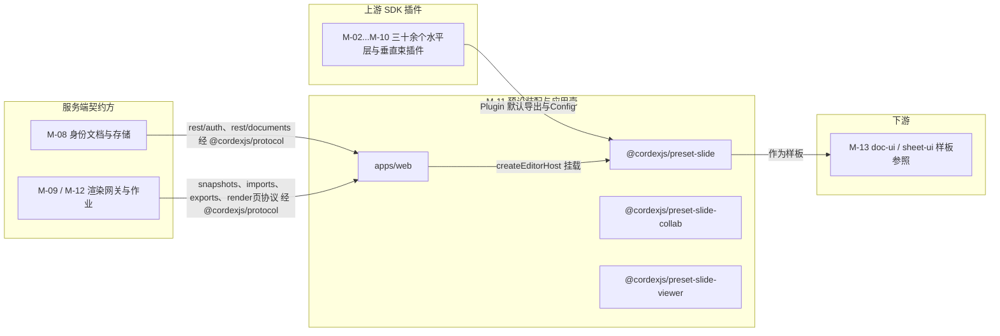
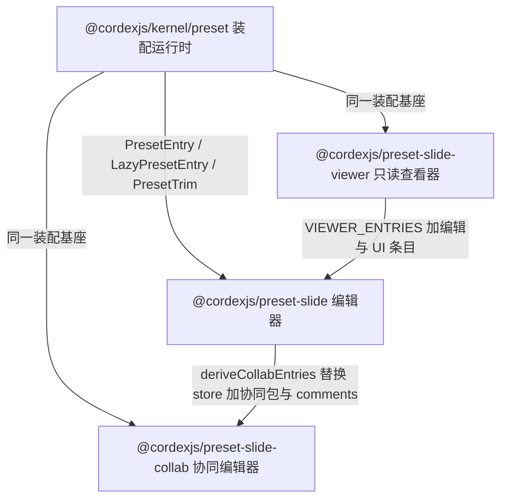
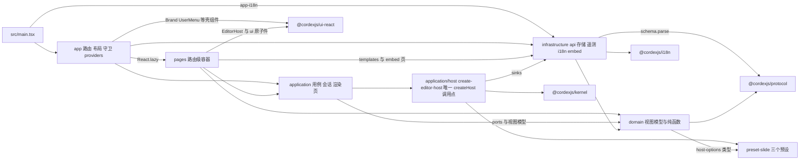
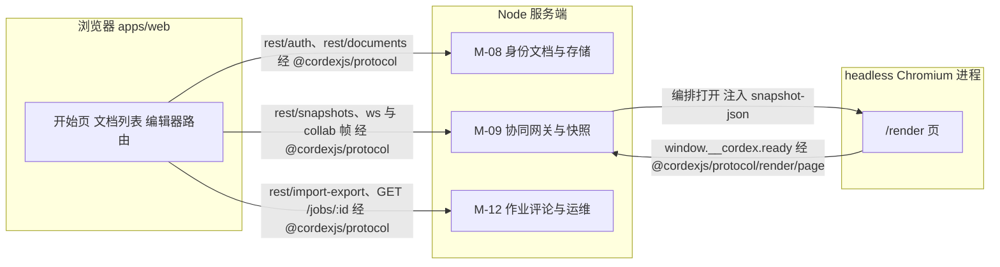

> 状态：草稿 v0.1 | 负责：架构-模块（阶段二，M-11） | 更新：2026-09-19、2026-09-24（rulings §4.15）、2026-09-24（复核修正，rulings §4.17）、2026-09-25（补图）、2026-09-25（矛盾收口，rulings §4.18）、2026-09-25（§4.19）、2026-09-26（§4.20） | 依赖：00-module-map.md M-11（BC-16/BC-17）、charter v0.2 §5.2 `preset-slide*`/`apps/web` 行与 §5.4、30-architecture 02 §3.1/§4.21/§4.21b、03 §9/§10、ADR-0010、ADR-0015、rulings §4.9/§4.10、PRD AS-01…06 / EM-01…17 / OF-14、设计 03-screens/29、01、23、25、11；上游模块文档 M-02 §3/§6/§7、M-03 §3、M-04 §3、M-05 §3/§7、M-06 §3、M-07 §3、M-10 §2.5/§3/§3a/§6/§7/§12 G-20/§13 Q-12

# 11 预设装配与应用壳（限界上下文 BC-16 预设装配、BC-17 应用壳）

## 0. 一页总览

| 项 | 值 |
|---|---|
| 职责一句话 | 把 M-02…M-10 交付的三十余个水平层 / 幻灯片垂直束插件组合成三档可运行、可裁剪、可门禁体积的插件束（`preset-slide` 编辑器、`preset-slide-collab` 协同编辑器、`preset-slide-viewer` 只读查看器），并提供仓库中唯一「知道插件存在」的应用壳 `apps/web`：开始页、文档列表、账户菜单、登录会话、编辑器 / 查看器 / 放映路由、分享 / 版本 / 导入 / 导出 / 设置页面与 `/render` headless 渲染页——应用壳零编辑器领域逻辑，只组装、只导航、只经 `@cordexjs/protocol` 与服务端通信 |
| 覆盖的上下文 | BC-16 预设装配、BC-17 应用壳 |
| 承载包 / 目录 | `@cordexjs/preset-slide`（L8，秩 80，dom，bundle，组合根）、`@cordexjs/preset-slide-collab`（L8，秩 80，dom，bundle，组合根）、`@cordexjs/preset-slide-viewer`（L8，秩 80，dom，bundle，组合根）、`apps/web`（L8，dom，app，组合根；Vite 8 + React 19 + react-router 8，2026-09-25 更正，rulings §4.18 FE-13）；四者 `cordex.compositionRoot:true`，R3 文档类型盲规则对组合根豁免（FE-01/FE-21） |
| cordis 形态 | 三个 preset：bundle（`createSlidePreset` / `createSlideCollabPreset` / `createSlideViewerPreset` 返回一个函数插件，`apply` 内无序挂载 `PresetEntry[]`，ADR-0010）；bundle 内各含 1–3 个**极薄胶水插件**（只读权限策略、查看器壳、应用栏「⋯」/i18n 胶水，§3）；`apps/web`：host（`application/host/create-editor-host.ts` 是仓库中唯一调用 `createHost` 与 `createSlide*Preset` 的应用代码；非 cordis 插件；由 ESLint `apps/**` override 与 depcruise `cordex-apps-only-assemble` 守护，原称 `no-domain-defs-in-apps`，TD-093，rulings §4.18 GV-15） |
| 运行位置 | 仅浏览器（四者均 `iso:'dom'`）；服务端用等价但独立的 `preset-server`（M-09，08 §4.2），不复用本模块任何包；`/render` 页由服务端 headless Chromium 加载，仍是浏览器环境 |
| 上游（依赖） | M-02（`@cordexjs/kernel` 的 `createHost`/`HostOptions`（`apps/web` 值导入仅限 `application/host/**`，其余只许 `import type`，rulings §4.18 FE-05）、`units.open`/`OpenUnitDescriptor`、`i18n`、`model-core`、`store-memory`/`store-yjs`、`@cordexjs/protocol` 全部 REST/WS schema）、M-03（`@cordexjs/model-slide` 主插件与 `/editing` 子插件）、M-04（`ooxml-pptx`）、M-05（`collab-core#local-presence`、`collab-yjs`、`collab-transport-ws`、`collab-offline-idb`）、M-06（`engine-layout`/`engine-render`/`render-dom`）、M-07（`slide-render`、惰性 `slide-render-chart`）、M-10（`design` CSS、`ui-core`、`ui-react` `<EditorHost>`/`UserMenu`/`Brand`/`SettingsDrawer`、`slide-ui`）；服务端契约方 M-08（`/auth/*`、`/documents/*`）、M-09/M-12（`/render` 渲染页协议与 `window.__cordex.inject` 注入载荷〔2026-09-24 删除 `/internal/render/:token/state` 拉取，rulings §4.15 Q8〕、任务与缩略图 REST） |
| 下游（被依赖） | 无（终端模块）；M-13 以三个 preset 为 `preset-doc`/`preset-sheet` 样板；集成方以 `@cordexjs/preset-*` 为嵌入入口（PRD EM-01 形态 A–D） |
| 对外服务 | 无新增 cordis 服务（BC-16 只透传；胶水插件不 `provide`）；`apps/web` 无服务 |
| 贡献点 | 提供：无；消费：无新贡献点。胶水插件向既有点贡献条目：`core.permissionPolicy`（`read-only`）、`core.command`（Operation `shell.intent`）、`ui.contextMenu{slot:'appBar.more'}`（六条目，Q20）、`ui.shortcut`（`Mod+E`）、`i18n.bundle`（`app` 命名空间，来自宿主选项） |
| doc / sheet 通用性 | 三个 preset：vertical（`bundle=slide`；`preset-doc`/`preset-sheet` 复制 `preset.ts`/`plugins/*.entries.ts`/`config/options.ts` 结构，§8）；`apps/web`：generic（路由 / 会话 / 文档列表与文档类型无关；`domain/document-type.ts` + `create-editor-host.ts` 的 `switch(documentType)` 是仅有的两个参数化点） |
| 批次 | 3（上游 M-02/M-03/M-05/M-06/M-07/M-10 §6 API 面定稿后开工；本文档按各上游 §3/§6 现稿编写） |
| 文件规模 | 源文件 **158** 个（preset-slide 18 · preset-slide-collab 11 · preset-slide-viewer **30**（原 36，C-07：`assembly/` 六文件迁出）· apps/web 99〔根 10 + `src/` 89；2026-09-25 增重新登录回调页与用例，rulings §4.18 UX-02〕）+ 测试文件 **58** 个（§9，原 59——`assembly.test.ts` 随迁出移除）；高于 00 §7 估算的 60–80，原因见 §12 G-12 |

### 0.1 图示

**图 0-1 模块内包与上下游关系**



图怎么读：本模块是终端模块，没有真正的运行时下游；上游三十余个插件被三个 preset 收拢，`apps/web` 只经 `@cordexjs/protocol` 与服务端三个模块通信，M-13 只是把三个 preset 当参照样板，不构成运行时依赖。

## 1. 限界上下文与边界

> 2026-09-25（rulings §4.19）：BC-17 应用壳的行为（路由、会话、用例、页面状态、存储键与清理）以 [50/02](../50-frontend/02-app-shell-routing-and-session.md) 为准，BC-16 装配语义以 [50/03](../50-frontend/03-preset-assembly-and-plugins.md) 为准；本节只保留职责边界，冲突以 50 为准。

### 1.1 职责与非职责

**BC-16 预设装配（做）**：维护三份显式、可静态分析的插件清单（`plugins/*.entries.ts`），把 Provider 选择（`store-memory` vs `store-yjs`、`local-presence` vs `collab-yjs`）、惰性边界（图表渲染器、语言包、查看器可选条 / 抽屉）、默认配置与 `exclude`/`override`/`configure` 裁剪点收敛为一个 `createXxxPreset(options)` 工厂；`apply` 内无序挂载并以 `Promise.allSettled` 汇总 `PresetReport`；为 `preset-slide-viewer` 提供两道机械只读保证（不装 `@cordexjs/model-slide/editing` + `read-only` 权限策略，ADR-0015）与 ≤ 350 KB gzip 的体积门禁（`config/bundle-budget.json`）；提供框架无关的查看器壳（`shell/`，02 §4.21b、设计 25）。

**BC-16 不做**：不定义任何 Definition / 贡献点 / 事件（module-map BC-16 行）；不实现编辑器 UI（M-10）、命令（M-03）、渲染（M-06/07）；不知道路由、登录、REST（BC-17）；胶水插件只把宿主传入的回调 / 语言包翻译为既有贡献点的条目，不含业务规则（§3 三个胶水插件的 `apply` 均 ≤ 60 行，由 ESLint `max-lines-per-function` + `no-restricted-imports` 检查，原称 `preset-glue-thin`，09-type-discipline/08 §11.1，rulings §4.18 GV-15）。

**BC-17 应用壳（做）**：Vite + React 19 应用：开始页 `/home`（AS-01…05）、文档列表 `/documents`（设计 01）、账户菜单（AS-06，设置唯一入口）、登录与会话（M-08 服务端 OIDC 的浏览器侧回环）、编辑器族路由（编辑 / 查看 / 放映 / 分享 / 版本 / 导出 / 保真报告 / 插件管理器）、导入页、设置页、`/render` headless 渲染页（供 M-09 `ThumbnailRenderer` 调用；state 与资源一律由编排方注入，`RenderStateToken` 已取消，rulings §4.18 BE-04）、宿主事件桥（EM-05 公开事件 → 应用状态 / 集成方回调 / iframe `postMessage`）、品牌替换点、CSP 与体积预算、i18n 接入。

**BC-17 不做**：不出现 `defineCommand`/`defineMutation`/`defineOperation`/`ctx.contribute(`/`defineContributionPoint`（ESLint `no-restricted-syntax` 的 `apps/**` override + depcruise `cordex-apps-only-assemble`，原称 `no-domain-defs-in-apps`，rulings §4.18 GV-15）；不 import 任何 `@cordexjs/model-*`/`ooxml-*`/`engine-*`/`render-dom`/`slide-*`/`collab-*`/`store-*`/`yjs`/`cordis`（depcruise `cordex-apps-only-assemble`；R9 白名单：`preset-*`、`protocol`、`design`、`ui-react`（EditorHost、壳组件、`./ui`、`./styles.css`）、`i18n`、`shared`、`kernel`（值导入仅 `application/host/**`，其余只许 `import type`），另放行 react、react-dom、react-router、tailwind，FE-05；组合根豁免 R3 不等于放开束包，FE-01）；Ribbon / 缩略图栏 / 检查器 / 放映舞台 / 母版视图等编辑器内部 UI 全部在 `slide-ui`/`ui-react`（00 §5.2），`apps/web` 的编辑器页只挂 `<EditorHost>`；不自定义跨进程 DTO（全部 `z.infer<typeof X>`，X ∈ `@cordexjs/protocol`）。

### 1.2 通用语言

引用 charter §4：Preset（§4.1「预设」）、Plugin / Definition / Provider、Host、Unit / UnitScope、DocumentType、Capability、Snapshot、Ticket。本上下文特有术语：

| 术语 | 定义 | 对应类型名（所在文件） |
|---|---|---|
| 预设条目 | 稳定 id 的插件挂载单元：`{ id; plugin \| lazy(); config?; scope:'host'\|'unit'; provides?; activateWhen? }`；id 与 loader 的条目 id 同义（ADR-0010 决策 1）；`scope:'unit'` 条目不挂根，mount 时经 `units.registerUnitProvider` 登记为 UnitScope 默认 Provider（rulings §4.20 FE-01，M-02 §2.1） | `PresetEntry`（**`@cordexjs/kernel/src/preset/entry.ts`**，2026-09-18 起，C-07；原 `preset-slide-viewer/src/assembly/entry.ts` 已删除） |
| 惰性条目 | `lazy: () => Promise<Plugin>` + 三种触发（`{ event }`/`{ contributionSeen }`/`'manual'`）；未加载前对应能力走占位 | `LazyPresetEntry`、`ActivateWhen`（`@cordexjs/kernel/src/preset/lazy.ts`，C-07） |
| 装配报告 | 全部条目 `allSettled` 后的 `ACTIVE/PENDING/FAILED/LAZY` 汇总，供插件管理器（PS-11）与 `plugin/*` 遥测 | `PresetReport`（`@cordexjs/kernel/src/preset/report.ts`，C-07） |
| 裁剪点 | `exclude: PluginId[]`、`override: Record<PluginId, Plugin>`、`configure: Partial<Record<PluginId, unknown>>` 三种不改 preset 源码的定制手段 | `PresetTrim`（`@cordexjs/kernel/src/preset/entry.ts`，C-07） |
| 超集关系 | `preset-slide ⊇ preset-slide-viewer − {read-only, design-css, viewer-shell, viewer-thumbnails, viewer-notes, viewer-search}`（2026-09-25 补 `viewer-*`，与 §3.1 派生式、02 §4.21b 统一，rulings §4.18 FE-07）；`preset-slide-collab = preset-slide − {store-memory, local-presence} + collab 四包` | `superset.test.ts` 断言 |
| 壳意图 | 应用栏「⋯」六条目、`Mod+E` 等编辑器内需要**离开 SDK 边界**的动作，以 Operation `shell.intent{target}` 经 `commands.execute` 到达宿主回调 | `ShellIntent`（`preset-slide/src/config/shell.ts`） |
| 应用会话 | 浏览器侧登录态：`unknown → anonymous \| authenticated → expired → authenticated`（新窗口重新登录且同一用户时回到 authenticated；不同用户则按只读处理，rulings §4.18 UX-02），主体来自 `GET /auth/me` | `Session`（`apps/web/src/domain/session.ts`） |
| 最近文档条目 | 本地记录与服务端 `recent` 查询合并后的开始页视图模型（≤ 5 条 + 固定） | `RecentDocumentEntry`（`apps/web/src/domain/recent-document.ts`） |
| 宿主参数 | `apps/web` 页面 → `createEditorHost` 的入参（M-10 §7 已约定形状） | `CreateEditorHostParams`（`apps/web/src/application/host/create-editor-host.ts`） |
| 渲染页协议 | headless Chromium 与 `/render` 页之间的查询参数 + `window.__cordex.inject(payload)` 注入入口 + `window.__cordex.ready/error` 信号（2026-09-24 起不再有状态拉取 URL：状态与资源由零出站 renderer sidecar 注入，rulings §4.15 Q8） | `RenderPageQuery`/`RenderPageSignal`（原始定义 **`@cordexjs/protocol/src/render/page.ts`**，M-02，2026-09-18 起，C-27；`apps/web/src/pages/render/render-page-protocol.ts` 改为 import，§12 G-7 结案） |
| 文档类型参数 | `apps/web` 唯一的文档类型知识：`documentType → { presetKey, icon, label, newCards }` | `DocumentTypeParam`（`apps/web/src/domain/document-type.ts`） |

### 1.3 上下文映射

| 相邻上下文 | 关系类型 | 防腐层落点（文件） | 传递的契约 |
|---|---|---|---|
| BC-01/02/04/05（kernel、shared、i18n、model-core、store-*） → BC-16 | Customer–Supplier（BC-16 为下游 Conformist：只挂载、只传 Config） | `preset-slide-viewer/src/plugins/core.entries.ts` | `Plugin`、各包 `Config`、`HostOptions`（由 BC-17 传 `createHost`） |
| BC-06/08/10/11/12（model-slide、ooxml-pptx、engine-*、render-dom、slide-render） → BC-16 | Customer–Supplier | `plugins/slide.entries.ts`、`plugins/render.entries.ts` | 插件默认导出、`@cordexjs/model-slide/editing` 子路径、图表惰性 import（M1–M2 为 `@cordexjs/slide-render/chart` 子路径，M3 起 `@cordexjs/slide-render-chart`，rulings §4.18 FE-08） |
| BC-09（collab 四包） → BC-16 | Customer–Supplier | `preset-slide-collab/src/plugins/collab.entries.ts` | `collabYjsPlugin`、`collabTransportWsPlugin`、`collabOfflineIdbPlugin`、`CollabConfig` |
| BC-13/14/15（design、ui-core、ui-react、slide-ui） → BC-16 | Customer–Supplier | `preset-slide/src/plugins/ui.entries.ts` | `uiCorePlugin`/`uiReactPlugin`/`slideUiPlugin`、`UiCoreConfig.theme.injectCss` |
| BC-16 → BC-17 | Customer–Supplier | `apps/web/src/application/host/create-editor-host.ts` | `createSlidePreset(options)`、`createSlideCollabPreset(options)`、`createSlideViewerPreset(options)`、`PresetReport` |
| BC-14（ui-react） → BC-17 | Conformist（照单全收 `EditorHostProps`） | `apps/web/src/pages/editor/EditorPage.tsx` | `<EditorHost host unitId mode layout slots documentTitle onNavigateBack onRename onSignOut />`、`UserMenu`/`Brand`/`SettingsDrawer` |
| BC-03 protocol → BC-17 | Published Language | `apps/web/src/infrastructure/api/http.ts`（`parse, don't validate`：响应体一律 `schema.parse`） | `rest/{auth,documents,snapshots,import-export,audit}.ts`、`errors/{codes,envelope}.ts`、`permissions/*`、`ws/*`（间接经 collab 包） |
| BC-18/19/22/23/24（服务端 Nest 模块） ↔ BC-17 | Customer–Supplier（经 protocol） | `infrastructure/api/*.api.ts` | `/auth/*`、`/documents/*`、`/documents/:id/snapshots*`、`/imports/uploads`、`/imports`、`/imports/:jobId/cancel`、`/jobs/:id`（唯一状态查询，2026-09-25 取代 `/imports/:jobId`，决策 SG-08）、`/documents/:id/export`、`/exports/:jobId`、`/documents/:id/thumbnails/*`（2026-09-25 由 `/tasks/*` 改为服务端既定路径，全部相对 `apiBase` = `/api/v1`，rulings §4.18 BE-12/BE-10/BE-11） |
| BC-27（server-headless） ↔ BC-17 | Open Host Service（`apps/web` 向服务端开放 `/render` 页） | `apps/web/src/pages/render/RenderPage.tsx` + `render-page-protocol.ts` | `RenderPageQuery`、`window.__cordex.inject(payload)`（renderer sidecar 注入 state 与资源，页面零外呼，rulings §4.15 Q8）、`window.__cordex.ready/error` |
| BC-16（slide） ↔ BC-29（未来 preset-doc/sheet） | Separate Ways（束间隔离） | — | 无共享；原共用的 `assembly/` 已上移 `@cordexjs/kernel/src/preset/`（2026-09-18，C-07，§12 G-5 结案），`preset-doc`/`preset-sheet` 零成本复用 |

## 2. 领域模型（装配 / 应用模块改写：2.1 装配模型与应用级视图模型 · 2.2 值对象 · 2.3 纯函数 · 2.4 事件 · 2.5 外部契约 · 2.6 用例清单）

> **事实源分工（rulings §4.19）**：`apps/web` 的路由、会话、运行时配置、用例与页面状态以 [50/02](../50-frontend/02-app-shell-routing-and-session.md) 为准；preset 装配语义、选项、嵌入形态与插件管理器以 [50/03](../50-frontend/03-preset-assembly-and-plugins.md) 为准；查看器、嵌入与 `/render` 页以 [50/12](../50-frontend/12-viewer-embedding-and-render-page.md) 为准；事件转发与遥测以 [50/15](../50-frontend/15-events-errors-and-telemetry.md) 为准；体积与路由 chunk 预算以 [50/13](../50-frontend/13-performance-and-bundling.md) 为准。本节 2026-09-25 起只保留类型 / 函数到文件的落点与包级接口名；§3.1–§3.3 装配清单与 §3.5 接入点表仍是包级事实源。

### 2.1 装配模型与应用级视图模型

**装配模型**（`@cordexjs/kernel/src/preset/`，M-02 承载，C-07）：`PresetEntry`、`LazyPresetEntry`（`ActivateWhen` 三种触发 + `when` 谓词，§12 G-6）、`PresetTrim`（`exclude`/`override`/`configure`，`configure` 合并算法见 50/03 §2：对象深合并、数组与标量替换）、`Preset`（`presetId: 'slide' | 'slide-collab' | 'slide-viewer'`）、`PresetReport`（`FAILED` 不阻断其余条目）；五文件见 M-02 §4.2。

**图 2-1 三预设装配关系**



图怎么读：三个 preset 共用 `@cordexjs/kernel/preset` 的装配运行时；`preset-slide` 以 viewer 的 `VIEWER_ENTRIES` 为基础派生，`preset-slide-collab` 再由 `preset-slide` 的 `./entries` 经 `deriveCollabEntries` 派生（rulings §4.18 FE-06）；自 M2 起服务端文档一律经 collab 预设打开（rulings §4.19 D-M2-CONTENT，§11），M3 起 collab 预设另装评论插件 `@cordexjs/comments`（D-COMMENTS-PKG，§3.1）。

**应用级视图模型**（`apps/web/src/domain/`，状态机与字段以 50/02 为准）：

| 视图模型 | 事实源 | 所在文件 |
|---|---|---|
| `Session`（`unknown → anonymous \| authenticated → expired`） | 50/02 §4.1 | `domain/session.ts` |
| `EditorPageState` | 50/02 §6 | `domain/editor-page-state.ts` |
| `RecentDocumentEntry` / `DocumentCardVM`（M2 起卡片封面取导入处理器写的 embedded `__cover`，空白文档用占位；服务端缩略图 M3 前半段替换，`thumbnailProvisional`） | 50/02 §9；60/06 §11.2 | `domain/recent-document.ts`、`domain/document-card.ts` |
| `RenderPageState`（`booting → awaitingInject → opening → painting → ready \| failed`） | 50/12 §11 | `domain/render-page-state.ts` |
| `OnlineState` | 50/02 §9.5 | `domain/online-state.ts` |

### 2.2 值对象

包级选项类型（字段与默认值以 50/03 §4–§5 为准；schema 用 `@cordexjs/protocol/schema` 的 `z`，R5 单点）：

| 名称 | 本包登记的要点 | 所在文件 |
|---|---|---|
| `SlidePresetOptions` | `storeProvider:'memory'`；`leaveGuard: boolean`（默认 `true`：单人模式 dirty 时关闭 / 刷新标签页触发 `beforeunload`，集成方可关，50/04 §8，2026-09-25 登记）；`zoom` 默认下发产品范围 10–400%（引擎 clamp 仍为 0.1–8，50/05 §4.1）；`thumbnails.fetchImage?: (req: { documentId; slideId; size: 640 \| 1280; signal }) => Promise<Blob>`——`server-png` 缩略图与封面 `__cover` 的取数回调，缺省时 `server-png` 不可选，apps/web 默认实现经 `http.ts`（带分享令牌头，50/05 §10.2；2026-09-25 登记） | `preset-slide/src/config/options.ts` |
| `ShellOptions` / `ShellIntent` | `shell.intent` Operation 的参数与目标集合 | `preset-slide/src/config/shell.ts` |
| `SlideCollabPresetOptions` | `storeProvider:'yjs'`；`collab{ endpoint; documentId; getToken; user; offline:{enabled:false} }`；离开保护只看协同在途与离线队列（50/02 §10） | `preset-slide-collab/src/config/options.ts` |
| `ViewerPresetOptions` | 查看器选项；i18n 命名空间 `viewer`（查看器工具条与壳文案，随 preset-slide-viewer 的 `i18n.bundle` 贡献，50/16 §11.3，2026-09-25 登记） | `preset-slide-viewer/src/config/options.ts` |
| `BundleBudget` | `{ preset; gzipKb; chunks; lazy; tolerancePct: 5 }`（`scan-bundle-budget` 读取） | `preset-slide-viewer/src/config/budget.ts` |
| `RoutePath` | 路由字面量与构造函数（路由表唯一源 50/02 §2） | `apps/web/src/domain/routes.ts` |
| `RuntimeConfig` | 只放静态部署项、由 web 容器渲染进 `index.html`（决策 RUNTIME-CONFIG）；2026-09-25 删 `auth.selfSignup`/`signupUrl`/`csp.styleNonce`/`features.collab`，增 `publicUrl`、`storagePublicOrigin`、`appVersion`、`embed.allowedHostOrigins`、`diagnostics.e2eTrace`；可变开关只从 `GET /auth/config` 读（50/02 §3） | `apps/web/src/app/config.ts` |
| `BrandConfig` | 品牌替换点（§7） | `apps/web/src/app/brand.ts` |
| `CreateEditorHostParams` | `preset: 'edit' \| 'collab' \| 'view'`（2026-09-25 由 `'slide' \| 'slide-collab' \| 'slide-viewer'` 改名，与 `DOCUMENT_TYPES[*].presetKeys[params.preset]` 一致，50/03 §5）；`source`：服务端文档一律 `{kind:'state'}` + collab（M2 起，D-M2-CONTENT），`{kind:'bytes' \| 'empty'}` 只留本地文件与 M1 查看器 | `apps/web/src/application/host/create-editor-host.ts` |
| `RenderPageQuery` | `{ renderId; documentType; mode: 'thumbnail' \| 'print' \| 'image'; slides?; deviceScaleFactor; fontProfile; layoutAlgoVersion }`（2026-09-25 `mode` 增 `image`；注入载荷 `state` 只收 `snapshot-json`，50/12 §11.3） | `apps/web/src/domain/render-page-state.ts` |
| `Preferences` | 个人本地偏好；2026-09-25 增 `a11y.readingOrder`（50/16 §9） | `apps/web/src/domain/preferences.ts` |
### 2.3 纯函数

| 签名 | 所在文件 | 说明（行为以 50/02、50/03 为准） |
|---|---|---|
| `validateEntries` / `applyTrim` / `isSuperset` | `@cordexjs/kernel/src/preset/validate.ts`（C-07） | 重复 id 诊断；`configure` 深合并；超集断言 |
| `deriveCollabEntries(base)` | `preset-slide-collab/src/plugins/derive.ts` | `store-memory → store-yjs`、删 `local-presence`、加 collab 条目与 `comments`（M3） |
| `computeBudget(stats, budget)` | `preset-slide-viewer/src/config/budget.ts` | 按 chunk 归组 gzip 字节（T-BUNDLE，50/13 §6） |
| `readOnlyPolicy(caps)` | `preset-slide-viewer/src/policies/read-only.policy.ts` | 仅 `doc.read`（+ `doc.export`） |
| `paramsToPresetOptions(p, cfg)` | `apps/web/src/domain/host-options.ts` | 纯映射，不调 `createHost` |
| `mergeRecent`、`resolveDocumentType`、`classifyAuthError`、`isSameReauthPrincipal`、`nextAfterLogin` | `apps/web/src/domain/{recent-document,document-type,session,routes}.ts` | 最近合并、未知类型回退、令牌 401 直接 `expired`（UX-02）、换人判定、站内白名单重定向（样本集见 protocol `testing/redirect-samples.ts`） |

### 2.4 事件

本模块不声明任何 cordis `Events`；`apps/web/src/application/host/host-event-bridge.ts` 只转发。转发表、合并窗口与遥测口径以 [50/15](../50-frontend/15-events-errors-and-telemetry.md) 与 [50/02 §6](../50-frontend/02-app-shell-routing-and-session.md) 为准（放映 URL 参数 2026-09-25 由 `?slide=` 改为 `?page=`）；`/render` 页 ready 判据（rulings §4.18 FE-09）以 [50/12 §11.5](../50-frontend/12-viewer-embedding-and-render-page.md) 为准，代码落点 `domain/render-page-state.ts` 的 `isRenderReady`。应用级事件（非 cordis，域固定 `app`）定义在 `apps/web/src/domain/app-events.ts`。

### 2.5 外部契约

| 契约 | 来源 | 本模块使用点 |
|---|---|---|
| `createHost(options)`（含 `scriptUrlPolicy`，2026-09-25） | M-02 kernel `host.ts`、`host-options.ts` | 仅 `application/host/create-editor-host.ts`（唯一调用点）；Trusted Types 策略由 `infrastructure/security/trusted-types.ts` 在任何 Worker 创建前建立（50/14 §4.2） |
| `units.open(descriptor)`（`source.kind ∈ bytes \| snapshot \| state \| empty`） | M-02 | `create-editor-host.ts`、`/render` 用例 |
| `EditorHostProps` | M-10 ui-react | `pages/editor/EditorPage.tsx`、`pages/present/PresentPage.tsx`（角色 → `mode` 只在打开时映射，会话内降权不改 `editorMode`，50/10 §3.1） |
| protocol REST 与 `render/page.ts` | M-02；路由唯一源 [60/15](../60-backend/15-rest-api-catalog.md) | `infrastructure/api/*.api.ts`（唯一 `fetch` 封装 `http.ts`；预签名直传另走 `direct-upload.ts`，50/02 §7） |
| 服务端 OIDC 回环 | [60/02](../60-backend/02-auth-chain.md) | `GET /auth/oidc/login?mode=redirect\|popup`（2026-09-25 由 `POST` 更正，50/02 §4.4） |

### 2.6 用例清单（`apps/web/src/application/**/*.usecase.ts`）

用例的触发、REST 调用与导航以 [50/02 §8](../50-frontend/02-app-shell-routing-and-session.md) 为准；本表只保留文件落点与 rulings §4.19 D-M2-CONTENT 带来的路径变化：

| 用例 | 所在文件 | 2026-09-25 口径 |
|---|---|---|
| 打开文档 | `application/documents/open-document.usecase.ts` | M2 起服务端文档 = `GET /documents/:id` → `GET snapshots/latest` + `POST collab-ticket` + WS（collab 预设、`source.kind:'state'`）；本地文件与 M1 查看器才走 `bytes` |
| 新建（空白 / 内置模板） | `application/documents/create-document.usecase.ts` | 前端取模板字节（`DOCUMENT_TYPES[*].newCards`）→ 服务端两步导入 → `GET /jobs/:id` → 以 `import` 快照打开；无 pptx 内容版本端点 |
| 导入 .pptx | `application/import-export/import-pptx.usecase.ts` | 本地打开 = `bytes`；入库 = `POST /imports/uploads` → `direct-upload.ts` 直传 → `POST /imports{uploadId}` → 轮询 `GET /jobs/:id`（删 `GET /imports/:jobId`，SG-08） |
| 导出 | `application/import-export/export-document.usecase.ts` | pptx 客户端 `core.export`（M2）；PDF / PNG 服务端（M3） |
| 最近与固定、列表 / 重命名 / 删除 / 创建副本 | `application/documents/{recent-documents,manage-documents}.usecase.ts` | 服务端同步（U-04），读缓存 `infrastructure/api/query-cache.ts`（决策 APP-DATA） |
| 分享、版本 | `application/sharing/share-document.usecase.ts`、`application/versions/versions.usecase.ts` | M3（权限细化、版本历史） |
| 设置 | `application/settings/preferences.usecase.ts` | 本地偏好 |
| 登录 / 会话 / 登出、新窗口重新登录 | `application/auth/{session,reauth-in-window}.usecase.ts` | 50/02 §4–§5、§10（登出清理只看协同在途与离线队列） |
| 分享链接落地 | `application/sharing/share-landing.ts`（2026-09-25 登记，50/02 §11） | 片段令牌读入 sessionStorage 后立即清地址栏 |
| 放映 / 查看、headless 渲染 | `application/render/render-page.usecase.ts` 等 | `/render` 只接受注入（BE-04），`state` 只收 `snapshot-json`，50/12 §11 |

原图 2-2（应用壳路由与 host 创建）、图 2-3（打开文档时序）、图 2-4（`/render` 时序）2026-09-25 移交 50/02 §6、§8 与 50/12 §11 的同名流程图，本文不再保留副本（M2 起打开路径已改为快照 bootstrap，旧图的「字节打开」已不成立）。
## 3. cordis 插件定义

> 三个 preset 均为 bundle：`createXxxPreset(options)` 校验 options 后返回一个函数插件，其 `apply(ctx)` 对 `applyTrim(entries, options)` 的结果**无序**挂载（`for (const e of new Set(entries)) ctx.plugin(e.plugin, e.config)`），依赖由 cordis `inject` 反应式解决，任何顺序结果一致（`order-independence.test.ts` 随机 100 次）；惰性条目只登记触发器，不挂载。`apps/web` 不是 cordis 插件，其接入点表见本节末。

### 3.1 装配清单总表（三预设共用一张表；● 装载 · ○ 不装 · ◐ 惰性 · ▲ 替换默认）

| 条目 id | 来源包 · 插件 | scope | viewer | slide | collab | 默认配置（`configure[id]` 可覆盖） | 顺序无关性说明 | 可替换点（`override`/`exclude` 后果） |
|---|---|---|---|---|---|---|---|---|
| `kernel` | `@cordexjs/kernel`（host 自带，非条目；列出仅为清单完整） | host | ● | ● | ● | `HostOptions` 由 `createHost` 传入 | 秩 0，永不 PENDING | 不可 exclude（不是条目） |
| `i18n` | `@cordexjs/i18n` 默认导出 | host | ● | ● | ● | `{ locale: options.locale, fallback: 'zh-CN' }` | 只依赖 `contributions` | exclude → 文案显示 key（宿主可启动） |
| `model-core` | `@cordexjs/model-core` 默认导出 | host | ● | ● | ● | viewer `{ historyLimit: 0, coalesceMs: 500 }`；slide `{ …, historyLimit: 200 }`；collab 同 slide（原 `defaultStoreProvider` 删除：store 由登记表中唯一的 `provides:['store']` 条目决定，rulings §4.20 FE-01） | 依赖 `contributions/errors/telemetry`（kernel） | 不建议 exclude（无 `units` 即无法打开；`pluggable.test.ts` 仍断言 host 可启动） |
| `store-memory` | `@cordexjs/store-memory` | unit | ● | ● | ○ | `{ historyLimit: 同上, freezeInDev: true }` | UnitScope 内挂载，与根顺序无关；`provides:['store']`，mount 时经 `units.registerUnitProvider` 登记（rulings §4.20 FE-01） | override → `store-yjs`/`noop`（PRD `pluggable:m1`：`store=noop` → `unit/open-failed{code}` 非崩溃） |
| `store-yjs` | `@cordexjs/store-yjs` | unit | ○ | ○ | ▲ | `{ gc: true, undoCaptureTimeout: 500, clientId: user.id }` | 同上；`collab-yjs` 在其 `yjsBackend` 就位前 PENDING（可诊断，ADR-0005） | exclude → `collab-yjs` 永久 PENDING（诊断非失败） |
| `model-slide` | `@cordexjs/model-slide`（主插件，只读部分） | host | ● | ● | ● | 无 | 依赖 `contributions/documentTypes` | exclude → 打开 `slide` 返回 ``format.no_document_type`（常量 `FORMAT_NO_DOCUMENT_TYPE`）`，宿主健康（charter §5.4） |
| `model-slide-editing` | `@cordexjs/model-slide/editing`（子路径，独立 chunk） | host | **○（ADR-0015 第一道）** | ● | ● | 无 | 依赖 `contributions/commands` | viewer 中被 `override` 强行装载 → 仍被 `read-only` 策略 `PERMISSION_DENIED`（第二道，`readonly.test.ts`） |
| `ooxml-pptx` | `@cordexjs/ooxml-pptx` | host | ● | ● | ● | `{ lazySlides: true, strictWriteBack: 'preserve', zipLimits: 默认 }` | 依赖 `contributions` | exclude → 无法打开 `.pptx`（`format.no_codec`），`empty` 源仍可用 |
| `engine-layout` | `@cordexjs/engine-layout` | host | ● | ● | ● | `{ dpi: 96, measureCache: { maxEntries: 50_000 } }` | 依赖 `contributions`；measurer 缺席是运行时诊断 | exclude → `engine-render` PENDING |
| `engine-render` | `@cordexjs/engine-render` | unit | ● | ● | ● | viewer `{ zoom: { min: 0.1, max: 4 }, overscanPages: 1 }`；slide `{ zoom: { min: 0.1, max: 8 } }` | UnitScope 内；依赖 `layout` | exclude → 画布空白，命令仍可执行（PRD `render.target=noop`） |
| `render-dom` | `@cordexjs/render-dom` | unit | ● | ● | ● | `{ pixelRatioCap: 3, svgPrecision: 2 }` | UnitScope 内；依赖 `render/layout` | override → `render-canvas`（未来）；exclude → 无 `layout.measurer:canvas`，度量诊断 `LAYOUT_MEASURER_MISSING` |
| `slide-render` | `@cordexjs/slide-render` | host（`unitPlugins` 提供 `thumbnails`） | ● | ● | ● | `SlideRenderConfig` 默认 | 依赖 `contributions`；Unit 内依赖 `render/layout/slides` | exclude → `render.scene:slide` 缺席，画布空白 |
| `slide-render-chart` | `@cordexjs/slide-render-chart`（M1–M2 为 `@cordexjs/slide-render/chart`，M3 起独立包；条目只改 import） | host | ◐ | ◐ | ◐ | 无（沿用 slide-render-chart 默认：bar、line、pie、area、scatter 五类可编辑，默认值只在 M-07 §3 一处定义，rulings §4.12 U-06、§4.18 FE-20） | `activateWhen: { event: 'render/element-degraded', when: p => p.reason === 'chart-unavailable' }`；未加载走主包占位（M-07 §3） | `lazy.charts:false` → 首屏直接装载（`/render` 装配固定为 false，FE-09）；exclude → 永远占位 |
| `locale-packs` | `@cordexjs/i18n` 语言包（`preset-*/src/plugins/locales/*.ts` 各一 chunk，≤ 30 KB） | host | ◐ | ◐ | ◐ | 默认只随首屏装 `options.locale`；`preset-slide` 的 `locale-packs` 以**同一 id** 替换 viewer 的语言包条目（不是追加，避免 `PRESET_DUPLICATE_ENTRY`，rulings §4.18 FE-06） | `activateWhen: { event: 'i18n/locale-changed' }` | `lazy.locales:false` → 全部随首屏（`/render` 装配固定为 false，FE-09） |
| `read-only` | `preset-slide-viewer/src/policies/read-only.plugin.ts`（贡献 `core.permissionPolicy`） | host | ● | ○ | ○ | `{ allowExport: options.allowExport }` | 依赖 `contributions` | **不可 exclude**（`validateEntries` 对 viewer 标 `required`，exclude 报 `PRESET_REQUIRED_ENTRY`） |
| `design-css` | `preset-slide-viewer/src/plugins/design-css.plugin.ts`（注入 `@cordexjs/design/css/theme.css`；viewer 无 ui-core） | host | ● | ○（由 `ui-core.injectCss` 承担） | ○ | `{ inject: options.theme.injectCss, nonce? }` | 无依赖 | `injectCss:false` → 宿主静态引入 CSS |
| `viewer-shell` | `preset-slide-viewer/src/shell/viewer-shell.plugin.ts` | host | ● | ○ | ○ | `ViewerPresetOptions` 中 `fit/zoom/thumbnails/notes/search/fidelitySummary/hyperlinks/callbacks` | 依赖 `units`；Unit 内 `render`（`ctx.get('render', false)`） | exclude → 纯画布（集成方自绘壳，形态 B 的 viewer 版） |
| `viewer-thumbnails` / `viewer-notes` / `viewer-search` | `shell/lazy/{thumbnail-strip,notes-pane,search-panel}.ts`（各一 chunk） | host | ◐（仅 `thumbnails/notes/search: true`） | ○ | ○ | 尺寸常量见设计 25 | `activateWhen: 'manual'`（由 `viewer-shell` 在选项为 true 时触发） | 未开启不渲染入口、不留占位（Q18） |
| `local-presence` | `@cordexjs/collab-core` `localPresencePlugin` | unit | ○（§12 G-13） | ● | ○ | 无 | UnitScope 内 | collab 中替换为 `collab-yjs` 的 `presence` |
| `ui-core` | `@cordexjs/ui-core` | host | ○ | ● | ● | `UiCoreConfig{ theme: { initial: options.theme.mode, density, injectCss, honorHostDataTheme: true }, breakpoints: { desktop: 1024, compact: 640 } }` | 依赖 `contributions/commands/units/i18n` | exclude → `ui-react`/`slide-ui` PENDING（headless，charter §5.4） |
| `ui-react` | `@cordexjs/ui-react` | host | ○ | ● | ● | `UiReactConfig` 默认（`iconStrokeWidth: 2`） | 依赖 `ui/shortcuts/theme/…` | exclude → 形态 B（须与 `slide-ui` 一并排除，即 `FRAMEWORK_FREE_EXCLUDES`；宿主自绑 DOM，`ui-core` 贡献照常注册，rulings §4.15 Q2） |
| `slide-ui` | `@cordexjs/slide-ui` | host | ○ | ● | ● | `SlideUiConfig` 默认（`masterView.minViewport: 1024`） | 依赖 `contributions/ui/shortcuts/commands/i18n/units` | exclude → 空 Ribbon / 空侧栏，画布可缩放 |
| `shell-glue` | `preset-slide/src/plugins/shell-glue.plugin.ts` | host | ○ | ● | ● | `ShellOptions` + `i18n.bundles` | 依赖 `contributions`；可选 `ui`（缺席则只贡献 Operation 与语言包） | exclude → 应用栏「⋯」为空、`Mod+E` 无效、`app` 语言包缺失 |
| `collab-transport-ws` | `@cordexjs/collab-transport-ws` | host（根作用域） | ○ | ○ | ● | `{ urlTemplate: options.collab.endpoint, connectTimeoutMs: 5000, backoff: 默认, heartbeatMs: 15000 }` | 无依赖，按需 `connect()` | override → `collab-transport-webrtc`（未来）；exclude → `collab-yjs` PENDING，单人可编辑 |
| `collab-yjs` | `@cordexjs/collab-yjs` | unit | ○ | ○ | ● | `{ flushMs: 50, awareness: 默认, maxUpdateBytes: 1 MiB, offline: { enabled: options.collab.offline.enabled } }` + `getToken`/`user` | 依赖 `store/yjsBackend/collabTransport/permissions` | exclude → 单人模式（`presence` 缺席，`isCollab=false`） |
| `collab-offline-idb` | `@cordexjs/collab-offline-idb` | unit | ○ | ○ | ◐（`collab.offline.enabled:true` 时装载；M3 默认关，M4 P2） | `{ dbNamePrefix: 'cordex-collab', maxPendingBytes: 50 MiB, ttlDays: 30 }` | 缺失即内存队列降级（M-05 §2.5） | exclude 等价于未启用 |
| `comments` | `@cordexjs/comments` 默认导出（iso 横向能力、文档类型盲：threads / replies 实体、ResourceHook `comments.threads`、`comments.*` 命令、`comment/*` 事件、锚点抽象；2026-09-25 新增，rulings §4.19 D-COMMENTS-PKG） | host（宿主级贡献 ResourceHook `comments.threads` 与 `comments.*` 命令）+ unit（按 Unit 的 `comments` 服务以 `scope:'unit'` 条目在 mount 时经 `units.registerUnitProvider` 登记，rulings §4.20 FE-01；原写「经 `unitPlugins` 挂」作废——`unitPlugins` 属文档类型，文档类型盲的 comments 包用不了，50/03 §6.2） | ○ | ○ | ●（**M3** 起装载） | 无（上限沿用 CO-04 默认） | 依赖 `contributions/commands/units/resources`；slide 专属锚点 resolver、检查器「评论」页签与画布评论钉由 `slide-ui` 贡献（M-10） | exclude → 无评论能力，编辑与协同照常；`pluggable:m3` 白名单含 `+comments` |

**超集 / 派生关系（`superset.test.ts`、`derive.ts`）**：`SLIDE_ENTRIES = VIEWER_ENTRIES − { read-only, design-css, viewer-shell, viewer-thumbnails, viewer-notes, viewer-search } + { model-slide-editing, local-presence, ui-core, ui-react, slide-ui, shell-glue }`（与 §1.2「超集关系」、02 §4.21b 同一扣除集合，rulings §4.18 FE-07），并把 `model-core`/`engine-render` 的 `configure` 换成编辑器默认；`COLLAB_ENTRIES = deriveCollabEntries(SLIDE_ENTRIES)` = `SLIDE_ENTRIES` ▲ `store-yjs` − `local-presence` + { `collab-transport-ws`, `collab-yjs`, `comments`（M3）, ◐`collab-offline-idb` }；`pluggable:m3` manifest 差异白名单 `{ −store-memory, +store-yjs, −collab-core#local-presence, +collab-yjs, +collab-transport-ws, +comments }`（`collab-offline-idb` 可选不计入；PRD 05 原白名单中不存在的 `+comments-ui`/`+presence-ui`/`+history-ui` 与重复的 `+collab-core` 删去，rulings §4.19 D-COMMENTS-PKG，50/03 §11）。三张清单都是**静态数组**（`plugins/index.ts` 导出），`manifest-gen` 据此生成聚合 `manifest.ts`（子插件 manifest 引用列表），供扫描器与文档站在不运行的情况下读出「装了什么」（ADR-0003 精神）。

### 3.2 三个 preset 的装配定义表

| 项 | `@cordexjs/preset-slide` | `@cordexjs/preset-slide-collab` | `@cordexjs/preset-slide-viewer` |
|---|---|---|---|
| 插件名 / `name` | `preset-slide`（`createSlidePreset(options)` 返回；`presetId:'slide'`） | `preset-slide-collab`（`createSlideCollabPreset(options)`；`presetId:'slide-collab'`） | `preset-slide-viewer`（`createSlideViewerPreset(options)`；`presetId:'slide-viewer'`） |
| `inject`（必需 / 可选） | 必需：无（bundle 只 `ctx.plugin` 子条目，自身不 inject）；可选：`ctx.get('errors', false)`（把 `PRESET_*` 诊断上报） | 同左 | 同左 |
| `provide` | 无（BC-16 不新增服务） | 无 | 无 |
| 贡献点：提供 | 无 | 无 | 无 |
| 贡献点：消费 | 无（间接：`shell-glue` 向 `core.command`/`ui.contextMenu`/`ui.shortcut`/`i18n.bundle` 贡献条目） | 同左 | 无（间接：`read-only` 向 `core.permissionPolicy` 贡献） |
| 事件：发布 / 订阅 | 无 / 无（子条目的 `plugin/loaded`/`plugin/failed`/`plugin/incompatible` 由 kernel 发） | 无 / 无 | 无 / 订阅 `render/element-degraded`、`i18n/locale-changed` 仅作惰性触发（`@cordexjs/kernel/src/preset/lazy.ts`，`ctx.once` 后即撤销；C-07） |
| 配置 schema | `SlidePresetOptionsSchema`（§2.2） | `SlideCollabPresetOptionsSchema` | `ViewerPresetOptionsSchema` |
| 生命周期 | `ready` = 全部 host 条目已 `ctx.plugin`（**不**等待子 Fiber 稳定）；`report()` 在 `allSettled` 后解析；`dispose` = 逆序 `fiber.dispose()`（`ctx.effect` 拥有每个句柄）；不在 UnitScope 内；PENDING：不会（无 inject） | 同左；`collab-yjs` 在 UnitScope 内于 `store-yjs` 就位后 ACTIVE | 同左；`viewer-shell` 在 `units` 就位后 ACTIVE |
| Manifest 片段 | `{ "id": "@cordexjs/preset-slide", "role": "bundle", "bundle": "slide", "entries": ["@cordexjs/i18n","@cordexjs/model-core","@cordexjs/store-memory","@cordexjs/model-slide","@cordexjs/model-slide/editing","@cordexjs/ooxml-pptx","@cordexjs/engine-layout","@cordexjs/engine-render","@cordexjs/render-dom","@cordexjs/slide-render","@cordexjs/collab-core#local-presence","@cordexjs/ui-core","@cordexjs/ui-react","@cordexjs/slide-ui","@cordexjs/preset-slide#shell-glue"], "lazy": ["@cordexjs/slide-render/chart","locale:*"], "contributes": { "core.command": ["shell.intent"], "ui.contextMenu": ["shell.export","shell.fidelityReport","shell.versionHistory","shell.pluginManager","shell.rename","shell.duplicate","shell.developer"], "ui.shortcut": ["shell.export"], "i18n.bundle": ["app:*"] }, "isomorphism": "dom" }` | `{ "id": "@cordexjs/preset-slide-collab", "role": "bundle", "bundle": "slide", "extends": "@cordexjs/preset-slide", "replaces": { "@cordexjs/store-memory": "@cordexjs/store-yjs", "@cordexjs/collab-core#local-presence": "@cordexjs/collab-yjs" }, "adds": ["@cordexjs/collab-transport-ws","@cordexjs/collab-yjs"], "optional": ["@cordexjs/collab-offline-idb"], "isomorphism": "dom" }` | `{ "id": "@cordexjs/preset-slide-viewer", "role": "bundle", "bundle": "slide", "entries": ["@cordexjs/i18n","@cordexjs/model-core","@cordexjs/store-memory","@cordexjs/model-slide","@cordexjs/ooxml-pptx","@cordexjs/engine-layout","@cordexjs/engine-render","@cordexjs/render-dom","@cordexjs/slide-render","@cordexjs/preset-slide-viewer#read-only","@cordexjs/preset-slide-viewer#design-css","@cordexjs/preset-slide-viewer#viewer-shell"], "lazy": ["@cordexjs/slide-render/chart","locale:*","viewer-thumbnails","viewer-notes","viewer-search"], "forbids": ["@cordexjs/model-slide/editing","@cordexjs/ui-core","@cordexjs/ui-react","@cordexjs/slide-ui","@cordexjs/collab-*","react"], "budgetKb": 350, "isomorphism": "dom" }` |

### 3.3 bundle 内的胶水插件（唯一含 `apply` 逻辑的文件，ESLint `max-lines-per-function`（60）+ `no-restricted-imports`（`@cordexjs/model-*` 只许 `import type`）检查：每个 ≤ 60 行、零业务规则；原称扫描器 `preset-glue-thin`，rulings §4.18 GV-15）

| 项 | `preset-slide#shell-glue` | `preset-slide-viewer#read-only` | `preset-slide-viewer#viewer-shell` | `preset-slide-viewer#design-css` |
|---|---|---|---|---|
| 文件 | `preset-slide/src/plugins/shell-glue.plugin.ts` | `preset-slide-viewer/src/policies/read-only.plugin.ts` | `preset-slide-viewer/src/shell/viewer-shell.plugin.ts` | `preset-slide-viewer/src/plugins/design-css.plugin.ts` |
| `inject` | 必需 `['contributions']`；可选 `['ui','shortcuts']`（缺席 = headless，仍贡献 Operation 与语言包） | 必需 `['contributions']` | 必需 `['units']`；Unit 内 `ctx.get('render', false)`、`ctx.get('thumbnails', false)` | 无 |
| `provide` | 无 | 无 | 无 | 无 |
| 贡献 | `core.command`：Operation `shell.intent`（`type:'operation'`，参数 `ShellIntentSchema`，能力位 `doc.read`；handler = `options.shell.onIntent?.(intent)`，缺省 `errors.create('shell.no_host')` 诊断）；`ui.contextMenu{slot:'appBar.more'}` 七项（导出… `Mod+E` / 保真报告 / 版本历史 / 插件管理器 / 重命名 / 创建副本 / 开发者〔`when: 'shell.developer'`，gating 取或 `import.meta.env.DEV \|\| features.developerMenu`，rulings §4.12 U-16，§13 Q-11〕，各绑 `commandId:'shell.intent'` + `params{target}`，按 `ShellOptions.moreMenu[*]` 决定是否贡献，Q20）；`ui.shortcut`：`Mod+E → shell.intent{target:'export'}`；`i18n.bundle`：`options.i18n.bundles`（`app` 命名空间，zh-CN/en-US，由 `apps/web` 经选项传入——apps 自身不 `contribute`） | `core.permissionPolicy`：`{ id:'read-only', evaluate(cap) => cap === 'doc.read' \|\| (allowExport && cap === 'doc.export') ? allow : deny('viewer.read_only') }`（ADR-0015 第 4 条第二道） | 不贡献；`unit/opened` 后 `mount(container)`：工具条（翻页 / 页码跳转 / 缩放 10–400% / 全屏 / 搜索〔M2〕/ ⓘ 保真摘要 / 备注〔`notes:true`〕）、键盘（←→ PageUp/Down Home/End +/- F Esc）、超链接点击（`hyperlinks:'new-tab'`）、加载骨架 / 失败态；`thumbnails/notes/search:true` 时 `lazy.activate('viewer-*')` | 注入 `<style data-cordex-tokens nonce?>`（`theme.css`）单例；`injectCss:false` 时 no-op |
| 事件 | 无发布；订阅无（`shell.intent` 由 `commands.execute` 调用） | 无 | 无发布；订阅 `unit/opened`、`unit/closed`、`unit/open-progress`、`unit/open-failed`、`render/first-paint`、`render/element-degraded`（保真计数）、`view/page-changed`、`view/zoom-changed`（若上游提供，否则读 `render` 服务 `Viewport`，§12 G-9） | 无 |
| 配置 schema | `ShellOptionsSchema` + `{ bundles: I18nBundle[] }` | `{ allowExport: boolean }` | `ViewerPresetOptions` 子集 | `{ inject: boolean; nonce?: string }` |
| 生命周期 | `ready` 批量 `ctx.contribute`（effect 拥有）；不在 UnitScope | 同左 | `ready` 只挂订阅；`mount()` 由宿主调用（`createSlideViewerPreset` 返回值上的 `mount(container)` 便捷函数，或 `apps/web ViewerPage`）；`dispose` 卸载 DOM 与 `ResizeObserver` | `ready` 注入；`dispose` 移除 `<style>` |
| Manifest | `{ "id":"@cordexjs/preset-slide#shell-glue", "injects":["contributions"], "optionalInjects":["ui","shortcuts"], "contributes":{ "core.command":["shell.intent"], "ui.contextMenu":["shell.*"], "ui.shortcut":["shell.export"], "i18n.bundle":["app:*"] } }` | `{ "id":"@cordexjs/preset-slide-viewer#read-only", "injects":["contributions"], "contributes":{ "core.permissionPolicy":["read-only"] } }` | `{ "id":"@cordexjs/preset-slide-viewer#viewer-shell", "injects":["units"], "isomorphism":"dom" }` | `{ "id":"@cordexjs/preset-slide-viewer#design-css", "injects":[] }` |

**为何选「preset 层胶水插件」而非「`apps/web` React 组件」承接应用栏「⋯」六条目（二选一说明，M-10 §13 Q-12）**：应用栏 `MoreMenu`（ui-react）只渲染 `ui.contextMenu{slot:'appBar.more'}` 的贡献，`apps/web` 受 `no-domain-defs-in-apps` 禁止 `ctx.contribute(`；若改为 `EditorHost.slots['appBar.right']` 注入 React 菜单，则会破坏 Q14 固定顺序并让 apps 持有编辑器内 UI。因此六条目由 `shell-glue` 贡献、动作统一为 Operation `shell.intent{target}`（经 `commands.execute` 走权限 / 审计 / 遥测单一入口，ADR-0015 第 1 条），`apps/web` 只在 `CreateEditorHostParams.callbacks.onIntent` 里做导航或打开对话框。**开始页 / 文档列表的账户菜单**则相反：这些页面**没有 host**，`UserMenu` 以 ui-react 普通 React 组件（props：`user/onOpenSettings/onOpenShortcuts/onHelp/onSignOut`）直接用于 `apps/web` 页面，不经贡献点；编辑器内的同一 `UserMenu` 由 ui-react `AppBar` 渲染并经 `EditorHost.onSignOut` 回调（M-10 §3a）。

### 3.4 `preset-slide-viewer` 裁剪清单与体积预算分解（≤ 350 KB gzip，PRD OF-14 / EM-07；`config/bundle-budget.json` 为事实源，`scan-bundle-budget`（`tooling/scripts/scan-bundle-budget.ts`，06 §14）读取 Rollup stats）

| 裁掉的能力 | 机制 | 证据 |
|---|---|---|
| 编辑命令与变更（55 命令 / 46 变更） | 不 import `@cordexjs/model-slide/editing`（清单无此条目；depcruise `cordex-viewer-no-editing` 对 viewer 的依赖图断言不含该子路径，原称扫描器 `no-editing-in-viewer`，rulings §4.18 GV-15） | `readonly.test.ts`：`commands.execute(unitId,'slide.insertShape')` → `COMMAND_NOT_FOUND`；`contributions(core.command)` 中无 `slide.*` |
| 写权限 | `read-only` 策略（不可 exclude） | `readonly.test.ts`：`override` 装入 editing 后 → `PERMISSION_DENIED` |
| 编辑器 UI 与 React | 不装 `ui-core`/`ui-react`/`slide-ui`；壳为框架无关 TS + CSS（02 §4.21b、ADR-0010 决策 5、设计 25「不依赖 ui-react/slide-ui 完整依赖树」） | depcruise `cordex-viewer-no-editing` 的 `forbids` 列表含 `react`/`react-dom`（原称 `no-editing-in-viewer`，GV-15） |
| 协同 / 在场 | 不装 collab 四包，也不装 `local-presence` | 清单 |
| 历史 | `model-core.historyLimit: 0`（§13 Q-5） | 配置 |
| 图表 / 语言包 / 缩略图条 / 备注抽屉 / 搜索 | 惰性 chunk，不计基线 | `lazy.test.ts`：无图表文档 import 计数 0；`thumbnails:false` 时无 `viewer-thumbnails` 请求 |

**预算分解**：各 chunk 的 gzip 预算、编辑器 ≤ 900 KB 与协同增量 ≤ 200 KB 的构成、惰性 chunk 上限与计量口径（T-BUNDLE：`config/bundle-budget.json` + chunk gzip）的唯一源是 [50/13](../50-frontend/13-performance-and-bundling.md) §6、§12（2026-09-25 自本节迁出，rulings §4.19）；本包只保留预算文件落点 `src/config/bundle-budget.json`（schema 与 `computeBudget` 见 §2.2–§2.3）。自 M2 起服务端文档实际加载协同增量（rulings §4.19 D-M2-CONTENT）。

### 3.5 `apps/web` 接入点表（非 cordis 插件；仓库中「知道插件存在」的应用代码仅第一行）

| 接入点 | 文件 | 做什么 | 机械约束 |
|---|---|---|---|
| 调用 `createHost` 与 `createSlidePreset`/`createSlideCollabPreset`/`createSlideViewerPreset` | `apps/web/src/application/host/create-editor-host.ts` | `createHost({ strictManifest, defaultSinks:false, loggerSink })` → `host.plugin(preset)` → 等 `preset.report()` → `units.open(descriptor)` → 返回 `{ host, unitId, report, dispose }`；按 `documentType` 与 `preset` 键 `switch` 选择工厂（§8 参数化点） | ESLint `no-restricted-syntax`（`apps/**` override）：`createHost(` 与 `createSlide*Preset(` 在 `apps/**` 只允许出现在此文件（原称 `single-create-host-callsite`，rulings §4.18 GV-15）；depcruise `cordex-apps-only-assemble`：`@cordexjs/kernel` **值导入**只放行 `application/host/**`（本文件、`sinks.ts`、`host-event-bridge.ts`），其余文件只许 `import type`（与 §10 一致，FE-05） |
| 选择 `errors.sink`/`telemetry.sink` | `application/host/sinks.ts` | 按 `RuntimeConfig.telemetry` 返回 console / OTel Web / no-op sink 实例，经 `HostOptions.loggerSink` 与 `configure['kernel']` 交给 kernel 自身的贡献点（apps 不 `contribute`） | 同上：`application/host/**` 值导入白名单（FE-05） |
| 挂载 `<EditorHost>` | `pages/editor/EditorPage.tsx` | `<EditorHost host unitId mode layout documentTitle onNavigateBack onRename onSignOut />`；`mode` 由角色映射；卸载时 `dispose()`（除非跳转到编辑器族兄弟路由——由 `HostRegistry` 保活） | ui-react 是 R17 允许 apps 引用的唯一 UI 包 |
| 挂载查看器壳 | `pages/viewer/ViewerPage.tsx` | `createEditorHost({ preset:'view', viewer: { thumbnails, notes } })`（2026-09-25 `preset` 取值改为 `'edit' \| 'collab' \| 'view'`，50/03 §5） → `preset.mount(containerRef.current)` | ui-react 是 R17 允许 apps 引用的唯一 UI 包 |
| 放映 | `pages/present/PresentPage.tsx` | 复用 `HostRegistry.get(documentId)` 的 host；`commands.execute(unitId,'view.setMode',{mode:'presenter'})`（归属 ui-core 已确认，2026-09-18，C-01）+ `<EditorHost mode='view' layout={{ chrome:'none' }} />`；无 host（直接深链）时先走 `open-document.usecase` | — |
| headless 渲染页 | `pages/render/RenderPage.tsx` | 解析 `RenderPageQuery` → 等待 `window.__cordex.inject({ state, resources })`（local 与 remote 都由编排方注入，页面零外呼；等待超时为页面常量，rulings §4.15 Q8、§4.18 BE-04）→ `createEditorHost({ preset:'view', source:{kind:'snapshot'\|'state'}, viewer:{ exclude:['viewer-shell','design-css'], lazy:{ charts:false, locales:false } } })` → `render.attach(#stage, { mode:'thumbnail'\|'print', pages })` → ready 判定（§2.4，FE-09）→ `window.__cordex.ready(pageIds)` | `/render` **不**挂 `<EditorHost>`（M-10 §7），UI 四包不进服务端 Chromium 的 chunk |
| 宿主事件桥 | `application/host/host-event-bridge.ts` | §2.4 事件表 → 应用状态 / 集成方回调 / `postMessage` | `ctx.on` 只读订阅；不 `emit` |
| 壳意图接收 | `pages/editor/editor-intents.ts` | `onIntent(intent)`：`export → openDialog(ExportDialog)`；`fidelity-report → navigate(…/fidelity)`；`version-history → …/history`；`plugin-manager → …/plugins`；`rename → 内联重命名（同 onRename）`；`duplicate → manage-documents.usecase.duplicate`；`developer → DevPanel`（gating 取或 `import.meta.env.DEV \|\| features.developerMenu`，rulings §4.12 U-16，§13 Q-11 结案；原「`&&`」表述有误已更正） | — |

### 3a. 路由表与 playground 归位表

**`apps/web` 路由表**：唯一源是 [50/02 §2](../50-frontend/02-app-shell-routing-and-session.md)（2026-09-25 自本节迁出，rulings §4.19；同时生效的更正：放映参数 `?slide=` → `?page=`，深链 `/documents/:id?page=&comment=`（INC-35），`/documents/:id/view` 删 `shareToken` 参数并只留给 M1 查看器与嵌入，登录端点 `GET /auth/oidc/login?mode=`，导入轮询 `GET /jobs/:id`，`/documents/:id` 在 M2 起以协同快照打开）。代码落点：`app/routes.tsx`（`createBrowserRouter`，每页 `React.lazy` 独立 chunk）；页面组件见 §4.4 `pages/`。

**playground 19 条路由（`src/routes/registry.ts`）→ `apps/web` 归位**（`/` Hub 未登记于 registry，一并列出）

| playground 路由 | 归位 | 方式 | 说明 |
|---|---|---|---|
| `/`（Hub 目录页）、`/styleguide` | — | 仅演示不迁移 | 设计稿目录与 shadcn 状态矩阵，继续作为视觉 / a11y 基准（M-10 §3a） |
| `/home` | `/home` | 迁移 | `Home.tsx` 三段结构逐段拆为 `NewSection/RecentSection/GuideSection`；mock 数据改用例 |
| `/documents` | `/documents` | 迁移 | `Documents.tsx` → `DocumentsPage` + `DocumentCard` + `FilterTabs` |
| `/import` | `/import` | 迁移 | 进度阶段 / 失败态全集来自 `unit/open-progress`、`unit/open-failed` 与 `TaskState` |
| `/editor` | `/documents/:id` | 迁移（壳内容归 M-10） | 页面只挂 `<EditorHost>`；`Main.tsx` 内的 AppBar/Ribbon/Rail/Inspector/StatusBar 归 ui-react / slide-ui |
| `/editor/masters`、`/editor/layouts`、`/editor/design`、`/editor/insert`、`/editor/text` | 合并入 `/documents/:id` | 合并 | 都是同一编辑器实例的视图模式 / 页签 / 选区态（`view.setMode`、Ribbon `when`），不再是路由；组件归 slide-ui |
| `/editor/comments` | 合并入 `/documents/:id` | 合并 | 评论面板为 `ui.panel`（M3） |
| `/editor/history` | `/documents/:id/history` | 迁移 | `History.tsx` → `VersionHistoryPage` |
| `/editor/share` | `/documents/:id/share` | 迁移 | `Share.tsx` → `ShareDialog` |
| `/editor/plugins` | `/documents/:id/plugins` | 迁移 | `Plugins.tsx` → `PluginManagerPage`（数据源 `PresetReport`） |
| `/export` | `/documents/:id/export` | 迁移 | `Export.tsx` → `ExportDialog` |
| `/present` | `/documents/:id/present` | 迁移 | 舞台 / 控制条 / 跟随归 slide-ui `ui/present/*`（M-10）；页面只做路由与 host 复用 |
| `/viewer` | `/documents/:id/view` | 迁移 | `Viewer.tsx` 的工具条 / 缩略图条 / 备注抽屉 → `preset-slide-viewer/src/shell/**`（框架无关重写，§12 G-3）；页面只 `mount()` |
| `/settings` | `/settings` + 编辑器内 `settings-drawer`（ui-react `ui.dialog`） | 迁移 | 同一 `SettingsDrawer` 组件两种宿主 |
| `/offline` | — | 合并 | 会话六态横幅 / 权限降级 / 门禁反馈是 ui-react `StatusBar`/`NotificationHost` 状态（M-10）；开始页离线横幅为 `home/OfflineBanner.tsx` |

## 4. 目录树（完整到文件）

> 包级样板文件（`package.json`/`tsconfig.json`/`tsconfig.test.json`/`vitest.config.ts`/`api-extractor.json`/`etc/<name>.api.md`/`README.md`/`CHANGELOG.md`/`cordex-manifest.json`）三个 preset 完全遵循 02 §4.0 包模板，不在树中重复；`src/__tests__/` 见 §9。DDD 目录：bundle 按 00 §1 规则 3 不设 `domain/`/`application/`/`infrastructure/`，只有 `plugins/`（装配清单）、`config/`（选项 schema 与默认值）、`testing/`；`preset-slide-viewer` 持有 `policies/`（只读策略）、`shell/`（框架无关查看器壳）——**不再持有 `assembly/`**（三预设共用的装配运行时已于 2026-09-18 收编进 `@cordexjs/kernel/src/preset/`，C-07，§12 G-5 结案）。`apps/web/src/` 按 `app/`、`pages/`（= interface）、`application/`、`infrastructure/`、`domain/`、`testing/`。

### 4.1 `@cordexjs/preset-slide`（18 文件）

```text
packages/preset-slide/src/
├── index.ts                         # 公共 API：createSlidePreset、SlidePresetOptions、ShellIntent、HEADLESS_EXCLUDES、FRAMEWORK_FREE_EXCLUDES
├── preset.ts                        # createSlidePreset(options): Preset —— 校验 options → applyTrim(SLIDE_ENTRIES) → 函数插件 apply 无序挂载 → report()
├── manifest.ts                      # 生成物：聚合子插件 manifest 引用 + contributes（shell-glue）
├── entries.ts                       # 子路径 ./entries（登记进 publicEntry，rulings §4.18 FE-04）：只导出 SLIDE_ENTRIES 与 editorConfigure（供 preset-slide-collab 派生，零副作用）
├── plugins/
│   ├── index.ts                     # SLIDE_ENTRIES = VIEWER_ENTRIES − viewer 专属 + slide.entries + ui.entries + presence.entries + shell-glue；locale-packs 以同一 id 替换 viewer 的语言包条目而非追加（避免 PRESET_DUPLICATE_ENTRY，§4.18 FE-06）
│   ├── slide.entries.ts             # model-slide-editing（@cordexjs/model-slide/editing 子路径，独立 chunk）
│   ├── ui.entries.ts                # ui-core / ui-react / slide-ui 三条目及其默认 Config（injectCss 透传）
│   ├── presence.entries.ts          # local-presence（@cordexjs/collab-core localPresencePlugin，scope:'unit'）
│   ├── editor-config.ts             # 对继承自 viewer 的条目打编辑器补丁：model-core.historyLimit=200、engine-render.zoom.max=8
│   ├── shell-glue.plugin.ts         # 胶水插件：Operation shell.intent + ui.contextMenu{appBar.more} 七项 + ui.shortcut Mod+E + i18n.bundle（app）
│   └── locales/
│       ├── zh-CN.ts                 # 惰性语言包聚合（默认语言随首屏，其余 activateWhen i18n/locale-changed）
│       └── en-US.ts
├── config/
│   ├── options.ts                   # SlidePresetOptionsSchema（strictObject）+ 类型
│   ├── defaults.ts                  # DEFAULT_SLIDE_OPTIONS（§2.2 默认值单一来源）
│   ├── shell.ts                     # ShellOptionsSchema、ShellIntentSchema、SHELL_INTENT_TARGETS、moreMenu 条目表（id/i18n key/icon/target/when）
│   ├── headless.ts                  # HEADLESS_EXCLUDES（形态 D）、FRAMEWORK_FREE_EXCLUDES（形态 B）常量
│   └── bundle-budget.json           # { preset:'slide', gzipKb: 900, chunks: {...}, tolerancePct: 5 }
└── testing/
    └── index.ts                     # mountSlidePreset(host?, opts?)、fakeShellHost()（记录 onIntent 调用）、entryIds()
```

- `plugins/`：唯一允许 import 其它 `@cordexjs/*` 插件默认导出的目录（depcruise `bundle-imports-in-plugins-dir`）。
- `package.json`（2026-09-25，rulings §4.18 FE-06/FE-21/FE-01/FE-04）：`cordex:{ layer:'L8', iso:'dom', role:'bundle', bundle:'slide', compositionRoot:true, publicEntry:['.','./entries','./testing'], stability:'beta' }`（无 `rank`）；上游 preset 写 `dependencies`：`"@cordexjs/preset-slide-viewer": "workspace:*"`；各插件包仍按 §10 写 `peerDependencies`（`workspace:^`）。
- `config/`：只依赖 `@cordexjs/protocol/schema`（`z`）与 `@cordexjs/kernel` 类型；无运行时逻辑。
- `testing/`：子路径 `./testing`，生产代码禁止 import（`no-testing-in-prod`）。

### 4.2 `@cordexjs/preset-slide-collab`（11 文件）

```text
packages/preset-slide-collab/src/
├── index.ts                         # createSlideCollabPreset、SlideCollabPresetOptions（re-export ShellIntent 等自 preset-slide）
├── preset.ts                        # createSlideCollabPreset(options): Preset —— 校验 → deriveCollabEntries(SLIDE_ENTRIES) → applyTrim → apply
├── manifest.ts                      # 生成物：extends @cordexjs/preset-slide + replaces/adds/optional（package.json 见本节末）
├── plugins/
│   ├── index.ts                     # COLLAB_ENTRIES = deriveCollabEntries(SLIDE_ENTRIES, options)
│   ├── derive.ts                    # 纯函数 deriveCollabEntries：store-memory→store-yjs（二者同为 provides:['store'] 的 unit 条目，§4.20 FE-01）；删 local-presence；追加 collab.entries（含 M3 起的 comments）
│   └── collab.entries.ts            # collab-transport-ws（host）、collab-yjs（unit）、collab-offline-idb（unit，offline.enabled 时）、comments（@cordexjs/comments，M3，rulings §4.19 D-COMMENTS-PKG）及 Config 映射（endpoint/getToken/user）
├── config/
│   ├── options.ts                   # SlideCollabPresetOptionsSchema = SlidePresetOptionsSchema.omit(storeProvider).extend({ storeProvider:'yjs', collab })
│   ├── defaults.ts                  # DEFAULT_COLLAB_OPTIONS（offline.enabled:false、awareness 默认）
│   └── bundle-budget.json           # { preset:'slide-collab', incrementKb: 200（相对 slide）, chunks }
└── testing/
    └── index.ts                     # mountCollabPreset(host, opts)、fakeCollabEndpoint()（内存 WS 对端：只回 handshake/ping，供装配测试；协议级测试在 M-05/M-09）
```

- 本包**不**直接 import `@cordexjs/store-memory`/`@cordexjs/ui-*`——一切经 `@cordexjs/preset-slide/entries` 派生，保证「切到 collab 只改 preset」（02 §4.21、M3 验收）。
- 依赖链 `preset-slide-viewer ← preset-slide ← preset-slide-collab` 是 `./entries` 派生链：C-07 后 `assembly/` 链已消失，但 `./entries` 派生仍在，为 L8 内同秩定向 import，由 R1/R2 约束，不另设规则（§10、§12 G-5；rulings §4.18 FE-06）。
- `package.json`（2026-09-25，FE-06/FE-21/FE-04）：`cordex:{ layer:'L8', iso:'dom', role:'bundle', bundle:'slide', compositionRoot:true, publicEntry:['.','./testing'], stability:'beta' }`；`dependencies` 写 `"@cordexjs/preset-slide": "workspace:*"`。

### 4.3 `@cordexjs/preset-slide-viewer`（30 文件，原 36——`assembly/` 六文件已迁出，C-07；02 §4.21b 骨架的 DDD 化）

```text
packages/preset-slide-viewer/src/
├── index.ts                         # createSlideViewerPreset、ViewerPresetOptions、mountViewer 类型；re-export @cordexjs/kernel/preset 公共类型（PresetEntry/PresetReport/PresetTrim，2026-09-18 起，C-07）
├── preset.ts                        # createSlideViewerPreset(options): Preset & { mount(container): ViewerHandle } —— 校验 → applyTrim(VIEWER_ENTRIES) → apply；required 条目校验
├── manifest.ts                      # 生成物：entries/lazy/forbids/budgetKb
├── entries.ts                       # 子路径 ./entries（登记进 publicEntry，§4.18 FE-04）：VIEWER_ENTRIES 与 viewerConfigure（供 preset-slide 派生）
├── plugins/
│   ├── index.ts                     # VIEWER_ENTRIES = core + slide + render + policy + shell + design-css + lazy locales
│   ├── core.entries.ts              # i18n、model-core（historyLimit 0）、store-memory（unit）
│   ├── slide.entries.ts             # model-slide（主插件，不含 editing）、ooxml-pptx
│   ├── render.entries.ts            # engine-layout、engine-render（unit，zoom 0.1–4）、render-dom（unit）、slide-render；惰性图表条目（M1–M2 import `@cordexjs/slide-render/chart`，M3 起 `@cordexjs/slide-render-chart`；activateWhen render/element-degraded∧chart-unavailable，FE-08）
│   ├── policy.entries.ts            # read-only（required:true，不可 exclude）
│   ├── shell.entries.ts             # viewer-shell + 惰性 viewer-thumbnails / viewer-notes / viewer-search（manual）
│   ├── design-css.plugin.ts         # 注入 @cordexjs/design/css/theme.css 单例（nonce 可选）；viewer 无 ui-core 故自带注入器
│   └── locales/
│       ├── zh-CN.ts                 # 惰性语言包聚合（同 preset-slide，但只含 viewer 用到的命名空间；查看器壳文案命名空间为 `viewer`，50/16 §11.3，2026-09-25 登记）
│       └── en-US.ts
├── policies/
│   ├── read-only.policy.ts          # 纯函数 readOnlyPolicy(allowExport): PermissionPolicy —— 仅 doc.read（+doc.export）
│   └── read-only.plugin.ts          # 向 core.permissionPolicy 贡献 read-only（ADR-0015 第二道保证）
├── shell/                           # 框架无关查看器壳（TS + CSS，≤ 15 KB gzip；不依赖 ui-core/ui-react/React，设计 25 / 02 §4.21b）
│   ├── viewer-shell.plugin.ts       # 胶水插件：unit/opened 后构造 ViewerShell 并挂到 mount() 传入的容器；dispose 卸载
│   ├── viewer-shell.ts              # ViewerShell 类：容器布局（工具条 + 舞台 + 可选条 / 抽屉槽）、状态切换、ResizeObserver、fit contain|width
│   ├── toolbar.ts                   # T-04 工具条 DOM：◂ ▸ 页码输入 / 总页 · − % + · ⛶ · 🔍(M2) · ⓘ · 📝(notes)；< 640 折叠为「更多 ⋯」；aria 属性
│   ├── keyboard.ts                  # ←/→/PageUp/PageDown/Home/End 翻页、+/- 与 Mod+滚轮缩放、F 全屏、Esc（先关抽屉再退全屏）
│   ├── states.ts                    # 加载骨架（呼吸动效）/ 失败态（错误码 → 文案变体，「下载原文件」按回调存在性渲染）
│   ├── fidelity-summary.ts          # ⓘ 卡片：保留 N 处 / 替代 M 种字体计数（读 unit/opened 的 ImportResult 与 render/font-fallback）；「查看详情」调 callbacks.onOpenDetails
│   └── lazy/
│       ├── thumbnail-strip.ts       # 底部横向缩略图条（h-20、w-24 项、ring 选中、role=listbox；读 thumbnails 服务；≥ 50 页虚拟化；1 页不显示）
│       ├── notes-pane.ts            # 右侧非模态抽屉 w-80（< 640 底部 40vh）：当前页备注纯文本；Esc 关闭
│       └── search-panel.ts          # M2 P1：查找面板（不含替换），命中高亮经 render.overlay 由 M-06/07 提供
├── styles/
│   └── viewer.css                   # 仅用 @cordexjs/design token 变量与 [data-slot] 约定的原子样式（按钮 / 进度 / 胶囊），无 Tailwind 依赖
├── config/
│   ├── options.ts                   # ViewerPresetOptionsSchema
│   ├── defaults.ts                  # DEFAULT_VIEWER_OPTIONS（thumbnails:false、notes:false、search:false、allowExport:false）
│   ├── budget.ts                    # BundleBudgetSchema + computeBudget(stats, budget)（构建期，Node 可运行）
│   └── bundle-budget.json           # { preset:'slide-viewer', gzipKb: 350, chunks: {kernel:25, protocol-i18n:20, model-core:40, model-slide:45, ooxml:90, layout:25, render:45, slide-render:35, design:6, shell:12, glue:2}, lazy: {chart:400, locale:30, viewer-thumbnails:20, viewer-notes:10, viewer-search:15}, tolerancePct: 5 }
└── testing/
    └── index.ts                     # mountViewerPreset(host?, opts?)、openFixturePptx(host)、assertNoEditingCommands(host)、fakeStage()（happy-dom 容器）
```

- `package.json`（2026-09-25，rulings §4.18 FE-21/FE-01/FE-04）：`cordex:{ layer:'L8', iso:'dom', role:'bundle', bundle:'slide', compositionRoot:true, publicEntry:['.','./entries','./testing'], stability:'beta' }`（无 `rank`）。
- `shell/` 不 import `react`，只 import `@cordexjs/design`（type-only + CSS）与 kernel 类型，运行时经 `ctx.get('render'|'thumbnails'|'units')` 取服务（原 `assembly/` 同规则现随其一并迁至 `@cordexjs/kernel/src/preset/`，C-07）。
- 查看器壳的「最小必要原子组件」（设计 25：Button、Progress/Spinner）以 `styles/viewer.css` 的 `[data-slot="button"]` 等类实现，不复用 ui-react 的 React 复制件（§13 Q-4）。

### 4.4 `apps/web`（根 10 文件 + `src/` 89 文件）

**图 4-1 apps/web 分层依赖**



怎么读：箭头为 import 方向；`domain` 只依赖 `protocol` 与 preset 的类型（`host-options.ts`）、无 IO 无 React，`application` 用例经端口注入 IO，只有 `application/host/` 一处知道插件存在（R9 `cordex-apps-only-assemble`；`kernel` 值导入仅限此目录，其余只许 `import type`，rulings §4.18 FE-05），`pages` 与 `app` 只 import L7 呈现层组件、不含领域定义。

依据：§5.4 a/b 各文件「允许依赖」列；module-map §5.2。

```text
apps/web/
├── package.json                     # private；cordex:{ layer:'L8', iso:'dom', role:'app', compositionRoot:true }（§4.18 FE-21/FE-01）；deps: @cordexjs/preset-slide, @cordexjs/preset-slide-collab, @cordexjs/preset-slide-viewer, @cordexjs/kernel（值导入仅 application/host/**，FE-05）, @cordexjs/ui-react, @cordexjs/design, @cordexjs/protocol, @cordexjs/shared, @cordexjs/i18n, react, react-dom, react-router（8.x，FE-13）；vite 8
├── vite.config.ts                   # @vitejs/plugin-react + @tailwindcss/vite；manualChunks 按 preset / 路由拆；resolve 走 workspace lib/（不 alias src）；build.target es2022；sourcemap
├── tsconfig.json                    # extends tooling/tsconfig/dom.json；references 到依赖包；paths 无别名（避免 dev/prod 分叉）
├── index.html                       # 单页入口；<script nonce> 注入 window.__CORDEX_CONFIG__；CSP <meta> 仅开发用（生产由反向代理下发，§7）
├── playwright.config.ts             # e2e：chromium/webkit/firefox 三项目；baseURL；`pnpm --filter apps-web e2e`
├── README.md                        # 运行 / 配置 / 品牌替换 / CSP 说明
├── .env.example                     # VITE_API_BASE、VITE_WS_BASE、VITE_AUTH_MODE…（2026-09-25 删 VITE_FEATURE_COLLAB：服务端文档一律协同打开，RuntimeConfig.features.collab 已删）
├── bundle-budget.json               # 路由 chunk 预算（首屏路由 chunk ≤ 250 KB gzip，不含 preset；BundleBudget 同形态，scan-bundle-budget 读取；数值唯一源 50/13 §12，2026-09-25 登记）
├── public/
│   ├── favicon.svg                  # 品牌替换点（BrandConfig.faviconUrl 覆盖）
│   ├── brand/mark.svg               # 默认 BrandMark（主色圆角方块 + 16:9 幻灯片）
│   ├── fonts/                       # 同源自托管字体 /fonts/<family>/<version>/<subset>.<hash>.woff2（immutable）；部署方字体目录挂载与配置键见 60/17（50/05 §7.1、§7.5，2026-09-25 登记）
│   │   └── font-profile.json        # fontProfile 清单（no-cache，ETag = 清单哈希 = fontProfile id；启动时并入部署方字体）
│   └── fixtures/sample.pptx         # M1 首个切片用的示例文档（软链到 fixtures/pptx/sample-basic.pptx）
├── e2e/                             # Playwright（§9）
└── src/
    ├── main.tsx                     # createRoot(#root) → <App/>；parse RuntimeConfig；注册 app i18n；不创建 host
    ├── env.d.ts                     # import.meta.env 类型 + window.__CORDEX_CONFIG__ / window.__cordex 声明
    ├── app/                         # 入口、路由、布局、运行时配置（= 应用壳骨架）
    │   ├── App.tsx                  # <Providers><RouterProvider router/></Providers>；根错误边界
    │   ├── routes.tsx               # createBrowserRouter 路由表（§3a）；每页 React.lazy 独立 chunk；对话框路由（share/export）为子路由
    │   ├── providers.tsx            # TooltipProvider / Toaster（ui-react 再导出）/ SessionProvider / PreferencesProvider / OnlineProvider / AppI18nProvider
    │   ├── config.ts                # RuntimeConfigSchema + loadRuntimeConfig()（window.__CORDEX_CONFIG__ ⊕ import.meta.env）
    │   ├── brand.ts                 # BrandConfigSchema、DEFAULT_BRAND、applyBrandCss(brand)（写 --primary 等变量到 :root）
    │   ├── layouts/
    │   │   ├── ShellLayout.tsx      # 224 px glass-strong 导航卡（Brand、主导航、底部 UserMenu）+ 主区 ≤ 1024；< 1024 折叠为顶部抽屉（AS-01）
    │   │   ├── BareLayout.tsx       # 全幅：编辑器族 / 登录 / 查看器 / 放映
    │   │   └── RenderLayout.tsx     # /render：无 chrome、固定视口、禁字体外呼、<div id="stage">
    │   └── guards/
    │       ├── RequireSession.tsx   # session.state !== 'authenticated' → /login?next=；expired：编辑器页有 pending 时不跳转（交横幅「重新登录」，§4.18 UX-02），否则跳 /login?next=
    │       └── RenderQuery.tsx      # /render：无会话，仅校验 RenderPageQuery 形状（renderId 只作日志关联，§4.18 BE-04）；失败 → window.__cordex.error('render.bad_query')
    ├── pages/                       # = interface：路由级容器，不持有业务状态
    │   ├── home/
    │   │   ├── HomePage.tsx         # 问候 + 日期、搜索文档与模板、主题分段；三段拼装；离线横幅
    │   │   ├── NewSection.tsx       # 16:9 卡片网格 minmax(150px,1fr)：空白 / 模板 × 4 / 导入 .pptx；离线禁用 + tooltip
    │   │   ├── RecentSection.tsx    # ≤ 5 条：缩略图 / 标题 / 仅查看徽标 / 固定 / 所有者·时间 / 更多（固定 · 分享 · 从最近移除〔可撤销〕）；空态；Skeleton × 4
    │   │   ├── GuideSection.tsx     # 五张指南卡（快速入门 / 快捷键 → ShortcutsPanel / 母版与版式 / 协同编辑 / 帮助中心）+「vX.Y 新功能」徽标；链接来自 RuntimeConfig.help
    │   │   └── OfflineBanner.tsx    # Alert(warning)「当前离线：…」
    │   ├── documents/
    │   │   ├── DocumentsPage.tsx    # 顶卡（Brand / 搜索 / UserMenu）+ FilterTabs + 主按钮 + 虚拟滚动卡片网格；空 / 加载 / 错误 / 离线 / 无结果态（设计 01）
    │   │   ├── DocumentCard.tsx     # 缩略图 + 内联重命名标题 + 协作者簇 + 仅查看徽标 + ⋯ 菜单（重命名 / 分享 / 移到回收站 / 创建副本）
    │   │   └── FilterTabs.tsx       # 全部 / 我拥有 / 共享给我 / 最近（URL ?filter=）
    │   ├── import/ImportPage.tsx    # 拖放 / 文件选择 → 本地打开或入库任务；进度阶段、失败态全集、降级占位（设计 13）
    │   ├── editor/
    │   │   ├── EditorPage.tsx       # useLoader(open-document) → createEditorHost → <EditorHost …/>；EditorPageState 渲染；卸载 dispose（HostRegistry 保活例外）
    │   │   └── editor-intents.ts    # onIntent(intent) 分发表（§3.5）
    │   ├── viewer/ViewerPage.tsx    # preset-slide-viewer：createEditorHost({preset:'view'}) → preset.mount(container)（只留给 M1 查看器与嵌入）
    │   ├── present/PresentPage.tsx  # 复用 HostRegistry host；view.setMode('presenter')；?page= 同步（2026-09-25 由 ?slide= 改名）；退出 → 回编辑器
    │   ├── share/ShareDialog.tsx    # 对话框路由（设计 08）：按人邀请（只对已存在账号生效，无账号提示联系管理员，rulings §4.17 D1）/ 角色 / 链接权限（链接始终需登录）/ 即时反馈；M3 只按人分享，无组主体（U-11 推迟，rulings §4.15 Q6）
    │   ├── history/VersionHistoryPage.tsx  # 抽屉页（设计 07）：自动 / 命名版本、对比、恢复（AlertDialog 确认）
    │   ├── export/ExportDialog.tsx  # 对话框路由（设计 22）：格式 / 范围 / 进度 / 失败重试
    │   ├── fidelity/FidelityReportPage.tsx  # 抽屉页（设计 10）：ImportResult 诊断分组
    │   ├── plugins/PluginManagerPage.tsx    # 抽屉页（设计 09 / PS-11）：PresetReport 条目、PENDING / 失败恢复、贡献清单
    │   ├── settings/SettingsPage.tsx        # ui-react SettingsDrawer 独立态；关闭 = 保存并返回来路（无来路 → /home）
    │   ├── templates/TemplatesPage.tsx      # M3：分类 / 搜索 / 预览 / 集成方模板源
    │   ├── auth/
    │   │   ├── LoginPage.tsx        # 「使用组织账号登录」→ GET /auth/oidc/login?mode=redirect → 302 至外置 IdP（可选 Casdoor）；「注册」入口按 GET /auth/config 的 selfSignup 显示（跳 IdP 注册页；2026-09-25 可变开关不再放 RuntimeConfig，50/02 §3、§4.4）；无租户选择 / 切换；auth.mode:'none' 仅 dev 构建直接进 /home（rulings §4.15 Q6）
    │   │   ├── CallbackPage.tsx     # 读 ?next= → GET /auth/me → 写 Session → navigate(nextAfterLogin)
    │   │   └── PopupCallbackPage.tsx  # 新窗口重新登录回调：BroadcastChannel('cordex-auth') 通知原页 → window.close()（新增，§4.18 UX-02）
    │   ├── render/
    │   │   ├── RenderPage.tsx       # §3.5 渲染页流程；不挂 <EditorHost>
    │   │   └── render-page-protocol.ts  # import RenderPageQuerySchema、RenderPageSignal（window.__cordex.ready/error）自 @cordexjs/protocol/render/page（M-02，2026-09-18 起，C-27，§12 G-7 结案）
    │   ├── embed/EmbedPage.tsx      # 形态 E（M3 P2）：?mode=view|edit；postMessage 桥转发事件与接收 intent
    │   └── errors/
    │       ├── NotFoundPage.tsx
    │       └── AppErrorBoundary.tsx # 根错误边界 + error/raised{fatal} 呈现；「复制诊断信息」调 diagnostics.dump()
    ├── application/                 # 页面用例、会话、host 装配
    │   ├── ports.ts                 # Api / Storage / Navigate / Clock / Online 端口接口（用例只依赖端口）
    │   ├── host/
    │   │   ├── create-editor-host.ts    # ★ 仓库中唯一调用 createHost / createSlide*Preset 的应用代码；switch(preset, documentType)
    │   │   ├── sinks.ts             # errors.sink / telemetry.sink 选择（console / otel-web / noop）→ HostOptions.loggerSink + configure['kernel']
    │   │   ├── host-event-bridge.ts # §2.4 转发表：ctx.on → AppEvents / callbacks.onEvent / postMessage；≥ 50 ms 合并
    │   │   └── host-registry.ts     # documentId → { host, unitId, refCount }；编辑器族路由间切换不重建 host；离开族或 idle 60 s dispose
    │   ├── documents/
    │   │   ├── open-document.usecase.ts     # GET /documents/:id → GET …/snapshots/latest 直接取字节（ETag/304，BE-12）+ POST collab-ticket → CreateEditorHostParams{preset:'collab', source:{kind:'state'}}（M2 起服务端文档一律协同快照打开，rulings §4.19 D-M2-CONTENT）；viewer 角色 mode='view'（UX-19）
    │   │   ├── create-document.usecase.ts   # 空白 / 内置模板（DOCUMENT_TYPES[*].newCards）：取模板字节 → 服务端两步导入 → GET /jobs/:id → 以 import 快照打开（M2，D-M2-CONTENT；无 pptx 内容版本端点）
    │   │   ├── recent-documents.usecase.ts  # mergeRecent(local, server)；pin / unpin / removeFromRecent（可撤销）
    │   │   └── manage-documents.usecase.ts  # list(filter, cursor) / rename / delete / duplicate
    │   ├── import-export/
    │   │   ├── import-pptx.usecase.ts       # 本地 bytes 直开；入库两步：POST /imports/uploads → direct-upload 直传 → POST /imports{uploadId} → 轮询 GET /jobs/:id（BE-10；SG-08 删 GET /imports/:jobId）
    │   │   └── export-document.usecase.ts   # pptx：commands.execute core.export；pdf/png：POST /documents/:id/export → 轮询 GET /exports/:jobId（BE-12）；单人回调式保存（Mod+S / 自动保存）
    │   ├── sharing/
    │   │   ├── share-document.usecase.ts    # permissions / share-links（M3）
    │   │   └── share-landing.ts             # 分享链接落地：片段令牌读入 sessionStorage cordex.share.{docId} 后清地址栏片段（50/02 §11，2026-09-25 登记）
    │   ├── versions/versions.usecase.ts        # 列表 / 命名 / 恢复
    │   ├── settings/preferences.usecase.ts     # 读写 Preferences；广播 app/preferences-changed；同步到 host（i18n/theme/ui.setPreference）
    │   ├── auth/
    │   │   ├── session.usecase.ts           # probe（GET /auth/me）/ login / refresh / logout；Session 状态机；刷新 401 → expired，有 pending 时不自动跳 /login（§4.18 UX-02）
    │   │   └── reauth-in-window.usecase.ts  # 新窗口重新登录：弹窗或新标签 OIDC → BroadcastChannel/重获焦点探测 → isSameReauthPrincipal → 重连或只读（新增，UX-02）
    │   └── render/render-page.usecase.ts       # 等注入（页面常量超时）→ open → attach → ready 判定（§2.4，§4.18 BE-04/FE-09）
    ├── infrastructure/
    │   ├── api/
    │   │   ├── http.ts              # 唯一 fetch 封装：credentials:'include'、X-Cordex-Request 头、ErrorEnvelope 解析、401 → refresh 一次、`parse(schema)`（parse, don't validate）
    │   │   ├── direct-upload.ts     # 对 storagePublicOrigin 的预签名直传：credentials:'omit'、不带 X-Cordex-* 头、分片（50/02 §7，2026-09-25 登记）
    │   │   ├── query-cache.ts       # 轻量内存缓存：用例名 + 规范化参数为键，stale-while-revalidate，写后失效（决策 APP-DATA，50/02 §9.5，2026-09-25 登记）
    │   │   ├── auth.api.ts          # /auth/oidc/login、/auth/me、/auth/token/refresh、/auth/logout、协同 ticket（rest/auth.ts）
    │   │   ├── documents.api.ts     # /documents*、permissions、share-links、thumbnails（rest/documents.ts）
    │   │   ├── snapshots.api.ts     # /documents/:id/snapshots*（rest/snapshots.ts）；latest 直接取字节，无预签名中转（§4.18 BE-12）
    │   │   └── import-export.api.ts # /imports/uploads、/imports、/imports/:jobId/cancel（UX-14）、/jobs/:id（唯一状态查询，SG-08）、/documents/:id/export、/exports/:jobId（rest/import-export.ts；2026-09-25 由 tasks.api.ts 改名，BE-12/BE-10）
    │   ├── render-injection.ts      # 等待并校验 window.__cordex.inject({state,resources})（RenderStateResponse schema）；超时为页面常量 RENDER_INJECT_TIMEOUT_MS；页面零外呼（仅 /render 页使用，替代原 api/render-state.api.ts，rulings §4.15 Q8、§4.18 BE-04）
    │   ├── media/
    │   │   └── media-uploader.ts    # 媒体上传默认实现：POST /documents/:id/media/presign → direct-upload → commit（文档作用域，INC-21；50/02 §1，2026-09-25 登记）
    │   ├── security/
    │   │   └── trusted-types.ts     # 建立 cordex-default Trusted Types 策略并经 createHost({scriptUrlPolicy}) 交给 SDK；另调 ui-react 的 installDefaultTrustedTypesPolicy() 建名为 default 的策略（createHTML 只对常量表逐字放行，其余返回 null，§4.20 FE-18）；main.tsx 在任何 Worker 创建前调用（50/14 §4.1–§4.2，2026-09-25 登记）
    │   ├── auth/session-client.ts   # cookie 会话探测 / 刷新计时；token 模式（嵌入）下持有 getToken 回调，不持久化令牌
    │   ├── storage/
    │   │   ├── preferences-store.ts # localStorage `cordex.prefs`（PreferencesSchema 校验；损坏即回默认）
    │   │   └── recent-store.ts      # IndexedDB `cordex.recent`（≤ 50 条本地最近 + pinned）
    │   ├── telemetry/console-sink.ts    # 默认 telemetry.sink / errors.sink（no-op 或 console）；OTel 由集成方注入
    │   ├── network/online-status.ts     # navigator.onLine + /health 心跳 → OnlineState
    │   ├── i18n/
    │   │   ├── app-i18n.ts          # 无 host 页面的独立 I18n 实例（@cordexjs/i18n 纯函数 API）；与 host 共用 Preferences.locale
    │   │   ├── app.zh-CN.json       # `app` 命名空间文案（开始页 / 列表 / 登录 / 设置 / 错误页）
    │   │   └── app.en-US.json
    │   └── embed/post-message-bridge.ts # 形态 E：origin 白名单、事件 → parent.postMessage、intent ← message
    ├── domain/                      # 应用级视图模型与纯函数（无 IO、无 React）
    │   ├── session.ts               # Session、classifyAuthError、isSameReauthPrincipal（§4.18 UX-02）
    │   ├── routes.ts                # RoutePath、documentRoute()、nextAfterLogin()
    │   ├── recent-document.ts       # RecentDocumentEntry、mergeRecent
    │   ├── document-card.ts         # DocumentCardVM ← DocumentSummary DTO
    │   ├── document-type.ts         # DOCUMENT_TYPES：DocumentTypeParam{ id; label; icon; presetKeys:{edit;collab;view}; newCards: TemplateCard[] }（内置 4 套模板卡随 newCards，2026-09-25 自已删的 app/templates.ts 迁入，50/03 §8）+ resolveDocumentType（§8 参数化点 ①）
    │   ├── editor-page-state.ts     # EditorPageState 状态机（纯 reducer）
    │   ├── render-page-state.ts     # RenderPageState 状态机（awaitingInject）+ isRenderReady(events)：页全部挂载 ∧ 字体结算 ∧ 此后一次 pendingDirty=0 的 render/frame（§4.18 FE-09）
    │   ├── online-state.ts          # OnlineState
    │   ├── preferences.ts           # PreferencesSchema + 默认
    │   ├── host-options.ts          # paramsToPresetOptions（纯映射）
    │   └── app-events.ts            # typed EventTarget：app/* 事件（§2.4）
    ├── styles/
    │   ├── index.css                # @import "@cordexjs/ui-react/styles.css"（preflight + 主题变量）+ @source 指向 src；应用页面工具类
    │   └── brand.css                # 品牌覆盖变量（空文件 = 默认品牌；集成部署时替换）
    └── testing/
        ├── msw/handlers.ts          # protocol DTO 工厂（@cordexjs/protocol/testing）驱动的 REST mock
        ├── msw/server.ts            # setupServer / setupWorker
        └── fixtures.ts              # 示例文档字节、Session / RuntimeConfig 夹具
```

## 5. 文件职责表

> 逐文件一行，与 §4 一一对应；测试文件见 §9。「允许依赖」列只写包级 / 目录级边界（具体规则见 §10）。

### 5.1 `@cordexjs/preset-slide`

| 文件 | 职责 | 主要导出 | 允许依赖 | 备注 |
|---|---|---|---|---|
| `src/index.ts` | 公共 API 面 | `createSlidePreset`、`SlidePresetOptions`、`ShellOptions`、`ShellIntent`、`HEADLESS_EXCLUDES`、`FRAMEWORK_FREE_EXCLUDES`、re-export `PresetEntry`/`PresetReport`/`PresetTrim` | `./preset`、`./config/*`、`@cordexjs/kernel/preset`（类型，2026-09-18 起，C-07） | 无副作用 |
| `src/preset.ts` | 工厂 + 函数插件 | `createSlidePreset(options?): Preset` | `./plugins`、`./config/options`、`@cordexjs/kernel/preset` | `name:'preset-slide'`；`apply` 调 `mountEntries`；`report()` |
| `src/manifest.ts` | 聚合 Manifest 生成物 | `manifest` | 无 | `manifest-gen --check` |
| `src/entries.ts` | `./entries` 子路径（登记 `publicEntry`，rulings §4.18 FE-04） | `SLIDE_ENTRIES`、`editorConfigure` | `./plugins/index` | 供 collab 派生；禁止 import `preset.ts` |
| `src/plugins/index.ts` | 编辑器清单 | `SLIDE_ENTRIES` | `@cordexjs/preset-slide-viewer/entries`（`dependencies` 写 `workspace:*`，FE-06）、`./*.entries`、`./shell-glue.plugin`、`./locales/*` | 静态数组；`applyTrim` 在 `preset.ts`；`locale-packs` 同 id 替换、不追加（FE-06） |
| `src/plugins/slide.entries.ts` | 编辑子插件条目 | `slideEditingEntries` | `@cordexjs/model-slide/editing` | 独立 chunk（`import()` 由 Vite 拆，非 lazy 条目） |
| `src/plugins/ui.entries.ts` | UI 三条目 | `uiEntries(options)` | `@cordexjs/ui-core`、`@cordexjs/ui-react`、`@cordexjs/slide-ui` | `UiCoreConfig.theme.injectCss` 与 `cssNonce` 透传（§12 G-11） |
| `src/plugins/presence.entries.ts` | 单人在场兜底 | `presenceEntries` | `@cordexjs/collab-core` | `scope:'unit'` |
| `src/plugins/editor-config.ts` | 继承条目的编辑器补丁 | `editorConfigure: PresetTrim['configure']` | 无 | `model-core.historyLimit:200`、`engine-render.zoom.max:8` |
| `src/plugins/shell-glue.plugin.ts` | 胶水插件（§3.3） | 默认导出插件 `shellGluePlugin` | `@cordexjs/kernel`、`@cordexjs/model-core`（`defineOperation`）、`@cordexjs/ui-core`（`UI_POINTS` 类型）、`@cordexjs/i18n`、`../config/shell` | ≤ 60 行（ESLint `max-lines-per-function` 60，原称 `preset-glue-thin`，TD-094，GV-15） |
| `src/plugins/locales/zh-CN.ts` | 语言包聚合（默认语言） | 默认导出插件 | 各上游包 `./locales/zh-CN` 子路径（待上游提供，§12 G-15） | 随首屏 |
| `src/plugins/locales/en-US.ts` | 语言包聚合（惰性） | 默认导出插件 | 各上游包 `./locales/zh-CN` 子路径（待上游提供，§12 G-15） | `activateWhen: { event:'i18n/locale-changed' }` |
| `src/config/options.ts` | 选项 schema | `SlidePresetOptionsSchema`、`SlidePresetOptions` | `@cordexjs/protocol/schema`、`@cordexjs/kernel`（类型）、`./shell`、`./defaults` | `strictObject`；失败抛 `PRESET_INVALID_OPTIONS` |
| `src/config/defaults.ts` | 默认值 | `DEFAULT_SLIDE_OPTIONS` | 无 | §2.2 数值单一来源 |
| `src/config/shell.ts` | 壳意图与「⋯」条目表 | `ShellOptionsSchema`、`ShellIntentSchema`、`SHELL_INTENT_TARGETS`、`MORE_MENU_ITEMS` | `@cordexjs/protocol/schema` | 七项：export/fidelity-report/version-history/plugin-manager/rename/duplicate/developer；`developer` 项 gating 取或 `import.meta.env.DEV \|\| features.developerMenu`（rulings §4.12 U-16，§13 Q-11 结案） |
| `src/config/headless.ts` | 形态 B/D 裁剪常量 | `HEADLESS_EXCLUDES`（ui-core/ui-react/slide-ui/render-dom/slide-render/local-presence）、`FRAMEWORK_FREE_EXCLUDES`（ui-react、slide-ui；2026-09-24 加 slide-ui，rulings §4.15 Q2） | 无 | EM-01 形态对应见 §6 |
| `src/config/bundle-budget.json` | 体积预算 | — | — | `gzipKb: 900`（不含 React） |
| `src/testing/index.ts` | 测试助手 | `mountSlidePreset`、`fakeShellHost`、`entryIds` | `@cordexjs/kernel/testing`、`./preset` | `./testing` 子路径 |

### 5.2 `@cordexjs/preset-slide-collab`

| 文件 | 职责 | 主要导出 | 允许依赖 | 备注 |
|---|---|---|---|---|
| `src/index.ts` | 公共 API 面 | `createSlideCollabPreset`、`SlideCollabPresetOptions`；re-export `ShellIntent` 等 | `./preset`、`./config/options`、`@cordexjs/preset-slide` | — |
| `src/preset.ts` | 工厂 + 函数插件 | `createSlideCollabPreset(options): Preset` | `./plugins`、`./config/options`、`@cordexjs/kernel/preset` | `name:'preset-slide-collab'` |
| `src/manifest.ts` | 聚合 Manifest 生成物 | `manifest` | 无 | `extends/replaces/adds/optional` |
| `src/plugins/index.ts` | 协同清单 | `collabEntries(options)` | `./derive`、`./collab.entries`、`@cordexjs/preset-slide/entries` | — |
| `src/plugins/derive.ts` | 派生纯函数 | `deriveCollabEntries(base, options)` | `@cordexjs/kernel/preset`（类型，C-07）、`@cordexjs/store-yjs` | 替换 / 删除 / 追加（含 `comments`）；`derive.test.ts` 断言 manifest 差异恰为 `pluggable:m3` 白名单 |
| `src/plugins/collab.entries.ts` | collab 条目 | `transportEntry`、`collabYjsEntry`、`offlineEntry`、`commentsEntry`（M3） | `@cordexjs/collab-transport-ws`、`@cordexjs/collab-yjs`、`@cordexjs/collab-offline-idb`、`@cordexjs/comments` | `getToken`/`user`/`endpoint` 映射到各包 Config；`commentsEntry` 2026-09-25 新增（D-COMMENTS-PKG），M3 起装载 |
| `src/config/options.ts` | 选项 schema | `SlideCollabPresetOptionsSchema` | `@cordexjs/preset-slide`（`SlidePresetOptionsSchema`）、`@cordexjs/protocol`（`DocumentId`） | `collab.endpoint` 须为 `wss:`（开发允许 `ws://localhost`） |
| `src/config/defaults.ts` | 默认值 | `DEFAULT_COLLAB_OPTIONS` | 无 | `offline.enabled:false`（M2–M3；M4 P2 开） |
| `src/config/bundle-budget.json` | 体积预算 | — | — | `incrementKb: 200` |
| `src/testing/index.ts` | 测试助手 | `mountCollabPreset`、`fakeCollabEndpoint` | `@cordexjs/kernel/testing`、`@cordexjs/collab-core/testing` | — |
| `src/testing/mock-collab-server.ts` | 内存 WS 对端 | `startMockCollabServer()` | `@cordexjs/protocol`（`ws` DTO；protocol 未登记 `./ws` 子路径，经根入口 import，rulings §4.18 FE-04） | 仅握手 / ping；供 `lifecycle.test.ts` |

### 5.3 `@cordexjs/preset-slide-viewer`

| 文件 | 职责 | 主要导出 | 允许依赖 | 备注 |
|---|---|---|---|---|
| `src/index.ts` | 公共 API 面 | `createSlideViewerPreset`、`ViewerPresetOptions`、`ViewerHandle`、re-export `@cordexjs/kernel/preset` 公共类型 | `./preset`、`./config/options`、`@cordexjs/kernel/preset` | 无副作用；不导出 `shell/**` 内部类 |
| `src/preset.ts` | 工厂 + 函数插件 + `mount` | `createSlideViewerPreset(options?): Preset & { mount(container: HTMLElement): ViewerHandle }` | `./plugins`、`./config/options`、`@cordexjs/kernel/preset`、`./shell/viewer-shell.plugin` | `required` 条目（`read-only`）被 exclude → `PRESET_REQUIRED_ENTRY` 抛出 |
| `src/manifest.ts` | 聚合 Manifest 生成物 | `manifest` | 无 | 含 `forbids`/`budgetKb` |
| `src/entries.ts` | `./entries` 子路径（登记 `publicEntry`，FE-04） | `VIEWER_ENTRIES`、`viewerConfigure`、`VIEWER_ONLY_IDS` | `./plugins/index` | 供 preset-slide 派生（`VIEWER_ONLY_IDS` = read-only、design-css、viewer-shell、viewer-thumbnails/notes/search，FE-07） |
| `src/plugins/index.ts` | 查看器清单 | `VIEWER_ENTRIES` | `./*.entries`、`./design-css.plugin`、`./locales/*` | 静态数组 |
| `src/plugins/core.entries.ts` | 内核条目 | `coreEntries(options)` | `@cordexjs/i18n`、`@cordexjs/model-core`、`@cordexjs/store-memory` | `historyLimit: 0` |
| `src/plugins/slide.entries.ts` | 领域 / 编解码条目 | `slideEntries(options)` | `@cordexjs/model-slide`（**仅主入口**）、`@cordexjs/ooxml-pptx` | 禁止 `@cordexjs/model-slide/editing`（depcruise `cordex-viewer-no-editing`，原称扫描器 `no-editing-in-viewer`，GV-15） |
| `src/plugins/render.entries.ts` | 布局 / 渲染条目 + 惰性图表 | `renderEntries(options)` | `@cordexjs/engine-layout`、`@cordexjs/engine-render`、`@cordexjs/render-dom`、`@cordexjs/slide-render`；`() => import('@cordexjs/slide-render/chart')`（M1–M2 子路径；M3 起改为 `@cordexjs/slide-render-chart`，条目只改 import，rulings §4.18 FE-08） | `activateWhen` 谓词 `reason==='chart-unavailable'` |
| `src/plugins/policy.entries.ts` | 只读策略条目 | `policyEntries(options)` | `../policies/read-only.plugin` | `required: true` |
| `src/plugins/shell.entries.ts` | 壳条目 + 三惰性条目 | `shellEntries(options)` | `../shell/viewer-shell.plugin`；`() => import('../shell/lazy/*')` | 选项为 false 时惰性条目仍登记但永不触发 |
| `src/plugins/design-css.plugin.ts` | design CSS 注入 | 默认导出插件 | `@cordexjs/design/css/theme.css`（`?inline`） | 与 ui-core 注入器互斥（viewer 无 ui-core） |
| `src/plugins/locales/zh-CN.ts` | 默认语言聚合 | 默认导出插件 | 上游 `./locales/zh-CN` 子路径（待提供） | — |
| `src/plugins/locales/en-US.ts` | 惰性语言聚合 | 默认导出插件 | 上游 `./locales/zh-CN` 子路径（待提供） | — |
| `src/policies/read-only.policy.ts` | 只读策略纯函数 | `readOnlyPolicy(allowExport): PermissionPolicy` | `@cordexjs/model-core`（`PermissionPolicy` 类型）、`@cordexjs/protocol/permissions` | deny 原因 `viewer.read_only` |
| `src/policies/read-only.plugin.ts` | 贡献策略 | 默认导出插件 `readOnlyPlugin` | `@cordexjs/kernel`、`@cordexjs/model-core`（`core.permissionPolicy` 点）、`./read-only.policy` | ADR-0015 第二道 |
| `src/shell/viewer-shell.plugin.ts` | 壳胶水插件 | 默认导出插件 `viewerShellPlugin`；`ViewerShellApi` | `@cordexjs/kernel`、`./viewer-shell` | 订阅 `unit/*`；`mount()` 由 `preset.ts` 暴露 |
| `src/shell/viewer-shell.ts` | 壳主体 | `ViewerShell` 类（`mount/update/dispose`）、`ViewerHandle` | `./toolbar`、`./keyboard`、`./states`、`./fidelity-summary`、`../styles/viewer.css` | 框架无关；`render.attach(stage, { mode:'edit'→只读 view })` |
| `src/shell/toolbar.ts` | 工具条 DOM | `createToolbar(model, handlers)` | `@cordexjs/design`（类型） | 44 px `glass-strong`；< 640 折叠 |
| `src/shell/keyboard.ts` | 键盘 / 滚轮 | `attachViewerKeys(el, handlers)` | 无 | Esc 顺序：抽屉 → 全屏 |
| `src/shell/states.ts` | 加载 / 失败态 | `renderLoading`、`renderFailed(code, callbacks)` | `@cordexjs/protocol`（`errors` 码 → 文案键；经根入口，FE-04） | 「下载原文件」按回调存在性 |
| `src/shell/fidelity-summary.ts` | ⓘ 摘要卡 | `FidelitySummary` | 无 | 计数来自 `ImportResult` + `render/font-fallback` |
| `src/shell/lazy/thumbnail-strip.ts` | 可选缩略图条（惰性 chunk） | 默认导出插件 `viewerThumbnailsPlugin` | `@cordexjs/slide-render`（`thumbnails` 服务类型） | 设计 25 尺寸；虚拟化 |
| `src/shell/lazy/notes-pane.ts` | 可选备注抽屉（惰性 chunk） | 默认导出插件 `viewerNotesPlugin` | `@cordexjs/model-slide`（`slides` 只读类型） | 只读纯文本 |
| `src/shell/lazy/search-panel.ts` | 可选搜索（M2 P1，惰性 chunk） | 默认导出插件 `viewerSearchPlugin` | `@cordexjs/model-slide`（文本查询） | 不含替换 |
| `src/styles/viewer.css` | 壳样式 | — | `@cordexjs/design` token 变量 | 无 Tailwind；`[data-slot]` 原子类 |
| `src/config/options.ts` | 选项 schema | `ViewerPresetOptionsSchema`、`ViewerPresetOptions` | `@cordexjs/protocol/schema`、`./defaults` | — |
| `src/config/defaults.ts` | 默认值 | `DEFAULT_VIEWER_OPTIONS` | 无 | Q18 默认关 |
| `src/config/budget.ts` | 预算 schema 与计算 | `BundleBudgetSchema`、`computeBudget` | `@cordexjs/protocol/schema` | 构建期由 扫描器 `scan-bundle-budget`（09-type-discipline/06 §14，rulings §4.18 GV-15） 调用 |
| `src/config/bundle-budget.json` | 预算事实源 | — | — | §3.4 表 |
| `src/testing/index.ts` | 测试助手 | `mountViewerPreset`、`openFixturePptx`、`assertNoEditingCommands`、`fakeStage` | `@cordexjs/kernel/testing`、`@cordexjs/ooxml-pptx/testing`（夹具字节） | — |

### 5.4 `apps/web`（a：根、`app/`、`pages/`）

| 文件 | 职责 | 主要导出 | 允许依赖 | 备注 |
|---|---|---|---|---|
| `package.json` | 应用元数据 | — | — | `cordex:{layer:'L8',iso:'dom',role:'app',compositionRoot:true}`（rulings §4.18 FE-21/FE-01）；`private:true`；deps 含 `@cordexjs/kernel`（值导入仅 `application/host/**`，FE-05）；Vite 8、react-router 8（FE-13） |
| `vite.config.ts` | 构建 | 默认导出 config | `@vitejs/plugin-react`、`@tailwindcss/vite` | `manualChunks`：`preset-viewer`/`preset-slide`/`preset-collab`/路由页各一 |
| `tsconfig.json` | 编译 | — | `tooling/tsconfig/dom.json` | `references` 与 deps 一致（`sync-references`） |
| `index.html` | 入口 HTML | — | — | `window.__CORDEX_CONFIG__` 注入点（带 nonce）；品牌 `<title>`/favicon |
| `playwright.config.ts` | e2e 配置 | — | `@playwright/test` | 三浏览器；`webServer` 起 `vite preview` |
| `bundle-budget.json` | 路由 chunk 预算（2026-09-25 登记） | — | — | 首屏路由 chunk ≤ 250 KB gzip（不含 preset），BundleBudget 同形态，`scan-bundle-budget` 读取；数值唯一源 50/13 §12；另登记两个只报告、不计基线的惰性 chunk 条目 `lazy: { 'otel-web', 'cordex.devtools' }`——构建入口分别为 `application/host/sinks.ts` 内对 OTel Web sink 的动态 `import()`（随 `telemetry.otlp` ∧ 用户开关加载，M3）与 ui-react 开发者面板 `cordex.devtools` 的动态 `import()`（开发者菜单可见且打开时加载，M2），50/13 §6 |
| `README.md` / `.env.example` | 文档 / 环境样例 | — | — | 品牌替换、CSP、部署说明 |
| `public/favicon.svg`、`public/brand/mark.svg` | 品牌资源 | — | — | 替换点 |
| `public/fixtures/sample.pptx` | M1 示例文档 | — | — | 软链 `fixtures/pptx/sample-basic.pptx` |
| `public/fonts/font-profile.json` | fontProfile 清单（2026-09-25 登记） | — | — | `/fonts/<family>/<version>/<subset>.<hash>.woff2` 同源自托管；清单 `no-cache`、ETag = fontProfile id；部署方字体目录见 60/17（50/05 §7.1、§7.5） |
| `src/main.tsx` | React 根 | — | `./app/App`、`./app/config`、`./infrastructure/i18n/app-i18n` | 不创建 host |
| `src/env.d.ts` | 环境类型 | `ImportMetaEnv`、`Window.__CORDEX_CONFIG__`、`Window.__cordex` | — | — |
| `src/app/App.tsx` | 应用根 | `App` | `./providers`、`./routes`、`react-router` | 根错误边界 |
| `src/app/routes.tsx` | 路由表（§3a） | `router` | `../pages/**`（`React.lazy`）、`./layouts/*`、`./guards/*`、`../domain/routes` | 对话框子路由 |
| `src/app/providers.tsx` | 全局 Provider | `Providers` | `@cordexjs/ui-react`（`TooltipProvider`/`Toaster`）、`../application/*`、`../infrastructure/*` | Session / Preferences / Online / AppI18n |
| `src/app/config.ts` | 运行时配置 | `RuntimeConfigSchema`、`loadRuntimeConfig()`、`useRuntimeConfig()` | `@cordexjs/protocol/schema` | 解析失败 → 配置错误页 |
| `src/app/brand.ts` | 品牌替换点 | `BrandConfigSchema`、`DEFAULT_BRAND`、`applyBrandCss` | `@cordexjs/design`（`ThemeVarName` 类型） | 写 `--primary`/`--primary-foreground` 等 |
| `src/app/layouts/ShellLayout.tsx` | 导航卡布局 | `ShellLayout` | `@cordexjs/ui-react`（`Brand`/`UserMenu`/`ThemeToggle`、`./ui` 原子件）、`../../application/auth/*` | AS-01 左栏 224 px；< 1024 抽屉 |
| `src/app/layouts/BareLayout.tsx` | 全幅布局 | `BareLayout` | `react-router` | — |
| `src/app/layouts/RenderLayout.tsx` | 渲染页布局 | `RenderLayout` | — | 禁字体外呼、固定视口 `#stage` |
| `src/app/guards/RequireSession.tsx` | 会话守卫 | `RequireSession` | `../../application/auth/session.usecase`、`../../domain/routes` | `expired`：编辑器页有 pending 时不跳转、交横幅（UX-02），否则跳 `/login?next=` |
| `src/app/guards/RenderQuery.tsx` | 渲染页查询守卫（2026-09-25 由 `RenderToken.tsx` 改名，BE-04） | `RenderQuery` | `../../pages/render/render-page-protocol` | 非会话；只校验 `RenderPageQuery` 形状 |
| `src/pages/home/HomePage.tsx` | 开始页容器 | `HomePage` | `./NewSection`/`RecentSection`/`GuideSection`/`OfflineBanner`、`@cordexjs/ui-react/ui` | 主区 ≤ 1024，三段锚点 |
| `src/pages/home/NewSection.tsx` | 新建段 | `NewSection` | `../../application/documents/create-document.usecase`、`../../domain/document-type`（`DOCUMENT_TYPES[*].newCards`） | 离线禁用 + tooltip；多文档类型时按类型分组 |
| `src/pages/home/RecentSection.tsx` | 最近段 | `RecentSection` | `../../application/documents/recent-documents.usecase` | 空态 / Skeleton × 4 / 可撤销 toast |
| `src/pages/home/GuideSection.tsx` | 指南段 | `GuideSection` | `../../app/config`（help 链接）、`@cordexjs/ui-react`（`ShortcutsPanel` 触发） | 五卡 + 新功能徽标 |
| `src/pages/home/OfflineBanner.tsx` | 离线横幅 | `OfflineBanner` | `../../domain/online-state`、`@cordexjs/ui-react/ui` | Alert(warning) |
| `src/pages/documents/DocumentsPage.tsx` | 文档列表 | `DocumentsPage` | `./DocumentCard`/`FilterTabs`、`../../application/documents/manage-documents.usecase` | 虚拟滚动、五态 |
| `src/pages/documents/DocumentCard.tsx` | 文档卡 | `DocumentCard` | `../../domain/document-card`、`@cordexjs/ui-react/ui` | 内联重命名、⋯ 菜单 |
| `src/pages/documents/FilterTabs.tsx` | 筛选 Tab | `FilterTabs` | `react-router`（searchParams） | — |
| `src/pages/import/ImportPage.tsx` | 导入页 | `ImportPage` | `../../application/import-export/import-pptx.usecase` | 设计 13 进度 / 失败态 |
| `src/pages/editor/EditorPage.tsx` | 编辑器页 | `EditorPage` | `@cordexjs/ui-react`（`EditorHost`）、`../../application/host/*`、`../../application/documents/open-document.usecase`、`./editor-intents` | `mode` 由角色三路映射（owner/editor→edit、commenter→review、viewer→view，rulings §4.18 UX-19）；`onNavigateBack → /home` |
| `src/pages/editor/editor-intents.ts` | 壳意图分发 | `createIntentHandler(deps)` | `../../domain/routes`、`../../application/documents/manage-documents.usecase` | §3.5 表 |
| `src/pages/viewer/ViewerPage.tsx` | 查看器页 | `ViewerPage` | `../../application/host/create-editor-host`（`preset:'view'`） | `preset.mount(container)`；只留给 M1 查看器与嵌入 |
| `src/pages/present/PresentPage.tsx` | 放映页 | `PresentPage` | `../../application/host/host-registry`、`@cordexjs/ui-react`（`EditorHost`） | `view.setMode('presenter')`；`?page=`（2026-09-25 由 `?slide=` 改名） |
| `src/pages/share/ShareDialog.tsx` | 分享对话框 | `ShareDialog` | `../../application/sharing/share-document.usecase`、`@cordexjs/ui-react/ui` | 设计 08；只按人分享（无组，rulings §4.15 Q6） |
| `src/pages/history/VersionHistoryPage.tsx` | 版本历史 | `VersionHistoryPage` | `../../application/versions/versions.usecase` | 设计 07 |
| `src/pages/export/ExportDialog.tsx` | 导出对话框 | `ExportDialog` | `../../application/import-export/export-document.usecase` | 设计 22 |
| `src/pages/fidelity/FidelityReportPage.tsx` | 保真报告 | `FidelityReportPage` | `../../application/host/host-registry`（读 `unit/opened` 载荷缓存） | 设计 10 |
| `src/pages/plugins/PluginManagerPage.tsx` | 插件管理器 | `PluginManagerPage` | `../../application/host/host-registry`（`PresetReport`） | 设计 09；PS-11 |
| `src/pages/settings/SettingsPage.tsx` | 设置页 | `SettingsPage` | `@cordexjs/ui-react`（`SettingsDrawer` 独立态）、`../../application/settings/preferences.usecase` | 关闭 = 保存并返回 |
| `src/pages/templates/TemplatesPage.tsx` | 模板库（M3） | `TemplatesPage` | `../../domain/document-type`（`newCards`）、`infrastructure/api/documents.api`（模板端点待 60/15 登记，50/02 §13.3） | AS-03 |
| `src/pages/auth/LoginPage.tsx` | 登录页 | `LoginPage` | `../../application/auth/session.usecase` | 外置 OIDC；注册入口随 `auth.selfSignup`（默认关）；`auth.mode:'none'` 仅 dev 构建直进（rulings §4.15 Q6） |
| `src/pages/auth/CallbackPage.tsx` | 回调页 | `CallbackPage` | 同上、`../../domain/routes` | `nextAfterLogin` 白名单 |
| `src/pages/auth/PopupCallbackPage.tsx` | 新窗口重新登录回调页（新增，rulings §4.18 UX-02） | `PopupCallbackPage` | `../../application/auth/reauth-in-window.usecase` | `BroadcastChannel('cordex-auth')` 通知原页后 `window.close()`；弹窗被拦截时以新标签打开，同样通知 |
| `src/pages/render/RenderPage.tsx` | headless 渲染页 | `RenderPage` | `../../application/render/render-page.usecase`、`./render-page-protocol` | 不挂 `<EditorHost>` |
| `src/pages/render/render-page-protocol.ts` | 渲染页协议薄适配层（import + `installSignals`） | re-export `RenderPageQuerySchema`、`RenderPageSignal`；`installSignals(window)` | `@cordexjs/protocol/render/page`（2026-09-18 起，C-27） | 与 M-09 `render-page-protocol.ts` 同源同一份 protocol 定义，§12 G-7 结案 |
| `src/pages/embed/EmbedPage.tsx` | iframe 嵌入页（M3 P2） | `EmbedPage` | `../../infrastructure/embed/post-message-bridge`、`./editor`/`./viewer` 复用 | 形态 E |
| `src/pages/errors/NotFoundPage.tsx` | 404 | `NotFoundPage` | `@cordexjs/ui-react/ui` | — |
| `src/pages/errors/AppErrorBoundary.tsx` | 根错误边界 | `AppErrorBoundary` | `../../application/host/host-registry`（`diagnostics.dump()`） | 「复制诊断信息」 |

### 5.4 `apps/web`（b：`application/`、`infrastructure/`、`domain/`、`styles/`、`testing/`）

| 文件 | 职责 | 主要导出 | 允许依赖 | 备注 |
|---|---|---|---|---|
| `src/application/ports.ts` | 端口接口 | `Api`、`Storage`、`Navigate`、`Clock`、`Online` | `@cordexjs/protocol`（类型） | 用例只依赖端口，便于 msw / 假实现 |
| `src/application/host/create-editor-host.ts` | ★ 唯一 `createHost`/`createSlide*Preset` 调用点 | `createEditorHost(params): Promise<EditorHostHandle>`、`CreateEditorHostParamsSchema`、`EditorHostHandle{ host; unitId; report; preset; dispose() }` | `@cordexjs/kernel`、`@cordexjs/preset-slide`、`@cordexjs/preset-slide-collab`、`@cordexjs/preset-slide-viewer`、`./sinks`、`./host-event-bridge`、`../../domain/host-options`、`../../domain/document-type` | `switch(params.preset)` × `resolveDocumentType(documentType).presetKey`（§8 参数化点 ②） |
| `src/application/host/sinks.ts` | sink 选择 | `selectSinks(cfg): { loggerSink; configure }` | `../../infrastructure/telemetry/console-sink`、`@cordexjs/kernel`（类型） | 经 `HostOptions`，非 `contribute` |
| `src/application/host/host-event-bridge.ts` | 事件桥 | `attachHostEventBridge(handle, sinks: { app; onEvent?; postMessage? }): () => void` | `@cordexjs/kernel`（`ctx.on` 类型）、`../../domain/app-events` | §2.4 表；≥ 50 ms 合并 |
| `src/application/host/host-registry.ts` | host 保活登记 | `HostRegistry`（`get/acquire/release`）、`useHostRegistry` | `./create-editor-host` | 编辑器族路由间复用；idle 60 s dispose |
| `src/application/documents/open-document.usecase.ts` | 打开文档 | `openDocument(id, deps): Promise<Result<CreateEditorHostParams, ErrorEnvelope>>` | `../ports`、`../../domain/*` | 服务端文档一律 `preset:'collab'`、`source.kind:'state'`：`GET snapshots/latest` 直接取字节（BE-12）+ 票据 + WS（任何角色，含 viewer 以 `mode='view'`，UX-19）；2026-09-25 删「collab 特性开启」分支——M2 起内容以协同快照为唯一事实源（rulings §4.19 D-M2-CONTENT） |
| `src/application/documents/create-document.usecase.ts` | 新建 | `createDocument({ documentType, title, templateId? })` | `../ports`、`../../domain/document-type`（`newCards`） | 取模板字节 → 服务端两步导入 → `GET /jobs/:id` → 以 `import` 快照打开（M2，D-M2-CONTENT；无 pptx 内容版本端点） |
| `src/application/documents/recent-documents.usecase.ts` | 最近 / 固定 | `loadRecent`、`pin`、`unpin`、`removeFromRecent`（返回 undo 句柄） | `../ports`、`../../domain/recent-document` | M2 本地 + 服务端合并 |
| `src/application/documents/manage-documents.usecase.ts` | 列表 / 重命名 / 删除 / 副本 | `listDocuments`、`renameDocument`、`deleteDocument`、`duplicateDocument` | `../ports`、`../../domain/document-card` | 游标分页 |
| `src/application/import-export/import-pptx.usecase.ts` | 导入 | `importLocal(file)`、`importToServer(file, onProgress)` | `../ports` | 本地 → `source.kind:'bytes'`；入库两步 `POST /imports/uploads` → `direct-upload` 直传 → `POST /imports{uploadId}` → 轮询 `GET /jobs/:id`（SG-08），客户端不提交对象键（BE-10） |
| `src/application/import-export/export-document.usecase.ts` | 导出 / 回调式保存 | `exportPptx(handle)`、`exportServer(id, format)`、`saveIfDirty(handle)` | `../ports`、`@cordexjs/kernel`（`commands` 类型） | `core.export`（M-02 内置命令） |
| `src/application/sharing/share-document.usecase.ts` | 分享 | `loadSharing`、`grant`、`revoke`、`createShareLink`、`deleteShareLink` | `../ports` | — |
| `src/application/sharing/share-landing.ts` | 分享链接落地（2026-09-25 登记） | `landShareToken(location)` | `../ports`（Storage） | 片段令牌读入 sessionStorage `cordex.share.{docId}` 后清地址栏片段；`share-landing.test.ts`（50/02 §11、§13.1） |
| `src/application/versions/versions.usecase.ts` | 版本 | `listVersions`、`nameVersion`、`restoreVersion` | `../ports` | 恢复后 `HostRegistry.release` + 重开 |
| `src/application/settings/preferences.usecase.ts` | 偏好 | `readPreferences`、`updatePreferences(patch)`、`syncPreferencesToHost(handle, prefs)` | `../ports`、`../../domain/preferences`、`../../domain/app-events` | 同步：`i18n.setLocale`、`theme.set/setDensity`、`ui.setPreference` |
| `src/application/auth/session.usecase.ts` | 会话 | `probeSession`、`beginLogin(next)`、`refreshSession`、`logout`、`SessionStore` | `../ports`、`../../domain/session` | 状态机唯一写入者；刷新 401 → `expired`、网络错误才 `network`；有 pending 时不自动跳转（UX-02） |
| `src/application/auth/reauth-in-window.usecase.ts` | 新窗口重新登录（新增，UX-02） | `reauthInWindow(deps): Promise<'same-user'\|'other-user'\|'cancelled'>` | `../ports`、`../../domain/session` | 弹窗 / 新标签 OIDC；`BroadcastChannel` + 重获焦点探测 `/auth/me`；同一用户 → 取新票据按 `denied→connecting` 重连；不同用户 → 不重放队列、只读 + 导出本地副本 |
| `src/application/render/render-page.usecase.ts` | 渲染页流程 | `runRenderPage(query, deps): Promise<void>` | `../host/create-editor-host`、`../../domain/render-page-state` | ready 判定（rulings §4.18 FE-09）：所请求页全部 `render/page-mounted` ∧ 这些页字体全部结算（`fonts-ready` 或 `font-fallback`）∧ 此后一次 `pendingDirty === 0` 的 `render/frame`；装配时 `lazy.charts/locales=false`；注入等待超时为页面常量（BE-04） |
| `src/infrastructure/api/http.ts` | HTTP 封装 | `createHttp(cfg)`、`parseWith(schema)` | `@cordexjs/protocol`（`ErrorEnvelope`、`errors/codes` HTTP 映射） | 401 → refresh 一次；`traceId` 透传 |
| `src/infrastructure/api/direct-upload.ts` | 预签名直传（2026-09-25 登记） | `directUpload(target, bytes, onProgress)` | 无（不复用 `http.ts` 的头） | `credentials:'omit'`、无 `X-Cordex-*` 头、分片；目标限 `storagePublicOrigin`（50/02 §7、50/14 §13 V10） |
| `src/infrastructure/api/query-cache.ts` | 读缓存（2026-09-25 登记） | `createQueryCache()` | 无 | 键 = 用例名 + 规范化参数，stale-while-revalidate，写后失效，登出随整页重载清空（决策 APP-DATA） |
| `src/infrastructure/api/auth.api.ts` | 鉴权 REST | `AuthApi` | `./http`、`@cordexjs/protocol`（`rest/auth` DTO；protocol 未登记 `./rest` 子路径，经根入口 import，FE-04） | 协同 ticket 路径以 M-08 为准 |
| `src/infrastructure/api/documents.api.ts` | 文档 REST | `DocumentsApi` | `./http`、`@cordexjs/protocol`（`rest/documents`） | 含 permissions / share-links / thumbnails |
| `src/infrastructure/api/snapshots.api.ts` | 快照 REST | `SnapshotsApi` | `./http`、`@cordexjs/protocol`（`rest/snapshots`） | `GET …/latest` 直接取字节（ETag/304；2026-09-25 删「预签名 → 字节 fetch」，rulings §4.18 BE-12） |
| `src/infrastructure/api/import-export.api.ts` | 导入导出 REST（2026-09-25 由 `tasks.api.ts` 改名，BE-12） | `ImportExportApi` | `./http`、`@cordexjs/protocol`（`rest/import-export`） | `/imports/uploads`、`/imports`、`/imports/:jobId/cancel`、`/jobs/:id`（唯一状态查询，SG-08；删 `/imports/:jobId`）（`#/import` 过渡页「取消」：上传中中止 PUT、解析中取消作业，作业转 `cancelled`，rulings §4.18 UX-14）、`/documents/:id/export`、`/exports/:jobId`；`TaskState` 轮询（退避） |
| `src/infrastructure/render-injection.ts` | 渲染态注入接收（2026-09-24 替代 `api/render-state.api.ts`，rulings §4.15 Q8） | `awaitRenderInjection(renderId)`（超时取页面常量 `RENDER_INJECT_TIMEOUT_MS`，默认 60 s，rulings §4.18 BE-04） | `../pages/render/render-page-protocol` | 仅 `/render` chunk；不 import `./api/http`（零外呼，lint 断言） |
| `src/infrastructure/media/media-uploader.ts` | 媒体上传默认实现（2026-09-25 登记） | `createMediaUploader(api)` | `../api/*` | `POST /documents/:id/media/presign` → `direct-upload` → `.../media/commit`（文档作用域，INC-21）；供 preset 的媒体插入使用 |
| `src/infrastructure/security/trusted-types.ts` | Trusted Types 策略（2026-09-25 登记；2026-09-26 增 `default` 策略，rulings §4.20 FE-18+TX-06） | `installTrustedTypes(): TrustedTypePolicy \| undefined` | `@cordexjs/ui-react`（`installDefaultTrustedTypesPolicy`，40/10 `src/infrastructure/csp/trusted-style-constants.ts`） | `cordex-default` 策略：`createScriptURL` 只放行同源 `/assets/`；`main.tsx` 在任何 Worker 创建、任何组件挂载前调用，经 `createHost({scriptUrlPolicy})` 交给 SDK（50/14 §4.2）；随后调用 ui-react 导出的 `installDefaultTrustedTypesPolicy()` 建名为 `default` 的策略（形态 A 宿主用同一导出）：只有 `createHTML`，输入与常量表中的两段 Radix 固定样式文本逐字相等才原样放行，其余一律返回 `null`，不提供 `createScript`/`createScriptURL`（50/14 §4.1、§4.4）；浏览器不支持时两个策略都不创建；单测 `__tests__/trusted-types.test.ts`（70/10 SEC-CL-02） |
| `src/infrastructure/auth/session-client.ts` | 会话客户端 | `SessionClient`（cookie 模式 / token 模式） | `./api/auth.api` | 不持久化令牌（EM-03） |
| `src/infrastructure/storage/preferences-store.ts` | 偏好存储 | `PreferencesStore` | `../../domain/preferences` | localStorage；损坏回默认 |
| `src/infrastructure/storage/recent-store.ts` | 最近存储 | `RecentStore` | `../../domain/recent-document` | IndexedDB；≤ 50 条 |
| `src/infrastructure/telemetry/console-sink.ts` | 默认 sink | `consoleErrorSink`、`noopTelemetrySink` | `@cordexjs/kernel`（`ErrorSink`/`TelemetrySink` 类型） | OTel 由集成方注入 |
| `src/infrastructure/network/online-status.ts` | 在线探测 | `createOnlineStatus()` | `./api/http` | `navigator.onLine` + `/health` |
| `src/infrastructure/i18n/app-i18n.ts` | 应用侧 i18n | `appI18n`、`useT()` | `@cordexjs/i18n`（纯函数 API）、`./app.*.json` | 无 host 页面用；与 host 共享 locale |
| `src/infrastructure/i18n/app.zh-CN.json`、`app.en-US.json` | 文案 | — | — | `app` 命名空间；同时经 `SlidePresetOptions.i18n.bundles` 交给 `shell-glue` |
| `src/infrastructure/embed/post-message-bridge.ts` | iframe 桥（M3 P2） | `createPostMessageBridge(origins)` | `../../domain/app-events` | origin 白名单 |
| `src/domain/session.ts` | 会话模型 | `Session`、`SessionState`、`classifyAuthError`、`isSameReauthPrincipal` | `@cordexjs/protocol` | UX-02 |
| `src/domain/routes.ts` | 路由值对象 | `RoutePath`、`documentRoute`、`nextAfterLogin` | 无 | 白名单防开放重定向 |
| `src/domain/recent-document.ts` | 最近条目 | `RecentDocumentEntry`、`mergeRecent` | `@cordexjs/protocol`（`DocumentSummary`） | — |
| `src/domain/document-card.ts` | 卡片 VM | `DocumentCardVM`、`toCardVM` | `@cordexjs/protocol` | — |
| `src/domain/document-type.ts` | 文档类型参数 | `DocumentTypeParam`、`DOCUMENT_TYPES`、`resolveDocumentType` | 无 | §8 参数化点 ①；`presetKeys:{edit;collab;view}` 与 `newCards`（内置模板卡，2026-09-25 自已删的 `app/templates.ts` 迁入，50/03 §8） |
| `src/domain/editor-page-state.ts` | 编辑器页状态机 | `EditorPageState`、`reduceEditorPage` | 无 | 纯 reducer |
| `src/domain/render-page-state.ts` | 渲染页状态机 | `RenderPageState`、`isRenderReady`、`RENDER_INJECT_TIMEOUT_MS` | 无 | `awaitingInject` 取代 `fetchingState`（BE-04）；`isRenderReady` 按 FE-09 三条件合取 |
| `src/domain/online-state.ts` | 在线态 | `OnlineState` | 无 | — |
| `src/domain/preferences.ts` | 偏好 schema | `PreferencesSchema`、`DEFAULT_PREFERENCES` | `@cordexjs/protocol/schema` | 设计 23 字段 |
| `src/domain/host-options.ts` | 参数 → 选项映射 | `paramsToPresetOptions` | `@cordexjs/preset-slide*`（类型） | 不调用工厂 |
| `src/domain/app-events.ts` | 应用事件 | `AppEvents`（typed EventTarget）、`AppEventMap` | 无 | `app/*` 非 cordis |
| `src/styles/index.css` | 应用样式入口 | — | `@cordexjs/ui-react/styles.css` | `@source` 指向 `src/` |
| `src/styles/brand.css` | 品牌覆盖变量 | — | — | 默认空 |
| `src/testing/msw/handlers.ts`、`msw/server.ts` | REST mock | `handlers`、`server`/`worker` | `msw`、`@cordexjs/protocol/testing` | DTO 工厂确定性 seed |
| `src/testing/fixtures.ts` | 夹具 | `sampleSession`、`sampleConfig`、`samplePptxBytes()` | `@cordexjs/ooxml-pptx/testing`（夹具字节） | — |

## 6. 对外 API 面

| 包 | `.` 导出 | 子路径 | 稳定级（推荐） |
|---|---|---|---|
| `@cordexjs/preset-slide` | 值：`createSlidePreset`、`HEADLESS_EXCLUDES`、`FRAMEWORK_FREE_EXCLUDES`、`SHELL_INTENT_TARGETS`；类型：`SlidePresetOptions`、`ShellOptions`、`ShellIntent`、`Preset`、`PresetEntry`、`LazyPresetEntry`、`PresetTrim`、`PresetReport`、`PluginId` | `./entries`（`SLIDE_ENTRIES`、`editorConfigure`）、`./testing` | `beta`：options 字段随 M2 嵌入实践只增不删；`exclude/override/configure` 语义 M1 起 `stable` |
| `@cordexjs/preset-slide-collab` | 值：`createSlideCollabPreset`；类型：`SlideCollabPresetOptions`（+ re-export 上表类型） | `./testing` | `beta`（M3 验收后评估） |
| `@cordexjs/preset-slide-viewer` | 值：`createSlideViewerPreset`；类型：`ViewerPresetOptions`、`ViewerHandle`（装配公共类型 `PresetEntry`/`PresetReport`/`PresetTrim`/`Preset` **原始定义处已迁至 `@cordexjs/kernel/preset`**，2026-09-18，C-07；本包只 re-export） | `./entries`（`VIEWER_ENTRIES`）、`./testing` | `beta`；`./assembly` 子路径**已删除**（§12 G-5 结案，不再标 `@deprecated` 过渡——直接移除，无历史消费方） |
| `apps/web` | 不发布（`private`）；对集成方的可见面只有形态 E 的 `postMessage` 消息形状（`infrastructure/embed/post-message-bridge.ts` 导出的 `EmbedMessage` 类型经文档站发布） | — | — |

**关键类型契约草案（≤ 40 行）**

```ts
// 装配运行时（@cordexjs/kernel/src/preset/*.ts，2026-09-18 起，C-07；原 preset-slide-viewer/src/assembly/*.ts 已删除）
type PluginId = Brand<string, 'PluginId'>
interface PresetEntry { id: PluginId; plugin: Plugin; config?: unknown; scope: 'host' | 'unit'; required?: boolean; provides?: readonly string[] }
type ActivateWhen = { event: string; when?: (payload: unknown) => boolean } | { contributionSeen: { point: string; key: string } } | 'manual'
interface LazyPresetEntry extends Omit<PresetEntry, 'plugin'> { lazy: () => Promise<Plugin>; activateWhen: ActivateWhen }
interface PresetTrim { exclude?: PluginId[]; override?: Record<PluginId, Plugin>; configure?: Partial<Record<PluginId, unknown>> }
interface PresetReport { presetId: string; startedAt: number; settledAt: number
  entries: { id: PluginId; state: 'ACTIVE' | 'PENDING' | 'FAILED' | 'LAZY' | 'EXCLUDED'; error?: ErrorEnvelope; ms: number }[] }
type Preset = Plugin & { presetId: string; entries: readonly (PresetEntry | LazyPresetEntry)[]; report(): Promise<PresetReport> }

// options（Standard Schema；z 来自 @cordexjs/protocol/schema）
const SlidePresetOptionsSchema = z.strictObject({
  locale: z.string().default('zh-CN'),
  theme: z.strictObject({ mode: z.enum(['system','light','dark']).default('system'), density: z.enum(['comfortable','compact']).default('comfortable'), injectCss: z.boolean().default(true), cssNonce: z.string().optional() }),
  permissions: z.union([z.literal('allowAll'), z.strictObject({ capabilities: z.array(CapabilitySchema) }), z.array(PermissionPolicySchema)]).default('allowAll'),
  user: UserRefSchema.optional(), storeProvider: z.literal('memory').default('memory'), renderTarget: z.literal('dom').default('dom'),
  history: z.strictObject({ limit: z.number().int().min(0).default(200) }), lazy: z.strictObject({ charts: z.boolean().default(true), locales: z.boolean().default(true) }),
  shell: ShellOptionsSchema, i18n: z.strictObject({ bundles: z.array(I18nBundleSchema).default([]) }),
  exclude: z.array(PluginIdSchema).optional(), override: z.record(PluginIdSchema, PluginSchema).optional(), configure: z.record(PluginIdSchema, z.unknown()).optional(),
})
const ViewerPresetOptionsSchema = z.strictObject({
  locale: z.string().default('zh-CN'), theme: z.strictObject({ mode: z.enum(['system','light','dark']).default('system'), injectCss: z.boolean().default(true), cssNonce: z.string().optional() }),
  fit: z.enum(['contain','width']).default('contain'), zoom: z.strictObject({ min: z.number().default(0.1), max: z.number().default(4) }),
  thumbnails: z.boolean().default(false), notes: z.boolean().default(false), search: z.boolean().default(false), allowExport: z.boolean().default(false),
  fidelitySummary: z.boolean().default(true), hyperlinks: z.enum(['new-tab','ignore']).default('new-tab'), lazy: z.strictObject({ charts: z.boolean().default(true), locales: z.boolean().default(true) }),
  callbacks: z.strictObject({ onOpenDetails: z.function().optional(), onDownloadOriginal: z.function().optional() }).optional(),
  exclude: z.array(PluginIdSchema).optional(), override: z.record(PluginIdSchema, PluginSchema).optional(), configure: z.record(PluginIdSchema, z.unknown()).optional(),
})
declare function createSlidePreset(o?: z.input<typeof SlidePresetOptionsSchema>): Preset
declare function createSlideViewerPreset(o?: z.input<typeof ViewerPresetOptionsSchema>): Preset & { mount(container: HTMLElement): ViewerHandle }
```

**嵌入形态（PRD EM-01 §1 A–F）与 options 的对应**

| 形态 | 入口 | options 要点 | 里程碑 |
|---|---|---|---|
| A. React `<EditorHost>` | `@cordexjs/ui-react` + `createSlidePreset` / `createSlideCollabPreset` | 默认 options；`theme.injectCss:true`（嵌入宿主页无静态 CSS）；`shell.onIntent` 由宿主实现导航；`i18n.bundles` 传宿主文案 | M2 |
| B. 框架无关挂载 | `createSlidePreset({ exclude: FRAMEWORK_FREE_EXCLUDES })`（去 `ui-react` **与 `slide-ui`**，bundle 内零 React / Radix；`ui-core` 贡献照常注册，宿主用 `ctx.ui` 视图模型自绑 DOM）+ `render.attach`；`embed-vanilla` 附带最小 `UiRenderer('vanilla')` 并实例化 M-10 `runUiRendererConformance`（rulings §4.15 Q2） | `examples/embed-vanilla`（仓库 `examples/`，非本模块目录） | M2 |
| C. 只读查看器 | `createSlideViewerPreset({ thumbnails, notes, fit })` → `preset.mount(el)` | 350 KB 基线；可选条 / 抽屉按需 | M1 |
| D. Headless（浏览器 / Node） | `createSlidePreset({ exclude: HEADLESS_EXCLUDES, permissions: {...} })`（Node：M-09 `preset-server`，非本包） | 去 UI 与 render；`units.open` + `commands.execute` + `core.export` | M1（浏览器）/ M3（Node） |
| E. iframe 嵌入 `apps/web` | `apps/web` `/embed/:id?mode=` + `postMessage` 桥 | 集成方 `getToken` 经 URL 无法传递 → 用 `message{type:'cordex:token'}` 握手；事件经桥转发 | M3 P2 |
| F. Web Component | `@cordexjs/ui-webc`（未来，charter §5.4「ui-vue 类」第二 Provider 之外的包装层） | 不在本模块；预设 API 无需变化 | M4+ |

## 7. 前后端与运行时

> 2026-09-25 起改为摘要 + 链接（rulings §4.19）：REST 客户端策略与进程间调用以 [50/02 §7](../50-frontend/02-app-shell-routing-and-session.md) 与 [60/15](../60-backend/15-rest-api-catalog.md) 为准；`/render` 页契约（查询参数、注入载荷、ready 判据、错误码）以 [50/12 §11](../50-frontend/12-viewer-embedding-and-render-page.md) 为准；嵌入形态以 50/12 §9–§10 为准。

- **仅浏览器**：四个交付物均 `iso:'dom'`；depcruise R16 禁止 iso / node 包 import 它们。服务端的等价装配是 M-09 `preset-server`，与本模块无包依赖，只共享上游插件。
- **同一 Definition 的不同 Provider（由 preset 选择）**：`DocumentStore`：`store-memory`（本地文件单人编辑 / viewer）vs `store-yjs`（collab；M2 起服务端文档一律经此，rulings §4.19 D-M2-CONTENT）；`presence`：`local-presence`（slide）vs `collab-yjs`（collab）vs 无（viewer）。
- **`apps/web` 接入文件**：`application/host/create-editor-host.ts`（唯一 `createHost`）、`pages/editor/EditorPage.tsx`（`<EditorHost>`）、`pages/viewer/ViewerPage.tsx`（`preset.mount`）、`pages/render/RenderPage.tsx`（`render.attach`，无 UI 包）。
- **进程间契约（全部经 `@cordexjs/protocol`，文件登记见 40/02 §4.3）**：`rest/auth.ts`、`rest/documents.ts`（含媒体段，文档作用域 `/documents/:id/media/*`，INC-21）、`rest/snapshots.ts`（`latest` 直接回字节，BE-12 / INC-14）、`rest/import-export.ts`（两步导入、`GET /jobs/:id`）、缩略图 `GET /documents/:id/thumbnails/:slideId?size=640|1280`（封面 `__cover`，SG-10）、协同 WS `ws/*` 与 `collab/*`（由 collab 预设内的包使用，`apps/web` 不直接触碰）、`render/page.ts`。
- **`/render` 页（本模块承诺的落点）**：`pages/render/RenderPage.tsx` + `application/render/render-page.usecase.ts` + `infrastructure/render-injection.ts`；`RenderPageQuery.mode ∈ thumbnail | print | image`（2026-09-25 增 `image`），注入 `state` 只收 `snapshot-json`（50/12 §11.3），local 与 remote 两种模式都由编排方注入、页面零外呼（BE-04），ready 判据见 50/12 §11.5（FE-09）。

**图 7-1 进程边界**



图怎么读：`apps/web` 与三个服务端模块之间全部经 `@cordexjs/protocol` 定义的 schema 通信（M2 起服务端文档的打开走 M-09 快照与 WS，新建与导入走 M-12 服务端导入，rulings §4.19 D-M2-CONTENT）；`/render` 页是 M-09 从 Node 侧编排出的另一个浏览器进程，只接受注入。
## 8. doc / sheet 扩展缝

**三个 preset：vertical（`bundle=slide`）——`preset-doc`/`preset-sheet` 的样板**（00 §6.2 L8 行、G-3 追加建议）。复制时逐文件对应：

| 样板文件（标 ⓣ = 模板文件，复制后只改 import 与 id） | `preset-doc` 对应 | 改动性质 |
|---|---|---|
| ⓣ `preset-slide-viewer/src/preset.ts`、`preset-slide/src/preset.ts`、`preset-slide-collab/src/preset.ts` | `preset-doc` 的 `preset.ts`（章程与 13 只登记 `preset-doc`/`preset-sheet`；`preset-doc-viewer`/`preset-doc-collab` 两档属 **M5 后续，届时经章程修订登记**，rulings §4.12 U-01、§4.18 FE-12） | 只改 `name`/`presetId` 与清单 import |
| ⓣ `plugins/core.entries.ts`、`plugins/render.entries.ts`（engine 三条目部分）、`plugins/ui.entries.ts`（ui-core / ui-react 部分）、`plugins/presence.entries.ts`、`plugins/policy.entries.ts`、`plugins/design-css.plugin.ts`、`plugins/locales/*` | 原样复制 | 零改动（水平层条目） |
| `plugins/slide.entries.ts` → `plugins/doc.entries.ts` | `model-doc`（主 + `/editing`）、`ooxml-docx` | 替换垂直束包 |
| `plugins/render.entries.ts` 的 `slide-render`/`slide-render-chart` 行 → `doc-render` | `doc-render`（无图表惰性条目或换为 `doc-render-math` 之类） | 替换 |
| `plugins/ui.entries.ts` 的 `slide-ui` 行 → `doc-ui` | `doc-ui` | 替换 |
| ⓣ `plugins/shell-glue.plugin.ts`、`config/shell.ts` | 原样复制（六条目对 doc 同样成立） | 零改动 |
| ⓣ `config/options.ts`、`config/defaults.ts`、`config/headless.ts`、`config/budget.ts` | 原样复制；`options` 增删文档类型特有开关（如 doc 的 `pagination`） | 微改 |
| `config/bundle-budget.json` | 重新校准 | 数值 |
| `policies/read-only.*`、`shell/**`（viewer 壳的翻页 / 缩放 / 全屏 / 摘要对分页文档同样适用；`thumbnail-strip` 对 sheet 无意义 → exclude） | 原样复制；sheet 视图用 `exclude:['viewer-thumbnails']` | 零改动 / 配置 |
| ⓣ 装配运行时 | **不复制**——经 `@cordexjs/kernel/preset` import（2026-09-18 起，C-07；原 `@cordexjs/preset-slide-viewer/assembly` 已删除） | 共享 |
| ⓣ `__tests__/{lifecycle,pluggable,order-independence,lazy,superset,readonly,bundle-budget,options-schema}.test.ts` | 原样复制，只改夹具文档类型 | 零改动 |

束间隔离：`preset-doc` 不得 import `@cordexjs/model-slide`/`slide-*`/`ooxml-pptx`（depcruise R4 `cordex-bundle-isolation` 按 `package.json#cordex.bundle` 判定）；三个 slide preset 亦不得 import 未来 doc/sheet 包。

**`apps/web`：generic，按 `DocumentType` 参数化**。两个参数化点（12 §3 口径，标 ⚠）：

1. ⚠ `src/domain/document-type.ts`：`DOCUMENT_TYPES: Record<string, DocumentTypeParam>`，`DocumentTypeParam{ id; label: I18nKey; icon: IconName; presetKeys: { edit: 'slide'; collab: 'slide-collab'; view: 'slide-viewer' }; newCards: TemplateCard[]; routeSegment?: string }`。新增 doc/sheet = 增加两条记录（文案 / 图标 / 模板卡）。未知类型走 `fallback`（通用图标、无新建卡），打开由 SDK 以 ``format.no_document_type`（常量 `FORMAT_NO_DOCUMENT_TYPE`）` 失败并渲染失败态（12 §4.3 运行时层）。
2. ⚠ `src/application/host/create-editor-host.ts`：`switch (resolveDocumentType(documentType).presetKeys[params.preset])` 选择工厂——新增 doc = 增加三个 `case` 与三个 import（`@cordexjs/preset-doc*`），是 `apps/web` 内**唯一**会出现新包名的地方。

**必须零改动的 `apps/web` 文件**：`app/**`（路由按 `/documents/:id` 通用，不出现 `slide` 字面量；lint `cordex/no-doc-type-literals` 扩展范围（TD-086）覆盖 `apps/web/src/**`，例外仅 `domain/document-type.ts` 与 `application/host/create-editor-host.ts`，与 50/02 §1 一致；2026-09-25 由自造名 `no-doc-type-literals-app` 改为既有规则子范围，rulings §4.18 GV-15、F63）、`pages/**`（页面读 `DocumentTypeParam` 显示图标 / 文案）、`application/**`（除 `create-editor-host.ts`）、`infrastructure/**`、`domain/**`（除 `document-type.ts`）、`styles/**`。`/render` 页对 `documentType` 只透传（M-12 §8 的 `RenderRoute` 参数化落点在服务端，本页零改动）。开始页「新建」段的卡片来自 `DOCUMENT_TYPES[*].newCards` 拼接，多文档类型时按类型分组显示（AS-01 布局不变）。

## 9. 测试布局

```text
packages/preset-slide/src/__tests__/
├── lifecycle.test.ts            # defineLifecycleSuite(createSlidePreset())：ready/dispose 无残留 effect
├── pluggable.test.ts            # exclude 矩阵：对清单每个非 required 条目逐一 exclude → host 启动成功、errors 无 fatal；store=noop → unit/open-failed 非崩溃
├── order-independence.test.ts   # 条目随机顺序 × 100 → PresetReport 状态集合一致（ADR-0010）
├── lazy.test.ts                 # 无图表文档 chart chunk import 计数 0；含图表文档加载一次；locale 切换加载一次
├── superset.test.ts             # isSuperset(SLIDE_ENTRIES, VIEWER_ENTRIES, VIEWER_ONLY_IDS)
├── options-schema.test.ts       # 非法 options 在 createSlidePreset() 时抛 PRESET_INVALID_OPTIONS 且含字段路径；默认值快照
├── shell-glue.test.ts           # 七条目按 moreMenu 开关贡献；shell.intent 经 commands.execute 到达 fakeShellHost；无 ui 服务时仍贡献 Operation
├── headless.test.ts             # exclude HEADLESS_EXCLUDES → units.open + core.export 可用、无 DOM 访问（happy-dom 断言）
└── bundle-budget.test.ts        # 构建产物 stats（CI 提供）→ computeBudget ≤ 900 KB（本地无 stats 时 skip）
packages/preset-slide-collab/src/__tests__/
├── lifecycle.test.ts            # 同上，对端为 mock-collab-server
├── derive.test.ts               # deriveCollabEntries：替换 / 删除 / 追加精确断言；幂等
├── pluggable.test.ts            # exclude collab-transport-ws → collab-yjs PENDING（非失败）且可编辑；exclude store-yjs → 诊断
├── switch-from-slide.test.ts    # 同一 apps 侧参数，slide → collab 只改 preset 键（M3 验收口径）
└── bundle-budget.test.ts        # 增量 ≤ 200 KB
packages/preset-slide-viewer/src/__tests__/
├── lifecycle.test.ts
├── readonly.test.ts             # ADR-0015：slide.insertShape → COMMAND_NOT_FOUND；override 装入 editing → PERMISSION_DENIED；contributions(core.command) 无 slide.*
├── conformance-read-only-policy.test.ts # runPermissionPolicyConformance(readOnlyPolicy)：默认拒绝、异常即拒绝、能力位全集（2026-09-25 新增，决策 T-KITS；scan-manifest 规则 (e)）
├── no-editing-graph.test.ts     # 读取构建 manifest：viewer chunk 图不含 @cordexjs/model-slide/editing、ui-*、slide-ui、collab-*、react
├── pluggable.test.ts            # exclude 矩阵（read-only 为 required → 抛 PRESET_REQUIRED_ENTRY）
├── order-independence.test.ts
├── lazy.test.ts                 # thumbnails:false 时无 viewer-thumbnails chunk；true 时 mount 后加载一次
├── shell.test.ts                # happy-dom：工具条 aria、翻页 / 缩放 / 全屏键、< 640 折叠、失败态按钮按回调存在性
├── bundle-budget.test.ts        # ≤ 350 KB（基线 chunk）；惰性 chunk 各自上限
└── fixtures/                    # 引用 fixtures/pptx/*（含 1 页文档、含图表文档、含备注文档）
apps/web/src/__tests__/
├── domain/{session,routes,recent-document,document-type,editor-page-state,render-page-state,host-options}.test.ts   # 纯函数 / reducer
├── application/{open-document,create-document,recent-documents,manage-documents,import-pptx,export-document,session,reauth-in-window,preferences,render-page}.usecase.test.ts   # msw + 假端口；session：刷新 401 直接 expired、有 pending 不跳转；reauth-in-window：同一用户重连、不同用户只读（§4.18 UX-02）；open-document：viewer → mode='view'（UX-19）；import-pptx：两步上传不提交对象键（BE-10）
├── application/host/{create-editor-host,host-event-bridge,host-registry}.test.ts   # createTestHost（kernel/testing）+ 断言仅一次 createHost；桥转发表；保活计数
├── pages/{HomePage,DocumentsPage,SettingsPage,LoginPage}.test.tsx   # @testing-library/react + msw：三段渲染、离线禁用、筛选 URL、设置关闭返回来路
└── infrastructure/{http,session-client,preferences-store,recent-store}.test.ts   # parse-don't-validate、401 刷新一次、损坏存储回默认
apps/web/e2e/
├── home-to-editor.spec.ts       # M1 切片：/home → 示例文档 → /documents/local:sample → EditorHost 可见 → 返回 → /home
├── viewer.spec.ts               # /documents/:id/view（M1 查看器与嵌入）：翻页 / 缩放 / 全屏；thumbnails/notes 开关
├── login.spec.ts                # mock OIDC（M-08 helper）：login → callback → /home；expired 且无 pending → 登录页；编辑中 expired → 横幅「重新登录」→ 弹窗回调 → 同一用户重连、队列保留（§4.18 UX-02）
├── documents-crud.spec.ts       # 新建 / 重命名 / 删除 / 筛选 / 导入
├── editor-intents.spec.ts       # ⋯ 菜单七项导航；Mod+E 打开导出对话框；账户菜单四项；设置唯一入口
├── render-page.spec.ts          # /render?renderId → inject → __cordex.ready：断言 FE-09 ready 判据（字体到达后的重排帧已绘制才 ready）与网络请求数为 0（§4.18 BE-04/FE-09）；截图与 M-09 oracle 对比（ADR-0026，CI 有 Chromium 时）
├── collab-two-browsers.spec.ts  # M3：双浏览器同文档编辑收敛、在场头像
├── embed/style-isolation.spec.ts            # 嵌入挂载前、后、卸载后宿主 html/body 计算样式逐项相同，:root 无新增自定义属性（e2e/full-compose；70/06 §11，§4.20 FE-16）
├── editing/master-layout-delete.spec.ts     # 删被引用版式：对话框不含「操作不可撤销」、确认后带 [撤销] 的 Toast 一步恢复；删被引用母版：文案「N 个页面将改用剩余母版中对应的版式」（70/06 §5 第 25 行，§4.20 FE-05/FE-23）
├── editing/theme-apply.spec.ts              # 应用主题与预览（themePreview）；Q13 计数（70/06 §5 第 25 行，§4.20 FE-24）
├── security/fixtures/third-party-styles.json  # csp-strict 追加段的计算样式基线：sonner Toast、Radix ScrollArea / Select、react-resizable-panels 的登记属性与基线值（70/06 §10.1，§4.20 FE-18+TX-06）
└── a11y.spec.ts                 # axe：开始页 / 列表 / 设置 / 查看器无严重违规；1024/640 断点快照
```

- 单测环境：preset 包 `happy-dom`（含 `render-dom` 时开启 vitest browser mode 用例，仅 `shell.test.ts`/`lazy.test.ts`）；`apps/web` 单测 `happy-dom` + msw，e2e Playwright。
- 夹具来源：`fixtures/pptx/*`（M-04 拥有）、`@cordexjs/protocol/testing` DTO 工厂、`@cordexjs/kernel/testing` `createTestHost`。
- 覆盖率与预算引用 11 号测试策略文档：三个 preset 语句覆盖 ≥ 90%（装配代码极薄）；`apps/web` `domain/`+`application/` ≥ 85%，`pages/` 以 e2e 为主；体积预算见 §3.4；开始页可交互 ≤ 1.0 s p75（AS-01）由 `e2e/home-to-editor.spec.ts` 的 `performance.mark` 断言。

## 10. 机械约束

| 约束 | 机制 / 规则 id | 作用对象 | 引用 |
|---|---|---|---|
| `apps/web` 只组装 | depcruise R9 `cordex-apps-only-assemble`：`apps/web/src/**` 只允许 import `@cordexjs/preset-slide*`、`@cordexjs/ui-react`（EditorHost、壳组件、`./ui`、`./styles.css`）、`@cordexjs/design`、`@cordexjs/protocol`、`@cordexjs/shared`、`@cordexjs/i18n`、`@cordexjs/kernel`（**值导入仅 `application/host/**`**，其余文件只许 `import type`）、`react*`、`react-router`、tailwind（2026-09-25 三处口径统一，rulings §4.18 FE-05；apps/web 为组合根，R3 豁免不放开束包，仍受本条白名单约束，FE-01） | `apps/web` | 02 §7 R9；00 §9 BC-17；09-type-discipline/03 §3.7 |
| 无领域定义 | ESLint `no-restricted-syntax`（`apps/**` override）+ depcruise `cordex-apps-only-assemble`（原称扫描器 `no-domain-defs-in-apps`，rulings §4.18 GV-15，TD-093）：`apps/**` 不含 `defineCommand(`、`defineMutation(`、`defineOperation(`、`defineContributionPoint(`、`ctx.contribute(`、`declare module '@cordexjs/kernel'` | `apps/web`、`apps/server` | 00 §9；05 §12 |
| 唯一组合根 | ESLint `no-restricted-syntax`（`apps/**` override，原称扫描器 `single-create-host-callsite`，GV-15，TD-093）：`createHost(` 与 `/createSlide\w*Preset\(/` 在 `apps/**` 只允许出现于 `apps/web/src/application/host/create-editor-host.ts` | `apps/web` | 00 §5.2、02 §3.1 |
| 禁止 SDK 内部包 | eslint `no-restricted-imports`（apps 配置）：`@cordexjs/model-*`、`@cordexjs/ooxml-*`、`@cordexjs/engine-*`、`@cordexjs/render-dom`、`@cordexjs/slide-*`、`@cordexjs/collab-*`、`@cordexjs/store-*`、`yjs`、`cordis`、`@cordisjs/*` | `apps/web` | 09-type-discipline 03-boundaries §3.3 |
| 文档类型盲 | lint `cordex/no-doc-type-literals` 扩展范围（TD-086，30/09-type-discipline/02 §4.12）：扫描 `apps/web/src/**`，`'slide'`/`'doc'`/`'sheet'` 字面量仅允许于 `domain/document-type.ts` 与 `application/host/create-editor-host.ts`（内置模板清单挂 `DOCUMENT_TYPES[*].newCards`，`app/templates.ts` 已删，不另设例外文件；与 50/02 §1 一致，2026-09-25 由 `no-doc-type-literals-app` 改名，GV-15） | `apps/web` | 12 §4.1、§8；50/02 §1 |
| 顺序无关 | 生命周期套件 `preset-order-independence`（三包 `order-independence.test.ts` 必须存在并调用 `defineLifecycleSuite`；由 `scan-effects` 规则 (3) 检查，原称 `preset-has-order-test`，GV-15，TD-095） | 三 preset | 00 §9 BC-16；03 §6/§11 |
| 可插拔矩阵 | `pluggable.test.ts` 对清单每个非 `required` 条目 exclude（`scan-effects` 规则 (3) 校验测试以清单常量为数据源，原称 `preset-pluggable-matrix`，GV-15） | 三 preset | ADR-0010 决策 3；charter §5.4 |
| 查看器只读（第一道） | depcruise `cordex-viewer-no-editing`（原称扫描器 `no-editing-in-viewer`，GV-15，TD-094）+ `no-editing-graph.test.ts`：`preset-slide-viewer` 的依赖图与构建依赖图（Rollup `manifest.json`）不含 `@cordexjs/model-slide/editing`、`@cordexjs/ui-core`、`@cordexjs/ui-react`、`@cordexjs/slide-ui`、`@cordexjs/collab-*`、`react`、`react-dom`；源码层 depcruise `viewer-forbidden-imports` 同列表 | `preset-slide-viewer` | ADR-0015 第 4 条 |
| 查看器只读（第二道） | `readonly.test.ts` 必须存在并断言 `PERMISSION_DENIED`（`scan-effects` 规则 (3)，原称 `viewer-readonly-test-present`，GV-15）；`read-only` 条目 `required:true` | `preset-slide-viewer` | ADR-0015 |
| 体积预算 | `scan-bundle-budget`（06 §14，TD-075；原称 `bundle-budget`，09-07 / ADR-0010）：读三包 `config/bundle-budget.json` 与 CI 构建 stats；基线超 5% 失败、超 0–5% 警告；惰性 chunk 单独校验；每 PR 报告体积变化 | 三 preset、`apps/web`（路由 chunk 首屏 ≤ 250 KB 不含 preset，新增建议） | PRD EM-07 |
| 胶水极薄 | ESLint `max-lines-per-function`（60）+ `no-restricted-imports`（`@cordexjs/model-*` 只许 `import type`），作用于 `plugins/*.plugin.ts`、`policies/*.plugin.ts`、`shell/*.plugin.ts`（原称扫描器 `preset-glue-thin`，GV-15，TD-094）：`apply` 函数 ≤ 60 行且不 import `@cordexjs/model-*` 的运行时符号（仅类型 + `defineOperation`/贡献点对象） | 三 preset | 00 §1 规则 3 |
| 清单目录纯度 | depcruise `bundle-imports-in-plugins-dir`（新增建议）：preset 包中只有 `plugins/**` 可 import 其它 `@cordexjs/*` 插件默认导出；`config/` 只可 import `@cordexjs/kernel`/`@cordexjs/protocol`/`@cordexjs/shared` | 三 preset | — |
| L8 同秩定向 import（`./entries` 派生链） | ~~depcruise `cordex-bundle-chain`~~ 已取消（C-07）；**2026-09-25 更正结案语**（rulings §4.18 FE-06）：C-07 后 `assembly/` 链消失，但 `./entries` 派生链 viewer ← slide ← collab 仍在（`preset-slide` 的 `dependencies` 写 `@cordexjs/preset-slide-viewer: workspace:*`，`preset-slide-collab` 写 `@cordexjs/preset-slide: workspace:*`），由 R1/R2 约束，不另设规则 | 三 preset | §12 G-5 |
| `package.json#cordex` | preset：`{ layer:'L8', iso:'dom', role:'bundle', bundle:'slide', compositionRoot:true, publicEntry:[…], stability:'beta' }`（`preset-slide`/`preset-slide-viewer` 的 `publicEntry` 含 `./entries`）；`apps/web`：`{ layer:'L8', iso:'dom', role:'app', compositionRoot:true }`。2026-09-25（rulings §4.18）：删 `rank`（秩由 `layer` 查秩表得出，schema 拒绝未知键，FE-21）；组合根显式写 `compositionRoot:true`，R3 对组合根豁免、preset 带 `bundle` 以受 R4 约束（FE-01）；`publicEntry` 与 `exports` 键集合逐一相等（FE-04） | — | 02 §4.0.1；00 §9；charter §5.2 |
| api-extractor | 三 preset 各有 `etc/<name>.api.md` 基线；`./entries` 子路径入基线（`./assembly` 子路径已删除，不再入基线，C-07）；`apps/web` 无 | 三 preset | 09-api-surface |
| Manifest | 三 preset `manifest.ts` 由 `manifest-gen` 生成并 `--check`；胶水插件各自 `manifest` 片段随包（§3.3） | 三 preset | ADR-0003 |
| 版本协商 | preset `peerDependencies` 对全部子条目包写 `workspace:^`，上游 preset（`./entries` 派生来源）写 `dependencies: workspace:*`（FE-06）；`createEditorHost` 传 `strictManifest: DEV`，`plugin/incompatible` → 插件管理器页红条 | 三 preset、`apps/web` | 03 §10、ADR-0002 |
| CSP | `apps/web` 生产 CSP（反向代理下发；`README.md` 与 EM-18 清单）：`default-src 'self'; script-src 'self' 'nonce-<r>'; style-src 'self'（`injectCss:false`，主题 CSS 静态引入）; img-src 'self' blob: data: <外链>; media-src 'self' blob: <外链>; font-src 'self' data:; connect-src 'self' <apiBase> <wsBase> <存储源>; worker-src 'self' blob:; frame-ancestors 'none'`（形态 E 部署改为集成方 origin；`<存储源>` = `storage.s3.publicEndpoint`（反代子域 `s3.<域名>`），`img-src` 同样加入存储源——预签名直传与直读走该子域，2026-09-25，rulings §4.18 BE-01）；嵌入形态 A 用 `injectCss:true` 时须传 `theme.cssNonce`（§12 G-11）。**2026-09-24（rulings §4.15 Q2/Q7/Q4，客户端安全基线 EM-14）**：①`<外链>` 随部署配置 `externalResources` 收紧——`auto`（默认，外链资源自动加载，用户裁决偏离推荐）与 `confirm` 为 `https:`（`confirm` 另由渲染层逐文档确认后才发请求），`never` 时省略（仅 `'self' blob: data:`）；服务端（含 renderer sidecar）永不加载外链；②CSP nonce **M2** 落地（`index.html` 注入 `window.__CORDEX_CONFIG__` 与 `injectCss` 的 `<style>` 同一 nonce）；③Trusted Types **M2 report-only**（`Content-Security-Policy-Report-Only: require-trusted-types-for 'script'; trusted-types cordex-default`）→ **M3 强制**；④文档内 SVG 只以图像上下文渲染，禁 `innerHTML` 注入 | `apps/web`、preset options、`RuntimeConfig.externalResources` | PRD EM-14、EM-18 |
| 无外呼 | e2e `render-page.spec.ts` 断言 `/render` 页网络请求数为 0（local 与 remote 两种模式各一次，rulings §4.18 BE-04）；`viewer.spec.ts` 等断言网络请求只含 `apiBase`/`wsBase`/同源/存储源（`storage.s3.publicEndpoint`，BE-01） | `apps/web` | EM-14 |

## 11. 里程碑与实施顺序

**M0 骨架**（随 M-01 `create-package` 脚手架；`pnpm check` 全绿）：三个 preset 包的 `package.json`/`tsconfig*`/`vitest.config.ts`/`api-extractor.json`/`README.md` + `src/{index,preset,manifest,entries}.ts`、`plugins/index.ts`（空数组占位）、`config/{options,defaults}.ts`、`config/bundle-budget.json`、`testing/index.ts`、`__tests__/lifecycle.test.ts`；装配运行时（`@cordexjs/kernel/src/preset/*` 五文件）由 **M-02** 在其自身 M0 交付（2026-09-18 起，C-07，不再是本模块 M0 范围），三个 preset 包直接 `import '@cordexjs/kernel/preset'`；`apps/web` 的 Vite 骨架：`package.json`/`vite.config.ts`/`tsconfig.json`/`index.html`/`src/main.tsx`/`app/{App,routes,providers,config}.tsx|ts`/`app/layouts/{ShellLayout,BareLayout}.tsx`/`pages/home/HomePage.tsx`（静态三段）/`pages/errors/*`/`application/host/create-editor-host.ts`（只调用 `createHost`，preset 为空）/`domain/{routes,document-type}.ts`/`styles/index.css`；depcruise `cordex-apps-only-assemble` 与 ESLint `no-restricted-syntax`（`apps/**` override，原称 `no-domain-defs-in-apps`/`single-create-host-callsite`，rulings §4.18 GV-15）上线。

**M1 首个可运行切片：开始页 → 打开夹具 → `<EditorHost>` 挂载 → 返回首页**（依赖 M-02 M1、M-03 主插件、M-04 M1、M-06 M1、M-07 M1、M-10 M1 的 `EditorHost` 空壳 + `RibbonHost`；无服务端）：

**M1 首个可运行切片路由流：/home 到编辑器再返回**

```mermaid
flowchart LR
    guardSession{"RequireSession"} -- "dev 构建且 auth.mode 为 none 时放行" --> home["/home"]
    home --> newSection["NewSection：示例文档卡，M1 临时项"]
    home --> importPage["ImportPage：选择 public/fixtures/sample.pptx"]
    newSection --> importLocal["importLocal file"]
    importPage --> importLocal
    importLocal --> navigateDoc["navigate 到 /documents/local:sample"]
    navigateDoc --> editorPage["EditorPage：openDocument local:…，命中 RecentStore 内存字节"]
    editorPage --> createEditorHost["createEditorHost：preset 为 slide，documentType 为 slide，source.kind 为 bytes 并携带 bytes 数据，permissions 为 allowAll"]
    createEditorHost -- "内部等价于" --> createHostCall["createHost：strictManifest 为 true，defaultSinks 为 false，loggerSink"]
    createHostCall --> pluginCall["host.plugin createSlidePreset opts"]
    pluginCall --> reportCall["report"]
    reportCall --> unitsOpen["units.open，参数省略"]
    unitsOpen --> editorHostComp["EditorHost 组件：host、unitId、mode 为 edit、onNavigateBack 调用 navigate 到 /home"]
    editorHostComp --> paintNote["渲染首页缩略图加画布，M1 只读渲染"]
    paintNote --> backButton["应用栏「返回」"]
    backButton --> home
    backButton -. "60 秒闲置后" .-> cleanupNote["HostRegistry dispose，fiber.getEffects 为空"]
```



图怎么读：菱形是路由守卫，边标签给出放行条件；`/home` 下两个矩形是等价的两种进入方式，汇合后经 `importLocal`/`navigate` 进入编辑器初始化链路直至 `EditorHost` 挂载；返回按钮把路由指回 `/home`，并触发 60 秒闲置销毁与副作用清空的断言。

同期交付：`preset-slide-viewer` 完整（charter M1「`preset-slide-viewer` 可用」）：`/documents/:id/view` 走 `createSlideViewerPreset` + `mount()`；`readonly.test.ts`、`no-editing-graph.test.ts`、`bundle-budget.test.ts` 通过；`preset-slide` 的 `pluggable/order-independence/superset/lazy` 四测试通过（`store=noop`、`render.target=noop` 两条 PRD `pluggable:m1` 用例）。M1 验收命令：

```bash
pnpm --filter @cordexjs/preset-slide-viewer --filter @cordexjs/preset-slide test          # readonly / pluggable / order-independence / superset / lazy
pnpm build --filter @cordexjs/preset-slide-viewer && pnpm scan bundle-budget --preset slide-viewer   # ≤ 350 KB gzip 基线
pnpm scan effects                                                                  # scan-effects 规则 (3)：preset 必备测试（原称 viewer-readonly-test-present / preset-pluggable-matrix，TD-095）
pnpm depcruise --rule cordex-apps-only-assemble --rule cordex-viewer-no-editing   # 2026-09-25 规则名按 rulings §4.18 GV-15/FE-05 对齐
pnpm lint --filter apps-web                                                        # apps/** override：无领域定义、唯一 createHost 调用点（原称 no-domain-defs-in-apps / single-create-host-callsite，TD-093）
pnpm --filter apps-web e2e -- home-to-editor viewer                              # 开始页 → 夹具 → EditorHost → 返回；查看器翻页 / 缩放
```

**M2**（编辑器 + 协同预设接真实后端；rulings §4.19 D-M2-CONTENT：协同网关、Room、update 持久化与快照、服务端导入提前到 M2，M2 起服务端文档内容以协同快照为唯一事实源，不设 pptx 内容版本端点）：`preset-slide` 接入 `model-slide/editing`、`slide-ui`、`shell-glue`（七条目 + `Mod+E`）、惰性图表 / 语言包，`leaveGuard` 选项（本地文件单人编辑）；`preset-slide-collab` 完整落地（`derive.ts`、`collab.entries.ts`、`switch-from-slide.test.ts`、`mock-collab-server`）并**接真实 `server-collab`**（票据、`snapshots/latest` bootstrap、两级 ack、「未保存到服务器」提示，M-05/M-09 M2 切片；原「真实网关联调在 M3」作废）；`apps/web`：登录 / 会话（外置 OIDC，`GET /auth/oidc/login?mode=`、可变开关读 `GET /auth/config`）、文档列表（最近 / 固定服务端同步，U-04；读缓存 `query-cache.ts`）、**打开 = 协同快照**（`open-document.usecase.ts` 一律 `preset:'collab'`、`source.kind:'state'`）、**新建空白 / 内置模板与导入 .pptx = 服务端两步导入**（`create-document.usecase.ts`、`import-pptx.usecase.ts` + `direct-upload.ts`，轮询 `GET /jobs/:id`）、卡片封面取导入处理器写的 embedded `__cover`（空白文档用占位，`thumbnailProvisional=true`，Q8）、离开保护与登出清理只看协同在途与离线队列、媒体上传默认实现（`infrastructure/media/`）、客户端安全基线（CSP nonce、Trusted Types report-only + `trusted-types.ts`、`externalResources`，Q2/Q7）、导出对话框（pptx 客户端）、设置页、保真报告页、插件管理器页、放映路由（`?page=`）、分享链接落地（`share-landing.ts`）、`host-event-bridge` 全表、`host-registry`；体积门禁三档上线（含 `apps/web/bundle-budget.json` 路由 chunk）；e2e `login`/`documents-crud`/`import-to-editor`/`editor-intents`/`a11y`。验收：`pnpm --filter @cordexjs/preset-slide-collab test`、`pnpm scan bundle-budget --preset slide --preset slide-collab`、`pnpm --filter apps-web test e2e`。

**M3**（多人协同体验层）：在场 UI 与 `collab/auth-failed` 等多人场景、评论（`comments` 条目随 `preset-slide-collab` 装载，`@cordexjs/comments`，rulings §4.19 D-COMMENTS-PKG；`pluggable:m3` 白名单含 `+comments`）、分享 / 版本页（只按人分享，Q6）、`/render` 页（随 M-12 缩略图 M3 前半段，注入 `snapshot-json`，`render-page.spec.ts` 像素 oracle，Q8）、服务端 PDF / PNG 导出、Trusted Types 由 report-only 转强制（Q2）、模板库页、形态 E `EmbedPage`（P2）。**M4**：`collab-offline-idb` 可选项（PRD CO-06 P2）。**M4+**：`preset-doc`/`preset-sheet` 按 §8 复制。

## 12. 与现有文档的差异与追加建议

| # | 涉及文档 | 差异 / 发现 | 追加建议（不直接生效，不擅自更名） |
|---|---|---|---|
| G-1 | 02 §3.1、00 §4.1 关系表 / §5.2、M-02 §7、M-10 §7 | 五处写 `apps/web/src/host/create-editor-host.ts`；总编排裁定 `apps/web/src/` 按 DDD 五目录，本文落位 `src/application/host/create-editor-host.ts`；02 §3.1 的 `app/auth/`、`app/api/`、`pages/` 扁平骨架对应本文 `infrastructure/{auth,api}/`、`pages/<域>/` | **路径确认（2026-09-18，R-12）**：`apps/web/src/application/host/create-editor-host.ts` 为唯一权威路径，本文 §0/§1.2/§1.3/§7/§10 全部已用此路径，扫描器 `single-create-host-callsite` 以此为准；`40-modules/10` §0/§1.3/§7 三处旧路径已同步订正为此路径（同一批次一并修正）；建议 02 §3.1、00 §4.1/§5.2、M-02 §7 三处历史文档在下次修订同步 |
| G-2 | 02 §4.21 / §4.21b | preset 骨架文件名 `plugin.ts`/`options.ts`/`plugins.ts`；本文按总编排 bundle 目录约定改为 `preset.ts`/`config/options.ts`/`plugins/*.entries.ts`，并新增 `entries.ts`（子路径）与（原）viewer 的 `assembly/`（2026-09-18 起已迁至 `@cordexjs/kernel/src/preset/`，C-07） | 建议 02 §4.21/§4.21b 回写；`superset.test.ts`、`readonly.test.ts`、`bundle-budget` 名称保持 |
| G-3 | M-10 §7 末段与 §12 G-20（查看器 = ui-react `EditorHost mode='view'`，可选条 / 抽屉放 ui-react 懒加载 chunk）vs 02 §4.21b、ADR-0010 决策 5、设计 25、PRD EM-01 形态 C（查看器壳框架无关、无 React、不依赖 ui-react/slide-ui 依赖树） | 同一查看器两种归属 | **已采纳（2026-09-18，跨模块评审 C-06）**：壳与可选条 / 抽屉全部在 `preset-slide-viewer/src/shell/**`（框架无关），本文 §4.3/§5.3 已列出 `shell/lazy/{thumbnail-strip,notes-pane,search-panel}.ts`；M-10 已删除其 §7 末段「查看器」一条并在 §12 G-20 结案；ui-react `EditorHost mode='view'` 保留给编辑器族的「仅查看」角色（同一编辑器实例降级呈现，设计 25「评审模式 ≠ 查看器」）。**→ 2026-09-25（rulings §4.18 UX-19）**：viewer 角色一律走 `/documents/:id` 编辑器 `mode='view'`（进协同房间、计入查看者名额），`/documents/:id/view` 只留给 M1 查看器与嵌入 |
| G-4 | 02 §3.1（`app/auth/` OIDC PKCE 客户端在浏览器）vs M-08 §4.1（服务端 OIDC 授权码 + PKCE，浏览器只跳转 / 回环） | 登录实现位置不一致 | 本文按 M-08：`apps/web` 无 `openid-client`，只有 `infrastructure/auth/session-client.ts`；建议 02 §3.1 回写为「会话客户端（cookie / token 两模式），OIDC 由服务端完成」 |
| G-5 | 00 §1 规则 3（bundle 只有 `plugins.ts`/`options.ts`）、03 §9（preset 形状草案写在 kernel 文档但 M-02 树中无 `preset/`）、00 §9 R2 | `PresetEntry`/`LazyPresetEntry`/`PresetTrim`/`PresetReport`/`mountEntries` 是三预设共用的装配运行时，无归属包；本文暂放 `preset-slide-viewer/src/assembly/`（子路径 `./assembly`），形成 L8 内定向依赖链 `viewer ← slide ← collab` | **已结案（2026-09-18，跨模块评审 C-07）**：M-02 在 `kernel/src/preset/{entry,lazy,mount,report,validate}.ts` 收编（03 §9 本就把形状写在 kernel 章节）；本文 `assembly/` 已整体删除，`./assembly` 子路径**直接移除**（无历史发布版本，不需要 `@deprecated` 过渡）；原计划新增的 depcruise `cordex-bundle-chain` **取消**，§10 同步。**→ 2026-09-25 更正结案语（rulings §4.18 FE-06）**：C-07 后 `assembly/` 链消失，但 `./entries` 派生链 viewer ← slide ← collab 仍在（`preset-slide` 依赖 `@cordexjs/preset-slide-viewer/entries`，`preset-slide-collab` 依赖 `@cordexjs/preset-slide/entries`，`dependencies` 写 `workspace:*`），由 R1/R2 约束，不另设规则；图 2-1 箭头方向同步更正 |
| G-6 | 00 §3 BC-16（提供 / 消费贡献点均无、无事件）、charter §5.5（`shell` 不在保留域；Operation id 域无名单） | 本文在 `preset-slide` 加入胶水插件 `shell-glue`：贡献 Operation `shell.intent`、`ui.contextMenu{appBar.more}` 七项、`ui.shortcut Mod+E`、`i18n.bundle app:*`；`ActivateWhen.event` 增 `when` 谓词；应用私有事件域 `app/*`（非 cordis） | 建议 00 §3 BC-16 「消费的贡献点」改为「向 `core.command`/`ui.contextMenu`/`ui.shortcut`/`i18n.bundle`/`core.permissionPolicy` 贡献极薄胶水条目，不定义贡献点」；charter §5.5 登记 Operation 前缀 `shell.*` 归 L8 preset、`app` 为应用壳私有事件域（禁止 SDK 包使用）；ADR-0010 决策 2 补 `when` 谓词 |
| G-7 | M-09 §2.5 / §4（`render-page-protocol.ts` 在 `server-headless` 包内）、00 §4.2 第 1 条（跨进程契约只经 protocol） | Node 进程 ↔ headless Chromium 页面是跨进程契约，却不在 `@cordexjs/protocol` | **已结案（2026-09-18，跨模块评审 C-27）**：M-02 在 `protocol/src/render/page.ts` 新增 `RenderPageQuerySchema`/`RenderPageSignal`/`RenderStateResponse`，M-09 与本文 `pages/render/render-page-protocol.ts` 均已改为 import；`render-page.spec.ts` 双端断言继续保留作为回归防线（不再需要"类型镜像"这一过渡态） |
| G-8 | M-02 §4.3 `rest/documents.ts`、M-08、M-12 | 开始页 / 列表所需字段与端点缺口：`DocumentSummary.pinned`、`GET /documents?filter=recent`、`POST /documents/:id/duplicate`、`POST /documents{ template }`、`GET /templates`（AS-03）、缩略图 URL 字段的 protocol schema | **已由 M-08 承接（rulings §4.12 U-04，2026-09-19）**：`recent`/`pinned` 端点与 protocol DTO 提前至 M2，由 M-08 §2.6/§4/§5/§7/§12 落地；`duplicate`/`template`/`GET /templates`/缩略图 URL 字段仍按原建议留待 M-02/M-12 |
| G-9 | PRD EM-05（公开事件 `view/page-changed`、`view/zoom-changed`）vs M-06/M-07/M-10 事件表（均未列） | 查看器壳与放映路由需要页码 / 缩放变化事件，无发布者 | 建议 M-06 在 `render.setView`/Viewport 变化时 emit（`engine-render.contribution.ts` 声明），或 M-10 ui-core 承接；落地前 `viewer-shell.ts` 直接读 `render` 服务的 `Viewport` |
| G-10 | M-10 §3a/§6（`UserMenu`/`Brand`/`ThemeToggle`/`SettingsDrawer`/`ShortcutsPanel` 为壳组件，hooks 依赖 `useHost`） | 开始页 / 文档列表 / 设置页**没有 host**，仍需这些组件 | 请 M-10 保证上述组件 host-optional：以 props（`user/onSignOut/onOpenSettings/onOpenShortcuts/onHelp`、`preferences/onChange`、`shortcuts` 静态表）工作，`useHost()` 缺席时不抛错 |
| G-11 | M-10 §2.5 `UiCoreConfig.theme`（`injectCss`）、PRD EM-14（严格 CSP） | `injectCss:true` 的 `<style>` 注入需 nonce 才能满足 `style-src` 无 `unsafe-inline` | 建议 M-10 增 `UiCoreConfig.theme.cssNonce?: string`（本文 `SlidePresetOptions.theme.cssNonce` 透传）；`apps/web` 独立部署走 `injectCss:false` 静态引入 |
| G-12 | 00 §7 M-11 行「预计 60–80」 | 本文源文件 **156**（preset **59**〔原 65，C-07 后 `assembly/` 六文件迁出本模块〕+ apps/web 97）+ 测试 **58**；2026-09-25 apps/web 增 `pages/auth/PopupCallbackPage.tsx`、`application/auth/reauth-in-window.usecase.ts`（UX-02），`tasks.api.ts`→`import-export.api.ts`、`RenderToken.tsx`→`RenderQuery.tsx` 改名，源文件计 **158** | 差异来源：DDD 五目录展开（+~20）、AS-01…06 / Q14 / Q20 新增页面与用例（+~25）、查看器壳按文件展开（+~14，装配运行时已随 C-07 迁出不计入本模块）、`/render`/embed/模板库等 M3 页面（+~8）；建议 00 §7 改为「145–165（不含测试）」 |
| G-13 | M-05 §7（viewer 是否加载 `localPresencePlugin` 留待 M-11） | — | 本文裁定：**不加载**（查看器无在场 UI；`isCollab` 键由 ui-core 承担而 viewer 无 ui-core）；请 M-05 §7 回写 |
| G-14 | M-04 §4.2（`ooxml-pptx` `import/`、`export/` 同包同 chunk） | viewer 基线 90 KB 中约 25 KB 为导出路径，`allowExport:false` 时无用 | 建议 M-04 评估 `@cordexjs/ooxml-pptx/export` 子路径惰性化（`core.format` 的 `export` 函数内 `import()`）；本文预算按未拆分计 |
| G-15 | M-02 §3 i18n、M-10 §3（各包在 `ready` 时贡献全部 locale 的 `i18n.bundle`）vs ADR-0010 决策 2（语言包为 preset 惰性条目） | 若各包 eager 贡献全部语言，preset 的惰性语言条目无物可载 | 建议各插件包只 eager 贡献默认语言（`zh-CN`），其余经 `./locales/<locale>` 子路径导出，由 preset `plugins/locales/*.ts` 聚合惰性加载（EM-07「单个语言包 ≤ 30 KB 惰性」）；落地前本文 `locales/en-US.ts` 为 no-op |
| G-16 | ~~M-10 §13 Q-2（`view.setMode` 归属未定）~~ | 放映路由需调用 `view.setMode('presenter')` | **已结案（2026-09-18，跨模块评审 C-01）**：`view.setMode` 确认归 ui-core（`application/operations/view-set-mode.ts`），M-02 侧重复定义已删除；本文 `PresentPage.tsx` 的命令 id 调用维持不变，无需修改 |
| G-17 | 设计 29 / 01 / 23 / 25 / 11 路由写法 `#/…`（playground hash 路由） | 正式应用采用 path 路由 `/home`… | **已采纳（2026-09-18，跨模块评审 C-20）**：path 路由定案，设计文档不回写（playground 事实照实描述）；`README.md` 说明对应关系；形态 E 若需 hash 见 §13 Q-1（已结案） |

### 2026-09-18 收敛

> 总编排已采纳 `40-modules/14-cross-module-review.md` §1 全部 30 条裁定，以下六条涉及本文件，逐条落地；详见对应 §0/§1.2/§1.3/§2.1/§2.3/§2.5/§3/§4/§5/§6/§7/§8/§9/§10/§11/§12/§13 各处的行内标注。

| C 编号 | 裁定摘要 | 本文件落地位置 |
|---|---|---|
| C-06 | 查看器壳与可选缩略图条 / 备注抽屉归本模块 `preset-slide-viewer/src/shell/**`（已是本文既有设计） | §12 G-3 标"已采纳" |
| C-07 | 装配运行时（`PresetEntry`/`LazyPresetEntry`/`PresetTrim`/`PresetReport`/`mountEntries` 等）收编进 `@cordexjs/kernel/src/preset/`；`preset-slide-viewer/src/assembly/**` 删除；`cordex-bundle-chain` 规则取消 | §1.2、§1.3、§2.1、§2.3、§3.2、§3.4、§4、§5.1/§5.2/§5.3（文件数 162→156）、§6、§8、§9、§10、§11、§12 G-5 结案、§13 Q-2/Q-3 结案 |
| C-20 | `apps/web` path 路由定稿；设计文档 hash 写法为 playground 事实，不回写 | §12 G-17 标"已采纳"、§13 Q-1 结案 |
| C-27 | `RenderPageProtocol` 改为 import `@cordexjs/protocol/render/page`（M-02），本模块 `pages/render/render-page-protocol.ts` 降为薄适配层 | §1.2、§2.5、§4.4、§5.4、§7、§12 G-7 结案 |
| C-01 | `view.setMode` 归属 ui-core 确认，M-02 侧重复定义已删除 | §12 G-16 结案、放映路由引用点（§2.6/§3a）同步确认 |
| C-02 | 撤销 / 重做改绑 M-02 内置 `core.undo\|redo` | 本文件未引用 `history.undo\|redo`/`core.undo\|redo`，无需改动（确认核查） |

### 2026-09-24 收敛

> 用户裁决 `00-charter/rulings-2026-09-14.md` §4.15（章程 §10 Q1–Q10，含 T-0 单组织去租户）中涉及本文件的条目逐条落地；与本文件既有表述冲突处以 §4.15 为准。本文件原无租户切换器 / 租户设置 UI，T-0 无删除项。

| 裁决 | 裁定摘要 | 本文件落地位置 |
|---|---|---|
| Q2 形态 B | `FRAMEWORK_FREE_EXCLUDES` 加 `slide-ui`（形态 B 零 React / Radix）；`embed-vanilla` 附最小 `UiRenderer('vanilla')` 跑 M-10 契约套件 | §3 `ui-react` 条目行、§5.1 `config/headless.ts` 行、§6 形态 B 行 |
| Q2 / Q7 / Q4 客户端安全基线 | CSP nonce M2；Trusted Types M2 report-only → M3 强制；外链资源自动加载（部署配置 `externalResources`：auto / confirm / never，默认 auto），CSP `img-src`/`media-src` 随配置收紧，服务端永不加载；文档内 SVG 禁 innerHTML | §2.1 `RuntimeConfig`、§10 CSP 行、§11 M2/M3 |
| Q6 鉴权 | 外置 OIDC（可选 Casdoor），服务端不持有密码；`auth.mode:'token'` 降 M4；`'none'` 仅 dev 构建；注册入口仅 `auth.selfSignup` 开启（默认关）时显示；分享链接始终要求登录；分享对话框只按人分享（组管理 U-11 推迟） | §2.1 `RuntimeConfig`、§3a `/documents/:id/view` 行、§4.4 `LoginPage`/`ShareDialog` 树行、§5.4 对应行、§11 图与 M2/M3 |
| Q8 缩略图 | `/render` 页从 sidecar 注入取 state 与资源（`window.__cordex.inject`），不做任何外呼，删除 `GET /internal/render/:token/state` 拉取；`infrastructure/api/render-state.api.ts` 改为 `infrastructure/render-injection.ts`（文件数不变）；`DocumentCardVM`/`RecentDocumentEntry` 增 `thumbnailProvisional` | §0 上游行、§1.2、§1.3、§2.1、§2.5、§2.6、§3a、§4.4、§5.4、§7、§11 |

### 2026-09-25 收敛（rulings §4.18 矛盾收口）

> 按 `00-charter/rulings-2026-09-14.md` §4.18 回写；与旧正文冲突处以 §4.18 为准。

| 编号 | 裁定摘要 | 本文件落地位置 |
|---|---|---|
| BE-01 | CSP `connect-src`/`img-src` 加入存储源（`storage.s3.publicEndpoint`）；「只含同源」e2e 允许存储源；登录经 `idp.` 子域 | §2.5 OIDC 行、§10 CSP 与无外呼行 |
| BE-04 | `RenderStateToken` 取消：`fetchingState`→`awaitingInject`、`RenderPageQuery.token`→`renderId`、注入超时为页面常量；两种模式各跑「`/render` 网络请求数为 0」 | §1.1、§2.1、§2.2、§2.5、§2.6、图 2-4、§3.5、§3a、§4.4/§5.4（`RenderQuery.tsx`、`render-injection.ts`）、§7、§9、§10 |
| BE-10/BE-12 | 导入导出走 `/imports/uploads` → `/imports{uploadId}`、`/documents/:id/export`、`/exports/:jobId`；`tasks.api.ts`→`import-export.api.ts`；`latest` 直接取字节 | §1.3、§2.5、§2.6、图 2-3、§3a、§4.4/§5.4、§7 |
| BE-11 | `RuntimeConfig.apiBase` 已含 `/api/v1`；OIDC 回调 `/api/v1/auth/oidc/callback` | §2.2、§2.5 |
| FE-01/FE-21 | 三 preset 与 `apps/web` 标 `compositionRoot:true`，preset 保留 `bundle:'slide'`；删 `rank` | §0、§4.1–§4.4、§5.4、§10 |
| FE-04 | `./entries` 登记 `publicEntry` | §4.1/§4.3、§5.1/§5.3、§10 |
| FE-05 | `apps/web` 可 import 口径统一：`kernel` 值导入仅 `application/host/**`，`package.json` 补 `@cordexjs/kernel` | §0、§1.1、§3.5、图 4-1 怎么读、§4.4、§5.4、§10 |
| FE-06 | 图 2-1 改为 viewer →（加编辑与 UI 条目）→ slide →（derive）→ collab；`./entries` 派生链仍在；上游 preset 用 `dependencies: workspace:*`；`locale-packs` 同 id 替换 | 图 2-1、§3.1、§4.1/§4.2、§5.1、§10、§12 G-5 |
| FE-07 | 超集扣除集合补 `viewer-*` | §1.2、§3.1、§5.3 |
| FE-09 | `/render` ready 判据统一（页全部挂载 ∧ 字体结算 ∧ 此后一次 `pendingDirty=0` 的 `render/frame`）；装配关闭惰性加载 | §2.1、§2.4、图 2-4、§3.1、§3.5、§4.4/§5.4、§7、§9 |
| FE-12 | §8 样板目标只列 `preset-doc`，viewer/collab 两档属 M5 后续 | §8 |
| FE-13 | Vite 8 + react-router 8 | §0、§4.4、§5.4 |
| FE-20 | 图表可编辑类型默认沿用 slide-render-chart（五类） | §3.1 |
| GV-15 | `preset-glue-thin`/`no-domain-defs-in-apps`/`single-create-host-callsite`/`no-editing-in-viewer`/`preset-has-order-test`/`preset-pluggable-matrix`/`viewer-readonly-test-present`/`bundle-budget`/`events-declared` 改为 08 §11/§11.1 的正式机制 | §1.1、§2.4、§2.5、§3.3、§3.4、§3.5、§5.3、§10、§11 |
| UX-02 | 过期不整页跳转：有 pending 时发 `app/session-changed{expired}` 交横幅；新窗口重新登录（`PopupCallbackPage`、`reauth-in-window.usecase`）、比对 `principal.id` | §1.2、§2.3、§2.5、§2.6、§3a、§4.4/§5.4、§9 |
| UX-19 | viewer 进 `/documents/:id` 编辑器 `mode='view'`；`/documents/:id/view` 只留给 M1 查看器与嵌入 | §2.5、§2.6、§3a、§5.4、§9、§12 G-3 |

### 2026-09-25 回写（rulings §4.19 三条设计线拆分与遗留取舍）

| 依据 | 改动位置 | 摘要 |
|---|---|---|
| §4.19 事实源分工 + referencePlan | §2.1–§2.6、§3.4 预算分解、§3a 路由表、§7 | 改为摘要 + 链接 50/02、03、12、15、13；原图 2-2 至 2-4 移交 50/02、50/12；§3.1–§3.3 装配清单与 §3.5 接入点表保留为包级事实源 |
| §4.19 D-M2-CONTENT | §2.1、§2.2、§2.6、§7、§11、§4.4/§5.4 用例行 | M2 应用壳的打开 = 协同快照（`preset:'collab'`、`source.kind:'state'`），新建空白 / 内置模板与导入 = 服务端两步导入 + `GET /jobs/:id`；`bytes`/`empty` 只留本地文件与 M1 查看器；列表封面取 embedded `__cover`；collab 预设 M2 接真实网关；删 `RuntimeConfig.features.collab` 与「collab 特性开启」分支 |
| §4.19 D-COMMENTS-PKG、决策 INC-39 | §3.1、§3.1 超集段、§4.2、§5.2、§11 | `preset-slide-collab` 清单 M3 加 `comments` 条目（`@cordexjs/comments`）；`pluggable:m3` 白名单 `{ −store-memory, +store-yjs, −collab-core#local-presence, +collab-yjs, +collab-transport-ws, +comments }` |
| GV-15、F63（F64） | §8、§10 | `no-doc-type-literals-app` 改为 lint `cordex/no-doc-type-literals` 扩展范围（TD-086），例外只有 `domain/document-type.ts` 与 `application/host/create-editor-host.ts`；删 `app/templates.ts`（模板清单并入 `DOCUMENT_TYPES[*].newCards`） |
| 50 线回写表（50/02 §13.3、50/03 §13.3、50/04 §13、50/05 §14.2、50/12 §12.3、50/13 §13、50/14 §13、50/16 §11.3） | §2.2、§3.5、§4.3、§4.4、§5.4 | `CreateEditorHostParams.preset` 改 `'edit' \| 'collab' \| 'view'`；`SlidePresetOptions.leaveGuard`；`RuntimeConfig` 字段增删；`RenderPageQuery.mode` 增 `image`、注入只收 `snapshot-json`；`Preferences.a11y.readingOrder`；viewer 命名空间；登记 `infrastructure/api/{direct-upload,query-cache}.ts`、`infrastructure/media/media-uploader.ts`、`infrastructure/security/trusted-types.ts`、`application/sharing/share-landing.ts`、`public/fonts/font-profile.json`、`bundle-budget.json`（路由 chunk）；登录端点 `GET /auth/oidc/login?mode=`、导入轮询 `GET /jobs/:id`、放映参数 `?page=` |

### 2026-09-26 回写（rulings §4.20 遗留小项收口）

| 依据 | 改动位置 | 摘要 |
|---|---|---|
| FE-01（UnitScope 默认 Provider 登记 API） | §1.2 预设条目、§3.1 `model-core`/`store-memory`/`comments` 行、§4.2 `derive.ts`、§13 Q-2 结案 | `scope:'unit'` 条目在 mount 时经 `units.registerUnitProvider` 登记；删 `model-core.defaultStoreProvider`；comments 按 Unit 的服务改为 `scope:'unit'` 登记，不再经 `unitPlugins` |

## 13. 未决问题

| # | 问题 | 推荐默认值 | 影响范围 |
|---|---|---|---|
| Q-1 | ~~`apps/web` 用 path 路由（`/home`）还是沿 playground 的 hash 路由（`#/home`，静态托管 / iframe 嵌入更省事）~~ **（结案，2026-09-18）** | path 路由 + 托管层 SPA fallback；`/embed/:id` 额外支持 `#mode=` 以便集成方免配路由。**结案依据**：跨模块评审 C-20 采纳本行推荐默认值为定案；设计文档（playground `#/…`）不回写，照实描述为 playground 事实、非产品约束 | `app/routes.tsx`、`domain/routes.ts`、部署文档 |
| Q-2 | ~~UnitScope 内 Provider（`store-*`、`collab-yjs`、`engine-render`、`render-dom`、`local-presence`）由 preset 以 `scope:'unit'` 标记后，经 M-02 何种 API 登记为 Unit 默认 Provider（`model-core.Config.defaultStoreProvider` 只是字符串）~~ **（结案，2026-09-26，rulings §4.20 FE-01）** | 定名 `units.registerUnitProvider(entry): Disposer` 与 `units.listUnitProviders()`，落在 model-core `unit/units.service.ts`（M-02 §2.1、§5.5、§6）；model-core ready 时只自登记 history、selection，store、render、presence、collab-yjs、comments 由本文各 preset 的 `scope:'unit'` 条目在 mount 时登记（`@cordexjs/kernel/src/preset/mount.ts` 调用）；同一 `provides` 只允许登记一次（后来者被拒记诊断、不抛）、只影响之后打开的 Unit、preset dispose 时全部撤销；`Config.defaultStoreProvider` 删除（§3.1 model-core 行、§4.2 `derive.ts` 已同步）；登记表用例见 M-02 §9 `units-registry.test.ts`（`test/unit`，70/02 §9.1），M1 前定稿 | `@cordexjs/kernel/src/preset/mount.ts`、M-02 §2.1/§6 |
| Q-3 | ~~装配运行时长期归属：`preset-slide-viewer/src/assembly/`（本文）/ `@cordexjs/kernel/preset/`（G-5 建议）/ 新包 `@cordexjs/preset-core`~~ **（结案，2026-09-18）** | kernel（03 §9 已把形状写在 kernel 章节；避免新增包）。**结案依据**：跨模块评审 C-07 采纳，`@cordexjs/kernel/src/preset/` 为最终归属 | G-5 结案 |
| Q-4 | 查看器壳「最小原子组件」实现：纯 CSS `[data-slot]` 类（本文）vs 极小无框架 TS 组件库 vs 允许引入 `@cordexjs/ui-react/ui` 的 React 复制件 | 纯 CSS 类（零框架、≤ 15 KB；与 design `slots.css` 同一 `[data-slot]` 语言） | `shell/**`、`styles/viewer.css`、设计 25 |
| Q-5 | viewer 的 `model-core.historyLimit: 0`——M-02 是否允许 0（禁用历史）而非仅缩小上限 | 允许 0（无 `UndoManager`，省内存）；否则取 1 | `plugins/core.entries.ts`、M-02 `Config` |
| Q-6 | ~~最近 / 固定在 M2 是否只做本地（IndexedDB），服务端同步（`pinned`、`recent`）推到 M3 随 G-8~~ **（结案，2026-09-19）** | **M2 即服务端同步**，IndexedDB 仅作离线缓存；G-8 缺口提前至 M2。**结案依据**：rulings §4.12 U-04 | `recent-documents.usecase.ts`、`recent-store.ts`；M-08 §2.6/§4/§5/§7 |
| Q-7 | 放映是否作为独立路由 `/documents/:id/present`（本文，复用 `HostRegistry` 保活 host）还是纯编辑器内模式（无路由变化） | 独立路由（可深链 / 可分享 `?slide=`、全屏与返回语义清晰）+ host 复用 | `PresentPage.tsx`、`host-registry.ts` |
| Q-8 | ~~viewer `allowExport` 默认关（本文）还是开（PRD OF-14 未明说；02 §4.21b「导出可关」暗示默认开）~~ **（结案，2026-09-19）** | 默认关；集成方显式开启。**结案依据**：rulings §4.12 U-03，PRD OF-14 已补口径 | `config/defaults.ts`、`policies/read-only.policy.ts` |
| Q-9 | 无 host 页面的 i18n：独立 `appI18n` 实例（本文）还是常驻一个「空 host」只装 `i18n` 插件 | 独立实例（`@cordexjs/i18n` 需暴露纯函数 API；若不暴露则改空 host 方案） | `infrastructure/i18n/app-i18n.ts`、M-02 i18n §6 |
| Q-10 | 形态 E `postMessage` 桥的消息形状是否纳入 `@cordexjs/protocol`（跨 origin 契约） | 纳入（`protocol/src/embed/messages.ts`，M3 P2 时） | `post-message-bridge.ts`、M-02 |
| Q-11 | ~~「开发者」菜单项 gating：`import.meta.env.DEV`（构建期）还是 `RuntimeConfig.features.developerMenu`（运行期，预发环境可开）~~ **（结案，2026-09-19）** | **二者取或**：`import.meta.env.DEV \|\| features.developerMenu` 任一为真即显示。**结案依据**：用户裁决 rulings §4.12 U-16 | `config/shell.ts`、`editor-intents.ts` |
| Q-12 | `apps/web` 页面组件单测用 happy-dom + Testing Library（本文）还是全部下沉 e2e | happy-dom 单测覆盖状态分支，e2e 覆盖流程 | §9 |
| Q-13 | `examples/embed-react`、`embed-vanilla`、`headless-node`（EM-17）由谁规划——本模块只定义 options，示例目录不在任何 40-modules 文档 | 追加为 M-11 附属交付（`examples/**`，各 ≤ 200 行），在 M2 与 `apps/web` 同期 | 00 §7 M-11 行 |
| Q-14 | `preset-slide-collab` 在 `store-yjs` 场景下打开本地字节（`source.kind:'bytes'`，无服务端房间）是否允许 | 允许（离线新建 → 首次上线转协同），`collab-yjs` PENDING 直到 `connect()` | `collab.entries.ts`、M-05 |
