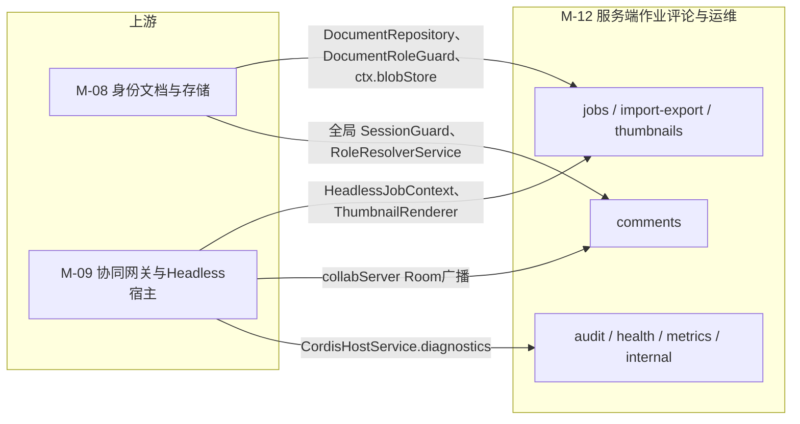
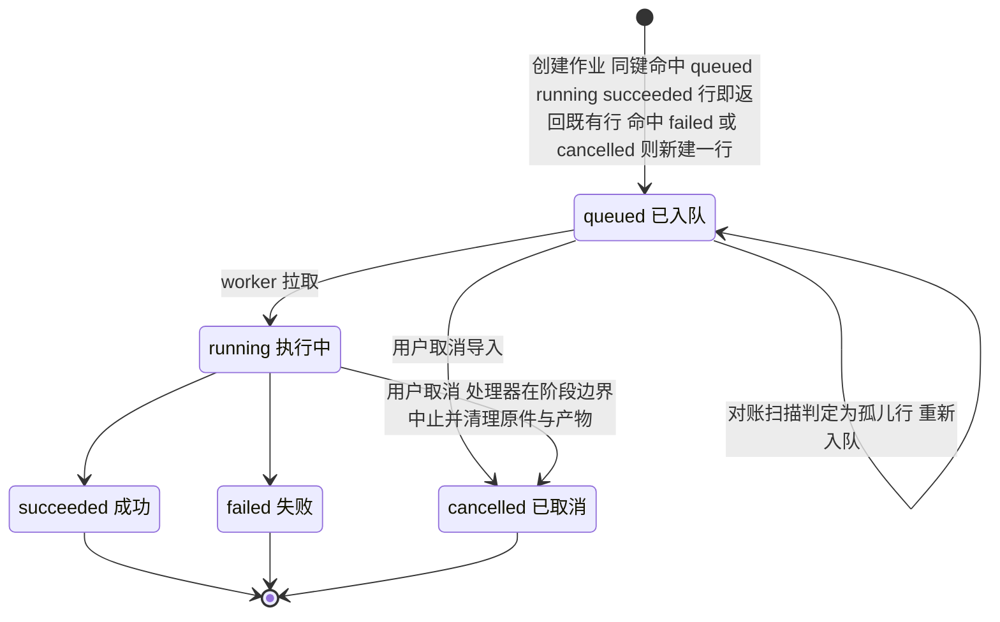
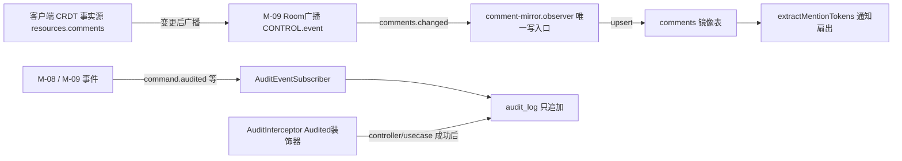
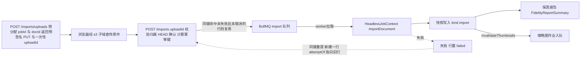
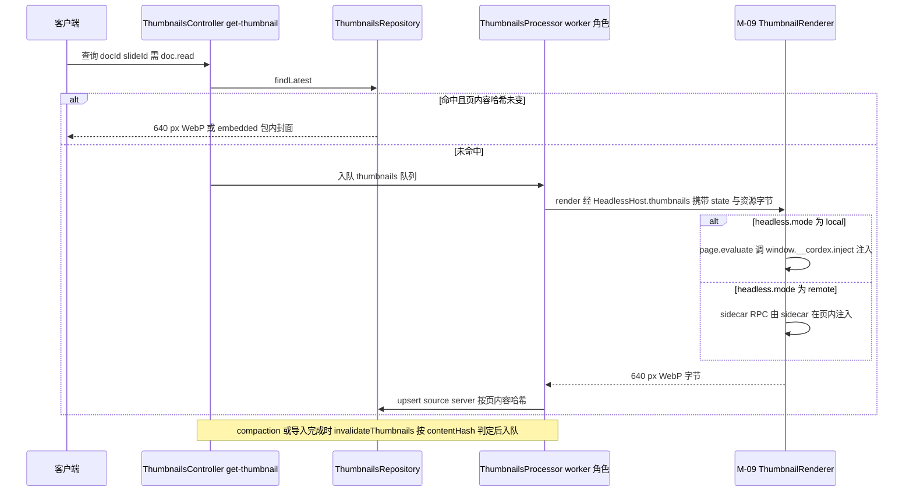
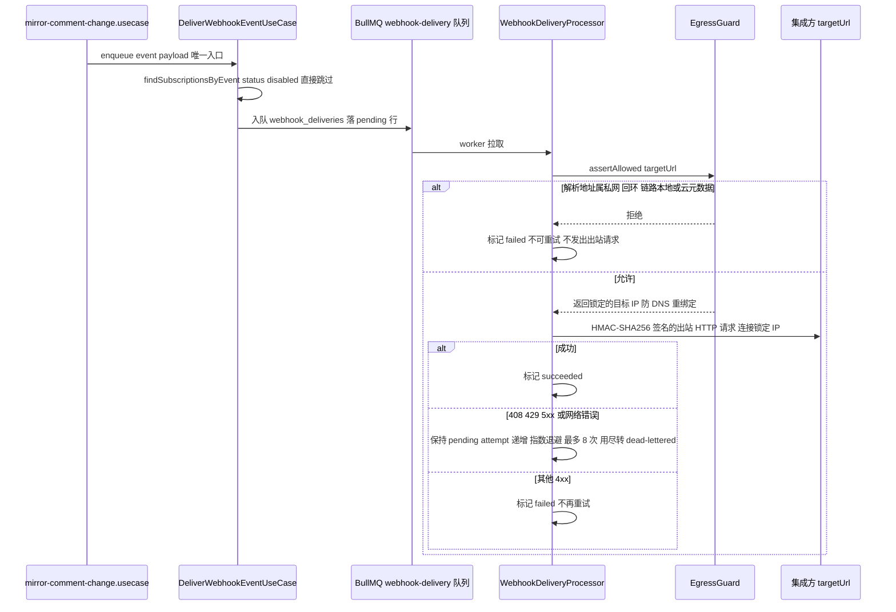
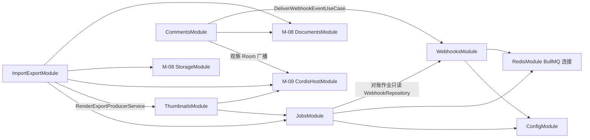
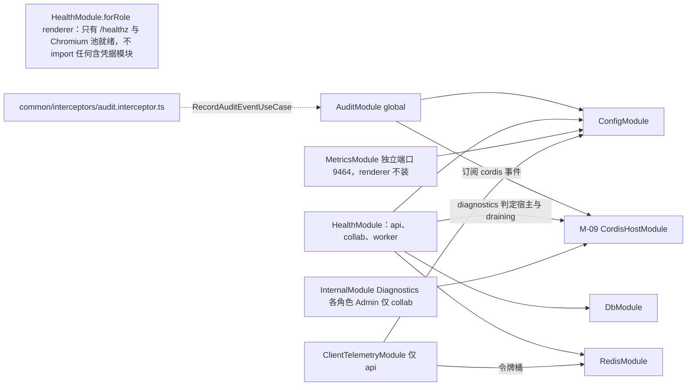
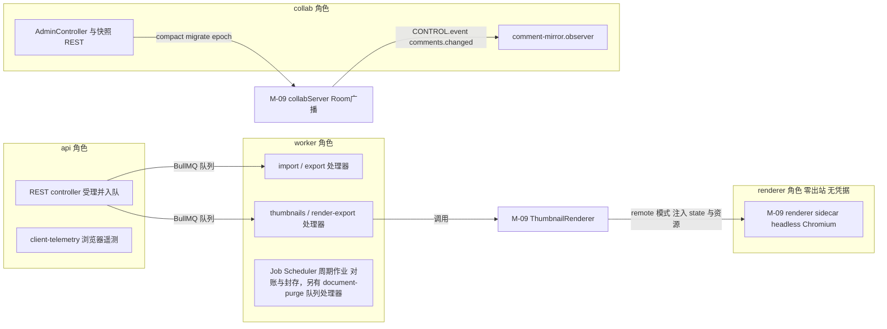

> 状态：草稿 v0.1 | 负责：架构-模块（阶段二） | 更新：2026-09-21；2026-09-24（rulings §4.15）；2026-09-24（复核修正，rulings §4.17）；2026-09-25（补图）；2026-09-25（矛盾收口，rulings §4.18） | 依赖：00-module-map.md M-12 行/§1/§3 BC-18…27/§4.2/§5.3/§6.1/§7/§9；40-modules/08-server-identity-documents-and-storage.md §2.4/§2.5/§3/§7/§12 G-11；40-modules/09-server-collab-gateway-and-headless-host.md §2.1/§2.5/§3/§4/§6/§7/§12 G-19–22；40-modules/02-kernel-protocol-and-document-core.md §4.3/§5.3；40-modules/04-ooxml-format-and-pptx-codec.md §2.6；30-architecture/08-backend-nestjs.md §1/§2/§5/§7/§9.3/§10/§12/§16.1–16.6；30-architecture/10-observability-and-errors.md 全篇；PRD 10-prd/03-features/06-server-and-ops.md SV-01/02/04/07/08/09/10/13；PRD 10-prd/03-features/03-collaboration.md CO-04；ADR-0026/0030/0031

# 12 服务端作业、评论与运维（限界上下文 BC-23 导入导出与作业编排、BC-24 缩略图、BC-25 评论、BC-26 审计与健康运维、BC-30 出站集成〔Webhook〕）

## 0. 一页总览

| 项 | 值 |
|---|---|
| 职责一句话 | 导入/导出作业编排与 BullMQ 基础设施（BC-23）；缩略图/PDF 渲染作业（BC-24）；评论镜像读模型与通知扇出（BC-25）；审计只追加记录、健康探针、指标与内部运维端点（BC-26）——实际格式转换/CRDT/渲染全部委托 M-09，本模块只做编排、校验、审计与限流 |
| 覆盖的上下文 | BC-23 导入导出与作业编排、BC-24 缩略图、BC-25 评论、BC-26 审计与健康运维、BC-30 出站集成（Webhook，2026-09-21 新增登记，此前寄生于 BC-25，rulings §4.13 S-5） |
| 承载包 / 目录 | `apps/server/src/modules/{import-export,jobs,thumbnails,comments,audit,health,metrics,internal,webhooks,telemetry}`（`webhooks` 为新增，rulings §4.12 U-14；`telemetry` 为 2026-09-25 新增，承接浏览器遥测上报，rulings §4.18 BE-30）、`apps/server/src/common/*`、`apps/server/src/config/*`（均 L8 · node · app，秩 80）；`apps/server/src/cordis-host/adapters/*` **只引用、新增 0 个文件**（物理归属 M-09，2026-09-18 跨模块评审 C-10 结案，见 §12 G-23） |
| cordis 形态 | library（10 个 Nest 模块 + `common/`/`config/` 全部纯 Nest DI，非 cordis Fiber，module-map §4.2 第 5 条；`webhooks` 为新增，rulings §4.12 U-14；`telemetry` 为新增，rulings §4.18 BE-30） |
| 运行位置 | 服务端 |
| 上游（依赖） | M-08（`DocumentRepository`、`DocumentRoleGuard`/`RoleResolverService`、全局 `SessionGuard`（AppModule `APP_GUARD`，rulings §4.18 BE-06）、`GetPresignedPutUseCase`（两步导入，BE-10）、`@PurgeParticipant`（BE-15）、`ctx.blobStore` 读取面）、M-09（`server-headless.{importDocument,exportDocument,validateSnapshotTask,migrateTask,diffSnapshots,HeadlessJobContext}`（2026-09-25 由 `importPptx`/`exportPptx` 改名，FE-01）、`ThumbnailRenderer`、`collabServer`/`Room.broadcastControl`、`CordisHostService.diagnostics()`） |
| 下游（被依赖） | 无（终端模块，module-map §7 M-12 行） |
| 对外服务 | 无 cordis 服务（全部 REST + BullMQ 处理器） |
| 贡献点 | 提供：无；消费：无 |
| Nest 侧导出（非 cordis 贡献点） | `common/` 的 `@Audited()`/`@RateLimit()` 装饰器 + 解释器（供 M-08 controller 标注使用，M-08 §1.3 已记录为反向消费）；`JobRunsRepository`/`GetJobUseCase`（`jobs` 模块导出，供 `import-export`/`thumbnails` 复用） |
| doc / sheet 通用性 | BC-23/24 parametrized（导入导出按 `DocumentType` 分派 M-09 编解码任务、缩略图渲染页路由）；BC-25/26/30 generic（回应 module-map §10 Q-M4：本文档把 BC-25 从 module-map §6.1 的暂定 `parametrized` 改判为 `generic`，理由见 §8/§12 G-27；BC-30 投递骨架对事件来源文档类型无知，同判 `generic`，见 §12 G-34） |
| 批次 | 3 |

### 0.1 图示

**图 0-1 模块内 Nest 模块与上下游关系**



图怎么读：本模块是终端模块（无下游），全部能力都是编排 M-08/M-09 已有服务；三组内部模块分别对应作业类、评论镜像与运维三块职责。

## 1. 限界上下文与边界

### 1.1 职责与非职责

**BC-23 导入导出与作业编排**
- 做：导入 REST，**两步式**（2026-09-25，rulings §4.18 BE-10）：① `POST /imports/uploads` 由服务端预分配 `jobId`（新建文档时同时预分配 `docId`=UUIDv7），返回绑定对象键 `docs/{docId}/imports/{jobId}/source.pptx` 的预签名 PUT（≥10 MB 分片，按 `storage.s3.publicEndpoint` 签名，BE-01）与绑定 `userId`、1 h 有效的一次性 `uploadId`；② 浏览器直传后 `POST /imports{uploadId}`，服务端校验 `uploadId` 归属并 `HEAD` 确认对象存在，再建作业入队——客户端全程不提交任意对象键，提交他人的 `uploadId` 返回 403；单文件上限 200 MB（部署配置 `scale.maxUploadBytes` 可调）/ multipart ≤10 MB。BullMQ `import` 处理器编排（拉取原件 → 调用 M-09 `importDocument`（按 `documentType` 经 `formats` 服务取 codec，FE-01）→ 写快照 `kind='import'` + 媒体关联 → 创建/更新文档 → 审计）；导出 REST + BullMQ `export` 处理器编排（最新/指定快照 → 调用 M-09 `exportDocument` → `BlobStore` → 预签名下载 URL）；进度查询、失败重试、幂等键应用（命中 `failed` 行则新建一行，BE-18）；PDF/PNG/JPEG 导出受理后委托 BC-24 的 Chromium 池处理（§7）。
- 不做：不做 OOXML 编解码本身与 SV-02 字节级一致性的算法保证（M-04/M-09 的 `ooxml-pptx.encode` 纯函数）；不做 BullMQ 通用队列/重试/死信基础设施（本 BC 内 `jobs` 子模块承担）。

**BC-24 缩略图**
- 做：缩略图 REST（按版本/页查询，ETag/immutable 缓存头）+ BullMQ `thumbnails`/`render-export` 处理器；调用 M-09 `ThumbnailRenderer.render()`/`.renderPdf()`；按 `layoutAlgoVersion` + 字体 profile 的缓存键与失效判定；按 `DocumentType` 参数化的渲染页路由透传。
- 不做：不做 Chromium 进程池管理本身（`browser-pool.ts` 在 M-09 `server-headless`）；不做实际像素渲染（M-06/M-07/M-11 的 `/render` 路由）。

**BC-25 评论**
- 做：观察 M-09 `collabServer` 的 Room 广播（`CONTROL.event{comments.changed}`）后 upsert 只读镜像表；线程列表/详情/@我 REST 查询；@提及解析与通知扇出（跨文档索引、审计、预留 webhook 钩子）；镜像层对 5,000 字符/线程、5,000 线程/文档、500 回复/线程上限的只读展示口径校验；「导入为可编辑线程」（P1）触发的服务端 CRDT 事务编排。
- 不做：不持有评论事实数据（事实源是 Snapshot 内 `resources.comments.*`，ADR-0031 v0.2）；不执行评论写入的作者级权限判定（M-09 软门禁，ADR-0034）；不提供评论 CRUD 的 REST 写路径（客户端经协同 WS 命令直写 CRDT，本模块 controller 除「导入为可编辑线程」外全部只读）。

**BC-26 审计与健康运维**
- 做：`audit_log` 只追加写入（AOP `@Audited()` 拦截器 + 事件订阅两条通路）、按时间范围/类别查询与导出；`/healthz`/`/readyz` 探针（pg/redis/s3/headless 宿主/RoomManager draining；renderer 角色只装 `HealthModule.forRole('renderer')` 精简变体，rulings §4.18 BE-14）；`/metrics` Prometheus 端点（renderer 不装）；`/internal/*` 诊断与管理端点（管理动作 `AdminController` 只在 collab 角色装配，BE-03；`RenderStateToken` 签发与 `/internal/render/:token/state` 已取消，BE-04）；浏览器遥测上报 `/api/v1/telemetry/errors` 与 OTLP 代理 `/api/v1/telemetry/otlp`（`telemetry` 模块，装在 api 角色，BE-30）；「模块 × 角色 × 部件」装配矩阵（§7.1，BE-13）；全部周期作业经 BullMQ Job Scheduler 挂 `maintenance` 队列、只由 worker 启动时注册（BE-19）；`common/*` 的异常过滤器/审计拦截器/限流解释器/日志字段；`config/*` 的环境变量 Standard Schema。
- 不做：不做鉴权/权限策略本身（M-08）；不做协同门禁/CRDT 修复（M-09）；不物理定义 `cordis-host/adapters/{pino-logger,otel-telemetry,errors-reporter}`（已由 M-09 完整定义并物理归属该模块，见 §12 G-23）。

**BC-30 出站集成（Webhook）**（2026-09-21 新增登记，此前寄生于 BC-25，rulings §4.13 S-5）
- 做：Webhook 订阅管理（注册/更新/删除/查询，平台管理员——部署级 admin，`PlatformAdminGuard` 由 M-08 导出；2026-09-24 rulings §4.15 T-0 去租户）；事件投递（HMAC 签名 + 指数退避重试 + 死信队列）；投递前出站地址校验（拒绝私网/回环/链路本地/云元数据端点，防 DNS 重绑定，rulings §4.13 S-4）；投递日志查询。
- 不做：不产生事件本身（事件源是 `comments` 的镜像变更，未来 M4 扩大到文档事件）；不做入站 Webhook 接收（本上下文只出站）；不做通用消息总线（只服务"事件→HTTP 回调"这一种投递形态）。

### 1.2 通用语言

| 术语 | 定义 | 所在文件 |
|---|---|---|
| `JobRun` | 跨域通用作业记录（`job_runs` 一行）：`kind/docId/status/attempts/errorCode/payload/result/idempotencyKey/attemptOf`（`attemptOf` 指向同键上一条 `failed` 行，rulings §4.18 BE-18） | `jobs/domain/job-run.ts` |
| `IdempotencyKey` | 幂等键，约定 `<域>:<docId>:<inputHash>`；新建文档的导入用 `import:user:{userId}:{sha256}`（BE-10/BE-18）；同键命中 `queued`/`running`/`succeeded` 行直接返回既有 `JobRun`，命中 `failed` 或 `cancelled` 行则新建一行并以 `attemptOf` 指向上一行（`cancelled` 同为终态，2026-09-25 随 UX-14 补入） | `jobs/domain/idempotency-key.ts` |
| `ImportUpload`（新增，rulings §4.18 BE-10） | 两步导入的一次性上传凭证：`{uploadId,jobId,docId,userId,objectKey,expiresAt}`，绑定 `userId`、1 h 有效、用后即焚 | `import-export/infrastructure/import-upload.store.ts` |
| `ImportJob`/`ExportJob` | `JobRun` 的导入/导出特化视图（`kind='import'\|'export'`），携带保真报告/下载 URL | `import-export/domain/{import-job,export-job}.ts` |
| `Thumbnail` | `doc_id+slide_id` 的渲染产物元数据；领域类型 `source ∈ embedded\|server`（2026-09-24，rulings §4.15 Q8）；DB 约束保留 `client` 位（ADR-0026 决策 4 的保留枚举值，M1–M3 不写入），领域层不产生该值（2026-09-25，rulings §4.18 BE-26） | `thumbnails/domain/thumbnail.ts` |
| `ThumbnailKey` | 缓存键值对象：`{docId,slideId,contentHash,layoutAlgoVersion,fontProfile}`（`contentHash` = 页内容哈希，2026-09-24 取代 `snapshotSeq` 作失效依据，rulings §4.15 Q8） | `thumbnails/domain/thumbnail-key.ts` |
| `CommentThread`（镜像） | `comments` 表一行的读模型投影，非事实源 | `comments/domain/comment-thread.ts` |
| `Anchor`（镜像） | `{slideId,shapeId?,range?,snapshotSeq}`，服务端只校验格式不解码 CRDT（ADR-0031 §2） | `comments/domain/anchor.ts` |
| `AuditEntry` | `audit_log` 一行：`actorType/action/targetType/docId/details` | `audit/domain/audit-entry.ts` |
| `RetentionPolicy` | 审计/导入原件/缩略图各自的保留期判定（SV-07/SV-11） | `audit/domain/retention-policy.ts` |
| `HealthProbe` | 单项依赖探针结果：`{name,status,latencyMs,details?}` | `health/domain/probe-result.ts` |
| ~~`RenderStateToken`~~ | **2026-09-25 取消**（rulings §4.18 BE-04）：local 与 remote 两种模式都由编排方向 `/render` 页注入 state 与资源，页面零外呼；原「一次性 token 换快照字节」的内部接口与 `internal/` 下四个相关文件一并删除 | — |

### 1.3 上下文映射

| 上游 | 下游 | 关系类型 | 防腐层落点 | 传递的契约 |
|---|---|---|---|---|
| 模块外 BC-03 协议（M-02） | BC-23/24/25/26 | Published Language | 各 `*.controller.ts` 的 `@Body()`/`@Query()` | `z.infer` DTO、错误码、`ErrorEnvelope` |
| 模块外 BC-19（M-08） | BC-23 | Customer–Supplier | `import-export/infrastructure/source-file.accessor.ts` | `DocumentRepository`（创建/更新目录条目） |
| 模块外 BC-18/19（M-08） | BC-23/24/25/26 全部 controller | Customer–Supplier（Open Host Service，DI `exports`） | 各 `interface/*.controller.ts` | `DocumentRoleGuard`/`RoleResolverService`；`SessionGuard`/`ShareLinkGuard` 为 AppModule 全局守卫，本模块不 import（rulings §4.18 BE-05/BE-06） |
| 模块外 BC-27（M-09 `server-headless`） | BC-23/24 | Customer–Supplier（Conformist：只调用不重实现，铁律 4） | `import-export/infrastructure/{import,export}.processor.ts`、`thumbnails/infrastructure/*.processor.ts` | `HeadlessJobContext`、`importDocument`/`exportDocument`（按 `documentType` 取 codec，rulings §4.18 FE-01）/`ThumbnailRenderer` |
| 模块外 BC-21（M-09 `server-collab`） | BC-25 | Customer–Supplier | `comments/infrastructure/comment-mirror.observer.ts` | `CONTROL.event{comments.changed}` |
| 模块外 BC-20（M-08 `server-storage`） | BC-23/24 | Open Host Service（`ctx.blobStore`） | `import-export/infrastructure/source-file.accessor.ts`、`thumbnails/infrastructure/thumbnails.repository.ts` | `ServerBlobStore` |
| BC-26（`common/`） | 模块外 BC-18/19/20（M-08）、BC-21/22（M-09） | Open Host Service（反向：本模块是被消费方） | `common/decorators/{audited,rate-limit}.decorator.ts` | 审计记录契约、限流策略 |
| BC-26（事件订阅） | 模块外 BC-01/05/21（kernel/M-02/M-09） | ACL（cordis 事件 → `audit_log` 行） | `audit/infrastructure/audit-event.subscriber.ts` | `command/audited`、`plugin/failed`、`collab-server/repair`、`permission/denied` |
| BC-23（`jobs` 子模块） | BC-23（`import-export`）、BC-24（`thumbnails`） | Shared Kernel（模块内） | `jobs/infrastructure/{queues,base.processor,job-runs.repository}.ts` | `JobRun`、`IdempotencyKey`、BullMQ 队列注册表 |
| BC-25（`comments`） | BC-30（`webhooks`，2026-09-21 新增，rulings §4.13 S-5） | Customer–Supplier（模块内，评论镜像变更触发投递） | `comments/application/mirror-comment-change.usecase.ts` | `DeliverWebhookEventUseCase.enqueue(event,payload)` |

命名冲突处理：错误码沿用 10-observability-and-errors §1.1 的 `<domain>.<snake_case_name>` 格式；本模块新增 domain：`server.import`/`server.export`/`server.thumbnails`/`server.comments`/`server.audit`（该文档 §1.1 domain 清单原未列出，标"新增建议"，§12 G-24）；`server.jobs` 沿用既有清单。**审计 `action` 口径（2026-09-18，跨模块评审 C-24）**：本模块 `@Audited(action)` 标注一律使用点式串（`import.created`/`export.created`/`comment.import-as-editable`/`admin.compact` 等），与 M-08 §2.4 的六个记账域同口径，不使用 `<域>/<动作>` 事件形式（见 §2.4 通路②）。

## 2. 领域模型

> 本模块九个 Nest 模块（含新增 `webhooks`，rulings §4.12 U-14）均非 cordis 插件（library，module-map §3 BC-23/24/25/26/30 行"cordis 形态：library"，BC-30 为 2026-09-21 新增登记），下列"聚合/实体/仓储"均为普通 Nest `@Injectable`/Drizzle 类型，非 cordis Definition/Provider——与 M-08 §2 的裁定一致（08 §2.5 前言）。

### 2.1 聚合与实体

| 聚合 / 实体 | 字段 / 持有 | 不变量 / 并发语义 | 所在文件 |
|---|---|---|---|
| `JobRun`（聚合根，跨域通用） | `id,kind,docId?,status,attempts,errorCode?,payload,result?,idempotencyKey?,attemptOf?,queuedAt,startedAt?,finishedAt?`（`idempotencyKey`/`attemptOf` 2026-09-25 新增，rulings §4.18 BE-18；`kind` 含 `document-purge`，由 M-08 `schedule-purge` 写入，BE-15） | `status` 只能沿 `queued→running→succeeded\|failed` 迁移，`queued`/`running` 另可被用户取消转 `cancelled`（导入作业，处理器在阶段边界读到 `cancelled` 即中止并清理原件与已生成产物、不建文档；2026-09-25 随 PRD SV-01 补入，rulings §4.18 UX-14）（`canTransitionJobStatus`）；**幂等只对未失败且未取消的行生效**：同 `IdempotencyKey` 命中 `queued`/`running`/`succeeded` 行直接返回既有行，命中 `failed`/`cancelled` 行则新建一行并以 `attemptOf` 指向上一行（状态机保持单向）；DB 以部分唯一索引 `unique(idempotency_key) where status not in ('failed','cancelled')` 保证并发同键只建一行（DDL 归架构 08 §5） | `jobs/domain/job-run.ts` |
| `ImportJob`（`JobRun` 特化视图，`kind='import'`） | `+ sourceKey（服务端预分配，BE-10）,uploadId,fidelityReport,createdDocId?`（新建文档时 `createdDocId` 即上传阶段预分配的 `docId`，由它与 `job_runs` 幂等键共同保证不重复建文档，不给 `documents` 加 `import_job_id` 列，BE-18） | `succeeded` 态必然存在对应 `document_snapshots(kind='import')` 行且 `baselineKey` 非空（09 §12 G-16） | `import-export/domain/import-job.ts` |
| `ExportJob`（`JobRun` 特化视图，`kind='export'`） | `+ format:'pptx'\|'pdf'\|'png'\|'jpeg',snapshotSeq,downloadUrl?,expiresAt?` | `format='pptx'` 时必须字节级可复现（SV-02，由 M-09 纯函数保证，本模块只搬运结果）；非 `pptx` 转发至 `thumbnails` 模块的 `render-export` 队列（§7） | `import-export/domain/export-job.ts` |
| `Thumbnail`（聚合，`thumbnails` 表一行） | `docId,slideId,source:'embedded'\|'server',snapshotSeq,layoutAlgoVersion,storageKey,width,height,contentHash`（`source` 2026-09-24 新增，rulings §4.15 Q8） | 联合主键 `(docId,slideId)` 只保留最新一行；失效依据为页内容哈希 `contentHash` 变化（非 `snapshotSeq` 变化，未改动的页不重渲）；`source='embedded'` 为 M2 起导入时取包内 `docProps/thumbnail.jpeg` 的封面（仅头校验、不解码），`server` 为 M3 headless 渲染结果（640 px WebP 卡片）；原 `client`（客户端上报）已随 Q8 取消，领域层不产生该值；DB 约束 `check in ('embedded','server','client')` 保留 `client` 位（ADR-0026 决策 4，2026-09-25 更正措辞，rulings §4.18 BE-26）；旧版本对象由 blob 生命周期规则清理，行本身被覆盖（ADR-0026 决策 5） | `thumbnails/domain/thumbnail.ts` |
| `CommentThread`（读模型聚合，`comments` 表一行） | `id,docId,threadId,parentId?,authorId,body,anchor,anchorKey,anchorState,resolvedAt?,resolvedBy?,createdAt,editedAt?,deletedAt?`（`anchorKey` 为新增派生列，由 `comment-mirror` 写入时调用 `deriveAnchorKey` 在应用层计算，**不是** PG `GENERATED` 生成列——TS 纯函数写不进生成列表达式，§3.9 回执；2026-09-25 更正，rulings §4.18 BE-25） | 只由 `comment-mirror.observer.ts` 写入；REST 层除「导入为可编辑线程」外不可变更任何行（事实源在客户端 CRDT，ADR-0031 v0.2）；`anchorKey` 由 `deriveAnchorKey(anchor)`（§2.3）按判别式提取，索引建在 `anchorKey` 而非具体字段名，doc/sheet 新锚点变体零改动 | `comments/domain/comment-thread.ts` |
| `AuditEntry`（聚合，`audit_log` 一行，只追加） | `id,actorType,actorId?,action,targetType,targetId,docId?,sessionId?,requestId,ipHash?,userAgentHash?,details,createdAt,prevHash,hash`（`prevHash`/`hash` 为新增，rulings §4.12 U-15） | 数据库角色对 `audit_log` 无 `UPDATE`/`DELETE` 权限（数据库层强制，非仅应用层约定，SV-07）；按月分区；`hash = chainHash(prevHash, entry)` 形成链式校验，任一历史行被篡改则后续校验失败（M3 即实现，见 §2.3/§2.6） | `audit/domain/audit-entry.ts` |
| `WebhookSubscription`（聚合根，新增，rulings §4.12 U-14） | `id,targetUrl,eventFilter,signingSecretHash,status:'active'\|'disabled'` | `targetUrl` 必须 `https://`（生产环境）；`signingSecretHash` 落库只存 hash，明文只在创建响应出现一次；`status='disabled'` 时投递直接跳过（不入队）；创建/更新时经 `egress-guard.ts` 尽力校验非私网/回环/链路本地/云元数据地址，关键防线在每次投递前重新校验（S-4/§3.8 回执，rulings §4.13） | `webhooks/domain/webhook-subscription.ts` |
| `WebhookDelivery`（实体，隶属 WebhookSubscription，新增，rulings §4.12 U-14） | `id,subscriptionId,event,payloadHash,attempt,status:'pending'\|'succeeded'\|'failed'\|'dead-lettered',responseCode?,deliveredAt?` | 状态语义（2026-09-25，rulings §4.18 BE-19）：`pending` = 待投递**或重试中**；`succeeded` = 2xx；`failed` = **不可重试**的终止（出站守卫拒绝、订阅已停用、除 408/429 外的 4xx）；`dead-lettered` = 可重试错误但重试用尽（`webhook-delivery` 队列最多 8 次，指数退避）；`attempt` 递增驱动退避 | `webhooks/domain/webhook-delivery.ts` |

**图 2-3 JobRun 状态机**



怎么读：`status` 只能沿 `queued→running→succeeded|failed` 单向迁移（`canTransitionJobStatus`），唯一的自环是对账作业把超时无对应 BullMQ job 的 `queued` 行重新入队；导入作业在 `queued`/`running` 可被用户取消转 `cancelled`，取消即清理导入原件与已生成产物、不建文档（PRD SV-01，rulings §4.18 UX-14）；`failed` 与 `cancelled` 都是终态——用同一幂等键重新提交时不复活旧行，而是新建一行并以 `attemptOf` 指向旧行（rulings §4.18 BE-18），见图 2-2。

依据：§2.1 `JobRun` 行；§2.3 `canTransitionJobStatus`、`isOrphanedQueueRow`；§2.6 对账扫描行与「取消导入作业」行；rulings §4.18 BE-18、UX-14；PRD SV-01。

### 2.2 值对象

| 名称 | 字段 / 校验 | 所在文件 |
|---|---|---|
| `JobStatus` | `'queued'\|'running'\|'succeeded'\|'failed'\|'cancelled'`（字面量联合，非 enum；`cancelled` 2026-09-25 随 PRD SV-01 补入，rulings §4.18 UX-14） | `jobs/domain/job-status.ts` |
| `IdempotencyKey` | `Brand<string,'IdempotencyKey'>`，格式 `` `${domain}:${docId}:${inputHash}` ``；新建文档导入时尚无既有文档，改用 `` `import:user:${userId}:${sha256}` ``（rulings §4.18 BE-10/BE-18） | `jobs/domain/idempotency-key.ts` |
| `FidelityReportSummary` | `{degradedParts:string[],missingFonts:string[],limitHits:LimitHit[]}`，服务端对 M-04 `ooxml-pptx/testing` `PartDiff[]` 的投影（04 §2.6） | `import-export/domain/import-job.ts` |
| `ThumbnailKey` | `{docId,slideId,contentHash,layoutAlgoVersion,fontProfile}` → 缓存/去重键字符串（2026-09-24 加入页内容哈希，rulings §4.15 Q8） | `thumbnails/domain/thumbnail-key.ts` |
| `RenderRoute` | 按 `DocumentType` 参数化的渲染页查询参数 `{documentType,mode:'thumbnail'\|'print'}`（BC-24 唯一的参数化落点，§8） | `thumbnails/domain/thumbnail-key.ts`（与 `ThumbnailKey` 同文件） |
| `Anchor`（镜像） | `{slideId,shapeId?,range?:{anchor:string,head:string},snapshotSeq}`；服务端只校验 zod 形状，不解码 `RelativePosition`（ADR-0031 §2） | `comments/domain/anchor.ts` |
| `CommentLimits` | `{maxBodyChars:5000,maxThreadsPerDoc:5000,maxRepliesPerThread:500}`（CO-04/SV-08） | `comments/domain/comment-limits.ts` |
| `RetentionPolicy` | `{auditDays:365,importSourceDays:30,exportDays:1,thumbnailStale:'on-invalidate'}`（SV-07/SV-11/16.5，部署配置可调；2026-09-24 去租户） | `audit/domain/retention-policy.ts` |
| ~~`RenderStateToken`~~ | **2026-09-25 取消**（rulings §4.18 BE-04）：local（Playwright `page.evaluate`）与 remote（sidecar RPC）两种模式都由处理器注入 state 与资源字节，`RenderPageQuery.token` 改为只作日志关联的 `renderId` | — |

### 2.3 领域服务（纯函数）

| 函数 | 签名草案 | 所在文件 | 两端共用 |
|---|---|---|---|
| `buildIdempotencyKey` | `(domain:string,docId:string,inputHash:string) => IdempotencyKey`；另有 `buildNewDocImportKey(userId,sha256)`（BE-10/BE-18） | `jobs/domain/idempotency-key.ts` | 否（服务端专属） |
| `canTransitionJobStatus` | `(from:JobStatus,to:JobStatus) => boolean`（允许 `queued→running`、`running→succeeded\|failed`、`queued\|running→cancelled` 与对账自环 `queued→queued`） | `jobs/domain/job-status.ts` | 否 |
| `buildThumbnailKey` / `shouldInvalidateThumbnail` | `(params) => ThumbnailKey`；`(existing:Thumbnail,incoming:{contentHash,algoVersion}) => boolean`（按页内容哈希失效，Q8） | `thumbnails/domain/thumbnail-key.ts` | 否 |
| `inspectEmbeddedCover`（新增，rulings §4.15 Q8） | `(bytes:Uint8Array,limits:{maxBytes:number;maxPixels:number}) => Result<{width:number;height:number},'not_jpeg'\|'too_large'\|'bad_header'>`（只读 JPEG SOI/SOF 头取宽高、校验上限，**不解码像素、不用 sharp**——libvips 为 LGPL） | `thumbnails/domain/embedded-cover.ts` | 否 |
| `extractMentionTokens` | `(body:string) => string[]`（纯文本扫描 `@[a-zA-Z0-9_-]+` token，不做用户目录解析） | `comments/infrastructure/mention-parser.ts` | 否（用户目录解析需 M-08 用户仓储，属应用层） |
| `checkCommentLimits` | `(body:string,threadCount:number,replyCount:number,limits:CommentLimits) => Result<void,'body_too_long'\|'thread_limit'\|'reply_limit'>` | `comments/domain/comment-limits.ts` | 否（镜像层只读展示口径，写路径硬校验在客户端 + M-09 软门禁，ADR-0031 §2） |
| `deriveAnchorKey`（新增，§3.9 回执） | `(anchor:Anchor) => string`（纯函数：按 `Anchor` 判别式提取扁平索引键，如 slide 变体取 `slideId`，不依赖具体字段名；未来 doc/sheet 变体各自的判别分支产出各自的键） | `comments/domain/anchor.ts` | 否 |
| `isBlockedEgressAddress`（新增，S-4/§3.8 回执） | `(ip:string) => boolean`（纯函数：判定 RFC1918 私网段 / 回环 / 链路本地（含 `169.254.169.254` 云元数据端点）/ 其它保留地址；只做地址段判定，不做 DNS 解析） | `webhooks/infrastructure/egress-guard.ts` | 否 |
| `isOrphanedQueueRow`（新增，§3.5 回执） | `(row:{status:string,queuedAt:Date},now:Date,timeoutMs:number) => boolean`（纯函数：判定 `job_runs`/`webhook_deliveries` 行是否 `status='queued'\|'pending'` 且 `now - queuedAt` 超过阈值（2× 处理器超时），供 `reconciliation.job.ts` 逐行调用后决定是否重新入队） | `jobs/infrastructure/reconciliation.job.ts` | 否 |
| `shouldRetainAuditRow` | `(entry:AuditEntry,policy:RetentionPolicy,now:Date) => boolean` | `audit/domain/retention-policy.ts` | 否 |
| `chainHash`（新增，rulings §4.12 U-15） | `(prevHash:string\|null,entry:Omit<AuditEntry,'hash'\|'prevHash'>) => string`（sha256 摘要，纯函数） | `audit/domain/audit-chain.ts` | 否 |
| `evaluateReadiness` | `(probes:readonly HealthProbe[]) => {status:'ok'\|'degraded'\|'down',failing:string[]}` | `health/application/evaluate-readiness.usecase.ts` | 否 |

### 2.4 领域事件

本模块九个 Nest 模块均非 cordis 插件（library），"领域事件"经三条互不相同的通路进入本模块，不可混同：

| 通路 | 事件 / 载荷 | 来源 | 消费者文件 |
|---|---|---|---|
| ① cordis 事件订阅（经共享宿主 `ctx.on`） | `command/audited`（服务端 `principal='system'` 执行命令时）、`plugin/failed`、`permission/denied` | M-02 命令管线、kernel（BC-01） | `audit/infrastructure/audit-event.subscriber.ts` |
| ① 同上 | `collab-server/repair`、`collab-server/update-rejected` | M-09 `server-collab`（**事件名以此为准，2026-09-18 结案，C-08**；module-map BC-26 行历史写作 `collab/repair`，回填见 §12 G-25） | `audit/infrastructure/audit-event.subscriber.ts` |
| ② Nest AOP 拦截（`@Audited(action)` + `AuditInterceptor`，**非** cordis 事件） | M-08 各 usecase 标注的 action（`user.provisioned`/`document.created`/`permission.granted`/`auth.login`…，08 §2.4 已列，点式串口径 2026-09-18 经 C-24 确认）；本模块自身 controller 标注的 action（`import.created`/`export.created`/`comment.import-as-editable`/`admin.compact`…，同一点式串口径） | 被装饰的 controller/usecase 方法成功返回后 | `common/interceptors/audit.interceptor.ts` |
| ③ 协同控制帧（协同信封消息，**非** cordis 事件） | `CONTROL.event{type:'comments.changed',threadId}` | M-09 `server-collab`（Room 观察 `resources.comments.*` 变更后广播） | `comments/infrastructure/comment-mirror.observer.ts` |

发布（本模块对外）：无 cordis 事件；SV-15 服务端 Webhook 出口经新增 `webhooks` 模块**M3 即实现**（用户裁决 rulings §4.12 U-14，原"P2/M4 预留、不在 M3 范围内实现"作废，`comments/application/resolve-notification-fanout` 一名同步作废）：`comments/application/mirror-comment-change.usecase.ts` 在镜像变更后调用 `WebhooksModule` 导出的 `DeliverWebhookEventUseCase` 触发投递（HMAC 签名 + 指数重试 + 死信队列），投递本身是出站 HTTP 请求，不经 cordis 事件；用例见 §2.6，模块见 §4.11/§5.11，§13 Q-6 结案。

**图 2-1 评论读模型与审计写入**



图怎么读：评论镜像永远是只读投影，事实源始终在客户端 CRDT；`audit_log` 有两条互不相同的写入通路——事件订阅与 AOP 拦截器——但都只追加，不更新不删除。

### 2.5 仓储 / 存储契约

全部为普通 Nest `@Injectable` 仓储（Drizzle 直连 Postgres），无 cordis Definition/Provider 与 `run*Conformance` 契约套件——与 M-08 §2.5 对普通仓储的裁定一致。

| 仓储 | 方法签名草案 | 所在文件 |
|---|---|---|
| `JobRunsRepository` | `create\|findById\|findByIdempotencyKey\|updateStatus\|listByDocAndKind(docId,kind,opts)`；`findByIdempotencyKey` **排除 `failed` 与 `cancelled` 行**（与部分唯一索引 `where status not in ('failed','cancelled')` 同一口径），`create` 遇部分唯一索引冲突即读回既有行（并发同键只建一行，rulings §4.18 BE-18/UX-14） | `jobs/infrastructure/job-runs.repository.ts` |
| `ThumbnailsRepository` | `findLatest(docId,slideId)\|upsert\|listByDoc(docId)\|deleteByDoc(docId)` | `thumbnails/infrastructure/thumbnails.repository.ts` |
| `CommentsRepository` | `upsertThread\|upsertReply\|listByDoc(docId,view)\|findMentioned(userId)\|markDetached(threadId)` | `comments/infrastructure/comments.repository.ts` |
| `WebhookRepository`（新增，rulings §4.12 U-14） | `createSubscription\|updateSubscription\|deleteSubscription\|findSubscriptionsByEvent(event)\|insertDelivery\|updateDeliveryStatus\|listDeliveries(subscriptionId,cursor)` | `webhooks/infrastructure/webhook.repository.ts` |
| `AuditRepository` | `insert(entry)\|insertBatch(entries)\|query(range,category,cursor)\|exportRange(range)`（2026-09-24 复核 M8：T-0 残留 `queryByTenant` 改名）——仅 `INSERT`/`SELECT`，无 `update`/`delete` 方法（数据库角色层面也禁止） | `audit/infrastructure/audit.repository.ts` |

**消费的外部契约（本模块不定义，只调用）**：`HeadlessJobContext`/`importDocument`/`exportDocument`（2026-09-25 由 `importPptx`/`exportPptx` 改名，rulings §4.18 FE-01）/`validateSnapshotTask`/`migrateTask`/`diffSnapshots`（`@cordexjs/server-headless`，M-09 §6）；`GetPresignedPutUseCase`、`@PurgeParticipant`（M-08，BE-10/BE-15）；`ThumbnailRenderer.render()`/`.renderPdf()`（M-09 §2.5 适配器接口，**经 `HeadlessHost.thumbnails` 只读字段取得，2026-09-18 结案，C-09，§12 G-26/§13 Q-1**）；`ServerBlobStore`（`@cordexjs/server-storage`，M-08 §2.5）；`CollabServer`/`Room.broadcastControl`（`@cordexjs/server-collab`，M-09 §2.5）；`DocumentRepository`/`RoleResolverService`（M-08 §2.5/§3）。

> 注（S-4/§3.8 回执，rulings §4.13）：`EgressGuard`（`webhooks/infrastructure/egress-guard.ts`）不是仓储，是投递前置校验契约——`assertAllowed(targetUrl):Promise<{ip:string}>` 解析主机名、经 `isBlockedEgressAddress`（§2.3）拒绝阻断地址、返回锁定的目标 IP 供后续连接固定使用（防 DNS 重绑定）；只用 Node 内置 `dns`/`net`，不引入外部服务依赖。
> 注（§3.9 回执，rulings §4.13）：`comments` 表原按 `anchor->>'slideId'` 具名字段建索引，改为对派生列 `anchor_key`（应用层计算：`comment-mirror` 写入时调 `deriveAnchorKey`，非 PG 生成列，2026-09-25 更正，rulings §4.18 BE-25；§2.1/§2.3）建索引 `(doc_id, anchor_key)`，文档类型无关；索引 DDL 归属架构 08 §5。
> 注（rulings §4.18 BE-10）：`ImportUploadStore`（`import-export/infrastructure/import-upload.store.ts`）不是仓储，是 Valkey 一次性凭证存储——`issue(upload):Promise<uploadId>`、`consume(uploadId,userId):Promise<ImportUpload|'forbidden'|'expired'>`（`GETDEL`，绑定 `userId`、TTL 1 h）。

### 2.6 应用服务与命令

本模块没有 `CommandDef`/`MutationDef`（那是 BC-05 CRDT 内容层的专属机制）；"命令"是普通 Nest 用例，事务边界是数据库事务或"编排一次 headless/collab 调用"。

| 用例 | 参数（protocol DTO） | 权限能力位 / 前置检查 | 事务边界 | 补偿/逆操作 | 所在文件 |
|---|---|---|---|---|---|
| 申请导入上传（新增，rulings §4.18 BE-10） | `rest/import-export.ts` uploads schema `{fileName,byteSize,sha256,docId?}` | 已登录用户；指定 `docId`（更新既有文档）时需 `doc.write`；`byteSize` ≤ `scale.maxUploadBytes`（默认 200 MB） | 无库事务：预分配 `jobId`（新建文档时同时预分配 `docId`=UUIDv7）→ 按对象键 `docs/{docId}/imports/{jobId}/source.pptx` 调 M-08 `GetPresignedPutUseCase`（`publicEndpoint` 签名，BE-01）→ `ImportUploadStore.issue` 签发绑定 `userId`、1 h 有效的一次性 `uploadId` | 不适用（凭证过期即失效，原件按 30 天保留期清理） | `import-export/application/create-import-upload.usecase.ts` |
| 创建导入作业 | `rest/import-export.ts` create schema `{uploadId}`（2026-09-25 起不再接收 `storageKey`，BE-10） | 已登录用户；`ImportUploadStore.consume(uploadId, userId)`：不存在/已用/非本人 → 403；`HEAD` 确认对象存在；处理器解析后超出系统天花板（页数/单页元素/文档总元素，部署配置可调）**直接拒绝** `format.quota_exceeded{dimension, limit, actual}`（2026-09-24 rulings §4.15 Q5；前缀按复核 L8 补齐，与编辑期 `document.quota_exceeded`、存储 `storage.quota_exceeded` 三码并列，rulings §4.17 D2） | 单事务写 `job_runs`（幂等键：更新既有文档 `import:{docId}:{sha256}`，新建文档 `import:user:{userId}:{sha256}`，BE-18）+ 异步 BullMQ 入队 | 无；失败后用同幂等键重新提交会新建一行、`attemptOf` 指向失败行（BE-18） | `import-export/application/create-import-job.usecase.ts` |
| 查询作业状态 | `{jobId}` | `doc.read` 或作业创建者 | 只读 | 不适用 | `jobs/application/get-job.usecase.ts`（跨模块复用） |
| 取消导入作业（新增，rulings §4.18 UX-14，PRD SV-01） | `{jobId}`（`POST /imports/:jobId/cancel`） | 作业创建者；只接受 `queued`/`running`，已终态返回 409 | 单事务把 `job_runs.status` 置 `cancelled`；`queued` 行同时移除 BullMQ job，`running` 行由 `ImportProcessor` 在阶段边界读到后中止；随后删除导入原件 `docs/{docId}/imports/{jobId}/` 与已生成的快照/缩略图产物，新建文档场景不建 `documents` 行 | 不可逆（原件已删；用户重新上传即新建作业，同幂等键命中 `cancelled` 行新建一行） | `import-export/application/cancel-import-job.usecase.ts` |
| 创建导出作业 | `{docId,format,snapshotId?}` | `doc.export` | 单事务写 `job_runs`；`format='pptx'` 入队 `export`，`pdf\|png\|jpeg` 转发 `thumbnails` 模块 `render-export` 队列 | 无 | `import-export/application/create-export-job.usecase.ts` |
| 模板填充 / 校验 / 迁移 / 转换（占位，M4，rulings §4.12 U-13） | `rest/import-export.ts`（M4 扩展）draft schema | 待 M4 定（暂定按动作分别为 `doc.write`/`doc.export`） | 待 M4 定 | 待 M4 定 | `import-export/application/{fill-template,validate,migrate,convert}.usecase.ts`（占位，M4；四者均并入 `import-export`，不新增 `modules/automation/`，见 §12 G-31） |
| 查询/惰性生成缩略图 | `{docId,slideId,seq?}` | `doc.read` | 只读，未命中时触发入队 | 不适用 | `thumbnails/application/get-thumbnail.usecase.ts` |
| 失效缩略图（内部） | `{docId,slideId,newSeq}` | 系统调用（compaction/导入完成事件触发） | 只读判定 + 入队 | 不适用 | `thumbnails/application/invalidate-thumbnails.usecase.ts` |
| 列出评论线程 | `{docId,view:'all'\|'page'\|'unresolved'\|'mentions'}` | `doc.read` | 只读 | 不适用 | `comments/application/list-threads.usecase.ts` |
| 镜像评论变更（内部） | Room 广播载荷 | 系统调用（观察者，唯一写入口） | 单事务 upsert | 不适用（镜像可从 CRDT 重放重建） | `comments/application/mirror-comment-change.usecase.ts` |
| 导入为可编辑线程（P1） | `{docId,importedThreadIds}` | `doc.comment` | 单事务：经 `HeadlessJobContext` 触发服务端 CRDT 写入 | 逆操作 = 客户端手动删除 | `comments/application/import-as-editable-thread.usecase.ts` |
| 跨文档「@我」查询（新增，rulings §4.12 U-14） | `{cursor?}`（无需 `docId`） | `SessionGuard`（按 `RoleResolverService` 逐文档过滤，同列表口径） | 只读，跨文档聚合查询 | 不适用 | `comments/application/list-my-mentions.usecase.ts` |
| 注册/更新/删除 Webhook 订阅（新增，rulings §4.12 U-14） | `rest/webhooks.ts`（新增）create/update schema、`{id}` | 平台管理员 | 单事务 | 更新/删除互为逆操作；创建的逆操作=删除 | `webhooks/application/manage-webhook-subscription.usecase.ts` |
| 投递 Webhook 事件（内部，新增，rulings §4.12 U-14） | `{event,payload}` | 系统调用（`comments` 模块触发，唯一入口）；投递前经 `EgressGuard.assertAllowed(targetUrl)`（§2.3/§2.5）前置校验，拒绝则直接标记 `failed` 不发出出站请求（S-4/§3.8 回执） | 无库事务（BullMQ `webhook-delivery` 队列入队，并发 4）；`webhook_deliveries` 落 `pending` 行 | HMAC 签名 + 指数退避重试（最多 8 次，重试期间保持 `pending`）；不可重试错误（出站守卫拒绝、订阅停用、除 408/429 外的 4xx）→ `failed`；重试用尽 → `dead-lettered`（rulings §4.18 BE-19） | `webhooks/application/deliver-webhook-event.usecase.ts` |
| 查询投递日志（新增，rulings §4.12 U-14） | `{subscriptionId,cursor?}` | 平台管理员 | 只读 | 不适用 | `webhooks/application/list-webhook-deliveries.usecase.ts` |
| 清理文档缩略图（内部，新增，S-2/§3.3 回执） | `{docId}` | 系统调用：作为 M-08 document-purge 作业的参与者被调用（`@PurgeParticipant('thumbnails')`，rulings §4.18 BE-15；宽限期满、GDPR 擦除或「永久删除文档」触发，后两者不等宽限期，§4.15 Q3、§4.18 CO-07） | 单事务：删除该文档全部 `thumbnails` 行，**含 `source='embedded'` 包内封面**及其 blob 对象（2026-09-24 rulings §4.15 Q8；对象版本最终由 M-08 `finalize-purge` 按前缀全部清除） | 幂等，可重复执行；不适用逆操作 | `thumbnails/application/purge-document-thumbnails.usecase.ts` |
| 清理文档评论镜像（内部，新增，S-2/§3.3 回执） | `{docId}` | 系统调用（同上，`@PurgeParticipant('comments')`，BE-15） | 单事务：删除该文档全部 `comments` 镜像行 | 幂等；镜像可从 CRDT 重放重建，无需逆操作 | `comments/application/purge-document-comments.usecase.ts` |
| 对账扫描孤儿作业与投递（内部，新增，§3.5 回执） | 无（BullMQ Job Scheduler：`maintenance` 队列作业 `reconciliation`，每 1 min，只由 worker 启动时注册，rulings §4.18 BE-19） | 系统调用 | 只读扫描 `job_runs`/`webhook_deliveries` 中 `status='queued'\|'pending'` 且超阈值（2× 处理器超时）无对应 BullMQ job 的行 → 重新入队 + 告警；覆盖 `kind='document-purge'` 行（M-08 编排的兜底，BE-15） | 幂等（重复扫描不重复入队，见 §4.1） | `jobs/infrastructure/reconciliation.job.ts` |
| 记录审计事件 | `AuditEntry` 草稿 | 系统调用（拦截器/订阅器唯一入口） | 单批量 insert（每用户每秒合并，SV-07 吞吐要求）；写入前计算 `chainHash(prevHash,entry)` 得到 `hash`，与 `prevHash` 同事务落库（rulings §4.12 U-15，M3 即实现） | 不适用（append-only） | `audit/application/record-audit-event.usecase.ts` |
| 查询 / 导出审计 | `{range,category}` | 平台管理员 | 只读 + CSV/JSON 流式导出 | 不适用 | `audit/application/query-audit-log.usecase.ts` |
| 校验哈希链（新增，rulings §4.12 U-15） | `{range}` | 平台管理员 | 只读：逐行重算 `chainHash` 比对 `hash`/`prevHash` | 不适用 | `audit/application/verify-chain.usecase.ts` |
| 每日封存作业（内部，新增，rulings §4.12 U-15） | 无（BullMQ Job Scheduler：`maintenance` 队列作业 `audit-seal`，每日；只由 worker 启动时注册，避免 `AuditModule` 在每个角色各封存一次，rulings §4.18 BE-19/BE-13） | 系统调用 | 单事务：对前一日全部 `audit_log` 行重算校验 + 落一条封存摘要记录 | 不适用（append-only） | `audit/infrastructure/seal.job.ts` |
| 就绪判定 | 无 | 无（内部探针） | 只读并发探测 5 项 | 不适用 | `health/application/evaluate-readiness.usecase.ts` |
| 浏览器遥测上报（新增，rulings §4.18 BE-30） | `rest/telemetry.ts` errors schema；OTLP/HTTP protobuf 请求体 | 需登录（全局 `SessionGuard`）+ 令牌桶限流（`@RateLimit`）；请求体上限 errors ≤ 64 KiB、otlp ≤ 512 KiB；OTLP 只转发 traces | 无库事务：errors 经 kernel logger 落结构化日志；otlp 经 `otlp-proxy.service.ts` 转发 OTel Collector（→ Jaeger） | 不适用 | `telemetry/interface/client-telemetry.controller.ts` |
| 管理动作（compact/migrate/epoch） | `{docId,action}` | 平台管理员（`PlatformAdminGuard`）；`AdminController` **只在 collab（及 all）角色装配**，启动断言 `role=api` 不装配（rulings §4.18 BE-03） | 单事务，委托 M-09 `collabServer`/`server-headless` 执行；`epoch` 由 M-09 `forceEpoch()` 递增后经 Valkey 通知其他持有该 Room 的 collab 实例踢会话（BE-03/BE-21） | 视动作而定（`epoch` 不可逆） | `internal/application/run-admin-action.usecase.ts` |

**图 2-2 导入作业管线**



图怎么读：导入分两步——先由服务端预分配 `jobId`/`docId` 与对象键并签发一次性 `uploadId`，浏览器直传后凭 `uploadId` 建作业，客户端从不提交任意对象键（rulings §4.18 BE-10）；幂等键在入队前去重，只对未失败且未取消的行生效，失败或取消后用同键重提会新建一行并以 `attemptOf` 指向旧行（BE-18、UX-14）；快照写入成功后并行触发保真报告与缩略图失效两条支线。

**图 2-4 缩略图惰性生成时序**



怎么读：查询是只读的，只有未命中或页内容哈希变化才入队重渲，未改动的页不重渲；两种 `headless.mode` 都由编排方把 state 与资源字节注入 `/render` 页，页面零外呼，`RenderStateToken` 与 `/internal/render/:token/state` 已取消（rulings §4.18 BE-04）；`remote` 模式下渲染发生在独立零出站的 renderer 容器。

依据：§2.1 `Thumbnail` 行；§2.2 `ThumbnailKey`；§2.6 缩略图两行；§7.1；rulings §4.15 Q8、§4.18 BE-04。

**图 2-5 Webhook 投递时序**



怎么读：评论镜像变更是唯一的投递触发点；每次投递前都重新做出站地址校验（创建订阅时的校验只是尽力而为），拒绝即标 `failed`、不发请求；可重试错误期间状态保持 `pending`、由 `attempt` 驱动指数退避，8 次用尽转 `dead-lettered`；除 408/429 外的 4xx 与已停用订阅直接 `failed`（状态语义与队列名见 rulings §4.18 BE-19）。

依据：§2.1 `WebhookSubscription`/`WebhookDelivery` 行；§2.3 `isBlockedEgressAddress`；§2.5 `EgressGuard` 注；§2.6 Webhook 三行；rulings §4.12 U-14、§4.13 S-4。

## 3. Nest 模块定义表

Nest 模块不是 cordis Fiber（module-map §5.3），本节列 imports/providers/controllers/exports，取代模板原 §3 的插件定义表（与 M-08 §3、M-09 §3.3 体例一致）。

| 模块 | imports | providers（关键） | controllers | exports |
|---|---|---|---|---|
| `JobsModule`（2026-09-25 更正：模块列只留本模块，`WebhooksModule` 移入 imports 列，rulings §4.18 BE-07） | `ConfigModule`、`RedisModule`（BullMQ 连接）、`WebhooksModule`（`reconciliation.job` 只读 `WebhookRepository`） | `JobRunsRepository`、`GetJobUseCase`、`BaseProcessor`（抽象基类，非 DI token）、`ReconciliationJob`（Job Scheduler 部件，只在 worker 注册，BE-19） | `JobsController`（`GET /jobs/:id` 通用状态查询） | `JobRunsRepository`、`GetJobUseCase`、`QUEUE_NAMES`、`BaseProcessor` |
| `ImportExportModule` | `JobsModule`、`ThumbnailsModule`（取 `RenderExportProducerService`）、`CordisHostModule`（M-09）、`StorageModule`（取 `GetPresignedPutUseCase`，BE-10）/`DocumentsModule`（M-08） | `CreateImportUploadUseCase`（新增，BE-10）、`CreateImportJobUseCase`、`CreateExportJobUseCase`、`ImportUploadStore`（新增，BE-10）、`ImportProcessor`、`ExportProcessor`、`SourceFileAccessor` | `ImportsController`、`ExportsController` | 无 |
| `ThumbnailsModule` | `JobsModule`、`CordisHostModule` | `ThumbnailsRepository`、`GetThumbnailUseCase`、`InvalidateThumbnailsUseCase`、`PurgeDocumentThumbnailsUseCase`（`@PurgeParticipant('thumbnails')`，BE-15）、`ThumbnailsProcessor`、`RenderExportProcessor`、`HeadlessRendererAccessor` | `ThumbnailsController` | `RenderExportProducerService`（供 `ImportExportModule` 注入的跨模块生产者，§7）；2026-09-25 起不再依赖 `InternalModule`（`RenderStateToken` 取消，BE-04） |
| `CommentsModule` | `CordisHostModule`（取 `collabServer` 观察 Room 广播）、`DocumentsModule`（M-08）、`WebhooksModule`（新增，触发投递，U-14） | `CommentsRepository`、`ListThreadsUseCase`、`MirrorCommentChangeUseCase`、`ImportAsEditableThreadUseCase`、`ListMyMentionsUseCase`（新增）、`PurgeDocumentCommentsUseCase`（`@PurgeParticipant('comments')`，BE-15）、`CommentMirrorObserver`（**只在 collab 角色注册**，按角色条件装配，rulings §4.18 BE-03/BE-13） | `CommentsController`（评论 REST 留在 api） | 无 |
| `WebhooksModule`（新增，rulings §4.12 U-14） | `ConfigModule`、`RedisModule`（BullMQ 连接） | `WebhookRepository`、`ManageWebhookSubscriptionUseCase`、`DeliverWebhookEventUseCase`（生产者，api/collab 均装）、`ListWebhookDeliveriesUseCase`、`WebhookDeliveryProcessor`（`webhook-delivery` 队列，只在 worker 注册，BE-19/BE-13） | `WebhooksController` | `DeliverWebhookEventUseCase`（供 `CommentsModule` 注入）、`WebhookRepository`（供 `JobsModule` 的对账作业扫描 `webhook_deliveries`，§3.5） |
| `AuditModule`（`global`） | `ConfigModule`、`CordisHostModule` | `AuditRepository`、`RecordAuditEventUseCase`、`QueryAuditLogUseCase`、`AuditEventSubscriber`、`VerifyChainUseCase`（新增，U-15）、`SealJob`（新增，U-15，每日封存；Job Scheduler 部件**只在 worker 注册**，其余角色不跑，rulings §4.18 BE-19/BE-13） | `AuditController` | `RecordAuditEventUseCase`（供 `common/interceptors/audit.interceptor.ts` 注入） |
| `HealthModule`（`HealthModule.forRole(role)`） | api/collab/worker：`ConfigModule`、`DbModule`、`RedisModule`、`CordisHostModule`（`@nestjs/terminus`）；**renderer 变体不 import 这四者**（无任何凭据，rulings §4.18 BE-14） | `EvaluateReadinessUseCase`（内联调用 `CordisHostService.diagnostics()` 判定宿主/RoomManager draining，不单列探针类）、`PgProbe`/`RedisProbe`/`BlobStoreProbe`；renderer 变体只有 `ChromiumPoolProbe` | `HealthController`（`/healthz`、`/readyz`；renderer 变体只 `/healthz` + Chromium 池就绪） | 无 |
| `MetricsModule` | `ConfigModule` | `PrometheusRegistryProvider` | `PrometheusController`（独立端口 9464） | 无；**renderer 不装**（renderer 只挂 render 网络、零出站，Prometheus 抓不到；渲染耗时/超时/崩溃指标由 worker 侧 `remote-renderer.client` 按 RPC 结果记录，BE-14） |
| `InternalModule` | `CordisHostModule` | `RunAdminActionUseCase`、`FiberDiagnosticsAccessor` | `DiagnosticsController`（各角色，renderer 除外）、`AdminController`（compact/migrate/epoch，**只在 collab 与 all 角色装配**，rulings §4.18 BE-03） | 无（2026-09-25 删 `IssueRenderStateTokenUseCase`、`RenderStateTokenStore`、`RenderStateController` 与 `GET /internal/render/:token/state`，BE-04；`ThumbnailsModule` 不再依赖本模块） |
| `ClientTelemetryModule`（新增，rulings §4.18 BE-30） | `ConfigModule`、`RedisModule`（令牌桶） | `OtlpProxyService` | `ClientTelemetryController`（`POST /telemetry/errors`、`POST /telemetry/otlp`，相对 `/api/v1`） | 无；只装在 api 角色 |

**图 3-1 作业、评论与 Webhook 模块 imports 依赖**



怎么读：实线为 Nest `imports` 方向，逐条对应上表 imports 列；`JobsModule` → `WebhooksModule` 自 2026-09-25 起是真实的 imports（对账作业只读 `WebhookRepository`，原画为虚线，rulings §4.18 BE-07）。需要宿主能力的导入导出、缩略图、评论三个模块经 `CordisHostModule` 调用 M-09，不自行装配 cordis 插件；`JobsModule`/`WebhooksModule` 只依赖配置与 BullMQ 连接。

依据：本节上表 imports/exports 列。

**图 3-2 运维模块 imports 依赖**



怎么读：实线为 Nest `imports` 方向；虚线是对本组模块 `exports` 的消费——审计拦截器注入 `RecordAuditEventUseCase`。`AuditModule` 为 global，随 `AppModule` 装配到除 renderer 外的全部角色，但其中的 `SealJob` 只在 worker 注册（rulings §4.18 BE-19/BE-13）。2026-09-25 起缩略图处理器不再从 `InternalModule` 取渲染态 token（`RenderStateToken` 取消，BE-04）；`InternalModule` 的 `AdminController` 只在 collab 装配（BE-03）；新增 `ClientTelemetryModule` 承接浏览器遥测（BE-30）；renderer 只装 `HealthModule.forRole('renderer')` 精简变体，不装 `MetricsModule`（BE-14）。

依据：本节上表；§7.1。

**以 cordis 插件形式存在的 IO 适配器表（`cordis-host/adapters/*` 新增项）**：本模块**新增 0 个文件**。module-map §3 BC-26 行把 `cordis-host/adapters/{pino-logger,otel-telemetry,errors-reporter}.adapter.ts` 列入本模块承载包，但这三个文件已被 M-09 §4.3 完整定义并显式裁定"物理归属本模块"（M-09，非 M-12）——kernel L0 的 `errors`/`telemetry`/`logger` 三个服务已被这三个文件悉数覆盖，本模块（BC-26 的 `metrics`/`health`）不需要、也不应在 `cordis-host/adapters/` 下重复定义或新增第四个适配器；`metrics` 模块的 Prometheus 文本端点是 Nest 内部的 OTel→Prometheus 桥接（`metrics/infrastructure/prometheus-registry.provider.ts`），物理归属 `apps/server/src/modules/metrics/`，不进 `cordis-host/`。这一"留空"是值得记录的架构事实，差异见 §12 G-23。

## 4. 目录树（完整到文件）

> 十二棵树：10 个 Nest 模块（含新增 `webhooks`，见 §4.11，rulings §4.12 U-14；新增 `telemetry`，见 §4.12，rulings §4.18 BE-30）+ `common/` + `config/`；`cordis-host/adapters/` 无新增（§3）。每个目录一句职责；DDD 五层套用 00-module-map §1 的规则，`interface/` 是"外部世界进入本目录的唯一入口"。

### 4.1 `apps/server/src/modules/jobs/`

```text
apps/server/src/modules/jobs/
├── jobs.module.ts                    # Nest 模块装配：BullMQ 连接注册 + 导出 JobRunsRepository/GetJobUseCase
├── domain/                           # 纯类型与状态机，无 IO
│   ├── job-run.ts                    # JobRun 聚合类型
│   ├── job-status.ts                 # JobStatus 值对象 + canTransitionJobStatus 纯函数
│   ├── idempotency-key.ts            # IdempotencyKey 值对象 + buildIdempotencyKey 纯函数
│   └── errors.ts                     # server.jobs.* 错误码
├── application/                      # 跨域复用的应用服务
│   └── get-job.usecase.ts            # 通用作业状态查询（供 import-export/thumbnails 复用）
├── infrastructure/                   # BullMQ 与持久化
│   ├── queues.ts                     # 队列名常量 + 默认并发/优先级/重试/退避（import/export/thumbnails/render-export/compaction/maintenance/webhook-delivery/document-purge；webhook-delivery 并发 4、指数退避、最多 8 次；maintenance 挂全部 Job Scheduler 周期作业：reconciliation 每 1 min、audit-seal 每日、media GC 等；document-purge 是独立队列、由 schedule-purge 入队而非周期作业（与架构 08 §7 一致），rulings §4.18 BE-19/BE-15）
│   ├── base.processor.ts             # BullMQ 处理器基类：traceparent 恢复、错误分类 retryable/terminal、死信
│   ├── job-runs.repository.ts        # job_runs 表 Drizzle 仓储（generic CRUD）；findByIdempotencyKey 排除 failed 与 cancelled 行（§4.18 BE-18/UX-14）
│   └── reconciliation.job.ts         # 新增（§3.5 回执）：对账扫描孤儿 job_runs/webhook_deliveries 行，重新入队并告警；Job Scheduler 每 1 min，只由 worker 注册（BE-19）
├── interface/                        # 外部世界进入本模块的唯一入口
│   └── jobs.controller.ts            # GET /jobs/:id
└── __tests__/
    ├── job-status.spec.ts            # 状态机非法迁移拒绝
    ├── job-runs.repository.spec.ts   # 并发同键只建一行；失败后同键重提得新行且 attemptOf 指向旧行（新增，§4.18 BE-18）
    └── base.processor.spec.ts        # 错误分类与死信路径
```

### 4.2 `apps/server/src/modules/import-export/`

```text
apps/server/src/modules/import-export/
├── import-export.module.ts           # Nest 模块装配：imports JobsModule/ThumbnailsModule/CordisHostModule
├── domain/
│   ├── import-job.ts                 # ImportJob 值对象 + FidelityReportSummary
│   ├── export-job.ts                 # ExportJob 值对象（含 format 判别）
│   └── errors.ts                     # server.import.*/server.export.* 错误码
├── application/
│   ├── create-import-upload.usecase.ts  # 两步导入第一步：预分配 jobId/docId 与对象键 → 预签名 PUT + 一次性 uploadId（新增，§4.18 BE-10）
│   ├── create-import-job.usecase.ts  # 第二步：consume uploadId（归属校验）→ HEAD 确认 → 幂等键计算 → job_runs 写入 → 入队 import
│   ├── cancel-import-job.usecase.ts  # 取消导入：queued/running → cancelled，移除 BullMQ job，清理原件与产物（新增，§4.18 UX-14）
│   └── create-export-job.usecase.ts  # 按 format 分派 export / render-export 队列
├── infrastructure/                   # 处理器只编排，转换逻辑全在 server-headless（铁律 4）
│   ├── import.processor.ts           # BullMQ import（各阶段边界检查 status=cancelled 即中止并清理，UX-14）：拉原件 → 超天花板预检（超限 format.quota_exceeded 直接拒绝，Q5）→ HeadlessJobContext.importDocument（§4.18 FE-01）→ 写快照(kind=import)+媒体关联 → 包内 thumbnail.jpeg 头校验后记 source=embedded 封面（不解码，Q8）→ 创建/更新文档 → 审计
│   ├── export.processor.ts           # BullMQ export：快照 → HeadlessJobContext.exportDocument → BlobStore → 预签名下载 URL（24 h）
│   ├── import-upload.store.ts        # Valkey 一次性 uploadId：绑定 userId、TTL 1 h、GETDEL 消费（新增，BE-10）
│   └── source-file.accessor.ts       # 经 ctx.blobStore/multipart 读取导入原始文件字节
├── interface/
│   ├── imports.controller.ts         # POST /imports/uploads、POST /imports{uploadId}（2026-09-25 起不收 storageKey，BE-10；单文件 ≤ 200 MB，Q5）|multipart≤10MB、GET /imports/:jobId、POST /imports/:jobId/cancel（UX-14）；相对 /api/v1
│   └── exports.controller.ts         # POST /documents/:id/export{format}、GET /exports/:jobId
└── __tests__/
    ├── create-import-job.usecase.spec.ts  # 提交他人 uploadId 或已用 uploadId → 403；对象不存在拒绝（新增，BE-10）
    ├── import.processor.spec.ts      # 保真报告生成、失败重试
    └── export.processor.spec.ts      # SV-02 字节级一致断言（复用 M-09 语料库）
```

### 4.3 `apps/server/src/modules/thumbnails/`

```text
apps/server/src/modules/thumbnails/
├── thumbnails.module.ts              # Nest 模块装配：导出 RenderExportProducerService 供 import-export 注入
├── domain/
│   ├── thumbnail.ts                  # Thumbnail 聚合
│   ├── thumbnail-key.ts              # ThumbnailKey/RenderRoute 值对象 + buildThumbnailKey/shouldInvalidateThumbnail（按页 contentHash 失效）
│   ├── embedded-cover.ts             # inspectEmbeddedCover：包内 thumbnail.jpeg 只做头校验不解码（新增，rulings §4.15 Q8）
│   └── errors.ts                     # server.thumbnails.* 错误码
├── application/
│   ├── get-thumbnail.usecase.ts      # ETag/immutable 判定；未命中惰性入队
│   ├── invalidate-thumbnails.usecase.ts  # 压缩完成/导入完成/admin 触发的失效判定
│   ├── render-export-producer.service.ts # 跨模块生产者：import-export 的非 pptx 导出请求经此入队 render-export
│   └── purge-document-thumbnails.usecase.ts  # 新增（S-2/§3.3 回执）：@PurgeParticipant('thumbnails')，由 document-purge 作业调用，清理该文档全部缩略图行（§4.18 BE-15）
├── infrastructure/                   # 处理器只编排，Chromium 池与渲染在 server-headless（铁律 4）
│   ├── thumbnails.processor.ts       # BullMQ thumbnails：去重键 doc:{id}:slide:{id}:hash:{contentHash} → ThumbnailRenderer.render()（local 或 remote renderer，两者都注入 state，§4.18 BE-04）→ 640 px WebP
│   ├── render-export.processor.ts    # BullMQ render-export：pdf/png/jpeg → ThumbnailRenderer.renderPdf()/render()（PDF M3 后半段；队列优先级低于 thumbnails，按用户配额限流）
│   ├── thumbnails.repository.ts      # thumbnails 表 Drizzle 仓储
│   └── headless-renderer.accessor.ts # 经 CordisHostService 打开的 HeadlessHost.thumbnails 只读字段取 ThumbnailRenderer（2026-09-18 结案，C-09，§12 G-26）
├── interface/
│   └── thumbnails.controller.ts      # GET /documents/:id/thumbnails/:slideId?seq=
└── __tests__/
    ├── thumbnail-key.spec.ts         # 缓存键与失效判定
    └── thumbnails.processor.spec.ts  # 去重键作废旧任务、超时重试 1 次后占位图
```

### 4.4 `apps/server/src/modules/comments/`

```text
apps/server/src/modules/comments/
├── comments.module.ts
├── domain/
│   ├── comment-thread.ts             # CommentThread 读模型聚合
│   ├── anchor.ts                     # Anchor 镜像值对象 + deriveAnchorKey 纯函数（在应用层派生 anchor_key 索引键，非 PG 生成列，文档类型无关，§3.9 回执；§4.18 BE-25）
│   ├── comment-limits.ts             # CommentLimits 值对象 + checkCommentLimits 纯函数
│   └── errors.ts                     # server.comments.* 错误码
├── application/
│   ├── list-threads.usecase.ts       # 全部/当前页/未解决/@我 四种视图（单文档内）
│   ├── mirror-comment-change.usecase.ts  # 观察 Room 广播后 upsert 镜像（唯一写入口）；成功后调用 WebhooksModule.DeliverWebhookEventUseCase（新增，U-14）
│   ├── import-as-editable-thread.usecase.ts  # P1：只读评论 → 经 HeadlessJobContext 转可编辑 CRDT 实体
│   ├── list-my-mentions.usecase.ts   # 新增（rulings §4.12 U-14）：跨文档「@我」查询，无需 docId
│   └── purge-document-comments.usecase.ts  # 新增（S-2/§3.3 回执）：@PurgeParticipant('comments')，由 document-purge 作业调用，清理该文档全部评论镜像行（§4.18 BE-15）
├── infrastructure/
│   ├── comments.repository.ts        # comments 表 Drizzle 仓储（镜像读写）
│   ├── comment-mirror.observer.ts    # 订阅 collabServer 的 Room 广播 CONTROL.event{comments.changed}；只在 collab 角色注册（§4.18 BE-03/BE-13）
│   └── mention-parser.ts             # extractMentionTokens 纯函数 + 经 M-08 UsersRepository 解析显示名
├── interface/
│   └── comments.controller.ts        # GET 线程列表/详情/@我（单文档）、GET /comments/mentions 跨文档「@我」（新增，U-14）；POST 导入为可编辑线程（其余 CRUD 走 CRDT，不经 REST）
└── __tests__/
    ├── comment-limits.spec.ts        # 5,000 字符/5,000 线程/500 回复镜像层断言
    └── mirror-comment-change.usecase.spec.ts  # 幂等 upsert、锚点脱离状态迁移
```

### 4.5 `apps/server/src/modules/audit/`

```text
apps/server/src/modules/audit/
├── audit.module.ts                   # global：导出 RecordAuditEventUseCase 供 common/interceptors 注入
├── domain/
│   ├── audit-entry.ts                # AuditEntry 聚合（append-only；prevHash/hash 新增，U-15）
│   ├── audit-chain.ts                # 新增（rulings §4.12 U-15）：chainHash 纯函数
│   ├── retention-policy.ts           # RetentionPolicy 值对象 + shouldRetainAuditRow 纯函数
│   └── errors.ts                     # server.audit.* 错误码
├── application/
│   ├── record-audit-event.usecase.ts # 写入唯一入口（拦截器与订阅器均调此）；每用户每秒合并（SV-07 吞吐）；写入前计算 chainHash（U-15）
│   ├── query-audit-log.usecase.ts    # 按时间范围/类别查询 + CSV/JSON 导出
│   └── verify-chain.usecase.ts       # 新增（rulings §4.12 U-15）：逐行重算 chainHash 校验哈希链
├── infrastructure/
│   ├── audit.repository.ts           # audit_log 表仓储：仅 insert/insertBatch/query，无 update/delete 方法
│   ├── audit-event.subscriber.ts     # 订阅 command/audited、plugin/failed、collab-server/repair、collab-server/update-rejected、permission/denied（§2.4）
│   └── seal.job.ts                   # 新增（rulings §4.12 U-15）：每日封存作业，重算校验前一日全部 audit_log 行；Job Scheduler audit-seal，只由 worker 注册（§4.18 BE-19）
├── interface/
│   └── audit.controller.ts           # GET /audit（平台管理员查询）、GET /audit/export
└── __tests__/
    ├── retention-policy.spec.ts      # 365 天默认 + 月分区判定
    ├── audit.repository.append-only.spec.ts  # 断言数据库角色拒绝 UPDATE/DELETE
    └── audit-chain.spec.ts           # 新增（rulings §4.12 U-15）：chainHash 篡改检测断言
```

### 4.6 `apps/server/src/modules/health/`

```text
apps/server/src/modules/health/
├── health.module.ts                  # @nestjs/terminus 装配；forRole('renderer') 精简变体不 import Db/Redis/CordisHost（§4.18 BE-14）
├── domain/
│   └── probe-result.ts               # HealthProbe 值对象
├── application/
│   └── evaluate-readiness.usecase.ts # 聚合 pg/redis/s3/headless 宿主/RoomManager draining 五项判定
├── infrastructure/
│   ├── pg.probe.ts                   # SELECT 1 ping
│   ├── redis.probe.ts                # PING
│   ├── blob-store.probe.ts           # ctx.blobStore.head() 探测
│   └── chromium-pool.probe.ts        # renderer 变体唯一探针：Chromium 池就绪（新增，BE-14）
├── interface/
│   └── health.controller.ts          # GET /healthz（进程存活）、GET /readyz（就绪前不接流量）；两者标 @Public()、不加 /api/v1 前缀（rulings §4.18 BE-06/BE-11）
└── __tests__/
    └── evaluate-readiness.usecase.spec.ts  # 任一探针失败 → 503；Redis 不可用单独断言（08-backend-nestjs §8）
```

### 4.7 `apps/server/src/modules/metrics/`

```text
apps/server/src/modules/metrics/
├── metrics.module.ts
├── infrastructure/
│   └── prometheus-registry.provider.ts   # kernel telemetry OTel Provider → Prometheus 文本格式桥接
├── interface/
│   └── prometheus.controller.ts      # GET /metrics（独立内部端口 9464，架构 10 §3.3 指标清单）
└── __tests__/
    └── prometheus.controller.spec.ts # 指标名均在登记表且格式合法
```

### 4.8 `apps/server/src/modules/internal/`

```text
apps/server/src/modules/internal/
├── internal.module.ts                # 网络策略限内网；AdminController 只在 collab/all 角色装配（§4.18 BE-03）；2026-09-25 删 render-state-token 相关 4 个文件（BE-04）
├── application/
│   └── run-admin-action.usecase.ts   # compact|migrate|epoch 三种管理动作编排（委托 M-09）
├── infrastructure/
│   └── fiber-diagnostics.accessor.ts # 经 CordisHostService.diagnostics() 读 fibers/effects/pending/贡献点
├── interface/
│   ├── diagnostics.controller.ts     # GET /internal/diagnostics/{fibers,effects,pending,contributions}
│   └── admin.controller.ts           # POST /internal/admin/documents/:id/{compact,migrate,epoch}（仅 collab 角色）
└── __tests__/
    └── run-admin-action.usecase.spec.ts   # epoch 动作不可逆、compact/migrate 幂等
```

### 4.9 `apps/server/src/common/`

```text
apps/server/src/common/
├── filters/
│   └── cordex-exception.filter.ts       # CordexError → RFC 9457 problem+json；ZodError → 400；未知 → 500 + errors.report
├── interceptors/
│   ├── request-context.interceptor.ts # requestId/traceparent/user → AsyncLocalStorage（2026-09-24 去 tenant）
│   └── audit.interceptor.ts          # @Audited(action) 解释器：handler 成功后调 audit 模块 RecordAuditEventUseCase
├── pipes/
│   └── zod.pipe.ts                   # protocol schema → parse（400 走 cordex-exception.filter）
├── guards-shared/
│   └── rate-limit.guard.ts           # @RateLimit() 解释器（策略型 Guard 归属 M-08 owning 模块，本文件是唯一"纯机制"限流 Guard，08 §3 已裁定）
├── rate-limit/
│   └── redis-token-bucket.ts         # 令牌桶算法：纯函数 consumeTokenBucket + Redis 状态读写
├── logging/
│   └── log-fields.ts                 # cordex.* 字段规范装配（架构 10 §2.2，脱敏交给 kernel logger/redact.ts）
└── decorators/
    ├── audited.decorator.ts          # @Audited(action)
    └── rate-limit.decorator.ts       # @RateLimit(policy)
```

### 4.10 `apps/server/src/config/`

```text
apps/server/src/config/
├── config.module.ts                  # 解析一次，注入 typed AppConfig；解析失败 → 进程退出码 78；支持 --dry-run
├── config.schema.ts                  # zod Standard Schema：role/http/db/redis/storage/auth/collab/limits/headless/telemetry（08-backend-nestjs §2 骨架的权威落点）；新增 webhookEgressAllowlist 部署级放宽白名单项（S-4/§3.8 回执，默认空＝严格模式）；storage.s3.publicEndpoint（预签名专用，§4.18 BE-01）；http.globalPrefix='api/v1' 与排除清单（BE-11）
├── roles.ts                          # CORDEX_ROLE=all|api|collab|worker|renderer → §7.1「模块 × 角色 × 部件」矩阵的代码形态（roles.ts→AppModule.forRole + 启动断言逐项核对；all/renderer 2026-09-24 补，rulings §4.15 Q10；矩阵 §4.18 BE-13）
├── env-overrides.ts                  # 按 NODE_ENV/CORDEX_ROLE 的覆盖合并规则（硬规则"按环境的覆盖"）
└── secrets.ts                        # 机密来源适配（环境变量 | 挂载文件 | 外部 secret manager）+ 启动前存在性校验
```

### 4.11 `apps/server/src/modules/webhooks/`（新增，rulings §4.12 U-14，2026-09-19）

评论事件的服务端 Webhook 出口，M3 即实现（用户裁决 U-14，与客户端 EM-05 回调并行，两者都做）；独立于 `comments/` 成模块，理由：HMAC 签名/指数重试/死信队列是与评论读模型正交的技术关注点，参照 M-08 `share-links` 独立于 `permissions` 的先例（08 §12 G-6 DDD 单一职责原则）；`comments` 模块只在镜像变更后调用本模块导出的 `DeliverWebhookEventUseCase`，不反向依赖。

```text
webhooks/
├── webhooks.module.ts                    装配 imports/providers/controllers/exports（见 §3）
├── domain/
│   ├── webhook-subscription.ts           WebhookSubscription 聚合根（§2.1）
│   ├── webhook-delivery.ts               WebhookDelivery 实体（§2.1）
│   └── errors.ts                         webhook.* 错误码
├── application/
│   ├── manage-webhook-subscription.usecase.ts  RegisterWebhookUseCase + UpdateWebhookUseCase + DeleteWebhookUseCase（三合一，同文件）
│   ├── deliver-webhook-event.usecase.ts  HMAC 签名 + 指数退避重试编排（唯一投递入口，供 comments 模块调用）
│   └── list-webhook-deliveries.usecase.ts 投递日志查询
├── infrastructure/
│   ├── webhook.repository.ts             Drizzle：webhook_subscriptions + webhook_deliveries
│   ├── webhook-signer.ts                 HMAC-SHA256 签名纯函数
│   ├── webhook-delivery.processor.ts     BullMQ webhook-delivery 队列处理器（并发 4）：指数退避最多 8 次 + 用尽转 dead-lettered，不可重试错误标 failed；只在 worker 注册（§4.18 BE-19）
│   └── egress-guard.ts                   新增（S-4/§3.8 回执）：解析目标→拒绝私网/回环/链路本地/云元数据端点→防 DNS 重绑定（解析后锁定 IP 再连接）
├── interface/
│   └── webhooks.controller.ts            POST/GET/PATCH/DELETE /webhooks、GET /webhooks/:id/deliveries
└── __tests__/
    ├── manage-webhook-subscription.usecase.spec.ts
    └── webhook-delivery.processor.spec.ts    指数退避与死信断言
```

### 4.12 `apps/server/src/modules/telemetry/`（新增，rulings §4.18 BE-30，2026-09-25）

承接浏览器遥测上报：错误事件与 OTLP/HTTP traces 代理（ADR-0030 决策 1、架构 10）。只装在 api 角色，要求登录，令牌桶限流，请求体设上限；OTLP 只转发 traces（metrics 由服务端自身导出，logs 不经浏览器代理）。

```text
apps/server/src/modules/telemetry/
├── telemetry.module.ts               # ClientTelemetryModule：imports Config/Redis（令牌桶）；只装在 api 角色
├── infrastructure/
│   └── otlp-proxy.service.ts         # 把浏览器 OTLP/HTTP traces 转发到 OTel Collector（→ Jaeger）；拒绝 metrics/logs 信号
├── interface/
│   └── client-telemetry.controller.ts  # POST /telemetry/errors（≤ 64 KiB）、POST /telemetry/otlp（≤ 512 KiB，只 traces）；相对 /api/v1；@RateLimit
└── __tests__/
    └── client-telemetry.controller.spec.ts  # 未登录 401、超限 413、限流 429、非 traces 信号 400
```

**`cordis-host/adapters/` 增量**：无新增文件（§3 已述；既有 3 个适配器由 M-09 定义与维护）。

## 5. 文件职责表

### 5.1 `jobs/`

| 文件 | 职责 | 主要导出 | 允许依赖 | 备注 |
|---|---|---|---|---|
| `jobs.module.ts` | 模块装配 + BullMQ 连接注册 | `JobsModule` | Nest、`@nestjs/bullmq` | exports 见 §3 |
| `domain/job-run.ts` | 通用作业聚合类型 | `JobRun` | 无 | 跨域复用 |
| `domain/job-status.ts` | 状态字面量联合 + 迁移判定 | `JobStatus`、`canTransitionJobStatus` | 无 | 非 enum |
| `domain/idempotency-key.ts` | 幂等键值对象 + 构造函数 | `IdempotencyKey`、`buildIdempotencyKey`、`buildNewDocImportKey` | `@cordexjs/shared`（Brand） | `<域>:<docId>:<inputHash>`；新建文档导入 `import:user:{userId}:{sha256}`（rulings §4.18 BE-10/BE-18） |
| `domain/errors.ts` | `server.jobs.*` 错误码 | `JobsError` | 无 | queue_unavailable/not_found |
| `application/get-job.usecase.ts` | 通用作业查询 | `GetJobUseCase` | `../infrastructure/job-runs.repository` | 跨模块导出 |
| `infrastructure/queues.ts` | 队列名与默认配置常量 | `QUEUE_NAMES`、`QUEUE_DEFAULTS`、`MAINTENANCE_SCHEDULES` | `bullmq` | 并发/优先级/重试/退避表；新增 `webhook-delivery`（并发 4、指数退避、最多 8 次）；`maintenance` 队列的 Job Scheduler 周期作业表（reconciliation 每 1 min、audit-seal 每日、media GC）；新增独立队列 `document-purge`（schedule-purge 入队、同文档串行，不是周期作业，不并入 `maintenance`）（rulings §4.18 BE-19/BE-15；与架构 08 §7 队列表一致） |
| `infrastructure/base.processor.ts` | 处理器基类 | `BaseProcessor` | `bullmq`、`@cordexjs/kernel`（telemetry 类型） | traceparent 恢复 |
| `infrastructure/job-runs.repository.ts` | `job_runs` 表仓储（含 `idempotency_key`、`attempt_of` 列，BE-18） | `JobRunsRepository` | `drizzle-orm` | 按文档读写须经权限服务（扫描器 `doc-access-via-permission`，M-01 第 14 个扫描器，rulings §4.17 D3；2026-09-24 取代 tenant_id 强制，rulings §4.15 T-0） |
| `infrastructure/reconciliation.job.ts`（新增，§3.5 回执） | 对账扫描孤儿 `job_runs`/`webhook_deliveries` 行（含 `document-purge` 作业） | `ReconciliationJob` | `../infrastructure/job-runs.repository`；跨模块消费 `webhooks` 仓储（`JobsModule` imports `WebhooksModule`，见 §3） | BullMQ Job Scheduler 每 1 min，只由 worker 启动时注册（rulings §4.18 BE-19），见 §2.6 |
| `interface/jobs.controller.ts` | 通用状态查询端点 | `JobsController` | protocol `rest/import-export.ts` | `GET /jobs/:id` |
| `__tests__/job-status.spec.ts` | 单测 | — | — | 非法迁移拒绝 |
| `__tests__/job-runs.repository.spec.ts` | 单测（新增，rulings §4.18 BE-18） | — | testcontainers Postgres | 并发同键只建一行；失败后同键重提得新行、`attemptOf` 指向旧行 |
| `__tests__/base.processor.spec.ts` | 单测 | — | — | 错误分类/死信 |

### 5.2 `import-export/`

| 文件 | 职责 | 主要导出 | 允许依赖 | 备注 |
|---|---|---|---|---|
| `import-export.module.ts` | 模块装配 | `ImportExportModule` | Nest、`JobsModule`、`ThumbnailsModule`、M-08 `StorageModule` | exports 见 §3 |
| `domain/import-job.ts` | 导入作业值对象 | `ImportJob`、`FidelityReportSummary` | `../../jobs/domain/job-run` | — |
| `domain/export-job.ts` | 导出作业值对象 | `ExportJob` | `../../jobs/domain/job-run` | format 判别 |
| `domain/errors.ts` | 错误码 | `ImportExportError` | 无 | `server.import.*`/`server.export.*` |
| `application/create-import-upload.usecase.ts` | 两步导入第一步（新增，rulings §4.18 BE-10） | `CreateImportUploadUseCase` | `../infrastructure/import-upload.store`、M-08 `GetPresignedPutUseCase` | 预分配 `jobId`/`docId`（UUIDv7）与对象键；预签名按 `publicEndpoint`（BE-01） |
| `application/create-import-job.usecase.ts` | 创建导入作业 | `CreateImportJobUseCase` | `../infrastructure/*`、`JobsModule` | 只收 `uploadId`：consume 校验归属（非本人 403）、`HEAD` 确认对象；幂等键去重（命中 `failed`/`cancelled` 新建一行，BE-18/UX-14） |
| `application/cancel-import-job.usecase.ts` | 取消导入作业（新增，rulings §4.18 UX-14） | `CancelImportJobUseCase` | `JobsModule`（`JobRunsRepository`）、`../infrastructure/source-file.accessor` | 仅作业创建者；`queued`/`running` → `cancelled`（终态 409）；删原件与已生成产物，不建文档 |
| `application/create-export-job.usecase.ts` | 创建导出作业 | `CreateExportJobUseCase` | `../infrastructure/*`、`JobsModule` + `RenderExportProducerService` | 按 format 分派 |
| `infrastructure/import.processor.ts` | 导入 BullMQ 处理器 | `ImportProcessor` | `@cordexjs/server-headless`（经 `CordisHostService`，调 `importDocument`，rulings §4.18 FE-01）、`thumbnails/domain/embedded-cover` | 铁律 4；超天花板拒绝 `format.quota_exceeded`（Q5）；embedded 封面（Q8） |
| `infrastructure/export.processor.ts` | 导出 BullMQ 处理器 | `ExportProcessor` | `@cordexjs/server-headless`（经 `CordisHostService`，调 `exportDocument`，FE-01） + `ctx.blobStore` | SV-02 |
| `infrastructure/import-upload.store.ts` | 一次性上传凭证存储（新增，BE-10） | `ImportUploadStore` | `ioredis` | 绑定 `userId`、TTL 1 h、`GETDEL` 消费 |
| `infrastructure/source-file.accessor.ts` | 原始文件读取 | `SourceFileAccessor` | `ctx.blobStore` | — |
| `interface/imports.controller.ts` | 导入 REST | `ImportsController` | protocol `rest/import-export.ts` | `POST /imports/uploads`、`POST /imports{uploadId}`、`GET /imports/:jobId`、`POST /imports/:jobId/cancel`（取消导入，UX-14）（相对 `/api/v1`，BE-10/BE-11） |
| `interface/exports.controller.ts` | 导出 REST | `ExportsController` | protocol `rest/import-export.ts` | — |
| `__tests__/create-import-job.usecase.spec.ts` | 单测（新增，BE-10） | — | — | 他人或已用 `uploadId` → 403；对象不存在拒绝 |
| `__tests__/import.processor.spec.ts` | 单测 | — | — | 保真报告/失败重试 |
| `__tests__/export.processor.spec.ts` | 单测 | — | — | 字节级一致断言 |

### 5.3 `thumbnails/`

| 文件 | 职责 | 主要导出 | 允许依赖 | 备注 |
|---|---|---|---|---|
| `thumbnails.module.ts` | 模块装配 | `ThumbnailsModule` | Nest、`JobsModule` | exports 见 §3 |
| `domain/thumbnail.ts` | 缩略图聚合 | `Thumbnail` | 无 | `source` 字段（Q8）：领域类型 `'embedded'\|'server'`；DB 约束保留 `client` 位，领域层不产生该值（rulings §4.18 BE-26） |
| `domain/embedded-cover.ts` | 包内封面头校验（新增，rulings §4.15 Q8） | `inspectEmbeddedCover` | 无 | 只读头不解码；禁用 `sharp` |
| `domain/thumbnail-key.ts` | 缓存键 + 渲染路由值对象 | `ThumbnailKey`、`RenderRoute`、`buildThumbnailKey`、`shouldInvalidateThumbnail` | 无 | BC-24 参数化落点，§8 |
| `domain/errors.ts` | 错误码 | `ThumbnailsError` | 无 | `server.thumbnails.*` |
| `application/get-thumbnail.usecase.ts` | 查询/惰性触发 | `GetThumbnailUseCase` | `../infrastructure/*` | ETag |
| `application/invalidate-thumbnails.usecase.ts` | 失效判定与编排 | `InvalidateThumbnailsUseCase` | `../infrastructure/*` | — |
| `application/render-export-producer.service.ts` | 跨模块生产者 | `RenderExportProducerService` | `../../jobs/infrastructure/queues` | 供 import-export 注入 |
| `application/purge-document-thumbnails.usecase.ts`（新增，S-2/§3.3 回执） | 文档硬删除级联：清理该文档全部缩略图行 | `PurgeDocumentThumbnailsUseCase` | `../infrastructure/thumbnails.repository` | `@PurgeParticipant('thumbnails')`，由 M-08 document-purge 作业调用（rulings §4.18 BE-15），幂等；覆盖 `embedded`/`server` 两种来源（Q8；`client` 为 DB 保留位、领域层不产生，BE-26） |
| `infrastructure/thumbnails.processor.ts` | 缩略图 BullMQ 处理器 | `ThumbnailsProcessor` | `@cordexjs/server-headless` | 铁律 4 |
| `infrastructure/render-export.processor.ts` | PDF/PNG/JPEG 处理器 | `RenderExportProcessor` | `@cordexjs/server-headless` | 共享 Chromium 池 |
| `infrastructure/thumbnails.repository.ts` | `thumbnails` 表仓储 | `ThumbnailsRepository` | `drizzle-orm` | — |
| `infrastructure/headless-renderer.accessor.ts` | 经 `HeadlessHost.thumbnails` 取 `ThumbnailRenderer` 实例 | `HeadlessRendererAccessor` | `CordisHostService` | §12 G-26 结案（C-09） |
| `interface/thumbnails.controller.ts` | 缩略图 REST | `ThumbnailsController` | protocol（新增建议） | ETag/immutable |
| `__tests__/thumbnail-key.spec.ts` | 单测 | — | — | — |
| `__tests__/thumbnails.processor.spec.ts` | 单测 | — | — | 去重/超时/占位图 |

### 5.4 `comments/`

| 文件 | 职责 | 主要导出 | 允许依赖 | 备注 |
|---|---|---|---|---|
| `comments.module.ts` | 模块装配 | `CommentsModule` | Nest、`CordisHostModule` | exports 见 §3 |
| `domain/comment-thread.ts` | 读模型聚合 | `CommentThread` | 无 | 非事实源 |
| `domain/anchor.ts` | 锚点镜像值对象 + 索引键派生 | `Anchor`、`deriveAnchorKey`（新增，§3.9 回执） | 无 | 只校验格式，不解码 CRDT；`deriveAnchorKey` 按判别式提取 `anchor_key`，文档类型无关 |
| `domain/comment-limits.ts` | 上限值对象 + 校验纯函数 | `CommentLimits`、`checkCommentLimits` | 无 | CO-04/SV-08 |
| `domain/errors.ts` | 错误码 | `CommentsError` | 无 | `server.comments.*` |
| `application/list-threads.usecase.ts` | 四视图查询（单文档内） | `ListThreadsUseCase` | `../infrastructure/comments.repository` | all/page/unresolved/mentions |
| `application/mirror-comment-change.usecase.ts` | 镜像 upsert | `MirrorCommentChangeUseCase` | `../infrastructure/comments.repository`、`WebhooksModule.DeliverWebhookEventUseCase`（新增，U-14） | 唯一写入口；成功后触发 Webhook 投递 |
| `application/import-as-editable-thread.usecase.ts` | 只读转可编辑（P1） | `ImportAsEditableThreadUseCase` | `@cordexjs/server-headless` | 经 CRDT 事务 |
| `application/list-my-mentions.usecase.ts`（新增，rulings §4.12 U-14） | 跨文档「@我」查询 | `ListMyMentionsUseCase` | `../infrastructure/comments.repository`、`RoleResolverService` | 无需 `docId`，按角色逐文档过滤 |
| `application/purge-document-comments.usecase.ts`（新增，S-2/§3.3 回执） | 文档硬删除级联：清理该文档全部评论镜像行 | `PurgeDocumentCommentsUseCase` | `../infrastructure/comments.repository` | `@PurgeParticipant('comments')`，由 M-08 document-purge 作业调用（rulings §4.18 BE-15），幂等（镜像可从 CRDT 重放重建） |
| `infrastructure/comments.repository.ts` | `comments` 表仓储 | `CommentsRepository` | `drizzle-orm` | — |
| `infrastructure/comment-mirror.observer.ts` | 订阅 Room 控制帧 | `CommentMirrorObserver` | `collabServer`（经 `CordisHostService`） | `CONTROL.event{comments.changed}`；只在 collab 角色注册（rulings §4.18 BE-03/BE-13），写入时调 `deriveAnchorKey` 计算 `anchor_key`（BE-25） |
| `infrastructure/mention-parser.ts` | @提及解析 | `extractMentionTokens`、`MentionResolver` | M-08 `UsersRepository` | 纯函数 + 目录查找分层 |
| `interface/comments.controller.ts` | 评论只读 REST（含跨文档 `GET /comments/mentions`，新增 U-14） | `CommentsController` | protocol（新增建议 `rest/comments.ts`） | 除导入线程外全只读 |
| `__tests__/comment-limits.spec.ts` | 单测 | — | — | 镜像层展示口径断言 |
| `__tests__/mirror-comment-change.usecase.spec.ts` | 单测 | — | — | 幂等 upsert、锚点脱离迁移 |

### 5.5 `audit/`

| 文件 | 职责 | 主要导出 | 允许依赖 | 备注 |
|---|---|---|---|---|
| `audit.module.ts` | 模块装配（global） | `AuditModule` | Nest | exports 见 §3 |
| `domain/audit-entry.ts` | 聚合（append-only） | `AuditEntry` | 无 | `prevHash`/`hash` 字段新增，U-15 |
| `domain/audit-chain.ts`（新增，rulings §4.12 U-15） | 哈希链纯函数 | `chainHash` | `node:crypto` | sha256 摘要 |
| `domain/retention-policy.ts` | 保留策略值对象 + 纯函数 | `RetentionPolicy`、`shouldRetainAuditRow` | 无 | 365 天默认 |
| `domain/errors.ts` | 错误码 | `AuditError` | 无 | `server.audit.*` |
| `application/record-audit-event.usecase.ts` | 写入唯一入口 | `RecordAuditEventUseCase` | `../infrastructure/audit.repository`、`../domain/audit-chain` | 每用户每秒合并；写入前计算 `chainHash` |
| `application/query-audit-log.usecase.ts` | 查询 + 导出 | `QueryAuditLogUseCase` | `../infrastructure/audit.repository` | CSV/JSON |
| `application/verify-chain.usecase.ts`（新增，rulings §4.12 U-15） | 哈希链校验工具 | `VerifyChainUseCase` | `../infrastructure/audit.repository`、`../domain/audit-chain` | 逐行重算比对 |
| `infrastructure/audit.repository.ts` | `audit_log` 表仓储 | `AuditRepository` | `drizzle-orm` | 仅 insert/select |
| `infrastructure/audit-event.subscriber.ts` | cordis 事件订阅 | `AuditEventSubscriber` | `CordisHostService` | §2.4 通路① |
| `infrastructure/seal.job.ts`（新增，rulings §4.12 U-15） | 每日定时封存作业 | `SealJob` | `../application/verify-chain.usecase`、`jobs` 的 `maintenance` 队列 | BullMQ Job Scheduler `audit-seal` 每日，只由 worker 注册（rulings §4.18 BE-19）；落封存摘要记录 |
| `interface/audit.controller.ts` | 审计查询 REST | `AuditController` | protocol `rest/audit.ts` | 平台管理员 |
| `__tests__/retention-policy.spec.ts` | 单测 | — | — | 月分区判定 |
| `__tests__/audit.repository.append-only.spec.ts` | 单测 | — | — | 断言 UPDATE/DELETE 被拒 |
| `__tests__/audit-chain.spec.ts`（新增，rulings §4.12 U-15） | 单测 | — | — | 篡改检测断言 |

### 5.6 `health/`

| 文件 | 职责 | 主要导出 | 允许依赖 | 备注 |
|---|---|---|---|---|
| `health.module.ts` | 模块装配 | `HealthModule`（`forRole(role)`） | `@nestjs/terminus` | exports 见 §3；renderer 变体不 import Db/Redis/CordisHost（rulings §4.18 BE-14） |
| `domain/probe-result.ts` | 探针结果值对象 | `HealthProbe` | 无 | — |
| `application/evaluate-readiness.usecase.ts` | 五项判定聚合 | `EvaluateReadinessUseCase` | `../infrastructure/*`、`CordisHostService` | pg/redis/s3/宿主/draining |
| `infrastructure/pg.probe.ts` | PG 探针 | `PgProbe` | `drizzle-orm` | `SELECT 1` |
| `infrastructure/redis.probe.ts` | Redis 探针 | `RedisProbe` | `ioredis` | `PING` |
| `infrastructure/blob-store.probe.ts` | 存储探针 | `BlobStoreProbe` | `ctx.blobStore` | `head()` |
| `infrastructure/chromium-pool.probe.ts` | Chromium 池就绪探针（新增，BE-14） | `ChromiumPoolProbe` | M-09 `server-headless` 的池状态读取面（容器内，无凭据） | renderer 变体唯一探针 |
| `interface/health.controller.ts` | 探针端点 | `HealthController` | 无 protocol 依赖（纯运维端点）；M-08 `@Public()` | `/healthz`、`/readyz`：标 `@Public()` 越过全局 `SessionGuard`，在 `setGlobalPrefix` 的排除清单内（rulings §4.18 BE-06/BE-11） |
| `__tests__/evaluate-readiness.usecase.spec.ts` | 单测 | — | — | 任一探针失败 → 503 |

### 5.7 `metrics/`

| 文件 | 职责 | 主要导出 | 允许依赖 | 备注 |
|---|---|---|---|---|
| `metrics.module.ts` | 模块装配 | `MetricsModule` | Nest | 独立端口监听 |
| `infrastructure/prometheus-registry.provider.ts` | OTel→Prometheus 桥接 | `PrometheusRegistryProvider` | `@cordexjs/kernel`（telemetry 类型）、`prom-client` | 10 §3.3 指标清单 |
| `interface/prometheus.controller.ts` | 指标端点 | `PrometheusController` | 无 protocol 依赖 | `GET /metrics`（内部端口 9464） |
| `__tests__/prometheus.controller.spec.ts` | 单测 | — | — | 指标名均在登记表 |

### 5.8 `internal/`

| 文件 | 职责 | 主要导出 | 允许依赖 | 备注 |
|---|---|---|---|---|
| `internal.module.ts` | 模块装配（网络策略限内网） | `InternalModule` | Nest、`CordisHostModule` | exports 见 §3；`AdminController` 只在 collab/all 装配（rulings §4.18 BE-03）；2026-09-25 删 `render-state-token` 相关 4 个文件（BE-04） |
| `application/run-admin-action.usecase.ts` | 管理动作编排 | `RunAdminActionUseCase` | `collabServer`、`@cordexjs/server-headless` | compact/migrate/epoch |
| `infrastructure/fiber-diagnostics.accessor.ts` | 诊断数据读取 | `FiberDiagnosticsAccessor` | `CordisHostService.diagnostics()` | — |
| `interface/diagnostics.controller.ts` | 诊断端点 | `DiagnosticsController` | protocol（内部专用） | fibers/effects/pending/contributions |
| `interface/admin.controller.ts` | 管理端点 | `AdminController` | protocol（内部专用） | compact/migrate/epoch；仅 collab/all 角色（BE-03） |
| `__tests__/run-admin-action.usecase.spec.ts` | 单测 | — | — | epoch 不可逆断言 |

### 5.9 `common/`

| 文件 | 职责 | 主要导出 | 允许依赖 | 备注 |
|---|---|---|---|---|
| `filters/cordex-exception.filter.ts` | 全局异常过滤器 | `CordexExceptionFilter` | `@cordexjs/protocol`（`errors/http-map`） | RFC 9457 |
| `interceptors/request-context.interceptor.ts` | 请求上下文注入 | `RequestContextInterceptor` | `AsyncLocalStorage` | requestId/traceparent |
| `interceptors/audit.interceptor.ts` | `@Audited()` 解释器 | `AuditInterceptor` | `AuditModule.RecordAuditEventUseCase` | handler 成功后写 |
| `pipes/zod.pipe.ts` | DTO 校验管道 | `ZodValidationPipe` | `@cordexjs/protocol` | protocol-only DTO |
| `guards-shared/rate-limit.guard.ts` | `@RateLimit()` 解释器 | `RateLimitGuard` | `../rate-limit/redis-token-bucket` | 08 §3 已裁定归属 |
| `rate-limit/redis-token-bucket.ts` | 令牌桶算法 | `consumeTokenBucket` | `ioredis` | 纯函数 + Redis 状态 |
| `logging/log-fields.ts` | 日志字段规范 | `buildLogFields` | 架构 10 §2.2 | 脱敏在 kernel `redact.ts` |
| `decorators/audited.decorator.ts` | 审计标注 | `Audited` | 无 | 供各模块 controller 使用 |
| `decorators/rate-limit.decorator.ts` | 限流标注 | `RateLimit` | 无 | 供各模块 controller 使用 |

### 5.10 `config/`

| 文件 | 职责 | 主要导出 | 允许依赖 | 备注 |
|---|---|---|---|---|
| `config.module.ts` | 配置解析装配 | `ConfigModule` | `./config.schema` | 失败退出码 78 |
| `config.schema.ts` | 环境变量 Standard Schema | `AppConfigSchema`、`AppConfig` | `zod` | 08-backend-nestjs §2 权威落点；新增 `webhookEgressAllowlist` 部署级放宽白名单项（S-4/§3.8 回执，默认空＝严格模式） |
| `roles.ts` | 角色 → 模块装配表（§7.1 矩阵的代码形态，rulings §4.18 BE-13） | `ROLE_MODULES`、`assertRoleAssembly` | `../modules/**`（类型） | `CORDEX_ROLE=all\|api\|collab\|worker\|renderer`（同一镜像按角色运行；`all` 为单容器全装配，`renderer` 为独立零出站 sidecar，只装 M-09 renderer 入口、不装任何含凭据的模块；2026-09-24 rulings §4.15 Q10） |
| `env-overrides.ts` | 按环境覆盖合并 | `applyEnvOverrides` | `./config.schema` | NODE_ENV/CORDEX_ROLE |
| `secrets.ts` | 机密来源适配 | `resolveSecret` | 无（不 import 具体 secret manager SDK，留 Provider 缝） | 启动前存在性校验 |

### 5.11 `webhooks/`（新增，rulings §4.12 U-14）

| 文件 | 职责 | 主要导出 | 允许依赖 | 备注 |
|---|---|---|---|---|
| `webhooks.module.ts` | 模块装配 | `WebhooksModule` | Nest、`RedisModule` | exports `DeliverWebhookEventUseCase`（见 §3） |
| `domain/webhook-subscription.ts` | 聚合根 | `WebhookSubscription` | 无 | §2.1 |
| `domain/webhook-delivery.ts` | 实体 | `WebhookDelivery` | 无 | §2.1，死信状态机 |
| `domain/errors.ts` | `webhook.*` 错误码 | `WebhookError` | 无 | not_found/invalid_url/disabled |
| `application/manage-webhook-subscription.usecase.ts` | 注册/更新/删除订阅 | `RegisterWebhookUseCase`、`UpdateWebhookUseCase`、`DeleteWebhookUseCase` | `../infrastructure/webhook.repository` | 三合一，同文件 |
| `application/deliver-webhook-event.usecase.ts` | 投递编排 | `DeliverWebhookEventUseCase` | `../infrastructure/*` | HMAC 签名 + 指数重试，供 `CommentsModule` 调用 |
| `application/list-webhook-deliveries.usecase.ts` | 投递日志查询 | `ListWebhookDeliveriesUseCase` | `../infrastructure/webhook.repository` | — |
| `infrastructure/webhook.repository.ts` | `webhook_subscriptions`+`webhook_deliveries` 表 | `WebhookRepository` | `drizzle-orm` | §2.5 |
| `infrastructure/webhook-signer.ts` | HMAC 签名 | `signPayload`、`verifySignature` | `node:crypto` | HMAC-SHA256 |
| `infrastructure/webhook-delivery.processor.ts` | BullMQ 投递处理器 | `WebhookDeliveryProcessor` | `../application/deliver-webhook-event.usecase` | `webhook-delivery` 队列（并发 4）；指数退避最多 8 次 → `dead-lettered`；不可重试 → `failed`；只在 worker 注册（rulings §4.18 BE-19） |
| `infrastructure/egress-guard.ts`（新增，S-4/§3.8 回执） | 出站 SSRF 校验：解析→拒绝私网/回环/链路本地/云元数据端点→锁定 IP 防 DNS 重绑定 | `EgressGuard`、`isBlockedEgressAddress`（§2.3） | `node:dns`、`node:net`、`../../config`（白名单配置） | 订阅创建/更新与每次投递前均调用，投递前为关键防线 |
| `interface/webhooks.controller.ts` | REST 端点 | `WebhooksController` | protocol `rest/webhooks.ts`（新增，§7.2） | — |
| `__tests__/manage-webhook-subscription.usecase.spec.ts` | 单测 | — | — | 覆盖 URL 校验 |
| `__tests__/webhook-delivery.processor.spec.ts` | 单测 | — | — | 覆盖指数退避与死信转移 |

### 5.12 `telemetry/`（新增，rulings §4.18 BE-30）

| 文件 | 职责 | 主要导出 | 允许依赖 | 备注 |
|---|---|---|---|---|
| `telemetry.module.ts` | 模块装配 | `ClientTelemetryModule` | Nest、`ConfigModule`、`RedisModule` | 只装在 api 角色（§7.1） |
| `infrastructure/otlp-proxy.service.ts` | OTLP traces 代理 | `OtlpProxyService` | `node:http`/`undici`（出站仅到 OTel Collector） | 只转发 traces；拒绝 metrics/logs |
| `interface/client-telemetry.controller.ts` | 浏览器遥测 REST | `ClientTelemetryController` | protocol `rest/telemetry.ts`（M-02 §4.3/§5.3 已登记 `ClientErrorReport`）、`common/decorators/rate-limit.decorator` | `POST /telemetry/errors`（≤ 64 KiB）、`POST /telemetry/otlp`（≤ 512 KiB）；需登录、令牌桶 |
| `__tests__/client-telemetry.controller.spec.ts` | 单测 | — | — | 未登录 401、超限 413、限流 429、非 traces 400 |

## 6. 对外 API 面

| 包 / 目录 | `.` 导出概要 | `./testing` 导出概要 | 稳定级（推荐） |
|---|---|---|---|
| `apps/server/src/modules/{import-export,jobs,thumbnails,comments,audit,health,metrics,internal,webhooks,telemetry}`、`common`、`config` | 无公共包导出（Nest 应用内部模块，不对外发布，与 M-09 §6 对 `collab`/`snapshots`/`cordis-host` 的裁定一致） | — | 不适用（`apps/*` 不产出 npm 包） |

关键类型契约草案（≤ 40 行；跨模块复用的三个面）：

```ts
// jobs：跨模块基础设施面
interface JobRunsRepository {
  create(input: NewJobRun): Promise<JobRun>
  findByIdempotencyKey(key: IdempotencyKey): Promise<JobRun | undefined>   // 排除 failed 与 cancelled 行（§4.18 BE-18/UX-14）
  updateStatus(id: JobRunId, status: JobStatus, patch?: Partial<JobRun>): Promise<void>
}
abstract class BaseProcessor<TPayload, TResult> {
  protected abstract handle(job: Job<TPayload>, ctx: HeadlessJobContext | undefined): Promise<TResult>
  process(job: Job<TPayload>): Promise<TResult>   // 恢复 traceparent → handle → 错误分类 retryable/terminal → 死信
}
// thumbnails：跨模块生产者面（供 import-export 的非 pptx 导出注入）
interface RenderExportProducerService {
  enqueue(docId: DocumentId, format: 'pdf' | 'png' | 'jpeg', opts: RenderExportOptions): Promise<JobRun>
}
// webhooks：跨模块生产者面（供 comments 模块在镜像变更后调用，新增，rulings §4.12 U-14）
interface DeliverWebhookEventUseCase {
  enqueue(event: 'comment.created' | 'comment.mentioned', payload: unknown): Promise<void>
}
```

## 7. 前后端与运行时

本模块**仅服务端**（module-map §5：BC-23…26 一栏"仅服务端"），无浏览器 Provider，无 iso 共享代码。

### 7.1 服务端进程内位置：「模块 × 角色 × 部件」装配矩阵

2026-09-25 起本节是全服务端（M-08/M-09/M-12）Nest 模块按 `CORDEX_ROLE` 装配的**唯一矩阵**（rulings §4.18 BE-13），ADR-0037 决策 1 与架构 08 §0 引用本表；`config/roles.ts` 是它的代码形态，启动时 `assertRoleAssembly` 逐项核对（装了不该装的、缺了该装的都 fail-fast）。`all` = api ∪ collab ∪ worker 同进程；renderer 仍建议独立容器。部件缩写：rest（HTTP 控制器）、producer（入队/生产者）、processor（BullMQ 处理器）、observer（事件/广播观察者）、cron（BullMQ Job Scheduler 周期作业）、guard（全局守卫）。

| 模块（归属） | 部件 | api | collab | worker | renderer |
|---|---|---|---|---|---|
| `ConfigModule`/`DbModule`/`RedisModule`（global 基础设施） | — | ✓ | ✓ | ✓ | — |
| `CordisHostModule`（M-09，global） | — | ✓ | ✓ | ✓ | —（BE-13） |
| `AuthModule`（M-08） | rest（`/auth/*`）；guard（`SessionGuard`，`APP_GUARD`） | rest + guard | guard | guard | — |
| `UsersModule`（M-08） | rest | ✓ | 仅 providers（`PermissionsModule` 依赖） | — | — |
| `DocumentsModule`（M-08） | rest、producer（`schedule-purge`）；processor（`document-purge`）与参与者 `user-marks` | rest + producer | — | processor + 参与者 | — |
| `PermissionsModule`（M-08） | rest；providers（`RoleResolverService`、`ResolveShareLinkUseCase`）；参与者 `permissions` | rest | providers（`AuthzSource`，BE-02） | 参与者 | — |
| `ShareLinksModule`（M-08） | rest；guard（`ShareLinkGuard`，第二个 `APP_GUARD`）；参与者 `share-links` | rest + guard | guard | 参与者 | — |
| `StorageModule`/`MediaModule`（M-08） | rest（media）；providers；参与者 `media` | ✓ | providers（`ctx.blobStore`） | providers + 参与者 | — |
| `CollabModule`（M-09） | WS gateway、rest（`/documents/:id/elements/purge`，CO-07）；参与者 `collab`（`PurgeCollabDataUseCase`） | — | ✓ | 仅参与者（不激活 `collabServer`，BE-15） | — |
| `SnapshotsModule`（M-09） | rest（`/documents/:id/snapshots*`） | —（启动断言，BE-03） | ✓ | — | — |
| `JobsModule` | rest（`/jobs/:id`）；producer；cron（`reconciliation` 每 1 min） | rest + producer | producer | cron | — |
| `ImportExportModule` | rest（`/imports/uploads`、`/imports`、`/documents/:id/export`）；producer；processor（`import`/`export`） | rest + producer | — | processor | — |
| `ThumbnailsModule` | rest；producer（`render-export`、失效入队）；processor（`thumbnails`/`render-export`）；参与者 `thumbnails` | rest + producer | producer（compaction 后失效入队） | processor + 参与者 | — |
| `CommentsModule` | rest（只读）；observer（`CommentMirrorObserver`）；参与者 `comments` | rest | observer（BE-03） | 参与者 | — |
| `WebhooksModule` | rest（订阅管理）；producer（`DeliverWebhookEventUseCase`）；processor（`webhook-delivery`） | rest + producer | producer（评论镜像触发） | processor | — |
| `AuditModule`（global） | rest；observer（订阅器 + 拦截器）；cron（`audit-seal` 每日） | rest + observer | observer | observer + cron | — |
| `HealthModule` | rest（`/healthz`、`/readyz`） | ✓ | ✓ | ✓ | `forRole('renderer')`：只 `/healthz` + Chromium 池就绪，无凭据（BE-14） |
| `MetricsModule` | rest（`/metrics`，端口 9464） | ✓ | ✓ | ✓ | —（渲染指标由 worker 侧 `remote-renderer.client` 记录，BE-14） |
| `InternalModule` | rest：`DiagnosticsController`；`AdminController`（compact/migrate/epoch） | Diagnostics | Diagnostics + Admin（BE-03） | Diagnostics | — |
| `ClientTelemetryModule`（新增） | rest（`/telemetry/errors`、`/telemetry/otlp`） | ✓（BE-30） | — | — | — |
| M-09 renderer 入口（`server-headless` sidecar） | 渲染 RPC | — | — | 调用方（`headless.mode='remote'`；`'local'` 时 worker 进程内含 Chromium 池） | ✓（非 root、沙箱开启、无凭据、零出站） |

启动断言（`config/roles.ts` 的 `assertRoleAssembly`，与 M-09 `preset-server.ts` 的 `assertRoleConsistency` 互补）：`role=api` 不得装配 `SnapshotsModule` 与 `AdminController`（BE-03）；`role=renderer` 进程内不得存在 DB/Valkey/S3 客户端实例（BE-14）；`role=worker` 的 document-purge 参与者集合必须等于 `{permissions, share-links, media, collab, thumbnails, comments, user-marks}`（BE-15）；cron 部件只在 worker 注册，墓碑清理仍是 M-09 `tombstone-sweeper` + `LeaseLock` 的例外（BE-19）。反代路由：`/api/v1/documents/:id/snapshots*` 与 `/api/v1/documents/:id/elements/purge` 转 collab，其余 `/api/*` 转 api，`/collab/*` 转 collab，`/internal/*` 不转发（BE-03/BE-11；ADR-0037 决策 3 同步）。

> 部署口径（2026-09-24，rulings §4.15 Q10）：本文档的「Redis」「`RedisModule`」「`ioredis`」指 Redis 协议客户端，自托管 compose 部署为 **Valkey**；Postgres 基线 18；对象存储 S3 兼容端为 **SeaweedFS**（替换 MinIO）；镜像基线 Node 26；观测默认 OTel Collector + Jaeger + Prometheus（Grafana/Loki 为显式开启的 AGPL 可选 profile）。

### 7.2 与浏览器共享的 protocol schema 清单

下表「用途」列的 REST 路径一律**相对 `apiBase`**（`RuntimeConfig.apiBase = https://<host>/api/v1`，Nest `setGlobalPrefix('api/v1')`，排除 `/healthz`、`/readyz`；`/internal/*` 不加前缀、反代不转发，rulings §4.18 BE-11）。

| schema | 文件（现状 / 新增建议） | 用途 |
|---|---|---|
| 导入导出任务 DTO | `@cordexjs/protocol` `rest/import-export.ts`（M-02 既有，需按 §2.1 补 `fidelityReport`/进度阶段字段；2026-09-25 补 uploads 请求/响应与 `{uploadId}` 创建 schema、删 `storageKey`，rulings §4.18 BE-10） | `POST /imports/uploads`、`POST /imports`、`POST /imports/:jobId/cancel`（UX-14）、`POST /documents/:id/export`、状态查询（均相对 `/api/v1`，BE-11；`TaskState` 含 `cancelled`） |
| 通用作业状态 DTO | `@cordexjs/protocol` `rest/import-export.ts`（复用 `TaskState`） | `GET /jobs/:id` |
| 审计记录 DTO | `@cordexjs/protocol` `rest/audit.ts`（M-02 既有骨架，本模块补查询/导出参数） | `GET /audit` |
| 缩略图查询 DTO | `@cordexjs/protocol` `rest/thumbnails.ts`（**新增建议**） | `GET /documents/:id/thumbnails/:slideId` |
| 评论 REST DTO | `@cordexjs/protocol` `rest/comments.ts`（**新增建议**） | 线程列表/详情/导入为可编辑线程/跨文档「@我」（新增，U-14） |
| Webhook 订阅/投递 DTO（新增，rulings §4.12 U-14） | `@cordexjs/protocol` `rest/webhooks.ts`（**新增建议**） | 注册/更新/删除订阅、投递日志查询 |
| 浏览器遥测 DTO（新增，rulings §4.18 BE-30） | `@cordexjs/protocol` `rest/telemetry.ts`（M-02 §4.3/§5.3 已登记，`ClientErrorReport`） | `POST /telemetry/errors` 载荷（与架构 10 的前端错误事件同形状）；OTLP 走标准 protobuf，不另建 schema |
| 错误码新增 domain | `@cordexjs/protocol` `errors/codes.ts`（**新增建议**，§1.3 末尾/§12 G-24） | `server.import`/`server.export`/`server.thumbnails`/`server.comments`/`server.audit`/`server.webhook`（新增，U-14） |

### 7.3 与 M-08 / M-09 的边界表（谁写哪张表、谁发哪些事件）

| 关注点 | 谁写 | 谁读 / 订阅 |
|---|---|---|
| `job_runs` | **本模块**（`jobs/infrastructure/job-runs.repository.ts`；`kind='document-purge'` 行由 M-08 `schedule-purge` 经本模块导出的 `JobRunsRepository` 在同一事务写入，rulings §4.18 BE-15） | 本模块自身（`GetJobUseCase`、对账作业）；M-08 document-purge 处理器 |
| `audit_log` | **本模块**（`AuditRepository`，只追加） | 本模块（`QueryAuditLogUseCase`）；M-08/M-09 只发布事件或标注 `@Audited()`，不直接写表 |
| `thumbnails` | **本模块**（`ThumbnailsRepository`；文档硬删除级联由 `purge-document-thumbnails.usecase.ts` 清空整表行，S-2/§3.3 回执） | 本模块自身；客户端经 REST 只读 |
| `comments`（镜像） | **本模块**（`CommentsRepository`，唯一写入口 `comment-mirror.observer.ts`；文档硬删除级联由 `purge-document-comments.usecase.ts` 清空整表行，S-2/§3.3 回执） | 本模块自身；事实源在客户端 CRDT，不在本表范围 |
| `webhook_subscriptions`/`webhook_deliveries`（新增，rulings §4.12 U-14） | **本模块**（`WebhookRepository`） | 本模块自身（`webhooks.controller.ts` 查询投递日志；`reconciliation.job.ts` 对账扫描孤儿投递行，§3.5 回执） |
| 文档硬删除编排触发（新增，S-2/§3.3 回执） | M-08 `documents/application/schedule-purge.usecase.ts`（30 天宽限期满、GDPR 擦除或「永久删除文档」时发起，同一事务写 `job_runs(kind=document-purge)`） | M-08 worker 上的 document-purge 处理器依次调用各 `@PurgeParticipant`：本模块 `thumbnails`/`comments` 两个参与者清各自的表；`permissions`/`share-links`/`media`/`user-marks` 归 M-08，`document_updates`/`document_snapshots` 归 M-09，均不在本模块范围（rulings §4.18 BE-15） |
| `document_updates`/`document_snapshots` | M-09 | 本模块只读引用 `latest` 快照（导出/审计） |
| `documents.title/status/ownerId/…` | M-08 | 本模块只读展示 |
| `permissions`/`document_perm_versions` | M-08 | 本模块 controller 经 `DocumentRoleGuard`/`RoleResolverService` 消费判定结果 |
| 事件 `command/audited`/`plugin/failed`/`permission/denied` | M-02/kernel 发布 | 本模块 `AuditEventSubscriber` 订阅 |
| 事件 `collab-server/repair`/`collab-server/update-rejected` | M-09 发布 | 本模块 `AuditEventSubscriber` 订阅（命名差异见 §12 G-25） |
| 协同控制帧 `CONTROL.event{comments.changed}` | M-09 转发（观察 Room 内 `resources.comments.*` 变更） | 本模块 `comment-mirror.observer.ts` |

**图 7-1 进程角色划分**（本模块仅服务端、无浏览器代码，改画 `CORDEX_ROLE` 进程角色与 M-09 headless Chromium 的关系；`all` 角色即 api+collab+worker 合一，图中不单列）



图怎么读：同一镜像按 `CORDEX_ROLE` 部署成多种进程角色（`all`/`api`/`collab`/`worker`/`renderer`），逐模块装配以 §7.1 矩阵为准；本模块自己不管理 Chromium 进程池，`thumbnails` 处理器只是 M-09 `ThumbnailRenderer` 的调用方，`remote` 模式下渲染发生在独立零出站的 `renderer` 容器内（renderer 只装精简健康探针）；管理动作与快照 REST 只在 collab（rulings §4.18 BE-03），周期作业只由 worker 注册（BE-19），浏览器遥测只在 api（BE-30）。

## 8. doc / sheet 扩展缝

| 参数化点 | 装配位置 | 扩展 doc/sheet 时的变化 |
|---|---|---|
| 导入/导出任务名 | `import-export/infrastructure/{import,export}.processor.ts` 调用 M-09 `importDocument`/`exportDocument`，按 `document.docType` 透传 | 2026-09-25 起 M-09 已把任务改为文档类型无关的 `import`/`export`（由原计划 M5 提前，rulings §4.18 FE-01），本模块两个处理器不再硬编码 pptx 专属符号名，M5 新增 doc/sheet 时零改动 |
| 保真报告结构 | `import-export/domain/import-job.ts` 的 `FidelityReportSummary` | 复用同一类型形状（`degradedParts`/`missingFonts`/`limitHits`），字段语义随编解码器变化但类型零改动 |
| 渲染页路由 | `thumbnails/domain/thumbnail-key.ts` 的 `RenderRoute.documentType` | 新增 `documentType='doc'\|'sheet'` 取值透传给 `apps/web` 的 `/render` 路由（M-11），本模块零改动，只是透传字符串集合变大 |
| 评论锚点形状 | `comments/domain/anchor.ts` 的 `Anchor` zod schema | 设计为**开放判别联合**：现有 `{slideId,shapeId?,range?,snapshotSeq}` 之外为 doc/sheet 预留分支位；新增变体只需在 schema 追加 case 并注册，`CommentThread`/`CommentsRepository`/`comments.controller.ts` 全部按不透明 JSON 存取、不解析字段语义，零改动（判断依据见 §12 G-27） |
| 评论锚点索引（新增，§3.9 回执） | `comments/domain/anchor.ts` 的 `deriveAnchorKey` 纯函数 + `comments` 表派生列 `anchor_key`（应用层写入时计算，非 PG 生成列，rulings §4.18 BE-25） | 原索引 `anchor->>'slideId'` 具名援引 slide 专属字段名，与"generic"判定字面矛盾；改为对派生列 `anchor_key` 建索引，`deriveAnchorKey` 按 `Anchor` 判别式取值（现有 slide 分支取 `slideId`），doc/sheet 新分支只需在该函数追加对应 case，索引 DDL 与仓储查询零改动 |

**"必须零改动"的文件清单**：`jobs/`、`audit/`、`health/`、`metrics/`、`internal/`、`common/`、`config/` 全部文件，以及 BC-23 内除两个 processor 外的其余文件、BC-24 内除 `RenderRoute` 外的其余文件——不得出现任何文档类型字面量分支（由 lint 规则 `cordex/no-doc-type-literals` 扩展作用范围实现，原称 `no-doc-type-literals-server`，归并登记见 09-type-discipline/08 §11，rulings §4.18 GV-15；覆盖路径扩展至 `apps/server/src/modules/{jobs,import-export,thumbnails,comments,audit,health,metrics,internal,webhooks,telemetry}/**`）。对应 `12-extension-to-doc-and-sheet.md` §3 的参数化点：本模块贡献两个新落点（导入/导出任务名透传、渲染页 `documentType` 透传），module-map 原 12 号文档未记录服务端 Nest 模块的参数化点（仅讨论 `packages/*`），均标"新增建议"。

## 9. 测试布局

```text
apps/server/test/                              端到端（跨模块）：Nest Testing + testcontainers（Postgres 18/Valkey/SeaweedFS）+ Casdoor 容器或 oidc-provider mock（2026-09-24 rulings §4.15 Q6/Q10）
├── e2e/import-export-roundtrip.e2e-spec.ts     申请上传 → 直传 → 导入作业 → 快照 → 导出 → 字节级一致（SV-02）；提交他人 uploadId 或对象键返回 403（§4.18 BE-10）
├── e2e/thumbnails-pipeline.e2e-spec.ts         M2：导入完成 → embedded 封面（头校验）可见；M3：首页缩略图 ≤ 10 s → D200 全量 ≤ 90 s → 页内容哈希变更只重渲该页
├── e2e/comments-mirror.e2e-spec.ts             客户端经协同 WS 写评论 → 服务端镜像 ≤ 1 s 收敛 → REST 查询一致
├── e2e/webhooks-delivery.e2e-spec.ts           新增（rulings §4.12 U-14）：注册订阅 → 评论事件触发投递 → HMAC 签名验证 → 重试与死信
├── e2e/audit-and-health.e2e-spec.ts            关键动作产生审计行并只追加、哈希链可校验（新增，U-15）；探针依赖故障注入 → 503
├── e2e/role-assembly.e2e-spec.ts               逐角色启动：api 不装快照与 AdminController、renderer 进程内无 DB/Valkey/S3 客户端、周期作业只在 worker 注册（新增，§4.18 BE-03/BE-13/BE-14/BE-19）
├── e2e/client-telemetry.e2e-spec.ts            未登录 401、超限 413、限流 429、OTLP 只转发 traces（新增，§4.18 BE-30）
├── fixtures/                                    语料库子集（复用 M-04/M-09 fixtures）、用户/文档种子
└── helpers/                                     supertest 封装、BullMQ 测试队列 helper、mock OIDC
```

| 测试类型 | 覆盖 | 对应源文件 |
|---|---|---|
| 单元 | 幂等键（含「命中 failed 或 cancelled 新建一行」与并发同键只建一行，BE-18/UX-14）、状态机、缓存键、上限校验、保留策略、@提及解析、`uploadId` 归属（BE-10） | 各模块 `__tests__/*.spec.ts`（§5） |
| 处理器集成 | BullMQ 处理器 + 真实 Postgres 18/Valkey（testcontainers） | `{import,export,thumbnails,render-export}.processor.spec.ts` |
| append-only 断言 | 数据库角色拒绝 `audit_log` 的 `UPDATE`/`DELETE` | `audit.repository.append-only.spec.ts` |
| e2e | 见上表主链路与 2026-09-25 新增的角色装配、浏览器遥测两条 | `apps/server/test/e2e/*` |

覆盖率与性能预算引用 08-backend-nestjs.md §12（导入 D50 ≤ 5 s / D200 ≤ 20 s p95、导出 pptx ≤ 3/12 s、缩略图 ≤ 400 ms/页 p95 等）；本模块特有预算：评论镜像收敛 ≤ 1 s（ADR-0031）、审计写入吞吐 ≤ 50 事务/s/文档无背压（SV-07）、`/readyz` 判定 ≤ 200 ms（新增建议，未见于既有文档，§12 G-28）。

## 10. 机械约束

| 约束 | 规则 / 字段 | 引用 |
|---|---|---|
| `package.json#cordex`（`apps/server` 整体） | `{layer:'L8',iso:'node',role:'app',compositionRoot:true}`（本模块与 M-08/M-09 共享同一 `apps/server` 包；`compositionRoot` 2026-09-25 补，rulings §4.18 FE-21/FE-01） | charter §5.2；02 §3.2 |
| `server-app-thin` | `apps/server/src/modules/**` 不得 `import 'yjs'`/`@cordexjs/model-*`/`@cordexjs/ooxml-*`（本模块处理器只经 `CordisHostService`/`HeadlessJobContext` 间接调用，铁律 4） | module-map §9；02 §3.2（与 M-08 §10 同一处理） |
| protocol-only DTO | controller `@Body()`/`@Query()` 类型只能是 `z.infer<typeof X>`，`X` 来自 `@cordexjs/protocol` | module-map §4.2 第 1 条 |
| append-only | `audit_log` 表的数据库角色无 `UPDATE`/`DELETE` 权限（迁移脚本层面授权，非仅应用层约定） | SV-07；硬规则 |
| Provider 必跑契约套件（`scan-manifest` 规则 (e)，原称 `provider-runs-conformance`，rulings §4.18 GV-15） | 不适用——本模块全部仓储为普通 Nest DI，无 cordis Definition/Provider（§2.5 已述） | 对比 M-08 §2.5/M-09 §2.5 |
| 文档类型字面量（lint `cordex/no-doc-type-literals` 扩展范围，原称 `no-doc-type-literals-server`，GV-15） | 扩展至本模块 10 个 Nest 目录 `apps/server/src/modules/{jobs,import-export,thumbnails,comments,audit,health,metrics,internal,webhooks,telemetry}/**`（`webhooks` 为新增，rulings §4.12 U-14；`telemetry` 为新增，§4.18 BE-30） | 08 §12 G-13；本文档 §8 |
| 幂等键格式 | `` `${domain}:${docId}:${inputHash}` ``，由 `buildIdempotencyKey` 唯一生成；新建文档导入用 `buildNewDocImportKey` 生成 `import:user:{userId}:{sha256}`；幂等只对未失败且未取消的行生效，DB 部分唯一索引 `unique(idempotency_key) where status not in ('failed','cancelled')`（rulings §4.18 BE-10/BE-18；`cancelled` 随 UX-14 补入） | 硬规则；§2.2/§2.3 |
| 角色装配 | `config/roles.ts` 的 `assertRoleAssembly` 按 §7.1 矩阵逐项核对，不一致即 fail-fast（rulings §4.18 BE-13） | §7.1 |
| 限流/审计解释器单点 | `@Audited()`/`@RateLimit()` 解释器只能在 `common/`，标注使用点分布在各 BC 自身模块 | M-08 §3 裁定 |
| 09-type-discipline 章节 | 03-boundaries §3.3（L8 · node · app，与 M-08/M-09 共享秩 80） | module-map §9 BC-23…26 行 |

## 11. 里程碑与实施顺序

**M0 骨架**：10 个 `*.module.ts`（含 `webhooks.module.ts`，rulings §4.12 U-14；实现推迟到 M3，见下；`telemetry.module.ts`，§4.18 BE-30） + 各 `domain/` 聚合/值对象类型（无实现）+ `common/`/`config/` 全部文件（异常过滤器/审计拦截器骨架可先 no-op）；`AppModule.forRole()` 按 §7.1 矩阵完成本模块 10 个模块的注册（08-backend-nestjs §2 提及的根装配由本模块补齐，见 §7）；`jobs/infrastructure/queues.ts` 定义全部队列名但处理器为空实现；`config/config.schema.ts` 能让进程以 `--dry-run` 校验通过。

**M1**：`jobs`（`BaseProcessor`/`JobRunsRepository`/`GetJobUseCase` 完整）；`health`/`metrics`（探针与指标端点打通，依赖 M-08/M-09 骨架服务）；`audit`（`AuditInterceptor`+`RecordAuditEventUseCase`+`AuditEventSubscriber` 打通，覆盖 M-08 usecase 的 `@Audited()` 标注点）；`common/`/`config/` 完整（含限流/异常过滤器真实实现）。

**M2 首个可运行切片**：申请上传并直传 pptx → 凭 `uploadId` 创建导入作业（两步式，rulings §4.18 BE-10；`import.processor.ts` 调用 M-09 `importDocument`，依赖 M-09 M2 交付的 `server-headless` 任务打通）→ 快照写入与文档创建 → 封面取包内 `docProps/thumbnail.jpeg`（`inspectEmbeddedCover` 只头校验不解码、不用 sharp，记 `source='embedded'`；无包内封面则占位图；2026-09-24 rulings §4.15 Q8，修正原文「首页缩略图」与验收「≤ 10 s」的自相矛盾——服务端 headless 渲染属 M3）→ `/healthz`/`/readyz` 反映全链路健康。

验收命令（草案，最终以 CI 配置为准）：
```bash
pnpm --filter apps-server test -- jobs audit health            # 单元 + append-only 断言
pnpm --filter apps-server test:e2e -- import-export-roundtrip  # 上传→导入→快照→导出字节级一致（SV-02）
pnpm --filter apps-server test:e2e -- thumbnails-pipeline      # M2 段：导入完成→embedded 封面可见（≤10 s / D200 ≤90 s 属 M3 段）
curl -f http://localhost:$PORT/healthz && curl -f http://localhost:$PORT/readyz
```

**M3 Webhook 出口**（rulings §4.12 U-14，2026-09-19 新增，属本模块交付范围）：新增 `webhooks` 模块——注册/更新/删除订阅、投递（HMAC 签名 + 指数重试 + 死信队列）、投递日志查询（§2.6/§4.11/§5.11）；`comments/application/mirror-comment-change.usecase.ts` 接入 `DeliverWebhookEventUseCase`；`comments` 模块新增跨文档「@我」REST（`list-my-mentions.usecase.ts`）。验收：`pnpm --filter apps-server test:e2e -- webhooks-delivery`（注册→投递→签名验证→重试与死信，见 §9）。

**M3 矛盾收口追加**（2026-09-25，rulings §4.18，属本模块交付范围）：§7.1 装配矩阵与 `assertRoleAssembly`（BE-13）、`InternalModule` 拆分与 `AdminController` 只在 collab（BE-03）、`RenderStateToken` 取消（BE-04）、幂等键命中 failed 新建一行（BE-18）、`webhook-delivery` 队列与投递状态语义、Job Scheduler 周期作业（BE-19）、renderer 精简健康探针（BE-14）、`telemetry` 模块（BE-30）、thumbnails/comments 两个 purge 参与者（BE-15）。验收：`pnpm --filter apps-server test:e2e -- role-assembly client-telemetry import-export-roundtrip`。

**M3 审计哈希链**（rulings §4.12 U-15，2026-09-19 新增，属本模块交付范围）：`AuditEntry` 增加 `prevHash`/`hash`（§2.1）；纯函数 `chainHash`（§2.3）；`verify-chain.usecase.ts` 校验工具、`seal.job.ts` 每日封存作业（§2.6/§4.5/§5.5）；数据库角色隔离（无 `UPDATE`/`DELETE`）与哈希链并行生效，互不替代。验收：`pnpm --filter apps-server test -- audit-chain`（篡改检测断言，见 §9）。

**M3 展望**（不在 M0/M2 交付范围）：`comments` 模块打通（依赖 M-09 的 `CONTROL.event{comments.changed}` 转发与 ADR-0034 软门禁落地）；**M3 前半段**服务端缩略图（headless Chromium，local/remote renderer，按页内容哈希失效，导入后首页 ≤ 10 s、D200 全量 ≤ 90 s，卡片 640 px WebP，`source='server'`）；**M3 后半段** PDF/PNG/JPEG `render-export` 队列完整落地（队列优先级低于 thumbnails，按用户配额）；M3 出口：断网 compose e2e、镜像 digest 钉死、SBOM、镜像许可门禁（2026-09-24 rulings §4.15 Q8/Q10）。**M4 展望**：SV-13 headless 自动化 API 四种作业类型（`fill-template`/`validate`/`migrate`/`convert`）均并入 `import-export`，经既有 `HeadlessJobContext` + M-02 命令管线编排，不新增 `server-headless` 任务导出，细节 M4 一起定（rulings §4.12 U-13，§2.6 已加占位行，见 §13 Q-3）。

## 12. 与现有文档的差异与追加建议

> 延续 module-map §8、08-server-identity-documents-and-storage §12（G-1…G-14）、09-server-collab-gateway-and-headless-host §12（G-15…G-22）的编号，以下延续为 G-23 起。

| # | 涉及文档 | 差异 / 发现 | 追加建议（不直接生效） |
|---|---|---|---|
| G-23 | module-map §3 BC-26 行 vs 09 §4.3 | module-map 把 `cordis-host/adapters/{pino-logger,otel-telemetry,errors-reporter}.adapter.ts` 同时列入 BC-26（本模块）承载包，但 09 §4.3 已明确裁定三文件"物理归属"M-09；本文档遵照任务书指示只引用不重复定义，§3/§4 记录本模块在该目录新增 0 个文件 | **已结案（2026-09-18，跨模块评审 C-10）**：`cordis-host/adapters/*` 物理归属 M-09，本模块的引用（非新增）性质确认无误；00-module-map §7 M-12 行"覆盖的包与目录"由总编排回写加注"（引用，非新增，物理归属 M-09）" |
| G-24 | `@cordexjs/protocol` 目录树（M-02 §4.3/§5.3）、10-observability-and-errors §1.1 domain 清单 | `rest/` 缺 `thumbnails.ts`/`comments.ts`/`webhooks.ts`（`webhooks.ts` 为 rulings §4.12 U-14 新增）；`errors/codes.ts` 的 domain 清单未列 `server.thumbnails`/`server.comments`/`server.audit`/`server.import`/`server.export`/`server.webhook`（`server.jobs` 已列） | 建议 M-12 实现期在 `@cordexjs/protocol` 内直接新增 `rest/{thumbnails,comments,webhooks}.ts` 三文件并向 `ErrorCodes` 追加六个 domain 的声明合并（沿用 M-08 §12 G-7 处理方式：先在包内新增，事后知会 M-02/架构 10 文档维护者回补目录清单）；`rest/webhooks.ts` 一项已由总编排回写 `40-modules/02` §4/§5（新增建议→已采纳） |
| G-25 | module-map §3 BC-26 行 vs 09 §2.4/§3.1 | module-map 把本模块订阅的事件写作 `collab/repair`；M-09 §2.4/§3.1 实际发布的事件名是 `collab-server/repair`（与 `collab-server/room-opened` 等三个事件同前缀） | **已结案（2026-09-18，跨模块评审 C-08）**：`collab-server/repair`/`collab-server/update-rejected` 为准（`collab-server` 域已提请收编进 charter §5.5/03 §3.6 保留域名单）；本文档 §2.4/§7.3 已按此订阅；module-map §3 BC-26 行由总编排回填修正 |
| G-26 | 09 §2.5（`ThumbnailRenderer` 定义为"M-12 的 BullMQ 处理器是唯一调用方"）vs 09 §6（对外 API 面表未列 `ThumbnailRenderer`）；08-backend-nestjs §2 写作 `server-headless.renderThumbnails` | `@cordexjs/server-headless` 的公开导出（`createHeadlessHost`/`importPptx`/`exportPptx`/`validateSnapshotTask`/`migrateTask`/`diffSnapshots`/`HeadlessJobContext`）不含任何获取 `ThumbnailRenderer` 实例的方式，且 08 号文档符号名 `renderThumbnails` 与 09 号文档定义的 `ThumbnailRenderer.render()`/`.renderPdf()` 方法形态不一致 | **已结案（2026-09-18，跨模块评审 C-09）**：`HeadlessHost` 增只读字段 `thumbnails: ThumbnailRenderer`，M-09 §6 已补齐该导出；`renderThumbnails` 符号名作废；本文档 §5.3 `headless-renderer.accessor.ts` 已按此实现，§13 Q-1 同步结案 |
| G-27（回应 module-map §10 Q-M4） | module-map §6.1（BC-25 暂定 `parametrized`） | module-map §6.1 把 BC-25 标为 `parametrized`（理由：评论锚点形状随文档类型变化），并在 §10 Q-M4 明确留待"总编排/12 号文档作者正式确认" | 本文档裁定改判为 `generic`：锚点形状的可变性通过把 `comments/domain/anchor.ts` 的 `Anchor` schema 设计为开放判别联合来吸收（§8），本模块仓储/controller/观察者代码本身对锚点字段语义零感知、零分支，doc/sheet 扩展时零改动；建议 module-map §6.1/§10 采纳本文档结论并将 Q-M4 标记已解决 |
| G-28（新增建议） | 08-backend-nestjs §12 预算表 | 该表未给 `/readyz` 判定延迟预算 | 本文档 §9 新增"`/readyz` 判定 ≤ 200 ms"预算，建议补入 08 号文档 §12，登记于 §13 Q-8 |
| G-29 | 08-backend-nestjs §7（"并发 2/进程"）vs §16.5（"导入/导出并发默认 4/实例（§7 表中的 2 作废）"） | 同一文档内两处并发数字冲突，§16.5 显式声明覆盖 §7 | 本文档 §11/§5 一律采纳 §16.5 的 4；建议 08 号文档下次修订直接删除 §7 表格旧数字而非仅在 §16.5 声明作废，避免继续被引用。**→ 2026-09-25 已执行**：08 §7 队列表与队列图改为「并发 4/实例（部署可调）」，§16.5 的「§7 表中的 2 作废」括注删除（rulings §4.18 BE-28） |
| G-30（新增建议） | 08-backend-nestjs §16.3（"`pdf.processor`（与 `thumbnails.processor` 同池）"）未指派 Nest 模块归属 | PDF/PNG/JPEG 导出与缩略图共享 headless Chromium 池，但两号文档均未明确该 processor 物理归属哪个 Nest 目录 | 本文档裁定归属 `thumbnails` 模块（持有 Chromium/`ThumbnailRenderer` 访问权），经 `RenderExportProducerService` 供 `import-export` 模块的 `ExportsController` 跨模块调用（§3/§7.1）；建议采纳，登记于 §13 Q-4。**队列名（2026-09-24 复核 M14）**：PDF/PNG/JPEG 统一走 `render-export` 队列（与 ADR-0026 一致），架构 08 的 `pdf` 队列名/`pdf.processor` 作废 |
| G-31（新增建议） | PRD `06-server-and-ops.md` SV-13（`fill-template`/`convert`/`validate`/`migrate` 四种作业类型） | SV-13 依赖能力写"`server-headless`、`commands`（模板填充命令）"；`convert`/`validate`/`migrate` 可直接映射到 M-09 已导出的 `exportPptx`/`validateSnapshotTask`/`migrateTask`，但 `fill-template` 没有对应的既有任务导出，且哪个 Nest 模块承载该 REST 面未定 | **已结案（2026-09-19，rulings §4.12 U-13）**：四种作业类型均并入 `import-export` 模块，不新设 `modules/automation/`；`fill-template` 经既有 `HeadlessJobContext` + M-02 `commands.execute()` 编排，不需 M-09 新增任务导出；具体 usecase/队列/REST 细节留待 M4 一并设计（§2.6 已加占位行） |
| G-32（U-14 落地） | `40-modules/14` §6.1；用户裁决 rulings §4.12 U-14 | CO-04"评论事件交给集成方"客户端回调 vs 服务端 Webhook 二选一未定（Q-6） | **已落地（2026-09-19）**：两者 M3 都做——新增 `webhooks` Nest 模块（BC-25 关联，独立于 `comments`）——聚合 `WebhookSubscription`/`WebhookDelivery`（§2.1）、注册/更新/删除订阅+投递+投递日志查询用例（§2.6）、目录树与文件表 §4.11/§5.11（13 个文件）、protocol `rest/webhooks.ts`（§7.2）；`comments/application/mirror-comment-change.usecase.ts` 接入投递；新增跨文档「@我」REST `list-my-mentions.usecase.ts`；M3 交付切片见 §11；架构 `08-backend-nestjs.md` §5 补 `webhook_subscriptions`/`webhook_deliveries` 两表；PRD `06-server-and-ops.md` SV-15 提前到 M3、`03-collaboration.md` CO-04、`05-milestones-and-scope.md` M3 同步 |
| G-33（U-15 落地） | `40-modules/14` §6.1；用户裁决 rulings §4.12 U-15 | `audit_log` 哈希链（SV-07"不可篡改…P1：哈希链"）是否 M3 实现未定（Q-9） | **已落地（2026-09-19）**：M3 即实现——`AuditEntry` 新增 `prevHash`/`hash`（§2.1）、纯函数 `chainHash`（§2.3）、用例链式写入/校验工具/每日封存作业（§2.6）、新增文件 `audit-chain.ts`/`verify-chain.usecase.ts`/`seal.job.ts`（§4.5/§5.5）；M3 交付切片见 §11；架构 `08-backend-nestjs.md` §5 `audit_log` 补 `prev_hash`/`hash` 字段；PRD `06-server-and-ops.md` SV-07 P1 哈希链提前到 M3 |
| G-34（S-5 落地） | `40-modules/00-module-map.md` §3/§4.1/§6.1/§7；评审 `15-server-architecture-review.md` §3.10 | `webhooks` 此前未登记独立限界上下文编号，寄生于 BC-25 | **已落地（2026-09-21）**：module-map 新增 `### BC-30 出站集成（Webhook）`，§4.1 关系表补 BC-25→BC-30、BC-30→外部集成方两行，§6.1 通用性分类补 `generic`，§7 M-12 行"覆盖上下文"改为 BC-23/24/25/26/30；本文档 §0/§1.1/§1.3 同步补充（`40-modules/00-module-map.md`；本文档 §0/§1.1/§1.3）。**结案依据**：用户裁决 rulings §4.13 S-5 |
| G-35（S-4 落地） | 评审 `15-server-architecture-review.md` §3.8 | Webhook 出站请求缺 SSRF 防护 | **已落地（2026-09-21）**：新增 `webhooks/infrastructure/egress-guard.ts`（订阅创建/更新尽力校验、每次投递前关键防线校验，解析后锁定 IP 防 DNS 重绑定）；`config/config.schema.ts` 新增 `webhookEgressAllowlist` 部署级放宽白名单项（自托管场景）；§2.1/§2.3/§2.5/§2.6/§4.11/§5.11 已同步。**结案依据**：用户裁决 rulings §4.13 S-4 |
| G-36（S-2 落地，M-12 部分） | 评审 `15-server-architecture-review.md` §3.3 | SV-11 硬删除级联在 M-12 无归属用例 | **已落地（2026-09-21）**：`thumbnails`/`comments` 各自新增 `purge-document-{thumbnails,comments}.usecase.ts`，响应 `documents`（M-08）编排触发的宽限期满调度，清理各自表；`permissions`/`media` 归 M-08，`document_updates`/`document_snapshots` 归 M-09，不在本模块范围；§2.6/§4.3/§4.4/§5.3/§5.4/§7.3 已同步。**结案依据**：用户裁决 rulings §4.13 S-2 |
| G-37（§3.5 落地） | 评审 `15-server-architecture-review.md` §3.5 | 作业入队与 Webhook 投递缺少 Outbox 保证 | **已落地（2026-09-21）**：`jobs` 模块新增 `infrastructure/reconciliation.job.ts` 定期扫描孤儿 `job_runs`/`webhook_deliveries` 行（已写库未入队或入队后消失）重新入队并告警；判定逻辑拆出纯函数 `isOrphanedQueueRow`（§2.3）；§2.6/§4.1/§5.1 已同步；跨模块消费 `webhooks` 表需要 `WebhooksModule` 补一个仓储/查询导出面，本文档 §3 尚未补（追加建议，非本轮范围）。**结案依据**：rulings §4.13"同时确认"段（评审 §3 其余问题按 §4.4 执行）；§3 导出面已补（`WebhooksModule` 导出 `WebhookRepository`、`JobsModule` 增 imports，2026-09-21 总编排） |
| G-38（§3.9 落地） | 评审 `15-server-architecture-review.md` §3.9 现状 A | `comments` 的 `anchor->>'slideId'` 具名索引与 `generic` 判定字面矛盾 | **已落地（2026-09-21）**：新增生成列 `anchor_key`（`domain/anchor.ts` 的 `deriveAnchorKey` 纯函数按判别式提取，不依赖具体字段名）替代具名字段索引；DDL 归属架构 08 §5（由另一路回写员落地）；§2.1/§2.3/§2.5/§4.4/§5.4/§8 已同步。**结案依据**：rulings §4.13"同时确认"段。**→ 2026-09-25**：`anchor_key` 是应用层派生列（`comment-mirror` 写入时计算），不是 PG 生成列（rulings §4.18 BE-25） |

| G-39（T-0 落地） | rulings §4.15 T-0；原 `job_runs`/`audit_log`/`webhook_subscriptions` 的 `tenant_id`、「租户管理员」措辞 | 单组织完全去租户 | **已落地（2026-09-24）**：`JobRun`/`AuditEntry`/`WebhookSubscription` 去 `tenantId`（§2.1），`WebhookRepository`/`DeliverWebhookEventUseCase` 去租户参数（§2.5/§6），审计查询/哈希链校验/Webhook 管理/管理动作改由平台管理员（部署级 admin，M-08 `PlatformAdminGuard`）执行（§1.1/§2.6/§4/§5），`RetentionPolicy` 改部署配置；`job-runs.repository.ts` 的约束改为扫描器 `doc-access-via-permission`（M-01 配合改名）；架构 `08-backend-nestjs.md` §5 相关表需删 `tenant_id` 列 |
| G-40（Q8 落地） | rulings §4.15 Q8；ADR-0026；原 §11 M2 切片正文与验收命令矛盾 | M2 服务端无 headless 渲染，却验收「首页缩略图 ≤ 10 s」；缩略图失效只按 `snapshotSeq` 会导致未改页重渲 | **已落地（2026-09-24）**：`Thumbnail.source`（embedded/server；`client` 已取消，复核 L11；→ 2026-09-25：领域层不产生 `client`，DB 约束按 ADR-0026 决策 4 保留该位，rulings §4.18 BE-26）、`ThumbnailKey.contentHash`（按页内容哈希失效）、新增 `domain/embedded-cover.ts`（只头校验不解码、不用 sharp），M2 用包内封面过渡，M3 前半段 headless（≤ 10 s / D200 ≤ 90 s），M3 后半段 PDF；`render-export` 队列优先级与配额；S-2 purge 覆盖 embedded（§2.1/§2.2/§2.3/§2.6/§4.3/§5.3/§9/§11）。M-11 `DocumentCardVM.thumbnailUrl` 的 provisional 标记、M-07 `server-png` Provider 识别 provisional 需配合 |
| G-41（Q10 落地） | rulings §4.15 Q10、Q9 | 进程角色只有 api/collab/worker，无单容器 `all` 与独立 `renderer`；测试栈仍写 MinIO/Redis | **已落地（2026-09-24）**：`roles.ts` 补 `all`/`renderer`（§4.10/§5.10/§7.1/图 7-1）；testcontainers 改 Postgres 18/Valkey/SeaweedFS（§9）；镜像基线 Node 26、M3 出口断网 compose e2e/digest/SBOM/许可门禁（§11）；启动期角色一致性断言（09 §12 G-25）需同步覆盖新角色 |

### 2026-09-25 收敛（rulings §4.18 矛盾收口）

> 按 `00-charter/rulings-2026-09-14.md` §4.18 回写；与旧正文冲突处以 §4.18 为准。

| 编号 | 裁定摘要 | 本文件落地位置 |
|---|---|---|
| BE-03 | 快照 REST 与 `AdminController` 只在 collab（all）装配；`CommentMirrorObserver` 只在 collab 注册；评论 REST 留 api | §1.1、§2.6、§3、图 3-2、§4.4/§4.8、§5.4/§5.8、§7.1、图 7-1 |
| BE-04 | 取消 `RenderStateToken`：删 `IssueRenderStateTokenUseCase`、`RenderStateTokenStore`、`render-state.controller.ts` 与 `GET /internal/render/:token/state`，Thumbnails→Internal 依赖消失 | §1.1、§1.2、§2.2、§2.6、图 2-4、§3、图 3-2、§4.3/§4.8、§5.8 |
| BE-07 | `JobsModule` imports 增 `WebhooksModule`，图 3-1 虚线改实线 | §3、图 3-1、§5.1 |
| BE-10 | 两步导入：`POST /imports/uploads` 预分配 `jobId`/`docId` + 一次性 `uploadId`，`POST /imports{uploadId}` 校验归属与 `HEAD` | §1.1、§1.2、§2.2、§2.5、§2.6、图 2-2、§3、§4.2/§5.2、§7.2、§9、§10、§11 |
| BE-13 | §7.1 换成「模块 × 角色 × 部件」矩阵，`config/roles.ts` 为其代码形态并启动断言 | §1.1、§4.10/§5.10、§7.1、§10 |
| BE-14 | renderer 只装 `HealthModule.forRole('renderer')`（`/healthz` + Chromium 池），不装 `MetricsModule` | §1.1、§3、图 3-2、§4.6/§5.6、§7.1 |
| BE-15 | thumbnails/comments 清理用例改为 `@PurgeParticipant`；`job_runs` 增 `document-purge` 行；对账兜底 | §2.1、§2.6、§3、§4.3/§4.4、§5.3/§5.4、§7.3 |
| BE-18 | 幂等只对非失败行生效：命中 failed 新建一行（`attemptOf`），部分唯一索引，新建文档导入幂等键 | §1.2、§2.1、图 2-3、§2.2、§2.5、§2.6、图 2-2、§4.1/§5.1、§6、§10 |
| BE-19 | 投递队列 `webhook-delivery`（并发 4、最多 8 次）；周期作业用 Job Scheduler 挂 `maintenance`、只由 worker 注册；投递状态语义 | §1.1、§2.1、§2.6、图 2-5、§3、§4.1/§4.5/§4.11、§5.1/§5.5/§5.11、§7.1 |
| BE-25 | `anchor_key` 为应用层派生列，非 PG 生成列 | §2.1、§2.5、§4.4、§5.4、§8 |
| BE-26 | DB 约束保留 `client` 位，领域层不产生该值 | §1.2、§2.1、§5.3 |
| BE-30 | 新增 `telemetry` 模块承接 `/telemetry/errors` 与 OTLP 代理，装在 api，需登录 + 限流 + 体积上限 | §0、§1.1、§2.6、§3、图 3-2、§4.12、§5.12、§7.1/§7.2、§9、§10 |
| CO-07 | 文档级改称「永久删除文档」 | §2.6、§7.3 |
| FE-01 | 调用 M-09 `importDocument`/`exportDocument`（原 `importPptx`/`exportPptx`） | §0、§1.1、§1.3、§2.5、图 2-2、§4.2/§5.2、§8、§11 |
| GV-15 | `provider-runs-conformance`、`no-doc-type-literals-server` 改为正式机制名 | §8、§10 |
| UX-14 | 导入作业可被用户取消：`JobStatus` 补 `cancelled`（`queued`/`running` → `cancelled`，终态）、`POST /imports/:jobId/cancel`、处理器阶段边界中止并清理原件与产物；同幂等键命中 `cancelled` 同 `failed` 新建一行（与 PRD SV-01、设计 13 一致） | §1.2、§2.1、图 2-3、§2.2、§2.3、§2.6、§4.2/§5.2 |

### 2026-09-24 收敛

> 总编排按 `00-charter/rulings-2026-09-14.md` §4.15 回写；与 §4.12/§4.13 冲突处以 §4.15 为准。

| 裁决 | 裁定摘要 | 本文件落地位置 |
|---|---|---|
| T-0 | 单组织完全去租户；平台管理员保留 | §1.1、§2.1、§2.2、§2.5、§2.6、§4、§5、§6、§9、§12 G-39 |
| Q3 | 擦除 / 立即彻底删除（2026-09-25 更名「永久删除文档」，rulings §4.18 CO-07）不等宽限期 | §2.6（purge 行） |
| Q5 | 超天花板导入直接拒绝 `format.quota_exceeded` | §2.6、§4.2 |
| Q6 | CI 用 Casdoor 容器 + oidc-provider mock | §9 |
| Q8 | M2 包内封面（头校验）、M3 前半段 headless、按页内容哈希失效、PDF M3 后半段、不用 sharp | §1.2、§2.1、§2.2、§2.3、§2.6、§4.2/§4.3、§5.2/§5.3、§7.1、§9、§11、§12 G-40 |
| Q10 | 同镜像按 `CORDEX_ROLE`（all/api/collab/worker/renderer）、PG 18、Valkey、SeaweedFS、Node 26 | §4.10、§5.10、§7.1、图 7-1、§9、§11、§12 G-41 |

### 2026-09-18 收敛

> 总编排已采纳 `40-modules/14-cross-module-review.md` §1 全部 30 条裁定，以下五条涉及本文件，逐条落地；详见对应 §0/§1.1/§1.3/§2.4/§2.5/§4.3/§5.3/§7.3/§12/§13 各处的行内标注。

| C 编号 | 裁定摘要 | 本文件落地位置 |
|---|---|---|
| C-08 | 服务端事件名以 `collab-server/repair`、`collab-server/update-rejected` 为准 | §2.4、§7.3（已是既有实现）、§12 G-25 结案、§13 Q-2 结案 |
| C-09 | `ThumbnailRenderer` 经 `HeadlessHost.thumbnails` 只读字段访问 | §2.5、§4.3、§5.3、§12 G-26 结案、§13 Q-1 结案 |
| C-10 | `cordis-host/adapters/*` 引用非新增，物理归属 M-09 | §0（已是既有实现）、§12 G-23 结案 |
| C-24 | 审计 `action` 点式串口径，与 M-08 一致 | §1.3（新增确认段）、§2.4（已是既有实现，补充确认） |
| C-15 | 能力位词汇统一为 `Capability` | 本文件未直接引用 `Capability`/`CapabilityBit`/`PermissionAction`（权限判定委托 M-08 `DocumentRoleGuard`/`RoleResolverService`），无需改动 |

## 13. 未决问题

| # | 问题 | 推荐默认值 | 影响范围 |
|---|---|---|---|
| Q-1 | ~~`ThumbnailRenderer` 的 `@cordexjs/server-headless` 对外导出形态未定~~（G-26）**（结案，2026-09-18）** | `HeadlessHost` 增加只读字段 `thumbnails: ThumbnailRenderer`。**结案依据**：跨模块评审 C-09 采纳本行推荐默认值 | M-09 `server-headless/interface/host/create-server-host.ts`；本模块 `headless-renderer.accessor.ts` |
| Q-2 | ~~`collab-server/repair` 与 module-map BC-26 行 `collab/repair` 命名不一致~~（G-25）**（结案，2026-09-18）** | 以 M-09 §2.4 实际发布名 `collab-server/repair` 为准，module-map 回填。**结案依据**：跨模块评审 C-08 采纳本行推荐默认值 | module-map §3 BC-26 行；本模块 `audit-event.subscriber.ts` |
| Q-3 | ~~SV-13 四种作业类型的 Nest 模块归属（G-31）~~ **（结案，2026-09-19）** | **四者均并入 `import-export`**（细节 M4 一起定），不新设 `modules/automation/`。**结案依据**：用户裁决 rulings §4.12 U-13 | `import-export/` 目录树（§2.6 占位行，M4） |
| Q-4 | PDF/PNG/JPEG 导出物理归属 `thumbnails` 模块是本文档设计判断（G-30），是否需总编排/08 号文档正式采纳 | 采纳（复用 Chromium 池成本最低） | 08-backend-nestjs §1/§2；本文档 §3/§7 |
| Q-5 | `comments/domain/anchor.ts` 的判别联合精确形状（页/元素/文本范围三种现状 + 未来 doc/sheet 分支）由谁在 M3 定稿 | 本模块与 M-09/客户端 `comments` 插件联合定稿，落 `@cordexjs/protocol` `rest/comments.ts`（G-24） | `comments/domain/anchor.ts`；`@cordexjs/protocol` |
| Q-6 | ~~CO-04"评论事件通过事件回调交给集成方"的精确机制——客户端 EM-05 回调 vs 服务端 SV-15 Webhook，M3 范围如何取舍（§2.4/§2.6）~~ **（结案，2026-09-19）** | **两者 M3 都做**：客户端 EM-05 回调（不在本模块范围）+ 服务端 SV-15 Webhook（注册/签名/重试/死信，新增 `webhooks` 模块）+ 服务端跨文档「@我」REST。**结案依据**：用户裁决 rulings §4.12 U-14，落地见 §2.1/§2.4/§2.6/§4.11/§5.11/§11/§12 G-32 | `comments/application/mirror-comment-change.usecase.ts`；`webhooks/` 全模块 |
| Q-7 | 导入/导出并发默认值 2 vs 4 的最终口径（G-29） | 采纳 08-backend-nestjs §16.5 的 4/实例 | `jobs/infrastructure/queues.ts` |
| Q-8 | `/readyz` 判定延迟预算 200 ms（G-28）是否需正式写入 08-backend-nestjs §12 | 是 | 08-backend-nestjs.md §12 |
| Q-9 | ~~`audit_log` 哈希链（SV-07"不可篡改…P1：哈希链"）是否在 M3 范围内实现~~ **（结案，2026-09-19）** | **M3 即实现**：`prevHash`/`hash` 链式校验 + `chainHash` 纯函数 + 校验工具 + 每日封存作业；与数据库角色权限隔离并行生效。**结案依据**：用户裁决 rulings §4.12 U-15，落地见 §2.1/§2.3/§2.6/§4.5/§5.5/§11/§12 G-33 | `audit/domain/audit-entry.ts`；`audit/domain/audit-chain.ts`；`audit.repository.ts` |
