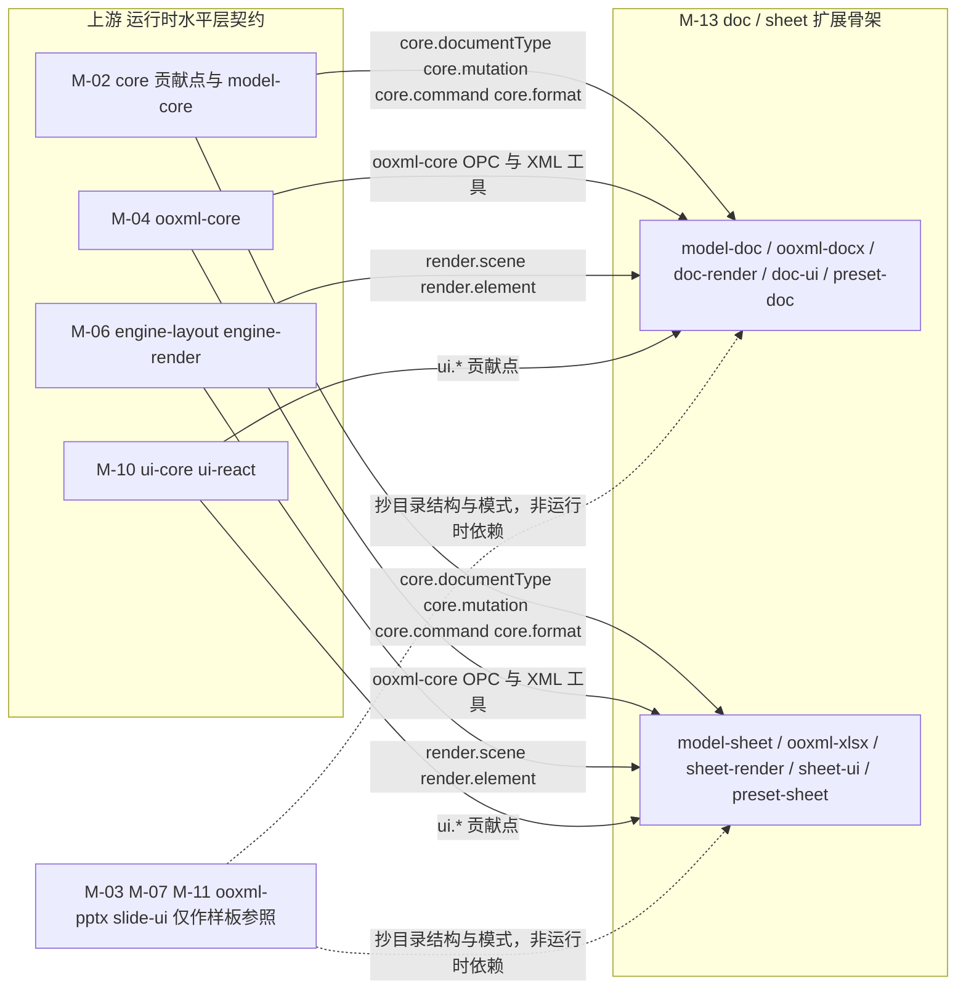
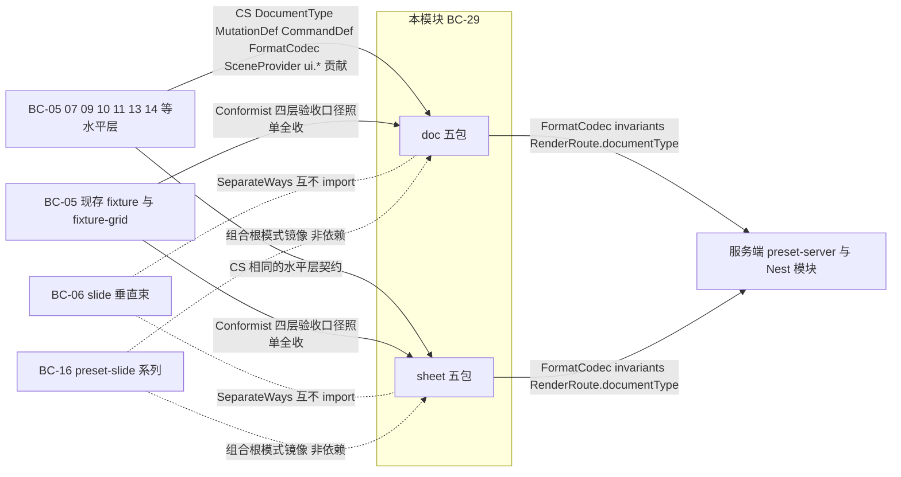
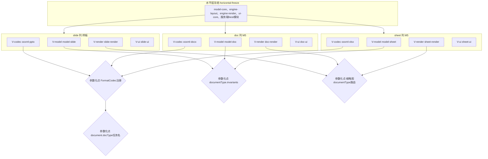
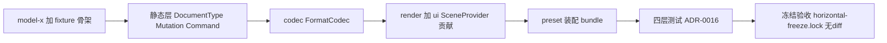
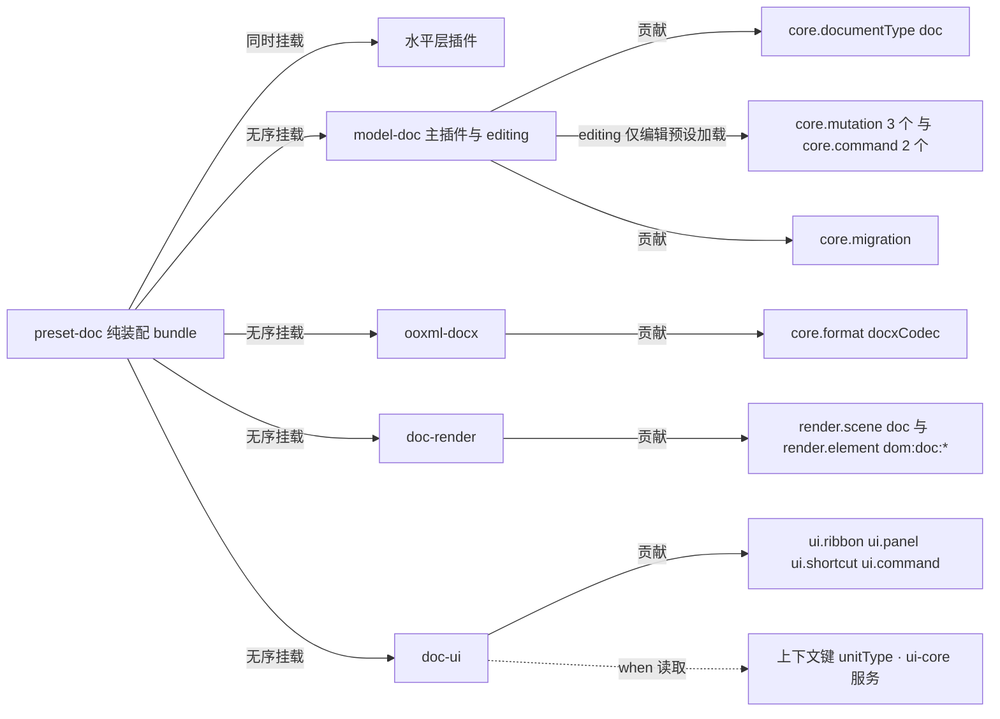
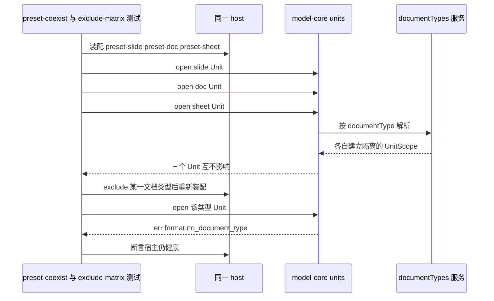
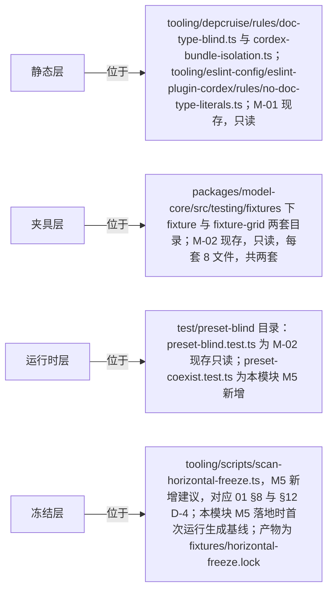

> 状态：草稿 v0.1 | 负责：架构-模块（阶段二，M-13） | 更新：2026-09-19、2026-09-24（rulings §4.15）、2026-09-24（复核修正，rulings §4.17）、2026-09-25（补图）、2026-09-25（矛盾收口，rulings §4.18）、2026-09-25（§4.19）；2026-09-25（设计线拆分：`FixedMetricsMeasurer` 改 `FixedWidthMeasurer`，70-testing/11 §2）；2026-09-26（§4.20） | 依赖：00-module-map.md M-13 行、§3 BC-29、§6、§7、§8 G-3、§9；charter §5.1（垂直束网格）、§5.2、§10；30-architecture/12-extension-to-doc-and-sheet.md 全篇；ADR-0016；10-prd/05-milestones-and-scope.md M5 段

# 13 doc / sheet 扩展骨架（限界上下文 BC-29 doc/sheet 扩展占位〔文档类型盲验证〕）

## 0. 一页总览

| 项 | 值 |
|---|---|
| 职责一句话 | 为 M5 的 `doc`/`sheet` 两个新垂直束提供可直接照抄的最小骨架蓝图，并承载「水平层零改动」的四层自动化验证机制（ADR-0016） |
| 覆盖的上下文 | BC-29 |
| 承载包 / 目录 | 现存只读引用：`@cordexjs/model-core`（`testing/fixtures/{fixture,fixture-grid}/**`，M-02 已交付，本文档不改动一行）；M5 新建 10 包：`@cordexjs/model-doc`、`@cordexjs/model-sheet`（V-model·秩15·iso）、`@cordexjs/ooxml-docx`、`@cordexjs/ooxml-xlsx`（V-codec·秩35·iso）、`@cordexjs/doc-render`、`@cordexjs/sheet-render`（V-render·秩55·dom）、`@cordexjs/doc-ui`、`@cordexjs/sheet-ui`（V-ui·秩75·dom）、`@cordexjs/preset-doc`、`@cordexjs/preset-sheet`（L8·秩80·dom，已收录章程（rulings §4.12 U-01），module-map §8 G-3） |
| cordis 形态 | plugin ×8（`model-*`/`ooxml-*`/`*-render`/`*-ui`，均为「只读主插件 + `editing` 编辑子插件」二段式）；bundle ×2（`preset-*`，纯装配，无 DDD 分层） |
| 运行位置 | 两端：`model-doc`/`model-sheet`/`ooxml-docx`/`ooxml-xlsx` 为 iso，浏览器与 `server-headless` 加载同一份源码；仅浏览器：`doc-render`/`sheet-render`/`doc-ui`/`sheet-ui`/`preset-doc`/`preset-sheet` 为 dom |
| 上游（依赖） | **运行时**（按贡献点与 Definition 的定义方分，2026-09-25 更正，rulings §4.18 FE-16）：M-02（`core.*` 贡献点与 `model-core` 契约）、M-04（`ooxml-core`：`ooxml-docx`/`ooxml-xlsx` 复用其 OPC/XML 工具）、M-06（`engine-layout`/`engine-render`：`render.*` 贡献点由 `engine-render` 定义，charter:316）、M-10（`ui-core`/`ui-react`：`ui.*` 贡献点由 `ui-core` 定义，charter:321）——这些都是水平层，束包 import 它们合规（铁律 2 只禁束间 import）；**样板参照**（抄目录结构与模式，非运行时依赖，铁律 2 禁止真实 import）：M-03、M-07、M-11、`ooxml-pptx`（M-04 内的 slide 束部分）、`slide-ui`（M-10 内的 slide 束部分） |
| 下游（被依赖） | 无（终端模块） |
| 对外服务 | 未来：`ctx.docs`/`ctx.sheets`（类比 `ctx.slides`，UnitScope 内挂载，M5 落地） |
| 贡献点 | 提供：`core.documentType`（'doc'/'sheet'）、`core.mutation`、`core.command`、`core.migration`、`core.format`、`render.scene`、`render.element`、`ui.*`；消费：无（本模块是水平层全部贡献点的**消费方**，不消费其它垂直束的贡献） |
| doc / sheet 通用性 | vertical——本模块就是 `doc`/`sheet` 两束本身，不适用 generic/parametrized 二分（BC-29 定义，module-map §3） |
| 批次 | 3 |

### 0.1 图示

**图 0-1 模块内包与上下游关系**



图怎么读：本模块没有真实下游（终端模块）；实线是运行时依赖，按贡献点的**定义方**分边——`core.*` 来自 M-02，`render.*` 来自 M-06 的 `engine-render`，`ui.*` 来自 M-10 的 `ui-core`，`ooxml-docx`/`ooxml-xlsx` 复用 M-04 的 `ooxml-core`（2026-09-25 更正，此前把 `render.*`、`ui.*` 算在 M-02 名下，rulings §4.18 FE-16）；虚线是对 slide 束样板（M-03、M-07、M-11、`ooxml-pptx`、`slide-ui`）的模式参照，非运行时依赖。

## 1. 限界上下文与边界

### 1.1 职责与非职责

**职责**：
1. 证明 M1–M4 建立的水平层抽象（`model-core`/`engine-*`/`ui-core`/`collab-*`/服务端 Nest 模块）对 `doc`/`sheet` 两种全新文档类型成立——即「文档类型盲」承诺不是纸面声明，而是可机械验收的工程事实（ADR-0016）。
2. 为 M5 正式立项时提供**可直接照抄**的骨架蓝图：十个包的完整目录树、与样板包的逐文件对应关系、Mutation/Command/事件/Selection 锚点的最小清单、扩展 checklist、四层测试套件的文件与命令。
3. 收敛全部「必须零改动」的水平层文件清单，把 module-map §6.4、12 号文档 §3.1、01/02/05/06/08/09/12 各自 §8 中分散给出的冻结范围汇总为本模块 §8 的单一权威表。

**非职责（明确指向负责模块）**：
- `doc`/`sheet` 的完整编辑体验、协同能力、保真承诺——PRD `05-milestones-and-scope.md` M5 段「明确不做」；这些是 M5 立项后的独立路线图，不在本文档骨架范围内。
- sheet 的公式引擎——12 号文档 §1.2 标注「公式暂不做」，`Cell` 值对象只有 `value`/`styleId`，无 `formula` 字段。
- 水平层的任何实现改动——那是 M-02/M-05/M-06/M-08/M-09/M-10/M-12 的职责；本模块只**消费**其贡献点，不改一行水平层源码（§8 冻结清单）。
- M5 的正式立项决策（预算、排期、团队分工）——本文档是规划文档，不是实现计划书；module-map §10 Q-M3 已裁定 M-13 仍属阶段二规划批次 3，不代表 M5 与 M2–M4 同时实现。

### 1.2 通用语言

引用 charter §4 全部术语（`Unit`/`DocumentType`/`Mutation`/`Command`/`FormatCodec`/`SceneProvider` 等不重复定义）。本上下文特有术语：

| 术语 | 定义 | 对应类型名 |
|---|---|---|
| 文档类型盲（doc-type blindness） | 水平层代码不知道、也不需要知道自己被哪种文档类型使用 | ADR-0016 |
| `BodyShapeHints` | `DocumentType.shape` 的 `{entityTables,atomicLists,richTexts}` 路径前缀标注，供 Store Provider 选择底层结构 | `model-core/src/document-type/document-type.ts`（M-02 §2.2，只读引用） |
| 水平层冻结（horizontal-freeze） | 对全部**无 `cordex.bundle` 字段且非组合根**（`compositionRoot` 不为 `true`）的包 `src/**` 计算内容哈希并锁定，M5 PR 要求锁文件无 diff（2026-09-25 冻结范围按 rulings §4.18 FE-01 更正：组合根 preset-*、apps/* 可带或不带 bundle，均不属冻结层；server-* 文档类型盲后纳入冻结，M5 新增 doc 时 diff = 0） | `fixtures/horizontal-freeze.lock`（§8） |
| 夹具文档类型（`fixture`/`fixture-grid`） | M-02 已交付的两个测试专用文档类型，前者模拟树状通用文档，后者模拟网格键空间（sheet 的验证代理） | `model-core/testing/fixtures/{fixture,fixture-grid}/**` |
| 垂直束模板 | 样板包（`model-slide`/`ooxml-pptx`/`slide-render`/`slide-ui`/`preset-slide`）中结构可原样复制、仅内容重写的文件（03/04/07/10 号文档各自 §8 已逐文件标注） | — |
| 骨架（skeleton） | M5 立项前的占位实现：`DocumentType` 注册 + 3 Mutation + 2 Command + 直通编解码 + 最小渲染，不含完整业务逻辑 | 12 §5 验收清单 |

### 1.3 上下文映射

| 相邻上下文 | 关系类型 | 防腐层落点 | 传递的契约 |
|---|---|---|---|
| BC-06 幻灯片领域模型（`model-slide` 等 slide 垂直束） | **Separate Ways**（铁律 2 强制）——本模块与 slide 束互不 `import`，唯一的"关系"是都复制自同一批样板模式 | 无契约传递，隔离由 `cordex-bundle-isolation`（depcruise R4）机械保证 | 无 |
| BC-05/07/09/10/11/13/14 等水平层（Customer–Supplier） | 本模块（客户）单向依赖各水平层（供应方）的贡献点契约；水平层对本模块零感知 | 各垂直束自身的 `document-type.ts`/`codec.ts`/`*-scene-provider.ts`/`*.contribution.ts`——即 §4 对应表中标"垂直束模板"的组装文件 | `DocumentType<S>`、`MutationDef`/`CommandDef`、`FormatCodec`、`SceneProvider`、`ui.*` 贡献 |
| BC-05 现存 `fixture`/`fixture-grid`（Conformist） | 本模块的四层验收口径完全遵从 ADR-0016 已定的夹具形状与错误码约定，无议价权 | 无（直接复用，不做适配） | `fixtureDocumentType`/`fixtureGridDocumentType`（只读引用） |
| BC-16 预设装配（`preset-slide*`，Open Host Service 的镜像） | `preset-doc`/`preset-sheet` 复制 `preset-slide`/`preset-slide-viewer` 的组合根模式，非依赖关系（bundle 之间不互相 import） | `preset.ts`/`plugins/*.entries.ts`/`config/options.ts` 结构对照（按 11 §4，rulings §4.18 FE-12；§4.9/§4.10） | 无跨包契约，仅模式复制 |
| BC-21/22/27、BC-23/24/25（服务端 Nest 模块与 `preset-server`） | Customer–Supplier 的镜像：`preset-server` 消费本模块产出的 `FormatCodec`/`invariants`，本模块对服务端零感知 | `apps/server/src/cordis-host/preset-server.ts` 的 `core.format` 贡献列表（§7） | `FormatCodec`、`documentType.invariants`、`RenderRoute.documentType` 字符串 |

**图 1-1 对外契约与上下游关系**



怎么读：实线从契约提供方指向消费方（与图 0-1 同向）；本模块单向依赖水平层契约、水平层对本模块零感知，服务端只在 `preset-server` 等参数化点消费本模块产出；虚线是非依赖关系——与 slide 束互不 import，与 `preset-slide*` 只是模式镜像。doc 与 sheet 两列之间同样互不 import（铁律 2）。

依据：本节上表；§7 参数化点表。

## 2. 领域模型

> 骨架级：只给聚合/值对象/领域服务/事件/命令的**表格清单**，不展开字段签名细节（签名草案见 30-architecture/12-extension-to-doc-and-sheet.md §1.1/§1.2，本节不重复）；M5 立项后按 M-03（03 §2）的颗粒度细化。doc 与 sheet 各自独立成节，二者互不 import（铁律 2）。

**图 2-1 扩展结构**



图怎么读：水平层冻结不变，三列各自四层平行存在、互不 import；四个菱形是仅有的参数化点，doc/sheet 列复制样板结构后只需在这四处接入即可，不需要改动水平层一行代码。

### 2.1 doc（`model-doc`）——流式文本 + 分页

**聚合与实体**：聚合根 `DocBody { doc: {sectionProperties; styles; numbering; properties; extensions}; blocks: Record<BlockId, (Paragraph|Table|SectionBreak|Unknown) & {order: FracKey}>; media; opaqueParts }`；实体：`Paragraph`（含 `runs` 富文本）、`Table`（复用 `model-core/drawing` 的表格值对象模式）、`SectionBreak`、`Unknown`（未知块占位，对齐 `model-slide` 的 `unknown.ts`）。`order: FracKey` 排序复用 `@cordexjs/shared/order`（ADR-0032），无数组下标，并发插入同位按 `(order,id)` 确定——与 slide 完全相同的机制。

**值对象**：`Style`（段落/游程样式，`Record<StyleId,Style>`）、`RunProperties`（复用 `model-core/drawing` 的 `FontRef`/`Color` 等 DrawingML 共享词汇）、`BlockId`/`StyleId` 品牌类型。

**领域服务**（纯函数）：段落/游程样式继承链解析（结构复制 `model-slide/domain/style/cache.ts` 的"纯函数 + revision 缓存 + `invalidate(changeSet)`"模式，03 §8 已标"模式可复制"）；`createEmptyDocBody()`。

**领域事件**（`doc/*`，新增建议，需总编排按 03 §12 G-6 同一流程正式采纳）：`doc/block-added`（载荷 `{blockId}`）、`doc/block-removed`（`{blockId}`）、`doc/text-changed`（`{blockId,delta}`）。

**仓储/存储契约**：无新增 Definition——直接复用 M-02 的 `DocumentStore`（`store-memory`/`store-yjs` 两个 Provider 对 doc 零改动即可工作，这本身就是水平层通用性的证明）。

**应用服务与命令**（骨架级，满足 12 §5「3 Mutation + 2 Command」验收线）：

| 类型 | id | 说明 |
|---|---|---|
| Mutation | `doc.block.insert` | 插入块（段落/表格/分节符），`lower()` 产出 `StoreOp.set` |
| Mutation | `doc.block.remove` | 删除块 |
| Mutation | `doc.text.applyDelta` | 对某 `blockId` 的富文本应用增量（op-based delta） |
| Command | `doc.insertParagraph` | 复合命令：`block.insert` + 光标处 `text.applyDelta`，对齐 slide 的 `*-commands.ts` 组合模式 |
| Command | `doc.deleteBlocks` | 批量删除所选块，对齐 `slide.deleteShapes` 的能力位与事务边界模式 |

> 12 §1.1 列出的 `doc.block.setOrder`、`doc.paragraph.setProperties`、`doc.table.*` 等其余 Mutation 属 M5 后续补齐范围，骨架阶段不要求。Selection 锚点：`{kind:'text';blockId;start;end}` \| `{kind:'block';blockIds}` \| `{kind:'tableCell'}`（`DocumentType.selectionKinds=['text','block','tableCell']`）。

### 2.2 sheet（`model-sheet`）——网格寻址（公式暂不做）

**聚合与实体**：聚合根 `SheetBody { workbook: {definedNames; styles; properties; extensions}; sheets: Record<SheetId, {name; order: FracKey; dimensions; rows; cols; merges: Range[]; extensions}>; cells: Record<\`${SheetId}:${row}:${col}\`, Cell>; media; opaqueParts }`；实体：`Sheet`（顺序同样用 `FracKey`）、`Cell`（`{value; styleId?}`，**无 `formula` 字段**）。`cells` 为稀疏字符串键表，只用 `set`/`delete` 两种 `StoreOp` 原语操作，不引入新原语。

**值对象**：`CellStyle`（`Record<StyleId,CellStyle>`）、`Range{r0;c0;r1;c1}`、`RowProps`/`ColProps`、`SheetId`/`CellKey` 品牌类型。

**领域服务**（纯函数）：`CellStyle` 继承叠加（row/col/range/cell 四级，模式复制 doc 的样式继承结构）；`createEmptySheetBody()`。

**领域事件**（`sheet/*`，新增建议）：`sheet/cell-changed`（`{sheetId,key}`）、`sheet/row-inserted`（`{sheetId,row,count}`）、`sheet/sheet-added`（`{sheetId}`）。

**仓储/存储契约**：同 doc，直接复用 `DocumentStore`；**唯一差异**——`cells` 表可能巨大（10 万+ 单元格，12 §5 性能验收项），需要 M-02 `SnapshotBundle.body` 的 `$ref: BlobRef` 分片扩展点（module-map §6.3 第 4 点），落点见 §4.2 `infrastructure/sharding.ts`。

**应用服务与命令**：

| 类型 | id | 说明 |
|---|---|---|
| Mutation | `sheet.cell.set` | 设置单元格值/样式引用 |
| Mutation | `sheet.cell.clear` | 清空单元格 |
| Mutation | `sheet.row.insert` | 插入行——12 §3.2 明确标注性能敏感点：`lower()` 对同一事务内大量 `cells` 键做批量 `set`/`delete`（键重写），**契约不变**，允许 Provider 内部批量优化（`store-yjs` 单次 `Y.transact`、`store-memory` 单次 produce）；若 M5 实测不可接受，需评估新增原语 `rename-keys`（唯一可能的水平层契约扩展，需 ADR，见 §13 Q4） |
| Command | `sheet.setCellValue` | 复合命令：校验 + 类型推断 + `cell.set` |
| Command | `sheet.insertRows` | `row.insert` 的命令层封装（权限位 + 撤销） |

> Selection 锚点：`{kind:'range';sheetId;r0;c0;r1;c1}` \| `{kind:'sheet';sheetId}`（`DocumentType.selectionKinds=['range','sheet']`）。`sheet.range.setStyle`/`sheet.col.*`/`sheet.merge.*`/`sheet.sheet.*` 等其余 Mutation 属 M5 后续补齐范围。

**图 2-2 新增文档类型 checklist 流程**



图怎么读：从模型加夹具到冻结验收是一条单向流水线，末端「冻结验收」核对的是水平层锁文件无 diff，而不是新文档类型自身的功能完整度。

## 3. cordis 插件定义

> 十包合一张表（逐包再展开模板式表格会大幅超出篇幅预算，§4 对应表已逐文件说明差异，本节只给插件级元信息）。八个 plugin 角色包均沿用 `model-slide`/`ooxml-pptx`/`slide-render`/`slide-ui` 的"只读主插件 + `editing` 子插件"二段式（ADR-0015 只读保证模式，`*-render`/`*-ui` 无编辑态区分故只有单一 `plugin.ts`）；`preset-doc`/`preset-sheet` 是纯装配 bundle（组合根，`compositionRoot:true`），不设 `inject`/`provide`/贡献点，文件布局按 11 §4（`preset.ts`、`entries.ts`、`config/options.ts`、`plugins/*.entries.ts`；00-module-map §1 规则 3 的「不设 DDD 分层目录」仍成立，rulings §4.18 FE-12）。

| 包 | `name` | `inject`（必需） | `provide` | 贡献点：提供 | 贡献点：消费 | 事件 | 生命周期 |
|---|---|---|---|---|---|---|---|
| `model-doc` | `'model-doc'` | `['documentTypes','commands']` | 无（不新增 Definition） | `core.documentType`('doc')、`core.mutation`×3、`core.command`×2、`core.migration` | 无 | 发布 `doc/*`×3 | ready 贡献注册；`editing.ts` 仅编辑预设加载（同 ADR-0015） |
| `model-sheet` | `'model-sheet'` | `['documentTypes','commands']` | 无 | `core.documentType`('sheet')、`core.mutation`×3、`core.command`×2、`core.migration` | 无 | 发布 `sheet/*`×3 | ready 贡献注册；`editing.ts` 仅编辑预设加载（同 ADR-0015） |
| `ooxml-docx` | `'ooxml-docx'` | `['formats']` | 无 | `core.format`（`docxCodec`） | 无 | 无 | ready 贡献注册；无 `editing.ts`（编解码无只读/编辑之分） |
| `ooxml-xlsx` | `'ooxml-xlsx'` | `['formats']` | 无 | `core.format`（`xlsxCodec`） | 无 | 无 | ready 贡献注册；无 `editing.ts`（编解码无只读/编辑之分） |
| `doc-render` | `'doc-render'` | 根级 `['contributions']`；`unitPlugins` 内 `['render','layout','store']`（照 M-07 §3 `slide-render` 样板；2026-09-25 删去章程服务名表中不存在的 `scenes`，rulings §4.18 FE-17） | 无 | `render.scene`('doc')、`render.element`×N（`dom:doc:*`） | 无（`render.target` 的消费方是 `engine-render`，不是束包，FE-17） | 无 | UnitScope 内挂载 `thumbnails` 子服务 |
| `sheet-render` | `'sheet-render'` | 同 `doc-render`（根级 `['contributions']`；`unitPlugins` 内 `['render','layout','store']`） | 无 | `render.scene`('sheet')、`render.element`×N（`dom:sheet:*`） | 无 | 无 | UnitScope 内挂载 `thumbnails` 子服务 |
| `doc-ui` | `'doc-ui'` | `['ui','commands','documentTypes']` | 无 | `ui.ribbon`/`ui.panel`/`ui.shortcut`/`ui.command`（`doc.*`） | 无（`when` 子句读取 ui-core 上下文键 `unitType`；上下文键不是贡献点，章程 §5.5 贡献点清单无 `ui.contextKey`，FE-17） | 无 | `ready`：`infrastructure/contributions.ts` 批量贡献 |
| `sheet-ui` | `'sheet-ui'` | `['ui','commands','documentTypes']` | 无 | `ui.ribbon`/`ui.panel`/`ui.shortcut`/`ui.command`（`sheet.*`，含公式栏 `slot`） | 无（`when` 子句读取 ui-core 上下文键 `unitType`，FE-17） | 无 | `ready`：`infrastructure/contributions.ts` 批量贡献 |
| `preset-doc` | — | — | — | 无（装配根不自行贡献，只挂载子插件） | — | — | `preset.ts` 对 `plugins/index.ts` 的 `DOC_ENTRIES` 无序挂载，稳定 id 记录供 `fiber.update`（文件布局按 11 §4，FE-12） |
| `preset-sheet` | — | — | — | 无 | — | — | 同 `preset-doc`（`SHEET_ENTRIES`） |

领域读服务：若 M5 后续 `doc-render`/`doc-ui` 需要按实体读文档（类比 `ctx.slides`），届时先在章程 §5.5 服务名表登记 `docs`/`sheets` 再注入；骨架阶段不注入（FE-17）。

配置 schema：八个 plugin 包各自的 `config.ts`（`XxxConfig` zod）字段模式复制样板（`lazySlides`→`lazyParagraphs`/`lazySheets` 等），骨架阶段留最小字段集，不在本节展开（§4 对应表已标注）。Manifest 片段：十包均由 `src/manifest.ts` 序列化生成 `cordex-manifest.json`，字段结构与样板包 1:1（`preset-*` 的 `manifest.ts` 只聚合子插件清单）。

**图 3-1 doc 列插件与贡献点装配**



怎么读：实线「贡献」指插件向水平层贡献点塞条目；虚线「when 读取」指 `doc-ui` 的贡献项在 `when` 子句里读取 ui-core 登记的上下文键 `unitType`——它是上下文键、不是贡献点（2026-09-25 更正，删去原「消费 `ui.contextKey`」与「消费 `render.target`」两条：前者章程无此贡献点 id，后者的消费方是 `engine-render`，rulings §4.18 FE-17）；`preset-doc` 只负责挂载、自己不贡献。sheet 列结构与本图一一对应（`model-sheet`/`ooxml-xlsx` 的 `xlsxCodec`/`sheet-render` 的 `dom:sheet:*`/`sheet-ui` 另含公式栏 `slot`），不重复画出。

依据：本节上表；§8.1 第 6 条。

## 4. 目录树（完整到文件）

> **压缩约定**（总编排裁定允许，见任务书"硬规则"）：十包根配置均遵循 02 §4.0 包模板的 9 个文件（`package.json`/`tsconfig.json`/`tsconfig.test.json`/`vitest.config.ts`/`api-extractor.json`/`etc/<pkg>.api.md`/`README.md`/`CHANGELOG.md`/`cordex-manifest.json`，plugin 角色全含、bundle 角色只需前 2 个 + `cordex-manifest.json`），下方每棵树只展开 `package.json`（携带 `cordex` 字段，是唯一逐包不同的根文件）代表整组根配置，其余 8 个文件按模板 1:1 存在、不重复画出；`src/**` 完整到文件。每棵树后紧跟"与样板对应表"（样板文件 / 本包文件 / 关系 / 职责差异），关系取值：**同名模板**（结构与实现模式原样复制，仅改标识符）· **替换**（同一职责位置，内容因领域而异）· **新增**（样板没有，本包新增）· **删除**（样板有，本包不需要）。DDD 五目录物理落地遵循 00-module-map §1 对照表，与 03/04/07/10 号文档一致。

### 4.1 `@cordexjs/model-doc` — V-model · iso · bundle=doc · role=plugin · stability=experimental

样板：`@cordexjs/model-slide`（03 §4）。

```text
packages/model-doc/
├── package.json                  # cordex: { layer:'V-model', bundle:'doc', iso:'iso', role:'plugin', stability:'experimental' }
├── src/
│   ├── index.ts                  # 公共 API 面
│   ├── plugin.ts                 # 主插件：只读部分（贡献 documentType/mutation/command 只读查询面）
│   ├── editing.ts                 # 编辑子插件（子路径 ./editing，ADR-0015 二段式）
│   ├── doc.contribution.ts        # declare module 增强 + 贡献点/事件声明（含 events.ts/errors.ts 内容，骨架合一）
│   ├── domain/
│   │   ├── body.ts                # DocBody 聚合根 + Paragraph/Table/SectionBreak/Unknown + createEmptyDocBody()（§2.1）
│   │   └── style.ts               # 段落/游程样式继承纯函数 + revision 缓存（复制 model-slide style/cache.ts 结构）
│   ├── application/
│   │   ├── mutations.ts           # 3 个 Mutation 及各自 lower()（§2.1）
│   │   └── commands.ts            # 2 个 Command（§2.1）
│   ├── infrastructure/
│   │   ├── document-type.ts       # docDocumentType: DocumentType<DocBody> 组装
│   │   └── migrations.ts          # 空表起步（同 model-slide M1 惯例，A23）
│   ├── interface/
│   │   └── docs-service.ts        # DocsService（'docs'，UnitScope 内挂载）
│   ├── testing/
│   │   └── index.ts               # fixtures + builders + runDocModelConformance 骨架合一（M5 拆分为独立文件）
│   └── __tests__/
│       └── lifecycle.test.ts      # 插件包必含（defineLifecycleSuite）
```

**与样板对应表**：

| 样板文件（`model-slide`） | 本包文件 | 关系 | 职责差异 |
|---|---|---|---|
| `domain/model/**`（30+ 文件） | `domain/body.ts`（1 文件） | 替换（骨架级压缩） | slide 按实体逐文件拆分；doc 骨架阶段合一，M5 立项按同一粒度拆分 |
| `domain/style/**`（8 文件） | `domain/style.ts` | 替换（模式复制，见 03 §8） | 占位符/母版继承是 PowerPoint 语义不复用；"纯函数+缓存"结构原样复制 |
| `domain/query/**`、`domain/invariants/**` | 骨架阶段省略 | 删除（M5 补齐） | 骨架验收不要求完整不变量集，仅 `bodySchema` 校验兜底 |
| `domain/shape-kind/**` | 无对应 | 删除 | doc 若需要 `blockKind` 贡献点，M5 按同一贡献点模式新增（03 §8 已预告） |
| `application/mutations/**`、`application/commands/**` | `application/mutations.ts`、`commands.ts` | 同名模板（骨架合一） | 目录结构简化为单文件，三段式 id 约定不变 |
| `infrastructure/document-type.ts` | `infrastructure/document-type.ts` | 同名模板 | `DocumentType<S>` 组装骨架照抄，`bodySchema`/`shape`/`invariants` 换 doc 领域 |
| `infrastructure/snapshot/sharding.ts` | 不需要 | 删除 | 该文件主要为 sheet 预留（03 §8 已标注）；doc 无巨表问题 |
| `interface/services/slides.service.ts` | `interface/docs-service.ts` | 同名模板 | 改名，只读投影 + `exec.*` 模式复制 |
| `testing/conformance.ts` | `testing/index.ts`（含 conformance） | 同名模板（骨架合一） | `runSlideModelConformance` → `runDocModelConformance` |
| `src/plugin.ts`/`editing.ts` | 同名 | 同名模板 | 二段式加载模式原样复制 |
| `PlaceholderRef`/母版继承/`reassignTo` | 无 | 删除 | doc 无"母版/版式"概念 |

### 4.2 `@cordexjs/model-sheet` — V-model · iso · bundle=sheet · role=plugin · stability=experimental

样板：`@cordexjs/model-slide`（同手法，额外亮点见 `infrastructure/sharding.ts`）。

```text
packages/model-sheet/
├── package.json                  # cordex: { layer:'V-model', bundle:'sheet', iso:'iso', role:'plugin', stability:'experimental' }
├── src/
│   ├── index.ts
│   ├── plugin.ts
│   ├── editing.ts
│   ├── sheet.contribution.ts      # 含 events.ts/errors.ts 内容
│   ├── domain/
│   │   ├── workbook.ts            # SheetBody 聚合根 + Sheet/Cell/Range + createEmptySheetBody()（§2.2）；cells 稀疏字符串键寻址
│   │   └── style.ts               # CellStyle 继承叠加（row/col/range/cell 四级）纯函数
│   ├── application/
│   │   ├── mutations.ts           # 3 个 Mutation：cell.set/cell.clear/row.insert（§2.2）
│   │   └── commands.ts            # 2 个 Command
│   ├── infrastructure/
│   │   ├── document-type.ts       # sheetDocumentType 组装
│   │   ├── migrations.ts          # 空表起步
│   │   └── sharding.ts            # ★ sheet 专属：对接 M-02 SnapshotBundle 的 `$ref:BlobRef` 分片扩展点（12 §3.3、03 §8「主要为 sheet 预留」），处理巨大 cells 表
│   ├── interface/
│   │   └── sheets-service.ts      # SheetsService（'sheets'）
│   ├── testing/
│   │   └── index.ts
│   └── __tests__/
│       └── lifecycle.test.ts
```

**与样板对应表**（仅列与 4.1 model-doc 不同之处；结构性对应关系同 4.1）：

| 样板文件（`model-slide`） | 本包文件 | 关系 | 职责差异 |
|---|---|---|---|
| `domain/model/**` | `domain/workbook.ts` | 替换（骨架合一） | `cells: Record<\`${SheetId}:${row}:${col}\`, Cell>` 稀疏寻址，与 slide 的归一化实体表形状不同但仍是 `entityTables`（`BodyShapeHints`） |
| `infrastructure/snapshot/sharding.ts` | `infrastructure/sharding.ts` | **新增（本包真正落地）** | 03 §8 明确标注该文件"主要为 sheet 预留"；`model-doc` 骨架阶段删除此文件，`model-sheet` 保留并作为 M5 性能验收对象（12 §5"sheet 10 万 cells 打开 < 预算"） |
| `domain/query/**`、`domain/invariants/**` | 骨架阶段省略 | 删除（M5 补齐） | 行列范围合法/无重复合并区域等不变量留待 M5 |
| `application/mutations.ts` 的 `row.insert` | 同 | 新增关注点 | 12 §3.2 标注的性能敏感 Mutation，`lower()` 产生批量键重写，见 §2.2 |

**两包间的铁律 2 落地**：`model-doc`/`model-sheet` 互不 `import`；二者共享的唯一"相似性"是都复制自 `model-slide` 这同一份样板，不构成依赖关系。

### 4.3 `@cordexjs/ooxml-docx` — V-codec · iso · bundle=doc · role=plugin · stability=experimental

样板：`@cordexjs/ooxml-pptx`（04 §4.2）。**硬规则**：必须复用 `ooxml-core`（BC-07，generic，见 §8）的 OPC/XML/DrawingML/不透明保留引擎，不得重新实现。

```text
packages/ooxml-docx/
├── package.json                  # cordex: { layer:'V-codec', bundle:'doc', iso:'iso', role:'plugin', stability:'experimental' }
├── src/
│   ├── index.ts
│   ├── plugin.ts                  # contribute core.format(docxCodec)
│   ├── docx.contribution.ts       # 含 errors.ts/diagnostics.ts 内容
│   ├── domain/
│   │   ├── classify.ts            # PartClassification：WordprocessingML 部件分类表（document.xml/styles.xml/numbering.xml…）
│   │   ├── config.ts              # DocxCodecConfig schema（字段模式照抄 pptx 的 lazySlides→lazyParagraphs）
│   │   └── ids/
│   │       └── ooxml-id-map.ts    # cNvPr/@id·creationId 双向映射，临时从 ooxml-pptx 逐字复制（2026-09-18，C-18；不假定 ooxml-core 已提升）
│   ├── application/
│   │   └── pipeline.ts            # importDocx/exportDocx：五阶段管线骨架（open→classify→dispatch→assemble→snapshot）；document.xml/styles.xml 解析器留 M5 细化（PRD M5「打开 .docx 并提取段落文本渲染为纯文本页，仅证明管线」）
│   ├── interface/
│   │   └── codec.ts               # docxCodec: FormatCodec<DocBody> 实例
│   ├── testing/
│   │   └── index.ts               # roundtrip 骨架，复用 ooxml-core/testing/diffPackage
│   └── __tests__/
│       └── lifecycle.test.ts
```

**与样板对应表**：

| 样板文件（`ooxml-pptx`） | 本包文件 | 关系 | 职责差异 |
|---|---|---|---|
| `src/plugin.ts`/`errors.ts`/`diagnostics.ts` | `plugin.ts`/`docx.contribution.ts` | 同名模板（骨架合一） | 贡献条目 id 换 `'ooxml-docx'`，错误域前缀 `format.docx.*` |
| `domain/ids/ooxml-id-map.ts` | `domain/ids/ooxml-id-map.ts`（**临时各自复制一份**，2026-09-18 结案，C-18） | 复制（非删除、非假定已提升） | **已结案**：04 §8/§12 G-6 维持暂缓提升的结论，M-04 不会在 M5 启动前完成提升；本包**不得假定 `ooxml-core` 已提升**，改为在 `ooxml-docx/domain/ids/` 临时复制一份该文件（逐字复制，待 M-04 走 ADR 收编后再改回引用），避免因等待未立项的提升而阻塞 M5 开工 |
| `domain/classify.ts` | `domain/classify.ts` | 同名模板 | `modeled` 内容类型表按 WordprocessingML 重写 |
| `domain/conformance-strategy.ts` | 骨架阶段省略，直接调用 `ooxml-core` 通用实现 | 删除（算法通用，04 §8 标"逐字复制"） | Strict/Transitional 一致性类概念覆盖三种 OOXML 主 schema，骨架阶段假定可直接复用而非复制一份 |
| `application/{import,export}-pipeline.ts` | `application/pipeline.ts` | 替换（骨架合一） | 五阶段模式复制，解析器分派表按 WordprocessingML 重写；M1 范围仅"打开+提取纯文本" |
| `infrastructure/import|export/{presentation,master,layout,slide,theme}.ts` | 骨架阶段并入 `pipeline.ts` 内联占位 | 删除（M5 拆分） | 对应 `{document,styles,numbering,sections,headers-footers}.ts`，骨架阶段不逐文件展开 |
| `interface/codec.ts` | `interface/codec.ts` | 同名模板 | `id`/`documentType`/`mimeTypes`/`extensions` 换 docx 值 |
| `infrastructure/import/notes-text.ts`、`comments.ts` | 无 | 删除 | docx 有自己的批注机制，概念不同 |

### 4.4 `@cordexjs/ooxml-xlsx` — V-codec · iso · bundle=sheet · role=plugin · stability=experimental

样板：`@cordexjs/ooxml-pptx`（同 4.3 手法，换 SpreadsheetML）。

```text
packages/ooxml-xlsx/
├── package.json                  # cordex: { layer:'V-codec', bundle:'sheet', iso:'iso', role:'plugin', stability:'experimental' }
├── src/
│   ├── index.ts
│   ├── plugin.ts                  # contribute core.format(xlsxCodec)
│   ├── xlsx.contribution.ts
│   ├── domain/
│   │   ├── classify.ts            # SpreadsheetML 部件分类：workbook.xml/worksheets/*.xml/sharedStrings.xml/styles.xml
│   │   ├── config.ts              # XlsxCodecConfig（lazySheets 等字段）
│   │   └── ids/
│   │       └── ooxml-id-map.ts    # 同 ooxml-docx：临时从 ooxml-pptx 逐字复制（2026-09-18，C-18）
│   ├── application/
│   │   └── pipeline.ts            # importXlsx/exportXlsx：PRD M5「打开 .xlsx 并渲染单表网格值，仅证明管线」
│   ├── interface/
│   │   └── codec.ts               # xlsxCodec: FormatCodec<SheetBody> 实例
│   ├── testing/
│   │   └── index.ts
│   └── __tests__/
│       └── lifecycle.test.ts
```

**与 4.3 的差异**（对应表结构相同，不重复列）：`sharedStrings.xml`/`styles.xml` 是 xlsx 格式专属部件（无 docx 对应物），在 `application/pipeline.ts` 内联占位说明；媒体部件寻址/去重算法与 docx 一致（04 §8 标注"垂直束模板，算法几乎可直接复用"）；`chart.ts` 复用 `ooxml-core/chartml`（generic）不变——sheet 的图表/数据透视表渲染留给 `sheet-render`，本包只做部件级不透明保留；`domain/ids/ooxml-id-map.ts` 与 `ooxml-docx` 同一处理（临时复制，非假定已提升，2026-09-18，C-18）。

### 4.5 `@cordexjs/doc-render` — V-render · dom · bundle=doc · role=plugin · stability=experimental

样板：`@cordexjs/slide-render`（07 §4.1）。复用 `engine-render`/`engine-layout`/`render-dom` 契约（generic，§8），不新增 Provider。

```text
packages/doc-render/
├── package.json                  # cordex: { layer:'V-render', bundle:'doc', iso:'dom', role:'plugin', stability:'experimental' }
├── src/
│   ├── index.ts
│   ├── plugin.ts                  # 根贡献注册 render.scene('doc') + unitPlugins 挂载 thumbnails
│   ├── doc-render.contribution.ts # 含 config.ts/events.ts/errors.ts 内容
│   ├── domain/
│   │   ├── compose.ts             # composeDoc：调用 engine-layout.layoutTextBody 的续排能力（12 §2 参数化点①：给定高度上限返回可放入行数与剩余）产出分页布局 → ComposedPage
│   │   └── to-scene-nodes.ts      # ComposedPage → SceneNode[]，kind='doc:paragraph-lines'|'doc:table'|'doc:image'|'doc:page-decoration'（12 §1.1）
│   ├── application/
│   │   └── scene-provider.ts      # SceneProvider('doc').build/diff 骨架，同构 slide-scene-provider.service.ts；内部订阅 store/transaction 转发 invalidate
│   ├── infrastructure/
│   │   └── paragraph.renderer.ts  # ElementRenderer 骨架，kind='doc:paragraph-lines'；无状态查表渲染器原则照搬（07 §1.1）
│   ├── testing/
│   │   └── index.ts
│   └── __tests__/
│       └── lifecycle.test.ts
```

**与样板对应表**：

| 样板文件（`slide-render`） | 本包文件 | 关系 | 职责差异 |
|---|---|---|---|
| `src/plugin.ts` | `plugin.ts` | 同名模板 | `render.scene` key 从 `'slide'` 改为 `'doc'` |
| `src/config.ts` | 并入 `doc-render.contribution.ts` | 同名模板（骨架合一） | 字段名/默认值复用；无图表类重型可选开关（doc 骨架阶段不涉及） |
| `application/services/slide-scene-provider.service.ts` | `application/scene-provider.ts` | 同名模板 | "查 slides 服务→合成→toSceneNodes"流程骨架照抄，`slides`→`docs` |
| `domain/dirty/classify.ts` | 骨架阶段省略 | 删除（M5 补齐） | 脏区分类表需按 `DocBody` 实体类型重写，骨架验收不要求 |
| `application/services/thumbnail.service.ts`、`infrastructure/thumbnails/*.provider.ts` | 骨架阶段省略 | 删除（M5 补齐） | Provider 策略/去抖机制可复制，但骨架验收线不含缩略图 |
| `infrastructure/cache/layer-template-cache.ts` | 无 | 删除 | doc 无母版/版式概念，骨架阶段不需要模板缓存层 |
| `domain/compose/compose-slide.ts` | `domain/compose.ts` | 替换（slide 专属不复制，见 07 §8） | 三层合成→分页合成，规则从零设计 |
| `infrastructure/elements/{sp,pic,…}.renderer.ts` | `infrastructure/paragraph.renderer.ts` | 替换 | `kind` 集合完全不同，骨架阶段只实现段落一种 |

### 4.6 `@cordexjs/sheet-render` — V-render · dom · bundle=sheet · role=plugin · stability=experimental

样板：`@cordexjs/slide-render`（同手法，换网格虚拟化）。

```text
packages/sheet-render/
├── package.json                  # cordex: { layer:'V-render', bundle:'sheet', iso:'dom', role:'plugin', stability:'experimental' }
├── src/
│   ├── index.ts
│   ├── plugin.ts                  # 根贡献注册 render.scene('sheet')
│   ├── sheet-render.contribution.ts
│   ├── domain/
│   │   ├── compose.ts             # composeSheetView：viewport 可见行列窗口 → ComposedGrid（虚拟化，12 §2「view 必须是开放类型」）
│   │   └── to-scene-nodes.ts      # kind='sheet:grid'|'sheet:cell-text'|'sheet:merge'|'sheet:frozen-pane'（12 §1.2）
│   ├── application/
│   │   └── scene-provider.ts      # SceneProvider('sheet').build/diff；view: ViewDescriptor{sheetId,viewport} & Record<string,unknown>（12 §2 参数化点②）
│   ├── infrastructure/
│   │   └── cell.renderer.ts       # kind='sheet:cell-text'；大量文本节点的 DOM 数量压力见 §13
│   ├── testing/
│   │   └── index.ts
│   └── __tests__/
│       └── lifecycle.test.ts
```

**与 4.5 的差异**（对应表结构相同，不重复列）：`domain/dirty/classify.ts` 若 M5 补齐，sheet 一侧需特别处理"巨大稀疏 `cells` 表下 `full` 归类的性能陷阱"（07 §8 已预警，与 §13 Q3/Q4 相关）；`RenderTarget` 契约无假设，`sheet-render` 未来可贡献自己的 `render.target:'canvas-grid'`（12 §2 表，Provider 可替换）以应对大量文本节点的 DOM 压力，骨架阶段仍用 `render-dom` 的 `'dom'` target。

### 4.7 `@cordexjs/doc-ui` — V-ui · dom · bundle=doc · role=plugin · stability=experimental

样板：`@cordexjs/slide-ui`（10 §4.4）。复用 `ui-core`/`ui-react`（generic，§8）的 `ui.*` 贡献点与 `styles/index.css` 约定。**2026-09-24（rulings §4.15 Q2）**：`doc-ui`/`sheet-ui` 与 slide-ui 同受 depcruise 规则 `cordex-ui-bundle-core-framework-free`（M-01 规则 9，TD-082；2026-09-24 复核 M17 统一名）约束——`src/domain/**`、`src/application/**` 框架无关，React 仅 `src/ui/**` 可用（以类型治理 02-lint 单点引入表为准，复核 L17）；形态 B 的 `FRAMEWORK_FREE_EXCLUDES` 在 `preset-doc`/`preset-sheet` 中同样须排除本包（M-11 同构）。

```text
packages/doc-ui/
├── package.json                  # cordex: { layer:'V-ui', bundle:'doc', iso:'dom', role:'plugin', stability:'experimental' }
├── src/
│   ├── index.ts
│   ├── plugin.ts                  # inject；ready：contributions.ts 批量贡献
│   ├── doc-ui.contribution.ts     # declare module '@cordexjs/ui-core'：前缀上下文键 'doc.editScope' 等；含 config.ts 内容
│   ├── domain/
│   │   ├── ribbon-spec.ts         # ribbonSpec()：开始/插入/布局 页签（命令 id 换 doc.*），大纲/页导航替代缩略图侧栏（rail slot）
│   │   └── inspector-spec.ts      # 段落/样式集分区（母版视图 → "样式集视图"，viewMode:'styles'，10 §8 已预告对应关系）
│   ├── application/
│   │   └── command-bindings.ts    # 控件 → dispatch 参数装配器表，复用 HomeTab 字体/段落组结构（命令 id 换 doc.*）
│   ├── infrastructure/
│   │   └── contributions.ts       # ribbon+panel+shortcut 贡献批量注册；context-key-bridge 内联
│   ├── testing/
│   │   └── index.ts
│   └── __tests__/
│       └── lifecycle.test.ts
```

**与样板对应表**：

| 样板文件（`slide-ui`） | 本包文件 | 关系 | 职责差异 |
|---|---|---|---|
| `plugin.ts`/`manifest.ts`/`*.contribution.ts`/`config.ts` | `plugin.ts`/`doc-ui.contribution.ts` | 同名模板（骨架合一） | 结构照抄，贡献条目 id 换 `doc.*`（10 §8 已列为垂直束模板） |
| `domain/{selection-kind,ribbon-spec,inspector-spec,thumbnails-model,shortcut-table}.ts` | `domain/{ribbon-spec,inspector-spec}.ts` | 同名模板（骨架精简） | 骨架阶段只保留 ribbon/inspector 两项规格，`selection-kind`/`thumbnails-model`/`shortcut-table` 留 M5 |
| `application/{command-bindings,when-bindings,canvas-interaction,text-editing}.ts` | `application/command-bindings.ts` | 同名模板（骨架精简） | 骨架阶段只保留控件绑定表 |
| `application/{master-view,layout-actions,present,guides}.ts` | 无 | 删除 | doc 无母版视图/放映模式概念（slide 专属，10 §8 已标注） |
| `infrastructure/contributions/*.ts`、`context-key-bridge.ts` | `infrastructure/contributions.ts` | 同名模板（骨架合一） | 三份贡献注册 + 上下文键桥接合并为一个骨架文件 |
| `ui/ribbon/{DesignTab,TransitionTab,MasterTab}.tsx`、`ui/thumbnails/MasterThumbnails.tsx` 等 | 无 | 删除 | slide 专属组件（10 §8 明确列出不复制清单） |

### 4.8 `@cordexjs/sheet-ui` — V-ui · dom · bundle=sheet · role=plugin · stability=experimental

样板：`@cordexjs/slide-ui`（同手法）。

```text
packages/sheet-ui/
├── package.json                  # cordex: { layer:'V-ui', bundle:'sheet', iso:'dom', role:'plugin', stability:'experimental' }
├── src/
│   ├── index.ts
│   ├── plugin.ts
│   ├── sheet-ui.contribution.ts
│   ├── domain/
│   │   ├── ribbon-spec.ts         # 含公式栏 slot 示例（12 §2 参数化点③："ui.* 的 slot 为开放字符串"，公式栏是 sheet 专有 slot）
│   │   └── inspector-spec.ts      # 单元格格式分区
│   ├── application/
│   │   └── command-bindings.ts
│   ├── infrastructure/
│   │   └── contributions.ts       # 含工作表页签条（rail slot 换为底部页签，10 §8 已预告对应关系）
│   ├── testing/
│   │   └── index.ts
│   └── __tests__/
│       └── lifecycle.test.ts
```

**与 4.7 的差异**（对应表结构相同，不重复列）：`rail` slot 语义从"页面缩略图"变为"工作表页签条"；无 `layout-actions`/`present`/`master-view` 对应物，`present.ts` 类比物在 sheet 语境下不存在（无放映模式）；状态栏新增"求和"统计位（12 §2 表已列举 sheet 的状态栏用法）。

### 4.9 `@cordexjs/preset-doc` — L8 · dom · bundle · role=bundle（module-map §8 G-3，已收录章程（rulings §4.12 U-01））

样板：`@cordexjs/preset-slide`（**以 11 §4 为准**；2026-09-25 更正，11 已成文，原「以 02 §4.21 为准」作废，rulings §4.18 FE-12）。纯装配包，不设 DDD 分层目录，文件布局按 11 §4（00-module-map §1 规则 3）。

```text
packages/preset-doc/
├── package.json                  # cordex: { layer:'L8', iso:'dom', role:'bundle', bundle:'doc', compositionRoot:true, publicEntry:['.','./entries','./testing'], stability:'experimental' }（bundle 与 compositionRoot 2026-09-25 补：组合根豁免 R3，带 bundle 以受 R4 约束，rulings §4.18 FE-01/FE-21）
├── src/
│   ├── index.ts                  # createDocPreset(options?: DocPresetOptions): Preset
│   ├── preset.ts                 # createDocPreset：校验 options → applyTrim(DOC_ENTRIES) → 函数插件无序挂载；稳定 id 记录以便 fiber.update；复用 @cordexjs/kernel/preset 的 mountEntries/applyTrim（C-07）
│   ├── manifest.ts               # 生成物：聚合清单
│   ├── entries.ts                # 子路径 ./entries：DOC_ENTRIES（供 M5 后续 preset-doc-collab/viewer 派生，零副作用）
│   ├── plugins/
│   │   ├── index.ts              # DOC_ENTRIES = 水平层条目（照抄 11 §4 的 core/render/ui 条目）+ doc.entries
│   │   └── doc.entries.ts        # 束条目：model-doc（主 + editing）、ooxml-docx、doc-render、doc-ui
│   ├── config/
│   │   └── options.ts            # DocPresetOptionsSchema（zod）：{ locale; theme; storeProvider:'memory'; renderTarget:'dom'; permissions; exclude?; override? }
│   ├── testing/
│   │   └── index.ts              # mountDocPreset(host, opts)
│   └── __tests__/
│       └── exclude-matrix.test.ts # 「移除任一 Provider 仍可启动」矩阵（章程 §5.4、M1 验收模式）
```

**与样板对应表**：全部文件为**同名模板**（按 11 §4 / §8 的样板对照复制）——`preset-slide` 的 `plugins/slide.entries.ts` 换为 `plugins/doc.entries.ts`（slide 系列包换 doc 系列包），`config/options.ts` 字段结构 1:1 复制，`preset.ts`/`entries.ts`/`plugins/index.ts` 只改 id 与清单 import（rulings §4.18 FE-12）。**关键差异**：`preset-doc` 不存在 `preset-doc-collab`/`preset-doc-viewer` 的骨架阶段展开（12 §5/PRD M5 P0 范围只要求单人打开/渲染骨架，协同/查看器留待 M5 后续），对应 `preset-slide-collab`/`preset-slide-viewer` 暂无对照文件。**装配运行时（2026-09-18，C-07）**：`PresetEntry`/`mountEntries`/`applyTrim` 等类型与纯函数已收编进 `@cordexjs/kernel/src/preset/`（跨模块评审 C-07），`preset-doc`/`preset-sheet` 与 `preset-slide` 一样直接 `import { mountEntries, applyTrim } from '@cordexjs/kernel/preset'`，不依赖也不复制 `preset-slide-viewer`（该包已删除本地 `assembly/`）。

### 4.10 `@cordexjs/preset-sheet` — L8 · dom · bundle · role=bundle（module-map §8 G-3，已收录章程（rulings §4.12 U-01），同 4.9）

```text
packages/preset-sheet/
├── package.json                  # cordex: { layer:'L8', iso:'dom', role:'bundle', bundle:'sheet', compositionRoot:true, publicEntry:['.','./entries','./testing'], stability:'experimental' }（§4.18 FE-01/FE-21）
├── src/
│   ├── index.ts                  # createSheetPreset(options?): Preset
│   ├── preset.ts                 # 同 preset-doc：复用 @cordexjs/kernel/preset 的 mountEntries/applyTrim（C-07）
│   ├── manifest.ts               # 生成物
│   ├── entries.ts                # 子路径 ./entries：SHEET_ENTRIES
│   ├── plugins/
│   │   ├── index.ts              # SHEET_ENTRIES = 水平层条目 + sheet.entries
│   │   └── sheet.entries.ts      # model-sheet、ooxml-xlsx、sheet-render、sheet-ui
│   ├── config/
│   │   └── options.ts            # SheetPresetOptionsSchema
│   ├── testing/
│   │   └── index.ts
│   └── __tests__/
│       └── exclude-matrix.test.ts
```

**命名已定**（2026-09-25 删去原「命名待决」段，rulings §4.18 FE-12）：包名 `@cordexjs/preset-doc`/`@cordexjs/preset-sheet`，不带 `-skeleton` 后缀，已由 rulings §4.12 U-01 与跨模块评审 C-19 结案、章程登记（§12 G-2/G-6、§13 Q1）；`preset-doc-viewer`/`preset-doc-collab` 两档属 M5 后续，届时经章程修订登记。

## 5. 文件职责表

> 职责一句话已在 §4 目录树的行内注释给出，此处不重复；下表逐文件补充**主要导出**（§4 未展开的信号）。**允许依赖**遵循统一的 DDD 分层规则（00-module-map §1），十包一致，不逐文件重复标注：`domain/**` 只依赖同包 `domain/**` + M-02 类型 + `@cordexjs/shared`；`application/**` 依赖 `domain/**`；`infrastructure/**` 依赖 `domain/**`+`application/**`+样板同构包所消费的水平层 Definition（如 `engine-layout`/`render-dom`/`ui-core`）；`interface/**` 只读依赖 `domain/**`；`testing/**` 依赖以上全部；根级文件（`plugin.ts`/`*.contribution.ts`）依赖 `domain/**`+`application/**`+`infrastructure/**`。

| 包 | 文件 | 主要导出 |
|---|---|---|
| `model-doc` | `index.ts` | `docDocumentType`、`DocBody`、`DocsService` 类型 |
| `model-doc` | `plugin.ts` | 默认导出插件对象（只读面） |
| `model-doc` | `editing.ts` | 默认导出编辑子插件（`./editing`） |
| `model-doc` | `doc.contribution.ts` | `declare module` 增强；`DOC_EVENTS`、`DOC_ERRORS` 常量 |
| `model-doc` | `domain/body.ts` | `DocBody`、`Paragraph`/`Table`/`SectionBreak`/`Unknown`、`createEmptyDocBody()` |
| `model-doc` | `domain/style.ts` | `resolveRunStyle()`、`resolveParagraphStyle()`、样式缓存 |
| `model-doc` | `application/mutations.ts` | `allDocMutations: MutationDef[]` |
| `model-doc` | `application/commands.ts` | `allDocCommands: CommandDef[]` |
| `model-doc` | `infrastructure/document-type.ts` | `docDocumentType: DocumentType<DocBody>` |
| `model-doc` | `infrastructure/migrations.ts` | `docMigrations: Migration[]`（空表） |
| `model-doc` | `interface/docs-service.ts` | `DocsService` 类（'docs'） |
| `model-doc` | `testing/index.ts` | `fixtureDocBody()`、`runDocModelConformance()` |
| `model-doc` | `__tests__/lifecycle.test.ts` | 测试文件，无导出 |
| `model-sheet` | `index.ts` | `sheetDocumentType`、`SheetBody`、`SheetsService` 类型 |
| `model-sheet` | `plugin.ts` | 默认导出插件对象 |
| `model-sheet` | `editing.ts` | 默认导出编辑子插件 |
| `model-sheet` | `sheet.contribution.ts` | `declare module` 增强；`SHEET_EVENTS`、`SHEET_ERRORS` |
| `model-sheet` | `domain/workbook.ts` | `SheetBody`、`Sheet`/`Cell`/`Range`、`createEmptySheetBody()` |
| `model-sheet` | `domain/style.ts` | `resolveCellStyle()` |
| `model-sheet` | `application/mutations.ts` | `allSheetMutations: MutationDef[]` |
| `model-sheet` | `application/commands.ts` | `allSheetCommands: CommandDef[]` |
| `model-sheet` | `infrastructure/document-type.ts` | `sheetDocumentType: DocumentType<SheetBody>` |
| `model-sheet` | `infrastructure/migrations.ts` | `sheetMigrations: Migration[]`（空表） |
| `model-sheet` | `infrastructure/sharding.ts` | `shardCellsIfLarge()`（`$ref:BlobRef` 分片扩展点消费方） |
| `model-sheet` | `interface/sheets-service.ts` | `SheetsService` 类（'sheets'） |
| `model-sheet` | `testing/index.ts` | `fixtureSheetBody()`、`runSheetModelConformance()` |
| `model-sheet` | `__tests__/lifecycle.test.ts` | 测试文件，无导出 |
| `ooxml-docx` | `index.ts` | `docxCodec` |
| `ooxml-docx` | `plugin.ts` | 默认导出插件对象 |
| `ooxml-docx` | `docx.contribution.ts` | `declare module` 增强；错误码常量 |
| `ooxml-docx` | `domain/classify.ts` | `classifyDocxPart()` |
| `ooxml-docx` | `domain/config.ts` | `DocxCodecConfig` zod schema |
| `ooxml-docx` | `domain/ids/ooxml-id-map.ts` | `OoxmlIdMap`（临时复制自 `ooxml-pptx`，2026-09-18，C-18） |
| `ooxml-docx` | `application/pipeline.ts` | `importDocx()`、`exportDocx()` |
| `ooxml-docx` | `interface/codec.ts` | `docxCodec: FormatCodec<DocBody>` |
| `ooxml-docx` | `testing/index.ts` | `roundTrip()`（复用 `ooxml-core/testing/diffPackage`） |
| `ooxml-docx` | `__tests__/lifecycle.test.ts` | 测试文件，无导出 |
| `ooxml-xlsx` | `index.ts` | `xlsxCodec` |
| `ooxml-xlsx` | `plugin.ts` | 默认导出插件对象 |
| `ooxml-xlsx` | `xlsx.contribution.ts` | `declare module` 增强；错误码常量 |
| `ooxml-xlsx` | `domain/classify.ts` | `classifyXlsxPart()` |
| `ooxml-xlsx` | `domain/config.ts` | `XlsxCodecConfig` zod schema |
| `ooxml-xlsx` | `domain/ids/ooxml-id-map.ts` | `OoxmlIdMap`（临时复制自 `ooxml-pptx`，2026-09-18，C-18） |
| `ooxml-xlsx` | `application/pipeline.ts` | `importXlsx()`、`exportXlsx()` |
| `ooxml-xlsx` | `interface/codec.ts` | `xlsxCodec: FormatCodec<SheetBody>` |
| `ooxml-xlsx` | `testing/index.ts` | `roundTrip()` |
| `ooxml-xlsx` | `__tests__/lifecycle.test.ts` | 测试文件，无导出 |
| `doc-render` | `index.ts` | `docScene` 插件默认导出 |
| `doc-render` | `plugin.ts` | 默认导出插件对象 |
| `doc-render` | `doc-render.contribution.ts` | `declare module` 增强；`DocRenderConfig` |
| `doc-render` | `domain/compose.ts` | `composeDoc()` |
| `doc-render` | `domain/to-scene-nodes.ts` | `toSceneNodes()` |
| `doc-render` | `application/scene-provider.ts` | `docSceneProvider: SceneProvider<DocBody>` |
| `doc-render` | `infrastructure/paragraph.renderer.ts` | `paragraphRenderer: ElementRenderer` |
| `doc-render` | `testing/index.ts` | `fakeComposedPage()` |
| `doc-render` | `__tests__/lifecycle.test.ts` | 测试文件，无导出 |
| `sheet-render` | `index.ts` | `sheetScene` 插件默认导出 |
| `sheet-render` | `plugin.ts` | 默认导出插件对象 |
| `sheet-render` | `sheet-render.contribution.ts` | `declare module` 增强；`SheetRenderConfig` |
| `sheet-render` | `domain/compose.ts` | `composeSheetView()` |
| `sheet-render` | `domain/to-scene-nodes.ts` | `toSceneNodes()` |
| `sheet-render` | `application/scene-provider.ts` | `sheetSceneProvider: SceneProvider<SheetBody>` |
| `sheet-render` | `infrastructure/cell.renderer.ts` | `cellRenderer: ElementRenderer` |
| `sheet-render` | `testing/index.ts` | `fakeComposedGrid()` |
| `sheet-render` | `__tests__/lifecycle.test.ts` | 测试文件，无导出 |
| `doc-ui` | `index.ts` | 默认导出插件对象 + 类型 |
| `doc-ui` | `plugin.ts` | inject 声明；ready 贡献注册 |
| `doc-ui` | `doc-ui.contribution.ts` | `declare module '@cordexjs/ui-core'`：前缀上下文键；`DocUiConfig` |
| `doc-ui` | `domain/ribbon-spec.ts` | `ribbonSpec(): RibbonItem[]` |
| `doc-ui` | `domain/inspector-spec.ts` | `inspectorSpec(): PanelItem[]` |
| `doc-ui` | `application/command-bindings.ts` | `bindings[controlId]` 装配器表 |
| `doc-ui` | `infrastructure/contributions.ts` | ribbon/panel/shortcut 批量贡献函数 |
| `doc-ui` | `testing/index.ts` | `fixtureDocUnit()`、`renderDocEditor()` |
| `doc-ui` | `__tests__/lifecycle.test.ts` | 测试文件，无导出 |
| `sheet-ui` | `index.ts` | 默认导出插件对象 + 类型 |
| `sheet-ui` | `plugin.ts` | inject 声明；ready 贡献注册 |
| `sheet-ui` | `sheet-ui.contribution.ts` | `declare module '@cordexjs/ui-core'`：前缀上下文键（含公式栏 slot）；`SheetUiConfig` |
| `sheet-ui` | `domain/ribbon-spec.ts` | `ribbonSpec(): RibbonItem[]` |
| `sheet-ui` | `domain/inspector-spec.ts` | `inspectorSpec(): PanelItem[]` |
| `sheet-ui` | `application/command-bindings.ts` | `bindings[controlId]` 装配器表 |
| `sheet-ui` | `infrastructure/contributions.ts` | ribbon/panel/shortcut（含工作表页签条）批量贡献函数 |
| `sheet-ui` | `testing/index.ts` | `fixtureSheetUnit()`、`renderSheetEditor()` |
| `sheet-ui` | `__tests__/lifecycle.test.ts` | 测试文件，无导出 |
| `preset-doc` | `index.ts` | `createDocPreset(options?): Plugin` |
| `preset-doc` | `preset.ts` | `createDocPreset` 实现：无序 `ctx.plugin` 各子插件（原 `plugin.ts`，FE-12） |
| `preset-doc` | `manifest.ts` | 聚合清单（生成物） |
| `preset-doc` | `entries.ts` | `DOC_ENTRIES`（`./entries` 子路径） |
| `preset-doc` | `plugins/index.ts` | `DOC_ENTRIES` 清单拼装 |
| `preset-doc` | `plugins/doc.entries.ts` | 束条目（`model-doc`/`ooxml-docx`/`doc-render`/`doc-ui`；原 `plugins.ts`） |
| `preset-doc` | `config/options.ts` | `DocPresetOptionsSchema` zod（原 `options.ts`） |
| `preset-doc` | `testing/index.ts` | `mountDocPreset(host, opts)` |
| `preset-doc` | `__tests__/exclude-matrix.test.ts` | 测试文件，无导出 |
| `preset-sheet` | `index.ts` | `createSheetPreset(options?): Plugin` |
| `preset-sheet` | `preset.ts` | `createSheetPreset` 实现（原 `plugin.ts`，FE-12） |
| `preset-sheet` | `manifest.ts` | 聚合清单（生成物） |
| `preset-sheet` | `entries.ts` | `SHEET_ENTRIES`（`./entries` 子路径） |
| `preset-sheet` | `plugins/index.ts` | `SHEET_ENTRIES` 清单拼装 |
| `preset-sheet` | `plugins/sheet.entries.ts` | 束条目（`model-sheet`/`ooxml-xlsx`/`sheet-render`/`sheet-ui`；原 `plugins.ts`） |
| `preset-sheet` | `config/options.ts` | `SheetPresetOptionsSchema` zod（原 `options.ts`） |
| `preset-sheet` | `testing/index.ts` | `mountSheetPreset(host, opts)` |
| `preset-sheet` | `__tests__/exclude-matrix.test.ts` | 测试文件，无导出 |

各包 `package.json` 未在上表逐一列出（导出即 `cordex` 字段本身，已在 §4 每棵树的首行标注）；根配置其余 8 个模板文件（`tsconfig*.json`/`vitest.config.ts`/`api-extractor.json`/`etc/*.api.md`/`README.md`/`CHANGELOG.md`/`cordex-manifest.json`）无导出，按 §4 压缩约定不重复列出。

## 6. 对外 API 面

| 包 | `index.ts` 导出（类型 / 值） | 子路径导出 | api-extractor 稳定级 |
|---|---|---|---|
| `model-doc` | `DocBody`/`Paragraph`/`Table`/`BlockId` 等类型；`docDocumentType`（值） | `./editing`、`./testing` | `experimental`（骨架阶段，M5 落地后随实践收紧为 `beta`，同 03 §6 model-slide 的先例） |
| `model-sheet` | `SheetBody`/`Cell`/`Range`/`SheetId` 等类型；`sheetDocumentType` | `./editing`、`./testing` | `experimental` |
| `ooxml-docx` | `DocxCodecConfig` 类型；`docxCodec`（值） | `./testing` | `experimental` |
| `ooxml-xlsx` | `XlsxCodecConfig` 类型；`xlsxCodec` | `./testing` | `experimental` |
| `doc-render` | `ComposedPage`/`DocSceneNode` 类型；插件默认导出 | `./testing` | `experimental` |
| `sheet-render` | `ComposedGrid`/`SheetSceneNode` 类型；插件默认导出 | `./testing` | `experimental` |
| `doc-ui` | `DocUiConfig` 类型；插件默认导出 | `./styles.css`、`./testing` | `experimental` |
| `sheet-ui` | `SheetUiConfig` 类型；插件默认导出 | `./styles.css`、`./testing` | `experimental` |
| `preset-doc` | `DocPresetOptions` 类型；`createDocPreset()` | `./testing` | `experimental` |
| `preset-sheet` | `SheetPresetOptions` 类型；`createSheetPreset()` | `./testing` | `experimental` |

关键类型契约草案（`DocumentType<S>` 在 doc/sheet 的落地形状，≤ 40 行，字段来自 M-02 §2.1 `DocumentType<S>` 定义，本模块不重复声明该接口本身）：

```ts
// model-doc/src/infrastructure/document-type.ts（骨架）
export const docDocumentType: DocumentType<DocBody> = {
  id: 'doc',
  displayName: 'Document',
  schemaVersion: 1,
  bodySchema: docBodySchema,
  shape: { entityTables: ['blocks'], atomicLists: [], richTexts: ['blocks.*.runs'] },
  createEmpty: createEmptyDocBody,
  unitPlugins: [docEditingPlugin],
  unitServices: ['docs'],
  selectionKinds: ['text', 'block', 'tableCell'],
  viewModes: ['normal'],
  invariants: [], // 骨架阶段留空，M5 补齐（§4.1 对应表）
};

// model-sheet/src/infrastructure/document-type.ts（骨架，结构同上）
export const sheetDocumentType: DocumentType<SheetBody> = {
  id: 'sheet', displayName: 'Spreadsheet', schemaVersion: 1,
  bodySchema: sheetBodySchema,
  shape: { entityTables: ['sheets', 'cells'], atomicLists: [], richTexts: [] },
  createEmpty: createEmptySheetBody,
  unitPlugins: [sheetEditingPlugin],
  unitServices: ['sheets'],
  selectionKinds: ['range', 'sheet'],
  viewModes: ['normal'],
  invariants: [],
};
```

## 7. 前后端与运行时

**两端共用（iso）**：`model-doc`/`model-sheet`/`ooxml-docx`/`ooxml-xlsx` 四包无 Provider 变体，浏览器与 `server-headless` 加载同一份源码（同 03/04 §7 的结论，理由相同：不触碰任何浏览器/Node 专属 API）。

**仅浏览器（dom）**：`doc-render`/`sheet-render`/`doc-ui`/`sheet-ui`/`preset-doc`/`preset-sheet` 六包；服务端不存在独立实现——`server-headless` 编排 headless Chromium 加载 `apps/web` 的 `/render` 路由渲染缩略图/PDF（同 07 §7 结论，`server-headless` 不得 `import render-dom`，铁律 4）。

**服务端 `preset-server` 装配时的参数化点**（引用 09/12 §8 已给出的落点，本模块只是这些参数化点在 doc/sheet 场景下的**填充值**，不新增机制）：

| 参数化点 | 装配位置 | doc/sheet 填充值 |
|---|---|---|
| `FormatCodec` 注册 | `apps/server/src/cordis-host/preset-server.ts` 的 `core.format` 贡献列表 | 追加 `docxCodec`/`xlsxCodec`；`server-headless/application/tasks/{import,export}-pptx.ts` 届时改名为文档类型无关的 `import.ts`/`export.ts`（09 §8 已预告） |
| 软门禁修复规则 | `server-collab/domain/gate/soft-gate.ts`/`repair-planner.ts` 迭代的 `documentType.invariants` | 消费 `docDocumentType.invariants`/`sheetDocumentType.invariants`（骨架阶段为空表，见 §6） |
| 缩略图页面路由 | `server-headless/infrastructure/thumbnails/render-page-protocol.ts` 的 `documentType` 查询参数 | 新增 `documentType=doc\|sheet` 取值透传（12-server §8 已预告） |
| 导入/导出任务名 | `import-export/infrastructure/{import,export}.processor.ts` | M5 起改为按 `document.docType` 透传调用 `importDocx`/`importXlsx` 等，不再硬编码 pptx 专属符号名 |

`apps/web` 的接入：`preset-doc`/`preset-sheet` 与 `preset-slide` 同级挂载于 `host/create-editor-host.ts`（唯一「知道插件存在」的应用代码，module-map §5.2），编辑器路由按 `Document.docType` 选择装配哪个 preset。进程间契约：本模块十包同样**不出现**在 `@cordexjs/protocol` 的任何 REST DTO / WS 帧里——`DocBody`/`SheetBody` 只经 `Snapshot.body`（M-02 JSON 编解码边界）或 CRDT update 字节跨进程，`docx`/`xlsx` 的 `bytes` 只经 HTTP 请求体传输，均与 03/04 §7 的既有结论一致，本模块不新增任何协议帧。

## 8. doc / sheet 扩展缝

本模块**即扩展缝本身**——BC-29 的职责就是把"新增一个文档类型要做什么"变成一份可执行 checklist，而不是留给 M5 实现者临场摸索。

### 8.1 新增一个文档类型需要新建的文件清单

以 doc/sheet 为具体实例（§4 已逐包给出），抽象为面向**任意第 N 个未来垂直束**（如更远期的 `form`）的通用步骤：

1. 十包骨架各建一份（§4 对应表：从样板包"同名模板"直接复制的文件零思考成本；"替换"标注的文件需要重新设计但结构照抄；"删除"标注的文件不建）。
2. `model-<type>`：聚合根 body 类型 + `createEmpty()` + 3 个 Mutation + 2 个 Command + `DocumentType` 组装（§2/§6）。
3. `ooxml-<ext>`：复用 `ooxml-core`，只写 `classify.ts`/`config.ts`/`pipeline.ts`/`codec.ts` 四个骨架文件（§4.3/4.4）。
4. `<type>-render`：一个 `SceneProvider` + 至少一个 `ElementRenderer`（§4.5/4.6）。
5. `<type>-ui`：`ribbon-spec.ts`/`inspector-spec.ts` + 贡献注册（§4.7/4.8）。
6. `preset-<type>`：`plugins/<type>.entries.ts` 列出以上四包、`plugins/index.ts` 拼上水平层条目（§4.9/4.10，文件布局按 11 §4，rulings §4.18 FE-12）。
7. `tooling/policy/schema/cordex-package-metadata.schema.json` 的 `bundle` 枚举加一个值（01 §8 第 1 条"需要改的文件"）；若引入新事件域前缀，`tooling/policy/event-domains.json` 加一行（01 §8 第 2 条）。
8. 首次为该 bundle 运行 `scan-horizontal-freeze` 生成冻结基线（§8.3）。

**不需要新建或修改的文件**：`tooling/depcruise/rules/doc-type-blind.ts`、`no-doc-type-literals.ts`、`tooling/depcruise/layers.ts`——三者均为相等性比较/动态派生机制，新增 bundle 不改一行代码（01 §8"不用改的文件"清单，本模块直接继承该结论）。

### 8.2 必须零改动的水平层文件清单（`horizontal-freeze` 冻结范围汇总）

> 按 module-map §6.4 机制：对全部无 `cordex.bundle` 字段且非组合根的包 `src/**`（含 `testing/**`，不含 `__tests__/`）计算内容哈希写入 `fixtures/horizontal-freeze.lock`（2026-09-25 按 rulings §4.18 FE-01 补「非组合根」）。下表汇总各模块文档已各自声明的冻结范围，本模块不重新罗列文件名（信息权威来源仍是各自模块文档的 §8），只做**总账**：

| BC | 模块文档 | 冻结文件数 | 冻结范围来源 |
|---|---|---|---|
| BC-01…05、07（`shared`/`kernel`/`protocol`/`i18n`/`model-core`+2 store/`ooxml-core`） | M-02 §8、M-04 §8 | 203（M-02 七包）+ 43（`ooxml-core`） | 02 §8"必须零改动的文件清单"；04 §8 |
| BC-09（`collab-core`/`collab-yjs`/`collab-transport-ws`/`collab-offline-idb`） | M-05 §8 | 86 | 05 §8"doc/sheet 复用时零改动的文件清单" |
| BC-10/11（`engine-layout`/`engine-render`/`render-dom`） | M-06 §8 | 0（**零文件变化**，纯契约消费） | 06 §8"三包内零文件变化" |
| BC-13/14（`design`/`ui-core`/`ui-react`） | M-10 §8 | 全部（含 44 个 shadcn 复制件；2026-09-24 `drawer`/vaul 不迁移，45→44，rulings §4.15 Q2） | 10 §8"generic（零改动）" |
| BC-18/19/20（`apps/server` 身份/文档/存储模块 + `server-storage`；2026-09-24 起为 7 个 Nest 模块 auth/users/documents/permissions/share-links/storage/media，`tenants` 随 T-0 单组织去租户删除、`groups` 随组管理推迟移出，rulings §4.15 T-0/Q6） | M-08 §8 | 全部（本模块无独立计数，按"全部"标注） | 08 §8 |
| BC-21/22/27（`server-collab`/`server-headless` + Nest `collab`/`snapshots`） | M-09 §8 | 全部 | 09 §8"本模块全部文件零改动" |
| BC-23/24/25/26（Nest `jobs`/`import-export`/`thumbnails`/`comments`/`audit`/`health`/`metrics`/`internal`） | M-12 §8 | 全部，除两个 processor 与 `RenderRoute`/`Anchor` 三个**参数化点**文件 | 12 §8（导入/导出任务名、渲染页路由、评论锚点三处透传） |
| BC-25 客户端（`@cordexjs/comments`，L4 iso、文档类型盲；2026-09-25 登记，rulings §4.19 D-COMMENTS-PKG） | M-12 行登记（包文档待定，00 §10 Q-M8） | 全部（`comments.threads` 资源、`comments.*` 命令、`comment/*` 事件与锚点解析器抽象均不含 slide 概念） | doc / sheet 只在各自 `*-ui` 贡献锚点解析器（与 slide-ui `infrastructure/comments/slide-anchor-resolver.ts` 同构），不改本包 |
| BC-28（`tooling/**`） | M-01 §8 | 全部（治理规则对 bundle 值做相等性比较，非枚举） | 01 §8 |

**总口径**：`horizontal-freeze.lock` 覆盖的包 = 上表全部 BC 对应的物理包；M5 的 `model-doc`/`model-sheet`（及未来 `ooxml-docx`/`ooxml-xlsx`/`doc-render`/`sheet-render`/`doc-ui`/`sheet-ui`）PR 要求该锁文件相对 M4 基线**无 diff**。唯一允许的例外是 §2.1/§2.2 已标注 ⚠ 的参数化点文件（M-02 的 `snapshot/codec.ts`/`snapshot.ts` 的 `$ref` 分支——该分支 M1 起已存在，M5 只是**使用**它，不修改它，因此仍属"无 diff"）。

### 8.3 必须通过的四层测试（ADR-0016，12 §4）

| 层 | 检查 | 机制 | 本模块验收对象 |
|---|---|---|---|
| 静态层 | 水平层零横向依赖；水平层无文档类型字面量 | depcruise `doc-type-blind`（R3）/`cordex-bundle-isolation`（R4）；lint `no-doc-type-literals` | 十包不 import 任何 slide 束包（铁律 2）；depcruise 报告零横向依赖（12 §5） |
| 夹具层 | 水平层可被非 slide 类型驱动 | `model-core/testing/fixtures/{fixture,fixture-grid}/**`（M-02 已交付） | 本模块只读引用，不修改；证明水平层设计时已考虑 doc/sheet 形状 |
| 运行时层 | 同时打开 `fixture`/`fixture-grid` 互不干扰；移除类型后返回未知类型错误，host 仍健康 | `test/preset-blind/preset-blind.test.ts`（M-02） | 本模块的 `preset-doc`/`preset-sheet` 装配矩阵测试（`__tests__/exclude-matrix.test.ts`）是同一模式在真实垂直束上的复现 |
| 冻结层 | §8.2 全表无 diff | `tooling/scripts/scan-horizontal-freeze.ts`（**M5 新增建议**，01 §8/§12 D-4；当前不计入 14 个现有扫描器，纳入后为第 15 个（需追加 06 §19）——第 14 个已由 `doc-access-via-permission` 占用，rulings §4.17 D3、§4.18 GV-11；M5 前以 `scanners` job 的步骤运行，GV-14）；冻结范围为「无 `bundle` 且非组合根的包」（FE-01） | M-13/M5 PR 门禁 |

**图 8-1 运行时层验收时序**



怎么读：前半段验证同一宿主内三种文档类型并存互不干扰，后半段验证移除某类型后打开返回统一错误码而宿主不受影响——这正是 M-02 `preset-blind.test.ts` 的夹具模式在真实垂直束上的复现。

依据：本节上表运行时层行；§8.4 `preset-coexist`；module-map §6.5。

### 8.4 验收命令（草案，供 M5 立项引用；12 §5 验收清单的可执行化）

```bash
# 静态层
pnpm depcruise --config .dependency-cruiser.cjs packages/model-doc packages/model-sheet \
  packages/ooxml-docx packages/ooxml-xlsx packages/doc-render packages/sheet-render \
  packages/doc-ui packages/sheet-ui packages/preset-doc packages/preset-sheet   # 期望零横向依赖（R3/R4）

# 冻结层
pnpm tsx tooling/scripts/scan-horizontal-freeze.ts --check                     # 期望 fixtures/horizontal-freeze.lock 无 diff

# 骨架验收（12 §5 逐项）
pnpm --filter @cordexjs/model-doc test -- --grep "DocumentType 'doc'"               # 注册 + 3 Mutation + 2 Command
pnpm --filter @cordexjs/model-sheet test -- --grep "DocumentType 'sheet'"           # 注册 + 稀疏 cells + row.insert
pnpm --filter @cordexjs/doc-render test -- --grep "renders paragraph lines"         # SceneProvider 渲染出段落行（FixedWidthMeasurer）
pnpm --filter @cordexjs/sheet-render test -- --grep "renders grid window"          # Scene 网格窗口
pnpm exec vitest run test/preset-blind/preset-coexist.test.ts                             # 同页 slide+doc+sheet 三个 Unit 互不影响
```

## 9. 测试布局

物理位置遵循 02 §4.0 包模板的同位测试约定（`src/__tests__/` + `src/testing/`），十包均无独立顶层 `tests/` 目录，§4/§5 已逐包列出。本节补充**跨包**的四层套件物理位置（§8.3 机制对应的文件）：

**四层测试套件的物理位置（骨架阶段仅新增冻结层）**



图怎么读：前三层——静态层、夹具层、运行时层——是 M-02/M-01 已交付的现存文件，本模块只读引用；只有冻结层是本模块骨架阶段新增的产物。

**doc/sheet 自身的测试**（十包 `__tests__/`，§4/§5 已列文件名，此处只给逻辑分类）：

| 测试类别 | 覆盖内容 | 源文件 | 命令 |
|---|---|---|---|
| lifecycle | 插件生命周期（八个 plugin 角色包各一份，强制项） | 各包 `__tests__/lifecycle.test.ts` | `pnpm --filter @cordexjs/model-doc test src/__tests__/lifecycle.test.ts` |
| 契约 | `DocumentStore`/`FormatCodec` 一致性套件在 doc/sheet body 上重跑（M-02/M-04 已提供套件工厂，本模块只提供入参） | `model-doc/testing/index.ts` 的 `runDocModelConformance`；`ooxml-docx/testing/index.ts` 的 `roundTrip` | `pnpm --filter @cordexjs/model-doc test -- --grep conformance` |
| 装配矩阵 | 「移除任一 Provider 仍可启动」（章程 §5.4 模式） | `preset-doc/__tests__/exclude-matrix.test.ts`、`preset-sheet/__tests__/exclude-matrix.test.ts` | `pnpm --filter @cordexjs/preset-doc test` |
| 共存 | 同一 host 同时打开 slide+doc+sheet 三个 Unit 互不影响（12 §5 总验收项） | 仓库根 `test/preset-blind/preset-coexist.test.ts`（与 `preset-blind.test.ts` 同目录，CI 步骤 `test/preset-blind`；2026-09-25 由根级散文件移入，决策 T-NAMING，70/01 §5、70/02 §11） | `pnpm exec vitest run test/preset-blind/preset-coexist.test.ts` |

覆盖率门槛与证据归档以 [70/01 §8](../70-testing/01-strategy-and-layers.md) 为准，性能预算以 [70/09](../70-testing/09-performance-and-capacity.md) 为准（rulings §4.20 TX-10，原引架构 `11-testing-strategy.md` 改指，同 03/04/07 §9）；sheet 10 万 `cells` 打开性能预算见 §11 M5 验收命令。

## 10. 机械约束

| 约束 | 规则 / 字段 | 引用 |
|---|---|---|
| `package.json#cordex` | 八个 plugin 包：`{layer:'V-model'\|'V-codec'\|'V-render'\|'V-ui', bundle:'doc'\|'sheet', iso:'iso'\|'dom', role:'plugin', stability:'experimental'}`；两个 bundle 包：`preset-doc` 为 `{layer:'L8', iso:'dom', role:'bundle', bundle:'doc', compositionRoot:true}`、`preset-sheet` 为 `{…, bundle:'sheet', compositionRoot:true}`（2026-09-25 更正原「`bundle` 字段不适用于 L8」：组合根豁免 R3，preset 选填 `bundle` 以受 R4 约束，与 `preset-slide` 带 `bundle:'slide'` 同口径，rulings §4.18 FE-01/FE-21）；各包不写 `rank`（由 `layer` 查秩表得出） | charter §5.2 schema；02 §4.0.1 |
| 束间隔离 | R4 `cordex-bundle-isolation`：`model-doc`/`ooxml-docx`/`doc-render`/`doc-ui` 不得 import 任何 `bundle:'sheet'`或`bundle:'slide'`的包，反之亦然 | depcruise；charter 铁律 2 |
| 只向下依赖 | R2/铁律 3：`V-model`(15) < `V-codec`(35) < `V-render`(55) < `V-ui`(75) < L8(80)；同层带内按此秩序向下 import（如 `doc-ui` 可 import `doc-render` 契约类型，反之不可） | depcruise；charter §5.1 |
| 水平层零横向依赖 | R3 `doc-type-blind`：十包可以 import 水平层（generic 包），水平层不得反向 import 十包 | depcruise；ADR-0016 |
| 水平层测试盲性 | R3 姐妹规则 `horizontal-tests-use-fixture-only`：不适用于本模块自身（本模块**是**垂直束，其测试天然使用自己的夹具），但本模块的存在是该规则在水平层侧成立的**证明对象** | 05 §10 同一表述 |
| 第三方单点 | 十包均不引入新的第三方库单点（复用 `ooxml-core` 的 `fflate`、`engine-*` 的度量算法等，无需新增 R5 白名单行）；若 M5 实际开发中引入新库（如 sheet 专属表格计算库），需在 `tooling/eslint-config/rules/restricted-imports.ts` 补一行（01 §8 第 3 条） | charter §5.3 规则 4 |
| `no-doc-type-literals` 反向验证 | 本模块十包**允许**出现 `'doc'`/`'sheet'` 字面量（它们本来就是该规则的"已知取值"来源，自动派生，01 §8 已述），但不得出现 `'slide'`/`'pptx'` 等其它束字面量 | 09-02 §4.12（M-01 §8） |
| Provider 必跑契约套件（`scan-manifest` 规则 (e)，原称 `provider-runs-conformance`，rulings §4.18 GV-15） | 不适用——十包均为 plugin/bundle 角色，无 Definition/Provider 对（同 12-server §10 对比说明） | — |
| 事件先声明后使用 | `events-declared`：`doc.contribution.ts`/`sheet.contribution.ts` 与各自 `events.ts` 内容一致 | 扫描器（02 §4.0.2） |
| API 报告 | 十份 `etc/<pkg>.api.md` 入库（八个 plugin 包 + 两个 bundle 包），PR diff 必审 | api-extractor + CI |
| 类型治理 | 品牌类型（`BlockId`/`SheetId`/`CellKey`）/`Result`/禁 `enum`（`selectionKinds` 等用字面量联合） | 09-type-discipline（ADR-0042/0047） |
| 09-type-discipline 章节 | 03-boundaries §3.2（V-* 秩表推导段落，同 BC-06/08/12/15 引用同一段） | module-map §9 BC-29 行 |

## 11. 里程碑与实施顺序

> 本模块自身不在阶段二实现（M-13 是规划文档），本节给出 **M5 立项后**的骨架创建顺序，供总编排与 M5 团队直接采用；doc 与 sheet 两束按相同步骤**并行**推进（互不依赖，铁律 2），下表以 doc 为叙述主线，sheet 同步进行。

**第 0 步（先决条件）**：确认 M-02 `model-core` 的四处参数化点（§2 已引用）在当时代码库中仍然成立——`layoutTextBody` 续排能力、`ViewDescriptor` 开放字段、`ui.*` 的 `slot` 开放字符串、`SnapshotBundle.body` 的 `$ref` 分支；四者若因 M1–M4 演进而漂移，先修 ADR 再开工（不计入下方步骤计时）。

**第 1 步：`model-doc`（+`model-sheet`）骨架，先过静态层**：按 §4.1/4.2 建立十四/十五个源文件；`infrastructure/document-type.ts` 先挂空 `invariants`（同 03 §11 M0 惯例）。验收：
```bash
pnpm --filter @cordexjs/model-doc build && pnpm --filter @cordexjs/model-sheet build
pnpm depcruise packages/model-doc packages/model-sheet   # R2/R3/R4 零违规（静态层，§8.3）
pnpm --filter @cordexjs/model-doc test src/__tests__/lifecycle.test.ts
pnpm tsx tooling/scripts/scan-horizontal-freeze.ts --check --baseline   # 首次运行，写入基线（§8.3 冻结层起点）
```

**第 2 步：codec（`ooxml-docx`/`ooxml-xlsx`）**：按 §4.3/4.4 建立骨架，`application/pipeline.ts` 只做"打开 + 提取纯文本/单表网格值"（PRD M5 P0 口径）。验收：
```bash
pnpm --filter @cordexjs/ooxml-docx test -- --grep "opens minimal docx"
pnpm --filter @cordexjs/ooxml-xlsx test -- --grep "opens minimal xlsx"
```

**第 3 步：render/ui（`doc-render`/`sheet-render`/`doc-ui`/`sheet-ui`）**：按 §4.5–4.8 建立骨架，`SceneProvider` 用 `FixedWidthMeasurer`（对齐 06 §9.1 fixture 惯例，避免真实字体度量引入不确定性）。验收：
```bash
pnpm --filter @cordexjs/doc-render test -- --grep "renders paragraph lines"
pnpm --filter @cordexjs/sheet-render test -- --grep "renders grid window"
pnpm --filter @cordexjs/doc-ui test -- --grep "ribbon renders empty when no selection"
```

**第 4 步：preset（`preset-doc`/`preset-sheet`）**：按 §4.9/4.10 组装，`plugins/<type>.entries.ts` 显式列出前三步产出的包（文件布局按 11 §4，FE-12）。验收（12 §5 总验收清单）：
```bash
pnpm --filter @cordexjs/preset-doc test src/__tests__/exclude-matrix.test.ts
pnpm depcruise packages/model-doc packages/model-sheet packages/ooxml-docx packages/ooxml-xlsx \
  packages/doc-render packages/sheet-render packages/doc-ui packages/sheet-ui \
  packages/preset-doc packages/preset-sheet                              # 报告零横向依赖
pnpm tsx tooling/scripts/scan-horizontal-freeze.ts --check               # 锁文件无 diff
pnpm exec vitest run test/preset-blind/preset-coexist.test.ts                       # 同页 slide+doc+sheet 三 Unit 互不影响
# 性能：sheet 10 万 cells 打开 < PRD 04 性能预算；若不达标触发 §2.2 rename-keys ADR 评估（12 §5 最后一行）
```

**P1 范围（12 §5、PRD M5）**：零编辑往返（`ooxml-core` 不透明保留对 docx/xlsx 的通用性，各 ≥ 20 样本），本文档骨架阶段不要求，留作 M5 第二迭代。

## 12. 与现有文档的差异与追加建议

| # | 涉及文档 | 差异/发现 | 追加建议（不直接生效） |
|---|---|---|---|
| G-1 | ADR-0016 第 3 条 vs 00-module-map §6.5 vs PRD `05-milestones-and-scope.md` M5 段验收标准 3 | 「移除全部 `DocumentType` 后打开」的错误码三处拼写不一致：ADR-0016 写 `format/no-document-type`（引用"PRD CS-05 口径"）；module-map §6.5 写 `UNIT_UNKNOWN_DOCUMENT_TYPE`（常量风格）；PRD 05 自身写 `format.no_document_type`（引用"README CS-13 口径"，点式码）。三处互不相同，且两处引用的 PRD 编号（CS-05/CS-13）本文档未能交叉核实 | **已结案（2026-09-18，跨模块评审 C-16）**：唯一权威拼写为点式码 `format.no_document_type`，与 charter §5.4 原文逐字一致，本文档 §12/§13 已按此确认；M-04（04 号文档）是该错误码通则的来源方；ADR-0016 的 `format/no-document-type`、module-map §6.5 的 `UNIT_UNKNOWN_DOCUMENT_TYPE` 均作废，由 M-02/总编排回写 |
| G-2 | 00-module-map §8 G-3 vs PRD `05-milestones-and-scope.md` M5 段范围（P0） | module-map §8 G-3 建议包名 `@cordexjs/preset-doc`/`@cordexjs/preset-sheet`（与 `@cordexjs/preset-slide` 对称）；PRD 05 M5 P0 范围原文写的是 `preset-doc-skeleton`/`preset-sheet-skeleton`。本文档 §4.9/4.10 采用前者（module-map 口径，与章程既有八个包名风格一致），但两处命名冲突未消解 | **已结案（2026-09-18，跨模块评审 C-19）**：不加 `-skeleton` 后缀，`@cordexjs/preset-doc`/`@cordexjs/preset-sheet` 为定案包名；用 `package.json#cordex.stability:'experimental'` 字段信号未完工状态（本文档 §4.9/4.10 已如此实现）；PRD `05-milestones-and-scope.md` M5 P0 段由总编排回写去掉 `-skeleton`，charter §5.1/§5.2 正式收录两个包名 |
| G-3 | 00-module-map §7 M-13 行「预计文件数量级 40–60」 | 本文档 §4/§5 实际给出约 105 个"骨架级"描述文件（十包 `src/**` 层级文件，不含各包 9/2 个根配置模板文件），高于估计区间。原因：module-map 的估计可能按"单个文档类型骨架"折算，未充分考虑**十个包**（doc+sheet 各五层×2）× 每包最小可行 plugin 结构（`index/plugin/editing/contribution` 四件套 + 至少一层 domain/application/infrastructure/interface/testing 各一文件）的乘数效应；同类先例见 07-slide-rendering.md §12 G-6（78 实际 vs 50–70 估计） | 不建议削减文件数量迁就估计区间——削减会牺牲十包结构的完整性（例如省略 `editing.ts` 会破坏 ADR-0015 二段式模式的可复制性）；建议 module-map §7 M-13 行的估计区间在下次修订时更新为"90–120（骨架级，十包合计）"，并注明"M5 立项细化实现后文件数预计再增长 3–5 倍（对照 model-slide 110/model-doc 骨架仅 14 的比例）" |
| G-4 | 04 §8 `domain/ids/ooxml-id-map.ts`"候选提升为 generic" | 本文档 §4.3 `ooxml-docx` 骨架假定该文件已提升至 `ooxml-core`，直接复用；但该提升截至本文档写作时**尚未发生**（04 号文档仅标注"候选"，未见对应 ADR 或 `ooxml-core` §4.1 目录树更新） | **已结案（2026-09-18，跨模块评审 C-18）**：维持 M-04 暂缓提升的结论；`ooxml-docx`/`ooxml-xlsx` **改为临时各自复制一份** `ooxml-id-map.ts`（本文档 §4.3/§4.4/§5 已落地），不再假定已提升；提升与否留待后续 ADR，不阻塞 M5 开工 |
| G-5 | 03 §12 G-5、本文档 §4.2 `infrastructure/sharding.ts` | 03 §12 G-5 已提出"分片协议的具体接口形状（谁调用 `shardBody`：`codec.ts` 还是 `store.toSnapshotBody()`）"需 M-02 与 M-13 共同确认，但截至本文档写作时该接口仍未定案；`model-sheet` 是该分片机制**唯一的生产消费方**（slide 目前是直通实现），因此本文档把该问题的阻塞优先级从"建议"提升为"M5 `model-sheet` 骨架开工前必须回答"（见 §13 Q3） | 建议 M-02/M-13 在 M5 立项评审会上联合确认该接口签名，作为 §11 第 1 步"先决条件"的一部分正式记录，而非留到实现期临场决定 |
| G-6 | module-map §8 G-3、charter §5.1 | 本文档 §4.9/4.10 已按 module-map §8 G-3 的建议**正式采纳并落地使用** `@cordexjs/preset-doc`/`@cordexjs/preset-sheet` 包名（非仅停留在建议阶段）；这是本文档对 module-map §10 Q-M2（是否采纳）的一次**下游先用**，尚未等到总编排正式回写章程 §5.1/§5.2 | **已结案（2026-09-18，跨模块评审 C-19，与 G-2 同一裁定）**：本文档的"下游先用"得到确认，包名与 `stability:'experimental'` 口径均为定案，无需回改；module-map §10 Q-M2 随之解决，总编排回写 charter §5.1/§5.2 正式收录 |

### 2026-09-18 收敛

> 总编排已采纳 `40-modules/14-cross-module-review.md` §1 全部 30 条裁定，以下四条涉及本文件，逐条落地；详见对应 §4.3/§4.4/§4.9/§4.10/§5/§12/§13 各处的行内标注。

| C 编号 | 裁定摘要 | 本文件落地位置 |
|---|---|---|
| C-18 | `ooxml-id-map.ts` 不假定 `ooxml-core` 已提升，`ooxml-docx`/`ooxml-xlsx` 改为临时各自复制一份 | §4.3、§4.4、§5（新增两行文件）、§12 G-4 结案、§13 Q7 结案 |
| C-19 | `preset-doc`/`preset-sheet` 不加 `-skeleton` 后缀，用 `cordex.stability:'experimental'` 信号未完工 | §12 G-2/G-6 结案、§13 Q1 结案（本文档 §4.9/4.10 原已如此实现） |
| C-16 | `format.no_document_type` 为唯一权威拼写 | §12 G-1 结案、§13 Q2 结案 |
| C-07 | `preset-doc`/`preset-sheet` 装配改 import `@cordexjs/kernel/preset` | §4.9、§4.10（`plugin.ts` 注释 + "与样板对应表"段） |

### 2026-09-24 收敛

> 用户裁决 `00-charter/rulings-2026-09-14.md` §4.15 中涉及本文件的条目核查落地；本模块无租户 / 组相关文件，T-0 与 Q6 只影响 §8.2 冻结清单中 M-08 行的模块数描述，本模块文件数不变。

| 裁决 | 裁定摘要 | 本文件落地位置 |
|---|---|---|
| T-0 / Q6 | 单组织去租户；组管理（U-11）推迟；M-08 Nest 模块 9→7 | §8.2 BC-18/19/20 行 |
| Q2 | `*-ui` 核心层框架无关（depcruise 子规则）；形态 B 同时排除 `*-ui`；shadcn 复制件 45→44 | §4.7 样板说明、§8.2 BC-13/14 行 |

### 2026-09-25 收敛（rulings §4.18 矛盾收口）

> 按 `00-charter/rulings-2026-09-14.md` §4.18 回写；与旧正文冲突处以 §4.18 为准。

| 编号 | 裁定摘要 | 本文件落地位置 |
|---|---|---|
| FE-01/FE-21 | `preset-doc`/`preset-sheet` 带 `bundle:'doc'`/`'sheet'` 并标 `compositionRoot:true`（组合根豁免 R3、受 R4 约束），不写 `rank`；冻结范围改为「无 bundle 且非组合根」 | §2 冻结行、§4.9/§4.10、§8.2 前言、§8.3、§10 |
| FE-12 | 样板依据改「以 11 §4 为准」；骨架文件对齐 `preset.ts`/`entries.ts`/`config/options.ts`/`plugins/*.entries.ts`；删「命名待决」 | §1.3、§3、§4.9/§4.10、§5、§8.1、§11 第 4 步 |
| FE-16 | 上游按贡献点定义方分：运行时 M-02（`core.*`）、M-04（`ooxml-core`）、M-06（`render.*`）、M-10（`ui.*`）；样板 M-03、M-07、M-11、`ooxml-pptx`、`slide-ui` | §0 上游行、图 0-1 |
| FE-17 | `doc-ui`/`sheet-ui` 不「消费 `ui.contextKey`」（`when` 读 ui-core 上下文键 `unitType`）；`*-render` inject 改为根级 `['contributions']`、`unitPlugins` `['render','layout','store']`，不「消费 `render.target`」 | §3 表、图 3-1 |
| GV-11 | `horizontal-freeze` 路径改 `tooling/scripts/`，纳入后为第 15 个扫描器（06 §19） | §8.3 |
| GV-15 | `provider-runs-conformance` → `scan-manifest` 规则 (e) | §10 |

### 2026-09-25 回写（rulings §4.19）

> 按 `00-charter/rulings-2026-09-14.md` §4.19 与 70 测试线回写；与旧正文冲突处以 §4.19 为准。

| 编号 | 裁定摘要 | 本文件落地位置 |
|---|---|---|
| T-NAMING（70/01 §5） | 根级散文件 `test/preset-blind.test.ts`、`test/preset-coexist.test.ts` 移入 `test/preset-blind/{preset-blind,preset-coexist}.test.ts`，由 `test` job 的 `test/preset-blind` 步骤收集（70/02 §11） | §8.3 运行时层行、§8.5 命令、§9 图与共存行、§11 第 4 步验收命令 |
| D-COMMENTS-PKG | 评论客户端为文档类型盲的 L4 iso 包 `@cordexjs/comments`，doc / sheet 只贡献锚点解析器 | §8.2 新增 BC-25 客户端行；§13 Q5 部分结案 |
| D-M2-CONTENT | 服务端内容只存协同快照，打开走快照 + WS；本模块 M5 骨架的服务端复用路径不受影响（`snapshot/codec.ts` 的 `$ref` 分支仍是唯一参数化点） | 无正文改动（§8.2 总口径不变） |

### 2026-09-26 回写（rulings §4.20 遗留小项收口）

| 依据 | 改动位置 | 摘要 |
|---|---|---|
| TX-10 ⑤ | §9 末段 | 覆盖率与性能预算改指 70/01 §8 与 70/09 |

## 13. 未决问题

| # | 问题 | 推荐默认值 | 影响范围 |
|---|---|---|---|
| Q1 | ~~`preset-doc`/`preset-sheet` 是否加 `-skeleton` 后缀~~（§12 G-2）**（结案，2026-09-18）** | 不加后缀；用 `package.json#cordex.stability:'experimental'` 字段信号未完工状态。**结案依据**：跨模块评审 C-19 采纳本行推荐默认值 | §4.9/4.10、§5、§7、§11；module-map §10 Q-M2 |
| Q2 | ~~"移除全部 `DocumentType` 后打开"错误码的唯一权威拼写~~（§12 G-1）**（结案，2026-09-18）** | `format.no_document_type`（与 charter/PRD 点式错误码风格一致）。**结案依据**：跨模块评审 C-16 确认本行推荐默认值为全仓唯一权威拼写 | M-02 `model-core` 实际抛出点；ADR-0016、module-map §6.5、本文档 §8.4/§11 的验收命令 |
| Q3 | sheet 巨大 `cells` 表分片的具体调用接口（`shardBody` 由 `codec.ts` 调用还是 `store.toSnapshotBody()` 调用）——03 §12 G-5 已提出，本文档标记为 `model-sheet` 骨架开工前的**阻塞项** | 由 `store.toSnapshotBody()` 统一调用（与文档类型无关，避免每个垂直束 codec 各自实现分片判定逻辑） | §4.2 `infrastructure/sharding.ts` 签名；M-02 `snapshot/codec.ts` |
| Q4 | `sheet.row.insert` 的批量键重写性能若 M5 实测不达标，是否需要新增 `rename-keys` `StoreOp` 原语（12 §3.2 已预告"唯一可能的水平层契约扩展，需 ADR"） | 先不新增；M5 先实测 Provider 内部批量优化（单次 `Y.transact`/单次 produce）是否足够，不达标再启动 ADR 评估 | M-02 `StoreOp` 五原语；`model-sheet` `application/mutations.ts` |
| Q5 | BC-24（缩略图）/BC-25（评论）的 `parametrized` 分类是否需要 12 号文档作者正式确认（module-map §10 Q-M4 的延续，本模块 §7/§8.2 的参数化点表直接依赖该分类成立） | **BC-25 客户端侧已定（2026-09-25，rulings §4.19 D-COMMENTS-PKG）**：评论客户端为文档类型盲的 `@cordexjs/comments`，锚点差异由各类型 `*-ui` 贡献的解析器承担，属 generic、整包冻结（§8.2 新增行）；服务端 `Anchor` 透传参数化点与 BC-24 分类仍按 module-map §6.1 既有判断执行，待 12 号文档作者确认 | 12 号文档未来修订范围；本文档 §7 参数化点表、§8.2 冻结范围归类 |
| Q6 | 本文档 §2 为 doc/sheet 新增建议的 `doc/*`/`sheet/*` 六个事件（`doc/block-added` 等）是否需要总编排正式采纳进 charter §5.5 权威事件表（类比 03 §12 G-6 slide 新增事件的同一流程） | 采纳（命名遵循既有 `<域>/<动作>` 约定，无冲突） | charter §5.5 事件总表；§2.1/2.2、§3、§5 的事件行；若不采纳，删除对应 `events.ts` 常量不影响模型字段 |
| Q7 | ~~`domain/ids/ooxml-id-map.ts` 提升为 `ooxml-core` generic 文件的 ADR（§12 G-4）若未在 M5 启动前完成，`ooxml-docx`/`ooxml-xlsx` 是否临时各自复制一份~~ **（结案，2026-09-18）** | 是，临时复制，待提升后收编（避免相互阻塞，同 03 §8 对 slide 专属文件的处理先例）。**结案依据**：跨模块评审 C-18 采纳本行推荐默认值为定案（不再是条件从句，直接执行），§4.3/§4.4/§5 已落地 | §4.3/4.4；`ooxml-core`/`ooxml-pptx` 后续修订 |
