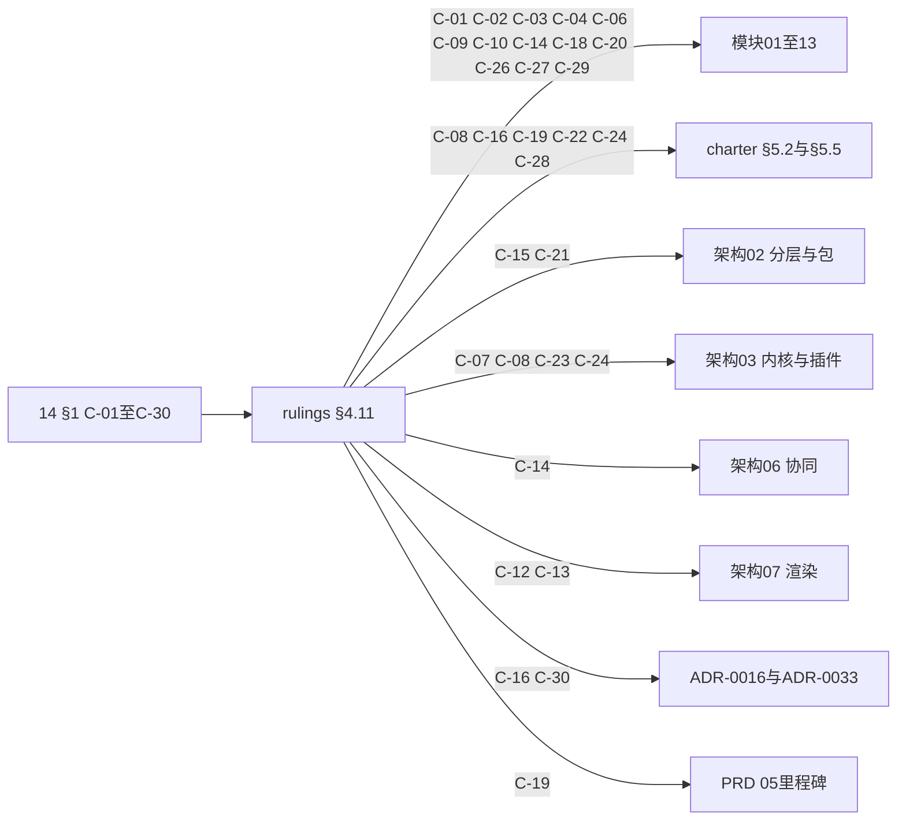
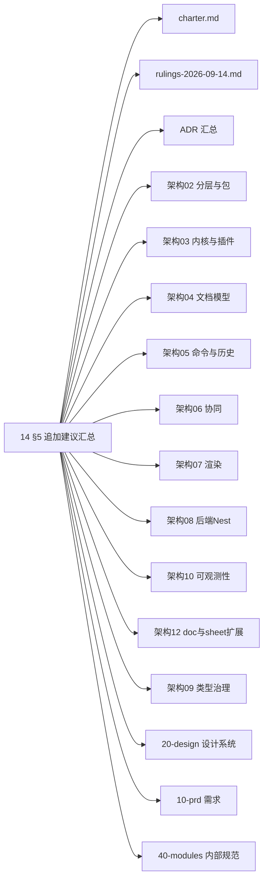

> 状态：评审 v0.2（§1 C-01…C-30 已由总编排全部采纳，落实记录见 rulings §4.11；模块 01–13 与上游文档已回写） | 负责：架构-模块（阶段三评审） | 更新：2026-09-19、2026-09-24（rulings §4.15 覆盖标注）、2026-09-24（rulings §4.16：M-04/G-7 行标已裁决）、2026-09-24（复核修正，rulings §4.17）（D3 覆盖标注）、2026-09-25（矛盾收口，rulings §4.18）（GV-11/GV-15/BE-08/BE-25/BE-28 覆盖标注） | 依赖：00–13

# 14 跨模块评审（阶段三）

## 0. 结论

十三份模块文档与总图在**分层、秩、铁律、DDD 五目录、测试布局**上高度一致，**无一处违反铁律 1–4**。问题集中在三处：章程 §5.5 与架构 03 §3.6 的**登记表严重落后于实现**（两份事件域名单互不一致，58 项新增命名未收编）；**UI / 装配 / 服务端运维三处交界的归属未定**（`view.setMode`、undo/redo、放映、查看器壳、装配运行时、`cordis-host/adapters`）；**六个模块文件数超出 00 §7 估计**。建议按 §1 三十条裁定 + §8 二十四条修订一次性收口。

| 指标 | 数 |
|---|---|
| 跨模块冲突 | **30**（§1 C-01…C-30） |
| 命名不一致 | **11**（§2 统计；另新增建议命名 **58** 项待收编） |
| 依赖违规 | **0 硬违规**；章程 §5.2「依赖上限」注解不符 **5**；规则缺口 **2** |
| 文件归属重叠 | **11**（§4.1 O-1…O-11） |
| 无归属缺口 | **22**（§4.2 N-1…N-22） |
| 追加建议总数 | **133**（模块 128 + 00 §8 五条），去重合并后 **96** 条（§5） |
| 未决总数 | **109**（模块 103 + 00 §10 六条），合并后 **97** 条：用户 16 · 总编排 52 · 模块/条线 41（§6） |
| 对 00-module-map 的修订 | **24**（§8 R-01…R-24） |

> **处置（2026-09-18 晚）**：§1 三十条推荐裁定全部采纳（rulings §4.11 C-01…C-30）；§8 二十四条已回写 00-module-map v0.2；模块文档 01–13 各自 §12 新增「2026-09-18 收敛」小节记录落实位置；上游回写：charter §5.2/§5.5、架构 03 §3.6、07 §11、02 §4.0.1、09-boundaries §2、ADR-0016/0033、PRD 05 M5 段，以及 02/04/05 号架构文档的 `Capability` 统一。§6.1 十六条用户级未决已于 2026-09-19 全部裁决（rulings §4.12 U-01…U-16）并回写。

## 1. 跨模块冲突清单

**裁定落地流向图**

怎么读：30 条冲突已全部经 rulings §4.11 采纳，边上的 C 编号是该目标文档需要回写的裁定条目（同一 C 可能出现在多条边上，因为一条裁定常常要回写不止一份文档）。

> 口径：只列**两份及以上文档对同一事实给出不同答案**的项；单文档内部待决项进 §6。「位置」一律 `文件:行`，摘录为原文。

| # | 议题 | 涉及模块与位置（文件:行） | 各方说法 | 推荐裁定（依据） | 需回写的文档 |
|---|---|---|---|---|---|
| C-01 | `view.setMode` Operation 归属 | `02-kernel-protocol-and-document-core.md:281`、`:203`、`:557`、`:837`；`03-slide-domain-model.md:216`；`10-ui-shell-and-slide-ui.md:957`（G-4）、`:980`（Q-2） | M-02 §2.6 内置命令表原文：「`view.setMode` \| `{ mode: string }` \| 默认 `['doc.read']`（Operation）… \| `command/builtin/view-operations.ts`」，并在 §2.4 由该文件发 `view/mode-changed`。M-03：「`view.setMode`（切普通/母版/演讲者视图）**定义在 `ui-core`**（文档类型盲）」。M-10 G-4：「同一 Operation 两个归属」，按 03 §3.6、05 §13.3、02 §4.18、rulings §4.6 归 ui-core | **归 ui-core**（`ui-core/application/operations/view-set-mode.ts`）。依据：03 §3.6 把 `viewMode` 定为 `ui-core/context-keys.ts` 的 `when` 上下文键，「上下文键由 `view.setMode`…等 Operation 更新」，键的写者与 Operation 应同包；四份文档对 ui-core、仅 M-02 对 model-core；headless 路径无视图模式概念，放 model-core 会让 `server-headless` 携带无用内置命令 | `40-modules/02` §2.4（删 `view/mode-changed` 行）、§2.6（删 `view.setMode` 行）、§4.5/§5.5（删 `command/builtin/view-operations.ts`）；`40-modules/00` 若已引用需同步 |
| C-02 | 撤销/重做命令 id 缺席 | `10-ui-shell-and-slide-ui.md:967`（G-14）、`:981`（Q-3）；`02-kernel-protocol-and-document-core.md:279-281`（内置命令表仅 3 条） | M-02 内置命令只有 `core.export`/`core.restoreVersion`/`view.setMode`，**无 undo/redo 可绑定 id**；M-10 自行在 ui-core 落 Operation `history.undo\|redo`，并建议 M-02 收编为 `core.undo\|redo` | **由 M-02 收编为 `core.undo\|redo` 两个内置 Operation**（`model-core/src/command/builtin/history-operations.ts`）。依据：charter D4「命令是唯一行为入口」；`history` 服务在 UnitScope 内属 model-core，撤销需走命令管线才能被 `command/audited` 审计与命令面板统一列举；ui-core 只应绑定 id、不应拥有历史语义 | `40-modules/02` §2.6 新增两行 + §4.5/§5.5 新增文件；`40-modules/10` 删 `history-operations.ts`、改绑 `core.undo\|redo` |
| C-03 | M-03 命令清单缺 14 条 UI 必需命令 | `10-ui-shell-and-slide-ui.md:966`（G-13）；`03-slide-domain-model.md:166-217`（§2.6 Command 清单） | M-10：「UI 需要但清单未列：`slide.pasteShapes`、`slide.setFontFamily`、`slide.toggleItalic/toggleUnderline/toggleStrikethrough`、`slide.setTextColor/setTextHighlight`、`slide.clearRunFormatting`、`slide.setIndentLevel`、`slide.setLineSpacing`、`slide.setEffect`、`slide.alignShapes/distributeShapes`、`slide.setSlideBackground`、`slide.setSlideHidden`、`slide.setLayoutProperties{showMasterSp}`、`slide.setMasterProperties{preserve}`、`slide.setNotes`（M3）」（14 条目 / 19 个 id）；M-03 §0 声明 `core.command` 55 个 | **M-03 §2.6 追加这 14 条目**（多数是既有 Mutation 的薄命令，不新增 Mutation）。依据：M-10 `ribbon-spec.test.ts` 断言「commandId ∈ 已注册命令」，缺失即 UI 控件永久 `disabled`；命令是唯一行为入口，UI 不得绕过 | `40-modules/03` §2.6 Command 表、§5 文件职责表（`text-commands.ts`/`shape-commands.ts`/`slide-commands.ts`/`layout-commands.ts`/`master-commands.ts` 各补行）、§0 命令计数 55→约 74 |
| C-04 | `SlideshowService` 存在但未 `provide` | `07-slide-rendering.md:173`、`:189`、`:196`、`:399`；`10-ui-shell-and-slide-ui.md:969`（G-16）、`:982`（Q-4） | M-07 §2.6 定义 `SlideshowService`（`application/services/slideshow.service.ts`），但 §3 `provide` 只有 `['thumbnails']`、Manifest `unitPlugins.provides:["thumbnails"]`；M-10：「`slide-ui` 无法经 `ctx.*` 访问」，自行在 `slide-ui/application/present.ts` 编排 | **删除 M-07 的 `slideshow.service.ts`，放映编排归 slide-ui**。依据：放映是 UI 行为（全屏、键盘翻页、黑屏/白屏），`slide-render` 只需响应 `ViewDescriptor.mode`；charter §5.5 服务名清单无 `slideshow`，新增服务名需修章程，成本高于把 3 个 DOM 动作搬进 slide-ui。`slide/show-changed` 事件改由 slide-ui 发 | `40-modules/07` §2.6/§4.1/§5.1（删 `slideshow.service.ts`）、§2.4（`slide/show-changed` 发布者改 slide-ui）、§0 事件行；`40-modules/10` 确认自编排 |
| C-05 | `ui.ribbonTab` / `ui.inspector` 贡献点是否新增 | `10-ui-shell-and-slide-ui.md:959`（G-6）；`30-architecture/03-kernel-and-plugin-model.md` §3.6 贡献点总表（十个 `ui.*`） | 总编排任务提示出现 `ui.ribbonTab`/`ui.inspector`；M-10 G-6：「二者不在 03 §3.6 / charter §5.5 的十个 `ui.*` 中…本文不新增 id：页签 = `ui.ribbon{kind:'tab'}`，检查器分区 = `ui.panel{slot:'inspector'}`」 | **维持 M-10 的映射，不新增贡献点 id**。依据：03 §3.6「判据：集合 → 贡献点；单例 → 服务」，页签与检查器分区都是 `ui.ribbon`/`ui.panel` 集合内的条目而非新集合；`slot` 为开放字符串（00 §6.3 第 3 点已内建参数化点），足以表达两者 | 无需回写（确认现状）；若总编排坚持独立 id，须先修订 03 §3.6 与 charter §5.5 后再回写 `40-modules/10` §2.6/§3/§4 |
| C-06 | 查看器壳与可选缩略图条/备注抽屉归属 | `10-ui-shell-and-slide-ui.md:973`（G-20）、`:989`（Q-11）；`11-preset-assembly-and-app-shell.md:967`（G-3）、`:990`（Q-4） | M-10 G-20：「本文放 ui-react 懒加载 chunk（不进 §4 文件表，M-11 `options.ts` 参数化）；请 M-11 在其 §4 列出 `ViewerThumbnailStrip.tsx` / `ViewerNotesSheet.tsx`」。M-11 G-3：「壳与可选条/抽屉全部在 `preset-slide-viewer/src/shell/**`（框架无关），**不**要求 M-10 追加…请 M-10 删除 §7 末段」 | **归 `preset-slide-viewer/src/shell/**`（M-11）**。依据：PRD OF-14 查看器体积 ≤ 350 KB gzip，ADR-0010 决策 5 与 PRD EM-01 形态 C 要求查看器壳框架无关、不引入 React 依赖树；放 ui-react 即使懒加载也把 React 拖进查看器基线。rulings §4.10 Q18「默认关、宿主选项开启、按需加载、不计入 350 KB 基线」与纯 CSS `[data-slot]` 实现相容 | `40-modules/10` §7 末段删除「查看器」一条并改为指向 `40-modules/11` §4.3；`40-modules/10` §12 G-20 标注已裁定 |
| C-07 | 装配运行时（`PresetEntry`/`mountEntries`…）无归属包 | `11-preset-assembly-and-app-shell.md:969`（G-5）、`:989`（Q-3）；`02-kernel-protocol-and-document-core.md` §4.2（`kernel` 树无 `preset/`）；`30-architecture/03-kernel-and-plugin-model.md` §9 | M-11：「`PresetEntry`/`LazyPresetEntry`/`PresetTrim`/`PresetReport`/`mountEntries` 是三预设共用的装配运行时，无归属包；本文暂放 `preset-slide-viewer/src/assembly/`…形成 L8 内定向依赖链 `viewer ← slide ← collab`」；建议 M-02 在 `kernel/src/preset/` 收编 | **收编进 `@cordexjs/kernel`（`kernel/src/preset/{entry,lazy,mount,report,validate}.ts`）**。依据：03 §9「preset 组合与 loader 的关系」本就写在 kernel 章节；放 L8 会制造同秩 bundle 之间的定向 import（需为此新造 depcruise 规则 `cordex-bundle-chain`），而 00 §1 规则 3 明确「纯装配包只有 `plugins.ts`/`options.ts`，不设任何 DDD 分层目录」；放 kernel 后 `preset-doc`/`preset-sheet` 零成本复用 | `40-modules/02` §4.2/§5.2/§6 新增 `preset/` 五文件；`40-modules/11` §4.3 删 `assembly/`、`./assembly` 子路径；`30-architecture/03` §9 补文件清单 |
| C-08 | 服务端修复事件名 `collab/repair` vs `collab-server/repair` | `09-server-collab-gateway-and-headless-host.md:19`、`:127`；`12-server-jobs-comments-and-ops.md:680`（G-25）、`:693`（Q-2）；`00-module-map.md` §3 BC-26 行；`05-collaboration-client.md:143`（客户端 `collab/repair`） | M-09 发布 `collab-server/repair`（与 `collab-server/room-opened\|room-closed\|update-rejected` 同前缀）；00 §3 BC-26 行写 `collab/repair`；M-05 的客户端 `collab/repair` 是**另一个**事件（客户端收到 `CONTROL.repair` 后自发） | **保留两个事件名，按 M-09 口径**：服务端 `collab-server/*`、客户端 `collab/*`，00 §3 BC-26 行回填为 `collab-server/repair`。依据：二者发布者、载荷、订阅者均不同（服务端 `{docId,reason,paths}` 给审计；客户端 `{unitId,…}` 给提示 UI），合并会丢失可分辨性。**但 `collab-server` 域必须先加入保留域名单**，否则扫描器 `event-domain-whitelist` 拒绝 | `40-modules/00` §3 BC-26 行；`00-charter/charter.md` §5.5 与 `30-architecture/03` §3.6 域名单补 `collab-server` （→ 2026-09-25 覆盖（§4.18 GV-15）：保留域名单的执行点正式名为 lint 规则 `cordex/events-must-be-declared` 规则 3（原称 `event-domain-whitelist`，名称对照见 09-type-discipline/08 §11.1）） |
| C-09 | `ThumbnailRenderer` 的对外导出形态 | `09-server-collab-gateway-and-headless-host.md:172-174`、`:541`、§6 API 面（未列）；`12-server-jobs-comments-and-ops.md:681`（G-26）、`:692`（Q-1）；`30-architecture/08-backend-nestjs.md` §2（`server-headless.renderThumbnails`） | M-09 定义接口并注「M-12 的 BullMQ 处理器是唯一调用方」，但 §6 对外 API 面不含它；08 号架构文档用符号名 `renderThumbnails`，与 `.render()/.renderPdf()` 形态不一致；M-12 §5.3 假设 `HeadlessHost` 有只读字段 `thumbnails` | **`HeadlessHost` 增只读字段 `thumbnails: ThumbnailRenderer`，M-09 §6 补导出；`renderThumbnails` 作废**。依据：M-12 是唯一调用方且已按此假设写 `headless-renderer.accessor.ts`；字段形式比工厂函数更易在 `CordisHostService.getService` 体系外直接取用；统一符号名可消除 08 号文档与 09 的分歧 | `40-modules/09` §6 API 面 + `interface/host/create-server-host.ts` 行；`30-architecture/08` §2 改名 |
| C-10 | `apps/server/src/cordis-host/adapters/*` 归属 | `09-server-collab-gateway-and-headless-host.md:305-317`（完整定义三文件）、`:728`（Q-6）；`12-server-jobs-comments-and-ops.md:11`、`:176`、`:678`（G-23）；`00-module-map.md` §3 BC-26 行、§7 M-12 行 | 00 §7 把 `cordis-host/adapters/*` 列入 **M-12** 覆盖目录；M-09 §4.3 完整定义 `pino-logger`/`otel-telemetry`/`errors-reporter` 三个 adapter 并裁定「物理归属本模块」；M-12 §3/§4 记录「本模块新增 **0 个文件**」 | **归 M-09**。依据：三个 adapter 实现的是 kernel L0 的 `logger`/`telemetry`/`errors` 服务，与 `preset-server` 装配同生命周期，而 `preset-server.ts` 已在 M-09 §4.3；M-12 已自行让位、不存在双写风险 | `40-modules/00` §7 M-12 行加注「`cordis-host/adapters`（引用，非新增，物理归属 M-09）」；§7 M-09 行「覆盖的包与目录」补 `apps/server/src/cordis-host`；§3 BC-26 行同步 |
| C-11 | `package.json#cordex.role` 两套枚举 | `00-module-map.md:918`（G-2）、`:962`（Q-M1）；`01-tooling-and-governance.md:651`（D-8）、§2.2；`10-ui-shell-and-slide-ui.md:910`（「`role` 七值按 G-2 折叠为 depcruise 三角色」） | 02 §4.0.1：7 值 `library\|plugin\|definition\|provider\|bundle\|app\|tooling`；09-boundaries §2：4 值 `definition\|provider\|consumer\|n/a`；M-01 §2.2 直接采用 4 值口径并引用折叠表 | **确认「同一物理字段、两级折叠」**：`package.json` 写 7 值，depcruise 读取时折叠为 4 值（`definition→definition`、`provider→provider`、其余`→consumer`，除非该包同时是某 Definition 的 Provider）。依据：00 §8 G-2 已给出折叠映射且 M-01/M-10 均已按此书写 | `30-architecture/09-type-discipline/03-boundaries.md` §2 补折叠表；`tooling/depcruise/package-metadata.ts` 实现口径（Q-M1 裁定为「是」） |
| C-12 | 「三处 LRU」的计数口径 | `06-layout-and-render-engine.md:726`（G-7）；`07-slide-rendering.md:686`（G-7）；`00-module-map.md` §7 M-06 行（「三处 LRU 必须有淘汰测试（A29）」）；`30-architecture/07-rendering.md` §11 | 架构 07 §11 的系统级「三处」= `StyleCache` + `MediaCache` + `LayerTemplateCache`（后者在 M-07）；M-06 把「三处」解读为模块内 `style-cache`+`media-cache`+`measure-cache`；两者相加实为 **4 处** | **系统级共 4 处缓存，模块级分别为 M-06 三处、M-07 一处**；00 §7 两行分别加注。依据：M-06 G-7 与 M-07 G-7 对此已达成一致，仅差 00 未回填 | `40-modules/00` §7 M-06 行加注「模块内三处，不含 M-07 的 `LayerTemplateCache`」、M-07 行加注「含 1 处模板 LRU」；`30-architecture/07` §11 改为「四处」并注明归属 |
| C-13 | 视图模式三套词汇 | `10-ui-shell-and-slide-ui.md:971`（G-18）、`:578`；`03-slide-domain-model.md:216`（`viewModes = ['normal','master','presenter']`）；`06-layout-and-render-engine.md`（`ViewDescriptor.mode`）；`07-slide-rendering.md:82`（`viewMode:'edit'\|'master'\|'thumbnail'\|'present'`） | M-03 `viewModes`：`normal\|master\|presenter`；M-06 `ViewDescriptor.mode`：`edit\|master\|thumbnail\|present`；M-06 `Viewport.mode`：`single\|continuous\|grid\|show`；M-10 在 `ui-core/domain/view-mode.ts` 固化映射 `normal→edit`、`presenter→present` | **接受「三层各有词汇 + 一张映射表」为正式契约，但把映射表上移到 `engine-render`**（`ViewDescriptor` 的定义包），而非 ui-core。依据：`doc-render`/`sheet-render`（M-13）同样需要该映射，放 ui-core 会让 headless 路径（无 ui-core）无法转换；三套词汇各有语义（文档类型合法模式 / 渲染描述 / 视口排布），强行统一会丢失区分 | `40-modules/06` §2.1/§2.2 新增 `mapViewMode()` 与映射表；`40-modules/10` §5 `domain/view-mode.ts` 改为 re-export；`30-architecture/07` §14.1 术语对齐表补三行 |
| C-14 | `TransactionOrigin` vs `Origin` | `05-collaboration-client.md:740`（G-6）；`02-kernel-protocol-and-document-core.md` §2.2；`30-architecture/06-collaboration.md` §2.2/§18.2 | 06 号架构文档：`TransactionMeta{origin: TransactionOrigin}` + 类层级命名（`LocalOrigin`/`RemoteOrigin`/`RepairOrigin`）；M-02：判别字面量 `Origin = local(clientId,via?) \| remote \| system(reason) \| replay`；M-05 采用 M-02 写法并「假定 06 §18.2 的增补请求已被接受」——但 M-02 §13 无对应回填 | **以 M-02 的 `Origin` 判别字面量为准，并由 M-02 正式接受 06 §18.2 的两项增补**：`system.reason ∈ {'repair','restore','maintenance'}`、`local.via ∈ {'undo','redo'}`。依据：`TransactionOrigin` 只出现在 06 号历史草稿；M-05 已按此写 `domain/session-state.ts`，不接受增补会使其表述落空 | `40-modules/02` §2.2 明确两个取值集合并在 §12 新增一条记录采纳；`30-architecture/06` §2.2/§18.2 改名 |
| C-15 | 能力位词汇 `Capability` vs `PermissionAction` vs `CapabilityBit` | `02-kernel-protocol-and-document-core.md:1177`（G-5）、`:58`、`:476`、`:751`；`08-server-identity-documents-and-storage.md:69`；`01-tooling-and-governance.md:58`、`:397`、`:450`、`:663`；`00-module-map.md:75` | M-02 G-5 裁定用 `Capability`（`doc.read/doc.comment/doc.write/doc.export/doc.manage/history.read/history.restore`），`PermissionAction` 降为别名；M-08 §1.3 明确跟随；**M-01 全篇仍用 `CapabilityBit`**（规则名 `capability-vocabulary-single-source`、扫描器 `scan-command-capabilities`、Q-06）；00 §2 BC-03 行仍列 `PermissionAction` | **统一为 `Capability`**，`CapabilityBit`/`PermissionAction` 均作废（后者可保留 `@deprecated` 别名一个版本）。依据：M-02 G-5 已给出裁定且 M-08 已落地；`Bit` 后缀在类型实为字面量联合时有误导 | `40-modules/01` §1.2/§5.4/§5.7/§13 Q-06 全部 `CapabilityBit`→`Capability`；`40-modules/00` §2 BC-03 行；`30-architecture/02` §4.3 |
| C-16 | 错误码：点式值 vs UPPER_SNAKE 常量 | `04-ooxml-format-and-pptx-codec.md:667`（G-4）；`13-doc-sheet-extension-skeleton.md:765`（G-1）、`:777`（Q2）；`02-kernel-protocol-and-document-core.md:270-277`；`03-slide-domain-model.md:275`、`:422`；`00-module-map.md:886` | charter §5.4：「错误码为点式（`format.no_document_type`）」；M-04 G-4 给出唯一明文解释「**TS 常量名 UPPER_SNAKE、错误码值点式**」并把 `ZIP_LIMIT_EXCEEDED` 的值对齐为 `format.limit_exceeded`；M-02/M-03 只出现 UPPER_SNAKE（`COMMAND_NOT_FOUND`/`LAYOUT_IN_USE`…）未给点式值；「移除全部 DocumentType 后打开」三处拼写不同：ADR-0016 `format/no-document-type`、00 §6.5 `UNIT_UNKNOWN_DOCUMENT_TYPE`、PRD 05 `format.no_document_type` | **采纳 M-04 G-4 的双口径解释为全仓通则**；「未知文档类型」唯一权威拼写 **`format.no_document_type`**（与 charter §5.4 原文逐字一致）。依据：charter §5.4 本就以该码为例；`format/no-document-type` 混用了事件名的 `/` 分隔符，`UNIT_UNKNOWN_DOCUMENT_TYPE` 是常量名不是码值 | `00-charter/charter.md` §5.5 补一句双口径通则；`40-modules/00` §6.5 改为 `format.no_document_type`；`30-architecture/adr/0016` 同步；`40-modules/02` §2.6/§4.5、`40-modules/03` §4/§5 为每个 UPPER_SNAKE 常量补点式值列 |
| C-17 | `epoch` 与 `permVersion` 是否联动 | `08-server-identity-documents-and-storage.md:669`（G-9）、`:729`（Q-4）；`09-server-collab-gateway-and-headless-host.md:726`（Q-4）；`30-architecture/adr/0029`（ticket claims 无 `epoch`） | M-08：`documents.epoch` 存在、`internal/admin.controller.ts` 有 `.../epoch` 强制操作，但 ADR-0029 的 ticket claims 不含 `epoch`；两模块均「暂不合并，各自独立演进」，M-09 只提供 `collabServer.forceEpoch()` | **维持不合并，但补一条显式语义**：`epoch` 递增 = 强制全体重连（踢出）；`permVersion` 递增 = 仅重算权限、不断连。两者由 `internal/admin.controller.ts` 分别触发，不自动联动。依据：两模块推荐默认一致，缺的只是「为什么不联动」的成文理由，写明后 M3 实现者不会再反复质疑 | `30-architecture/08-backend-nestjs.md` §16.x 补一段语义对照；`30-architecture/adr/0029` 补注「ticket 不携带 epoch，epoch 校验在 Room 侧」 |
| C-18 | `OoxmlIdMap` 是否提升到 `ooxml-core` | `04-ooxml-format-and-pptx-codec.md:669`（G-6）、`:677`（Q-2）；`13-doc-sheet-extension-skeleton.md:768`（G-4）、`:782`（Q7） | M-04：暂缓，留在 `ooxml-pptx/domain/ids/`，待 M-13 立项用「`ooxml-docx` 复制该文件是否零改动」实测决定，需要则走 ADR；M-13 §4.3 **已假定提升完成**并直接复用，同时承认「该提升截至本文档写作时尚未发生」 | **维持 M-04 的暂缓，M-13 §4.3 改为「临时各自复制一份」**（即 M-13 Q7 的推荐默认）。依据：M-04 的理由成立——只有一个垂直实例时无法验证「零改动复制」；M-13 的假定是超前引用，会让 M5 开工即阻塞在一个未立的 ADR 上 | `40-modules/13` §4.3/§4.4 改为各包临时复制 `ooxml-id-map.ts` 并标注待 ADR 收编；`40-modules/04` §8 保留「候选提升」标注 |
| C-19 | `preset-doc`/`preset-sheet` 是否带 `-skeleton` 后缀 | `13-doc-sheet-extension-skeleton.md:766`（G-2）、`:770`（G-6）、`:776`（Q1）；`00-module-map.md:920`（G-3）、`:963`（Q-M2）；PRD `05-milestones-and-scope.md` M5 P0 段 | 00 §8 G-3 建议 `@cordexjs/preset-doc`/`@cordexjs/preset-sheet`（与 `preset-slide` 对称）；PRD 05 M5 P0 写 `preset-doc-skeleton`/`preset-sheet-skeleton`；M-13 已「下游先用」无后缀名并请求提高 Q-M2 裁定优先级 | **不加后缀**，用 `package.json#cordex.stability:'experimental'` 信号未完工。依据：包名改名要改 `exports`/依赖/锁文件/发布记录，成本远高于一个字段；charter §5.2 已有 `stability` 字段正是为此设计 | `00-charter/charter.md` §5.1 L8 行 / §5.2 包清单正式收录两个包名（落实 Q-M2）；PRD `05-milestones-and-scope.md` M5 P0 段去掉 `-skeleton` |
| C-20 | `apps/web` 路由：path vs hash | `11-preset-assembly-and-app-shell.md:981`（G-17）、`:987`（Q-1）；设计 29/01/23/25/11（playground `#/…`） | 设计文档与 playground 全用 hash 路由 `#/home`；M-11 采用 path 路由 `/home` + SPA fallback，`/embed/:id` 额外支持 `#mode=` | **path 路由**（M-11 推荐默认）。依据：rulings §4.10 Q14/Q20 已把编辑器族当作真实应用栏处理，深链/分享/SEO/`?slide=` 语义都需要 path；playground 的 hash 是静态托管的产物，非产品约束。设计文档**不**回写（playground 事实照实描述） | `40-modules/11` §4/§9 保持；`apps/web/README.md` 说明与 playground 的对应关系（M-11 已计划） |
| C-21 | 主题切换属性三口径 | `10-ui-shell-and-slide-ui.md:962`（G-9）、`:979`（Q-1）；`30-architecture/02` §4.18、ADR-0017 决策 5（`data-cordex-theme`）；20-design 04 §3（`.dark` + 宿主 `<html data-theme>`） | playground 现状 `.dark` class；02 §4.18/ADR-0017 决策 5 用 `data-cordex-theme`；设计 04 §3 用 `.dark` + 宿主 `data-theme`；M-10 让 design CSS 三选择器等价、ui-core 同时写 `.dark` 与 `data-cordex-theme` | **三选择器长期等价（M-10 现状）**，但把它写成**明文契约**而非权宜：design `tokens.css` 必须同时支持 `.dark`、`[data-cordex-theme="dark"]`、`[data-theme="dark"]` 与 `prefers-color-scheme` 兜底。依据：`.dark` 是 shadcn 生态默认、`data-theme` 是宿主嵌入场景所需、`data-cordex-theme` 是 SDK 自有命名空间，三者服务不同调用方，收敛为一必然牺牲其中一类 | `20-design/04-design-system.md` §3 定稿三选择器契约；`30-architecture/02` §4.18 与 ADR-0017 决策 5 补「等价选择器」说明 |
| C-22 | `--cordex-*` token 前缀是否作废 | `10-ui-shell-and-slide-ui.md:954`（G-1）、`:963`（G-10）、`:930`（`theme-vars-contract`：`--cordex-*` 出现即失败）；`00-charter/charter.md` §5.2 `@cordexjs/design` 行（「CSS 变量 `--cordex-*`」）；`30-architecture/02` §4.17、ADR-0017 决策 3、`00-module-map.md` §3 BC-13 / §4.1 | 章程 §5.2 与四处架构/总图文档仍写 `--cordex-*`；M-10 依总编排裁定改为 shadcn 变量 + `--glass-*`/`--layer-*`/`--duration-*`/`--ease-*`/`--control-h-*`/`--text-2xs` 等裸名，并让扫描器把 `--cordex-*` 列为禁用前缀 | **采纳 M-10**，`--cordex-*` 记号作废。依据：设计系统已裁定复用 shadcn/ui（rulings §4.7），shadcn 变量本身无前缀，强加 `--cordex-` 会与 45 个复制件内部变量冲突 | `00-charter/charter.md` §5.2 `@cordexjs/design` 行；`30-architecture/02` §4.17；`30-architecture/adr/0017` 决策 3；`40-modules/00` §3 BC-13 与 §4.1 关系表；`20-design/04` §2.7–2.13 （→ 2026-09-25 覆盖（§4.18 GV-15）：`theme-vars-contract` 正式落为测试 `theme-vars-contract.test.ts`（TD-092），不是扫描器） |
| C-23 | `render.overlay` 项类型两种形状 | `10-ui-shell-and-slide-ui.md:965`（G-12）；`06-layout-and-render-engine.md` §2.5（`OverlayRenderer{id; zIndex; mount(ctx,target)}`）；`30-architecture/03-kernel-and-plugin-model.md` §3.6（`OverlayContribution{id; layer:'selection'\|'guides'\|'presence'\|'custom'; render(ctx)}`） | 03 §3.6 的贡献点总表与 M-06 的 Definition 给出不同字段集（`layer` 枚举 vs `zIndex` 数字；`render()` vs `mount()`）；M-07 与 M-10 均按 M-06 版本消费 | **以 M-06 的 `OverlayRenderer` 为准**，03 §3.6 回写。依据：M-06 是 `render.overlay` 的定义包；`mount/unmount` 生命周期是覆盖层持有 DOM 节点的必要形态，`render(ctx)` 单函数无法表达 dispose；`zIndex` 数字比四值 `layer` 枚举更利于第三方插入层间 | `30-architecture/03` §3.6 `render.overlay` 行改写为 `OverlayRenderer{id; zIndex; mount(ctx,target)}`（`conflict` 同时按 M-06 G-10 改为 `error`） |
| C-24 | 事件域白名单本身两份不一致，且多个在用域未登记 | `00-charter/charter.md` §5.5（保留域 15 个：`core render layout ui collab format unit store command permission i18n perf slide doc sheet`）；`30-architecture/03` §3.6（固定域 21 个：`kernel contribution unit command store history selection permission format render layout ui i18n collab presence plugin error perf slide doc sheet`）；`10-ui-shell-and-slide-ui.md:958`（G-5）；`02-kernel-protocol-and-document-core.md:202-203`；`09-…:19`；`11-…:139`；`13-…:71`、`:95` | 两份白名单互不包含（charter 有 `core` 而 03 无；03 有 `kernel/contribution/history/selection/presence/plugin/error` 而 charter 无）。实际在用但两份都没有的域：`view`（M-02/M-10）、`export`（M-02/M-04/M-11）、`collab-server`（M-09/M-12）、`app`（M-11，自认「不进入名单」）、`tenant`/`user`/`auth`/`document`/`share-link`/`media`（M-08，自认非 cordis 事件）、`comment`（M-11 §2.4 转发表） | **合并为一份白名单并一次性收编**：`core kernel contribution unit command store history selection permission format render layout ui i18n collab collab-server presence plugin error perf view export comment slide doc sheet`；`app` 单列为「应用壳私有域，禁止 `packages/*` 使用」；M-08 的六个记账名**改为不使用 `<域>/<动作>` 形式**（改用审计 `action` 点式串 `tenant.created` 等，08 §2.4 本就如此），以免与 cordis 事件混淆 | `00-charter/charter.md` §5.5；`30-architecture/03` §3.6 命名规则段；`40-modules/08` §2.4 表头改为「审计 action」；`40-modules/11` §2.4 `app/*` 保留但标注私有域 |
| C-25 | `render/frame` 与 `perf/frame` 并存 | `00-charter/rulings-2026-09-14.md` §5（「`render/frame` vs `perf/frame` → **`perf/frame`**」）；`06-layout-and-render-engine.md` §2.4（两者并列，`render/frame` 进程内、`perf/frame` 遥测）；`00-module-map.md:335`（BC-11 发布事件含 `render/frame`）；`11-…:135` | rulings §5 已定稿只留 `perf/frame`；M-06 保留 `render/frame` 作为进程内事件并由其派生 `perf/frame`；00 §3 BC-11 行照旧列 `render/frame` | **接受 M-06 的两层区分，但需 rulings 追认**：`render/frame` 为进程内 cordis 事件（帧统计，`≥50 ms` 合并后公开订阅），`perf/frame` 为 `telemetry` 注册的遥测事件，二者非同一物。依据：rulings §5 的原始分歧是「同一个事件叫什么名」，M-06 把它拆成了两个不同层的东西，理由（遥测采样 vs 业务订阅）成立 | `00-charter/rulings-2026-09-14.md` §5 该行补注「M-06 拆为两层，二者并存，非改名」；`30-architecture/10-observability-and-errors.md` §11 登记表同步 |
| C-26 | `runFormatCodecConformance` 被章程引用但无归属文件 | `00-charter/charter.md` §5.5（契约套件命名以其为例证）；`04-ooxml-format-and-pptx-codec.md:665`（G-2）、`:676`（Q-1）；`02-kernel-protocol-and-document-core.md` §4.5/§5.5/§6（均无该文件） | charter §5.5 以 `runFormatCodecConformance` 为命名约定的例证；M-02 的 `model-core` 目录树、文件职责表、API 面**均未列出**；M-04 §2.5/§9.2 已预先假设其存在 | **M-02 补 `model-core/src/testing/format-codec-conformance.ts`**；M-04 M1 允许用局部替身过渡（M-04 Q-1 推荐默认）。依据：`FormatCodec` 是 Definition，`core.format` 是贡献点，Provider（`ooxml-pptx`/未来 `ooxml-docx`）必须能跑同一套契约；缺它则 `provider-runs-conformance` 扫描器对 codec 类包失效 | `40-modules/02` §2.5/§4.5/§5.5/§6 新增该文件与导出 （→ 2026-09-25 覆盖（§4.18 GV-15）：`provider-runs-conformance` 正式名为 `scan-manifest` 规则 (e)） |
| C-27 | `RenderPageProtocol` 是跨进程契约却不在 `@cordexjs/protocol` | `11-preset-assembly-and-app-shell.md:971`（G-7）；`09-server-collab-gateway-and-headless-host.md:542`（`infrastructure/thumbnails/render-page-protocol.ts`）；`00-module-map.md` §4.2 第 1 条 | 00 §4.2 第 1 条：「`@cordexjs/protocol` 是浏览器 SDK 与 NestJS 服务端之间**唯一**允许跨进程传递的契约来源」；M-09 把 `RenderPageProtocol` 放在 `server-headless` 包内；M-11 的 `/render` 页需要同一契约，目前只能类型镜像 | **M-02 在 `protocol/src/render/page.ts` 新增 `RenderPageQuerySchema`/`RenderPageSignal`/`RenderStateResponse`**，M-09 与 M-11 均改为 import。依据：Node 进程 ↔ headless Chromium 页面是真实跨进程边界，类型镜像必然漂移；00 §4.2 第 1 条是铁律级表述 | `40-modules/02` §4.3/§5.3/§6 新增；`40-modules/09` §2.5/§5.3 改为 re-export；`40-modules/11` §4 `pages/render/` 改为 import |
| C-28 | `slide-ui` / `ui-core` / `engine-layout` / `slide-render` 实际依赖超出 charter §5.2「依赖上限」 | `10-ui-shell-and-slide-ui.md:457`（slide-ui deps）、`:340`（ui-core deps）；`06-layout-and-render-engine.md` §0（`engine-layout` = definition + plugin，必须 import kernel）；`07-slide-rendering.md:689`（G-9）；`00-charter/charter.md` §5.2 对应四行 | charter §5.2：`slide-ui` 上限 `slide-render, ui-react`，实际 deps 还有 `model-slide`/`engine-render`/`model-core`/`lucide-react`/`sonner`；`ui-core` 上限 `kernel, model-core, design(仅 token)`，实际还有 `i18n`/`shared`；`engine-layout` 上限 `shared`，但它 `provide=['layout']` 必须 import `kernel`；`slide-render` 上限未含 `engine-layout`（M-07 G-9 已指出） | **按实际用法更新 charter §5.2 的「依赖上限」列**（这些依赖在秩表与铁律 1/2/4 下全部合规，只是章程该列写得比实际紧）：`engine-layout`→`shared, kernel`；`ui-core`→`kernel, shared, model-core, i18n, design(仅 css + type-only)`；`slide-ui`→`ui-react, slide-render, model-slide, engine-render, model-core`；`slide-render`→`model-slide, engine-layout, engine-render, render-dom`。依据：铁律 3「rank(to) ≤ rank(from)」是硬规则，§5.2 的「依赖上限」列是人类可读注解，注解应向实现对齐而非相反 | `00-charter/charter.md` §5.2 四行；`30-architecture/09-type-discipline/03-boundaries.md`（depcruise 白名单，含 M-07 G-9 建议的 `cordex-slide-render-allowlist`） |
| C-29 | 模块文档 G/Q 编号体系分裂 | `02-…:1173`、`08-…:661`、`09-…:659`、`12-…:676`（全局连号）vs `03-…:709`、`05-…:727`（明示各自从 G-1）、`04`/`06`/`07`/`10`/`11`/`13`（各自从 G-1）；Q 编号四种写法：`Q-01`（M-01）、`Q-1`（M-02/04/06/07/08/09/10/11/12）、`Q1`（M-03/13）、`Q-05-1`（M-05） | M-02/M-08/M-09/M-12 组成一条全局链 G-5…G-31；其余八份各自从 G-1 起。结果：`G-5` 在 7 份文档中指向 7 件不同的事，`G-1` 在 8 份文档中指向 8 件不同的事 | **统一为模块前缀式 `M-xx/G-n` 与 `M-xx/Q-n`**（本评审 §5/§6 已按此引用）。依据：全局连号要求后写的模块知道先写模块的最大编号，跨批次并行时不可维持（事实上已断裂）；模块前缀式对并行写作友好且引用无歧义。**不要求回改各文档内部编号**，只要求在 §5/§6 与 `README.md` 索引中一律带模块前缀 | `40-modules/README.md`（本次新建，已按此）；`40-modules/_template.md` §12/§13 补一句编号规则 |
| C-30 | `collab-offline-idb` 是否兼任浏览器侧 `BlobStore` Provider | `05-collaboration-client.md:738`（G-4）、`:747`（Q-05-2）；`30-architecture/adr/0033`「后果」段；`00-charter/charter.md` §5.2 `collab-offline-idb` 行 | ADR-0033 末尾称该包「同时提供浏览器侧 `BlobStore` 的 IndexedDB Provider」；charter §5.2、00 §3 BC-09、M-05 §0/§3 均只写 `implements:['offlineStore']`；M-05 拒绝追加文件 | **不纳入**（M-05 Q-05-2 推荐默认）。依据：`OfflineStore` 与 `BlobStore` 是两个 Definition，混在一个 Provider 包会让「移除协同后本地媒体缓存也没了」；浏览器侧本就无持久 `BlobStore`（00 §5.1 明文：「媒体经 CRDT 只存 `BlobRef`，字节由服务端持有」）。ADR-0033 该句应删除 | `30-architecture/adr/0033`「后果」段删除该句；`40-modules/05` §12 G-4 标注已裁定 |

## 2. 命名一致性核对

> 基准：`00-charter/charter.md` §5.5（服务名 / 事件名 / 贡献点 id / 契约套件 / 第三方前缀）与 `30-architecture/03-kernel-and-plugin-model.md` §3.6（贡献点总表 + 域名单）。关系列取值：**一致** · **新增建议**（各模块提出、基准未登记）· **冲突**（两份及以上文档给出不同名）。

### 2.1 服务名（`ctx.<name>`）

charter §5.5 登记：全局 `units documentTypes commands formats resources migrations permissions collab collabTransport layout ui shortcuts i18n theme errors telemetry logger`；UnitScope `store history selection render presence`；服务端 `collabServer blobStore`；垂直束 `slides`。

| 名称 | 出现的模块（文件:行） | 关系 | 处置建议 |
|---|---|---|---|
| `units` / `documentTypes` / `commands` / `formats` / `resources` / `migrations` / `permissions` | M-02（`02-…:16`） | 一致 | — |
| `store` / `history` / `selection` | M-02（`02-…:16`，UnitScope） | 一致 | — |
| `errors` / `telemetry` / `logger` | M-02（`02-…:16`） | 一致 | — |
| `i18n` | M-02（`02-…:16`） | 一致 | — |
| `collab` / `collabTransport` / `presence` | M-05（`05-…:16`） | 一致 | — |
| `layout` / `render` | M-06（`06-…:16`） | 一致 | — |
| `ui` / `shortcuts` / `theme` | M-10（`10-…:16`） | 一致 | — |
| `collabServer` | M-09（`09-…:16`） | 一致 | — |
| `blobStore` | M-08（`08-…:16`） | 一致 | — |
| `slides` | M-03（`03-…:16`） | 一致 | — |
| **`contributions`** | M-02（`02-…:16`，kernel） | 新增建议 | charter §5.5 全局服务名清单遗漏；`ctx.contributions` 是贡献点机制的核心查询面，**必须补入** |
| **`yjsBackend`** | M-02（`02-…:245`，store-yjs，`provide:['store','yjsBackend']`） | 新增建议 | UnitScope 内；00 §4.2 第 3 条已把它定为「受控访问面」，补入 UnitScope 服务名清单 |
| **`offlineStore`** | M-05（`05-…:16`，「Unit 内可选」） | 新增建议 | charter §5.5 把 `OfflineStore` 当接口而非服务名；补入 UnitScope 可选服务名 |
| **`thumbnails`** | M-07（`07-…:16`、`:189`、`:196`） | 新增建议 | UnitScope 内的垂直束服务；与 `slides` 并列补入「垂直束」一栏 |
| **`uiRenderer`** | M-10（`10-…:16`，ui-react `implements:['uiRenderer']`） | 新增建议 | L7 Definition/Provider 座；补入全局服务名 |
| **`slideshow`** | M-10 Q-4（`10-…:982`）提出的备选 | 冲突 → 已裁 | 按 §1 C-04 **不新增**（放映归 slide-ui 自编排） |
| **`docs` / `sheets`** | M-13（`13-…:16`，M5 未来） | 新增建议 | 与 `slides` 对称，M5 落地时随 `preset-doc`/`preset-sheet` 一并收录 |

### 2.2 贡献点 id

03 §3.6 总表 26 个 id。核对结果：**十三份模块文档没有新造任何贡献点 id**，全部落在总表内。

| id | 定义方（模块:行） | 贡献方 | 关系 |
|---|---|---|---|
| `core.documentType` / `core.command` / `core.mutation` / `core.format` / `core.resource` / `core.migration` / `core.permissionPolicy` | M-02 定义（`02-…:18`） | M-03（`03-…:18`）、M-04（`04-…:18`，`core.format`）、M-11（`11-…:18`，`core.permissionPolicy` + `core.command`）、M-13 | 一致 |
| `errors.sink` / `telemetry.sink` | M-02 定义 | — | 一致 |
| `i18n.bundle` | M-02 定义（i18n 包） | M-10、M-11 | 一致 |
| `layout.measurer` | M-06 定义（`06-…:18`） | M-06（`canvas`）、M-09（`node-font`，`09-…:18`） | 一致 |
| `render.scene` / `render.target` / `render.element` / `render.overlay` | M-06 定义（`06-…:18`） | M-07（`07-…:18`：`render.scene('slide')`、`render.element` ×10、`render.overlay('master-inheritance')`）、M-06 `render-dom` | 一致（`render.overlay` 的**项类型**有冲突，见 §1 C-23） |
| `ui.ribbon` / `ui.toolbar` / `ui.panel` / `ui.contextMenu` / `ui.statusBar` / `ui.dialog` / `ui.notification` / `ui.shortcut` / `ui.command` / `ui.theme` | M-10 定义（`10-…:18`，明写「十个，03 §3.6 / charter §5.5 原名，**不新增 id**」） | M-10 `slide-ui` 贡献其中八个、M-11 胶水插件贡献 `ui.contextMenu`/`ui.shortcut` | 一致 |
| `slide.shapeKind` | M-03 定义（`03-…:18`） | M-03 | 一致 |
| ~~`ui.ribbonTab`~~ / ~~`ui.inspector`~~ | 仅见总编排提示 | — | 冲突 → 已裁：**不新增**（§1 C-05） |
| ~~`render.textInputHost`~~ | M-06 G-5（`06-…:724`）条件性提议 | — | 新增建议（条件）：仅当 R-M2-1 spike 判定隐藏 textarea 方案不可行才升级；M0–M2 不登记 |

**贡献点 `conflict` 字段缺口**：03 §3.6 未给 `render.scene`/`render.target`/`render.element`/`render.overlay` 标 `conflict`；M-06 G-10（`06-…:729`）/Q-6（`:740`）建议统一为 `'error'`。→ 采纳，回写 03 §3.6。

### 2.3 事件名（`<域>/<动作>`）

**先决问题**：两份基准的域名单互不一致（§1 C-24）。下表按「基准合并集」核对。

| 事件 | 来源模块（文件:行） | 关系 | 处置建议 |
|---|---|---|---|
| `unit/opened` `unit/open-progress` `unit/open-failed` `unit/closed` `unit/dirty-changed` `unit/saved` `unit/migrated` | M-02（`02-…:186-193`） | 一致（`unit` 在两份名单内） | charter §5.5 只举 `unit/opened`；建议全表移入 03 §3.6 统一登记 |
| `command/execute`(waterfall) `command/executed` `command/rejected` `command/failed` `command/audited` | M-02（`02-…:194-198`） | 一致 | charter §5.5 只举 `unit/opened`；建议全表移入 03 §3.6 统一登记 |
| `store/transaction` `store/loaded` | M-02（`02-…:199-200`） | 一致 | — |
| `history/changed` | M-02（`02-…:201`） | 一致（03 名单有 `history`，charter 无） | charter §5.5 域清单补 `history` |
| `selection/changed` | M-02（`02-…:201`） | 一致（同上） | charter §5.5 补 `selection` |
| `permission/changed` `permission/denied` | M-02（`02-…:202`）；M-05 明确**不**发（`05-…:145`） | 一致 | rulings §5 已定 `permission/changed`（弃 `collab/permission-changed`），M-05 已遵守 |
| `plugin/loaded` `plugin/failed` `plugin/incompatible` | M-02（`02-…:177-179`） | 一致（03 有 `plugin`，charter 无） | charter §5.5 补 `plugin` |
| `error/raised` | M-02（`02-…:180`） | 一致（03 有 `error`，charter 无） | charter §5.5 补 `error` |
| `contribution/changed` | M-02（`02-…:181`） | 一致（03 有，charter 无） | charter §5.5 补 `contribution` |
| `kernel/manifest-mismatch` | M-02（`02-…:182`） | 一致（03 有 `kernel`，charter 无） | charter §5.5 补 `kernel` |
| `i18n/locale-changed` | M-02（`02-…:183`） | 一致 | — |
| **`export/started` `export/completed` `export/failed`** | M-02（`02-…:202`）、M-04（`04-…:165`）、M-11（`11-…:137`） | **新增建议（域未登记）** | 补 `export` 入保留域；或改 `format/export-started` 等（不推荐，语义变窄） |
| **`view/mode-changed`** | M-02（`02-…:203`）、M-10（`10-…:2.4`）、M-11（`11-…:134`） | **新增建议（域未登记）**；且归属有冲突（§1 C-01） | 补 `view` 入保留域（M-10 G-5 首选）；备选改名 `ui/view-mode-changed` |
| **`view/page-changed` `view/zoom-changed`** | PRD EM-05 要求；M-11 G-9（`11-…:973`）指出 **M-06/M-07/M-10 均无发布者** | **缺口** | 由 M-06 在 `engine-render.contribution.ts` 声明并在 `render.setView`/Viewport 变化时 emit |
| `layout/measurer-changed` | M-06（`06-…:2.4`） | 新增建议（域已登记，事件未登记） | 收编入 03 §3.6 事件总表 |
| `render/first-paint` `render/element-failed` `render/element-degraded` `render/font-fallback` `render/page-mounted` `render/page-unmounted` | M-06（`06-…:2.4`）、M-07（`07-…:132`）；00 §3 BC-11（`00-…:335`）已列 | 一致 / 新增建议 | charter §5.5 只举 `render/element-failed`，其余五个补登 |
| `render/frame` + `perf/frame` | M-06（`06-…:2.4`）；rulings §5 定稿只留 `perf/frame` | **冲突 → 已裁**（§1 C-25：两层并存） | rulings §5 该行补注 |
| ~~`render/painted`~~ | M-06 §2.4 注「已弃用」 | 作废 | 确认删除 |
| `slide/slide-added` `slide/slide-removed` `slide/shape-added` `slide/shape-removed` `slide/shape-changed` | M-03（`03-…:137-141`） | 一致（00 §3 BC-06 与 charter §5.5 已登记 5 个） | — |
| **`slide/layout-added` `slide/layout-removed` `slide/master-added` `slide/master-removed` `slide/theme-changed`** | M-03 §2.4（`03-…:142-146`）、G-6（`:715`）、Q4（`:727`） | **新增建议** | 采纳（ML-01…ML-04 母版视图需要细粒度订阅）；否则 slide-ui 只能自行 diff `store/transaction` |
| **`slide/thumbnail-updated` `slide/show-changed`** | M-07（`07-…:130-131`） | **新增建议** | 采纳；`slide/show-changed` 的发布者随 §1 C-04 改为 slide-ui |
| `collab/state-changed` `collab/synced` `collab/soft-conflict` `collab/auth-failed` `collab/reconnect` `collab/update-rejected` `collab/repair` | M-05（`05-…:134-143`） | 一致（00 §3 BC-09 已登记） | charter §5.5 只举 `collab/synced`，其余补登 |
| **`collab/backpressure` `collab/latency`** | M-05 §2.4「新增建议」表、G-3（`05-…:737`） | **新增建议** | 采纳（PRD CO-13 诊断面板明确需要；06 §3.1 已定义背压阈值） |
| `presence/joined` `presence/left` `presence/changed` | M-05（`05-…:144-146`） | 一致（03 有 `presence`，charter 无） | charter §5.5 补 `presence` |
| **`collab-server/room-opened` `collab-server/room-closed` `collab-server/update-rejected` `collab-server/repair`** | M-09（`09-…:19`、`:124-127`）、M-12（`12-…:2.4`） | **新增建议（域未登记）**；且 00 §3 BC-26 行写作 `collab/repair`（§1 C-08） | 补 `collab-server` 入保留域；00 §3 BC-26 回填 |
| **`doc/block-added` `doc/block-removed` `doc/text-changed` `sheet/cell-changed` `sheet/row-inserted` `sheet/sheet-added`** | M-13（`13-…:71`、`:95`）、Q6（`:781`） | **新增建议**（`doc`/`sheet` 域已登记，事件未登记） | 采纳（M5 生效） |
| **`app/navigated` `app/session-changed` `app/online-changed` `app/document-opened` `app/document-closed` `app/preferences-changed` `app/intent`** | M-11 §2.4（`11-…:139`），自称「不进入 charter §5.5、不经扫描器」 | **新增建议（应用私有域）** | charter §5.5 登记 `app` 为「应用壳私有域，`packages/*` 禁用」，使扫描器有据可依 |
| `tenant/created` `tenant/quota-changed` `user/provisioned` `auth/login-succeeded` `auth/login-failed` `auth/collab-ticket-issued` `document/created\|renamed\|trashed\|restored\|locked\|unlocked` `share-link/created\|revoked` `media/uploaded\|deduplicated` | M-08 §2.4（`08-…:2.4`），自称「**不**经 `ctx.emit`/`Events`」 | **命名形式冲突** | 改为审计 `action` 点式串（`tenant.created` 等，08 §2.4 表头本就如此），**不要**用 `<域>/<动作>` 形式书写，以免读者误判为 cordis 事件域缺口 （→ 2026-09-24 rulings §4.15 覆盖：T-0 单组织去租户，`tenant/created`、`tenant/quota-changed` 两条删除；`user/provisioned` 载荷去 `tenantId`（Q6 首次登录 JIT 建号）） |
| `comment/*` | M-11 §2.4 转发表（`11-…:138`） | 新增建议（域未登记） | 由客户端 comments 插件（第三方/M4）发；charter §5.5 补 `comment` 或按 D15 走 `<vendor>:` 前缀 |

### 2.4 命令 / Mutation / Operation id

| id 形态 | 来源 | 关系 | 处置建议 |
|---|---|---|---|
| `core.export` / `core.restoreVersion` | M-02 §2.6（`02-…:279-280`） | 一致 | — |
| `view.setMode` | M-02（`02-…:281`）/ M-10（`10-…:2.6`）；03 §3.6 正文已引用该 id | 一致（id 无争议）；**归属**有冲突（§1 C-01） | id 保留，文件归 ui-core |
| **`core.undo` / `core.redo`** vs `history.undo` / `history.redo` | M-10 G-14（`10-…:967`）、Q-3（`:981`） | **冲突 → 推荐 `core.undo\|redo`**（§1 C-02） | M-02 §2.6 新增 |
| `slide.<verb>`（两段） | M-03 §2.6 Command 表（55 个） | 一致 | — |
| `slide.table.<verb>`（三段） | M-03（`03-…:203`） | 新增形态 | 与两段式并存；建议 09-type-discipline 的 `command-id-format` 规则明确允许 `<域>.<子域>.<动词>` （→ 2026-09-25 覆盖（§4.18 GV-15）：`command-id-format` 正式名为 `scan-command-capabilities` 规则 (c)） |
| **`slide.slide.insert` 等三段式 Mutation** vs **`shape.insert` / `text.applyDelta` / `table.insertRow` / `media.add` / `layout.insert` / `master.insert` / `theme.insert` 等两段式** | M-03 §2.6 Mutation 表（`03-…:168-176`）：表头声明「type id 为三段式 `slide.<entity>.<verb>`」，但表体七个文件用的是两段式 | **冲突（同一表内部）** | **全部补 `slide.` 前缀**（`slide.shape.insert`、`slide.text.applyDelta`…）。依据：`shape`/`text`/`table`/`media`/`layout`/`master`/`theme` 都不是保留域，两段式会与未来第三方 `<vendor>:` 规则及 doc/sheet 的同名概念冲突 |
| `slide.selectMasterOrLayout`（Operation） | M-03（`03-…:216`）；03 §3.6 正文已引用 | 一致 | — |
| `ui.openPanel`（Operation） | M-10 §10（`10-…:926`） | 新增建议 | 登记（`ui` 为保留域） |
| **`shell.intent`（Operation）** | M-11（`11-…:18`、G-6 `:970`） | **新增建议** | charter §5.5 登记 Operation id 前缀 `shell.*` 归 L8 preset 专用 |
| `collabServer.forceEpoch()` | M-09 Q-4（`09-…:726`） | 服务方法（非命令 id） | 无需登记 |

### 2.5 契约套件（`run<Definition>Conformance`）

| 套件名 | 归属文件（模块:行） | 关系 | 处置建议 |
|---|---|---|---|
| `runDocumentStoreConformance` | M-02 `model-core/src/testing/document-store-conformance.ts`（`02-…:229`） | 一致（charter §5.5 例证之一） | — |
| `runFormatCodecConformance` | **无归属**（charter §5.5 例证之二；M-04 G-2/`04-…:665`、Q-1/`:676`） | **缺口** | M-02 补 `model-core/src/testing/format-codec-conformance.ts`（§1 C-26、§4.2） |
| `runTextMeasurerConformance` / `runSceneProviderConformance` / `runRenderTargetConformance` | M-06（`06-…:36`、`:155`、`:168`） | 新增建议 | 采纳（对应三个真 Definition） |
| ~~`runElementRendererConformance`~~ | M-06 G-8（`06-…:727`）判定不落地 | 作废（条件保留） | 若 M-07 发现共性再补 |
| `runCollabTransportConformance` / `runOfflineStoreConformance` | M-05 G-5（`05-…:739`）、`:211-212` | 新增建议（取代 06 §3.2 的 `runCollabConformance`） | 采纳；`runCollabConformance`（`05-…:210` 提及）作废 |
| `runBlobStoreConformance` | M-08 G-8（`08-…:668`）、`:168` | 新增建议（全仓第一个 `BlobStore` 套件） | 采纳；建议 M-02 的 `MemoryBlobStore` 也跑其「基础三方法子集」 |
| `runUpdateStoreConformance` / `runSnapshotStoreConformance` / `runCollabServerConformance` | M-09（`09-…:143`、`:164`） | 新增建议 | 采纳 |
| `runUiRendererConformance` | M-10（`10-…:161`） | 新增建议 | 采纳 |
| `runSlideModelConformance`（及 M-13 的 `runDocModelConformance` / `runSheetModelConformance`） | M-03 G-4（`03-…:713`）、`:157`；M-13 | **命名例外** | `DocumentType` 是贡献点条目不是 Definition，`run<Definition>Conformance` 约定不适用。建议 charter §5.5 补一条平行约定 **`run<DocType>ModelConformance`**，使 M-13 有明文可依 |

### 2.6 第三方前缀与词汇

| 项 | 状态 | 处置 |
|---|---|---|
| `<vendor>:<域>/<动作>` / `<vendor>:<域>.<名>` / `<vendor>:<域>.<action>` | 十三份模块文档**均未声明任何第三方插件**，规则未被实际检验 | 无差异；扫描器 `event-domain-whitelist` 的前缀分支在 M0 无测试数据，建议 M-01 用假包做负向测试 （→ 2026-09-25 覆盖（§4.18 GV-15）：前缀分支的执行点为 lint 规则 `cordex/events-must-be-declared` 规则 3（原称 `event-domain-whitelist`，名称对照见 09-type-discipline/08 §11.1）） |
| `Capability` / `CapabilityBit` / `PermissionAction` | 三词并存（§1 C-15） | 统一为 `Capability` |
| `Origin` / `TransactionOrigin` | 两词并存（§1 C-14） | 统一为 `Origin` |
| `TextLayout` / `LayoutResult`、`TextMeasurer` / `Measurer` | M-06 G-3（`06-…:722`）已统一为前者 | 回写 `30-architecture/07` §14.1 |
| `createHeadlessHost` / `createHost` / `create-server-host.ts` | M-09 G-17（`09-…:661`）：文件名遵 08 §3.1、导出名用 `createHeadlessHost` | 回写 `30-architecture/02` §4.24 与 `08` §3.1 |
| `--cordex-*` CSS 变量前缀 | 已作废（§1 C-22） | 回写 charter §5.2 等五处 |
| `SceneNode.id === ShapeId` | M-07 G-3（`07-…:682`）/Q-4（`:698`）新增约定 | 采纳并登记入 charter §5.5 的 `Scene`/`SceneNode` 术语条目 |
| `ZoomFactor` / `HitTestIndex` | M-06 G-9（`06-…:728`）新增类型名 | 采纳 |

**统计**：命名不一致（冲突）**11** 项（C-01 归属、C-05、C-08、C-13、C-14、C-15、C-16、C-22、C-23、C-24、C-25 + §2.4 Mutation 两段/三段式）；**新增建议**共 **58** 项（服务名 6 · 事件 34 · 命令/Operation id 4 · 契约套件 11 · 类型/约定 3），全部需要 charter §5.5 与 03 §3.6 一次性收编。

## 3. 依赖方向核对

> 秩表（charter §5.1）：L0=0、L1=10、V-model=15、L3=30、V-codec=35、L4=40、L5=50、V-render=55、LS=58、L7=70、V-ui=75、L8=80。铁律 1 文档类型盲 · 2 束间隔离 · 3 只向下 · 4 同构类（node ✗→ dom；iso 只 → iso）。

| 模块 | 包 / 目录 | 文档声明的实际依赖（出处） | 秩 · 同构类 | 铁律 1–4 | charter §5.2「依赖上限」 | 说明 |
|---|---|---|---|---|---|---|
| M-01 | `tooling/*` | 无（不参与依赖图，`01-…:16`） | — · node | 不适用 | — | 治理对象非运行时依赖，`01-…:11` 明写「不参与 `cordex.layer` 秩体系」 |
| M-02 | `@cordexjs/shared` | 零依赖（charter §5.2 + R11 `shared-has-no-deps`） | 0 · iso | ✅ | ✅ | — |
| M-02 | `@cordexjs/kernel` | `shared` | 0 · iso | ✅ | ✅ | 唯一 import `cordis`（R12） |
| M-02 | `@cordexjs/protocol` | `shared` | 0 · iso | ✅ | ✅ | `zod` 单点（R5） |
| M-02 | `@cordexjs/i18n` | `kernel` | 0 · iso | ✅ | ✅ | — |
| M-02 | `@cordexjs/model-core` | `kernel, shared, protocol` | 10 · iso | ✅ | ✅ | `drawing/` 为共享内核；无垂直束 import |
| M-02 | `@cordexjs/store-memory` / `store-yjs` | `model-core`（+ `yjs` 单点） | 10 · iso | ✅ | ✅ | 两 Provider 互不 import（R7）；`yjsBackend` 不外泄 `Y.*`（api-extractor 正则） |
| M-03 | `@cordexjs/model-slide` | `@cordexjs/kernel`/`@cordexjs/shared`/`@cordexjs/model-core`（`03-…:14`） | 15 · iso · `bundle=slide` | ✅ | ⚠️ **超出**（§5.2 只写 `model-core`） | kernel/shared 秩 0，铁律 3 合规；章程注解需补（§1 C-28） |
| M-04 | `@cordexjs/ooxml-core` | `shared, model-core`（类型） | 30 · iso | ✅ | ✅ | 无 `slide` 字面量（ACL 单向，00 §4.2 第 2 条） |
| M-04 | `@cordexjs/ooxml-pptx` | `ooxml-core, model-slide` | 35 · iso · `bundle=slide` | ✅ | ✅ | — |
| M-05 | `@cordexjs/collab-core` | `model-core, protocol`（`05-…:14`） | 40 · iso | ✅ | ✅ | — |
| M-05 | `@cordexjs/collab-yjs` | `collab-core, store-yjs`（经 `yjsBackend` 服务面） | 40 · iso | ✅ | ✅ | 00 §4.2 第 3 条：不直接触碰 `Y.*` |
| M-05 | `@cordexjs/collab-transport-ws` | `collab-core` | 40 · iso | ✅ | ✅ | — |
| M-05 | `@cordexjs/collab-offline-idb` | `collab-core` | 40 · **dom** | ✅ | ✅ | R16：不得被 iso/node 包依赖；ADR-0033 的 `BlobStore` 兼职已驳回（§1 C-30） |
| M-06 | `@cordexjs/engine-layout` | `@cordexjs/kernel`（因 `provide=['layout']`，`06-…:12`）+ `shared` | 50 · iso | ✅ | ⚠️ **超出**（§5.2 只写 `shared`） | 一个 cordis `Service` 包不可能不 import kernel；章程注解需补（§1 C-28） |
| M-06 | `@cordexjs/engine-render` | `@cordexjs/kernel`/`@cordexjs/engine-layout`/`@cordexjs/shared`（`06-…:670` 明列 `dependencies`） | 50 · iso | ✅ **R15 `engine-no-model` 满足** | ✅ | 对 `model-*` 零依赖已有专门规则与文件级证据 |
| M-06 | `@cordexjs/render-dom` | `engine-render, engine-layout` | 50 · **dom** | ✅ | ✅ | 铁律 4 由 R16 拦截 node 侧引用 |
| M-07 | `@cordexjs/slide-render` | `model-slide, engine-render, render-dom, engine-layout`（`07-…:14`） | 55 · dom · `bundle=slide` | ✅ | ⚠️ **超出**（§5.2 未含 `engine-layout`，M-07 G-9 已指出） | 建议新增 depcruise `cordex-slide-render-allowlist`（M-07 G-9） |
| M-07 | `@cordexjs/slide-render-chart` | `slide-render` | 55 · dom · `bundle=slide` | ✅ | ✅ | `conflict:'replace'` 覆盖占位渲染器 |
| M-08 | `@cordexjs/server-storage` | `shared`（+ S3 SDK 单点） | 58 · **node** | ✅ | ✅ | 唯一允许 import S3 SDK 的 server 包 |
| M-08 | `apps/server/src/modules/{auth,…,media}` | `@cordexjs/protocol`（DTO/错误码/`Capability`）+ `model-core` 仅类型（`08-…:14`） | 80 · node | ✅ | ✅ | `server-app-thin`：不得 import `yjs`/`@cordexjs/model-*`/`@cordexjs/ooxml-*` 运行时 （→ 2026-09-24 rulings §4.15 覆盖：T-0/Q6：M-08 Nest 模块集删去 `tenants`，`groups` 随 U-11 推迟移出 M3，余 `{auth,users,documents,permissions,share-links,storage,media}`） |
| M-09 | `@cordexjs/server-collab` | `yjs y-protocols lib0 @cordexjs/collab-core @cordexjs/store-yjs @cordexjs/model-core @cordexjs/protocol @cordexjs/kernel`（`09-…:324` 逐字） | 58 · **node** | ✅ | ✅ | **与 charter §5.2（`collab-core, store-yjs, protocol`）相容**；`kernel`/`model-core` 秩 0/10 合规。⚠️ 但 M-05 §0（`05-…:15`）称 `collab-core` 「**仅浏览器**」，与服务端 import 它相矛盾——应改为「`collab-core` 为 iso 且两端共用；`collab-yjs`/`transport-ws`/`offline-idb` 仅浏览器」 （→ 2026-09-24 rulings §4.15 覆盖：Q3：Yjs 锁 13.6.x 精确版本；charter §5.3 规则 4 为 Yjs 14 预留 `@y/y`、`@y/protocols`、`lib0` v1，本依赖清单随 `server-app-thin` 规则同步） |
| M-09 | `@cordexjs/server-headless` | `kernel, model-*, ooxml-*, engine-layout, engine-render`（`09-…:§10`） | 58 · **node** | ✅ **R16 满足**：`09-…:§10` 明写「**禁止** `import render-dom`」 | ⚠️ 轻微超出（§5.2 未列 `engine-render`） | LS=58 > L5=50，铁律 3 合规；铁律 4 由 R16 拦截 dom |
| M-09 | `apps/server/src/{modules/{collab,snapshots},cordis-host}` | Nest DI + `@cordexjs/protocol` | 80 · node | ✅ | ✅ | `cordis-host/adapters/*` 归属见 §1 C-10 |
| M-10 | `@cordexjs/design` | 零依赖（R18 `design-css-only`，`10-…:§10`） | 70 · **dom** | ✅ | ✅ | `dependencies` 为空、`src/**` 无运行时 import |
| M-10 | `@cordexjs/ui-core` | `@cordexjs/kernel`、`@cordexjs/shared`、`@cordexjs/i18n`、`@cordexjs/model-core`、`@cordexjs/design`（仅 css + type-only）（`10-…:340` 逐字） | 70 · dom | ✅ **R14 满足**（禁 react/radix/tailwind 等 15 个） | ⚠️ **超出**（§5.2 只写 `kernel, model-core, design(仅 token)`；实际含 `i18n`、`shared`） | 秩 0/10，铁律 3 合规；章程注解需补 |
| M-10 | `@cordexjs/ui-react` | `ui-core, design` + react/radix/shadcn 复制件 | 70 · dom | ✅ | ✅ | R5 第三方单点、R17 复制件私有 |
| M-10 | `@cordexjs/slide-ui` | `@cordexjs/ui-react`、`@cordexjs/slide-render`、`@cordexjs/model-slide`、`@cordexjs/engine-render`、`@cordexjs/model-core`、`lucide-react`、`sonner`（`10-…:457` 逐字） | 75 · dom · `bundle=slide` | ✅ 铁律 2（不得 import `doc-ui`/`model-doc`…，R4）、铁律 3（75 ≥ 70/55/15/10） | ⚠️ **超出**（§5.2 只写 `slide-render, ui-react`） | **本次评审最显著的一处「章程注解落后于实现」**：`SlideSelectionAnchor`（model-slide）、`HitResult`/`Viewport`（engine-render）、`Selection`/`UnitId`（model-core）都是 slide-ui 直接 import 的类型，无法只经 slide-render/ui-react 转手（转手会迫使这两包 re-export 与自身职责无关的类型） |
| M-11 | `@cordexjs/preset-slide` / `preset-slide-collab` / `preset-slide-viewer` | 全部上游 + **彼此**（`11-…:969` 的定向链 `viewer ← slide ← collab`） | 80 · dom | ⚠️ **灰区**：同秩 bundle 互 import（80 ≤ 80，铁律 3 字面允许，但无规则约束方向，易成环） | ✅ | M-11 G-5 自认需新增 `cordex-bundle-chain`；按 §1 C-07 把 `assembly/` 收进 kernel 后，该链**可整体取消**（三预设回到互不 import） |
| M-11 | `apps/web` | `preset-*`、`@cordexjs/protocol`、`@cordexjs/ui-react`（壳组件）（`11-…:14`） | 80 · dom | ⚠️ **灰区**：`apps/web` 直接 import `@cordexjs/ui-react`/`@cordexjs/ui-core`（`11-…:14`：`ui-react` `<EditorHost>`/`UserMenu`/`Brand`/`SettingsDrawer`） | ✅（§5.2 `apps/web` 上限写 `preset-*`） | R9 `apps-only-assemble` 的判据是「不含领域定义」而非「只 import preset」；无 host 的开始页/列表页需要 `UserMenu` 等壳组件（M-11 G-10），绕不开。**建议把 R9 的口径写明**：`apps/*` 可 import L7 呈现层，但不得 `defineCommand`/`defineMutation`/`ctx.contribute`（M-10 Q-12 亦触及此点） |
| M-12 | `apps/server/src/modules/{import-export,…,internal}` | M-08 + M-09 的 Nest 导出 + `@cordexjs/protocol` | 80 · node | ✅ | ✅ | `server-app-thin`；`cordis-host/adapters` 新增 0 文件 |
| M-13 | `model-doc`/`ooxml-docx`/`doc-render`/`doc-ui`/`preset-doc`（sheet 同） | 各自层带的水平层包（`13-…:14`：「仅作样板参照，**非运行时依赖**，铁律 2 禁止真实 import」） | 15/35/55/75/80 · iso+dom · `bundle=doc\|sheet` | ✅ 铁律 2 明确声明 | ✅ | `horizontal-freeze` 是其机械保证（但该扫描器尚未存在，见 §4.2） |

### 3.1 逐条核对总编排指定的六个必查项

| 必查项 | 结论 | 证据 |
|---|---|---|
| `server-*` 不 import dom | ✅ | `09-…:§10` R16 条目逐字写「**禁止** `import render-dom`，铁律 4 的机械体现」；`06-…:590`「`server-headless` 允许依赖 `engine-render`/`engine-layout` 的 iso 契约，**不得** import `render-dom`」；00 §5 BC-11 行同口径 |
| `engine-render` 不 import `model-*` | ✅ | `06-…:670`：`package.json#dependencies` 只含 `@cordexjs/kernel`/`@cordexjs/engine-layout`/`@cordexjs/shared`；规则 R15 `engine-no-model`；`06-…:69` 明确与 BC-05 「无直接包依赖」 |
| 水平层不 import 垂直束（铁律 1） | ✅ | `06-…:611` 对三个引擎包扫 `slide\|sheet\|workbook\|docx\|pptx\|xlsx\|paragraph` 词根；`04-…` `ooxml-core` 无 `slide` 字面量；`10-…:§10` 对 design/ui-core/ui-react 施 R3 + `no-doc-type-literals` |
| `apps/*` 只装配 | ⚠️ 见上表 M-11 行 | `apps/web` 需 import `@cordexjs/ui-react` 壳组件；建议把 R9 判据写明为「无领域定义」而非「只 import preset」 |
| `slide-ui` 只依赖 `slide-render`/`ui-react` | ❌ **不成立** | `10-…:457` 实际 deps 五个 `@cordexjs/*` + 两个第三方；建议按 §1 C-28 更新 charter §5.2 |
| `server-collab`/`server-headless` 与 `render-dom` 的关系 | ✅ 两者均不依赖 | 缩略图路径经 headless Chromium **加载 `apps/web` 的 `/render` 页**（`09-…:128`、`06-…:595`），即「同一客户端渲染代码在浏览器进程中运行」，不是 Node 侧 import （→ 2026-09-24 rulings §4.15 覆盖：Q8：headless Chromium 移入独立零出站 renderer sidecar（非 root、沙箱、无凭据），`/render` 页从注入取得 state 与资源、不做外呼） |

**依赖违规统计**：**硬违规（违反铁律 1–4）0 项**；**与 charter §5.2「依赖上限」注解不符 5 项**（`model-slide`、`engine-layout`、`slide-render`、`ui-core`、`slide-ui`，另 `server-headless` 轻微）；**规则缺口 2 项**（L8 内 bundle 定向链无规则；R9 `apps-only-assemble` 判据口径未写明）。

## 4. 文件归属重叠与缺口

### 4.1 同一路径被两个模块定义（重叠）

| # | 路径 | 模块 A（文件:行） | 模块 B（文件:行） | 实际状态 | 推荐归属 |
|---|---|---|---|---|---|
| O-1 | `apps/server/src/cordis-host/adapters/{pino-logger,otel-telemetry,errors-reporter}.adapter.ts` | M-09 完整定义（`09-…:305-317`、`:466-476`） | M-12 承载包列含该目录（`12-…:11`），但 §3/§4 记录「本模块**新增 0 个文件**」（`12-…:176`） | **已自行消解**，只剩 00 §7 表格未回填 | **M-09**（§1 C-10） |
| O-2 | `apps/server/src/cordis-host/{cordis-host.module.ts,cordis-host.service.ts,preset-server.ts}` | M-09 §4.3/§5.3（`09-…:305-317`、`:466-476`） | 00 §7 未把 `cordis-host` 列入任一模块「覆盖的包与目录」（M-09 行只写 `modules/{collab,snapshots}`） | 缺登记而非重叠 | **M-09**（M-09 Q-6 请求确认，`09-…:728`） |
| O-3 | `model-core/src/command/builtin/view-operations.ts` ↔ `ui-core/src/application/operations/view-set-mode.ts` | M-02（`02-…:281`、`:557`、`:837`） | M-10（`10-…:957`、`:980`） | 同一 Operation 两处落文件 | **ui-core**，M-02 删除该文件（§1 C-01） |
| O-4 | `slide-render/src/application/services/slideshow.service.ts` ↔ `slide-ui/src/application/present.ts` | M-07（`07-…:173`、`:399`） | M-10（`10-…:969`，已自行落 `present.ts`） | 同一编排逻辑两处实现 | **slide-ui**，M-07 删除（§1 C-04） |
| O-5 | 查看器可选缩略图条 / 备注抽屉：`ui-react` 懒加载 chunk ↔ `preset-slide-viewer/src/shell/**` | M-10（`10-…:973`、`:989`） | M-11（`11-…:967`、`:990`） | 两模块互相指认对方 | **`preset-slide-viewer/src/shell/**`**（§1 C-06） |
| O-6 | 装配运行时 `preset-slide-viewer/src/assembly/{entry,lazy,mount,report,validate}.ts` | M-11（`11-…:969`） | 03 §9 把 preset 形状写在 kernel 章节；M-02 `kernel` 树无 `preset/` | 暂放 L8，形成同秩定向链 | **`kernel/src/preset/`**（§1 C-07） |
| O-7 | `slide-ui/src/ui/thumbnails/MasterThumbnails*` ↔ `ui-react/src/ui/components/editor/MasterThumbnails/` | M-10 §12 G-8（`10-…:961`）/Q-11（`:989`）：本文放 slide-ui | 02 §4.19 / ADR-0017 决策 4：放 ui-react | 历史文档 vs 模块文档 | **slide-ui**（母版/版式是 slide 概念；ui-react 只留 `rail` slot） （→ 2026-09-24 rulings §4.15 覆盖：Q2 再次确认 `MasterThumbnails` 归 slide-ui） |
| O-8 | `ooxml-pptx/src/domain/ids/ooxml-id-map.ts` ↔ 假定已在 `ooxml-core` | M-04（`04-…:669`、`:677`：留在 `ooxml-pptx`，暂缓提升） | M-13（`13-…:768`：§4.3 已假定提升完成并复用） | M-13 超前引用 | **留 `ooxml-pptx`**，M-13 改为临时复制（§1 C-18） |
| O-9 | `slide-render/src/infrastructure/elements/{ole,diagram,unknown}.ts` ↔ `fallback.renderer.ts` | 02 §4.16：三文件 | 架构 07 §4.3 与 M-07（`07-…:684`）：单文件 | 两份历史文档互斥，M-07 已选后者 | **`fallback.renderer.ts`**（M-07 Q-5） |
| O-10 | `apps/web/src/host/create-editor-host.ts` ↔ `apps/web/src/application/host/create-editor-host.ts` | 02 §3.1、00 §4.1/§5.2、`02-…:§7`、`10-…:§7` 五处用前者 | M-11（`11-…:965`）用后者 | 路径迁移未回写 | **`src/application/host/create-editor-host.ts`**；扫描器 `single-create-host-callsite` 以此为准 （→ 2026-09-25 覆盖（§4.18 GV-15）：唯一调用点约束正式落为 ESLint `no-restricted-syntax`（`apps/**` override）+ depcruise `cordex-apps-only-assemble`（TD-093；原称 `no-domain-defs-in-apps`/`single-create-host-callsite`）） |
| O-11 | `render-page-protocol.ts`：`server-headless/infrastructure/thumbnails/` ↔ `apps/web/src/pages/render/` ↔ `protocol/src/render/page.ts` | M-09（`09-…:542`）、M-11（`11-…:971`，类型镜像） | 无 protocol 归属 | 跨进程契约双份镜像 | **`@cordexjs/protocol` 单一事实源**，两端 import（§1 C-27） |

### 4.2 被引用但无归属的文件（缺口）

| # | 被引用的东西 | 引用方（文件:行） | 当前归属 | 推荐归属（文件路径） |
|---|---|---|---|---|
| N-1 | `runFormatCodecConformance` | charter §5.5（命名约定例证）、M-04 §2.5/§9.2/G-2（`04-…:665`）/Q-1（`:676`） | **无** | `packages/model-core/src/testing/format-codec-conformance.ts`（M-02，经 `./testing` 导出） |
| N-2 | `units.registerUnitProvider(entry)` | M-11 Q-2（`11-…:988`）：`assembly/mount.ts` 需要它把 `scope:'unit'` 条目登记为 Unit 默认 Provider | **无**（M-02 只有 `Config.defaultStoreProvider` 字符串） | `packages/model-core/src/unit/units.service.ts`（M-02 §6 API 面新增） |
| N-3 | `RenderPageProtocol` / `RenderPageQuerySchema` / `RenderPageSignal` / `RenderStateResponse` | M-09（`09-…:542`）、M-11 G-7（`11-…:971`）、`/render` 页 | 分散在 `server-headless` 与 `apps/web` | `packages/protocol/src/render/page.ts`（M-02） |
| N-4 | `ThumbnailRenderer` 的取得方式 | M-12 §5.3 `headless-renderer.accessor.ts`、G-26（`12-…:681`）/Q-1（`:692`） | 接口在 `server-headless/infrastructure/thumbnails/thumbnail-renderer.ts`，但**不在 §6 对外 API 面** | `server-headless` 的 `HeadlessHost` 增只读字段 `thumbnails: ThumbnailRenderer`（M-09 §6） |
| N-5 | `tooling/scripts/scan-horizontal-freeze.ts`（产出 `fixtures/horizontal-freeze.lock`） | 00 §6.4/§6.5（路径写作 `tooling/scanners/horizontal-freeze.ts`）、M-01 §8（`01-…:550`、`:552`）/D-4（`:648`）/Q-01（`:658`）、M-13 §8.2 | **骨架占位**，不在 09-06 的 13 个扫描器清单内 | `tooling/scripts/scan-horizontal-freeze.ts`（M-01）；00 §6.4 的路径 `tooling/scanners/…` 需回写 （→ 2026-09-25 覆盖（§4.18 GV-11）：D3 后现有扫描器为 14 个（第 14 个为 `doc-access-via-permission`），horizontal-freeze 若纳入为第 15 个、追加 06 §19） |
| N-6 | 扫描器 `repo-requires-tenant-id` | M-08 G-14（`08-…:673`）、M-09 §10（声明「不适用」） | **无**（不在 13 个扫描器内） | `tooling/scripts/scan-repo-tenant-id.ts`（M-01，第 15 个扫描器） （→ 2026-09-24 rulings §4.15 覆盖：T-0 无租户，本扫描器作废；数据访问兜底另加文档级 Postgres RLS（Q6，M3 出口）；→ D3 裁决（rulings §4.17）：`doc-access-via-permission` 登记为 M-01 第 14 个扫描器（按文档读写须经权限服务），不再称「第 15 个」） （→ 2026-09-25 覆盖（§4.18 GV-15）：09-type-discipline/08 §11.1 登记为作废名） |
| N-7 | 扫描器 `no-doc-type-literals-server` | M-08 G-13（`08-…:672`）、M-09 §10（建议扩展覆盖路径） | **无** | 扩展既有 `cordex/no-doc-type-literals` 的扫描路径至 `apps/server/src/modules/**`（M-01），而非新造规则名 （→ 2026-09-25 覆盖（§4.18 GV-15）：不另设名，正式为 `cordex/no-doc-type-literals` 扩展扫描路径至 `apps/server/src/modules/**`（TD-086）） |
| N-8 | depcruise 规则 `cordex-slide-render-allowlist` | M-07 G-9（`07-…:688`） | **无** | `tooling/depcruise/rules/slide-render-allowlist.ts`（M-01） |
| N-9 | depcruise 规则 `cordex-bundle-chain` | M-11 G-5（`11-…:969`） | **无** | 若采纳 §1 C-07（`assembly/` 收进 kernel），**本规则可取消**；否则 `tooling/depcruise/rules/bundle-chain.ts` |
| N-10 | `@cordexjs/protocol` 的 `rest/{tenants,users,share-links,media}.ts` | M-08 G-7（`08-…:666`）/Q-6（`:731`） | **无**（M-02 §4.3 只有 `documents/snapshots/import-export/auth/audit` 五个） | `packages/protocol/src/rest/{tenants,users,share-links,media}.ts`（M-08 实现期新增，M-02 文档回补） （→ 2026-09-24 rulings §4.15 覆盖：T-0：`rest/tenants.ts` 不再新建；`rest/groups.ts` 随 U-11 推迟；余 `rest/{users,share-links,media}.ts`） |
| N-11 | `@cordexjs/protocol` 的 `rest/{thumbnails,comments}.ts` + `errors/codes.ts` 的五个 domain | M-12 G-24（`12-…:679`） | **无** | `packages/protocol/src/rest/{thumbnails,comments}.ts`（M-12 实现期新增） |
| N-12 | `@cordexjs/protocol` 的 `collab/{frame,control,close-codes,awareness,ticket}.ts` | 架构 08 §11 提议；M-09 G-15（`09-…:663`） | **无**（M-02 只交付 `ws/{handshake,frames}.ts`） | 要么 M-02 补五文件，要么 M-09/M-05 联合在 `ws/` 下扩展；**推荐后者**（避免 protocol 出现两套同义目录） |
| N-13 | `@cordexjs/protocol` 的 `embed/messages.ts`（形态 E `postMessage` 契约） | M-11 Q-10（`11-…:996`） | **无** | `packages/protocol/src/embed/messages.ts`（M3 P2） |
| N-14 | `runInvariants(documentType, body)` / `repairInvariants(...)` | M-09 Q-7（`09-…:729`）：软门禁与 repair-planner 目前各自遍历 | **无** | `packages/model-core/src/document-type/invariants.ts`（M-02） |
| N-15 | `core.undo` / `core.redo` 内置 Operation 文件 | M-10 G-14（`10-…:967`）/Q-3（`:981`） | 暂在 ui-core `history-operations.ts` | `packages/model-core/src/command/builtin/history-operations.ts`（M-02，§1 C-02） |
| N-16 | `tooling/vitest-config`（vitest 运行时配置包） | 架构 11 §1/§12；M-01 D-5（`01-…:649`）明确不展开 | **无任何 40-modules 文档定义** | 由拥有 `11-testing-strategy.md` 的条线补；建议挂到 M-01 §4 作为第 9 个 `tooling/` 子目录，避免长期悬空 |
| N-17 | `examples/{embed-react,embed-vanilla,headless-node}`（PRD EM-17） | M-11 Q-13（`11-…:999`） | **无任何 40-modules 文档定义** | 追加为 M-11 附属交付 `examples/**`（各 ≤ 200 行），00 §7 M-11 行「覆盖的包与目录」补列 |
| N-18 | `ViewerThumbnailStrip` / `ViewerNotesSheet` 组件 | M-10 G-20（`10-…:973`）要求 M-11 列出；M-11 G-3（`11-…:967`）拒绝 | **无**（两侧都没进文件表） | 按 §1 C-06 落 `preset-slide-viewer/src/shell/{thumbnail-strip,notes-sheet}.ts`（纯 CSS `[data-slot]`），M-11 §4.3 补两行 |
| N-19 | `MemoryBlobStore` 跑 `runBlobStoreConformance` 的「基础三方法子集」 | M-08 G-8（`08-…:668`） | 套件在 `server-storage`，`MemoryBlobStore` 在 `model-core/testing` | 把套件定义上移到 `packages/model-core/src/testing/blob-store-conformance.ts`（Definition 所在包，符合 charter §5.5「由 Definition 所在包的 `./testing` 导出」），`server-storage` 只实例化 |
| N-20 | 占位符类型 → 数量上限数值表 | M-03 G-8（`03-…:717`）/Q5（`:728`）：命令层与不变量层需引用同一常量表 | **无**（PRD 只给描述性规则，架构 04 无数字表） | `30-architecture/04-document-model.md` §12.1 补表 + `model-slide/src/domain/invariants/placeholder-limits.ts` |
| N-21 | `slide.deleteMaster(reassignTo)` 的跨母版目标版式选取细则 | M-03 G-9（`03-…:718`）/Q6（`:729`）；PRD 07 自述「待设计 26 补稿（G-73）」 | **无** | 设计 26 补稿 → 回写 `model-slide/src/domain/invariants/reassign.ts`（与 `deleteLayout` 共用同一纯函数） |
| N-22 | `TD-079…TD-083` 五行规范↔执行矩阵条目 | M-01 D-6（`01-…:650`）/D-7（`:651`）/Q-07（`:664`） | **无**（三条 lint 规则与两个扫描器无 TD 行） | `30-architecture/09-type-discipline/08-policy-enforcement-matrix.md` 新增五行（编号由类型治理条线统一分配） |

**统计**：归属重叠 **11** 项（O-1…O-11，其中 O-1 已自行消解）；缺口 **22** 项（N-1…N-22）。

## 5. 追加建议汇总（G-*）

**追加建议目标分布图**

怎么读：§5 按目标文档分成 5.1至5.16 共 16 组，本图只展示分组本身，不带条数——各组的具体条数需要人工去重合并（本评审给出的是汇总后 96 条这一总数，未逐组计数），因此改用不带数字的分组图。

> 十三份模块文档共提出 **128** 条追加建议（M-01 用 `D-*` 前缀 8 条，其余用 `G-*`），加 00 §8 的 5 条共 **133** 条。下表按**目标文档**分组、去重合并同义条目后为 **96** 条。引用一律带模块前缀（`M-xx/G-n`，见 §1 C-29）。处置取值：**采纳→回写** · **待用户** · **待条线** · **驳回并说明**。

### 5.1 `00-charter/charter.md`

| 来源 | 一句话 | 处置 |
|---|---|---|
| 00/G-3 + M-13/G-2 + M-13/G-6 | §5.1 L8 行与 §5.2 包清单正式收录 `@cordexjs/preset-doc`/`@cordexjs/preset-sheet`（不带 `-skeleton` 后缀） | 采纳→回写（落实 Q-M2） |
| M-10/G-1 + M-10/G-2 | §5.2 `@cordexjs/design` 行：删「原子组件（纯 CSS 类 + 最小 TS）」、`--cordex-*` 记号改为「shadcn 变量 + Cordex 扩展变量」 | 采纳→回写 |
| M-07/G-9 + 本评审 C-28 | §5.2「依赖上限」四行按实际更新：`engine-layout`+`kernel`；`ui-core`+`i18n`/`shared`；`slide-ui`+`model-slide`/`engine-render`/`model-core`；`slide-render`+`engine-layout` | 采纳→回写 |
| 本评审 §2.1 | §5.5 服务名清单补 `contributions`（全局）、`yjsBackend`/`offlineStore`/`thumbnails`（UnitScope）、`uiRenderer`（全局） | 采纳→回写 |
| M-10/G-5 + M-05/G-3 + M-09 + M-11/G-6 + M-12/G-25 + 本评审 C-24 | §5.5 事件域名单与 03 §3.6 合并为一份，并补 `view`/`export`/`collab-server`/`comment`；`app` 单列为应用壳私有域 | 采纳→回写 |
| M-03/G-6 + M-05/G-3 + M-06 + M-07 + M-10 + M-13/Q6 | §5.5 事件表一次性收编 34 个新增事件（见 §2.3 加粗行） | 采纳→回写 |
| M-03/G-4 | §5.5 补平行约定 `run<DocType>ModelConformance`（`DocumentType` 非 Definition，现约定不适用） | 采纳→回写 |
| M-07/G-3 + M-07/Q-4 | §5.5 `Scene`/`SceneNode` 术语条目登记 `SceneNode.id === ShapeId` | 采纳→回写 |
| M-11/G-6 | §5.5 登记 Operation id 前缀 `shell.*` 归 L8 preset 专用 | 采纳→回写 |
| M-04/G-4 + M-13/G-1 | §5.4/§5.5 明文写出「TS 常量名 UPPER_SNAKE、错误码**值**点式」双口径 | 采纳→回写 |
| M-04/G-7 | §10 Q15（加密/宏/签名口径）需落到诊断码 `format.pptx.signature_invalidated` | **已裁决**（签名诊断码 rulings §4.12 U-05；Q15 本体 rulings §4.16：加密拒绝、`.pptm` 拒绝导入 `format.macro_rejected`、签名编辑后提示） |
| 00/G-5 | §4 术语表是否收录 DDD 通用词汇（限界上下文/聚合/ACL…） | **驳回并说明**：章程 §4 定位是「本项目自造或收窄语义的词」，DDD 通用词不属此类；如需统一入口，在 `40-modules/README.md` 设「方法论术语」段（本次已按此处理） |

### 5.2 `00-charter/rulings-2026-09-14.md`

| 来源 | 一句话 | 处置 |
|---|---|---|
| M-06 §2.4 + 本评审 C-25 | §5 「`render/frame` vs `perf/frame`」行补注：M-06 拆为进程内事件 + 遥测事件两层，二者并存，非改名 | 采纳→回写 |

### 5.3 ADR

| 来源 | 目标 ADR | 一句话 | 处置 |
|---|---|---|---|
| M-13/G-1 | 0016 | 「移除全部 DocumentType 后打开」错误码统一为 `format.no_document_type`（现写 `format/no-document-type`） | 采纳→回写 |
| M-10/G-1 | 0017 决策 3 | `--cordex-*` 记号作废 | 采纳→回写 |
| M-10/G-8 | 0017 决策 4 | 措辞改为「ui-react 提供槽位宿主与原语；具体内容由 `*-ui` 贡献」 | 采纳→回写 |
| M-10/G-9 + 本评审 C-21 | 0017 决策 5 | `data-cordex-theme` 改为「三选择器等价（`.dark` / `[data-cordex-theme]` / 宿主 `[data-theme]`）」 | 采纳→回写 |
| M-11/G-6 | 0010 决策 2 | `ActivateWhen.event` 补 `when` 谓词（惰性条目过滤） | 采纳→回写 |
| M-09/G-20 | 0025 决策 5 | 与 08 §13 B5 的两层保留策略互相指路 | 采纳→回写 |
| M-08/G-9 + M-09/Q-4 + 本评审 C-17 | 0029 | 补注「ticket 不携带 `epoch`，`epoch` 校验在 Room 侧」；明确 `epoch`=强制重连、`permVersion`=仅重算权限 | 采纳→回写 |
| M-05/G-4 + 本评审 C-30 | 0033 | 删除「后果」段中 `collab-offline-idb` 兼任浏览器侧 `BlobStore` Provider 一句 | 采纳→回写 |
| M-04/G-6 + M-13/G-4 + M-13/Q7 | **新 ADR** | `OoxmlIdMap` 是否提升至 `ooxml-core` | 待条线（M5 立项前由 M-04 团队提 ADR；在此之前 M-13 临时复制） |
| M-13/Q4 | **新 ADR** | 是否新增 `rename-keys` `StoreOp` 原语（sheet 行插入批量键重写） | 待条线（M5 实测后决定） |
| M-06/G-5 + M-06/Q-3 | 0028 | `TextInputHost` 维持包内可插拔点；仅当 R-M2-1 spike 否定隐藏 textarea 方案才升级为 `render.textInputHost` 贡献点 | 采纳→回写（记录条件） |

### 5.4 `30-architecture/02-layering-and-packages.md`

| 来源 | 一句话 | 处置 |
|---|---|---|
| M-01/D-1 | §5 `tooling/` 目录草图改为指向 `40-modules/01` §4/§5 | 采纳→回写 |
| M-01/D-3 + M-01/Q-02 | §2 `pnpm-workspace.yaml` 的 `tooling/*` glob 补注释说明只有 `eslint-config` 是真工作区包 | 采纳→回写（推荐补注释而非收紧 glob） |
| M-11/G-1 | §3.1 `apps/web/src/host/create-editor-host.ts` → `src/application/host/create-editor-host.ts` | 采纳→回写 |
| M-11/G-4 | §3.1 `app/auth/` 改为「会话客户端；OIDC 授权码 + PKCE 由服务端完成」 | 采纳→回写 |
| M-02/G-5 + M-02/G-6 + 本评审 C-15 | §4.3 `PermissionAction` → `Capability`；补 `permissions/roles.ts` | 采纳→回写 |
| M-02/G-7 ~ G-10 | §4.5 补 `fixture-grid/**`、`fixture/**` 八文件拆分、`command/builtin/*`、四个错误码文件 | 采纳→回写 |
| M-02/G-11 | §4.6/§4.7 说明 `store-yjs.contribution.ts` 唯一新增 `Context.yjsBackend`、`store-memory.contribution.ts` 为占位 | 采纳→回写 |
| M-03/G-2 + M-03/G-7 | §4.8 补 `events.ts`/`errors.ts`；删 `slide.changeLayout`（唯一权威 `slide.applyLayout`） | 采纳→回写 |
| M-04/G-1 + M-04/G-3 | §4.9 修正 `color.ts` 行内注释（DrawingML 类型归 `model-core/drawing/`）；补 `testing/diff-package.ts` | 采纳→回写 |
| M-06/G-4 + M-06/Q-1 | §4.13 `TextMeasurer` 追加**可选** `measureRun?()`（逐字符 advances），M1 不实现 | 采纳→回写（登记为可选） |
| M-06/G-6 + M-06/Q-2 | §4.15 `layers/ime-host.ts` 注释改为 IoC 回调（`RenderService.attach(..., callbacks.onEditIntent)`），消费方 `slide-ui` | 采纳→回写 |
| M-07/G-5 + M-07/Q-5 | §4.16 `ole.ts`/`diagram.ts`/`unknown.ts` 合并为 `fallback.renderer.ts` | 采纳→回写 |
| M-07/G-2 | §4.16 补第三种缩略图 Provider `offscreen-canvas.provider.ts` 与 `config.provider` 三值枚举 | 采纳→回写 （→ 2026-09-24 rulings §4.15 覆盖：Q4：DOM/SVG 单实现，推翻 `offscreen-canvas.provider.ts`，改为主线程 raster Provider（canvas 仅用于 toImage 栅格化），删去「缩略图/放映可走 canvas」） |
| M-10/G-3 + M-10/G-17 | §4.17–4.20 按 DDD 五目录回写；`css/tokens.css` 路径口径改 `css/` 目录；`bridge/`/`theme/` 移入 `ui/` | 采纳→回写 |
| M-10/G-8 | §4.19 ui-react 只留槽位宿主与原语；`MasterThumbnails` 归 slide-ui | 采纳→回写 |
| M-11/G-2 | §4.21/§4.21b preset 骨架文件名 `plugin.ts`/`plugins.ts` → `preset.ts`/`plugins/*.entries.ts`/`config/options.ts` | 采纳→回写 |
| 00/G-1 + M-09/G-18 | §4.22 `server-collab` 形态改为「library + plugin」 | 采纳→回写 |
| M-09/G-17 | §4.24 宿主工厂路径 `interface/host/create-server-host.ts`，导出名 `createHeadlessHost` | 采纳→回写 |
| M-03/G-1 + M-04/G-5 + M-05/G-1 + M-06/G-1 + M-06/G-2 + M-07/G-1 | §4.8–§4.21 全体扁平骨架加旁注「物理目录事实源见 `40-modules/<NN>` §4」（总编排已裁定 DDD 五目录为事实源） | 采纳→回写（一次性加旁注，不逐个重排 02） |

### 5.5 `30-architecture/03-kernel-and-plugin-model.md`

| 来源 | 一句话 | 处置 |
|---|---|---|
| M-10/G-12 + 本评审 C-23 | §3.6 `render.overlay` 项类型改为 M-06 的 `OverlayRenderer{id; zIndex; mount(ctx,target)}` | 采纳→回写 |
| M-06/G-10 + M-06/Q-6 | §3.6 为 `render.scene`/`render.target`/`render.element`/`render.overlay` 补 `conflict:'error'` | 采纳→回写 |
| M-10/G-7 + M-10/Q-9 | §3.6 `when` 键表补标准键 `breakpoint`/`textEditing`/`focusRegion`；`hasChartEditor` 改为 `slide.hasChartEditor` | 采纳→回写 |
| M-10/G-19 | §3.6 补 `ui.toolbar` 的 slot 命名示例（`toolbar.<selectionKind>`、`appBar.badges`） | 采纳→回写 |
| 本评审 C-24 | §3.6 命名规则段的域名单与 charter §5.5 合并为一份 | 采纳→回写 |
| 本评审 C-07 | §9（preset 组合与 loader）补 `kernel/src/preset/{entry,lazy,mount,report,validate}.ts` 文件清单 | 采纳→回写 |
| M-10/G-6 | 明确**不**新增 `ui.ribbonTab`/`ui.inspector` 贡献点 | 采纳（确认现状，无需改文） |

### 5.6 `30-architecture/04-document-model.md`

| 来源 | 一句话 | 处置 |
|---|---|---|
| M-03/G-8 + M-03/Q5 | §12.1 补「占位符类型 → 数量上限」表，供 `I-ML9` 与 `addPlaceholder` 共同引用 | 采纳→回写（数值待补） |
| M-04/G-7 + M-04/Q-5 | §4.1 部件表补一行 `_xmlsignatures/*` 的部件名与内容类型 | 采纳→回写 |
| M-10/G-2 | §4.1「原子组件（`@cordexjs/design`…）」标注作废并指向设计 09 §2 | 采纳→回写 |
| M-03/G-4 | §2.5 或 02 §4.0.2 补「文档类型级契约套件」命名规则 | 采纳→回写（与 §5.1 同一条，择一落地） |

### 5.7 `30-architecture/05-command-and-history.md`

| 来源 | 一句话 | 处置 |
|---|---|---|
| M-02/Q-2 + M-09/G-21 + M-09/Q-9 | §6 `undo` 只按 `local` 过滤 ⇒ `core.restoreVersion(origin:system('restore'))` 不可一键撤销，与 PRD CO-07「可撤销」冲突 | **待用户**（见 §6.1） |
| 本评审 C-02 | §1 三分法表 + §13 补 `core.undo`/`core.redo` 内置 Operation | 采纳→回写 |

### 5.8 `30-architecture/06-collaboration.md`

| 来源 | 一句话 | 处置 |
|---|---|---|
| M-05/G-6 + 本评审 C-14 | §2.2/§18.2 `TransactionMeta{origin: TransactionOrigin}` 与 `LocalOrigin`/`RemoteOrigin`/`RepairOrigin` 改为 M-02 的 `Origin` 判别字面量 | 采纳→回写 |
| M-05/G-2 | §3.2 说明 `local-presence.provider.ts` 是独立最小函数插件，由装配层显式挂载 | 采纳→回写 |
| M-05/G-5 | §3.2 `runCollabConformance` 改为 `runCollabTransportConformance` + `runOfflineStoreConformance` | 采纳→回写 |

### 5.9 `30-architecture/07-rendering.md`

| 来源 | 一句话 | 处置 |
|---|---|---|
| M-06/G-3 | §14.1 术语对齐表补 `LayoutResult`→`TextLayout`、`Measurer`→`TextMeasurer`（正式弃用旧名） | 采纳→回写 |
| M-06/G-7 + M-07/G-7 + 本评审 C-12 | §11「三处 LRU」改为「四处」并注明归属（M-06 三、M-07 一） | 采纳→回写 |
| M-07/G-4 | §2.4 补显式规则：意外异常 `throw`→render-dom 兜底 `render/element-failed`；预期降级→文档类型自发 `render/element-degraded` | 采纳→回写 |
| M-07/G-3 | §2.1 收编 `SceneNode.id === ShapeId` | 采纳→回写 |
| M-07/G-2 | §4.3 补第三种缩略图 Provider | 采纳→回写 （→ 2026-09-24 rulings §4.15 覆盖：Q4：第三种缩略图 Provider 改为主线程 raster Provider，不再是 offscreen-canvas） |
| 本评审 C-13 | §14.1 补视图模式三套词汇映射表，并把 `mapViewMode()` 落到 `engine-render` | 采纳→回写 |
| M-06/G-8 | §2.4 `runElementRendererConformance` 标为「暂不落地」 | 采纳→回写 |

### 5.10 `30-architecture/08-backend-nestjs.md`

| 来源 | 一句话 | 处置 |
|---|---|---|
| M-08/G-5 | §2 `permissions/`、`share-links/` 从 `documents/` 子目录拆为平级模块 | 采纳→回写 （→ 2026-09-25 覆盖（§4.18 BE-08）：此前架构 08 目录树未执行，按 BE-08 回写：`documents`、`permissions`、`share-links` 三个平级模块，模块图同步） |
| M-08/G-6 | §2 授权策略类守卫从 `common/guards/` 移入各自 owning 模块的 `interface/guards/` | 采纳→回写 （→ 2026-09-25 覆盖（§4.18 BE-08）：按 BE-08 回写：session、platform-admin 移到 `auth/interface/guards/`，document-role 移到 `permissions/interface/guards/`，share-link 移到 `share-links/interface/guards/`，`common/` 只留 filters、interceptors、pipes、rate-limit） |
| M-08/G-11 + M-08/Q-5 | §2 `cordis-host.service.ts` 补通用读取面 `getService<T>(name)`（M-09 §5.3 已定案） | 采纳→回写 |
| M-12/G-26 + 本评审 C-09 | §2 `server-headless.renderThumbnails` 改名为 `HeadlessHost.thumbnails: ThumbnailRenderer` | 采纳→回写 |
| M-09/G-16 | §5 `document_snapshots` SQL 补一列 `baseline_key text null` | 采纳→回写 （→ 2026-09-25 覆盖（§4.18 BE-25）：随 BE-25 回写架构 08 §5：`baseline_key text null`，仅 `kind='import'` 有值；同时补 `comments.anchor_key`（应用层派生列）） |
| M-08/G-10 + M-08/Q-3 | §5 `permissions.principal_type` 的 `'group'` 枚举无对应表/聚合 | **待用户**（M4+ 是否做组管理） （→ 2026-09-24 rulings §4.15 覆盖：Q6：组管理（U-11）推迟，M3 只按人分享，`principal_type='group'` 移出 M3） |
| M-12/G-29 + M-12/Q-7 | §7 表格的并发 2 与 §16.5 的并发 4 冲突——直接删除 §7 旧数字 | 采纳→回写 （→ 2026-09-25 覆盖（§4.18 BE-28）：此前未执行，按 BE-28 改为「并发 4/实例（部署可调）」并删 §16.5 括注） |
| M-09/G-15 | §11 提议的 `protocol/src/collab/*` 五文件 M-02 从未创建，登记为未采纳 | 采纳→回写（并按 §4.2 N-12 在 `ws/` 下扩展） |
| M-12/G-28 + M-12/Q-8 | §12 预算表补「`/readyz` 判定 ≤ 200 ms」 | 采纳→回写 |
| M-09/G-20 | §13 B5「`document_updates` 保留 7 天」旁补指路 ADR-0025 决策 5（两层保留策略） | 采纳→回写 |
| M-12/G-30 + M-12/Q-4 | §16.3 `pdf.processor` 物理归属 `thumbnails` 模块 | 采纳→回写 |
| M-09/G-17 | §3.1/§16.1 `createHost(adapters)` 与 `createHeadlessHost` 符号名统一 | 采纳→回写 |
| M-08/G-14 | §9.1「所有查询以 `tenant_id` 限定」需机械验证器 | 采纳→回写（落到 M-01，见 §4.2 N-6） （→ 2026-09-24 rulings §4.15 覆盖：T-0：无 `tenant_id`，该验证器作废，改为「按文档读写须经权限服务」扫描器 + 文档级 RLS（Q6）） |
| M-09/G-19 + M-09/Q-3 | EM-03 集成方 JWT 直连路径需在 `ticket-verifier.ts` 显式分支、`CollabPrincipal` 区分来源 | 采纳→回写 （→ 2026-09-24 rulings §4.15 覆盖：Q6：集成方签名 JWT 与 API Key 降为 M4（届时 JIT 建影子用户），M3 不做 JWT 直连分支） |
| M-09/G-22 + M-09/Q-5 | §2 `SnapshotsController` 补「版本对比」端点 `GET .../:a/diff/:b`（P2） | 采纳→回写（P2） （→ 2026-09-25 覆盖（§4.18 BE-08）：随 BE-08 回写架构 08 §2 `snapshots.controller` 行） |

### 5.11 `30-architecture/10-observability-and-errors.md`

| 来源 | 一句话 | 处置 |
|---|---|---|
| M-12/G-24 | `errors/codes.ts` domain 清单补 `server.thumbnails`/`server.comments`/`server.audit`/`server.import`/`server.export` | 采纳→回写 |
| M-06 §2.4 + 本评审 C-25 | §11 遥测事件登记表区分 `render/frame`（业务事件）与 `perf/frame`（遥测事件） | 采纳→回写 |

### 5.12 `30-architecture/12-extension-to-doc-and-sheet.md`

| 来源 | 一句话 | 处置 |
|---|---|---|
| 00/G-4 | 补一小节「服务端上下文的 doc/sheet 通用性」，正式收编把分类外推到 BC-24/BC-25 的做法 | 采纳→回写 |
| M-12/G-27 | BC-25（评论）由 `parametrized` 改判为 `generic`（锚点可变性由开放判别联合吸收） | 采纳→回写（同时结案 00 Q-M4） |

### 5.13 `30-architecture/09-type-discipline/*`

| 来源 | 一句话 | 处置 |
|---|---|---|
| 00/G-2 + M-01/D-8 + 本评审 C-11 | `03-boundaries.md` §2 补 `cordex.role` 7 值 ↔ 4 值折叠表 | 采纳→回写（落实 Q-M1） |
| M-01/D-2 | `07-hooks-and-ci.md` §1 加脚注：`lefthook.yml` 物理位于仓库根 | 采纳→回写 |
| M-01/D-4 + M-01/Q-01 | `06-scanners.md` 新增 §18「scan-horizontal-freeze」，清单 13→14 | **待条线**（M5 立项时） （→ 2026-09-25 覆盖（§4.18 GV-11）：rulings §4.17 D3 后第 14 个已由 `doc-access-via-permission` 占用，horizontal-freeze 若纳入为第 15 个、追加 06 §19） |
| M-01/D-6 + M-01/D-7 + M-01/Q-07 | `08-policy-enforcement-matrix.md` 新增 TD-079…TD-083 五行（三条 lint 规则 + `scan-contributions` + `scan-manifest` 规则 abc） | 采纳→回写（编号由类型治理条线分配） |
| M-01/D-5 | `01-tsconfig-baseline.md` 的 `tooling/tsconfig/vitest.json` 与架构 11 的 `tooling/vitest-config` 是两件事，需消歧且后者无归属 | **待条线**（见 §4.2 N-16） |
| M-07/G-9 | 新增 depcruise 规则 `cordex-slide-render-allowlist` | 采纳→回写 |
| M-11/G-5 | 新增 depcruise 规则 `cordex-bundle-chain` | **条件采纳**：若按 C-07 把 `assembly/` 收进 kernel 则**无需**此规则 |
| M-08/G-13 + M-08/G-14 | 扫描器覆盖 `apps/server/src/modules/**` 的文档类型字面量；新增 `repo-requires-tenant-id` | 采纳→回写（前者扩展既有规则路径，后者为第 15 个扫描器） （→ 2026-09-24 rulings §4.15 覆盖：T-0：`repo-requires-tenant-id` 作废，→ D3 裁决（rulings §4.17）：`doc-access-via-permission` 登记为 M-01 第 14 个扫描器） （→ 2026-09-25 覆盖（§4.18 GV-15）：前者正式为 `cordex/no-doc-type-literals` 扩展路径（TD-086），后者为作废名） |
| M-03/G-3 + M-03/Q2 | 补一条 zod schema 文件粒度基线（按领域分组 vs 逐类型 1:1） | **待条线**（推荐分组） |
| 本评审 §2.4 | `command-id-format` 规则明确允许 `<域>.<子域>.<动词>` 三段式 | 采纳→回写 （→ 2026-09-25 覆盖（§4.18 GV-15）：正式名为 `scan-command-capabilities` 规则 (c)） |
| M-01/Q-03 | `tooling/policy/requirements.json`、`event-domains.json` 的建立者与首次填充 | **待条线**（沿用 09 默认：缺失即功能性降级） |
| M-04/Q-4 | 确认 `no-doc-type-literals` 的扫描路径清单包含 `ooxml-core` | 采纳→回写（M-01 在矩阵或实现中显式列出） |

### 5.14 `20-design/*`

| 来源 | 一句话 | 处置 |
|---|---|---|
| M-10/G-9 + M-10/Q-1 + 本评审 C-21 | `04-design-system.md` §3 定稿三选择器等价契约（`.dark` / `[data-cordex-theme]` / 宿主 `[data-theme]` / `prefers-color-scheme` 兜底） | 采纳→回写 |
| M-10/G-10 | `04` §2.7–2.13 token 命名：`--layer-*`/`--duration-*`/`--ease-*`/`--control-h-*`/`--row-h`；间距用 Tailwind 4pt 阶；字阶只留 `--text-2xs`；阴影只留 `--glass-shadow` | 采纳→回写 |
| M-10/G-11 + M-10/Q-5 | `04` §2.13 紧凑密度下的 Ribbon 高度与控件尺寸（推荐：页签行 32 + 内容区 36，小控件 24） | **待条线**（M2 定稿） |
| M-10/Q-6 | `04` §2.14 Lucide `strokeWidth` 定为 2（与 playground 与 45 个复制件一致） | 采纳→回写 |
| M-03/G-9 + M-03/Q6 | 设计 26 补稿「`slide.deleteMaster(reassignTo)` 跨母版目标版式选取细则」（PRD 07 的 G-73 待补项） | **待条线**（设计线） |
| M-11/G-17 | 设计 29/01/23/25/11 的 `#/…` hash 路由 | **驳回并说明**：playground 事实照实描述，正式应用用 path 路由；差异在 `apps/web/README.md` 说明 |
| M-10/Q-7 | 高对比 / `forced-colors` 第三套主题 | **待条线**（M3 P1，先用系统色兜底） |

### 5.15 `10-prd/*`

| 来源 | 一句话 | 处置 |
|---|---|---|
| M-13/G-2 | `05-milestones-and-scope.md` M5 P0 段去掉 `-skeleton` 后缀 | 采纳→回写 |
| M-04/G-4 | `01-open-and-fidelity.md` OF-02/OF-24 与 `format.limit_exceeded` 的 canonical 拼写对齐 | 采纳→回写 |
| M-03/G-8 | `07-masters-layouts-and-themes.md` ML-03 的占位符上限指向架构 04 §12.1 新表 | 采纳→回写 |
| M-05/G-3 | `03-features/03-collaboration.md` CO-13 需要的 `collab/backpressure`/`collab/latency` 正式登记 | 采纳→回写 |
| M-09/G-21 | `03-features/03-collaboration.md` CO-07「恢复可撤销」与 `system('restore')` 不入撤销栈的张力 | **待用户** |
| M-12/G-31 + M-12/Q-3 | `06-server-and-ops.md` SV-13 的 `fill-template` 作业归属模块 | **待用户**（排期确认后定） |
| M-12/Q-6 | SV-15 Webhook 扇出降至 M4（P2） | 采纳→回写（与 PRD 优先级一致） |
| M-11/Q-13 | `examples/{embed-react,embed-vanilla,headless-node}`（EM-17）无归属 | 采纳→回写（列为 M-11 附属交付） |

### 5.16 `40-modules/_template.md` 与本目录内部

| 来源 | 一句话 | 处置 |
|---|---|---|
| M-02/G-12 | `_template.md` §9 的顶层 `tests/{unit,contract,integration,fixtures}/` 与实际 `src/__tests__/` + `src/testing/` 不符，加注「示意，实际见 02 §4.0」 | 采纳→回写 |
| 本评审 C-29 | `_template.md` §12/§13 补编号规则：一律 `G-n`/`Q-n` 从 1 起，跨文档引用时带模块前缀 `M-xx/G-n` | 采纳→回写 |
| M-03/G-5 + M-13/G-5 + M-13/Q3 | `SnapshotBundle.body` 的 `$ref: BlobRef` 分片协议接口形状（谁调用 `shardBody`）由 M-02 与 M-13 联合定稿 | **待条线**（推荐 `store.toSnapshotBody()`） |
| M-03/Q3 | `runSlideModelConformance` 不覆盖协同并发场景，由 M-05/M-09 在其契约套件补协同分节 | 采纳→回写（M-05/M-09 §9） |
| M-11/G-10 | M-10 需保证 `UserMenu`/`Brand`/`ThemeToggle`/`SettingsDrawer`/`ShortcutsPanel` 为 host-optional（无 host 页面也能用） | 采纳→回写（`40-modules/10` §6 标注） |
| M-11/G-11 | M-10 需增 `UiCoreConfig.theme.cssNonce?: string`（EM-14 严格 CSP） | 采纳→回写（`40-modules/10` §2.5） （→ 2026-09-24 rulings §4.15 覆盖：Q2：CSP nonce 提前到 M2；Trusted Types M2 report-only，M3 强制） |
| M-11/G-13 | viewer 不加载 `localPresencePlugin`，请 M-05 §7 回写 | 采纳→回写（`40-modules/05` §7） |
| M-11/G-14 | M-04 评估 `@cordexjs/ooxml-pptx/export` 子路径惰性化（viewer 基线省约 25 KB） | **待条线**（M-04 评估） |
| M-11/G-15 | 各插件包只 eager 贡献 `zh-CN`，其余语言经 `./locales/<locale>` 子路径由 preset 惰性聚合 | 采纳→回写（`40-modules/02` §3、`40-modules/10` §3、ADR-0010 决策 2） |
| M-11/G-8 | protocol/REST 缺口：`DocumentSummary.pinned`、`GET /documents?filter=recent`、`POST /documents/:id/duplicate`、`POST /documents{template}`、`GET /templates`、缩略图 URL 字段 | 采纳→回写（M-02 protocol + M-08 实现 + M-12 登记） |
| M-12/G-23 | 00 §7 M-12 行的 `cordis-host/adapters` 加注「引用，非新增」 | 采纳→回写（见 §8） |
| M-07/G-8 | 00 §6.2 垂直束样板对照表补「重型可选特性隔离」子模式（指向 M-07 §3/§4.2/§8） | 采纳→回写（见 §8） |
| M-07/G-10 | 00 §3 BC-12 行「提供的贡献点」补 `render.overlay('master-inheritance')` | 采纳→回写（见 §8） |
| M-06/G-9 | 新增类型名 `ZoomFactor`、`HitTestIndex` | 采纳→回写（`30-architecture/07` §5） |
| M-10/Q-8 | `ui.notification` 语义定为「通知种类模板」（与 `ui.dialog` 对称），而非接收端/渠道 | 采纳→回写（03 §3.6 项类型说明） |
| M-10/Q-10 | 单位换算纯函数放 slide-ui `PositionSizeSection`，`NumberField` 只收 `{value, unit, onCommit}` | 采纳→回写（`40-modules/10` §5） |
| M-10/Q-12 | 应用栏「⋯」六条目的贡献方分工；并澄清 `apps/*` 能否 `ctx.contribute` | 采纳→回写（`40-modules/11` §3 + `no-domain-defs-in-apps` 口径，见 §3.1） （→ 2026-09-25 覆盖（§4.18 GV-15）：判据执行点正式为 ESLint `no-restricted-syntax`（`apps/**` override）+ depcruise `cordex-apps-only-assemble`（TD-093；原称 `no-domain-defs-in-apps`/`single-create-host-callsite`）） |

## 6. 未决问题汇总（Q-*）

> 十三份模块文档共 **103** 条未决，加 00 §10 的 6 条共 **109** 条。按决策人分组；同一议题的多模块条目已合并（合并 9 组，净 **97** 行）。

### 6.1 需用户裁决（16 条）

| 来源 | 问题 | 推荐默认 | 阻塞里程碑 |
|---|---|---|---|
| 00/Q-M2 + M-13/Q1 + M-13/G-2 | `@cordexjs/preset-doc`/`@cordexjs/preset-sheet` 包名是否正式收录章程；是否带 `-skeleton` 后缀 | 收录；**不**带后缀，用 `cordex.stability:'experimental'` 信号未完工 | M5（M-13 已下游先用，否决需联动改多处）——**已裁决（rulings §4.12 U-01）** |
| M-04/Q-3 | Strict 写回 C 案（反向映射表）是否 M1 即生效，还是 M1 只做「检测 + 自动回退 B + 诊断」 | M1 只做检测 + 回退 B（章程 Q14 最终裁决优先） | M1（影响 OF-18 验收口径与工作量）——**已裁决（rulings §4.12 U-02）：M1 即做 C 案完整写回** |
| M-04/Q-5 + M-04/G-7 | 新增诊断码 `format.pptx.signature_invalidated` 与架构 04 §4.1 的 `_xmlsignatures/*` 部件行（章程 Q15 产品口径落地） | 采纳（成本低，填补 Q15 与实现之间的空隙） | M2——**已裁决（rulings §4.12 U-05）** |
| M-07/Q-6 | 章程 Q18 图表可编辑类型集合（默认 bar/line/pie） | 维持三类；文件粒度对结果不敏感 | M3——**已裁决（rulings §4.12 U-06）：扩为 bar/line/pie/area/scatter 五类** |
| M-08/Q-1 | `ROLE_CAPABILITIES` 是否把 `doc.export`/`history.read` 下放至 `editor`（而非仅 `owner`） | 下放（M-08 §2.2 表） | M3——**已裁决（rulings §4.12 U-09）** |
| M-08/Q-2 | `create-tenant` 是否对外暴露公开自助注册 | 否，M3 仅内部/管理脚本可调用 | M3——**已裁决（rulings §4.12 U-10）** （→ 2026-09-24 rulings §4.15 覆盖：T-0：无租户，`create-tenant` 用例删除；注册由部署级开关 `auth.selfSignup`（默认关）控制，账号在外置 OIDC IdP 建立、首次登录 JIT 建号（Q6）） |
| M-08/Q-3 | `permissions.principal_type='group'` 是否 M4+ 补齐组管理，否则从枚举移除 | M-08 范围内不实现，枚举保留但不可达 | M4——**已裁决（rulings §4.12 U-11）**：M3 即实现组管理（提前于 M4） （→ 2026-09-24 rulings §4.15 覆盖：Q6：组管理推迟（不再 M3 实现），M3 只按人分享） |
| M-08/Q-7 | 是否补服务端操作日志以支持管理员「撤销误操作」 | M3 不做，靠 `audit_log` 人工核对 + 回收站 | M4——**已裁决（rulings §4.12 U-12）** |
| M-09/Q-9 + M-02/Q-2 + M-09/G-21 | PRD CO-07「恢复……可撤销」与 `core.restoreVersion` 用 `origin:system('restore')`（不入撤销栈）冲突 | 务实折中：恢复前强制落一个 `auto` 快照，用户「恢复到那个快照」变相撤销；**不**新增 `Origin` 变体 | M3（版本恢复验收口径）——**已裁决（rulings §4.12 U-07）**：本行「务实折中」与「进本地撤销栈」两个简单方案均已否决，转专项设计 `version-restore-undo`（M-02 × M-05 × M-09，M3 前出 ADR） （→ 2026-09-24 rulings §4.15 覆盖：Q3：撤销写入 DocumentStore 中性契约（同一键被他人后写→跳过并提示；整步被跳过→停下不连撤；删除改软删除墓碑 + TTL），U-07 `version-restore-undo` 专项设计以此为基线） |
| M-10/Q-7 | 高对比 / `forced-colors` 第三套主题何时进入 `TokenSet` | M3 P1：先以 `@media (forced-colors: active)` 系统色兜底 | M3——**已裁决（rulings §4.12 U-08）**：M1–M2 系统色兜底，M3 P1 正式第三套 token |
| M-11/Q-6 | 「最近 / 固定」M2 是否只做本地 IndexedDB，服务端同步推到 M3 | M2 本地，M3 合并 | M2/M3——**已裁决（rulings §4.12 U-04）：M2 即服务端同步，IndexedDB 仅离线缓存** |
| M-11/Q-8 | 查看器 `allowExport` 默认关还是开（PRD OF-14 未明说；02 §4.21b 暗示开） | **默认关**（体积与数据外泄面最小，集成方一行开启） | M2——**已裁决（rulings §4.12 U-03）** |
| M-12/Q-3 + M-12/G-31 | SV-13 `fill-template` 作业归属（并入 `import-export` vs 新设 `modules/automation/`） | 待排期确认；`validate`/`migrate`/`convert` 先并入 `import-export` | M4——**已裁决（rulings §4.12 U-13）**：`fill-template`/`validate`/`migrate`/`convert` 四者均并入 `import-export`，细节 M4 一起定 |
| M-12/Q-6 | CO-04「评论事件交给集成方」的 M3 取舍：客户端 EM-05 回调 vs 服务端 SV-15 Webhook | M3 只做客户端回调 + 服务端跨文档 `@我` REST；Webhook 降 M4 | M3/M4——**已裁决（rulings §4.12 U-14）**：两者 M3 都做（客户端回调 + 服务端 Webhook，均不再降 M4） |
| M-12/Q-9 | `audit_log` 哈希链（SV-07 P1）是否 M3 内实现 | M3 只做数据库角色隔离（无 UPDATE/DELETE），哈希链降 M4 | M4——**已裁决（rulings §4.12 U-15）**：M3 即实现哈希链（提前于 M4） |
| M-11/Q-11 | 「开发者」菜单项 gating：构建期 `import.meta.env.DEV` 还是运行期 `features.developerMenu` | 二者取或 | M3——**已裁决（rulings §4.12 U-16）** |

### 6.2 需总编排裁决（52 条，含本评审 §1 的 30 项冲突裁定）

| 来源 | 问题 | 推荐默认 | 阻塞里程碑 |
|---|---|---|---|
| 00/Q-M1 + M-01/D-8 | `cordex.role` 折叠表写入 `09-boundaries` §2 | 是（§1 C-11） | M0 收尾 |
| 00/Q-M3 | M-13 是否从批次 3 独立为「批次 4」 | 维持批次 3 | 不阻塞 |
| 00/Q-M4 + M-13/Q5 + M-12/G-27 | BC-24/BC-25 的 `parametrized` 分类确认 | BC-24 维持 `parametrized`；**BC-25 改判 `generic`**（M-12 已论证）→ Q-M4 结案 | 不阻塞 |
| 00/Q-M5 + M-09/Q-1 | M-09 是否拆为 09a/09b | **不拆**（M-09 已论证，102 文件在区间内） | 不阻塞 |
| 00/Q-M6 | 模块编号与文件名锁定 | 已锁（本评审 README 索引按此） | 不阻塞 |
| M-10/Q-2 + M-03/§2.6 + M-02/§2.6 | `view.setMode` 归属 ui-core 还是 model-core | **ui-core**（§1 C-01） | M1（上下文键驱动 Ribbon 切换） |
| M-10/Q-3 | 撤销/重做命令 id：`history.undo\|redo`（ui-core）还是 `core.undo\|redo`（model-core） | **`core.undo\|redo`**（§1 C-02） | M1 |
| M-10/Q-4 | 放映编排归 M-07 `SlideshowService` 还是 slide-ui 自编排 | **slide-ui 自编排**，M-07 删除该服务（§1 C-04） | M2 |
| M-10/Q-11 + M-10/G-8 | `MasterThumbnails` 归 slide-ui 还是 ui-react | **slide-ui**（§4.1 O-7） | M2 |
| M-10/Q-1 | 主题切换属性收敛为一还是三者并存 | **三选择器等价并写成明文契约**（§1 C-21） | M1 |
| M-10/Q-12 | 应用栏「⋯」六条目贡献方；`apps/*` 能否 `ctx.contribute` UI 条目 | 经 M-11 preset 层胶水插件贡献；`no-domain-defs-in-apps` 判据需写明为「无领域定义」（§3.1） | M3 （→ 2026-09-25 覆盖（§4.18 GV-15）：判据执行点正式为 ESLint `no-restricted-syntax`（`apps/**` override）+ depcruise `cordex-apps-only-assemble`（TD-093；原称 `no-domain-defs-in-apps`/`single-create-host-callsite`）） |
| M-11/Q-3 + M-11/G-5 | 装配运行时归属：`preset-slide-viewer/assembly/` / `@cordexjs/kernel/preset/` / 新包 `@cordexjs/preset-core` | **`@cordexjs/kernel/preset/`**（§1 C-07） | M1（三预设都依赖它） |
| M-11/Q-4 | 查看器壳「最小原子组件」实现方式 | 纯 CSS `[data-slot]` 类（零框架，≤ 15 KB） | M2 |
| M-11/Q-1 | `apps/web` path 路由还是 hash 路由 | **path 路由** + SPA fallback（§1 C-20） | M2 |
| M-11/Q-2 | UnitScope 级 Provider 的登记 API（`registerUnitProvider`） | 由 M-02 在 `units` 服务暴露（§4.2 N-2） | M1 |
| M-11/Q-10 | 形态 E `postMessage` 消息形状是否纳入 `@cordexjs/protocol` | 纳入（`protocol/src/embed/messages.ts`，M3 P2） | M3 |
| M-11/Q-13 | `examples/**`（EM-17）归属 | 追加为 M-11 附属交付 | M2 |
| M-12/Q-1 + M-12/G-26 | `ThumbnailRenderer` 对外导出形态 | `HeadlessHost.thumbnails: ThumbnailRenderer` 只读字段（§1 C-09） | M2 |
| M-12/Q-2 + M-12/G-25 | `collab/repair` vs `collab-server/repair` 以哪份为准 | **`collab-server/repair`**，00 §3 BC-26 回填（§1 C-08） | M3 |
| M-12/Q-4 + M-12/G-30 | PDF/PNG/JPEG 导出 processor 归 `thumbnails` 模块 | 采纳（复用 Chromium 池） | M3 （→ 2026-09-24 rulings §4.15 覆盖：Q8：PDF 导出排到 M3 后半段，经独立 renderer sidecar；不用 sharp） |
| M-09/Q-6 | `apps/server/src/cordis-host` 归属是否在 00 §7 显式确认 | **确认归 M-09**（§1 C-10） | 不阻塞 |
| M-09/Q-7 | `runInvariants`/`repairInvariants` 是否由 M-02 提供 | 是（§4.2 N-14） | M2 |
| M-08/Q-4 + M-09/Q-4 + M-08/G-9 | `epoch` 与 `permVersion` 是否联动 | 不合并，各自独立；补明文语义（§1 C-17） | M3 |
| M-08/Q-5 + M-08/G-11 | `CordisHostService` 读取面签名 | `getService<T>(name: string): T`（M-09 §5.3 已定案） | M2 |
| M-08/Q-6 + M-08/G-7 | `protocol/rest/{tenants,users,share-links,media}.ts` 由谁创建 | M-08 实现期直接新增，事后知会 M-02 回补文档 | M2 （→ 2026-09-24 rulings §4.15 覆盖：T-0：`rest/tenants.ts` 删除，余 `rest/{users,share-links,media}.ts`） |
| M-04/Q-1 + M-04/G-2 | `runFormatCodecConformance` 何时由 M-02 补齐 | 允许过渡：M-04 M1 用局部替身，就绪后补正式接入 | M1 |
| M-04/Q-2 + M-13/Q7 + M-13/G-4 | `OoxmlIdMap` 是否提升到 `ooxml-core` | 暂缓；M-13 改为临时各自复制（§1 C-18） | M5 |
| M-13/Q2 + M-13/G-1 | 「未知文档类型」错误码唯一权威拼写 | **`format.no_document_type`**（§1 C-16） | M0 收尾（ADR-0016 与 00 §6.5 需同步） |
| M-13/Q6 | doc/sheet 六个新增事件是否收编 charter §5.5 | 采纳 | M5 |
| M-03/Q4 + M-03/G-6 | slide 五个新增事件（layout/master/theme）是否采纳 | 采纳（否则 slide-ui 只能自行 diff `store/transaction`） | M2（母版视图） |
| M-03/Q1 + M-03/G-1 | DDD 顶层目录是否为物理事实源 | **是**（总编排已裁定；本评审确认全 13 份一致） | 已裁 |
| M-03/Q2 + M-03/G-3 | `domain/model/schema/` 按领域分组（6 文件）还是逐类型 1:1（30+ 文件） | 分组（一致性由 `bodySchema` 组合处类型测试兜底） | M1 |
| M-02/Q-1 | ADR-0001 声明合并桥接 spike 未跑，结构假设是否成立 | 假设通过；失败则走退路 B（文件数不变） | M0 收尾（S1–S8 spike） |
| M-02/Q-6 | `store-memory.contribution.ts` 无实际声明是否省略 | 保留（七包结构对称性优先） | 不阻塞 |
| M-05/Q-05-2 + M-05/G-4 | `collab-offline-idb` 是否兼任浏览器侧 `BlobStore` Provider | **不纳入**，ADR-0033 该句删除（§1 C-30） | M3 |
| M-05/Q-05-5 | 测试期依赖（M-05 用 `model-slide` 做集成场景）是否需在 00 §7 登记 | 不需要；若要登记则新增一列而非改「上游模块」语义 | 不阻塞 |
| M-06/Q-2 + M-06/G-6 | `TextEditIntent` 消费方与回调注册 API 形状 | `RenderService.attach(targetId, container, callbacks?)` 新增 `onEditIntent`；消费方 `slide-ui` | M2（文本编辑） |
| M-06/Q-3 + M-06/G-5 | `TextInputHost` 是否升级为 `render.textInputHost` 贡献点 | 维持包内可插拔点，条件升级 | M2（依赖 R-M2-1 spike） |
| M-06/Q-5 | `render.overlay` 默认 4 条目是否为最终集合 | 维持 4 个（手柄作为 `selection-overlay.ts` 内部子部件） | M1 |
| M-06/Q-6 + M-06/G-10 | 四个 `render.*` 与 `layout.measurer` 的 `conflict` 策略 | 统一 `'error'`，回写 03 §3.6 | M1 |
| M-07/Q-3 | `master-inheritance` overlay 取 `ComposedSlide` 的方式 | 闭包持有最近一次 `build()` 引用，不扩展 `OverlayContext` | M2 |
| M-07/Q-4 + M-07/G-3 | `SceneNode.id === ShapeId` 是否正式登记 | 登记入 charter §5.5 与 06 号文档 §2.1 | M1 |
| M-07/Q-5 + M-07/G-5 | `fallback.renderer.ts` 合并 vs 三文件 | 合并（§4.1 O-9） | M1 |
| M-01/Q-01 + M-01/D-4 | `scan-horizontal-freeze` 何时成为第 14 个扫描器 | M5 立项时；当前只留骨架占位 | M5 （→ 2026-09-25 覆盖（§4.18 GV-11）：第 14 个已由 `doc-access-via-permission` 占用（rulings §4.17 D3），horizontal-freeze 若纳入为第 15 个、追加 06 §19） |
| M-01/Q-02 + M-01/D-3 | `pnpm-workspace.yaml` 的 `tooling/*` glob 是否收紧 | 维持宽 glob + 补注释 | 不阻塞 |
| M-01/Q-07 + M-01/D-6 + M-01/D-7 | 08 矩阵是否新增 TD-079…TD-083 五行 | 新增；编号由类型治理条线分配 | M0 收尾 |
| M-01/Q-08 | 根 `package.json` 采用 12 个细化 script 还是 02 §2 的 9 个 | 12 个细化 script（与 13 个 CI job 一一对应） | M0 |
| M-04/Q-6 + M-07/G-6 + M-10/G-15 + M-11/G-12 + M-13/G-3 | 五份文档的实际文件数超出 00 §7 估计区间 | **更新 00 §7 估计而非削减文件**（见 §7） | 不阻塞 |
| M-10/Q-8 | `ui.notification` 语义：通知种类模板 vs 接收端/渠道 | 种类模板（与 `ui.dialog` 对称） | M2 |
| M-10/Q-9 | `breakpoint` 是否作为标准 `when` 上下文键 | 是（Q12/Q19 需要视口宽度语义，与 `platform` 正交） | M2 |
| M-11/Q-7 | 放映是否独立路由 `/documents/:id/present` | 独立路由 + host 复用 | M3 |
| M-11/Q-9 | 无 host 页面的 i18n：独立 `appI18n` 实例 vs 空 host | 独立实例（需 `@cordexjs/i18n` 暴露纯函数 API） | M2 |
| 本评审 C-29 | 模块文档 G/Q 编号体系分裂（两种 G 链、四种 Q 写法） | 统一为模块前缀式引用 `M-xx/G-n`；不回改文档内部编号 | 不阻塞 |
| 本评审 C-24 | charter §5.5 与 03 §3.6 的事件域名单互不一致 | 合并为一份并补 5 个在用域 | M0 收尾（扫描器 `event-domain-whitelist` 需要唯一名单） （→ 2026-09-25 覆盖（§4.18 GV-15）：执行点正式为 lint 规则 `cordex/events-must-be-declared` 规则 3（原称 `event-domain-whitelist`，名称对照见 09-type-discipline/08 §11.1）） |
| 本评审 §2.4 | M-03 Mutation id 两段式（`shape.insert`）与表头声明的三段式（`slide.<entity>.<verb>`）自相矛盾 | 全部补 `slide.` 前缀 | M1 |
| 本评审 C-28 | charter §5.2「依赖上限」列与五个包的实际依赖不符 | 按实际更新章程注解（无铁律违规） | M0 收尾 |

### 6.3 需指定模块 / 条线裁决（41 条）

| 来源 | 决策人 | 问题 | 推荐默认 | 阻塞里程碑 |
|---|---|---|---|---|
| M-01/Q-03 | 产品线 + 架构-结构 A | `tooling/policy/{requirements,event-domains}.json` 谁建立与首次填充 | 可选输入，缺失时功能性降级而非报错 | M1 |
| M-01/Q-04 | 架构-结构 A / M-04 | `tooling/xsd/` 的 XSD 版本与校验粒度 | job 存在但校验逻辑留空，等 `ooxml-core` 设计产出 | M2 |
| M-01/Q-05 | M-02 | 两条启发式 lint 规则的检测精度（依赖 `openUnitScope`/命令管线最终 API） | 先上线启发式，M-02 定稿后收紧 | M1 |
| M-01/Q-06 | M-02 | `CommandDef.permission` 单值还是数组 | **数组 `Capability[]`**（M-02 §2.6 已按数组 + 非空实现，一致） | M0（已一致，仅需 M-01 改词） |
| M-02/Q-3 | M-09 | `core.restoreVersion` 参数是完整 `targetBody` 还是 `{versionId}` | `targetBody`（保持 model-core 对存储/网络零依赖） | M3 |
| M-02/Q-4 | M-13 | `fixture-grid` 的稀疏 `cells.<r>:<c>` 键形状是否与 `model-sheet` 对齐 | 不强制对齐 | M5 |
| M-02/Q-5 | M-08 | `ROLE_CAPABILITIES` 运行时初始值 | 类型先行，M-08 落地时与 PRD CO 域对齐后回填（M-08 §2.2 已给表，可结案） | M3 |
| M-03/Q3 | M-05 + M-09 | `runSlideModelConformance` 是否覆盖协同并发 | 不覆盖；并发合并测试放 M-05/M-09 契约套件的协同分节 | M3 |
| M-03/Q5 | 架构-结构 A（04 号文档） | 占位符类型 → 数量上限的具体数值 | 补表；命令层与不变量层引用同一常量 | M2 |
| M-03/Q6 | 设计线（设计 26 补稿） | `slide.deleteMaster(reassignTo)` 跨母版目标版式选取细则 | 暂用「该母版首个版式」，与 `deleteLayout` 同一纯函数 | M2 |
| M-04/Q-4 | M-01 | `no-doc-type-literals` 是否显式覆盖 `ooxml-core/src/**` | 是（水平层通用规则天然覆盖），需在矩阵/实现中显式列出 | M1 |
| M-05/Q-05-1 | M-10 | `SyncState` 六态 vs PRD 的 `connecting`/`reconnecting` 两种文案 | 维持六态，UI 用 `SessionStats.reconnectAttempt>0` 派生 | M3 |
| M-05/Q-05-3 | M-05 内部 | 软冲突场景 4（并发插入同一间隙）是否需要第 13 个 `SoftConflictType` | 新增 `concurrent-insert` 或复用 `reorder`；可只留 telemetry 不下发用户事件 | M3 |
| M-05/Q-05-4 | 未来 `collab-loro` 规划者 | `collab` 是否需要 `runCollabConformance` | 出现第二个 Provider 才设计 | 不阻塞 |
| M-06/Q-1 + M-06/G-4 | M-06 内部 | `TextMeasurer.measure()` 单值 vs `measureRun()` 批量 | M1 不加；键入 p95 > 33 ms 或命中 p95 > 2 ms 再补 | M2 |
| M-06/Q-4 | M-06 内部 | `HitTestIndex` 是否需要四叉树/BVH | M1 线性扫描 + 包围盒提前退出，M2 按 bench 决定 | M2 |
| M-06/Q-7 | 产品线（PRD） | `Viewport.zoom` 的 min/max 默认值 | `0.1`/`8`；若 PRD 有既定范围以 PRD 为准 | M1 |
| M-07/Q-1 | M-07 内部 | `offscreen-canvas.provider` 是否需跑 Worker | M1–M2 主线程；按实测决定 | M2 （→ 2026-09-24 rulings §4.15 覆盖：Q4：结案，改主线程 raster Provider，删除 Worker 选项） |
| M-07/Q-2 | M-07 内部 | 次要图表类型 M1–M2 是否需要类型相关近似渲染 | 统一走「缓存位图否则占位」，`approx.renderer.ts` 留 M3 | M3 |
| M-08/Q-1…Q-7 中的技术项 | M-08 内部 | 见 §6.1 | — | — |
| M-09/Q-2 + M-09/G-20 | 架构-运行时 B（08 号文档） | `document_updates` 7 天与 `auto` 快照 30 天稀疏化的表述合并 | 以 ADR-0025 决策 3/5 为准，08 §13 B5 补指路 | M3 |
| M-09/Q-3 + M-09/G-19 | M-09 内部 | EM-03 集成方 JWT 直连：`ticket-verifier.ts` 内部分支 vs 独立文件 | 先内部分支 | M3 （→ 2026-09-24 rulings §4.15 覆盖：Q6：集成方 JWT 直连降为 M4，M3 不实现该分支） |
| M-09/Q-5 + M-09/G-22 | 产品线 | `GET .../:a/diff/:b` 版本对比端点是否进 M3 | 采纳为新增建议，P2，不阻塞 M2 | M3 |
| M-09/Q-8 | M-09 内部 | 「恢复前自动快照」触发阈值 | 复用 `compaction-policy.ts` 的 `shouldCompact()` | M3 |
| M-10/Q-5 + M-10/G-11 | 设计线（04 §2.13） | 紧凑密度下的 Ribbon 高度与控件尺寸 | M2 定：页签行 32 + 内容区 36，小控件 24；`--control-h-*` 24/28/32 | M2 |
| M-10/Q-6 | 设计线（04 §2.14） | Lucide `strokeWidth` 1.5 还是 2 | 2（与 playground 与 45 复制件一致） | M1 |
| M-10/Q-10 | M-10 内部 | 单位换算落 `NumberField` 还是 slide-ui 分区 | 纯函数在 slide-ui（EMU 是 model-slide 概念） | M2 |
| M-10/Q-13 | M-10 内部 | `Mod+Shift+P` 与浏览器保留键冲突的降级 | 保留并 `preventDefault`；冲突平台追加 `F1` 备用和弦 | M2 |
| M-11/Q-5 | M-02 | viewer 的 `model-core.historyLimit: 0` 是否允许 | 允许 0（无 `UndoManager`，省内存）；否则取 1 | M2 |
| M-11/Q-12 | M-11 内部 | `apps/web` 页面组件单测用 happy-dom 还是全部下沉 e2e | happy-dom 覆盖状态分支，e2e 覆盖流程 | M2 |
| M-11/Q-14 | M-05 | `preset-slide-collab` 在 `store-yjs` 下打开本地字节（无服务端房间）是否允许 | 允许（离线新建 → 首次上线转协同），`collab-yjs` PENDING 至 `connect()` | M3 |
| M-11/G-10 | M-10 | 壳组件（`UserMenu` 等）是否 host-optional | 是，以 props 工作，`useHost()` 缺席不抛错 | M2 |
| M-11/G-11 | M-10 | `UiCoreConfig.theme.cssNonce?` | 新增（EM-14 严格 CSP 需要） | M3 （→ 2026-09-24 rulings §4.15 覆盖：Q2：CSP nonce 提前到 M2（Trusted Types M2 report-only → M3 强制）） |
| M-11/G-13 | M-05 | viewer 是否加载 `localPresencePlugin` | 不加载 | M2 |
| M-11/G-14 | M-04 | `@cordexjs/ooxml-pptx/export` 子路径是否惰性化 | 评估；viewer 基线可省约 25 KB | M2 |
| M-11/G-15 | M-02 + M-10 | 各插件包是否只 eager 贡献默认语言 | 是，其余经 `./locales/<locale>` 由 preset 惰性聚合 | M3 |
| M-12/Q-5 | M-12 + M-09 + 客户端 comments | `comments/domain/anchor.ts` 判别联合精确形状 | 联合定稿并落 `@cordexjs/protocol` `rest/comments.ts` | M3 |
| M-12/Q-7 + M-12/G-29 | 架构-运行时 B | 导入导出并发 2 vs 4 | 4/实例（08 §16.5） | M3 |
| M-12/Q-8 + M-12/G-28 | 架构-运行时 B | `/readyz` 判定延迟预算是否写入 08 §12 | 是，≤ 200 ms | M3 |
| M-13/Q3 + M-03/G-5 + M-13/G-5 | M-02 + M-13 | `shardBody` 由 `codec.ts` 还是 `store.toSnapshotBody()` 调用 | **`store.toSnapshotBody()`**（避免每个垂直束各自实现分片判定） | M5（`model-sheet` 开工前阻塞项） |
| M-13/Q4 | 架构-结构 A | 是否新增 `rename-keys` `StoreOp` 原语 | 先不新增；M5 实测 Provider 内部批量优化是否足够 | M5 |

## 7. 规模与估算修正

> 「实际文件数」取各模块文档自身的明文口径（§0「文件规模」行或 §4 前言/§12 差异条目）；未给出总数的标注「未汇总」。**口径差异必须注意**：M-10 单列 shadcn 复制件、M-11 单列测试文件、M-13 单列根模板文件，三者不可直接横向比较。

| 模块 | 文档行数 | 实际文件数（明文口径） | 是否含复制件 / 测试 / 根模板 | 00 §7 估计 | 差异说明 |
|---|---|---|---|---|---|
| M-01 | 667 | **未汇总**（`01-…:236` 21 条规则文件、`:437` 13 个扫描器 + 4 个工具脚本，`:561`/`:574` 测试 21+13） | 不含根模板 | 60–90 | 建议 M-01 在 §4 末补一行合计数；按 §4/§5 逐项相加约 **95–105**，可能略超上沿 |
| M-02 | 1198 | **未汇总**；`02-…:785` 明确 `model-core` 单包 **100 个** | 不含各包 9 个根配置模板 | 200–240 | 七包合计应在区间内；建议补合计数 |
| M-03 | 729 | **未汇总**；M-13/G-3（`13-…:767`）旁证「`model-slide` 110」 | 不含根模板 | 90–110 | 落在上沿（110）；若 Q2 改为逐类型 1:1 schema 会超出至约 135 |
| M-04 | 681 | **93**（`ooxml-core` 43 + `ooxml-pptx` 50，`04-…:681` Q-6） | 不含根模板 | 70–90 | 超上沿 3%；**建议 00 §7 改为 85–100** |
| M-05 | 750 | **未汇总**（四包，`05-…:690` 列出 M0 骨架范围） | 不含各包 9 个根配置 | 70–90 | 建议补合计数；按 §4/§5 逐项相加约 **80–90**，在区间内 |
| M-06 | 741 | **未汇总**（`06-…:727` 提到「90–110 文件预算」，即沿用 00 估计） | 不含各包 9 个根模板（`06-…:300` 明写不重复展开） | 90–110 | 建议补合计数 |
| M-07 | 701 | **78**（`slide-render` 52 + `slide-render-chart` 26，`07-…:219`、G-6 `:685`） | 不含根模板 | 50–70 | 超上沿 8 个（+11%）；**M-07 建议改为 70–85** |
| M-08 | 732 | **约 115**（Nest 8 模块 96 + `server-storage` 19，G-12 `08-…:671`） | 含 Nest 模块内测试？文档未区分 | 80–100 | 超上沿 15%；差值来自 DDD 五分法对 auth/media/permissions 三条安全关键路径的细分；**建议改为 100–125** |
| M-09 | 731 | **102**（`09-…:723` Q-1） | 五棵树合计（两 Nest 目录 + `cordis-host` + 两包） | 90–110 | **区间内**（唯一完全吻合的模块） |
| M-10 | 991 | **167 非复制件 + 45 shadcn 复制件 = 212**（`10-…:21`、G-15 `:968`） | 复制件单列 | 110–140 | 非复制件即超上沿 19%；**M-10 建议改为「160–180（不含 45 个 shadcn 复制件）」** |
| M-11 | 1000 | **162 源文件 + 59 测试文件 = 221**（`11-…:22`、G-12 `:976`） | 测试单列 | 60–80 | **超上沿 103%（源文件口径）**，是 13 个模块中偏差最大的一个；差值来自 DDD 五目录展开、AS-01…06/Q14/Q20 新增页面、装配运行时与查看器壳按文件展开、`/render`/embed/模板库 M3 页面；**M-11 建议改为「150–170（不含测试）」** |
| M-12 | 700 | **未汇总**（明确 `cordis-host/adapters` 新增 **0 个**） | — | 70–90 | 建议补合计数；按 §4/§5 逐项相加约 **95–110**，可能超上沿 |
| M-13 | 782 | **约 105**（十包 `src/**` 骨架级，G-3 `13-…:767`） | 不含各包 9/2 个根配置模板 | 40–60 | 超上沿 75%；乘数效应来自「十个包 × 每包最小可行 plugin 四件套 + 五层各一文件」；**M-13 建议改为「90–120（骨架级，十包合计）」** |
| **合计** | **11 371**（13 份模块文档）+ 968（00）+ 131（模板） | **≥ 1 100**（已汇总的 7 个模块合计 705；另 6 个未汇总，按其 00 估计中位数补齐约 1 150–1 250） | — | **1 060–1 300**（00 §7 十三行相加） | 总量与 00 的原始估计**量级吻合**；偏差集中在 UI/装配/扩展骨架三块（M-10/M-11/M-13），共超出约 200 个文件 |

**结论**：五个模块（M-04 / M-07 / M-08 / M-10 / M-11 / M-13，共 6 个）超出 00 §7 的估计上沿，且六份文档**各自独立**给出了「不建议为凑数削减文件」的相同理由。推荐**统一更新 00 §7 的「预计文件数量级」列**而非要求模块回退粒度（见 §8 R-17）。另建议 00 §7 新增一列**「文件数口径」**（含/不含根模板 · 含/不含测试 · 含/不含机械生成的复制件），否则该列无法横向比较——M-10 的 212 与 M-09 的 102 不是同一种数。

## 8. 对 00-module-map 的修订清单

> 共 **24** 条。逐条给出 § 位置（含行号）、现文摘录、应改为。全部由总编排执行，本评审不改动 00。

| # | § 位置（行） | 现文 | 应改为 |
|---|---|---|---|
| R-01 | §1「DDD 分层目录命名规范」前言（L52） | 「（供阶段二模块文档在 §4 目录树中落地；**不要求重命名**现有 `02-layering-and-packages.md` 已列的目录，二者按下表对应）」 | 「供阶段二模块文档在 §4 目录树中**物理落地**。总编排 2026-09-18 裁定：`domain/ application/ infrastructure/ interface/\|ui/ testing/` 五目录是 `packages/*/src/` 与 `apps/*/src/` 的**物理目录事实源**；`02-layering-and-packages.md` §4.x 的扁平骨架为历史草图，以各 `40-modules/<NN>` §4 为准」（消解 M-06/G-2 指出的、已发布的 `40-modules/02` 与后续模块写法分裂） |
| R-02 | §2 通用语言对照，BC-03 行（L75） | 「BC-03 协议与发布语言 \| — \| `ErrorEnvelope`、`PermissionAction`、`ProtocolVersion`」 | 「… \| `ErrorEnvelope`、**`Capability`**、`ProtocolVersion`」（M-02/G-5 已裁 `PermissionAction` 降为 `@deprecated` 别名，§1 C-15） |
| R-03 | §3 BC-09「发布事件」（L293） | 「`collab/state-changed`、…、`presence/changed`」（10 个） | 追加 `collab/backpressure`、`collab/latency`（M-05/G-3，PRD CO-13 诊断面板所需），并在「承载包」注明 `collab-offline-idb` **仅** `implements:['offlineStore']`，不兼任 `BlobStore`（§1 C-30） |
| R-04 | §3 BC-11「发布事件」（L335） | 「`render/frame`、`render/first-paint`、…」 | `render/frame` 后加括注「（进程内业务事件；遥测事件为 `perf/frame`，由其抽样派生，rulings §5 的定稿指遥测名，二者并存不冲突）」（§1 C-25） |
| R-05 | §3 BC-12「提供的贡献点」（L354） | 「无独立贡献点 id；向 BC-11 的 `render.scene`/`render.element` 贡献条目」 | 「无独立贡献点 id；向 BC-11 的 `render.scene`/`render.element`/**`render.overlay`**（key `master-inheritance`，母版视图继承徽标覆盖层）贡献条目」（M-07/G-10） |
| R-06 | §3 BC-12「提供的服务」（L352）与「发布事件」（L356） | 「`ctx.thumbnails`（UnitScope）」/「`slide/thumbnail-updated`、`slide/show-changed`」 | 服务行不变；事件行 `slide/show-changed` 后加注「（发布者按 §1 C-04 裁定改为 `slide-ui`；`SlideshowService` 不进 BC-12）」 |
| R-07 | §3 BC-13「主要 ADR」上方（L377–L380） | BC-13 行内多处以 `--cordex-*` 描述设计 token | 改为「shadcn 变量 + Cordex 扩展变量（`--glass-*`/`--layer-*`/`--duration-*`/`--ease-*`/`--control-h-*`/`--text-2xs` 等裸名）；`--cordex-*` 前缀已作废（M-10/G-1）」 |
| R-08 | §3 BC-16「提供的贡献点 / 消费的贡献点 / 发布事件」（L438–L440） | 三行均为「无」 | 「提供：无（装配层不定义贡献点）；**消费**：向 `core.command`（Operation `shell.intent`）/`ui.contextMenu{slot:'appBar.more'}`/`ui.shortcut`/`i18n.bundle`/`core.permissionPolicy` 贡献极薄胶水条目；发布：无 cordis 事件（应用私有域 `app/*` 为 typed `EventTarget`，非 cordis）」（M-11/G-6） |
| R-09 | §3 BC-26「承载包」（L644） | 「… `common/interceptors`、`config`、**`cordis-host/adapters`**）」 | 「… `common/interceptors`、`config`）」；并另起一行注「`cordis-host/`（含 `adapters/`）物理归属 **BC-21/BC-27（M-09）**，BC-26 只引用、不新增文件」（§1 C-10、M-12/G-23） |
| R-10 | §3 BC-26「cordis 形态」（L645） | 「library + provider（`cordis-host/adapters/{…}.adapter.ts` 是 BC-01 定义的 `errors.sink`/`telemetry.sink` 贡献点的 Node 侧实现，以插件形式挂载）」 | 「library（8 个 Nest 模块 + `common/`/`config/` 全部纯 Nest DI）。三个 `errors.sink`/`telemetry.sink` 的 Node 实现由 M-09 在 `cordis-host/adapters/` 提供」 |
| R-11 | §3 BC-26「订阅事件」（L651） | 「`command/audited`、`plugin/failed`、**`collab/repair`**、`permission/denied`」 | 「`command/audited`、`plugin/failed`、**`collab-server/repair`、`collab-server/update-rejected`**、`permission/denied`」（§1 C-08、M-12/G-25） |
| R-12 | §4.1 关系表，BC-16→BC-17 行（L780） | 防腐层落点 `apps/web/src/host/create-editor-host.ts` | `apps/web/src/application/host/create-editor-host.ts`（M-11/G-1；§4.1 O-10） |
| R-13 | §4.2 第 1 条（L795） | 「`@cordexjs/protocol` 是浏览器 SDK 与 NestJS 服务端之间**唯一**允许跨进程传递的契约来源」 | 末尾补「——这条铁律同样覆盖 **Node 进程 ↔ headless Chromium 渲染页** 的契约（`RenderPageProtocol`），故 `render-page-protocol.ts` 须上移至 `protocol/src/render/page.ts`，由 M-09 与 M-11 共同 import」（M-11/G-7；§4.2 N-3） |
| R-14 | §5.2 第二条（L839） | 「`apps/web` 只在 `host/create-editor-host.ts` 一处调用 `createHost`/`createSlidePreset`」 | 路径同 R-12；并补一句「`apps/*` 可 import L7 呈现层组件（`@cordexjs/ui-react` 的 `UserMenu`/`Brand` 等壳组件，无 host 页面亦需），R9 `apps-only-assemble` 的判据是**不含领域定义**（禁 `defineCommand`/`defineMutation`/`ctx.contribute`），不是『只 import preset』」（§3.1） |
| R-15 | §6.1 分类表（L855–L857） | 「parametrized … BC-24（缩略图内容）、BC-25（评论锚点形状）」 | 「parametrized … BC-24（缩略图内容）」；BC-25 移入 generic 行，并注「M-12/G-27 论证：锚点可变性由 `Anchor` 开放判别联合吸收，仓储/controller/观察者零分支」（同时 §10 Q-M4 结案） |
| R-16 | §6.2 样板对照表（L866 之后） | 表格止于 L8 行 | 新增一行「**重型可选特性隔离** \| `slide-render-chart`（BC-12 内） \| doc 的公式渲染 \| sheet 的数据透视表渲染 \| 复制『M1–M2 内置只读 → M3 拆为独立惰性插件 → `conflict:'replace'` 覆盖默认占位』的拆包套路，见 `40-modules/07` §3/§4.2/§8」（M-07/G-8） |
| R-17 | §6.4（L878） | 「`tooling/scanners/horizontal-freeze.ts` 对**全部无 `cordex.bundle` 字段的包**…计算内容哈希」 | 「`tooling/scripts/scan-horizontal-freeze.ts`（路径遵 09-06 的 `scripts/` 落点；**当前仅骨架占位**，不计入『十三个扫描器缺一不可』，正式纳入需追加 09-06 §18，见 `40-modules/01` §13 Q-01）」（M-01/D-4；§4.2 N-5） （→ 2026-09-25 覆盖（§4.18 GV-11）：D3 后为「十四个扫描器」，horizontal-freeze 正式纳入需追加 09-06 §19） |
| R-18 | §6.5 运行时层行（L886） | 「移除类型后打开返回 **`UNIT_UNKNOWN_DOCUMENT_TYPE`** 且宿主仍健康」 | 「移除类型后打开返回 **`format.no_document_type`** 且宿主仍健康」（§1 C-16；同时 ADR-0016 的 `format/no-document-type` 一并改） |
| R-19 | §7 表格 M-06 行「关键决策与约束」列 | 「三处 LRU 必须有淘汰测试（A29）」 | 「三处 LRU 必须有淘汰测试（A29；**模块内三处** = `StyleCache`/`MediaCache`/`measure-cache`，不含 M-07 的 `LayerTemplateCache`，系统级共四处）」（§1 C-12） |
| R-20 | §7 表格 M-07 行「关键决策与约束」列 | 「M1–M2 图表只读解析、M3 拆包…缩略图三种 Provider 策略取舍」 | 末尾补「**含 1 处模板 LRU（`LayerTemplateCache`），与 M-06 三处合为架构 07 §11 的系统级缓存集**」 |
| R-21 | §7 表格 M-09 行「覆盖的包与目录」列 | `apps/server`（`modules/{collab,snapshots}`）、`@cordexjs/server-collab`、`@cordexjs/server-headless` | `apps/server`（`modules/{collab,snapshots}`、**`cordis-host/**`（含 `adapters/`，物理归属本模块）**）、`@cordexjs/server-collab`、`@cordexjs/server-headless`（M-09/Q-6；§1 C-10） |
| R-22 | §7 表格 M-12 行「覆盖的包与目录」列 | 「… `cordis-host/adapters/*`）」 | 「… `cordis-host/adapters/*`（**引用，非新增；物理归属 M-09**）」（M-12/G-23） |
| R-23 | §7 表格「预计文件数量级」列（六行）+ 新增一列 | M-04 `70–90`；M-07 `50–70`；M-08 `80–100`；M-10 `110–140`；M-11 `60–80`；M-13 `40–60` | M-04 `85–100`；M-07 `70–85`；M-08 `100–125`；M-10 `160–180`；M-11 `150–170`；M-13 `90–120`。并**新增一列「文件数口径」**注明含/不含根模板 · 含/不含测试 · 含/不含机械生成复制件（M-10 的 45 个 shadcn 复制件、M-11 的 59 个测试文件均单列，与 M-09 的 102 不可直接比较）（§7） |
| R-24 | §8 与 §10（L914–L967） | G-1…G-5 与 Q-M1…Q-M6 均为开放状态 | 逐条标注结案：**G-1** 已由 M-09/G-18 落地（`server-collab` = library + plugin）；**G-2 / Q-M1** 采纳折叠表（§1 C-11）；**G-3 / Q-M2** 采纳 `preset-doc`/`preset-sheet` 无后缀包名（§1 C-19）；**G-4** 采纳（12 号文档补服务端小节）；**G-5** 驳回（§5.1）；**Q-M3** 维持批次 3；**Q-M4** 结案（BC-25 改判 generic，见 R-15）；**Q-M5** 结案（M-09 不拆，102 文件在区间内）；**Q-M6** 已锁。另**新增 Q-M7**：模块文档 G/Q 编号体系分裂（两条 G 链 + 四种 Q 写法），裁定统一为模块前缀式引用 `M-xx/G-n`（§1 C-29），并回写 `_template.md` §12/§13 |

## 附录 A. 逐模块摘录（工作笔记）

### M-01 工具链与治理骨架（`01-tooling-and-governance.md`，667 行）

- §0（L9–L19）：承载 `tooling/*` + 根配置；cordis 形态 `library`；无层无秩；批次 1；无上游。
- 追加建议用 **D-** 前缀（非模板的 G-）：D-1…D-8（L644–L651）。D-8 与 00 §8 G-2 同源（`cordex.role` 7 值 vs 4 值）。
- 未决用 **Q-0N** 两位编号：Q-01…Q-08（L656–L665）。Q-03…Q-06 转发自 09-type-discipline README §6 的 Q-T8/T10/T11/T12。
- 关键命名：21 条 `cordex/*` lint 规则、8 条 `cordex-*` depcruise 规则、13 个 `scan-*` 扫描器、`TD-\d{3}` 规范行、12 个 npm script。
- §2.4「事件」为构建期产物表，**无 cordis `Events`**（L123：「本模块没有 cordis `Events`（不创建 Fiber）」）。
- L550/L552：`tooling/scripts/scan-horizontal-freeze.ts` 仅骨架占位，09-06 十三个扫描器清单不含它；00 §6.4 却写 `tooling/scanners/horizontal-freeze.ts`（路径不同）。
- Q-06（L663）：`CommandDef.permission` 推荐 `CapabilityBit[]`（数组）。
- 无「文件总数」汇总句；00 §7 估计 60–90。

### M-02 内核、协议与文档内核（`02-kernel-protocol-and-document-core.md`，1198 行）

- §0（L9–L19）：7 个包（shared/kernel/protocol/i18n/model-core/store-memory/store-yjs），批次 1；上游仅 M-01。
- 追加建议 **G-5…G-12**（L1175–L1183，明示「延续 module-map §8 的编号，G-1…G-4 已在该文档」）；未决 **Q-1…Q-6**（L1188–L1195，一位数编号，与 M-01 的 Q-01 两位数不一致）。
- §2.4 事件表（L177–L203）共 28 条。其中 `view/mode-changed`（L203）与 `export/started|completed|failed`（L202）的域 **`view`/`export` 不在** charter §5.5 保留域，也不在 03 §3.6 的固定域名单（`kernel contribution unit command store history selection permission format render layout ui i18n collab presence plugin error perf slide doc sheet`）。
- §2.6（L281）：`view.setMode` 是 **model-core 内置 Operation**，文件 `command/builtin/view-operations.ts`，权限 `['doc.read']`，校验 `mode ∈ documentType.viewModes`。
- 错误码在管线（L270–L277）写作 `COMMAND_NOT_FOUND`/`UNIT_NOT_FOUND`/`COMMAND_NOT_APPLICABLE`/`INVALID_PARAMS`/`PERMISSION_DENIED`/`STORE_NESTED_TRANSACTION`（UPPER_SNAKE 常量）；charter §5.4 规定「错误码为点式」（`format.no_document_type`）。
- 能力位词汇：G-5（L1177）裁定用 `Capability`（`doc.read/doc.comment/doc.write/doc.export/doc.manage/history.read/history.restore`），`PermissionAction` 降为别名；但 M-01 §1.2/§5.4（L58、L397、L450）与 00 §2（L75）仍用 `CapabilityBit`/`PermissionAction`。
- `Origin`：M-02 §2.2 用判别字面量 `Origin = local(clientId,via?) | remote | system(reason) | replay`；M-05 G-6 指出 06 号架构文档用 `TransactionOrigin`。
- L785：「因文件数量较大（**100 个**）」——`model-core` 一个包 100 文件；全模块合计未给单一数字。00 §7 估计 200–240。
- §9 测试布局按 02 §4.0 的 `src/__tests__/` + `src/testing/`；G-12（L1183）指出与 `_template.md` §9 的顶层 `tests/` 不一致。

### M-03 幻灯片领域模型（`03-slide-domain-model.md`，729 行）

- §0（L7–L19）：`@cordexjs/model-slide`，V-model 秩 15 iso，批次 1；贡献 `core.mutation` 46 个、`core.command` 55 个（含 4 个 Operation）、`slide.shapeKind`。
- 追加建议 **G-1…G-9**（L709–L717，**重新从 G-1 起编号**，与 M-02 的「延续 00 §8」口径冲突）；未决 **Q1…Q6**（L722–L727，无连字符，与 M-01 `Q-01`、M-02 `Q-1` 三种写法并存）。
- **L216：「`view.setMode`（切普通/母版/演讲者视图）定义在 `ui-core`（文档类型盲）」** —— 与 M-02 §2.6（L281，定义在 `model-core/command/builtin/view-operations.ts`）直接冲突。
- §2.4（L135–L147）：权威 5 个事件 + **新增建议 5 个**（`slide/layout-added`、`slide/layout-removed`、`slide/master-added`、`slide/master-removed`、`slide/theme-changed`），G-6/Q4 待裁。
- 错误码 UPPER_SNAKE：`LAYOUT_IN_USE`/`MASTER_IN_USE`/`PLACEHOLDER_LIMIT_EXCEEDED`/`PLACEHOLDER_TYPE_INCOMPATIBLE`（L275、L422）。
- G-1/Q1（L709、L724）：DDD 顶层目录 vs 02 §4.8 扁平结构——已由总编排裁定 DDD 为事实源。
- G-4（L713）：新增 `runSlideModelConformance`，并指出 `run<Definition>Conformance` 约定不覆盖 `DocumentType`（贡献点条目非 Definition）。
- G-7（L716）：删除 02 §4.8 的 `slide.changeLayout`，唯一权威为 `slide.applyLayout`。
- 命令 id 三段式 `slide.<entity>.<verb>`（Mutation）与两段式 `slide.<verb>`（Command）并存；`slide.table.*` 为三段。
- 无文件总数汇总；00 §7 估计 90–110。

### M-04 OOXML 格式与 PPTX 编解码（`04-ooxml-format-and-pptx-codec.md`，681 行）

- §0（L5–L19）：`@cordexjs/ooxml-core`（L3 秩 30 iso library）+ `@cordexjs/ooxml-pptx`（V-codec 秩 35 iso plugin）；批次 2；上游 M-02、M-03。
- 追加建议 **G-1…G-7**（其中 G-6、G-7 标「新增建议」）；未决 **Q-1…Q-6**。
- §2.4：本模块**不定义新事件域**，诊断经返回值转译；提到 `render/element-degraded`（供 M-07 消费）——charter §5.5 只有 `render/element-failed`。
- **G-4**：明确「TS 常量名 UPPER_SNAKE、错误码**值**点式」，并把 `ZIP_LIMIT_EXCEEDED` 的值对齐为 PRD canonical 的 `format.limit_exceeded`（不另造 `format.zip_limit_exceeded`）。这是全仓错误码双口径的唯一明文解释。
- **G-2 / Q-1**：charter §5.5 以 `runFormatCodecConformance` 为例证，但 M-02 的 model-core 目录树/文件表/API 面**均未列出该文件**——跨模块缺口，推荐 M-02 在 `model-core/src/testing/format-codec-conformance.ts` 补齐。
- **G-6 / Q-2**：`ooxml-pptx/domain/ids/ooxml-id-map.ts`（`OoxmlIdMap`）本质通用，建议 M-13 立项时评估提升到 `ooxml-core`；暂缓。
- G-7 / Q-5：新增诊断码 `format.pptx.signature_invalidated` + 架构 04 §4.1 补 `_xmlsignatures/*` 部件行。
- **Q-6 明确文件数：43 + 50 = 93**（00 §7 估计 70–90，超出上沿 3%）。

### M-05 协同（客户端）（`05-collaboration-client.md`，750 行）

- §0（L5–L19）：四包 `collab-core`/`collab-yjs`/`collab-transport-ws`/`collab-offline-idb`（前三 iso、后一 **dom**，L4 秩 40）；批次 2；**仅浏览器**；上游 M-02，下游 M-11。
- 追加建议 **G-1…G-6**（L727 明示「每文档独立起 G-1，非全局序列，参照 40-modules/03 §12 前例」——与 M-02「延续 00 §8」明确相反）；未决 **Q-05-1…Q-05-5**（模块前缀式，第四种编号写法）。
- §2.4 事件：`collab/state-changed`、`collab/synced`、`collab/soft-conflict`、`collab/auth-failed`、`collab/reconnect`、`collab/update-rejected`、**`collab/repair`**、`presence/joined`、`presence/left`、`presence/changed`。
- **新增建议事件**：`collab/backpressure`、`collab/latency`（G-3，charter §5.5 未登记，PRD CO-13 需要）。
- 明确否定：`permission/changed` 不由本模块发，唯一发布者是 M-02 的 `permissions` 服务；`collab/permission-changed` 是已弃用 draft 名（与 rulings §5 定稿一致）。
- **G-6**：`TransactionOrigin`（06 号架构文档）vs `Origin`（M-02 §2.2 判别字面量）；本文档采用 `Origin`，并假定 06 §18.2 请求 02 增补 `system.reason∈{'repair','restore','maintenance'}`、`local.via∈{'undo','redo'}` 已被接受——**M-02 §13 未见对应回填**。
- **G-4 / Q-05-2**：ADR-0033 声称 `collab-offline-idb` 兼任浏览器侧 `BlobStore` Provider，charter §5.2、00 BC-09、本文档均无此项；本文档拒绝追加，待总编排裁定归属。
- G-5：把 06 §3.2 的单一 `runCollabConformance` 改为 `runCollabTransportConformance` + `runOfflineStoreConformance` 两套；`collab` 本身不设套件。
- 无文件总数汇总；00 §7 估计 70–90。

### M-06 布局与渲染引擎（`06-layout-and-render-engine.md`，741 行）

- §0（L5–L19）：`engine-layout`/`engine-render`（L5 iso 秩 50）+ `render-dom`（L5 **dom** 秩 50）；批次 2；上游仅 M-02。
- 追加建议 **G-1…G-10**；未决 **Q-1…Q-7**。
- §2.4 事件：`layout/measurer-changed`、`render/first-paint`、`render/frame`（注「`render/painted` 已弃用」）、`render/element-failed`、`render/element-degraded`、`render/font-fallback`、`render/page-mounted`、`render/page-unmounted`、`perf/frame`（遥测，由 `render/frame` 抽样派生）。
- charter §5.5 只登记 `render/element-failed`；其余 7 个 `render/*`+`layout/*` 为新增（00 §3 BC-11 L335 已列但 charter 未收）。rulings §5 定稿「`render/frame`→`perf/frame`」，本文档同时保留两者并区分「进程内事件 vs 遥测事件」。
- **G-7（L726）**：「三处 LRU」口径厘清——本模块内为 `style-cache`+`media-cache`（engine-render）+`measure-cache`（engine-layout）；架构 07 §11 的系统级三处含 M-07 的 `LayerTemplateCache`。请求 00 §7 M-06 行加注。
- G-3：`LayoutResult`/`Measurer` → 统一为 `TextLayout`/`TextMeasurer`。
- G-5 / Q-3：`TextInputHost` 定为包内可插拔点，**不**新增 `render.textInputHost` 贡献点。
- G-6 / Q-2：`TextEditIntent` 走 IoC 回调（`RenderService.attach(..., callbacks.onEditIntent)`），消费方推定 `slide-ui`；要求 M-10 在其 §1.3 登记。
- G-9：新增 `ZoomFactor`、`HitTestIndex` 类型名。G-10 / Q-6：四个 `render.*` 贡献点补 `conflict:'error'`，请求回写 03 §3.6。
- 无文件总数汇总（L727 提到「90–110 文件预算」）；00 §7 估计 90–110。

### M-07 幻灯片渲染（`07-slide-rendering.md`，701 行）

- §0（L5–L19）：`@cordexjs/slide-render`（V-render 秩 55 dom）+ `@cordexjs/slide-render-chart`；批次 2；上游 M-03、M-06。
- 追加建议 **G-1…G-10**；未决 **Q-1…Q-6**。
- **对外服务只有 `ctx.thumbnails`（L16、L189、L196 manifest `unitPlugins.provides:["thumbnails"]`）**；`SlideshowService`（L173、L399 `application/services/slideshow.service.ts`）**没有服务名、未 provide**，`slide-ui` 无法 inject。
- `thumbnails` 服务名不在 charter §5.5 的服务名清单内（清单只含 `slides` 作为垂直束服务）。
- §2.4 事件：`slide/thumbnail-updated`、`slide/show-changed`（均为新增，charter §5.5 未登记）；`render/element-degraded` 由本包 emit（声明在 M-06）。
- **G-6（L688）明确文件数：78（slide-render 52 + slide-render-chart 26）**，00 §7 估计 50–70，建议改为 70–85。
- **G-7（L689）**：与 M-06 G-7 同一议题的另一半，请求 00 §7 M-06/M-07 两行分别加注。
- G-10：新增贡献 `render.overlay('master-inheritance')`，请求 00 §3 BC-12 行补登；并提问是否应改由 M-10 贡献。
- G-3 / Q-4：新增约定 `SceneNode.id === ShapeId`，请求 charter §5.5 或 06 号文档正式收编。
- G-2：新增第三种缩略图 Provider `offscreen-canvas.provider.ts`（历史文档只有 `dom-scaled`/`server-png` 两种）。 （→ 2026-09-24 rulings §4.15 覆盖：Q4 推翻 offscreen-canvas Provider，改主线程 raster Provider）
- G-5 / Q-5：02 §4.16 的 `ole.ts`/`diagram.ts`/`unknown.ts` 三文件 vs 07 §4.3 的单一 `fallback.renderer.ts`——本文档取后者。
- G-9：新增 depcruise 规则名 `cordex-slide-render-allowlist`。

### M-08 服务端身份、文档与对象存储（`08-server-identity-documents-and-storage.md`，732 行）

- §0（L5–L20）：`apps/server/src/modules/{auth,tenants,users,documents,permissions,share-links,storage,media}` + `@cordexjs/server-storage`（LS 秩 58 node provider）；批次 2；上游仅 M-02。 （→ 2026-09-24 rulings §4.15 覆盖：T-0/Q6：模块集删去 `tenants`，`groups` 随 U-11 推迟）
- 追加建议 **G-5…G-14**（L661 明示「延续 module-map §8 的编号（G-1…G-4 已在该文档），以下延续为 G-5 起」）；未决 **Q-1…Q-7**。
- L69：明确采用 M-02 §12 G-5 裁定的 `Capability` 词汇，弃用 `PermissionAction`。
- §2.4：**均非 cordis 事件**，只是记账名；域 `tenant`/`user`/`auth`/`document`/`share-link`/`media` 六个均不在 charter §5.5 与 03 §3.6 的保留域名单。唯一跨进程的是 `permission/changed`（Redis `perm:doc:{id}`）。 （→ 2026-09-24 rulings §4.15 覆盖：T-0：`tenant` 域审计 action 删除）
- G-7 / Q-6：`@cordexjs/protocol` 缺 `rest/{tenants,users,share-links,media}.ts` 四个文件（M-02 §4.3 只有五个），建议 M-08 实现期直接新增。 （→ 2026-09-24 rulings §4.15 覆盖：T-0：`rest/tenants.ts` 不再新建）
- G-8：为 `ServerBlobStore` 新增 `runBlobStoreConformance`（全仓第一个 BlobStore 契约套件）；M-02 未提供。
- **G-9 / Q-4**：`epoch`（`documents.epoch`）与 `permVersion` 是否联动，暂不合并，M-09/M-12 落地再评估。
- G-10 / Q-3：`permissions.principal_type` 含 `'group'` 但全仓无 `groups` 表/`Group` 聚合。
- G-11 / Q-5：`CordisHostService` 需新增 `getService<T>(name)` 读取面（M-09 §5.3 L471 已定案）。
- G-13 / G-14：请求 M-01 新增两个扫描器 `no-doc-type-literals-server`、`repo-requires-tenant-id`——M-01 十三扫描器清单不含。 （→ 2026-09-24 rulings §4.15 覆盖：T-0：`repo-requires-tenant-id` 作废，改为「按文档读写须经权限服务」扫描器 + 文档级 RLS） （→ 2026-09-25 覆盖（§4.18 GV-15）：`no-doc-type-literals-server` 不另设名，正式为 `cordex/no-doc-type-literals` 扩展路径（TD-086））
- **G-12 明确文件数：约 115（Nest 8 模块 96 + server-storage 19）**，00 §7 估计 80–100。

### M-09 服务端协同网关与 Headless 宿主（`09-server-collab-gateway-and-headless-host.md`，731 行）

- §0（L5–L21）：`apps/server/src/modules/{collab,snapshots}` + **`apps/server/src/cordis-host`**（L11 明写「物理归属本模块」）+ `@cordexjs/server-collab`（library + plugin）+ `@cordexjs/server-headless`（host + provider）；批次 2。
- 追加建议 **G-15…G-22**（L659 明示「延续 module-map §8、08 §12 的编号（G-1…G-14 已在该两份文档），以下延续为 G-15 起」）；未决 **Q-1…Q-9**。
- §0 L19 与 §2.4（L123–L128）事件：**`collab-server/room-opened`、`collab-server/room-closed`、`collab-server/update-rejected`、`collab-server/repair`** —— 域 `collab-server` 不在 charter §5.5 与 03 §3.6 名单；且 `collab-server/repair` 与 M-05 的 `collab/repair` 为同一语义的两个名字。
- **§4.3（L305–L317）定义 `cordis-host/adapters/{pino-logger,otel-telemetry,errors-reporter}.adapter.ts`** —— 00 §7 把 `cordis-host/adapters/*` 划给 M-12。归属重叠。
- Q-6（L728）：请求总编排在 00 §7 显式确认 `cordis-host` 归属 M-09。
- G-17：`createHeadlessHost`（导出名）vs `createHost`（02 §4.24/08 §3.1 措辞）；文件路径取 08 §3.1 的 `interface/host/create-server-host.ts`。
- G-18：正式采纳 `server-collab` = library + plugin（与 00 §8 G-1 一致）。
- G-15：08 §11 提议的 `protocol/src/collab/{frame,control,close-codes,awareness,ticket}.ts` 五文件 M-02 从未创建（只有 `ws/{handshake,frames}.ts`），本文档标为「新增建议」并划给本模块 + M-05 联合落地。
- §2.5（L172–L174）：`ThumbnailRenderer` 接口定义在 `server-headless/infrastructure/thumbnails/thumbnail-renderer.ts`，「本模块唯一实现，M-12 的 BullMQ 处理器是唯一调用方」；`render-page-protocol.ts`（`RenderPageProtocol`）同目录。
- G-21 / Q-9：PRD CO-07「恢复可撤销」与 M-02 Q-2 的 `origin:system('restore')` 不入撤销栈存在张力。
- Q-7：请求 M-02 在 model-core 补 `runInvariants`/`repairInvariants` 两个纯函数。
- **Q-1 明确文件数：102**，00 §7 估计 90–110（区间内）。

### M-10 UI 基座与幻灯片 UI（`10-ui-shell-and-slide-ui.md`，991 行）

- §0（L5–L21）：`design`/`ui-core`/`ui-react`（L7 秩 70 dom）+ `slide-ui`（V-ui 秩 75 dom）；批次 3。
- **§0 L21 文件规模：非复制件 167（design 26 · ui-core 39 · ui-react 47 · slide-ui 55）+ shadcn 复制件 45 = 212**；00 §7 估计 110–140。
- 追加建议 **G-1…G-20**（重新起编）；未决 **Q-1…Q-13**。
- §2.4 事件：`ui/context-key-changed`、`ui/panel-opened`、`ui/panel-closed`、`ui/shortcut-conflict`（新增建议）、`ui/theme-changed`（新增建议）、`view/mode-changed`。
- **G-4 / Q-2**：`view.setMode` 归属三方分歧——M-02 归 model-core；03 §3.6、05 §13.3、02 §4.18、M-03 §2.6、rulings §4.6 归 ui-core。本文档取 ui-core，请 M-02 删 `command/builtin/view-operations.ts`。
- **G-5**：`view` 域不在 charter §5.5 / 03 §3.6 保留名单，扫描器 `event-domain-whitelist` 会拒绝；建议加入名单或改名 `ui/view-mode-changed`。 （→ 2026-09-25 覆盖（§4.18 GV-15）：执行点正式为 lint 规则 `cordex/events-must-be-declared` 规则 3（原称 `event-domain-whitelist`，名称对照见 09-type-discipline/08 §11.1））
- **G-6**：`ui.ribbonTab`/`ui.inspector` 不在十个 `ui.*` 中；本文档**不新增 id**，页签 = `ui.ribbon{kind:'tab'}`、检查器分区 = `ui.panel{slot:'inspector'}`。
- **G-12**：`render.overlay` 项类型两形状——03 §3.6 `OverlayContribution{id; layer; render(ctx)}` vs M-06 §2.5 `OverlayRenderer{id; zIndex; mount(ctx,target)}`。
- **G-13**：M-03 §2.6 缺 15 组 UI 必需命令：`slide.pasteShapes`、`setFontFamily`、`toggleItalic/Underline/Strikethrough`、`setTextColor/setTextHighlight`、`clearRunFormatting`、`setIndentLevel`、`setLineSpacing`、`setEffect`、`alignShapes/distributeShapes`、`setSlideBackground`、`setSlideHidden`、`setLayoutProperties{showMasterSp}`、`setMasterProperties{preserve}`、`setNotes`(M3)。
- **G-14 / Q-3**：撤销/重做命令 id 缺席——本文档落 ui-core Operation `history.undo|redo`，建议 M-02 收编为 `core.undo|redo`。
- **G-16 / Q-4**：M-07 `SlideshowService` 未 provide；建议 M-07 `provide ['slideshow']` 或删除该服务归 slide-ui。
- **G-18**：三套视图词汇——M-03 `viewModes`（`normal|master|presenter`）、M-06 `ViewDescriptor.mode`（`edit|master|thumbnail|present`）、M-06 `Viewport.mode`（`single|continuous|grid|show`）；本文档在 `ui-core/domain/view-mode.ts` 固化映射表。
- **G-20 / Q-11**：查看器可选缩略图条 / 备注抽屉放 ui-react 懒加载 chunk，请 M-11 在其 §4 列出 `ViewerThumbnailStrip.tsx`/`ViewerNotesSheet.tsx`。
- **G-9 / Q-1**：主题切换属性三口径 `.dark`（playground）/ `data-cordex-theme`（02 §4.18、ADR-0017 决策 5）/ 宿主 `data-theme`（04 §3）。
- **G-1 / G-10**：`--cordex-*` token 记号已作废，改 shadcn 变量 + `--glass-*`/`--layer-*`/`--duration-*`/`--ease-*`/`--control-h-*`；`theme-vars-contract` 把 `--cordex-*` 列禁用前缀。 （→ 2026-09-25 覆盖（§4.18 GV-15）：`theme-vars-contract` 正式落为测试 `theme-vars-contract.test.ts`（TD-092））
- G-7：新增 `when` 键 `breakpoint`/`textEditing`/`focusRegion` + slide 前缀键；`hasChartEditor` 应改为 `slide.hasChartEditor`。
- §10（L910–L932）：`slide-ui` 实际 `dependencies` = `@cordexjs/ui-react`、`@cordexjs/slide-render`、`@cordexjs/model-slide`、`@cordexjs/engine-render`、`@cordexjs/model-core`、`lucide-react`、`sonner`（L457）；charter §5.2 `slide-ui` 依赖上限只写 `slide-render, ui-react`。`ui-core`（L340）实际含 `@cordexjs/i18n`、`@cordexjs/shared`，charter 上限只写 `kernel, model-core, design(仅 token)`。

### M-11 预设装配与应用壳（`11-preset-assembly-and-app-shell.md`，1000 行）

- §0（L5–L22）：三个 preset + `apps/web`（均 L8 秩 80 dom）；批次 3；终端模块。
- **§0 L22 文件规模：源文件 162（preset-slide 18 · preset-slide-collab 11 · preset-slide-viewer 36 · apps/web 97）+ 测试 59**；00 §7 估计 60–80。
- 追加建议 **G-1…G-17**（重新起编）；未决 **Q-1…Q-14**。
- §2.4：**本模块不声明任何 cordis `Events`**，只转发；新增应用私有域 `app/*`（typed `EventTarget`，非 cordis），G-6 建议 charter §5.5 登记 `app` 为应用壳私有域并登记 Operation 前缀 `shell.*`。
- **G-3**：查看器壳与可选条归属——本文档放 `preset-slide-viewer/src/shell/**`（框架无关，纯 CSS `[data-slot]`），**明确拒绝** M-10 G-20 的 ui-react 懒加载 chunk 方案，并请 M-10 删除其 §7 末段。
- **G-5 / Q-2 / Q-3**：装配运行时（`PresetEntry`/`LazyPresetEntry`/`PresetTrim`/`PresetReport`/`mountEntries`）无归属包，暂放 `preset-slide-viewer/src/assembly/`，形成 L8 内定向依赖链 `viewer ← slide ← collab`；建议 M-02 在 `kernel/src/preset/{entry,lazy,mount,report,validate}.ts` 收编 + 新增 depcruise `cordex-bundle-chain`。
- **G-7**：`render-page-protocol.ts` 是 Node↔Chromium 跨进程契约却不在 `@cordexjs/protocol`（违反 00 §4.2 第 1 条）；建议 M-02 新增 `protocol/src/render/page.ts`。
- **Q-2**：需要 M-02 新增 `units.registerUnitProvider(entry)` API 登记 UnitScope 级 Provider。
- **G-9**：PRD EM-05 的 `view/page-changed`、`view/zoom-changed` 在 M-06/M-07/M-10 事件表中**均无发布者**。
- **G-8**：protocol/REST 缺口 `DocumentSummary.pinned`、`GET /documents?filter=recent`、`POST /documents/:id/duplicate`、`POST /documents{template}`、`GET /templates`、缩略图 URL 字段。
- **Q-1**：path 路由 vs playground 的 hash 路由（`#/home`）——推荐 path + SPA fallback，`/embed/:id` 额外支持 `#mode=`。
- G-1：`apps/web/src/host/create-editor-host.ts`（02 §3.1、00 §4.1/§5.2、M-02 §7、M-10 §7 五处）→ 本文档 `src/application/host/create-editor-host.ts`。
- G-13：viewer 不加载 `localPresencePlugin`，请 M-05 §7 回写。G-14：建议 M-04 评估 `@cordexjs/ooxml-pptx/export` 子路径惰性化。G-15：i18n 各包只 eager 贡献 `zh-CN`，其余走 preset 惰性条目。
- G-10：请 M-10 保证 `UserMenu`/`Brand`/`ThemeToggle`/`SettingsDrawer`/`ShortcutsPanel` 为 host-optional。G-11：请 M-10 增 `UiCoreConfig.theme.cssNonce?`（EM-14 严格 CSP）。
- Q-13：`examples/{embed-react,embed-vanilla,headless-node}`（EM-17）不在任何 40-modules 文档，建议追加为 M-11 附属交付。

### M-12 服务端作业、评论与运维（`12-server-jobs-comments-and-ops.md`，700 行）

- §0（L5–L20）：`apps/server/src/modules/{import-export,jobs,thumbnails,comments,audit,health,metrics,internal}` + `common/*` + `config/*`；批次 3；终端模块；**`cordis-host/adapters/*` 新增 0 个文件**。
- 追加建议 **G-23…G-31**（L676 明示延续 00 §8 + M-08 G-1…G-14 + M-09 G-15…G-22）；未决 **Q-1…Q-9**。
- **G-23（L678）**：00 §3 BC-26 / §7 M-12 行把 `cordis-host/adapters/*` 列入本模块承载包，M-09 §4.3 已完整定义并裁定归 M-09；建议 00 §7 M-12 行加注「（引用，非新增，物理归属 M-09）」。
- **G-25 / Q-2（L680）**：00 §3 BC-26 行写 `collab/repair`，M-09 §2.4 实际发布 `collab-server/repair`；本文档按 M-09 订阅，建议 00 回填。
- **G-26 / Q-1（L681）**：`ThumbnailRenderer` 未在 M-09 §6 对外 API 面导出；08 号架构文档又写 `server-headless.renderThumbnails`（与 `.render()/.renderPdf()` 形态不一致）。推荐 `HeadlessHost` 增只读字段 `thumbnails: ThumbnailRenderer`。
- **G-27**：把 BC-25（评论）从 00 §6.1 的 `parametrized` 改判为 **generic**，回应 00 §10 Q-M4。
- G-24：`@cordexjs/protocol` 缺 `rest/{thumbnails,comments}.ts`；`errors/codes.ts` domain 清单缺 `server.thumbnails`/`server.comments`/`server.audit`/`server.import`/`server.export`。
- G-29 / Q-7：08 号文档 §7（并发 2）与 §16.5（并发 4）自相冲突，取 4。
- G-30 / Q-4：PDF/PNG/JPEG 导出 processor 归 `thumbnails` 模块。G-31 / Q-3：SV-13 的 `fill-template` 归属待定。
- 无文件总数汇总；00 §7 估计 70–90。

### M-13 doc/sheet 扩展骨架（`13-doc-sheet-extension-skeleton.md`，782 行）

- §0（L5–L20）：现存只读引用 `model-core/testing/fixtures/{fixture,fixture-grid}`；M5 新建 10 包（含 `@cordexjs/preset-doc`/`@cordexjs/preset-sheet`，标「追加建议」）；批次 3。
- 追加建议 **G-1…G-6**（重新起编）；未决 **Q1…Q7**（无连字符，同 M-03）。
- **G-1 / Q2**：「移除全部 DocumentType 后打开」错误码三处拼写不一致——ADR-0016 `format/no-document-type`、00 §6.5（L886）`UNIT_UNKNOWN_DOCUMENT_TYPE`、PRD 05 `format.no_document_type`。推荐点式 `format.no_document_type`。
- **G-2 / Q1**：包名 `preset-doc`/`preset-sheet`（00 §8 G-3）vs PRD 05 M5 P0 的 `preset-doc-skeleton`/`preset-sheet-skeleton`；推荐不加后缀，用 `cordex.stability:'experimental'` 信号未完工。
- **G-6**：本文档已「下游先用」`@cordexjs/preset-doc`/`@cordexjs/preset-sheet`，请求总编排提高 00 §10 Q-M2 的裁定优先级。
- **G-4 / Q7**：假定 `OoxmlIdMap` 已提升至 `ooxml-core`，但 M-04 只标「候选」（Q-2 暂缓）；若 M5 先启动则两包各临时复制一份。
- **G-5 / Q3**：`shardBody` 调用方（`codec.ts` vs `store.toSnapshotBody()`）——M-03 G-5 已提，本文档升级为 `model-sheet` 开工前阻塞项，推荐 `store.toSnapshotBody()`。
- §2（L71、L95）新增事件 `doc/block-added`、`doc/block-removed`、`doc/text-changed`、`sheet/cell-changed`、`sheet/row-inserted`、`sheet/sheet-added`（Q6 待采纳）。
- Q4：`sheet.row.insert` 批量键重写若不达标需新增 `rename-keys` `StoreOp` 原语（需 ADR）。
- **G-3 明确文件数：约 105（十包 `src/**`，不含各包根配置）**，00 §7 估计 40–60，建议改 90–120。

