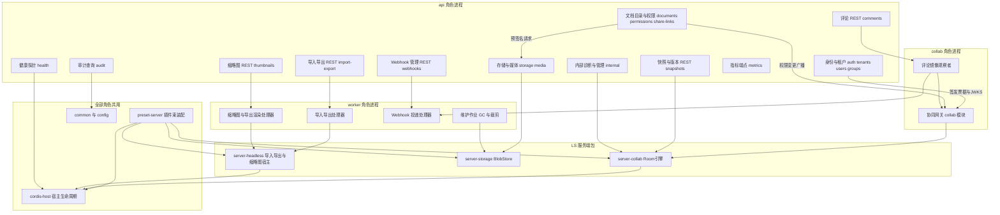
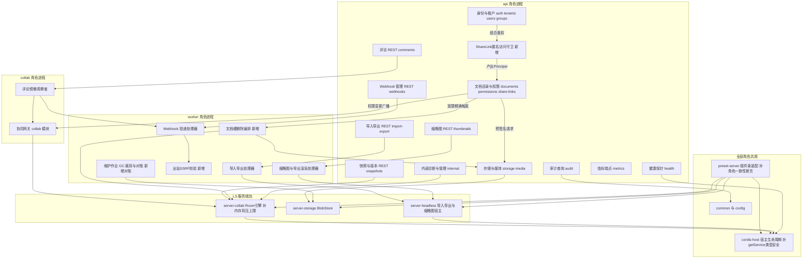

> 状态：评审 v0.1 | 负责：后端架构评审 | 更新：2026-09-21、2026-09-24（rulings §4.15 覆盖标注）、2026-09-24（复核修正，rulings §4.17）（L19 覆盖标注措辞）、2026-09-25（矛盾收口，rulings §4.18）（覆盖标注） | 依赖：00 §3/§4.2/§5.3、08/09/12、架构 08、PRD 06

# 15 服务端模块拆分评审

## 0. 结论

**总体判定：基本合理，不建议大范围重排；但存在 3 处需在实现前修复的安全/数据完整性缺口。** Nest 传输壳与 cordis 双宿主（server-collab/server-storage/server-headless）的边界是全篇执行最扎实的部分，20 个 Nest 模块与 BC-18…26 的映射粒度总体恰当。三个最重要的改动建议：①`GroupRepository.findById` 缺 `tenantId` 参数，`principalType='group'` 授权路径存在跨租户越权风险（§3.1）；②`ShareLink` 声称"免登录"但未定义任何匿名鉴权守卫/Principal 产出路径（§3.2）；③SV-11 要求的文档硬删除级联与 GDPR 擦除在 M-08/M-09/M-12 均无归属用例（§3.3）。不需要改的部分：Nest/cordis 双容器边界（维度 C）、BullMQ 队列与幂等键设计、协同网关多副本无亲和策略（ADR-0035）。

**处置（2026-09-21）**：§6 S-1…S-5 已由用户裁决（rulings §4.13）；§3 其余问题按 §4.4 执行，回写分两路完成。

**→ 2026-09-24 rulings §4.15 覆盖**：T-0 单组织、完全去租户——§3.1 失效（组管理亦推迟）；S-1 的个人账号注册改为外置 OIDC IdP + 首次登录 JIT（Q6）；S-3 补两级 ack（S-3a）；另补登 §3.12（Q8 渲染容器隔离）。本文其余历史结论保持原样，逐条标注见各处「→ 2026-09-24」。

## 1. 评审维度总表

| 维度 | 判定 | 依据（要点） | 建议 |
|---|---|---|---|
| A 限界上下文与模块粒度 | 有问题 | 20 个 Nest 模块与 BC-18…26 映射基本 1:1 或有正当理由的 1:N；`webhooks` 无 BC 编号（module-map 全篇零命中，见 §4）；`health`/`metrics` 偏贫血但有端口隔离的技术理由；`internal` 把 token 签发/管理动作/诊断三种技术关注点合一 | 保持现有 20 模块骨架；补 `webhooks` 的 BC 登记；`health`+`metrics` 可选合并，非必须 |
| B 数据所有权与事务边界 | 严重问题 | `documents.head_seq/epoch` 由 M-09 写、其余列由 M-08 写，共享一行（08:810）；SV-11 硬删除级联与 GDPR 擦除在 08/09/12 全篇无一处用例覆盖；BullMQ 入队（12:199）与 Webhook 投递（12:210）均是"先写库再入队"但无 Outbox 对账 | 见 §3.3/§3.4/§3.5 |
| C Nest DI 与双容器边界 | 合理 | `cordis-host/` 物理归 M-09、IO 适配器以 Nest 目录内 cordis Provider 形式存在且边界写得很清楚（module-map §4.2 第 5 条）；唯一瑕疵是 `getService<T>(name)` 弱类型化（09:575）与 `roles.ts`／`preset-server.ts` 两套按角色开关未见一致性校验（架构08:88,277,279） | 小修，见 §3.6；不改变结构 |
| D 协同网关与持久化 | 有问题 | 多副本无亲和（ADR-0035）、压缩策略（ADR-0025）、门禁分层（ADR-0034）均有量化预算，设计自洽；缺口是 Postgres 持续故障时 Room 内存缓冲无硬上限（§3.7） | 补背压上限，见 §3.7；`snapshots` 与 `collab` 分设 Nest 模块的 CQRS 式切分合理，保持 |
| E 作业与运维 | 有问题 | 队列划分、幂等键格式 `${domain}:${docId}:${inputHash}`、Chromium 池归属、`fill-template` 并入 `import-export`（U-13）均合理；Outbox 缺口与 B 维度共享同一根因；`comments` 模块的 `CommentMirrorObserver` 在 `api` 角色下的降级行为未写明 | 见 §3.5；`comments` 按角色的部分激活需补断言 |
| F 安全与多租户 | 严重问题 | fail-closed 双点、Ticket 签发（ADR-0029）、审计哈希链（U-15）均扎实；`GroupRepository.findById` 缺租户参数（08:235 vs 236）、`ShareLink` 匿名路径未定义（08:71,77,320；ADR-0029:20）、Webhook 出站请求无 SSRF 防护，三项均触及安全边界 | 见 §3.1/§3.2/§3.8 （→ 2026-09-24 rulings §4.15 覆盖：T-0 单组织去租户，本维度不再有多租户面，§3.1 失效；数据访问兜底改为文档权限检查 + 文档级 Postgres RLS（Q6，M3 出口）） |
| G 可扩展到 doc/sheet | 有问题 | 参数化点盘点完整、`horizontal-freeze` 机制到位；`comments.anchor->>'slideId'` 的具名索引（架构08:339）与"generic"判定有字面矛盾；`server-headless` 对 `ooxml-pptx`/`model-slide` 的具名依赖（09:488,497）与 LS「水平层文档类型盲」定位有张力，但团队已自知且有 M5 退出计划（09:756） | 见 §3.9；不阻断实现，建议补充章程脚注 |
| H 与铁律/章程一致性 | 合理 | server-* 不 import dom（同构铁律 4，已有 depcruise R16）、Nest 不 import model-*/yjs（`server-app-thin`，R9）、跨进程只经 protocol 均被遵守；唯一的过程性风险是 08/09/12 三份文档合计 13+ 处"建议在 protocol 新增但尚未创建"的文件，缺协调机制 | 见 §5 一致性核对表；建议 M-02 牵头做一次 protocol 缺口清点 （→ 2026-09-24 rulings §4.15 覆盖：Q3：Yjs 锁 13.6.x，charter §5.3 规则 4 预留 `@y/y`、`@y/protocols`、`lib0` v1，`server-app-thin` 规则同步） |

## 2. 逐模块评审表

> 判定列使用「保持 / 合并 / 拆分 / 移动」；"影响文档"只列需要回写的文档，不含本评审自身。

| 模块/包 | 职责一句话 | 拥有的表 | 主要依赖 | 问题 | 建议 | 影响文档 |
|---|---|---|---|---|---|---|
| `auth` | OIDC 登录/会话/API Key/协同票据签发 | `api_keys` | `users`、`permissions`（RoleResolver） | 缺匿名（ShareLink）鉴权分支 | 保持；新增 `ShareLinkGuard` 协作点 | 08、ADR-0029 （→ 2026-09-24 rulings §4.15 覆盖：Q6：服务端只认外置 OIDC、不持有密码，首次登录 JIT 建号；集成方签名 JWT 与 API Key 降为 M4） |
| `tenants` | 租户设置与配额 | `tenants` | 无 | 无实质问题 | 保持 | 08 （→ 2026-09-24 rulings §4.15 覆盖：T-0：`tenants` 模块与 `tenants` 表删除） |
| `users` | OIDC subject↔user 映射 | `users` | 无 | 体量小但有独立生命周期，非贫血 | 保持 | 08 |
| `groups` | 组管理（M3 新增） | `groups`、`group_members` | `users`（同租户校验） | `findById` 缺 `tenantId`，跨租户越权风险（§3.1，**严重**） | 保持模块；修正仓储签名 | 08 （→ 2026-09-24 rulings §4.15 覆盖：Q6：组管理（U-11）推迟，`groups` 模块移出 M3；T-0 下 §3.1 失效） |
| `documents` | 文档目录 CRUD/回收站/锁定/最近固定 | `documents`（除 `head_seq`/`epoch`） | `permissions` | `head_seq`/`epoch` 共享列（§3.4）；硬删除级联无归属（§3.3） | 保持；新增 `schedule-purge.usecase.ts` | 08、架构 08 （→ 2026-09-25 覆盖（§4.18 BE-31）：最近/固定记账表定为 `document_user_marks`（M-08 写），`collab_sessions` 删除） |
| `permissions` | 授权/撤销/角色解析/权限广播 | `permissions`、`document_perm_versions` | `groups`、`share-links` | `grant-permission` 对 group 的校验未显式核对租户（同 §3.1） | 保持 | 08 （→ 2026-09-24 rulings §4.15 覆盖：Q6：M3 不再依赖 `groups`，只按人授权） |
| `share-links` | 分享链接创建/撤销/解析 | `share_links` | 无直接，供 `permissions` 消费 | 缺匿名访问守卫（§3.2，**严重**） | 保持；导出新增 `ShareLinkGuard` | 08、ADR-0029 |
| `storage` | 通用预签名端点（供 M-12 导入通道复用） | 无（`ctx.blobStore` 薄 accessor） | `server-storage` | 模块很薄，但跨模块复用是正当理由 | 保持 | 08 |
| `media` | 内容寻址媒体上传/去重/嗅探/消毒 | `media_blobs`、`document_media` | `storage`、`documents` | 无 | 保持 | 08 |
| `server-storage`（LS 包） | `BlobStore` 服务端实现（S3/local） | 无（blob 字节） | 无（唯一 S3 SDK 引入点） | 无 | 保持 | 08、架构 08 |
| `collab` | WS 网关 + 5 个 IO 适配器（挂 `server-collab` 契约） | 经适配器写 `document_updates`/`document_snapshots` | `server-collab`、M-08（ticket/perm） | `CommentMirrorObserver` 按角色部分激活的降级行为未写明（同 §1 E 行） | 保持 | 09 |
| `snapshots` | 版本历史 REST（列表/latest/命名/恢复/diff） | 无独立存储（经 `collabServer` 读写） | `collab`（经 `CordisHostService`） | 无 | 保持（CQRS 式切分合理） | 09 |
| `server-collab`（LS 包） | Room 状态机/门禁/持久化/压缩/广播 | 经适配器 owns `document_updates`、`document_snapshots` | `model-core`、`store-yjs` | PG 持续故障下内存缓冲无硬上限（§3.7） | 保持；补背压上限 | 09、ADR-0025/0034/0035 （→ 2026-09-24 rulings §4.15 覆盖：S-3a：溢写期两级 ack——溢写成功 `ack{tier:'spill'}`，落库 `ack{seq,tier:'db'}` 才清 pending，正式 seq 回放时由 PG 分配） |
| `server-headless`（LS 包） | Node cordis 宿主：导入导出/校验/迁移；headless Chromium 编排 | 无 | `model-slide`、`ooxml-pptx`（具名） | 对 slide 编解码器具名依赖与「水平层文档类型盲」定位有张力（§3.9） | 保持；按已定 M5 计划收编 | 09、架构 08、章程 §5.1 |
| `cordis-host` | Nest 内嵌 cordis 宿主生命周期 + 日志/遥测/errors 适配器 | 无 | `preset-server` 装配全部 LS 包 | `getService<T>(name)` 字符串弱类型 | 保持；补类型安全的 `ServiceMap` | 09 |
| `import-export` | 导入导出 REST + 处理器编排 | 无独立（`job_runs` 属 `jobs`） | `jobs`、`server-headless`、`storage` | 与 `jobs` 共享的入队 Outbox 缺口（§3.5） | 保持 | 12 |
| `jobs` | BullMQ 基础设施/幂等键/状态机（Shared Kernel） | `job_runs` | 被 `import-export`/`thumbnails` 复用 | 无入队后崩溃对账机制（§3.5） | 保持；补对账扫描 | 12 |
| `thumbnails` | 缩略图 REST + 处理器；PDF/PNG/JPEG 导出处理器 | `thumbnails` | `server-headless`（Chromium 池） | 无重大问题 | 保持 | 12 （→ 2026-09-24 rulings §4.15 覆盖：Q8：M2 封面取包内 `docProps/thumbnail.jpeg`（只做头校验不解码），M3 前半段 headless，按页内容哈希失效，PDF 导出 M3 后半段，不用 sharp） |
| `comments` | 评论镜像读模型 + @提及 + 导入为可编辑线程 | `comments`（镜像） | `server-collab`（观察）、`webhooks` | `anchor->>'slideId'` 具名索引削弱"generic"声明（§3.9） | 保持；索引改用类型无关方案 | 12、架构 08 §5 |
| `webhooks` | Webhook 订阅管理与投递（HMAC + 重试 + 死信） | `webhook_subscriptions`、`webhook_deliveries` | `comments`（触发方） | 无 BC 编号（§3.10）；Outbox 缺口（§3.5）；无 SSRF 防护（§3.8） | 保持模块；module-map 补注册；投递前加出站校验 | 12、module-map、PRD SV-15 |
| `audit` | 审计只追加 + 哈希链（U-15） | `audit_log` | 被 M-08/M-09/M-12 反向消费（标注点） | 无重大问题，本轮最扎实的模块之一 | 保持 | 12 |
| `health` | 存活/就绪探针 | 无 | pg/redis/blobStore/`cordis-host` | 与 `metrics` 合并候选（非必须） | 保持 | 12 |
| `metrics` | Prometheus 文本端点 | 无 | 无 | 4 文件、无 domain 层，偏贫血，但独立端口是正当理由 | 保持（可选与 `health` 合并为 ops） | 12 |
| `internal` | 渲染态 token 签发 + 管理动作 + 诊断 | 无（token 存 Redis） | `server-collab`/`server-headless`（admin 动作代理） | token/admin/诊断三种技术关注点合一，偏技术面而非领域面 | 保持（网络隔离是合理理由） | 12 （→ 2026-09-24 rulings §4.15 覆盖：Q8：`/render` 页改为从注入取得 state 与资源，`RenderStateToken` 网络拉取去掉或降为兜底） （→ 2026-09-25 覆盖（§4.18 BE-04、BE-03）：`RenderStateToken` 取消，internal 不再签发 token；`DiagnosticsController` 各角色装配，`AdminController`（compact/migrate/epoch）只在 collab 装配） |
| `common/` | 异常过滤器/审计拦截器/限流原语/请求上下文 | 无 | 被全部模块消费 | 无 | 保持 | 08 §3、12 §4.9 |
| `config/` | 环境变量 Schema/`CORDEX_ROLE` 装配表 | 无 | 无 | `roles.ts` 与 `preset-server.ts` 两套按角色开关未见一致性校验（§3.6） | 保持；补启动期断言 | 12 §4.10、架构 08 §4.2 （→ 2026-09-25 覆盖（§4.18 BE-13）：全服务端「模块 × 角色 × 部件」矩阵定于 40-modules/12 §7.1，启动断言 `assertRoleAssembly` 逐项核对） |
| `preset-server` | 服务端 cordis 宿主插件束装配脚本 | 无 | 全部 iso 包 + 3 个 LS 包 | `roles.ts` 与 `preset-server.ts` 两套按角色开关未见一致性校验（角色开关同步） | 保持 | 架构 08 §4.2、09 §4.3/§5.3 |

## 3. 关键问题深评

### 3.1 `GroupRepository.findById` 缺 `tenantId`，跨租户越权风险（严重，维度 B/F）

- **现状**：`GroupRepository` 方法签名为 `findById｜findByTenant｜create｜rename｜delete｜addMember｜removeMember｜listMembers｜isMember(groupId,userId)`（08:235），`findById` 不带 `tenantId`。对照同一份文档明确要求"`DocumentRepository` 全部方法强制 `tenantId` 参数，无租户参数的方法不允许存在"（08:236，§9.1）。`permissions/application/grant-permission.usecase.ts` 在 `principalType='group'` 时"先经 `GroupRepository.findById` 校验存在"（08:276），只校验存在性，未显式核对该组的 `tenantId` 是否等于目标文档的 `tenantId`。
- **风险**：租户 A 的管理员（或被攻破的会话）在给自己租户内文档授权时，若能猜到/枚举到租户 B 的某个 `groupId`（UUID v7 时间有序，理论上可被范围推测），`grant-permission` 会成功把该文档的角色授予一个跨租户的组，造成越权访问；这与 SV-06"跨租户访问 100% 拒绝"的验收标准直接冲突。
- **建议**：`GroupRepository.findById` 改为 `findById(tenantId, groupId)`，与 `DocumentRepository`/`MediaBlobRepository` 同口径；`grant-permission.usecase.ts`/`revoke-permission.usecase.ts` 校验组存在性时必须传入当前文档的 `tenantId`。同时把 08 §9.1"全部方法强制 `tenantId`"的措辞从仅约束 `DocumentRepository` 扩展为本模块七个仓储的通用规则，并让 `repo-requires-tenant-id`（08:883 G-14，目前仅"建议新增"）成为 M-01 十三个强制扫描器之一而非可选项。更彻底的行业惯例（多租户 SaaS on Postgres 的标配防线）是再加一层 Postgres 行级安全（Row-Level Security）：给 `groups`/`permissions`/`documents` 等全部租户表按 `tenant_id = current_setting('app.tenant_id')` 建 RLS policy，即使应用层某次查询漏写 `tenant_id` 条件，数据库本身也会拒绝跨租户返回行——这是比"仓储方法签名必须带参数"更下沉一层的纵深防御，建议列入 M3 出口条件而非事后补救。
- **代价**：签名变更影响 `groups.controller.ts`/`__tests__` 少量调用点，成本低；RLS 需要在 `db/client.ts` 里为每个请求设置 `app.tenant_id` 会话变量并补迁移脚本，成本中等，但一次投入可覆盖全部现有与未来的租户表。
- **处置**：已回写 `40-modules/08-server-identity-documents-and-storage.md`（rulings §4.13 同时确认段）。
- → 2026-09-24 rulings §4.15 覆盖：T-0 单组织完全去租户，本节风险前提（跨租户越权）不复存在；组管理（U-11）推迟，`GroupRepository.findById` 补 `tenantId` 失效；RLS 以文档级（非租户级）形式在 M3 出口落地（Q6），`repo-requires-tenant-id` 改为「按文档读写须经权限服务」扫描器。

### 3.2 `ShareLink` 声称"免登录"但无匿名鉴权路径（严重，维度 F）

- **现状**：`ShareLink` 定义为"免登录角色化访问令牌"（08:77），`Principal` 值对象也明确包含 `kind:'shareLink'`（08:71）。但 `ShareLinksModule` 的 REST 端点"复用 `SessionGuard`"（08:320），而 `SessionGuard` 是"会话 JWT / API Key → Principal（fail-closed：无有效凭据 401）"（08:356 附近）——没有第三条"仅凭分享令牌"的凭据路径。ADR-0029 仅说明"REST 换票据时把 link 角色折叠进 role；WS 不直接接受 link token"（0029:20），暗示访客必须先有一个已解析的 `Principal` 才能"折叠"link 角色，但完全匿名（无 OIDC 账号）的访客如何先获得这个 `Principal`，全篇未定义。
- **风险**：若实现期按现有守卫清单直译，"分享链接免登录访问"这一 CO-15/PRD 明确要求的产品能力会在服务端没有落地路径，可能被迫在最后关头改为"分享链接必须先登录"这种与产品预期相反的行为，或者被工程师私下加一个未经审查的旁路鉴权（风险更大）。
- **建议**：在 `share-links` 模块新增导出 `ShareLinkGuard`（`share-links/interface/guards/share-link-access.guard.ts`），接受 URL 查询参数或 Header 中的分享令牌，产出 `Principal{kind:'shareLink', id:linkId, tenantId, scopes}`；`auth`/`documents` 的公开可读端点（文档详情、协同票据签发）改为 `SessionGuard OR ApiKeyGuard OR ShareLinkGuard` 的组合守卫。需要产品先确认 S-1（§6）。 （→ 2026-09-25 覆盖（§4.18 BE-02、BE-05）：令牌解析 `ResolveShareLinkUseCase` 归 `PermissionsModule`（SECURITY DEFINER 函数只读 `share_links`），`ShareLinkGuard` 由 AppModule 注册为紧随 `SessionGuard` 的第二个 `APP_GUARD`；票据带 `lnk`，M-09 按链接状态复核）
- **代价**：新增一个 Guard + 一条组合鉴权路径；`RoleResolverService` 已有"直接授权 + 分享链接 + 租户默认"的合并逻辑（08:663），改动集中在"谁能触发这条合并逻辑"而非合并逻辑本身。
- **处置**：已回写 `40-modules/08-server-identity-documents-and-storage.md`、PRD `10-prd/03-features/03-collaboration.md` CO-15、`30-architecture/adr/0029-gateway-authorization.md`（rulings §4.13 S-1）。
- → 2026-09-24 rulings §4.15 覆盖：Q6 服务端不再提供个人账号自助注册——账号在外置 OIDC IdP（可选内置 Casdoor）建立，注册由部署级开关 `auth.selfSignup` 控制（默认关），首次登录 JIT 建 `users` + `user_identities`；分享链接始终要求登录；T-0 下不存在「其它租户用户」。

### 3.3 SV-11 硬删除级联与 GDPR 擦除无模块归属（严重，维度 B）

- **现状**：PRD SV-11 要求"文档软删除（默认 30 天可恢复）→ 硬删除（快照、update、版本、评论、缩略图、blob、索引全部清除，审计保留）；用户数据擦除 API"（06-server-and-ops.md:164），优先级 P1、里程碑 M3。检索 08/09/12 三份模块文档全文，`documents` 模块只有 `trash-and-restore.usecase.ts`（软删除/恢复，08:274/642）；架构 08 §7 的 `maintenance` 队列职责写的是"media GC、exports 清理、updates 裁剪、audit 分区维护"（架构08:395），不含"文档硬删除"；09/12 的用例表（§2.6）同样没有跨 `document_updates`/`document_snapshots`/`thumbnails`/`comments`/`media_blobs`/`permissions`/`share_links` 七张表的清理编排。
- **风险**：这是一个明确写入 P1/M3 验收标准、但没有任何模块认领实现细节的能力缺口；若无人在实现前分配归属，最可能的结果是某个工程师在 `documents` 模块里直接跨模块 `DELETE FROM document_snapshots/comments/...`，违反本评审在其它维度反复确认的"谁的表谁写"原则（B 维度总表）。
- **建议**：采用编排式（choreography）而非集中式：`documents`（M-08）新增 `schedule-purge.usecase.ts`，30 天宽限期满后把文档标记为 `purging` 并通过既有 `jobs` 基础设施（M-12）入队 `document-purge` 队列；`server-collab`/`server-headless`（M-09）在 `UpdateStore`/`SnapshotStore` 契约上各自新增 `purgeAll(docId)` 方法自行清理 `document_updates`/`document_snapshots`；`thumbnails`/`comments`（M-12）各自新增 `purge-document-*.usecase.ts` 清理自己的表；`media`（M-08）按既有 30 天无引用 GC 规则顺带处理。`audit_log` 按规则保留，不参与清理。GDPR 擦除 API 复用同一编排，仅把"清除"换成"用 `deleted-user` 替换主体标识"。 （→ 2026-09-25 覆盖（§4.18 BE-15、BE-16）：定为「单作业 + 参与者登记 + 收尾」：`job_runs(kind=document-purge)`（`maintenance` 队列作业名），worker 处理器逐个调用 `@PurgeParticipant`，`finalize-purge` 用 ListObjectVersions 清全部对象版本后删行；`share_links` 由 share-links 自己的参与者清理）
- **代价**：新增约 5 个小用例文件，分散在三个模块，无跨模块直接建表访问；需要 M-08/M-09/M-12 三条线协调一次接口签名（`purgeAll(docId)` 的返回值/幂等语义）。见 S-2（§6）。
- **处置**：已回写 `40-modules/08-server-identity-documents-and-storage.md`、`40-modules/09-server-collab-gateway-and-headless-host.md`、`40-modules/12-server-jobs-comments-and-ops.md`、PRD `10-prd/03-features/06-server-and-ops.md` SV-11（rulings §4.13 S-2）。
- → 2026-09-24 rulings §4.15 覆盖：Q3 删除改软删除墓碑 + TTL（默认 24h），TTL 到期硬删除由服务端单写者执行；S-2 擦除与「立即彻底删除」不等 TTL、立即硬删除（含墓碑）；Q8 起 purge 还须覆盖 embedded 来源缩略图。 （→ 2026-09-25 覆盖（§4.18 CO-07）：术语拆分：文档级「立即彻底删除」改称「永久删除文档」；元素级「彻底删除元素」另设 owner 入口 `POST /documents/:id/elements/purge`，只对墓碑态元素，经 tombstone-sweeper 同一单写者立即硬删）

### 3.4 `documents.head_seq`/`epoch` 共享列多写者，仅靠约定隔离（有问题，维度 B）

- **现状**：`documents` 表同时被 M-08（`title/status/ownerId/…`）与 M-09（`head_seq`/`epoch`）写入，文档自己承认"这是唯一的跨模块共享表列冲突面"（08:810），约束方式是"建议 `head_seq` 更新语句限定 `UPDATE documents SET head_seq=… WHERE id=… AND head_seq<…`"——这是**代码约定**（乐观递增 WHERE 子句），不是数据库或类型系统层面的强制。`DocumentRepository` 的方法签名（08:236 `updateMeta|softTrash|restore|setStatus`）虽未显式包含 `head_seq`/`epoch`，但 TypeScript 结构类型不能阻止未来某次 `updateMeta` 的实现顺手带上这两列。
- **风险**：这类"同表异列多写者、靠文档约定隔离"的模式是多人协作项目里最容易在压力下被破坏的一类约束——尤其两个所有者分属 M-08、M-09 两条不同实现条线时。一旦 `documents.repository.ts` 某次改动意外覆盖了 `head_seq`，后果是协同房间的 `ack` 语义错乱（07-rendering/06-collaboration 的持久化保证建立在 `head_seq` 单调递增之上）。
- **建议**：比"更规范的注释"更彻底的做法（行业上常见于 CQRS/多服务共享聚合场景）是把这两列物理拆到一张 M-09 独占的旁表，例如 `document_collab_state(doc_id pk references documents, head_seq bigint, epoch int)`，`documents` 上只保留一个视图或在读路径 JOIN；这样"谁的表谁写"在物理层面自动成立，无需约定。若拆表成本在当前阶段过高，至少应把 `DocumentRepository` 的更新方法的 TypeScript 入参类型显式 `Omit<Document,'headSeq'|'epoch'>`，让"M-08 不能设置这两列"在编译期而非人工审查时成立。
- **代价**：拆表需要一次迁移 + 两处查询改 JOIN，属中等成本；类型收紧改动小，建议至少先做类型收紧。
- **处置**：已回写 `40-modules/08-server-identity-documents-and-storage.md`、`30-architecture/08-backend-nestjs.md`（rulings §4.13 同时确认段）。

### 3.5 作业入队与 Webhook 投递缺少 Outbox 保证（有问题，维度 B/E，系统性）

- **现状**：`import-export` 创建导入作业是"单事务写 `job_runs` + 异步 BullMQ 入队"（12:199）；`webhooks` 投递事件是"无库事务（BullMQ 入队）；`webhook_deliveries` 落状态行"（12:210）。两处都是"先提交一次 DB 写，再做一次独立的 Redis/BullMQ 入队"，中间没有事务性保证——这正是分布式系统里经典的"双写不一致"缺口：进程在 DB 提交之后、BullMQ 入队之前崩溃，`job_runs`/`webhook_deliveries` 行会永久停在 `queued`/`pending`，没有任何 worker 会去处理它，也没有文档提到的对账/补偿扫描来发现这类"孤儿行"。
- **风险**：这不是理论风险——BullMQ 连接抖动、Node 进程被 OOM-kill、K8s 滚动发布时的 SIGTERM 窗口都可能命中这个间隙；发生后用户看到的是"作业永远卡在 queued"或"评论创建了但集成方从未收到 webhook"，且没有系统信号会主动暴露它（不是一个报错，而是沉默丢失）。
- **建议**：采用标准 Transactional Outbox / 定期对账两种之一（业界常见组合是两者都做）：①最小改动版——`jobs`/`webhooks` 模块各加一个 `maintenance` cron 任务，定期扫描 `status='queued'`/`'pending'` 且 `queued_at` 超过阈值（如 2× 处理器超时）而无对应 BullMQ job 的行，重新入队；②更彻底版——`job_runs`/`webhook_deliveries` 的写入放在真正的 outbox 表里，由一个独立 relay 进程/BullMQ repeatable job 轮询未投递的 outbox 行并入队，成功后标记已投递。M3 建议先做①（成本低、复用现有 `maintenance` 队列），把②列为 M4 待评估。 （→ 2026-09-25 覆盖（§4.18 BE-19）：周期作业统一用 BullMQ Job Scheduler 挂 `maintenance` 队列、只由 worker 启动时注册；Webhook 投递队列定名 `webhook-delivery`）
- **代价**：①只需一个新 cron 任务 + 一个索引（`status, queued_at`），成本很低，建议直接采纳而非等待用户裁决。
- **处置**：已回写 `40-modules/12-server-jobs-comments-and-ops.md`（rulings §4.13 同时确认段）。

### 3.6 进程角色装配的两套开关缺一致性校验（有问题，维度 C/E）

- **现状**：Nest 侧的角色→模块列表由 `config/roles.ts` 决定（架构08:88）；cordis 侧的角色→插件集由 `cordis-host/preset-server.ts` 用注释标注"`server-collab`（role collab）"、"`server-headless`（tasks；role worker 时含 thumbnails）"（架构08:277,279）。这是两套独立维护的"按 `CORDEX_ROLE` 决定装配什么"的开关，全篇未见任何一处交叉校验或共享单一数据源。连带的一个具体实例：`comments` 模块的 `CommentMirrorObserver` 需要订阅 `collabServer` 的 Room 广播（12:355），但 `collabServer` 服务只在 `role=collab` 时被 `preset-server` 激活（09:692）；`CommentsModule` 若像 REST 部分要求的那样在 `role=api` 下也被注册（12 §7.1 `import-export/thumbnails/comments REST controller` 归 `api`），`CommentMirrorObserver` 在 `api` 角色进程里的降级行为（no-op？还是抛错？）没有任何文档提及。
- **风险**：两套开关分裂本身不是 bug，但缺乏机械校验意味着"改了 `roles.ts` 忘了改 `preset-server.ts`"（或反之）不会在 CI 报错，只会在特定角色的生产环境里表现为某个功能悄悄不可用（例如 `role=collab` 实例忘记装配 `server-collab` 导致 WS 网关连上了但 `collabServer` 服务解析不到）。
- **建议**：①给 `CordisHostService` 增加一个启动期断言：`role=collab` 时必须能 `getService('collabServer')` 成功，否则 fail-fast 退出（比运行时静默 `undefined` 更安全，也符合 D8"先失败、不部分激活"的既有原则，架构08:259）；②`CommentMirrorObserver.onModuleInit` 显式检查 `collabServer` 是否可用，不可用时记录一条诊断日志并跳过订阅而非抛错。顺带一提：`CordisHostService.getService<T>(name)`（09:575）目前是字符串弱类型查找，建议补一个 `ServiceMap` 接口做编译期 key 校验，与本仓库对 `any`/`as` 类型预算的整体严格程度保持一致。 （→ 2026-09-25 覆盖（§4.18 BE-03、BE-13）：`CommentMirrorObserver` 定为只在 collab 角色注册，不再需要 api 角色下的降级分支；快照 REST 同样只在 collab 装配）
- **代价**：两处断言/日志改动很小；`ServiceMap` 类型收紧是渐进式的，可与实现同步做。
- **处置**：已回写 `40-modules/09-server-collab-gateway-and-headless-host.md`、`30-architecture/08-backend-nestjs.md`（rulings §4.13 同时确认段）。

### 3.7 Room 在 Postgres 持续故障下的内存背压无硬上限（有问题，维度 D）

- **现状**：持久化批量写"PG 抖动时批量退避上限 800 ms，超过则 ack 延迟但不丢"（ADR-0025 补充）；`/readyz` 在 PG 不可达时返回 503，但这只影响**新连接**的接入（ADR-0035:22 "旧连接保留"）。也就是说：一次分钟级的 Postgres 中断期间，已在线的 Room 会继续接受编辑并把未持久化的 update 累积在内存里，直至 PG 恢复，全篇没有为这种情况定义一个"内存缓冲超过阈值就拒绝新 update / 降级只读"的硬上限。
- **风险**：与 ADR-0035 明确承认的"内存准入按 RSS 预算、超 75% 拒绝新房间"（0035:43）思路一致，但那条规则只管"新房间"，不管"已开着的房间在故障期间无限攒 update"这一路径；在多个热文档同时被编辑、PG 中断时间较长（超过几分钟）的组合场景下，理论上可造成单实例 RSS 持续增长直至触发 OOM，进而波及该实例上其它无关文档的房间——这是把"数据库不可用"从一个局部降级，放大为"实例级故障"的路径。
- **建议**：给 `server-collab` 的 update-writer 增加一个按 Room 的"未持久化字节数"上限（可复用既有 `compaction.maxPendingBytes` 量级），超限后新 SYNC update 走硬门禁的一个新分支：暂停 ack、返回 `4503`-类退避信号，提示客户端稍后重连（其它实例若 PG 也不可用则同样退避，行为对用户可见但不引发 OOM）。是否要接受"数据库中断时编辑短暂不可用"这一体验取舍，属产品判断，见 S-3（§6）。
- **代价**：改动集中在 `server-collab` 的门禁与持久化两处，逻辑上是"compaction 阈值"思路的复用，成本中等；需要一次故障注入测试验证。
- **处置**：已回写 `40-modules/09-server-collab-gateway-and-headless-host.md`、`30-architecture/08-backend-nestjs.md` §12、PRD `10-prd/03-features/06-server-and-ops.md` SV-05、`10-prd/04-non-functional-requirements.md`（rulings §4.13 S-3）。
- → 2026-09-24 rulings §4.15 覆盖：S-3a 两级 ack——溢写成功只回 `ack{tier:'spill'}`，落库后回 `ack{seq,tier:'db'}` 才清客户端 pending；正式 seq 在回放时由 PG 分配，溢写行按 `(instanceId, localCounter)` 排序，回放后断言无 pendingStructs；Valkey 取代 Redis 部署（Q10）。

### 3.8 Webhook 出站请求缺 SSRF 防护（严重，维度 F）

- **现状**：`WebhookSubscription.targetUrl` 的唯一校验是"必须 `https://`（生产环境）"（12:112）；`webhooks/infrastructure/webhook-delivery.processor.ts` 的职责描述只提"指数退避重试 + 超限转死信队列"（12:494），没有一处提到对 `targetUrl` 解析出的目标 IP 做私有地址段/回环地址/云元数据端点（如 `169.254.169.254`）的拦截，也没有提到禁用或重新校验跟随重定向。对照同一份章程体系里对**入站**内容（OOXML 外部关系）的处理——"外部关系 `TargetMode="External"` 只保留 http/https 字串，从不在服务端抓取，目的 SSRF"（架构08:444）——可以看到团队对"服务端替用户发起出站请求=SSRF 风险"这件事本身是有防范意识的，只是这个意识没有延伸到本次新增的 Webhook 出站能力（M3 新增，rulings U-14）。
- **风险**：任何拿到 `TenantAdminGuard` 权限的租户管理员（包括试用账号）都能注册一个指向内网服务、云厂商元数据端点或其它租户内网地址的 `targetUrl`，服务端会在评论事件触发时主动向该地址发起签名 HTTP 请求，构成经典 SSRF，且由于目标可自定义、可重复触发（评论事件+重试机制），比一次性请求更容易被用来做内网探测。
- **建议**：在 `webhooks` 模块新增一个共享的出站校验组件（如 `webhooks/infrastructure/egress-guard.ts`），在①订阅创建/更新时（尽力而为，DNS 可能后续变化）与②每次实际投递前（关键防线，防 DNS rebinding）都解析 `targetUrl` 的主机名并拒绝私网段（RFC1918）、回环、链路本地（含 `169.254.169.254`）地址；HTTP 客户端禁止自动跟随重定向，或每一跳都重新校验。具体是否需要允许自托管私有部署放宽此限制，属运维策略判断，见 S-4（§6）。
- **代价**：新增一个中间件级校验文件，逻辑成熟（业界有现成的 SSRF-safe fetch 实现可参考），成本低但优先级应提到实现前完成，而非上线后补丁。
- **处置**：已回写 `40-modules/12-server-jobs-comments-and-ops.md`、PRD `10-prd/03-features/06-server-and-ops.md` SV-15（rulings §4.13 S-4）。
- → 2026-09-24 rulings §4.15 覆盖：T-0 下无「租户管理员」，Webhook 订阅由平台管理员（部署级 admin）管理；S-4「自托管单租户」措辞改为自托管单组织（Q10），出站校验结论不变。

### 3.9 「文档类型盲」两处字面瑕疵：评论锚点索引与 `server-headless` 具名依赖（有问题，维度 G）

- **现状 A**：`comments` 表的索引之一是 `index(doc_id, anchor->>'slideId')`（架构08:339）。`comments/domain/anchor.ts` 的 `Anchor` 被设计为"开放判别联合"以承载未来 doc/sheet 变体（12 §8 结论，G-27），但这条物理索引把 `slideId` 这个 slide 专属字段名直接刻进了 schema——doc/sheet 的锚点变体大概率不会有 `slideId` 键，届时这条索引对新类型文档形同虚设，需要另建索引，与"BC-25 已改判 generic、零改动"的结论（12:855 G-27）存在字面张力。
- **现状 B**：`@cordexjs/server-headless` 的 `package.json` 直接依赖 `@cordexjs/model-slide`、`@cordexjs/ooxml-pptx`（09:488），其 `import-pptx.ts`/`export-pptx.ts` 任务也直接具名调用 `ooxml-pptx.decode`/`.encode`（09:497）。章程把 LS（含 `server-headless`）画在"水平层（文档类型盲，可被任一垂直束复用）"的表头之下（章程 §5.1），但当前实现是一个水平层包直接依赖并具名调用一个 `cordex.bundle:'slide'` 的垂直束包——字面上与铁律 1"水平层的任何包不得 import 任何垂直束的包"冲突。团队对此**已有认知且有退出计划**：09 §8 明确写"当前硬编码调用…M5 起改名为文档类型无关的 `import`/`export`"（09:756），不是本评审新发现的隐藏问题，而是已知技术债。
- **建议**：现状 A 改为对 `anchor` 整列建 GIN 索引（`USING gin (anchor jsonb_path_ops)`）替代具名字段索引，或者拆出一个由各文档类型编解码器负责生成的规范化 `page_ref text` 生成列再建索引，两者都不依赖具体字段名。现状 B 维持既有 M5 收编计划，但建议在章程 §5.1 LS 行补一条脚注："M1–M4 允许按需直接依赖单一垂直束的编解码器，M5 起收编为经 `formats` 贡献点分派"，避免后续评审/新成员把这处已知技术债误读为未被发现的设计缺陷；同时确认 M-01 的 `cordex-doc-type-blind` depcruise 规则当前对 LS 是否已豁免（若未豁免，CI 现在应该已经报错，需要先确认现状）。
- **代价**：索引调整是一次小迁移；章程脚注是纯文档改动；depcruise 豁免范围确认是一次配置检查，均为低成本。
- **处置**：已回写 `40-modules/12-server-jobs-comments-and-ops.md`、`30-architecture/08-backend-nestjs.md`（rulings §4.13 同时确认段）。

### 3.10 `webhooks` 无限界上下文编号（有问题，维度 A，治理类）

- **现状**：`40-modules/12` 把 `webhooks` 模块的能力描述为"评论事件的服务端 Webhook 出口…独立于 `comments` 成模块"（12:478），但检索 `40-modules/00-module-map.md` 全文，`webhook` 字样零命中——`webhooks` 没有被纳入 BC-18…29 的任何一个限界上下文目录，也没有单独编号。PRD SV-15 的 M4 展望已写明"文档事件（创建/更新/删除/导出完成/权限）以同一 Webhook 机制推送，扩大事件覆盖面"（06-server-and-ops.md:189），说明这不是一个只服务于评论域的能力，长期看它是一个独立的"事件出口/集成"限界上下文，只是 M3 阶段唯一的事件源恰好是评论。
- **建议**：在 `00-module-map.md` §3 新增一个 BC 编号（建议 BC-30，紧接现有 BC-29 之后）登记"Webhook 与事件出口"，职责与现状一致，doc-sheet 通用性判 generic；§7 M-12 行的"覆盖上下文"补上这一编号。这是纯文档治理改动，不影响任何代码结构，成本极低，现在补上可以避免 M4 事件覆盖面扩大后再回头重构文档归属。
- **代价**：一次 module-map 编辑，无代码影响。
- **处置**：已回写 `40-modules/00-module-map.md`（rulings §4.13 S-5）。

### 3.11 复核后判定"无实质问题"的若干项（避免遗漏疑虑，逐项给出依据）

以下是评审维度里明确要求核查、但复核后判定合理、不构成问题的项，逐条附依据，以说明并非未检查：

- **headless 渲染页鉴权**：`RenderStateToken` 一次性、TTL 60 s（12:80,127），`GET /internal/render/:token/state` 挂在 `internal/*`（网络策略限内网，12:63），一次性令牌 + 网络隔离双重防线，未见缺口。 （→ 2026-09-24 rulings §4.15 覆盖：Q8：渲染改在独立零出站 renderer sidecar，渲染页不再外呼拉取 state，见 §3.12） （→ 2026-09-25 覆盖（§4.18 BE-04）：`RenderStateToken` 取消，`/render` 页只收注入状态，查询参数只带 `renderId`）
- **`snapshots` 与 `collab` 的模块关系**：`snapshots` 是"Conformist：读写面依赖 BC-21 内 `snapshot.service.ts` 的存储机制，不持有独立存储实现"（module-map BC-22 行），本质是同一份数据在 WS 与 REST 两种传输面上的 CQRS 式切分，边界清楚，保持现状。
- **BullMQ 队列划分与幂等键**：`import`/`export`/`thumbnails`/`render-export`/`compaction`/`maintenance` 按资源画像（Chromium 并发 1 vs 导入导出并发 4）分队列，幂等键格式统一为 `${domain}:${docId}:${inputHash}`（12:120），未见重复或遗漏。
- **`fill-template`/`validate`/`migrate`/`convert` 归属**：已按用户裁决 U-13 并入 `import-export`、不新设 `automation` 模块（12:254 Q-3 结案），本评审认为该决策合理，不再重复裁决。
- **多副本无房间亲和（ADR-0035）**：内存代价、CPU 重复代价、Redis 扇出吞吐均已量化（0035:38,44），是经过权衡的既定取舍，不建议改为粘性路由。

### 3.12 headless Chromium 沙箱关闭且与凭据同容器（严重，维度 E/F；2026-09-24 补登）

- **现状**：此前各稿的 headless 缩略图/导出渲染在 worker 进程内拉起 Chromium，常见做法是以 `--no-sandbox` 运行，且与持有数据库/对象存储/Valkey 凭据的服务端进程同容器；本评审 2026-09-21 版未登记此项（决策包 Q8 复核发现）。
- **风险**：渲染的是用户上传的不可信文档；Chromium 一旦被利用，攻击者即可读取同容器凭据、并经可出站网络外传数据。
- **建议 / 处置**：→ 2026-09-24 rulings §4.15 覆盖：Q8 改为**独立零出站 renderer sidecar**（非 root、开沙箱、不持有任何凭据），渲染页从注入取得 state 与资源、不做外呼；同镜像按 `CORDEX_ROLE=renderer` 运行（Q10）；回写落点 `40-modules/09`（browser-pool 沙箱/每任务 BrowserContext/回收/版本锁步）、`40-modules/12`、ADR-0026。

## 4. 目标拆分

本评审**不建议**对现有 20 个 Nest 模块 + 3 个 LS 包的骨架做重排——§1/§2 的判定显示绝大多数模块边界与依赖方向都站得住脚。目标状态与现状的差异，全部是"新增文件/新增登记"级别的收敛，没有一个模块被合并、拆分或改变物理位置。

### 4.1 修订后的 BC 映射表（仅列有变化的行；其余 BC-01…29 与 module-map 现状一致）

| BC 编号 | 名称 | 承载模块/包 | 相对现状的变化 |
|---|---|---|---|
| BC-18 | 身份与租户 | `auth`、`tenants`、`users`、`groups` | `GroupRepository` 接口签名加 `tenantId`（§3.1）；`auth`/`share-links` 之间新增 `ShareLinkGuard` 协作（§3.2） （→ 2026-09-24 rulings §4.15 覆盖：T-0：BC-18 不再含租户，`tenants` 删除、`groups` 随 U-11 推迟，承载模块为 `auth`、`users`；`GroupRepository` 签名一项失效） |
| BC-19 | 文档目录与权限 | `documents`、`permissions`、`share-links` | `documents` 新增 `schedule-purge.usecase.ts`（§3.3）；`documents` 仓储更新方法类型收紧排除 `headSeq`/`epoch`（§3.4） |
| BC-21 | 协同网关与持久化 | `collab`、`@cordexjs/server-collab` | `UpdateStore`/`SnapshotStore` 契约新增 `purgeAll(docId)`；`server-collab` 新增按 Room 的未持久化字节上限（§3.7） |
| BC-23…26 | 作业/缩略图/评论/审计运维 | `import-export`、`jobs`、`thumbnails`、`comments`、`audit`、`health`、`metrics`、`internal` | `jobs`/`webhooks` 新增对账 cron（§3.5）；`comments` 新增 `purge-document-comments.usecase.ts`；`thumbnails` 同理 （→ 2026-09-25 覆盖（§4.18 BE-19）：对账改为 BullMQ Job Scheduler 周期作业（只由 worker 注册），不另设 cron） |
| **BC-30（新增）** | **Webhook 与事件出口** | `webhooks` | 从"寄生于 BC-25"改为独立登记（§3.10）；新增 `egress-guard.ts` SSRF 校验（§3.8） |

### 4.2 现状模块图（按 `CORDEX_ROLE` 进程角色分组）

怎么读：三个进程角色各自的实线框内是该角色实际装配的模块；`allRole`/`lsPkgs` 是跨角色共享的装配脚本与 cordis 包；箭头方向表示调用/触发关系，`collab` 与 `worker` 两个角色框之间没有直接箭头，说明二者只通过 Postgres/Redis（图中未画，见架构 08 §0）间接协作，符合 ADR-0035"无房间亲和"的设计。

→ 2026-09-24 rulings §4.15 覆盖：图中 `identity` 节点的 `tenants`/`groups` 已删除或推迟（T-0、Q6），进程角色另增 `all` 与独立 `renderer`（Q10、Q8）。

### 4.3 目标模块图（同一分组，标注本评审建议新增的节点）

怎么读：与 4.2 同构，新增节点均标注"新增"字样——`shareLinkGuard`（§3.2）、`purgeOrchestrator`（§3.3）、`egressGuard`（§3.8）是三个新文件级组件；`maintenanceJob2`/`serverCollab2`/`cordisHost2`/`presetServer2` 上的备注是对既有组件的能力补强（§3.5/§3.6/§3.7），不是新模块。除此之外目标图与现状图的模块边界完全一致，佐证"不建议重排"的判断。

→ 2026-09-24 rulings §4.15 覆盖：图 4-2/4-3 中「身份与租户 auth tenants users groups」节点按 T-0 删去 `tenants`、按 Q6 移出 `groups`（U-11 推迟）；`shareLinkGuard` 节点名中的「匿名」随 S-1 已作废（链接只叠加在已登录用户上）。

### 4.4 目录变更清单

**新增文件**：
- `apps/server/src/modules/share-links/interface/guards/share-link-access.guard.ts`（§3.2）
- `apps/server/src/modules/documents/application/schedule-purge.usecase.ts`（§3.3）
- `apps/server/src/modules/permissions/application/purge-document-permissions.usecase.ts`、`apps/server/src/modules/media/application/purge-document-media.usecase.ts`（§3.3）
- `apps/server/src/modules/thumbnails/application/purge-document-thumbnails.usecase.ts`、`apps/server/src/modules/comments/application/purge-document-comments.usecase.ts`（§3.3）
- `apps/server/src/modules/webhooks/infrastructure/egress-guard.ts`（§3.8）
- `apps/server/src/modules/jobs/infrastructure/reconciliation.job.ts`（§3.5，扫描孤儿 `job_runs`/`webhook_deliveries` 行）

**修改文件（签名/内容，非结构）**：
- `packages/server-collab/src/domain/contracts/{update-store,snapshot-store}.ts` 追加 `purgeAll(docId)`；`domain/room.ts` 追加未持久化字节上限判定（§3.7）
- `apps/server/src/modules/groups/infrastructure/group.repository.ts` 的 `findById` 签名加 `tenantId`（§3.1） （→ 2026-09-24 rulings §4.15 覆盖：T-0/Q6：该修改作废（无租户、`groups` 推迟））
- `apps/server/src/modules/documents/infrastructure/document.repository.ts` 更新方法入参类型收紧排除 `headSeq`/`epoch`（§3.4）
- `apps/server/src/cordis-host/cordis-host.service.ts` 补 `ServiceMap` 类型与角色一致性断言（§3.6）

**文档回写**（若采纳本节，详细清单见 §7）：`40-modules/00-module-map.md`（新增 BC-30）、`40-modules/08-server-identity-documents-and-storage.md`（§2.5 仓储签名、§13 新增 Q 项）、`40-modules/12-server-jobs-comments-and-ops.md`（§12 新增 G 项）、`30-architecture/08-backend-nestjs.md`（§5 表注、§7 队列描述）、`00-charter/charter.md`（§5.1 LS 行脚注）。

## 5. 与章程/铁律一致性核对表

| 章程条款 | 判定 | 依据 |
|---|---|---|
| 铁律 1 文档类型盲（水平层不 import 垂直束） | 有条件通过 | `server-headless` 具名依赖 `model-slide`/`ooxml-pptx`（§3.9），团队已知且有 M5 退出计划；建议补脚注澄清 |
| 铁律 2 束间隔离（垂直束互不 import） | 通过 | 服务端范围内未见任何垂直束包互相 import 的迹象 |
| 铁律 3 只向下（rank(import) ≤ rank(自身)） | 通过 | LS=58 对 model-slide(15)/ooxml-pptx(35) 满足；三个 LS 包之间无环 |
| 铁律 4 同构类（node 不得 import dom） | 通过 | `server-headless` 明确禁止 `import render-dom`（09 §10 R16）；headless Chromium 内运行的 dom 代码物理上不在 LS 包内 |
| D8 后端（Nest 传输壳 + cordis 宿主业务逻辑） | 通过 | 唯一例外（IO 适配器以 cordis 插件形式放 Nest 目录）在 module-map §4.2 第 5 条明确列出并限定范围 |
| LS 秩 58 允许依赖范围 | 有条件通过 | 同铁律 1 行，张力已知且有计划 |
| `server-app-thin`（Nest 不 import model-*/yjs） | 通过 | 08/09/12 全部文件树未见反例；R9 depcruise 规则已在 M-01 范围内 （→ 2026-09-24 rulings §4.15 覆盖：Q3：通过判定不变；规则需为 Yjs 14 预留 `@y/y`、`@y/protocols`、`lib0` v1） |
| 跨进程契约只经 protocol | 有条件通过 | 原则遵守，但 08/09/12 累计 13+ 处"建议新增但未创建"的 protocol 文件，存在实现期协调风险（§1 H 行） |
| fail-closed 双点（D12） | 有条件通过 | REST/WS 两处已确认；`ShareLink` 匿名路径缺失（§3.2）使这条防线在分享链接场景下不完整 |
| 租户隔离在仓储层强制 | **不通过（待修）** | `GroupRepository.findById` 缺 `tenantId`（§3.1），与 08 §9.1 自述规则矛盾 （→ 2026-09-24 rulings §4.15 覆盖：T-0：本条不再适用；改为「按文档读写须经权限服务」扫描器 + 文档级 RLS（Q6）） |
| 三角色规则（Provider 互不 import） | 通过 | `S3BlobStoreProvider`/`LocalBlobStoreProvider` 等均确认互不 import |
| 第三方库单点引入（`pg`/`ioredis`/S3 SDK 仅限 `apps/server` 适配器目录与 `server-storage`） | 通过 | `@aws-sdk/client-s3` 唯一引入点在 `server-storage`（08:727）；`ioredis`/Drizzle 仅出现在各模块 `infrastructure/` 目录 |
| 无环（包级/文件级） | 通过 | 三个 LS 包之间、LS 与 Nest 模块之间均为单向依赖，未见循环引用的迹象 |
| 审计只追加 + 哈希链（U-15） | 通过 | 数据库角色隔离 + `chainHash`/`verify-chain`/`seal.job` 三件套齐全（12 §2） |

## 6. 需要用户裁决的项

| # | 问题 | 推荐 | 影响里程碑 |
|---|---|---|---|
| S-1 | `ShareLink` 是否需要支持真正匿名（无 OIDC 账号）访问，还是"链接角色"只叠加在已登录用户身上（现状实现更接近后者）？这决定是否要新增 `Principal.kind='shareLink'` 的独立鉴权链路（§3.2） | 支持真正匿名，与"免登录"字面定义及行业惯例（Google Docs/Figma 公开链接）一致 | M3（CO-15/SV-06 验收标准）**已裁决：不做匿名——链接角色只叠加在已登录用户身上，无账号者自助注册个人账号，不新增 `Principal.kind='shareLink'`；结论与本评审推荐相反（rulings §4.13 S-1）** （→ 2026-09-24 rulings §4.15 覆盖：Q6：不再由服务端做个人账号自助注册——账号在外置 OIDC IdP 建立（部署级 `auth.selfSignup` 默认关），首次登录 JIT 建号；分享链接始终要求登录；「含其它租户用户」措辞随 T-0 失效） |
| S-2 | 文档硬删除与 GDPR 擦除采用编排式（各模块清理自己的表）还是集中式（新建一个跨模块的数据生命周期作业）？（§3.3） | 编排式：`documents` 编排触发，`server-collab`/`thumbnails`/`comments`/`media` 各自清理，保持"谁的表谁写" | M3（SV-11 验收标准）**已裁决：编排式，与本评审推荐一致（rulings §4.13 S-2）** |
| S-3 | Postgres 持续故障期间，已在线 Room 是应该在内存背压超限后拒绝新编辑（体验降级但安全），还是维持现状无上限攒积（体验不降级但有 OOM 风险）？（§3.7） | 加硬上限并拒绝新编辑，配合明确的用户提示 | M3（SV-05/NF-10）**已裁决：溢写而非拒写——超两级阈值依次溢写 Redis→对象存储，不拒绝新编辑，恢复后按 `seq` 顺序回放；结论与本评审推荐（拒绝新编辑）相反（rulings §4.13 S-3）** （→ 2026-09-24 rulings §4.15 覆盖：S-3a：补两级 ack（`tier:'spill'`/`tier:'db'`），溢写行按 `(instanceId, localCounter)` 排序；T-0 下无按租户分桶） |
| S-4 | Webhook 出站 SSRF 防护的严格程度：是否所有部署形态（含自托管单租户）都要拒绝私网目标，还是仅云端多租户 SaaS 部署默认严格、自托管可配置放宽？（§3.8） | 默认严格拒绝私网/回环/元数据端点，提供部署级配置项放宽 | M3（SV-15）**已裁决：默认严格，提供部署级白名单放宽，与本评审推荐一致（rulings §4.13 S-4）** （→ 2026-09-24 rulings §4.15 覆盖：T-0/Q10：部署形态统一为自托管单组织 compose，「云端多租户 SaaS」分支不存在；默认严格 + 部署级白名单放宽的结论不变） |
| S-5 | `webhooks` 是否现在就在 module-map 登记为独立 BC 编号，还是等 M4 事件覆盖面扩大后再补？（§3.10） | 现在补，成本低于事后返工 | 文档治理，不影响代码里程碑**已裁决：现在登记为 BC-30，与本评审推荐一致（rulings §4.13 S-5）** |

## 7. 未改动说明

本评审除新建 `docs/40-modules/15-server-architecture-review.md` 本文件外，**未修改任何其它文件**，未执行任何 git 操作。

若总编排采纳 §4 的建议，以下文档需要回写（按影响面从大到小排列）：

1. `40-modules/00-module-map.md` — §3 新增 BC-30「Webhook 与事件出口」；§7 M-12 行"覆盖的包与目录"补注 BC-30。
2. `40-modules/08-server-identity-documents-and-storage.md` — §2.5 `GroupRepository` 签名加 `tenantId`；§2.6 grant/revoke-permission 用例补租户核对；§3/§4.6 新增 `ShareLinkGuard` 导出；§13 新增/结案 Q 项记录本次裁决（对应 S-1）。 （→ 2026-09-24 rulings §4.15 覆盖：T-0/Q6：`GroupRepository` 签名与租户核对两项作废（组管理推迟、无租户））
3. `40-modules/09-server-collab-gateway-and-headless-host.md` — §2.5 `UpdateStore`/`SnapshotStore` 契约追加 `purgeAll`；新增 Room 内存背压上限的配置项与门禁分支（对应 S-3）；§13 新增 Q 项。
4. `40-modules/12-server-jobs-comments-and-ops.md` — §2.6 新增 `schedule-purge`/`purge-document-*` 用例占位；§4.1/§4.11 新增对账 cron 与 `egress-guard.ts`；§12 新增 G 项记录 Outbox 与 SSRF 缺口（对应 S-2/S-4）。
5. `30-architecture/08-backend-nestjs.md` — §5 `documents`/`comments` 表注释（`head_seq`/`epoch` 归属、`anchor` 索引方案）；§7 `maintenance` 队列描述补"document-purge"与对账职责。
6. `00-charter/charter.md` — §5.1 LS 行补脚注区分"M1–M4 允许具名依赖单一垂直束编解码器，M5 收编"（对应 §3.9）。
7. `30-architecture/adr/0029-gateway-authorization.md` — 补充分享链接匿名访问的鉴权流程段落（若 S-1 裁决为"支持真正匿名"）。

以上回写均不在本次评审范围内执行，留待总编排裁决 §6 各项后由对应条线落地。
