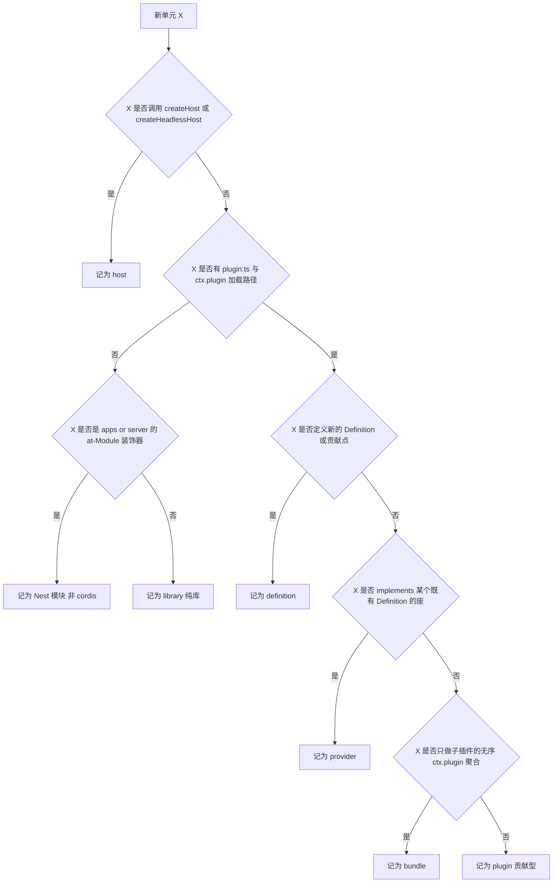
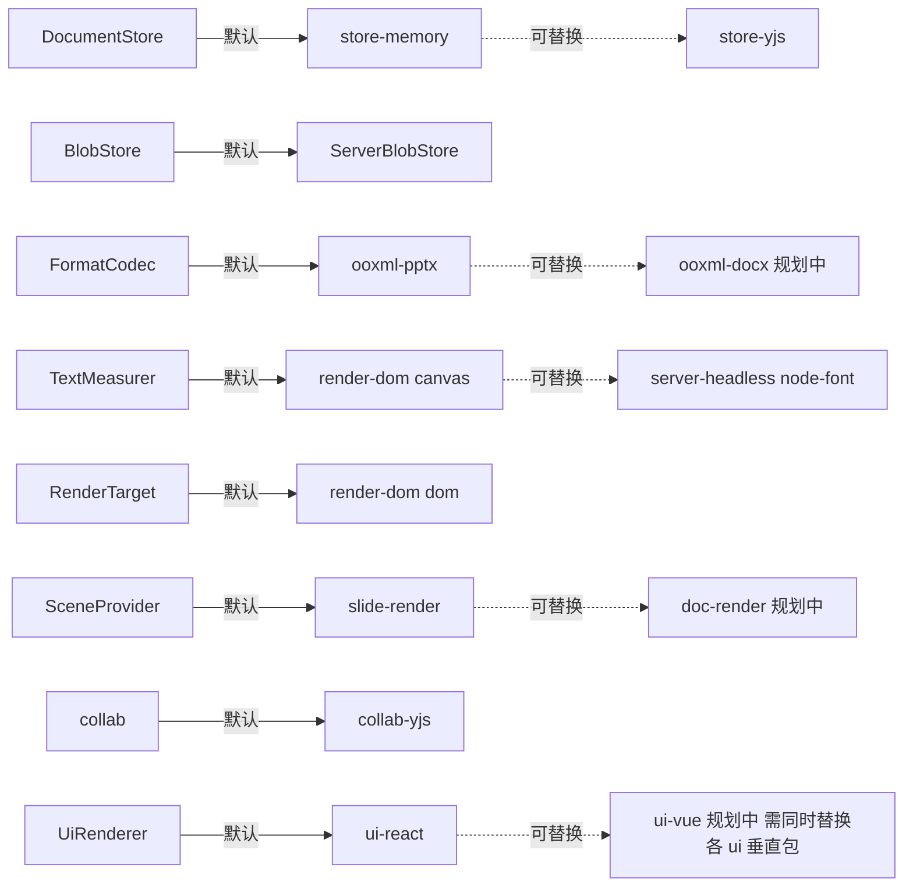
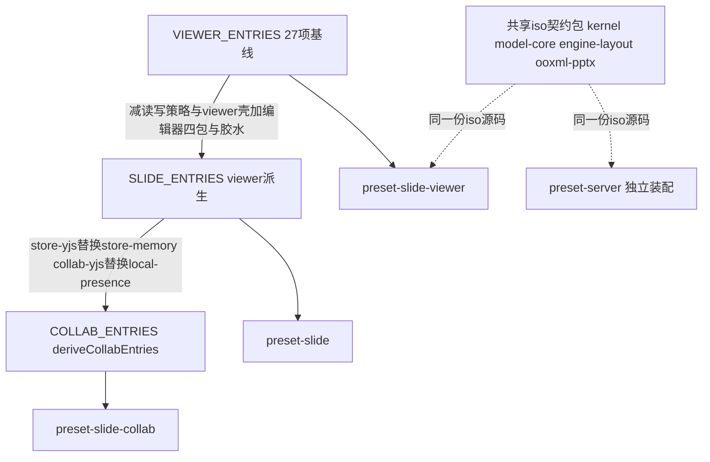
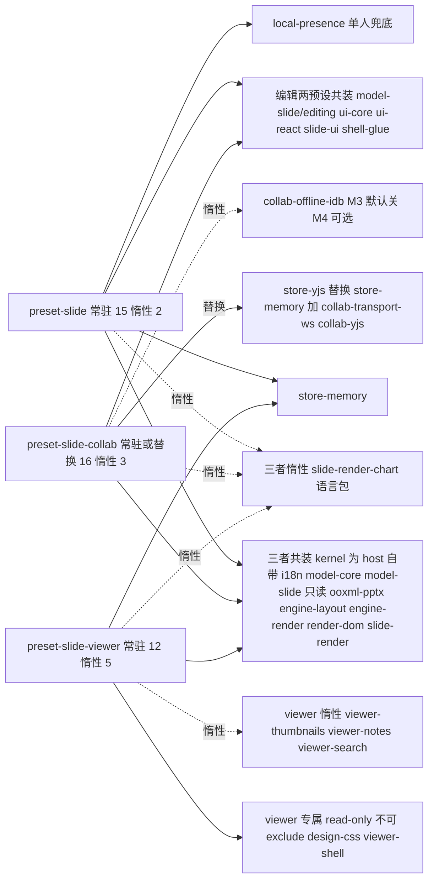
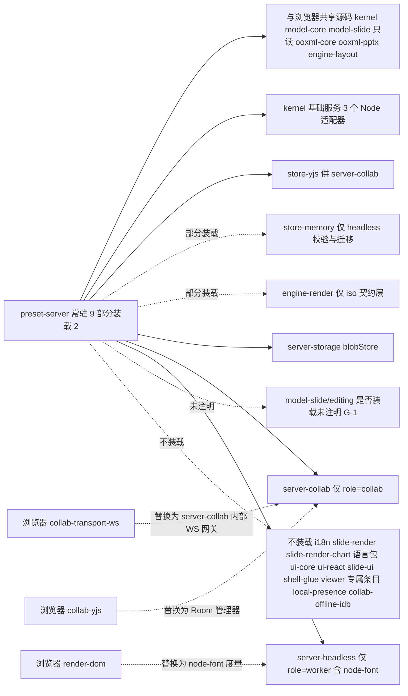

> 状态：草稿 v0.1 | 负责：架构-模块 | 更新：2026-09-22、2026-09-24（rulings §4.15）、2026-09-25（补图）、2026-09-25（矛盾收口，rulings §4.18） | 依赖：charter §5.2/§5.4/§5.5、03-kernel-and-plugin-model、00-module-map §3、40-modules 01–13 §3

# 16 插件总账与可插拔矩阵

## 0. 结论（一屏看懂）

本系统在 M0–M4 范围内（charter §5.2 已定包清单 + `apps/web` + `apps/server` 全部 Nest 模块）共有 **69 个运行时插件单元**（2026-09-24 由 71 减为 69：删除 `TenantsModule`〔T-0 单组织去租户〕与 `GroupsModule`〔U-11 组管理推迟〕，rulings §4.15），分布在 `40-modules/02`…`12` 十一份模块文档里；另有 **1 个构建期工具单元**（M-01 `tooling/*`，不进入任何运行时 Fiber 树，单独统计不计入 69）与 **10 个 M5 规划骨架单元**（M-13 `doc`/`sheet` 骨架，尚未进入 charter §5.2 包清单，单独统计不计入 69）。69 个单元里，真正意义上「cordis 可插拔」的（host/definition/provider/plugin/bundle 五类）有 **46 个**；另外 **23 个**是不构成 cordis Fiber 的纯库或 Nest 模块（§1 给出判定标准与三者不得混计的理由）。全系统登记在案的 Definition（可替换契约）共 **24 个**，覆盖它们的现有 Provider-Definition 实例合计 **32 个**（逐 Definition 数"默认+备选"两列里**已有具名包/类**的项，规划中/第三方/charter 举例性质的名字不计；同一 Provider 包实现多个 Definition 时按次计入，如 `render-dom` 同时计入 `TextMeasurer`/`RenderTarget`/`OverlayRenderer` 三次）；ContributionPoint（贡献点）登记 **26 个**（03 §3.6 基准，40-modules 未发现新增点 id）。

### 0.1 数字速览表

| 维度 | 计数 | 口径与构成（出处） |
|---|---|---|
| 运行时插件单元总数 | **69** | M-02(7)+M-03(2)+M-04(2)+M-05(4)+M-06(3)+M-07(2)+M-08(8)+M-09(16)+M-10(4)+M-11(12)+M-12(9)，见 §2 主表 69 行（2026-09-24：M-08 由 10 减为 8，rulings §4.15） |
| 构建期工具单元（不入 69） | **1** | M-01 `tooling/*`（40-modules/01 §0/§3：无 `plugin.ts`，不参与 `ctx.plugin()` 树） |
| M5 规划骨架单元（不入 69） | **10** | M-13：`model-doc`/`model-sheet`/`ooxml-docx`/`ooxml-xlsx`/`doc-render`/`sheet-render`/`doc-ui`/`sheet-ui`/`preset-doc`/`preset-sheet`（40-modules/13 §0/§3/§4；仅 `preset-doc`/`preset-sheet` 两个出现在 charter §5.2，其余 8 个未登记，见 §8 G-11） |
| — 按 cordis 形态分（69 内） | host **4**；definition **4**；provider **19**；plugin（贡献型）**16**；bundle **3**；library（纯库）**4**；Nest 模块（非 cordis）**19** | 4+4+19+16+3+4+19=69；构成清单见 §2 表前小计行与 §1 表 |
| — 按必需性分（69 内） | 内核必需 **8**；契约必需·Provider 可换 **9**；可选·降级 **17**；可选扩展 **9**；N/A（library/Nest/bundle，四分类不适用）**26** | 8+9+17+9+26=69；判据见 §1、逐行见 §2「必需性」列 |
| — 按运行位置分（69 内） | 两端共用 **13**；仅浏览器 **23**；仅 Node 服务端 **33** | 13+23+33=69；来源于各模块 §0「运行位置」字段与 00-module-map §5 表，明细见 §6 |
| Definition（契约）总数 | **24** | DocumentStore/BlobStore/FormatCodec/TextMeasurer/RenderTarget/SceneProvider/ElementRenderer/OverlayRenderer/collab/collabTransport/OfflineStore/SpillStore/UiRenderer/PermissionPolicy/DocumentType/Migration/ThumbnailRenderer/FanoutBus/LeaseLock/UpdateStore/SnapshotStore/AuthorizationSource/ErrorSink/TelemetrySink，见 §3 表 24 行 |
| 现有 Provider-Definition 实例 | **32** | 逐 Definition 数"默认 Provider"+"备选 Provider"两列里已有具名包/类的项（如 store-memory、store-yjs 各计 1），规划中/第三方/charter 举例性质的名字（如"未来 ui-vue""canvas / 第三方元素""Sentry/OTel"）不计；24 行明细：2+2+1+2+1+1+2+2+1+1+1+2+1+1+2+0+1+1+1+1+1+1+2+2=32 |
| ContributionPoint 总数 | **26** | 03-kernel-and-plugin-model.md §3.6 的 19 个表行展开为 26 个独立 id（其中 `ui.ribbon`/`ui.toolbar`/`ui.panel`/`ui.contextMenu`/`ui.statusBar`/`ui.dialog`/`ui.notification` 七个共用一行需拆开计数）；40-modules 01–13 未发现越出此 26 个之外的新贡献点 id，见 §4 |
| preset 装配后的插件条目数（不含 kernel 自身） | viewer **17**（12 常驻+5 惰性）；slide **17**（15 常驻+2 惰性）；collab **19**（16 常驻/替换+3 惰性） | 逐条 ●/◐/▲ 计数，出处 11-preset-assembly-and-app-shell.md §3.1（27 行装配清单总表），见 §5 |

**口径边界声明**：本文数字以「模块文档中出现的具名插件/Provider/Nest 模块」为准，不臆测未写明的单元；凡文档未给出完整字段（如某 Provider 缺 `inject`/`provide` 数组）的，§2 对应格标注「未注明」并在 §8 汇总为缺口，不影响已知字段的计数。

## 1. 分类口径（先说清楚「什么算一个插件」）

本项目里存在三种性质不同、不可混算的"单元"，逐一判定后才能进入 §2 主表：

| 形态 | 判定标准 | 在本项目的例子 | 是否出现在 Manifest | 是否可被 preset 裁剪 |
|---|---|---|---|---|
| **host** | 调用或封装 `createHost()`/`createHeadlessHost()`，是某个进程里 Fiber 树的根 | `@cordexjs/kernel`（工厂本身）、`@cordexjs/server-headless`、`apps/server` 的 `cordis-host.module.ts`+`preset-server.ts`、`apps/web` 的 `create-editor-host.ts` | 否（host 不是被装配的条目，不生成自身 manifest） | 否（是装配的发起者，不是被排除对象） |
| **definition** | 包的核心价值是声明一个可被多方实现的契约（`interface`/`defineContributionPoint`），自身也可能顺带是一个函数插件 | `@cordexjs/model-core`（`DocumentStore`/`CommandDef`…）、`@cordexjs/engine-layout`（`TextMeasurer`）、`@cordexjs/engine-render`（`render.*` 四点）、`@cordexjs/ui-core`（`UiRenderer`） | 是 | 视具体包而定（多数是"不建议排除"的契约必需层） |
| **provider** | `implements:[...]` 或以贡献点条目形式填入某个既有 Definition 的座；不定义新契约 | `store-memory`/`store-yjs`、`render-dom`、`collab-yjs`、`RedisFanoutBus` 等 | 是 | 是（`override`/`exclude` 的典型对象） |
| **plugin（贡献型）** | 只贡献贡献点条目/发布事件，不定义 Definition，不 `implements` 已有座 | `@cordexjs/i18n`、`@cordexjs/model-slide`、`@cordexjs/ooxml-pptx`、`@cordexjs/slide-ui`、`preset-slide#shell-glue` | 是 | 是 |
| **bundle** | 纯装配根：`createXxxPreset(options)`，`apply` 只对子条目做 `ctx.plugin()`，自身不定义契约不贡献条目 | `@cordexjs/preset-slide`、`@cordexjs/preset-slide-collab`、`@cordexjs/preset-slide-viewer` | 是（聚合子插件清单） | 不适用（它本身就是"选哪个"的单位） |
| **library（纯库）** | **无** `plugin.ts`，不 `inject`/`provide`，不注册贡献点，不参与任何 Fiber 生命周期，只被静态 `import` | `@cordexjs/shared`、`@cordexjs/protocol`、`@cordexjs/design`、`@cordexjs/ooxml-core`、`tooling/*` | 否（`scan-manifest` 规则 (a) 豁免 `role=library`；原称 `manifest-present`，rulings §4.18 GV-15） | 不适用（不是可加载/可排除的 Fiber） |
| **Nest 模块（非 cordis Fiber）** | `apps/server` 下的 `@Module()`，走 Nest 自身 DI 容器，从不调用 `ctx.plugin()` | `AuthModule`、`DocumentsModule`、`CollabModule`、`JobsModule` 等 19 个（2026-09-24 删 `TenantsModule`/`GroupsModule`） | 否 | 不适用（按 `CORDEX_ROLE` 装配表决定是否启动整模块，非 cordis `exclude`） |

**三者不可混算的理由**：cordis 插件单元（host/definition/provider/plugin/bundle）参与 Fiber 生命周期、失败隔离（A11）、`PENDING` 诊断与版本协商（03 §7–§10），是 R2「可插拔」验收的直接对象；纯库不挂载、不失败、不参与协商，只是被 `import` 的代码；Nest 模块走独立的 DI 生命周期与 `CORDEX_ROLE` 装配表（09 §4.3），两套"能否启动/能否替换"的机制完全不同（09 §3.6 记录了这两套开关目前**没有**机械互查）。把三者混进一个数字会让"71 个插件"这类表述失真——本文统一口径：**69 = cordis 单元 46 + 纯库 4 + Nest 模块 19**（2026-09-24 由 71 / Nest 21 更新，rulings §4.15）。

### 图 1-1 形态判定决策树

怎么读：先看是否创建宿主（host），再看有没有 `plugin.ts`（没有则进一步区分纯库还是 Nest 模块），有 `plugin.ts` 的再依次问"定义新契约吗""实现既有契约吗""只是聚合吗"，剩下的落进"贡献型 plugin"这个默认桶。

## 2. 插件总账（主表，一行一个插件单元）

覆盖 40-modules 01–13（含 apps/web、apps/server 全部 Nest 模块）里出现的全部 69 个运行时单元，按层/秩升序排列；「必需性」对 host/definition/provider/plugin/bundle 五类适用四分类（内核必需／契约必需·Provider 可换／可选·降级／可选扩展），library 与 Nest 模块因不参与 cordis 可插拔语义一律记 N/A（§1）；单元格「未注明」表示源文档在该处未给出可引用的字段值，已计入 §8 缺口。

**按承载模块分布**（69 = 各模块小计之和，用于反查 §2 主表某个模块起止的行号区间）：

| 模块文档 | 覆盖的 BC | 单元数 | 主表行号区间 |
|---|---|---|---|
| 40-modules/02 | BC-01…05（内核/共享/协议/i18n/文档内核） | 7 | 1–7 |
| 40-modules/03 | BC-06（幻灯片领域模型） | 2 | 8–9 |
| 40-modules/04 | BC-07/08（OOXML/PPTX 编解码） | 2 | 10–11 |
| 40-modules/05 | BC-09（协同客户端） | 4 | 12–15 |
| 40-modules/06 | BC-10/11（布局与渲染引擎） | 3 | 16–18 |
| 40-modules/07 | BC-12（幻灯片渲染） | 2 | 19–20 |
| 40-modules/08 | BC-18/19/20（身份与会话/文档目录/对象存储） | 8 | 21、38–44 |
| 40-modules/09 | BC-21/22/27（协同网关/快照/Headless 宿主） | 16 | 22–33、45–48 |
| 40-modules/10 | BC-13/14/15（设计系统/UI 基座/幻灯片 UI） | 4 | 34–37 |
| 40-modules/11 | BC-16/17（预设装配/应用壳） | 12 | 49–60 |
| 40-modules/12 | BC-23/24/25/26/30（作业/缩略图/评论/审计/Webhook） | 9 | 61–69 |
| **合计** | — | **69** | 1–69 |

| # | 插件名 `name` | 承载包 | 层/秩 | 同构 | 形态 | 必需性 | `inject` 必需 | `inject` 可选 | `provide` | `implements` | 提供贡献点 | 消费贡献点 | 加载位置 | 所属 preset | 出处 |
|---|---|---|---|---|---|---|---|---|---|---|---|---|---|---|---|
| 1 | N/A（纯库） | `@cordexjs/shared` | L0/0 | iso | library | N/A | — | — | — | — | 无 | 无 | N/A | 全部（隐式基础） | 02 §3 |
| 2 | `kernel` | `@cordexjs/kernel` | L0/0 | iso | host+plugin | 内核必需 | 无 | 无 | contributions,errors,telemetry | — | errors.sink,telemetry.sink | 无（自产自销 console/no-op） | root | 全部（host 自带，非条目） | 02 §3 |
| 3 | N/A（纯库） | `@cordexjs/protocol` | L0/0 | iso | library | N/A | — | — | — | — | 无 | 无 | N/A | 全部（隐式基础） | 02 §3 |
| 4 | `i18n` | `@cordexjs/i18n` | L0/0 | iso | plugin | 可选·降级 | contributions | 无 | i18n | — | i18n.bundle | i18n.bundle | root | viewer●,slide●,collab●,server(极少用) | 02 §3 |
| 5 | `model-core` | `@cordexjs/model-core` | L1/10 | iso | definition | 内核必需 | contributions,errors,telemetry | 无 | units,documentTypes,commands,formats,resources,migrations,permissions | — | core.documentType,core.command,core.mutation,core.format,core.resource,core.migration,core.permissionPolicy | 同左 7 个 | root | viewer●,slide●,collab●,server● | 02 §3 |
| 6 | `store-memory` | `@cordexjs/store-memory` | L1/10 | iso | provider | 契约必需·可换 | 无 | errors | store | store | 无 | 无 | UnitScope | viewer●,slide●,collab○,server◐（校验/迁移任务） | 02 §3 |
| 7 | `store-yjs` | `@cordexjs/store-yjs` | L1/10 | iso | provider | 契约必需·可换 | 无 | errors | store,yjsBackend | store | 无 | 无 | UnitScope | viewer○,slide○,collab▲（替换 store-memory）,server●（server-collab） | 02 §3 |
| 8 | `@cordexjs/model-slide`（主插件） | `@cordexjs/model-slide` | V-model/15 | iso | plugin | 可选·降级 | contributions,documentTypes | 无 | 无（UnitScope 经 unitPlugins 供 slides） | — | core.documentType(slide),core.migration,slide.shapeKind×9 | 无 | root+UnitScope(slides) | viewer●,slide●,collab●,server● | 03 §3 |
| 9 | `@cordexjs/model-slide/editing` | `@cordexjs/model-slide` | V-model/15 | iso | plugin | 可选扩展 | contributions,commands | 无 | 无 | — | core.mutation×46/47,core.command×73 | 无 | root | viewer○（ADR-0015 第一道）,slide●,collab●,server 未注明（见 §8 G-1） | 03 §3 |
| 10 | N/A（纯库） | `@cordexjs/ooxml-core` | L3/30 | iso | library | N/A | — | — | — | — | 无 | 无 | N/A | 全部（被 ooxml-pptx 静态 import） | 04 §3 |
| 11 | `@cordexjs/ooxml-pptx` | `@cordexjs/ooxml-pptx` | V-codec/35 | iso | plugin | 可选·降级 | contributions | 无 | 无 | — | core.format(ooxml-pptx) | 无 | root | viewer●,slide●,collab●,server● | 04 §3 |
| 12 | `localPresencePlugin` | `@cordexjs/collab-core` | L4/40 | iso | provider | 可选·降级 | 无 | 无 | presence | presence（单人兜底） | 无 | 无 | UnitScope | viewer○,slide●,collab○（替换为 collab-yjs）,server○ | 05 §3 |
| 13 | `collab-yjs` | `@cordexjs/collab-yjs` | L4/40 | iso | provider | 可选·降级 | store,yjsBackend,collabTransport,permissions | telemetry,offlineStore | collab,presence | collab,presence | 无 | 无 | UnitScope | viewer○,slide○,collab●,server○（服务端用 server-collab） | 05 §3 |
| 14 | `collab-transport-ws` | `@cordexjs/collab-transport-ws` | L4/40 | iso | provider | 可选·降级 | 无 | telemetry | collabTransport | collabTransport | 无 | 无 | root | viewer○,slide○,collab●,server○ | 05 §3 |
| 15 | `collab-offline-idb` | `@cordexjs/collab-offline-idb` | L4/40 | dom | provider | 可选扩展 | 无 | telemetry | offlineStore | offlineStore | 无 | 无 | UnitScope | viewer○,slide○,collab◐（M3 默认关）,server○ | 05 §3 |
| 16 | `engine-layout` | `@cordexjs/engine-layout` | L5/50 | iso | definition | 内核必需 | contributions | 无 | layout | — | layout.measurer | layout.measurer | root | viewer●,slide●,collab●,server● | 06 §3 |
| 17 | `engine-render` | `@cordexjs/engine-render` | L5/50 | iso(契约) | definition | 可选·降级 | contributions,layout | errors,telemetry | render | — | render.scene,render.target,render.element,render.overlay | 同左 4 个 | UnitScope | viewer●,slide●,collab●,server◐（仅 iso 契约层） | 06 §3 |
| 18 | `render-dom` | `@cordexjs/render-dom` | L5/50 | dom | provider | 契约必需·可换 | render,layout | 无 | 无 | render.target:dom,render.overlay×4,layout.measurer:canvas | render.target,render.overlay,layout.measurer | render.element | UnitScope | viewer●,slide●,collab●,server○ | 06 §3 |
| 19 | `slide-render` | `@cordexjs/slide-render` | V-render/55 | dom | plugin | 可选·降级 | contributions（根）+render,layout,slides（Unit） | 无 | 无（Unit 内供 thumbnails） | — | render.scene(slide),render.element×10,render.overlay(master-inheritance) | 无 | root+UnitScope | viewer●,slide●,collab●,server○（headless Chromium 间接） | 07 §3 |
| 20 | `slide-render-chart` | `@cordexjs/slide-render-chart` | V-render/55 | dom | plugin | 可选扩展 | contributions | commands | 无 | render.element(dom:graphicFrame:chart,replace) | 无 | 无 | root | viewer◐,slide◐,collab◐（惰性） | 07 §3 |
| 21 | 未注明（见 §8 G-9） | `@cordexjs/server-storage` | LS/58 | node | provider | 契约必需·可换 | 未注明 | 未注明 | blobStore | blobStore | 无 | 无 | root(preset-server) | server● | 08 §0 |
| 22 | `server-collab` | `@cordexjs/server-collab` | LS/58 | node | plugin | 内核必需(role=collab) | units,updateStore,snapshotStore,fanoutBus,leaseLock,authzSource,telemetry,spillStore | 无 | collabServer | — | 无 | 无 | root（自管理多 Room 隔离域） | server●(role=collab) | 09 §3.1 |
| 23 | server-headless（host 工厂，无单一 name） | `@cordexjs/server-headless` | LS/58 | node | host+provider | 内核必需(role=worker) | 无 | 无 | 无（node-font 子插件 provide layout.measurer） | — | layout.measurer(node-font) | 无 | 独立宿主实例（每任务） | server●(role=worker) | 09 §3.2 |
| 24 | `RedisFanoutBus` | `apps/server`(`modules/collab/infrastructure`) | LS/58（逻辑归 BC-21） | node | provider | 契约必需·可换 | 未注明(ioredis) | 未注明 | 无(Nest provider) | fanoutBus | 无 | 无 | root（经 preset-server 装配） | server● | 09 §3.4 |
| 25 | `RedisLeaseLock` | `apps/server`(`modules/collab/infrastructure`) | LS/58 | node | provider | 契约必需·可换 | 未注明(ioredis) | 未注明 | 无 | leaseLock | 无 | 无 | root | server● | 09 §3.4 |
| 26 | `PgUpdateStore` | `apps/server`(`modules/collab/infrastructure`) | LS/58 | node | provider | 契约必需·可换 | 未注明(Drizzle) | 未注明 | 无 | updateStore | 无 | 无 | root | server● | 09 §3.4 |
| 27 | `PgSnapshotStore` | `apps/server`(`modules/collab/infrastructure`) | LS/58 | node | provider | 契约必需·可换 | 未注明(Drizzle,blobStore) | 未注明 | 无 | snapshotStore | 无 | 无 | root | server● | 09 §3.4 |
| 28 | `AuthzSource` | `apps/server`(`modules/collab/infrastructure`) | LS/58 | node | provider | 契约必需·可换 | 未注明(RoleResolverService) | 未注明 | 无 | authzSource | 无 | 无 | root | server● | 09 §3.4 |
| 29 | `RedisSpillStore`（新增 S-3） | 同上`spill/` | LS/58 | node | provider | 可选·降级 | 未注明(ioredis) | 未注明 | 无 | spillStore(tier1) | 无 | 无 | root | server● | 09 §3.4 |
| 30 | `BlobSpillStore`（新增 S-3） | 同上`spill/` | LS/58 | node | provider | 可选·降级 | 未注明(blobStore) | 未注明 | 无 | spillStore(tier2) | 无 | 无 | root | server● | 09 §3.4 |
| 31 | `PinoLoggerAdapter` | `apps/server`(`cordis-host/adapters`) | LS/58（逻辑归 BC-01） | node | provider | 可选·降级 | 未详述（见 §8 G-8） | 未详述 | 无 | logger（kernel loggerSink） | 无 | 无 | root | server● | 09 §4.3 |
| 32 | `OtelTelemetryAdapter` | `apps/server`(`cordis-host/adapters`) | LS/58 | node | provider | 可选·降级 | 未详述 | 未详述 | 无 | telemetry.sink（推测） | telemetry.sink（推测） | 无 | root | server● | 09 §4.3 |
| 33 | `ErrorsReporterAdapter` | `apps/server`(`cordis-host/adapters`) | LS/58 | node | provider | 可选·降级 | 未详述 | 未详述 | 无 | errors.sink（推测） | errors.sink（推测） | 无 | root | server● | 09 §4.3 |
| 34 | N/A（纯库） | `@cordexjs/design` | L7/70 | dom | library | N/A | — | — | — | — | 无 | 无 | N/A | viewer●,slide●,collab●,server○ | 10 §3 |
| 35 | `ui-core` | `@cordexjs/ui-core` | L7/70 | dom | definition | 可选·降级 | contributions,commands,units,i18n | documentTypes,telemetry,errors | ui,shortcuts,theme | — | ui.ribbon,ui.toolbar,ui.panel,ui.contextMenu,ui.statusBar,ui.dialog,ui.notification,ui.shortcut,ui.command,ui.theme | 同左 10 个+core.command | root | viewer○,slide●,collab●,server○ | 10 §3 |
| 36 | `ui-react` | `@cordexjs/ui-react` | L7/70 | dom | provider | 可选·降级 | ui,shortcuts,theme,commands,i18n,units,contributions | presence,render,thumbnails,telemetry | uiRenderer | uiRenderer | ui.dialog×3,ui.notification×4,ui.shortcut×4,ui.command,i18n.bundle | ui.*(经 ui 服务) | root | viewer○,slide●,collab●,server○ | 10 §3 |
| 37 | `slide-ui` | `@cordexjs/slide-ui` | V-ui/75 | dom | plugin | 可选·降级 | contributions,ui,shortcuts,commands,i18n,units | uiRenderer,presence,documentTypes | 无 | — | ui.ribbon,ui.panel,ui.toolbar,ui.contextMenu,ui.statusBar,ui.shortcut,ui.command,i18n.bundle | 无 | root | viewer○,slide●,collab●,server○ | 10 §3 |
| 38 | `AuthModule` | `apps/server`(`modules/auth`) | L8/80 | node | Nest 模块 | N/A | — | — | — | — | 无 | 无 | N/A | server | 08 §3 |
| 39 | `UsersModule` | `apps/server`(`modules/users`) | L8/80 | node | Nest 模块 | N/A | — | — | — | — | 无 | 无 | N/A | server | 08 §3 |
| 40 | `DocumentsModule` | `apps/server`(`modules/documents`) | L8/80 | node | Nest 模块 | N/A | — | — | — | — | 无 | 无 | N/A | server | 08 §3 |
| 41 | `PermissionsModule` | `apps/server`(`modules/permissions`) | L8/80 | node | Nest 模块 | N/A | — | — | — | — | 无 | 无 | N/A | server | 08 §3 |
| 42 | `ShareLinksModule` | `apps/server`(`modules/share-links`) | L8/80 | node | Nest 模块 | N/A | — | — | — | — | 无 | 无 | N/A | server | 08 §3 |
| 43 | `StorageModule` | `apps/server`(`modules/storage`) | L8/80 | node | Nest 模块 | N/A | — | — | — | — | 无 | 无 | N/A | server | 08 §3 |
| 44 | `MediaModule` | `apps/server`(`modules/media`) | L8/80 | node | Nest 模块 | N/A | — | — | — | — | 无 | 无 | N/A | server | 08 §3 |
| 45 | `CollabModule` | `apps/server`(`modules/collab`) | L8/80 | node | Nest 模块 | N/A | — | — | — | — | 无 | 无 | N/A | server(role=collab) | 09 §3.3 |
| 46 | `SnapshotsModule` | `apps/server`(`modules/snapshots`) | L8/80 | node | Nest 模块 | N/A | — | — | — | — | 无 | 无 | N/A | server | 09 §3.3 |
| 47 | `CordisHostModule`(global) | `apps/server`(`cordis-host`) | L8/80 | node | Nest 模块 | N/A | — | — | — | — | 无 | 无 | N/A | server(全部角色) | 09 §3.3 |
| 48 | `CordisHostService`+`preset-server.ts` | `apps/server`(`cordis-host`) | L8/80 | node | host | 内核必需 | 无 | 无 | — | — | 无（装配层，间接覆盖全部 LS 包） | 无 | root(它即 root) | server（唯一组合根） | 09 §3.3/§4.3 |
| 49 | `preset-slide#shell-glue` | `@cordexjs/preset-slide` | L8/80 | dom | plugin | 可选扩展 | contributions | ui,shortcuts | 无 | — | core.command(shell.intent),ui.contextMenu×7,ui.shortcut,i18n.bundle | 无 | root | slide●,collab● | 11 §3.3 |
| 50 | `preset-slide-viewer#read-only` | `@cordexjs/preset-slide-viewer` | L8/80 | dom | plugin | 内核必需(viewer 中不可 exclude) | contributions | 无 | 无 | — | core.permissionPolicy(read-only) | 无 | root | viewer● | 11 §3.2/§3.3 |
| 51 | `preset-slide-viewer#viewer-shell` | `@cordexjs/preset-slide-viewer` | L8/80 | dom | plugin | 可选扩展 | units | render,thumbnails | 无 | — | 无 | 无 | root | viewer● | 11 §3.3 |
| 52 | `preset-slide-viewer#design-css` | `@cordexjs/preset-slide-viewer` | L8/80 | dom | plugin | 可选扩展 | 无 | 无 | 无 | — | 无 | 无 | root | viewer● | 11 §3.3 |
| 53 | 语言包（locale-packs） | `preset-*/src/plugins/locales/*.ts` | L8/80 | iso/dom | plugin | 可选·降级 | 无 | 无 | 无 | — | i18n.bundle | 无 | root（惰性） | viewer◐,slide◐,collab◐ | 11 §3.1 |
| 54 | `viewer-thumbnails` | `preset-slide-viewer/src/shell/lazy` | L8/80 | dom | plugin | 可选扩展 | 无 | 无 | 无 | — | 无 | 无 | root（惰性，manual） | viewer◐ | 11 §3.1 |
| 55 | `viewer-notes` | `preset-slide-viewer/src/shell/lazy` | L8/80 | dom | plugin | 可选扩展 | 无 | 无 | 无 | — | 无 | 无 | root（惰性，manual） | viewer◐ | 11 §3.1 |
| 56 | `viewer-search` | `preset-slide-viewer/src/shell/lazy` | L8/80 | dom | plugin | 可选扩展 | 无 | 无 | 无 | — | 无 | 无 | root（惰性，manual） | viewer◐ | 11 §3.1 |
| 57 | `preset-slide`(`createSlidePreset`) | `@cordexjs/preset-slide` | L8/80 | dom | bundle | N/A | 无（可选 errors） | 无 | 无 | — | 无（间接经 shell-glue） | 无 | root（被 apps/web 挂载） | slide | 11 §3.2 |
| 58 | `preset-slide-collab`(`createSlideCollabPreset`) | `@cordexjs/preset-slide-collab` | L8/80 | dom | bundle | N/A | 无 | 无 | 无 | — | 无（间接） | 无 | root | collab | 11 §3.2 |
| 59 | `preset-slide-viewer`(`createSlideViewerPreset`) | `@cordexjs/preset-slide-viewer` | L8/80 | dom | bundle | N/A | 无 | 无 | 无 | — | 无（间接经 read-only） | render/element-degraded,i18n/locale-changed（惰性触发） | root | viewer | 11 §3.2 |
| 60 | `create-editor-host.ts` | `apps/web` | L8/80 | dom | host | 内核必需 | 无 | 无 | — | — | 无（ESLint `apps/**` override 禁止，原称 `no-domain-defs-in-apps`，TD-093） | 无 | root(它即 root) | 调用 viewer/slide/collab 三者之一 | module-map BC-17；11 §0/§3.5 |
| 61 | `JobsModule` | `apps/server`(`modules/jobs`) | L8/80 | node | Nest 模块 | N/A | — | — | — | — | 无 | 无 | N/A | server | 12 §3 |
| 62 | `ImportExportModule` | `apps/server`(`modules/import-export`) | L8/80 | node | Nest 模块 | N/A | — | — | — | — | 无 | 无 | N/A | server | 12 §3 |
| 63 | `ThumbnailsModule` | `apps/server`(`modules/thumbnails`) | L8/80 | node | Nest 模块 | N/A | — | — | — | — | 无 | 无 | N/A | server | 12 §3 |
| 64 | `CommentsModule` | `apps/server`(`modules/comments`) | L8/80 | node | Nest 模块 | N/A | — | — | — | — | 无 | 无 | N/A | server | 12 §3 |
| 65 | `WebhooksModule`（新增 U-14） | `apps/server`(`modules/webhooks`) | L8/80 | node | Nest 模块 | N/A | — | — | — | — | 无 | 无 | N/A | server | 12 §3 |
| 66 | `AuditModule`(global) | `apps/server`(`modules/audit`) | L8/80 | node | Nest 模块 | N/A | — | — | — | — | 无 | 无 | N/A | server | 12 §3 |
| 67 | `HealthModule` | `apps/server`(`modules/health`) | L8/80 | node | Nest 模块 | N/A | — | — | — | — | 无 | 无 | N/A | server | 12 §3 |
| 68 | `MetricsModule` | `apps/server`(`modules/metrics`) | L8/80 | node | Nest 模块 | N/A | — | — | — | — | 无 | 无 | N/A | server | 12 §3 |
| 69 | `InternalModule` | `apps/server`(`modules/internal`) | L8/80 | node | Nest 模块 | N/A | — | — | — | — | 无 | 无 | N/A | server | 12 §3 |

**小计核对**（2026-09-24 删原 39 `TenantsModule`、41 `GroupsModule` 后重编行号，rulings §4.15）：形态——host 4（2/23/48/60）、definition 4（5/16/17/35）、provider 19（6/7/12/13/14/15/18/21/24/25/26/27/28/29/30/31/32/33/36）、plugin 16（4/8/9/11/19/20/22/37/49/50/51/52/53/54/55/56）、bundle 3（57/58/59）、library 4（1/3/10/34）、Nest 模块 19（38–44/45–47/61–69）。必需性——内核必需 8（2/5/16/22/23/48/50/60）、契约必需·可换 9（6/7/18/21/24/25/26/27/28）、可选·降级 17（4/8/11/12/13/14/17/19/29/30/31/32/33/35/36/37/53）、可选扩展 9（9/15/20/49/51/52/54/55/56）、N/A 26（1/3/10/34 + 38–44/45–47/61–69 + 57/58/59）。M-01 `tooling/*`（40-modules/01 §0/§3）与 M-13 十个 M5 骨架单元（40-modules/13 §3/§4）不计入本表 69 行，理由见 §0/§8。

## 3. Definition ↔ Provider 可插拔矩阵（章程 §5.4 的完整版）

24 个 Definition：模型/存储 3 个（DocumentStore/BlobStore/FormatCodec）、渲染与度量 5 个（TextMeasurer/RenderTarget/SceneProvider/ElementRenderer/OverlayRenderer）、协同 3 个（collab/collabTransport/OfflineStore）、UI 1 个（UiRenderer）、内核治理 5 个（model-core 的 PermissionPolicy/DocumentType/Migration 三个，加 kernel 的 ErrorSink/TelemetrySink 两个）、服务端专属 7 个（SpillStore/ThumbnailRenderer/FanoutBus/LeaseLock/UpdateStore/SnapshotStore/AuthorizationSource）——3+5+3+1+5+7=24。「方法数」凡源文档未给出完整签名一律记「未详述」，不臆造。

| Definition | 定义方（包） | 服务名或贡献点 key | 方法数 | 契约套件 | 默认 Provider | 备选 Provider（现有/规划/第三方） | 移除后果 | 机械验证 |
|---|---|---|---|---|---|---|---|---|
| `DocumentStore` | model-core | 服务 `store`（UnitScope） | 未详述（11-testing-strategy §3 描述覆盖"6 原语读写"，非签名计数） | `runDocumentStoreConformance` | store-memory | store-yjs（现有）；第三方可实现 `store` Provider | 否，必需，任一 Provider 皆可（charter §5.4 存储行） | `runDocumentStoreConformance`+`assertNoLiveEffects` |
| `BlobStore` | model-core（基础契约）+server-storage（服务端实现） | 服务 `blobStore` | 未详述 | `runBlobStoreConformance`（40-modules/08；2026-09-25 架构 08、11 §3 已统一为同名，旧名 `runBlobStorageConformance` 作废，§8 G-2 结案，rulings §4.18 GV-20） | 浏览器：MemoryBlobStore（testing-only）；服务端：ServerBlobStore（server-storage） | 浏览器侧无持久 Provider（module-map §5.1 明文） | 未见文档明确陈述（§8 G-14） | `runBlobStoreConformance` |
| `FormatCodec` | model-core | 贡献点 `core.format`，key=`codec.id` | 未详述（import/export 两方向） | `runFormatCodecConformance` | ooxml-pptx（`pptxCodec`） | 规划 ooxml-docx/ooxml-xlsx（M5，13 §3）；第三方可贡献新 codec | 是，无法打开文件（charter §5.4 格式行） | `runFormatCodecConformance` |
| `TextMeasurer` | engine-layout | 贡献点 `layout.measurer`，key=`id` | 未详述 | `runTextMeasurerConformance`（2026-09-25 架构 07、11 §3 与 ADR-0027 已统一为同名，旧名 `runMeasurerConformance` 作废，§8 G-2 结案，rulings §4.18 GV-20） | 浏览器：render-dom canvas 度量；服务端：server-headless node-font | 第三方可贡献 | 否，必需，任一 Provider（charter §5.4 度量行） | `runTextMeasurerConformance` |
| `RenderTarget` | engine-render | 贡献点 `render.target`，key=`id` | 未详述 | `runRenderTargetConformance` | render-dom（`'dom'`） | canvas / 第三方元素（charter §5.4 渲染行） | 是，空白画布（charter §5.4 渲染行） | `runRenderTargetConformance` |
| `SceneProvider` | engine-render | 贡献点 `render.scene`，key=`documentType` | 未详述 | `runSceneProviderConformance`（40-modules/06/14 用；架构 11-testing-strategy §3 未登记，§8 G-4） | slide-render（`'slide'`） | 规划 doc-render/`'doc'`、sheet-render/`'sheet'`（M5，13 §3） | render.scene 缺席，画布空白（07 §3 exclude 语义） | `runSceneProviderConformance` |
| `ElementRenderer` | engine-render | 贡献点 `render.element`，key=`` `${targetId}:${kind}` `` | 未详述 | 暂不设套件（M-06 G-8；实现方用 `SpyRenderer`/`RecordingTarget` 自测；2026-09-25 删旧名 `runElementRendererConformance`，rulings §4.18 GV-20） | slide-render（9–10 个 key） | slide-render-chart（replace 覆盖 1 个 key；`replace` 须在贡献点定义时显式声明，当前取值以 03 §3.6 总表 conflict 列为准，GV-24）；第三方可贡献新 kind | 元素级隔离：单元素失败→unknown 占位，不影响整页（A11） | 同左（暂无） |
| `OverlayRenderer` | engine-render | 贡献点 `render.overlay`，key=`id`，conflict=`replace` | mount/unmount（03 §3.6，14 §1 C-23） | 未见独立命名，疑并入 RenderTarget 套件（§8 G-5） | render-dom（4 个：selection/remote-presence/guides/comment-pins） | slide-render（1 个：master-inheritance） | 覆盖层缺失（如无选区框），画布主体不受影响 | 未见独立套件（§8 G-5） |
| `collab` | collab-core | 服务 `collab` | 未详述 | 无独立套件：其依赖的 `CollabTransport`/`OfflineStore` 由 `runCollabTransportConformance`、`runOfflineStoreConformance` 覆盖（2026-09-25 旧合并名 `runCollabConformance` 作废，架构 11 §3 同步，rulings §4.18 GV-20） | collab-yjs | 未来其他 CRDT 引擎（未见具名规划） | 是，单人模式（charter §5.4 协同行） | 同左 |
| `collabTransport` | collab-core | 服务 `collabTransport` | 未详述 | `runCollabTransportConformance`（40-modules；2026-09-25 架构 11 §3 已改用同名，合并名 `runCollabConformance` 作废，rulings §4.18 GV-20） | collab-transport-ws | webrtc 传输（charter §5.4 协同行） | collab-yjs 永久 PENDING（诊断非失败） | `runCollabTransportConformance` |
| `OfflineStore` | collab-core | 服务 `offlineStore` | 未详述 | `runOfflineStoreConformance`（40-modules 用；2026-09-25 架构 11 §3 已登记，rulings §4.18 GV-20） | collab-offline-idb | 无（M4 展望前无替代） | 内存队列降级（05 §2.5） | `runOfflineStoreConformance` |
| `SpillStore` | server-collab（`domain/contracts`） | 服务 `spillStore` | 4（`writeTier1`/`writeTier2`/`readAllOrdered`/`clear`，09 §3.4） | `runSpillStoreConformance` | RedisSpillStore（tier1）+BlobSpillStore（tier2）合组 | 无（rulings §4.13 S-3 新增机制） | 故障期可能退回拒写（rulings S-3 精神） | `runSpillStoreConformance` |
| `UiRenderer` | ui-core | 服务 `uiRenderer` | 未详述（含 `mount()`，11 §3.5） | `runUiRendererConformance`（40-modules/10 用；架构 11-testing-strategy §3 未登记，§8 G-4） | ui-react | 规划 ui-vue（未来，10 §0；**需同时替换全部 `*-ui` 的 `ui/` 层**，rulings §4.15 Q2）；示例级 `vanilla`（`examples/embed-vanilla` 最小 `UiRenderer('vanilla')`，仅用于形态 B 跑 `runUiRendererConformance`，示例非包，不计入 §0.1 实例数） | 是，headless（charter §5.4 UI 行；形态 B 须同时排除 `ui-react` 与 `slide-ui`，`FRAMEWORK_FREE_EXCLUDES`，Q2） | `runUiRendererConformance` |
| `PermissionPolicy` | model-core | 贡献点 `core.permissionPolicy`，key=`policy.id` | ≥1（`evaluate(cap)`，11 §3.3 示例） | 未见（无 `runPermissionPolicyConformance`，§8 G-7） | 无默认（fail-closed，零贡献即全部拒绝，D12） | preset-slide-viewer#read-only（viewer 预设具名贡献） | fail-closed：无显式允许即拒绝（charter D12） | `command-harness`：零策略→全部 `PERMISSION_DENIED`（02 §10） |
| `DocumentType` | model-core | 贡献点 `core.documentType`，key=`id` | 未详述（含 `createEmpty()`，03 §5.3） | 未见统一套件（各 body 自有 `runSlideModelConformance` 等，非注册机制本身的套件，§8 G-7） | model-slide（`'slide'`） | 规划 doc/sheet（M5，13 §3）；测试用 fixture（model-core/testing，现存）；第三方可贡献 | 是，`format.no_document_type` 错误码，宿主仍运行（charter §5.4 文档类型行） | 未见专属（§8 G-7） |
| `Migration` | model-core | 贡献点 `core.migration`，key=`` `${documentType}:${from}->${to}` `` | 未详述 | 未见（无 `runMigrationConformance`，§8 G-7） | 各 documentType 自注册（M1 为空表但注册，A23） | 未来随 schemaVersion 演进增补 | 未明确陈述（§8 G-7） | 未见（§8 G-7） |
| `ThumbnailRenderer` | server-headless（`infrastructure/thumbnails/thumbnail-renderer.ts`） | 经 `HeadlessHost.thumbnails` 只读字段访问（C-09 结案） | 2（`render`/`renderPdf`） | 显式声明不设跨包契约套件（"唯一实现，强依赖真实 Chromium"） | server-headless（唯一实现） | 无 | 缩略图/PDF 导出功能缺失 | `thumbnails.test.ts`（像素级 oracle，差 ≤0.5%，ADR-0026） |
| `FanoutBus` | server-collab | 服务 `fanoutBus` | 未详述 | `runFanoutBusConformance`（2026-09-25 在 40-modules/09 §2.5 补登，合并名 `runServerCollabAdaptersConformance` 作废，rulings §4.18 GV-20） | RedisFanoutBus | 未见 | 未明确陈述（推断：跨实例广播失效） | `runFanoutBusConformance` |
| `LeaseLock` | server-collab | 服务 `leaseLock` | 未详述 | `runLeaseLockConformance`（同上，GV-20） | RedisLeaseLock | 未见 | 未明确陈述 | `runLeaseLockConformance` |
| `UpdateStore` | server-collab | 服务 `updateStore` | 未详述 | `runUpdateStoreConformance` | PgUpdateStore | 未见 | 未明确陈述（推断：update 无法持久化） | `runUpdateStoreConformance` |
| `SnapshotStore` | server-collab | 服务 `snapshotStore` | 未详述 | `runSnapshotStoreConformance` | PgSnapshotStore | 未见 | 未明确陈述 | `runSnapshotStoreConformance` |
| `AuthorizationSource` | server-collab | 服务 `authzSource` | ≥1（`onPermissionChanged` 回调，09 §3.1） | 无独立套件：链接会话三场景（他人改权限不踢、撤销 ≤ 1 s 降权、到期降权）由 `runCollabServerConformance` 覆盖（09 §2.5，rulings §4.18 BE-02/GV-20） | AuthzSource | 未见 | 未明确陈述 | 同左 |
| `ErrorSink` | kernel | 贡献点 `errors.sink`，key=`id` | 1（`report(err,ctx)`，03 §3.6） | `runKernelServiceConformance`（errors/logger/telemetry 合并覆盖） | kernel 自贡献 console 实现 | Sentry/OTel（charter §5.4）；服务端 ErrorsReporterAdapter（09 §4.3，字段未详述，§8 G-8） | 是，降级为 no-op（charter §5.4 内核基础服务行） | `runKernelServiceConformance` |
| `TelemetrySink` | kernel | 贡献点 `telemetry.sink`，key=`id` | 未详述（counter/histogram/span/event 接收端） | `runKernelServiceConformance` | kernel 自贡献 no-op 实现 | OTel（charter §5.4）；服务端 OtelTelemetryAdapter（09 §4.3，字段未详述，§8 G-8） | 是，降级为 no-op | `runKernelServiceConformance` |

### 图 3-1 Definition 与 Provider 可替换关系（代表性子集）

怎么读：左列 8 个 Definition 只是 24 个中的代表性子集（覆盖存储/格式/度量/渲染/协同/UI 六个层带）；实线是"默认 Provider"，虚线是"已知可替换去处"（现有实现或已规划的包名，`规划中` 标注的尚未开工）。完整 24 个见上表。

## 4. 贡献点总账

以 03-kernel-and-plugin-model.md §3.6 的 19 个表行为基准，展开为 26 个独立贡献点 id（`ui.ribbon`/`ui.toolbar`/`ui.panel`/`ui.contextMenu`/`ui.statusBar`/`ui.dialog`/`ui.notification` 七个在 03 §3.6 共用一行，此处拆开各给一行）。核对结果：**40-modules 01–13 未发现越出这 26 个之外的新增贡献点 id**；唯一的"新增建议"落在既有点内部的新键值——`render.overlay` 的 `master-inheritance` key（07 §3 原文标注"新增建议"），不构成新点。

| 贡献点 id | 定义方 | 载荷类型 | key 规则 | 冲突策略 | 贡献方清单（包） | 消费方（服务） | 第三方可贡献 | 出处 |
|---|---|---|---|---|---|---|---|---|
| `core.documentType` | model-core | `DocumentType<S>` | `id` | error | model-slide（`slide`）；规划 model-doc/model-sheet；测试用 fixture（model-core/testing） | documentTypes,units | 是（D15 前缀规则） | 03 §3.6；02 §3；03 §3 |
| `core.command` | model-core | `CommandDef｜OperationDef` | `id` | error | model-slide/editing（73 个）；ui-core（6 条 `view.setMode` 等）；model-core 自身（内置 `core.undo`/`core.redo`） | commands | 是 | 03 §3.6；03 §3；10 §3 |
| `core.mutation` | model-core | `MutationDef` | `type` | error | model-slide/editing（46/47 个） | commands（事务内） | 是 | 03 §3.6；03 §3 |
| `core.format` | model-core | `FormatCodec` | `id` | error | ooxml-pptx（1 个） | formats | 是 | 03 §3.6；04 §3 |
| `core.resource` | model-core | `ResourceHook` | `namespace` | error | 40-modules 01–13 未见具体贡献方明确列出（§8 G-10） | resources、snapshot codec | 是 | 03 §3.6 |
| `core.migration` | model-core | `Migration` | `` `${documentType}:${from}->${to}` `` | error | model-slide（M1 空表但注册，A23） | migrations | 是 | 03 §3.6；03 §3 |
| `core.permissionPolicy` | model-core | `PermissionPolicy` | `policy.id` | error | preset-slide-viewer#read-only | permissions | 是 | 03 §3.6；11 §3.3 |
| `layout.measurer` | engine-layout | `TextMeasurer` | `id` | error | render-dom（canvas）；server-headless（node-font） | layout | 是 | 03 §3.6；06 §3；09 §3.2 |
| `render.target` | engine-render | `RenderTarget` | `id` | error | render-dom（`dom`） | render | 是 | 03 §3.6；06 §3 |
| `render.element` | engine-render | `ElementRenderer` | `` `${targetId}:${kind}` `` | replace（贡献点定义时声明，以 03 §3.6 为准，rulings §4.18 GV-24；2026-09-25 由 error 更正） | slide-render（9–10 个，含图表占位）；`./chart` 子路径或 slide-render-chart（1 个，同 key 覆盖占位） | render（查表） | 是 | 03 §3.6；07 §3 |
| `render.scene` | engine-render | `SceneProvider` | `documentType` | error | slide-render（`slide`） | render | 是 | 03 §3.6；07 §3 |
| `render.overlay` | engine-render | `OverlayRenderer{id;zIndex;mount;unmount}` | `id` | replace | render-dom（4 个）；slide-render（1 个，`master-inheritance` 为新增建议键值） | render（overlay 层） | 是 | 03 §3.6；06 §3；07 §3 |
| `errors.sink` | kernel | `ErrorSink{id;report}` | `id` | error | kernel 自身（console 默认）；服务端 ErrorsReporterAdapter（推测，§8 G-8） | errors（扇出） | 是 | 03 §3.6；02 §3 |
| `telemetry.sink` | kernel | `TelemetrySink` | `id` | error | kernel 自身（no-op 默认）；服务端 OtelTelemetryAdapter（推测，§8 G-8） | telemetry（扇出） | 是 | 03 §3.6；02 §3 |
| `i18n.bundle` | i18n | `{namespace;locale;messages}` | `` `${namespace}:${locale}` `` | replace | i18n 自身；ui-react（`ui`）；slide-ui（`slide.ui`）；shell-glue（`app`）；preset locale-packs | i18n | 是 | 03 §3.6；02/10/11 §3 |
| `ui.ribbon` | ui-core | `RibbonItem` | `id` | replace | slide-ui（6 页签+22 组+约 70 控件） | ui | 是 | 03 §3.6；10 §3 |
| `ui.toolbar` | ui-core | `ToolbarItem` | `id` | replace | slide-ui（3 个） | ui | 是 | 03 §3.6；10 §3 |
| `ui.panel` | ui-core | `PanelItem` | `id` | replace | slide-ui（11 个：缩略图/母版缩略图/备注/scopeBar/7 个检查器分区） | ui | 是 | 03 §3.6；10 §3 |
| `ui.contextMenu` | ui-core | `ContextMenuItem` | `id` | replace | slide-ui（4 个 slot 共 24 项）；shell-glue（7 项） | ui | 是 | 03 §3.6；10/11 §3 |
| `ui.statusBar` | ui-core | `StatusBarItem` | `id` | replace | slide-ui（4 个） | ui | 是 | 03 §3.6；10 §3 |
| `ui.dialog` | ui-core | `DialogItem` | `id` | replace | ui-react（3 个：shortcuts-panel/settings-drawer/command-palette） | ui | 是 | 03 §3.6；10 §3 |
| `ui.notification` | ui-core | `NotificationKind` | `id` | replace | ui-react（4 个） | ui | 是 | 03 §3.6；10 §3 |
| `ui.shortcut` | ui-core | `ShortcutItem{id;chord;commandId;when}` | `id` | replace | ui-react（约 6 条）；slide-ui（26 条）；shell-glue（1 条 `Mod+E`） | shortcuts | 是 | 03 §3.6；10/11 §3 |
| `ui.command` | ui-core | `CommandPresentation{commandId;title;icon;when}` | `commandId` | replace | ui-core 自身（6 条）；ui-react（4 条）；slide-ui（约 60 条） | ui（命令面板/菜单） | 是 | 03 §3.6；10 §3 |
| `ui.theme` | ui-core | `ThemeContribution{id;tokens;density}` | `id` | replace | 40-modules 01–13 未见实际贡献方（Beta，预留） | theme | 是 | 03 §3.6；10 §3 |
| `slide.shapeKind` | model-slide | `ShapeKindDef` | `kind` | error | model-slide 自身（9 项内建：sp/pic/grpSp/cxnSp/graphicFrame:table/chart/ole/diagram/unknown） | slides、slide-render | 是 | 03 §3.6；03 §3 |

**贡献点密度观察**：`ui.command`/`ui.ribbon`/`ui.shortcut` 三个点的贡献条目数（约 60、约 70、26+6+1）远超其余各点，全部集中在 `slide-ui` 一个包——这与 §2 主表里 `slide-ui` 只占 1 行形成对照：贡献点总账的"广度"和插件总账的"单元数"是两个独立维度，不能互相替代阅读。

### 4.1 按定义方分组

| 定义方（包） | 定义的贡献点数 | id 清单 |
|---|---|---|
| model-core | 7 | `core.documentType`/`core.command`/`core.mutation`/`core.format`/`core.resource`/`core.migration`/`core.permissionPolicy` |
| engine-render | 4 | `render.target`/`render.element`/`render.scene`/`render.overlay` |
| engine-layout | 1 | `layout.measurer` |
| kernel | 2 | `errors.sink`/`telemetry.sink` |
| i18n | 1 | `i18n.bundle` |
| ui-core | 10 | `ui.ribbon`/`ui.toolbar`/`ui.panel`/`ui.contextMenu`/`ui.statusBar`/`ui.dialog`/`ui.notification`/`ui.shortcut`/`ui.command`/`ui.theme` |
| model-slide | 1 | `slide.shapeKind` |
| **合计** | **26** | 7+4+1+2+1+10+1=26，与 §0 数字一致 |

七个定义方里六个是 §2 主表里"definition"或"definition+plugin"形态的单元（`model-core`/`engine-render`/`engine-layout`/`kernel`/`i18n`/`ui-core`），唯一例外是 `model-slide`（形态=plugin）——它定义 `slide.shapeKind` 但本身不是"definition"形态，因为 `slide.shapeKind` 相对它的核心职责（幻灯片领域模型）是附属产出，不是它存在的理由（对照 §1 判定标准第二行的措辞"核心价值是声明契约"）。

## 5. 三个 preset 的装配对比

数据源为 11-preset-assembly-and-app-shell.md §3.1「装配清单总表」（27 个条目，不含 `kernel` 本身——原文注"不是条目"）与 module-map §5.3「`preset-server`（kernel 基础服务 Provider + model-core + store-yjs + model-slide + ooxml-core/pptx + engine-layout + server-collab + server-storage + server-headless）」。`preset-server` 与浏览器三个 preset **不共享同一批 npm 包**（它用 `server-collab`/`server-headless`/`server-storage` 三个 LS 包替代 `collab-yjs`/`render-dom`/无 —— 浏览器侧本无持久 `BlobStore`），因此下表 `server` 列用"替换为 X"标出对应关系，不能理解为"同一份代码在四处运行"。

| 插件 | `preset-slide` | `preset-slide-collab` | `preset-slide-viewer` | `preset-server` | 备注（替换/裁剪原因） |
|---|---|---|---|---|---|
| `kernel`（host 自带，非条目） | ✓ | ✓ | ✓ | ✓ | 四者共享同一 `@cordexjs/kernel` 源码 |
| `i18n` | ✓ | ✓ | ✓ | ✗ | module-map §5.3 未把 `i18n` 列入 `preset-server` 构成（02 §0：服务端极少用） |
| `model-core` | ✓ | ✓ | ✓ | ✓ | 四者共享 |
| `store-memory` | ✓ | ✗ | ✓ | ◐ | server-headless 校验/迁移任务用（module-map §5.1），非 `preset-server` 主线 |
| `store-yjs` | ✗ | 替换为自身（原为 store-memory） | ✗ | ✓ | slide 用 store-memory；collab/server 都用 store-yjs |
| `model-slide`（只读） | ✓ | ✓ | ✓ | ✓ | 四者共享 |
| `model-slide/editing` | ✓ | ✓ | ✗（ADR-0015 第一道） | 未注明（§8 G-1） | viewer 不可用编辑命令表；server 是否加载未见文档明确陈述 |
| `ooxml-pptx` | ✓ | ✓ | ✓ | ✓ | 四者共享 |
| `engine-layout` | ✓ | ✓ | ✓ | ✓ | 四者共享 |
| `engine-render` | ✓ | ✓ | ✓ | ◐ | server 只用其 iso 契约层，不含完整渲染运行时 |
| `render-dom` | ✓ | ✓ | ✓ | 替换为 server-headless 的 node-font | server 不需要 DOM 渲染，只需度量 |
| `slide-render` | ✓ | ✓ | ✓ | ✗ | headless Chromium 路径是独立浏览器进程，不计入 `preset-server` 自身构成 |
| `slide-render-chart` | ◐ | ◐ | ◐ | ✗ | headless Chromium 路径是独立浏览器进程，不计入 `preset-server` 自身构成 |
| 语言包 locale-packs | ◐ | ◐ | ◐ | ✗ | server 不需要 UI 文案 |
| `preset-slide-viewer#read-only` | ✗ | ✗ | ✓（不可 exclude） | ✗ | 只读策略是 viewer 专属必需条目 |
| `preset-slide-viewer#design-css` | ✗ | ✗ | ✓ | ✗ | viewer 无 ui-core，需单独注入主题 CSS |
| `preset-slide-viewer#viewer-shell` | ✗ | ✗ | ✓ | ✗ | viewer 专属工具条/键盘/超链接壳 |
| `viewer-thumbnails`/`viewer-notes`/`viewer-search` | ✗ | ✗ | ◐ | ✗ | viewer 专属惰性子功能 |
| `local-presence` | ✓ | ✗ | ✗ | ✗ | slide 单人预设的兜底 presence；collab 用 collab-yjs 替换；viewer/server 均不需要 |
| `ui-core` | ✓ | ✓ | ✗ | ✗ | viewer 无编辑器 UI；server 无 UI |
| `ui-react` | ✓ | ✓ | ✗ | ✗ | viewer 无编辑器 UI；server 无 UI |
| `slide-ui` | ✓ | ✓ | ✗ | ✗ | viewer 无编辑器 UI；server 无 UI |
| `preset-slide#shell-glue` | ✓ | ✓ | ✗ | ✗ | 应用栏「⋯」菜单胶水，viewer/server 无应用栏 |
| `collab-transport-ws` | ✗ | ✓ | ✗ | 替换为 server-collab 内部 WS 网关 | 客户端传输 Provider vs 服务端网关是两套实现 |
| `collab-yjs` | ✗ | ✓ | ✗ | 替换为 server-collab | 客户端同步引擎 vs 服务端 Room 管理器 |
| `collab-offline-idb` | ✗ | ◐（M3 默认关，M4 可选） | ✗ | ✗ | 离线队列是浏览器专属能力 |
| `@cordexjs/server-storage`（`blobStore`） | ✗ | ✗ | ✗ | ✓ | 浏览器侧无持久 `BlobStore` Provider（module-map §5.1），媒体字节只由服务端持有 |
| `@cordexjs/server-collab`（`collabServer`） | ✗ | ✗ | ✗ | ✓（role=collab） | 服务端 Room 生命周期与持久化，客户端无对应包 |
| `@cordexjs/server-headless`（host+node-font） | ✗ | ✗ | ✗ | ✓（role=worker） | 服务端独立宿主，承担导入/导出/校验/迁移/缩略图 |

**插件数小计**（来自 11 §3.1 原表的 ●/◐/▲ 计数，逐条见 §2 主表「所属 preset」列）：`preset-slide-viewer` 常驻 12 + 惰性 5 = **17**；`preset-slide` 常驻 15 + 惰性 2 = **17**；`preset-slide-collab` 常驻/替换 16 + 惰性 3 = **19**；`preset-server` 常驻 9 + 部分装载 2（`store-memory`/`engine-render`）= **11**（`model-slide/editing` 是否装载未注明，不计入本小计，见 §8 G-1）。

### 5.1 `preset-server` 自身装配清单（module-map §5.3 原文展开）

`preset-server` 不是独立发布的 npm 包（不像 `preset-slide` 三兄弟），而是 `apps/server/src/cordis-host/preset-server.ts` 里的一段装配脚本；下表把 module-map §5.3 那句话（"kernel 基础服务 Provider + model-core + store-yjs + model-slide + ooxml-core/pptx + engine-layout + server-collab + server-storage + server-headless"）展开为逐条状态，口径与 §2 主表一致。

| 条目 | 装载状态 | 对应 §2 主表行号 | 备注 |
|---|---|---|---|
| kernel 基础服务 Provider（3 个 Node 适配器） | ● | 31/32/33 | `PinoLoggerAdapter`/`OtelTelemetryAdapter`/`ErrorsReporterAdapter` |
| `model-core` | ● | 5 | 全部角色共用 |
| `store-yjs` | ● | 7 | `server-collab` 用 |
| `store-memory` | ◐ | 6 | 仅 `server-headless` 校验/迁移任务用，非主线 |
| `model-slide`（只读） | ● | 8 | 全部角色共用 |
| `model-slide/editing` | 未注明 | 9 | 见 §8 G-1 |
| `ooxml-core`+`ooxml-pptx` | ● | 10/11 | 全部角色共用 |
| `engine-layout` | ● | 16 | 全部角色共用 |
| `engine-render`（仅 iso 契约层） | ◐ | 17 | 不含 `render-dom` |
| `server-collab` | ●（role=collab） | 22 | 提供 `collabServer` |
| `server-storage` | ● | 21 | 提供 `blobStore` |
| `server-headless` | ●（role=worker） | 23 | host 工厂 + `node-font` |

小计：常驻 9（含 3 个 kernel 适配器合计为 1 组、`model-core`/`store-yjs`/`model-slide`/`ooxml`/`engine-layout`/`server-collab`/`server-storage`/`server-headless`）+ 部分装载 2（`store-memory`/`engine-render`）= **11**，与上方"插件数小计"一致。

**体积影响**（11 §3.4，`config/bundle-budget.json` 为事实源）：`preset-slide-viewer` 基线预算 **≤350 KB gzip**（分解合计 345 KB，余量 5 KB，超 5%〔367.5 KB〕CI 失败）；编辑器形态（`preset-slide`+`ui-react`+`slide-ui`，不含 React 本体）预算 **≤900 KB**（估算 774 KB）；协同增量（`store-yjs`+yjs+collab 三包+lib0/y-protocols+在场/评论 UI）**≤200 KB**（估算 150 KB）。三档预算各自独立文件维护，M2 按实测校准。

### 图 5-1 preset 继承与替换关系

怎么读：`preset-slide` 由 `preset-slide-viewer` 的基线条目集合做加减法派生（11 §3.1「超集/派生关系」），`preset-slide-collab` 再对 `preset-slide` 做替换派生；`preset-server` 不参与这条派生链，只是与浏览器三者共享同一批 iso 契约包的源码（虚线），装配脚本、Provider 选择完全独立。

**图 5-2 浏览器三个 preset 装配对比**

怎么读：左侧三个 preset，右侧是按「谁装载」归并的插件组；实线为常驻装载，虚线为惰性装载，「替换」边对应 §5 装配对比表的 ▲；不是三者都连向的组就是差异所在——`gEdit` 是两个编辑预设相对查看器多出的部分，`gLocal` 与 `gCollab`/`gOffline` 区分单人与协同，`gStoreMem` 为单人与查看器共用，查看器差异在只读策略与 viewer 专属条目。节点上的计数与上方「插件数小计」一致。

依据：§5 装配对比表与插件数小计；11 §3.1。

**图 5-3 preset-server 与浏览器预设的替换对应**

怎么读：`preset-server` 是 `apps/server` 内的一段装配脚本而非 npm 包，与浏览器三者只共享 iso 源码；左下三个浏览器插件在服务端没有同名装载，而是被虚线指向的服务端包替代（「替换」不等于同一份代码）。`model-slide/editing` 是否装载文档未注明，保留为 §8 G-1 缺口。

依据：§5 装配对比表 `preset-server` 列；§5.1 展开表；module-map §5.1/§5.3。

## 6. 按运行位置与进程角色分组

按 §2 主表「加载位置」与各模块 §0「运行位置」字段汇总（数字与 §0.1 一致）：**两端共用 13 个**（#1–11、16、17，即 shared/kernel/protocol/i18n/model-core/store-memory/store-yjs/model-slide 二段/ooxml-core/ooxml-pptx/engine-layout/engine-render）；**仅浏览器 23 个**（#12–15 协同客户端四包 + #18–20 渲染 DOM 层三包 + #34–37 UI 四包 + #49–60 preset 装配层十二个 = 4+3+4+12=23）；**仅 Node 服务端 33 个**（#21–33、38–48、61–69，即 server-storage/server-collab/server-headless、7 个协同 IO 适配器、3 个 kernel 服务 Node 适配器、19 个 Nest 模块、apps/server host；2026-09-24 由 35 减为 33，rulings §4.15）。

### 6.1 服务端按 `CORDEX_ROLE` 的资源归属（09 §7.1，原文摘录）

| 资源 | 归属 | 激活的进程角色（`CORDEX_ROLE`） |
|---|---|---|
| `CordisHostService`（进程单例 Context） | `apps/server/src/cordis-host` | 全部角色（`api`/`collab`/`worker`；2026-09-24 `roles.ts` 补 `all`〔单容器 api+collab+worker 同进程〕与 `renderer`〔独立零出站 Chromium sidecar，只装 M-09 renderer 入口、不装任何含凭据的 Nest 模块〕，见 12 §7.1，rulings §4.15 Q8/Q10） |
| `collabServer` 服务（`@cordexjs/server-collab`） | `preset-server` 装配进同一进程 Context | 仅 `collab` |
| `server-headless` 宿主（`@cordexjs/server-headless`） | 按需 `createHeadlessHost()`，`worker_threads` 隔离 | 仅 `worker` |
| WS 网关（`CollabModule`） | `modules/collab/interface/collab.gateway.ts` | `collab` |
| 快照 REST（`SnapshotsModule`） | `modules/snapshots` | 仅 `collab`（`all` 含）；反代把 `/api/v1/documents/:id/snapshots*` 转给 collab，启动断言 `role=api` 不得装配（2026-09-25，rulings §4.18 BE-03；原：`api`/`collab` 均可挂载，作废） |
| `JobsModule`/`ImportExportModule`/`ThumbnailsModule` 的 BullMQ 处理器 | 各自 `infrastructure/*.processor.ts` | `worker`（REST 控制器另在 `api` 挂载，处理器与控制器分属不同角色是同一 Nest 模块内的常见形态） |
| `AuthModule`/`UsersModule`/`DocumentsModule`/`PermissionsModule`/`ShareLinksModule`/`StorageModule`/`MediaModule`/`WebhooksModule`/`AuditModule`/`HealthModule`/`MetricsModule`/`InternalModule` | 各自 `modules/*` | 未见逐模块显式 `CORDEX_ROLE` 归属表（§8 G-12），推断以 `api` 为主（→ 2026-09-25：逐模块、逐部件归属以 40-modules/12 §7.1「模块 × 角色 × 部件」矩阵为准，rulings §4.18 BE-13） |

**已知的角色边界缺口**（15-server-architecture-review.md §3.6 原文，非本文新发现，此处引用以完整呈现"进程角色"维度）：`CommentsModule` 的 `CommentMirrorObserver` 需要订阅 `collabServer` 的 Room 广播，但 `collabServer` 只在 `role=collab` 时被 `preset-server` 激活；若 `CommentsModule` 按其 REST 部分的要求也在 `role=api` 下注册，`CommentMirrorObserver` 在 `api` 角色进程里的降级行为（no-op 还是抛错）当前**没有任何文档提及**（→ 2026-09-25 已收口：`CommentMirrorObserver` 只在 collab 角色注册，评论 REST 留在 api，rulings §4.18 BE-03，40-modules/12 §7.1）。这是一个跨越"运行位置分组"与"§8 缺口"两节的具体证据，此处不重复计数，仅在 §8 引用编号。

### 6.2 同一 Definition 在不同进程的不同 Provider（module-map §5.1，原表节选）

| Definition | 浏览器 Provider | 服务端 Provider | 说明 |
|---|---|---|---|
| `DocumentStore`（`store`） | `store-memory`（默认/查看器）或 `store-yjs`（协同） | `store-yjs`（`server-collab`，Room 即 Unit）或 `store-memory`（`server-headless` 校验/迁移任务） | 两个 Provider 本身都是 iso，用哪个取决于"是否需要 CRDT"而非运行环境本身 |
| `layout.measurer`（`TextMeasurer`） | `render-dom` 的 canvas 度量 | `server-headless` 的 `node-font`（标注"近似一致"） | headless Chromium 渲染路径下仍用 canvas 度量（因为 Chromium 本身是浏览器） |
| `BlobStore` | `MemoryBlobStore`（`model-core/testing`，仅测试） | `ServerBlobStore`（`server-storage`：S3 协议〔自托管默认 SeaweedFS，rulings §4.15 Q10〕/本地） | 浏览器侧没有持久 `BlobStore` Provider；`collab-offline-idb` 是 `OfflineStore` 而非 `BlobStore`，不可混淆 |

### 6.3 五种执行上下文各自加载的插件集

浏览器侧的三个 preset 组合已在 §5 逐条给出，此处只给"这一进程加载了哪些单元"的汇总名单，不重复 ✓/✗ 明细；服务端三个角色的名单来自 §6.1 的角色归属证据与 §5.1 的 `preset-server` 展开表交叉得出。

| 执行上下文 | 加载的插件集（按 §2 主表行号） | 名单 |
|---|---|---|
| 浏览器 · `preset-slide-viewer` | 17 个（12 常驻+5 惰性，`kernel` 作为 host 自带不单独计入条目数，下同） | 行 4/5/6/8/11/16/17/18/19/50/51/52 常驻，20/53/54/55/56 惰性 |
| 浏览器 · `preset-slide` | 17 个（15 常驻+2 惰性） | 行 4/5/6/8/9/11/12/16/17/18/19/35/36/37/49 常驻，20/53 惰性 |
| 浏览器 · `preset-slide-collab` | 19 个（16 常驻/替换+3 惰性） | 行 4/5/7▲/8/9/11/13/14/16/17/18/19/35/36/37/49 常驻，20/53/15 惰性 |
| Node · headless（`server-headless` 独立宿主，`role=worker` 按需创建） | 行 5/6◐/10/11/16/17◐/23，另含 `ThumbnailRenderer` 适配器（§3 行 17） | 无 UI/无 render-dom；`store-memory` 只用于校验/迁移，非主线持久化 |
| Nest · `role=collab` | 行 47（`CordisHostModule`）/45（`CollabModule`）/46（`SnapshotsModule`，BE-03）/48（host）/22（`server-collab`）/24–30（7 个 IO 适配器）/31–33（3 个 kernel 适配器）/5/7/8/10/11/16 | 唯一激活 `collabServer` 服务与 WS 网关的角色（§6.1） |
| Nest · `role=api` | 行 47/48/38–44（7 个 M08 REST 模块）/21（`server-storage`）/61–69 中的 REST 控制器部分（`JobsModule`/`ImportExportModule`/`ThumbnailsModule`/`CommentsModule`/`WebhooksModule`/`AuditModule`/`HealthModule`/`MetricsModule`/`InternalModule`） | 逐模块到角色的完整映射未见文档给出，本行是推断（§8 G-12），不计入 §0 数字 |
| Nest · `role=worker` | 行 47/48/23（`server-headless`）/31–33（3 个 kernel 适配器）/61–63 中的 BullMQ 处理器部分（`JobsModule`/`ImportExportModule`/`ThumbnailsModule`） | 唯一能创建 `server-headless` 独立宿主实例的角色（§6.1 原文） |

## 7. 可插拔性自检（R2 验收口径）

逐条回答 charter §5.4「每一级的可插拔如何体现」九行，每条给替换点、替换方式、契约套件保证三项；判定与 §3 矩阵一一对应。

| # | 层级 | 对应 Definition/机制（§3 行） | 替换点在哪 | 怎么替 | 契约套件保证 | 移除后能否启动（charter §5.4 原文） |
|---|---|---|---|---|---|---|
| 1 | 内核基础服务 | `ErrorSink`/`TelemetrySink` | `errors.sink`/`telemetry.sink` 贡献点；kernel `HostOptions.defaultSinks`/`loggerSink` | 新插件 `ctx.contribute(errorsSinkPoint, mySink)`，或 `createHost({ defaultSinks:false, loggerSink })` 自定义 | 有：`runKernelServiceConformance` | 是（降级为 no-op） |
| 2 | 存储 | `DocumentStore` | preset 装配清单里的 `store-memory`/`store-yjs` 条目（11 §3.1 `override`） | `createSlidePreset({ override: { store: myStoreProvider } })` | 有：`runDocumentStoreConformance` | 否（必需，但任一 Provider 皆可） |
| 3 | 文档类型 | `DocumentType` | `core.documentType` 贡献点 | 任意插件 `ctx.contribute(documentTypePoint, def)` | 无专属套件（§3 行 15；各 body 自有 `run*ModelConformance`，非注册机制本身） | 是（`format.no_document_type`，宿主仍运行） |
| 4 | 格式 | `FormatCodec` | `core.format` 贡献点 | 任意插件 `ctx.contribute(formatPoint, codec)` | 有：`runFormatCodecConformance` | 是（无法打开文件） |
| 5 | 协同 | `collab`/`collabTransport`/`OfflineStore` | preset 装配清单里的 `collab-yjs`/`collab-transport-ws`/`collab-offline-idb` 三个条目 | `exclude` 整组 → 单人模式；`override` 单个 Provider → 换传输/换离线策略 | 有：`runCollabTransportConformance`/`runOfflineStoreConformance`（2026-09-25 架构 11 §3 已按此改名，合并名 `runCollabConformance` 作废，rulings §4.18 GV-20） | 是（单人模式） |
| 6 | 渲染 | `RenderTarget`/`ElementRenderer`/`SceneProvider`/`OverlayRenderer` | `render.target`/`render.element`/`render.scene`/`render.overlay` 四个贡献点 | 新插件贡献对应条目；`slide-render-chart` 是`conflict:replace` 覆盖的范例 | 有（`OverlayRenderer` 除外，§3 行 8/§8 G-5）：`runRenderTargetConformance`/`runSceneProviderConformance`（`ElementRenderer` 暂不设套件，M-06 G-8；2026-09-25 删旧名，rulings §4.18 GV-20） | 是（空白画布） |
| 7 | 度量 | `TextMeasurer` | `layout.measurer` 贡献点 | 新插件贡献 `{id, …}`；浏览器/服务端各自默认 Provider 不同（§6.2） | 有：`runTextMeasurerConformance`（架构侧旧名 `runMeasurerConformance` 已于 2026-09-25 统一，§8 G-2 结案） | 否（必需，任一 Provider） |
| 8 | UI | `UiRenderer` + 十个 `ui.*` 贡献点 | preset 装配清单里的 `ui-core`/`ui-react`/`slide-ui` 三个条目 | `exclude` → headless（`ui-core` 贡献仍注册，只是无渲染）；`override` `uiRenderer` → 换框架绑定（如未来 `ui-vue`，**需同时替换全部 `*-ui`**；形态 B 的 `exclude` 须含 `slide-ui`，rulings §4.15 Q2） | 有：`runUiRendererConformance`（架构侧未登记，§8 G-4） | 是（headless） |
| 9 | 服务端 | Nest 模块 + `BlobStore` Provider | `apps/server` 各模块的 IO 适配器目录（如 `collab/infrastructure/*.ts`）；`preset-server.ts` 的装配清单 | 新写一个 `implements:['fanoutBus']` 等的 Provider 类，改 `preset-server.ts` 里对应 inject 项 | 部分：`UpdateStore`/`SnapshotStore`/`SpillStore` 有专属命名套件；`FanoutBus`/`LeaseLock`/`AuthorizationSource` 无（§8 G-6） | 按模块（未统一给出总口径） |

**结论**：9 条里 7 条（1/2/4/6 部分/7/8）有名字明确的契约套件兜底可插拔性；3 条（3/6 的 `OverlayRenderer`/9 的三个服务端 Definition）没有专属套件，替换正确性目前只能靠人工评审或集成测试覆盖，这是本表最值得跟进的机械化缺口（汇总进 §8）。

**契约套件的统一设计约束**（11-testing-strategy.md §3 原文，适用于本文引用的全部 `run*Conformance`）：kit 只依赖 Definition 本身与 `testing` 子路径的 fakes，不感知具体 Provider 实现细节；参数 `factory()` 统一返回 `{ ctx, provider, dispose }`；每个用例结束后断言 `assertNoLiveEffects`（确保替换/卸载不留残余 effect）。`scan-manifest` 规则 (e)（09-06 §6，原称 `provider-runs-conformance`，rulings §4.18 GV-15）核对"凡 `provide=['x']` 的插件，其包内必有对该 Definition kit 的调用"，这条规则本身就是 §3 矩阵"契约套件"列为空时值得警惕的信号——理论上不该有 `provide` 却无套件调用的包。

### 7.1 关键机械约束速查（可插拔性背后的强制机制）

| 约束/扫描器 | 保证什么 | 关联层级（§7 行号） |
|---|---|---|
| `scan-manifest` 规则 (a)（原称 `manifest-present`，GV-15） | `plugin`/`provider`/`definition` 角色的包必须有入库的生成物 `manifest.ts`（`cordex-manifest.json` 为构建产物，GV-17）；`library` 角色豁免 | 全部（§1 分类口径） |
| `preset-order-independence` | 随机打乱 `ctx.plugin` 顺序 100 次，最终 Fiber 状态与贡献表集合不变 | 2/5/6/8（存储/协同/渲染/UI 均由 preset 装配） |
| depcruise `cordex-viewer-no-editing`（原称 `no-editing-in-viewer`，GV-15） | `preset-slide-viewer` 的 bundle 依赖图不含 `@cordexjs/model-slide/editing` 子路径 | 3（文档类型，viewer 只读保证第一道） |
| lint `cordex/events-must-be-declared` 规则 3（原称 `event-domain-whitelist`，GV-15） | 事件名/贡献点 id 的域前缀必须在保留域名单或带 `<vendor>:` 前缀 | 3/4/6（文档类型/格式/协同的第三方扩展口子） |
| `scan-contributions` 规则 (e)（原称 `when-keys-declared`，GV-15） | `ui.*` 贡献的 `when` 子句只能引用已登记的上下文键 | 8（UI，§8 G-13 的直接成因，已结案） |
| `server-app-thin`（depcruise） | Nest 模块不得 `import '@cordexjs/model-*'`/`'yjs'`，业务逻辑必须经 `preset-server` | 9（服务端） |
| `no-unit-scoped-inject-at-root` | 根级插件不得 `inject` UnitScope 服务 | 2/6（存储/渲染的 UnitScope 边界） |
| `scan-bundle-budget`（原称 `bundle-budget`） | 读 Rollup stats 校验 `config/bundle-budget.json` 声明的体积上限，超 5% 判失败 | 对应 §5「体积影响」 |

怎么读：R2「可插拔」不是一句口号，每一行验收口径背后都能找到至少一个具名扫描器或测试套件；§8 记录的缺口本质上都是"这一格本该有一个具名机制，但目前找不到"。

## 8. 发现的缺口与不一致（只报告，不改）

本节只陈述编写本文过程中在源文档间发现的不一致或缺失，**不修改任何现有文件**。共 14 项，编号 G-1、G-2、G-4…G-15（**不含 G-3**：正文里指向"G-3"的一处引用——§3 矩阵 `BlobStore` 行"移除后果"列——实际内容已并入 8.6 的 G-14 一并陈述，避免重复编号）；按性质分六组，组内不强求编号连续。

### 8.1 契约套件命名与登记不一致（5 项）

| 编号 | 现象 | 证据（出处） | 影响 |
|---|---|---|---|
| G-2 | `TextMeasurer` 的契约套件在 40-modules（06/09 §3 多处）命名为 `runTextMeasurerConformance`，架构层 `11-testing-strategy.md` §3 的登记表命名为 `runMeasurerConformance`；`BlobStore` 的契约套件在 40-modules/08 命名为 `runBlobStoreConformance`，`30-architecture/08-backend-nestjs.md`、`11-testing-strategy.md` §3 命名为 `runBlobStorageConformance`（连 Definition 本身也一个叫 `BlobStore` 一个叫 `BlobStorage`） | `grep run.*Conformance` 全仓结果对照 | 两套名字若都被当真实符号使用，扫描器 `manifest-present`/conformance 校验会各按各的名字找不到对方，属于需要在实现前统一的命名分歧 **→ 2026-09-25 结案**（rulings §4.18 GV-20）：架构 11 §3、07、08 已改为 `runTextMeasurerConformance`、`runBlobStoreConformance`/`MemoryBlobStore`，Definition 统一称 `BlobStore`。 |
| G-4 | `runSceneProviderConformance`（06/14 用）与 `runUiRendererConformance`（10 用）在 40-modules 里广泛出现，但 `11-testing-strategy.md` §3 的"Definition 的 Provider 一致性套件"登记表完全没有收录这两行 | `30-architecture/11-testing-strategy.md` §3 表格 vs `40-modules/06`、`40-modules/10` | 架构层的"canonical registry"滞后于模块层实际用法，若照架构文档实现会漏掉这两个 Definition 的套件 |
| G-5 | `OverlayRenderer`（`render.overlay`）在 §3 矩阵里没有任何一处提到独立命名的契约套件；不确定它是并入 `RenderTarget` 的 `runRenderTargetConformance` 一起测，还是完全没有覆盖 | 06/07 §3 全篇搜索无 `runOverlay*Conformance` | 覆盖层（选区框、远端光标、母版继承徽标）的 Provider 契约目前无机械验证依据 |
| G-6 | 服务端协同的 6 个 Definition（`FanoutBus`/`LeaseLock`/`UpdateStore`/`SnapshotStore`/`AuthorizationSource`/`SpillStore`）里，40-modules/09 只给 `UpdateStore`/`SnapshotStore`/`SpillStore` 三个起了专属套件名；`FanoutBus`/`LeaseLock`/`AuthorizationSource` 全篇未见任何契约套件名。架构层 `11-testing-strategy.md` §3 把前四个（不含 `SpillStore`，新增较晚）合并登记为一个 `runServerCollabAdaptersConformance`，但这个合并名在 40-modules/09 全文从未出现过；同一张架构表把 `CollabService`/`Transport`/`Presence` 合并为一个 `runCollabConformance`，而 40-modules/05 实际拆成三个套件分别命名（`runCollabConformance`/`runCollabTransportConformance`/`runOfflineStoreConformance`），且 `OfflineStore` 这个 Definition 在架构层登记表里完全没有出现 | `30-architecture/11-testing-strategy.md` §3 vs `40-modules/05` §3、`40-modules/09` §3.4 | 架构层与模块层两套契约套件命名体系并存且互不对齐，`FanoutBus`/`LeaseLock`/`AuthorizationSource` 三个 Definition 目前没有任何一层给出可引用的套件名 **→ 2026-09-25 部分结案**（rulings §4.18 GV-20）：40-modules/09 §2.5 补登 `runFanoutBusConformance`、`runLeaseLockConformance`，架构 11 §3 拆掉合并名 `runServerCollabAdaptersConformance` 并删 `runCollabConformance`；`AuthorizationSource` 仍无独立套件，由 `runCollabServerConformance` 的链接会话三场景覆盖（BE-02）。 |
| G-7 | `PermissionPolicy`、`DocumentType`、`Migration` 三个 `model-core` 贡献点在全仓搜索中都没有对应的 `run*Conformance` 命名（无 `runPermissionPolicyConformance`/`runMigrationConformance`；`DocumentType` 本身的注册机制也没有，只有具体 body 的 `runSlideModelConformance` 等） | 全仓 `grep runXxxConformance`，对照 §3 矩阵第 14/15/16 行 | `PermissionPolicy` 是 fail-closed 的权限判定路径，`Migration` 关系到快照升级正确性，两者都属于"错了会很痛"的契约，但目前只能靠 `command-harness` 零策略测试和人工评审兜底 |

### 8.2 单元文档详尽度不对称（4 项）

| 编号 | 现象 | 证据（出处） | 影响 |
|---|---|---|---|
| G-1 | `@cordexjs/model-slide/editing` 是否被 `preset-server` 装配，未见任何文档明确陈述——`11-preset-assembly-and-app-shell.md` §3.1 的装配清单总表只覆盖浏览器三个 preset（`viewer`/`slide`/`collab` 三列），`preset-server` 的构成只在 `00-module-map.md` §5.3 以一句话列了 9 个组件名，未细到"是否含 editing 子插件" | 09 §3.3/§4.3、module-map §5.3、11 §3.1 | 服务端迁移/校验任务是否具备执行 Mutation 的能力（例如迁移需要改写快照）不能从现有文档确定 |
| G-8 | `apps/server/src/cordis-host/adapters/` 下的 `PinoLoggerAdapter`/`OtelTelemetryAdapter`/`ErrorsReporterAdapter` 三个类，全篇只有一行"文件职责表"式的用途描述（"kernel `logger`/`telemetry`/`errors` 服务的 Node 实现"），没有 02 §3 那种标准字段表（`name`/`inject`/`provide`/贡献点/生命周期/Manifest 片段）——是 09 号文档里唯一三个缺这张表的 Provider 单元 | `40-modules/09` §4.3 目录树、§5 文件职责表 | 无法确认这三个适配器是通过 `ctx.contribute(errorsSinkPoint, …)` 注册，还是作为 `HostOptions.loggerSink` 之类的普通配置值传入——两种机制在 §1 的分类口径下会落进不同的形态桶，本文按"provider"处理但标注为推测 |
| G-9 | `40-modules/08` §3 标题为「Nest 模块定义表」，全篇没有给 `@cordexjs/server-storage` 自己的插件形状字段，尽管 08 §0 已明确把它标为 `cordis 形态 = provider（implements:['blobStore']）`——`02`/`05`/`06`/`07`/`09`/`10` 里每一个 provider 包都有一张标准字段表，唯独 `server-storage` 没有 | `40-modules/08` 全篇 vs 其余模块 §3 体例 | `server-storage` 的 `inject`/`provide`/`Config` schema/生命周期/Manifest 片段在 §2 主表第 21 行只能标"未注明" |
| G-10 | `core.resource` 贡献点在 `03-kernel-and-plugin-model.md` §3.6 有完整定义（`ResourceHook`，key=`namespace`），但 40-modules 01–13 的任何一份模块 §3 都没有列出"谁实际贡献了 `core.resource`"——评论模块提到的 `resources.comments.*` 是服务端读模型术语，不构成 cordis `ctx.contribute` 的证据 | 全仓搜索 `core.resource` 贡献方 | §4 贡献点总账该行的"贡献方清单"目前只能写"未见具体列出"，是 26 个贡献点里唯一贡献方全缺的一个 |

### 8.3 命名/机制跨文档不一致（2 项）

| 编号 | 现象 | 证据（出处） | 影响 |
|---|---|---|---|
| G-11 | charter §5.2 包清单（v0.2，权威）只登记了 `@cordexjs/preset-doc`/`@cordexjs/preset-sheet` 两个 M5 包；`40-modules/13` §0/§4 详细定义了另外 8 个（`model-doc`/`model-sheet`/`ooxml-docx`/`ooxml-xlsx`/`doc-render`/`sheet-render`/`doc-ui`/`sheet-ui`），这 8 个未出现在 charter §5.2 表格的任何一行 | `00-charter/charter.md` §5.2 全表 vs `40-modules/13` §0/§4 | 若 M5 立项时以 charter §5.2 为唯一权威包清单核对，会漏掉 8 个已经有完整骨架设计的包；反之说明 13 号文档的规划范围超出了章程当前收录范围，需要在 M5 启动前回填 charter |
| G-13 | `40-modules/13` §3 的插件级元信息表里，`doc-ui`/`sheet-ui` 两行「消费贡献点」写的是 `ui.contextKey`（`unitType`），但 `03-kernel-and-plugin-model.md` §3.6 与 charter §5.5 都没有登记 `ui.contextKey` 为贡献点 id——`unitType` 在 03 §3.6「when 子句上下文键」一节里明确是**上下文键（context key）**，与贡献点（ContributionPoint）是两套不同机制（03 §3.4 专门区分了这一点）。13 号文档这里要么是把两种机制的术语用混了，要么是在提议一个未经 03 §3.6 登记的新贡献点 | `40-modules/13` §3 表格 vs `03-kernel-and-plugin-model.md` §3.4/§3.6 | 如果 M5 实现时照字面意思去 `ctx.contribute(uiContextKeyPoint, …)`，会找不到这个贡献点定义；正确做法应是读取 03 §3.6 登记的 `unitType` 上下文键 **→ 2026-09-25 结案**（rulings §4.18 FE-17）：13 §3 与图 3-1 已改为「无（`when` 子句读取 ui-core 上下文键 `unitType`）」，并删去 `*-render`「消费 `render.target`」与不存在的 `scenes` 注入。 |

### 8.4 服务端进程角色装配覆盖不全（1 项）

| 编号 | 现象 | 证据（出处） | 影响 |
|---|---|---|---|
| G-12 | 21 个（2026-09-24 起为 19 个，删 `TenantsModule`/`GroupsModule`，rulings §4.15）Nest 模块中，只有 `CollabModule`/`SnapshotsModule`/`CordisHostModule`（M-09 §7.1）和 `JobsModule`/`ImportExportModule`/`ThumbnailsModule` 的 BullMQ 处理器部分（M-12）被明确关联到具体 `CORDEX_ROLE`（`api`/`collab`/`worker`）；其余 15 个（2026-09-24 起为 13 个）模块（M-08 的 9 个〔2026-09-24 起 7 个〕 + M-12 的 `CommentsModule`/`WebhooksModule`/`AuditModule`/`HealthModule`/`MetricsModule`/`InternalModule`）没有逐模块的角色归属表。`15-server-architecture-review.md` §3.6 本身也记录了这个缺口的一个具体实例：`CommentsModule` 的 `CommentMirrorObserver` 依赖仅 `role=collab` 才激活的 `collabServer`，但 `CommentsModule` 的 REST 部分按惯例应在 `role=api` 下也注册，两者叠加时 `api` 角色进程里 `CommentMirrorObserver` 的降级行为未见任何文档说明；`config/roles.ts`（Nest 侧角色→模块表）与 `cordis-host/preset-server.ts`（cordis 侧角色→插件束）是两套独立维护、2026-09-21 才补上部分一致性断言（`role=collab`/`role=worker` 两种）的开关，尚未覆盖全部 21 个模块 | `40-modules/09` §7.1；`40-modules/15-server-architecture-review.md` §3.6；`40-modules/09` §2（`ServiceMap`/角色一致性断言代码） | 本文 §6.1 表格里 15 个模块的"激活角色"一栏只能写"推断以 `api` 为主"，不是可核对的一手事实；这也解释了为什么 §2 主表把 21 个 Nest 模块的"必需性"一律记 N/A 而非按角色细分必需性——角色粒度的必需性目前没有权威数据源 **→ 2026-09-25 结案**（rulings §4.18 BE-13）：40-modules/12 §7.1 给出全服务端「模块 × 角色 × 部件」矩阵，ADR-0037 决策 1 与架构 08 §0 引用它，启动断言逐项核对。 |

### 8.5 charter §5.2 的 `package.json#cordex` schema 落后于 01/14 号文档的裁定（1 项）

| 编号 | 现象 | 证据（出处） | 影响 |
|---|---|---|---|
| G-15 | charter §5.2 给出的 `package.json#cordex` 字段规范只有 4 个键（`layer`/`iso`/`bundle`/`stability`），且明确声明"depcruise 与扫描器以此为唯一元数据来源"；但 `40-modules/01-tooling-and-governance.md` §2.2 已把它扩到 8 个键（新增 `role`/`compositionRoot`/`publicEntry`，`role` 取 `definition\|provider\|consumer\|n/a` 四值，供 depcruise 三角色规则折叠使用），并且这个扩展已经过 `14-cross-module-review.md` §1 C-11 正式裁定落地（"已裁定并落地"）；本文 §2 主表大量引用的 Manifest 片段（如 10 §3 的 `{"layer":"L7","rank":70,...,"role":"library",...}`）用的正是这套扩展后的字段，不是 charter §5.2 原文的 4 键版本 | `00-charter/charter.md` §5.2 末尾代码块 vs `40-modules/01-tooling-and-governance.md` §2.2、`40-modules/14-cross-module-review.md` §1 C-11、`40-modules/10-ui-shell-and-slide-ui.md` §3/§5 多处 Manifest 片段 | 本文任务书要求以 charter §5.2 为必读依据之一；若读者只读 charter 不读 01/14，会得到一份**已被架构评审否决的旧字段规范**，且不知道"唯一元数据来源"这句断言已不成立——这不是本文的新发现，01 号文档自己已经登记为 D-8 并裁定，但 charter 侧尚未回写同步，属于章程与模块文档"谁是唯一事实源"的一处遗留不同步 **→ 2026-09-25**（rulings §4.18 FE-21）：第八键定为 `implements`（provider 必填、R7 读取）；`rank` 不是包元数据键（由 `layer` 查秩表得出，schema 拒绝未知键）；组合根显式写 `compositionRoot:true`。 |

### 8.6 「移除后果」系统性缺失（1 项，跨多个 Definition）

| 编号 | 现象 | 证据（出处） | 影响 |
|---|---|---|---|
| G-14 | charter §5.4 的"移除后能否启动"一列只覆盖 9 个粗粒度层级（内核基础服务/存储/文档类型/格式/协同/渲染/度量/UI/服务端），落到 §3 矩阵的 24 个具体 Definition 时，有 7 个（`BlobStore`/`FanoutBus`/`LeaseLock`/`UpdateStore`/`SnapshotStore`/`AuthorizationSource`/`Migration`）在任何一份源文档里都找不到"如果这个 Provider 缺失，系统具体表现是什么"的直接陈述——本文 §3 表格对这些行只能写"未明确陈述"或给出基于 Definition 单 Provider 语义的合理推断（已在对应格标注"推断"二字） | §3 矩阵第 2/17–21 行「移除后果」列 | R2 验收口径（章程 §5.4）目前只在粗粒度层级上是完整的；细到具体 Definition 一级，近三分之一（7/24）没有可引用的移除后果描述，验收时需要先补齐这批陈述才能逐 Definition 编写"移除仍可启动"的自动化测试 |

**范围说明**：本节只列本文写作过程中发现、且有明确出处可核对的不一致，不包含"文档尚未写到"（如 M5 骨架本就标注 experimental）这类已被源文档自己声明为未定的事项；§8.2 里"推测"/"未注明"字样均已在 §2/§3 对应格标出，此处是汇总而非新发现。
