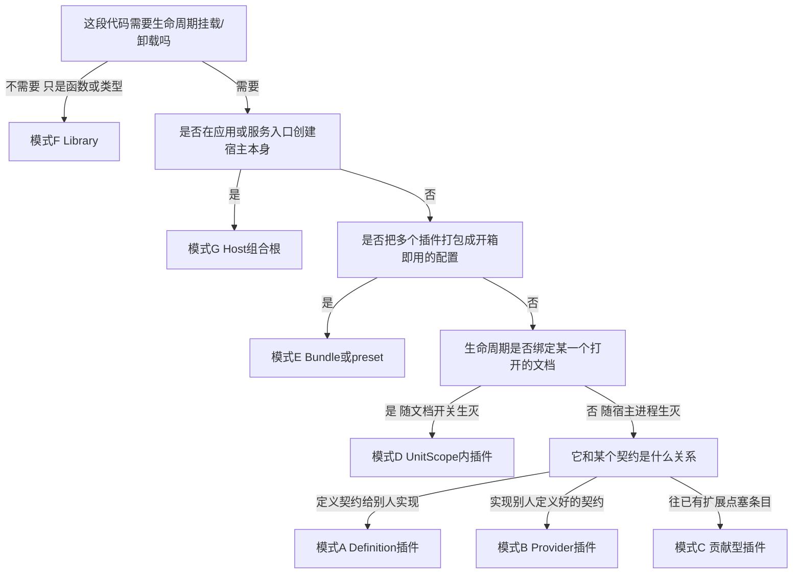

> 状态：草稿 v0.1 | 负责：架构-模块 | 更新：2026-09-22、2026-09-24（rulings §4.15）、2026-09-25（补图）、2026-09-25（矛盾收口，rulings §4.18）、2026-09-25（§4.19） | 依赖：cordis-primer、03-kernel-and-plugin-model、09-type-discipline、40-modules 02/16

# 17 插件书写模式手册

本手册回答"每种插件具体怎么写、为什么这么写、如何符合 cordis 设计"，是 `03-kernel-and-plugin-model.md`（内核与插件模型的**规则**）与各 `40-modules/NN` §3（各包的**事实**）之间的**写法**层文档：前者告诉你规则是什么，后者告诉你某个包实际怎么做，本手册教你照着规则把下一个包写对。全部代码骨架的 cordis API 用法以 `00-charter/cordis-primer.md` 为事实源；找不到依据的 API 一律不用或显式标注"待核实"。

---

## 0. 速查：我要写的是哪一种？

七种模式不是互斥分类，而是七个观察角度——同一个插件常常同时属于多种（例如 `store-yjs` 既是 §2.2 模式 B 的 Provider，又是 §2.4 模式 D 的 UnitScope 插件；`engine-layout` 既是 §2.1 模式 A 的 Definition，其 `apply` 本身也是一个普通函数插件）。判断不准时，先走下面的决策树定主轴，再跳对应小节核对"本项目实例"是否与你要写的东西同构；两个以上模式都命中时，每个命中的小节都要过一遍检查清单。

| 模式 | 一句话判据 | 本项目实例 | 章节 |
|---|---|---|---|
| A 定义插件（Definition） | 我要定义一个契约，交给别的包实现，我自己不是唯一实现 | `model-core` 的 `DocumentStore<S>`；`engine-layout` 的 `layout.measurer`/`TextMeasurer`；`collab-core` 的 `collab`/`collabTransport` | §2.1 |
| B 实现插件（Provider） | 我要实现别人已经定义好的契约 | `store-memory`/`store-yjs` 实现 `DocumentStore`；`render-dom` 实现 `render.target`/`layout.measurer`；`ooxml-pptx` 实现 `core.format` 的 `FormatCodec` | §2.2 |
| C 贡献型插件 | 我要往已经存在的扩展点塞条目，条目之间互不排斥 | `model-slide` 贡献 `core.documentType`/`core.command`/`core.mutation`；`slide-render` 贡献 `render.scene`/`render.element`；`slide-ui` 贡献 `ui.ribbon` 等 | §2.3 |
| D UnitScope 内插件 | 我要随每个打开的文档生灭，不是随宿主进程生灭 | `store`/`history`/`selection`/`render`/`presence` 的默认 Provider；`collab-yjs`；`engine-render` | §2.4 |
| E Bundle/preset | 我要把一批插件打包成一个开箱即用的产品形状 | `preset-slide`/`preset-slide-collab`/`preset-slide-viewer` | §2.5 |
| F Library（非插件） | 我只提供纯函数/纯类型，没有生命周期可言 | `@cordexjs/shared`；`@cordexjs/ooxml-core`；`@cordexjs/design` | §2.6 |
| G Host 组合根 | 我在应用或服务入口创建一个 cordis 宇宙 | `apps/web` 的 `create-editor-host.ts`；`server-headless` 的 `createHeadlessHost`；`apps/server` 的 `cordis-host.service.ts` | §2.7 |

**图 0-1 模式判定决策树**



怎么读：决策树只给主轴归类顺序，不代表模式互斥——命中 D 之后仍要回头看它对契约的关系是 A/B/C 中的哪一种（`store-yjs` 会先落到 D，再回头发现自己相对 `DocumentStore` 是 B）。`package.json#cordex.role` 的七值（`library|plugin|definition|provider|bundle|app|tooling`，02-layering-and-packages §4.0.1）与本节七种模式大致对应，但不是一一映射：`role` 是包级元数据（一个包只能填一个值），模式是写法视角（一个包内的多个文件可能分属不同模式，例如 `engine-render` 包 `role=definition`，但它 `apply` 内 `ctx.plugin(RenderService)` 那一步是普通插件挂载）。

---

## 1. cordis 4 基线（只列本项目用到的）

事实源：`cordis@4.0.0-rc.10`（cordis-primer.md）。**只有 `@cordexjs/kernel` 允许 `import ... from 'cordis'`**（depcruise R12 `only-kernel-imports-cordis`，03 §1.1）；其余全部包只能 `import ... from '@cordexjs/kernel'`，用的是 kernel 的 re-export 面或 kernel 自产的新概念（`createHost`、`defineContributionPoint`、`ctx.contribute`/`ctx.contributions`、`createIsolatedScope`、`errors`/`telemetry`、诊断函数）。下表"kernel 封装"列区分三种情况：**原样转发**（类型/值不变，只是换了 import 路径）、**kernel 新概念**（cordis 本身没有，是 kernel 在其上加的一层）、**仅内核使用**（cordis 原生 API 存在，但本项目规定只有 kernel 内部代码能调用，插件作者不得直接用）。

| API / 概念 | 签名或形态 | 语义 | 本项目用法与约束 | kernel 封装 | 出处 |
|---|---|---|---|---|---|
| `Context` | 类型 | 作用域化的能力环境；属性读经服务解析 | 插件签名 `apply(ctx: Context, config: Config)` 的第一参数类型 | 原样转发（`export type { Context } from 'cordis'`） | primer §3.1；03 §1.1 |
| `ctx.plugin(plugin, ...config)` | `(P, ...Spread<GetPluginConfig<P>>) => Fiber & PromiseLike<Fiber>` | 挂载一个插件，返回其 Fiber；`await` 会在稳定后 settle，启动错误 reject | 全仓唯一的挂载入口；`plugin.ts` 导出的 `{name,inject,provide,Config,apply}` 就是喂给它的第一参数 | 原样转发 | primer §3.2 |
| 插件三形态 | 函数 `(ctx,config)=>any`／类 `new(ctx,config)`／对象 `{apply}` | cordis 允许三种写法 | 本项目**固定用函数插件**（`export function apply`）；类形态只用于 `Service` 子类；对象形态仅 preset 聚合偶用 | 原样转发 | primer §3.2；03 §2.1 |
| `ctx.provide(name, value)` | `(string, T) => () => void` | 以当前 Fiber 为所有者注册单例服务；同域重复抛错 | 轻量服务（不需要 `Service` 类时）；大多数场景改用 `class X extends Service` 由 cordis 自动完成 | 原样转发 | primer §3.1 |
| `ctx.get(name, strict?)` | `(string, boolean=true) => T \| undefined` | 无 `inject` 要求地读服务；`strict=false` 时缺失返回 `undefined` 而非报错 | **可选依赖**的唯一读取方式（`ctx.get('telemetry', false)`） | 原样转发 | primer §3.1 |
| `ctx.set(name, value)` | — | 覆盖已提供的服务值 | 仅服务的提供者 Fiber 可调，插件作者不直接用 | 仅内核使用 | primer §3.1 |
| `ctx.on`/`ctx.once` | `(name, listener, {prepend?,global?}) => () => void` | 注册监听器，返回 disposer；监听器本身就是 effect，随 Fiber 卸载 | 观察运行时事件；`prepend:true` 仅权限门等极少数场景 | 原样转发 | primer §3.4 |
| 五种事件分发 | `emit`/`parallel`/`serial`/`bail`/`waterfall` | 广播/并发等待/顺序决策/首个非空即停/洋葱拦截 | `waterfall` 是**唯一**拦截机制（命令管线）；其余四种按语义选，见 §3.7 | 原样转发 | primer §3.4 |
| `ctx.effect(execute, label?)` | `(() => Disposable\|Disposable[]\|Promise<...>\|AsyncIterable<...>, string?) => void` | 执行并收集 disposer，Fiber 卸载时逆序运行；对已销毁 Fiber 调用抛 `CordisError('INACTIVE_EFFECT')` | 激活期创建的**每一个**资源都必须经它拥有（primer MUST #2） | 原样转发 | primer §3.3 |
| `ctx.isolate(name, label?)` | `(string, string?) => Context` | 为服务 `name` 建独立解析域 | **UnitScope 的实现手段**；不传 `label` 时两个 Unit 的同名服务永不合并 | 原样转发（kernel 在其上封装 `createIsolatedScope`，见下） | primer §3.1；03 §5.1 |
| `ctx.extend(meta?)` | `(object?) => Context` | 派生带额外元数据的子 ctx（原型继承，父不变） | 给 UnitScope 子树挂 `unit` 元数据，供 `unitOf(ctx)` 读回 | 原样转发 | primer §3.1；03 §5.5 |
| `ctx.intercept(name, config)` | — | 为子树内插件合并服务级配置 | preset 对某服务的局部配置覆盖 | 原样转发 | primer §3.1 |
| `class X extends Service` | `constructor(ctx, name)` | 挂在 `ctx.<name>` 上的可调用能力；构造即 `provide` | `services/*.service.ts` 的标准写法；`declare module 'cordis' { interface Context { x: XService } }` 做类型声明合并 | 原样转发（但见 §7 G-3：kernel §1.1 草案把 `Service` 列为 `export type`，本文按 primer §3.5 的明确意图当作值可用） | primer §3.5 |
| `fiber.dispose()`/`restart()`/`update()`/`getEffects()`/`state` | — | 永久销毁／原配置重载／新配置重启／带 label 的 effect 树／状态机当前值 | 诊断与测试断言（`getEffects()` 卸载后必须为空） | 原样转发 | primer §3.3 |
| `FiberState`/`CordisError`/`ValidationError` | 值导出 | Fiber 状态枚举与两个错误类 | Config 校验失败抛 `ValidationError`；effect 误用抛 `CordisError` | 原样转发 | 03 §1.1 |
| `createHost(options?)` | 见 §2.7 | 创建根 ctx 并预装 errors/telemetry/logger/贡献/Manifest 服务 | 全仓唯一的宇宙入口；一个进程可调用多次得到互不相干的宇宙 | **kernel 新概念**（cordis 无此 API） | 03 §1.2 |
| `defineContributionPoint(spec)` | 见 §2.1/§2.3 | 声明一个类型化、有唯一键、由 effect 拥有生命周期的注册槽 | 唯一的注册抽象，取代 Univer 式 `register*` | **kernel 新概念** | 03 §3.2；09-plugin-type-contracts §1.1 |
| `ctx.contribute(point, item)` / `ctx.contributions(point)` | 见 §2.3 | 往贡献点塞条目／只读反应式读取贡献集合 | kernel 用 `ctx.mixin('contributions', ['contribute'])` 把服务方法转发到 `ctx` 上——**全仓唯一**允许调用 `ctx.mixin` 的地方 | **kernel 新概念**（底层 `mixin` 是仅内核使用的 cordis API） | 03 §1.2/§3.2；primer §3.1 `ctx.mixin` 行 |
| `createIsolatedScope(ctx, {services, meta})` | 见 §2.4 | 对一组服务名逐个 `isolate` 并 `extend` 元数据 | UnitScope 的标准构造方式，`model-core` 的 `unit-plugin.ts` 调用它 | **kernel 新概念**（组合了两个 cordis 原生 API） | primer §5.1；03 §5.1 |
| `errors`/`telemetry` 服务 | 见 §3.5 | 分类上报错误／计数-直方图-span-事件 | 生产代码禁止裸 `throw new Error`/`console.*` | **kernel 新概念** | 03 §1.3 |
| `dumpFiberTree(ctx)` / `assertNoLiveEffects(fiber)` | — | 诊断输出 Fiber 树／断言卸载后无残留 effect | 生命周期测试的标准断言（primer MUST #7） | **kernel 新概念** | primer §5.1 |

---

## 2. 七种书写模式

### 2.1 模式 A：Definition 插件

**什么时候用**：你要定义一个契约，交给别的包实现，自己不提供"标准答案"——移除全部实现之后契约仍然存在，只是没人满足它（charter §5.4"可插拔"网格里"Definition（契约）"一列）。判据：这件事本质上"只应该有一个当前生效的实现"（该用 `provide` 单例服务）还是"可以有多个同时生效的条目"（该用贡献点，归模式 C）——本节只处理前者。

- `@cordexjs/model-core` 的 `DocumentStore<S>`（`model-core/src/store/store.ts`）——文档类型盲的唯一读写接口，`store-memory`/`store-yjs` 两个 Provider 实现它，契约套件 `runDocumentStoreConformance`（02 §2.5/§6）。
- `@cordexjs/engine-layout` 的 `TextMeasurer` 契约，经 `layout.measurer` 贡献点承载（06 §3）——engine-layout 自己不测量文字，只声明"谁能测量文字"的形状；`layout` 服务查表取当前 Provider。
- `@cordexjs/collab-core` 的 `collab`/`collabTransport` 两个契约（05 §3）——本包甚至不提供默认实现，只额外导出一个独立的 `localPresencePlugin` 作单人兜底。

**文件骨架**（primer §5.3 文件约定的具体化）：

```text
packages/model-core/src/
├── index.ts                            # re-export DocumentStore 类型与 runDocumentStoreConformance
├── plugin.ts                           # 本包自身的函数插件：provide 七个查询服务，不 provide 'store' 本身
├── store/
│   └── store.ts                        # DocumentStore<S> 接口（contracts 角色）
└── testing/
    └── document-store-conformance.ts   # ./testing 子路径导出，供 Provider 包调用
```

**代码骨架**：

```ts
// packages/model-core/src/store/store.ts —— 契约本身：model-core 不实现它，Provider 才实现（见 §2.2）
import type { UnitId } from '@cordexjs/shared'
// Persisted/Path/Transaction/TransactOptions/ChangeSet/Origin/TransactionRecord/StoreError
// 是 model-core 自己的领域类型（02 §2.5），import 路径示意，非 cordis API
import type { Persisted, Path, Transaction, TransactOptions, ChangeSet, Origin, TransactionRecord, StoreError } from '../domain/types'
import type { Result } from '@cordexjs/shared'

/** 本文件零 cordis 运行时 import——契约是纯类型，"谁在何时挂载哪个实现"才是 cordis 语义，见 §2.4。 */
export interface DocumentStore<S = unknown> {
  readonly unitId: UnitId
  readonly schemaVersion: number
  state(): Persisted<S>
  get<T = unknown>(path: Path): T | undefined
  transact(fn: (tx: Transaction) => void, options: TransactOptions): Result<TransactionRecord, StoreError>
  observe(listener: (change: ChangeSet) => void): () => void
  undo(origin: Origin): Result<TransactionRecord | null, StoreError>
  redo(origin: Origin): Result<TransactionRecord | null, StoreError>
  toSnapshotBody(): Persisted<S>
  load(body: Persisted<S>, origin: Origin): Result<void, StoreError>
}

// packages/model-core/src/testing/document-store-conformance.ts —— 契约套件：
// 任何自称实现了 DocumentStore 的 Provider，必须让这个函数跑通全部用例才算数。
// 命名遵循 charter §5.5 `run<Definition>Conformance`；describe/it 由调用方传入，
// 本包不把 vitest 拖进 dependencies（09-plugin-type-contracts §7）。
export function runDocumentStoreConformance<S>(
  createStore: (body: Persisted<S>) => DocumentStore<S>,
  harness: { describe: typeof import('vitest').describe; it: typeof import('vitest').it },
): void {
  const { describe, it } = harness
  describe('DocumentStore conformance', () => {
    it('事务提交后 state() 才变化，事务内保持旧引用', () => { /* … */ })
    it('load 之后 canUndo 恒为 false', () => { /* … */ })
    it('toSnapshotBody 与 load 入参深相等（快照往返）', () => { /* … */ })
    it('嵌套事务被拒绝，返回 STORE_NESTED_TRANSACTION', () => { /* … */ })
  })
}

// 消费方（如 model-core 自己的 commands 服务）只 inject 名字，不知道具体 Provider：
// export const inject = ['store'] as const   // Provider 未挂载前，本插件停在 PENDING（primer §2 状态机）
```

**对应的 cordis 机制**：`provide` 是 §1 表里的"单例能力"模式（03 §3.4："`ctx.provide`/`Service`：单例能力（`store`、`commands`）"），不是贡献点——`DocumentStore` 一次只有一个活跃实现，不是像 `render.element` 那样多条目共存（模式 C）。契约文件本身零 cordis import；`ctx.plugin(Provider)` 才是 cordis 语义，发生在 UnitScope 内（§2.4）。消费方 `inject:['store']` 让 cordis 反应式解析：Provider 未挂载时消费方停在 `PENDING` 而不是拿到 `undefined`——这正是 primer §1"空间可组合性"的体现。

**Manifest 片段**（model-core 自身；注意 `store` 不出现在这里）：

```json
{
  "id": "@cordexjs/model-core",
  "provides": ["units", "documentTypes", "commands", "formats", "resources", "migrations", "permissions"],
  "injects": ["contributions", "errors", "telemetry"],
  "unitScoped": false
}
```

`store` 属于 UnitScope 内由 Provider `provide` 的服务，各自出现在 `store-memory`/`store-yjs` 自己的 Manifest 里（§2.2），Definition 包本身不为它背书任何 `provides` 条目。

**检查清单**：
- [ ] 契约文件是否零 cordis/kernel 运行时 import（只留类型）？
- [ ] 每个方法是否读起来不依赖任何具体 Provider 的实现细节（不泄漏如 `Y.*` 一类第三方类型）？
- [ ] 是否从 `./testing` 子路径导出 `run<Definition>Conformance`，命名遵循 charter §5.5？
- [ ] 契约套件是否只用调用方传入的 `describe`/`it`，没有把测试框架带进 `dependencies`？
- [ ] 导出的契约类型/函数是否显式标注返回类型（`isolatedDeclarations` 要求）？
- [ ] 这件事是否真的只有"一个当前生效的实现"？如果本质是多条目共存，应改用模式 C 贡献点。
- [ ] 是否在模块文档里说明了"移除全部 Provider 后系统能否启动"（charter §5.4 口径）？

**常见错误**：
- 契约接口里出现 `Y.Text`/`Y.Doc` 等具体类型 → 消费方被迫认识 Yjs 形状，04-api-surface §2.2 正则扫描直接拒绝 → 声明本包自己的抽象类型（如 `RichText`），具体 CRDT 类型只留在 Provider 内部实现。
- 把"可以多个同时存在的条目"（如多个字体度量器）设计成 `ctx.provide('measurer', impl)` 单例服务 → 第二个 Provider 挂载时把第一个直接顶掉，且没有"谁提供了什么"的可枚举清单 → 改用贡献点（如 `layout.measurer`），由消费服务按 `id` 查表。
- 契约套件内部 `import { describe } from 'vitest'` → Definition 包被迫把 vitest 拖进运行时依赖，09-plugin-type-contracts §7 与 06-scanners `scan-manifest` 规则 (d) 判定为 A34 违规 → 套件签名改为接受调用方传入的 `describe`/`it`。
- `export const conformance = runDocumentStoreConformance` 之类由函数调用产生的导出不标注类型 → `isolatedDeclarations` 编译失败 → 显式标注返回类型。

---

### 2.2 模式 B：Provider 插件

**什么时候用**：契约已经存在（不管是"单例服务"型还是"贡献点"型），你要写它的一个具体实现。判据：能不能用一句话说清"我实现了谁定义的什么"——说不清就可能不是 Provider，是模式 C。

- `store-yjs`/`store-memory` 实现 `DocumentStore`（02 §2.5）——`store-yjs` 额外 `provide:['yjsBackend']`，是 `collab-yjs` 的**唯一**受控访问面。
- `ooxml-pptx` 实现 `core.format` 贡献点里的 `FormatCodec`（`pptxCodec`，04 §2.5/§3）。
- `render-dom` **同时**实现两个不同 Definition 包的贡献点：`engine-render` 的 `render.target`（`id:'dom'`）与 `engine-layout` 的 `layout.measurer`（`id:'canvas'`）——一个 Provider 包可以同时满足多个 Definition（06 §3）。

**文件骨架**：

```text
packages/store-yjs/src/
├── index.ts                       # re-export YjsStore/YjsBackend 抽象类型（禁止 Y.* 泄漏，04-api-surface §2.2）
├── plugin.ts                      # name/inject/provide/Config/apply
├── infrastructure/
│   └── yjs-store.service.ts       # Service 子类：DocumentStore 的具体实现
└── __tests__/
    └── conformance.test.ts        # runDocumentStoreConformance(() => new YjsDocumentStore(...))（2026-09-25 由 compliance.test.ts 改名，与章程 :646、架构 11 §3 的 conformance.test.ts 一致，rulings §4.18 GV-19）
```

**代码骨架**：

```ts
// packages/store-yjs/src/infrastructure/yjs-store.service.ts —— Service 子类：构造即 provide('store')
import { Service, type Context } from '@cordexjs/kernel'   // Service 用法见 §1 表脚注与 §7 G-3
import * as Y from 'yjs'          // yjs 单点引入包之一（charter §5.3 规则4）；公开签名不得泄漏 Y.*
import type { DocumentStore } from '@cordexjs/model-core'
import type { Config } from '../plugin'

export class YjsDocumentStore extends Service implements DocumentStore {
  readonly unitId = unitOf(this.ctx)!.id          // UnitScope 内挂载，unitOf 见 03 §5.5
  readonly schemaVersion: number
  #doc: Y.Doc                                      // 私有字段，不出现在 .d.ts（04-api-surface §2.2）
  constructor(ctx: Context, config: Config) {
    super(ctx, 'store')                             // 构造即向本 Fiber 所在 ctx provide('store', this)
    this.schemaVersion = config.schemaVersion
    this.#doc = new Y.Doc({ gc: config.gc })         // 从 config.initialBody 重建 Y 树，略
    ctx.effect(() => () => this.#doc.destroy())      // 原生资源必须由 effect 拥有（primer MUST #2）
  }
  state() { /* … */ }
  transact(fn, options) { return this.#doc.transact(() => { /* apply-op 语义记录 inverse */ }, options.origin) }
  observe(listener) { const h = (e: unknown) => listener(toChangeSet(e)); this.#doc.observeDeep(h); return () => this.#doc.unobserveDeep(h) }
  undo(origin) { /* Y.UndoManager，trackedOrigins = { localOrigin } */ }
  redo(origin) { /* 同上 */ }
  toSnapshotBody() { /* … */ }
  load(body, origin) { /* … */ }
  // yjsBackend 的第二次 provide 处理方式类似（另一 Service 或 ctx.effect 内 ctx.provide），此处从略
}

// packages/store-yjs/src/plugin.ts
import { z } from '@cordexjs/protocol/schema'
import type { Context } from '@cordexjs/kernel'
import { YjsDocumentStore } from './infrastructure/yjs-store.service'

export const name = 'store-yjs'
export const inject = [] as const                 // UnitScope 内由 unit-plugin 挂载，初始状态经 Config 传入（§2.4）
export const provide = ['store', 'yjsBackend'] as const
export const Config = z.object({
  initialBody: z.unknown(), schemaVersion: z.number(),
  clientId: z.string().optional(), gc: z.boolean().default(true), undoCaptureTimeout: z.number().default(500),
})
export type Config = z.infer<typeof Config>
export function apply(ctx: Context, config: Config): void {
  ctx.plugin(YjsDocumentStore, config)             // Config 直接透传给 Service 子类构造函数
}
export default { name, inject, provide, Config, apply }

// ---- 另一种 Provider：贡献点式（往已有扩展点塞唯一条目），不 provide 独立服务名 ----
// packages/ooxml-pptx/src/plugin.ts（节选，完整见 40-modules/04 §2.5/§3）
import { coreFormatPoint } from '@cordexjs/model-core'  // core.format 贡献点，标识符名称示意
import { pptxCodec } from './interface/codec'       // FormatCodec<PresentationBody>，id:'ooxml-pptx'
export const inject = ['contributions'] as const
export const provide = [] as const                  // 能力经贡献点暴露，不 provide 独立服务
export function apply(ctx: Context): void {
  ctx.contribute(coreFormatPoint, pptxCodec)          // key = codec.id；contribute 本身即 effect，dispose 自动撤销
}
```

**对应的 cordis 机制**："单例服务"型 Provider 用 `class X extends Service`——构造函数 `super(ctx,'store')` 就是注册，`ctx.effect` 只需额外包住"构造之外的原生资源"（这里是 `Y.Doc`）。贡献点型 Provider（`ooxml-pptx`）不 `provide` 独立服务名，`ctx.contribute` 本身就是 effect（03 §3.3），`dispose` 时 disposer 自动撤销贡献，不需要手写清理逻辑。两种 Provider 都不互相 `inject` 对方（03-boundaries §3.5 `cordex-role-provider-no-cross-import`：`store-yjs` 不得 `import store-memory`）。

**Manifest 片段**：

```json
{ "id": "@cordexjs/store-yjs", "provides": ["store", "yjsBackend"], "injects": [], "implements": ["store"], "unitScoped": true }
```
```json
{ "id": "@cordexjs/ooxml-pptx", "provides": [], "injects": ["contributions"], "points": [], "contributes": { "core.format": ["ooxml-pptx"] }, "unitScoped": false }
```

**检查清单**：
- [ ] `__tests__` 是否调用了所实现 Definition 的 `run<Definition>Conformance`（scan-manifest 规则 (e) 强制）？
- [ ] 公共 API（`.d.ts`）是否出现第三方具体类型（如 `Y.*`）？（04-api-surface §2.2 正则扫描）
- [ ] 是否 `import` 了另一个同角色的 Provider（`store-yjs` 不得 `import store-memory`）？
- [ ] 贡献点型 Provider 的 `key()` 是否稳定且与文档登记一致（如 `codec.id === 'ooxml-pptx'`）？
- [ ] 原生资源（`Y.Doc`、Socket、Observer）是否都在 `ctx.effect` 或 Service 构造函数内被拥有？
- [ ] `Config` 是否只放部署/初始状态相关字段，不放运行期才知道的值？
- [ ] Manifest 的 `implements` 字段是否写全？

**常见错误**：
- Provider 直接 `import` 另一个同角色 Provider 复用代码（如 `store-yjs` 里 `import { diff } from '@cordexjs/store-memory'`）→ 违反三角色规则，depcruise `cordex-role-provider-no-cross-import` 拒绝（03-boundaries §3.5）→ 把共享逻辑下沉到 Definition 包或 `@cordexjs/shared`。
- `__tests__` 只手写断言，不调用 `run<Definition>Conformance` → `scan-manifest` 规则 (e) 判定违规，且语义漂移不会被套件捕获 → 必须调用官方套件，自定义断言只能是补充。
- 贡献点型 Provider 在 `apply` 里 `ctx.provide('render.target', impl)` 而不是 `ctx.contribute(RenderTargetPoint, impl)` → 把"多条目共存"的契约错当成"单例服务"，第二个 target Provider 出现时互相覆盖而非共存 → 先确认该 Definition 是贡献点还是单例服务，照 §1"对应机制"选对 API。
- Service 子类构造函数里直接 `new WebSocket(...)`/`new Y.Doc(...)` 却不经 `ctx.effect` 包裹清理 → 卸载后连接/文档泄漏，`scan-effects` 判定该包缺少 dispose 测试 → 原生资源创建与清理必须在同一个 `ctx.effect` 回调作用域内配对。

---

### 2.3 模式 C：贡献型插件

**什么时候用**：扩展点已经存在，你要往里塞一条或多条"条目"，条目之间互不排斥、可以共存，你不是该扩展点的唯一实现者。判据：能不能同时有第二个包往同一个点塞东西而互不冲突——能，就是贡献型；只能有一个生效实现，回到模式 A/B。

- `model-slide` 贡献 `core.documentType`（1 项）、`core.mutation`（46 项，M3 起 47）、`core.command`（73 项含 4 个 Operation），并**自己定义**一个新点 `slide.shapeKind`（9 项内建）——一个包可以同时是某点的定义者和另一些点的贡献者，两者不冲突（03 §3）。
- `slide-render` 贡献 `render.scene`（1 项）、`render.element`（10 项，其中 `graphicFrame:chart` 用 `conflict:'replace'` 留给 `slide-render-chart` 覆盖）、`render.overlay`（1 项，07 §3）。
- `slide-ui` 向 `ui-core` 定义的十个 `ui.*` 点批量贡献 Ribbon/面板/快捷键/命令呈现元数据，外加向 `i18n` 贡献 `i18n.bundle`（10 §3）。

**文件骨架**：

```text
packages/model-slide/src/
├── index.ts
├── plugin.ts                            # 主插件：只读部分，贡献 core.documentType + slide.shapeKind
├── slide-shape-kind.contribution.ts     # 本包自己定义 slide.shapeKind（09-plugin-type-contracts §2 文件约定）
├── document-type/
│   └── slide-document-type.ts           # DocumentType<PresentationBody> 的值本身
└── editing/
    ├── plugin.ts                        # 子路径插件 @cordexjs/model-slide/editing：写操作
    ├── mutations/*.mutation.ts          # 46/47 个 MutationDef，贡献到 model-core 的 core.mutation
    └── commands/*.command.ts            # 73 个 CommandDef/OperationDef，贡献到 core.command
```

**代码骨架**：

```ts
// packages/model-slide/src/slide-shape-kind.contribution.ts —— 贡献点定义只能出现在 *.contribution.ts
// （09-plugin-type-contracts §2）；文件内零运行时语句，只允许 declare module 与 defineContributionPoint 调用。
import { defineContributionPoint, type ContributionPoint } from '@cordexjs/kernel'
import { ShapeKindContributionSchema, type ShapeKindContribution } from './contracts/shape-kind'

export const shapeKindPoint: ContributionPoint<ShapeKindContribution> = defineContributionPoint({
  id: 'slide.shapeKind',              // <域>.<名> camelCase（scan-contributions 规则 b 的正则）
  schema: ShapeKindContributionSchema,
  key: (item) => item.kind,
  conflict: 'error',                  // 内建 9 项 + 第三方形状按各自 kind 互不冲突，不允许静默覆盖
})

declare module '@cordexjs/kernel' {
  interface Events {
    'slide/shape-added'(unitId: UnitId, shapeId: ShapeId): void
  }
}

// packages/model-slide/src/plugin.ts —— 主插件：只读部分
import type { Context } from '@cordexjs/kernel'
import { coreDocumentTypePoint } from '@cordexjs/model-core'   // 点由 model-core 定义，本包只贡献
import { shapeKindPoint } from './slide-shape-kind.contribution'
import { slideDocumentType } from './document-type/slide-document-type'
import { builtinShapeKinds } from './document-type/shape-kinds'

export const name = '@cordexjs/model-slide'
export const inject = ['contributions', 'documentTypes'] as const
export function apply(ctx: Context): void {
  ctx.contribute(coreDocumentTypePoint, slideDocumentType)                     // key = 'slide'
  for (const kind of builtinShapeKinds) ctx.contribute(shapeKindPoint, kind)   // 9 项内建 kind
}
export default { name, inject, apply }

// packages/model-slide/src/editing/plugin.ts —— 子路径插件：preset-slide-viewer 不加载它（ADR-0015 第一道只读保证）
import type { Context } from '@cordexjs/kernel'
import { coreMutationPoint, coreCommandPoint } from '@cordexjs/model-core'
import { allSlideMutations } from './mutations'
import { allSlideCommands } from './commands'

export const name = '@cordexjs/model-slide/editing'
export const inject = ['contributions', 'commands'] as const
export function apply(ctx: Context): void {
  for (const m of allSlideMutations) ctx.contribute(coreMutationPoint, m)   // key = m.type，46/47 项
  for (const c of allSlideCommands) ctx.contribute(coreCommandPoint, c)     // key = c.id，73 项含 4 个 Operation
}
export default { name, inject, apply }
```

**对应的 cordis 机制**：`ctx.contribute` 是本模式的核心——每次调用都在当前 Fiber 上注册一个 effect（03 §3.3），Fiber 卸载时逆序撤销，不需要写额外清理代码。贡献顺序无关（03 §6）：`model-slide` 先挂还是 `slide-render` 先挂都不影响最终贡献表；消费方永远查当前表或 `observe()`，不缓存快照长期使用（primer MUST NOT #3 的推广）。校验失败（贡献项没通过 schema）不抛给调用方，只记 `ContributionDiagnostic` 并 `errors.report`（03 §3.3）——这是与 Config 校验失败（抛 `ValidationError`，整个 Fiber 直接 `FAILED`）的关键区别，见 §3.4。

**Manifest 片段**：

```json
{ "name": "@cordexjs/model-slide", "provides": [], "contributes": { "core.documentType": ["slide"], "slide.shapeKind": ["sp", "pic", "grpSp", "cxnSp", "graphicFrame:table", "graphicFrame:chart", "graphicFrame:ole", "graphicFrame:diagram", "unknown"] }, "isomorphism": "iso" }
```
```json
{ "name": "@cordexjs/model-slide/editing", "provides": [], "contributes": { "core.mutation": ["slide.slide.insert", "…"], "core.command": ["slide.addSlide", "…"] }, "isomorphism": "iso" }
```

**检查清单**：
- [ ] 贡献点定义（若本包自己定义新点）是否只出现在 `*.contribution.ts`，文件内零其他运行时语句？
- [ ] `key()` 是否稳定、跨进程/跨重启一致（不能用运行期生成的随机值）？
- [ ] `conflict` 选了 `'error'` 还是 `'replace'`：本包条目是否真的需要允许被覆盖？
- [ ] 贡献是否在 `apply` 内直接调用 `ctx.contribute`，而不是缓存在模块级可变变量里再批量注册（primer MUST #3）？
- [ ] 写操作（Mutation/Command）是否放在独立子路径插件，让只读产品线可以不加载？
- [ ] `manifest.ts` 的 `contributes` 是否与源码 `ctx.contribute` 调用完全对应（scan-contributions 规则 c/d）？

**常见错误**：
- 贡献项 schema 校验失败时在 `apply` 里手写 `try/catch` 再抛出 → 一个坏条目拖垮整个插件（该包其余全部正常贡献也随之消失）→ 让 `ctx.contribute` 自己走诊断路径，不要包一层再抛。
- 把只读浏览也要用到的贡献（`core.documentType`）放进 `editing` 子插件 → 只读查看器（不加载 editing）连打开文件都失败 → 按读/写边界拆分主插件与子路径插件，只读能力留在主插件（ADR-0015）。
- 自定义贡献点 id 用 kebab-case 或 snake_case（如 `slide.shape-kind`）→ `scan-contributions` 规则 (b) 的正则 `^[a-z][a-zA-Z0-9]*\.[a-z][a-zA-Z0-9]*$` 拒绝 → 统一 camelCase。
- 贡献 46 个 `MutationDef` 时给 `type` 字段拼错域前缀（如漏写 `slide.` 直接叫 `slide.insert`）→ 与其它垂直束的同名 Mutation 撞车或语义混淆 → `key()` 取值必须带本垂直束前缀，评审时核对 manifest 里的 `contributes` 清单。

---

### 2.4 模式 D：UnitScope 内插件

**什么时候用**：这段代码的生命周期应该绑定"某一个打开的文档"，而不是宿主进程——文档关闭时它必须连带消失，两个同时打开的文档各自独立一份。判据：把这个服务的状态打印出来，如果答案是"取决于是哪份文档"，就属于本模式。

- `store`/`history`/`selection`/`render`/`presence` 的默认 Provider——由 `model-core` 的 `unit-plugin.ts` 在打开 Unit 时挂载（03 §5.1/§5.2）。
- `collab-yjs`——UnitScope 内 `provide:['collab','presence']`，`store-memory` 场景下因 `yjsBackend` 未就位而合法地停在 `PENDING`（05 §3）。
- `engine-render`/`render-dom`——每个文档有自己的 target/viewport/脏区缓存（06 §3）。

**文件骨架**：

```text
packages/model-core/src/unit/
├── unit-plugin.ts        # "打开 Unit" 的入口：createIsolatedScope + 挂载 store/history/selection 三个默认 Provider
├── history.plugin.ts     # UnitScope 内默认 Provider 之一
└── selection.plugin.ts   # 同上；render/presence 等水平层 UnitScope 包不在本目录，挂载机制见 §7 G-9
```

**代码骨架**：

```ts
// packages/model-core/src/unit/unit-plugin.ts —— "打开一个 Unit" = 挂载这个插件
import type { Context } from '@cordexjs/kernel'
import { createIsolatedScope } from '@cordexjs/kernel'
import { selectStoreProviderPlugin } from './store-provider-select'   // 按 preset 配置选 store-memory / store-yjs
import { historyPlugin } from './history.plugin'
import { selectionPlugin } from './selection.plugin'

const ISOLATED_SERVICES = ['store', 'history', 'selection', 'render', 'presence'] as const

export interface UnitPluginConfig { descriptor: UnitDescriptor }

export function apply(ctx: Context, config: UnitPluginConfig): void {
  const { descriptor } = config
  const documentType = ctx.documentTypes.get(descriptor.documentType)!   // 缺失已在 units.open 上游判过，03 §5.3 步骤①
  const unit = toUnit(descriptor)
  const scoped = createIsolatedScope(ctx, {
    services: [...ISOLATED_SERVICES, ...documentType.unitServices],       // 如 ['store','history','selection','render','presence','slides']
    meta: { [UnitScope.unit]: unit },                                      // ctx.extend(meta)：子树内 ctx[UnitScope.unit] 可读
  })
  scoped.plugin(selectStoreProviderPlugin, { initialBody: descriptor.initialBody, schemaVersion: documentType.schemaVersion })
  scoped.plugin(historyPlugin)
  scoped.plugin(selectionPlugin)
  for (const p of documentType.unitPlugins) scoped.plugin(p)               // 垂直束自己的 UnitScope 服务，如 slides
  ctx.effect(() => {
    ctx.units.register(unit, scoped)
    return () => ctx.units.unregister(unit.id)                             // 「关闭 Unit」= unitFiber.dispose()，见下
  })
  ctx.emit('unit/opened', unit)                                            // 在 store 就绪之后才 emit（03 §5.3）
}

// packages/model-core/src/unit/history.plugin.ts —— 典型 UnitScope 内插件：provide('history')，只在隔离域内可见
import { Service, type Context } from '@cordexjs/kernel'

export class HistoryService extends Service {
  #stack: TransactionRecord[] = []
  constructor(ctx: Context) { super(ctx, 'history') }   // 隔离域内 provide；根 ctx 永远看不到这份 'history'（03 §5.2）
  push(record: TransactionRecord): void { this.#stack.push(record) }
  canUndo(origin: Origin): boolean { /* … */ return this.#stack.length > 0 }
}
export const historyPlugin = HistoryService
```

**对应的 cordis 机制**：`ctx.isolate(name)` 为服务名建立独立解析域（primer §3.1），`createIsolatedScope` 是 kernel 对"一组服务名逐个 isolate 并 extend 元数据"的封装（primer §5.1）。「打开 Unit」= 挂载 `Fiber[unit:<UnitId>]`；「关闭 Unit」= `unitFiber.dispose()`，cordis 逆序运行全部 effect，子 Fiber 先于父（03 §5.1）。子树内的插件 `inject:['store']` 解析到**本 Unit** 的 store；根级插件永远看不到任何 `store`——根 ctx 从未 `provide` 过它，隔离域只在子树内可解析。这正是 lint `no-unit-scoped-inject-at-root`（03 §2.2/§11）存在的原因：它在源码里就拦下"根插件 inject 隔离服务"这个必然导致 `PENDING` 的写法。

**Manifest 片段**（`engine-render`，`unitScoped: true`）：

```json
{ "id": "@cordexjs/engine-render", "provides": ["render"], "injects": ["contributions", "layout"], "points": ["render.scene", "render.target", "render.element", "render.overlay"], "unitScoped": true }
```

**检查清单**：
- [ ] `provide` 的服务名是否出现在 `createIsolatedScope` 的 `services` 列表里（否则它其实没被隔离，会被全部 Unit 共享）？
- [ ] 是否假设了"只有一个 Unit 会被打开"（同一插件必须能在同一进程内被激活多次，primer MUST #3）？
- [ ] 卸载测试是否验证了"关闭一个 Unit 不影响另一个 Unit"（03 §5.4 多 Unit 共存保证）？
- [ ] 有没有根级代码试图 `inject` 一个只在 UnitScope 内 `provide` 的服务名？
- [ ] 依赖另一个 UnitScope 服务时用的是 `inject`（硬依赖，可能 PENDING）还是 `ctx.get(name,false)`（可选降级），是否与"没有它是否还能工作"的语义一致？

**常见错误**：
- 在根级插件写 `inject:['store']` 想"提前拿到"文档的 store → 永远 `PENDING`（根 ctx 没有这个服务），lint `no-unit-scoped-inject-at-root` 直接拒绝 → 改成在 UnitScope 内消费，或经 `units` 服务按 `unitId` 查询。
- 把 UnitScope 服务的状态缓存到模块级变量，以为"反正只有一个文档" → 第二个 Unit 打开后两份文档互相污染状态，多 Unit 测试失败 → 状态必须挂在 Service 实例字段上，构造函数按（已隔离的）`ctx` 取值。
- 把"不隔离"的服务（`commands`/`permissions`/`formats`/`units` 等）错当成"也被隔离" → 这些服务在 UnitScope 子树里解析到的仍是根实例（03 §5.2）→ 明确区分"按 Unit 隔离"与"无状态/按参数查询"两类服务，不要混淆。
- 关闭 Unit 后仍持有旧的 `UnitScope.ctx` 引用并继续调用其服务 → Fiber 已 `dispose`，effect 已撤销，行为未定义 → 每次经 `units.get(unitId)` 重新取，不跨激活期缓存 handle（primer MUST NOT #3 的推广）。

---

### 2.5 模式 E：Bundle/preset

**什么时候用**：你要把一批已经存在的插件（Definition + 选定的 Provider + 贡献型插件）打包成一份"选好配置、按下就能跑"的产品形状，让上层不需要逐个认识每个包。判据：这段代码本身不定义任何契约、不实现任何契约、不贡献任何条目——它只挑选与组装别人。

- `preset-slide`——单人 pptx 打开/编辑/导出的插件束（11 §3.2）。
- `preset-slide-collab`——`preset-slide` 的派生：`store-memory`→`store-yjs`、`local-presence`→`collab-yjs`，外加 `collab-transport-ws`（11 §3.1"超集/派生关系"）。
- `preset-slide-viewer`——裁剪掉编辑/协同/UI 三类能力的只读子集，体积预算 ≤ 350 KB gzip（11 §3.4）。

**文件骨架**：

```text
packages/preset-slide/src/
├── index.ts                    # export createSlidePreset
├── plugin.ts                   # createSlidePreset(options) 本体
├── plugins/
│   ├── index.ts                # 静态数组：PresetEntry[]（装配清单，manifest-gen 读取）
│   ├── shell-glue.plugin.ts    # 胶水插件：应用栏"…"菜单等（≤60 行，零业务规则，11 §3.3）
│   └── locales/*.ts            # 惰性语言包，各自独立 chunk
└── __tests__/
    ├── order-independence.test.ts
    └── pluggable.test.ts
```

**代码骨架**：

```ts
// packages/preset-slide/src/plugins/index.ts —— 装配清单：静态数组，不是执行序列（顺序无关，03 §9）
import type { PresetEntry } from '@cordexjs/kernel'
import i18nPlugin from '@cordexjs/i18n'
import modelCorePlugin from '@cordexjs/model-core'
import storeMemoryPlugin from '@cordexjs/store-memory'
// … 其余条目 import 从略，完整清单见 40-modules/11 §3.1 装配清单总表

export const SLIDE_ENTRIES: PresetEntry[] = [
  { id: '@cordexjs/i18n', plugin: i18nPlugin, config: { locale: 'zh-CN', fallback: 'zh-CN' } },
  { id: '@cordexjs/model-core', plugin: modelCorePlugin, config: { defaultStoreProvider: 'store-memory', historyLimit: 200, coalesceMs: 500 } },
  { id: '@cordexjs/store-memory', plugin: storeMemoryPlugin, config: { historyLimit: 200, freezeInDev: true } },
  // … model-slide、model-slide/editing、ooxml-pptx、engine-layout/render、render-dom、slide-render、ui-core、ui-react、slide-ui …
]

// packages/preset-slide/src/plugin.ts
import { z } from '@cordexjs/protocol/schema'
import type { Context, Plugin } from '@cordexjs/kernel'
import { applyTrim } from '@cordexjs/kernel/preset'                 // exclude/override/configure 运行时（03 §9）
import { SLIDE_ENTRIES } from './plugins'

export const SlidePresetOptionsSchema = z.object({
  locale: z.string().default('zh-CN'),
  exclude: z.array(z.string()).default([]),                    // 移除某条目而不改源码
  override: z.record(z.string(), z.custom<Plugin>()).default({}),  // 替换某条目的实现（如换存储 Provider）
  configure: z.record(z.string(), z.unknown()).default({}),    // 按条目 id 覆盖 config，见 40-modules/11 §3.1 表
})
export type SlidePresetOptions = z.infer<typeof SlidePresetOptionsSchema>

export function createSlidePreset(options: SlidePresetOptions = {}): Plugin {
  const parsed = SlidePresetOptionsSchema.parse(options)        // 先失败，不部分激活（primer MUST #4）
  return {
    name: 'preset-slide',
    apply(ctx: Context): void {
      const entries = applyTrim(SLIDE_ENTRIES, parsed)          // exclude/override/configure 在此一次性应用
      for (const e of new Set(entries)) ctx.plugin(e.plugin, e.config)   // 无序挂载，依赖靠 inject 反应式解决
    },
  }
}

// packages/preset-slide/src/plugins/shell-glue.plugin.ts —— preset 内允许有 apply 逻辑的文件之一，≤60 行、零业务规则
export const inject = ['contributions'] as const
export const optional = ['ui', 'shortcuts'] as const            // 缺席即 headless，仍贡献 Operation 与语言包
export function apply(ctx: Context, config: ShellOptions): void {
  ctx.contribute(coreCommandPoint, {
    id: 'shell.intent', type: 'operation', schema: ShellIntentSchema, permission: ['doc.read'],
    handler: (params) => config.onIntent?.(params) ?? ctx.errors.create('shell.no_host'),
  })
}
```

**对应的 cordis 机制**：preset 本身就是一个普通函数插件——特殊之处只在于 `apply` 内部循环调用别人的 `ctx.plugin`，自己不实现业务逻辑（11 §3 开篇）。`for (const e of new Set(entries)) ctx.plugin(...)` 的顺序不影响结果（`order-independence.test.ts` 随机打乱 100 次验证），因为每个条目的依赖都通过各自的 `inject` 反应式解决，不依赖数组顺序。preset **不 `await`** 单个子插件（03 §8：否则一个失败会中断后续挂载），而是全部 `ctx.plugin` 调用完后 `Promise.allSettled` 汇总为 `PresetReport`。

**Manifest 片段**（节选自 `preset-slide` 真实清单，11 §3.2）：

```json
{ "id": "@cordexjs/preset-slide", "role": "bundle", "bundle": "slide", "entries": ["@cordexjs/i18n", "@cordexjs/model-core", "@cordexjs/store-memory", "@cordexjs/model-slide", "@cordexjs/model-slide/editing", "…"], "lazy": ["@cordexjs/slide-render-chart", "locale:*"], "isomorphism": "dom" }
```

**检查清单**：
- [ ] `apply` 里是否只有 `ctx.plugin(...)` 循环与至多一处胶水插件的贡献，没有任何"业务规则"（ESLint `max-lines-per-function`（60）+ `no-restricted-imports`，原称扫描器 `preset-glue-thin`，rulings §4.18 GV-15：胶水文件 ≤ 60 行）？
- [ ] `exclude`/`override` 是否真的能让对应能力"干净地缺席"（`pluggable.test.ts` 断言宿主仍能启动）？
- [ ] 装配清单是否是模块级 `const` 数组而非在 `apply` 内现场构造（manifest-gen 需要静态可分析）？
- [ ] 体积敏感的 preset（如 `preset-slide-viewer`）是否有对应的 `config/bundle-budget.json` 记录与 CI 校验？
- [ ] `order-independence.test.ts` 是否覆盖了这个 preset？

**常见错误**：
- `apply` 里对某个条目的 Config 做业务判断（如按文档大小切换渲染策略）→ preset 变成藏着业务逻辑的黑盒，胶水极薄 lint（原称 `preset-glue-thin`，GV-15）判定超范围 → 业务判断下沉到对应插件自己的 Config/apply。
- `for (const e of entries)` 时逐个 `await ctx.plugin(e.plugin, e.config)` → 一个条目 `PENDING`/`FAILED` 会卡住或中断后续条目的挂载 → 全部 `ctx.plugin` 调用完再 `Promise.allSettled`。
- `exclude` 实现成"从数组里 splice 掉"却忘记同步更新 `manifest.ts` 的 `entries` → manifest 与实际装配不一致，scan-manifest 报错 → `applyTrim` 的产出与 manifest 生成必须来自同一份静态清单。
- 在 `apps/web` 里直接 `ctx.contribute(...)` 而不是通过 preset 的胶水插件 → 违反"apps 只做组装，零业务逻辑"，ESLint `no-restricted-syntax` 的 `apps/**` override 拒绝（原称 `no-domain-defs-in-apps`，GV-15）→ 应用层需要的贡献放进 preset 的 `plugins/*.plugin.ts`。

---

### 2.6 模式 F：Library（非插件）

**什么时候用**：你在写纯函数/纯类型，没有需要挂载/卸载的东西，调用方直接 `import` 使用，不经过 `ctx.plugin`。判据：把这段代码从进程里摘掉，能不能只用"删掉几个 import"描述后果——如果答案是"是，不涉及任何 Fiber/服务/贡献"，就是本模式。

- `@cordexjs/shared`——品牌类型（`Emu`/`Pt`/`UnitId`/`SlideId`/`NodeId`）、`Result` 类型、断言、集合/哈希/文本工具；零依赖 cordis，零领域知识（charter §5.2）。
- `@cordexjs/ooxml-core`——OPC/XML/DrawingML 编解码的纯函数库，同一份代码可在浏览器与 Node 直接调用，"不出现在任何宿主的 Fiber 树中"（04 §3 原文）。
- `@cordexjs/design`——设计 token；消费方只 `@import` 其 CSS 或做 type-only 引用（10 §3）。

**文件骨架**：

```text
packages/shared/src/
├── index.ts          # 唯一入口：只 re-export 公开符号
├── brand.ts           # 品牌类型：Emu/Pt/UnitId/SlideId/NodeId…
├── result.ts          # Result<T,E> 类型与辅助函数
├── collections.ts      # 集合工具
└── hash.ts             # 哈希工具
```

primer §5.3 的文件约定（`plugin.ts`/`manifest.ts`/`*.contribution.ts`/`services/*.service.ts`）从本模式起整体不适用——库包没有这些文件，这本身就是"这是一个库"的第一个信号。

**代码骨架**：

```ts
// packages/shared/src/brand.ts —— 纯类型，零运行时代码，零 import
declare const brand: unique symbol
export type Brand<T, B extends string> = T & { readonly [brand]: B }
export type Emu = Brand<number, 'Emu'>          // OOXML EMU 单位
export type Pt = Brand<number, 'Pt'>            // 排版磅值
export type UnitId = Brand<string, 'UnitId'>
export type SlideId = Brand<string, 'SlideId'>
export type NodeId = Brand<string, 'NodeId'>

// packages/shared/src/result.ts —— 纯函数，供两端共用；不 import cordis/kernel 任何 API
export type Result<T, E> = { readonly ok: true; readonly value: T } | { readonly ok: false; readonly error: E }
export function ok<T>(value: T): Result<T, never> { return { ok: true, value } }
export function err<E>(error: E): Result<never, E> { return { ok: false, error } }
export function isOk<T, E>(r: Result<T, E>): r is { ok: true; value: T } { return r.ok }

// packages/shared/src/collections.ts —— 同类纯函数，两端共用
export function groupBy<T, K extends PropertyKey>(items: readonly T[], keyOf: (item: T) => K): Record<K, T[]> {
  const out = {} as Record<K, T[]>
  for (const item of items) { const k = keyOf(item); (out[k] ??= []).push(item) }
  return out
}

// packages/shared/src/hash.ts —— 稳定哈希，供贡献点 key/快照比对等场景使用，纯函数无副作用
export function fnv1a(input: string): string {
  let hash = 0x811c9dc5
  for (let i = 0; i < input.length; i++) {
    hash ^= input.charCodeAt(i)
    hash = Math.imul(hash, 0x01000193)
  }
  return (hash >>> 0).toString(16)
}

// packages/shared/src/index.ts —— 唯一入口：只 re-export，无任何顶层可执行语句（ESLint no-restricted-syntax，原称扫描器 index-pure，rulings §4.18 GV-15；primer §5.3）
export type { Brand, Emu, Pt, UnitId, SlideId, NodeId } from './brand'
export { ok, err, isOk } from './result'
export type { Result } from './result'
export { groupBy } from './collections'
export { fnv1a } from './hash'
```

```jsonc
// packages/shared/package.json（节选）—— 无 role:"plugin"/"definition"/"provider"，scan-manifest 规则 (a) 豁免本包（原称 manifest-present，GV-15）
{
  "name": "@cordexjs/shared",
  "sideEffects": false,
  "cordex": { "layer": "L0", "iso": "iso", "role": "library", "stability": "stable" }
}
```

```ts
// packages/ooxml-core/src/opc/classify-part.ts —— 另一个 Library 例子：本包不含 plugin.ts，
// 不 inject/provide，不参与生命周期，不出现在任何宿主的 Fiber 树中（04 §3）
import type { OpcPackage, PartName, PartKind } from './types'

export function classifyPart(pkg: OpcPackage, name: PartName): PartKind {
  if (name.endsWith('/presentation.xml')) return 'presentation'
  if (name.includes('/slides/slide')) return 'slide'
  if (name.includes('/slideLayouts/')) return 'slideLayout'
  return 'opaque'   // 未建模内容交给 captureUnknown 做不透明保留（40-modules/04 §2.3）
}
```

**对应的 cordis 机制**：没有——这正是本模式的定义。库文件零 `import` cordis/`@cordexjs/kernel`；没有 `apply`/`inject`/`provide`/`ctx.contribute`。它与 cordis 世界的唯一接触点是"被某个插件的源码 `import`"，那次 import 发生在别的包的 `plugin.ts`/`services/*.ts` 里，不发生在库自己的文件里。`package.json#cordex.role:'library'` 是唯一需要显式声明的元数据，供 depcruise 三角色规则与 `scan-manifest` 规则 (a)（原称 `manifest-present`，GV-15）识别（02-layering-and-packages §4.0.1 七值折叠表）。

**Manifest 片段**：无——`role:'library'` 的包不产生 `cordex-manifest.json`（`scan-manifest` 规则 (a) 豁免，原称 `manifest-present`，GV-15；02 §3 `@cordexjs/shared`/`@cordexjs/protocol` 行）。它仍需过 api-extractor/`exports`/publint 门禁（04-api-surface §1 把 `apps/*`/`tooling/*` 排除在门禁外，但未排除 library 角色的 `packages/*`）——只是不需要 cordis 意义上的 Manifest。

**检查清单**：
- [ ] 是否真的零 `import` cordis/`@cordexjs/kernel`（哪怕只是 type-only）？
- [ ] `index.ts` 是否只有 `export … from` 语句，没有任何顶层可执行代码（ESLint `no-restricted-syntax`：`**/src/index.ts` 只许 `export … from`，原称 `index-pure`，GV-15）？
- [ ] `package.json#cordex.role` 是否填了 `'library'`，`sideEffects` 是否为 `false`（design 的 CSS 除外）？
- [ ] 是否存在模块级可变状态把一个"纯库"悄悄变成了"有状态的东西"？
- [ ] 导出的类型/函数是否遵守 `isolatedDeclarations`（同样适用于库包）？

**常见错误**：
- 给一个纯工具函数集合加上 `plugin.ts`（`export function apply(){}`，`inject:[]`）"以防以后要用" → 平白多了一个 Fiber、一次多余的挂载/诊断开销，且违反"库不该有生命周期"的判据 → 真的需要生命周期时再迁移，不要预先套壳。
- 库内部维护一个模块级 `Map` 做缓存（如"路径解析结果缓存"）→ 违反 primer MUST #3（禁止模块级可变状态），且没有 Fiber 负责清空它，多宿主实例场景下变成隐藏的全局共享状态 → 缓存要么做成无副作用的纯函数（调用方自己决定要不要缓存），要么迁移成真正的 Service（模式 B/D）。
- 因为"反正只是内部工具"就不写公共类型标注 → 消费方拿到的类型从"能正确推导"退化成 `any`，且 `isolatedDeclarations` 编译失败 → 库包的类型纪律与插件包完全一致，不因为"只是工具函数"而放松。

---

### 2.7 模式 G：Host 组合根

**什么时候用**：你在应用或服务进程的入口处创建 cordis 宇宙本身——调用 `createHost`。这件事在整个仓库里只应该发生在极少数、被扫描器锁定的文件里。判据：这段代码是不是"仓库中知道插件存在"的那一层——如果是，就是本模式，且大概率只应该有这一处。

- `apps/web` 的 `create-editor-host.ts`——浏览器端唯一"知道插件存在"的应用代码（11 §3.5）。
- `server-headless` 的 `createHeadlessHost(adapters)`——每次调用产出**独立**宿主实例，非进程单例（09 §3.2）。
- `apps/server` 的 `cordis-host.service.ts`——Nest 全局模块内持有 root Context，业务模块只经 `openUnit`/`closeUnit`/`getService` 访问，不直接 import kernel（09 §4.3）。

**文件骨架**：

```text
apps/web/src/application/host/
├── create-editor-host.ts   # createHost(...) → host.plugin(preset) → units.open(...)
└── sinks.ts                 # errors.sink/telemetry.sink 的具体实现选择

apps/server/src/cordis-host/
├── cordis-host.module.ts   # OnModuleInit createHost；OnApplicationShutdown dispose
├── cordis-host.service.ts  # root Context；openUnit/closeUnit/getService<K>/diagnostics()
├── preset-server.ts        # preset-server 插件束与默认配置
└── adapters/*.adapter.ts   # errors/telemetry/logger 的 Node 实现
```

**代码骨架**：

```ts
// apps/web/src/application/host/create-editor-host.ts —— 浏览器侧唯一「知道插件存在」的应用代码
// （ESLint no-restricted-syntax 的 apps/** override，原称扫描器 single-create-host-callsite：createHost(/createSlide*Preset( 只允许出现在本文件，11 §3.5；rulings §4.18 GV-15）
import { createHost } from '@cordexjs/kernel'
import { createSlidePreset, createSlideCollabPreset, createSlideViewerPreset } from '@cordexjs/preset-slide'   // 示意：实际分属三个包
import { pickSinks } from './sinks'

export interface CreateEditorHostParams {
  preset: 'slide' | 'slide-collab' | 'slide-viewer'
  descriptor: UnitDescriptor
  runtimeConfig: RuntimeConfig
}

export async function createEditorHost(params: CreateEditorHostParams) {
  const { loggerSink } = pickSinks(params.runtimeConfig)   // sink 实现的选择，不是回调，见下文"对应的 cordis 机制"
  const host = createHost({
    strictManifest: import.meta.env.PROD,     // 生产环境 manifest 不一致即 FAILED，开发期只诊断（03 §1.2）
    defaultSinks: false,                       // 不用 kernel 自带 console sink，改用 sinks.ts 里贡献的具体实现
    loggerSink,
  })
  const preset = params.preset === 'slide-collab' ? createSlideCollabPreset(params.runtimeConfig)
    : params.preset === 'slide-viewer' ? createSlideViewerPreset(params.runtimeConfig)
    : createSlidePreset(params.runtimeConfig)
  await host.plugin(preset)                    // 等待全部 host 级条目挂载（不等子 Fiber 全部 ACTIVE，见 11 §3.2）
  const unitId = await host.ctx.units.open(params.descriptor)
  return { host, unitId, diagnostics: () => host.diagnostics(), dispose: () => host.dispose() }
}

// apps/server/src/cordis-host/cordis-host.service.ts —— Node 侧宿主：Nest 业务模块唯一的访问面
import { Injectable, type OnModuleInit, type OnApplicationShutdown } from '@nestjs/common'   // 仅 apps/server 允许
import { createHost, type CordexHost } from '@cordexjs/kernel'
import { presetServer } from './preset-server'

interface ServiceMap { collabServer: CollabServerType; blobStore: BlobStoreType }   // 编译期 key 校验，替代弱类型字符串查找

@Injectable()
export class CordisHostService implements OnModuleInit, OnApplicationShutdown {
  #host!: CordexHost
  onModuleInit(): void {
    this.#host = createHost({ strictManifest: true, defaultSinks: false })
    this.#host.plugin(presetServer)             // preset 本身也是一个普通插件，见模式 E
  }
  openUnit(descriptor: UnitDescriptor) { return this.#host.ctx.units.open(descriptor) }
  closeUnit(unitId: UnitId) { return this.#host.ctx.units.close(unitId) }
  getService<K extends keyof ServiceMap>(name: K): ServiceMap[K] { return this.#host.ctx.get(name as string) }
  diagnostics() { return this.#host.diagnostics() }
  onApplicationShutdown(): Promise<void> { return this.#host.dispose() }
}
```

**对应的 cordis 机制**：`createHost` 是 kernel 新概念（不在 cordis 里，见 §1 表）：`new Context()` + 挂载 kernel 自身插件（`provide` `contributions`/`errors`/`telemetry`）+ 挂失败隔离监听 + 记录 `kernelVersion`（03 §1.2 步骤①–④）。一个进程可以调用多次 `createHost()` 得到互不相干的宇宙——这正是为什么"单一入口"必须靠扫描器锁定文件而不是语言机制本身阻止：cordis/kernel 从不限制你调用 `createHost` 的次数，限制来自 ESLint `apps/**` override 的唯一 `createHost` 调用点检查（原称扫描器 `single-create-host-callsite`）与 depcruise `cordex-apps-only-assemble` 规则（TD-093，rulings §4.18 GV-15）。`host.plugin(preset)` 只是把 preset 当一个普通插件挂载（模式 E），`host.dispose()` 销毁根 Fiber，触发 cordis 原生的逆序 effect 清理，级联到全部子 Fiber。

**Manifest 片段**：无——`apps/*` 不发布，不产生 Manifest（04-api-surface §1："范围仅限 `packages/*`……`apps/web`/`apps/server` 是终端应用……不经过本篇任何门禁"）。Host 组合根没有 Manifest 意义上的"契约"，最接近的机械产物是 `host.diagnostics()` 的返回形状（Fiber 树 + 贡献诊断 + manifest 不一致清单，03 §1.2/§3.5），以及它挂载的 preset 自身的 Manifest（模式 E）。

**检查清单**：
- [ ] `createHost(`/`createXxxPreset(` 是否只出现在这一个文件里？
- [ ] 是否每个进程只创建了预期数量的宿主（浏览器每个 Tab 一个；Node 侧按角色——collab/headless/worker 各自独立）？
- [ ] `dispose()` 是否接入了宿主生命周期钩子（路由卸载、Nest `OnApplicationShutdown`、worker 任务的 `finally`）？
- [ ] `errors.sink`/`telemetry.sink` 的具体实现是不是"贡献 sink 的插件"而不是塞进 `HostOptions` 的回调（ADR-0011）？
- [ ] Node 侧多任务场景是否为每个任务用独立宿主实例做超时/内存隔离（`server-headless` 每任务一个 `worker_threads`，09 §3.2）？

**与 Nest 业务模块的边界**：`apps/server` 下的普通 `@Module()`（`AuthModule`/`DocumentsModule`/`CollabModule` 等 19 个；2026-09-24 按 rulings §4.15 T-0/Q6 删去 `TenantsModule`、`GroupsModule` 后由 21 降为 19）走 Nest 自身 DI 容器，从不调用 `ctx.plugin()`，不属于本文任何一种模式——它们是"Nest 模块（非 cordis Fiber）"这一独立类别（`40-modules/16-plugin-catalog.md` §1 分类口径），按 `CORDEX_ROLE` 装配表决定是否启动整模块，与 cordis 的 `exclude`/`PENDING` 机制是两套互不相通的开关。只有 `cordis-host.module.ts`/`cordis-host.service.ts` 这一处（调用 `createHost`）才是模式 G。

**常见错误**：
- 在多个文件里各自调用一次 `createHost()`"图方便" → 得到多个互不相干的宇宙，贡献表/服务表互不可见，行为诡异且难以诊断 → 每种宿主角色只保留一个组合根文件，其余代码经该文件返回的句柄访问。
- Node 侧长期复用同一个 `createHost()` 宇宙处理不同文档的任务（单组织部署无租户维度，rulings §4.15 T-0） → 一个任务的内存泄漏或超时拖累其它任务，且 UnitScope 隔离不能跨宿主生效 → `server-headless` 按任务创建独立宿主（必要时配合 `worker_threads`）。
- 把 `errors.sink` 实现写成 `HostOptions` 上的一个回调函数参数 → 绕开贡献点机制，无法多个 sink 并存、无法被扫描器识别为"提供了什么" → 按 ADR-0011 做成贡献 `errors.sink` 的插件。
- `dispose()` 没有接上应用生命周期（如 SPA 路由切换时忘记调用）→ 旧宇宙的 Fiber/effect 继续占用内存与连接 → 在路由卸载/`OnApplicationShutdown`/worker `finally` 里强制调用。

---

## 3. 横切规范（所有模式都要遵守）

### 3.1 命名

规则：插件 `name` = 包名去 scope（`model-slide`）或子路径全名（`@cordexjs/model-slide/editing`）；服务名 `ctx.<name>` 全局唯一、无域前缀（`store`/`commands`/`slides`）；事件名 `<域>/<动作>`，域取自 03 §3.6 固定域白名单（kebab-case 动作）；贡献点 id `<域>.<名>`，域与名均 camelCase；第三方插件一律加 `<vendor>:` 前缀（`vendor` = npm scope 去 `@`）。

正例：`core.documentType`、`slide.shapeKind`、`ui.statusBar`；事件 `unit/opened`、`render/element-failed`；第三方 `acme:comments.thread`（贡献点）、`acme:comments/added`（事件）。

反例：贡献点 id 用 PascalCase 或 kebab-case（`Core.DocumentType`、`slide.shape-kind`）；事件名用 `.` 分隔（`unit.opened`）；第三方包不带 vendor 前缀直接注册 `comments.thread`。

由谁强制：`scan-contributions` 规则 (b)（正则 `^[a-z][a-zA-Z0-9]*\.[a-z][a-zA-Z0-9]*$`）；lint `cordex/events-must-be-declared` 规则 3（域白名单，原称 `event-domain-whitelist`，GV-15；03 §3.6）。

### 3.2 依赖声明

规则：判断口径"没有这个服务，插件行为还完整吗"——否则 `inject`；是则 `ctx.get(name, false)`。顺序无关，因为 cordis 反应式解析：依赖满足才 `apply`，配置里的先后顺序不是依赖顺序（primer 指南 §39，引自 03 §6）。`PENDING` 不是错误，是"已挂载但声明的环境不存在"。

正例：`engine-render` 必需 `inject:['contributions','layout']`，可选 `ctx.get('errors',false)`/`ctx.get('telemetry',false)`（06 §3）。

反例：把可选能力也写进 `inject`，导致宿主在该能力尚未装配时永久卡在非必要的 `PENDING`；或把硬依赖用 `ctx.get` 读取，运行时才发现是 `undefined`。

由谁强制：`scan-manifest` 规则 (a)（`provides`/`injects` 与源码比对）；诊断层面靠 `dumpFiberTree`/`host.diagnostics()`（03 §7）。

### 3.3 生命周期与清理

规则：`apply` 内创建的每个资源必须由 `ctx.effect()` 拥有，或调用本身已是 effect（`ctx.on`/`ctx.plugin`/`ctx.provide`/`ctx.contribute`）；原生 `setTimeout`/`addEventListener`/`new WebSocket`/`observe` 必须在 `ctx.effect` 回调的词法作用域内。dispose 时序：cordis 逆序运行全部 effect，子 Fiber 先于父。一个 Fiber `apply` 抛错只让它自己 `FAILED`，兄弟 Fiber 不受影响（失败隔离，03 §8）。

正例：`render-dom` 用 `ctx.effect` 拥有 `ResizeObserver`/字体加载（06 §3 原文）。

反例：`apply` 里直接 `setTimeout(...)`，不经 `ctx.effect` 包裹，卸载后残留定时器。

由谁强制：lint `effect-owned-timers`；`scan-effects`（每个 `plugin.ts` 必须有生命周期烟雾测试，含 effect 的包必须有 dispose 断言，06-scanners §4）。

### 3.4 配置

规则：Standard Schema（zod 4）定义 `Config`，只放部署/初始状态相关的值；`ctx.plugin(plugin, config)` 前校验，失败抛 `ValidationError`，整个 Fiber 直接 `FAILED`（primer §3.2）——这与"贡献项 schema 校验失败"是两个不同粒度：后者只丢弃单个条目、记诊断，插件仍 `ACTIVE`（03 §3.3）。默认值写在 schema 里（`.default(...)`），不在 `apply` 内部用 `??` 兜底。

正例：`engine-layout` 的 `Config{ dpi:96, fallbackFonts, measureCache:{maxEntries:50_000}, autofit:{maxIterations:6} }`（06 §3）。

反例：把 Config 校验失败也当成"诊断不抛错"处理，让带着无效配置的 Fiber 继续 `ACTIVE`；或 Config 字段定义了却在源码里从未被读取。

由谁强制：`ctx.plugin` 内建的 Standard Schema 校验（cordis 原生）；`scan-config-usage`（全包范围核对每个字段至少一处引用，06-scanners §7）。

### 3.5 错误与遥测

规则：生产代码禁止 `throw new Error(...)`/`console.*`；错误经 `ctx.errors.create(code, data)`/`ctx.errors.report(error, {fiber,unitId})`；错误码由 `defineErrors(domain, table)` 生成，点式 `<域>.<snake_case>`；遥测经 `ctx.telemetry.counter/histogram/span/event`。

正例：`kernel.plugin_failed`、`command.permission_denied`、`format.no_document_type`（02 §2.6 错误码通则；后者是唯一被 charter 原文点名的强制拼写）。

反例：`throw new Error('store not ready')`；把 TS 标识符 `COMMAND_NOT_FOUND` 误当点式值直接序列化。

由谁强制：lint `no-bare-throw`/`no-console`（sink 实现文件白名单）；`scan-observability-identifiers`（错误码/span/metric 双向核对，06-scanners §13）。

### 3.6 类型纪律

规则：`isolatedDeclarations` 要求每个导出声明的类型只能从该声明语法本身确定——函数调用产生的导出（`defineContributionPoint(...)`）必须显式标注返回类型；禁 `enum`（`erasableSyntaxOnly:true` 编译器级拒绝，ADR-0042）；公共 API 不得泄漏第三方类型（`store-yjs`/`collab-yjs` 禁止 `Y.*` 出现在 `.api.md`）；每个导出符号必须标 `@public`/`@beta`/`@internal` 之一。

正例：`export const shapeKindPoint: ContributionPoint<ShapeKindContribution> = defineContributionPoint({...})`（09-plugin-type-contracts §5）。

反例：`export const shapeKindPoint = defineContributionPoint({...})`（不标注，`isolatedDeclarations` 编译失败）；`export enum ShapeKind { Sp, Pic }`（编译失败）。

由谁强制：`isolatedDeclarations`/`erasableSyntaxOnly`（tsc 编译器，01-tsconfig-baseline §2.3）；04-api-surface §2.2 正则扫描（`Y.*`）；api-extractor 加严诊断（04 §2.1）。

### 3.7 事件

规则：事件必须先在 `Events` 接口声明（`*.contribution.ts` 内 `declare module '@cordexjs/kernel' { interface Events {...} }`）才能 `ctx.on`/`ctx.emit`；五种分发模式按语义选——`emit` 通知类、`parallel` 多观察者需全部完成、`serial`/`bail` 有序决策、`waterfall` 是**唯一**拦截机制（命令管线、权限门）。普通事件监听器不影响主流程；`waterfall` 监听器不调用 `next()` 即为否决，必须显式。

正例：命令执行管线的权限检查以 `prepend:true` 插入 `command/execute` 的 `waterfall`，fail-closed（02 §2.6）。

反例：想拦截某个流程却用 `ctx.on`（普通事件，监听器返回值被忽略，根本拦不住）；用贡献点模拟"发生的事"（贡献是声明，不是事件，03 §3.4）。

由谁强制：lint 规则 `cordex/events-must-be-declared`（原称 `events-declared`，09-type-discipline/08 §11，rulings §4.18 GV-15；03 §11）；`waterfall` 权限门的 `prepend` 只能由 `commands` 服务自身在 `apply` 内注册（03 §6）。

### 3.8 i18n

规则：面向用户的文案不硬编码字符串，经 `i18n.bundle` 贡献点登记命名空间/locale/messages，`ctx.i18n` 服务查 key 取值；命名空间随包名或垂直束名。

正例：`ui-react` 贡献 `i18n.bundle`（`ui`，zh-CN/en-US）；`slide-ui` 贡献 `i18n.bundle`（`slide.ui`，zh-CN/en-US，10 §3）。

反例：组件里直接写字面量文案（如 `'保存失败，请重试'`）。

由谁强制：本文写作时**未在必读材料中找到**对应的自动化扫描器（见 §7 G-7），目前只能靠评审 + `i18n.bundle` 覆盖率人工核对。

---

## 4. 反模式清单

| 反模式 | 为什么错 | 会被哪条规则或扫描器拒绝 | 正确做法 |
|---|---|---|---|
| 在非 kernel 包 `import cordis` | cordis 处于 rc，升级破坏性应只由 kernel 一处吸收；其余包应只依赖 kernel 的稳定 re-export 面 | depcruise R12 `only-kernel-imports-cordis`（03 §1.1） | 改 `import { Context, ... } from '@cordexjs/kernel'` |
| 根级插件 `inject` UnitScope 服务（如 `store`/`history`） | 根 ctx 从未 `provide` 过这些名字，插件会永久 `PENDING` | lint `no-unit-scoped-inject-at-root`（03 §2.2/§11） | 在 UnitScope 内消费，或经 `units` 服务按 `unitId` 查询（§2.4） |
| `MutationDef` 手写 `inverse` | 逆操作必须由 Store 从 `StoreOp` 推导，手写容易与实际应用的操作语义漂移 | lint `no-inverse-in-mutation`（02 §2.6） | 只写 `lower()`，逆操作交给 Store 推导 |
| 贡献项 schema 校验失败时在 `apply` 里 `try/catch` 后再抛错 | 一个坏条目会拖垮整个插件的全部其他正常贡献 | 违反 03 §3.3 明确语义；无独立 lint，靠 code review | 让 `ctx.contribute` 自己走诊断+丢弃路径，不要包一层再抛 |
| 公共 API 暴露 `Y.*` 类型 | 消费方被迫认识具体 CRDT 类型，架空单点引入规则的意图 | 04-api-surface §2.2 对 `.api.md` 的正则扫描 | 声明本包自己的抽象类型（如 `RichText`） |
| `apps/*` 里直接 `ctx.contribute(...)`/定义领域契约 | 违反"apps 只做组装，零业务逻辑" | ESLint `no-restricted-syntax`（`apps/**` override）+ depcruise `cordex-apps-only-assemble`（原称 `no-domain-defs-in-apps`，11 §10，GV-15） | 领域定义放回对应 `packages/*`，apps 只挑选与装配 |
| 跨垂直束 `import`（如 `model-slide` import `model-doc`） | 两个垂直束数值秩相同、只 `bundle` 不同，规则 2（只向下）看不出，需要专门规则堵 | depcruise `cordex-bundle-isolation`（03-boundaries §3.2） | 需要共享的逻辑下沉到水平层（如 `model-core`） |
| `dom` 包被 `node` 包 `import`（或反过来） | 环境相关全局假设被传递性引入，即使自己源码一行 `window`/`process` 都没写 | depcruise `cordex-isomorphism-compatibility`（03-boundaries §3.4，`node→dom`/`dom→node` 是新增检查方向） | 通过 Definition + 各自环境的 Provider 解耦 |
| 插件里直接 `new` 第三方客户端（如 `new Redis(...)`）而不走 Provider | 绕开三角色规则，无法替换、无法被 conformance 套件验证 | depcruise `cordex-role-consumer-definition-only`（03-boundaries §3.5）；primer MUST #5 | 先定义/复用 Definition，具体客户端封装成 Provider（如 `RedisFanoutBus implements FanoutBus`） |
| 忘记给原生资源包 `ctx.effect` | 卸载后连接/定时器/DOM 节点残留，累积内存与句柄泄漏 | lint `effect-owned-timers`；`scan-effects`（06-scanners §4） | 资源创建与清理必须在同一个 `ctx.effect` 回调作用域内配对 |
| 文案硬编码在组件/字符串字面量里 | 无法切换语言，且散落各处难以审计 | 目前**无已知自动化扫描器**（§7 G-7），仅评审 | 经 `i18n.bundle` 贡献 + `ctx.i18n` 查 key |
| 用 `enum` | `erasableSyntaxOnly` 语义不支持"擦除类型即可编译"之外的结构 | tsc 编译失败（`erasableSyntaxOnly:true`，ADR-0042，01-tsconfig-baseline §2.3） | 改用 `as const` 字面量联合 + `z.enum([...])` |
| Provider 之间互相 `import`（如 `store-yjs` import `store-memory`） | 没有场景需要一个存储后端依赖另一个存储后端的实现 | depcruise `cordex-role-provider-no-cross-import`（03-boundaries §3.5） | 共享逻辑下沉到 Definition 包或 `@cordexjs/shared` |
| 生产代码 `import` 某包的 `./testing` 子路径 | `./testing` 唯一用途是导出测试替身/契约套件，混入生产代码会把测试专用依赖（如 vitest）拖进运行时 | depcruise `no-testing-in-prod`；`scan-manifest` 规则 (f)（04-api-surface §3；06-scanners §6） | 生产代码只 `import` `.`（主入口） |

---

## 5. 机械验证：谁来保证

| 规则/扫描器 | 检查什么 | 对应本文哪一节 | 失败输出示例 |
|---|---|---|---|
| depcruise R12 `only-kernel-imports-cordis` | 只有 `@cordexjs/kernel` 能 `import 'cordis'` | §1；§4 第 1 行 | depcruise 原生报告：规则名 + from/to 路径（03-boundaries §6） |
| lint `no-unit-scoped-inject-at-root` | 根级插件不得 `inject` 隔离服务 | §2.4；§4 第 2 行 | ESLint 诊断，定位到违规的 `inject` 数组条目 |
| lint `effect-owned-timers` | 原生资源必须在 `ctx.effect` 词法作用域内创建 | §3.3；§4 第 10 行 | ESLint 诊断，定位到裸 `setTimeout`/`new WebSocket` 调用点 |
| `scan-effects` | 每个 `plugin.ts` 有生命周期烟雾测试；含 effect 的包有 dispose 断言 | §3.3；§6 | `{ package, hasDisposeTest:false }`（06-scanners §4） |
| `scan-contributions` | `ctx.contribute`/`defineContributionPoint`/`manifest.ts` 三方一致；id 命名模式 | §2.3；§3.1 | 按规则 (a)–(d) 列出违规文件位置与贡献点 id（06-scanners §3） |
| `scan-manifest` | `provides`/`injects`/`contributes` 与源码一致；`exports` 只含 `.`/`./testing`；Provider 必须跑 conformance 套件 | §2.1/§2.2；§6 | 生成结果 vs 入库 `cordex-manifest.json` 的 diff 块（06-scanners §6） |
| `scan-type-escapes` | `any`/`as`/`!`/`@ts-ignore` 预算，ratchet 只减不增 | §3.6 | `budget exceeded: packages/x:src:as current=7 budget=5`（06-scanners §2 原文示例） |
| `scan-policy` | 规范矩阵自洽 + 全局不变式（`tsconfig`/`cordex` 字段合法） | 本节自身；全篇 | `coverage gap: charter §5.3 rule "8 (bundle isolation)" has no row…`（06-scanners §9 原文示例） |
| api-extractor + 04-api-surface §2.2 正则扫描 | `store-yjs`/`collab-yjs` 公开 API 不得出现 `Y.*` | §4 第 5 行 | 列出导出符号与其签名中出现的 `Y.*` 引用（04-api-surface §2.2） |
| `erasableSyntaxOnly:true`（tsc 编译器） | 禁 `enum`/遗留装饰器 | §3.6；§4 第 12 行 | tsc 原生编译诊断（01-tsconfig-baseline §2.3/§8） |
| `isolatedDeclarations`（tsc 编译器） | 贡献点/Manifest 常量导出必须显式标注返回类型 | §3.6 | tsc 原生编译诊断（09-plugin-type-contracts §5/§8） |
| depcruise `cordex-bundle-isolation` | 垂直束互不 `import` | §4 第 7 行 | depcruise 报告：规则名 + 违规边（03-boundaries §3.2） |
| depcruise `cordex-isomorphism-compatibility` | iso/dom/node 三态兼容矩阵 | §4 第 8 行 | depcruise 报告（03-boundaries §3.4） |
| kernel `failure-isolation.test.ts` | 一个 Fiber `FAILED` 不影响兄弟 Fiber，坏插件的贡献不残留 | §3.3 | 断言 `errors` sink 恰有一条 `kernel/PLUGIN_FAILED`（03 §8 原文机械验证描述） |
| `scan-effects` 规则 (2)（原称 `lifecycle-test-present`，GV-15） | 每个插件包必须存在 `__tests__/lifecycle.test.ts` | §6 步骤 7 | 列出缺失该文件的包名（03 §11） |

---

## 6. 新增一个插件的 checklist

1. **选模式**——用 §0 决策树定主轴；命中多个模式（如同时是 Provider 又是 UnitScope 插件）时，逐个过一遍对应小节的检查清单。
2. **建包**——`packages/<name>/package.json#cordex`：`layer`/`iso`/`bundle`（`V-*` 层必填；组合根 preset 选填，填了即受 R4 约束；其余省略，rulings §4.18 FE-01）/`role`（`library|plugin|definition|provider|bundle|app|tooling`）/`implements`（Provider 必填，第八键，FE-21）/`compositionRoot`（仅 preset-*、apps/* 为 `true`）/`publicEntry`/`stability`；不写 `rank`（由 `layer` 查秩表得出，schema 拒绝未知键，FE-21）；`exports` 只登记显式子路径且与 `publicEntry` 逐一相等（`.` 与 `./testing` 必有，其余按需逐个登记，禁止通配与 `src`/`lib` 深引用，`./testing` 仅限测试使用，FE-04）。
3. **写 `plugin.ts`**——`name`/`inject`（必需与可选分清）/`provide`/`Config`（Standard Schema，默认值写进 schema）/`apply`（显式标注返回类型）。
4. **定义或实现契约**——模式 A：写 `contracts/*.ts` + `testing/*-conformance.ts`（命名 `run<Definition>Conformance`）；模式 B：在 `__tests__` 里调用对方的契约套件。
5. **注册贡献**——需要新贡献点时写 `*.contribution.ts`（`defineContributionPoint` + `declare module`，文件内零其他运行时语句）；在 `apply` 内 `ctx.contribute`。
6. **写 Manifest**——运行 manifest-gen（即 `tooling/scripts/scan-manifest.ts`）从源码生成 `manifest.ts`（头部 `generated`）并提交；CI `--check` 重新生成要求无 diff；`cordex-manifest.json` 是构建时由 `manifest.ts` 序列化、随包发布的产物，不入库（2026-09-25 更正原「手写意图声明」，以 ADR-0003 与章程「由源码生成」为准，rulings §4.18 GV-17）。
7. **写测试**——`__tests__/lifecycle.test.ts`（挂载 → `ACTIVE`/`PENDING` → `dispose` → `assertNoLiveEffects`）；契约套件；至少一个"缺依赖时进入 `PENDING`"用例。
8. **接入 preset**——加入对应 `preset-*` 的装配清单（`plugins/index.ts`）；确认 `exclude`/`override` 场景下宿主仍能启动（`pluggable.test.ts`）。
9. **跑扫描器**——本地 `pre-push` 全绿：`scan-manifest`/`scan-contributions`/`scan-effects`/`scan-type-escapes`/depcruise 八条规则/`scan-policy`。
10. **文档回写**——把新插件加进对应 `40-modules/NN` §3 的插件定义表；把新条目登记进 `40-modules/16-plugin-catalog.md` §2 插件总账（按该文件 §1 的七类形态口径：host/definition/provider/plugin 贡献型/bundle/library/Nest 模块，与本文模式 A–C/E–G 一一对应，见下方 G-1）。

---

## 7. 发现的缺口与不一致（只报告，不改）

- **G-1｜`16-plugin-catalog.md` 在本文写作期间才产出，已回头核对术语一致性**：本文动笔时 `docs/40-modules/` 目录止于 `15-server-architecture-review.md`，按任务指示改用 charter §5.2–§5.5 的包清单与形态词起草；写作过程中该文件被产出，收尾时已回读其 §1"分类口径"——其七类形态（host/definition/provider/plugin 贡献型/bundle/library/Nest 模块）与本文模式 A（definition）/B（provider）/C（plugin 贡献型）/E（bundle）/F（library）/G（host）逐一对应，命名口径一致；本文模式 D（UnitScope 内插件）是它未覆盖的正交轴（部署作用域，而非 cordis 形态），不构成冲突。唯一补充：16 号文档把"Nest 模块（非 cordis Fiber）"列为与 host 并列的第八类，本文已据此在 §2.7 补一条边界说明。建议：本文与 16 号文档互相加一条"另见"引用，避免后续读者只查到其中一份。
- **G-2｜`conflict:'replace'` 的适用范围文档口径不一致**：`03-kernel-and-plugin-model.md` §3.2 `ContributionPointSpec.conflict` 字段注释写"`'replace'`：后者覆盖（**仅 `ui.*` 允许**，用于主题/移动端覆盖）"；但同一文档 §3.6 贡献点总表里 `render.overlay`（`engine-render` 定义）也标 `replace`，`40-modules/07` §3 `slide-render` 的 `render.element` 贡献表里 `graphicFrame:chart` 一键同样用 `conflict:'replace'`（供 `slide-render-chart` 覆盖），均不属于 `ui.*`。建议架构-结构条线澄清§3.2 注释措辞与实际用法的差异。 **→ 2026-09-25 结案**（rulings §4.18 GV-24）：各处不再手写 replace 允许清单，统一写「须在贡献点定义时显式声明，当前取值以 03 §3.6 总表 conflict 列为准（`ui.*`、`render.element`、`render.overlay`、`i18n.bundle`）」。
- **G-3｜kernel re-export 草案把 `Service` 列为 type-only**：`03-kernel-and-plugin-model.md` §1.1 的 `@cordexjs/kernel/src/index.ts`（草案）代码块中，`Service` 出现在 `export type { Context, Service, Plugin, ... } from 'cordis'`，与 `FiberState`/`CordisError`/`ValidationError` 的值导出分开写。但 `cordis-primer.md` §3.5 与 `03-kernel-and-plugin-model.md` §2.1/§2.3 都把"`class X extends Service`"列为标准写法（`services/*.service.ts` 文件约定），要求 `Service` 必须作为**值**可从 `@cordexjs/kernel` 导入。本文 §1/§2.2/§2.4 的代码骨架按后者的明确意图处理，但这处草案两行代码本身互相矛盾，建议实现 kernel re-export 面时一并修正。
- **G-4｜`defineContributionPoint` 的泛型签名两份文档不完全一致**：`03-kernel-and-plugin-model.md` §3.2 给出双类型参数版本（`<T, K extends string>`，`key` 返回 `K`）；`09-plugin-type-contracts.md` §1.1 给出单类型参数版本（`<S extends StandardSchemaV1>`，贡献项类型由 `StandardSchemaV1.InferOutput<S>` 反推，`key` 统一返回 `string`，且明确"调用方不能显式传入贡献项类型参数"）。本文 §1/§2.3 采用 09 号（更严格、且论证了取舍理由）作为代码骨架依据，建议两条线对齐一份最终签名。
- **G-5｜UnitScope 隔离服务集合存在历史遗留符号的过渡状态**：`40-modules/02` §2.5 提到"取代 02 旧稿的 symbol 键 `doc-access`（B 线建议二选一）"，即该文档自己记录了新旧两种设计并存、尚未完全清理的痕迹。本文 §2.2/§2.4 统一采用 `03-kernel-and-plugin-model.md` §5 描述的 `createIsolatedScope`/`ctx.isolate(name)` 风格，建议 02 号文档下次修订时移除该脚注或明确其已废弃。
- **G-6｜Host 组合根缺少等价于 Provider conformance 套件的"组合正确性"契约测试**：`04-api-surface.md` 明确"范围仅限 `packages/*`"，`apps/*` 不经过 api-extractor/`exports`/publint 门禁；`11-preset-assembly-and-app-shell.md` §3.5 的唯一 `createHost` 调用点检查（ESLint `apps/**` override，原称 `single-create-host-callsite`，TD-093）只保证"唯一入口"，不保证"这个入口组装出来的宿主行为正确"。整理 §2.7 时未在必读材料中找到面向 Host 组合根本身的标准正确性验证套件，建议评估是否需要补一套类似 `defineLifecycleSuite` 的组合根测试骨架。
- **G-7｜"文案硬编码"反模式缺少对应的自动化扫描器**：本文 §3.8/§4 都需要回答"由谁强制"，但必读的 `06-scanners.md`（14 个扫描器全表；第 14 个 `doc-access-via-permission`，rulings §4.17 D3、§4.18 GV-11）与其余四篇 `09-type-discipline` 文档中，没有找到检测"面向用户文案未经 `i18n.bundle` 而直接硬编码"的规则或扫描器。`02-lint-rules.md`（59KB）未列入本次必读范围，不排除其中已有相关规则；建议架构-类型治理条线确认并回填本手册与 `08-policy-enforcement-matrix.md`。
- **G-8｜preset 的 `configure`/`override` 合并机制为本文推断补全**：`03-kernel-and-plugin-model.md` §9 给出的 `PresetEntry` 形状是 `{ id, plugin, config?: unknown, disabled? }`（静态值），`40-modules/11` §3.1 用"默认配置（`configure[id]` 可覆盖）"一语带过具体机制，两处都未给出 `applyTrim`/`configure` 的精确合并算法（整体替换还是深合并、能否与 `override` 同时作用于同一条目等）。本文 §2.5 按"最小自洽"补全了一个 `SlidePresetOptionsSchema` 示意，标注为骨架级推断；实现期需要架构-结构条线给出 `@cordexjs/kernel/preset` 的精确类型定义。 **→ 2026-09-25 结案**（rulings §4.19，[50/03 §2](../50-frontend/03-preset-assembly-and-plugins.md) 定稿）：`applyTrim` 的 `configure` 与条目默认配置合并规则为**对象逐键深合并，数组与标量整体替换，`undefined` 忽略**；`exclude` 移除、`override` 替换 `plugin`，`override`/`configure` 的键不在清单 → `PRESET_UNKNOWN_ENTRY` 诊断、不抛；规则落在 `@cordexjs/kernel/src/preset/validate.ts`（M-02 §5.2），由 `preset/validate.test.ts` 与各 preset 的 `options-schema.test.ts` 断言。本文 §2.5 的骨架示意以此为准。
- **G-9｜UnitScope 内水平层包（如 `engine-render`）如何被挂进隔离域，机制未在必读材料中说明**：`03-kernel-and-plugin-model.md` §5.1 的 `unit-plugin.ts` 伪代码直接写 `scoped.plugin(renderPlugin)`，容易读成"model-core 的 `unit-plugin.ts` 直接引用 `engine-render` 的插件"；但 `engine-render` 是 L5 水平层（秩 50），`model-core` 是 L1（秩 10），若 `unit-plugin.ts` 真的 `import` `engine-render`，会违反章程 §5.3 规则 2（只向下：`rank(to) ≤ rank(from)`，此处 `to` 秩更高）。`40-modules/11` §3.1 装配清单把 `engine-render`/`render-dom`/`collab-yjs` 的 scope 列标为"unit"，暗示它们由 **preset** 而非 model-core 直接挂进某个 Unit 的隔离域，但"谁在 Unit 打开时把这些条目追加进同一个 `createIsolatedScope` 结果"的具体机制，未在本次必读的 cordis-primer、03、40-modules 02/06/11 材料中给出可引用的代码或文字。本文 §2.4 代码骨架因此只展示了 model-core 自己直接拥有的 `store`/`history`/`selection` 三个默认 Provider，不虚构 `render`/`presence` 的挂载细节；建议架构-结构条线在 `03-kernel-and-plugin-model.md` §5 或 `40-modules/11` 补一段精确说明。
