> 状态：v0.1 | 负责：总编排 | 更新：2026-09-25（补图）、2026-09-25（矛盾收口，rulings §4.18） | 依赖：charter v0.2 §5、rulings-2026-09-14 §4.15–§4.17、30-architecture 01–07 与 ADR-0037、40-modules 00/02/03/05/06/07/10/11/13/16/17

# 18 架构图集（一）：系统与前端

本文把分散在章程、架构 01–07 与各模块文档里的系统级图和前端图集中到一处，以图为主。每张图上方是图名，下方「怎么读」说明箭头与分组的含义，「依据」给出出处。本文**不新增任何设计决定**：图与出处不一致时以出处为准，绘图中发现的口径分歧集中列在 §10。服务端内部结构（Nest 模块、数据表、Room 状态机）见 30-architecture/08 与 40-modules/08、09、12。

**读图约定**

- 包名一律省略 `@cordexjs/` 前缀；「秩」取自章程 §5.1 秩表，`iso`/`dom`/`node` 是同构类。
- flowchart 中实线表示依赖、调用或数据流（每张图的「怎么读」会说明是哪一种），虚线表示可选、惰性、规划中或非运行时关系。
- 全部图按 2026-09-24 裁决后的口径绘制：单组织、系统内没有租户和组（§4.15 T-0、Q6）；外置 OIDC IdP，compose 可选内置 Casdoor，集成方签名 JWT 与 API Key 在 M4（Q6）；Yjs 13.6.x（Q3）；DOM/SVG 单实现（Q4）；两级 ack `spill`/`db`（S-3a）；Postgres 18 / Valkey / SeaweedFS、同一镜像按 `CORDEX_ROLE` 五值运行、renderer sidecar 零出站（Q8、Q10）。

## 0. 图目录

| 章节 | 图 | 回答的问题 |
|---|---|---|
| §1 系统上下文 | 1-1 | 谁在用 Cordex、Cordex 依赖哪些外部系统 |
| §2 容器视图 | 2-1、2-2、2-3 | 浏览器里有哪几类前端容器；服务端按什么角色拆；各角色访问哪些数据组件 |
| §3 包分层总图 | 3-1 至 3-8 | 层带与秩；一次 import 怎样判定合规；每个层带有哪些包、依赖谁 |
| §4 前端运行时装配 | 4-1 至 4-6 | preset 如何变成插件、服务、贡献点，再变成 UI；三种 preset 的差别 |
| §5 slide 垂直束 | 5-1、5-2 | slide 束四层带依赖哪些水平层包；向哪些贡献点接入 |
| §6 一次编辑的数据流 | 6-1 至 6-5 | 命令 → Mutation → Store → 渲染 / CRDT → 协同发送的全过程 |
| §7 前端插件模型 | 7-1、7-2、7-3 | Plugin、Definition、Provider、贡献点之间是什么关系 |
| §8 查看器与嵌入形态 | 8-1 至 8-5 | 形态 A–F 用哪些入口；A 与 B 差在哪；查看器如何保证只读；`/render` 页怎么工作 |
| §9 扩展 doc/sheet | 9-1、9-2、9-3 | 新增文档类型时前端哪些层零改动复用、哪些要新建 |

## 1. 系统上下文

**图 1-1 系统上下文（C4 L1）**

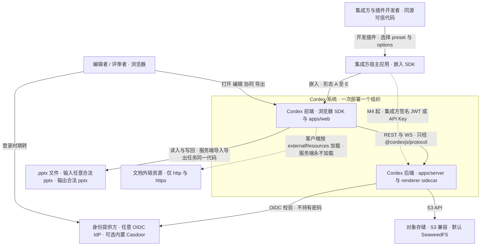

怎么读：实线是运行时交互方向，虚线是受部署配置约束或 M4 才开放的通道。`cordexSys` 子图就是部署边界：一次部署服务一个组织，没有租户维度，多组织走多套部署。插件与宿主同源可信，不做运行时沙箱；注册入口由部署开关 `auth.selfSignup` 控制，默认关。
依据：30-architecture/01 §1、§4.4；charter §2.3；rulings §4.15 T-0/Q6/Q7/Q10；PRD 03-features/05 §1（形态 A–F）；ADR-0037 决策 3。

## 2. 容器视图

**图 2-1 容器视图：浏览器侧容器与服务端入口**

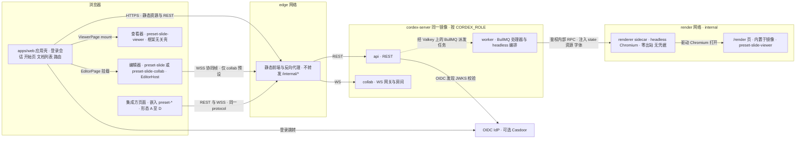

怎么读：左侧是浏览器里的四类前端容器，全部经 edge 网络的反向代理进入服务端。服务端是同一个 `cordex-server` 镜像按 `CORDEX_ROLE` 分出的 api、collab、worker（`all` 时三者在同一进程）；renderer 是只挂 render 网络的独立 sidecar，只接受 worker 的鉴权内部 RPC。`/render` 页的代码来自 apps/web，打包进 renderer 镜像。虚线表示经 Valkey 的异步派发。
依据：30-architecture/01 §2、08 §0；ADR-0037 决策 1、3；40-modules/11 §3.5、§7。

**图 2-2 容器视图：服务端角色与数据组件**

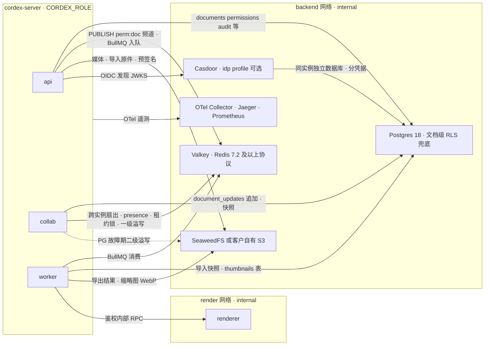

怎么读：三个应用角色都在 backend 内网访问数据组件。Valkey 一身多用：协同跨实例扇出、presence、租约锁、S-3 溢写与 BullMQ 队列。renderer 不在 backend 网络、不持有 DB/S3/IdP 凭据，只能由 worker 经 render 网络调用。Grafana/Loki 属需显式开启的 AGPL profile，不在默认栈，图中未画。
依据：30-architecture/08 §0；06 §0、§6.4；ADR-0037 决策 2–4；rulings §4.15 Q6/Q10、S-3a；40-modules/16 §3（SpillStore 两级）。

**图 2-3 `CORDEX_ROLE` 五值与镜像**

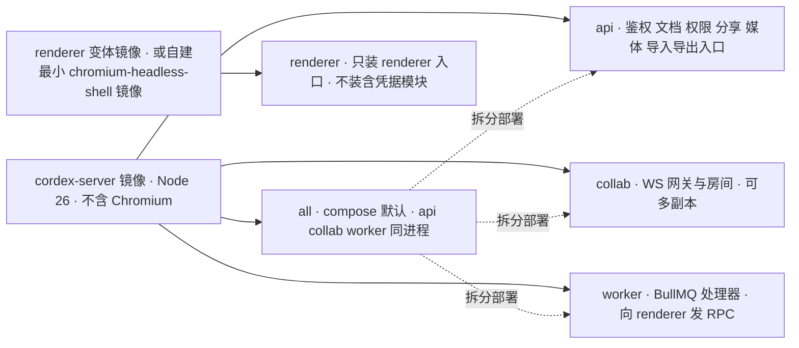

怎么读：实线是「镜像以该角色启动」，虚线表示 `all` 可以拆成三个独立部署。启动时执行角色一致性断言：角色不在五值内、renderer 角色检测到 DB/S3/IdP 凭据、production 下既无 `idp` profile 又未配置外部 issuer，都拒绝启动。
依据：ADR-0037 决策 1、「如何被机械验证」；30-architecture/08 §0；02 §3.2 Dockerfile 行；rulings §4.17 L14。

## 3. 包分层总图

章程 §5.1 把包分成水平层（文档类型盲）与垂直束（slide / doc / sheet 各一束），并用一张秩表把「只向下依赖」机械化。本节先给层带总览与判定规则，再按层带逐张展开包级依赖。

**图 3-1 层带与秩：秩表允许的下行方向**

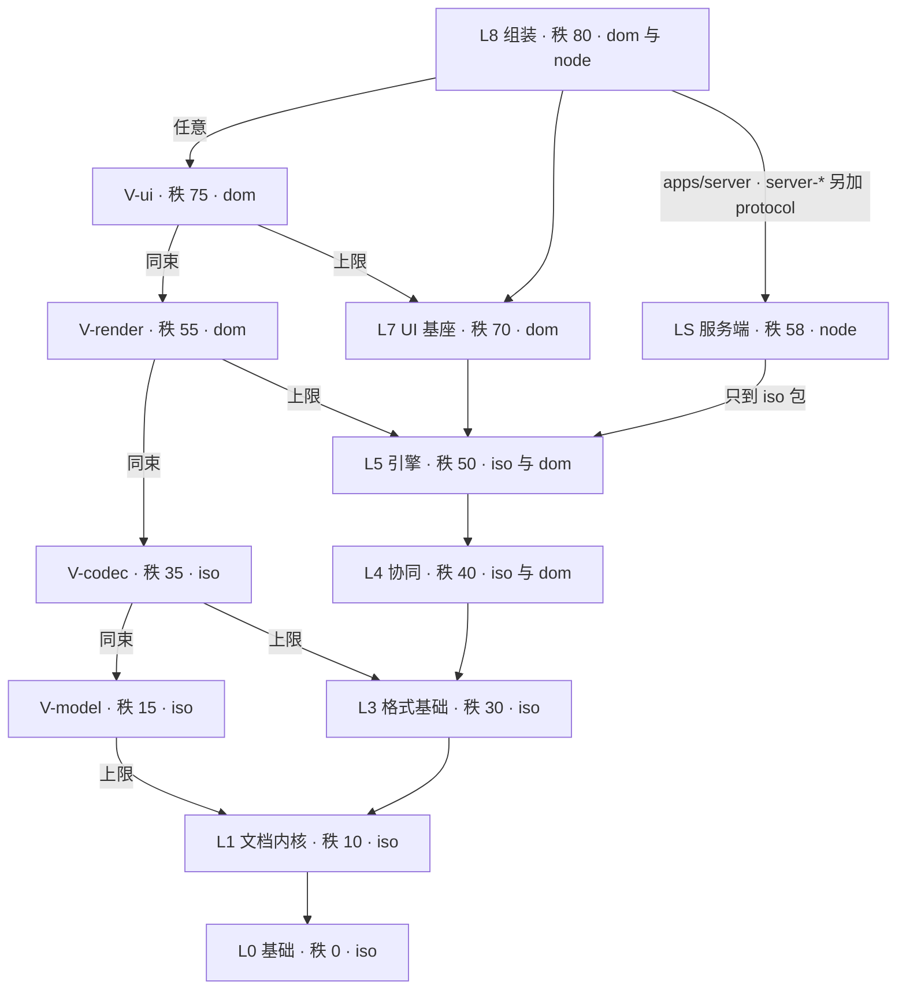

怎么读：每条箭头指向「该层带可依赖的最高下一层」，沿箭头的传递闭包就是秩表允许的范围（`rank(to) ≤ rank(from)`）。**秩允许不等于允许**：还要叠加铁律 1 文档类型盲、铁律 2 束间隔离、铁律 4 同构类，以及 R14（ui-core 不 import 框架）、R15（引擎与 render-dom 不 import `model-*`）等专项规则，判定顺序见图 3-2。L7 不能依赖 LS（dom 不得 import node），所以两者之间没有箭头。
依据：charter §5.1 秩表与铁律 1–4、§5.3；30-architecture/02 §1、§7 R2。

**图 3-2 一次 import 是否合规：判定顺序**

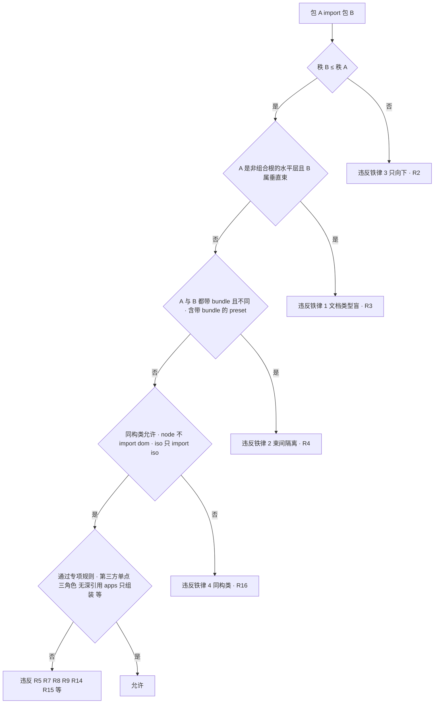

怎么读：dependency-cruiser 对每条 import 做同样的检查，任一步命中即报 error（全部规则都是 error 级，并配负向测试）。第二步只对**非组合根**的水平层生效：`compositionRoot:true` 的 preset-*、apps/web、apps/server 豁免 R3（preset 可带 `bundle` 以受 R4 约束），但 apps/web 仍受第五步 R9 白名单约束、不能直接 import 束包（2026-09-25，rulings §4.18 FE-01）。规则元数据全部来自各包 `package.json#cordex`（`layer`、`iso`、`bundle`、`role`、`compositionRoot`、`publicEntry`、`stability`、`implements` 八键；`rank` 不是键，由 `layer` 查秩表得出，FE-21），规则编号见 02 §7。
依据：charter §5.2 `cordex` 字段、§5.3；30-architecture/02 §7；40-modules/01（depcruise 规则集）。

**图 3-3 L0 基础、L1 文档内核与 V-model**

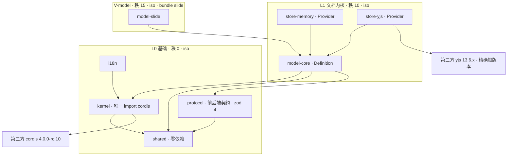

怎么读：图 3-3 至 3-8 的箭头都表示「import 依赖」，从使用方指向被依赖方；包间依赖取自章程 §5.2「依赖上限」列（图 3-7、3-8 中 apps 与 preset 的边另取 02 §3、11 §3.1），第三方库的边取自 §5.3 规则 4。2026-09-25 起该列按实际用法上调（沿 C-28 先例补 ooxml-pptx→model-core、slide-render-chart→engine-render/model-slide/ooxml-core、server-collab→model-core，server-headless 按组合根装配改写），kernel/shared/protocol 对非 L0 包隐式允许（design 与 shared 例外），各包 tsconfig references = package.json 内部依赖 ⊆ 上限列 ∪ 隐式 L0（rulings §4.18 FE-02）；图中为清晰起见不画隐式 L0 边。这七个 L0/L1 包与 model-slide 全部是 iso，浏览器与服务端加载同一份源码；`yjs` 只允许 store-yjs、collab-yjs、server-collab 引入（§5.3 规则 4），`cordis` 只允许 kernel 引入（R12）。
依据：charter §5.2、§5.3 规则 4；rulings §4.15 Q3；40-modules/02 §0、§3；03 §0。

**图 3-4 L3 格式基础、V-codec 与 L4 协同**

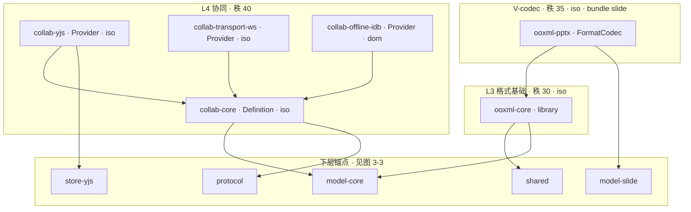

怎么读：`lower` 子图是图 3-3 同名包的重复引用，只为挂接箭头。`ooxml-core` 依赖 model-core 是为了取 `drawing/` 共享绘图词汇的运行时类型（02 §9 C-10）；四个协同包中只有 `collab-offline-idb` 是 dom（唯一引入 `y-indexeddb`），且全部不依赖 slide 束。06 §3.2 的 collab-core 目录另列 kernel、shared 依赖，均在秩表范围内。
依据：charter §5.2；30-architecture/02 §4.9–§4.12b、§9；06 §3.2、§4.2–§4.3；40-modules/05 §0。

**图 3-5 L5 引擎与 V-render**

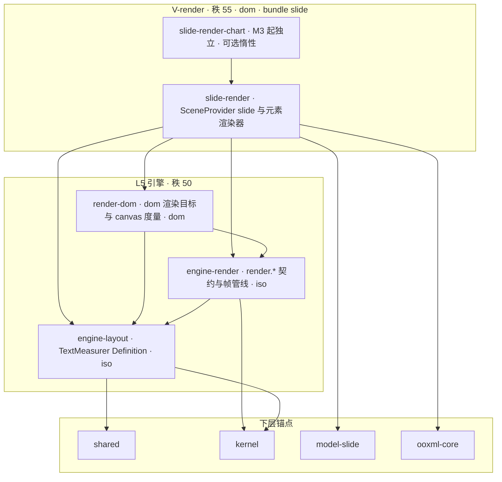

怎么读：三个引擎包对幻灯片一无所知（R15 禁止它们 import `model-*`）；`slide-render` 是唯一同时懂 `slides` 与 `Scene` 两种语言的适配层，并经 rulings §4.15 Q7 放行依赖 `ooxml-core`，用于图表 chartml 与 SmartArt `dsp:drawing` 的只读解析。渲染介质按 Q4 为 DOM/SVG 单实现，canvas 只做 toImage 栅格化、measureText 与预留的 `render.target` 座位。
依据：charter §5.2（C-28 修订）；30-architecture/02 §7 R15；07 §0–§1；40-modules/06 §0、07 §0；rulings §4.15 Q4/Q7。

**图 3-6 L7 UI 基座与 V-ui**

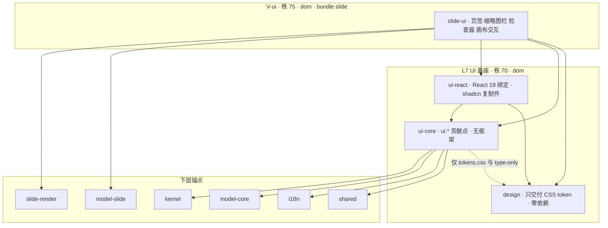

怎么读：虚线是 R14 放行的受限依赖（ui-core 只能取 design 的 CSS 与类型名）。`react`、`radix-ui` 等只允许 ui-react 与 `*-ui` 引入，而且 `*-ui` 的 `domain/`、`application/` 目录同样不得 import React（R14a）——这就是 rulings §4.15 Q2 把「UI 框架可换」改写成的可验证范围。
依据：charter §5.2、§5.3 规则 4/6；30-architecture/02 §7 R14/R14a/R17/R18；40-modules/10 §0、§1.1。

**图 3-7 L8 组装：apps/web 与三个 preset**

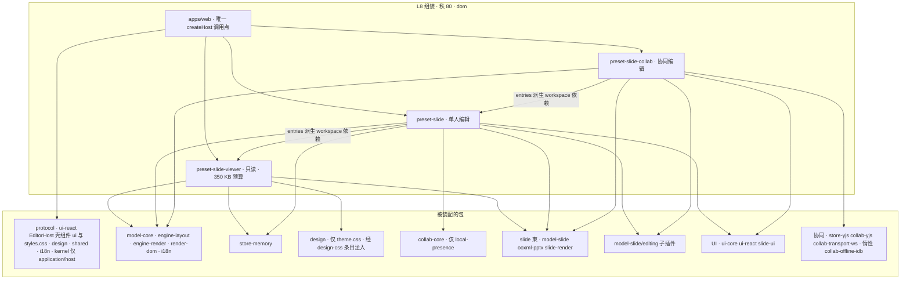

怎么读：apps/web 只选 preset 并传 options，不 import 领域包（depcruise R9 `cordex-apps-only-assemble`，ESLint `no-restricted-syntax` 的 `apps/**` override，原称 `no-domain-defs-in-apps`、`single-create-host-callsite`，rulings §4.18 GV-15）；可 import 的包 2026-09-25 统一为 preset-*、protocol、design、ui-react（EditorHost、壳组件、`./ui`、`./styles.css`）、i18n、shared，以及 kernel（值导入仅 `application/host/**`，其余只许 `import type`），react、react-router、tailwind 另有放行（FE-05）。四个 L8 包都是组合根（`compositionRoot:true`，FE-01/FE-21）。preset-slide 的单人 presence 取自 collab-core 的 local-presence，collab 预设把它换成 collab-yjs；viewer 没有 ui-core，改由自带的 design-css 条目注入 design 的 theme.css（FE-07 核对一致）。三个 preset 之间有真实的包依赖：preset-slide 经 `@cordexjs/preset-slide-viewer/entries` 派生、preset-slide-collab 经 `@cordexjs/preset-slide/entries` 派生，`dependencies` 写 `workspace:*`，这条 `./entries` 派生链由 R1/R2 约束、不另设规则（FE-06）。
依据：charter §5.2 L8 行；30-architecture/02 §3.1、§4.21/§4.21b、§7 R9；40-modules/11 §3.1、§3.5、§4.1/§4.2、§10；rulings §4.18 FE-05/FE-06/FE-07。

**图 3-8 LS 服务端包与 apps/server**

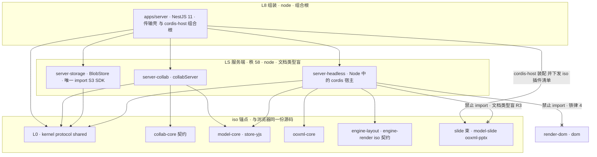

怎么读：实线是允许的 import，带叉的边是被禁止的方向。服务端业务逻辑在 LS 包里，apps/server 的 Nest 模块只做 REST、WS 与任务的传输壳（depcruise `server-app-thin`：`modules/**` 不得 import `yjs`、`model-*`、`ooxml-*`）；apps/server 是组合根（`compositionRoot:true`），只有它的 `cordis-host/preset-server.ts` 能 import slide 束并把 iso 插件清单交给 server-headless（2026-09-25，rulings §4.18 FE-01/FE-02）。server-headless 因此文档类型盲：导入导出按 `documentType` 经 `formats` 服务取 codec，M5 新增 doc 时 server-* 零改动。server-collab 依赖 collab-core 的 Definition 契约与 model-core（FE-15/FE-02）。LS 秩 58 允许依赖 L5 的 iso 包，但 node 不能 import dom 的 render-dom，所以服务端渲染只能经独立 renderer sidecar 里的 headless Chromium 间接运行浏览器代码（图 8-5）。
依据：charter §5.1 说明行、§5.2 LS 与 apps/server 行；30-architecture/02 §3.2、§4.22–§4.24；40-modules/09 §3.2、§4.4/§4.5、§5.3；ADR-0026/0037；rulings §4.18 FE-01/FE-02/FE-15。

## 4. 前端运行时装配

浏览器里一个编辑器实例的诞生分四步：选 preset → 挂插件 → 插件提供服务、登记贡献点 → UI 按贡献点渲染。本节先给主链与时序，再给服务分布、UI 渲染链与三种 preset 的差异。

**图 4-1 前端装配主链**

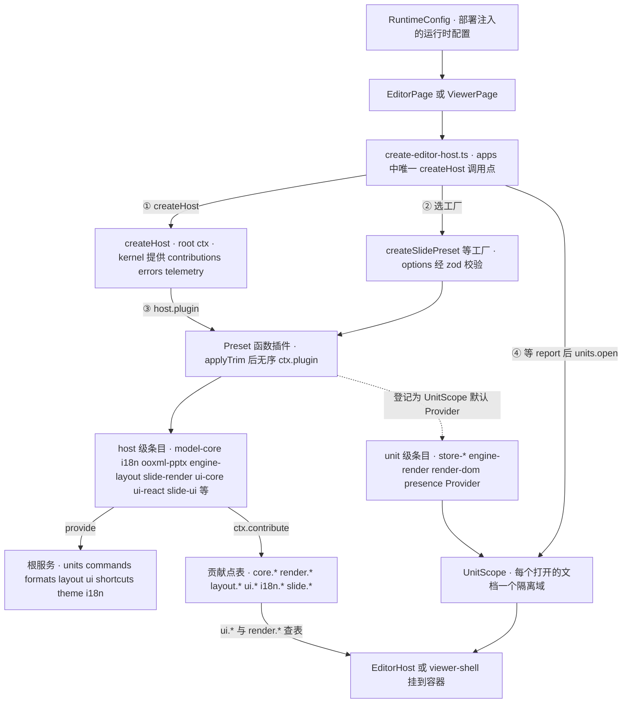

怎么读：编号是 `create-editor-host.ts` 的执行顺序；实线是创建或挂载关系，虚线表示 unit 级条目在 preset 里只登记，到 `units.open` 时才在隔离域内挂载。preset 自身不 provide 服务、不定义贡献点，所有服务与贡献都来自它挂载的子条目（BC-16 只透传）。
依据：40-modules/11 §2.1、§3 引言、§3.1 scope 列、§3.5；30-architecture/03 §5、§9；02 §3.1。

**图 4-2 装配时序：从页面到 EditorHost**

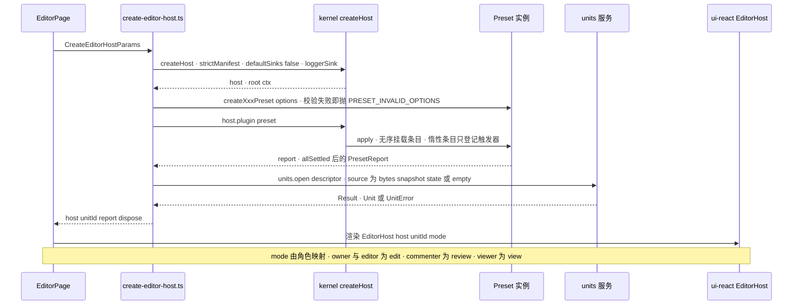

怎么读：实线是调用，虚线是返回。options 校验失败在工厂调用时就抛出，不部分激活（EM-01）；单个条目 FAILED 只记入 `PresetReport`、不中断其余条目（03 §8）；打开失败以 `Result` 返回，由页面渲染失败态。
依据：40-modules/11 §2.2、§2.5、§3.5；30-architecture/03 §8–§9；ADR-0010。

**图 4-3 root ctx 与 UnitScope 的服务分布**

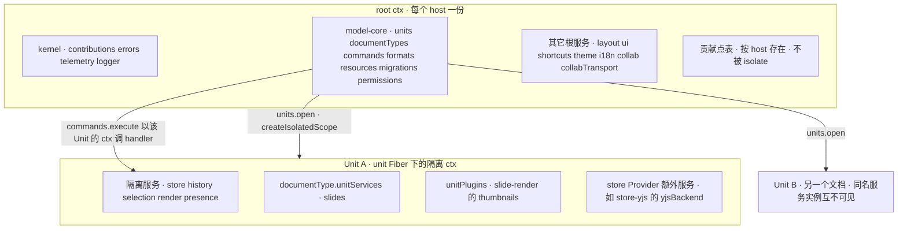

怎么读：上半是整个宿主共享的根服务与贡献点表，下半是每个打开文档各一份的 UnitScope。隔离服务在两个 Unit 之间永不合并（`isolate` 不传 label）；关闭文档 = `unitFiber.dispose()`，逆序清理全部 effect；根级插件不得 inject 隔离服务（lint `no-unit-scoped-inject-at-root`）。一个页面可以有多个 host，一个 host 可以打开多个 Unit。
依据：30-architecture/01 §5；03 §5.1–§5.4；05 §3.2；40-modules/07 §3（thumbnails）；06 §2.3（yjsBackend）。

**图 4-4 服务与贡献点到 UI 渲染**

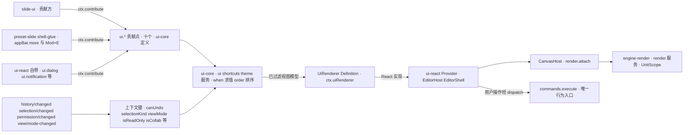

怎么读：UI 不直接读写文档。贡献方只往 `ui.*` 贡献点写声明式条目；`ui-core` 用上下文键对条目做 `when` 过滤、按 `order` 排序，折叠成 Ribbon 树等视图模型，再交给 `UiRenderer` 的 React Provider 渲染。画布由 CanvasHost 经 `render.attach` 交给渲染引擎；所有按钮与快捷键最终都经 `commands.execute` 进入命令管线（图 6-2）。
依据：40-modules/10 §2.1–§2.5；11 §3.3；16 §4；30-architecture/03 §3.6（上下文键）。

**图 4-5 三种 preset 的条目对比**

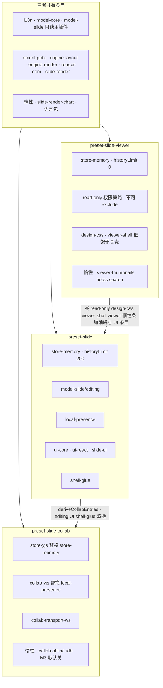

怎么读：顶部是三者共有的 slide 查看基线。viewer 靠「不装 editing + 不可排除的 read-only 策略」双保险保证只读，且不含 React；preset-slide 由 viewer 条目集加减得到，collab 再由 preset-slide 经 `deriveCollabEntries` 替换 Provider 得到，这就是「从单人切到协同只改 preset」（M3 验收）。图中两条实线是条目集合的派生，也对应真实的 `./entries` 包依赖（图 3-7）；2026-09-25 起 11 §2.1 图 2-1 已改为同一方向（viewer → slide → collab），本图 viewer 到 preset-slide 改为实线，原分歧说明删除（rulings §4.18 FE-06）。扣除集合统一为 read-only、design-css、viewer-shell 与 viewer-thumbnails/notes/search（FE-07）。
依据：40-modules/11 §3.1–§3.2、§3.4；16 §5；30-architecture/02 §4.21/§4.21b。

**图 4-6 preset 条目在装配报告中的状态**

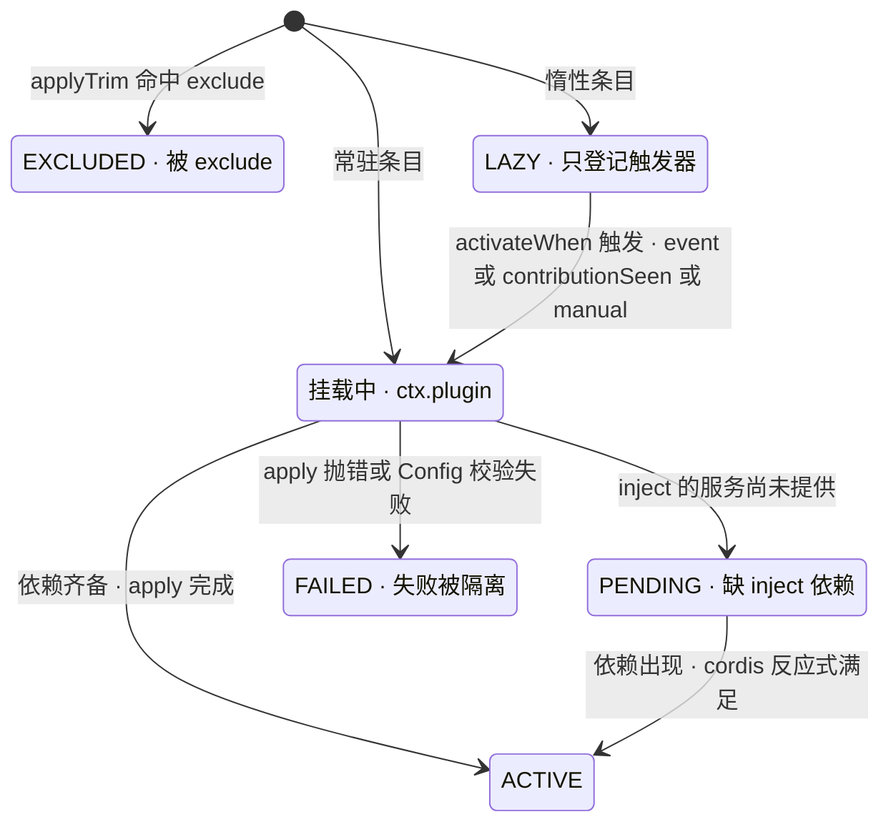

怎么读：`PresetReport` 在全部条目 `allSettled` 后汇总 ACTIVE、PENDING、FAILED、LAZY、EXCLUDED 五种状态，供插件管理器页读取。PENDING 不是错误，而是可诊断的「缺哪个服务」——例如在 store-memory 的 Unit 下装 collab-yjs，会因缺 `yjsBackend` 停在 PENDING；FAILED 只影响自身，兄弟条目照常 ACTIVE。
依据：40-modules/11 §1.2、§2.1；30-architecture/03 §5.2、§6–§8；ADR-0010。

## 5. slide 垂直束与水平层依赖

**图 5-1 slide 束四层带与水平层依赖**

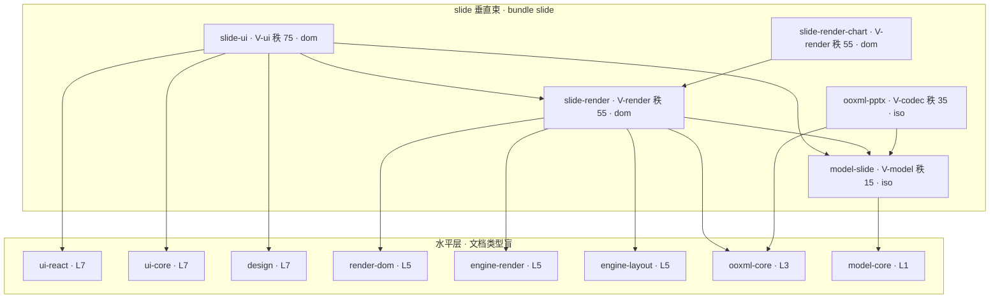

怎么读：箭头只从垂直束指向水平层，或指向同束更低的层带；水平层没有任何一条箭头指回束内（铁律 1）。束内按 V-ui → V-render → V-codec → V-model 向下，但 slide-render 并不依赖 ooxml-pptx——它只用 ooxml-core 的只读解析器。doc、sheet 束建成后与本束互不 import（铁律 2），见图 9-1。
依据：charter §5.1 垂直束表、§5.2 依赖上限列；40-modules/00 §0 垂直束网格图、§6.2。

**图 5-2 slide 束各包接入的贡献点与服务**

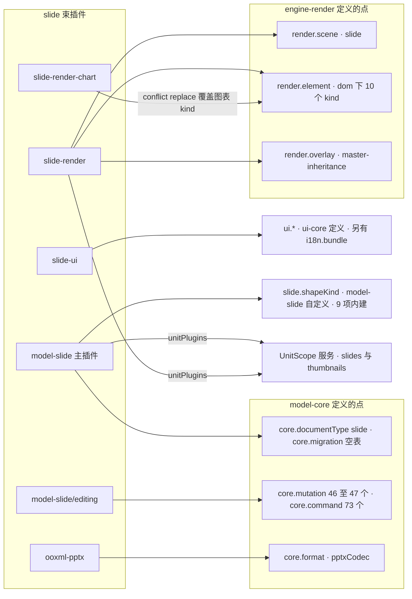

怎么读：slide 束对水平层只做两件事——往水平层定义的贡献点写条目，在 UnitScope 里挂自己的按文档服务。水平层服务按 key 查表（`render.scene` 按 `documentType`，`render.element` 按 `targetId:kind`），从不认识「幻灯片」一词。slide-ui 向十个 `ui.*` 点中的七个写条目（`ui.ribbon`/`ui.panel`/`ui.toolbar`/`ui.contextMenu`/`ui.statusBar`/`ui.shortcut`/`ui.command`；不含 `ui.dialog`/`ui.notification`/`ui.theme`，`ui.notification` 模板只由 ui-react 贡献；2026-09-25 按 10 §3 逐项清单更正，rulings §4.18 FE-11）。
依据：40-modules/03 §0、§3；07 §0、§3；10 §0；16 §4。

## 6. 浏览器内一次编辑的数据流

**图 6-1 一次编辑的数据流总览**

```mermaid
flowchart LR
  input["键盘 指针 IME 剪贴板 拖放"]
  intent["ui-core 输入管线 · 意图对象"]
  command["commands.execute · 权限门 审计 遥测"]
  mutation["Mutation · schema 校验 · Mutation 级权限"]
  storeOps["lower · StoreOp 五种原语"]
  store["store.transact · origin local"]
  changeSet["ChangeSet · store/transaction"]
  history["history.push · 上下文键 canUndo"]
  scene["slide-render diff · DirtySet"]
  paint["engine-render flush · render-dom 局部重绘"]
  crdt["Y.Doc update · 仅 store-yjs"]
  send["collab-yjs 50 ms 合并 · WS 帧发出"]
  input --> intent --> command --> mutation --> storeOps --> store
  store --> changeSet
  store --> history
  changeSet --> scene --> paint
  store -. "协同预设" .-> crdt --> send
```

怎么读：实线是单人与协同都走的主链，虚线之后的两步只在 preset-slide-collab（store-yjs）下发生。Mutation 不上网络，网络上只有 CRDT update（D5）；渲染刷新与协同发送互不依赖，都由同一次事务提交触发。图 6-2、6-3 分别展开前后两半。
依据：30-architecture/01 §4.2–§4.3；05 §1、§3；06 §0；04 §2.3（StoreOp 五原语）；40-modules/10 §2.2。

**图 6-2 命令管线：从意图到事务提交**

```mermaid
sequenceDiagram
  participant ui as ui-core dispatch
  participant cmds as commands 服务
  participant gate as 权限门 · waterfall 首位
  participant handler as 命令 handler
  participant mut as core.mutation 表
  participant store as store Provider
  participant hist as history
  ui->>cmds: execute unitId id params
  cmds->>cmds: ① resolve 命令与 Unit · ② schema 校验参数
  cmds->>gate: ③ waterfall command/execute
  alt 策略拒绝
    gate-->>cmds: deny · command.permission_denied · 不调用 next
  else 放行
    gate-->>cmds: next
  end
  cmds->>cmds: 规模守卫 · 超限 document.quota_exceeded · 不开事务
  cmds->>store: ④ transact · origin local · label undoable
  store->>handler: handler ctx params tx
  handler->>mut: tx.mutate · 查 MutationDef · 校验 · Mutation 级权限
  mut-->>store: lower 产出 StoreOp 数组
  store->>store: 应用 StoreOp · 推导逆操作 · emit store/transaction
  store-->>cmds: TransactionRecord 或整体回滚
  cmds->>hist: ⑤ history.push · 可与上一条合并
  cmds-->>ui: ⑥ command/executed · ⑦ command/audited · CommandResult
```

怎么读：纵向是时间，编号沿用 05 §3 的七个阶段。`waterfall 'command/execute'` 是全系统唯一的拦截链，权限门以 prepend 排在首位、fail-closed；handler 不能直接改 Store，只能经 `tx.mutate`，逆操作由 Store 在 StoreOp 层推导、禁止手写。命令结果一律是 `Result`，UI 把错误码映射成提示、不 throw。
依据：30-architecture/05 §1–§5、§8–§9；rulings §4.15 Q5、§4.17 D2；40-modules/10 §2.2。

**图 6-3 提交之后：渲染刷新与协同发送**

```mermaid
sequenceDiagram
  participant store as store-yjs
  participant scene as slide-render SceneProvider
  participant render as engine-render RenderService
  participant dom as render-dom
  participant sync as collab-yjs LocalBatcher
  participant ws as collab-transport-ws
  participant gw as 服务端协同网关
  store->>scene: store.observe · ChangeSet
  scene->>render: diff 与 classify 后 invalidate DirtySet
  render->>render: 合并脏区 · 下一帧 flush · 可见页优先 · 脚本 8 ms 预算
  render->>dom: target.paint · 只更新脏元素
  dom-->>render: 逐节点 try 与 catch · 失败元素换占位
  render->>render: 收尾 · 重建命中索引 · emit render/frame
  Note over scene,dom: 覆盖层随 selection 与 presence 独立刷新 · 不进脏区
  store->>sync: yjsBackend.onUpdate · update 字节
  sync->>sync: 50 ms 内 mergeUpdates 为一帧
  sync->>ws: Connection.send · SYNC update
  ws->>gw: WS 二进制帧
  gw->>gw: 硬门禁 · 软门禁 · 先落库再经 Valkey 扇出
  alt Postgres 故障期
    gw-->>sync: ack tier spill · 客户端保留 pending
  else 已落库
    gw-->>sync: ack seq tier db · 清 pending
  end
```

怎么读：上半段是所有预设都有的渲染路径（单人预设里 store 是 store-memory，没有下半段）：slide-render 在 Unit 内订阅 store 变化，把 ChangeSet 映射成 DirtySet 推给引擎，引擎自身不订阅 `store/transaction`。下半段只在协同预设出现：update 经 `yjsBackend` 这一受控面交给 collab-yjs，collab-yjs 从不直接触碰 `Y.*` 类型；两级 ack 中只有 `tier:'db'` 清 pending。
依据：40-modules/06 §2.6、07 §2.4/§2.6、05 §0；30-architecture/06 §0、§4.1、§6.4；07 §2.2；rulings §4.15 S-3a。

**图 6-4 本地 update 的确认状态**

```mermaid
stateDiagram-v2
  state "本地待确认 · pending" as pending
  state "已发出 · 等待 ack" as sent
  state "溢写确认 · tier spill" as spill
  state "已落库 · tier db" as db
  [*] --> pending: 本地事务产生 update
  pending --> sent: LocalBatcher 合并后发出 · 仅在线时
  sent --> spill: 服务端写入溢写存储
  sent --> db: 服务端 INSERT 提交后回带 seq 的 ack
  spill --> db: PG 恢复后回放 · 由 PG 分配正式 seq
  sent --> pending: 断线 · 重连后 step2 重新同步
  spill --> pending: 断线或溢写丢失 · 重连 step2 凭幂等补齐
  db --> [*]: 清 pending 与离线队列已确认段
```

怎么读：只有进入「已落库」才算确认，`Session.flush()`（关闭页面前调用）等的就是 pending 归零。溢写确认期客户端仍保留 pending，所以 PG 故障或溢写数据丢失都不会让「已 ack（db）」的修改丢失（NF-03）。离线时本地编辑照常进行，update 暂存 pending（可选 collab-offline-idb 持久化），上线后冲刷。
依据：30-architecture/06 §5.1、§6.3–§6.4、§4.2 local-batcher；rulings §4.15 S-3a；40-modules/02 §0（ack 帧定稿）。

**图 6-5 文本输入分支：IME 与剪贴板**

```mermaid
flowchart LR
  keydown["keydown 非字符键"]
  shortcuts["ctx.shortcuts 解析 chord"]
  textHost["render-dom TextInputHost · 隐藏 textarea"]
  beforeInput["beforeinput · insertText deleteContent insertParagraph"]
  compStart["compositionstart · 记录锚点"]
  compUpdate["compositionupdate"]
  compEnd["compositionend"]
  overlay["瞬态覆盖层显示组合串 · 不写 Store"]
  slideUiText["slide-ui text-editing · onTextEditIntent 回调"]
  paste["paste · HTML 纯文本 OOXML 剪贴板"]
  commands["commands.execute"]
  keydown --> shortcuts --> commands
  textHost --> beforeInput
  textHost --> compStart
  textHost --> compUpdate
  textHost --> compEnd
  compStart --> overlay
  compUpdate --> overlay
  beforeInput -- "TextEditIntent · 落为 text.* Mutation 可合并撤销" --> slideUiText
  compEnd -- "TextEditIntent · 落为一次 text.insert 事务" --> slideUiText
  slideUiText -- "dispatch" --> commands
  paste -- "命令层转为 Mutation 批" --> commands
```

怎么读：编辑态只有一个隐藏 textarea 承接输入（ADR-0028），组合中的文字只画在瞬态覆盖层，`compositionend` 才提交一次事务；render-dom 只把事件归约成中性的 TextEditIntent，经 `render.attach` 回调交给 slide-ui，边上写的是该意图最终落成的 Mutation；没有第二份编辑缓冲（A32），文本与其它编辑一样经命令管线进入 Store，再走图 6-3 的渲染与协同路径。
依据：30-architecture/07 §6；40-modules/10 §2.2、§2.5（`render.attach` 回调）；07 §2.6。

## 7. 前端插件模型

**图 7-1 cordis 插件的基本构件**

```mermaid
classDiagram
  class Plugin {
    +name: 包名去 scope
    +inject: 硬依赖服务名
    +provide: 提供的服务名
    +Config: Standard Schema
    +apply: 以 ctx 与 config 执行
  }
  class Context {
    +plugin: 挂载子插件
    +get: 读可选服务
    +effect: 登记可撤销资源
    +isolate: 建服务解析域
    +contribute: 向贡献点写条目
    +contributions: 读反应式贡献集
  }
  class Fiber {
    +state: ACTIVE PENDING FAILED 等
    +dispose: 逆序撤销 effect
  }
  class ContributionPoint {
    +id: 域.名
    +schema: 进表前 parse
    +key: 唯一键
    +conflict: error 或 replace
  }
  class ContributionSet {
    +values: 按贡献时间
    +observe: 增删替换通知
    +diagnostics: schema 与重复键诊断
  }
  class Manifest {
    +provides injects points contributes unitScoped
  }
  Plugin ..> Context : apply 接收
  Context --> Fiber : plugin 返回
  Context ..> ContributionPoint : contribute 目标
  ContributionPoint --> ContributionSet : contributions 读取
  Plugin --> Manifest : manifest-gen 静态生成
```

怎么读：`Plugin` 是 `plugin.ts` 导出的 `{ name, inject, provide, Config, apply }`（本项目固定写函数插件，类形态只用于 `Service` 子类）。`contribute`/`contributions` 是 kernel 在 cordis 之上加的唯一注册抽象：条目进表前经 schema 校验，由 effect 拥有、Fiber 卸载自动撤销；Manifest 让「不运行就知道插件贡献了什么」成为 CI 可检查项。
依据：30-architecture/03 §2.1–§2.2、§3.2–§3.3、§4.1；40-modules/17 §1。

**图 7-2 Definition 与 Provider：单例服务座**

```mermaid
classDiagram
  class DocumentStore {
    +服务名: store
    +作用域: UnitScope
  }
  class StoreYjs {
    +额外提供: yjsBackend
  }
  class UiRenderer {
    +服务名: uiRenderer
    +定义方: ui-core
  }
  class VanillaRenderer {
    +位置: examples/embed-vanilla
  }
  class CollabService {
    +服务名: collab
    +定义方: collab-core
  }
  class CollabTransport {
    +服务名: collabTransport
  }
  class CollabYjs {
    +另提供: presence
  }
  DocumentStore <|.. StoreMemory : 实现
  DocumentStore <|.. StoreYjs : 实现
  UiRenderer <|.. UiReact : 实现
  UiRenderer <|.. VanillaRenderer : 形态 B 契约验证
  CollabService <|.. CollabYjs : 实现
  CollabTransport <|.. CollabTransportWs : 实现
  CollabYjs ..> StoreYjs : inject yjsBackend
  CollabYjs ..> CollabTransport : inject collabTransport
```

怎么读：`<|..` 表示 Provider 实现 Definition，`..>` 表示消费方 inject。这类契约同一时刻只有一个生效实现，因此用服务座（`ctx.provide` 或 `Service`）而不是贡献点；消费方只 inject 服务名，Provider 缺席时停在 PENDING 而不是拿到 undefined。类名对应的包：StoreMemory = store-memory，StoreYjs = store-yjs，UiReact = ui-react，CollabYjs = collab-yjs，CollabTransportWs = collab-transport-ws；VanillaRenderer 只是示例，不是发布包。
依据：30-architecture/03 §3.4、§3.6 末段判据；06 §4.1；40-modules/16 §3；17 §2.1–§2.2；rulings §4.15 Q2。

**图 7-3 贡献点：多条目共存的注册槽**

```mermaid
classDiagram
  class RenderScenePoint {
    +id: render.scene
    +key: documentType
  }
  class RenderElementPoint {
    +id: render.element
    +key: targetId 与 kind
  }
  class RenderTargetPoint {
    +id: render.target
  }
  class UiRibbonPoint {
    +id: ui.ribbon
    +conflict: replace
  }
  class CoreCommandPoint {
    +id: core.command
  }
  SlideRender --> RenderScenePoint : 贡献 slide
  SlideRender --> RenderElementPoint : 贡献 10 个 kind
  SlideRenderChart --> RenderElementPoint : replace 图表 kind
  RenderDom --> RenderTargetPoint : 贡献 dom
  SlideUi --> UiRibbonPoint : 页签 组 控件
  ModelSlideEditing --> CoreCommandPoint : 73 条命令
  ShellGlue --> CoreCommandPoint : shell.intent
  RenderService ..> RenderScenePoint : 按 documentType 查表
  RenderService ..> RenderElementPoint : 按 kind 查表
  UiService ..> UiRibbonPoint : when 过滤
  CommandsService ..> CoreCommandPoint : 按 id 查表
```

怎么读：实线是「向贡献点写条目」，虚线是「服务按 key 查表消费」。同一个贡献点可以同时容纳多个贡献方的条目，例如 `render.element` 里既有 slide-render 的 10 个 kind，也有 slide-render-chart 以 `conflict:'replace'` 覆盖的图表 kind——这是它与图 7-2 单例服务座的根本区别（判据：集合用贡献点，单例用服务）。类名对应：ModelSlideEditing = model-slide/editing，ShellGlue = preset-slide 的 shell-glue 胶水插件，RenderService / UiService / CommandsService 分别是 `render`、`ui`、`commands` 服务。
依据：30-architecture/03 §3.1–§3.6；40-modules/07 §3；11 §3.3；16 §4；17 §2.3。

## 8. 查看器与嵌入形态

**图 8-1 嵌入形态 A–F 与各自入口**

```mermaid
flowchart LR
  hostPage["集成方宿主页面"]
  formA["A · React 组件 EditorHost · M2"]
  formB["B · 框架无关挂载 · M2"]
  formC["C · 只读查看器 · M1"]
  formD["D · Headless 浏览器或 Node · 浏览器 M1 · Node M3"]
  formE["E · iframe 嵌入 apps/web · M3 P2"]
  formF["F · Web Component · M4 以后 P2"]
  pkgA["ui-react + preset-slide 或 preset-slide-collab"]
  pkgB["preset-slide 排除 FRAMEWORK_FREE_EXCLUDES · ui-core 视图模型 + render.attach"]
  pkgC["createSlideViewerPreset · preset.mount · 350 KB 基线"]
  pkgD["preset-slide 排除 HEADLESS_EXCLUDES · Node 端由服务端宿主承担"]
  pkgE["apps/web /embed/:id · postMessage 桥"]
  pkgF["ui-webc · 未来包"]
  hostPage --> formA --> pkgA
  hostPage --> formB --> pkgB
  hostPage --> formC --> pkgC
  hostPage --> formD --> pkgD
  hostPage --> formE --> pkgE
  hostPage -.-> formF -.-> pkgF
```

怎么读：每一行是「宿主选一种形态 → 用到的入口」，虚线的 F 是 M4 以后的未来包，尚未进入章程包清单。B 与 D 都是对同一个 preset-slide 做 `exclude` 裁剪，不是另一套包；React 18 宿主走 B 或 E；E 的 `postMessage` 消息形状拟纳入 `@cordexjs/protocol`（`embed/messages.ts`）。
依据：PRD 03-features/05 §1 形态表与 EM-01；40-modules/11 §6 嵌入形态表、§13 Q-10；rulings §4.15 Q2。

**图 8-2 形态 A 与形态 B 的装配差异**

```mermaid
flowchart TB
  subgraph formA["形态 A · React 19 宿主"]
    aPreset["createSlidePreset · 全量条目"]
    aSlideUi["slide-ui 向 ui.* 写条目"]
    aUiCore["ui-core 视图模型"]
    aRenderer["UiRenderer · ui-react 实现"]
    aHost["EditorHost React 组件"]
  end
  subgraph formB["形态 B · Vue Angular Svelte 或原生宿主"]
    bPreset["createSlidePreset · 排除 ui-react 与 slide-ui"]
    bUiCore["ui-core 贡献照常注册 · ctx.ui 视图模型"]
    bHostUi["宿主自绘 UI · 自绑 DOM"]
    bCanvas["render.attach 挂画布"]
    bVanilla["examples/embed-vanilla · UiRenderer vanilla 跑契约套件"]
  end
  aPreset --> aSlideUi --> aUiCore --> aRenderer --> aHost
  bPreset --> bUiCore --> bHostUi
  bHostUi --> bCanvas
  bVanilla -. "验证 ui-core 契约不偏向 React" .-> bUiCore
```

怎么读：两种形态装的是同一个 preset，差别只在是否排除 `ui-react` 与 `slide-ui`。B 的产物不含 react/radix 模块（bundle 断言），宿主读 `ui-core` 的声明式贡献自绘工具栏；M2 只交付 React 绑定，B 的验收靠三件事：depcruise 规则（`*-ui` 的 domain/application 不 import React）、vanilla 示例通过 `runUiRendererConformance`、产物断言。
依据：rulings §4.15 Q2；PRD 03-features/05 §1；40-modules/11 §3.1 ui-react 行、§6；10 §7；16 §3 UiRenderer 行。

**图 8-3 查看器只读的两道保证**

```mermaid
flowchart TB
  execCall["查看器中执行 commands.execute slide.insertShape"]
  q1{"core.command 表里有该命令吗"}
  notFound["command.not_found · 第一道 · 清单里没有 model-slide/editing"]
  policy["read-only 权限策略 · 只允许 doc.read 与可选 doc.export"]
  denied["command.permission_denied · 第二道"]
  execCall --> q1
  q1 -- "否 · 正常装配" --> notFound
  q1 -- "是 · 被 override 强行装入 editing" --> policy
  policy -- "doc.write 不在允许集" --> denied
```

怎么读：ADR-0015 的两道机械保证——第一道是装配清单里根本没有编辑子插件，编辑命令与 Mutation 表中不存在任何幻灯片写操作；第二道是不可排除的 `read-only` 权限策略，即使被 override 装入编辑子插件也会被拒。两者由 `readonly.test.ts` 分别断言；depcruise `cordex-viewer-no-editing`（原称扫描器 `no-editing-in-viewer`，rulings §4.18 GV-15）另外检查 viewer 的依赖图。
依据：30-architecture/02 §4.21b；40-modules/11 §3.1 read-only 行、§3.4；03 §3 编辑子插件表。

**图 8-4 查看器挂载时序（apps/web 查看路由）**

```mermaid
sequenceDiagram
  participant page as ViewerPage
  participant ceh as create-editor-host.ts
  participant preset as preset-slide-viewer 条目集
  participant shell as viewer-shell
  participant units as units 服务
  participant sr as slide-render 元素渲染器
  page->>ceh: preset slide-viewer · viewer 的 thumbnails notes 开关
  ceh->>preset: createSlideViewerPreset · host.plugin
  preset->>shell: 挂载 · ready 时只挂订阅
  ceh->>units: units.open · source snapshot
  units-->>shell: unit/opened
  page->>shell: preset.mount container
  shell->>shell: 工具条 翻页 缩放 全屏 键盘 超链接 保真摘要
  opt thumbnails 或 notes 为 true
    shell->>preset: lazy.activate viewer-thumbnails 或 viewer-notes
  end
  sr-->>preset: 主包图表占位 · render/element-degraded · reason chart-unavailable
  preset->>preset: 惰性加载 slide-render/chart 子路径 · M3 起为 slide-render-chart 包
```

怎么读：viewer-shell 在 ready 时只挂订阅，DOM 在宿主调用 `mount(container)` 时才创建；缩略图条、备注、搜索与图表渲染器都是独立惰性 chunk，不计入 350 KB 基线。M1–M2 的只读图表渲染器是 slide-render 包内的惰性子路径 `@cordexjs/slide-render/chart`：主包只有占位渲染器，遇到图表元素发 `render/element-degraded{reason:'chart-unavailable'}` 触发加载（2026-09-25 按架构 02/07 统一，删去原分歧说明，rulings §4.18 FE-08）。集成方的形态 C 直接调用 `createSlideViewerPreset` 并 `mount`，没有 apps/web 这一层；apps/web 的 `/documents/:id/view` 只留给 M1 查看器与嵌入，viewer 角色用户走编辑器 `mode='view'`（UX-19）。
依据：40-modules/11 §3.1、§3.3 viewer-shell 列、§3.5；07 §3、§6；ADR-0010；rulings §4.18 FE-08/UX-19。

**图 8-5 `/render` 页：renderer sidecar 里的查看器**

```mermaid
sequenceDiagram
  participant worker as worker 角色
  participant renderer as renderer sidecar
  participant page as render 页 · apps/web 代码
  participant viewer as preset-slide-viewer
  worker->>renderer: 鉴权内部 RPC · state 媒体 字体 · renderId
  renderer->>page: Chromium 打开 /render · renderId documentType mode slides 等参数
  renderer->>page: window.__cordex.inject · state 与 resources
  page->>viewer: createEditorHost · 排除 viewer-shell 与 design-css · 惰性加载关闭 · source 为 snapshot 或 state
  page->>viewer: render.attach 到 stage · mode 为 thumbnail 或 print
  alt 所请求页全部 page-mounted 且字体结算 且此后一次待绘脏区为空的 render/frame
    page->>renderer: window.__cordex.ready · pageIds layoutAlgoVersion fontProfile
    renderer->>renderer: 按页容器截图 · 沙箱内编码 640 px WebP
    renderer-->>worker: 图片字节
    worker->>worker: 写对象存储 · thumbnails 表 upsert
  else 超时或失败
    page->>renderer: window.__cordex.error · 如 render.state_expired
  end
```

怎么读：页面自身零外呼——状态、媒体与字体全部由编排方注入（remote 模式由 sidecar，local 模式由 worker 进程内 Playwright `page.evaluate`，两种模式同一条路径；`RenderStateToken` 已取消，查询参数只带作日志关联的 `renderId`，rulings §4.18 BE-04），在页面常量超时（默认 60 s）内未注入即报 `render.state_expired`；ready 判据统一为「所请求页全部挂载 ∧ 这些页字体全部结算 ∧ 此后一次待绘脏区为空的 `render/frame`」，`/render` 装配时关闭惰性加载（FE-09，与 11 §2.4、07 §10 同一条）；renderer 只接受 worker 的入站 RPC、不持有任何凭据，外链资源在服务端一律不加载。同一份 preset-slide-viewer 与 render-dom 代码保证服务端缩略图与客户端像素一致（ADR-0026）。M2 的文档卡片封面取包内 `docProps/thumbnail.jpeg`，不走本路径；本路径从 M3 前半段起生效。
依据：30-architecture/07 §8、§10；40-modules/11 §2.4、§3.5、§7；ADR-0026、ADR-0037 决策 3；rulings §4.15 Q7/Q8、§4.18 BE-04/FE-09。

## 9. 扩展 doc / sheet 时前端复用哪些层

**图 9-1 前端各层在 doc/sheet 扩展中的复用关系**

```mermaid
flowchart TB
  subgraph frozen["水平层 · 零改动 · horizontal-freeze 锁定"]
    fKernel["kernel shared protocol i18n"]
    fModel["model-core store-memory store-yjs"]
    fOoxml["ooxml-core"]
    fCollab["collab-core collab-yjs collab-transport-ws collab-offline-idb"]
    fEngine["engine-layout engine-render render-dom"]
    fUi["design ui-core ui-react"]
  end
  subgraph slideB["slide 束 · 样板"]
    sPkgs["model-slide ooxml-pptx slide-render slide-ui"]
    sPreset["preset-slide 三件"]
  end
  subgraph docB["doc 束 · M5 新建 · sheet 同构"]
    dModel["model-doc · 流式文本与分页"]
    dCodec["ooxml-docx"]
    dRender["doc-render · SceneProvider doc"]
    dUi["doc-ui · ui.* 贡献"]
    dPreset["preset-doc"]
  end
  subgraph web["apps/web · generic"]
    docType["domain/document-type.ts · 参数化点"]
    ceh["create-editor-host.ts · 参数化点"]
  end
  dModel --> fModel
  dCodec --> fOoxml
  dRender --> fEngine
  dUi --> fUi
  dPreset -- "水平层条目原样复制" --> frozen
  slideB -. "复制目录与模式 · 非依赖" .-> docB
  docType --> ceh
  ceh -- "新增 case 与 import" --> dPreset
```

怎么读：新增文档类型 = 新建一整列垂直束，并在 apps/web 的两个参数化点登记；水平层包的 `src/**` 由 `horizontal-freeze.lock` 锁定，M5 的 PR 必须无 diff。slide 束只是被复制的样板（虚线），doc/sheet 束与它互不 import（铁律 2）。sheet 束结构相同：model-sheet（网格寻址）、ooxml-xlsx、sheet-render、sheet-ui、preset-sheet。
依据：40-modules/13 §0、§7、§8.1–§8.2；00 §6；11 §8；charter §5.1 垂直束表。

**图 9-2 preset-doc 如何由 preset-slide 样板得到**

```mermaid
flowchart LR
  tpl["preset-slide 系列 · 样板文件 按 11 §4 布局"]
  same["零改动复制 · 水平层条目 core render ui presence policy · design-css · locales · shell-glue · 八类测试只换夹具"]
  swap["替换 · plugins/slide.entries 改为 doc.entries · slide-render 行改 doc-render · slide-ui 行改 doc-ui"]
  tweak["微改 · config/options.ts · bundle-budget.json 重新校准"]
  shared["不复制 · 装配运行时从 @cordexjs/kernel/preset 引入"]
  presetDoc["preset-doc · viewer 与 collab 两档属 M5 后续"]
  tpl --> same --> presetDoc
  tpl --> swap --> presetDoc
  tpl --> tweak --> presetDoc
  shared --> presetDoc
```

怎么读：从样板到 preset-doc 只有三种动作——原样复制、替换垂直束条目、按文档类型微调配置；装配运行时（`PresetEntry`、`PresetReport` 等）已收编进 kernel，两个 bundle 共用而不复制。M5 骨架只产出 `preset-doc`（与 `preset-sheet`），文件布局与 11 §4 一致（`preset.ts`、`entries.ts`、`config/options.ts`、`plugins/*.entries.ts`）；`preset-doc-viewer`/`preset-doc-collab` 两档属 M5 后续，届时经章程修订登记（2026-09-25，rulings §4.18 FE-12，原分歧说明删除）。
依据：40-modules/11 §8 样板对照表；02 §3（kernel `src/preset/`，C-07）；13 §4.9–§4.10；rulings §4.12 U-01、§4.18 FE-12。

**图 9-3 同一 host 同时打开 slide、doc、sheet**

```mermaid
flowchart TB
  subgraph root["同一 host 的根服务与贡献点表"]
    docTypes["core.documentType · slide doc sheet"]
    scenes["render.scene · 按 documentType 分三个 SceneProvider"]
  end
  unitSlide["Unit slide · store history selection render · slides"]
  unitDoc["Unit doc · store history selection render · docs"]
  unitSheet["Unit sheet · store history selection render · sheets"]
  missing["未注册的类型 · format.no_document_type · 宿主照常运行"]
  docTypes -- "units.open 解析类型" --> unitSlide
  docTypes -- "units.open 解析类型" --> unitDoc
  docTypes -- "units.open 解析类型" --> unitSheet
  docTypes -. "查不到" .-> missing
  scenes -. "render 服务按类型查表" .-> unitSlide
  scenes -. "render 服务按类型查表" .-> unitDoc
  scenes -. "render 服务按类型查表" .-> unitSheet
```

怎么读：实线是 `units.open` 按 `core.documentType` 解析类型后建出 Unit，虚线是 render 服务渲染时按 `documentType` 查 `render.scene` 表。三个 Unit 共享同一套根服务与贡献点表，各自拥有隔离的 store、history、selection、render 与本类型的按文档服务（`docs`、`sheets` 为 M5 规划名）；水平层只按 `documentType` 字符串查表。这正是 30-architecture/12 §5 总验收「同一 host 同时打开 slide、doc、sheet 三个 Unit 互不影响」要证明的事，运行时层测试 `preset-blind.test.ts` 已用 `fixture`/`fixture-grid` 两个夹具类型先行验证。
依据：40-modules/00 §6.5；13 §0、§8.3；30-architecture/03 §5、12 §5；charter §5.4 文档类型行。

## 10. 绘图中发现的口径分歧（未画入图，待裁定）

2026-09-25：原列 8 条分歧已全部由 rulings §4.18 裁定，对应图与「怎么读」已按裁定改画，条目删除，当前无待裁定分歧：

| 原条目 | 裁定 | 本图集落地 |
|---|---|---|
| 1. OIDC 授权码在哪一端交换 | 服务端 auth 模块完成授权码 + PKCE，浏览器只跳转与回环、不持有 PKCE verifier 与 IdP token（BE-09） | 图 1-1、2-1 画法不变 |
| 2. 浏览器如何取预签名字节 | 反代子域 `s3.<域名>` 转 SeaweedFS S3 网关（保持 Host 头），预签名按 `storage.s3.publicEndpoint` 生成；Casdoor 经 `idp.<域名>`（BE-01） | ADR-0037 图 1（proxy → backend 两条连线）；本图集图 2-1、2-2 不另画 |
| 3. slide-ui 是否向 `ui.notification` 写条目 | 不写，slide-ui 向七个 `ui.*` 点贡献（FE-11） | 图 5-2 怎么读 |
| 4. M1–M2 图表渲染落在哪个 chunk | slide-render 包内惰性子路径 `./chart`，主包只有占位（FE-08） | 图 8-4 |
| 5. `/render` 页 ready 判定 | 页全部挂载 ∧ 字体结算 ∧ 此后一次待绘脏区为空的 `render/frame`（FE-09） | 图 8-5 |
| 6. preset 之间是否有包依赖 | 有：`./entries` 派生链 viewer ← slide ← collab，`dependencies` 写 `workspace:*`（FE-06） | 图 3-7、图 4-5 |
| 7. doc 的 preset 数量 | 只登记 `preset-doc`/`preset-sheet`，viewer/collab 两档属 M5 后续（FE-12） | 图 9-2 |
| 8. apps/web 的 Vite 主版本 | Vite 8 + react-router 8（FE-13） | 本图集不标版本 |
