> 状态：v0.1 | 负责：总编排 | 更新：2026-09-25、2026-09-25（矛盾收口，rulings §4.18） | 依赖：00-charter/rulings-2026-09-14.md §4.13、§4.15、§4.16、§4.17、§4.18；30-architecture/06、07、08、10；ADR-0022、0023、0025、0026、0029、0033、0035、0037；40-modules/08、09、12、15、16

# 19 架构图集（二）：后端、数据与部署

> 读者：实现 `apps/server` 与 `@cordexjs/server-collab`、`server-storage`、`server-headless` 三包的工程师；运维；评审后端设计的人。
> 定位：本文**只画图**——把上面「依赖」列出的正文里已经写明的后端结构、模块依赖、进程角色、部署拓扑、数据模型、关键时序、队列与安全边界画出来，不新增任何决策。图与正文或裁决冲突时，以正文与 rulings 为准；正文含糊之处图中不画，统一记在 §9。
> 系统全景与前端视角的图收在 [`18-atlas-system-and-frontend.md`](18-atlas-system-and-frontend.md)「架构图集（一）：系统与前端」。

## 0. 读图约定与裁决口径

**本文所有图统一采用的裁决口径**（rulings §4.15–§4.18）：

- **单组织**：一次部署 = 一个组织，图中没有租户、没有组；权限主体 M3 只有用户（T-0；组管理 U-11 推迟）。
- **身份**：服务端只认外置 OIDC IdP（compose 可选内置 Casdoor），不持有密码，首次登录 JIT 建号；`auth.selfSignup` 默认关，服务端无邀请表（D1）；集成方签名 JWT 与 API Key 为 M4（Q6）。
- **协同**：Yjs 13.6.x；两级 ack——溢写成功回 `ack{tier:'spill'}`（客户端保留 pending），落库后回 `ack{seq, tier:'db'}`（才清 pending）；删除是墓碑 + TTL（默认 24 h），由 `tombstone-sweeper` 单写者硬删除，不经 BullMQ（S-3a、Q3）。
- **渲染**：DOM/SVG 单实现；服务端缩略图与 PDF 由同一份渲染代码在独立、零出站的 renderer sidecar 里产出（Q4、Q8）。
- **部署**：同一镜像按 `CORDEX_ROLE` ∈ {`all`,`api`,`collab`,`worker`,`renderer`} 运行；Postgres 18、Valkey、SeaweedFS（Q10）。图中「Redis」「`RedisModule`」均指 Redis 协议，部署为 Valkey。
- **错误码**：配额三码并列——导入 `format.quota_exceeded`、编辑期 `document.quota_exceeded`、存储 `storage.quota_exceeded`（D2）。
- **矛盾收口（2026-09-25，rulings §4.18）**：分享链接解析 `ResolveShareLinkUseCase` 归 `PermissionsModule`，协同票据可带 `lnk`（BE-02）；全服务端「模块 × 角色 × 部件」装配以 40-modules/12 §7.1 矩阵为准（BE-13）；REST 统一前缀 `/api/v1`（BE-11）；`RenderStateToken` 取消，渲染状态一律注入（BE-04）；PG 故障期与回放期 Room 保持 `active` 并照常广播（CO-08、CO-15）；文档级删除称「永久删除文档」，元素级称「彻底删除元素」（CO-07）。

**画法约定**：flowchart 中实线 = 调用、数据流或显式依赖，虚线 = 用例级依赖、订阅、守护或「包含」关系，终点为叉号（`--x`）= 被禁止的方向，圆形节点 = 网络；sequenceDiagram 中 `->>` 为请求、`-->>` 为应答；erDiagram 只列关键列，完整字段以 30-architecture/08 §5 为准。

| 节 | 主题 | 图 |
|---|---|---|
| §1 | 后端总体 | 1-1 总体结构、1-2 宿主生命周期、1-3 server-collab 契约与适配器 |
| §2 | Nest 模块依赖 | 2-1 身份文档与协同、2-2 作业评论与运维，表 2-1 全局模块 |
| §3 | 进程角色 | 3-1 角色与装配主体、3-2 横切模块激活、3-3 启动断言 |
| §4 | 部署拓扑 | 4-1 compose profiles、4-2 三网络与出站、4-3 多实例扇出、4-4 滚动发布、4-5 Helm（M4 P1） |
| §5 | 数据模型 | 5-0 表所有权，5-1 至 5-5 按域 ER 图，5-6 对象存储键，5-7 Valkey 键空间 |
| §6 | 关键时序 | 6-1 至 6-16：登录、打开文档、两级 ack、溢写与回放、墓碑、导入、缩略图、导出、分享链接、权限传播、永久删除文档编排 |
| §7 | 队列与作业 | 7-1 文档类队列、7-2 维护与集成类、7-3 JobRun 状态、7-4 Webhook 投递状态 |
| §8 | 安全边界 | 8-1 D12 检查点与两道机械防线、8-2 DB 角色与 RLS、8-3 WS 门禁分层、8-4 renderer 沙箱、8-5 Webhook 出站校验 |
| §9 | 未画与待澄清 | —— |

## 1. 后端总体

`apps/server` 是 NestJS 11 传输壳，业务逻辑全部在进程内嵌的 cordis 宿主里（章程 D8）：宿主由 `preset-server` 装配 iso 插件与三个 `server-*` 包，Nest 模块只做传输、校验、鉴权与编排。

**图 1-1 后端总体：Nest 壳、cordis 宿主、server-* 包与数据存储**

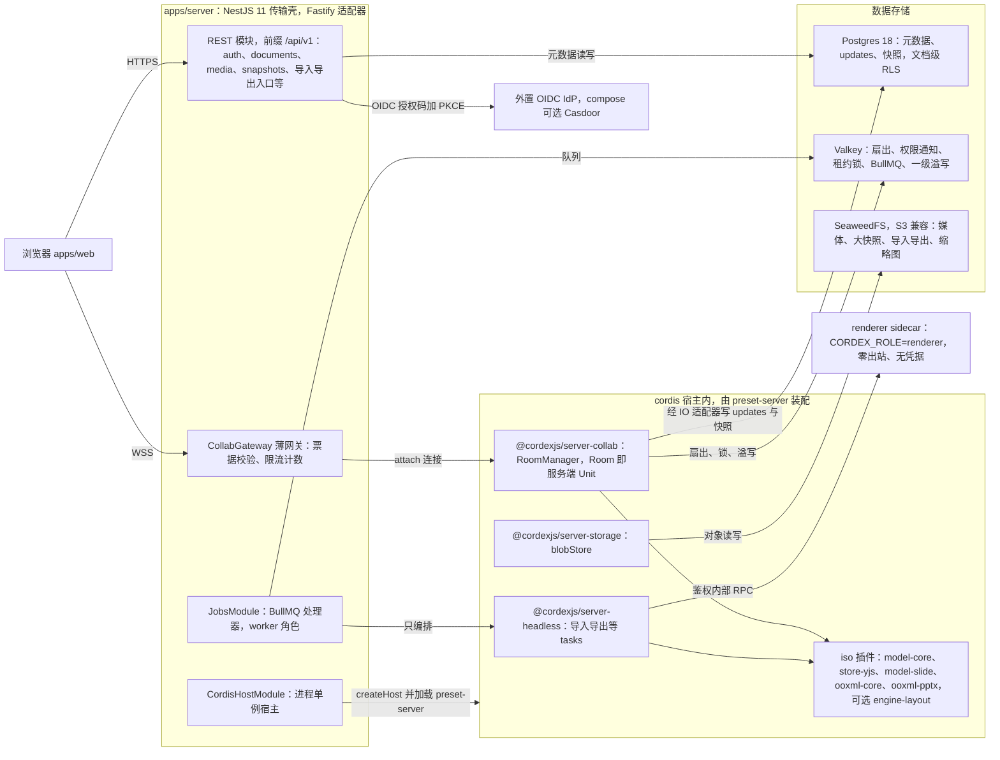

怎么读：浏览器只经 HTTPS 与 WSS 两个入口进入 Nest 壳；实线是调用或数据流。Nest 模块只做传输与编排，CRDT、编解码与持久化逻辑都在 cordis 宿主里的 `server-*` 包与 iso 插件中；worker 只经鉴权内部 RPC 驱动独立的 renderer，应用镜像本身不含 Chromium。

依据：30-architecture/08 §0、§1、§4.2；ADR-0026 决策 1；ADR-0037 决策 1。

宿主是进程单例，其生命周期挂在 Nest 的生命周期钩子上；请求、作业与 WS 连接都不建 Fiber，只有每个 Room 对应一个 Unit。

**图 1-2 Nest 生命周期与内嵌 cordis 宿主**

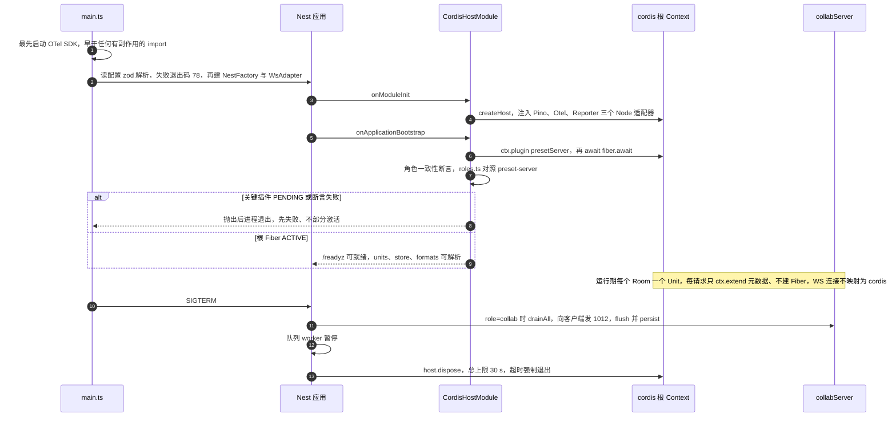

怎么读：自上而下是进程从启动到退出的顺序；`alt` 分支说明装配失败时直接退出而非带病运行（D8「先失败、不部分激活」）。优雅关闭的三步——排空房间、暂停队列、销毁宿主——共用 30 s 上限。

依据：30-architecture/08 §2 `main.ts`、§4.1；40-modules/09 §2.5「ServiceMap」段、§4.3。

`server-collab` 包本身不依赖 `pg`、`ioredis`，它只声明契约；实现这些契约的 IO 适配器是放在 Nest 目录里的 cordis Provider（08 S7、module-map §4.2 第 5 条）。

**图 1-3 server-collab 的契约与 Nest 目录内的 IO 适配器**

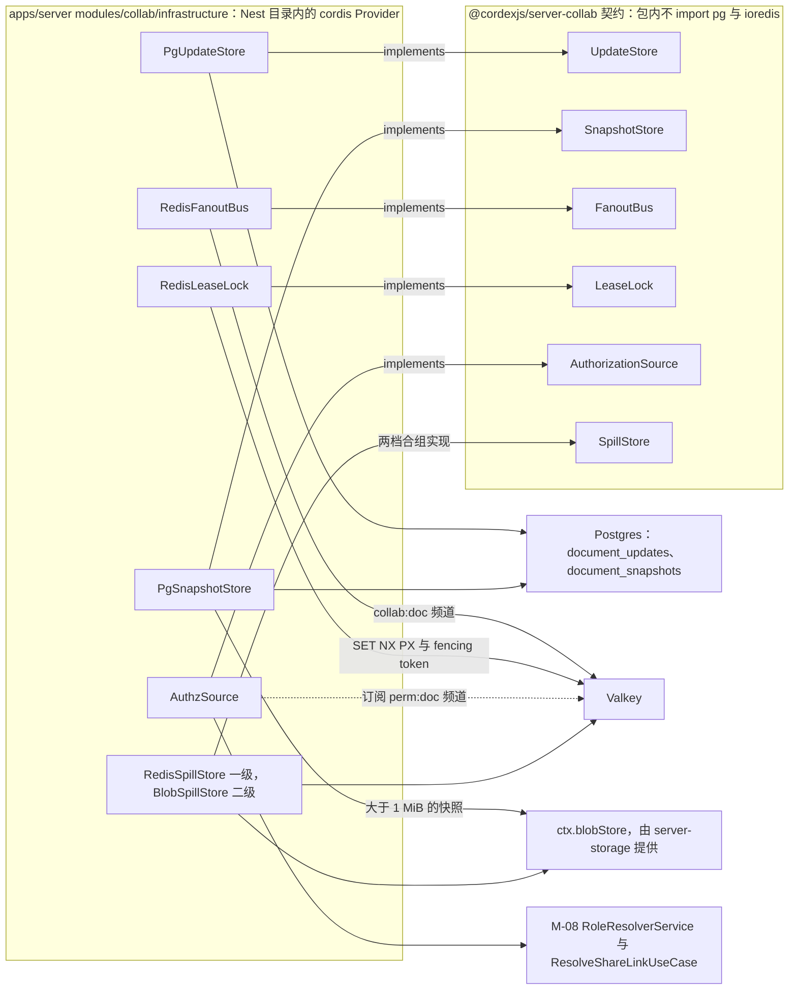

怎么读：标「server-collab 契约」的框是六个 Definition，标「modules/collab/infrastructure」的框是七个适配器（两个溢写档位合为一格）；`implements` 边从适配器指向它实现的 Definition，其余边是适配器触达的外部资源，虚线为频道订阅。七个适配器由 `BootstrapCollabServerService` 在 `OnModuleInit` 注入 `preset-server` 的 `server-collab` 配置项，驱动只出现在右框里。`AuthzSource` 按票据 `lnk` 经 M-08 `ResolveShareLinkUseCase` 复核链接状态，角色取直接授权与有效链接角色的较高者（2026-09-25，rulings §4.18 BE-02）。

依据：40-modules/09 §2.5、§3.1、§3.4、§5.1；30-architecture/08 §3.1、§4.2 末段。

## 2. Nest 模块依赖

下面两张图画 19 个业务 Nest 模块之间的依赖：**实线**是 `@Module({ imports })` 里登记的 import，**虚线**是经 global 模块注入、无需登记 imports 的依赖。2026-09-25 起文件职责表写明的跨模块依赖已全部补进 imports 列，原「用例级依赖」虚线不再存在（rulings §4.18 BE-07）。全局基础模块（`ConfigModule`、`DbModule`、`RedisModule`、`ObservabilityModule`）的边省略，见表 2-1。

**图 2-1 身份、文档、存储与协同模块的依赖（M-08、M-09）**

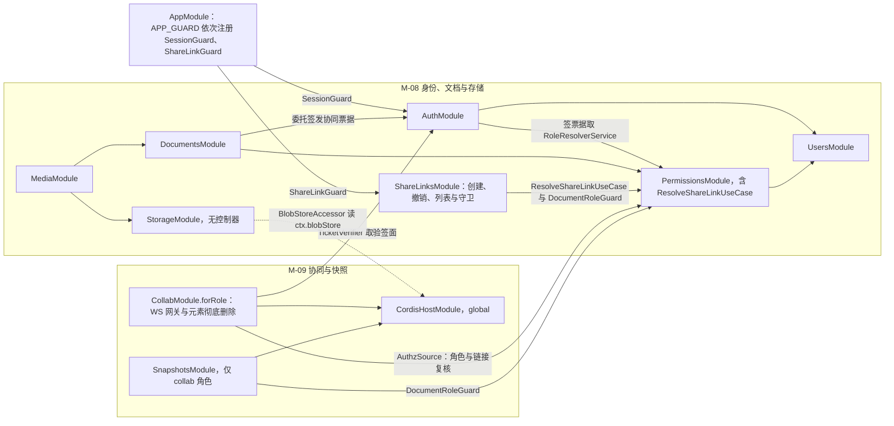

怎么读：箭头从依赖方指向被依赖方。分享链接的解析归 `PermissionsModule`（经 SECURITY DEFINER 函数只读 `share_links`），`ShareLinksModule` 只留创建、撤销、列表与 `ShareLinkGuard`，两者之间只剩单向 import，原来的环消失（2026-09-25，rulings §4.18 BE-02「解析归权限模块」）。`SessionGuard` 与 `ShareLinkGuard` 由 `AppModule` 依次注册为全局守卫，`documents`、`media` 因此不需依赖 `share-links`（BE-05、BE-06）；`SessionGuard` 全局化后 `PermissionsModule` 不再 import `AuthModule`，`AuthModule` 才能反向 import 它而不成环（BE-07）。协同侧对 M-08 的依赖全部登记为 import；唯一虚线是 `StorageModule` 经 global 的 `CordisHostService` 取 `ctx.blobStore`。

依据：40-modules/08 §3、§5.1、§5.5、§5.7、§6、§7；40-modules/09 §3.3、§5.1；rulings §4.18 BE-02、BE-05、BE-06、BE-07。

**图 2-2 作业、评论与运维模块的依赖（M-12）**

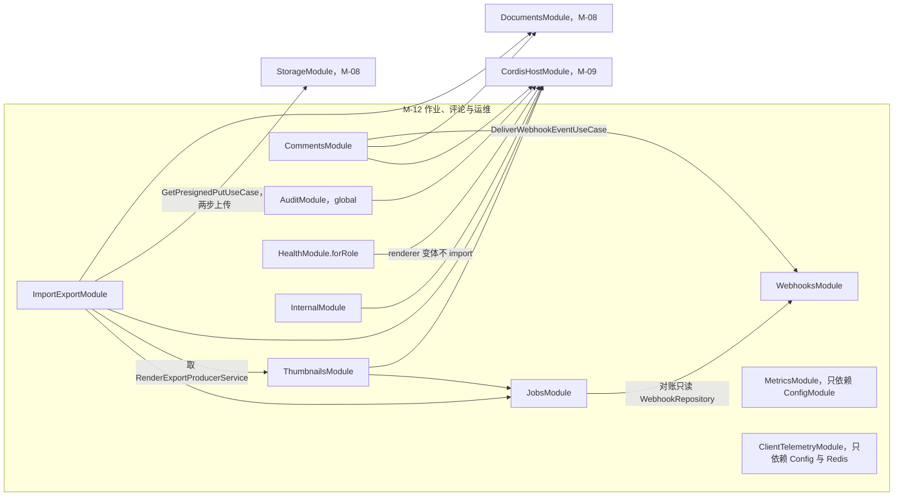

怎么读：画法同图 2-1，本图的边全部是登记的 import。M-12 是终端模块，只消费 M-08/M-09 的导出面；`AuditModule` 为 global，其 `RecordAuditEventUseCase` 由 `common/interceptors/audit.interceptor.ts` 注入，M-08/M-09 只在 controller 上标注 `@Audited()`、不 import 它。`jobs → webhooks` 是 `JobsModule` imports 列里登记的真实依赖（对账作业只读，G-37；2026-09-25 更正表格，rulings §4.18 BE-07）。原 `thumbnails` 到 `internal` 的虚线随 `RenderStateToken` 取消而删除（BE-04）；新增 `ClientTelemetryModule` 承接浏览器遥测端点，只装在 api 角色（BE-30）。各模块在哪个角色装配哪些部件见 12 §7.1 矩阵与图 3-1、3-2。

依据：40-modules/12 §3、§5.1、§7.1、§12 G-37；30-architecture/08 §1；rulings §4.18 BE-04、BE-07、BE-30。

**表 2-1 全局基础模块与显式登记它们的模块**

| 全局模块 | 职责（30-architecture/08 §1） | 在 imports 列中显式登记它的模块 |
|---|---|---|
| `ConfigModule` | zod 解析环境变量，失败退出码 78 | Auth、Storage、Collab、CordisHost、Jobs、Webhooks、Audit、Health、Metrics、ClientTelemetry |
| `DbModule` | Drizzle + pg Pool；迁移由独立命令执行 | Collab、Health |
| `RedisModule` | ioredis 连 Valkey，pub/sub 与命令连接分离 | Auth、Permissions、Collab、Jobs、Webhooks、Health、ClientTelemetry（2026-09-25 删 Internal：渲染状态令牌存储随 `RenderStateToken` 取消，BE-04） |
| `ObservabilityModule` | OTel SDK、pino、请求上下文 AsyncLocalStorage | 无显式登记 |
| `CordisHostModule` | 宿主生命周期，导出 `CordisHostService` | Collab、Snapshots、ImportExport、Thumbnails、Comments、Audit、Health、Internal |

表中「Health」指 api/collab/worker 三个角色的 `HealthModule`；renderer 变体 `HealthModule.forRole('renderer')` 不 import 上表任何基础模块（无凭据），renderer 也不装 `CordisHostModule`（rulings §4.18 BE-13、BE-14）。

## 3. 进程角色 `CORDEX_ROLE` 与模块激活

同一个 `cordex-server` 镜像按 `CORDEX_ROLE` 选择装配（`config/roles.ts` → `AppModule.forRole`，cordis 侧由 `preset-server.ts` 按角色装配插件束）。

**图 3-1 五个角色与各自装配的主体**

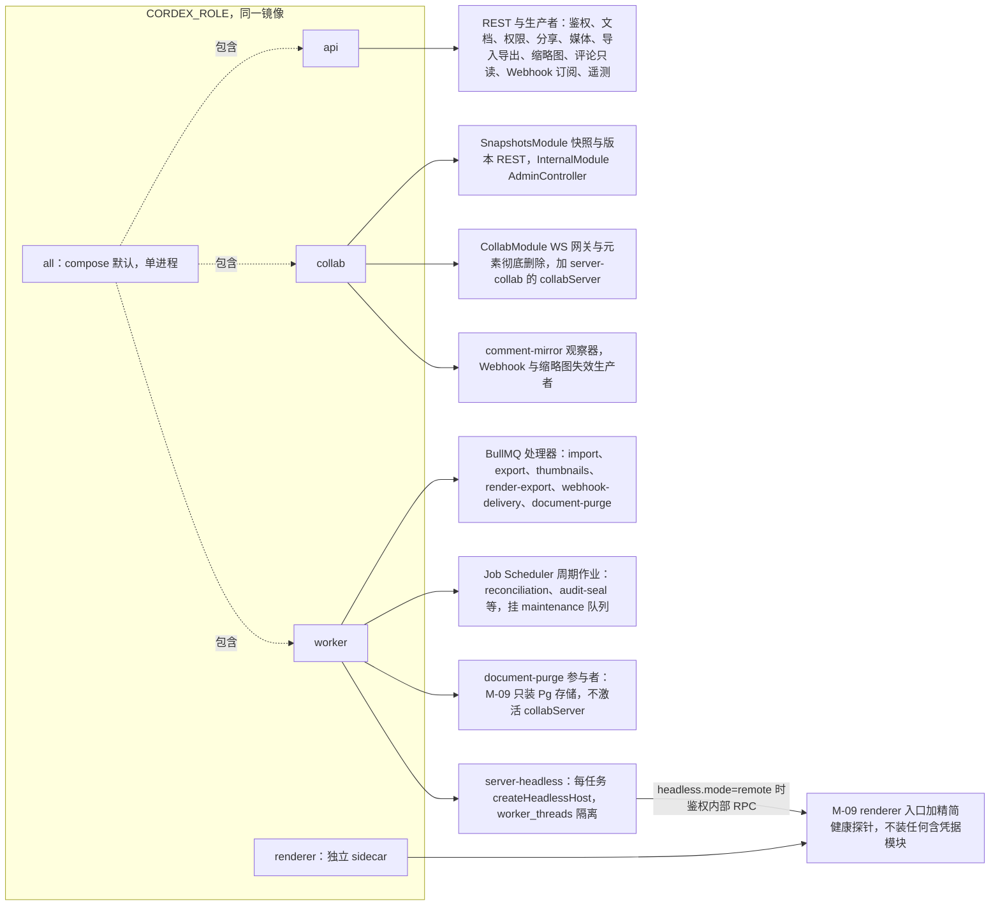

怎么读：左框五个角色取自 ADR-0037 决策 1；`all` 等于 api、collab、worker 三者同进程（虚线「包含」），renderer 仍建议独立容器。右侧各格汇总自 40-modules/12 §7.1「模块 × 角色 × 部件」矩阵（2026-09-25 起为全服务端唯一装配矩阵，rulings §4.18 BE-13）：快照 REST 与管理动作依赖 `collabServer`，只在 collab 装配，反代把 `/api/v1/documents/:id/snapshots*` 与 `…/elements/purge` 转给 collab（BE-03）；周期作业全部由 worker 启动时经 BullMQ Job Scheduler 注册，全局只跑一份，墓碑清理仍是 `tombstone-sweeper` 加租约锁的例外（BE-19）；worker 装 document-purge 处理器与各模块参与者，M-09 参与者只装 `PgUpdateStore`/`PgSnapshotStore`（BE-15）；renderer 只有渲染入口与不含凭据的 `HealthModule.forRole('renderer')`（BE-14）。`headless.mode=local` 时 worker 在本进程内启动 Chromium（EM-10 b）。

依据：ADR-0037 决策 1、决策 3；40-modules/09 §3.3、§7.1；40-modules/12 §7.1；40-modules/16 §6.1；rulings §4.18 BE-03、BE-13、BE-14、BE-15、BE-19。

**图 3-2 横切模块在各角色中的激活**

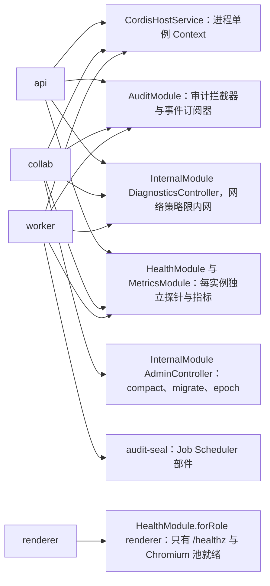

怎么读：箭头表示「该角色的进程装配了这个模块或部件」；`all` 同时获得前三个角色的全部激活项，图中不单列。renderer 不装 `CordisHostService`、`AuditModule`、`InternalModule` 与 `MetricsModule`，只装不 import DB、Valkey 与宿主模块的精简健康探针——renderer 零出站、Prometheus 抓不到，渲染耗时与失败指标由 worker 侧 `remote-renderer.client` 记录（2026-09-25，rulings §4.18 BE-13、BE-14）。审计封存只在 worker 注册，避免 global 模块在每个进程各封存一次（BE-19）；`AdminController` 的 compact、migrate、epoch 委托 `collabServer`，只在 collab 装配（BE-03）。

依据：40-modules/12 §3、§7.1；40-modules/09 §7.1；ADR-0037 决策 1；rulings §4.18 BE-03、BE-13、BE-14、BE-19。

两套按角色装配的开关——Nest 侧 `roles.ts` 与 cordis 侧 `preset-server.ts`——在启动期做一致性断言，不一致即退出（rulings §4.13 同时确认段、评审 15 §3.6）。

**图 3-3 启动期的角色与配置断言**

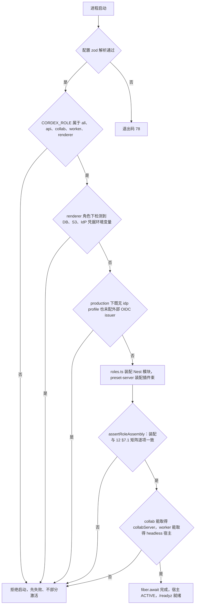

怎么读：菱形是启动断言，任一不满足即退出；判定的先后顺序正文未规定，图中顺序只为可读。`v4` 由 `CordisHostService.getService` 的 `ServiceMap` 编译期 key 校验配合运行期检查完成。`v5` 是 2026-09-25 新增的 `assertRoleAssembly`（rulings §4.18 BE-13）：装了不该装的、缺了该装的都退出，例如 api 不得装配 `SnapshotsModule` 与 `AdminController`、renderer 进程内不得存在 DB/Valkey/S3 客户端、worker 的 document-purge 参与者集合必须齐全；它与 M-09 `preset-server.ts` 的 `assertRoleConsistency` 互补。

依据：ADR-0037「如何被机械验证」；40-modules/09 §2.5「ServiceMap」段、§4.3；40-modules/12 §7.1；30-architecture/08 §2 `config.module.ts`、§4.1；30-architecture/08 §9.1（production 拒绝无鉴权启动）。

## 4. 部署拓扑

M1–M5 只交付集成方或自有部署的 docker-compose「洁净栈」，不自营 SaaS；ADR-0037 是部署拓扑的单一事实源。

**图 4-1 compose 组件与 profiles**

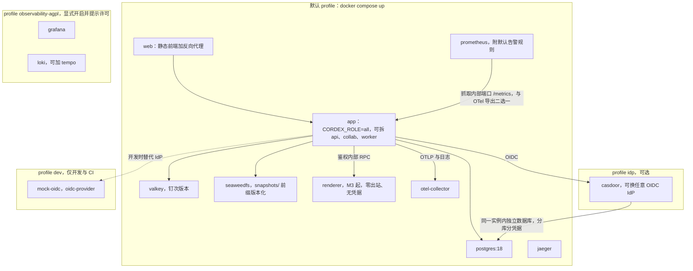

怎么读：四个框是四个 profile，默认 profile 全部为宽松许可组件；AGPL 的 Grafana、Loki、Tempo 只在显式 profile 中出现，不计入最低主机规格。未启用 `idp` profile 时必须配置外部 issuer，否则 production 拒绝启动。持久卷为 `pg-data`、`valkey-data`、`seaweedfs-data`；全部镜像按 digest 钉死。

依据：ADR-0037 决策 2、决策 4、决策 6；30-architecture/08 §10.1；ADR-0030 决策 2、3、7。

**图 4-2 三个 compose 网络与出站策略**

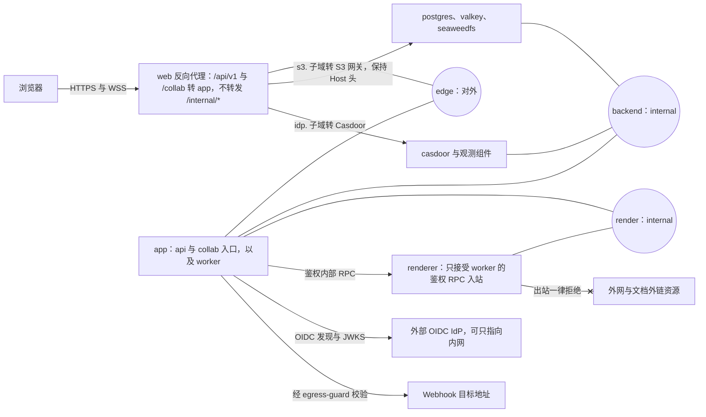

怎么读：圆形节点是 compose 网络，`---` 表示容器挂在该网络上；renderer 只挂 render 网络、出站全部被拒（叉号），且不持有 DB、S3、IdP 凭据。应用的常规出站只有 OIDC 发现与 JWKS 拉取，另有经 S-4 出站校验的 Webhook；服务端永不加载文档外链资源（Q7），外链只可能在客户端按 `externalResources` 加载。浏览器到对象存储与 Casdoor 的路径：edge 反代按子域把 `s3.<域名>` 转 SeaweedFS S3 网关、`idp.<域名>` 转 Casdoor，并保持 Host 头；预签名 URL 按 `storage.s3.publicEndpoint` 生成，服务端自身读写仍走内网 endpoint（2026-09-25，rulings §4.18 BE-01）。REST 统一前缀 `/api/v1`（BE-11）。

依据：ADR-0037 决策 3；ADR-0026 决策 1、6；30-architecture/08 §9.2 外部关系行、§10.1；rulings §4.18 BE-01、BE-11。

collab 实例可以横向扩展：不要求房间亲和，同一文档可在多个实例上各有一份 Room 副本（ADR-0035）。

**图 4-3 多实例扇出：同一文档的两份 Room 副本**

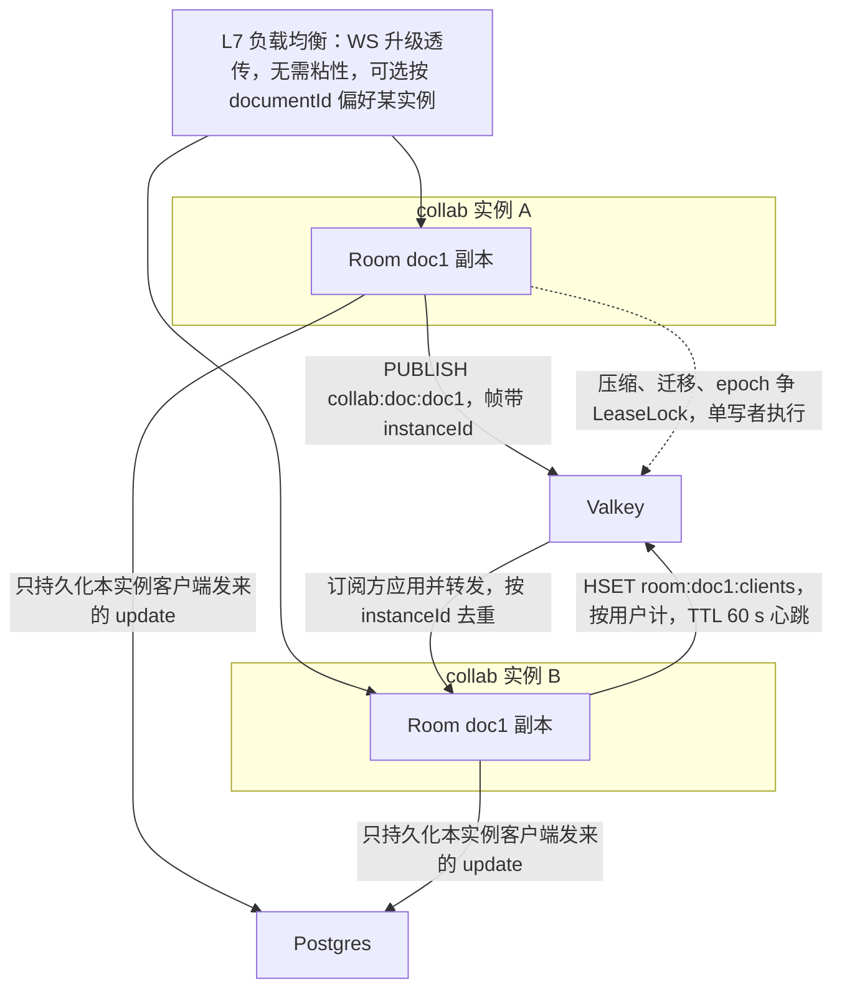

怎么读：两实例行为对称，图中每类边只画一侧，虚线表示各副本竞争同一把租约锁、只有持锁者执行。跨实例一致性靠 Valkey 扇出与 CRDT 幂等，不靠路由；Valkey 故障时各实例内部仍一致、`/readyz` 返回 503 让 LB 停止分配新连接。热门文档集群内存 = 副本数 × 文档实测权重（D200 ≈ 85 MB/副本），准入按「已占权重 + 新房间权重 ≤ 实例预算」。

依据：ADR-0035 决策 1–8 与 2026-09-24 修订；30-architecture/08 §8。

**图 4-4 滚动发布：collab 实例优雅下线**

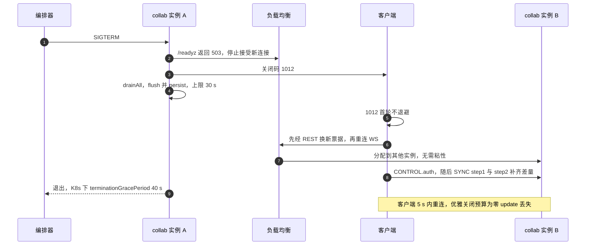

怎么读：自上而下是一次滚动重启的时间线。重连必须先换票据（WS 不接受长时凭据），差量由 y-protocols 的 step1/step2 自动补齐，因此下线实例未广播的内容也不会丢。

依据：ADR-0035 决策 9；30-architecture/08 §10.2、§12；ADR-0029 后果段；30-architecture/06 §6.5。

Helm chart 是 **M4 P1** 交付件，不进 M3 出口；下图只画 08 §10.2 已列出的拆分形态。

**图 4-5 Kubernetes 按角色拆分（M4 P1）**

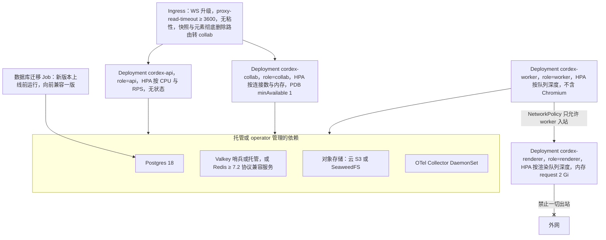

怎么读：每个 Deployment 对应一个 `CORDEX_ROLE`，按各自的瓶颈指标伸缩；指向 `infra` 框的边表示该工作负载使用这组依赖。renderer 由 NetworkPolicy 同时限制入站来源与出站。周期作业由 worker 启动时经 BullMQ Job Scheduler 注册，不另设 CronJob，原 `cordex-maintenance` 节点删除（2026-09-25，rulings §4.18 BE-19）。

依据：30-architecture/08 §10.2；ADR-0037 决策 7；40-modules/12 §7.1；rulings §4.18 BE-03、BE-19。

## 5. 数据模型

约定（30-architecture/08 §5）：全部表都没有 `tenant_id`；`id uuid` 为 v7、在应用层生成；软删除用 `deleted_at`；凡带 `doc_id` 的业务表启用文档级 RLS（见图 8-2）。先看「谁的表谁写」，再按域看 ER 图。

**图 5-0 表的写方所有权**

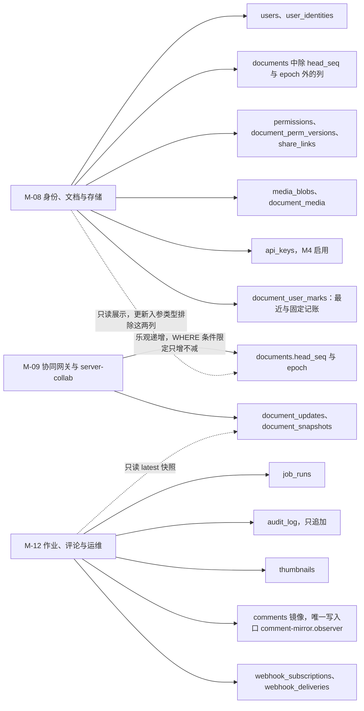

怎么读：实线表示该模块是这组表的唯一写方，虚线是跨模块只读。`documents` 一行被 M-08 与 M-09 按列分写，是唯一的共享表列冲突面，M-08 侧由 `DocumentRepository` 更新入参 `Omit<Document,'headSeq'|'epoch'>` 在编译期排除；`epoch` 由 M-09 `collabServer.forceEpoch()` 递增，触发入口是 M-12 管理端点（rulings §4.18 BE-21）。`job_runs` 中 `kind=document-purge` 的行由 M-08 `schedule-purge` 经 `JobRunsRepository` 写入（BE-15）。2026-09-25 起 M-08 增写 `document_user_marks`，`collab_sessions` 删除（BE-31）。

依据：40-modules/08 §2.1、§7；40-modules/09 §7.3；40-modules/12 §7.3；rulings §4.13 同时确认段、§4.18 BE-15、BE-21、BE-31。

**图 5-1 身份与权限**

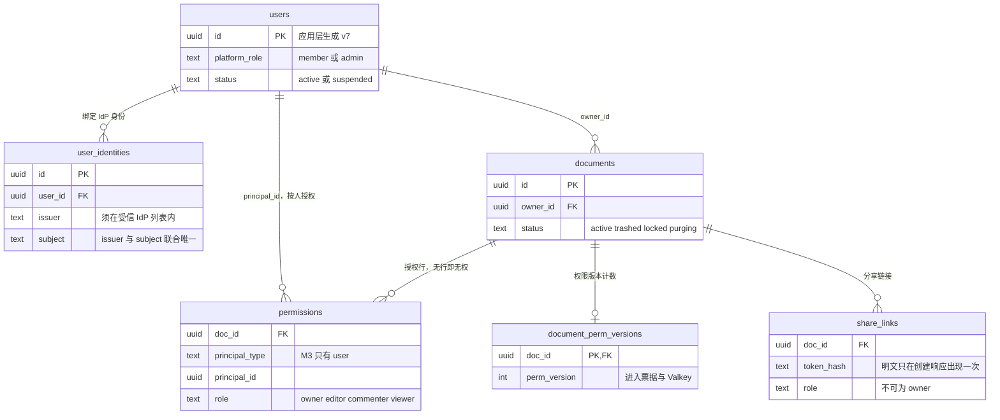

怎么读：隔离边界是「文档」而非租户——`permissions` 是 fail-closed 的授权行，`share_links` 是需登录才能兑现的角色叠加令牌，二者同时是文档级 RLS 的判定依据。`users.password` 列不存在（服务端不持有密码）；无 `groups`、无 `pending_invitations`；`api_keys` 为 M4，不在 M1–M3 模型中。分享令牌的解析归 `permissions` 模块，经 SECURITY DEFINER 函数 `cordex_share_link_by_token`/`cordex_share_link_status` 只读 `share_links`（2026-09-25，rulings §4.18 BE-02）。用户的「最近 / 固定」记账表 `document_user_marks` 画在图 5-5。

依据：30-architecture/08 §5；40-modules/08 §2.1、§2.2、§2.5；ADR-0029 2026-09-24 修订；rulings §4.18 BE-02。

**图 5-2 文档与版本**

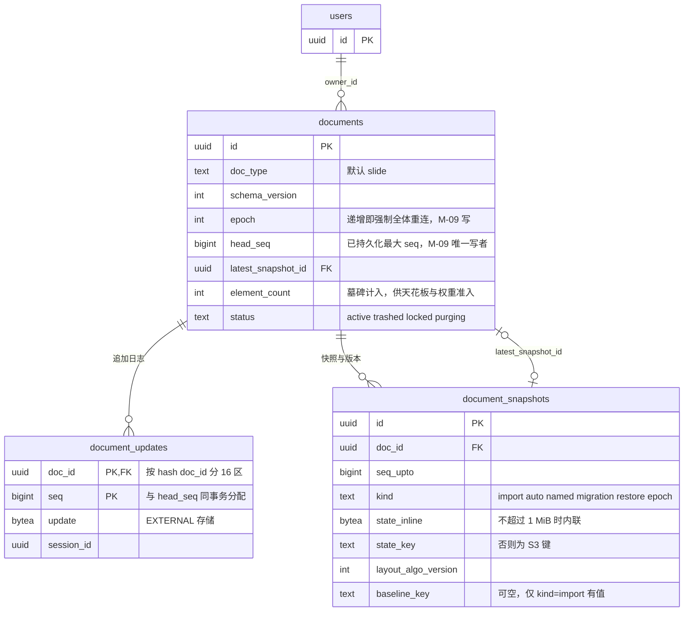

怎么读：恢复一份文档 = 最新快照 + `seq > seq_upto` 的 updates；`latest_snapshot_id` 只指向 `import/auto/migration/restore/epoch` 中最新一个，不含 `named`。`document_updates` 只删 `seq ≤ 最新 auto 快照.seq_upto` 且早于 7 天的行；`purging` 是 S-2 永久删除文档编排的单向状态，可从 `active` 直接进入，处于该状态时加入房间一律被拒；`baseline_key` 2026-09-25 登记进架构 08 §5（rulings §4.18 BE-15、BE-25）。

依据：30-architecture/08 §5「写路径关键约束」；ADR-0025 决策 1–5；40-modules/09 §2.1、§12 G-16；rulings §4.18 BE-15、BE-25。

**图 5-3 评论与审计**

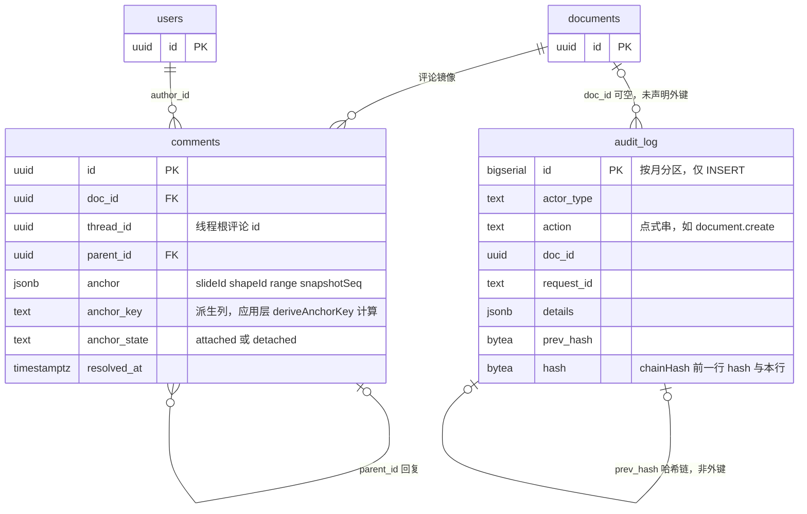

怎么读：`comments` 只是读模型——事实源在快照内的 `resources.comments.*`，服务端 Room 观察变更后 upsert，REST 除「导入为可编辑线程」外全部只读。`anchor_key` 不是 PG 生成列（TS 纯函数写不进生成列表达式），由 comment-mirror 写入时调用 `deriveAnchorKey` 计算，索引为 `(doc_id, anchor_key)`（2026-09-25，rulings §4.18 BE-25）。`audit_log` 以 `prev_hash → hash` 形成链式校验，数据库角色对它没有 UPDATE/DELETE 权限，每日 `audit-seal` 周期作业（只在 worker 注册，BE-19）重算前一日。

依据：30-architecture/08 §5、§16.6；40-modules/12 §2.1、§2.3、§12 G-38；ADR-0031（经 08 §16.6 引用）；rulings §4.18 BE-19、BE-25。

**图 5-4 缩略图与媒体**

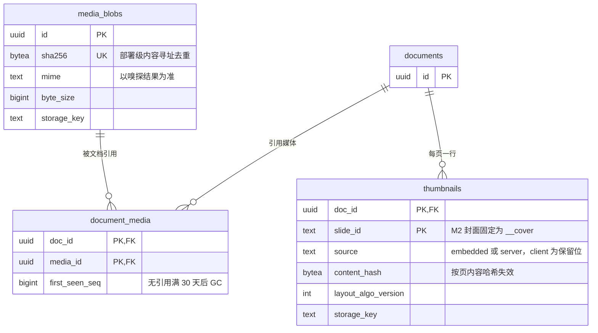

怎么读：媒体按 sha256 在整个部署内去重，读取仍须经 `document_media` 关联与文档权限；永久删除文档编排只清 `document_media`，`media_blobs` 本身按 30 天无引用 GC。`thumbnails` 每页只保留最新一行：`embedded` 是 M2 取包内 `docProps/thumbnail.jpeg` 的过渡封面（只做头校验），`server` 是 M3 renderer 产出的 640 px WebP；DB 约束另保留 `client` 取值，M1–M3 领域层不产生该值（2026-09-25，rulings §4.18 BE-26）。

依据：30-architecture/08 §5；40-modules/08 §2.1；40-modules/12 §2.1；ADR-0026 决策 2–4；rulings §4.18 BE-26。

**图 5-5 作业、用户记账与 Webhook**

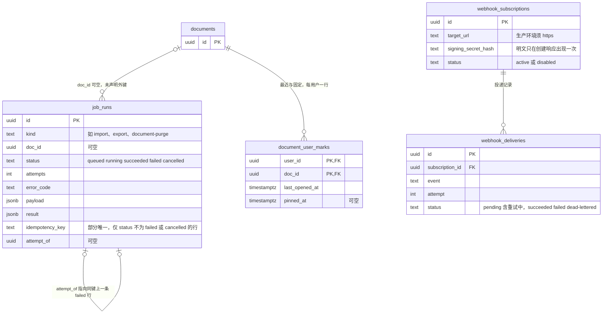

怎么读：`job_runs` 是 BullMQ 作业的 Postgres 镜像，供进度查询（`GET /api/v1/imports/:jobId`）与审计，`doc_id` 只是逻辑引用、不声明外键。幂等只对未失败且未取消的行生效：部分唯一索引 `unique(idempotency_key) where status not in ('failed','cancelled')`，同键命中 `failed`/`cancelled` 行时新建一行并以 `attempt_of` 指向旧行，二者始终是终态（2026-09-25，rulings §4.18 BE-18；`cancelled` 为导入取消，UX-14）。原 `collab_sessions` 表删除；新增 `document_user_marks` 作为用户对文档的「最近打开 / 固定」记账，主键 `(user_id, doc_id)`，受文档级 RLS 且只返回本人行，由 M-08 写入，永久删除文档时由参与者 `user-marks` 清理（BE-31）。Webhook 两表属 BC-30 出站集成，订阅由平台管理员管理；`pending` 覆盖待投递与重试中，`failed` 为不可重试的终止，`dead-lettered` 为重试用尽，状态机见图 7-4（BE-19）。

依据：30-architecture/08 §5、§7；40-modules/12 §2.1、§2.2；rulings §4.18 BE-18、BE-19、BE-31。

关系库之外还有两处数据：对象存储承载体积，Valkey 只做易失协调（丢失可恢复）。

**图 5-6 对象存储键布局与写入方**

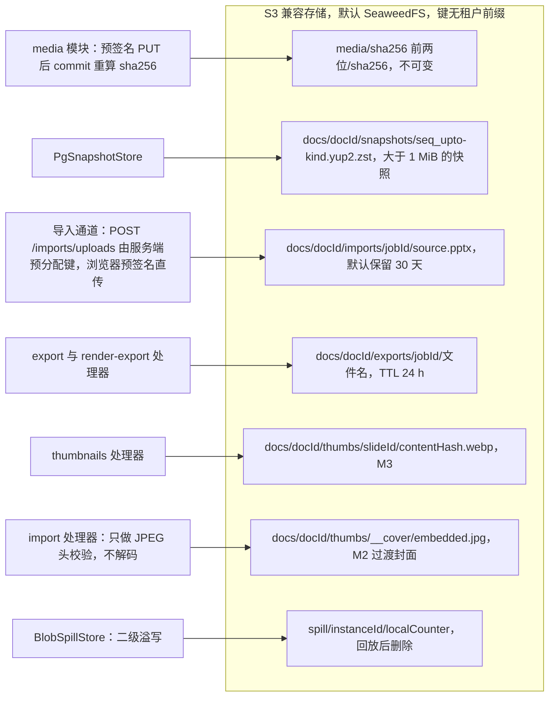

怎么读：每个键前缀只由图中对应的一类组件写入，`exports/` 由两个导出处理器共用。`snapshots/` 前缀必须开启版本化（SV-09 备份依赖），永久删除文档收尾时用 ListObjectVersions 加按 versionId 删除清掉全部历史版本（rulings §4.18 BE-15）；`exports/` 由生命周期规则按 TTL 删除；媒体下载经 `GET /media/:sha256` 302 到 1 h 预签名 GET，或经服务端流式代理。导入原件的 `jobId`、`docId` 与对象键由服务端预分配，客户端只回传一次性 `uploadId`，通用 `POST /storage/presign` 已删除（BE-10）；预签名 URL 一律按 `storage.s3.publicEndpoint` 生成（BE-01）。

依据：30-architecture/08 §6、§16.3、§16.4；40-modules/09 §3.4；40-modules/12 §2.6、§4.2、§4.3；rulings §4.18 BE-01、BE-10、BE-15。

**图 5-7 Valkey 键、频道与使用方**

```mermaid
flowchart LR
  subgraph vk["Valkey，Redis ≥ 7.2 协议"]
    cDoc["频道 collab:doc:docId，帧带 instanceId"]
    cPerm["频道 perm:doc:docId，permVersion 缓存，以库为准"]
    hClients["room:docId:clients，HSET，TTL 60 s 心跳"]
    lock["租约锁 lock:compact:doc、lock:tombstone:doc、lock:spill:doc、collab:migrate:doc"]
    ctl["控制频道 room:ctl:doc：跨实例踢会话与关 Room"]
    up["导入一次性 uploadId，TTL 1 h，GETDEL 消费"]
    jti["票据 jti，SETNX 60 s"]
    oidc["OIDC state 与 PKCE，TTL 10 min"]
    bull["BullMQ 队列"]
    rate["限流令牌桶"]
    spill["一级溢写：按 docId 分 key 的有界列表"]
  end
  fan["RedisFanoutBus"] --> cDoc
  pub["PermChangePublisher，M-08"] --> cPerm
  cPerm -.-> authz["AuthzSource，M-09 订阅"]
  rm["server-collab 在线人数聚合"] --> hClients
  lease["RedisLeaseLock：compactor、migration-runner、tombstone-sweeper、溢写认领"] --> lock
  rc["PurgeCollabDataUseCase 与 AdminController，各 collab 实例订阅"] --> ctl
  ius["ImportUploadStore，M-12"] --> up
  tv["TicketVerifier"] --> jti
  ss["OidcStateStore"] --> oidc
  jobsM["JobsModule 与各处理器"] --> bull
  rl["RateLimitGuard 与 redis-token-bucket"] --> rate
  rsp["RedisSpillStore"] --> spill
```

怎么读：框内是键或频道，框外是唯一的写入或发布方（`perm:doc` 另以虚线画出订阅方）。这些数据全部可以丢失：扇出中断只造成跨实例延迟，锁带 fencing token，溢写丢失由客户端重连 step2 补齐；Postgres 才是一致性关键路径。2026-09-25 起 `RenderStateToken` 键随令牌取消而删除（rulings §4.18 BE-04）；新增 `lock:spill:doc`（加载 Room 时认领心跳过期实例的溢写行，CO-16）、`room:ctl:doc`（永久删除文档与 epoch 管理动作跨实例踢会话、关 Room，BE-03、BE-15）与导入一次性 `uploadId`（BE-10）。

依据：ADR-0022 决策表；ADR-0025 决策 9；ADR-0029 决策 1；30-architecture/06 §5.2；30-architecture/08 §2 collab 与 auth 目录、§8；40-modules/09 §4.1；40-modules/12 §2.5、§4.2、§4.8、§4.9；rulings §4.18 BE-04、BE-10、CO-16。

## 6. 关键时序

本节序列图按「登录 → 打开文档 → 编辑 → 故障与维护 → 作业 → 授权」的顺序排列。参与者只取正文写明的组件；房间状态机与客户端会话状态机已在 30-architecture/06 §5.1/§5.2 画出，此处不重复。图中 REST 路径均相对全局前缀 `/api/v1`（rulings §4.18 BE-11）。

**图 6-1 OIDC 登录与首次登录 JIT 建号**

```mermaid
sequenceDiagram
  autonumber
  participant web as 浏览器
  participant auth as AuthModule
  participant vk as Valkey OidcStateStore
  participant idp as 外置 OIDC IdP 或 Casdoor
  participant users as UsersModule
  participant pg as Postgres
  participant audit as AuditModule
  web->>auth: POST /auth/oidc/login
  auth->>vk: 存 state 与 PKCE verifier，TTL 10 min
  auth-->>web: authorizationUrl
  web->>idp: 授权请求，授权码加 PKCE
  Note over web,idp: selfSignup 默认关，账号由管理员在 IdP 建，服务端不持有密码、无邀请表
  idp-->>web: 重定向到 /auth/oidc/callback，携带 code 与 state
  web->>auth: GET /auth/oidc/callback
  auth->>vk: 校验并消费 state
  auth->>idp: 用 code 换 token，openid-client discovery 缓存
  idp-->>auth: ID token，含 issuer 与 subject
  alt issuer 不在受信 IdP 列表
    auth->>audit: auth.login-failed
    auth-->>web: 拒绝，user.untrusted_issuer
  else 受信
    auth->>users: ProvisionOnFirstLogin，issuer 与 subject
    users->>pg: 按 issuer 加 subject 查 user_identities
    opt 首次登录
      users->>pg: 同一事务插入 users 与 user_identities，唯一冲突按后写事务失败重试处理
      users->>audit: user.provisioned
    end
    users-->>auth: User
    auth->>audit: auth.login-succeeded
    auth-->>web: 会话 httpOnly cookie SameSite=Lax 或 Bearer JWT，ES256
  end
```

怎么读：前半段是标准授权码 + PKCE，后半段是本项目的 JIT 建号——服务端只在首次登录时于同一事务写 `users` 与 `user_identities`，并发首登靠 `(issuer, subject)` 唯一约束收敛。登录只产出会话，协同票据另行签发（图 6-2）。

依据：30-architecture/08 §2 auth 目录、§9.1；40-modules/08 §2.4、§2.6、§4.1、§5.3；ADR-0029 2026-09-24 修订 2–4。

打开一份文档分两段：先经 REST 取快照并领取协同票据，再建立 WS 连接完成握手与同步。

**图 6-2 打开文档（一）：HTTP 快照预加载与协同票据**

```mermaid
sequenceDiagram
  autonumber
  participant web as 浏览器 apps/web
  participant rest as REST 层 snapshots 与 documents
  participant rr as RoleResolverService
  participant pg as Postgres
  participant s3 as SeaweedFS
  web->>rest: GET /documents/:id/snapshots/latest，拆分部署时反代转 collab，带 ETag 协商
  rest->>rr: DocumentRoleGuard 解析角色，无显式允许即 403
  rest->>pg: 读 latest_snapshot_id 指向的快照
  opt 快照大于 1 MiB
    rest->>s3: 按 state_key 取对象
  end
  rest-->>web: 200 V2 state 经 zstd，或 304，Cache-Control private，max-age=0，must-revalidate
  web->>web: 空 Y.Doc 上 applyUpdate，origin=import，不入撤销栈
  web->>rest: POST /documents/:id/collab-ticket
  rest->>rr: resolveRole，须不低于 viewer，ShareLinkGuard 已叠加链接角色
  rr-->>rest: role 与 permVersion
  rest-->>web: 票据 JWT ES256，60 s，jti 单次，claims 为 sub、sid、doc、role、permVersion，经链接时另带 lnk
  Note over web,rest: M1 至 M3 唯一凭据形态，集成方签名 JWT 降为 M4，claims 中无 tid
```

怎么读：快照预加载让首屏不必等 WS——`syncing` 状态即可渲染与编辑，本地修改先进 pending 队列。票据只在 60 s 内、只能用一次，且把分享链接叠加后的最终角色写进 claims；经链接取得的票据另带 `lnk`（链接 id），WS 侧据此复核链接状态并记录到期时间，而不接触链接令牌本身，`sid` 为登录会话 id（2026-09-25，rulings §4.18 BE-02）。快照 REST 只在 collab 角色装配，拆分部署时反代把 `/api/v1/documents/:id/snapshots*` 转给 collab（BE-03）。

依据：30-architecture/06 §5.3、§9.1；30-architecture/08 §2 snapshots 与 documents、§9.1；ADR-0029 决策 1、6；ADR-0023 决策 4；rulings §4.18 BE-02、BE-03。

**图 6-3 打开文档（二）：WS 握手、房间准入与 bootstrap**

```mermaid
sequenceDiagram
  autonumber
  participant web as 浏览器
  participant gw as CollabGateway 与 TicketVerifier
  participant vk as Valkey
  participant rm as RoomManager
  participant pg as Postgres
  web->>gw: WS 连接 /collab/v1/rooms/:documentId
  web->>gw: 首帧 CONTROL.auth，含 ticket、protocolVersion、clientId
  alt 5 s 内未收到 auth
    gw-->>web: 关闭 4408
  end
  gw->>gw: 用 M-08 验签面校验，过期或伪造则 4401，带 lnk 时记下链接 id 与到期时间
  gw->>vk: jti SETNX 60 s，重放则 4401
  gw->>vk: 比对最新 permVersion，不一致以库为准
  gw->>pg: 读 documents.status 与 element_count
  opt status 为 purging
    gw-->>web: auth.denied 并关闭，永久删除中不进入房间
  end
  gw->>rm: attach，传入连接、票据 claims 与 element_count
  alt 本实例尚无该 Room 且权重超出预算
    rm-->>web: auth.denied collab.room_full，关闭 4503
  else 本实例尚无该 Room，准入通过
    rm->>pg: 进入 loading，读最新快照与 seq_upto 之后的 updates
    rm->>rm: 逐条 applyUpdate，必要时迁移，再认领过期实例的溢写行
    rm-->>web: CONTROL.auth.ok，含 sessionId、role、serverSeq
  else 已有 Room
    rm->>rm: 只做编辑者名额判定，按用户计
    rm-->>web: CONTROL.auth.ok，含 sessionId、role、serverSeq
  end
  opt 已收到 auth.ok
    web->>rm: SYNC step1，发送状态向量
    rm-->>web: SYNC step2，返回差量
    rm->>web: SYNC step1，服务端询问
    web->>rm: SYNC step2，上送本地 pending 差量
    web->>rm: AWARENESS 本地状态，经扇出广播
  end
```

怎么读：`auth.ok` 之前服务端拒绝一切 SYNC 与 AWARENESS 帧（4401）。加入前先读 `documents.status`，`purging` 一律拒绝（`locked` 按 ADR-0029 决策 5 拒写，rulings §4.18 BE-15）。准入先于 bootstrap：本实例尚无该 Room 时按 `documents.element_count` 估算权重、不需预加载，超预算返回 4503、客户端退避后重连到其他实例，通过后才进入 `loading`；已有 Room 只判编辑者名额（2026-09-25，CO-17）。bootstrap 之后顺带持 `lock:spill:doc` 租约认领心跳过期实例的遗留溢写行（CO-16），Room 随后进入 `active`，8 MB 状态 bootstrap 预算 500 ms p95。票据带 `lnk` 时会话记下链接 id 与 `linkExpiresAt`，供图 6-15 的链接会话降权（BE-02）。

依据：30-architecture/06 §5.2、§5.3、§6.3、§14；ADR-0029 决策 1–2；ADR-0035 2026-09-24 修订 2、4；40-modules/09 §2.6「加入房间」行、图 2-5；rulings §4.18 BE-02、BE-15、CO-16、CO-17。

**图 6-4 一次 update 的处理与两级 ack**

```mermaid
sequenceDiagram
  autonumber
  participant a as 客户端甲
  participant fr as FrameRouter 与硬门禁
  participant room as Room，软门禁与广播
  participant uw as UpdateWriter
  participant pg as Postgres
  participant sp as SpillStore
  participant fan as FanoutBus，Valkey
  participant b as 其他实例
  a->>fr: SYNC update，本地 localSeq 进 pending
  fr->>fr: L1 信封大小速率，L2 角色与锁定，L3 可解析与结构数
  alt 硬门禁不通过
    fr-->>a: 4400、4413、4429 或 error collab.forbidden，不广播不落库
  else 通过
    fr->>room: applyUpdate，origin=remote
    room->>room: 软门禁 validateChangeSet 与 invariants，违规则写 repair 事务
    room->>uw: 入批，flush 100 ms 或 50 条
    alt Postgres 可用
      uw->>pg: 同一事务插入 document_updates 并递增 head_seq 分配 seq
      pg-->>uw: 提交
      uw-->>a: CONTROL.ack，tier=db，带 seq，客户端清 pending
      room->>fan: publish collab:doc:docId，带 instanceId
      fan->>b: 扇出，对方只应用不落库
    else Postgres 不可达，降级期
      room->>fan: 不等落库即广播并 publish，计数 broadcast_before_persist
      fan->>b: 扇出，对方只应用不落库
      alt 超一级阈值
        uw->>sp: 写溢写存储，临时键 instanceId 加 localCounter
        uw-->>a: CONTROL.ack，tier=spill，无 seq，客户端保留 pending
      else 未超阈值
        uw->>uw: 退避重试，暂不 ack
      end
    end
  end
  Note over a,b: persistBeforeBroadcast=true 只约束 PG 可用时的顺序，溢写与回放细节见图 6-5、6-6
```

怎么读：硬门禁在应用之前拒绝，软门禁在应用之后修复而不回滚（回滚会让已扇出的副本分叉）。客户端只在收到 `tier=db` 时清理 pending，`tier=spill` 只表示「服务端已收到」；跨实例扇入的 update 只应用、不重复落库。PG 故障期（`none`/`valkey`/`blob` 任一档）update 通过门禁后即在本实例广播并跨实例扇出，不等持久化，`persistBeforeBroadcast` 只约束 PG 可用时的顺序（2026-09-25，rulings §4.18 CO-08）。

依据：30-architecture/06 §6.3、§6.4、§11；ADR-0025 决策 1、8；ADR-0034（经 06 §11 引用）；ADR-0035 决策 2–3；40-modules/09 §2.6、图 2-4（2026-09-25 图号更正，rulings §4.18 GV-08）；rulings §4.18 CO-08。

Postgres 持续故障时不拒绝新编辑，而是按 Room 未持久化字节两级溢写，恢复后按临时键顺序回放（rulings §4.13 S-3、§4.15 S-3a）。

**图 6-5 Postgres 故障期的两级溢写**

```mermaid
sequenceDiagram
  autonumber
  participant a as 客户端
  participant uw as UpdateWriter
  participant sc as SpillCoordinator
  participant vk as Valkey，一级
  participant bs as BlobStore，二级
  participant room as Room
  participant hz as HealthModule readyz
  uw->>uw: 批量插入失败，Postgres 不可达
  uw->>sc: 改路由到 spill-coordinator
  sc->>sc: checkSpillTier，按本 Room 未持久化字节判定档位
  alt none，未超一级阈值
    sc-->>uw: 走原退避重试，暂不 ack
  else valkey，超一级阈值 tier1MaxBytesPerDoc
    sc->>vk: writeTier1，按 docId 分 key 的有界列表
    sc-->>a: CONTROL.ack，tier=spill
  else blob，超二级阈值
    sc->>bs: writeTier2，按 tier2ChunkBytes 分块，键 spill/instanceId/localCounter
    sc-->>a: CONTROL.ack，tier=spill
  end
  sc->>room: 更新 spillTier 与 pendingBytes，指标 cordex_collab_spill_tier_current
  Note over a,room: 不拒绝新编辑、照常广播，Room 保持 active，溢写行只带临时键，不分配 seq
  hz->>hz: PG ping 失败，/readyz 返回 503，LB 停止分配新连接，旧连接保留
```

怎么读：档位由纯函数 `checkSpillTier` 决定，`SpillStore` 只负责写入与读出；溢写期客户端只收到 `tier=spill`，pending 不清理，因此即使本实例此时崩溃，客户端重连后仍会重发。临时键避免了多实例在 PG 不可用时各自分配 seq 而冲突。整个降级期 Room 保持 `active`（`spillTier≠none`），update 照常广播与扇出（2026-09-25，rulings §4.18 CO-08、CO-15）。

依据：40-modules/09 §1.1、§2.3、§2.5、§2.6；30-architecture/08 §3.1 `spill-store.ts`、§12 溢写行；ADR-0025 修订 2026-09-24；评审 15 §3.7；rulings §4.18 CO-08、CO-15。

**图 6-6 Postgres 恢复后的回放**

```mermaid
sequenceDiagram
  autonumber
  participant pg as Postgres
  participant room as Room
  participant rp as ReplaySpilledUseCase
  participant sp as SpillStore 两档
  participant a as 原会话客户端
  pg-->>room: 恢复信号
  room->>room: 保持 active 并置 replaying=true，在线客户端不断连
  rp->>sp: readAllOrdered，只读本实例 instanceId 的行，按 localCounter 升序合并两档
  loop 每条溢写行
    rp->>pg: UpdateStore.append，回放事务内分配正式 seq 并递增 head_seq
    pg-->>rp: seq
    rp-->>a: CONTROL.ack，tier=db，带 seq，客户端此时才清 pending
  end
  rp->>room: 断言服务端 Y.Doc 无 pendingStructs
  rp->>sp: clear，只清本实例的行
  room->>room: replaying=false，回放期间新到的 update 排在回放队列之后落库
  Note over pg,a: 过期实例的遗留行由下次加载该文档的 Room 认领，溢写丢失由重连 step2 补齐
```

怎么读：正式 seq 只在回放时由 Postgres 分配，所以 `document_updates` 的 seq 连续、无重复。回放期间 Room 始终保持 `active`（`replaying=true`），回放完成前新到的 update 排在回放队列之后落库，同一连接上 `tier=db` 的 ack 顺序不变（2026-09-25，rulings §4.18 CO-15）。每个实例只回放自己 `instanceId` 的行，避免两实例重复回放；已下线实例的遗留行由下次加载该文档的 Room 在 bootstrap 之后持 `lock:spill:doc` 租约认领（CO-16）。溢写数据若丢失，客户端重连 step2 凭 update 幂等补齐，NF-03 零丢失以 `tier=db` 为准；导出与缩略图读的是 `latest` 快照，不受回放影响。预算：PG 恢复到回放完成不超过 10 s（p95，D50 级溢写窗口）。

依据：40-modules/09 §2.6、§7.3；30-architecture/06 §6.4；30-architecture/08 §5「写路径关键约束」、§12；ADR-0025 决策 8；rulings §4.18 CO-15、CO-16。

元素删除是软删除墓碑，id 稳定；TTL（默认 24 h，部署配置 `tombstone.ttlHours`）到期后由服务端单写者硬删除，客户端从不自行硬删（rulings §4.15 Q3、§4.17 D4）。

**图 6-7 墓碑 TTL 硬删除**

```mermaid
sequenceDiagram
  autonumber
  participant a as 删除方客户端
  participant room as Room Unit
  participant tw as TombstoneSweeper
  participant ll as LeaseLock，Valkey
  participant uw as UpdateWriter 与广播
  participant pg as Postgres
  a->>room: 删除元素，写墓碑 _deleted 的 at 与 by，实体与 id 保留
  Note over a,room: TTL 内墓碑计入元素数与房间权重，删除方撤销或恢复元素可原 id 复活
  loop 定时
    tw->>ll: acquire lock:tombstone:doc，或复用压缩租约
    alt 未取得租约
      ll-->>tw: null，本实例跳过
    else 取得租约，成为单写者
      tw->>room: 扫描 _deleted.at 加 ttlHours 早于 now 的实体
      tw->>room: 单事务硬删除，origin=system maintenance
      room->>uw: 与普通 update 相同，落库并广播
      uw->>pg: 插入 document_updates
    end
  end
  Note over room,pg: 此后 auto 快照不含该实体，未打开的文档由 Compaction 加载时顺带执行，不经 BullMQ
```

怎么读：硬删除只有这一条执行路径——`server-collab` 的 `tombstone-sweeper` 加租约锁，架构 08 早期的 BullMQ `tombstone-purge` 路径已作废。owner 的「彻底删除元素」也走这条路径：`POST /documents/:id/elements/purge{ids}` 只对墓碑态元素，经 `collabServer.purgeElements` 复用租约单写者与 `system('maintenance')` 事务立即硬删，Room 未加载则先加载，审计 `document.element_purged`（2026-09-25，rulings §4.18 CO-07）。文档级的「永久删除文档」与 GDPR 擦除不走本路径，而是经 S-2 编排调用 `purgeAll` 立即硬删，不等 TTL（图 6-16）。

依据：40-modules/09 §1.1、§2.2、§2.6「彻底删除元素」行、§7.3；30-architecture/08 §3.1、§7 末段；ADR-0025 决策 9；rulings §4.18 CO-07。

**图 6-8 元素的删除、恢复与硬删除状态**

```mermaid
stateDiagram-v2
  state "存活，可见" as Alive
  state "墓碑，_deleted 标记，不可见，id 稳定" as Tomb
  state "已硬删除，不可恢复" as Gone
  [*] --> Alive : 新建
  Alive --> Tomb : 删除，写墓碑
  Tomb --> Alive : 删除方撤销，或恢复元素，原 id 复活
  Tomb --> Tomb : 他人撤销跳过并提示，不复活
  Tomb --> Tomb : 他人对该元素的编辑落在墓碑实体上，不丢失
  Tomb --> Gone : TTL 到期，tombstone-sweeper 单写者硬删除
  Tomb --> Gone : owner 彻底删除元素，同一单写者立即硬删
  Gone --> [*]
```

怎么读：墓碑期内的一切并发编辑都保留在实体上，「恢复元素」清除墓碑后连同这些编辑一起可见；撤销永不复活他人删除的元素（D4）。进入「已硬删除」后，落在该实体上的离线修改会被丢弃，只能从「未同步更改」导出；经「彻底删除元素」硬删后，删除方再撤销该步按整步跳过（`wholeStep:true`，rulings §4.18 CO-07）。

依据：30-architecture/06 §8 场景 2、10、11；rulings §4.15 Q3、§4.17 D4、§4.18 CO-07；40-modules/09 §1.1。

导入同样分两段：api 角色受理并入队，worker 角色的处理器只编排，格式转换全部在 `server-headless.tasks`（任务名 2026-09-25 起为文档类型无关的 `importDocument`/`exportDocument`，按 `documentType` 取 codec，rulings §4.18 FE-01）。

**图 6-9 导入 pptx（一）：申请上传、直传、受理与入队**

```mermaid
sequenceDiagram
  autonumber
  participant web as 浏览器
  participant api as ImportsController
  participant up as ImportUploadStore，Valkey
  participant s3 as SeaweedFS，经 s3 子域
  participant pg as Postgres job_runs
  participant q as BullMQ import 队列
  web->>api: POST /imports/uploads，fileName、byteSize、sha256，可选 docId
  api->>api: 已登录，指定 docId 时需 doc.write，byteSize 不超过 200 MB，部署可调
  api->>api: 预分配 jobId，新建文档时同时预分配 docId，定出对象键
  api->>up: 签发一次性 uploadId，绑定 userId，TTL 1 h
  api-->>web: 按 publicEndpoint 签名的预签名 PUT 与 uploadId
  web->>s3: 直传原件，10 MB 以上用 S3 分片，不经 Nest 内存
  Note over web,api: 10 MB 以内也可 multipart 直传 Nest，受 REST 限流约束
  web->>api: POST /imports，只带 uploadId
  api->>up: GETDEL 消费，不存在、已用或非本人则 403
  api->>s3: HEAD 确认对象存在
  api->>pg: 单事务写 job_runs，同幂等键命中非 failed 行则直接返回
  api->>q: 入队 import，每实例并发默认 4，重试 3 次，指数退避 10 s 起
  api-->>web: jobId
  loop 轮询进度
    web->>api: GET /imports/:jobId
    api->>pg: 读 job_runs 状态与保真报告
  end
  Note over api,q: 提交后、入队前崩溃留下的孤儿行，由 reconciliation 周期作业对账后重新入队
```

怎么读：导入分两步（2026-09-25，rulings §4.18 BE-10）：对象键 `docs/{docId}/imports/{jobId}/source.pptx` 与 `jobId`、`docId` 都由服务端预分配，客户端只拿到绑定本人、1 h 有效、用后即焚的 `uploadId`，提交他人的对象键或他人的 `uploadId` 一律 403；通用 `POST /storage/presign` 已删除。大文件直传对象存储、不经 Nest 进程内存，预签名 URL 按 `storage.s3.publicEndpoint` 生成、经反代 `s3.` 子域到达（BE-01）。幂等键更新既有文档为 `import:{docId}:{sha256}`、新建文档为 `import:user:{userId}:{sha256}`，只对非失败行生效：命中 `failed` 行时新建一行并以 `attempt_of` 指向旧行（BE-18）。「先写库再入队」的双写缺口由对账作业兜底（评审 15 §3.5）。

依据：30-architecture/08 §2 import-export 目录、§7、§16.4、§16.5；40-modules/12 §1.1、§2.5、§2.6、§4.2；40-modules/08 §4.7；rulings §4.18 BE-01、BE-10、BE-18。

**图 6-10 导入 pptx（二）：处理器执行**

```mermaid
sequenceDiagram
  autonumber
  participant q as BullMQ import 队列
  participant wk as ImportProcessor，worker
  participant s3 as BlobStore
  participant hl as server-headless importDocument
  participant pg as Postgres
  participant tq as thumbnails 队列
  q->>wk: 拉取作业，恢复 traceparent
  wk->>s3: 经 SourceFileAccessor 读原件
  wk->>hl: importDocument，传入字节与 documentType
  hl->>hl: 魔数与 zip 限制校验，识别加密包与宏包
  hl->>hl: ooxml-pptx 解码为 Snapshot，检查规模天花板
  alt 加密、宏包或超天花板
    hl-->>wk: format.encrypted、format.macro_rejected 或 format.quota_exceeded
    wk->>pg: job_runs 置 failed，不创建文档
  else 成功
    hl->>hl: withUnit 导入 store-yjs，得 state、mediaRefs、warnings
    hl-->>wk: 返回结果
    wk->>pg: 写 document_snapshots kind=import，记 baseline_key，写媒体关联
    wk->>wk: 包内 docProps/thumbnail.jpeg 只做 JPEG 头校验，不解码、不用 sharp
    wk->>s3: 存 thumbs/__cover/embedded.jpg
    wk->>pg: thumbnails 记 source=embedded，按预分配 docId 创建文档或更新既有文档，写审计
    wk->>tq: 入队首页高优先缩略图，M3 前半段起
    wk->>pg: job_runs 置 succeeded，附保真报告
  end
  Note over wk,pg: retryable 错误按退避重试，超限进死信并告警，不创建半成品文档
```

怎么读：拒绝发生在创建文档之前——加密包、宏包与超规模天花板（页数 200、单页元素 1,000、总元素 20,000，部署可调）都直接失败，不做只读降级。成功路径上服务端对不可信图片只做头校验，栅格化只在 renderer 沙箱里进行。

依据：30-architecture/08 §2 `import.processor.ts`、§3.3 `tasks/import.ts`（原 `import-pptx.ts`，与 40-modules/09 同步改为文档类型无关命名，rulings §4.18 FE-01）、§9.2；30-architecture/10 §1.4；40-modules/09 §5.5、§6；40-modules/12 §2.6、§4.2、§11；ADR-0026 决策 4、9；rulings §4.18 BE-10、FE-01。

**图 6-11 服务端缩略图生成：worker 经鉴权 RPC 驱动 renderer sidecar（M3 前半段起）**

```mermaid
sequenceDiagram
  autonumber
  participant tr as 触发方
  participant inv as InvalidateThumbnailsUseCase
  participant q as BullMQ thumbnails 队列
  participant wk as ThumbnailsProcessor，worker
  participant rc as remote-renderer.client
  participant rd as renderer sidecar
  participant s3 as SeaweedFS
  participant pg as Postgres
  participant api as ThumbnailsController，api
  participant web as 浏览器
  tr->>inv: 导入完成首页、Compaction 后、按需未命中或 admin
  inv->>inv: 按页 contentHash 判定，哈希未变不入队
  inv->>q: 入队，去重键 doc:id:slide:slideId:hash:contentHash
  q->>wk: 按优先级拉取，首页缩略图先于批量缩略图，PDF 走 render-export 队列居中
  wk->>wk: 组装 state、媒体与字体，worker 持凭据
  wk->>rc: HeadlessHost.thumbnails.render
  rc->>rd: 鉴权内部 RPC，契约 render/sidecar.ts，注入 state、资源、字体
  rd->>rd: 新建 BrowserContext，打开镜像内置的 /render 静态包，查询参数只带 renderId
  rd->>rd: 注入 state 后等 window.__cordex.ready，截图并在沙箱内编码 640 px WebP
  rd-->>rc: WebP 字节
  rc-->>wk: WebP 字节
  wk->>s3: 写 thumbs/slideId/contentHash.webp
  wk->>pg: upsert thumbnails，source=server，contentHash
  web->>api: GET /documents/:id/thumbnails/:slideId
  api->>pg: 读 thumbnails 行
  api-->>web: 缩略图，ETag 为 contentHash，immutable
  Note over api,web: 未命中时惰性入队，本地脏页在服务端图到达前用 dom-scaled 兜底
```

怎么读：失效粒度是「页内容哈希」——页子树、版式母版主题依赖闭包、媒体引用、页尺寸与序号、内嵌字体、`layoutAlgoVersion` 与 `fontProfile` 任一变化才重渲，外链不计入。renderer 从注入取得全部输入、不做任何网络拉取；`headless.mode=local` 时由 worker 进程内的 `browser-pool` 经 Playwright `page.evaluate` 注入、执行同一份代码。`RenderStateToken` 已取消，两种模式同一条注入路径，`renderId` 只作日志关联；ready 判据为「所请求页全部挂载 ∧ 字体结算 ∧ 此后一次待绘脏区为空的 `render/frame`」（2026-09-25，rulings §4.18 BE-04、FE-09）。预算：导入后首页不超过 10 s，D200 全量不超过 90 s，单页 400 ms p95，每页超时 10 s、失败重试 3 次。

依据：ADR-0026 决策 1–7；30-architecture/07 §8、§10；30-architecture/08 §3.3、§7、§12；40-modules/09 §2.5；40-modules/11 §2.4；40-modules/12 §4.3；rulings §4.18 BE-04、FE-09。

导出按格式分两条队列：pptx 走 `export`，由 `server-headless` 在 Node 内编码；pdf、png、jpeg 走 `render-export`，由 renderer 栅格化或打印。

**图 6-12 导出 pptx**

```mermaid
sequenceDiagram
  autonumber
  participant web as 浏览器
  participant api as ExportsController，api
  participant pg as Postgres
  participant q as BullMQ export 队列
  participant wk as ExportProcessor，worker
  participant hl as server-headless exportDocument
  participant s3 as SeaweedFS
  web->>api: POST /documents/:id/export，format=pptx
  api->>api: DocumentRoleGuard，需 doc.export
  api->>pg: 写 job_runs，幂等键为 docId 加 seq
  api->>q: 入队 export，重试 2 次
  api-->>web: jobId
  q->>wk: 拉取作业
  wk->>pg: 读最新或指定快照的 state
  wk->>s3: 按 baseline_key 取导入时的原文件，供不透明部件复用
  wk->>hl: exportDocument，format=pptx
  hl->>hl: withUnit 后 ooxml-pptx 编码，只写脏部件，其余原样保留，zip 确定性
  hl-->>wk: pptx 字节
  wk->>s3: 写 exports/jobId/文件名，生命周期 24 h
  wk->>pg: job_runs 置 succeeded
  web->>api: GET /exports/:jobId
  api-->>web: 24 h 预签名下载地址
```

怎么读：编码是纯函数——不读时钟与随机源、固定 zip 条目顺序与 mtime，所以同一 Snapshot 在浏览器与 Node 导出字节一致（SV-02）。服务端导出不做文字重排，排版落盘量由编辑端写回模型。预算：导出 pptx D50 不超过 3 s、200 页不超过 12 s（p95）。

依据：30-architecture/08 §2 `export.processor.ts`、§7、§16.2、§16.5；40-modules/12 §2.6、§4.2；40-modules/09 §5.5；rulings §4.18 FE-01。

**图 6-13 导出 PDF、PNG、JPEG（PDF 为 M3 后半段）**

```mermaid
sequenceDiagram
  autonumber
  participant web as 浏览器
  participant api as ExportsController，api
  participant prod as RenderExportProducerService
  participant q as BullMQ render-export 队列
  participant wk as RenderExportProcessor，worker
  participant rd as renderer sidecar
  participant s3 as SeaweedFS
  web->>api: POST /documents/:id/export，format 为 pdf、png 或 jpeg
  api->>prod: 转交 thumbnails 模块的生产者
  prod->>q: 入队，幂等键为 docId、seq、format
  Note over prod,q: 与 thumbnails 共用 renderer 池、分队列，优先级低于首页缩略图，按用户配额限流
  api-->>web: jobId
  q->>wk: 拉取作业
  wk->>rd: ThumbnailRenderer.renderPdf 或 render，经鉴权 RPC 注入 state
  rd->>rd: PDF 时打开 /render?mode=print 并带 renderId，page.pdf，页面等于幻灯片尺寸，字体子集嵌入
  rd-->>wk: PDF 或位图字节
  wk->>s3: 写 exports/
  web->>api: GET /exports/:jobId
  api-->>web: 预签名下载地址，默认 1 h
```

怎么读：PDF 与缩略图用同一 Chromium 池与同一 `/render` 页，只是走独立的 `render-export` 队列、排在首页缩略图之后。预算：PDF D50 不超过 10 s（p95），与 PowerPoint 导出 PDF 逐页 SSIM 不低于 0.85。

依据：30-architecture/08 §7、§16.3；ADR-0026 v0.2 补充；40-modules/12 §2.6、§4.3、§12 G-30。

**图 6-14 分享链接访问鉴权（始终要求登录）**

```mermaid
sequenceDiagram
  autonumber
  participant web as 浏览器
  participant sg as SessionGuard，第一个 APP_GUARD
  participant slg as ShareLinkGuard，第二个 APP_GUARD
  participant rs as ResolveShareLinkUseCase，PermissionsModule
  participant au as AuditModule
  participant drg as DocumentRoleGuard 与 RoleResolver
  participant pg as Postgres，RLS
  web->>sg: GET /documents/:id，Header 或 Query 携带 shareToken
  alt 无有效会话
    sg-->>web: 401，前端跳转 OIDC 登录，分享链接不豁免登录
  else 已登录
    sg->>slg: Principal，kind=user
    slg->>rs: 按 token_hash 解析，经 ShareLinkReader 调 SECURITY DEFINER 函数只读
    alt 未撤销且未过期
      rs-->>slg: 链接角色，viewer、commenter 或 editor，不可为 owner
      slg->>slg: 叠加进 Principal.scopes，条目含 docId、role、linkId、expiresAt，不产出新 Principal
      slg->>au: share-link.accessed，每次外部访问必写、不采样
    else 已过期或已撤销
      rs-->>slg: 令牌部分静默忽略，只保留原有能力位
    end
    slg->>drg: 能力检查，直接授权与分享链接合并，5 s 缓存
    alt 无显式允许
      drg-->>web: 403，fail-closed
    else 允许
      drg->>pg: 事务内 SET LOCAL app.user_id 与 app.share_doc_id 后查询
      pg-->>drg: RLS 过滤后的行
      drg-->>web: 200 文档详情
    end
  end
  Note over web,drg: 协同票据端点同样可叠加，票据 role 已是叠加后角色并带 lnk，WS 不接受链接令牌
```

怎么读：分享链接不产生匿名 Principal——没有会话一律 401，登录后才把链接角色叠加到自身能力位上（S-1、Q6）；每次叠加都写审计。守卫顺序固定为 `SessionGuard` → `ShareLinkGuard`（无 `shareToken` 时直通）→ `DocumentRoleGuard`：前两者由 `AppModule` 依次注册为 `APP_GUARD`，`SessionGuard` 默认拒绝、只放行 `@Public()` 路由（2026-09-25，rulings §4.18 BE-05、BE-06；`ShareLinkAccessGuard` 统一改名为 `ShareLinkGuard`）。令牌解析归 `PermissionsModule`，`ShareLinkGuard`、`RoleResolverService` 与 M-09 `AuthzSource` 共用同一个 `ResolveShareLinkUseCase`（BE-02）。RLS 用 `app.share_doc_id` 让叠加得到的访问在数据库层同样可见，应用层与数据库层各判一次。

依据：ADR-0029 2026-09-21 补充与「如何被机械验证」；40-modules/08 §2.4、§2.6、§3、§4.6、§5.5、§6；30-architecture/08 §5 约定段、§9.1；rulings §4.18 BE-02、BE-05、BE-06。

**图 6-15 权限变更即时生效**

```mermaid
sequenceDiagram
  autonumber
  participant owner as 文档 owner
  participant pc as PermissionsController 与用例
  participant pg as Postgres
  participant vk as Valkey 权限变更频道
  participant az as 各 collab 实例 AuthzSource 与 Room
  participant c as 在线客户端
  owner->>pc: PUT /documents/:id/permissions，需 doc.manage
  pc->>pc: 主体只允许 user，目标账号须存在，否则提示联系管理员建号
  pc->>pg: 单事务 upsertGrant 与 bumpPermVersion，成功后记审计
  pc->>vk: 提交后异步 PUBLISH perm:doc:docId，携带 permVersion
  vk->>az: onPermissionChanged 回调
  az->>az: 对该 Room 每个 Session 重算 role，取直接授权与 lnk 有效链接角色的较高者
  alt 升权
    az-->>c: CONTROL.permission granted，readonly 回到 live
  else 降权
    az-->>c: CONTROL.permission changed，live 转 readonly，角色不足的 pending 转入 rejected
  else 撤销
    az-->>c: CONTROL.permission revoked，关闭 4403 并广播移除 awareness
  end
  opt 只凭链接的会话到达 linkExpiresAt
    az->>az: 定时器触发主动重算，降权后同上发 CONTROL.permission
  end
  Note over pc,c: 传播预算 1 s p95，门禁 2 s，permVersion 只重算不断连，epoch 递增才强制全体重连
```

怎么读：权限变更走「写库 → 提交后发布 → 各实例重算」三步，网关不查库即可在秒级生效；服务端对每个入站 update 帧都再检查一次 `role ≥ editor`，不依赖客户端自律。`permVersion` 与 `epoch` 是两个故意不联动的计数器（C-17）。链接会话（票据带 `lnk`）在每次重算时取 `max(直接授权, 链接仍有效时的链接角色)`，所以他人改权限不会踢出只凭链接加入的会话；链接撤销同样递增 `permVersion` 并发布，≤ 1 s 降权；链接到期由会话记录的 `linkExpiresAt` 定时器主动降权（2026-09-25，rulings §4.18 BE-02；三个场景由 `runCollabServerConformance` 覆盖）。

依据：30-architecture/06 §10；ADR-0029 决策 4；ADR-0023 v0.2 补充；40-modules/08 §2.2、§2.6、§7；40-modules/09 §2.1、§2.5、§2.6「链接会话降权」行；rulings §4.18 BE-02。

「永久删除文档」与 GDPR 擦除采用编排式：一个发起点、各模块清理自己的表（rulings §4.13 S-2）。它与图 6-7 的墓碑硬删除是两回事——后者针对单个元素（含 owner「彻底删除元素」）、前者针对整份文档（术语拆分见 rulings §4.18 CO-07）。

**图 6-16 永久删除文档编排（S-2）**

```mermaid
flowchart TB
  t1["回收站满 30 天宽限期"]
  t2["GDPR 擦除或永久删除文档，可从 active 直接进入，不等宽限期与墓碑 TTL"]
  sp["documents：schedule-purge.usecase，唯一编排发起点"]
  st["同一事务：status 进入 purging，单向不可逆，并写 job_runs kind=document-purge"]
  job["worker：document-purge 处理器，经 room:ctl 通知 collab 踢会话关 Room"]
  p1["permissions：清 permissions、document_perm_versions"]
  p2["media：清 document_media"]
  p3["share-links：清 share_links"]
  p4["M-09 collab：UpdateStore.purgeAll、SnapshotStore.purgeAll"]
  p5["M-12 thumbnails：清缩略图行与对象，含 embedded 封面"]
  p6["M-12 comments：清评论镜像"]
  p7["user-marks：清 document_user_marks"]
  fin["finalize-purge：ListObjectVersions 删除全部对象版本，删 documents 行并写审计"]
  gc["media_blobs 仍按 30 天无引用 GC"]
  keep["audit_log 按规则保留，不参与清理"]
  t1 --> sp
  t2 --> sp
  sp --> st
  st --> job
  job -- "逐个调用 @PurgeParticipant" --> p1
  job --> p2
  job --> p3
  job --> p4
  job --> p5
  job --> p6
  job --> p7
  p1 --> fin
  p2 --> fin
  p3 --> fin
  p4 --> fin
  p5 --> fin
  p6 --> fin
  p7 --> fin
  p2 -. "不同步删除" .-> gc
```

怎么读：箭头是编排的执行方向，发起方不跨模块直接 `DELETE` 别人的表（「谁的表谁写」）。载体定为「outbox 作业 + 参与者登记 + 收尾」（2026-09-25，rulings §4.18 BE-15，原「或发领域事件」二选一删除）：`schedule-purge` 在同一事务里置 `purging` 并写 `document-purge` 作业行；worker 的处理器先经 `room:ctl:doc` 让持有 Room 的 collab 实例踢出会话、关闭 Room，再按 `@PurgeParticipant` 登记逐个调用七个参与者（均幂等，任一失败整作业重试，投递丢失由对账作业兜底）；全部成功后 `finalize-purge` 用 ListObjectVersions 清掉 `snapshots/` 等前缀下该文档的全部对象版本、删除 `documents` 行并写审计。`share_links` 由 share-links 自己的参与者清理（BE-16），`document_user_marks` 由参与者 `user-marks` 清理（BE-31）；M-09 参与者在 worker 角色只装 `PgUpdateStore`/`PgSnapshotStore`，不激活 `collabServer`（BE-13）。`keep` 节点无连线，表示审计日志不在清理范围内。

依据：40-modules/08 §2.1、§2.6、§4.6、§7；40-modules/09 §2.6、§3.3、§7.3；40-modules/12 §2.6、§7.1、§7.3；30-architecture/08 §5 `documents` 注释；评审 15 §3.3；rulings §4.18 BE-13、BE-15、BE-16、BE-31、CO-07。

## 7. 队列与作业

BullMQ 跑在 Valkey 上；处理器基类统一恢复 `traceparent`、把错误分为 retryable 与 terminal、超限进死信并告警，`job_runs` 是作业在 Postgres 中的镜像。

**图 7-1 文档类作业：生产者、队列与处理器**

```mermaid
flowchart LR
  subgraph prod["生产者"]
    impCtl["ImportsController，api，uploads 与 imports 两步"]
    expCtl["ExportsController，api"]
    rep["RenderExportProducerService，thumbnails 模块"]
    trig["导入完成首页、压缩后哈希变化页、按需、admin"]
  end
  subgraph qs["BullMQ 队列，Valkey"]
    qImp["import：重试 3，指数 10 s，幂等键只对非 failed 行生效"]
    qExp["export：重试 2，幂等 docId 加 seq"]
    qThumb["thumbnails：去重键 doc、slide、contentHash"]
    qRex["render-export：幂等 docId、seq、format"]
  end
  subgraph wk["worker 角色处理器"]
    pImp["import.processor"]
    pExp["export.processor"]
    pThumb["thumbnails.processor"]
    pRex["render-export.processor"]
  end
  hl["server-headless：importDocument、exportDocument"]
  pool["renderer 池：每进程并发 2 页"]
  impCtl --> qImp
  expCtl -- "format=pptx" --> qExp
  expCtl -- "pdf、png、jpeg" --> rep
  rep --> qRex
  trig --> qThumb
  qImp --> pImp
  qExp --> pExp
  qThumb --> pThumb
  qRex --> pRex
  pImp --> hl
  pExp --> hl
  pImp -. "完成即入队首页高优先" .-> qThumb
  pThumb -- "首页优先级最高，批量最低" --> pool
  pRex -- "PDF 优先级居中" --> pool
```

怎么读：左到右是「谁产生作业 → 进哪条队列 → 哪个处理器执行 → 委托给谁」。处理器只编排：转换在 `server-headless`，栅格化在 renderer；缩略图与 render-export 共用 renderer 池、分队列，优先级为首页缩略图 > PDF > 批量缩略图。导入导出并发默认每实例 4、部署可调（2026-09-25 架构 08 §7 表统一为 4，rulings §4.18 BE-28）。任务名为文档类型无关的 `importDocument`/`exportDocument`（FE-01）。

依据：30-architecture/08 §7、§16.3、§16.5；ADR-0026 v0.2 补充与「后果」；40-modules/09 §6；40-modules/12 §2.6、§4.1–§4.3；rulings §4.18 BE-18、BE-28、FE-01。

**图 7-2 维护、协同与集成类作业**

```mermaid
flowchart LR
  rm["RoomManager：本实例负载高时委托"]
  qComp["compaction 队列，可选，并发 4，幂等 doc"]
  pComp["compaction.processor，调 server-collab compactor"]
  sched["BullMQ Job Scheduler：只由 worker 启动时注册"]
  qMaint["maintenance 队列，并发 1"]
  pMaint["media GC、exports 清理、updates 裁剪、audit 分区维护"]
  recon["reconciliation：每 1 min，扫描孤儿 job_runs 与 webhook_deliveries"]
  seal["audit-seal：每日重算校验前一日并落封存摘要"]
  purge["document-purge：M-08 schedule-purge 入队，见图 6-16"]
  mirror["comments：mirror-comment-change，collab 角色"]
  qHook["webhook-delivery 队列，并发 4，最多 8 次，指数退避"]
  pHook["webhook-delivery.processor：HMAC、egress-guard"]
  qJobs["import 等作业队列，见图 7-1"]
  subgraph noBull["不经 BullMQ"]
    sweeper["tombstone-sweeper：定时，LeaseLock 单写者"]
  end
  rm --> qComp --> pComp
  sched -- "周期作业" --> qMaint
  qMaint --> pMaint
  qMaint --> recon
  qMaint --> seal
  qMaint --> purge
  mirror -- "DeliverWebhookEventUseCase" --> qHook --> pHook
  recon -. "超 2 倍处理器超时则重新入队并告警" .-> qHook
  recon -. "同一规则" .-> qJobs
```

怎么读：压缩默认在持有租约的 collab 实例内执行，只有负载高时才委托给 compaction 队列；Webhook 投递与作业入队都是「先写库再入队」，由对账作业兜底孤儿行。周期作业（对账每 1 min、审计封存每日、media GC 等）全部用 BullMQ Job Scheduler 挂在 `maintenance` 队列、只由 worker 启动时注册，全局只跑一份；Webhook 投递队列定名 `webhook-delivery`（并发 4、指数退避、最多 8 次）；`document-purge` 是 `maintenance` 队列上的作业名，由 M-08 `schedule-purge` 入队（2026-09-25，rulings §4.18 BE-15、BE-19，原「调度方式正文未写明」的单独成框删除）。墓碑硬删除仍明确不走 BullMQ（图 6-7）。

依据：30-architecture/08 §7；40-modules/08 §2.6；40-modules/12 §2.1、§2.6、§4.1、§4.5、§4.11、§7.1、§12 G-37；40-modules/09 §2.6；评审 15 §3.5；rulings §4.18 BE-15、BE-19。

**图 7-3 JobRun 状态**

```mermaid
stateDiagram-v2
  state "queued，已入队" as Queued
  state "running，处理中" as Running
  state "succeeded，成功" as Succeeded
  state "failed，失败" as Failed
  state "cancelled，已取消" as Cancelled
  [*] --> Queued : 创建，同幂等键命中非 failed 非 cancelled 行则直接返回既有行
  Queued --> Queued : 对账扫描，超时且无对应 BullMQ job 则重新入队
  Queued --> Running : worker 拉取，恢复 traceparent
  Running --> Succeeded : 完成并写 result
  Running --> Failed : terminal 错误或重试耗尽，进死信并告警
  Queued --> Cancelled : 用户取消导入
  Running --> Cancelled : 用户取消，阶段边界中止并清理原件与产物
  Succeeded --> [*]
  Failed --> [*]
  Cancelled --> [*]
  note right of Running : retryable 错误由 BullMQ 按退避重试，attempts 递增
  note right of Failed : 终态，同幂等键重新提交时新建一行，attempt_of 指向本行
```

怎么读：状态只能沿 `queued → running → succeeded | failed` 前进（`canTransitionJobStatus`），导入作业在 `queued`/`running` 可被用户取消转 `cancelled`（清理原件与产物、不建文档，PRD SV-01，rulings §4.18 UX-14）；`failed` 与 `cancelled` 是终态：幂等只对未失败且未取消的行生效，同键命中 `failed`/`cancelled` 行时不复活旧行，而是新建一行并以 `attempt_of` 指向旧行，数据库以部分唯一索引 `unique(idempotency_key) where status not in ('failed','cancelled')` 保证（2026-09-25，rulings §4.18 BE-18）。用户看到的进度来自这张镜像表，而不是直接读 BullMQ。

依据：40-modules/12 §2.1、§2.2、§2.3、§2.6；30-architecture/08 §5、§7；rulings §4.18 BE-18、UX-14。

**图 7-4 WebhookDelivery 投递状态**

```mermaid
stateDiagram-v2
  state "pending，待投递或重试中" as Pending
  state "succeeded，2xx" as Succeeded
  state "failed，不可重试的终止" as Failed
  state "dead-lettered，重试用尽" as Dead
  [*] --> Pending : 镜像变更触发，订阅 active 才入队
  Pending --> Pending : 可重试错误，attempt 加一，指数退避后重投
  Pending --> Pending : 对账扫描发现孤儿行，重新入队
  Pending --> Succeeded : HMAC 签名后投递成功
  Pending --> Failed : egress-guard 拒绝、订阅已停用或除 408 与 429 外的 4xx
  Pending --> Dead : webhook-delivery 队列 8 次重试用尽
  Succeeded --> [*]
  Failed --> [*]
  Dead --> [*]
```

怎么读：`pending` 覆盖待投递与重试中，可重试错误期间状态不变、由 `attempt` 驱动指数退避；每次投递（含重试）之前都重新做出站校验，校验失败直接 `failed`、不发出任何请求；`failed` 只用于不可重试的终止（出站守卫拒绝、订阅已停用、除 408/429 外的 4xx），`dead-lettered` 表示可重试错误但 8 次重试用尽（2026-09-25，rulings §4.18 BE-19，原单列的「重试中」状态删除）。订阅 `status=disabled` 时事件根本不入队。

依据：40-modules/12 §2.1、§2.5、§2.6、§4.11；30-architecture/08 §5 Webhook 表、§7；rulings §4.13 S-4、§4.18 BE-19。

## 8. 安全边界

章程 D12 要求 fail-closed，检查点在命令管线与服务端网关两处；Q6 与 D3 在此之上补了两道机械防线——代码层扫描器与数据库层 RLS。

**图 8-1 D12 检查点与两道机械防线**

```mermaid
flowchart TB
  subgraph client["浏览器"]
    cmd["命令管线 permissions waterfall：客户端检查点，只是 UX 守卫"]
  end
  subgraph gate["服务端两处 fail-closed 检查点"]
    rest["REST：全局 SessionGuard 默认拒绝，再经 ShareLinkGuard 与 DocumentRoleGuard，无显式允许即 403"]
    ws["WS 网关：票据校验加每帧角色检查"]
  end
  svc["用例层：RoleResolverService.authorize 签发 DocAccess"]
  repo["仓储公共方法：首参须为 DocAccess 或 SystemContext"]
  rls["Postgres 文档级 RLS"]
  data["带 doc_id 的业务表"]
  scan1["扫描器 doc-access-via-permission，M-01 第 14 个"]
  scan2["门禁 check-rls-coverage，例外登记于 policy/rls-exceptions.json"]
  cmd -- "REST 请求" --> rest
  cmd -- "SYNC update 帧" --> ws
  rest --> svc
  svc --> repo
  ws -- "票据与 AuthzSource 判定后，以 cordex_system 加 SystemContext" --> repo
  repo --> rls
  rls --> data
  scan1 -. "代码层：未经权限服务即报错" .-> repo
  scan2 -. "数据库层：每张 doc_id 表须有 policy" .-> rls
```

怎么读：实线是一次访问实际经过的路径，虚线是守护该路径的机械检查。客户端检查点只改善体验，安全边界在服务端两处；代码层扫描器与数据库层 RLS 互为兜底，任何一道都不替代另一道。`PermissionRepository` 作为权限服务自身的数据源，豁免扫描器并显式登记；`ShareLinkReader`（2026-09-25 起链接解析归权限模块，只调 SECURITY DEFINER 函数，rulings §4.18 BE-02）按令牌或链接 id 查询、不以 `docId` 为键，不落入扫描器判定面。REST 侧 `SessionGuard` 由 `AppModule` 以 `APP_GUARD` 全局注册、默认拒绝，只有 `@Public()` 标注的登录回调、JWKS 与健康探针放行，路由鉴权覆盖由 e2e 遍历路由表断言（BE-06）。

依据：ADR-0029 决策 1–4、2026-09-24 修订 5；ADR-0022 修订 3；40-modules/08 §3、§9、§10；40-modules/09 §10；30-architecture/08 §9.1；rulings §4.18 BE-02、BE-06。

**图 8-2 数据库角色与 RLS 会话上下文**

```mermaid
flowchart LR
  req["用户请求事务：request-context 拦截器与 rls-context"]
  sysJob["系统作业：压缩、溢写回放、缩略图、墓碑硬删除、永久删除文档参与者"]
  mig["迁移与维护"]
  tok["分享令牌查找：permissions 的 ShareLinkReader"]
  appRole["应用 DB 角色，无 BYPASSRLS"]
  sysRole["cordex_system 角色，只由 collab 与 worker 持有，无 BYPASSRLS"]
  migRole["迁移角色，唯一持有 BYPASSRLS"]
  secdef["SECURITY DEFINER 函数：cordex_share_link_by_token、cordex_share_link_status"]
  rlsTbl["启用 RLS 的表：documents、permissions、share_links、document_updates、document_snapshots、comments、thumbnails 等"]
  audit["audit_log：按月分区，哈希链"]
  req -- "SET LOCAL app.user_id 或 app.share_doc_id" --> appRole
  sysJob -- "显式 SystemContext" --> sysRole
  mig --> migRole
  tok --> secdef
  appRole -- "policy：对该文档有授权行，或 share_doc_id 命中" --> rlsTbl
  sysRole -- "policy 对系统作业上下文显式放行" --> rlsTbl
  migRole --> rlsTbl
  secdef --> rlsTbl
  appRole -- "只有 INSERT 与 SELECT，无 UPDATE、DELETE" --> audit
```

怎么读：左列是四类调用方，中列是它们使用的数据库身份，右列是被访问的表。系统作业不借 `BYPASSRLS` 绕过策略，而是用独立角色加显式上下文被策略放行；`BYPASSRLS` 只给迁移。GUC 名与 policy 以 40-modules/08 `rls-context.ts` 为准；热路径 policy 代价在 M1 基准中实测。分享令牌在登录用户尚无文档上下文时查找，只能经两个 SECURITY DEFINER 函数只读 `share_links`，函数定义归架构 08 §5 迁移（2026-09-25，rulings §4.18 BE-02）。

依据：30-architecture/08 §5 约定段、§2 `db/client.ts`；40-modules/08 §1.2、§2.5、§5.5、§10；ADR-0022 修订 3；40-modules/12 §2.1 `AuditEntry`；rulings §4.18 BE-02。

**图 8-3 WS 入站帧的门禁分层**

```mermaid
flowchart TB
  frame["入站帧"]
  l1{"L1 帧：信封类型合法，CONTROL 过 zod，不超过 1 MiB，未超速率"}
  l2{"L2 权限：SYNC update 与 step2 要求 role 至少 editor，且文档未 locked"}
  l3{"L3 结构：decodeUpdateV2 可解析，每帧结构数不超过 50k"}
  apply["applyUpdate，origin=remote"]
  l4{"L4 软门禁：按 ChangeSet 路径做 schema 与不变量检查"}
  r1["4400、4413 或 4429，不广播不落库"]
  r2["error collab.forbidden，计数，满 3 次关闭 4403"]
  r3["4400"]
  repair["repair 事务 origin=repair，广播 CONTROL.repair"]
  quar["同一 session 10 分钟内 5 次以上：关闭 4409 quarantined"]
  persist["持久化与扇出，见图 6-4"]
  frame --> l1
  l1 -- "失败" --> r1
  l1 -- "通过" --> l2
  l2 -- "失败" --> r2
  l2 -- "通过" --> l3
  l3 -- "失败" --> r3
  l3 -- "通过" --> apply
  apply --> l4
  l4 -- "违规" --> repair
  repair -. "阈值" .-> quar
  l4 -- "通过" --> persist
  repair --> persist
```

怎么读：L1–L3 是硬门禁，失败即拒绝、不广播不落库；L4 在应用之后执行，违规时写补偿事务修复而不回滚，因为 CRDT 已把 update 交给其他副本，拒绝会导致分叉。AWARENESS 帧允许 viewer 及以上，超限或非法的 awareness 只丢弃计数、不断开连接。

依据：30-architecture/06 §7.1、§11；ADR-0029 决策 2–3；40-modules/09 §2.3、§2.6。

**图 8-4 renderer 沙箱与信任区**

```mermaid
flowchart LR
  subgraph cred["持凭据区"]
    wk["worker 或 all 角色：持 DB、S3、Valkey 凭据"]
    stores["Postgres、Valkey、SeaweedFS"]
  end
  subgraph sandbox["不可信渲染区：只挂 render 网络"]
    rd["renderer：CORDEX_ROLE=renderer，非 root，chromiumSandbox 加 seccomp，只有精简 /healthz"]
    bctx["每任务新建 BrowserContext，定期回收浏览器，用 shm-size 而非 ipc=host"]
  end
  ext["外网与文档外链资源"]
  assert["启动断言：renderer 检测到 DB、S3、IdP 凭据环境变量，或进程内存在 DB、Valkey、S3 客户端即拒绝启动"]
  img["worker 对不可信图片不解码：包内封面只做头校验，不用 sharp"]
  fonts["字体：内置 Noto、Liberation、Carlito、Caladea，加 fonts.extraDirs 只读卷"]
  wk --> stores
  wk -- "鉴权内部 RPC：注入 state、媒体、字体" --> rd
  rd -- "WebP 或 PDF 字节" --> wk
  rd --> bctx
  rd -- "零出站" --x ext
  rd -- "无凭据" --x stores
  assert -. "守护" .-> rd
  img -. "约束" .-> wk
  fonts -. "只读挂载，不破坏零出站" .-> rd
```

怎么读：解析不可信文档并运行浏览器的进程，与持有凭据的进程被隔离在两个信任区；两区之间只有一条鉴权 RPC，叉号边表示 renderer 既不能出网、也拿不到数据存储。renderer 不暴露无鉴权的 Playwright run-server，镜像每周随 Chrome 稳定版重建并与 worker 锁步发布，每页渲染超时 10 s。renderer 只装渲染入口与不含凭据的 `HealthModule.forRole('renderer')`（`/healthz` + Chromium 池就绪），不装 `MetricsModule`，渲染指标由 worker 侧 `remote-renderer.client` 记录（2026-09-25，rulings §4.18 BE-13、BE-14）；`RenderStateToken` 已取消，页面零外呼（BE-04）。

依据：ADR-0026 决策 1、6、9；ADR-0037 决策 3 与「如何被机械验证」；30-architecture/08 §9.2 缩略图行、§9.4；40-modules/12 §7.1；rulings §4.16 Q19、§4.18 BE-04、BE-13、BE-14；评审 15 §3.12。

**图 8-5 Webhook 出站 SSRF 防护**

```mermaid
flowchart TB
  reg["平台管理员注册或更新订阅，目标须 https"]
  g1{"egress-guard 尽力校验"}
  rej["拒绝保存订阅"]
  sub["WebhookSubscription active，签名密钥只存 hash"]
  evt["评论镜像变更，调用 DeliverWebhookEventUseCase"]
  enq["webhook-delivery 队列入队，webhook_deliveries 落 pending 行"]
  g2{"每次投递前：解析主机名，isBlockedEgressAddress"}
  fail["标记 failed，不发出任何请求"]
  pin["锁定解析得到的 IP 再连接，防 DNS 重绑定"]
  send["HMAC-SHA256 签名后投递"]
  retry["可重试错误：保持 pending，attempt 加一，指数退避"]
  dead["8 次重试用尽：dead-lettered"]
  ok["succeeded"]
  allow["webhookEgressAllowlist：部署级显式白名单，默认空即严格"]
  reg --> g1
  g1 -- "私网、回环、链路本地或云元数据" --> rej
  g1 -- "通过" --> sub
  sub -. "按 event 匹配订阅" .-> enq
  evt --> enq
  enq --> g2
  g2 -- "命中阻断地址且不在白名单" --> fail
  g2 -- "允许" --> pin
  pin --> send
  send -- "成功" --> ok
  send -- "可重试失败" --> retry
  send -- "除 408 与 429 外的 4xx" --> fail
  retry -- "重投前再次校验" --> g2
  retry -- "超限" --> dead
  allow -. "放宽" .-> g2
```

怎么读：注册时的校验只是尽力而为（DNS 可能之后变化），关键防线在每次投递前重新解析并锁定 IP。默认严格拒绝私网、回环、链路本地与云元数据端点；自托管部署可用部署级白名单显式放宽（S-4）。`isBlockedEgressAddress` 是只判地址段的纯函数，不做 DNS 解析。状态语义与队列名按 rulings §4.18 BE-19：重试期间保持 `pending`，不可重试的终止记 `failed`，重试用尽记 `dead-lettered`（图 7-4）。

依据：40-modules/12 §2.1、§2.3、§2.5、§2.6、§4.11、§12 G-35；rulings §4.13 S-4、§4.18 BE-19；ADR-0037 决策 3。

## 9. 未画与待澄清

2026-09-25：原列 8 条已全部由 rulings §4.18 裁定，对应图与「怎么读」已按裁定改画，条目删除；当前无待澄清项。

| 原条目 | 裁定 | 本图集落地 |
|---|---|---|
| 1. Permissions 与 ShareLinks 的依赖方向 | 解析归权限模块：`ResolveShareLinkUseCase` 移入 `PermissionsModule`，经 SECURITY DEFINER 函数只读 `share_links`；`ShareLinksModule` 只留创建、撤销、列表与 `ShareLinkGuard`；票据可带 `lnk`，`AuthzSource` 取直接授权与有效链接角色的较高者，会话记录 `linkExpiresAt` 到期主动降权（BE-02） | 图 1-3、2-1、6-2、6-3、6-14、6-15、8-2 |
| 2. 用例级依赖未进 imports 列 | 按文件职责表补齐 imports（`AuthModule`、`CollabModule`、`SnapshotsModule` → `PermissionsModule`，`CollabModule` → `AuthModule`，`JobsModule` → `WebhooksModule`）；`ThumbnailsModule → InternalModule` 随 `RenderStateToken` 取消而删除（BE-07、BE-04） | 图 2-1、2-2，表 2-1 |
| 3. 逐模块的进程角色 | 40-modules/12 §7.1 给出全服务端「模块 × 角色 × 部件」矩阵，启动断言 `assertRoleAssembly` 逐项核对；快照 REST 与管理动作只在 collab，评论镜像观察器只在 collab；renderer 不装 `CordisHostService`，只装渲染入口与精简健康探针（BE-13、BE-03、BE-14） | 图 3-1、3-2、3-3、4-5、8-4 |
| 4. 硬删除编排的信号载体与 share_links 归属 | 单作业 + 参与者登记 + 收尾：`job_runs(kind=document-purge)` 由 worker 处理器逐个调用 `@PurgeParticipant`，`finalize-purge` 清全部对象版本并删行；`share_links` 由 share-links 自己的参与者清理（BE-15、BE-16）；文档级改称「永久删除文档」（CO-07） | 图 6-16、7-2 |
| 5. 键名与字段不一致 | 墓碑 TTL 统一为 `tombstone.ttlHours`（BE-24）；`comments.anchor_key` 为应用层派生列、`document_snapshots.baseline_key` 登记进架构 08 §5（BE-25）；`thumbnails.source` DB 约束保留 `client` 位、领域层不产生（BE-26）；`collab_sessions` 删除（BE-31） | 图 5-2、5-3、5-4、5-5 |
| 6. 未登记的队列与调度 | 队列名 `webhook-delivery`；周期作业全部用 BullMQ Job Scheduler 挂 `maintenance` 队列、只由 worker 注册；`pending` 覆盖重试中，`failed` 为不可重试的终止，`dead-lettered` 为重试用尽（BE-19） | 图 7-2、7-4、8-5 |
| 7. 导入原件的对象键 | 两步导入：`POST /imports/uploads` 由服务端预分配 `jobId`/`docId` 与对象键并发一次性 `uploadId`，`POST /imports{uploadId}` 校验归属后建作业（BE-10） | 图 5-6、5-7、6-9 |
| 8. M2「最近 / 固定」记账表 | 新增 `document_user_marks`（主键 `(user_id, doc_id)`，只返回本人行），纳入永久删除文档的参与者 `user-marks`（BE-31） | 图 5-0、5-5、6-16 |
