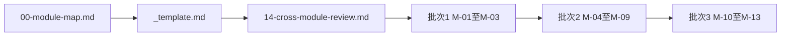
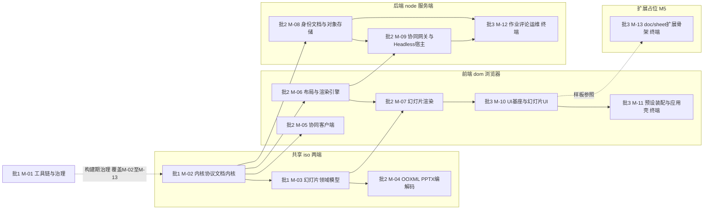
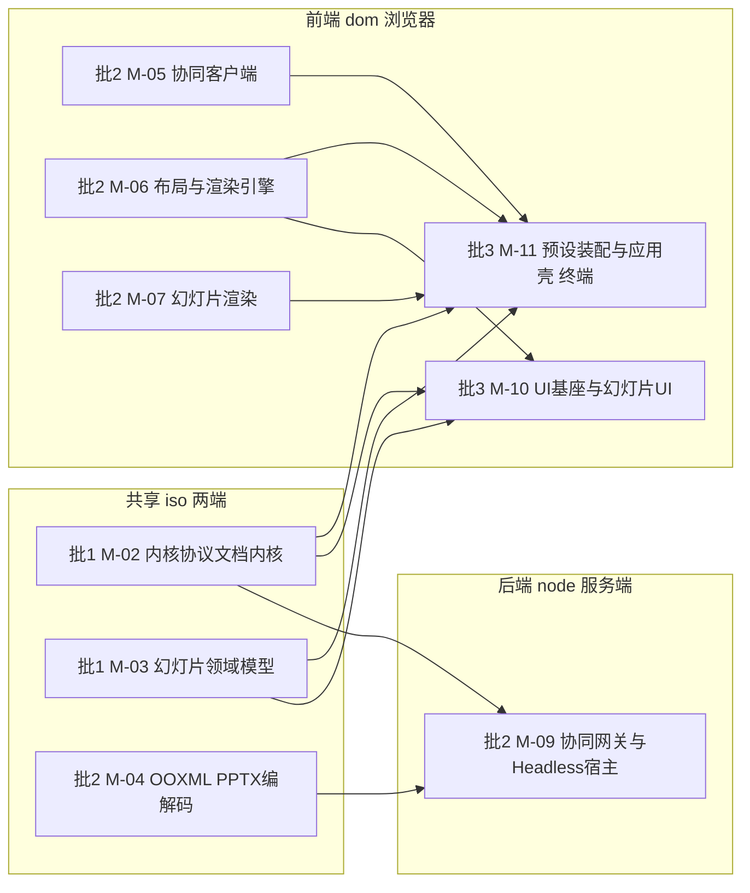

> 状态：索引 v0.5（新增 16 插件总账与 17 书写模式手册；21 项用户裁决 + K-1…K-3 已落地；30 个限界上下文；79 张 Mermaid 图） | 负责：架构-模块（总编排） | 更新：2026-09-22、2026-09-24（rulings §4.15：单组织去租户 T-0 与章程 Q1–Q10 回写）、2026-09-24（复核修正，rulings §4.17） | 依赖：00-module-map.md、_template.md、01–13、14-cross-module-review.md

# 40-modules · 模块设计线索引

## 定位

本目录是 Cordex 架构文档的**模块设计线**：把 `30-architecture/` 的分层与契约，沿 **DDD 限界上下文 × cordis 插件**两条轴切成 13 个可独立规划的模块，**粒度到文件**——每份模块文档的 §4 给出完整目录树、§5 给出逐文件一行的职责表。

它与其它条线的分工：`00-charter/` 定边界与命名（服务名 / 事件名 / 贡献点 id / 秩表 / 铁律），`30-architecture/` 定机制与契约，**本目录定「哪个文件放在哪里、由谁写、依赖谁」**。实现阶段的每个 PR 都应能在某一份模块文档的 §5 文件职责表里找到对应行。

「方法论术语」（限界上下文 / 聚合 / 值对象 / 领域事件 / 仓储 / 应用服务 / 防腐层 ACL / 发布语言 / 共享内核 / 开放主机服务 OHS / 客户方-供应方 / 遵奉者）不重复定义，取 DDD 行业通用语义；它们与 cordis 机制的对应见 `00-module-map.md` §1。章程 §4 术语表只收本项目自造或收窄语义的词，故不收录这批词（`00-module-map.md` §8 G-5）。

## 阅读顺序

1. **`00-module-map.md`** —— 30 个限界上下文、上下文映射、前后端切分、13 个模块的划分依据。**先读 §3 的 BC 清单与 §7 的模块表**，其余按需。
2. **`_template.md`** —— 每份模块文档的固定结构（§0…§13），标题层级与编号不得改动。
3. **`14-cross-module-review.md`** —— 阶段三横向评审：30 条跨模块冲突与推荐裁定、命名核对、依赖核对、归属重叠与缺口、G/Q 汇总、对 00 的 24 条修订。**动手实现前必读 §1 与 §8**。
4. **`16-plugin-catalog.md`** —— 插件总账：69 个运行时插件单元（2026-09-24 删 `TenantsModule`/`GroupsModule` 后由 71 调整）、24 个 Definition、26 个贡献点、四个 preset 的装配对比与可插拔矩阵。**想知道「有多少插件、哪些可换」看这份。**
5. **`17-plugin-authoring-patterns.md`** —— 书写模式手册：七种插件形态的代码骨架、横切规范、14 条反模式与机械验证。**动手写插件前看这份。**
6. **`15-server-architecture-review.md`** —— 后端架构评审：服务端拆分判定「基本合理不重排」，3 处严重缺口 + 7 处问题与逐模块建议，S-1…S-5 已裁决（rulings §4.13）；2026-09-24 rulings §4.15 覆盖处以「→ 2026-09-24」行内标注（T-0 去租户使 §3.1 失效，另补登 §3.12 renderer 沙箱与凭据）。**服务端开工前必读 §3 与 §4.4**。
7. **`01`–`13`** —— 按下表的「批次」与「上游」列推进；同批次内允许错峰开工。

## 索引

**阅读路线图**



怎么读：按箭头顺序阅读——先总图与模板，再读横向评审的 30 条裁定，最后按批次 1／2／3 顺序展开 01–13 号模块文档。

| 编号 | 文件 | 标题 | 覆盖 BC | 承载包与目录 | 批次 | 上游 | 下游 | 行数 | 文件数（口径） |
|---|---|---|---|---|---|---|---|---|---|
| M-01 | [`01-tooling-and-governance.md`](01-tooling-and-governance.md) | 工具链与治理骨架 | BC-28 | `tooling/{tsconfig,eslint-config,depcruise,api-extractor,scripts,policy,xsd,changeset-config}` + 根 `lefthook.yml`/`.dependency-cruiser.cjs`/`biome.json`/`turbo.json`/`.github/workflows/*` | 1 | 无（唯一无上游） | 全部 | 713 | 未汇总（约 95–105，不含根模板） |
| M-02 | [`02-kernel-protocol-and-document-core.md`](02-kernel-protocol-and-document-core.md) | 内核、协议与文档内核 | BC-01…05 | `@cordexjs/shared` `kernel` `protocol` `i18n`（L0）· `model-core` `store-memory` `store-yjs`（L1） | 1 | M-01 | M-03…M-13 | 1408 | 未汇总（`model-core` 单包 100） |
| M-03 | [`03-slide-domain-model.md`](03-slide-domain-model.md) | 幻灯片领域模型 | BC-06 | `@cordexjs/model-slide`（V-model，秩 15，iso，`bundle=slide`） | 1 | M-02 | M-04 · M-07 · M-10 · M-11 · M-13 | 905 | 约 110 |
| M-04 | [`04-ooxml-format-and-pptx-codec.md`](04-ooxml-format-and-pptx-codec.md) | OOXML 格式与 PPTX 编解码 | BC-07 · 08 | `@cordexjs/ooxml-core`（L3，秩 30）· `@cordexjs/ooxml-pptx`（V-codec，秩 35） | 2 | M-02 · M-03 | M-09 · M-12 · M-13 | 767 | **93**（43 + 50） |
| M-05 | [`05-collaboration-client.md`](05-collaboration-client.md) | 协同（客户端） | BC-09 | `@cordexjs/collab-core` `collab-yjs` `collab-transport-ws`（L4，iso）· `collab-offline-idb`（L4，**dom**） | 2 | M-02 | M-11 | 856 | 未汇总（约 80–90） |
| M-06 | [`06-layout-and-render-engine.md`](06-layout-and-render-engine.md) | 布局与渲染引擎 | BC-10 · 11 | `@cordexjs/engine-layout` `engine-render`（L5，iso）· `render-dom`（L5，**dom**） | 2 | M-02 | M-07 · M-09 · M-10 · M-11 | 858 | 未汇总（预算 90–110） |
| M-07 | [`07-slide-rendering.md`](07-slide-rendering.md) | 幻灯片渲染 | BC-12 | `@cordexjs/slide-render` · `@cordexjs/slide-render-chart`（V-render，秩 55，dom） | 2 | M-03 · M-06 | M-10 · M-11 | 805 | **78**（52 + 26） |
| M-08 | [`08-server-identity-documents-and-storage.md`](08-server-identity-documents-and-storage.md) | 服务端身份、文档与对象存储 | BC-18 · 19 · 20 | `apps/server/src/modules/{auth,users,documents,permissions,share-links,storage,media}` · `@cordexjs/server-storage`（LS，秩 58，node）（2026-09-24 删 `tenants`/`groups`） | 2 | M-02 | M-09 · M-12 | 931 | **116**（97 + 19） |
| M-09 | [`09-server-collab-gateway-and-headless-host.md`](09-server-collab-gateway-and-headless-host.md) | 服务端协同网关与 Headless 宿主 | BC-21 · 22 · 27 | `apps/server/src/modules/{collab,snapshots}` · `apps/server/src/cordis-host/**` · `@cordexjs/server-collab` `@cordexjs/server-headless`（LS，秩 58，node） | 2 | M-02 · M-04 · M-06 · M-08 | M-12 | 989 | **105**（2026-09-24 +3） |
| M-10 | [`10-ui-shell-and-slide-ui.md`](10-ui-shell-and-slide-ui.md) | UI 基座与幻灯片 UI | BC-13 · 14 · 15 | `@cordexjs/design` `ui-core` `ui-react`（L7，秩 70，dom）· `@cordexjs/slide-ui`（V-ui，秩 75，dom） | 3 | M-02 · M-03 · M-06 · M-07（间接 M-05） | M-11 · M-13 | 1131 | **167 + 44 shadcn 复制件**（2026-09-24 drawer/vaul 不迁移） |
| M-11 | [`11-preset-assembly-and-app-shell.md`](11-preset-assembly-and-app-shell.md) | 预设装配与应用壳 | BC-16 · 17 | `@cordexjs/preset-slide` `preset-slide-collab` `preset-slide-viewer` · `apps/web`（L8，秩 80，dom） | 3 | M-02 · M-03 · M-05 · M-06 · M-07 · M-10 | **无（终端）** | 1118 | **162 源 + 59 测试** |
| M-12 | [`12-server-jobs-comments-and-ops.md`](12-server-jobs-comments-and-ops.md) | 服务端作业、评论与运维 | BC-23 · 24 · 25 · 26 | `apps/server/src/modules/{import-export,jobs,thumbnails,comments,audit,health,metrics,internal}` · `common/*` · `config/*`（L8，node） | 3 | M-08 · M-09 | **无（终端）** | 944 | 未汇总（约 95–110） |
| M-13 | [`13-doc-sheet-extension-skeleton.md`](13-doc-sheet-extension-skeleton.md) | doc/sheet 扩展骨架 | BC-29 | M5 新建 10 包：`model-doc` `model-sheet` · `ooxml-docx` `ooxml-xlsx` · `doc-render` `sheet-render` · `doc-ui` `sheet-ui` · `preset-doc` `preset-sheet` | 3 | M-02（契约依赖：`DocumentType`/Snapshot/夹具）· M-03 · M-04 · M-06 · M-07 · M-10（样板参照，非运行时依赖） | **无（终端）** | 899 | 约 **105**（骨架级，十包） |
| — | [`00-module-map.md`](00-module-map.md) | 模块切分总图 | 全部 29 个 BC | — | — | — | 01–13 | 1225 | — |
| — | [`_template.md`](_template.md) | 模块设计文档模板 | — | — | — | — | 01–13 | 131 | — |
| — | [`14-cross-module-review.md`](14-cross-module-review.md) | 跨模块评审（阶段三） | — | — | — | 00–13 | 总编排回写 | 921 | — |
| — | [`15-server-architecture-review.md`](15-server-architecture-review.md) | 服务端模块拆分评审 | BC-18…27、30 | `apps/server` · `server-*` 三包 | — | 08 · 09 · 12 | 总编排回写 | 381 | — |
| — | [`16-plugin-catalog.md`](16-plugin-catalog.md) | 插件总账与可插拔矩阵 | 全部（插件视角） | 全部包 | — | 01–13 | 实现与评审 | 502 | — |
| — | [`17-plugin-authoring-patterns.md`](17-plugin-authoring-patterns.md) | 插件书写模式手册 | 全部（形态视角） | 全部包 | — | 02 · 03-kernel-and-plugin-model | 实现 | 914 | — |

> 「文件数」的口径各模块不同（含/不含根配置模板 · 含/不含测试 · 含/不含机械生成的复制件），**不可直接横向比较**；六个模块超出 `00-module-map.md` §7 的原始估计，修正建议见 `14-cross-module-review.md` §7 与 §8 R-23。

## 模块依赖图

**模块依赖图 泳道结构**



怎么读：四个 subgraph 是原 ASCII 的四条泳道（共享 iso／前端 dom／后端 node／扩展占位 M5）；批次改用节点标签前缀「批1/批2/批3」表达，不再单独设批次 subgraph；实线是真实包依赖，虚线是 M-01 的构建期治理关系（覆盖 M-02 至 M-13 全部，只画一条代表线）与 M-13 的样板参照关系，均非 import。

**模块依赖图 补充上游关系**



怎么读：本图与上一张共用同一批节点 id，只补画上一张「主链」之外、原 ASCII 用 `◄──` 标注的额外上游——M-09 完整上游为 M-02/M-04/M-06/M-08（M-06/M-08 见主链图）；M-10 完整上游为 M-02/M-03/M-06/M-07；M-11 完整上游为 M-02/M-03/M-05/M-06/M-07/M-10；两图合并即原 ASCII 的全部依赖信息，来源与索引表格「上游」列一致。

实线 = 真实包依赖（`rank(to) ≤ rank(from)`）；虚线 = 样板参照 / 治理关系，非 import。M-13 的样板参照除主链图画出的 M-10 外，原 ASCII 另以文字列出 M-02（契约）、M-03/M-04/M-06/M-07（样板）：即 M-13 以 M-02 为契约、以 M-03/M-04/M-06/M-07/M-10 为样板（复制目录结构与模式；铁律 2 禁止真实 import）。同构铁律 4：node ✗→dom。后端泳道的 M-09 不得 import `render-dom`；缩略图/PDF 走 headless Chromium 加载 `apps/web` 的 `/render` 页，即「同一份客户端渲染代码跑在浏览器进程里」。

## 统一约定

**1. DDD 五目录（物理目录事实源）**。每个 `packages/*/src/` 与 `apps/*/src/` 按下列五目录物理组织；`30-architecture/02-layering-and-packages.md` §4.x 的扁平骨架为**历史草图**，以各模块文档 §4 为准。

```text
src/
├── index.ts          # 公共 API 面（§6）
├── plugin.ts         # cordis 插件入口（§3）
├── domain/           # 聚合 / 实体 / 值对象 / 领域事件类型 / 纯领域函数（无 IO）
├── application/      # 应用服务（cordis Service 子类）、命令管线、用例
├── infrastructure/   # Provider / 适配器 / 编解码 / DOM / SDK 调用
├── interface/        # 对外呈现（UI 类模块用 ui/：React 组件、Nest controller、CLI）
└── testing/          # 契约套件与夹具（`./testing` 子路径导出）
```

可省略目录（`00-module-map.md` §1）：纯 Provider 包无 `domain/`；纯库包（`shared`/`design`/`ooxml-core`）可摊平进 `infrastructure/`；纯装配包（`preset-*`）不设任何 DDD 分层目录；框架绑定包（`ui-react`）以 `interface/` 为主。三个引擎包与 `slide-render` 无对外呈现面，不设 `interface/`。

**2. 测试布局**。`src/__tests__/`（单测与集成）+ `src/testing/`（契约套件与测试替身，经 `exports` 的 `./testing` 子路径导出，只能被测试代码与其它包的 `testing/` 引用）。`apps/*` 另有 `test/` 或 `e2e/`。`_template.md` §9 示意的顶层 `tests/{unit,contract,integration,fixtures}/` 是**示意**，实际见 02 §4.0（`40-modules/02` §12 G-12）。

**3. 命名规则（唯一事实源，不在本目录重复定义）**
- 服务名 `ctx.<name>`、事件名 `<域>/<动作>`、贡献点 id `<域>.<名>`（camelCase）、契约套件 `run<Definition>Conformance`、第三方前缀 `<vendor>:` —— `00-charter/charter.md` §5.5
- 贡献点总表（项类型 / 键 / conflict / 消费方）与 `when` 上下文键 —— `30-architecture/03-kernel-and-plugin-model.md` §3.6
- 错误码：**TS 常量名 UPPER_SNAKE、错误码值点式 `<domain>.<snake_case>`**（`40-modules/04` §12 G-4 给出的双口径解释；待回写章程）
- 秩表与铁律 1–4、包清单与依赖上限 —— `00-charter/charter.md` §5.1–§5.3

> 上述两份登记表目前**落后于 13 份模块文档**：两份事件域白名单互不一致，58 项新增服务名 / 事件 / 命令 id / 契约套件待收编。清单见 `14-cross-module-review.md` §2，收编建议见 §5.1 与 §5.5。

**4. `package.json#cordex` 字段**（schema：`tooling/depcruise/cordex-field.schema.json`，depcruise 与全部扫描器以此为唯一元数据来源）

```jsonc
"cordex": {
  "layer": "L1",          // L0|L1|L3|L4|L5|L7|L8|LS|V-model|V-codec|V-render|V-ui
  "iso": "iso",           // iso|dom|node
  "bundle": "slide",      // slide|doc|sheet；当且仅当 layer 以 V- 开头时必填
  "role": "definition",   // library|plugin|definition|provider|bundle|app|tooling（7 值）
  "stability": "beta"     // stable|beta|experimental
}
```

`role` 的 7 值供人类与 `create-package` 脚手架使用；depcruise 的三角色规则读取时折叠为 4 值（`definition→definition`、`provider→provider`、其余`→consumer`，除非该包同时是某 Definition 的 Provider）。折叠表见 `00-module-map.md` §8 G-2，待正式写入 `30-architecture/09-type-discipline/03-boundaries.md` §2。

**5. 模块文档的 G/Q 编号**。每份文档的追加建议与未决问题**各自从 1 起编**（`G-1`/`Q-1`）；**跨文档引用时一律带模块前缀**（`M-10/G-13`、`M-11/Q-3`）。历史上 M-02 / M-08 / M-09 / M-12 曾采用全局连号（G-5…G-31），引用时同样按模块前缀式书写（`14-cross-module-review.md` §1 C-29）。

## 状态

- **阶段二（模块规划）已完成**：13 份模块文档全部交付，覆盖 30 个限界上下文、约 1 100+ 个文件。
- **阶段三（横向评审）已完成**：见 [`14-cross-module-review.md`](14-cross-module-review.md)。
- **待总编排裁定：52 项**（`14` §6.2，其中 30 项已在 §1 给出推荐裁定与依据）。
- **待用户裁决：16 项**（`14` §6.1），最紧要的三项：`preset-doc`/`preset-sheet` 包名与 `-skeleton` 后缀（阻塞 M5）、PRD CO-07「版本恢复可撤销」与 `system('restore')` 不入撤销栈的冲突（阻塞 M3）、查看器 `allowExport` 默认值（阻塞 M2）。
- **待指定模块 / 条线：41 项**（`14` §6.3）。
- **对 `00-module-map.md` 的修订：24 项**（`14` §8）；对章程与 30-architecture 的回写建议：96 条（`14` §5）。
- **2026-09-24 章程 §10 Q1–Q10 裁决回写**（rulings §4.15）：T-0 单组织完全去租户（BC-18 改名「身份与会话」，上下文总数仍 30；M-08 删 `tenants`/`groups` 两个 Nest 模块，文件 137→116；插件单元 71→69）、Q6 外置 OIDC + JIT + 文档级 RLS、U-11 组管理推迟、S-3a 两级 ack、Q8 缩略图与独立 renderer、Q10 自托管 compose（PG 18 / Valkey / SeaweedFS / `CORDEX_ROLE` 含 `all`）、Q2 React 19 收口；14/15 以「→ 2026-09-24」行内标注，不改历史结论。更名 Cordex（Q1）已于 2026-09-24 完成全仓更名（复核 L1）。
- **2026-09-24 复核修正**（rulings §4.17，复核报告 `00-charter/_evidence/review-2026-09-24.html`）：墓碑硬删除 `system('maintenance')` 且唯一执行者为 M-09 `tombstone-sweeper.ts` + LeaseLock；系统作业用独立角色 + 系统上下文、`BYPASSRLS` 只给迁移；两级 ack 帧归 M-02 `ws/frames.ts`；房间准入拒绝用 `collab.room_full`；renderer 配置键 `headless.mode/endpoint`；服务端缩略图 640 px WebP；`doc-access-via-permission` 登记为 M-01 第 14 个扫描器（D3）；邀请只对已存在账号生效、无待接受邀请表（D1）。
- **实现开工前置**：`14` §1 的 30 条冲突需先裁定——其中 C-01/C-02/C-07 影响 M1 切片的文件清单，C-04/C-06 影响 M2，C-08/C-09/C-10 影响 M3。
