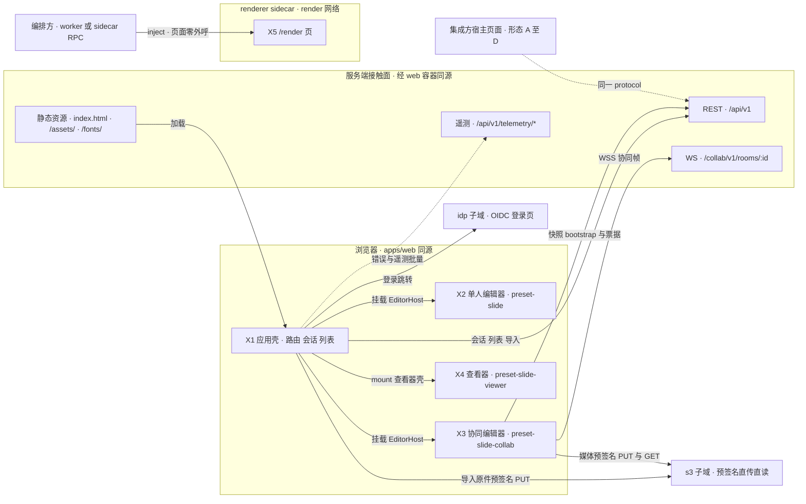
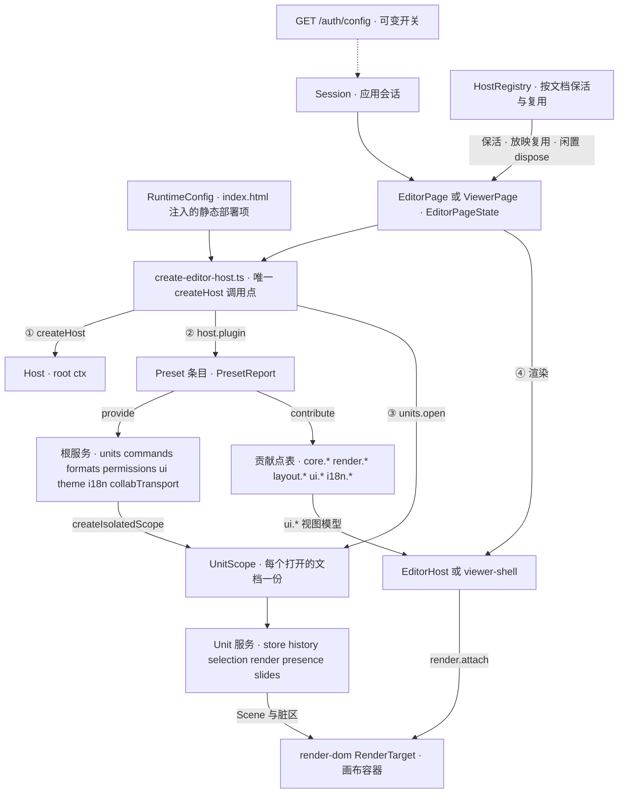
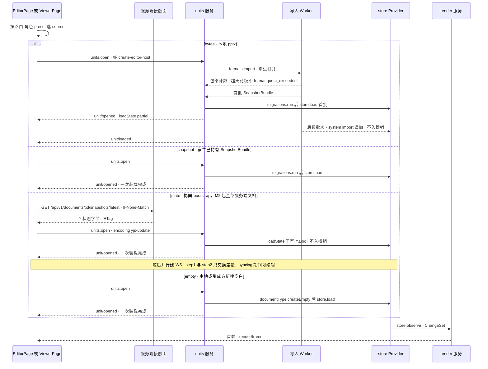
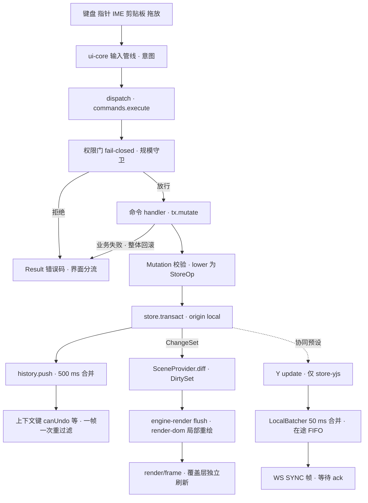

# 01 前端总览与运行时全景

> 状态：v0.1 | 负责：前端设计线 | 更新：2026-09-25；2026-09-25（§4.19） | 依赖：[charter v0.2](../00-charter/charter.md) §5.1–§5.3、§7；[rulings](../00-charter/rulings-2026-09-14.md) §4.15–§4.19；[30/01](../30-architecture/01-overview.md)、[30/02](../30-architecture/02-layering-and-packages.md) §1、§7；[40/00](../40-modules/00-module-map.md) §5；[40/16](../40-modules/16-plugin-catalog.md) §6.3；[40/18](../40-modules/18-atlas-system-and-frontend.md)；[PRD 05](../10-prd/05-milestones-and-scope.md)

本文是前端设计线的入口全景：只给浏览器侧的执行上下文、包分布、铁律、对象关系、端到端主干、可观察状态、对外接触面、里程碑与机械验证总表，**每一处细节都链接到 [02](02-app-shell-routing-and-session.md)–[16](16-i18n-and-accessibility.md)**，不在此重复。服务端只画「接触面」（路径、子域、请求头、帧名），Nest 模块与进程角色见 [60/01](../60-backend/01-service-overview-and-roles.md)。包名一律省略 `@cordexjs/` 前缀。

## 1. 前端范围一页

浏览器里的 Cordex 代码运行在五类执行上下文中。它们共用同一批水平层与 slide 束包，区别只在「装哪个 preset、排除哪些条目、谁来驱动」。

| # | 执行上下文 | 入口 | preset 与裁剪 | React | 协同 | 编辑 | 初始体积预算（gzip） | 里程碑 | 详见 |
|---|---|---|---|---|---|---|---|---|---|
| X1 | apps/web 应用壳：开始页、文档列表、导入、设置、登录回环、分享落地 | apps/web 路由（`/home`、`/documents`、`/import`、`/settings`、`/login`、`/auth/*`；全表见 02 §2） | 无（壳页面不建 host，进入编辑器时才建） | 是（React 19 + react-router 8） | 否 | 否 | 路由 chunk，见 [13](13-performance-and-bundling.md) §6 | M1 骨架、M2 完整 | [02](02-app-shell-routing-and-session.md) |
| X2 | 单人编辑器 | 本地文档 `/documents/local:*`（M2 起可编辑）；集成方形态 A、B、D | preset-slide（形态 B 排除 `FRAMEWORK_FREE_EXCLUDES`，形态 D 排除 `HEADLESS_EXCLUDES`） | 形态 A 与 apps/web 是；B、D 否 | 否 | 是 | 编辑器 ≤900 KB | M2（形态 D 浏览器 headless 为 M1，见 12 §5） | [03](03-preset-assembly-and-plugins.md)、[04](04-document-commands-and-undo.md)、[10](10-editor-shell-and-interaction.md) |
| X3 | 协同编辑器，含评审与查看者变体 | `/documents/:id`：M2 起 apps/web 的服务端文档一律在此打开（单人编辑也经协同网关持久化，rulings §4.19 D-M2-CONTENT）；M3 起 mode 按角色：owner 与 editor 为 edit，commenter 为 review，viewer 为 view | preset-slide-collab | 是 | 是 | 按角色 | 编辑器 + 协同增量 ≤200 KB | M2（多人协同体验层 M3） | [07](07-collaboration-client.md)、[08](08-comments-and-version-history.md) |
| X4 | 查看器与嵌入形态 | `/documents/:id/view`（只留给 M1 查看器与嵌入）、`/embed/:id`（形态 E）、集成方页面（形态 A–D，F 为 M4 以后） | 形态 C 为 preset-slide-viewer；A、B、D 复用 X2 / X3 的 preset | 形态 C 否 | 否（形态 E 可协同） | 形态 C 否 | 查看器 ≤350 KB | M1（C）、M2（A、B）、M3（E，P2） | [12](12-viewer-embedding-and-render-page.md) |
| X5 | renderer 内的 `/render` 页 | renderer sidecar 的 headless Chromium 打开 `/render?renderId=…` | preset-slide-viewer，排除 viewer-shell 与 design-css，惰性加载关闭（FE-09） | 否 | 否 | 否 | 不设独立预算（与查看器同代码） | M3 前半段 | [12](12-viewer-embedding-and-render-page.md) §11 |

体积数值取 PRD NF-01 的 gate，target 与 chunk 分解见 [13](13-performance-and-bundling.md) §6；唯一阻断点是 `scan-bundle-budget`（依据：T-BUNDLE + PRD NF-01）。

**图 1-1 浏览器前端全景：五类执行上下文与服务端接触面**

怎么读：左侧子图是 apps/web 同源页面里的四类上下文，经同源的「服务端接触面」子图（web 容器反代）进入后端，只有登录跳转与预签名直传直读另走 `idp`、`s3` 两个反代子域；接触面之后的 Nest 模块与进程角色不在本线画出（见 60/01）。实线是运行时调用或加载方向，虚线表示按部署或宿主配置才出现的通道。`/render` 页不发起任何请求，状态、媒体与字体全部由编排方注入。
依据：40/18 图 2-1、图 8-5；rulings §4.18 BE-01（idp、s3 子域）、BE-04（取消拉取）、BE-11（`/api/v1` 前缀）。

## 2. 包在浏览器中的层带分布

秩表与铁律以 [charter §5.1–§5.3](../00-charter/charter.md) 为准；iso 契约本体留在 30 与 40，本线只写这些包在浏览器中的用法。

| 层 / 层带（秩） | 包 | 同构类 | 浏览器中的角色 | 与服务端同源 | 本线文件 |
|---|---|---|---|---|---|
| L0（0） | shared、kernel、protocol、i18n | iso | 品牌类型与 Result；`createHost` 与贡献点；REST / WS / 错误码 schema；语言服务 | 是 | 03、15、16 |
| L1（10） | model-core、store-memory、store-yjs | iso | Unit、命令、历史、权限；单人与查看器 Store；协同 Store | 是（server-collab 与 server-headless 加载同一源码） | 04 |
| V-model（15） | model-slide（含 `./editing` 子路径） | iso | 幻灯片模型、Mutation 与 `lower()` | 是 | 04、11 |
| L3（30） | ooxml-core | iso | OPC 与 XML、不透明保留、DirtyTracker | 是 | 04 |
| V-codec（35） | ooxml-pptx | iso | pptx FormatCodec，在 Worker 内导入与导出 | 是 | 04、13 |
| L4（40） | collab-core、collab-yjs、collab-transport-ws | iso | 协同 Definition、同步编排、WS 传输 | collab-core 的 Definition 契约由 server-collab 复用；collab-yjs、collab-transport-ws 的 Provider 只在浏览器实例化（rulings §4.18 FE-15） | 07 |
| L4（40） | collab-offline-idb | dom | OfflineStore（M4 P2 前默认关，M4 P2 启用） | 否 | 07 |
| L4（40） | comments | iso | 评论横向能力（文档类型盲）：threads / replies、ResourceHook `comments.threads`、`comments.*` 命令、`comment/*` 事件；M3 装入 preset-slide-collab（rulings §4.19 D-COMMENTS-PKG） | 服务端镜像按同一锚点规则计算（60/07） | 08 |
| L5（50） | engine-layout、engine-render | iso | TextMeasurer 契约与断行；Scene、视口、脏区、命中契约 | 契约层同源 | 05、06 |
| L5（50） | render-dom | dom | DOM/SVG RenderTarget、canvas 度量、TextInputHost、覆盖层宿主、a11y 镜像宿主 | renderer 内的 Chromium 运行同一份 | 05、06、16 |
| V-render（55） | slide-render（M1–M2 含惰性子路径 `./chart`）、slide-render-chart（M3 起） | dom | SceneProvider、元素渲染器、缩略图 Provider | 同上 | 05 |
| L7（70） | design、ui-core、ui-react | dom | token CSS；框架无关 UI 契约与视图模型；React 19 绑定与 `EditorHost` | 否 | 09 |
| V-ui（75） | slide-ui | dom | Ribbon、缩略图栏、检查器、画布交互、放映、母版视图 | 否 | 10、11 |
| L8（80） | preset-slide-viewer、preset-slide、preset-slide-collab、apps/web | dom | 组合根：装配、路由与宿主页面 | 否 | 02、03、12 |

评论客户端包 `comments` 的层号（L4）与依赖上限以章程 §5.2 的登记为准；slide 专属锚点解析、检查器评论页签与画布评论钉由 slide-ui 贡献，见 [03](03-preset-assembly-and-plugins.md) §11、[08](08-comments-and-version-history.md) §2。

## 3. 前端铁律速查

下表每条铁律都有机械执行点；执行点名称以 [30/09-type-discipline](../30-architecture/09-type-discipline/README.md) 03 / 02 / 08 为准，本表只做汇总。「CI」列为所在 job 或步骤（工作名以 [70/12](../70-testing/12-ci-gates-mapping.md) 定稿为准）。

| # | 铁律 | 一句话 | 机械验证入口 | CI | 本线文件 |
|---|---|---|---|---|---|
| F1 | apps 只组装 | apps/web 只 import 白名单包（preset-*、protocol、design、ui-react、i18n、shared、kernel），不含领域定义 | depcruise `cordex-apps-only-assemble`（R9，TD-093）；lint `no-restricted-syntax`（apps/** 覆盖：禁 `defineCommand`、`defineMutation`、`ctx.contribute(` 等） | `depcruise`、`lint` | 02 §1 |
| F2 | 唯一 createHost 调用点 | `createHost` / `createSlide*Preset` 只在 `application/host/create-editor-host.ts`；kernel 的值导入只许在 `application/host/**` | 同 F1（R9，rulings §4.18 FE-05） | `depcruise`、`lint` | 02 §1、03 §5 |
| F3 | `commands.execute` 是唯一行为入口 | 按钮、快捷键、菜单、画布手势最终都经 `commands.execute`；执行选项不得新增键 | 类型测试（`*.type-test.ts`，ADR-0015，TD-098）+ api-extractor 基线；command-harness 断言 Operation 不产生 `store/transaction` | `test-typecheck`、`api-surface`、`test/unit` | 04 §3 |
| F4 | UI 不直接写 Store | UI 与事件处理器不得调用 `store.transact`，只能 dispatch 命令 | lint `cordex/store-transact-in-commands-only`（TD-068） | `lint` | 04 §3、09 §8 |
| F5 | Mutation 不上网络 | 网络上只有 CRDT update、awareness 与 CONTROL 帧；Mutation 只在本地命令管线中存在（章程 D5） | WS 帧联合只含 30/06 §6 的 FrameType 0–3；`runCollabTransportConformance` 断言出站帧种类 | `test/contract` | 07 §5 |
| F6 | DOM/SVG 单实现 | 产品 preset 只装 `render.target('dom')`；canvas 只用于 toImage、measureText 与 M3 末契约夹具（rulings §4.15 Q4） | `runRenderTargetConformance`（M3 末最小 canvas Provider 过同一套件）；preset `superset` 测试核对条目集合 | `test/contract`、`test/unit` | 05 §1 |
| F7 | 文档内容不以 HTML 注入 | 渲染与 UI 包不得对文档派生内容用 `innerHTML` 等；文档内 SVG 只以图像上下文渲染 | lint `no-restricted-properties` + `no-restricted-syntax`（TD-081） | `lint` | 14 §5 |
| F8 | 文档类型盲 | 非组合根的水平层包不 import 垂直束；apps/web 只在参数化点出现文档类型字面量 | depcruise `cordex-doc-type-blind`（R3）；lint `cordex/no-doc-type-literals`（TD-086，范围为非组合根水平层、`apps/server/src/modules/**` 与 `apps/web/src/**`，只豁免 preset-* 与 apps/server 的 `src/cordis-host/**`）。apps/web 的字面量约束已登记为 TD-086 的扩展范围：扫描路径扩到 `apps/web/src/**`，例外只有 `domain/document-type.ts` 与 `application/host/create-editor-host.ts`（40/11 §10 旧称 no-doc-type-literals-app 与 `app/templates.ts` 例外作废，不新造规则名；30/09-type-discipline/02 §4.12） | `depcruise`、`lint` | 03 §12 |
| F9 | 束间隔离 | 不同 bundle 的包互不 import，带 bundle 的 preset 同样受约束 | depcruise `cordex-bundle-isolation`（R4） | `depcruise` | 03 §12 |
| F10 | iso 不 import dom | iso 包无 dom lib、无 `node:*`；dom 包可 import iso | depcruise `cordex-isomorphism-compatibility`（R16）+ tsconfig lib（R6）+ `node --import` 冒烟 | `depcruise`、`typecheck`、`iso-smoke` | 本文 §2 |
| F11 | UI 框架边界 | ui-core 与各 `*-ui` 的 domain / application 不依赖 React；shadcn 复制件只供 ui-react、`*-ui` 与 apps；design 只出 CSS | depcruise `cordex-ui-bundle-core-framework-free`（R14a）、R14、R17、R18；测试断言 `theme-vars-contract.test.ts`、`shadcn-copy.test.ts` | `depcruise`、`test/unit` | 09 §1 |
| F12 | 查看器只读两道保证 | viewer 不装编辑子插件，且装有不可排除的 read-only 策略 | depcruise `cordex-viewer-no-editing`；`readonly.test.ts` | `depcruise`、`test/unit` | 12 §2 |
| F13 | 根级不注入 Unit 服务 | 根级插件不得 inject store、history、selection、render、presence | lint `cordex/no-unit-scoped-inject-at-root` | `lint` | 03 §6 |
| F14 | 事件必须声明 | cordis 事件名须在 `Events` 接口声明；应用壳 `app/*` 事件不进保留域 | lint `cordex/events-must-be-declared` | `lint` | 15 §1 |

## 4. 运行时对象关系

**图 4-1 运行时对象关系：RuntimeConfig → Host → Preset → UnitScope → 服务**

怎么读：编号是 `create-editor-host.ts` 的执行顺序；实线是创建、挂载或数据流，虚线表示 Session 只从 `/auth/config` 读取可变开关（自助注册显隐、IdP 显示名），不写进 RuntimeConfig。根服务与贡献点表按 host 共享，UnitScope 内的服务每个文档一份、互不可见；一个页面可以有多个 host，一个 host 可以打开多个 Unit。
依据：30/01 §5；30/03 §5；40/18 图 4-1、4-3；决策 RUNTIME-CONFIG。

| 对象 | 生命周期 | 所属 | 事实源 |
|---|---|---|---|
| RuntimeConfig | 页面加载时读取一次；schema 校验失败渲染配置错误页；只含静态部署项（apiBase、wsBase、auth.mode、externalResources、遥测默认、appVersion、publicUrl、s3 公网源） | apps/web | [02](02-app-shell-routing-and-session.md) §3 |
| Session | 应用级单例：`unknown → anonymous 或 authenticated → expired → authenticated` | apps/web | [02](02-app-shell-routing-and-session.md) §4–§5 |
| HostRegistry | 应用级；兄弟路由保活、放映复用 host、卸载后闲置到期 dispose | apps/web | [02](02-app-shell-routing-and-session.md) §2.2、§6 |
| Host（root ctx） | 每个编辑器实例一份；dispose 后 `fiber.getEffects()` 为空 | kernel | [03](03-preset-assembly-and-plugins.md) §5–§6 |
| PresetReport | 装配 allSettled 后汇总 ACTIVE / PENDING / FAILED / LAZY / EXCLUDED | kernel/preset | [03](03-preset-assembly-and-plugins.md) §2 |
| UnitScope | 每个打开的文档一份；关闭 = `unitFiber.dispose()` 逆序清理 | model-core | [03](03-preset-assembly-and-plugins.md) §6、[04](04-document-commands-and-undo.md) §1 |
| EditorHost / viewer-shell | 随页面挂载；viewer-shell 在 `mount(container)` 时才建 DOM | ui-react / preset-slide-viewer | [10](10-editor-shell-and-interaction.md) §1、[12](12-viewer-embedding-and-render-page.md) §3 |

## 5. 四条端到端主干（前端视角）

本节只画主干，分支、错误与计时细节在各自文件。

### 5.1 打开

`units.open` 接受四种 source；选哪一种由页面按路由、角色与 preset 决定（[02](02-app-shell-routing-and-session.md) §8 用例清单）。`bytes` 走渐进打开（rulings §4.18 CO-12），协同模式不走这条路径，Y 状态由 HTTP 快照 bootstrap 一次装载。M2 起 apps/web 的服务端文档一律走 `state` 分支：内容以协同快照为唯一事实源，新建与导入都先由服务端导入生成 import 快照（rulings §4.19 D-M2-CONTENT）；`bytes` 与 `empty` 只留给本地文件、M1 查看器与集成方。

**图 5-1 打开文档的四种 source 分支**

怎么读：纵向是时间，实线是调用，虚线是返回或事件；四个 `alt` 分支互斥。`bytes` 分支里 Worker 先完成全部页的规模计数再回传首批，超系统天花板整体拒绝，不会装到一半才失败；后续批次以 `system('import')` 追加，不入撤销栈、不标脏，到齐发 `unit/loaded`，全选、查找替换、导出、跨页重排在此之前等待或禁用（[04](04-document-commands-and-undo.md) §2）。`/render` 页同样走 `snapshot` 或 `state` 分支，只是字节来自编排方注入而非请求（[12](12-viewer-embedding-and-render-page.md) §11）。
依据：30/03 §5（source 四种 kind）；40/02 §2.1 `units.open` 六步与渐进打开；30/06 §9.1（HTTP bootstrap + WS 增量）；rulings §4.18 CO-12。

source 与使用场景：

| source | 字节从哪来 | 使用场景 | 里程碑 |
|---|---|---|---|
| `bytes` | 本地文件、导入页的「本地打开」 | M1 查看器与 `/home` 夹具、本地文档（`local:*`）、形态 A–D | M1 起 |
| `snapshot` | 宿主已持有的 SnapshotBundle（集成方 `onSave` 产物、`/render` 注入的快照） | 嵌入形态、`/render` 页 | M2 起 |
| `state` | `GET …/snapshots/latest` 的 Y 状态字节与离线恢复（`encoding: 'yjs-update'`，交 store-yjs 的 `loadState`）；版本预览字节；`/render` 注入的状态字节；`encoding: 'snapshot-json'` 只供 store-memory（它只接受这一种；30/03 §5.3、40/02 §2.1） | apps/web 的全部服务端文档（含 M3 查看者变体）、版本预览、`/render` 页 | M2（版本预览与 `/render` M3） |
| `empty` | `documentType.createEmpty()`（首页为标题版式，D14） | 本地新建与集成方新建（形态 A–D）；apps/web 服务端文档的「新建空白」改走服务端导入空白模板（[02](02-app-shell-routing-and-session.md) §8） | M2 |

### 5.2 编辑

**图 5-2 一次编辑的数据流：输入 → 意图 → 命令 → Store → 渲染与 CRDT 发送**

怎么读：实线是单人与协同都走的主链，虚线之后的三步只在 preset-slide-collab（store-yjs）下发生；渲染刷新与协同发送互不依赖，都由同一次事务提交触发。任何拒绝与失败都以 `Result` 返回，界面按错误码分流为静默只读提示、toast 或横幅，不 throw（[04](04-document-commands-and-undo.md) §4）。文本输入的 IME 分支见 [06](06-text-editing-and-ime.md) §3–§5，脏区与帧预算见 [05](05-rendering-and-thumbnails.md) §2–§3，出站与 ack 见 [07](07-collaboration-client.md) §5–§6。
依据：30/05 §1–§3（七阶段管线）；30/01 §4.2；40/18 图 6-1 至 6-3；章程 D5。

### 5.3 协同（M2 连接与持久化，M3 多人体验层）

M2 起单人编辑也经这条链路持久化（第 1、2、6 条的断线退避重连与第 5 条中超限、换纪元、身份变更的被拒回滚）；在场、权限变更与分享、离线体验（offline 判据、离线横幅与周期重连）属 M3 多人协同体验层（rulings §4.19 D-M2-CONTENT；分工见 [07](07-collaboration-client.md) §16）。

1. **加入**：并行发起 `GET /api/v1/documents/:id/snapshots/latest`（ETag / 304）与 `POST /api/v1/documents/:id/collab-ticket`（有分享令牌时附 `X-Cordex-Share-Token`，票据带 `lnk` claim）→ 建 `wss://<host>/collab/v1/rooms/:id` → 首帧 `CONTROL.auth` → `auth.ok{role, limits, reason?}` → step1 / step2 只交换差量 → synced；syncing 期间即可编辑（[07](07-collaboration-client.md) §2）。
2. **出站**：本地事务 → LocalBatcher 50 ms 合并 → 单帧不超过 `auth.ok.limits.maxUpdateBytes`（默认 1 MiB，INC-07）→ 记入在途 FIFO；`tier:'spill'` 不清 pending，`tier:'db'` 弹队首（[07](07-collaboration-client.md) §5–§6）。「未保存到服务器」：`room.persist==='degraded'` ∨ 在途含仅获 spill 确认的项 ∨ 最老在途 ≥ `unsavedWarnAfterMs`（默认 15000）时成立；有本地未获 db 确认项的发起方显示横幅「未保存到服务器 N 项」，其余协作者在状态胶囊显示弱提示「服务器保存延迟」（依据：rulings §4.19 INC-09；[07](07-collaboration-client.md) §6.1）。
3. **入站**：远端 update 以 `remote` 来源应用，走与本地编辑相同的渲染路径；撤销只作用于本地来源，他人后写的键被跳过并提示，整步被跳过即停（[04](04-document-commands-and-undo.md) §6）。
4. **在场**：awareness 节流（光标与选区 20 Hz、视图 2 Hz、空闲 60 s），查看者只上报视图；远端光标与选区在覆盖层绘制（[07](07-collaboration-client.md) §10–§11、[05](05-rendering-and-thumbnails.md) §5）。
5. **权限**：`CONTROL.permission` → 客户端权限服务唯一入口 → 降权即拦截出站并进入 readonly-degraded；被拒回滚并提供导出本地副本（[07](07-collaboration-client.md) §8）。
6. **断线与恢复**：退避 1→30 s（±20%），自进入重连起累计 30 s 未连上或 `navigator.onLine=false` 即 offline，offline 后每 30 s 自动重连；关闭码按 30/06 §6.5 分流（该表按 INC-06 补 1011、4427、4428 后为准，4428 为 epoch 变更）（[07](07-collaboration-client.md) §4、§9）。

帧、CONTROL 与关闭码的定义见 [30/06 §6](../30-architecture/06-collaboration.md)；服务端如何处理见 [60/16](../60-backend/16-ws-protocol-server-view.md)。

### 5.4 导出

1. **入口**：「⋯ → 导出…」或 `Mod+E` → Operation `shell.intent{target:'export'}` → 宿主的导出对话框（[03](03-preset-assembly-and-plugins.md) §8）。
2. **pptx（客户端，M1 起）**：`commands.execute(unitId, 'core.export', {mime: <pptx MIME>})`（参数形状见 40/02 §2.6；渐进打开未到齐时先 `await units.whenLoaded`），在 Worker 中对快照副本编码（干净部件原样、脏部件重生成），完成后下载；导出期间可继续编辑；协同模式下有在途项时对话框提示「导出将包含本地最新内容」并给出［仍要导出］［等待同步］，选等待后停在「正在同步 N 项…」、归零自动生成、可取消，离线或重连中「等待同步」禁用（rulings §4.18 UX-05；[04](04-document-commands-and-undo.md) §8、[13](13-performance-and-bundling.md) §8）。
3. **PDF 与批量 PNG（服务端，M3）**：`POST /api/v1/documents/:id/export{format}` → `GET /api/v1/jobs/:id` 轮询 → `GET /api/v1/exports/:jobId` 取 1 h 有效的下载 URL（走 `s3` 子域）；服务端格式不提供「仍要导出」，须先同步（[02](02-app-shell-routing-and-session.md) §8；路由见 [60/15](../60-backend/15-rest-api-catalog.md) §3.9）。
4. **单页 PNG / SVG（M2 P1，PRD OF-19）**：主线程 `toImage` 栅格化与 SVG 序列化；这是 `raster` 用途，不是可配置的缩略图 Provider，M2 位图 spike 前只对无 Web 字体依赖的单页门禁（[05](05-rendering-and-thumbnails.md) §10.3）。

## 6. 浏览器可观察状态清单与事实源

「可观察」指界面、集成方回调或测试可以读取的状态。每个状态的取值、转移与界面表现只在「事实源」列的文件定义。

| 状态 | 取值摘要 | 代码落点 | 事实源 | 对外可见方式 |
|---|---|---|---|---|
| `Session` | `unknown → anonymous 或 authenticated → expired → authenticated`（换人则只读） | apps/web `domain/session.ts` | [02](02-app-shell-routing-and-session.md) §4–§5 | `app/session-changed`、重新登录横幅 |
| `EditorPageState` | `idle → creatingHost → opening → ready`，或 `failed`、`closing → closed` | apps/web `domain/editor-page-state.ts` | [02](02-app-shell-routing-and-session.md) §6 | 页面加载态与失败页 |
| Unit 装载态 | `loadState`：partial → loaded；上下文键 `unitLoaded` | model-core | [04](04-document-commands-and-undo.md) §2 | `unit/opened`、`unit/loaded`、进度条 |
| 保存态与撤销跳过提示条 | 脏 / 已保存 / 保存中；UndoSkip 提示条出现与关闭 | apps/web、slide-ui | [04](04-document-commands-and-undo.md) §6、§8 | 状态胶囊、提示条、`store/undo-skipped` |
| `SyncState` 与会话 UI 六态 | 对外 `disconnected / connecting / syncing / synced / offline / error`；界面 `connecting / syncing / synced / reconnecting / offline / readonly-degraded` | collab-core `domain/session-state.ts` | [07](07-collaboration-client.md) §3 | `collab/*` 事件、状态胶囊与横幅 |
| `ContextKeyValues` | 十一个标准键 + `breakpoint`、`textEditing`、`focusRegion`、`unitLoaded` + 束前缀键 | ui-core `domain/context-keys.ts` | [09](09-ui-system-and-theming.md) §6 | `when` 子句、诊断面板 |
| `ThemeState` | `{mode, resolved, density, hostMark?}` | ui-core `domain/theme-state.ts` | [09](09-ui-system-and-theming.md) §3 | 根元素 `.dark`、`data-cordex-theme`、`data-cordex-density` |
| `EditorLayoutState` | 侧栏、检查器、历史面板宽度与开合；断点 | ui-react `EditorShell` | [10](10-editor-shell-and-interaction.md) §2 | 布局记忆（按 unitType） |
| `PresetReport` | 条目 ACTIVE / PENDING / FAILED / LAZY / EXCLUDED | kernel/preset | [03](03-preset-assembly-and-plugins.md) §2 | 插件管理器页、`plugin/*` 事件 |
| `MasterViewState` | `{targetId, editScope, impact, multiSelect, entry, sessionMemory}` | slide-ui `domain/edit-target.ts` | [11](11-masters-layouts-and-themes.md) §4 | 范围条、「影响 N 页」徽标、状态栏 |
| `RenderPageState` | `booting → awaitingInject → opening → painting → ready`，或 `failed{code}` | apps/web `domain/render-page-state.ts` | [12](12-viewer-embedding-and-render-page.md) §11 | `window.__cordex.ready` / `error` |

## 7. 对外接触面

浏览器与服务端之间的一切交互都经 `@cordexjs/protocol`（DTO 文件清单登记在 [40/02](../40-modules/02-kernel-protocol-and-document-core.md) M-02 目录树），不存在绕开 protocol 的私有通道。下表只列「前端从哪里、以什么身份、带什么头访问」；路由的守卫、错误码与限流以 [60/15](../60-backend/15-rest-api-catalog.md) 为准。`{apiBase}` = `https://<host>/api/v1`（rulings §4.18 BE-11）。

| 接触面 | 地址 | 前端调用方 | 字段与规则事实源 | 里程碑 |
|---|---|---|---|---|
| 静态资源 | `/`、`/assets/*`（hash 命名，immutable）、`index.html`（no-store，含每响应 nonce 与 RuntimeConfig）、SPA 路由回落 | 浏览器加载 | 前端：[02](02-app-shell-routing-and-session.md) §3、§12，[14](14-client-security.md) §2–§3；下发：[60/17](../60-backend/17-deployment-and-config.md) | M1 |
| 字体 | 同源 `/fonts/*`（fontProfile 清单与 unicode-range 子集） | 05 字体加载器 | [05](05-rendering-and-thumbnails.md) §7（决策 FONTS） | M1 |
| 登录 | `GET {apiBase}/auth/oidc/login?next=&mode=redirect 或 popup` → 302 → `idp` 子域 → `{apiBase}/auth/oidc/callback` → 回 `/auth/callback?next=` 或 `/auth/popup-callback` | 02 会话用例 | 前端：[02](02-app-shell-routing-and-session.md) §4–§5；服务端：[60/02](../60-backend/02-auth-chain.md) §2、[60/15](../60-backend/15-rest-api-catalog.md) §3.1 | M2 |
| 会话与账户 | `GET {apiBase}/auth/me`、`GET {apiBase}/auth/config`、`POST {apiBase}/auth/token/refresh`、`POST {apiBase}/auth/logout`、`PATCH {apiBase}/users/me/profile` | 02 | [60/15](../60-backend/15-rest-api-catalog.md) §3.1–§3.2 | M2（`users/me/profile` M3） |
| 文档目录 | 列表、详情、改名、回收站、最近与固定（`PUT / DELETE …/pin`、`DELETE …/recent`）、创建副本 `POST …/duplicate`（作业化，轮询 `GET /jobs/:id`）、永久删除 `POST …/purge`（M3）；新建不单独建空文档，走两步导入（见下「导入导出与作业」） | 02 | [60/15](../60-backend/15-rest-api-catalog.md) §3.3 | M2（永久删除 M3） |
| 权限与分享 | `…/permissions`、`…/share-links`；用户搜索 `GET {apiBase}/users?query=`（≥2 字符、≤20 条） | 02 分享对话框、08 @提及 | [60/15](../60-backend/15-rest-api-catalog.md) §3.2、§3.4–§3.5 | M3 |
| 协同票据与元素彻底删除 | `POST …/collab-ticket`、`POST …/elements/purge`（owner，仅墓碑态） | 07、04 §7 | [60/15](../60-backend/15-rest-api-catalog.md) §3.7 | M2 票据（元素彻底删除 M3） |
| 快照与版本 | `GET …/snapshots/latest`（直接返回字节，ETag / 304，响应头 `X-Cordex-Epoch`）、版本列表、`POST …/snapshots{name}`、恢复 | 07 §2、08 §9 | [60/15](../60-backend/15-rest-api-catalog.md) §3.8 | M2 `latest`（版本列表、命名与恢复 M3） |
| WS | `wss://<host>/collab/v1/rooms/:id` | 07（collab-transport-ws） | 帧与关闭码：[30/06 §6](../30-architecture/06-collaboration.md)；服务端处理：[60/16](../60-backend/16-ws-protocol-server-view.md) | M2 |
| 媒体 | `POST …/media/presign` → PUT `s3` 子域 → `POST …/media/commit`；拉取 `GET …/media/:sha256` 返回 `{url}`（1 h 预签名，不再 302），再对该 URL 发不带凭据与自定义头的 GET | 05 §8（`options.media.upload` 默认实现） | [60/15](../60-backend/15-rest-api-catalog.md) §3.6（决策 MEDIA-CLIENT、INC-21） | M2 |
| 导入导出与作业 | `POST {apiBase}/imports/uploads` → PUT → `POST {apiBase}/imports{uploadId}` → `GET {apiBase}/jobs/:id`，可 `POST {apiBase}/imports/:jobId/cancel`；新建空白 / 内置模板同样以模板字节走这条路径；导出见 §5.4 | 02 新建、导入页与导出对话框 | [60/15](../60-backend/15-rest-api-catalog.md) §3.9 | M2 导入与作业（服务端 PDF / PNG 导出 M3） |
| 缩略图 | `GET …/thumbnails/:slideId?size=640 或 1280`，封面 `__cover`，ETag；文档页内经 `http.ts` 取 Blob 再生成 blob URL（只凭链接的会话要带分享令牌头），列表卡片直接 `` 引用同源端点；M2 卡片封面同样走 `…/thumbnails/__cover`，返回导入处理器写入的 embedded 封面（包内 `docProps/thumbnail.jpeg`，`image/jpeg`，provisional），空白文档无封面、显示占位 | 05 §10、02 列表 | [60/15](../60-backend/15-rest-api-catalog.md) §3.3、§3.10（决策 SG-10）；[60/06](../60-backend/06-modules-jobs-import-export-thumbnails.md) | M3（`__cover` embedded 封面 M2） |
| 评论 | `GET …/comments?filter=`、`GET …/comments/:threadId`、`POST …/comments/import`（P1）、`GET {apiBase}/comments/mentions`；REST 只读，写入走 CRDT | 08 | [60/15](../60-backend/15-rest-api-catalog.md) §3.11（决策 SG-03） | M3 |
| 遥测 | `POST {apiBase}/telemetry/errors`（204）、`POST {apiBase}/telemetry/otlp`、`POST {apiBase}/telemetry/csp`（report-to，无 cookie） | 15、14 §4 | 管线：[15](15-events-errors-and-telemetry.md) §6–§7；端点：[60/15](../60-backend/15-rest-api-catalog.md) §3.14、[60/18](../60-backend/18-observability-and-ops-endpoints.md) | M2 起 |
| 对象存储直传直读 | `https://s3.<域名>/…` 预签名 PUT（导入原件、媒体）与 GET（导出下载、媒体） | 02、05 | 客户端不提交任意对象键，只凭服务端签发的 uploadId；[14](14-client-security.md) §9；[60/14](../60-backend/14-valkey-object-storage-and-retention.md) 为键布局事实源 | M2 起 |
| `/render` 注入 | `window.__cordex.inject / ready / error`（protocol `render/page.ts`） | 12（页面侧） | [12](12-viewer-embedding-and-render-page.md) §11；编排方 [60/06](../60-backend/06-modules-jobs-import-export-thumbnails.md) | M3 |
| 嵌入桥 | `postMessage`（protocol `embed/messages.ts`；M3 只接受会话登录，令牌握手 M4） | 12 | [12](12-viewer-embedding-and-render-page.md) §9 | M3（P2） |

请求头（由 [60/02](../60-backend/02-auth-chain.md) 定义，本线在 [02](02-app-shell-routing-and-session.md) §7 统一附加）：

| 请求头 | 何时附加 | 依据 |
|---|---|---|
| `X-Cordex-Request: 1` | 所有非安全方法（POST / PUT / PATCH / DELETE），迫使跨源请求触发预检 | INC-24 + PRD SV-12 |
| `X-Cordex-Share-Token` | 本文档的 sessionStorage 中有分享令牌时，附在 REST 与 collab-ticket 请求上；不进 query | INC-25 + ADR-0029 |
| `If-None-Match` | `snapshots/latest` 与缩略图 | 60/15 §1 |
| `Idempotency-Key` | 导入、导出等可重试的作业创建请求 | 60/15 §1 |
| `traceparent` | 所有 REST 请求；WS 经 `CONTROL.auth` 的可选字段传播 | [15](15-events-errors-and-telemetry.md) §7 |

## 8. 前端里程碑汇总（M1–M5）

里程碑骨架以 [charter §7](../00-charter/charter.md) 为准，范围与验收以 [PRD 05](../10-prd/05-milestones-and-scope.md) 为准；本表汇总 40-modules 05 / 06 / 07 / 10 / 11 各 §11 与本线各文件的前端交付。M2 / M3 分界按 **rulings §4.19 D-M2-CONTENT**（覆盖 INC-37 原先「WS 网关、快照 REST、服务端导入归 M3」的分界）：**M2** = 协同网关、Room、update 持久化与快照、服务端导入（单人编辑即经此持久化），加上 auth（OIDC）、文档列表与元数据、最近 / 固定（U-04）；**M3** = 在场、评论、权限细化（分享与链接、查看者变体）、离线重连体验、服务端缩略图等多人协同体验层；逐项边界以 PRD 05 §0.3 为准。M1 查看器数据源仍为本地字节（INC-37）。

**图 8-1 前端里程碑能力叠加**

```mermaid
flowchart LR
  subgraph m1["M1 查看"]
    c11["preset-slide-viewer · 本地 bytes 渐进打开"]
    c12["DOM/SVG 渲染 · gated 对象 · fontProfile"]
  end
  subgraph m2["M2 编辑与持久化"]
    c21["命令 撤销 文本 IME · 本地文档用 preset-slide"]
    c22["服务端文档用 preset-slide-collab · 快照打开 · 两级 ack · 断线重连"]
    c24["应用壳 · OIDC 列表 最近与固定 · 服务端导入与新建"]
    c23["安全基线 · CSP nonce · TT report-only"]
  end
  subgraph m3["M3 多人协同体验层"]
    c31["在场 · 权限细化与分享 · 离线重连体验"]
    c32["评论 版本历史 · 查看者变体"]
    c33["服务端缩略图 · /render 页 · TT 强制 · canvas 契约"]
  end
  subgraph m4["M4 插件与嵌入"]
    c41["离线持久化 · 嵌入令牌 · RTL"]
  end
  subgraph m5["M5 doc 与 sheet"]
    c51["preset-doc 与 preset-sheet · 参数化点"]
  end
  m1 --> m2 --> m3 --> m4 --> m5
```

怎么读：箭头是里程碑先后，每个子图列出该里程碑在前端新增的能力，后一个里程碑包含前一个的全部能力（只增不减）；细项与所属文件见下表。
依据：charter §7；PRD 05 M1–M5；40-modules 05 / 06 / 07 / 10 / 11 §11；rulings §4.19 D-M2-CONTENT（M2 / M3 分界覆盖 INC-37）。

| 里程碑 | 前端交付（所属文件） | 用到的服务端接触面 | 可插拔证据与关键验收 |
|---|---|---|---|
| M1 打开与保真 | preset-slide-viewer 与 viewer-shell（12）；本地 `bytes` 渐进打开（04 §2）；DOM/SVG 渲染、表格 / 图表只读 / SmartArt / OLE 预览等 gated 对象（05）；fontProfile 字体供给（05 §7）；apps/web 骨架：`/home` 夹具 → EditorHost → 返回，dev 下 `auth.mode: none`（02）；四类打开错误码（15）；同页多 Unit（03） | 无（M1 查看器数据源为本地字节，INC-37）；只有静态资源与 `/fonts/` | `pluggable:m1`（`store=noop` → `unit/open-failed{code:'store.unavailable'}`；`render.target=noop` → 空画布无异常）；查看器 ≤350 KB；`readonly.test.ts` |
| M2 编辑与持久化 | 编辑器：命令与撤销（04）、文本与 IME（06）、UI 体系（09）、外壳与交互（10）；母版视图只读与版式应用 / 重置（11）；放映与 EMF / WMF 惰性栅格化（P1，10 §9、05 §8）；形态 A、B（12）；**服务端文档经 preset-slide-collab 接真实网关**：快照 bootstrap、两级 ack 与在途 FIFO、断线退避重连、超限 / 换纪元 / 身份变更的被拒回滚、「未保存到服务器」分级提示（07）；协同离开保护与导出「等待同步」（04 §8.3）；媒体上传与按文档作用域拉取（05 §8）；列表 embedded 封面（05 §10）；应用壳：OIDC 登录、开始页、文档列表、最近与固定、账户菜单、设置、新建与导入均经服务端两步导入、创建副本（02）；客户端安全基线（14）；错误上报默认开（15）；键盘可达与基本朗读（16）；体积与交互预算（13）；本地文档仍用 preset-slide（`store-memory` 回调式保存，04 §8.1） | auth、文档列表与元数据、最近 / 固定（U-04）；collab-ticket、WS、`snapshots/latest`、两步导入与 `GET /jobs/:id`、创建副本、媒体、`__cover` embedded 封面；遥测 errors 与 csp | `pluggable:m2`（`examples/plugin-qr-shape` 零改内核）；`embed:framework-free`（`UiRenderer('vanilla')`）；`csp:strict`；`a11y:axe`；`master:view`；`shell:home`；M2 验收的协同后端部分以 PRD 05 修订为准 |
| M3 多人协同体验层 | 在场与在场 UI（07 §10–§11）、软冲突、撤销跳过与「恢复我的值」「恢复元素」、「最近删除」与「彻底删除元素」入口（04、07）；离线重连体验：offline 判据与横幅、周期重连（07 §4）；权限变更、名额降级与相应的被拒回滚（07 §8）；评论（`comments` 包，rulings §4.19 D-COMMENTS-PKG）与版本历史（08）；查看者变体（10、12）；分享链接落地（02）；服务端缩略图 server-png（05）；`/render` 页（12）；母版与版式编辑、主题（P1）（11）；表格结构编辑与图表五类（slide-render-chart 拆包，05）；Trusted Types 强制（14）；forced-colors 门禁（16）；形态 E（P2，12）；M3 末最小 canvas Provider 过 RenderTarget 契约（05） | 评论、权限与分享、版本列表 / 命名 / 恢复、元素彻底删除、服务端导出 PDF / PNG、缩略图、永久删除 | `pluggable:m3`（Manifest 差异 = `{−store-memory, +store-yjs, −collab-core#local-presence, +collab-yjs, +collab-transport-ws, +comments}`，03 §11）；`collab:converge`、`collab:undo`、`offline:queue`、`collab:rejected-rollback` |
| M4 插件 SDK 公开 | collab-offline-idb 跨刷新持久化（P2）与多标签页互斥（07 §7）；嵌入令牌握手（12 §9）；插件管理器公开与版本协商（03 §10）；RTL（16 §4）；动画播放（P2） | 集成方签名 JWT 与 API Key | 内部非核心成员仅凭公开文档完成一个插件 |
| M5 多文档类型孵化 | preset-doc / preset-sheet；apps/web 在 `domain/document-type.ts` 与 `create-editor-host.ts` 两个参数化点登记新类型（03 §12）；同页 slide、doc、sheet 三个 Unit 共存 | 无新增（server-* 零改动） | `horizontal-freeze`；depcruise 零横向依赖；`boot:empty`、`coexist` |

## 9. 机械验证总表

本表汇总 02–16 各文件「机械验证」小节的主要断言，只写「断言什么」；测试层级、夹具、阈值判定与所在 CI 步骤的定义归 70（步骤工作名以 [70/12](../70-testing/12-ci-gates-mapping.md) 定稿为准）。本文 §3 的铁律执行点不再重复列出。

| # | 断言 | 50 文件 | 70 套件或 CI 步骤 |
|---|---|---|---|
| V1 | 路由表与深链 `/documents/:id?page=&comment=` 可达；`/d/` 不再存在 | 02 | `e2e/smoke`（[70/06](../70-testing/06-frontend-component-and-e2e.md) §5） |
| V2 | OIDC 登录回环、重新登录弹窗与 BroadcastChannel 通知；换人后不重放队列、按只读处理 | 02 | `e2e/smoke`（login-oidc-mock、login-casdoor）；70/06 §5 |
| V3 | 分享链接落地：片段令牌 → sessionStorage → 登录回跳 → 只经 `X-Cordex-Share-Token` 头发送；失效令牌提示「链接已失效」 | 02、14 | 70/06 §5；[70/10](../70-testing/10-security-testing.md) |
| V4 | 非安全方法都带 `X-Cordex-Request: 1`；跨源 POST 与跨源 WS 升级被拒 | 02、14 | 70/10；70/07 |
| V5 | 登出与切换账号后本地存储键全部清空（清理矩阵） | 02、14 | 70/06 |
| V6 | preset 顺序无关 ×100、`pluggable`、`superset`、`lazy`、`derive` | 03 | `test/unit`；[70/02](../70-testing/02-contract-suites-and-pluggability.md) §10 |
| V7 | `pluggable:m1` / `m2` / `m3` 可插拔证据 | 03、12 | 70/02 §10（所在步骤见 70/12 §6） |
| V8 | 中性撤销五用例：remote-conflict-skip、undo-skip-no-cascade（含硬删除分支）、soft-delete-tombstone、delete-vs-edit-undo、read-path-filters-tombstone；`store-memory` 与 `store-yjs` 同一套件 | 04 | `test/contract`（`runDocumentStoreConformance`，70/02 §4） |
| V9 | 渐进打开：追加批次不入撤销栈、零编辑导出零脏部件；`unit/loaded` 前全文命令等待或禁用 | 04 | `test/contract`（import-append）；`test/fidelity-roundtrip` |
| V10 | 随机命令序列全部撤销回到初始哈希、全部重做回到终态 | 04 | [70/05](../70-testing/05-collab-simulation-and-property-tests.md) |
| V11 | 「恢复我的值」是新 local 事务、可撤销；「恢复元素」对已硬删除目标禁用 | 04 | `test/unit`；70/06 §5 双浏览器用例 |
| V12 | 编辑只重绘受影响元素（A28），不对形状级改动返回 full | 05 | `test/unit`（dirty-mapping） |
| V13 | `runRenderTargetConformance`（dom；M3 末最小 canvas Provider 同一套件） | 05 | `test/contract`（70/02 §7） |
| V14 | gated 保真类别达阈值（表格、图表、SmartArt 等） | 05 | `e2e/oracle-gated`（[70/04](../70-testing/04-visual-oracle.md)） |
| V15 | IME 组合期不写 Store、`compositionend` 只提交一次事务；中日韩 × Chrome / Safari 自动化部分 | 06 | 70/06 §9 |
| V16 | `runCollabTransportConformance`、`runOfflineStoreConformance`：关闭码全表（含 1011 / 4427 / 4428）、spill 不清 pending、退避序列、30 s 离线、30 s 周期重连 | 07 | `test/contract`（70/02 §6） |
| V17 | 软冲突 12 场景确定性用例；多客户端随机分区收敛 | 07 | `test/collab-sim`（70/05） |
| V18 | PG 故障注入下 `room.persist` 转 degraded、界面出现「未保存到服务器」提示并在恢复后消失 | 07 | 70/05；[70/07](../70-testing/07-backend-integration-and-api-e2e.md) 故障注入 |
| V19 | 评论锚点随目标墓碑进入「已分离」、随恢复元素回到原锚点；评论导出 PowerPoint 可见 | 08 | 70/06 §5；[70/03](../70-testing/03-fidelity-roundtrip-and-corpus.md) |
| V20 | `theme-vars-contract`、`shadcn-copy`、对比度门禁、同屏 `backdrop-filter` ≤4 | 09 | `test/unit`；`scanners/shadcn-diff`；70/06 §11 |
| V21 | `when` 子句只引用已登记的上下文键 | 09 | `scanners/scan-contributions`（规则 e） |
| V22 | 母版视图：手动切评审即退出并回到进入前位置；被降权不退出、保持只读母版态 | 11 | `test/unit`（master-view.test）；70/06 §5 |
| V23 | 查看器两道只读保证与体积 ≤350 KB | 12 | `test/unit`（readonly.test、no-editing-graph）；`depcruise`；`scanners/scan-bundle-budget` |
| V24 | `/render` 页 local 与 remote 两种模式网络请求数均为 0；ready 判据（page-mounted ∧ 字体结算 ∧ `pendingDirty=0`）；注入超时与每页 10 s 超时分别计 | 12 | `e2e/smoke`（renderer-egress）；70/06 §6 |
| V25 | `UiRenderer('vanilla')` 通过 UI 渲染契约；形态 B 产物不含 react / radix | 12 | `test/contract`（`runUiRendererConformance`）；70/02 §7 |
| V26 | 体积预算（查看器、编辑器、协同增量、惰性 chunk） | 13 | `scanners/scan-bundle-budget`（唯一阻断点） |
| V27 | 打开、交互、协同的性能 gate；20 次开关内存增长 ≤5%；blob URL 泄漏为 0 | 13 | `perf/perf-client`、`perf/perf-collab`（[70/09](../70-testing/09-performance-and-capacity.md)）；70/06 §11 |
| V28 | `csp:strict`：nonce 每响应不同；Trusted Types M2 report-only 零违规、M3 强制；`externalResources` 三档收紧 `img-src` / `media-src` | 14 | 70/06 §10；70/10 |
| V29 | 零外呼：网络请求只指向 apiBase、wsBase、同源、`/fonts/` 与存储源 | 14 | 70/06 §10；70/10 |
| V30 | 错误上报默认开、产品遥测默认关；上报不含文档内容 | 15 | `test/unit`；70/06 |
| V31 | `user:true` 的错误码都有 zh-CN 与 en-US 的 `errors.<code>` 键；各 locale 键集合一致 | 15、16 | `scanners/scan-contributions`（规则 f）；70/06 §8 |
| V32 | axe 零严重、零重大违规；键盘 e2e 覆盖 Ribbon、缩略图栏、画布、属性、备注与 F6 循环；forced-colors（M3 起门禁） | 16 | `e2e/a11y`（70/06 §7） |
| V33 | 需求 → 测试可追溯：前端 P0 需求均有带 `@req` 标签的用例 | 全部 | `test/requirement-matrix`（[70/13](../70-testing/13-requirements-traceability.md)） |

本文自身的检查：全部 Mermaid 图经 `node docs/_tools/mermaid-check.cjs docs/50-frontend/01-overview-and-runtime-map.md` 为 0 invalid；§7 接触面表中每个 REST 路径都能在 [60/15](../60-backend/15-rest-api-catalog.md) §3 找到对应行（人工核对，路由表快照一致性由 70/07 route-auth-coverage 覆盖服务端一侧）。
