# 01 前端架构

> 状态：v0.1 | 负责：前端设计线 | 更新：2026-09-25；2026-09-25（§4.19）；2026-09-26（§4.20）；2026-09-26（§4.21：升格为前端架构，插 §1a 技术栈与复用、§4a 渲染架构、§5a 能力地图、§5b 元素族；协同客户端改 @hocuspocus/provider；§8 里程碑边界改引 30/01）；2026-09-26（§4.21 整合：§2 秩表改引 30/02 §1；F6 canvas 用途补媒体与图标预处理）；2026-09-26（§4.21 复核：react-table 落点改 ui-react DataGrid；§4a.1 改名；新增 §4b UI 壳与交互架构；§5a 按 50/18 重算（165 项）；表 1a-2 补渐变编辑器；§8 维护约定） | 依赖：[charter v0.2](../00-charter/charter.md) §5.1–§5.3、§7；[rulings](../00-charter/rulings-2026-09-14.md) §4.15–§4.21；[30/01](../30-architecture/01-overview.md)（总架构）、[30/02](../30-architecture/02-layering-and-packages.md) §1、§7、[30/07](../30-architecture/07-rendering.md)（渲染跨端契约）；[ADR-0039](../30-architecture/adr/0039-collab-server-hocuspocus.md)、[ADR-0049](../30-architecture/adr/0049-dependency-admission-and-license-tiers.md)；[17](17-reuse-and-dependency-catalog.md)、[18](18-editor-capabilities.md)、[19](19-insertable-elements-overview.md)–[25](25-elements-readonly-and-opaque.md)；[40/00](../40-modules/00-module-map.md) §5；[40/16](../40-modules/16-plugin-catalog.md) §6.3；[40/18](../40-modules/18-atlas-system-and-frontend.md)；[PRD 05](../10-prd/05-milestones-and-scope.md)

本文是 Cordex 的**前端架构**。rulings §4.21（q-arch-reorg 方案 B）把架构分成三份：[30/01](../30-architecture/01-overview.md) 是全仓唯一的总架构（跨端），本文与 [60/01](../60-backend/01-service-overview-and-roles.md) 就地升格为前端架构与后端架构，阅读路径固定为 **30/01 → 本文 → 60/01**。本文只给浏览器侧的执行上下文、技术栈与复用组件（§1a）、包分布、铁律、对象关系、渲染架构（§4a）、端到端主干、编辑器能力地图（§5a）、可追加元素族（§5b）、可观察状态、对外接触面、里程碑落点与机械验证总表；**细节一律链接到专题 [02](02-app-shell-routing-and-session.md)–[16](16-i18n-and-accessibility.md)、复用清单 [17](17-reuse-and-dependency-catalog.md)、能力总表 [18](18-editor-capabilities.md) 与元素目录 [19](19-insertable-elements-overview.md)–[25](25-elements-readonly-and-opaque.md)**，不在此重复。节号沿用升格前的编号，新节以 §1a、§4a、§5a、§5b 插入，既有「50/01 §x」引用不失配。服务端只画「接触面」（路径、子域、请求头、帧名），Nest 模块、进程角色与 Hocuspocus 挂点见 60/01。包名一律省略 `@cordexjs/` 前缀。

## 1. 前端范围一页

浏览器里的 Cordex 代码运行在五类执行上下文中。它们共用同一批水平层与 slide 束包，区别只在「装哪个 preset、排除哪些条目、谁来驱动」。

| # | 执行上下文 | 入口 | preset 与裁剪 | React | 协同 | 编辑 | 初始体积预算（gzip） | 里程碑 | 详见 |
|---|---|---|---|---|---|---|---|---|---|
| X1 | apps/web 应用壳：开始页、文档列表、导入、设置、登录回环、分享落地 | apps/web 路由（`/home`、`/documents`、`/import`、`/settings`、`/login`、`/auth/*`；全表见 02 §2） | 无（壳页面不建 host，进入编辑器时才建） | 是（React 19 + react-router 8） | 否 | 否 | 路由 chunk，见 [13](13-performance-and-bundling.md) §6 | M1 骨架、M2 完整 | [02](02-app-shell-routing-and-session.md) |
| X2 | 单人编辑器 | 本地文档 `/documents/local:*`（M2 起可编辑）；集成方形态 A、B、D | preset-slide（形态 B 排除 `FRAMEWORK_FREE_EXCLUDES`，形态 D 排除 `HEADLESS_EXCLUDES`） | 形态 A 与 apps/web 是；B、D 否 | 否 | 是 | 编辑器 ≤900 KB | M2（形态 D 浏览器 headless 为 M1，见 12 §5） | [03](03-preset-assembly-and-plugins.md)、[04](04-document-commands-and-undo.md)、[10](10-editor-shell-and-interaction.md) |
| X3 | 协同编辑器，含评审与查看者变体 | `/documents/:id`：M2 起 apps/web 的服务端文档一律在此打开（单人编辑也经协同网关持久化，rulings §4.19 D-M2-CONTENT）；M3 起 mode 按角色：owner 与 editor 为 edit，commenter 为 review，viewer 为 view | preset-slide-collab | 是 | 是 | 按角色 | 编辑器 + 协同增量 ≤200 KB | M2（多人协同体验层 M3） | [07](07-collaboration-client.md)、[08](08-comments-and-version-history.md) |
| X4 | 查看器与嵌入形态 | `/documents/:id/view`（只留给 M1 查看器与嵌入）、`/embed/:id`（形态 E）、集成方页面（形态 A–D，F 为 M4 以后） | 形态 C 为 preset-slide-viewer；A、B、D 复用 X2 / X3 的 preset | 形态 C 否 | 否（形态 E 可协同） | 形态 C 否 | 查看器 ≤350 KB | M1（C）、M2（A、B）、M3（E，P2） | [12](12-viewer-embedding-and-render-page.md) |
| X5 | renderer 内的 `/render` 页 | renderer sidecar 的 headless Chromium 打开 `/render?renderId=…` | preset-slide-viewer，排除 viewer-shell 与 design-css，惰性加载关闭（FE-09） | 否 | 否 | 否 | 不设独立预算（与查看器同代码） | M3 前半段 | [12](12-viewer-embedding-and-render-page.md) §11 |

体积数值取 PRD NF-01 的 gate，target 与 chunk 分解见 [13](13-performance-and-bundling.md) §6；唯一阻断点是 `scan-bundle-budget`（依据：T-BUNDLE + PRD NF-01）。

**图 1-1 浏览器前端全景：五类执行上下文与服务端接触面**

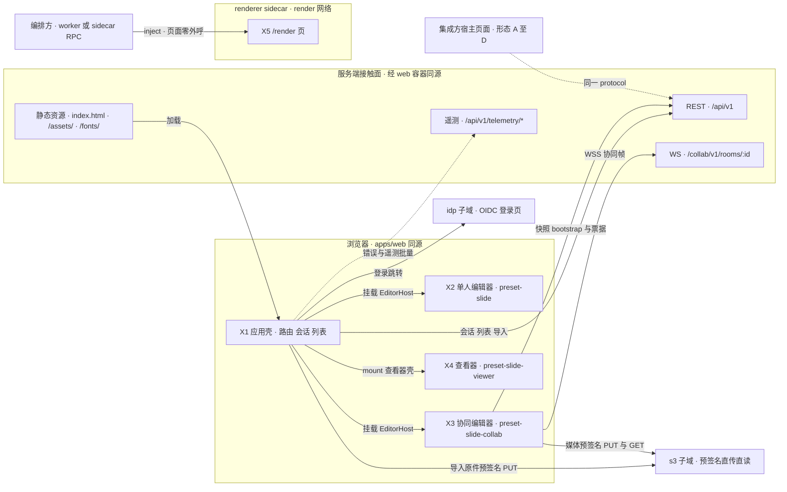

怎么读：左侧子图是 apps/web 同源页面里的四类上下文，经同源的「服务端接触面」子图（web 容器反代）进入后端，只有登录跳转与预签名直传直读另走 `idp`、`s3` 两个反代子域；接触面之后的 Nest 模块与进程角色不在本线画出（见 60/01）。实线是运行时调用或加载方向，虚线表示按部署或宿主配置才出现的通道。`/render` 页不发起任何请求，状态、媒体与字体全部由编排方注入。
依据：40/18 图 2-1、图 8-5；rulings §4.18 BE-01（idp、s3 子域）、BE-04（取消拉取）、BE-11（`/api/v1` 前缀）。

## 1a. 技术栈与复用组件摘要

rulings §4.21 轮的用户诉求之一是「前端凡有可复用的成熟组件，应尽可能用成熟组件」。本节按层带列出浏览器侧采用的成熟组件与许可（表 1a-1），以及维持自研的能力和「为什么没有合适的成熟库」（表 1a-2）。逐项版本、包装位置、替代与否决理由、CSP / Trusted Types 影响与体积以 [17 前端复用组件清单](17-reuse-and-dependency-catalog.md) 为唯一全表，本节只是摘要。准入规则三条：

- **许可分级**（[ADR-0049](../30-architecture/adr/0049-dependency-admission-and-license-tiers.md)，同时改写章程 D13 口径）：宽松类（MIT、Apache-2.0、BSD-2/3、ISC、0BSD、BlueOak-1.0.0、MIT-0、Zlib、Python-2.0 等）视同放行；OFL-1.1 只用于字体资产；CC0-1.0 只用于数据文件与内置源码（须注明出处）；MPL-2.0 只允许不修改的依赖（axe-core、mtx-decompressor）；LGPL、GPL、AGPL、SSPL、BUSL、Unlicense 及更强 copyleft 一律禁止。
- **单点引入**：第三方库只在章程 §5.3 规则 4 登记的包内引入，适配器只放该包 `infrastructure/`；新增依赖四处同步——章程 §5.3 单点表、`license-allowlist.json`、catalog 精确锁、[13](13-performance-and-bundling.md) 体积预算（R-d-10）。
- **运行时样式**：第三方库注入样式须能传 nonce 或改为静态 CSS（sonner、react-colorful 以 pnpm patch 改静态），注入点表以 [14](14-client-security.md) 为准。

**图 1a-1 前端技术栈分层：每层复用的成熟组件**

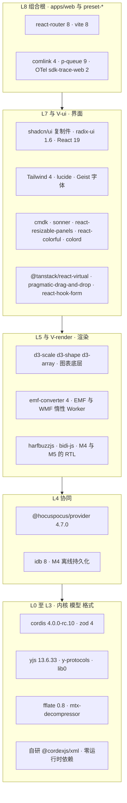

怎么读：五个子图按层带秩自高向低排列，箭头只表示「上层可以依赖下层」，不表示调用；每个节点是该层带复用的成熟组件组，最后一个节点是本层唯一的大块自研件（XML 解析器，理由见表 1a-2）。测试工具（vitest、Playwright、axe-core 等）不进运行时，图中未画。
依据：表 1a-1；charter §5.1 秩表；rulings §4.21。

**表 1a-1 按层带采用的成熟组件**（版本经 `npm view` 核实于 2026-09-26；精确锁与小版本以 17 为准）

| 层带（秩） | 采用 | 许可 | 落点（单点引入） | 用途与里程碑 |
|---|---|---|---|---|
| L0（0） | cordis 4.0.0-rc.10 | MIT | kernel | 插件内核，M1 |
| L0（0） | zod 4.x | MIT | protocol、kernel，以及各包 config 与 schema 文件（R-d-56 放宽） | 边界校验与 Standard Schema |
| L0（0） | rocicorp fractional-indexing 的算法源码（内置，不作依赖） | CC0-1.0（注明出处） | shared `order` | FracKey 改为「整数头 + 随机后缀、后缀不以 '0' 结尾」（改写 ADR-0032 决策 2，q-frackey） |
| L1（10） | yjs 13.6.33（精确锁）、y-protocols 1.0.7、lib0 0.2.x | MIT | store-yjs、collab-yjs | CRDT、协同撤销、同步编码 |
| L3（30） | fflate 0.8.3 | MIT | ooxml-core `opc/zip.ts` | zip 读写，M1 |
| L3（30） | mtx-decompressor 1.6.0（不修改） | MPL-2.0 | ooxml-core 内嵌字体路径 | `.fntdata` 的 EOT + MTX 解压，受限字体只读渲染 |
| L4（40） | @hocuspocus/provider 4.7.0（精确钉；随带 @hocuspocus/common 与 @lifeomic/attempt，合计约 10 KB gzip） | MIT | collab-yjs（`HocuspocusProvider`）、collab-transport-ws（`HocuspocusProviderWebsocket`） | socket、Auth、step1 / step2、合并发送、awareness、保活，M2（H:q-hp-provider） |
| L4（40） | idb 8.0.3 | ISC | collab-offline-idb（自写适配） | 跨刷新离线持久化，M4 P2（R-d-26） |
| L5（50） | harfbuzzjs 1.6.2、bidi-js 1.1.0 | MIT | render-dom 惰性 shaping 度量器、engine-layout bidi | 复杂文种与 RTL，M4 / M5（R-d-28） |
| V-render（55） | d3-scale 4.0.2、d3-shape 3.2.0、d3-array 3.2.4 | ISC | M1–M2 slide-render 惰性子路径 `./chart`；M3 起 slide-render-chart `infrastructure/renderers/**` | 图表比例尺、路径与统计底层，布局按 OOXML 语义自研（[ADR-0036](../30-architecture/adr/0036-chart-rendering-and-editing.md)） |
| V-render（55） | numfmt 3.2.6 | MIT | slide-render `./chart`、slide-render-chart | Excel 数字格式 |
| V-render（55） | emf-converter 4.0.x（显式 `gdiAntialias`） | Apache-2.0 | slide-render `emf-rasterizer.worker.ts` | EMF / WMF 惰性栅格化，M2 P1（R-d-24） |
| V-render（55） | MathJax 4.1.3（惰性，字体数据许可待核） | Apache-2.0 | M4+ 公式渲染插件 | OMML↔MathML 自研，MathJax 只输出 SVG（q-equation） |
| L7 / V-ui（70 / 75） | shadcn/ui CLI 4.21.0（复制模式，radix-rhea）、radix-ui 1.6.7、React 19.3.x | MIT | ui-react、`*-ui`、apps/web | UI 原子与浮层原语（ADR-0017） |
| L7（70） | tailwindcss 4.3.x、tw-animate-css、class-variance-authority、clsx、tailwind-merge | MIT / Apache-2.0 | design、ui-react | 样式与类名合并 |
| L7（70） | lucide-react（界面图标）、lucide-static 1.48.0（插入图标库，M3 P2） | ISC | ui-react icon-registry；slide-ui 插入图标画廊（惰性） | 图标 |
| L7（70） | @fontsource-variable/geist 5.3.0 | OFL-1.1（字体资产） | design | UI 字体自托管 |
| L7（70） | cmdk 1.1.1、sonner 2.0.8（pnpm patch 静态 CSS）、react-resizable-panels 4.13.3 | MIT | ui-react | 命令面板、Toast、三栏分栏 |
| L7（70） | react-colorful 5.8.1（pnpm patch 静态 CSS）、colord 2.10.0；构建期 culori 4.0.2 | MIT | ui-react 颜色弹层；tooling 主题构建 | 颜色面板与 UI 颜色数学（R-d-13、R-d-14） |
| L7（70） | react-hook-form 7.x + @hookform/resolvers 的 standardSchemaResolver | MIT | ui-react、`*-ui`、apps/web | 表单，直接复用 protocol 的 zod schema（R-d-18） |
| L7（70） | htmlparser2 12.0.0（回调模式、惰性） | MIT | ui-core 剪贴板管线 | 剪贴板 HTML 转纯文本（R-d-20） |
| L7（70）；V-ui 使用方 | @tanstack/react-table 9 + shadcn Table | MIT | ui-react 通用 `DataGrid`（单点引入），slide-ui 图表数据分区使用；slide-render-chart 不 import react（ADR-0036 决策 6，章程 §5.3 规则 4） | 图表数据网格，M3（R-d-34） |
| V-ui（75） | @tanstack/react-virtual 3.14、@atlaskit/pragmatic-drag-and-drop 4.0 | MIT / Apache-2.0 | slide-ui 缩略图栏 | 虚拟列表、拖拽排序与外部文件拖入（R-d-16、R-d-17） |
| L8（80） | react-router 8、vite 8 + @vitejs/plugin-react | MIT | apps/web | 路由与构建 |
| L8（80） | comlink 4.4.2、p-queue 9.3.3 | Apache-2.0 / MIT | 各 Worker 入口；apps/web 上传队列 | Worker RPC；上传并发（R-d-21） |
| L8（80） | @opentelemetry/sdk-trace-web 2.11 + exporter-trace-otlp-http 0.222（成对锁） | Apache-2.0 | apps/web 遥测 sink | 浏览器链路追踪（R-d-22） |
| 测试（不进运行时） | vitest 5、@testing-library/react 16、Playwright 1.63、fast-check 4、axe-core 4.13（不修改） | MIT / Apache-2.0 / MPL-2.0 | tooling 与各包 test | 单测、组件、e2e、视觉 oracle、性质测试、a11y |

**表 1a-2 维持自研的能力与理由**（用户要求尽可能复用，凡维持自研都写明为什么没有合适的成熟库）

| 能力 | 落点 | 为什么没有合适的成熟库 |
|---|---|---|
| XML 词法、保真树、序列化与 `XmlLimits` | `xml`（L0 · 秩 0 · iso · library，零运行时依赖，连 shared 也不依赖） | 21 个候选实测后保真度可以打平，差距在现成库补不上的地方：不建树计数、词法层限额带 `{limit, actual}`、流式按 50 ms 分片、深嵌套安全。saxes 已归档（2021-11 后无发版），@rgrove/parse-xml 5 不能流式、没有限额、约 1 万层嵌套栈溢出；补齐这些就等于写一个词法器。saxes 与 libxml2-wasm 只作 devDependency 差分 oracle，parse-xml 5 作退路（[ADR-0019](../30-architecture/adr/0019-xml-lexer-and-fidelity-tree.md)） |
| 文本编辑宿主（隐藏 textarea + 自绘光标与选区） | render-dom `text-host/*` | ProseMirror、Tiptap、Lexical、Slate 都基于 contenteditable 并自带排版，会与自有行模型形成两套排版、IME 行为不可控（ADR-0028）；EditContext 作为同接口第三实现并入 R-M2-1 spike（R-d-31） |
| 度量、断行、CJK 禁则与 autofit | engine-layout、render-dom canvas 度量 | PowerPoint 语义要求确定的行几何，CSS 排版与 fontkit 给不出；`Intl.Segmenter` 没有 line 粒度，linebreak 的数据停在 Unicode 13，所以断行表由 tooling 从最新 UCD 生成，linebreak 只作 LineBreakTest 对照（R-d-27） |
| DOM/SVG 渲染管线（帧调度、脏区、虚拟化、四处 LRU） | engine-render、render-dom | 需要「Scene + DirtySet + 逐元素查表 + 错误隔离」且目标 ≤120 KB；现成画布库以 Canvas 或 WebGL 为主、自带场景与事件体系，与 DOM/SVG 单实现（ADR-0021）和覆盖层独立刷新冲突 |
| 预设几何 187 种与公式求值 | engine-layout `preset-table.ts`（tooling 编译） | 编译期表两端共用；可对照的 pptx-viewer-core 依赖树含 MPL 与 GPL 选项，只在仓库外隔离运行、输出存 fixture（R-d-32） |
| 选择手柄、吸附、缩放平移、裁剪覆盖层、连接符路由、快捷键 | render-dom 覆盖层、slide-ui、engine-layout、ui-core | 手柄要在屏幕空间计算再反变换回 EMU，并执行 OOXML 锁位、graphicFrame 不可旋转、翻转时文字不镜像等规则；连接符须按 PowerPoint 规则重算 bent / curved 调整值；快捷键要框架无关、按 `code` 匹配。通用交互库都绑自己的渲染层或 DOM 事件模型，套用的胶水比自写更多（R-d-29、R-d-78） |
| 表格渲染与单元格选区 | slide-render 表格渲染器、slide-ui | 须按 OOXML tableStyles 继承与合并单元格布局，并落到归一化表格模型（[ADR-0018](../30-architecture/adr/0018-editor-element-model-and-insert-commands.md)）；通用表格组件按浏览器表格排版，与自有度量不一致 |
| 渐变编辑器 | slide-ui 检查器填充分区 | react-best-gradient-color-picker 已停更且只产出 CSS 渐变串，写不出 `a:gradFill`；用 radix Slider 多滑块 + react-colorful 组合（R-d-15，50/17 F-29） |
| OOXML 颜色变换（schemeClr、lumMod / lumOff、tint、alpha） | model-slide `resolve-color.ts` | iso 纯函数、逐项实现 OOXML 变换链；colord 等只处理 CSS 颜色，不懂主题色与变换顺序 |
| 协同会话胶水：会话状态机与重连调度器、在途 FIFO 与两级 ack、PermissionGate、被拒回滚、OfflineStore | collab-yjs、collab-transport-ws | provider 的 `SyncStatus` 只是计数、没有 seq，也不代表已落库；provider 不看关闭码，4401 / 4403 后仍自动重连；重建 WS 时 messageQueue 被清空。S-3a、CO-09、NF-03 的语义只能挂在 provider 事件上自写（ADR-0039） |
| i18n 与 ICU 子集 | `i18n` | 编译期 key 类型、语言包 ≤30 KB；intl-messageformat 运行时超预算，只在 tooling 用其 parser 校验语言包（R-d-25） |
| REST 客户端与内存缓存 | apps/web `api/*` | 需求只有 stale-while-revalidate 与乐观更新回滚，数据请求库增加体积与心智负担（决策 APP-DATA） |
| UUIDv7 | shared `ids.ts` | L0 零依赖，时钟与随机可注入以保证确定性测试（ADR-0014，R-d-33） |

**已否决**：MUI、AntD、Chakra、Mantine、Radix Themes；vaul、next-themes；contenteditable 主路径；immer；数据请求库与 Service Worker；xmldom、DOMParser；Loro、Automerge；saxes 作运行时依赖；y-websocket。原先否决的 Hocuspocus 已由 rulings §4.21 H:q-ws-gateway（用户知情选择）改为采用，客户端用官方 provider（H:q-hp-provider）。

依据：rulings §4.21（q-license-tiers、q-chart-route、q-frackey、q-xml-lexer、X:q-xml-package、H:q-hp-provider）；R-d-10 至 R-d-35、R-d-61 至 R-d-78；H-d-24、H-d-25；[17](17-reuse-and-dependency-catalog.md)。

## 2. 包在浏览器中的层带分布

秩表以 [30/02](../30-architecture/02-layering-and-packages.md) §1 为全仓唯一源（L0 含 2026-09-26 新增的 `xml`），铁律以 [charter §5.1–§5.3](../00-charter/charter.md) 为准；iso 契约本体留在 30 与 40，本线只写这些包在浏览器中的用法。

| 层 / 层带（秩） | 包 | 同构类 | 浏览器中的角色 | 与服务端同源 | 本线文件 |
|---|---|---|---|---|---|
| L0（0） | shared、kernel、protocol、i18n | iso | 品牌类型与 Result；`createHost` 与贡献点；REST / WS / 错误码 schema；语言服务 | 是 | 03、15、16 |
| L0（0） | xml（新增，rulings §4.21 X:q-xml-package；library，零运行时依赖） | iso | XML 词法（不建树的 `scan` 与建整树的 `parseDocument`，都支持 write / end 与按时间片让出）、保真树、序列化、`XmlLimits` 表；导入 Worker 与主线程图表部件解析共用 | 是（server 的媒体模块 SVG 消毒也可用） | 04、05 |
| L1（10） | model-core、store-memory、store-yjs | iso | Unit、命令、历史、权限；单人与查看器 Store；协同 Store | 是（server-collab 与 server-headless 加载同一源码） | 04 |
| V-model（15） | model-slide（含 `./editing` 子路径） | iso | 幻灯片模型、Mutation 与 `lower()` | 是 | 04、11 |
| L3（30） | ooxml-core | iso | OOXML 专属层：OPC、namespaces（Strict↔Transitional）、normalize、mce、不透明保留、DirtyTracker；XML 词法与保真树改由 xml 包提供，依赖上限为 shared、xml、model-core | 是 | 04 |
| V-codec（35） | ooxml-pptx | iso | pptx FormatCodec，在 Worker 内导入与导出 | 是 | 04、13 |
| L4（40） | collab-core、collab-yjs、collab-transport-ws | iso | 协同 Definition；collab-yjs 持 `HocuspocusProvider`（同步、awareness、Stateless 分发）与会话状态机、在途 FIFO、两级 ack；collab-transport-ws 缩为 `HocuspocusProviderWebsocket` 装配、计量垫片、重连调度器与关闭码策略（H-d-25） | collab-core 的 Definition 契约由 server-collab 复用；collab-yjs、collab-transport-ws 的 Provider 只在浏览器实例化（rulings §4.18 FE-15）；线上协议与服务端 Hocuspocus 一致 | 07 |
| L4（40） | collab-offline-idb | dom | OfflineStore，自写 idb 8 适配（M4 P2 前默认关，M4 P2 启用；不采用 y-indexeddb） | 否 | 07 |
| L4（40） | comments | iso | 评论横向能力（文档类型盲）：threads / replies、ResourceHook `comments.threads`、`comments.*` 命令、`comment/*` 事件；M3 装入 preset-slide-collab（rulings §4.19 D-COMMENTS-PKG） | 服务端镜像按同一锚点规则计算（60/07） | 08 |
| L5（50） | engine-layout、engine-render | iso | TextMeasurer 契约与断行；Scene、视口、脏区、命中契约 | 契约层同源 | 05、06 |
| L5（50） | render-dom | dom | DOM/SVG RenderTarget、canvas 度量、TextInputHost、覆盖层宿主、a11y 镜像宿主 | renderer 内的 Chromium 运行同一份 | 05、06、16 |
| V-render（55） | slide-render（M1–M2 含惰性子路径 `./chart`）、slide-render-chart（M3 起） | dom | SceneProvider、元素渲染器、缩略图 Provider；图表以 d3-scale / d3-shape / d3-array 为底层、按 OOXML 语义自研布局（ADR-0036）；渲染架构见本文 §4a | 同上 | 05、24 |
| L7（70） | design、ui-core、ui-react | dom | token CSS；框架无关 UI 契约与视图模型；React 19 绑定与 `EditorHost` | 否 | 09 |
| V-ui（75） | slide-ui | dom | Ribbon、缩略图栏、检查器、画布交互、放映、母版视图 | 否 | 10、11 |
| L8（80） | preset-slide-viewer、preset-slide、preset-slide-collab、apps/web | dom | 组合根：装配、路由与宿主页面 | 否 | 02、03、12 |

评论客户端包 `comments` 的层号（L4）与依赖上限以章程 §5.2 的登记为准；slide 专属锚点解析、检查器评论页签与画布评论钉由 slide-ui 贡献，见 [03](03-preset-assembly-and-plugins.md) §11、[08](08-comments-and-version-history.md) §2。

上表按「包」切分；运行时按「谁在哪条线程上做什么」切分更直观：

**图 2-1 前端运行时分层：主线程五层、Worker 与网络出口**

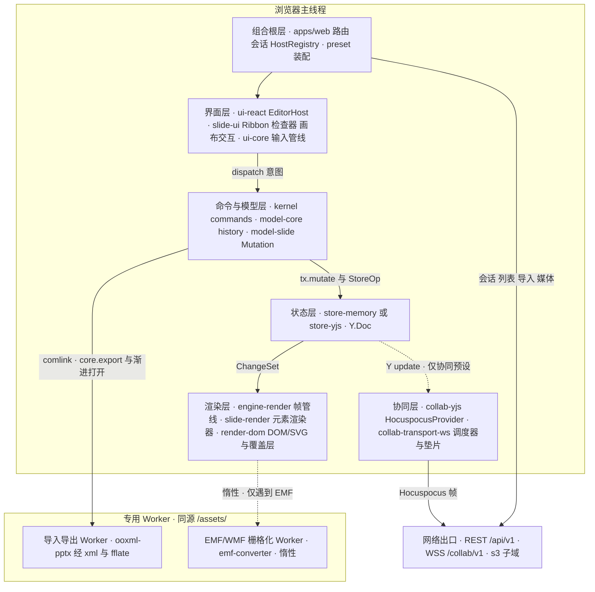

怎么读：主线程自上而下是一次编辑穿过的五层（与 §5.2 图 5-2 同一条主链），实线是调用或数据流，虚线是只在协同预设或按需才出现的路径；导入导出与 EMF 栅格化放在同源专用 Worker（禁 blob: Worker，[14](14-client-security.md)），经 comlink 调用；所有网络出口只经 `protocol` 的 DTO 与 Hocuspocus 帧（§7）。
依据：本节层带表；[13](13-performance-and-bundling.md) Worker 清单；ADR-0039；R-d-21。

## 3. 前端铁律速查

下表每条铁律都有机械执行点；执行点名称以 [30/09-type-discipline](../30-architecture/09-type-discipline/README.md) 03 / 02 / 08 为准，本表只做汇总。「CI」列为所在 job 或步骤（工作名以 [70/12](../70-testing/12-ci-gates-mapping.md) 定稿为准）。

| # | 铁律 | 一句话 | 机械验证入口 | CI | 本线文件 |
|---|---|---|---|---|---|
| F1 | apps 只组装 | apps/web 只 import 白名单包（preset-*、protocol、design、ui-react、i18n、shared、kernel），不含领域定义 | depcruise `cordex-apps-only-assemble`（R9，TD-093）；lint `no-restricted-syntax`（apps/** 覆盖：禁 `defineCommand`、`defineMutation`、`ctx.contribute(` 等） | `depcruise`、`lint` | 02 §1 |
| F2 | 唯一 createHost 调用点 | `createHost` / `createSlide*Preset` 只在 `application/host/create-editor-host.ts`；kernel 的值导入只许在 `application/host/**` | 同 F1（R9，rulings §4.18 FE-05） | `depcruise`、`lint` | 02 §1、03 §5 |
| F3 | `commands.execute` 是唯一行为入口 | 按钮、快捷键、菜单、画布手势最终都经 `commands.execute`；执行选项不得新增键 | 类型测试（`*.type-test.ts`，ADR-0015，TD-098）+ api-extractor 基线；command-harness 断言 Operation 不产生 `store/transaction` | `test-typecheck`、`api-surface`、`test/unit` | 04 §3 |
| F4 | UI 不直接写 Store | UI 与事件处理器不得调用 `store.transact`，只能 dispatch 命令 | lint `cordex/store-transact-in-commands-only`（TD-068） | `lint` | 04 §3、09 §8 |
| F5 | Mutation 不上网络 | 网络上只有 Hocuspocus 帧（y-protocols 的 Sync 与 Awareness、Auth、Stateless；CONTROL 作 Stateless 载荷，ADR-0039）；Mutation 只在本地命令管线中存在（章程 D5） | WS 帧以 30/06 §6（按 ADR-0039 改写后的帧表）为准；`runCollabTransportConformance` 断言出站帧种类不含 Mutation 载荷、不发 BroadcastStateless | `test/contract` | 07 §5 |
| F6 | DOM/SVG 单实现 | 产品 preset 只装 `render.target('dom')`；canvas 只用于 toImage、measureText、M3 末契约夹具与媒体 / 图标预处理（只产出 Blob，ADR-0021 2026-09-26 修订）（rulings §4.15 Q4） | `runRenderTargetConformance`（M3 末最小 canvas Provider 过同一套件）；preset `superset` 测试核对条目集合 | `test/contract`、`test/unit` | 05 §1 |
| F7 | 文档内容不以 HTML 注入 | 渲染与 UI 包不得对文档派生内容用 `innerHTML` 等；文档内 SVG 只以图像上下文渲染 | lint `no-restricted-properties` + `no-restricted-syntax`（TD-081） | `lint` | 14 §5 |
| F8 | 文档类型盲 | 非组合根的水平层包不 import 垂直束；apps/web 只在参数化点出现文档类型字面量 | depcruise `cordex-doc-type-blind`（R3）；lint `cordex/no-doc-type-literals`（TD-086，范围为非组合根水平层、`apps/server/src/modules/**` 与 `apps/web/src/**`，只豁免 preset-* 与 apps/server 的 `src/cordis-host/**`）。apps/web 的字面量约束已登记为 TD-086 的扩展范围：扫描路径扩到 `apps/web/src/**`，例外只有 `domain/document-type.ts` 与 `application/host/create-editor-host.ts`（40/11 §10 旧称 no-doc-type-literals-app 与 `app/templates.ts` 例外作废，不新造规则名；30/09-type-discipline/02 §4.12） | `depcruise`、`lint` | 03 §12 |
| F9 | 束间隔离 | 不同 bundle 的包互不 import，带 bundle 的 preset 同样受约束 | depcruise `cordex-bundle-isolation`（R4） | `depcruise` | 03 §12 |
| F10 | iso 不 import dom | iso 包无 dom lib、无 `node:*`；dom 包可 import iso | depcruise `cordex-isomorphism-compatibility`（R16）+ tsconfig lib（R6）+ `node --import` 冒烟 | `depcruise`、`typecheck`、`iso-smoke` | 本文 §2 |
| F11 | UI 框架边界 | ui-core 与各 `*-ui` 的 domain / application 不依赖 React；shadcn 复制件只供 ui-react、`*-ui` 与 apps；design 只出 CSS | depcruise `cordex-ui-bundle-core-framework-free`（R14a）、R14、R17、R18；测试断言 `theme-vars-contract.test.ts`、`shadcn-copy.test.ts` | `depcruise`、`test/unit` | 09 §1 |
| F12 | 查看器只读两道保证 | viewer 不装编辑子插件，且装有不可排除的 read-only 策略 | depcruise `cordex-viewer-no-editing`；`readonly.test.ts` | `depcruise`、`test/unit` | 12 §2 |
| F13 | 根级不注入 Unit 服务 | 根级插件不得 inject store、history、selection、render、presence | lint `cordex/no-unit-scoped-inject-at-root` | `lint` | 03 §6 |
| F14 | 事件必须声明 | cordis 事件名须在 `Events` 接口声明；应用壳 `app/*` 事件不进保留域 | lint `cordex/events-must-be-declared` | `lint` | 15 §1 |

## 4. 运行时对象关系

**图 4-1 运行时对象关系：RuntimeConfig → Host → Preset → UnitScope → 服务**

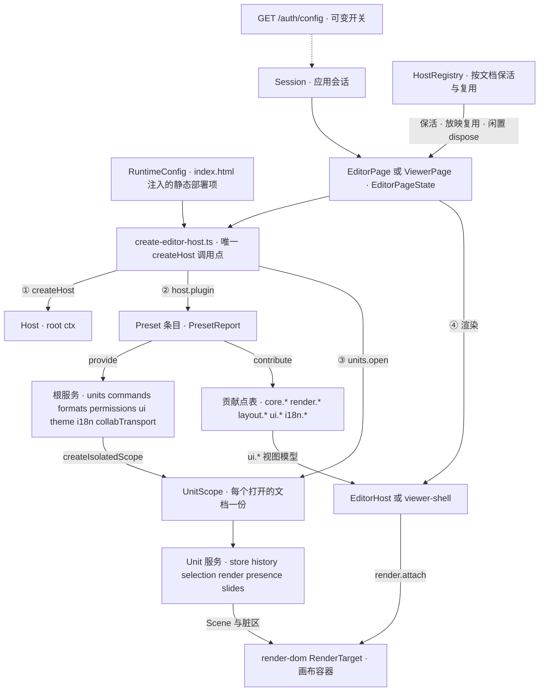

怎么读：编号是 `create-editor-host.ts` 的执行顺序；实线是创建、挂载或数据流，虚线表示 Session 只从 `/auth/config` 读取可变开关（自助注册显隐、IdP 显示名），不写进 RuntimeConfig。根服务与贡献点表按 host 共享，UnitScope 内的服务每个文档一份、互不可见；一个页面可以有多个 host，一个 host 可以打开多个 Unit。
依据：[30/01](../30-architecture/01-overview.md) 的运行时对象关系图（总架构只留一张，本图是其前端展开）；30/03 §5；40/18 图 4-1、4-3；决策 RUNTIME-CONFIG。

| 对象 | 生命周期 | 所属 | 事实源 |
|---|---|---|---|
| RuntimeConfig | 页面加载时读取一次；schema 校验失败渲染配置错误页；只含静态部署项（apiBase、wsBase、auth.mode、externalResources、遥测默认、appVersion、publicUrl、s3 公网源） | apps/web | [02](02-app-shell-routing-and-session.md) §3 |
| Session | 应用级单例：`unknown → anonymous 或 authenticated → expired → authenticated` | apps/web | [02](02-app-shell-routing-and-session.md) §4–§5 |
| HostRegistry | 应用级；兄弟路由保活、放映复用 host、卸载后闲置到期 dispose | apps/web | [02](02-app-shell-routing-and-session.md) §2.2、§6 |
| Host（root ctx） | 每个编辑器实例一份；dispose 后 `fiber.getEffects()` 为空 | kernel | [03](03-preset-assembly-and-plugins.md) §5–§6 |
| PresetReport | 装配 allSettled 后汇总 ACTIVE / PENDING / FAILED / LAZY / EXCLUDED | kernel/preset | [03](03-preset-assembly-and-plugins.md) §2 |
| UnitScope | 每个打开的文档一份；关闭 = `unitFiber.dispose()` 逆序清理 | model-core | [03](03-preset-assembly-and-plugins.md) §6、[04](04-document-commands-and-undo.md) §1 |
| EditorHost / viewer-shell | 随页面挂载；viewer-shell 在 `mount(container)` 时才建 DOM | ui-react / preset-slide-viewer | [10](10-editor-shell-and-interaction.md) §1、[12](12-viewer-embedding-and-render-page.md) §3 |

## 4a. 渲染架构

本节承接原 30/07 §3–§4（rulings §4.21 R-d-04：30/07 缩为「渲染跨端契约」，只留介质决策、`render.*` 贡献点与帧管线契约、engine-layout 与服务端 headless 约束；render-dom 与 slide-render 的架构段迁入本节，逐元素渲染器表迁入 [19](19-insertable-elements-overview.md)）。契约签名（`SceneProvider`、`Scene`、`DirtySet`、`RenderTarget`、`ElementRenderer`、`OverlayRenderer`）仍以 [30/07](../30-architecture/07-rendering.md) §2 为准；帧管线、视口、命中、字体、媒体、缩略图与放映的浏览器侧行为在 [05](05-rendering-and-thumbnails.md)，文本输入宿主在 [06](06-text-editing-and-ime.md)，文件级落点在 [40/06](../40-modules/06-layout-and-render-engine.md) 与 [40/07](../40-modules/07-slide-rendering.md)。

### 4a.1 渲染包分工（三个常驻包 + M3 惰性拆包 slide-render-chart）

| 包 | 同构类 | 在渲染中的角色 | 装配 |
|---|---|---|---|
| engine-render（L5） | iso | 契约与调度：`render.scene` / `render.target` / `render.element` / `render.overlay` 四个贡献点、FrameScheduler、StyleCache、Viewport、HitTester；对幻灯片一无所知（A5） | `provide=['render']`（UnitScope） |
| render-dom（L5） | dom | 唯一的产品输出介质：`render.target{id:'dom'}`、`layout.measurer{id:'canvas'}`、覆盖层、TextInputHost、FontFaceLoader、MediaResolver、a11y-mirror 宿主 | `inject=['render','layout']` |
| slide-render（V-render） | dom | 幻灯片垂直束：`SceneProvider('slide')` 页合成、`render.element × N`、缩略图 Provider；经 ooxml-core（其下为 xml 包）只读解析 chartml 与 `dsp:drawing` | `inject=['render','layout','slides']` |
| slide-render-chart（V-render，M3 起） | dom | 可编辑图表五类的渲染器，以 `conflict:'replace'` 同 key 覆盖图表占位；底层 d3-scale / d3-shape / d3-array | 惰性 chunk，≤400 KB |

**图 4a-1 渲染架构：三包、四个贡献点与查表**

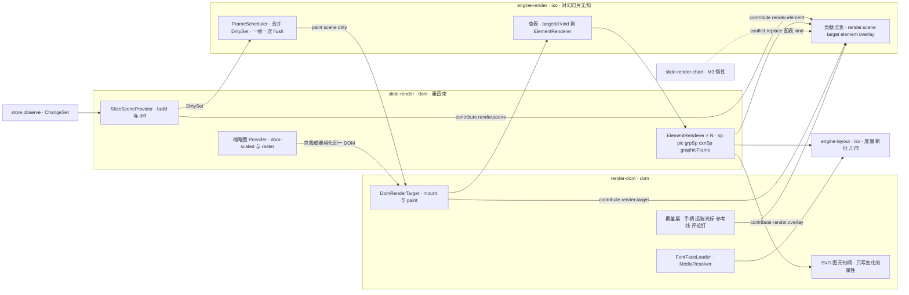

怎么读：左侧 store 的 ChangeSet 进入 slide-render 的 SceneProvider，归类成 DirtySet 交给 engine-render 调度；标 `contribute` 的边表示向 engine-render 的贡献点写条目，其余实线是运行时调用。paint 时 dom target 逐节点按 `${targetId}:${kind}` 查表取无状态的 ElementRenderer，渲染器只经 render-dom 的图元句柄写 SVG，几何与文本行来自 engine-layout。虚线是 M3 起惰性覆盖图表 kind 的替换条目。
依据：原 30/07 §0、§2.1、§3–§4（rulings §4.21 迁入）；[05](05-rendering-and-thumbnails.md) §2、§9；rulings §4.18 FE-08、CO-19。

### 4a.2 render-dom：DOM/SVG RenderTarget Provider

- **挂载结构**：`DomRenderTarget.mount()` 在宿主元素内创建 `.cordex-surface > .cordex-page[data-page-id] > (svg.master, svg.layout, svg.page, svg.overlay, div.text-host)`，返回该页的 `TargetHandle`；`DomSurface` / `PageView` / `LayerHandle` 只是本包内部实现名，不进 `render.target` 契约。
- **图元 API**：供垂直束渲染器使用，避免每个渲染器手写 DOM——`svg.path() / rect() / image() / text() / group() / clipPath() / gradient() / pattern()` 返回带 `set(attrs)` 的薄句柄，属性 diff 由句柄完成（只写变化的 attribute），只经 `createElementNS` / `setAttribute`，文档内容不以 HTML 注入（F7）。
- **FontFaceLoader**：把 engine-layout 的字体请求 `FontRequest{family, weight, style}` 解析为 `FontFace` 加载（字体来自 fontProfile 同源 `/fonts/`；内嵌字体由 ooxml-pptx 解混淆后以 `BlobRef` 提供），`document.fonts.load` 完成后发 `layout/fonts-ready(families)`，相关文本元素标脏重排（[05](05-rendering-and-thumbnails.md) §7）。
- **MediaResolver**：`BlobRef` → `blob:` URL，由 MediaCache 持有，淘汰或页卸载时 revoke，创建与回收对等（[05](05-rendering-and-thumbnails.md) §8.2）。
- **覆盖层与文本宿主**：覆盖层不进 Scene、随 selection 与 presence 独立刷新（[05](05-rendering-and-thumbnails.md) §5.2）；隐藏 textarea 文本宿主见 [06](06-text-editing-and-ime.md)。
- **包级约束**：依赖 engine-render、engine-layout，**不依赖** design（L5 不得依赖 L7，覆盖层主题色直接写 CSS 变量名字符串，rulings §4.18 FE-18）；目录以 [40/06](../40-modules/06-layout-and-render-engine.md) §4–§5 为准。

**图 4a-2 render-dom 的单页挂载结构**

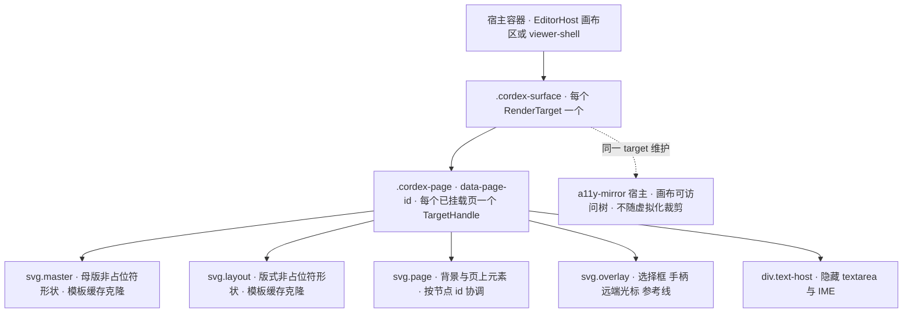

怎么读：实线是 DOM 父子关系，自上而下从宿主容器到单页的五个层节点；前三层按母版、版式、页的顺序叠放，覆盖层与文本宿主在最上。虚线表示可访问树镜像由同一个 dom target 维护，但不随页虚拟化裁剪（[05](05-rendering-and-thumbnails.md) §11）。
依据：原 30/07 §3.1；决策 A11Y-TREE；40/06 §4。

### 4a.3 slide-render：页合成（母版 → 版式 → 页）

1. **合成**：`SlideSceneProvider`（实现 `SceneProvider('slide')`）的 `build(unitScope, view)` 调 model-slide 的纯函数 `composeSlide`（输入 `slides.resolved.*` 与 `layout` 服务），产出一个 `Scene`：母版、版式、页三层是同一个 `Scene`，节点带 `data.layer` 标签，已按 `showMasterSp`、占位符规则与 `(parentId, z)` 展开成绘制顺序；`dependencies`（themeId、masterId、layoutId）用于反向索引。**占位符规则按 PowerPoint 行为**：普通页上母版与版式的占位符一律不绘制（它们只作为页上同类占位符的继承来源与空占位提示文字的来源），只绘制母版与版式的非占位符形状（受 `showMasterSp` 控制）；页上的占位符连同继承来的几何与样式由 slide 层绘制；母版视图编辑母版或版式本身时，占位符作为被编辑对象绘制，不受此规则约束（rulings §4.19 D-TEST-INFRA，PowerPoint 365 视觉基线）。
2. **绘制**：由 dom target 的 `paint(scene, dirty)` 驱动——母版与版式层以 `(layoutId, showMasterSp, themeVersion)` 为键缓存渲染后的 DOM 模板（`LayerTemplateCache`，LRU 32 项），新页挂载时 `cloneNode`，相关路径变脏时失效、重渲一次后广播给共享它的页；页层按节点 id 做 keyed reconcile：新增 → `ElementRenderer.render`，删除 → `dispose(handle)`，`z` 或 `parentId` 变化 → 只移动 DOM 节点，属性变化 → `update(handle, node)`（`DirtySet.changed` 给出属性级精度）；背景是单独的 `<rect>` + paint，改动即整页脏。
3. **归类**：`diff(changeSet, prev)` 把 `ChangeSet.touched` 的 `StorePath` 归类为 `DirtySet`，这是垂直束的知识，engine-render 不认识 `slides`（[05](05-rendering-and-thumbnails.md) §3）。

**图 4a-3 页合成与三层渲染**

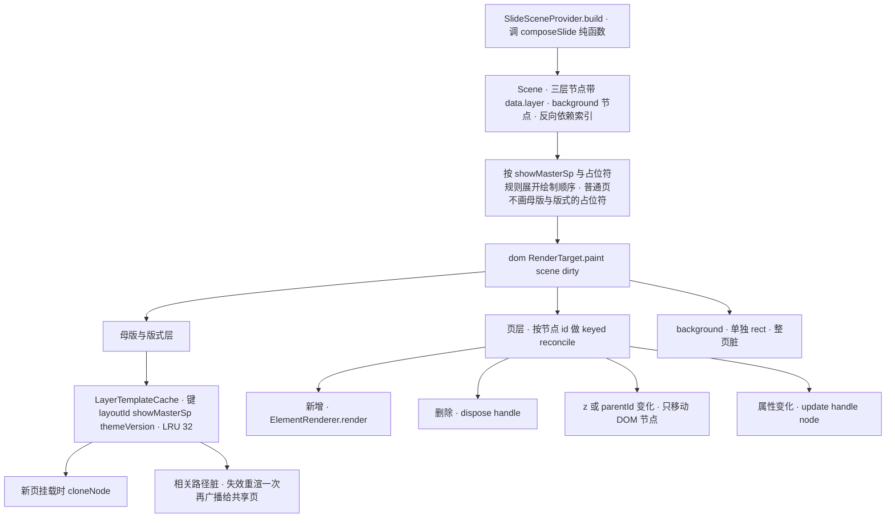

怎么读：自上而下是一页从模型到 DOM 的合成路径；`Scene` 交给 dom target 的 `paint` 后分三路处理——模板层走缓存与克隆，页层走按 id 的最小化协调，背景整页重画。模板层只含母版与版式的非占位符形状、与页内容无关，所以同一键的模板可在所有页之间共享。
依据：原 30/07 §4.1（rulings §4.21 迁入）；rulings §4.19 D-TEST-INFRA；[11](11-masters-layouts-and-themes.md) §4。

### 4a.4 ElementRenderer 的注册、查表与降级

- **注册**：每个 kind 一个无状态的 `render.element` 贡献项，键为 `${targetId}:${kind}`；选择渲染器是一次 `Map` 查表、没有链式拦截（A30）；状态只在 `render()` 返回的 `ElementHandle`（DOM 句柄与上次节点 revision）里。slide-render 主包注册 `sp`、`pic`、`grpSp`、`cxnSp`、`graphicFrame`（表格、图表占位、OLE 预览）与 SmartArt（只读 `dsp:drawing`）等 kind，逐 kind 的内容与关键点见 [19](19-insertable-elements-overview.md) 的元素渲染器表，各元素族的交互、检查器与命令见 [20](20-elements-text.md)–[25](25-elements-readonly-and-opaque.md)。
- **第三方元素**：`slide.shapeKind` + `render.element` + 可选 `ui.*`，内核零改动（[30/04](../30-architecture/04-document-model.md) §3.3）；插件不在时走 `unknown` 占位，仍可选中、移动、删除。
- **惰性覆盖**：图表在 M1–M2 由 slide-render 的惰性子路径 `./chart` 提供（主包只有占位，遇到图表发 `render/element-degraded{reason:'chart-unavailable'}` 触发加载），M3 起由 slide-render-chart 以 `conflict:'replace'` 同 key 覆盖（rulings §4.18 FE-08）；EMF / WMF 在惰性 Worker 中栅格化后进 MediaCache（`sha256#raster@px`）。
- **三类占位**（[05](05-rendering-and-thumbnails.md) §9 为唯一源）：① 查表未命中 → `unknown` 占位（虚线框 + kind 文本），`render.renderer_missing` 每个 kind 上报一次；② 意外失败 → `render` / `update` 抛错被捕获，换红色虚线框失败占位，发 `render/element-failed` 并 `errors.report('render.element_failed')`，同页其他元素不受影响（A11）；③ 预期降级 → 渲染器按原因画降级占位并发 `render/element-degraded{reason}`（如 `chartex-unsupported`、`smartart-no-dsp`、`emf-no-preview`、`ole-preview-missing`、`external-resource-blocked`），不走错误上报。三类占位都能选中、移动、删除；手柄、裁剪遮罩、连接点、内容图标条、上传占位都在覆盖层、不进 Scene。

**图 4a-4 元素渲染器的注册、查表与降级**

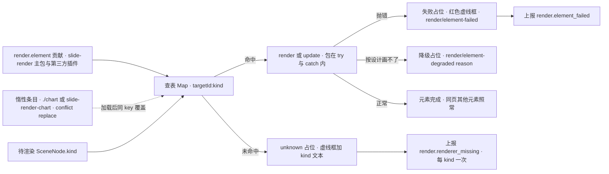

怎么读：左侧两类贡献方把渲染器写进同一张查表，虚线是惰性条目加载后以同 key 覆盖占位渲染器；每个待渲染节点只查一次表。三条异常出口都只替换当前元素：未命中与意外失败上报错误，预期降级只发事件、不算错误。
依据：原 30/07 §2.1、§4.2（rulings §4.21 迁入）；[05](05-rendering-and-thumbnails.md) §9；rulings §4.15 Q7、§4.18 FE-08。

## 4b. UI 壳与交互架构

UI 壳是「控件与画布输入怎样变成命令」的那一层（2026-09-26 复核补节，对照用户诉求 2「前端架构」）。它由 L7 的三个包加一个垂直束组成：`ui-core` 定义贡献点、上下文键与输入管线，不含任何框架；`ui-react` 是 `UiRenderer` 的 React 实现，提供 `<EditorHost>`、`EditorShell` 布局与各槽位宿主；`slide-ui` 只向 `ui.*` 贡献幻灯片专属的页签、检查器分区、菜单与键位，并持有画布交互层（插入工具态、裁剪、手柄）；控件的参数装配集中在 slide-ui `application/command-bindings.ts`，写入一律经 `commands.execute`。逐项契约以 [09](09-ui-system-and-theming.md) §1、§6–§9 与 [10](10-editor-shell-and-interaction.md) §1、§4–§7 为准，本节只给结构。

**图 4b-1 UI 壳分层：贡献点、上下文键、命令绑定与覆盖层**

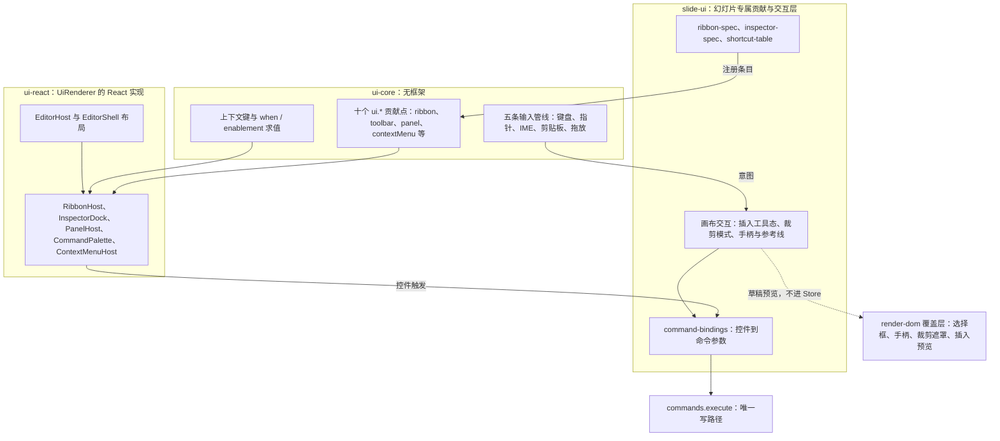

怎么读：实线是一次操作的走向——slide-ui 的声明式规格把条目注册到 ui-core 的贡献点，ui-react 的槽位宿主按上下文键过滤后渲染；用户点控件或在画布上操作，都在 `command-bindings` 汇合成 `{commandId, params}` 再经 `commands.execute` 写入。虚线是交互进行中的草稿预览，只画在覆盖层上，不产生事务；`when` 只管可见，`enablement` 只管可用（禁用并说明原因，不隐藏）。
依据：[09](09-ui-system-and-theming.md) 图 9-1、§6.1–§6.3；[10](10-editor-shell-and-interaction.md) §1、§7；40/10 §2.6、§4 目录树；ADR-0017。

**表 4b-1 UI 壳专题与能力域速查**（包 → 能力域的全表见 [18](18-editor-capabilities.md) §1.2）

| 关注点 | 主要包 | 专题 | 服务的能力域（50/18） |
|---|---|---|---|
| 贡献点、槽位、`when` / `enablement`、上下文键、输入管线与快捷键 | ui-core | [09](09-ui-system-and-theming.md) §6–§8 | KEY、UI |
| `EditorHost` / `EditorShell` 布局、断点三形态、模式 × 角色 | ui-react | [10](10-editor-shell-and-interaction.md) §1–§3 | UI、VIEW |
| Ribbon、检查器坞、缩略图栏、命令面板与设置抽屉 | ui-react 宿主 + slide-ui 规格 | [10](10-editor-shell-and-interaction.md) §4–§6、§10 | INS、FMT、TXT、SLD、UI |
| 画布交互：选择模型、拖拽、插入工具态、元素手柄 | slide-ui + render-dom 覆盖层 | [10](10-editor-shell-and-interaction.md) §7 | SEL、ALN、ARR、INS、PIC |
| 母版视图与版式画廊 | slide-ui | [11](11-masters-layouts-and-themes.md) §2–§7 | ML |
| 主题、token 与材质 | design、ui-react | [09](09-ui-system-and-theming.md) §2–§4 | —（界面外观） |

## 5. 四条端到端主干（前端视角）

本节只画主干，分支、错误与计时细节在各自文件。

### 5.1 打开

`units.open` 接受四种 source；选哪一种由页面按路由、角色与 preset 决定（[02](02-app-shell-routing-and-session.md) §8 用例清单）。`bytes` 走渐进打开（rulings §4.18 CO-12），协同模式不走这条路径，Y 状态由 HTTP 快照 bootstrap 一次装载。M2 起 apps/web 的服务端文档一律走 `state` 分支：内容以协同快照为唯一事实源，新建与导入都先由服务端导入生成 import 快照（rulings §4.19 D-M2-CONTENT）；`bytes` 与 `empty` 只留给本地文件、M1 查看器与集成方。

**图 5-1 打开文档的四种 source 分支**

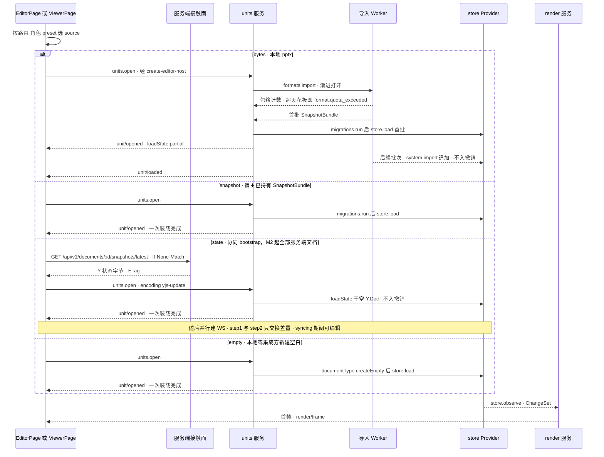

怎么读：纵向是时间，实线是调用，虚线是返回或事件；四个 `alt` 分支互斥。`bytes` 分支里 Worker 先完成全部页的规模计数再回传首批，超系统天花板整体拒绝，不会装到一半才失败；后续批次以 `system('import')` 追加，不入撤销栈、不标脏，到齐发 `unit/loaded`，全选、查找替换、导出、跨页重排在此之前等待或禁用（[04](04-document-commands-and-undo.md) §2）。`/render` 页同样走 `snapshot` 或 `state` 分支，只是字节来自编排方注入而非请求（[12](12-viewer-embedding-and-render-page.md) §11）。
依据：30/03 §5（source 四种 kind）；40/02 §2.1 `units.open` 六步与渐进打开；30/06 §9.1（HTTP bootstrap + WS 增量）；rulings §4.18 CO-12。

source 与使用场景：

| source | 字节从哪来 | 使用场景 | 里程碑 |
|---|---|---|---|
| `bytes` | 本地文件、导入页的「本地打开」 | M1 查看器与 `/home` 夹具、本地文档（`local:*`）、形态 A–D | M1 起 |
| `snapshot` | 宿主已持有的 SnapshotBundle（集成方 `onSave` 产物、`/render` 注入的快照） | 嵌入形态、`/render` 页 | M2 起 |
| `state` | `GET …/snapshots/latest` 的 Y 状态字节与离线恢复（`encoding: 'yjs-update'`，交 store-yjs 的 `loadState`）；版本预览字节；`/render` 注入的状态字节；`encoding: 'snapshot-json'` 只供 store-memory（它只接受这一种；30/03 §5.3、40/02 §2.1） | apps/web 的全部服务端文档（含 M3 查看者变体）、版本预览、`/render` 页 | M2（版本预览与 `/render` M3） |
| `empty` | `documentType.createEmpty()`（首页为标题版式，D14） | 本地新建与集成方新建（形态 A–D）；apps/web 服务端文档的「新建空白」改走服务端导入空白模板（[02](02-app-shell-routing-and-session.md) §8） | M2 |

### 5.2 编辑

**图 5-2 一次编辑的数据流：输入 → 意图 → 命令 → Store → 渲染与 CRDT 发送**

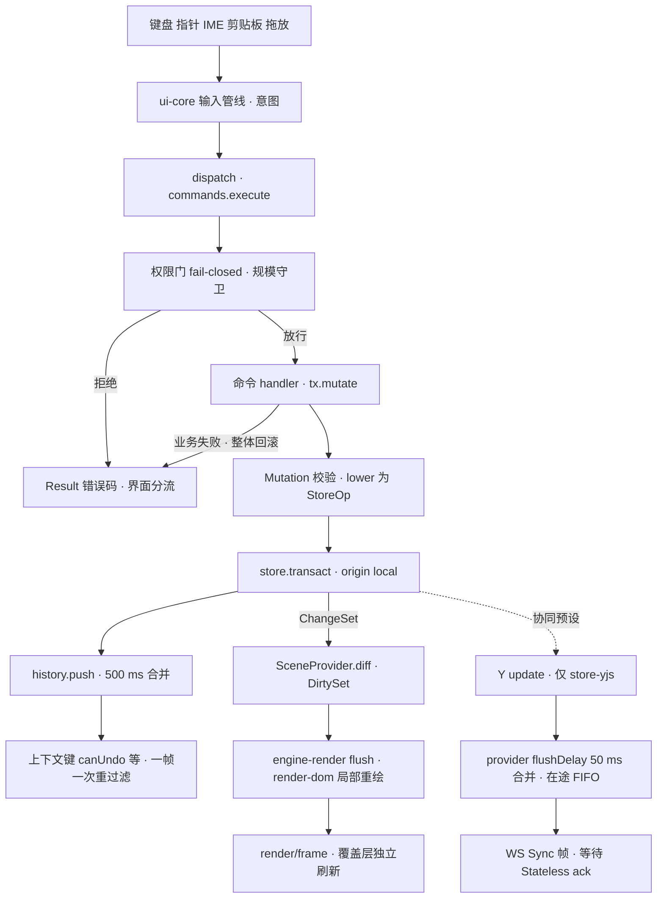

怎么读：实线是单人与协同都走的主链，虚线之后的三步只在 preset-slide-collab（store-yjs）下发生；渲染刷新与协同发送互不依赖，都由同一次事务提交触发。任何拒绝与失败都以 `Result` 返回，界面按错误码分流为静默只读提示、toast 或横幅，不 throw（[04](04-document-commands-and-undo.md) §4）。文本输入的 IME 分支见 [06](06-text-editing-and-ime.md) §3–§5，脏区与帧预算见 [05](05-rendering-and-thumbnails.md) §2–§3，出站与 ack 见 [07](07-collaboration-client.md) §5–§6。编辑子系统的入口：文本宿主见 [06](06-text-editing-and-ime.md)，插入工具态见 [18](18-editor-capabilities.md) §5，裁剪与手柄覆盖层见 [10](10-editor-shell-and-interaction.md) §7；它们在 UI 壳中的位置见 §4b。
依据：30/05 §1–§3（七阶段管线）；[30/01](../30-architecture/01-overview.md) 的编辑端到端数据流；40/18 图 6-1 至 6-3；章程 D5；ADR-0039（provider 合并发送）。

### 5.3 协同（M2 连接与持久化，M3 多人体验层）

M2 起单人编辑也经这条链路持久化（第 1、2、6 条的断线退避重连与第 5 条中超限、换纪元、身份变更的被拒回滚）；在场、权限变更与分享、离线体验（offline 判据、离线横幅与周期重连）属 M3 多人协同体验层（rulings §4.19 D-M2-CONTENT；分工见 [07](07-collaboration-client.md) §16）。

协同客户端自 rulings §4.21（H:q-hp-provider）起用官方 `@hocuspocus/provider` 4.7.0：provider 管 socket 生命周期、Auth 帧、step1 / step2、update 与 awareness 的合并发送、排队与保活；两个类分属 collab-yjs（`HocuspocusProvider`）与 collab-transport-ws（`HocuspocusProviderWebsocket`，外加计量垫片、重连调度器与关闭码策略）。两级 ack、在途 FIFO、PermissionGate、被拒回滚与 OfflineStore 仍是自有胶水，挂在 provider 事件上（H-d-25～H-d-28；细节唯一源 [07](07-collaboration-client.md)）。

1. **加入**：并行发起 `GET /api/v1/documents/:id/snapshots/latest`（ETag / 304）与首次换票 `POST /api/v1/documents/:id/collab-ticket`（有分享令牌时附 `X-Cordex-Share-Token`，票据带 `lnk` claim）→ bootstrap 后把 store-yjs 的 Y.Doc 交给 provider（`autoConnect:false`，由调度器启动）→ 建 `wss://<host>/collab/v1/rooms/:id`（一个 WS 只承载一个文档）→ provider 发 Auth 帧，token 是 async 函数、每次现换票据并返回 auth 字段 JSON，随即发 step1（服务端认证前排队、不应用）→ 服务端回 Authenticated，并以 Stateless 发 `auth.ok{role, limits, reason?}` 与 `room`（与 step1 / step2 的先后不保证）→ 只交换差量 → synced；客户端以 Authenticated 进入 syncing，syncing 期间即可编辑（[07](07-collaboration-client.md) §2；H-d-06、H-d-27）。
2. **出站**：本地事务 → provider `flushDelay` 50 ms 合并（取代原 LocalBatcher 的合并部分与自有出站令牌桶；LocalBatcher 保留 localSeq、在途 FIFO 与两级 ack）→ 批次将超 `auth.ok.limits.maxUpdateBytes`（默认 1 MiB，INC-07）前先 `flushPendingUpdates`，运行期收到 4429 时 `flushDelay` 加倍 → `outgoingMessage` 事件与计量垫片按内容把帧映射到 localSeq、记入在途 FIFO；Stateless `ack{tier, seq}` 中 `tier:'spill'` 不清 pending，`tier:'db'` 弹队首（[07](07-collaboration-client.md) §5–§6；H-d-28、H:q-hp-persist-ack）。不用 provider 的 `unsyncedChanges` 或 `synced` 判断是否已保存。「未保存到服务器」：`room.persist==='degraded'` ∨ 在途含仅获 spill 确认的项 ∨ 最老在途 ≥ `unsavedWarnAfterMs`（默认 15000）时成立；有本地未获 db 确认项的发起方显示横幅「未保存到服务器 N 项」，其余协作者在状态胶囊显示弱提示「服务器保存延迟」（依据：rulings §4.19 INC-09；[07](07-collaboration-client.md) §6.1）。
3. **入站**：provider 实例在 store-yjs 登记为 `remote` 来源，远端 update 走与本地编辑相同的渲染路径；服务端把更新回显给发送者（H-d-29），CRDT 幂等、不重复生效；撤销只作用于本地来源，他人后写的键被跳过并提示，整步被跳过即停（[04](04-document-commands-and-undo.md) §6）。
4. **在场**：awareness 由 provider 收发，本地节流（光标与选区 20 Hz、视图 2 Hz、空闲 60 s）不变，查看者只上报视图；y-protocols 每 15 s 续期兼作保活；远端光标与选区在覆盖层绘制（[07](07-collaboration-client.md) §10–§11、[05](05-rendering-and-thumbnails.md) §5）。
5. **权限**：Stateless `CONTROL.permission` → 客户端权限服务唯一入口 → 降权即拦截出站并进入 readonly-degraded；provider 发出 `authenticationFailed` 时 SessionDriver 立即断开，不让 provider 自动重试；被拒回滚并提供导出本地副本（[07](07-collaboration-client.md) §8）。
6. **断线与恢复**：provider 设 `maxAttempts:1`，重连由注入 Clock 的自有调度器驱动：退避 1→30 s（±20%），自进入重连起累计 30 s 未连上或 `navigator.onLine=false` 即 offline，offline 后每 30 s 自动重连；provider 本身不看关闭码，关闭码在构造配置的 `onClose` 里按 30/06 §6.5 分流（该表在 1011、4427、4428 之外新增 4205，4408 扩为超时通用码；H-d-20）；长离线差量由 provider 在收到服务端 step1 时自动生成 step2，step2 单设 16 MiB 上限，超限 4413 后提示导出本地副本并重载（H:q-hp-step2-cap，改写 rulings §4.18 CO-10「先切块」）（[07](07-collaboration-client.md) §4、§9）。

**图 5-3 协同加入与一次出站：provider 与自有胶水的分工**

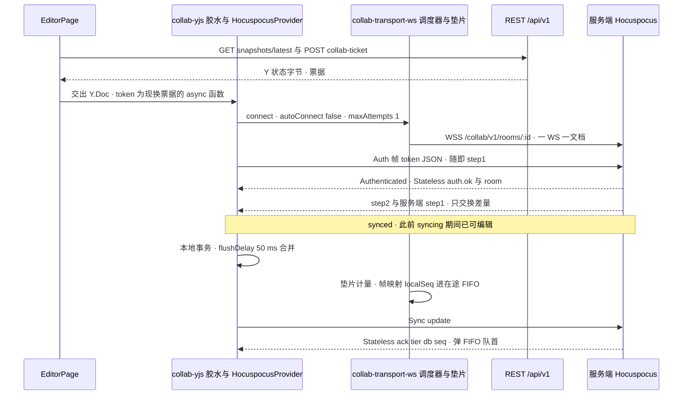

怎么读：纵向是时间，实线是请求或发送，虚线是返回。provider 负责 socket、Auth、step1 / step2 与合并发送；自有胶水负责何时连（调度器）、帧与 localSeq 的映射（垫片）和两级 ack 的出队。服务端把 CONTROL 放在 Stateless 载荷里，Authenticated 与 `auth.ok` 的先后不保证，客户端以 Authenticated 为进入 syncing 的信号。
依据：ADR-0039 决策 3、决策 8；H-d-06、H-d-25～H-d-28；[07](07-collaboration-client.md) §2、§5–§6。

帧、CONTROL 与关闭码的定义见 [30/06 §6](../30-architecture/06-collaboration.md)（按 [ADR-0039](../30-architecture/adr/0039-collab-server-hocuspocus.md) 改为 Hocuspocus 帧 + Stateless 载荷）；服务端的 Hocuspocus 挂点见 [60/01](../60-backend/01-service-overview-and-roles.md) §0，帧处理见 [60/16](../60-backend/16-ws-protocol-server-view.md)。

### 5.4 导出

1. **入口**：「⋯ → 导出…」或 `Mod+E` → Operation `shell.intent{target:'export'}` → 宿主的导出对话框（[03](03-preset-assembly-and-plugins.md) §8）。
2. **pptx（客户端，M1 起）**：`commands.execute(unitId, 'core.export', {mime: <pptx MIME>})`（参数形状见 40/02 §2.6；渐进打开未到齐时先 `await units.whenLoaded`），在 Worker 中对快照副本编码（干净部件原样、脏部件重生成），完成后下载；导出期间可继续编辑；协同模式下有在途项时对话框提示「导出将包含本地最新内容」并给出［仍要导出］［等待同步］，选等待后停在「正在同步 N 项…」、归零自动生成、可取消，离线或重连中「等待同步」禁用（rulings §4.18 UX-05；[04](04-document-commands-and-undo.md) §8、[13](13-performance-and-bundling.md) §8）。
3. **PDF 与批量 PNG（服务端，M3）**：`POST /api/v1/documents/:id/export{format}` → `GET /api/v1/jobs/:id` 轮询 → `GET /api/v1/exports/:jobId` 取 1 h 有效的下载 URL（走 `s3` 子域）；服务端格式不提供「仍要导出」，须先同步（[02](02-app-shell-routing-and-session.md) §8；路由见 [60/15](../60-backend/15-rest-api-catalog.md) §3.9）。
4. **单页 PNG / SVG（M2 P1，PRD OF-19）**：主线程 `toImage` 栅格化与 SVG 序列化；这是 `raster` 用途，不是可配置的缩略图 Provider，M2 位图 spike 前只对无 Web 字体依赖的单页门禁（[05](05-rendering-and-thumbnails.md) §10.3）。

## 5a. 编辑器能力地图

rulings §4.21 轮的第三条用户诉求是「说清编辑器的每个能力前端计划怎么实现」。能力盘点按 25 个域共 162 项（证据 R `capabilities`），另加国际化 2 项、2026-09-26 复核从 INS-16 拆出的 INS-20（公式与艺术字变形）1 项，共 165 项；**逐项的出处、实现落点、命令 id、复用或自研、里程碑与补齐方案以 [18 编辑器能力实现总表](18-editor-capabilities.md) 为唯一源**，本节只给一张地图：每个域有多少项、盘点时写清了多少、主要落在哪些包、本线哪篇专题展开。所有能力都走同一条链——输入管线只产意图 → slide-ui 装配参数 → `commands.execute` 是唯一写路径 → 渲染层只读脏区（§5.2）。

覆盖度是本轮写作前的盘点基线：full = 50 / 40 已写清；partial = 有命令或一行说明，但缺交互、参数或设计；missing = 无设计或无命令。partial 与 missing 共 101 项，由 18 给出补齐方案（整合阶段已有 7 项由族文档写清，本轮后统计见 18 §1.3），其中「插入」域 20 项里 12 项 missing，是本轮的核心缺口，由 §5b 与元素目录 19–25 补齐。

**表 5a-1 能力域 × 能力数 × 覆盖度（盘点基线）**

| 域（前缀） | 能力数 | full / partial / missing | 主要落点 | 本线专题 |
|---|---|---|---|---|
| 选择与变换（SEL） | 16 | 9 / 4 / 3 | slide-ui 画布交互、render-dom 覆盖层、engine-render 命中 | 10 §7、05 §5 |
| 对齐与吸附（ALN） | 4 | 1 / 2 / 1 | slide-ui 参考线、render-dom 参考线覆盖层 | 10 §7 |
| 层级与组合（ARR） | 5 | 1 / 3 / 1 | model-slide 层级与组合命令（FracKey 只改 `order`） | 04、21 |
| 插入（INS） | 20 | 2 / 6 / 12 | slide-ui 插入页签与工具态、model-slide 插入命令族（ADR-0018） | 19–25、10 §4 |
| 文本（TXT） | 18 | 4 / 9 / 5 | render-dom 文本宿主、engine-layout 排版、model-slide `text.*` | 06、20 |
| 形状与格式（FMT） | 11 | 2 / 5 / 4 | engine-layout 预设几何、ui-react 颜色与渐变、slide-ui 检查器 | 22、09 |
| 图片（PIC） | 10 | 3 / 3 / 4 | slide-render 图片渲染器、render-dom 裁剪覆盖层、apps/web 上传队列 | 23、05 §8 |
| 媒体（MED） | 4 | 2 / 2 / 0 | slide-render 海报帧、放映叠 `<video>` / `<audio>` | 23、10 §9 |
| 表格（TBL） | 6 | 0 / 3 / 3 | slide-render 表格渲染器、slide-ui 单元格选区、归一化表格模型 | 24 |
| 图表（CHT） | 5 | 2 / 0 / 3 | slide-render `./chart`、slide-render-chart（ADR-0036） | 24、05 |
| 母版版式主题（ML） | 10 | 5 / 4 / 1 | slide-ui 母版视图、model-slide 母版与版式命令 | 11 |
| 幻灯片管理（SLD） | 8 | 4 / 2 / 2 | slide-ui 缩略图栏（虚拟列表、拖拽排序） | 10 §6 |
| 视图与缩放（VIEW） | 5 | 3 / 0 / 2 | engine-render Viewport、ui-core `view.*` Operation | 10 §8、05 §4 |
| 查找替换（FND） | 4 | 1 / 2 / 1 | model-slide 查询层、slide-ui 查找面板 | 18 |
| 剪贴板（CLP） | 4 | 3 / 0 / 1 | ui-core 剪贴板管线（htmlparser2 惰性） | 04 §9 |
| 撤销重做（UND） | 3 | 3 / 0 / 0 | model-core history、store 推导逆操作 | 04 §5–§6 |
| 导出与打印（EXP） | 6 | 2 / 2 / 2 | ooxml-pptx 导出 Worker、render-dom `toImage`、服务端作业 | 本文 §5.4、13 |
| 评论（CMT） | 1 | 1 / 0 / 0 | comments 包、slide-ui 评论钉 | 08 |
| 放映（SHW） | 6 | 4 / 1 / 1 | slide-ui 放映舞台 | 10 §9 |
| 协同在场（COL） | 3 | 2 / 0 / 1 | collab-yjs 与 provider、render-dom 远端光标 | 07 §10–§11 |
| 离线（OFF） | 3 | 2 / 0 / 1 | collab-yjs 内存队列、collab-offline-idb（M4） | 07 §7 |
| 快捷键（KEY） | 3 | 2 / 1 / 0 | ui-core 和弦与快捷键服务 | 10 §10、09 §8 |
| 检查器与上下文（UI） | 5 | 1 / 4 / 0 | ui-core 上下文键、slide-ui 检查器 | 09 §6、10 §5 |
| 可访问性（A11Y） | 1 | 1 / 0 / 0 | render-dom a11y-mirror | 16 §9 |
| 文档与文件（DOC） | 2 | 2 / 0 / 0 | apps/web 开始页、新建与导入 | 02 §8 |
| 合计 | 163 | 62 / 53 / 48 | 另有国际化 2 项（I18N）只在 18 登记；INS-20 为 2026-09-26 复核拆分新增，合计与 18 §1.3 一致（165） | — |

**图 5a-1 能力域群到包的落点**

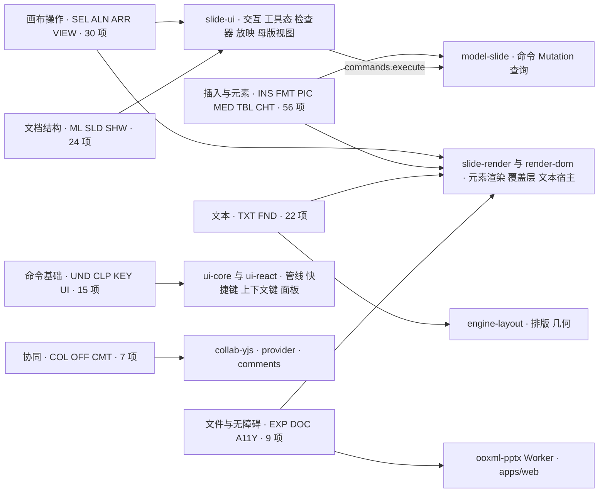

怎么读：左列把 25 个域按「用户在做哪类事」并成 7 群，标出前缀与项数；实线指向该群能力的主要实现包，右下的 `commands.execute` 边表示 slide-ui 只装配参数、写入一律经 model-slide 的命令。一个域的细分落点与每项命令 id 以 18 为准。
依据：证据 R `capabilities`（162 项，2026-09-26 盘点）；[18](18-editor-capabilities.md)；章程 D4。

## 5b. 可追加元素族一览

第三条用户诉求的重点是「追加元素」：追加什么、有什么作用、每个元素怎么设计。可追加元素共 35 类，按 6 个族登记；**族总表、插入命令通用流程、默认落点与尺寸、通用设计 18 条、新增命令与 Mutation 汇总、元素渲染器表与非目标清单以 [19 可追加元素目录·总览与通用设计](19-insertable-elements-overview.md) 为唯一源**，每个元素的固定栏目设计（作用、OOXML、插入入口与默认、模型、渲染、交互、检查器、命令、协同、导入导出、可访问性、复用、里程碑、待决）在 20–25 六篇族文档。模型补全与插入命令族（含表格归一化）的决策是 [ADR-0018](../30-architecture/adr/0018-editor-element-model-and-insert-commands.md)，图表路线是 [ADR-0036](../30-architecture/adr/0036-chart-rendering-and-editing.md)。

**表 5b-1 六个元素族**（可编辑度：E 可编辑、E~ 部分可编辑、V 只看、V~ 近似显示、P 仅原样保留）

| 族 | 元素 | 追加它有什么作用 | 可编辑度与里程碑要点 | 族文档 |
|---|---|---|---|---|
| 文本类（5） | 文本框、文本字段（页码、日期时间）、超链接、艺术字与文字效果、符号与特殊字符 | 放自由文字；页码与日期自动更新；跳到网址、邮件或本文档的页；强调标题；插入键盘打不出的字符 | 文本框 E，M2 P0；超链接 E，M2 P1（R-d-67）；字段 M2 P2；艺术字 M1 近似显示、渐变字与描边字 M2 P2（字符格式，50/19 §1.2）、艺术字变形编辑 M4+；符号用自建 Unicode 表，M3 P2 | [20](20-elements-text.md) |
| 结构类（5） | 标题与正文等文字占位符、内容族占位符与快速插入图标条、页眉页脚、幻灯片 / 版式 / 母版背景、组合 | 按版式组织内容并继承样式；空占位一键填图片等；全篇统一页脚；整页背景；把多个元素当一个移动缩放 | 占位符页上编辑 M2 P0；图片快速插入 M2 P1（R-d-69）；页眉页脚 M2 P2；背景 M2 P1、母版侧 M3；组合 M2 P0 | [21](21-elements-structure.md) |
| 形状类（6） | 预设形状（首批约 72 项 10 类）、线条与箭头、连接符、任意多边形与自由曲线、动作按钮、第三方扩展元素 | 画示意图与流程图；连线随形状移动；放映时跳页；插件新增自有元素（二维码示例） | 形状与线条 E，M2 P0；连接符 M2 P1、肘形与曲线重算 M3 P1；自由绘制 P2，自定义几何顶点编辑为非目标；第三方元素是 M2 可插拔验收 | [22](22-elements-shapes-and-lines.md) |
| 媒体类（9） | 图片、SVG、图标、EMF / WMF、图片填充、视频、音频、外链媒体、屏幕截图与相册 | 放照片与矢量图；图标化表达；形状与背景的图片填充；放映中播放音视频 | 图片 E，M2 P0，裁剪与压缩 P1；EMF 惰性栅格化 M2 P1；图标 lucide-static，M3 P2；音视频插入 P2 且插入时不写 `p:timing`；截图与相册 M4+ P2；录屏不做 | [23](23-elements-media.md) |
| 数据类（2） | 表格、图表（可编辑五类 bar / line / pie / area / scatter） | 结构化对比数据；把趋势与占比可视化 | 表格 M2 可插入并改单元格文字，行列与合并、样式 M3，M3 前改为 Record + FracKey 归一化模型；图表 M1 只读（SSIM ≥ 0.80），M3 插入与五类编辑 | [24](24-elements-tables-and-charts.md) |
| 只读与不透明类（8） | 其它图表与 chartex、SmartArt、公式（OMML）、OLE、3D 模型、墨迹、缩放定位、ActiveX / VML / 未知 graphicData | 导入文件里认得、但不提供插入的内容：看得见、能摆放、原样写回 | V / V~ / P；SmartArt M4+ 先做「转换为形状」；公式 M4+ 基于 xml 包自研 OMML↔MathML、MathJax 4 惰性出 SVG；OLE M4+ 下载与替换 | [25](25-elements-readonly-and-opaque.md) |

**非目标**：SmartArt、OLE、3D、墨迹、缩放定位、录屏都不提供插入；自定义几何的顶点编辑也是非目标（R-d-75）。

**图 5b-1 元素插入的总流程：跨包分工**

```mermaid
sequenceDiagram
  participant user as 用户
  participant sui as slide-ui 插入工具态
  participant cmd as commands 服务
  participant model as model-slide 插入命令族
  participant store as store
  participant up as apps/web 媒体上传队列
  participant rnd as slide-render 与 render-dom
  user->>sui: 选工具 · activeTool 本地态 · 不入历史
  user->>sui: 单击或拖出超过 4 px · 或菜单与 Enter
  sui->>sui: 屏幕坐标经视口逆变换得 EMU box
  opt 媒体类元素
    sui->>up: 本地算 sha256 · 预处理与压缩
  end
  sui->>cmd: execute slide.insertX
  cmd->>cmd: schema · doc.write 权限 · 规模守卫
  alt 超出规模上限
    cmd-->>sui: document.quota_exceeded · 不开事务
  else 放行
    cmd->>model: 一个事务 · 按需 media.add 再 shape.insert
    model->>store: StoreOp · order 置顶 · parentId 为空
    store-->>rnd: ChangeSet · 新元素进脏区
    cmd-->>sui: CommandResult · 一步撤销
    sui->>sui: Operation slide.setSelection · 进子编辑态
  end
  opt 媒体类元素
    up->>up: 后台 presign · PUT s3 子域 · commit
  end
```

怎么读：纵向是时间；工具态、落点计算与选中都是 slide-ui 的本地状态或 Operation，只有中间一条命令写 Store，所以一次插入恰好一个撤销步。媒体字节只进 BlobStore、不进 CRDT：本地算出 sha256 后立即插入（渲染先用本地 blob），上传在后台完成，他端在 commit 之前显示加载占位并退避重试（[05](05-rendering-and-thumbnails.md) §8）。规模守卫在事务之前拒绝，超限不留撤销记录。步骤与状态机细节见 19，交互外观见 [10](10-editor-shell-and-interaction.md) §4、§7。
依据：[19](19-insertable-elements-overview.md)；证据 R `elementDesign.crossCutting`（插入命令通用流程、媒体通道）；rulings §4.21（q-table-depth、q-chart-route、q-media-insert、q-smartart、q-equation、q-extra-inserts）；R-d-62、R-d-75。

## 6. 浏览器可观察状态清单与事实源

「可观察」指界面、集成方回调或测试可以读取的状态。每个状态的取值、转移与界面表现只在「事实源」列的文件定义。

| 状态 | 取值摘要 | 代码落点 | 事实源 | 对外可见方式 |
|---|---|---|---|---|
| `Session` | `unknown → anonymous 或 authenticated → expired → authenticated`（换人则只读） | apps/web `domain/session.ts` | [02](02-app-shell-routing-and-session.md) §4–§5 | `app/session-changed`、重新登录横幅 |
| `EditorPageState` | `idle → creatingHost → opening → ready`，或 `failed`、`closing → closed` | apps/web `domain/editor-page-state.ts` | [02](02-app-shell-routing-and-session.md) §6 | 页面加载态与失败页 |
| Unit 装载态 | `loadState`：partial → loaded；上下文键 `unitLoaded` | model-core | [04](04-document-commands-and-undo.md) §2 | `unit/opened`、`unit/loaded`、进度条 |
| 保存态与撤销跳过提示条 | 脏 / 已保存 / 保存中；UndoSkip 提示条出现与关闭 | apps/web、slide-ui | [04](04-document-commands-and-undo.md) §6、§8 | 状态胶囊、提示条、`store/undo-skipped` |
| `SyncState` 与会话 UI 六态 | 对外 `disconnected / connecting / syncing / synced / offline / error`；界面 `connecting / syncing / synced / reconnecting / offline / readonly-degraded` | collab-core `domain/session-state.ts` | [07](07-collaboration-client.md) §3 | `collab/*` 事件、状态胶囊与横幅 |
| `ContextKeyValues` | 标准键（`unitType`、`viewMode`、`editorMode`、`editTargetKind`、`selectionKind`、`selectionCount`、`canUndo` / `canRedo`、`isCollab`、`isReadOnly`、`platform`、`breakpoint`、`density`、`textEditing`、`focusRegion`、`unitLoaded`）+ 保留键族 `can.<capability>` + 束前缀键；全集以 09 §6.3 为唯一清单（rulings §4.20 FE-06） | ui-core `domain/context-keys.ts` | [09](09-ui-system-and-theming.md) §6.3 | `when` 与 `enablement` 子句、诊断面板 |
| `ThemeState` | `{mode, resolved, density, hostMark?}` | ui-core `domain/theme-state.ts` | [09](09-ui-system-and-theming.md) §3 | 根元素 `.dark`、`data-cordex-theme`、`data-cordex-density` |
| `EditorLayoutState` | 侧栏、检查器、历史面板宽度与开合；断点 | ui-react `EditorShell` | [10](10-editor-shell-and-interaction.md) §2 | 布局记忆（按 unitType） |
| `PresetReport` | 条目 ACTIVE / PENDING / FAILED / LAZY / EXCLUDED | kernel/preset | [03](03-preset-assembly-and-plugins.md) §2 | 插件管理器页、`plugin/*` 事件 |
| `MasterViewState` | `{paneSelection, editScope, target, impact, multiSelect, entry, status, sessionMemory?}` | slide-ui `domain/edit-target.ts` | [11](11-masters-layouts-and-themes.md) §4 | 范围条、「影响 N 页」徽标、状态栏 |
| `RenderPageState` | `booting → awaitingInject → opening → painting → ready`，或 `failed{code}` | apps/web `domain/render-page-state.ts` | [12](12-viewer-embedding-and-render-page.md) §11 | `window.__cordex.ready` / `error` |

## 7. 对外接触面

浏览器与服务端之间的一切交互都经 `@cordexjs/protocol`（DTO 文件清单登记在 [40/02](../40-modules/02-kernel-protocol-and-document-core.md) M-02 目录树），不存在绕开 protocol 的私有通道。下表只列「前端从哪里、以什么身份、带什么头访问」；路由的守卫、错误码与限流以 [60/15](../60-backend/15-rest-api-catalog.md) 为准。`{apiBase}` = `https://<host>/api/v1`（rulings §4.18 BE-11）。

| 接触面 | 地址 | 前端调用方 | 字段与规则事实源 | 里程碑 |
|---|---|---|---|---|
| 静态资源 | `/`、`/assets/*`（hash 命名，immutable）、`index.html`（no-store，含每响应 nonce 与 RuntimeConfig）、SPA 路由回落 | 浏览器加载 | 前端：[02](02-app-shell-routing-and-session.md) §3、§12，[14](14-client-security.md) §2–§3；下发：[60/17](../60-backend/17-deployment-and-config.md) | M1 |
| 字体 | 同源 `/fonts/*`（fontProfile 清单与 unicode-range 子集） | 05 字体加载器 | [05](05-rendering-and-thumbnails.md) §7（决策 FONTS） | M1 |
| 登录 | `GET {apiBase}/auth/oidc/login?next=&mode=redirect 或 popup` → 302 → `idp` 子域 → `{apiBase}/auth/oidc/callback` → 回 `/auth/callback?next=` 或 `/auth/popup-callback` | 02 会话用例 | 前端：[02](02-app-shell-routing-and-session.md) §4–§5；服务端：[60/02](../60-backend/02-auth-chain.md) §2、[60/15](../60-backend/15-rest-api-catalog.md) §3.1 | M2 |
| 会话与账户 | `GET {apiBase}/auth/me`、`GET {apiBase}/auth/config`、`POST {apiBase}/auth/token/refresh`、`POST {apiBase}/auth/logout`、`PATCH {apiBase}/users/me/profile` | 02 | [60/15](../60-backend/15-rest-api-catalog.md) §3.1–§3.2 | M2（`users/me/profile` M3） |
| 文档目录 | 列表、详情、改名、回收站、最近与固定（`PUT / DELETE …/pin`、`DELETE …/recent`）、创建副本 `POST …/duplicate`（作业化，轮询 `GET /jobs/:id`）、永久删除 `POST …/purge`（M3）；新建不单独建空文档，走两步导入（见下「导入导出与作业」） | 02 | [60/15](../60-backend/15-rest-api-catalog.md) §3.3 | M2（永久删除 M3） |
| 权限与分享 | `…/permissions`、`…/share-links`；用户搜索 `GET {apiBase}/users?query=`（≥2 字符、≤20 条） | 02 分享对话框、08 @提及 | [60/15](../60-backend/15-rest-api-catalog.md) §3.2、§3.4–§3.5 | M3 |
| 协同票据与元素彻底删除 | `POST …/collab-ticket`、`POST …/elements/purge`（owner，仅墓碑态） | 07、04 §7 | [60/15](../60-backend/15-rest-api-catalog.md) §3.7 | M2 票据（元素彻底删除 M3） |
| 快照与版本 | `GET …/snapshots/latest`（直接返回字节，ETag / 304，响应头 `X-Cordex-Epoch`）、版本列表、`POST …/snapshots{name}`、恢复 | 07 §2、08 §9 | [60/15](../60-backend/15-rest-api-catalog.md) §3.8 | M2 `latest`（版本列表、命名与恢复 M3） |
| WS | `wss://<host>/collab/v1/rooms/:id`（一个 WS 只承载一个文档；线上为 Hocuspocus 帧，票据放在 Auth 帧的 token JSON 里，不走 URL 与请求头） | 07（collab-yjs 的 `HocuspocusProvider` 与 collab-transport-ws 的 `HocuspocusProviderWebsocket`） | 帧与关闭码：[30/06 §6](../30-architecture/06-collaboration.md)、[ADR-0039](../30-architecture/adr/0039-collab-server-hocuspocus.md)；服务端处理：[60/16](../60-backend/16-ws-protocol-server-view.md) | M2 |
| 媒体 | `POST …/media/presign` → PUT `s3` 子域 → `POST …/media/commit`；拉取 `GET …/media/:sha256` 返回 `{url}`（1 h 预签名，不再 302），再对该 URL 发不带凭据与自定义头的 GET | 05 §8（`options.media.upload` 默认实现） | [60/15](../60-backend/15-rest-api-catalog.md) §3.6（决策 MEDIA-CLIENT、INC-21） | M2 |
| 导入导出与作业 | `POST {apiBase}/imports/uploads` → PUT → `POST {apiBase}/imports{uploadId}` → `GET {apiBase}/jobs/:id`，可 `POST {apiBase}/imports/:jobId/cancel`；新建空白 / 内置模板同样以模板字节走这条路径；导出见 §5.4 | 02 新建、导入页与导出对话框 | [60/15](../60-backend/15-rest-api-catalog.md) §3.9 | M2 导入与作业（服务端 PDF / PNG 导出 M3） |
| 缩略图 | `GET …/thumbnails/:slideId?size=640 或 1280`，封面 `__cover`，ETag；文档页内经 `http.ts` 取 Blob 再生成 blob URL（只凭链接的会话要带分享令牌头），列表卡片直接 `` 引用同源端点；M2 卡片封面同样走 `…/thumbnails/__cover`，返回导入处理器写入的 embedded 封面（包内 `docProps/thumbnail.jpeg`，`image/jpeg`，provisional），空白文档无封面、显示占位 | 05 §10、02 列表 | [60/15](../60-backend/15-rest-api-catalog.md) §3.3、§3.10（决策 SG-10）；[60/06](../60-backend/06-modules-jobs-import-export-thumbnails.md) | M3（`__cover` embedded 封面 M2） |
| 评论 | `GET …/comments?filter=`、`GET …/comments/:threadId`、`POST …/comments/import`（P1）、`GET {apiBase}/comments/mentions`；REST 只读，写入走 CRDT | 08 | [60/15](../60-backend/15-rest-api-catalog.md) §3.11（决策 SG-03） | M3 |
| 遥测 | `POST {apiBase}/telemetry/errors`（204）、`POST {apiBase}/telemetry/otlp`、`POST {apiBase}/telemetry/csp`（report-to，无 cookie） | 15、14 §4 | 管线：[15](15-events-errors-and-telemetry.md) §6–§7；端点：[60/15](../60-backend/15-rest-api-catalog.md) §3.14、[60/18](../60-backend/18-observability-and-ops-endpoints.md) | M2 起 |
| 对象存储直传直读 | `https://s3.<域名>/…` 预签名 PUT（导入原件、媒体）与 GET（导出下载、媒体） | 02、05 | 客户端不提交任意对象键，只凭服务端签发的 uploadId；[14](14-client-security.md) §9；[60/14](../60-backend/14-valkey-object-storage-and-retention.md) 为键布局事实源 | M2 起 |
| `/render` 注入 | `window.__cordex.inject / ready / error`（protocol `render/page.ts`） | 12（页面侧） | [12](12-viewer-embedding-and-render-page.md) §11；编排方 [60/06](../60-backend/06-modules-jobs-import-export-thumbnails.md) | M3 |
| 嵌入桥 | `postMessage`（protocol `embed/messages.ts`；M3 只接受会话登录，令牌握手 M4） | 12 | [12](12-viewer-embedding-and-render-page.md) §9 | M3（P2） |

请求头（由 [60/02](../60-backend/02-auth-chain.md) 定义，本线在 [02](02-app-shell-routing-and-session.md) §7 统一附加）：

| 请求头 | 何时附加 | 依据 |
|---|---|---|
| `X-Cordex-Request: 1` | 所有非安全方法（POST / PUT / PATCH / DELETE），迫使跨源请求触发预检 | INC-24 + PRD SV-12 |
| `X-Cordex-Share-Token` | 本文档的 sessionStorage 中有分享令牌时，附在 REST 与 collab-ticket 请求上；不进 query | INC-25 + ADR-0029 |
| `If-None-Match` | `snapshots/latest` 与缩略图 | 60/15 §1 |
| `Idempotency-Key` | 导入、导出等可重试的作业创建请求 | 60/15 §1 |
| `traceparent` | 所有 REST 请求；WS 经 Auth 帧 token JSON 的可选字段传播（服务端在 `onAuthenticate` 以它为父 span，ADR-0039） | [15](15-events-errors-and-telemetry.md) §7 |

## 8. 前端里程碑汇总（M1–M5）

**M1–M4 的里程碑边界表只在 [30/01](../30-architecture/01-overview.md) §7 保留一份**（rulings §4.21 R-d-07，覆盖原先本节对 M2 / M3 分界的复述），里程碑骨架以 [charter §7](../00-charter/charter.md) 为准，范围与验收以 [PRD 05](../10-prd/05-milestones-and-scope.md) §0.3 为准。本节不再定义边界，只做**前端交付落点**：把 40-modules 05 / 06 / 07 / 10 / 11 各 §11 与本线各文件的交付项挂到对应里程碑上；与 30/01 或 PRD 05 冲突时以它们为准。本轮裁决带来的前端里程碑变化已并入下表：协同客户端改用 `@hocuspocus/provider`（M2）；表格 M2 可插入并改单元格文字、结构与样式 M3；图表插入与五类编辑 M3；图标与符号 M3 P2；公式、SmartArt「转换为形状」、截图与相册 M4+。维护约定（2026-09-26 复核）：修订 30/01 §7 时同一 PR 核对本表；本表每行只作「交付 → 所属文件」索引，不另立边界。

**图 8-1 前端里程碑能力叠加**

```mermaid
flowchart LR
  subgraph m1["M1 查看"]
    c11["preset-slide-viewer · 本地 bytes 渐进打开"]
    c12["DOM/SVG 渲染 · gated 对象 · fontProfile"]
  end
  subgraph m2["M2 编辑与持久化"]
    c21["命令 撤销 文本 IME · 本地文档用 preset-slide"]
    c22["服务端文档用 preset-slide-collab · hocuspocus provider · 两级 ack · 断线重连"]
    c25["插入 · 文本框 形状 线条 图片 · 表格插入与单元格文字"]
    c24["应用壳 · OIDC 列表 最近与固定 · 服务端导入与新建"]
    c23["安全基线 · CSP nonce · TT report-only"]
  end
  subgraph m3["M3 多人协同体验层"]
    c31["在场 · 权限细化与分享 · 离线重连体验"]
    c32["评论 版本历史 · 查看者变体"]
    c34["图表插入与五类编辑 · 表格结构与样式 · 图标与符号"]
    c33["服务端缩略图 · /render 页 · TT 强制 · canvas 契约"]
  end
  subgraph m4["M4 插件与嵌入"]
    c41["离线持久化 · 嵌入令牌 · RTL"]
    c42["M4+ · 公式 · SmartArt 转换为形状 · 截图与相册"]
  end
  subgraph m5["M5 doc 与 sheet"]
    c51["preset-doc 与 preset-sheet · 参数化点"]
  end
  m1 --> m2 --> m3 --> m4 --> m5
```

怎么读：箭头是里程碑先后，每个子图列出该里程碑在前端新增的能力，后一个里程碑包含前一个的全部能力（只增不减）；细项与所属文件见下表，边界本身以 30/01 的里程碑边界表为准。
依据：[30/01](../30-architecture/01-overview.md) 里程碑边界表；charter §7；PRD 05 M1–M5；40-modules 05 / 06 / 07 / 10 / 11 §11；rulings §4.19 D-M2-CONTENT、§4.21（q-table-depth、q-chart-route、q-extra-inserts、q-equation、q-smartart、H:q-hp-provider）。

| 里程碑 | 前端交付（所属文件） | 用到的服务端接触面 | 可插拔证据与关键验收 |
|---|---|---|---|
| M1 打开与保真 | preset-slide-viewer 与 viewer-shell（12）；本地 `bytes` 渐进打开（04 §2）；DOM/SVG 渲染、表格 / 图表只读 / SmartArt / OLE 预览等 gated 对象（05）；fontProfile 字体供给（05 §7）；apps/web 骨架：`/home` 夹具 → EditorHost → 返回，dev 下 `auth.mode: none`（02）；四类打开错误码（15）；同页多 Unit（03） | 无（M1 查看器数据源为本地字节，INC-37）；只有静态资源与 `/fonts/` | `pluggable:m1`（`store=noop` → `unit/open-failed{code:'store.unavailable'}`；`render.target=noop` → 空画布无异常）；查看器 ≤350 KB；`readonly.test.ts` |
| M2 编辑与持久化 | 编辑器：命令与撤销（04）、文本与 IME（06）、UI 体系（09）、外壳与交互（10）；母版视图只读与版式应用 / 重置（11）；放映与 EMF / WMF 惰性栅格化（P1，10 §9、05 §8）；形态 A、B（12）；**服务端文档经 preset-slide-collab 接真实网关**：`@hocuspocus/provider` 装配、快照 bootstrap、两级 ack 与在途 FIFO、断线退避重连、超限 / 换纪元 / 身份变更的被拒回滚、「未保存到服务器」分级提示（07）；插入：文本框、预设形状与线条、图片、表格插入与单元格文字、超链接（P1）、图片占位符快速插入（P1）（19–24）；协同离开保护与导出「等待同步」（04 §8.3）；媒体上传与按文档作用域拉取（05 §8）；列表 embedded 封面（05 §10）；应用壳：OIDC 登录、开始页、文档列表、最近与固定、账户菜单、设置、新建与导入均经服务端两步导入、创建副本（02）；客户端安全基线（14）；错误上报默认开（15）；键盘可达与基本朗读（16）；体积与交互预算（13）；本地文档仍用 preset-slide（`store-memory` 回调式保存，04 §8.1） | auth、文档列表与元数据、最近 / 固定（U-04）；collab-ticket、WS、`snapshots/latest`、两步导入与 `GET /jobs/:id`、创建副本、媒体、`__cover` embedded 封面；遥测 errors 与 csp | `pluggable:m2`（`examples/plugin-qr-shape` 零改内核）；`embed:framework-free`（`UiRenderer('vanilla')`）；`csp:strict`；`a11y:axe`；`master:view`；`shell:home`；M2 验收的协同后端部分以 PRD 05 修订为准 |
| M3 多人协同体验层 | 在场与在场 UI（07 §10–§11）、软冲突、撤销跳过与「恢复我的值」「恢复元素」、「最近删除」与「彻底删除元素」入口（04、07）；离线重连体验：offline 判据与横幅、周期重连（07 §4）；权限变更、名额降级与相应的被拒回滚（07 §8）；评论（`comments` 包，rulings §4.19 D-COMMENTS-PKG）与版本历史（08）；查看者变体（10、12）；分享链接落地（02）；服务端缩略图 server-png（05）；`/render` 页（12）；母版与版式编辑、主题（P1）（11）；表格结构与样式（M3 前完成归一化模型）、图表插入与五类编辑（slide-render-chart 拆包，d3 底层）、连接符肘形与曲线重算、图标与符号（P2）（05、22–24）；Trusted Types 强制（14）；forced-colors 门禁（16）；形态 E（P2，12）；M3 末最小 canvas Provider 过 RenderTarget 契约（05） | 评论、权限与分享、版本列表 / 命名 / 恢复、元素彻底删除、服务端导出 PDF / PNG、缩略图、永久删除 | `pluggable:m3`（Manifest 差异 = `{−store-memory, +store-yjs, −collab-core#local-presence, +collab-yjs, +collab-transport-ws, +comments}`，03 §11）；`collab:converge`、`collab:undo`、`offline:queue`、`collab:rejected-rollback` |
| M4 插件 SDK 公开 | collab-offline-idb 跨刷新持久化（P2）与多标签页互斥（07 §7）；嵌入令牌握手（12 §9）；插件管理器公开与版本协商（03 §10）；RTL（16 §4）；动画播放（P2）；M4+：公式 OMML↔MathML 与 MathJax 4 惰性渲染、SmartArt「转换为形状」、屏幕截图与相册（P2）（23、25） | 集成方签名 JWT 与 API Key | 内部非核心成员仅凭公开文档完成一个插件 |
| M5 多文档类型孵化 | preset-doc / preset-sheet；apps/web 在 `domain/document-type.ts` 与 `create-editor-host.ts` 两个参数化点登记新类型（03 §12）；同页 slide、doc、sheet 三个 Unit 共存 | 无新增（server-* 零改动） | `horizontal-freeze`；depcruise 零横向依赖；`boot:empty`、`coexist` |

## 9. 机械验证总表

本表汇总 02–16 各文件「机械验证」小节的主要断言，只写「断言什么」；测试层级、夹具、阈值判定与所在 CI 步骤的定义归 70（步骤工作名以 [70/12](../70-testing/12-ci-gates-mapping.md) 定稿为准）。本文 §3 的铁律执行点不再重复列出。

| # | 断言 | 50 文件 | 70 套件或 CI 步骤 |
|---|---|---|---|
| V1 | 路由表与深链 `/documents/:id?page=&comment=` 可达；`/d/` 不再存在 | 02 | `e2e/smoke`（[70/06](../70-testing/06-frontend-component-and-e2e.md) §5） |
| V2 | OIDC 登录回环、重新登录弹窗与 BroadcastChannel 通知；换人后不重放队列、按只读处理 | 02 | `e2e/smoke`（login-oidc-mock、login-casdoor）；70/06 §5 |
| V3 | 分享链接落地：片段令牌 → sessionStorage → 登录回跳 → 只经 `X-Cordex-Share-Token` 头发送；失效令牌提示「链接已失效」 | 02、14 | 70/06 §5；[70/10](../70-testing/10-security-testing.md) |
| V4 | 非安全方法都带 `X-Cordex-Request: 1`；跨源 POST 与跨源 WS 升级被拒 | 02、14 | 70/10；70/07 |
| V5 | 登出与切换账号后本地存储键全部清空（清理矩阵） | 02、14 | 70/06 |
| V6 | preset 顺序无关 ×100、`pluggable`、`superset`、`lazy`、`derive` | 03 | `test/unit`；[70/02](../70-testing/02-contract-suites-and-pluggability.md) §10 |
| V7 | `pluggable:m1` / `m2` / `m3` 可插拔证据 | 03、12 | 70/02 §10（所在步骤见 70/12 §6） |
| V8 | 中性撤销五用例：remote-conflict-skip、undo-skip-no-cascade（含硬删除分支）、soft-delete-tombstone、delete-vs-edit-undo、read-path-filters-tombstone；`store-memory` 与 `store-yjs` 同一套件 | 04 | `test/contract`（`runDocumentStoreConformance`，70/02 §4） |
| V9 | 渐进打开：追加批次不入撤销栈、零编辑导出零脏部件；`unit/loaded` 前全文命令等待或禁用 | 04 | `test/contract`（import-append）；`test/fidelity-roundtrip` |
| V10 | 随机命令序列全部撤销回到初始哈希、全部重做回到终态 | 04 | [70/05](../70-testing/05-collab-simulation-and-property-tests.md) |
| V11 | 「恢复我的值」是新 local 事务、可撤销；「恢复元素」对已硬删除目标禁用 | 04 | `test/unit`；70/06 §5 双浏览器用例 |
| V12 | 编辑只重绘受影响元素（A28），不对形状级改动返回 full | 05 | `test/unit`（dirty-mapping） |
| V13 | `runRenderTargetConformance`（dom；M3 末最小 canvas Provider 同一套件） | 05 | `test/contract`（70/02 §7） |
| V14 | gated 保真类别达阈值（表格、图表、SmartArt 等） | 05 | `e2e/oracle-gated`（[70/04](../70-testing/04-visual-oracle.md)） |
| V15 | IME 组合期不写 Store、`compositionend` 只提交一次事务；中日韩 × Chrome / Safari 自动化部分 | 06 | 70/06 §9 |
| V16 | `runCollabTransportConformance`、`runOfflineStoreConformance`：关闭码全表（含 1011 / 4205 / 4427 / 4428）、spill 不清 pending、退避序列、30 s 离线、30 s 周期重连；覆盖 provider 事件时序（provider 内部计时用 fake timers，TD-110 只约束自有代码）；`@hocuspocus/provider` v3 / v4 与服务端互连 | 07 | `test/contract`（70/02 §6） |
| V17 | 软冲突 12 场景确定性用例；多客户端随机分区收敛 | 07 | `test/collab-sim`（70/05） |
| V18 | PG 故障注入下 `room.persist` 转 degraded、界面出现「未保存到服务器」提示并在恢复后消失 | 07 | 70/05；[70/07](../70-testing/07-backend-integration-and-api-e2e.md) 故障注入 |
| V19 | 评论锚点随目标墓碑进入「已分离」、随恢复元素回到原锚点；评论导出 PowerPoint 可见 | 08 | 70/06 §5；[70/03](../70-testing/03-fidelity-roundtrip-and-corpus.md) |
| V20 | `theme-vars-contract`、`shadcn-copy`、对比度门禁、同屏 `backdrop-filter` ≤4 | 09 | `test/unit`；`scanners/shadcn-diff`；70/06 §11 |
| V21 | `when` 子句只引用已登记的上下文键 | 09 | `scanners/scan-contributions`（规则 e） |
| V22 | 母版视图：手动切评审即退出并回到进入前位置；被降权不退出、保持只读母版态 | 11 | `test/unit`（master-view.test）；70/06 §5 |
| V23 | 查看器两道只读保证与体积 ≤350 KB | 12 | `test/unit`（readonly.test、no-editing-graph）；`depcruise`；`scanners/scan-bundle-budget` |
| V24 | `/render` 页 local 与 remote 两种模式网络请求数均为 0；ready 判据（page-mounted ∧ 字体结算 ∧ `pendingDirty=0`）；注入超时与每页 10 s 超时分别计 | 12 | `e2e/smoke`（renderer-egress）；70/06 §6 |
| V25 | `UiRenderer('vanilla')` 通过 UI 渲染契约；形态 B 产物不含 react / radix | 12 | `test/contract`（`runUiRendererConformance`）；70/02 §7 |
| V26 | 体积预算（查看器、编辑器、协同增量、惰性 chunk） | 13 | `scanners/scan-bundle-budget`（唯一阻断点） |
| V27 | 打开、交互、协同的性能 gate；20 次开关内存增长 ≤5%；blob URL 泄漏为 0 | 13 | `perf/perf-client`、`perf/perf-collab`（[70/09](../70-testing/09-performance-and-capacity.md)）；70/06 §11 |
| V28 | `csp:strict`：nonce 每响应不同；Trusted Types M2 report-only 零违规、M3 强制；`externalResources` 三档收紧 `img-src` / `media-src` | 14 | 70/06 §10；70/10 |
| V29 | 零外呼：网络请求只指向 apiBase、wsBase、同源、`/fonts/` 与存储源 | 14 | 70/06 §10；70/10 |
| V30 | 错误上报默认开、产品遥测默认关；上报不含文档内容 | 15 | `test/unit`；70/06 |
| V31 | `user:true` 的错误码都有 zh-CN 与 en-US 的 `errors.<code>` 键；各 locale 键集合一致 | 15、16 | `scanners/scan-contributions`（规则 f）；70/06 §8 |
| V32 | axe 零严重、零重大违规；键盘 e2e 覆盖 Ribbon、缩略图栏、画布、属性、备注与 F6 循环；forced-colors（M3 起门禁） | 16 | `e2e/a11y`（70/06 §7） |
| V33 | 需求 → 测试可追溯：前端 P0 需求均有带 `@req` 标签的用例 | 全部 | `test/requirement-matrix`（[70/13](../70-testing/13-requirements-traceability.md)） |
| V34 | §1a 的全部第三方依赖（含传递依赖与 devDependency）许可落在 ADR-0049 的分级内：OFL 只出现在字体资产、CC0 只出现在数据与内置源码、MPL 包未修改；`@hocuspocus/provider` 只出现在 collab-yjs 与 collab-transport-ws | 01、17 | `scanners/license-allowlist`；`depcruise`（第三方单点引入） |
| V35 | 插入命令：一次插入恰好一个撤销步；超规模上限返回 `document.quota_exceeded` 且不开事务；媒体字节不进 Y.Doc | 01 §5b、19 | `test/contract`、`test/unit`（用例与夹具以 19 与 70 为准） |

本文自身的检查：全部 Mermaid 图经 `node docs/_tools/mermaid-check.cjs docs/50-frontend/01-overview-and-runtime-map.md` 为 0 invalid；`python3 docs/_tools/check-links.py` 对本文 0 失配（新节 §1a、§4a、§5a、§5b 的节号可被「50/01 §x」引用）；§7 接触面表中每个 REST 路径都能在 [60/15](../60-backend/15-rest-api-catalog.md) §3 找到对应行（人工核对，路由表快照一致性由 70/07 route-auth-coverage 覆盖服务端一侧）。
