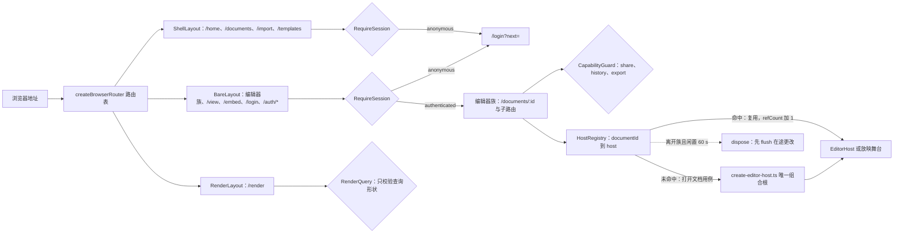
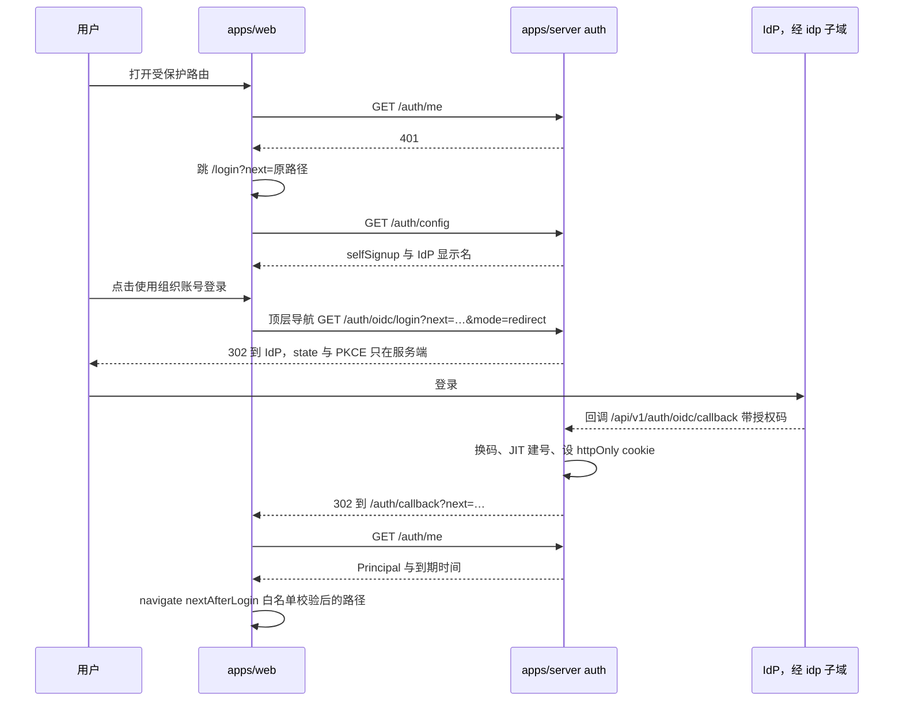
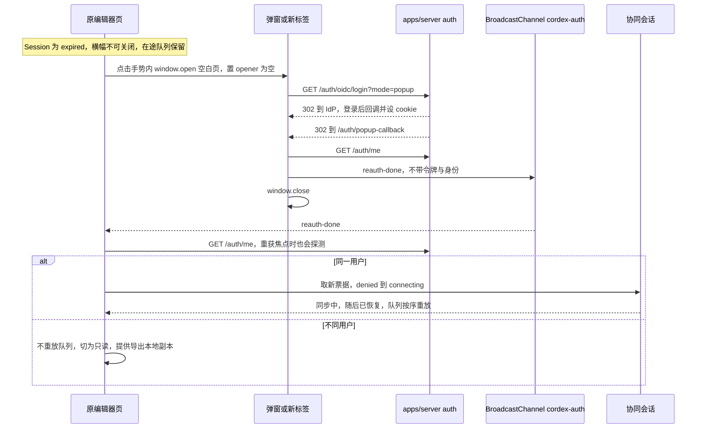
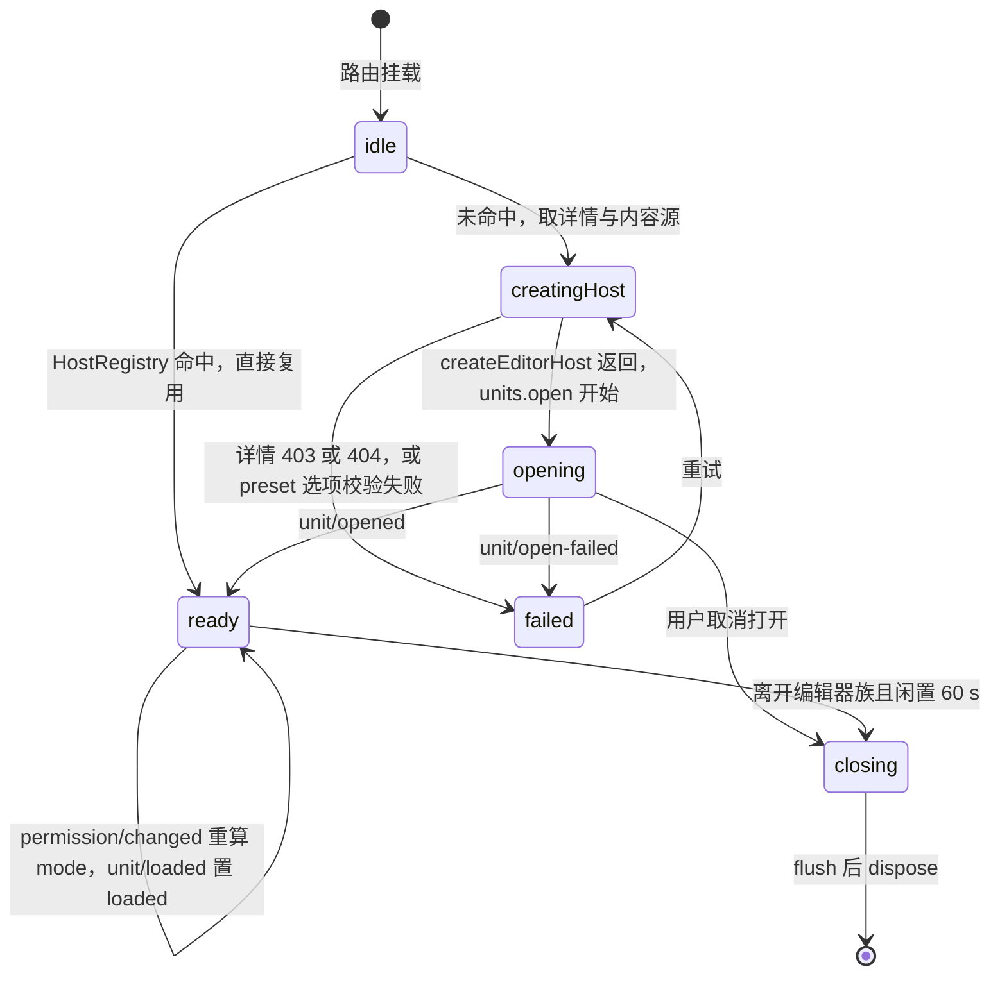
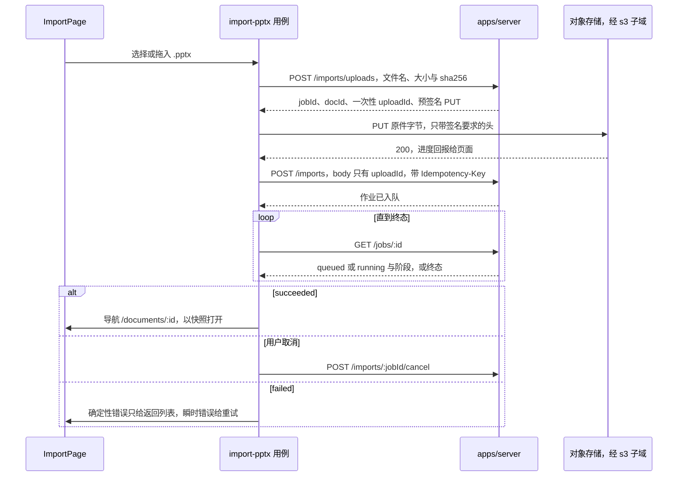
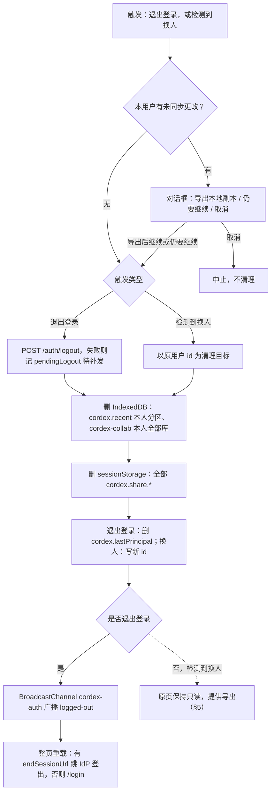
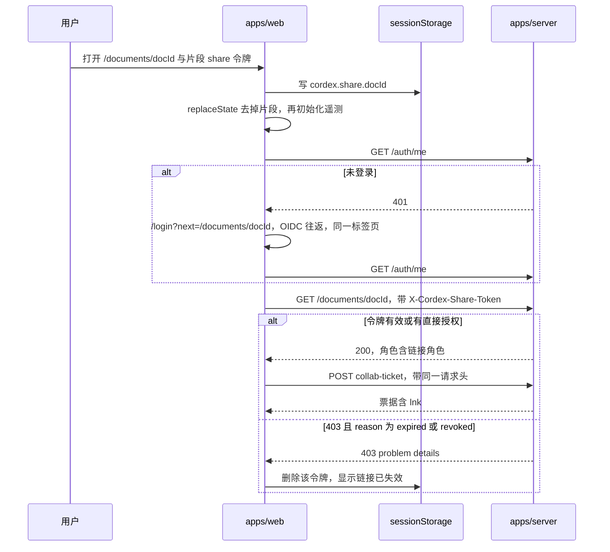

# 02 应用壳、路由与会话
> 状态：v0.1 | 负责：前端设计线 | 更新：2026-09-25；2026-09-25（§4.19） | 依赖：[01 前端总览](01-overview-and-runtime-map.md)、[03 预设装配](03-preset-assembly-and-plugins.md)、[60/02 鉴权链路](../60-backend/02-auth-chain.md)、[60/15 REST API 目录](../60-backend/15-rest-api-catalog.md)、[40/11 预设装配与应用壳](../40-modules/11-preset-assembly-and-app-shell.md)、[30/02 §3.1](../30-architecture/02-layering-and-packages.md)、[30/06 §18.3](../30-architecture/06-collaboration.md)、[ADR-0029](../30-architecture/adr/0029-gateway-authorization.md)、[rulings](../00-charter/rulings-2026-09-14.md) §4.12 U-04/U-16、§4.15 Q6、§4.18 UX-02/UX-03/UX-19/BE-01/BE-10/BE-11、§4.19 D-M2-CONTENT、[PRD 08 应用壳](../10-prd/03-features/08-app-shell.md) AS-01…AS-06

本文是 `apps/web` 应用壳在浏览器一侧的唯一事实源：路由表、运行时配置、会话状态机与浏览器侧 OIDC 回环、新窗口重新登录、编辑器页状态与 host 保活、REST 客户端统一策略、用例清单、壳页面状态、浏览器存储键空间与清理矩阵、分享链接落地、版本漂移。

**本文不写**（只链接）：服务端 OIDC、cookie、CSRF 校验与票据签发（[60/02](../60-backend/02-auth-chain.md)）；REST 路由的守卫、DTO、错误码与限流（[60/15](../60-backend/15-rest-api-catalog.md) §3.1 auth … §3.14 telemetry，本文只引用小节号）；preset 装配运行时与 `create-editor-host` 的内部时序（[03](03-preset-assembly-and-plugins.md)）；查看器、嵌入形态与 `/render` 页（[12](12-viewer-embedding-and-render-page.md)）；协同会话 FSM、离线队列与重连（[07](07-collaboration-client.md)）；CSP 正文与 nonce 链（[14](14-client-security.md)）；事件语义、错误文案与遥测管线（[15](15-events-errors-and-telemetry.md)）；装配清单本体与文件树（[40/11](../40-modules/11-preset-assembly-and-app-shell.md) §3–§5）。

## 1. `apps/web` 的职责与禁区

`apps/web`（L8，dom，`cordex.compositionRoot:true`）是仓库中唯一「知道插件存在」的应用。它只做四件事：**组装**（选 preset、传 options）、**导航**（路由与布局）、**会话**（浏览器侧登录态）、**经 `@cordexjs/protocol` 与服务端通信**。编辑器内部 UI（Ribbon、缩略图栏、检查器、放映舞台、母版视图）全部在 `slide-ui` / `ui-react`，编辑器页只挂 `<EditorHost>`。

| 禁区 | 机制（正式名） | 依据 |
|---|---|---|
| 不定义领域类型与贡献：`defineCommand(`、`defineMutation(`、`defineOperation(`、`defineContributionPoint(`、`ctx.contribute(`、`declare module '@cordexjs/kernel'` | ESLint `no-restricted-syntax`（`apps/**` override）+ depcruise `cordex-apps-only-assemble` | TD-093；rulings §4.18 GV-15 |
| 唯一组合根：`createHost(` 与 `createSlide*Preset(` 只出现在 `src/application/host/create-editor-host.ts` | ESLint `no-restricted-syntax`（同上） | TD-093 |
| 只 import R9 白名单：`@cordexjs/preset-slide*`、`@cordexjs/ui-react`（`EditorHost`、壳组件、`./ui`、`./styles.css`）、`@cordexjs/design`、`@cordexjs/protocol`、`@cordexjs/shared`、`@cordexjs/i18n`、`@cordexjs/kernel`（**值导入仅 `src/application/host/**`**，其余只许 `import type`）、`react`、`react-dom`、`react-router`、tailwind | depcruise `cordex-apps-only-assemble`；ESLint `no-restricted-imports`（禁 `@cordexjs/model-*`、`ooxml-*`、`engine-*`、`render-dom`、`slide-*`、`collab-*`、`store-*`、`yjs`、`cordis`） | rulings §4.18 FE-05、FE-01 |
| 不出现文档类型字面量（`'slide'`/`'doc'`/`'sheet'`），例外仅两个参数化点 `domain/document-type.ts` 与 `application/host/create-editor-host.ts`（内置模板清单挂在 `DOCUMENT_TYPES[*].newCards`，不另设例外文件） | lint `cordex/no-doc-type-literals` 扫描 `apps/web/src/**`，只豁免这两个文件（TD-086 扩展范围，已登记于 [30/09-type-discipline/02](../30-architecture/09-type-discipline/02-lint-rules.md) §4.12；新增文档类型时 `apps/web` 的改动只落在这两个文件，[03](03-preset-assembly-and-plugins.md) §12） | TD-086；[03](03-preset-assembly-and-plugins.md) §12 |
| 不自定义跨进程 DTO：请求与响应类型一律 `z.infer<typeof X>`，`X ∈ @cordexjs/protocol` | 响应体统一在 `infrastructure/api/http.ts` 经 `Schema.parse`（§7，单元测试覆盖）；评审把关 | [40/11](../40-modules/11-preset-assembly-and-app-shell.md) §1.3 |

`src/` 分五个目录：`app/`（路由、布局、守卫、providers、运行时配置）、`pages/`（路由级容器，不持有业务状态）、`application/`（无状态用例，经 `Api`/`Storage`/`Navigate`/`Clock`/`Online` 端口做 IO）、`infrastructure/`（REST 客户端、存储、i18n、嵌入桥、媒体上传默认实现）、`domain/`（视图模型与纯函数，无 IO、无 React）。逐文件清单见 [40/11](../40-modules/11-preset-assembly-and-app-shell.md) §4.4 / §5.4。

## 2. 路由表（唯一源）

路由为 path 形态（`/` 重定向 `/home`），托管层做 SPA fallback；每个页面组件 `React.lazy` 独立 chunk（分包规则见 [13](13-performance-and-bundling.md)）。REST 列只写 [60/15](../60-backend/15-rest-api-catalog.md) 的小节号。

| 路由 | 页面 | 布局 | 守卫 | 主要用例（§8） | REST（60/15） | 里程碑 |
|---|---|---|---|---|---|---|
| `/home` | `home/HomePage` | Shell | RequireSession | 新建、最近与固定、导入入口、指南 | §3.3 | M1（本地夹具）/ M2 |
| `/documents?filter=all\|owned\|shared\|recent\|trashed&q=` | `documents/DocumentsPage` | Shell | RequireSession | 列表、筛选、重命名、移到回收站、分享、永久删除 | §3.3、§3.10 | M2 |
| `/import` | `import/ImportPage` | Shell | RequireSession | 导入 .pptx | §3.9 | M1 本地打开 / M2 服务端导入入库 |
| `/templates` | `templates/TemplatesPage` | Shell | RequireSession | 模板库（AS-03） | 待登记（见 §13.3） | 端点登记后（原计划 M3） |
| `/documents/:id?page=<slideId>&comment=<threadId>` | `editor/EditorPage` | Bare | RequireSession | 打开、导出、分享、版本、放映；**全部角色的入口**（查看者 `mode='view'`） | §3.3、§3.7、§3.8 | M1 / M2 / M3 |
| `/documents/:id/present?page=<slideId>` | `present/PresentPage` | Bare（全屏） | RequireSession | 放映（复用 host） | 无 | M2 |
| `/documents/:id/share` | `share/ShareDialog`（对话框路由） | 继承父路由 | RequireSession + CapabilityGuard(`doc.manage`) | 分享 | §3.4、§3.5、§3.2 | M3 |
| `/documents/:id/history` | `history/VersionHistoryPage`（抽屉页） | Bare | RequireSession + CapabilityGuard(`history.read`) | 版本（行为见 [08](08-comments-and-version-history.md)） | §3.8 | M3 |
| `/documents/:id/export` | `export/ExportDialog`（对话框路由） | 继承父路由 | RequireSession + CapabilityGuard(`doc.export`) | 导出 | §3.9 | M2（pptx）/ M3（PDF、PNG） |
| `/documents/:id/fidelity` | `fidelity/FidelityReportPage`（抽屉页） | Bare | RequireSession | 保真报告（读 `unit/opened` 诊断，无 REST） | 无 | M2 |
| `/documents/:id/plugins` | `plugins/PluginManagerPage`（抽屉页） | Bare | RequireSession | 插件管理器（数据流见 [03](03-preset-assembly-and-plugins.md) §10） | 无 | M2 |
| `/documents/:id/view` | `viewer/ViewerPage` | Bare | RequireSession | **只留给 M1 查看器与嵌入**（[12](12-viewer-embedding-and-render-page.md) §1） | §3.3 | M1 |
| `/embed/:id?mode=view\|edit` | `embed/EmbedPage` | Bare | RequireSession（嵌入规则见 [12](12-viewer-embedding-and-render-page.md) §9） | 形态 E | 同编辑器 | M3 P2 |
| `/settings` | `settings/SettingsPage` | 叠在来路之上 | RequireSession | 设置 | §3.2（资料，M3） | M2 |
| `/login?next=` | `auth/LoginPage` | Bare | 无 | 登录 | §3.1 | M2 |
| `/auth/callback?next=` | `auth/CallbackPage` | Bare | 无 | OIDC 回环落点 | §3.1 | M2 |
| `/auth/popup-callback` | `auth/PopupCallbackPage` | Bare | 无 | 新窗口重新登录回调 | §3.1 | M2 |
| `/render?renderId&…` | `render/RenderPage` | Render | RenderQuery（只校验查询形状，非会话） | headless 渲染（[12](12-viewer-embedding-and-render-page.md) §11） | 无 | M3 |
| `*` | `errors/NotFoundPage`；根 `errors/AppErrorBoundary` | — | — | — | — | M1 |

**深链与 URL 同步**（依据：INC-35，authority：rulings §4.18 UX-19 + 40 > 设计；`/d/{id}` 形式废止，放映参数由 `?slide=` 统一为 `?page=`）：

- `?page=<slideId>`：`unit/opened` 后把视口定位到该页；slideId 不存在时忽略参数、落首页、不报错。
- `?comment=<threadId>`：`unit/opened` 后打开评论面板并定位线程（[08](08-comments-and-version-history.md)）；线程不存在时 toast「评论不存在或已删除」。
- 切页时以 `history.replaceState` 更新 `?page=`（驱动事件是 engine-render `Viewport` 发布的 `view/page-changed`，依据：VIEW-EVENTS），不为每次翻页新增历史记录；从兄弟路由（`/history`、`/present` 等）返回编辑器时按 `?page=` 恢复离开前的页。
- URL 片段 `#share=<token>` 只在分享链接落地时出现，读出后立即去掉（§11）。

### 2.1 布局与守卫

| 名称 | 类型 | 行为 |
|---|---|---|
| `ShellLayout` | 布局 | 224 px 玻璃导航卡（品牌、首页 / 新建 / 我的文档 / 与我共享 / 最近 / 指南、底部账户行）+ 主区 ≤ 1024 px；< 1024 px 折叠为顶部抽屉入口（AS-01） |
| `BareLayout` | 布局 | 全幅；编辑器族、登录、查看器、放映共用；chrome 由 `<EditorHost>` 或页面自己提供 |
| `RenderLayout` | 布局 | 无 chrome、固定视口、只有 `#stage`；不加载 UI 样式与应用 i18n（[12](12-viewer-embedding-and-render-page.md) §11） |
| `RequireSession` | 守卫 | `Session.state` 为 `authenticated` 放行；`unknown` 时渲染骨架并等待探测；`anonymous` 跳 `/login?next=<当前路径与查询>`；`expired` 见 §4.3（编辑器页有未同步更改时不跳转） |
| `CapabilityGuard(cap)` | 守卫 | 读已打开文档的 `DocumentDetail.capabilities`（或 host 内权限服务的当前决策）；缺能力位时不渲染子路由，回到父路由并 toast「需要 … 权限」；能力位名以 protocol `permissions/actions.ts` 为准（含 `history.read` / `history.restore`） |
| `RenderQuery` | 守卫 | 只校验 `RenderPageQuery` 形状；失败调用 `window.__cordex.error` 并停止（[12](12-viewer-embedding-and-render-page.md) §11） |

### 2.2 编辑器族路由与 `HostRegistry`

编辑器族 = `/documents/:id` 及其子路由（`present`、`share`、`history`、`export`、`fidelity`、`plugins`）。`application/host/host-registry.ts` 维护 `documentId → { host, unitId, report, refCount, idleTimer }`：

- 进入族内任一路由 `acquire(documentId)`：命中则复用（`refCount+1`、清闲置计时），未命中走 §8「打开文档」创建。
- 族内切换（如编辑器 → 放映 → 返回）不重建 host；放映页执行 `view.setMode('presenter')` 并以 `<EditorHost mode='view' layout={{ chrome:'none' }} />` 呈现。
- 离开族 `release(documentId)`：`refCount` 归零后闲置 60 s 再 `dispose()`；期间回到族内即取消。`dispose()` 关闭 Unit，协同时先 `Session.leave()`（内含等待 db ack 的 flush，上限 5 s，[07](07-collaboration-client.md) §6、[04](04-document-commands-and-undo.md) §1）。
- 同时保活的 host 上限 2 个（当前文档 + 最近离开的一个）；超出时最早离开的立即 `dispose()`。
- 页面卸载（`pagehide`）不做异步清理；有未同步或未保存更改时由 `beforeunload` 触发浏览器确认框。

**图 1 路由、布局、守卫与 host 保活**

怎么读：从左到右是一次导航的解析顺序；菱形是守卫，边上文字是放行或跳转条件；实线是正常路径，虚线是离开编辑器族后的延迟销毁。`/render` 没有会话守卫，只校验查询形状。

依据：本节 §2.1、§2.2；[40/11](../40-modules/11-preset-assembly-and-app-shell.md) §3.5 接入点表；rulings §4.18 UX-19。

## 3. 运行时配置 `RuntimeConfig`

依据：RUNTIME-CONFIG（authority：40/11 与 40/08 取并集后单一化，规格空白）。`RuntimeConfig` **只放静态部署项**，由 web 容器在启动时从环境变量渲染进 `index.html` 模板（载体与 nonce 口径见 [14](14-client-security.md) §3，渲染时机见 [60/17](../60-backend/17-deployment-and-config.md)）；`src/app/config.ts` 以 `RuntimeConfigSchema`（`strictObject`）`parse`，失败渲染**配置错误页**（静态、内置双语文案、零网络请求）。可变开关不进 `RuntimeConfig`，一律来自 `GET /auth/config`（[60/15](../60-backend/15-rest-api-catalog.md) §3.1）。

| 字段 | 类型与默认 | 说明 |
|---|---|---|
| `apiBase` | URL，`https://<host>/api/v1` | 已含 REST 全局前缀，各端点路径相对它（rulings §4.18 BE-11） |
| `wsBase` | URL，`wss://<host>` | 协同端点 `{wsBase}/collab/v1/rooms/{documentId}`（协议见 [30/06](../30-architecture/06-collaboration.md) §6） |
| `publicUrl` | URL | 对外规范地址；复制分享链接、深链时用它拼接 |
| `storagePublicOrigin` | URL，`https://s3.<域名>` | 预签名直传与直读的源（rulings §4.18 BE-01）；[14](14-client-security.md) 据此写 `connect-src` / `img-src` |
| `auth.mode` | `'oidc'`（默认）\| `'none'` \| `'token'` | `'none'` 只在 dev 构建生效，生产构建 schema 拒绝并渲染配置错误页；`'token'`（集成方签名 JWT）M4 才接受（rulings §4.15 Q6） |
| `externalResources` | `'auto'`（默认）\| `'confirm'` \| `'never'` | 文档内外链图片与媒体的加载策略；CSP 联动见 [14](14-client-security.md) §6 |
| `telemetry` | `{ errorReportsDefault: true; productTelemetryDefault: false; otlp: false }` | 仅为默认值；用户开关存 `Preferences.diagnostics.*`（依据：TELEMETRY-DEFAULT；管线见 [15](15-events-errors-and-telemetry.md) §9） |
| `appVersion` | string | 版本漂移判定（§12）与问题诊断 |
| `brand` | `BrandConfig` | 品牌名、标记、favicon、主色；替换点见 [40/11](../40-modules/11-preset-assembly-and-app-shell.md) §2.2 |
| `features` | `{ embed: boolean; developerMenu: boolean }` | `developerMenu` 与 `import.meta.env.DEV` 取或决定「开发者」菜单（rulings §4.12 U-16）；原 `collab` 开关删除：M2 起服务端文档一律经协同快照打开（rulings §4.19 D-M2-CONTENT），不存在「服务端文档走单人 preset」的部署形态 |
| `embed` | `{ allowedHostOrigins: string[] }`，默认 `[]` | 允许嵌入 `/embed/*` 的宿主源列表，与该路由响应的 `frame-ancestors` 同一份值（空列表即 `'none'`）；postMessage 桥据此校验 `origin`（[12](12-viewer-embedding-and-render-page.md) §9、[14](14-client-security.md) §2、§11）。部署配置键以 [60/17](../60-backend/17-deployment-and-config.md) §5 的 `web.embed.allowedHostOrigins`（环境变量 `CORDEX_WEB_EMBED_ALLOWED_ORIGINS`）为准 |
| `diagnostics` | `{ e2eTrace: boolean }`，默认 `false` | e2e 诊断通道开关：为真时 telemetry Provider 写 `performance.mark` 事件轨迹，`diagnostics.dump()` 在无开发者菜单时也可调用（[15](15-events-errors-and-telemetry.md) §10）；只在 dev 构建与测试部署（e2e 预览服务器、测试 compose 栈）生效，生产部署配置的 schema 拒绝其为真（与 `auth.mode:'none'` 同类约束，部署侧登记在 [60/17](../60-backend/17-deployment-and-config.md) §5） |
| `help` | `{ centerUrl?; releaseNotesUrl?; guides }` | 指南与帮助卡片链接（AS-04） |

**从 `RuntimeConfig` 移出的项**：`auth.selfSignup`、`signupUrl`、IdP 显示名改由 `GET /auth/config` 读取（登录页加载时取一次，页面生命周期内内存缓存）；原 `csp.styleNonce` 删除——nonce 每响应不同，只从 `<meta name="cordex-nonce">` 读取（[14](14-client-security.md) §3）。dev 构建允许 `import.meta.env.VITE_*` 覆盖，生产构建忽略。

## 4. 会话状态机与浏览器侧 OIDC 回环

### 4.1 `Session`（`domain/session.ts`）

`Session = { state; principal?: Principal }`，`Principal` 直接复用 protocol `permissions/principal.ts`。浏览器**不持有** PKCE verifier、IdP 令牌或会话 JWT 明文：会话是服务端下发的 httpOnly cookie（`cordex_session` 内的 JWT 15 min + `cordex_refresh` 7 天轮换，属性与吊销见 [60/02](../60-backend/02-auth-chain.md) §4），浏览器只通过 `GET /auth/me` 得知「我是谁」。浏览器不跟踪会话到期时刻、不做定时续期，续期只由业务请求遇 401 被动触发（§4.2）；`GET /auth/me` 不需要也不新增会话到期字段。

**图 2 应用会话状态机**

怎么读：方框是 `Session.state`，箭头上是触发条件；`refreshing` 遇网络错误不改变登录态，交给协同重连与 30 s 离线计时（rulings §4.18 UX-03）；`expired` 之后经选择节点分流，同一用户与不同用户都回到 `authenticated`，差别在原编辑页如何处置（§5）。

依据：rulings §4.18 UX-02（401 直接进「登录已过期」、只有网络错误走重连）；SESSION（authority：用户偏好「安全宁可提前」+ PRD SV-06/SV-12）；[30/06](../30-architecture/06-collaboration.md) §18.3。

### 4.2 续期与多标签页协调

- **只做被动续期**：任一业务请求返回 401（码为 `server.auth.expired` / `server.auth.invalid_token` / `server.auth.unauthenticated`）→ 调用 `POST /auth/token/refresh`（[60/15](../60-backend/15-rest-api-catalog.md) §3.1）续期一次 → 成功后**重放原请求一次**（SessionGuard 在执行前拒绝，重放不会造成重复副作用）→ 续期仍 401 即 `expired`。不设定时的主动续期：浏览器不知道也不需要会话到期时刻；协同 WS 会话的寿命由票据 `sid` 指向的登录会话承担，不随 15 min 的会话 JWT 到期（[60/02](../60-backend/02-auth-chain.md) §9.5）。
- **单飞与跨标签互斥**：续期在 `navigator.locks.request('cordex-auth-refresh')` 内执行；拿到锁后先 `GET /auth/me`：它返回 200 说明另一标签页已完成续期（cookie 已更新），直接成功、不再调用续期端点，避免轮换刷新令牌被并发使用而误判过期。完成后在 `BroadcastChannel('cordex-auth')` 广播 `{ type:'refreshed' }`。不支持 Web Locks 时退化为页面内单飞 + 失败后探测 `/auth/me` 一次。
- **续期成功之后**：本页有协同会话时，协同客户端随即换一张新票据并发 `CONTROL.auth.refresh{ticket}`，只重新绑定会话（重算角色与链接），不延长期限（[07](07-collaboration-client.md) §8.3）。
- **`classifyAuthError(env)`**：401 → `expired`（`unknown` 态时为 `anonymous`）；403 → `forbidden`（分享令牌失效另见 §11）；网络错误、超时、502/503/504 → `network`（不改变登录态）；403 `server.auth.csrf_rejected` / `server.auth.origin_rejected` 视为部署或客户端缺陷，上报 `error/raised` 并显示通用错误，不跳登录。

### 4.3 过期时的页面处置

- 编辑器页存在未同步更改（协同在途或离线队列）：**不跳转**；发 `app/session-changed{state:'expired'}`，由 `ui-react` 横幅承接「登录已过期 · 重新登录」，横幅在处理前不可关闭（§5）。
- 其余页面（含无未决更改的编辑器页）：跳 `/login?next=<当前路径与查询>`。
- 协同侧的「登录已过期」即 Session 内部 `denied`（投影 `error`），与本节是同一事件的两个观察面（[07](07-collaboration-client.md) §8）。

### 4.4 OIDC 登录回环（浏览器侧）

依据：INC-18（authority：浏览器顶层导航语义 + 用户偏好「不要过度设计」；60 为后端事实源，覆盖 40/08、40/11 的 `POST` 写法，不设 JSON 变体）。

1. `LoginPage` 加载时取 `GET /auth/config`：决定是否显示「注册」（`selfSignup` 为真时跳 IdP 注册页）与 IdP 显示名；已登录访问 `/login` 直接跳 `nextAfterLogin`。
2. 点击「使用组织账号登录」→ 顶层导航 `location.assign({apiBase}/auth/oidc/login?next=<站内路径>&mode=redirect)`；服务端 302 到 `idp.<域名>`（rulings §4.18 BE-01）。
3. IdP 完成认证后回到 `{apiBase}/auth/oidc/callback`，服务端换码、JIT 建号、设 cookie，302 到 `/auth/callback?next=`。
4. `CallbackPage`：`GET /auth/me` → `Session.authenticated` → `navigate(nextAfterLogin(next))`；回调携带失败信息时显示登录失败页（失败形状与码名以 [60/02](../60-backend/02-auth-chain.md) §2–§3 为准，文案走 `errors.<code>`）。
5. `nextAfterLogin(search)` 白名单：必须以单个 `/` 开头（拒 `//`、`/\`、协议与主机）、必须命中 §2 路由表、不得为 `/login`、`/auth/*`、`/render`、`/embed/*`；不合格一律 `/home`。服务端对 `next` 另做同样校验（双重防开放重定向）。
6. `auth.mode:'none'`（仅 dev 构建）跳过 2–4，使用夹具主体直接进 `/home`。

**图 3 OIDC 登录回环（浏览器侧）**

怎么读：纵线是参与方，自上而下是时间顺序；浏览器全程只做顶层导航与 `/auth/me` 探测，授权码、PKCE 与 IdP 令牌都停留在服务端（ADR-0029；[60/02](../60-backend/02-auth-chain.md) §2）。

依据：INC-18；rulings §4.15 Q6、§4.18 BE-01/BE-11；[40/11](../40-modules/11-preset-assembly-and-app-shell.md) §2.5。

## 5. 新窗口重新登录

依据：rulings §4.18 UX-02（用户决策：在弹窗或新标签完成 OIDC，原页不跳转、队列保留）；INC-18（弹窗直接打开同一登录 URL，`mode=popup`）。用例 `application/auth/reauth-in-window.usecase.ts`。

1. **横幅**：「登录已过期，未同步的 N 项更改已保留在本页」+「重新登录」；处理前不可关闭，不遮挡画布阅读。
2. **打开窗口**（必须在点击手势内同步执行）：`const w = window.open('', 'cordex-reauth', 'popup,width=520,height=680')`；`w` 为空即被拦截 → 横幅改为链接「在新标签页中登录」（`target="_blank" rel="noopener"`）；否则立即 `w.opener = null`（切断反向引用），再 `w.location.href = {apiBase}/auth/oidc/login?mode=popup`（`mode=popup` 使服务端回调最终落到 `/auth/popup-callback`，无需 `next`）。
3. **回调页**：`/auth/popup-callback` 调 `GET /auth/me`，在 `BroadcastChannel('cordex-auth')` 广播 `{ type:'reauth-done' }`（消息不带令牌与身份，各页自行探测，[14](14-client-security.md) §8），随后 `window.close()`；关闭失败（新标签情形）显示「已重新登录，可关闭本页」。
4. **原页**：监听广播；同时在 `focus` / `visibilitychange` 时探测 `GET /auth/me`（每 2 s 至多一次），兼容广播不可用与新标签情形。拿到新主体后比对 `isSameReauthPrincipal(before, after)`：
   - **同一用户**：`Session → authenticated`；协同侧取新票据按 `denied → connecting` 重连 → 同步中 → 已恢复，在途队列按原顺序重放（[07](07-collaboration-client.md) §8）；横幅换为 toast「已恢复」。
   - **不同用户**：不重放队列；编辑器切为只读（`EditorHost mode='view'`，协同会话以新身份只读加入或暂停）；横幅改为「当前登录的是另一个账号（X）。未同步的 N 项更改不会以该账号提交」，动作：导出本地副本 / 以原账号重新登录 / 放弃这些更改（二次确认）。三选一之前横幅不可关闭。
5. 其它标签页收到 `reauth-done` 后各自探测 `/auth/me` 并更新 `Session`；主体变化时按 §10 的「检测到换人」清理。

**图 4 新窗口重新登录**

怎么读：自上而下是时间顺序；弹窗被拦截时第二步换成新标签链接，其余步骤不变；`alt` 两支对应 `isSameReauthPrincipal` 的真假。

依据：rulings §4.18 UX-02；[30/06](../30-architecture/06-collaboration.md) §18.3；[60/02](../60-backend/02-auth-chain.md) §12。

## 6. 编辑器页状态 `EditorPageState`

`domain/editor-page-state.ts` 是纯 reducer，页面只由用例结果与转发的 `unit/*` 事件驱动（事件语义见 [15](15-events-errors-and-telemetry.md)）。

| 状态 | 持有数据 | 进入条件 | 界面 |
|---|---|---|---|
| `idle` | `documentId` | 路由挂载 | 无（瞬时） |
| `creatingHost` | `detail?` | 取 `DocumentDetail` 与内容源、调用 `createEditorHost` | 全屏骨架 |
| `opening` | `progress{stage, ratio}` | `units.open` 进行中（`unit/open-progress`） | 阶段化进度（设计 13），可取消 |
| `ready` | `host, unitId, report, role, mode, loaded, saveState` | `unit/opened` | `<EditorHost>`；`unit/loaded` 前全文命令等待或禁用（rulings §4.18 CO-12） |
| `failed` | `code, stage` | 详情 403/404、`PRESET_INVALID_OPTIONS`、`unit/open-failed` | 按错误码的失败页（文案 `errors.<code>`），「重试」「返回首页」 |
| `closing` | — | 离开编辑器族且闲置到期 | 无；先 flush 再 `dispose()` |

**角色 → `EditorHost.mode`**：`owner` / `editor` → `edit`；`commenter` → `review`；`viewer` → `view`（查看者进 `/documents/:id` 协同编辑器只读变体，计入查看者名额，rulings §4.18 UX-19；界面差异见 [10](10-editor-shell-and-interaction.md) §3）。`permission/changed` 到达后按新角色重算 `mode`，不重建 host。

**preset 选择**：用例只选文档类型无关的 preset 键 `edit` / `collab` / `view`，由 `DOCUMENT_TYPES[documentType].presetKeys` 映射到具体工厂（[03](03-preset-assembly-and-plugins.md) §5、§12），因此本页不出现文档类型字面量。本地文档（`local:*`）→ `edit`；服务端文档自 M2 起一律 → `collab`：内容以协同快照为唯一事实源，打开 = `GET snapshots/latest` + collab-ticket + WS（`source:'state'`，不走 Worker 字节路径，rulings §4.19 D-M2-CONTENT、§4.18 CO-12）；M3 起查看者同样走协同 preset，只读由权限决定；`/documents/:id/view` 与 `/render` → `view`。

**图 5 EditorPageState**

怎么读：方框是页面状态，箭头上是触发条件；`ready` 的自环表示角色变化与分批装载完成只改标志、不重建 host；从 `idle` 直达 `ready` 是 `HostRegistry` 保活命中。

依据：[40/11](../40-modules/11-preset-assembly-and-app-shell.md) §2.1；rulings §4.18 UX-19、CO-12；§2.2。

## 7. REST 客户端统一策略

`infrastructure/api/http.ts` 是 `apps/web` 唯一的 `fetch` 封装，`*.api.ts` 按 protocol `rest/*` 文件分组（文件清单依据：INC-11/INC-13，由 M-02 登记）。所有用例经它访问 `apiBase`；对 `storagePublicOrigin` 的预签名直传另走 `infrastructure/api/direct-upload.ts`，不复用本封装的头。

| 规则 | 内容 |
|---|---|
| parse, don't validate | 成功响应一律 `Schema.parse(body)`；解析失败按「协议不符」处理：上报 `error/raised`、显示通用错误，不把未校验数据交给用例 |
| 错误信封 | 非 2xx 解析 problem+json（protocol `rest/problem.ts`），转为客户端视图 `ErrorEnvelope{ code, detail, traceId, retryable, details? }`；HTTP ↔ 码映射只读 `errors/http-map.ts`，不在应用内另写表 |
| 超时 | JSON 请求 15 s；字节下载按进度判停滞，15 s 无新字节即中止；直传上传 30 s 无进度即中止；全部可由调用方 `AbortSignal` 提前中止（离开路由即中止） |
| 自动重试 | 只对 `GET` / `HEAD`，以及携带 `Idempotency-Key` 的请求（导入、创建副本、导出、render-export，见 [60/15](../60-backend/15-rest-api-catalog.md) §1，重试沿用同一键）：网络错误、502/503/504、429 时最多 2 次，退避 500 ms × 2ⁿ ±20%，429 遵守 `Retry-After`；其余非安全方法从不自动重试，失败交界面给「重试」 |
| 401 | 按 §4.2 续期一次并重放原请求一次；仍 401 → `expired` |
| 403 | `permission.denied` 且 `details.reason ∈ { share_link.expired, share_link.revoked }`（[60/02](../60-backend/02-auth-chain.md) §7.4）→ 分享链接失效流程（§11）；其余交页面按上下文处理（守卫回退、toast 或 403 页） |
| 缓存 | 不引入数据请求库（依据：APP-DATA，authority：用户偏好「不要过度设计」）；缩略图与快照字节交浏览器 HTTP 缓存，由服务端 `ETag` / `Cache-Control` 驱动条件请求（304），客户端不自建字节缓存；列表类数据的内存缓存见 §9.5 |
| 凭据 | `credentials: 'same-origin'`（`apiBase` 与应用同源）；从不在 URL 放令牌 |
| CSRF 头 | 所有非安全方法（`POST` / `PUT` / `PATCH` / `DELETE`）附 `X-Cordex-Request: 1`（依据：INC-24，authority：PRD SV-12 + 安全宁可提前；头名由 [60/02](../60-backend/02-auth-chain.md) §5 定义） |
| 分享令牌头 | sessionStorage 存在 `cordex.share.{docId}` 时，只对路径以 `/documents/{docId}` 开头的请求（含 `POST /documents/{docId}/collab-ticket`）附 `X-Cordex-Share-Token`；其它文档、其它端点、直传与第三方源一律不带（依据：INC-25） |
| 追踪头 | OTel 开启时附 `traceparent`（[15](15-events-errors-and-telemetry.md) §7） |
| 直传隔离 | 发往 `storagePublicOrigin` 的 `PUT` 只带预签名 URL 与签名要求的 `Content-Type`，不带 cookie、`X-Cordex-*` 与 `traceparent`；媒体读取与导出下载先经本封装取 `{url}`（可带分享令牌头），再对该预签名 URL 以 `credentials:'omit'`、无自定义头发 `GET` |

## 8. 用例清单

用例是 `application/**/*.usecase.ts` 中的无状态函数，经端口注入 IO；REST 列只写 [60/15](../60-backend/15-rest-api-catalog.md) 小节号，守卫、DTO 与错误码以该文为准。

| 用例 | 触发 | REST（60/15） | 结果与导航 | 里程碑 |
|---|---|---|---|---|
| 会话探测 / 续期 / 登出 | 启动、`RequireSession`、账户菜单「退出登录」 | §3.1 | §4、§10.2 | M2 |
| 新窗口重新登录 | 过期横幅 | §3.1 | §5 | M2 |
| 打开文档 | 最近、文档卡、深链 `/documents/:id` | §3.3 详情；§3.8 `snapshots/latest` 与 §3.7 票据，随后 WS | `HostRegistry.acquire` → `EditorPageState`；本地文档（`local:*`）以 `bytes` 打开 | M1（本地）/ M2 |
| 新建（空白 / 内置模板） | 开始页「新建」卡（AS-01） | §3.9 两步导入 + `GET /jobs/:id` | 空白与内置 4 套模板都是同源静态 .pptx 资源：按需取模板字节 → 走与「导入 .pptx」相同的两步导入（服务端生成 import 快照）→ 作业成功后导航 `/documents/:id` 以快照打开；受理到成功之间「新建」卡显示「正在创建…」，不在文档列表生成占位卡（rulings §4.18 UX-14） | M2 |
| 导入 .pptx | 开始页「导入」卡、文档列表按钮、`/import` 拖放 | M1：无（本地打开）；M2 起：§3.9 两步导入 + `GET /jobs/:id` + 取消 | 流程见图 6；成功后导航 `/documents/:id`；失败态全集见设计 13 | M1 / M2 |
| 导出 | 「⋯ → 导出…」、`Mod+E` | pptx：无（客户端 `core.export`）；PDF / PNG：§3.9 `POST /documents/:id/export` → `GET /jobs/:id` → `GET /exports/:jobId` 取 1 h 下载 URL | 导出对话框（设计 22）；「等待同步」口径见 rulings §4.18 UX-05 | M2 / M3 |
| 最近与固定 | 开始页「最近」段、卡片菜单 | §3.3：列表、`PUT` / `DELETE /documents/:id/pin`、`DELETE /documents/:id/recent` | 「从最近移除」先乐观隐藏、toast 5 s 可撤销，到期才发 `DELETE`（撤销即取消请求，无需「加回」端点）；页面卸载前未到期的以 `fetch keepalive` 发出 | M2（服务端同步，rulings §4.12 U-04） |
| 列表、筛选、重命名、移到回收站、恢复 | `/documents` 与卡片「⋯」 | §3.3 | 虚拟滚动追加；重命名内联乐观更新，失败回滚 | M2 |
| 创建副本 | 卡片「⋯」、应用栏「⋯」 | §3.3 `POST /documents/:id/duplicate`（`doc.export`，带 `Idempotency-Key`，重试沿用同一键）→ `GET /jobs/:id` | 响应 `{docId, jobId}`；按图 6 的轮询节奏查询作业，成功后导航新文档 `/documents/{docId}`，失败 Toast 并可重试；来源文档有未同步项时先 `Session.flush()`（副本取服务端当前状态） | M2 |
| 永久删除文档 | 回收站卡片、owner 的「⋯」 | §3.3 `POST /documents/:id/purge` → `GET /jobs/:id` | 强确认（输入文档名）；受理后从列表移除，作业进度只在回收站视图显示 | M3 |
| 分享 | 应用栏「分享」、卡片「分享」 | §3.4、§3.5、§3.2（用户检索 ≥ 2 字符） | 分享对话框（设计 08）；复制链接用 `publicUrl` 拼 `/documents/{docId}#share={token}` | M3 |
| 版本 | 「⋯ → 版本历史」 | §3.8 | 行为见 [08](08-comments-and-version-history.md) §9–§10 | M3 |
| 设置 | 账户菜单「设置」、`Mod+,` | M3 起资料 §3.2 | `Preferences` 写 `cordex.prefs` → `app/preferences-changed` → host 同步 locale / theme / density | M2 |
| 放映 | 模式下拉「放映」、`F5` | 无 | `/documents/:id/present`，复用 host | M2 |
| 媒体上传（编辑器内插图） | preset `options.media.upload` 回调 | §3.6 | `apps/web` 默认实现的行为见 [05](05-rendering-and-thumbnails.md) §8（依据：MEDIA-CLIENT） | M2 |
| headless 渲染 | renderer 打开 `/render` | 无 | [12](12-viewer-embedding-and-render-page.md) §11 | M3 |

**服务端文档的内容**（依据：rulings §4.19 D-M2-CONTENT，覆盖 INC-37 的 M2 / M3 分界）：M2 起以协同快照为唯一事实源，没有 pptx 内容版本端点，也没有「保存」用例——持久化由协同网关与服务端快照负责，编辑器只显示会话状态（[04](04-document-commands-and-undo.md) §8.3、[07](07-collaboration-client.md) §3）。新建、导入、创建副本都先在服务端生成 import 快照，再按「打开文档」进入编辑器。`source:{kind:'bytes' | 'empty'}` 只用于本地文档（`local:*`）与 M1 查看器；本地文档的保存语义见 [04](04-document-commands-and-undo.md) §8.1。

**图 6 两步导入直传（M2 起入库，新建空白与模板同路径）**

怎么读：自上而下是时间顺序；客户端从不提交对象键，只凭服务端签发的 `uploadId` 关联原件（rulings §4.18 BE-10）；状态查询只用 `GET /jobs/:id`（依据：SG-08，authority：用户偏好「不要过度设计」+ 30/08 §7 `job_runs` 统一），不再使用 `GET /imports/:jobId`。轮询间隔：前 10 s 每 1 s，之后每 2 s，页面不可见时每 5 s；「重试」即重新走一遍完整导入（设计 13）。

依据：rulings §4.18 BE-10、UX-14；SG-08；[60/06](../60-backend/06-modules-jobs-import-export-thumbnails.md) §6。

## 9. 壳页面的状态

外观与文案以设计 29（开始页）、01（文档列表）、13（导入进度）、23（设置）与 playground 为准；本节只定状态、数据来源与降级行为。

### 9.1 开始页 `/home`（AS-01、AS-02、AS-04）

| 状态 | 条件 | 表现 |
|---|---|---|
| `loading` | 最近列表请求未返回且超过 300 ms | 最近段 `Skeleton` 四行；新建与指南段立即可用 |
| `ready` | 列表返回 | `mergeRecent(本地缓存, 服务端)`：以 `documentId` 去重、固定优先、其后按打开时间降序、取 5 条 |
| `empty` | 最近为空 | 空态（图标 + 引导文案 + 新建按钮），指南段承担引导（AS-05） |
| `offline` | `OnlineState` 为 `offline` | 顶部 warning 横幅；新建 / 模板 / 导入卡禁用并 tooltip「离线时不可用」；最近条目来自 IndexedDB 缓存，仅 `HostRegistry` 中仍保活的文档（及 M4 P2 离线库中有状态的文档）可打开，其余置灰 |
| `error` | 列表请求失败且无缓存 | 最近段内联错误 +「重试」，其余两段不受影响 |

性能：开始页可交互 ≤ 1.0 s（p75，已登录、列表 ≤ 50 条），测量标记见 [13](13-performance-and-bundling.md) §2。

### 9.2 文档列表 `/documents`

- 筛选 `?filter=all|owned|shared|recent|trashed`（`trashed` 即回收站视图，只列本人为 owner 的文档，[60/15](../60-backend/15-rest-api-catalog.md) §3.3）、搜索 `?q=`（输入去抖 300 ms、服务端检索）都写进 URL，刷新与返回可恢复。
- 游标分页 + 虚拟滚动；滚到底前 1 屏预取下一页。
- 状态：`loading`（卡片骨架）/ `ready` / `empty`（按筛选区分文案）/ `no-results` / `error`（「重试」）/ `offline`（显示缓存列表，写操作禁用）。
- 卡片动作：内联重命名（乐观更新，失败回滚并 toast）、分享、移到回收站（乐观淡出 + 可撤销 toast，撤销调用恢复端点）、永久删除（仅回收站视图，M3）。
- 封面：M2 为导入处理器写入的 embedded 封面（取自导入原件的包内 `docProps/thumbnail.jpeg`，`thumbnailProvisional=true`；空白文档与包内无封面的文档显示占位），M3 起为服务端 640 px WebP（§3.10），两者都经 `GET …/thumbnails/__cover`；列表卡片不在文档页内、只列有直接授权的文档，直接以 `` 引用该同源端点（不需要分享令牌头，[14](14-client-security.md) §9），由浏览器 HTTP 缓存按 ETag 复用（rulings §4.15 Q8）。

### 9.3 导入页 `/import`

阶段依设计 13：选择文件 → 上传中（字节进度）→ 服务端解析（作业 `queued` / `running`，不确定进度）→ 快照打开（一次装载，不经 Worker 分批）→ 编辑器。M1 只有本地打开（Worker 渐进打开，`unit/open-progress`），没有上传与服务端解析两段；M2 起四段齐全（rulings §4.19 D-M2-CONTENT）。取消：上传中中止直传；服务端解析中调用取消端点并回文档列表。不在文档列表生成「上传中」卡片（rulings §4.18 UX-14）。

### 9.4 设置页 `/settings`

`ui-react` 的 `SettingsDrawer` 独立态；关闭 = 保存并返回来路（无来路回 `/home`）。设置唯一入口是账户菜单（AS-06）。`Preferences` 含主题、密度、语言、单位、自动保存间隔、智能参考线、粘贴默认、通知偏好，以及 `diagnostics.errorReports`（默认开）与 `diagnostics.productTelemetry`（默认关）两个开关（依据：TELEMETRY-DEFAULT，authority：30/10 §5 与 PRD NF-11 / PD-10 分属两类）。

### 9.5 数据获取与在线状态

- **不引入数据请求库**（依据：APP-DATA）：用例层 + 轻量内存缓存 `infrastructure/api/query-cache.ts`，键 = 用例名 + 规范化参数；读时先返回缓存（stale-while-revalidate），挂载与窗口重获焦点时后台刷新（同键 30 s 内不重复刷新）；重命名 / 移到回收站 / 固定为乐观更新，失败回滚并 toast；写操作成功后使相关键失效；缓存只在内存，登出随整页重载清空。
- **`OnlineState`**：`navigator.onLine === false` 立即 `offline`；业务请求出现网络错误时进入「疑似离线」，以 `GET /auth/config`（公开、轻量）每 30 s（±20%）探测一次，成功即 `online`；编辑器页以协同 `SyncState` 为准（[07](07-collaboration-client.md) §3），不重复探测。

## 10. 浏览器存储键空间与清理

### 10.1 键空间总表（[14](14-client-security.md) §10 引用本表）

| 键 | 介质 | 内容 | 隔离 | 寿命 | 登出 | 检测到换人 | 事实源 |
|---|---|---|---|---|---|---|---|
| `cordex.prefs` | localStorage | `Preferences`（schema 校验，损坏回默认） | 设备 | 持久 | 保留 | 保留 | 本文 §9.4 |
| `cordex-theme` | localStorage | 首屏前读取的主题值（防闪烁） | 设备 | 持久 | 保留 | 保留 | [09](09-ui-system-and-theming.md) §3 |
| `cordex.layout.{unitType}` | localStorage | 编辑器面板宽度等布局记忆 | 设备 | 持久 | 保留 | 保留 | [10](10-editor-shell-and-interaction.md) §2 |
| `cordex.lastPrincipal` | localStorage | 上次登录用户 id（只用于换人检测） | 设备 | 持久 | 删除 | 覆盖为新 id | 本文 |
| `cordex.pendingLogout` | localStorage | 登出请求未送达的标记（§10.2） | 设备 | 至补发成功或重新登录 | 登出失败时写入 | 删除（新 cookie 已覆盖旧会话） | 本文 §10.2 |
| `cordex.recent` | IndexedDB，库内按 `userId` 分区 | 最近与固定的离线缓存（≤ 50 条） | 用户 | 持久 | 删除本人分区 | 删除原用户分区 | 本文 §9.1 |
| `cordex.share.{docId}` | sessionStorage | 分享令牌 | 标签页 × 文档 | 标签页关闭即失 | 全部删除 | 全部删除 | 本文 §11 |
| `cordex-collab/{userId}/{documentId}` | IndexedDB（`collab-offline-idb`，M4 P2 前默认关） | 离线更新队列与状态 | 用户 × 文档 | 30 天 TTL | 删除本人全部库（有未同步项先提示导出） | 删除原用户全部库（同左） | [07](07-collaboration-client.md) §7 |
| `cordex-auth`、`cordex-offline` | BroadcastChannel | `refreshed` / `reauth-done` / `logged-out` 消息（不带令牌与身份）；离线库在无 Web Locks 时的持库协商 | 同源 | 不持久 | — | — | 本文 §4–§5；[07](07-collaboration-client.md) §7 |
| `cordex-auth-refresh`、`cordex-offline:{userId}:{documentId}` | Web Locks | 续期互斥；离线库独占（依据：OFFLINE-TABS） | 同源 | 持锁期间 | 释放 | 释放 | 本文 §4.2；[07](07-collaboration-client.md) §7 |
| 内存：查询缓存、媒体 blob URL、协同票据 | 内存 | — | 页面 | 页面生命周期 | 整页重载清空 | 整页重载清空 | §9.5；[05](05-rendering-and-thumbnails.md) §8 |
| `cordex_session`、`cordex_refresh` | httpOnly cookie | 会话（浏览器不可读） | — | 15 min / 7 天 | 服务端清除 | 服务端覆盖 | [60/02](../60-backend/02-auth-chain.md) §4 |

「检测到换人」的三个来源：新窗口重新登录回来是另一用户（§5）、`GET /auth/me` 返回的 id 与 `cordex.lastPrincipal` 不同（例如在别处登出后换号登录）、其它标签页广播 `logged-out` 后本页重新登录为另一用户。

### 10.2 登出与换人的清理流程

1. 账户菜单「退出登录」→ 检查本用户是否有未同步项（协同在途与离线队列）；有则对话框「有 N 项更改尚未同步，退出将丢弃」，动作：导出本地副本 / 仍要退出 / 取消。
2. `POST /auth/logout`（§3.1，带 `X-Cordex-Request`）；无论成功与否继续本地清理。失败（如离线）时 httpOnly cookie 无法由脚本清除，而会话 cookie 与 refresh cookie 最长 7 天有效（[60/02](../60-backend/02-auth-chain.md) §4.1），不会自行失效：因此写 `cordex.pendingLogout`，下次联网或应用启动时先补发 `POST /auth/logout`、成功后删除标记；标记存在期间 `RequireSession` 按 `anonymous` 处理，重新登录成功即删除标记。
3. 按 §10.1「登出」列清理；在 `cordex-auth` 广播 `{ type:'logged-out' }`，其它标签页收到后执行同样清理并跳 `/login`。
4. 以整页重载清空内存：`POST /auth/logout` 返回 200 且带 `endSessionUrl` 时 `location.replace(endSessionUrl)`（RP-initiated logout，由服务端按 IdP 发现文档的 `end_session_endpoint` 拼好，IdP 结束单点登录会话后回跳前端 `/login`，[60/02](../60-backend/02-auth-chain.md) §4.4、[60/15](../60-backend/15-rest-api-catalog.md) §3.1）；不带 `endSessionUrl`（IdP 不支持）或请求失败时 `location.replace('/login')`（AS-06）。

嵌入场景（形态 A / E）不走本流程：调用集成方的登出回调，未配置时提示「由宿主应用管理登录」（AS-06）。

**图 7 登出与换人的本地数据清理**

怎么读：自上而下是清理顺序；菱形是分支判断；实线走到底是退出登录的完整路径，虚线是换人时不跳转、停在原页。设备级偏好（主题、布局、偏好设置）两种情形都保留。

依据：本节 §10.1；[14](14-client-security.md) §10；rulings §4.18 UX-02。

## 11. 分享链接落地

依据：INC-25（authority：ADR-0029 否决 API 上的 URL 令牌 + rulings §4.18 UX-19 + BE-02）与 INC-20（authority：ADR-0029 > 30 正文 > 40）。分享始终要求登录，不做匿名（rulings §4.13 S-1、§4.15 Q6）。

1. **URL 形态**：`{publicUrl}/documents/{docId}#share={token}`。令牌在片段里，不进入请求行、`Referer` 与任何访问日志；全站 `Referrer-Policy: strict-origin-when-cross-origin`（[14](14-client-security.md) §8）。
2. **读取并去掉片段**：`main.tsx` 在创建路由之前执行 `captureShareFragment()`——路径匹配 `/documents/{docId}` 且片段为 `share=<base64url>` 时写 sessionStorage `cordex.share.{docId}`，随即 `history.replaceState` 去掉片段；此步先于错误上报与遥测初始化，保证上报的 URL 不含令牌。
3. **未登录**：`RequireSession` 跳 `/login?next=/documents/{docId}`（`next` 不含片段）；OIDC 往返是同一标签页的顶层导航，sessionStorage 中的令牌得以保留。登录页检测到存在 `cordex.share.*` 且 `selfSignup` 关闭时显示「没有账号？请联系管理员开通」。
4. **携带**：打开文档时 `GET /documents/{docId}` 与 `POST /documents/{docId}/collab-ticket` 附 `X-Cordex-Share-Token`；服务端把链接角色折叠进响应角色与票据 `lnk` claim，WS 侧按 `lnk` 重算与到期降权（[60/02](../60-backend/02-auth-chain.md) §7–§9；[07](07-collaboration-client.md) §8）。
5. **失效**：`403` 且 `details.reason ∈ { share_link.expired, share_link.revoked }`（[60/02](../60-backend/02-auth-chain.md) §7.4）→ 删除该令牌，显示「链接已失效，请向文档所有者索取新链接」；无 `reason` 的 `403` → 「无权访问此文档」；`404` → 不存在页。已登录用户携带无效令牌但另有直接授权时服务端直接放行（无效令牌直通、不叠加），界面无提示。
6. **范围**：令牌只随该 `docId` 的请求发送（§7）；新标签页打开同一去片段 URL 不继承令牌（设计如此）；关闭标签页即失效。

**图 8 分享链接落地**

怎么读：自上而下是时间顺序；令牌只在片段与 sessionStorage 中出现，发往服务端只经请求头；两个 `alt` 分别是「是否需要先登录」与「令牌是否有效」。

依据：INC-25、INC-20；ADR-0029 决策 6 与 2026-09-25 修订；[60/02](../60-backend/02-auth-chain.md) §7。

## 12. 版本漂移

依据：VERSION-DRIFT-SW（authority：ADR-0033 否决 Service Worker 增量持久化 + PRD CO-06）。

- **缓存口径**：`index.html` 为 `Cache-Control: no-store`，`/assets/*` 带内容哈希且 `immutable` 一年（由 web 容器下发，[60/17](../60-backend/17-deployment-and-config.md)）。
- **检测**：① 惰性 chunk 加载失败（动态 `import()` 拒绝）→ 1 s 后重试一次，仍失败即判定漂移；② 协同关闭码 4426（客户端需升级）或 4427（协议不兼容）（[30/06](../30-architecture/06-collaboration.md) §6.5，行为见 [07](07-collaboration-client.md) §9）。
- **表现**：横幅「发现新版本，刷新后继续」。点击刷新时：协同会话有在途更改先 `Session.flush()`（最长 10 s）；离线或仍有未同步项则提示「有 N 项更改尚未同步，刷新将丢失」并提供导出本地副本（会话内队列刷新即丢失，PRD CO-06）；随后 `location.reload()`。
- 编辑器内的惰性件（图表渲染器、语言包）加载失败不导致崩溃：元素保持占位，同时出现上述横幅（[03](03-preset-assembly-and-plugins.md) §4）。
- **M1–M4 不引入 Service Worker**（登记为决定）。

## 13. 机械验证与里程碑

### 13.1 机械验证

本节只写断言；测试层级、夹具与执行方式归 [70/06](../70-testing/06-frontend-component-and-e2e.md)、[70/10](../70-testing/10-security-testing.md)，CI 步骤名以 [70/12](../70-testing/12-ci-gates-mapping.md) 为准。

| 断言 | 机制 | 执行点（CI 步骤） |
|---|---|---|
| `apps/web` 只 import R9 白名单，`kernel` 值导入只在 `application/host/**` | depcruise `cordex-apps-only-assemble` | `depcruise` job |
| 无领域定义；`createHost(` / `createSlide*Preset(` 只在 `create-editor-host.ts` | ESLint `no-restricted-syntax`（`apps/**` override） | `lint` job |
| 文档类型字面量只在两个参数化点文件（§1） | lint `cordex/no-doc-type-literals` 扫描 `apps/web/src/**`（TD-086 扩展范围，已登记） | `lint` job |
| `nextAfterLogin`：`//evil`、`/\evil`、`https://…`、`/auth/callback`、`/render`、未登记路径全部落 `/home` | `domain/routes.test.ts` | `test/unit` |
| `classifyAuthError`：401 → expired、网络错误不改登录态、`csrf_rejected` 不跳登录 | `domain/session.test.ts` | `test/unit` |
| 续期单飞：两个标签页并发 401 只调用一次续期端点，另一方经 `/auth/me` 成功 | `infrastructure/session-client.test.ts`（假 Web Locks） | `test/unit` |
| 非安全方法必带 `X-Cordex-Request`；分享令牌头只随同一 `docId` 的请求；直传 `PUT` 不带任何 `X-Cordex-*` 与 cookie；只对 `GET` / `HEAD` / 带幂等键的请求自动重试 | `infrastructure/http.test.ts` | `test/unit` |
| `EditorPageState` reducer 全部迁移；viewer 角色 → `mode='view'` | `domain/editor-page-state.test.ts`、`open-document.usecase.test.ts` | `test/unit` |
| 片段令牌被读入 sessionStorage 且地址栏不再含片段；错误上报初始化时 URL 已无片段 | `share-landing.test.ts` + e2e 分享链接落地 | `test/unit`、`e2e/smoke` |
| OIDC 登录回环（mock IdP 与 Casdoor 两套）→ `/home` | e2e `login-oidc-mock`、`login-casdoor` | `e2e/smoke` |
| 编辑中过期 → 横幅不可关闭 → 弹窗重新登录：同一用户重连且队列保留；不同用户只读、不重放 | e2e 重新登录（UX-02） | `e2e/full-compose` |
| 跨源 `POST` 与缺 `X-Cordex-Request` 的 `POST` 被 403 | e2e CSRF（与 [70/10](../70-testing/10-security-testing.md) §6 同一用例） | `e2e/smoke` |
| 登出后本人 IndexedDB 分区、离线库与全部 `cordex.share.*` 为空；其它标签页同步跳登录；离线登出后恢复联网，第一条请求是补发的 `POST /auth/logout`，之后 `/auth/me` 为 401；登出响应带 `endSessionUrl` 时整页跳往该地址，否则到 `/login` | e2e 登出清理 | `e2e/full-compose` |
| 惰性 chunk 404 → 横幅「发现新版本」，不崩溃 | e2e 版本漂移（拦截 chunk 请求） | `e2e/full-compose` |
| 服务端文档以 `snapshots/latest` + 票据 + WS 打开（不请求任何 pptx 字节端点）；新建空白 / 模板与导入都经两步导入与 `GET /jobs/:id` 后进入编辑器；创建副本轮询作业后导航新文档 | e2e 打开与新建（协同模式 harness，[70/06](../70-testing/06-frontend-component-and-e2e.md) §4.3） | `e2e/full-compose` |
| 开始页可交互 ≤ 1.0 s p75 | `performance.mark`（[13](13-performance-and-bundling.md) §2） | `perf/perf-client` |
| 开始页、列表、设置、登录页 axe 零严重违规 | e2e a11y | `e2e/a11y` |

### 13.2 里程碑

| 里程碑 | 本文范围 |
|---|---|
| M1 | 路由骨架、`/home`（本地夹具）、`/documents/local:*` 以 `bytes` 打开、`/documents/:id/view`、`/import`（本地打开）；`auth.mode:'none'` 仅 dev；`RuntimeConfig` schema 与配置错误页；R9 / 唯一组合根门禁上线 |
| M2 | OIDC 登录回环、被动续期与跨标签互斥、新窗口重新登录、登出清理矩阵与 RP-initiated logout；`/documents` 列表与最近 / 固定服务端同步（U-04）；**服务端文档以协同快照打开（`collab` preset）、新建空白 / 内置模板与导入经服务端两步导入与 `GET /jobs/:id`、创建副本、列表 embedded 封面、媒体上传默认实现**（rulings §4.19 D-M2-CONTENT）；设置、保真报告、插件管理器、放映、pptx 导出；REST 客户端全部规则（含 CSRF 头）；版本漂移横幅 |
| M3 | 查看者只读变体（UX-19）、分享链接落地、版本历史、PDF / PNG 导出、永久删除文档、模板库页（端点登记后）、`/render`（[12](12-viewer-embedding-and-render-page.md)）、`/embed/:id`（P2） |
| M4 | `auth.mode:'token'`；离线库启用（P2）与多标签页独占 |

### 13.3 未决与回写

| 项 | 状态 | 处理 |
|---|---|---|
| 模板新建的服务端端点 `POST /documents{template}`、`GET /templates`（盘点 restPending） | 未在 60/15 登记 | M2 内置模板为同源静态资源、经服务端两步导入入库（§8），不依赖服务端模板端点；模板库页在 60/15 登记前不渲染入口 |
| 登出响应是否下发 `Clear-Site-Data: "cache"` | 建议 | 只取 `"cache"` 类型（不含 `"storage"`，[14](14-client-security.md) §10 不用的是清存储的形态），可清掉浏览器 HTTP 缓存中的缩略图与快照；是否采用由 [60/02](../60-backend/02-auth-chain.md) 决定，前端不依赖它 |
| `GET /auth/me` 的会话到期字段 | 已关闭 | 不需要：只做被动续期（§4.2），协同 `auth.refresh` 随被动续期触发 |
| RP-initiated logout 的 IdP 登出地址 | 已关闭 | `POST /auth/logout` 返回 200 `{ endSessionUrl? }`（[60/15](../60-backend/15-rest-api-catalog.md) §3.1），前端按 §10.2 第 4 步跳转 |
| 分享链接失效原因的位置 | 已关闭 | 以 `details.reason` 为准（[60/02](../60-backend/02-auth-chain.md) §7.4、[60/15](../60-backend/15-rest-api-catalog.md) §1） |
| 302 到存储源的 `+Link` 端点 | 已关闭 | 媒体读取改为返回 JSON `{url}`（[60/15](../60-backend/15-rest-api-catalog.md) §3.6），前端对预签名 URL 发不带凭据与自定义头的请求（§7、[05](05-rendering-and-thumbnails.md) §8.1）；内容版本端点已随 rulings §4.19 D-M2-CONTENT 取消 |
| `cordex/no-doc-type-literals` 扫描 `apps/web` | 已关闭 | TD-086 扩展范围已登记（[30/09-type-discipline/02](../30-architecture/09-type-discipline/02-lint-rules.md) §4.12），执行点 `lint` job |
| 回写 40/11（由总编排执行） | 待回写 | §2.2 `RuntimeConfig` 删 `auth.selfSignup` / `signupUrl` / `csp.styleNonce`，增 `publicUrl`、`storagePublicOrigin`、`appVersion`；§2.5 / §2.6 / §3a 登录端点改 `GET /auth/oidc/login?mode=`；导入轮询改 `GET /jobs/:id`；放映参数 `?slide=` 改 `?page=`；`/documents/:id/view` 行删 `shareToken`；§4.4 增 `infrastructure/api/direct-upload.ts`、`infrastructure/api/query-cache.ts`、`infrastructure/media/`（媒体上传默认实现）与 `share-landing.ts`；§10「文档类型盲」行删 `app/templates.ts` 例外；§2.2 `features` 删 `collab`、增 `embed.allowedHostOrigins` 与 `diagnostics.e2eTrace`（§3）；§1–§2、§7 改为「摘要 + 链接本文」 |
| 回写设计 01 §4 | 待回写 | 深链 `/d/{id}` 改 `/documents/:id?page=&comment=`（INC-35） |
