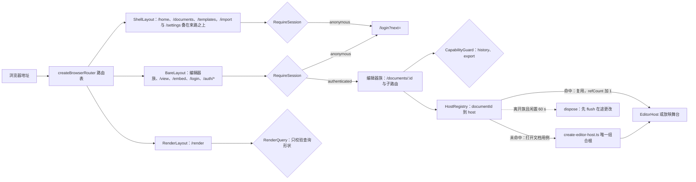
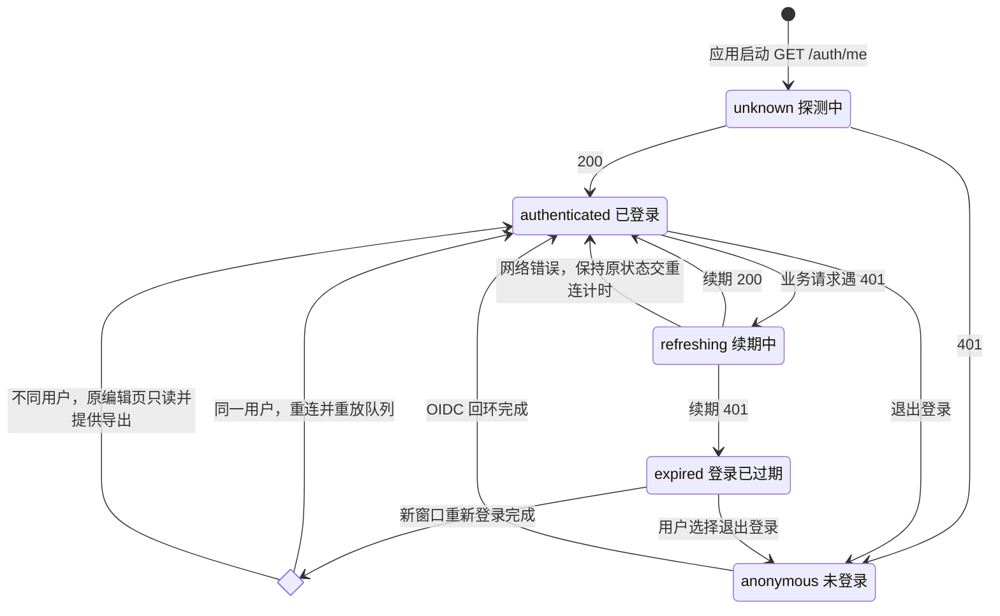
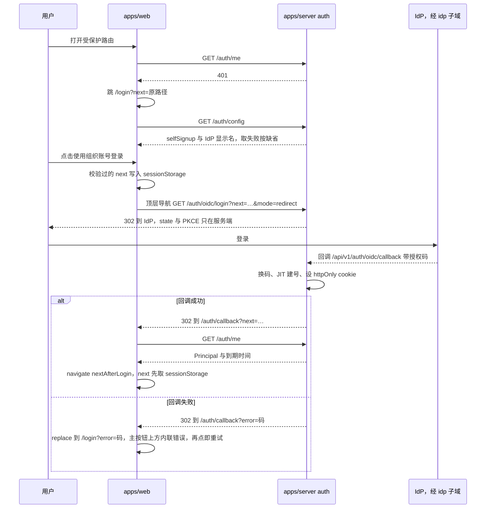
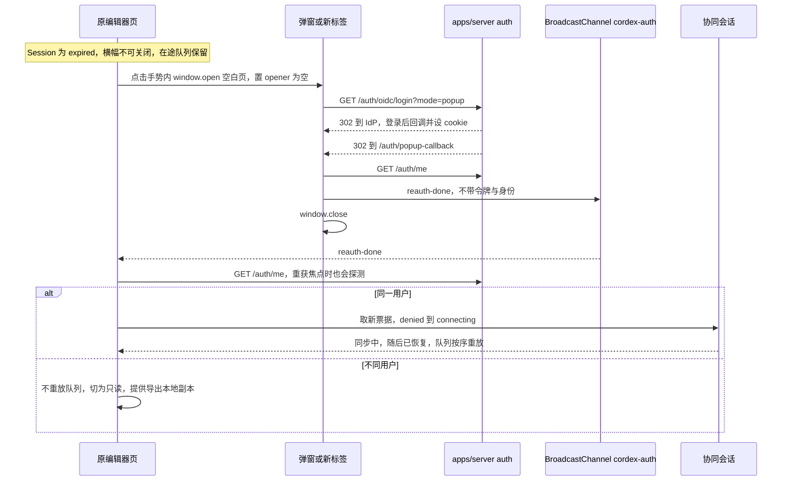
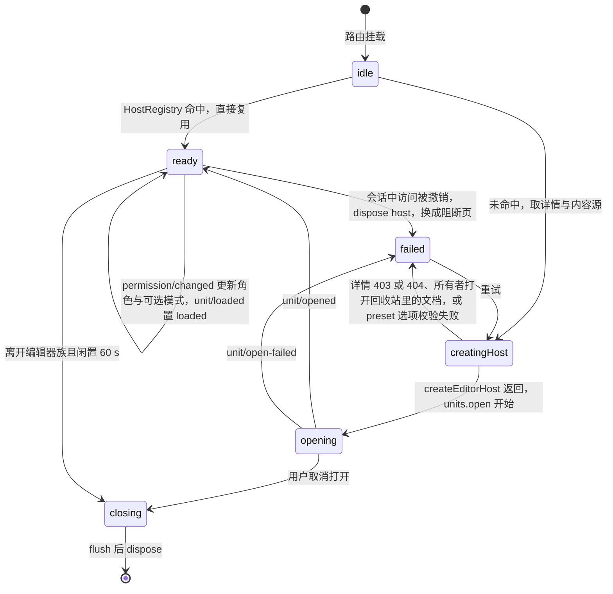
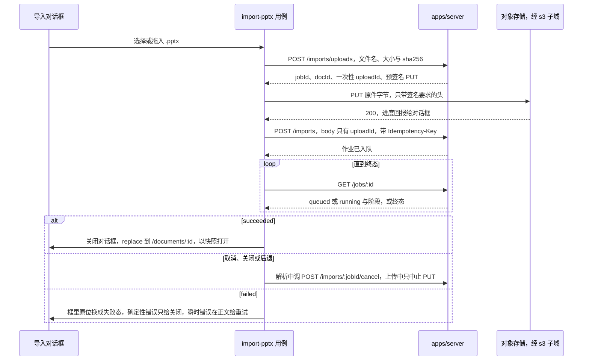
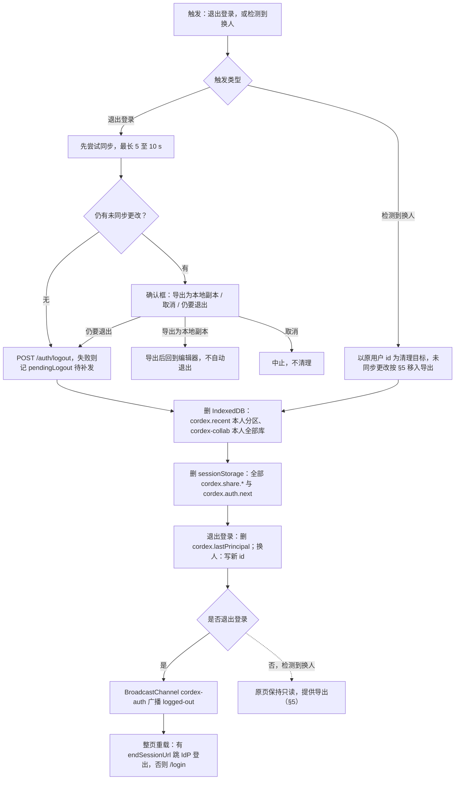
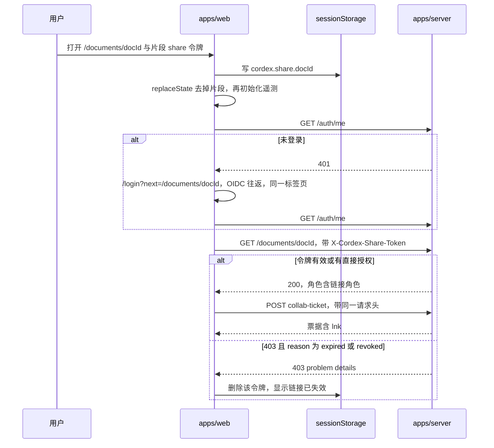
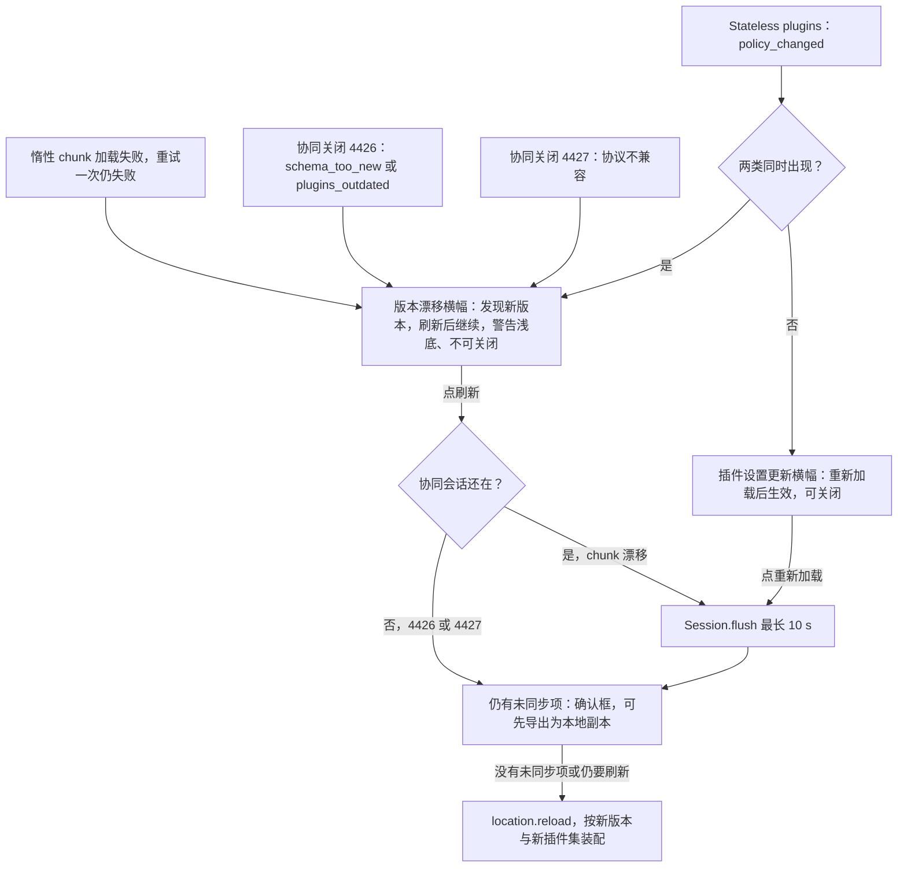

# 02 应用壳、路由与会话
> 状态：v0.1 | 负责：前端设计线 | 更新：2026-09-25；2026-09-25（§4.19）；2026-09-26（§4.20）；2026-09-26（§4.21 整合：续期后的换票改写为 provider.sendToken() 发 Auth 帧（onTokenSync））；2026-09-26（§4.21 Remap：原 30/08 引用按 60-backend/README §6.1 改指新位置，30/08 已删除）；2026-10-01（§4.23 插件管理：路由表加 `/admin/plugins` 与 `RequirePlatformAdmin` 守卫、`/documents/:id/plugins` 改为个人插件面板；§8 增三个插件用例；§12 插件集指纹并入版本漂移，新增「插件设置已更新」横幅）；2026-10-03（§4.24 设计线对齐审计：路由表 `/documents/:id/plugins` 由抽屉页改为对话框路由（居中 Dialog、继承父路由、支持 `?state=conflict` 深链，AL-2）；导出路由、导出用例与 §13.2 里程碑按 PRD OF-19 改为 M2 pptx + 客户端 PNG / SVG、M3 服务端批量 PNG / JPEG 与后半段 PDF（AL-4））；2026-10-04（design-language-v3 第 0 批：§0 编辑器内部 UI 清单按 v3 结构改写（rulings §4.25 DS-1））；2026-10-04（design-language-v3 第 0 批：复验修正——§2 `ShellLayout` 原 224 px 玻璃导航卡改为 v3 贴边导航（设计 03-29）；§8 用例入口表按 v3 改写：导出进主菜单、创建副本与版本历史进文档菜单、分享与放映在检查器协作行与网格胶囊、开始页新建与导入入口按 03-29（原应用栏「⋯」与模式下拉作废））；2026-10-04（design-language-v3 第 0 批：复验第 2 轮修正——模式表「放映」行的模式切换入口注明样张为主菜单「视图 › 模式」（当时为样张草稿，2026-10-07 随 DS-23 定稿，50/10 §3.3））；2026-10-05（design-language-v3 第 0 批修正：§3 `RuntimeConfig.help` 的用途由「指南与帮助卡片」改为开始页左侧导航「帮助」菜单的条目链接（rulings §4.25 DS-12，PRD AS-04、AS-05））；2026-10-05（design-language-v3 第 0 批修正：按 PRD AS-01…AS-06 与 rulings §4.25 DS-11、DS-12 改写开始页——§2 路由表 `/home` 的内容列（顶栏新建与导入、模板行、最近、左侧导航「帮助」菜单，删去「指南」）；§2.1 `ShellLayout` 写明开始页 `Mod+K` 聚焦搜索的处理（无 host、不走 `ui.shortcut`，按 `KeyboardEvent.code` 判定，`aria-keyshortcuts`）；§8 用例表内置模板由 4 套改为 5 套（AS-03），设置入口写菜单文案「偏好设置…」（AS-06）；§9.1 开始页状态：`ready` 取前 8 条（AS-02），`loading` / `empty` / `offline` / `error` 去掉「指南段」「新建 / 模板 / 导入卡」「其余两段」等旧结构，补键盘一条）；2026-10-07（design-language-v3 第 1 批：§2 路由表与「深链与 URL 同步」写明编辑器视图查询参数 `view`（参考应用把 `editorView` 同步到地址栏，缺省单页不写、`replaceState`、刷新后保持；`EditorHost` 经 `layout.view` / `onViewChange` 交接，rulings §4.25 TB-30，50/10 §12.3 待定行结案）；§6 升权更新的是主菜单「视图 › 模式」的可选项（DS-23）；§8 用例表导出入口定稿为主菜单「文件 › 导出…」、放映行的模式切换定稿（DS-21、DS-23）；§10.1 布局记忆键由 `cordex.layout.{unitType}` 改为按文档的 `cordex.layout.{rememberKey}`（apps/web 传 documentId），登出与换人时删除（rulings §4.25 TB-24）；§13 补 `view` 断言与回写行）；2026-10-08（design-language-v3 第 1 批收口：§2 路由表登记 `/styleguide`——apps/web 只在测试部署（`CORDEX_WEB_ENV=test`）注册，内容为 ui-react 的组件全状态页，同一份生产包与生产 CSP 下由 a11y 与 csp-strict 覆盖（rulings §4.25 TB-50，承接 TB-3）；§3 `RuntimeConfig` 增 `env`（由 web 容器按 `CORDEX_WEB_ENV` 渲染，只决定 `/styleguide` 是否注册），`features.developerMenu` 改指主菜单「帮助」最后一组的开发者面板（TB-40），`help` 补编辑器壳意图 `help-center`（TB-39）；§8 内置模板五套与编辑器主题画廊同一套（DS-33）；§10.1 布局键补 TB-41；§13.1 补 `/styleguide` 断言；§13.3 TB-30、TB-24 两行改为已回写，新增 TB-50 行）；2026-10-15（design-language-v3 第 2 批：§2 路由表——`/share` 不再要求 `doc.manage`、非所有者打开只读的「谁能访问…」（rulings §4.25 DS-48），`/history` 与 `/fidelity` 改为检查器整栏面板、布局继承父路由（DS-38），`/plugins` 为 640 宽、固定 720 高的对话框（DS-38、DS-56）；§5 重新登录横幅的文案、进行中与弹窗被拦截按样张，换账号改为「登录账号已变更」横幅、导出前不可关闭（[07](07-collaboration-client.md) §8.2、DS-58）；§6 打开时没有访问权限与会话中访问被撤销收敛为同一阻断页、「申请访问」打开留言弹层，查看人数已满时为阻断页并在名额空出后自动进入（DS-48、DS-50、DS-60）；§8 分享用例按样张（链接区只留权限与复制、有效期、改回仅邀请即撤销、访问申请）并新增「申请访问」用例（DS-47、DS-48、DS-53）；§10.1 登记 `cordex.inspector.pluginSections` 与 `cordex.fidelity.{documentId}` 两个本机键（DS-49、DS-51）；§12 发现新版本与插件设置「重新加载」先同步、仍有未同步项时弹应用内确认（DS-59）；§13 同步）；2026-10-15（design-language-v3 第 2 批：§2 版本历史与保真报告「宽 280」改为沿用检查器宽度（rulings §4.25 TB-60），图 1 守卫节点去掉 share；§5 换账号只留「导出为本地副本」注明 TB-69；§6 申请被拒不告知（DS-68）；§8 分享用例补令牌可重取、POST 遇 409 改用 PATCH、链接到期的判定与显示、非所有者只读视图的数据、「分享」待处理数的来源（DS-66、TB-65、TB-68、TB-71、TB-72），申请访问用例补路由、Webhook `access_request.created`、被拒不告知与回收站文档（DS-67、DS-68、TB-73）；§10.1 两个本机键注明 TB-70；§13.1 新增分享对话框断言；§13.3 他线登记核对、新增 DS-66…DS-68 一行；同日再补：§2 路由表登记管理员深链 `/admin/plugins?plugin=<pluginId>`——打开该插件的详情抽屉、选中并滚到这一行，被拒的同样打开，部署里没有时填进搜索框（rulings §4.25 TB-76）；§8 分享用例改为非所有者在链接授予角色时「复制链接」复制分享链接、说明行与所有者同一句含义，令牌取自 `GET …/permissions` 读者视图的 `link`（`ShareLinkSummary{ role, token }`），不调 `GET …/share-links`、只发一次请求（DS-69、TB-86，TB-65 的「复制文档地址」随之修订）；新建空白与从模板新建在 `POST /imports/uploads` 带上 `origin`（`blank` / `template`）与 `templateName`，导入（缺省 `upload`）与创建副本（`duplicate`）的来源由服务端记下，供版本历史最早一条按来源写（DS-70）；申请访问用例的已发送文案照写原句（DS-68）；§13.1 分享与管理员页两行断言同步；§13.3 DS-66…DS-68 一行的他线项核对为已登记、新增 DS-69、DS-70 一行）；2026-10-15（design-language-v3 第 2 批：§8 分享用例补令牌暂时取不到时的处理——服务端解密失败只省略 `token`（所有者的 `ShareLink.token` 与读者视图的 `link.token` 同此，60/15 §3.5 表下），链接授予角色时「复制链接」留在原位、不可用，工具提示「暂时无法取得分享链接，请稍后重试」，说明行照常，所有者与非所有者同一处理，不退而复制文档地址（rulings §4.25 TB-91）；新建（空白 / 内置模板）与导入 .pptx 两行写明 `POST /imports/uploads` 的 `fileName` 去首尾空白后 1–255 字（TB-95）、`templateName` 去首尾空白后 1–100 字，空白带 `origin: 'blank'`、模板带 `origin: 'template'`（60/15 §3.9）；§13.1 分享对话框一行补令牌缺省时的断言；§13.3 DS-69、DS-70 一行的「待定」改为已定、他线项核对为已登记，新增 TB-91、TB-95 一行）；同日再补：§13.3 TB-91、TB-95 一行的他线登记核对为已登记；2026-10-22（design-language-v3 第 3 批：按已拍板的应用壳族样张回写（rulings §4.25 DS-71…DS-136、TB-101…TB-129）——§2 路由表：`/documents` 不带 filter 落「最近」、左栏五项即筛选、`filter=all&q=` 只给搜索结果（DS-79、DS-80），`/import` 改为全屏 Bare（DS-97），`/templates` 只做从模板新建、不含搜索（DS-93、TB-110），`/settings` 为居中对话框（DS-113），登录、回调与 `*` 的画面改引设计 03-33（DS-71），新增壳页面上的分享深链 `?share=<id>`（TB-109）；§2.1 `ShellLayout` 五项导航、搜索下拉、帮助菜单按配置、横幅在顶栏之下、窄屏抽屉与手机形态、开始页接 `Mod+,` 与 `Mod+/`（DS-79、DS-80、DS-87、DS-89、DS-92、DS-115），`RequireSession` 探测中改加载行；§3 `help` 按配置出现、`/auth/config` 取失败按缺省；§4.4 登录页、回调失败回登录页内联、`prompt=login`、离线不跳转、重试保住 `next`（DS-118…DS-121、DS-124、TB-122）；§5 新窗口失败页与新窗口标记（DS-125、TB-122）；§6 协同快照打开画面、回收站阻断页、404 单独一页（DS-85、DS-99、DS-122）；§8 用例表：卡片同一份菜单、创建副本只给编辑者、永久删除只在回收站、导出 `Mod+Shift+E` 与导出收尾、取消、PNG 范围、新建失败（DS-78、DS-81、DS-82、DS-85、DS-98、DS-100…DS-105、TB-108、TB-109）；§9 开始页、文档列表、导入页、设置按样张改写（DS-79…DS-88、DS-97、DS-98、DS-113、DS-114、DS-116、TB-107、TB-118、TB-127、TB-129）；§10 新增本机键 `cordex.auth.next`、`cordex.auth.reauthWindow`、`cordex.diagnostics.{userId}`、`cordex.listView`，退出登录先同步再确认（TB-118、TB-122、TB-127）；§11 「联系管理员」一行常显、失效页与 404 页（DS-119、DS-122）；§12 「发现新版本」横幅与会话已关闭时的刷新（DS-126）；§13 同步）；2026-10-22（design-language-v3 第 3 批回写补充，rulings §4.25 DS-137、TB-130、TB-131、TB-133、TB-140、TB-141、TB-143、TB-144、TB-145、TB-147：§2 路由表与「深链与 URL 同步」写明分享 M3 开放、M2 卡片「分享…」不可用、带 `?share=` 时忽略（DS-137）；§2.1 搜索下拉按组合框的键盘、手机同用下拉（TB-130）；§3 新增 `limits.importMaxBytes`（TB-147），`GET /auth/config` 增 `trashDays`（TB-141）；§4.4 `signupUrl` 的来源与 selfSignup 缺地址时拒绝启动（TB-143）、停用那一句的退路补句（TB-140）；§6 回收站阻断页的天数；§8 分享与永久删除在 M2 的画法、「最近」一页取完与 `pinned`；§9.1、§9.2 卡片第二行与排序的数据来源、网格 / 列表两处共用一份（TB-131）、我的文档与与我共享按内容更新时间倒序（TB-144）；§9.3「取消」回到打开导入页之前的那一页（TB-133）；§9.4 自动保存四档；§10.1 `cordex.listView` 改为一份 `layout` 加开始页的 `homeSort`；§10.2 嵌入的退出登录按 `intents`（TB-145）；§11 改引 03-33 §7.2、§7.3；§13 同步）；2026-10-22（design-language-v3 第 3 批回写收口，rulings §4.25 TB-153…TB-156、TB-158、TB-160、TB-161：§2 `/home` 行补平板的提示句，`/templates` 行的 REST 列与里程碑改为按 RuntimeConfig `templates.sources` 设计、随 PD-23 定稿（TB-160）；§2.1 `ShellLayout` 补快捷键面板的手机与平板形态、触控形态的菜单不写「⌘/」（TB-154）；§3 新增 `templates` 一行（TB-160），`limits` 一行写明 web 容器直接读 `CORDEX_SCALE_MAX_FILE_BYTES`（TB-158）；§6 回收站阻断页「恢复」失败的内联错误（TB-155）、M2 阻断页「申请访问」留在原位不可用（TB-156）；§8 恢复失败的轻提示、M2 的「申请访问」、编辑器「分享」由宿主属性 `shareUnavailable` 驱动（TB-161）；§9.1 平板顶部一行改写「在电脑上新建或导入演示文稿」（TB-153）；§9.2 回收站卡片「恢复」失败；§11 链接已失效页的「申请访问」同 §6；§13 断言、里程碑与未决同步，模板源一行结案；2026-10-22 复核修正：§2 `/home` 行、§2.1、§9.1、§9.2 补平板形态——左栏与「最近」列数按窗口宽度（TB-165），触控形态的菜单项一律不写键位提示（TB-164）；§3 `templates` 一行补跨源 CSP（TB-168），`env` 与 `diagnostics` 两行补测试部署的渲染故障注入点（TB-169）；§6 阻断页说明句三个里程碑相同（TB-156）；§8 导出遇运行时页级回退即失败（TB-166）、创建副本在降权时不可用（DS-139）；§9.3 手机与触控上直接打开 `/import` 照常显示（TB-167）；§13 同步；§3 `templates` 一行的 web 容器部署键改为已登记（60/17 §3.3、§3.6），只剩清单格式随 PD-23；§9.2 评审者与查看者的卡片菜单补「固定 / 取消固定」与按视图出现的「从最近移除」（DS-81、DS-82）；§2 `/home`、`/documents` 两行与 §2.1、§9.1、§9.2 分成手机与平板两种形态、先看窗口窄再看触控（TB-163），平板保留网格 / 列表与排序、搜索框随左栏不写 ⌘K（TB-170）；§9.1 卡片第二行缺编辑者或内容时间时的写法（TB-171）；§4.4 未配置 IdP 显示名时用通用说明句（DS-118）；§8 查看者的导出原因写「只有查看权限」（DS-105）；§9.3 导入页的到达焦点落在「选择文件…」；§3 `diagnostics` 一行注明 `/render` 不设渲染故障注入点（TB-174）；§13 同步；§2.1 搜索下拉行、§9.1 卡片与「最近编辑」排序、§9.2 列表两列与搜索结果页按卡片第二行的同一取法（TB-171），§2.1 横幅的高 40 指非触控形态、触控形态按钮 44 高（TB-172），§9.1、§9.2 平板网格 / 列表切换与排序的命中区 44，§13.1、§13.3 随之同步）；2026-10-23（design-language-v3 第 3 批评审修改：§2 路由表 `/import` 改为叠在来路之上的「导入」对话框（宽 560、固定高 406，手机为底部面板，背后是来路页面、直接打开时是文档列表「最近」；rulings §4.25 DS-140、TB-179、TB-181，DS-97、DS-98 由 DS-140 取代），`BareLayout` 一行与图 1 去掉 `/import`；§3 `limits` 一行改指导入对话框；§8「导入 .pptx」用例与图 6 改为在对话框里选文件、上传、解析与失败，成功后以 `replace` 进编辑器；§9.1 拖入落区改为强调色虚线加淡底、松开即打开对话框的上传态（DS-141、TB-180）；§9.3 重写为「导入对话框」——地址与历史、拖放、阶段、取消即关闭、失败只有「关闭」与正文里的「重试」、触控形态与焦点（修订 TB-129、TB-133、TB-167）；§13.1 导入断言与 a11y 一行、§13.2 M1 / M2、§13.3 同步；§9.3「取消」补上传中还没有作业行、隔离区的部分由 `uploads-tmp-cleanup` 清理（60/06 §4、§6.1、§6.2）） | 依赖：[01 前端总览](01-overview-and-runtime-map.md)、[03 预设装配](03-preset-assembly-and-plugins.md)、[60/02 鉴权链路](../60-backend/02-auth-chain.md)、[60/15 REST API 目录](../60-backend/15-rest-api-catalog.md)、[40/11 预设装配与应用壳](../40-modules/11-preset-assembly-and-app-shell.md)、[30/02 §3.1](../30-architecture/02-layering-and-packages.md)、[30/06 §18.3](../30-architecture/06-collaboration.md)、[ADR-0029](../30-architecture/adr/0029-gateway-authorization.md)、[rulings](../00-charter/rulings-2026-09-14.md) §4.12 U-04/U-16、§4.15 Q6、§4.18 UX-02/UX-03/UX-19/BE-01/BE-10/BE-11、§4.19 D-M2-CONTENT、§4.20 FE-10/BE-02、[PRD 08 应用壳](../10-prd/03-features/08-app-shell.md) AS-01…AS-06、[PRD 09 插件管理](../10-prd/03-features/09-plugin-manager.md) PM-01、PM-06、PM-08、PM-10；rulings §4.23、§4.25 DS-23、DS-33、TB-3、TB-24、TB-30、TB-39–TB-41、TB-50、DS-47、DS-48、DS-50、DS-66…DS-70、TB-60、TB-65、TB-68…TB-73、TB-76、TB-86、TB-91、TB-95、DS-71、DS-72、DS-76、DS-78…DS-105、DS-112…DS-126、TB-101、TB-107…TB-110、TB-118、TB-119、TB-122、TB-127…TB-129；[60/17](../60-backend/17-deployment-and-config.md) §5；playground `src/v3/scenarios/share/`；第 3 批 playground `src/v3/scenarios/`（`documents`、`home`、`account-menu`、`templates`、`import`、`export`、`settings`、`shortcuts`、`shell-pages`、`doc-banners`）；设计 03-screens [01](../20-design/03-screens/01-document-list.md)、[13](../20-design/03-screens/13-import-progress-and-degraded-states.md)、[23](../20-design/03-screens/23-settings-panel.md)、[29](../20-design/03-screens/29-home-start-page.md)、[设计 03-33](../20-design/03-screens/33-login-session-and-error-pages.md)（登录、会话与错误页）；rulings §4.25 DS-137、TB-130、TB-131、TB-133、TB-140、TB-141、TB-143、TB-144、TB-145、TB-147（第 3 批回写补充）；[60/17](../60-backend/17-deployment-and-config.md) §3.3、§5.5、§5.15；rulings §4.25 TB-153…TB-156、TB-158、TB-160、TB-161（第 3 批回写收口）；rulings §4.25 DS-139、TB-164…TB-169、TB-170、TB-171、TB-172、TB-174；rulings §4.25 DS-140…DS-143、TB-179…TB-182（第 3 批评审修改）

本文是 `apps/web` 应用壳在浏览器一侧的唯一事实源：路由表、运行时配置、会话状态机与浏览器侧 OIDC 回环、新窗口重新登录、编辑器页状态与 host 保活、REST 客户端统一策略、用例清单、壳页面状态、浏览器存储键空间与清理矩阵、分享链接落地、版本漂移。

**本文不写**（只链接）：服务端 OIDC、cookie、CSRF 校验与票据签发（[60/02](../60-backend/02-auth-chain.md)）；REST 路由的守卫、DTO、错误码与限流（[60/15](../60-backend/15-rest-api-catalog.md) §3.1 auth … §3.14 telemetry，本文只引用小节号）；preset 装配运行时与 `create-editor-host` 的内部时序（[03](03-preset-assembly-and-plugins.md)）；查看器、嵌入形态与 `/render` 页（[12](12-viewer-embedding-and-render-page.md)）；协同会话 FSM、离线队列与重连（[07](07-collaboration-client.md)）；CSP 正文与 nonce 链（[14](14-client-security.md)）；事件语义、错误文案与遥测管线（[15](15-events-errors-and-telemetry.md)）；装配清单本体与文件树（[40/11](../40-modules/11-preset-assembly-and-app-shell.md) §3–§5）。

## 1. `apps/web` 的职责与禁区

`apps/web`（L8，dom，`cordex.compositionRoot:true`）是仓库中唯一「知道插件存在」的应用。它只做四件事：**组装**（选 preset、传 options）、**导航**（路由与布局）、**会话**（浏览器侧登录态）、**经 `@cordexjs/protocol` 与服务端通信**。编辑器内部 UI（左栏与缩略图、底部创建工具条、检查器、网格视图、放映舞台、母版视图）全部在 `slide-ui` / `ui-react`，编辑器页只挂 `<EditorHost>`。

| 禁区 | 机制（正式名） | 依据 |
|---|---|---|
| 不定义领域类型与贡献：`defineCommand(`、`defineMutation(`、`defineOperation(`、`defineContributionPoint(`、`ctx.contribute(`、`declare module '@cordexjs/kernel'` | ESLint `no-restricted-syntax`（`apps/**` override）+ depcruise `cordex-apps-only-assemble` | TD-093；rulings §4.18 GV-15 |
| 唯一组合根：`createHost(` 与 `createSlide*Preset(` 只出现在 `src/application/host/create-editor-host.ts` | ESLint `no-restricted-syntax`（同上） | TD-093 |
| 只 import R9 白名单：`@cordexjs/preset-slide*`、`@cordexjs/ui-react`（`EditorHost`、壳组件、`./ui`、`./styles.css`）、`@cordexjs/design`、`@cordexjs/protocol`、`@cordexjs/shared`、`@cordexjs/i18n`、`@cordexjs/kernel`（**值导入仅 `src/application/host/**`**，其余只许 `import type`）、`react`、`react-dom`、`react-router`、tailwind | depcruise `cordex-apps-only-assemble`；ESLint `no-restricted-imports`（禁 `@cordexjs/model-*`、`ooxml-*`、`engine-*`、`render-dom`、`slide-*`、`collab-*`、`store-*`、`yjs`、`cordis`） | rulings §4.18 FE-05、FE-01 |
| 不出现文档类型字面量（`'slide'`/`'doc'`/`'sheet'`），例外仅两个参数化点 `domain/document-type.ts` 与 `application/host/create-editor-host.ts`（内置模板清单挂在 `DOCUMENT_TYPES[*].newCards`，不另设例外文件） | lint `cordex/no-doc-type-literals` 扫描 `apps/web/src/**`，只豁免这两个文件（TD-086 扩展范围，已登记于 [30/09-type-discipline/02](../30-architecture/09-type-discipline/02-lint-rules.md) §4.12；新增文档类型时 `apps/web` 的改动只落在这两个文件，[03](03-preset-assembly-and-plugins.md) §12） | TD-086；[03](03-preset-assembly-and-plugins.md) §12 |
| 不自定义跨进程 DTO：请求与响应类型一律 `z.infer<typeof X>`，`X ∈ @cordexjs/protocol` | 响应体统一在 `infrastructure/api/http.ts` 经 `Schema.parse`（§7，单元测试覆盖）；评审把关 | [40/11](../40-modules/11-preset-assembly-and-app-shell.md) §1.3 |

`src/` 分五个目录：`app/`（路由、布局、守卫、providers、运行时配置）、`pages/`（路由级容器，不持有业务状态）、`application/`（无状态用例，经 `Api`/`Storage`/`Navigate`/`Clock`/`Online` 端口做 IO）、`infrastructure/`（REST 客户端、存储、i18n、嵌入桥、媒体上传默认实现）、`domain/`（视图模型与纯函数，无 IO、无 React）。逐文件清单见 [40/11](../40-modules/11-preset-assembly-and-app-shell.md) §4.4 / §5.4。

## 2. 路由表（唯一源）

路由为 path 形态（`/` 重定向 `/home`），托管层做 SPA fallback；每个页面组件 `React.lazy` 独立 chunk（分包规则见 [13](13-performance-and-bundling.md)）。REST 列只写 [60/15](../60-backend/15-rest-api-catalog.md) 的小节号。

| 路由 | 页面 | 布局 | 守卫 | 主要用例（§8） | REST（60/15） | 里程碑 |
|---|---|---|---|---|---|---|
| `/home?share=<id>` | `home/HomePage` | Shell | RequireSession | 顶栏「新建演示文稿」与「导入 .pptx」、「从模板开始」一行、最近（网格 / 列表与排序：排序是这一段的本机视图偏好，rulings §4.25 TB-127；网格 / 列表与文档列表共用一份，TB-131）与固定；左侧导航五项（第 5 项「回收站」，DS-79）；左栏「帮助」菜单只列配置了链接的条目与「键盘快捷键」（DS-89）；窄屏与触控分手机、平板两种形态，先看窗口窄、再看触控（rulings §4.25 TB-163，§9.1）：手机（< 640，不论是否触控）左栏收进抽屉、「最近」单列、搜索框在主区提示行之下，不放网格 / 列表与排序；平板（触控、≥ 640）左栏与「最近」列数按窗口宽度取（≥ 1024 常驻、四列，640–1024 抽屉、三列，TB-165），网格 / 列表与排序照常、搜索框随左栏、不写 ⌘K（TB-170）；两者都不渲染模板行与新建、导入（DS-87），顶部一行的提示句按原因写（手机「在更大窗口中新建或导入演示文稿」，平板「在电脑上新建或导入演示文稿」，TB-153），命中区 44、卡片「⋯」常显；`share` 见下文「深链与 URL 同步」（TB-109，M3 起；M2 卡片「分享…」不可用，DS-137） | §3.3 | M1（本地夹具）/ M2 |
| `/documents?filter=recent\|owned\|shared\|trashed\|all&q=&share=<id>` | `documents/DocumentsPage` | Shell | RequireSession | 左栏五项即筛选（2026-10-22，rulings §4.25 DS-79）：不带 `filter` 即「最近」，`owned` 我的文档、`shared` 与我共享、`trashed` 回收站，`all` 只给搜索结果页（`filter=all&q=`，DS-80），页内不设筛选条；列表、重命名、创建副本、移到回收站、恢复、分享（M3；M2 留在原位不可用，DS-137）、永久删除（回收站视图，M3）（§9.2）；窄屏与触控同开始页的两种形态（TB-163）：手机（< 640）抽屉、单列、列表头不放网格 / 列表切换，平板（触控、≥ 640）左栏与列数按窗口宽度、网格 / 列表切换照常（TB-165、TB-170），两者都不提供新建与导入（DS-87、TB-153，§9.2） | §3.3、§3.10 | M2 |
| `/import` | `import/ImportPage`（对话框路由：渲染「导入」对话框，文件名沿用 [40/11](../40-modules/11-preset-assembly-and-app-shell.md) §4.4） | 叠在来路之上（居中模态对话框，宽 560、固定高 406，手机（< 640）为贴底的底部面板，同 `/settings` 的做法；背后是打开它的开始页或文档列表，直接打开时是文档列表「最近」；2026-10-23，rulings §4.25 DS-140、TB-179、TB-181） | RequireSession | 导入 .pptx：开始页与文档列表顶栏的「导入 .pptx」从选文件打开，主区拖入落区松开即打开上传态；选文件、拖入、上传、服务端解析与失败都在框里原位切换，成功后以 `replace` 进编辑器；关闭即返回来路、浏览器后退等于关闭，上传与解析中关闭即中止（TB-179，修订 TB-129、TB-133；§9.3） | §3.9 | M1 本地打开 / M2 服务端导入入库 |
| `/templates` | `templates/TemplatesPage` | Shell | RequireSession | 模板库（AS-03；2026-10-22 按 rulings §4.25 DS-93 只做来源分段与预览、不含分类与搜索；只做从模板新建，顶栏不放「导入 .pptx」「新建演示文稿」、网格不含「空白」，TB-110）：来源分段「全部 · 内置 · 〈集成方来源〉」只在集成方配置了模板源时出现（RuntimeConfig `templates.sources` 非空，§3；某一源的清单取不到只影响那一段，段内一行内联错误、内置模板照常，rulings §4.25 TB-160），点模板打开预览对话框，「使用此模板」走与新建相同的两步导入（§8） | 无模板端点：内置模板为同源静态资源，集成方模板源由浏览器直接取 `templates.sources` 各项的清单 JSON（§3，TB-160）；「使用此模板」为 §3.9 两步导入 | M3（集成方模板源的到达方式随 PD-23 定稿，之前按 `templates.sources` 设计，TB-160） |
| `/documents/:id?page=<slideId>&comment=<threadId>&view=grid` | `editor/EditorPage` | Bare | RequireSession | 打开、导出、分享、版本、放映；**全部角色的入口**（查看者 `mode='view'`）；`view` 只在网格视图时出现（下文「深链与 URL 同步」） | §3.3、§3.7、§3.8 | M1 / M2 / M3 |
| `/documents/:id/present?page=<slideId>` | `present/PresentPage` | Bare（全屏） | RequireSession | 放映（复用 host） | 无 | M2 |
| `/documents/:id/share` | `share/ShareDialog`（对话框路由） | 继承父路由 | RequireSession（2026-10-15 起不再要求 `doc.manage`：所有者打开分享对话框，其余角色打开只读的「谁能访问…」，rulings §4.25 DS-48；写操作仍由服务端 `doc.manage` 守卫） | 分享；访问申请的所有者端（§8）；开始页与文档列表上的同一个对话框不走本路由，叠在壳页面路由上（`?share=<id>`，下文，rulings §4.25 TB-109） | §3.4、§3.5、§3.2 | M3 |
| `/documents/:id/history` | `history/VersionHistoryPage`（检查器整栏面板，渲染在编辑器之内，宽度沿用检查器宽度（缺省 280），开着时检查器分隔条照常可拖；原「抽屉页」作废，rulings §4.25 DS-38、TB-60） | 继承父路由 | RequireSession + CapabilityGuard(`history.read`) | 版本（行为见 [08](08-comments-and-version-history.md) §9–§10） | §3.8 | M3 |
| `/documents/:id/export` | `export/ExportDialog`（对话框路由） | 继承父路由 | RequireSession + CapabilityGuard(`doc.export`) | 导出（设计 03-22；对话框不放 JPEG 与质量参数、pptx 只导整份，rulings §4.25 DS-103；文件就绪即下载并关闭对话框、出轻提示，DS-100） | 无（pptx、PNG 四种范围与 SVG 都在浏览器生成，DS-102）；§3.9（M3 起 PNG「全部页」与 M3 后半段 PDF 由服务端生成，生成中可取消，DS-101） | M2（pptx + 浏览器 PNG / SVG）/ M3（PNG「全部页」改由服务端生成，M3 后半段 PDF）（PRD OF-19，rulings §4.24 AL-4、§4.25 DS-102；JPEG 与质量参数只经 API，SV-02、SV-13） |
| `/documents/:id/fidelity` | `fidelity/FidelityReportPage`（检查器整栏面板，宽度沿用检查器宽度（缺省 280），开着时检查器分隔条照常可拖；原「抽屉页」作废，rulings §4.25 DS-38、TB-60） | 继承父路由 | RequireSession | 保真报告（读 `unit/opened` 诊断，无 REST；入口与提示见 [25](25-elements-readonly-and-opaque.md) §2.5） | 无 | M2 |
| `/documents/:id/plugins?state=conflict` | `plugins/PluginManagerPage`（对话框路由，渲染为居中 Dialog，宽 640、各状态固定 720 高，与分享、导出同一模式；2026-10-01 起即个人插件面板，PRD PM-10；2026-10-03 原「抽屉页 / Bare」作废，rulings §4.24 AL-2；宽高按 rulings §4.25 DS-38、DS-56；文件名沿用 [40/11](../40-modules/11-preset-assembly-and-app-shell.md) §4.4） | 继承父路由 | RequireSession | 个人插件面板：本会话插件状态、失败重试、可选界面级插件个人启停、本文档缺少的插件；`?state=conflict` 为快捷键冲突深链，打开冲突态并高亮相关插件（设计 03-24「冲突标记」、03-09 §4.4）；从缺插件横幅「查看详情」进入时「本文档缺少的插件」分组置顶（数据流见 [03](03-preset-assembly-and-plugins.md) §10） | §3.15（`/users/me/plugins`） | M2 只读与重试 / M3 个人启停 |
| `/admin/plugins?plugin=<pluginId>` | `admin/AdminPluginsPage`（2026-10-01，§4.23） | Shell | RequireSession + RequirePlatformAdmin | 管理员插件管理：清单、部署级状态、三态设置、依赖与互斥确认、配置（M4）（PRD PM-06、PM-07、PM-09）。`?plugin=<pluginId>` 是指向某个插件详情的深链（2026-10-15，rulings §4.25 TB-76；个人插件面板里给管理员的「去管理 › 插件」行尾按钮用它，DS-56，[03](03-preset-assembly-and-plugins.md) §10）：清单加载完后打开这个插件的详情抽屉（设计 03-32 §9；右侧贴边、宽 480、带遮罩的模态抽屉，rulings §4.25 DS-94），在清单里选中这一行并滚进可视区；被拒的插件同样打开；部署里没有这个插件时不开抽屉，把 id 填进搜索框（搜索无结果的提示照常）；不带参数即普通进入 | §3.15（`/admin/plugins*`） | M3（查看与修改，O-4）/ M4 配置 |
| `/documents/:id/view` | `viewer/ViewerPage` | Bare | RequireSession | **只留给 M1 查看器与嵌入**（[12](12-viewer-embedding-and-render-page.md) §1） | §3.3 | M1 |
| `/embed/:id?mode=view\|edit` | `embed/EmbedPage` | Bare | RequireSession（嵌入规则见 [12](12-viewer-embedding-and-render-page.md) §9） | 形态 E | 同编辑器 | M3 P2 |
| `/settings` | `settings/SettingsPage` | 叠在来路之上（居中模态对话框 480，手机为底部面板，rulings §4.25 DS-113、TB-118） | RequireSession | 偏好设置（§9.4） | §3.2（资料，M3） | M2 |
| `/login?next=&error=` | `auth/LoginPage` | Bare | 无 | 登录（画面与文案见设计 03-33，rulings §4.25 DS-71、DS-118）；`error` 为回调带回的失败码，主按钮上方内联显示（DS-120，§4.4） | §3.1 | M2 |
| `/auth/callback?next=&error=` | `auth/CallbackPage` | Bare | 无 | OIDC 回环落点：只有「正在登录…」与网络失败两种画面，带 `error` 时转回登录页（DS-120、TB-122，§4.4） | §3.1 | M2 |
| `/auth/popup-callback?error=` | `auth/PopupCallbackPage` | Bare | 无 | 新窗口重新登录回调，带 `error` 时显示新窗口失败页（DS-125，§5） | §3.1 | M2 |
| `/render?renderId&…` | `render/RenderPage` | Render | RenderQuery（只校验查询形状，非会话） | headless 渲染（[12](12-viewer-embedding-and-render-page.md) §11） | 无 | M3 |
| `/styleguide`（2026-10-08，rulings §4.25 TB-50） | ui-react 子路径 `./styleguide` 的组件全状态页 `StyleguidePage`（[40/10](../40-modules/10-ui-shell-and-slide-ui.md) §4.3），由 `app/routes.tsx` 惰性加载，apps/web 不自写页面（[40/11](../40-modules/11-preset-assembly-and-app-shell.md) §4.4、§5.4） | Bare | 无会话守卫；**只在测试部署注册**：`RuntimeConfig.env === 'test'`（web 容器按 `CORDEX_WEB_ENV=test` 渲染，§3）时路由表才含这一行，其余部署不注册、落 `*` | a11y 与 csp-strict 门禁的对象（TB-3）：内容按 v3 kit 逐个组件状态，样张为 playground 的 `_kit` 场景（[09](09-ui-system-and-theming.md) §11、§12 V14）；页面在同一份生产包里，e2e 预览服务器与测试 compose 栈用生产 CSP 起 `apps/web`，所以 csp-strict 在生产包与生产 CSP 下覆盖它（[70/06](../70-testing/06-frontend-component-and-e2e.md) §7.2、§10.1，[14](14-client-security.md) §13 V2） | 无 | M2（随 playground 迁移，[09](09-ui-system-and-theming.md) §11） |
| `*` | `errors/NotFoundPage`（「找不到此页面」+「返回首页」）；根 `errors/AppErrorBoundary`（「页面出错了」+「重新加载」「复制诊断信息」）；两页都是阻断页画法、不挂导航，画面与文案见设计 03-33（rulings §4.25 DS-71） | — | — | — | — | M1 |

**深链与 URL 同步**（依据：INC-35，authority：rulings §4.18 UX-19 + 40 > 设计；`/d/{id}` 形式废止，放映参数由 `?slide=` 统一为 `?page=`）：

- `?page=<slideId>`：`unit/opened` 后把视口定位到该页；slideId 不存在时忽略参数、落首页、不报错。
- `?comment=<threadId>`：`unit/opened` 后打开评论面板并定位线程（[08](08-comments-and-version-history.md)）；线程不存在时 toast「评论不存在或已删除」。
- 切页时以 `history.replaceState` 更新 `?page=`（驱动事件是 engine-render `Viewport` 发布的 `view/page-changed`，依据：VIEW-EVENTS），不为每次翻页新增历史记录；从兄弟路由（`/history`、`/present` 等）返回编辑器时按 `?page=` 与 `?view=` 恢复离开前的页与视图。
- `?view=grid`（2026-10-07，rulings §4.25 TB-30）：编辑器单页 / 网格视图（[10](10-editor-shell-and-interaction.md) §2.3 的 `editorView`）在地址栏的投影。缺省的单页不写这个参数，网格视图写 `view=grid`；`EditorPage` 打开时只认 `grid`、其余取值按缺省单页处理（不报错），作为 `EditorHost` 的 `layout.view` 初值传入；视图每次变化经 `EditorHost` 回调 `onViewChange(view)` 交给 `EditorPage`，由它以 `history.replaceState` 写入或去掉该参数（不新增浏览历史，`page`、`comment` 等其余参数原样保留），所以刷新后保持视图。`EditorHost` 自己不读写地址栏；嵌入场景（`/embed/:id`，[12](12-viewer-embedding-and-render-page.md) §9）由宿主决定是否同步；放映路由 `/documents/:id/present` 不带该参数，退出放映回到进入前的视图（[10](10-editor-shell-and-interaction.md) §3.3）。
- `?share=<documentId>`（2026-10-22，rulings §4.25 TB-109）：开始页与文档列表卡片「⋯ › 分享…」把第 2 批的分享对话框叠在当前壳页面路由上（`/home?share=<id>`、`/documents?…&share=<id>`），不进编辑器、不建 host；打开时以 `history.pushState` 加上这个参数（其余参数原样保留），× / `Esc` 关闭即回退这一条，浏览器后退等于关闭；关闭后回到原列表与原滚动位置、焦点回到这张卡片。所有者打开分享对话框，其余角色打开只读的「谁能访问…」（DS-48）；数据与写操作同编辑器里的分享（§8 分享用例）。直接带这个参数打开页面时同样打开对话框，关闭时以 `replaceState` 去掉参数。编辑器内的分享仍是 `/documents/:id/share`。分享随 PRD CO-15 在 M3 开放：M2 卡片「⋯ › 分享…」留在原位、不可用、右侧写「后续版本提供」（2026-10-22，rulings §4.25 DS-137，§9.2），带这个参数打开页面时忽略参数、不报错。
- URL 片段 `#share=<token>` 只在分享链接落地时出现，读出后立即去掉（§11）。

### 2.1 布局与守卫

| 名称 | 类型 | 行为 |
|---|---|---|
| `ShellLayout` | 布局 | v3 左侧贴边导航（宽 220，右侧 1px 分隔：品牌、搜索、首页 / 最近 / 我的文档 / 与我共享 / 回收站，底部「帮助」与用户行（账户菜单，AS-06），设计 03-29 §2.1；原 224 px 玻璃导航卡随 rulings §4.25 DS-2 作废）+ 主区（顶栏 56：标题与页面动作；其下横幅通道；再下内容）。**五项导航即文档列表的筛选**（2026-10-22，rulings §4.25 DS-79）：「回收站」是第 5 项、画法同其余四项，列表页不设页内筛选条（§2 `/documents` 行）。**横幅**（DS-92）：在主区顶栏之下、只横跨主区，导航不动、标题与搜索框不跳，最多两条叠放（如管理页的非生产警示在上、被拒在下）；横幅件、高 40 与底色档位同编辑器（DS-75，[10](10-editor-shell-and-interaction.md) §11；高 40 指非触控形态，手机与平板的触控形态里横幅按钮照常 44 高、横幅随之撑高，rulings §4.25 TB-172）；页面一打开就成立的状态横幅用 `role=status`，会话中发生的错误才用 `alert`（TB-119）。**搜索**（DS-80）：输入即在搜索框下方弹出前 5 条即时结果（小封面 · 标题 · 编辑者与时间；编辑者与时间的取法同卡片第二行：缺 `lastEditor` 只写相对时间，`lastEditor` 与 `contentUpdatedAt` 都缺时按 `createdAt` 写、不写编辑者，不拿所有者顶替，§9.1，rulings §4.25 TB-171）与末行「查看全部结果」，后者进 `/documents?filter=all&q=` 的结果页；没有命中时下拉一行「没有匹配「…」的文档」；下拉、结果页与列表头都不写数量（60/15 §3.3 游标分页没有总数）；离线时只搜本机缓存的列表。下拉按组合框（2026-10-22，rulings §4.25 TB-130）：焦点留在搜索框，`↓` / `↑` 在 5 行与「查看全部结果」之间移动当前项（`aria-activedescendant`），`↵` 打开当前项，还没移动时 `↵` 等于「查看全部结果」；`Esc` 先收起下拉、再按一次清空搜索框；点外面收起；在结果页改搜索词时下拉照常弹出，`↵` 或「查看全部结果」按新词刷新结果页；手机与触控形态同用下拉（行高 44）。**键盘**：开始页作用域 `Mod+K` 把焦点移到搜索框（PRD AS-01，rulings §4.25 DS-11）：开始页没有 host、不走 `ui.shortcut`，由本布局在 `document` 上监听 `keydown`，按 `KeyboardEvent.code === 'KeyK'` 且按住 Meta 或 Ctrl（不带 Shift、Alt）判定，`preventDefault` 后聚焦搜索框；搜索框带 `aria-keyshortcuts="Meta+K Control+K"`，右侧提示按平台显示 ⌘K / Ctrl+K（样张 `src/v3/Home.tsx`）；`Mod+,` 打开偏好设置、`Mod+/` 打开快捷键面板（浮在主区右上），同样按 `KeyboardEvent.code`（`Comma`、`Slash`）判定（2026-10-22，rulings §4.25 DS-115、TB-116）；手机（< 640）上快捷键面板与偏好设置一样是贴底的底部面板，平板（触控、≥ 640）用桌面那块浮动面板（rulings §4.25 TB-154，[10](10-editor-shell-and-interaction.md) §10.2）；进入编辑器后 `Mod+K` 归命令面板（[10](10-editor-shell-and-interaction.md) §10.1）。**帮助菜单**（左栏「帮助」，向上展开，DS-89）：只列 `RuntimeConfig.help`（§3）里配置了链接的条目——都在新标签页打开、右侧 12px 外链图标、读屏名带「在新标签页打开」——外加始终在的「键盘快捷键 ⌘/」，什么都没配置时只剩它（手机与触控形态里入口照常保留；触控形态（手机与平板）的菜单项一律不写键位提示——帮助菜单与账户菜单的「键盘快捷键」不写 ⌘/、账户菜单的「偏好设置…」不写 ⌘,，与触控形态（手机与平板）的搜索框不写 ⌘K 一致，快捷键面板里的键位照常列出，rulings §4.25 TB-154、TB-164、TB-170）；不做站内指南页。**窄屏**（DS-87，与编辑器同一判据 `detectBreakpoint`）：640–1024 左栏收成左侧抽屉——抽屉就是左栏本身（宽 220、整高、浮层阴影、不加遮罩，`role=region`「导航」），顶栏左端「显示导航」开关（`aria-expanded`），抽屉同一位置是按下态的「收起导航」，开关被抽屉盖住时 `inert`；用户展开时焦点交给「收起导航」，点它、`Esc` 或点导航项收起，焦点交回「显示导航」；< 640 同一抽屉，导航项、帮助与用户行 44 高、间距 8，搜索框移到主区提示行之下（触控高 44、不显示 ⌘K 提示），抽屉里不再放，页面按 §9.1 的手机形态呈现；平板（触控、≥ 640）的左栏按窗口宽度取，同桌面与紧凑——≥ 1024 常驻、640–1024 收成同一抽屉，触控下导航项、帮助与用户行同样 44 高、间距 8，搜索框随左栏（常驻左栏或抽屉里），触控高 44、不显示 ⌘K 提示（与触控形态的菜单项不写键位提示同一理由），页面按 §9.1 的平板形态呈现（2026-10-22，rulings §4.25 TB-165、TB-170、TB-164）。设计 03-29、03-01（样张 `home`、`documents`） |
| `BareLayout` | 布局 | 全幅；编辑器族、登录与回调页、路由兜底与错误页、查看器、放映与（仅测试部署的）`/styleguide` 共用；chrome 由 `<EditorHost>` 或页面自己提供。`/import` 2026-10-23 起不再用本布局：整屏导入页与过渡页（rulings §4.25 DS-97、DS-98）由 DS-140 取代为叠在来路之上的「导入」对话框（§2 `/import` 行、§9.3） |
| `RenderLayout` | 布局 | 无 chrome、固定视口、只有 `#stage`；不加载 UI 样式与应用 i18n（[12](12-viewer-embedding-and-render-page.md) §11） |
| `RequireSession` | 守卫 | `Session.state` 为 `authenticated` 放行；`unknown` 时画布底色上居中一行加载行「正在加载…」（超过 300 ms 才出现、不画骨架，rulings §4.25 DS-53、DS-86；画法同回调页，设计 03-33）并等待探测；`anonymous` 跳 `/login?next=<当前路径与查询>`；`expired` 见 §4.3（编辑器页有未同步更改时不跳转） |
| `CapabilityGuard(cap)` | 守卫 | 读已打开文档的 `DocumentDetail.capabilities`（或 host 内权限服务的当前决策）；缺能力位时不渲染子路由，回到父路由并 toast「需要 … 权限」；能力位名以 protocol `permissions/actions.ts` 为准（含 `history.read` / `history.restore`） |
| `RequirePlatformAdmin`（2026-10-01，§4.23） | 守卫 | 读 `Session.principal.platformRole`：`'admin'` 放行；否则不渲染子路由，回到 `/home` 并 toast「需要管理员权限」（PRD PM-01；产品不实现「无权限」拦截页，rulings §4.25 TB-101，样张 `home.admin-denied`）。只是体验层：服务端 `PlatformAdminGuard` 对 `/admin/plugins*` 另行 403（[60/15](../60-backend/15-rest-api-catalog.md) §3.15）。平台角色被降级后，会话复核（≤ 5 s，[60/02](../60-backend/02-auth-chain.md) §4.2）使下一次 `/auth/me` 返回 `member`，守卫随之生效；管理页上的保存请求此时得 403 并同样回到 `/home` |
| `RenderQuery` | 守卫 | 只校验 `RenderPageQuery` 形状；失败调用 `window.__cordex.error` 并停止（[12](12-viewer-embedding-and-render-page.md) §11） |

### 2.2 编辑器族路由与 `HostRegistry`

编辑器族 = `/documents/:id` 及其子路由（`present`、`share`、`history`、`export`、`fidelity`、`plugins`）。`application/host/host-registry.ts` 维护 `documentId → { host, unitId, report, refCount, idleTimer }`：

- 进入族内任一路由 `acquire(documentId)`：命中则复用（`refCount+1`、清闲置计时），未命中走 §8「打开文档」创建。
- 族内切换（如编辑器 → 放映 → 返回）不重建 host；放映页执行 `view.setMode('presenter')` 并以 `<EditorHost mode='view' layout={{ chrome:'none' }} />` 呈现。
- 离开族 `release(documentId)`：`refCount` 归零后闲置 60 s 再 `dispose()`；期间回到族内即取消。`dispose()` 关闭 Unit，协同时先 `Session.leave()`（内含等待 db ack 的 flush，上限 5 s，[07](07-collaboration-client.md) §6、[04](04-document-commands-and-undo.md) §1）。
- 同时保活的 host 上限 2 个（当前文档 + 最近离开的一个）；超出时最早离开的立即 `dispose()`。
- 页面卸载（`pagehide`）不做异步清理；有未同步或未保存更改时由 `beforeunload` 触发浏览器确认框。

**图 1 路由、布局、守卫与 host 保活**

怎么读：从左到右是一次导航的解析顺序；菱形是守卫，边上文字是放行或跳转条件；实线是正常路径，虚线是离开编辑器族后的延迟销毁。`/render` 没有会话守卫，只校验查询形状。`/import` 与 `/settings` 是叠在来路之上的对话框路由，背后照常渲染来路页面（2026-10-23，rulings §4.25 DS-140、TB-179，§9.3）。

依据：本节 §2.1、§2.2；[40/11](../40-modules/11-preset-assembly-and-app-shell.md) §3.5 接入点表；rulings §4.18 UX-19。

## 3. 运行时配置 `RuntimeConfig`

依据：RUNTIME-CONFIG（authority：40/11 与 40/08 取并集后单一化，规格空白）。`RuntimeConfig` **只放静态部署项**，由 web 容器在启动时从环境变量渲染进 `index.html` 模板（载体与 nonce 口径见 [14](14-client-security.md) §3，渲染时机见 [60/17](../60-backend/17-deployment-and-config.md)）；`src/app/config.ts` 以 `RuntimeConfigSchema`（`strictObject`）`parse`，失败渲染**配置错误页**（静态、内置双语文案、零网络请求、不读偏好与语言包、主题只跟随系统；列出出错的配置项、不放按钮，画面与文案见设计 03-33，rulings §4.25 DS-71）。可变开关不进 `RuntimeConfig`，一律来自 `GET /auth/config`（[60/15](../60-backend/15-rest-api-catalog.md) §3.1）。

| 字段 | 类型与默认 | 说明 |
|---|---|---|
| `apiBase` | URL，`https://<host>/api/v1` | 已含 REST 全局前缀，各端点路径相对它（rulings §4.18 BE-11） |
| `wsBase` | URL，`wss://<host>` | 协同端点 `{wsBase}/collab/v1/rooms/{documentId}`（协议见 [30/06](../30-architecture/06-collaboration.md) §6） |
| `publicUrl` | URL | 对外规范地址；复制分享链接、深链时用它拼接 |
| `storagePublicOrigin` | URL，`https://s3.<域名>` | 预签名直传与直读的源（rulings §4.18 BE-01）；[14](14-client-security.md) 据此写 `connect-src` / `img-src` |
| `auth.mode` | `'oidc'`（默认）\| `'none'` \| `'token'` | `'none'` 只在 dev 构建生效，生产构建 schema 拒绝并渲染配置错误页；`'token'`（集成方签名 JWT）M4 才接受（rulings §4.15 Q6） |
| `externalResources` | `'auto'`（默认）\| `'confirm'` \| `'never'` | 文档内外链图片与媒体的加载策略；CSP 联动见 [14](14-client-security.md) §6 |
| `telemetry` | `{ errorReportsDefault: true; productTelemetryDefault: false; otlp: false }` | 仅为默认值；用户开关存 `Preferences.diagnostics.*`（依据：TELEMETRY-DEFAULT；管线见 [15](15-events-errors-and-telemetry.md) §9） |
| `appVersion` | string | 版本漂移判定（§12）与问题诊断 |
| `brand` | `BrandConfig` | 品牌名、标记、favicon、主色；替换点见 [40/11](../40-modules/11-preset-assembly-and-app-shell.md) §2.2 |
| `env`（2026-10-08，rulings §4.25 TB-50） | `'production'`（默认）\| `'test'` | 部署环境，web 容器按 `CORDEX_WEB_ENV`（[60/17](../60-backend/17-deployment-and-config.md) §5）原值渲染；只有 e2e 预览服务器与测试 compose 栈为 `test`。前端用它决定是否注册 `/styleguide`（§2）与是否提供测试用的渲染故障注入点（还要 `diagnostics.e2eTrace` 为真，2026-10-22，rulings §4.25 TB-169，[15](15-events-errors-and-telemetry.md) §10），其余行为不读它（`auth.mode:'none'`、`diagnostics.e2eTrace` 各有自己的约束） |
| `features` | `{ embed: boolean; developerMenu: boolean }` | `developerMenu` 与 `import.meta.env.DEV` 取或决定主菜单「帮助」最后一组的「开发者面板」是否出现（rulings §4.12 U-16、§4.25 TB-40，[03](03-preset-assembly-and-plugins.md) §8）；原 `collab` 开关删除：M2 起服务端文档一律经协同快照打开（rulings §4.19 D-M2-CONTENT），不存在「服务端文档走单人 preset」的部署形态 |
| `embed` | `{ allowedHostOrigins: string[] }`，默认 `[]` | 允许嵌入 `/embed/*` 的宿主源列表，与该路由响应的 `frame-ancestors` 同一份值（空列表即 `'none'`）；postMessage 桥据此校验 `origin`（[12](12-viewer-embedding-and-render-page.md) §9、[14](14-client-security.md) §2、§11）。部署配置键以 [60/17](../60-backend/17-deployment-and-config.md) §5 的 `web.embed.allowedHostOrigins`（环境变量 `CORDEX_WEB_EMBED_ALLOWED_ORIGINS`）为准 |
| `diagnostics` | `{ e2eTrace: boolean }`，默认 `false` | e2e 诊断通道开关：为真时 telemetry Provider 写 `performance.mark` 事件轨迹，`diagnostics.dump()` 在无开发者菜单时也可调用（[15](15-events-errors-and-telemetry.md) §10）；测试部署（`env === 'test'`）里它为真时另有两个渲染故障注入点（2026-10-22，rulings §4.25 TB-169，[15](15-events-errors-and-telemetry.md) §10；只在 apps/web 的页面里，`/render` 不读 RuntimeConfig、不设注入点，TB-174，[12](12-viewer-embedding-and-render-page.md) §11.1）；只在 dev 构建与测试部署（e2e 预览服务器、测试 compose 栈）生效，生产部署配置的 schema 拒绝其为真（与 `auth.mode:'none'` 同类约束，部署侧登记在 [60/17](../60-backend/17-deployment-and-config.md) §5） |
| `help` | `{ centerUrl?; releaseNotesUrl?; guides? }` | 开始页左侧导航「帮助」菜单的条目链接（AS-04、AS-05；原「指南与帮助」卡片区按 rulings §4.25 DS-12 收进该菜单）：**只列配置了的条目**，都在新标签页打开、带外链图标，都没配置时菜单只剩「键盘快捷键 ⌘/」（2026-10-22，rulings §4.25 DS-89，§2.1；`guides` 改为可选）；编辑器里由壳意图 `help-center` 打开（主菜单「帮助 › 帮助中心」、账户菜单「帮助中心」、母版视图「关于母版继承」，rulings §4.25 TB-39，[03](03-preset-assembly-and-plugins.md) §8），这几项同样只在配置了对应链接时出现（DS-89）；命令面板的「帮助中心」同一规则（rulings §4.25 TB-132） |
| `limits`（2026-10-22，rulings §4.25 TB-147） | `{ importMaxBytes: number }`，缺省 209715200（200 MB） | 导入文件的大小上限，web 容器按部署配置 `scale.maxFileBytes` 的同一值渲染（同 `embed.allowedHostOrigins` 的做法，部署侧的键为 `web.limits.importMaxBytes`，见 [60/17](../60-backend/17-deployment-and-config.md) §3.3、§5.15）：web 容器不另设 `CORDEX_WEB_*` 变量，直接读应用容器同名的 `CORDEX_SCALE_MAX_FILE_BYTES`，是 `CORDEX_WEB_` 前缀规则的唯一例外（2026-10-22，rulings §4.25 TB-158）；导入对话框与开始页、文档列表的拖入落区写「单个文件最大〈上限〉」时读它（§9.1、§9.3），界面不写死；超限的判定仍以服务端申请上传时的 413 为准 |
| `templates`（2026-10-22，rulings §4.25 TB-160；M3） | `{ sources: { id: string; name: string; manifestUrl: string }[] }`，缺省 `{ sources: [] }` | 模板库（`/templates`，§2）里集成方模板源的静态列表：`name` 是来源分段上的名字，浏览器按 `manifestUrl` 取各来源的清单 JSON；某一源取不到或清单不合格只影响那一段（段内一行内联错误，内置模板照常，DS-72、DS-93）；列表为空时没有来源分段，只有内置 5 套。集成方模板源的到达方式随 PD-23（模板来源与审核）定稿，在那之前前端按本行设计；web 容器侧的部署键已登记——经 `CORDEX_WEB_RUNTIME_CONFIG_FILE` 提供 `templates.sources`（[60/17](../60-backend/17-deployment-and-config.md) §3.3、§3.6），各来源清单 JSON 的格式随 PD-23 一并登记；`manifestUrl` 跨源时的 CSP 已定（2026-10-22，rulings §4.25 TB-168）：web 容器启动时取各 `manifestUrl` 的源，与本行同一份值两处渲染（同 `embed.allowedHostOrigins` 的做法），追加进 CSP `connect-src`（占位 `{templateOrigins}`，[14](14-client-security.md) §2.2；部署侧见 [60/17](../60-backend/17-deployment-and-config.md) §3.2） |

**从 `RuntimeConfig` 移出的项**：`auth.selfSignup`、`signupUrl`、IdP 显示名改由 `GET /auth/config` 读取（登录页加载时取一次，页面生命周期内内存缓存；取失败——网络错误、5xx——时按缺省渲染、不报错：当作 `selfSignup` 关、没有 IdP 显示名，2026-10-22，rulings §4.25 TB-122）；回收站保留天数 `trashDays`（部署配置 `retention.trashDays`，缺省 30）同样由 `GET /auth/config` 下发（2026-10-22，rulings §4.25 TB-141），回收站视图与「此文档在回收站中」阻断页需要时取一次（与登录页同一份内存缓存），写「N 天后永久删除」，前端不另配；原 `csp.styleNonce` 删除——nonce 每响应不同，只从 `<meta name="cordex-nonce">` 读取（[14](14-client-security.md) §3）。dev 构建允许 `import.meta.env.VITE_*` 覆盖，生产构建忽略。

## 4. 会话状态机与浏览器侧 OIDC 回环

### 4.1 `Session`（`domain/session.ts`）

`Session = { state; principal?: Principal }`，`Principal` 直接复用 protocol `permissions/principal.ts`。浏览器**不持有** PKCE verifier、IdP 令牌或会话 JWT 明文：会话是服务端下发的 httpOnly cookie（`cordex_session` 内的 JWT 15 min + `cordex_refresh` 7 天轮换，属性与吊销见 [60/02](../60-backend/02-auth-chain.md) §4），浏览器只通过 `GET /auth/me` 得知「我是谁」。浏览器不跟踪会话到期时刻、不做定时续期，续期只由业务请求遇 401 被动触发（§4.2）；`GET /auth/me` 不需要也不新增会话到期字段。

**图 2 应用会话状态机**

怎么读：方框是 `Session.state`，箭头上是触发条件；`refreshing` 遇网络错误不改变登录态，交给协同重连与 30 s 离线计时（rulings §4.18 UX-03）；`expired` 之后经选择节点分流，同一用户与不同用户都回到 `authenticated`，差别在原编辑页如何处置（§5）。

依据：rulings §4.18 UX-02（401 直接进「登录已过期」、只有网络错误走重连）；SESSION（authority：用户偏好「安全宁可提前」+ PRD SV-06/SV-12）；[30/06](../30-architecture/06-collaboration.md) §18.3。

### 4.2 续期与多标签页协调

- **只做被动续期**：任一业务请求返回 401（码为 `server.auth.expired` / `server.auth.invalid_token` / `server.auth.unauthenticated`）→ 调用 `POST /auth/token/refresh`（[60/15](../60-backend/15-rest-api-catalog.md) §3.1）续期一次 → 成功后**重放原请求一次**（SessionGuard 在执行前拒绝，重放不会造成重复副作用）→ 续期仍 401 即 `expired`。不设定时的主动续期：浏览器不知道也不需要会话到期时刻；协同 WS 会话的寿命由票据 `sid` 指向的登录会话承担，不随 15 min 的会话 JWT 到期（[60/02](../60-backend/02-auth-chain.md) §9.5）。
- **单飞与跨标签互斥**：续期在 `navigator.locks.request('cordex-auth-refresh')` 内执行；拿到锁后先 `GET /auth/me`：它返回 200 说明另一标签页已完成续期（cookie 已更新），直接成功、不再调用续期端点，避免轮换刷新令牌被并发使用而误判过期。完成后在 `BroadcastChannel('cordex-auth')` 广播 `{ type:'refreshed' }`。不支持 Web Locks 时退化为页面内单飞 + 失败后探测 `/auth/me` 一次。
- **续期成功之后**：本页有协同会话时，协同客户端随即换一张新票据，经 `provider.sendToken()` 发出已认证后的 Auth 帧（token JSON 里带新 `ticket`，服务端 `onTokenSync` 处理），只重新绑定会话（重算角色与链接），不延长期限（[07](07-collaboration-client.md) §8.3）。
- **`classifyAuthError(env)`**：401 → `expired`（`unknown` 态时为 `anonymous`）；403 → `forbidden`（分享令牌失效另见 §11）；网络错误、超时、502/503/504 → `network`（不改变登录态）；403 `server.auth.csrf_rejected` / `server.auth.origin_rejected` 视为部署或客户端缺陷，上报 `error/raised` 并显示通用错误，不跳登录。

### 4.3 过期时的页面处置

- 编辑器页存在未同步更改（协同在途或离线队列）：**不跳转**；发 `app/session-changed{state:'expired'}`，由 `ui-react` 横幅承接「登录已过期 · 重新登录」，横幅在处理前不可关闭（§5）。
- 其余页面（含无未决更改的编辑器页）：跳 `/login?next=<当前路径与查询>`。
- 协同侧的「登录已过期」即 Session 内部 `denied`（投影 `error`），与本节是同一事件的两个观察面（[07](07-collaboration-client.md) §8）。

### 4.4 OIDC 登录回环（浏览器侧）

依据：INC-18（authority：浏览器顶层导航语义 + 用户偏好「不要过度设计」；60 为后端事实源，覆盖 40/08、40/11 的 `POST` 写法，不设 JSON 变体）。

画面与文案（登录页、回调页、新窗口回调页、路由兜底与错误页、退出登录确认、嵌入里的「请在新窗口登录」）以设计 03-33 为准（rulings §4.25 DS-71，原由本文登记的页面文案搬到 03-33）；本节只定流程、数据与存储。

1. `LoginPage`（与阻断页同一画法、不加卡片，DS-118）加载时取 `GET /auth/config`：IdP 显示名进说明；响应不带 `idpDisplayName`（部署未配置 `auth.oidc.displayName`，[60/17](../60-backend/17-deployment-and-config.md) §5.5、[60/15](../60-backend/15-rest-api-catalog.md) §3.1）时用设计 03-33 §4.1 的通用说明句，与取失败时同一句（DS-118）；`selfSignup` 为真时主按钮下多一个同宽次按钮「注册」（同一标签页顶层导航到 `signupUrl`，即部署配置 `auth.signupUrl`，[60/17](../60-backend/17-deployment-and-config.md) §5.5；`selfSignup` 为真而它为空时服务端拒绝启动，rulings §4.25 TB-143，前端不处理开了注册却没有地址的情形），为假时主按钮下常显一行「没有账号？请联系管理员开通」——分享链接落地不另加、登录失败也不推断「你还没有账号」（DS-119）；取失败按缺省渲染（§3，TB-122）。已登录访问 `/login` 直接跳 `nextAfterLogin`。不自动聚焦、不自动跳 IdP（RP 登出回到这里时 IdP 会话还在，自动跳会被立刻登回去，[60/02](../60-backend/02-auth-chain.md) §4.4）。
2. 点击「使用组织账号登录」：`navigator.onLine` 为假时不跳转，主按钮上方内联一行「无法连接网络，请检查网络后重试」（`role=alert`，`online` 事件到来时消失，TB-122）；否则先把校验过的 `next` 写进 sessionStorage `cordex.auth.next`（§10.1，TB-122），同一颗按钮转为「正在跳转…」、不可用（`aria-busy`；kit 主按钮的不可用态，rulings §4.25 DS-123），再顶层导航 `location.assign({apiBase}/auth/oidc/login?next=<站内路径>&mode=redirect)`；当前地址带 `error=server.auth.account_disabled` 时另带 `prompt=login`，IdP 据此要求重新输入账号、可以换一个账号登录（DS-124；发起端只透传这一个值，[60/02](../60-backend/02-auth-chain.md) §2）。服务端 302 到 `idp.<域名>`（rulings §4.18 BE-01）；从 IdP 后退回到本页（bfcache，`pageshow` 的 `persisted` 为真）时按钮恢复可点。
3. IdP 完成认证后回到 `{apiBase}/auth/oidc/callback`，服务端换码、JIT 建号、设 cookie，302 到 `/auth/callback?next=`。失败一律 302 回 `/auth/callback?error=<码>`（popup 模式回 `/auth/popup-callback?error=<码>`）；发起端取不到 IdP 发现文档时同样 302 回这个出口、不再返回整页 503（DS-121，[60/02](../60-backend/02-auth-chain.md) §2），前端只处理这一个失败出口。
4. `CallbackPage` 只有两种画面（DS-120、TB-122）：过渡态「正在登录…」（居中加载行，超过 300 ms 才出现）——`GET /auth/me` → `Session.authenticated` → `navigate(nextAfterLogin(next))`，`next` 优先取 `cordex.auth.next`（用完即删）；`/auth/me` 网络失败（§4.2 `classifyAuthError` → `network`）时为网络失败页「暂时无法确认登录状态」+「重试」（原地再调 `/auth/me`，不重走 IdP）。回调带 `error=<码>` 时不在这里显示失败：本窗口 sessionStorage 有新窗口重新登录标记 `cordex.auth.reauthWindow`（§5、§10.1）即直接显示新窗口失败页（同 `/auth/popup-callback`，§5），否则 `history.replaceState` 换到 `/login?error=<码>`，登录页在主按钮上方写一行内联错误（危险色图标，`role=alert`），主按钮就是重试，再点时错误行消失；三个码各一句——`server.auth.invalid_token`「登录没有完成，请重试」、`server.auth.account_disabled`「你的账号已停用，请联系管理员」（内置 Casdoor 不支持 `prompt=login` 时这一句后补「如需改用其他账号，请先在登录服务中退出」，按后端的验证结果定，支持时不出现，rulings §4.25 TB-140）、`server.auth.idp_unavailable`「暂时无法连接登录服务，请稍后重试」（文案以设计 03-33 为准，不回显 IdP 原始错误，失败码以 [60/02](../60-backend/02-auth-chain.md) §2–§3 为准）。原「回调页显示登录失败页」作废（DS-120）。
5. `nextAfterLogin(search)` 白名单：必须以单个 `/` 开头（拒 `//`、`/\`、协议与主机）、必须命中 §2 路由表、不得为 `/login`、`/auth/*`、`/render`、`/embed/*`；不合格一律 `/home`。服务端对 `next` 另做同样校验（双重防开放重定向）；写进 `cordex.auth.next` 的值同样先过这道校验，读出时再校验一次。
6. `auth.mode:'none'`（仅 dev 构建）跳过 2–4，使用夹具主体直接进 `/home`。

**图 3 OIDC 登录回环（浏览器侧）**

怎么读：纵线是参与方，自上而下是时间顺序；浏览器全程只做顶层导航与 `/auth/me` 探测，授权码、PKCE 与 IdP 令牌都停留在服务端（ADR-0029；[60/02](../60-backend/02-auth-chain.md) §2）；`alt` 两支是回调成功与失败，失败只有回登录页这一个出口，重试时 `next` 从 sessionStorage 取回。

依据：INC-18；rulings §4.15 Q6、§4.18 BE-01/BE-11、§4.25 DS-118…DS-121、DS-124、TB-122；[40/11](../40-modules/11-preset-assembly-and-app-shell.md) §2.5；设计 03-33。

## 5. 新窗口重新登录

依据：rulings §4.18 UX-02（用户决策：在弹窗或新标签完成 OIDC，原页不跳转、队列保留）；INC-18（弹窗直接打开同一登录 URL，`mode=popup`）。用例 `application/auth/reauth-in-window.usecase.ts`。

1. **横幅**（警告浅底、钥匙图标、`role="alert"`，处理前不可关闭，不遮挡画布阅读；样张 `offline-conflict.auth-expired`）：标题「登录已过期」，说明「本地更改尚未同步；重新登录在新窗口中进行，本页不会跳转，更改不会丢失」+「重新登录」；同步状态行「登录已过期 · N 项待同步」（警告色图标，rulings §4.25 DS-61）。期间写命令被拒，字段留在原位不可用（[07](07-collaboration-client.md) §8.1「暂时不能编辑」）。
2. **打开窗口**（必须在点击手势内同步执行）：`const w = window.open('', 'cordex-reauth', 'popup,width=520,height=680')`；`w` 为空即被拦截 → 横幅改为链接「在新标签页中登录」（带外链图标，`target="_blank" rel="noopener"`），说明改为「浏览器拦截了登录窗口，请改在新标签页中登录；本页不会跳转，更改不会丢失」；否则立即 `w.opener = null`（切断反向引用），给这个窗口的 sessionStorage 写新窗口重新登录标记 `cordex.auth.reauthWindow`（空白窗口与原页同源，2026-10-22，rulings §4.25 TB-122，§10.1），再 `w.location.href = {apiBase}/auth/oidc/login?mode=popup`（`mode=popup` 使服务端回调最终落到 `/auth/popup-callback`，无需 `next`；state 失效时服务端分不出是新窗口登录、会回 `/auth/callback?error=…`，回调页据这个标记仍按新窗口失败页处理，§4.4 第 4 步）。登录窗口打开期间「重新登录」是同一颗按钮转圈、不可用（焦点留在原处，工具提示「登录窗口已打开，完成后自动恢复」），说明改为「请在新窗口中完成登录；本页不会跳转，更改不会丢失」；这一句只由常驻的 polite 区播报一次，横幅不再作为 live 区整条重读；窗口关闭而未完成时恢复可点。
3. **回调页**（画面与文案见设计 03-33）：`/auth/popup-callback` 调 `GET /auth/me`（期间居中一行「正在完成登录…」，超过 300 ms 才出现），在 `BroadcastChannel('cordex-auth')` 广播 `{ type:'reauth-done' }`（消息不带令牌与身份，各页自行探测，[14](14-client-security.md) §8），删掉 `cordex.auth.reauthWindow` 后 `window.close()`；关闭失败（弹窗被拦截、改在新标签页登录的情形）显示「已重新登录」+「可以关闭此页，回到原来的页面」，不放按钮。回调带 `error=<码>` 时显示新窗口失败页（2026-10-22，rulings §4.25 DS-125）：钥匙图标 · 产品名 ·「登录没有完成」· 按码一句原因 ·「关闭此窗口」（新标签里关不掉，不放按钮、原因句改为请关闭此页回到原来的页面）；`server.auth.account_disabled` 那一句之后补「原来页面里未同步的更改，可在离开时导出为本地副本」。**失败分支不改协议**（DS-125）：`cordex-auth` 频道的重新登录消息仍只有 `reauth-done` 一种，失败不广播；原页横幅不变，窗口关掉而没登录完时横幅的「重新登录」恢复可点（第 2 步），未同步更改经离开 / 刷新确认里的「导出为本地副本」带走（§12、[07](07-collaboration-client.md) §4）。
4. **原页**：监听广播；同时在 `focus` / `visibilitychange` 时探测 `GET /auth/me`（每 2 s 至多一次），兼容广播不可用与新标签情形。拿到新主体后比对 `isSameReauthPrincipal(before, after)`：
   - **同一用户**：`Session → authenticated`；协同侧取新票据按 `denied → connecting` 重连 → 同步中 → 已恢复，在途队列按原顺序重放（[07](07-collaboration-client.md) §8）；横幅随之按「正在恢复连接… → 正在同步 N 项更改… → 已恢复协同并同步完成」更替。
   - **不同用户**：不重放队列；未同步的更改按 [07](07-collaboration-client.md) §8.2 以 `identity-changed` 移入「未同步更改」区，文档重新载入服务端版本，编辑器按只读展示（同步状态行「只读 · 登录账号已变更」）；横幅改为权限降级同一画法（危险浅底、锁形）「登录账号已变更」+「N 项更改来自原账号〈X〉，不会以你的身份提交；文档已重新载入服务端版本，撤销历史已清空」+「导出为本地副本」，导出前不可关闭，导出后降级为可关闭的「已导出本地副本」（按已拍板样张 `offline-conflict.identity-changed`，rulings §4.25 DS-58；原「导出本地副本 / 以原账号重新登录 / 放弃这些更改」三选一作废，只留「导出为本地副本」、与权限降级同一条横幅，rulings §4.25 TB-69，与 [07](07-collaboration-client.md) §8.2 一致）。
5. 其它标签页收到 `reauth-done` 后各自探测 `/auth/me` 并更新 `Session`；主体变化时按 §10 的「检测到换人」清理。

**图 4 新窗口重新登录**

怎么读：自上而下是时间顺序；弹窗被拦截时第二步换成新标签链接，其余步骤不变；`alt` 两支对应 `isSameReauthPrincipal` 的真假。

依据：rulings §4.18 UX-02；[30/06](../30-architecture/06-collaboration.md) §18.3；[60/02](../60-backend/02-auth-chain.md) §12。

## 6. 编辑器页状态 `EditorPageState`

`domain/editor-page-state.ts` 是纯 reducer，页面只由用例结果与转发的 `unit/*` 事件驱动（事件语义见 [15](15-events-errors-and-telemetry.md)）。

| 状态 | 持有数据 | 进入条件 | 界面 |
|---|---|---|---|
| `idle` | `documentId` | 路由挂载 | 无（瞬时） |
| `creatingHost` | `detail?` | 取 `DocumentDetail` 与内容源、调用 `createEditorHost` | 编辑器外壳照常画出、全部不可用（同步状态行「正在打开…」，工具条、新建与检查器写「文档打开后可用」，头像组不出现），画布中央一行「转圈 · 正在打开… · 取消」，超过 300 ms 才出现；不画版式骨架（与下一行的协同快照打开同一画面，2026-10-22，rulings §4.25 DS-99，设计 03-13）；`DocumentDetail.status` 为 `trashed`（只有所有者拿得到，[60/04](../60-backend/04-modules-documents-storage-media.md) 表 2-2）时不建 host，直接进 `failed` 的「此文档在回收站中」 |
| `opening` | `progress{stage, ratio}` | `units.open` 进行中（`unit/open-progress`） | 服务端文档以协同快照一次装载：同上一行的转圈画面，没有百分比，快照到达后直接出完整编辑器（有保真差异时再出第 2 批的轻提示），「取消」回文档列表（DS-99）；本地字节与 SDK 的渐进打开：第 1 批的版式骨架 + 阶段化进度（设计 13），可取消；协同握手因查看者名额也满被拒（`collab.room_full`，[07](07-collaboration-client.md) §9 的 4503 行）时换成阻断页——人群图标 · 文档名 ·「文档当前查看人数已达上限」·「有名额空出时会自动打开，保持此页即可」+「返回文档列表」，会话在后台按退避重试，进入后直接显示编辑器（rulings §4.25 DS-60） |
| `ready` | `host, unitId, report, role, mode, loaded, saveState` | `unit/opened` | `<EditorHost>`；`unit/loaded` 前全文命令等待或禁用（rulings §4.18 CO-12） |
| `failed` | `code, stage` | 详情 403/404、`PRESET_INVALID_OPTIONS`、`unit/open-failed`；会话中访问被撤销（4403 复查后已不可读，[07](07-collaboration-client.md) §8.1） | 按错误码的失败页（文案 `errors.<code>`），替换整个工作区、不渲染残缺的左栏与检查器；通用兜底为「无法打开该文档」+「重试」·「复制诊断信息」·「返回文档列表」（设计 03-02 §6.2、03-13）。**文档不存在**（404 `server.documents.not_found`：文档不存在、永久删除中，或有角色的非所有者打开回收站里的文档）为单独的阻断页「找不到该文档」+「文档可能已被删除，或链接有误」，只有「返回文档列表」、不写文档名、不给「申请访问」（2026-10-22，rulings §4.25 DS-122；画面见设计 03-33）。**所有者打开回收站里的文档**（`DocumentDetail.status` 为 `trashed`，此时另带 `trashedAt`，60/15 §3.3）为阻断页：回收站图标 · 文档名 ·「此文档在回收站中」·「恢复后即可打开和编辑」（M3 起后接「；N 天后将永久删除」，N 由 `trashedAt` 与 `GET /auth/config` 的 `trashDays` 算出，rulings §4.25 TB-141）· 主按钮「恢复」（`POST /documents/:id/restore` 成功后回到 `creatingHost` 照常打开；失败时沿用登录页内联错误的画法——主按钮上方一行危险色图标 +「无法恢复「〈名〉」，请稍后重试」（`role=alert`），按钮恢复可用、再点即重试，2026-10-22，rulings §4.25 TB-155、DS-120）·「返回文档列表」（落「最近」；DS-85，样张 `documents.trash-blocked`）。没有访问权限（打开时 403，或会话中被撤销）为阻断页：锁形图标 ·（文档名）· 标题（打开时「你没有权限访问此文档」，被撤销时「访问权限已变更」+「你已无法查看或编辑此文档，未同步的更改已随之丢弃」）· 说明「可以向文档所有者申请访问，获得批准后即可打开」+「申请访问」（主操作；M3 起可用，M2 留在原位、不可用（`aria-disabled`、仍可聚焦，kit 主按钮的不可用态），工具提示「申请访问 · 后续版本提供」，2026-10-22，rulings §4.25 TB-156，同 DS-137、§4.20 FE-06）·「返回文档列表」（M2 照常）；阻断页的说明句与版式三个里程碑相同，M2 只是「申请访问」不可用（TB-156）；被撤销时 host 先 `dispose()`、内存文档与待同步更改一并清空，不提供导出（rulings §4.25 DS-50）。「申请访问」打开锚在按钮下的非模态留言弹层：标题「申请访问」+「文档所有者批准后即可打开」+ 留言（可选，≤ 200 字，计数常显）+「取消 / 发送」，打开时焦点进留言框，`Esc` /「取消」关闭、焦点回按钮；发送后弹层收起，「申请访问」留在原位不可用（工具提示「已发送申请，24 小时内不能重复申请」），页上写「已发送申请，等待文档所有者批准」（常驻，polite 播报一次），不另出轻提示（DS-48；用例见 §8）。申请被拒不告知申请人：再打开文档时阻断页与第一次相同，满 24 小时后可以再申请，没有查询本人申请状态的接口（rulings §4.25 DS-68） |
| `closing` | — | 离开编辑器族且闲置到期 | 无；先 flush 再 `dispose()` |

**角色 → `EditorHost.mode`**：`owner` / `editor` → `edit`；`commenter` → `review`；`viewer` → `view`（查看者进 `/documents/:id` 协同编辑器只读变体，计入查看者名额，rulings §4.18 UX-19；界面差异见 [10](10-editor-shell-and-interaction.md) §3）。角色映射只在打开与重新打开时使用；会话内 `permission/changed` 不改 `mode`：降权进入 `readonly-degraded`，升权只更新模式切换入口（主菜单「视图 › 模式」，原应用栏模式下拉作废）的可选项（[10](10-editor-shell-and-interaction.md) §3.1，rulings §4.18 UX-20、§4.20 FE-10、§4.25 DS-23），都不重建 host。

**preset 选择**：用例只选文档类型无关的 preset 键 `edit` / `collab` / `view`，由 `DOCUMENT_TYPES[documentType].presetKeys` 映射到具体工厂（[03](03-preset-assembly-and-plugins.md) §5、§12），因此本页不出现文档类型字面量。本地文档（`local:*`）→ `edit`；服务端文档自 M2 起一律 → `collab`：内容以协同快照为唯一事实源，打开 = `GET snapshots/latest` + collab-ticket + WS（`source:'state'`，不走 Worker 字节路径，rulings §4.19 D-M2-CONTENT、§4.18 CO-12）；M3 起查看者同样走协同 preset，只读由权限决定；`/documents/:id/view` 与 `/render` → `view`。

**图 5 EditorPageState**

怎么读：方框是页面状态，箭头上是触发条件；`ready` 的自环表示角色变化与分批装载完成只改标志、不重建 host；从 `idle` 直达 `ready` 是 `HostRegistry` 保活命中；`ready` 到 `failed` 只有访问被撤销这一条（降权不离开 `ready`），失败页与打开时没有权限是同一个阻断页。

依据：[40/11](../40-modules/11-preset-assembly-and-app-shell.md) §2.1；rulings §4.18 UX-19、CO-12、§4.25 DS-48、DS-50、DS-60、DS-85、DS-99、DS-122、TB-155、TB-156；§2.2。

## 7. REST 客户端统一策略

`infrastructure/api/http.ts` 是 `apps/web` 唯一的 `fetch` 封装，`*.api.ts` 按 protocol `rest/*` 文件分组（文件清单依据：INC-11/INC-13，由 M-02 登记）。所有用例经它访问 `apiBase`；对 `storagePublicOrigin` 的预签名直传另走 `infrastructure/api/direct-upload.ts`，不复用本封装的头。

| 规则 | 内容 |
|---|---|
| parse, don't validate | 成功响应一律 `Schema.parse(body)`；解析失败按「协议不符」处理：上报 `error/raised`、显示通用错误，不把未校验数据交给用例 |
| 错误信封 | 非 2xx 解析 problem+json（protocol `rest/problem.ts`），转为客户端视图 `ErrorEnvelope{ code, detail, traceId, retryable, details? }`；HTTP ↔ 码映射只读 `errors/http-map.ts`，不在应用内另写表 |
| 超时 | JSON 请求 15 s；字节下载按进度判停滞，15 s 无新字节即中止；直传上传 30 s 无进度即中止；全部可由调用方 `AbortSignal` 提前中止（离开路由即中止） |
| 自动重试 | 只对 `GET` / `HEAD`，以及携带 `Idempotency-Key` 的请求（导入、创建副本、导出、render-export，见 [60/15](../60-backend/15-rest-api-catalog.md) §1，重试沿用同一键）：网络错误、502/503/504、429 时最多 2 次，退避 500 ms × 2ⁿ ±20%，429 遵守 `Retry-After`；其余非安全方法从不自动重试，失败交界面给「重试」 |
| 401 | 按 §4.2 续期一次并重放原请求一次；仍 401 → `expired` |
| 403 | `permission.denied` 且 `details.reason ∈ { share_link.expired, share_link.revoked }`（[60/02](../60-backend/02-auth-chain.md) §7.4）→ 分享链接失效流程（§11）；其余交页面按上下文处理（守卫回退、toast 或 403 页） |
| 缓存 | 不引入数据请求库（依据：APP-DATA，authority：用户偏好「不要过度设计」）；缩略图与快照字节交浏览器 HTTP 缓存，由服务端 `ETag` / `Cache-Control` 驱动条件请求（304），客户端不自建字节缓存；列表类数据的内存缓存见 §9.5 |
| 凭据 | `credentials: 'same-origin'`（`apiBase` 与应用同源）；从不在 URL 放令牌 |
| CSRF 头 | 所有非安全方法（`POST` / `PUT` / `PATCH` / `DELETE`）附 `X-Cordex-Request: 1`（依据：INC-24，authority：PRD SV-12 + 安全宁可提前；头名由 [60/02](../60-backend/02-auth-chain.md) §5 定义） |
| 分享令牌头 | sessionStorage 存在 `cordex.share.{docId}` 时，只对路径以 `/documents/{docId}` 开头的请求（含 `POST /documents/{docId}/collab-ticket`）附 `X-Cordex-Share-Token`；其它文档、其它端点、直传与第三方源一律不带（依据：INC-25） |
| 追踪头 | OTel 开启时附 `traceparent`（[15](15-events-errors-and-telemetry.md) §7） |
| 直传隔离 | 发往 `storagePublicOrigin` 的 `PUT` 只带预签名 URL 与签名要求的 `Content-Type`，不带 cookie、`X-Cordex-*` 与 `traceparent`；媒体读取与导出下载先经本封装取 `{url}`（可带分享令牌头），再对该预签名 URL 以 `credentials:'omit'`、无自定义头发 `GET` |

## 8. 用例清单

用例是 `application/**/*.usecase.ts` 中的无状态函数，经端口注入 IO；REST 列只写 [60/15](../60-backend/15-rest-api-catalog.md) 小节号，守卫、DTO 与错误码以该文为准。

| 用例 | 触发 | REST（60/15） | 结果与导航 | 里程碑 |
|---|---|---|---|---|
| 会话探测 / 续期 / 登出 | 启动、`RequireSession`、账户菜单「退出登录」 | §3.1 | §4、§10.2 | M2 |
| 新窗口重新登录 | 过期横幅 | §3.1 | §5 | M2 |
| 打开文档 | 最近、文档卡（卡片是链接 `<a href="/documents/:id">`，浏览器原生的新标签页打开与复制链接地址照常可用，rulings §4.25 TB-108）、深链 `/documents/:id` | §3.3 详情；§3.8 `snapshots/latest` 与 §3.7 票据，随后 WS | `HostRegistry.acquire` → `EditorPageState`；本地文档（`local:*`）以 `bytes` 打开；回收站里的文档不能打开（所有者看到「此文档在回收站中」阻断页，其余人按 404 / 403，§6，DS-85） | M1（本地）/ M2 |
| 新建（空白 / 内置模板） | 开始页顶栏「新建演示文稿」与「从模板开始」一行（AS-01，设计 03-29 §2.2；原「新建」卡随 v3 首页取消） | §3.9 两步导入 + `GET /jobs/:id` | 空白与 M2 内置 5 套主题模板（简约 / 商务 / 暗色 / 学术 / 活力，与编辑器主题画廊同一套；清单以 PRD AS-03 为准，rulings §4.25 DS-12、DS-33）都是同源静态 .pptx 资源：按需取模板字节 → 走与「导入 .pptx」相同的两步导入（服务端生成 import 快照）→ 作业成功后导航 `/documents/:id` 以快照打开；受理到成功之间被点的入口（按钮或模板卡）显示转圈「正在创建…」（宽度不变），其余模板卡与顶栏两个按钮暂时不可用（工具提示「正在创建演示文稿」），不在文档列表生成占位卡（rulings §4.18 UX-14）；建档失败时入口恢复可用，主区底部轻提示「无法新建演示文稿」+「重试」（`role=alert`；重试沿用同一幂等键、不会建出两份，2026-10-22 按样张 `home.create-failed` 补）；模板库的「使用此模板」同一路径（对话框里主按钮转圈，失败写在对话框底栏，设计 03-29 模板库一节）。字节相同的路径要让服务端分得出来源：`POST /imports/uploads` 另带 `origin`——新建空白为 `origin: 'blank'`，从模板新建为 `origin: 'template'` 并带 `templateName`（模板名，即开始页上显示的那个，去首尾空白后 1–100 字）；`fileName` 照常必填，去首尾空白后 1–255 字（rulings §4.25 TB-95，与导入同一规则）；服务端把来源与显示名写进这条 import 快照的 `origin` / `originName`，版本历史最早一条据此写「新建演示文稿」或「从模板『〈模板名〉』新建」（2026-10-15，rulings §4.25 DS-70；入参规则以 [60/15](../60-backend/15-rest-api-catalog.md) §3.9 为准，显示见 [08](08-comments-and-version-history.md) §9） | M2 |
| 导入 .pptx | 开始页与文档列表顶栏的「导入 .pptx」（`aria-haspopup="dialog"`）在原页上打开「导入」对话框、从选文件开始；把 .pptx 拖进开始页或文档列表的主区（回收站视图除外），松开即打开对话框的上传态（落区「松开以导入」；2026-10-23，rulings §4.25 DS-140、TB-180） | M1：无（本地打开）；M2 起：§3.9 两步导入 + `GET /jobs/:id` + 取消 | 流程见图 6 与 §9.3；`/import` 叠在来路之上，选文件、上传、服务端解析与失败都在对话框里，「取消」、×、`Esc` 与浏览器后退都是中止并关闭、留在原页（TB-179，修订 TB-129、TB-133）；成功后以 `replace` 导航 `/documents/:id`；失败态全集见设计 13；`origin` 不传即缺省 `upload`，版本历史最早一条写「导入自『文件名.pptx』」，显示名就是受理时上送的 `fileName`（DS-70，60/15 §3.9）；`fileName` 去首尾空白后 1–255 字，服务端在入口校验（rulings §4.25 TB-95） | M1 / M2 |
| 导出 | 编辑器主菜单「文件 › 导出…」（2026-10-07 第 1 批定稿，设计 03-02 §2.3；原应用栏「⋯ → 导出…」随 rulings §4.25 DS-1 作废）、`Mod+Shift+E`（macOS ⇧⌘E；2026-10-22 按 rulings §4.25 DS-78 由 `Mod+E` 改，`Mod+E` 归居中对齐）；没有 `doc.export` 时留在原位不可用、快捷键无效，原因按权限写——评审者与编辑中被降权后写「需要编辑权限」，查看者写「只有查看权限」（有编辑权限的人切到评审模式照常可导出；rulings §4.12 U-09、§4.25 DS-105，设计 03-02 §2.3、03-22 §2.2；降权后带走未保存更改走横幅「导出为本地副本」） | pptx、PNG（全部页 / 当前页 / 选定页 / 自定义页码，多页打成一个 .zip）与 SVG：无（浏览器生成，`core.export` 与 `exportImage`，50/18 EXP-03，DS-102）；M3 起 PNG「全部页」与 M3 后半段 PDF：§3.9 `POST /documents/:id/export` → `GET /jobs/:id` → `GET /exports/:jobId`（每次现签下载地址，产物保留 24 小时）；排队与生成中只能取消，取消即调 `POST /exports/:jobId/cancel`（DS-101，[60/15](../60-backend/15-rest-api-catalog.md) §3.9），不做后台继续 | 导出对话框（设计 22）：文件就绪即下载并关闭对话框，焦点回到打开前的位置，画布底部轻提示「已导出「X」」，服务端格式的轻提示多一个「下载」（DS-100）；对话框不放 JPEG 与质量参数、pptx 只导整份、图片与 PDF 的「全部页」不含隐藏页（DS-103）；不设打印入口，需要打印时导出 PDF（DS-104）；浏览器生成的 PNG / SVG 遇到某一页走了运行时页级回退，这次导出即失败、进对话框的失败态，不把一时的出错写进文件（2026-10-22，rulings §4.25 TB-166，判定见 [18](18-editor-capabilities.md) EXP-03）；「等待同步」口径见 rulings §4.18 UX-05 | M2（pptx + 浏览器 PNG / SVG）/ M3（PNG「全部页」改由服务端生成，M3 后半段 PDF） |
| 最近与固定 | 开始页「最近」段与文档列表「最近」视图的卡片「⋯」（与文档列表同一个卡片、同一份菜单，rulings §4.25 DS-81） | §3.3：列表、`PUT` / `DELETE /documents/:id/pin`、`DELETE /documents/:id/recent` | 「从最近移除」先乐观隐藏、轻提示「已从最近移除「X」」+「撤销」5 s，到期才发 `DELETE`（撤销即取消请求，无需「加回」端点）；页面卸载前未到期的以 `fetch keepalive` 发出；固定的排在最前、标题后带图钉（`recent` 至多 50 条、一页取完，「固定在前」由前端按每条的 `pinned` 排，60/15 §3.3） | M2（服务端同步，rulings §4.12 U-04） |
| 列表、筛选、重命名、移到回收站、恢复 | `/documents` 左栏五项视图（DS-79）与卡片「⋯」（同一份菜单按视图与角色增减，DS-81，§9.2） | §3.3 | 虚拟滚动追加；重命名从菜单进入、标题原位换成输入框，乐观更新，失败回滚并轻提示；移到回收站不弹确认，卡片淡出 + 轻提示「已将「X」移到回收站」+「撤销」（撤销调恢复端点）；恢复在回收站视图（卡片常驻的「恢复」与菜单首项），失败时轻提示「无法恢复「X」」+「重试」，同永久删除失败（2026-10-22，rulings §4.25 TB-155；「此文档在回收站中」阻断页上的「恢复」失败写在页上，§6） | M2 |
| 创建副本 | 卡片「⋯」、编辑器文档菜单「创建副本」（原应用栏「⋯」作废）——只给有 `doc.export` 的角色（编辑者及以上）：评审者与查看者的卡片菜单与编辑器文档菜单都没有这一项，编辑器里他们的文件名不再是菜单触发器（2026-10-22，rulings §4.12 U-09、§4.25 DS-82）；编辑中被降权后文档菜单的这一项留在原位、不可用、写「需要编辑权限」，与「文件 › 导出…」同一规则（rulings §4.25 DS-139、TB-138，[10](10-editor-shell-and-interaction.md) §1.3） | §3.3 `POST /documents/:id/duplicate`（`doc.export`，带 `Idempotency-Key`，重试沿用同一键）→ `GET /jobs/:id` | 响应 `{docId, jobId}`；进行中主区底部轻提示「正在创建「X」的副本…」（转圈、没有关闭按钮）；按图 6 的轮询节奏查询作业，成功后导航新文档 `/documents/{docId}`，失败轻提示「无法创建副本」+「重试」；来源文档有未同步项时先 `Session.flush()`（副本取服务端当前状态）；服务端在新文档的 import 快照里记下 `origin = duplicate` 与源文档受理时的标题（`originName`），版本历史最早一条写「创建自『〈原文档名〉』的副本」（DS-70），前端不另传 | M2 |
| 永久删除文档 | 只在回收站视图卡片「⋯」的「永久删除…」发起（2026-10-22，rulings §4.25 DS-85；原「owner 的「⋯」」入口作废）；M2 留在原位不可用、右侧写「后续版本提供」并标 M3（与 M2 的「分享…」同一画法，DS-137） | §3.3 `POST /documents/:id/purge` → `GET /jobs/:id` | 模态确认（DS-40 第三档：「永久删除「X」？」+「删除后无法恢复。」，危险主按钮「永久删除」，初始焦点「取消」，不要求输入文档名；原「强确认（输入文档名）」作废）；受理后卡片留在原位、第二行换成转圈「正在永久删除…」，前端自己按 `GET /jobs/:id` 跟踪作业（`purging` 的文档对其余路由都是 404），完成后卡片消失并轻提示「已永久删除「X」」，失败轻提示 +「重试」；作业进度只在回收站视图显示 | M3 |
| 分享 | 编辑器检查器协作行与网格右上胶囊的「分享」（原应用栏「分享」作废；所有角色可点，有待处理的访问申请时按钮带强调色小圆点，文档已被删除时不可用，rulings §4.25 DS-48、DS-62）、开始页与文档列表卡片「⋯ › 分享…」（同一个对话框叠在当前壳页面路由上 `?share=<id>`，不进编辑器，§2，rulings §4.25 TB-109）；M2 时这两处都留在原位、不可用——卡片菜单的「分享…」右侧写「后续版本提供」并挂 M3 标记，编辑器「分享」按钮的工具提示写「分享 · 后续版本提供」（2026-10-22，rulings §4.25 DS-137，同 §4.20 FE-06）；编辑器这一颗由 `EditorPage` 在 M2 给 `EditorHost` 传 `shareUnavailable: 'later'`、M3 起改传 `onShare`（rulings §4.25 TB-161，[10](10-editor-shell-and-interaction.md) §2.3） | §3.4、§3.5、§3.2（用户检索 ≥ 2 字符） | 分享对话框（设计 08，样张 `share`，顶部锚定、只向下伸展）。所有者：邀请（角色缺省「可评审」，邀请即直接写入权限）、成员的角色下拉（无框行内变体，末项「移除」走行内确认）、链接权限与有效期——链接区不显示地址，只留「链接权限 + 复制链接」一行，有效期（永久 / 7 天 / 30 天）只在链接授予角色时出现；仅邀请时「复制链接」复制文档地址，链接授予角色时复制 `publicUrl` 拼的 `/documents/{docId}#share={token}`——令牌取自所有者的 `GET …/share-links` 里仍有效的那一条（服务端以信封加密存储、可重取，rulings §4.25 TB-71），复制时不换新令牌；放宽（仅邀请 → 凭链接可查看 / 可评审）为 `POST …/share-links`，已有有效链接时服务端回 409 `server.share_links.conflict`，客户端重新取一次链接设置后改用 `PATCH …/share-links/:linkId`（TB-72），在可查看与可评审之间切换、改有效期同为 `PATCH`（令牌不变）；改回「仅邀请」即撤销（`DELETE …/share-links/:linkId`）——旧链接永久失效，再放宽时生成新链接，行内确认写明「不在上面列表中、凭链接打开的人将立即失去访问权限。原链接将永久失效，再次放宽时会生成新链接。」（DS-47）。**链接到期等同收紧**（rulings §4.25 DS-66）：所有者的链接设置里最新一条未撤销的链接已过有效期（判定以 60/15 §3.5 的返回为准）时，链接权限下拉显示「仅邀请的用户可访问」，说明行在含义之后补一句「原链接已于〈日期〉到期」（日期取该链接的 `expiresAt`），再放宽时按新建处理（`POST`，服务端在同一事务里先撤销这条已过期的旧链接，TB-72），生成新令牌与新链接（样张状态 `share.link-expired`）；对话框开着时链接到期，下一次改动得 404 `server.share_links.not_found` 时重新取链接设置、换成同一显示（[15](15-events-errors-and-telemetry.md) §4.3）。对话框顶部「访问申请 N」一节逐条显示申请人、留言与时间，选角色后「批准」（等同按人邀请）或「拒绝」（DS-48；失败的去向见 [15](15-events-errors-and-telemetry.md) §4.3）。「分享」按钮的待处理圆点（rulings §4.25 TB-68）：所有者打开编辑器时随 `GET /documents/:id` 的 `DocumentDetail.pendingAccessRequests`（只给所有者，60/15 §3.3）取一次，经 `EditorHost` 属性 `pendingAccessRequests`（[10](10-editor-shell-and-interaction.md) §2.3）交给 `ShareButton`；打开分享对话框时以访问申请列表（`GET …/access-requests`）的结果为准回写；本端批准或拒绝成功后直接减一；不做实时推送、不轮询，新申请的及时通知走 Webhook `access_request.created`（DS-67）。非所有者：标题「谁能访问…」，顶部一行「只读 · 只有所有者可以更改分享设置」，成员只列姓名与角色、不显示邮箱，链接只读一行 +「复制链接」（DS-48）；数据只取 `GET /documents/:id/permissions`——对非所有者返回成员的姓名、角色与链接摘要 `link`（`ShareLinkSummary{ role, token }`：当前有效链接的角色与令牌，令牌只在链接授予角色时出现；不含邮箱、有效期与链接 id，不列已撤销、已到期的链接；没有有效链接时 `link` 为空，rulings §4.25 TB-65、TB-86）。链接一行显示这个角色（如「登录用户凭链接可查看」）或「仅邀请的用户可访问」，下面的说明行与所有者看到的同一句含义，只是不写有效期与到期日（DS-69、TB-65；样张状态 `share.no-permission`、`share.no-permission-link`）。「复制链接」与所有者同一规则（rulings §4.25 DS-69，同 Figma，修订 TB-65 原「非所有者复制文档地址」）：`link` 为空（仅邀请）时复制文档地址；链接授予角色时用 `link.token` 拼同一条分享链接 `/documents/{docId}#share={token}`，效果与说明行一致。非所有者不调 `GET …/share-links`（仍只给 `doc.manage`），对话框只发这一个请求、只有一处链接摘要（TB-86）；令牌在对话框打开时取一次，所有者之后改回「仅邀请」时已复制的分享链接随之失效（DS-47）：只能凭这条链接打开的人看到 §11 第 5 条的「链接已失效」，另有直接授权的人照常打开。文档列表卡片的协作者摘要不随之放宽（rulings §4.24 TA-10）。**令牌暂时取不到**（rulings §4.25 TB-91）：服务端解密令牌失败时只省略 `token`、记 `warn`，不报错——所有者 `GET …/share-links` 里那条有效链接的 `ShareLink.token` 与读者视图的 `link.token` 同此（60/15 §3.5 表下）；链接授予角色而手里没有令牌时，「复制链接」留在原位、不可用（`aria-disabled`，仍可聚焦），工具提示「暂时无法取得分享链接，请稍后重试」，说明行与这一节其余控件照常；所有者与非所有者同一处理，不退而复制文档地址（复制出的地址对不在列表里的人打不开，与说明行不符）。仅邀请时复制的是文档地址、用不到令牌，不受影响。加载为加载行「正在加载成员与链接设置…」，失败为内联错误行「成员与链接设置加载失败，请稍后重试」+「重试」，邀请一节仍可用、链接一节写「暂时无法设置」（DS-53、DS-62）；离线时顶部一行中性说明「离线时无法邀请协作者或生成分享链接」，邀请框、角色下拉、链接权限与「复制链接」留在原位不可用（DS-62） | M3 |
| 申请访问（2026-10-15，rulings §4.25 DS-48） | 没有访问权限的阻断页「申请访问」（打开时 403，或会话中被撤销，§6；链接已失效页同此，§11）；M2 这颗按钮留在原位、不可用、工具提示「申请访问 · 后续版本提供」，不发请求（2026-10-22，rulings §4.25 TB-156） | §3.4：申请人 `POST /documents/:id/access-requests`；所有者 `GET …/access-requests` 与 `POST …/access-requests/:requestId/approve`、`…/reject` | 留言弹层（可选留言 ≤ 200 字）→ `POST` → 页上「已发送申请，等待文档所有者批准」，「申请访问」在回执的 `nextRequestAt`（提交后 24 小时）之前不可用；24 小时内重复提交由服务端照原样返回（200），页上照写「已发送申请，等待文档所有者批准」。申请被拒不告知申请人：再打开文档时阻断页与第一次相同，不新增查询本人申请状态的接口（rulings §4.25 DS-68）。409 `server.access_requests.already_granted`（已有访问权限，含仍有效的链接角色）时重新打开文档；404 `server.documents.not_found` 时换成不存在页——回收站里的文档照常收申请，不向申请人透露文档在回收站（TB-73）。通知由集成方发给所有者：服务端为每条新申请推送 Webhook 事件 `access_request.created`（不含留言正文，[60/07](../60-backend/07-modules-comments-webhooks-audit.md) §4.2，rulings §4.25 DS-67），本应用不另发邮件或站内通知；所有者端见上一行，批准即按人授权 | M3 |
| 版本 | 编辑器文档菜单「版本历史」与命令面板（原应用栏「⋯ → 版本历史」作废）；打开为检查器整栏面板，宽度沿用检查器宽度（缺省 280，rulings §4.25 DS-38、TB-60） | §3.8 | 行为见 [08](08-comments-and-version-history.md) §9–§10 | M3 |
| 设置 | 账户菜单「偏好设置…」（AS-06）、`Mod+,`（编辑器与开始页、文档列表都接，rulings §4.25 DS-115） | M3 起资料 §3.2 | `Preferences` 写 `cordex.prefs`（`diagnostics.*` 另按账户记，§10.1，TB-118）→ `app/preferences-changed` → host 同步 locale / theme（2026-10-22 起不再有 density，DS-76）；界面见 §9.4 | M2 |
| 放映 | 检查器协作行与网格（紧凑形态）右上胶囊的「放映」（从当前页，工具提示「从当前页放映 ⇧F5」，rulings §4.25 TB-103）、`F5` / `Shift+F5`、仅查看形态「更多 › 从当前页放映 / 从头放映」（原应用栏模式下拉作废；编辑 ⇄ 评审的模式切换在主菜单「视图 › 模式」，rulings §4.25 DS-23）；全部页都设为放映时跳过时三处「放映」不可用，版本预览期间同样不可用（TB-111、TB-112，[10](10-editor-shell-and-interaction.md) §9.1） | 无 | `/documents/:id/present`，复用 host | M2 |
| 媒体上传（编辑器内插图） | preset `options.media.upload` 回调 | §3.6 | `apps/web` 默认实现的行为见 [05](05-rendering-and-thumbnails.md) §8（依据：MEDIA-CLIENT） | M2 |
| 取本会话插件集（2026-10-01，§4.23） | `create-editor-host` 装配前（[03](03-preset-assembly-and-plugins.md) §5.1） | §3.15 `GET /users/me/plugins` | 得到 `fingerprint` 与插件列表，算出 `exclude`；失败重试一次后按镜像内置默认组成打开并提示 | M2（只读）/ M3 |
| 个人启停界面级插件 | 个人插件面板开关 | §3.15 `PUT` / `DELETE /users/me/plugins/:pluginId` | 成功后当前 host 热挂载或卸载（[03](03-preset-assembly-and-plugins.md) §5.1）；409 `server.plugins.not_optional` → 开关回弹并 toast「该插件由管理员统一设置」 | M3 |
| 管理员保存插件策略 | 管理员插件页「保存」（确认卡之后） | §3.15 `GET` / `PATCH /admin/plugins`（带 `If-Match`）；M4 `PUT /admin/plugins/:pluginId/config` | 整批成功后确认卡关闭、重新载入清单，轻提示「已保存 N 项插件变更」+「新会话生效；已打开的会话会在 60 秒内收到重新加载提示」；网络中断或 5xx 时确认卡不关、底栏写「保存失败，未做任何更改」，草稿保留；412 → 确认卡里写「设置已被其他管理员更新，已重新载入」，变更列表按新载入的原值重算；422 / 409 在确认卡内逐项报错（2026-10-22 按样张 `admin-plugins` 写定，行为见 [03](03-preset-assembly-and-plugins.md) §10.1） | M3 / M4 |
| headless 渲染 | renderer 打开 `/render` | 无 | [12](12-viewer-embedding-and-render-page.md) §11 | M3 |

**服务端文档的内容**（依据：rulings §4.19 D-M2-CONTENT，覆盖 INC-37 的 M2 / M3 分界）：M2 起以协同快照为唯一事实源，没有 pptx 内容版本端点，也没有「保存」用例——持久化由协同网关与服务端快照负责，编辑器只显示会话状态（[04](04-document-commands-and-undo.md) §8.3、[07](07-collaboration-client.md) §3）。新建、导入、创建副本都先在服务端生成 import 快照，再按「打开文档」进入编辑器。`source:{kind:'bytes' | 'empty'}` 只用于本地文档（`local:*`）与 M1 查看器；本地文档的保存语义见 [04](04-document-commands-and-undo.md) §8.1。

**图 6 两步导入直传（M2 起入库，新建空白与模板同路径）**

怎么读：自上而下是时间顺序；客户端从不提交对象键，只凭服务端签发的 `uploadId` 关联原件（rulings §4.18 BE-10）；状态查询只用 `GET /jobs/:id`（依据：SG-08，authority：用户偏好「不要过度设计」+ 60-backend/06 §2.4 `job_runs` 统一），不再使用 `GET /imports/:jobId`。轮询间隔：前 10 s 每 1 s，之后每 2 s，页面不可见时每 5 s；「重试」即重新走一遍完整导入（设计 13）；对话框各阶段的画面、取消与失败见 §9.3（2026-10-23，rulings §4.25 DS-140）。新建空白与模板由各自的入口发起、走同一用例，不经导入对话框（§8）。

依据：rulings §4.18 BE-10、UX-14；SG-08；[60/06](../60-backend/06-modules-jobs-import-export-thumbnails.md) §6。

## 9. 壳页面的状态

外观与文案以设计 29（开始页）、01（文档列表）、13（导入对话框与打开进度）、23（设置）、32（管理员插件）、33（登录、会话与错误页）与 playground 为准（2026-10-22 起按已拍板的第 3 批样张 `home`、`documents`、`templates`、`import`、`settings`、`shell-pages`，rulings §4.25 DS-79…DS-136）；本节只定状态、数据来源与降级行为。加载一律是加载行（转圈 + 一句话，超过 300 ms 才出现，不画骨架，DS-86），空态只留引导句、不放按钮（DS-88），整块出错的「重试」是画布底上的次按钮（outline，TB-128），离线横幅在顶栏之下（DS-92）。

### 9.1 开始页 `/home`（AS-01、AS-02、AS-04）

| 状态 | 条件 | 表现 |
|---|---|---|
| `loading` | 最近列表请求未返回且超过 300 ms | 「最近」区居中一行加载行「正在加载最近的文档…」，不画骨架、不显示空态，「最近」标题行不放网格 / 列表与排序（rulings §4.25 DS-86）；顶栏两个按钮、「从模板开始」一行（模板来自前端内置清单）与左侧导航（含「帮助」菜单）立即可用 |
| `ready` | 列表返回 | `mergeRecent(本地缓存, 服务端)`：以 `documentId` 去重、固定优先、其后按打开时间降序、取前 8 条（网格四列两行，可切列表，AS-02，rulings §4.25 DS-12；2026-10-05 由 5 条改）；排序菜单（最近打开 / 最近编辑 / 名称 / 创建时间：「最近编辑」取 `DocumentSummary.contentUpdatedAt`，缺省（还没有快照）时取 `createdAt`——与卡片第二行同一时间，也与后端 `last_activity_at` 同口径（2026-10-22，rulings §4.25 TB-171、TB-144）；「创建时间」取 `createdAt`，60/15 §3.3）是开始页这一段的本机视图偏好，不带到文档列表（TB-127）；网格 / 列表的显示方式与文档列表共用一份（rulings §4.25 TB-131），两者都记在 `cordex.listView`（§10.1）；按缺省「最近打开」时这 8 条就是文档列表「最近」视图的前 8 条。卡片：16:9 封面 · 标题（固定的带图钉；别人共享给我的带「可评论」「仅查看」徽标，UX-19）· 第二行「编辑者 · 相对时间」（取 `DocumentSummary.lastEditor` 与 `contentUpdatedAt`，60/15 §3.3；缺 `lastEditor`（系统作业建的文档，没有可归属的用户）时只写相对时间；`lastEditor` 与 `contentUpdatedAt` 都缺（还没有快照）时按 `createdAt` 写相对时间、不写编辑者；不拿所有者顶替编辑者；列表显示时「编辑者」一列空着，卡片读屏名缺编辑者时没有「编辑者 X」这一段（设计 03-01 §4.2）；搜索下拉与搜索结果页的每一行同此，2026-10-22，rulings §4.25 TB-171）；我拥有的共享文档右下叠 2 位协作者，别人共享给我的是一枚所有者头像（读屏名「所有者 X」）（DS-83；最近编辑者与创建时间由后端补进 `DocumentSummary`，[60/15](../60-backend/15-rest-api-catalog.md) §3.3，DS-83、DS-84）；没有封面的新建文档画白纸面 + 居中图标的占位（与真实封面同尺寸，03-29 §2.3）；悬停或焦点在卡片里时封面右上出现「⋯」（菜单同 §9.2，DS-81） |
| `empty` | 最近为空 | 「最近」区空态「还没有最近打开的文档」+「从上方的模板开始，或新建一份空白演示文稿」，不放按钮（顶栏已有「新建演示文稿」、模板行第一张就是「空白」，rulings §4.25 DS-88），标题行不放网格 / 列表与排序；指南经左侧导航「帮助」菜单进入（AS-04、AS-05，DS-89） |
| `offline` | `OnlineState` 为 `offline` | 顶栏之下离线横幅（与编辑器同一个件，警告浅底，DS-92），正文「本次打开过的文档可以继续编辑；新建、模板与导入将在恢复连接后可用」；顶栏「新建演示文稿」「导入 .pptx」与模板卡留在原位、不可用（主按钮为 kit 主按钮的不可用态，DS-123），工具提示「离线时不可用」；最近条目来自 IndexedDB 缓存，仅 `HostRegistry` 中仍保活的文档（及 M4 P2 离线库中有状态的文档）可打开，其余变淡、工具提示「离线时只能打开本次打开过的文档」；卡片「⋯」里除「分享…」（M3 起打开离线形态的分享对话框；M2 时它本身就不可用，DS-137）外留在原位不可用，顶部一行「离线时不可用」 |
| `error` | 列表请求失败且无缓存 | 「最近」区整块出错「最近的文档加载失败」+「请检查网络连接后重试」+「重试」（`role=alert`，outline 次按钮，TB-128），标题行不放切换与排序；顶栏、模板行与左侧导航不受影响，新建照常；有缓存时先显示缓存、不报错 |
| `creating` | 新建或从模板新建已受理、作业未完成 | 被点的入口转圈「正在创建…」，其余模板卡与顶栏按钮暂时不可用（§8 新建）；失败时入口恢复、轻提示「无法新建演示文稿」+「重试」 |
| 紧凑（640–1024） | `breakpoint == 'compact'` | 左栏收成抽屉（§2.1）；「从模板开始」六张等宽、最小 156，放不下时一行横向滚动（不换行、不缩小封面）；「最近」网格改三列（rulings §4.25 DS-87）；平板在这一宽度同样是抽屉与三列，其余按下面「平板」一行（TB-165） |
| 手机（< 640） | `breakpoint == 'narrow'`（不论是否触控） | 不渲染「从模板开始」与顶栏「新建演示文稿」「导入 .pptx」，顶部一行「在更大窗口中新建或导入演示文稿」（DS-87）；搜索框 44 高、在提示行下、不写 ⌘K，下拉照常弹出、行高 44（TB-130）；「最近」单列、卡片「⋯」常显（44 命中区），「最近」标题行不放网格 / 列表与排序（只有手机不放，平板照常，rulings §4.25 TB-170）；点卡片进编辑器的仅查看形态（DS-87、DS-17） |
| 平板（触控、≥ 640） | `platform == 'mobile'` 且 `breakpoint != 'narrow'` | 左栏与「最近」列数按窗口宽度取，同桌面与紧凑：≥ 1024 左栏常驻、四列，640–1024 左栏收成抽屉、三列（2026-10-22，rulings §4.25 TB-165）；「最近」标题行的网格 / 列表切换与排序菜单照常保留，同桌面与紧凑，只有手机（< 640）不放（与左栏、列数按窗口宽度同一理由，TB-170）；搜索框随左栏（常驻左栏或抽屉里），触控高 44、不写 ⌘K（与触控形态的菜单项不写键位提示同一理由，TB-170、TB-164），下拉行高 44（TB-130）；其余照触控形态：不渲染「从模板开始」与顶栏「新建演示文稿」「导入 .pptx」，顶部一行「在电脑上新建或导入演示文稿」（因为是触控才不能新建，窗口再大也没用；与仅查看形态状态行同一理由，TB-153、TB-125）；命中区 44（网格 / 列表切换与排序菜单的触发器同此，设计 03-29 §2.6）、卡片「⋯」常显；点卡片进编辑器的仅查看形态（DS-87、DS-17） |

- 形态按「先窗口窄、再触控、再桌面」判断（2026-10-22，rulings §4.25 TB-163，与编辑器同一判据 `detectBreakpoint`，[09](09-ui-system-and-theming.md) §6.2）：`breakpoint == 'narrow'` 即手机形态（不论是否触控），否则 `platform == 'mobile'` 即平板形态，否则按 `breakpoint` 取紧凑或桌面；左栏、列数与列表头的网格 / 列表、排序只看窗口宽度（只有手机不放），新建与导入、命中区与「⋯」看是不是手机或平板（TB-165、TB-170）。
- 键盘：`Mod+K` 在以上各状态都把焦点移到搜索框，`Mod+,` 与 `Mod+/` 打开偏好设置与快捷键面板（§2.1 `ShellLayout`，PRD AS-01，DS-11、DS-115）；搜索按 §2.1 弹下拉、按组合框的键盘走（DS-80、TB-130）。卡片网格整组一个 `Tab` 停靠点（落在上次那张，第一次是第一张），方向键 / `Home` / `End` 在卡片间移动（↑ ↓ 按实际列数），`Enter` 打开，`⇧F10` / 菜单键打开「⋯」菜单（锚在「⋯」下、关闭后焦点回卡片）；「⋯」不进 `Tab` 顺序，焦点在卡片上时露出、指针照常可点（rulings §4.25 TB-107，设计 07 §1.2b）；卡片是链接（TB-108，§8 打开文档），右键是浏览器原生的链接菜单。
- 拖入 .pptx：文件拖进主区时顶栏以下整块换成落区「松开以导入」·「只支持 .pptx，单个文件最大〈上限〉」（上限取 RuntimeConfig `limits.importMaxBytes`，即部署配置 `scale.maxFileBytes`，缺省 200 MB，§3，rulings §4.25 TB-147；界面不写死）；落区是强调色 1px 虚线加淡底（panel 上叠 `--v3-accent-soft`，与导入对话框里的拖入悬停同色，[09](09-ui-system-and-theming.md) §5a.7；2026-10-23，rulings §4.25 DS-141、TB-180）。松开即在原页上打开「导入」对话框的上传态（地址换成 `/import`，焦点落在对话框底栏的「取消」，DS-140、TB-180，§9.3），不在列表里生成占位卡（rulings §4.18 UX-14）；拖出窗口或 `Esc` 恢复；对话框开着时由它自己处理拖放，主区落区不出现。浏览器在拖动中拿不到文件名，落区不写文件名；拖的不是 .pptx 时照样显示，松开后在对话框里报「不支持的文件格式」。
- M3 起「从模板开始」行右端出现「更多模板 →」，进 `/templates`（AS-03）；M2 不显示。

性能：开始页可交互 ≤ 1.0 s（p75，已登录、列表 ≤ 50 条），测量标记见 [13](13-performance-and-bundling.md) §2。

### 9.2 文档列表 `/documents`

- **视图即左栏五项**（2026-10-22，rulings §4.25 DS-79）：不带 `filter` 与 `filter=recent` 为「最近」，`owned` 我的文档、`shared` 与我共享（有直接授权的）、`trashed` 回收站（只列本人为 owner 的文档，[60/15](../60-backend/15-rest-api-catalog.md) §3.3）；`filter=all` 只给搜索结果页（`filter=all&q=`）；页内不设筛选条。顶栏标题就是视图名；「最近」「我的文档」「与我共享」顶栏有「导入 .pptx」「新建演示文稿」，回收站只有标题、另有一行说明（M3「回收站里的文档 N 天后永久删除」，天数取 `GET /auth/config` 的 `trashDays`——部署配置 `retention.trashDays`，缺省 30，前端不另配，rulings §4.25 TB-141；M2「移到回收站的文档可以在这里恢复」）。`filter`、`q` 都写进 URL，刷新与返回可恢复。
- **次序与切换**（DS-84）：不排序，各视图固定次序——「最近」按我打开的时间倒序、固定的在前（`recent` 至多 50 条、一页取完，「固定在前」由前端按每条的 `pinned` 排；开始页按缺省排序时前 8 条就是这里的前 8 条，TB-127）；我的文档、与我共享按内容更新时间倒序，与卡片第二行的时间同源（尚无快照时取建档时刻），改名、移入与恢复回收站不改变次序（2026-10-22，rulings §4.25 TB-144，60/15 §3.3）；回收站按移入时间倒序。列表头只有网格 / 列表切换（与开始页同一个件、同一份取值：在开始页「最近」或文档列表任一处切换，另一处随之相同，rulings §4.25 TB-131；记在 `cordex.listView`，§10.1），不写数量（DS-80）；列表行与开始页列表同一画法（封面 · 标题 · 编辑者 · 时间 · 头像），不画列名行；「编辑者」「时间」两列的取法同卡片第二行，缺 `lastEditor` 时「编辑者」一列空着、不拿所有者补，两项都缺时「时间」按 `createdAt` 写（§9.1，2026-10-22，rulings §4.25 TB-171）。
- **搜索**（DS-80，§2.1）：输入去抖 300 ms、服务端检索，范围是能访问的全部文档、不含回收站；搜索框下拉前 5 条与「查看全部结果」（键盘见 §2.1，TB-130；在结果页改搜索词时下拉照常弹出，`↵` 或「查看全部结果」按新词刷新结果页），结果页标题「搜索「X」」，结果用同一张卡片（菜单按各自视图与角色；第二行与列表两列的取法同 §9.1，TB-171），列表头与结果都不写数量；无结果为整块状态「没有匹配「X」的文档」+「检查拼写，或尝试其他关键词」；`Esc`（下拉开着时先收起下拉）或 × 清空并回到搜索前的页面（从开始页搜的回开始页，没有站内上一页时落「最近」）；离线时只搜本机缓存的列表。
- 游标分页 + 虚拟滚动；滚到底前 1 屏预取下一页，翻页时列表末尾追加一行加载行「正在加载更多文档…」，不整页替换（DS-86）；新追加的卡片接着进卡片网格的方向键漫游。
- 状态：`loading`（超过 300 ms 才出现，内容区居中加载行「正在加载文档…」，不显示列表头，DS-86）/ `ready` / `empty`（按视图区分文案、不放按钮，如「这里还没有任何文档」+「新建一份演示文稿，或导入已有的 .pptx 文件」，DS-88）/ `no-results` / `error`（整块出错「文档列表加载失败」+「重试」，outline，TB-128）/ `offline`（顶栏之下离线横幅，正文「列表为最近一次取到的内容；本次打开过的文档可以继续编辑，其余操作将在恢复连接后可用」；只有本会话仍保活的文档能打开、其余变淡，「导入 .pptx」「新建演示文稿」与卡片「⋯」里除「分享…」外留在原位不可用，DS-92）。
- **卡片与菜单**（DS-81…DS-83、DS-85，样张 `documents`）：开始页「最近」、文档列表与回收站是同一个卡片件、同一份「⋯」菜单，按视图与角色增减——分享…（M3；M2 留在原位、不可用，右侧写「后续版本提供」并挂 M3 标记，2026-10-22，rulings §4.25 DS-137）· 创建副本 · 重命名 ┊ 固定 / 取消固定 · 从最近移除（只在开始页与「最近」视图）┊ 移到回收站（只给所有者，单独最后一组、危险色）；评审者与查看者只剩「分享…」（打开只读的「谁能访问…」，DS-48）┊ 固定 / 取消固定（「从最近移除」只看视图、不看角色，在开始页与「最近」视图里照常有，PRD AS-02、设计 03-01 §4.3），没有「创建副本」「重命名」「移到回收站」（DS-82）；可编辑的共享文档有「创建副本」「重命名」、没有「移到回收站」；回收站视图换成「恢复 ┊ 永久删除…」（M2 时「永久删除…」同样留在原位不可用、右侧写「后续版本提供」并标 M3）。卡片动作：内联重命名（菜单进入，乐观更新，失败回滚并轻提示）、分享（§2 `?share=<id>`）、创建副本与永久删除（§8）、移到回收站（乐观淡出 + 可撤销轻提示，撤销调用恢复端点）。卡片第二行「编辑者 · 相对时间」（数据来源与缺项时的写法同 §9.1），别人共享给我的标题后带「可评论」「仅查看」徽标、右下一枚所有者头像，我拥有的共享文档右下叠 2 位协作者（DS-83；协作者摘要只给所有者条目，rulings §4.24 TA-10）。卡片是链接（TB-108）；回收站卡片不是链接、封面变淡、第二行「N 天后永久删除」（M2「N 天前移到回收站」；由 `DocumentSummary.trashedAt` 与 `trashDays` 算出，TB-141）、右下常驻「恢复」，可聚焦但 `Enter` 不打开，`⇧F10` / 菜单键与右键都打开「恢复 ┊ 永久删除…」（TB-107）；「恢复」失败时卡片留在原位、轻提示「无法恢复「X」」+「重试」，同永久删除失败（2026-10-22，rulings §4.25 TB-155）。别人收回了我对某份文档的访问时，那张卡片淡出、其后补位，轻提示「「X」的访问权限已被更改」只出一次。
- 键盘、拖入 .pptx 同开始页（§9.1；回收站视图不接收拖放，落区不出现）；紧凑形态网格四列改三列，< 640 同开始页的手机形态（DS-87；单列、列表头不放网格 / 列表切换），平板（触控、≥ 640）同开始页的平板形态——左栏与列数按窗口宽度、列表头的网格 / 列表切换照常（触发器命中区 44）、搜索框随左栏，不提供新建与导入（TB-165、TB-170、TB-153）。
- 封面：M2 为导入处理器写入的 embedded 封面（取自导入原件的包内 `docProps/thumbnail.jpeg`，`thumbnailProvisional=true`；空白文档与包内无封面的文档显示占位），M3 起为服务端 640 px WebP（§3.10），两者都经 `GET …/thumbnails/__cover`；列表卡片不在文档页内、只列有直接授权的文档，直接以 `` 引用该同源端点（不需要分享令牌头，[14](14-client-security.md) §9），由浏览器 HTTP 缓存按 ETag 复用（rulings §4.15 Q8）。

### 9.3 导入对话框 `/import`

2026-10-23 起按评审修改后转正的样张 `import` 写（rulings §4.25 DS-140…DS-142、TB-179…TB-181；样张 `import.dialog`、`dialog-documents`、`dialog-dragover`、`dialog-uploading`、`dialog-parsing`、`dialog-failed-network`、`dialog-failed-invalid-package`、`dialog-failed-quota`、`dialog-phone`）：导入全程在叠在原页上的「导入」对话框里——选文件、拖入、上传、服务端解析与失败都在框里原位切换，成功后关闭、进编辑器。原整屏导入页与导入过渡页（DS-97、DS-98）2026-10-23 起由 DS-140 取代，TB-129、TB-133、TB-167 按 TB-179、TB-181 修订。画面、阶段文案与失败表以设计 03-13「导入对话框」一节与「打开失败态」表为准，本节只定地址、历史、阶段、取消、失败与焦点的行为。

- **形态与尺寸**（TB-179、TB-181）：居中模态对话框，标题「导入」；宽 560（ui-react 对话框导入专用的一档，同 Figma 文件浏览器的 Import 对话框）、固定高 406——标题栏 40 + 正文（上下内边距 24、落区 316）+ 上下 1px 边，各阶段外框不变、只换框里的内容（406 是 DS-142 把标题栏改为 40 之后的高）；视口窄于 592 时宽度收到视口减 32、矮于 470 时高度收到视口减 64，内容比正文高时从上沿排起、正文滚动（PRD NF-05 的 200% 缩放）。画法同全站对话框（DS-142，设计 04 §4.1a）。手机（< 640）是贴底的底部面板（ui-react `BottomSheet` 的模态一档，偏好设置手机形态同一个件，TB-118），平板（触控、≥ 640）照常是对话框。
- **入口**（TB-180）：开始页与文档列表顶栏的「导入 .pptx」（`aria-haspopup="dialog"`）从选文件打开；主区拖入落区松开直接打开上传态（§9.1）；回收站视图顶栏不放「导入 .pptx」、主区不接收拖入。手机与平板的开始页、文档列表不放「导入 .pptx」（DS-87），只有直接打开 `/import` 才会到这里。
- **地址与历史**（TB-179）：`/import` 叠在来路之上（同 `/settings`，§9.4）——打开时以 `pushState` 把地址换成 `/import`、背后照常渲染来路页面（开始页或文档列表）；关闭（×、`Esc`、点遮罩、「取消」、失败后的「关闭」）即回退这一条、回到来路，浏览器后退等于关闭。选文件、上传到失败都在同一个 `/import` 上，不新增历史。导入成功后对话框关闭，以 `replace` 把 `/import` 换成 `/documents/:id`：在编辑器里按后退回到来路页，不会回到一个空的导入对话框。直接打开 `/import`（书签、新标签页、别人发来的地址，没有来路）时背后是文档列表「最近」，进来时先在它前面补一条 `/documents` 的历史，关闭后留在列表；手机与平板直接打开照常显示、不另拦，背后是文档列表的触控形态，导入完成后照常按设备进编辑器的仅查看形态（TB-181）。
- **选文件**：落区填满正文（1px 虚线、圆角 4，静止时与分隔线同档，DS-141）；正中「把 PowerPoint 演示文稿带进 Cordex」·「把 .pptx 文件拖到这里，单个文件最大〈上限〉」（上限取 `limits.importMaxBytes`，§3，TB-147）· 主按钮「从电脑选择文件…」（弹系统文件选择框，只收 .pptx、单选）；这一阶段没有底栏，关闭就是 ×、`Esc` 或点遮罩。触控形态（平板的对话框与手机的底部面板）按钮写「选择文件…」、说明只写「只支持 .pptx，单个文件最大〈上限〉」，不写「从电脑」与「拖到这里」；手机不画虚线框，按钮 44 高、整宽（TB-181）。上传中刷新后手里没有文件，回到这一阶段。
- **拖放**（TB-180）：对话框开着的所有阶段都在窗口上拦下拖放的浏览器缺省行为（不会把文件当网页打开、离开页面中断上传）；只有选文件阶段接收——拖到对话框外、遮罩上也算进落区，悬停时落区换成强调色虚线加 `--v3-accent-soft` 淡底与「松开以导入」·「只支持 .pptx，单个文件最大〈上限〉」（DS-141），松开即原位进上传中；上传、解析与失败阶段不接收（光标显示不可放下、不高亮、不换文件，失败后要换文件先「关闭」）；一次拖着不止一个文件时也不接收，落区写「一次只能导入一个文件」·「请只拖入一个 .pptx 文件」。浏览器在拖动中拿不到文件名，拖的不是 .pptx 时照样高亮，松开后在框里报「不支持的文件格式」。手机没有拖放。
- **阶段**：上传中（文件名一行——20px .pptx 文件类型图标（DS-143、TB-182，[09](09-ui-system-and-theming.md) §5a.7）· 文件名 ·「· 大小」——其下「正在上传… 48%」与确定态进度条，按字节；底栏「取消」）→ 服务端解析（作业 `queued` / `running`：同一位置换成转圈 + 按作业 `stage` 换的一句，不显示百分比、不写排位，DS-53）→ 成功后对话框关闭、`replace` 到 `/documents/:id`、以协同快照打开（§6 `opening`，DS-99）→ 编辑器。上传与解析阶段虚线框收在底栏之上、照常留着。M1 只有本地打开：选好文件即关闭对话框、以 `replace` 进本地文档 `/documents/local:*`、以 `bytes` 打开（Worker 渐进打开，`unit/open-progress`），没有上传与服务端解析两段；M2 起四段齐全（rulings §4.19 D-M2-CONTENT）。文件名一行，放不下时中间省略、保留扩展名，完整名进工具提示（与导出对话框、轻提示同一个件）。
- **取消**（TB-179）：上传与解析中「取消」、× 与 `Esc` 是同一个动作——上传中中止直传、不留原件（这时还没受理、没有作业行，已传到隔离区 `uploads/tmp/` 的部分由周期作业 `uploads-tmp-cleanup` 清理，[60/06](../60-backend/06-modules-jobs-import-export-thumbnails.md) §4、§6.1）；服务端解析中调用 `POST /imports/:jobId/cancel`（服务端清理原件与产物，60/06 §6.2）；然后关闭对话框、留在原页（开始页或文档列表；直接打开的留在文档列表「最近」）。这两个阶段 × 的读屏名与工具提示写「取消导入」，点遮罩不关闭（误点不丢掉这次导入，TB-180，同导出对话框的 DS-101）；浏览器后退同样中止并关闭。上传中刷新或关闭标签页走浏览器原生离开提示（原件即丢失）；解析中刷新，作业照常完成，文档随后出现在列表里。不在文档列表生成「上传中」卡片（rulings §4.18 UX-14）。
- **失败**（TB-179）：框里原位换成整块状态（`PanelState`，按错误码，文案以设计 03-13「打开失败态」表为准），底栏只有「关闭」（上传、解析阶段的「取消」原位换字，焦点在它上面时留在原位）。确定性错误（不支持的格式、不是有效的演示文稿、超出规模上限、文件过于复杂、存储空间不足、加密、含宏、超出处理上限）不给重试：`format.pptx.invalid_package` 另有「技术详情」与底栏的「复制诊断信息」，复制后底栏左侧写「已复制诊断信息」、关闭对话框前一直留着，不出轻提示（DS-56）；超出规模上限另有超出项小表；其余同一画法、只换图标与文案。瞬时错误（上传中断或离线、超时、5xx、上传凭证失效 `server.import.upload_forbidden`）标题「导入没有完成」+ 按原因的一句 + 正文里的次按钮「重试」（DS-53；用手里的文件重新走一遍完整导入、原位回到上传中，上传凭证失效时重新申请上传），离线时「重试」留在原位不可用、工具提示「恢复连接后可重试」。`.ppt` / `.pptm`、超过部署上限（`limits.importMaxBytes`，即 `scale.maxFileBytes`，缺省 200 MB）与存储已满在申请上传时就被拒（[60/15](../60-backend/15-rest-api-catalog.md) §3.9 的 415 / 413 / 429），选完文件直接到对应失败态、不经上传。
- **焦点**（设计 07 §2.3，[16](16-i18n-and-accessibility.md) §6.2、§7）：用户点「导入 .pptx」打开时焦点落在「从电脑选择文件…」（它的读屏说明带上落区正中的两行）；拖入落区松开打开时落在底栏「取消」；直接打开 `/import` 时落在对话框本身（读屏先念标题「导入」）；选好文件进上传中、「重试」回到上传中时交给「取消」；焦点圈定在框内，换阶段不经过 `body`。关闭后焦点回到顶栏「导入 .pptx」；页面上没有这颗按钮时（手机与平板）回到顶栏「显示导航」，左栏常驻的平板落在主区（[09](09-ui-system-and-theming.md) §5a.7 `ShellLayout` 的兜底）。

### 9.4 设置页 `/settings`

2026-10-22 起按已拍板样张 `settings` 写（rulings §4.25 DS-113、DS-114、DS-116、TB-118；界面行为见 [10](10-editor-shell-and-interaction.md) §10.3）：`ui-react` 的偏好设置对话框（`ui.dialog` 模板，原「设置抽屉」作废）独立态——居中模态对话框 480、顶部锚定，叠在来路之上；手机（< 640）为贴底的底部面板（TB-118）；改了即生效、没有保存按钮，关闭（× / `Esc` / 点遮罩）即返回来路（无来路回 `/home`）。设置的入口只有账户菜单「偏好设置…」与 `Mod+,`（AS-06）。`Preferences` 含主题（浅色 / 深色 / 跟随系统，与账户菜单同一偏好，DS-90）、界面语言、度量单位、阅读顺序 `a11y.readingOrder`（DS-116）、通知（只有「协作者加入时提示」，缺省关，DS-114）、自动保存间隔（15 秒 / 30 秒 / 1 分钟 / 关闭，PRD ED-23；只在 SDK 单人 preset 出现），以及经主菜单设置的网格与参考线等本机偏好（[18](18-editor-capabilities.md) ALN-03）；`diagnostics.errorReports`（默认开）与 `diagnostics.productTelemetry`（默认关）两个开关按账户记，不在 `cordex.prefs` 里（§10.1，TB-118；依据：TELEMETRY-DEFAULT，authority：30/10 §5 与 PRD NF-11 / PD-10 分属两类）。原「密度」一项随 rulings §4.25 DS-76 删除；「智能参考线默认开启」「粘贴默认」不在偏好设置里出现（DS-113 的分组；前者与主菜单「视图 › 网格与参考线」是同一份偏好，后者没有 PRD 出处）。

### 9.5 数据获取与在线状态

- **不引入数据请求库**（依据：APP-DATA）：用例层 + 轻量内存缓存 `infrastructure/api/query-cache.ts`，键 = 用例名 + 规范化参数；读时先返回缓存（stale-while-revalidate），挂载与窗口重获焦点时后台刷新（同键 30 s 内不重复刷新）；重命名 / 移到回收站 / 固定为乐观更新，失败回滚并 toast；写操作成功后使相关键失效；缓存只在内存，登出随整页重载清空。
- **`OnlineState`**：`navigator.onLine === false` 立即 `offline`；业务请求出现网络错误时进入「疑似离线」，以 `GET /auth/config`（公开、轻量）每 30 s（±20%）探测一次，成功即 `online`（该端点属 public 限流档，按来源 IP 300/min、突发 100，百人共用办公出口的登录高峰与离线探测不会撞 429，[60/15](../60-backend/15-rest-api-catalog.md) §8，rulings §4.20 BE-02）；编辑器页以协同 `SyncState` 为准（[07](07-collaboration-client.md) §3），不重复探测。

## 10. 浏览器存储键空间与清理

### 10.1 键空间总表（[14](14-client-security.md) §10 引用本表）

| 键 | 介质 | 内容 | 隔离 | 寿命 | 登出 | 检测到换人 | 事实源 |
|---|---|---|---|---|---|---|---|
| `cordex.prefs` | localStorage | `Preferences`（schema 校验，损坏回默认；不含 `diagnostics.*`，见下一行） | 设备 | 持久 | 保留 | 保留 | 本文 §9.4 |
| `cordex.diagnostics.{userId}`（2026-10-22 新增，rulings §4.25 TB-118） | localStorage | 这个账户的两个诊断开关 `{ errorReports, productTelemetry }`：「偏好按设备记」的例外——同意须由本人作出，换人时不沿用同一台设备上一个人的选择；没有记录时取部署默认（RuntimeConfig `telemetry.*Default`，§3）；损坏按没有记录处理 | 设备 × 用户 | 持久 | 保留（本人再次登录时沿用） | 新用户读自己的键，没有即部署默认 | 本文 §9.4；[15](15-events-errors-and-telemetry.md) §9 |
| `cordex.listView`（2026-10-22 新增，rulings §4.25 TB-127、TB-131） | localStorage | 壳页面列表的本机视图偏好 `{ layout: 'grid' \| 'list', homeSort: 'opened' \| 'edited' \| 'name' \| 'created' }`：`layout` 是网格 / 列表的显示方式，开始页「最近」与文档列表共用这一份（TB-131）；`homeSort` 只管开始页「最近」那一段的排序，文档列表不排序（DS-84、TB-127）；schema 校验，损坏回缺省（网格、最近打开） | 设备 | 持久 | 保留 | 保留 | 本文 §9.1、§9.2 |
| `cordex-theme` | localStorage | 首屏前读取的主题值（防闪烁） | 设备 | 持久 | 保留 | 保留 | [09](09-ui-system-and-theming.md) §3 |
| `cordex.layout.{rememberKey}`（2026-10-07 由 `cordex.layout.{unitType}` 改，原键作废） | localStorage | 编辑器面板尺寸（左栏宽、检查器宽、备注高）与备注开关，按文档记（rulings §4.25 TB-24；键名与登出、换人时清除按 TB-41，与分享令牌、离线数据的登出清理同一流程）；`rememberKey` 由 `EditorHost` 的 `layout.rememberKey` 给出，apps/web 传 `documentId`；没传时不写、只在本次会话生效 | 设备 × 文档 | 持久 | 删除全部 `cordex.layout.*`（键名含文档 id） | 删除全部 `cordex.layout.*`（同左） | [10](10-editor-shell-and-interaction.md) §2.1 |
| `cordex.inspector.pluginSections`（2026-10-15 新增，rulings §4.25 DS-49；键名与清理按 TB-70） | localStorage | 检查器插件分区的展开状态 `{ [sectionId]: boolean }`（同一选中对象的插件分区超过 2 个时缺省折叠，用户展开或收起后按分区记住；损坏回缺省） | 设备 | 持久 | 保留 | 保留 | [10](10-editor-shell-and-interaction.md) §5 |
| `cordex.fidelity.{documentId}`（2026-10-15 新增，rulings §4.25 DS-51；键名与清理按 TB-70，同 TB-41 的布局键） | localStorage | 打开后保真差异提示的已读标记：看过报告或关掉提示时写入这份文档当前差异的摘要（条目 id 集合的哈希），同一文档出现新的差异前不再出这条提示；只在本机、不同步给他人 | 设备 × 文档 | 持久 | 删除全部 `cordex.fidelity.*`（键名含文档 id） | 删除全部 `cordex.fidelity.*`（同左） | [25](25-elements-readonly-and-opaque.md) §2.5 |
| `cordex.lastPrincipal` | localStorage | 上次登录用户 id（只用于换人检测） | 设备 | 持久 | 删除 | 覆盖为新 id | 本文 |
| `cordex.pendingLogout` | localStorage | 登出请求未送达的标记（§10.2） | 设备 | 至补发成功或重新登录 | 登出失败时写入 | 删除（新 cookie 已覆盖旧会话） | 本文 §10.2 |
| `cordex.recent` | IndexedDB，库内按 `userId` 分区 | 最近与固定的离线缓存（≤ 50 条） | 用户 | 持久 | 删除本人分区 | 删除原用户分区 | 本文 §9.1 |
| `cordex.share.{docId}` | sessionStorage | 分享令牌 | 标签页 × 文档 | 标签页关闭即失 | 全部删除 | 全部删除 | 本文 §11 |
| `cordex.auth.next`（2026-10-22 新增，rulings §4.25 TB-122） | sessionStorage | 发起登录前写入的、已过 `nextAfterLogin` 校验的站内路径：后端的失败回跳只带 `?error=`，登录失败回到登录页再点主按钮时仍带上它，回调成功后用完即删 | 标签页 | 标签页关闭即失；用完即删 | 删除 | 删除 | 本文 §4.4 |
| `cordex.auth.reauthWindow`（2026-10-22 新增，TB-122） | sessionStorage（新窗口自己的） | 新窗口重新登录标记：原页 `window.open` 拿到空白窗口后、跳到登录地址前写进这个窗口；`/auth/callback` 带 `error` 且有这个标记时直接显示新窗口失败页，不再跳 `/login`；回调页用完即删 | 窗口 | 窗口关闭即失 | — | — | 本文 §4.4、§5 |
| `cordex-collab/{userId}/{documentId}` | IndexedDB（`collab-offline-idb`，M4 P2 前默认关） | 离线更新队列与状态 | 用户 × 文档 | 30 天 TTL | 删除本人全部库（有未同步项先提示导出） | 删除原用户全部库（同左） | [07](07-collaboration-client.md) §7 |
| `cordex-auth`、`cordex-offline` | BroadcastChannel | `refreshed` / `reauth-done` / `logged-out` 消息（不带令牌与身份）；离线库在无 Web Locks 时的持库协商 | 同源 | 不持久 | — | — | 本文 §4–§5；[07](07-collaboration-client.md) §7 |
| `cordex-auth-refresh`、`cordex-offline:{userId}:{documentId}` | Web Locks | 续期互斥；离线库独占（依据：OFFLINE-TABS） | 同源 | 持锁期间 | 释放 | 释放 | 本文 §4.2；[07](07-collaboration-client.md) §7 |
| 内存：查询缓存（含本会话插件集，§8）、媒体 blob URL、协同票据 | 内存 | — | 页面 | 页面生命周期 | 整页重载清空 | 整页重载清空 | §9.5；[05](05-rendering-and-thumbnails.md) §8 |
| `cordex_session`、`cordex_refresh` | httpOnly cookie | 会话（浏览器不可读） | — | 15 min / 7 天 | 服务端清除 | 服务端覆盖 | [60/02](../60-backend/02-auth-chain.md) §4 |

「检测到换人」的三个来源：新窗口重新登录回来是另一用户（§5）、`GET /auth/me` 返回的 id 与 `cordex.lastPrincipal` 不同（例如在别处登出后换号登录）、其它标签页广播 `logged-out` 后本页重新登录为另一用户。

### 10.2 登出与换人的清理流程

1. 账户菜单「退出登录」→ 与应用内离开同一走向（rulings §4.25 DS-59、TB-122）：先尝试同步（`Session.flush()`，最长 5 / 10 s），仍有未同步项（协同在途与离线队列）才弹模态确认，没有就直接往下走。确认框（画面与文案见设计 03-33，DS-40 第三档，初始焦点在「取消」）：标题「退出登录将丢失 N 项未同步更改」，第一句按原因换（同离开确认的原因表，动词换成「退出」）；左下「导出为本地副本」打开横幅与离开确认用的同一个对话框（`ui.openDialog('export-local-copy')`，说明第二句按原因写离线 / 退出登录那一句，[07](07-collaboration-client.md) §8.2，DS-129），导出后回到编辑器、不自动退出，再点「退出登录」时仍有未同步项就再弹一次；右侧「取消」与危险色「仍要退出」（往下走）。`Esc` /「取消」关闭后焦点回到自己的头像。原「导出本地副本 / 仍要退出 / 取消」三选一里「导出后继续退出」的走向作废（TB-122）。
2. `POST /auth/logout`（§3.1，带 `X-Cordex-Request`）；无论成功与否继续本地清理。失败（如离线）时 httpOnly cookie 无法由脚本清除，而会话 cookie 与 refresh cookie 最长 7 天有效（[60/02](../60-backend/02-auth-chain.md) §4.1），不会自行失效：因此写 `cordex.pendingLogout`，下次联网或应用启动时先补发 `POST /auth/logout`、成功后删除标记；标记存在期间 `RequireSession` 按 `anonymous` 处理，重新登录成功即删除标记。
3. 按 §10.1「登出」列清理；在 `cordex-auth` 广播 `{ type:'logged-out' }`，其它标签页收到后执行同样清理并跳 `/login`。
4. 以整页重载清空内存：`POST /auth/logout` 返回 200 且带 `endSessionUrl` 时 `location.replace(endSessionUrl)`（RP-initiated logout，由服务端按 IdP 发现文档的 `end_session_endpoint` 拼好，IdP 结束单点登录会话后回跳前端 `/login`，[60/02](../60-backend/02-auth-chain.md) §4.4、[60/15](../60-backend/15-rest-api-catalog.md) §3.1）；不带 `endSessionUrl`（IdP 不支持）或请求失败时 `location.replace('/login')`（AS-06）。

嵌入场景（形态 A / E）不走本流程：「退出登录」交给宿主——形态 A 调集成方的登出回调 `onSignOut`，形态 E 只在父页经 `cordex:init.intents` 声明了 `sign-out` 时可用、点了发 `cordex:intent{target:'sign-out'}`（2026-10-22，rulings §4.25 TB-145，[12](12-viewer-embedding-and-render-page.md) §9）；没有配置回调或没有声明时，这一项留在原位、不可用，右侧写「由宿主应用管理登录」，读屏经 `aria-describedby` 念出原因（AS-06；禁用而不隐藏，rulings §4.20 FE-06、§4.25 DS-112）。

**图 7 登出与换人的本地数据清理**

怎么读：自上而下是清理顺序；菱形是分支判断；实线走到底是退出登录的完整路径，虚线是换人时不跳转、停在原页。退出登录先同步、仍有未同步项才问，选「导出为本地副本」不会接着退出（rulings §4.25 TB-122）；换人时的未同步更改由 §5 的横幅处理，不经这个确认框。设备级偏好（主题、布局、偏好设置、列表视图）两种情形都保留；按账户记的诊断开关各自留在各自的键里（§10.1）。

依据：本节 §10.1；[14](14-client-security.md) §10；rulings §4.18 UX-02、§4.25 DS-59、TB-122；设计 03-33。

## 11. 分享链接落地

依据：INC-25（authority：ADR-0029 否决 API 上的 URL 令牌 + rulings §4.18 UX-19 + BE-02）与 INC-20（authority：ADR-0029 > 30 正文 > 40）。分享始终要求登录，不做匿名（rulings §4.13 S-1、§4.15 Q6）。

1. **URL 形态**：`{publicUrl}/documents/{docId}#share={token}`。令牌在片段里，不进入请求行、`Referer` 与任何访问日志；全站 `Referrer-Policy: strict-origin-when-cross-origin`（[14](14-client-security.md) §8）。
2. **读取并去掉片段**：`main.tsx` 在创建路由之前执行 `captureShareFragment()`——路径匹配 `/documents/{docId}` 且片段为 `share=<base64url>` 时写 sessionStorage `cordex.share.{docId}`，随即 `history.replaceState` 去掉片段；此步先于错误上报与遥测初始化，保证上报的 URL 不含令牌。
3. **未登录**：`RequireSession` 跳 `/login?next=/documents/{docId}`（`next` 不含片段）；OIDC 往返是同一标签页的顶层导航，sessionStorage 中的令牌（与 `cordex.auth.next`）得以保留。登录页与普通登录完全相同：`selfSignup` 关闭时「没有账号？请联系管理员开通」本来就常显，分享链接落地不另加（2026-10-22，rulings §4.25 DS-119；原「检测到 `cordex.share.*` 才显示」作废）。
4. **携带**：打开文档时 `GET /documents/{docId}` 与 `POST /documents/{docId}/collab-ticket` 附 `X-Cordex-Share-Token`；服务端把链接角色折叠进响应角色与票据 `lnk` claim，WS 侧按 `lnk` 重算与到期降权（[60/02](../60-backend/02-auth-chain.md) §7–§9；[07](07-collaboration-client.md) §8）。
5. **失效**：`403` 且 `details.reason ∈ { share_link.expired, share_link.revoked }`（[60/02](../60-backend/02-auth-chain.md) §7.4）→ 删除该令牌，编辑器页进 `failed`，换成「没有访问权限」阻断页的变体「链接已失效」（断链图标 ·「这个分享链接已被撤销或已过期」·「申请访问」·「返回文档列表」，申请与发送后的呈现、M2 留在原位不可用同 §6（rulings §4.25 TB-156）；画面与文案见设计 03-33 §7.3）；无 `reason` 的 `403` → 「你没有权限访问此文档」+「申请访问」（§6）；`404` → 「找不到该文档」（§6，设计 03-33 §7.2，rulings §4.25 DS-122）。已登录用户携带无效令牌但另有直接授权时服务端直接放行（无效令牌直通、不叠加），界面无提示。
6. **范围**：令牌只随该 `docId` 的请求发送（§7）；新标签页打开同一去片段 URL 不继承令牌（设计如此）；关闭标签页即失效。

**图 8 分享链接落地**

怎么读：自上而下是时间顺序；令牌只在片段与 sessionStorage 中出现，发往服务端只经请求头；两个 `alt` 分别是「是否需要先登录」与「令牌是否有效」。

依据：INC-25、INC-20；ADR-0029 决策 6 与 2026-09-25 修订；[60/02](../60-backend/02-auth-chain.md) §7。

## 12. 版本漂移

依据：VERSION-DRIFT-SW（authority：ADR-0033 否决 Service Worker 增量持久化 + PRD CO-06）。

- **缓存口径**：`index.html` 为 `Cache-Control: no-store`，`/assets/*` 带内容哈希且 `immutable` 一年（由 web 容器下发，[60/17](../60-backend/17-deployment-and-config.md)）。
- **检测**：① 惰性 chunk 加载失败（动态 `import()` 拒绝）→ 1 s 后重试一次，仍失败即判定漂移（挂载目录第三方插件的 `entry` 加载失败不在此列，[03](03-preset-assembly-and-plugins.md) §9 第 7 条）；② 协同关闭码 4426（客户端需升级，reason 为 `collab.schema_too_new` 或 2026-10-01 新增的 `collab.plugins_outdated`）或 4427（协议不兼容）（[30/06](../30-architecture/06-collaboration.md) §6.5，行为见 [07](07-collaboration-client.md) §9）。
- **表现**（2026-10-22 按已拍板样张 `doc-banners` 定稿，rulings §4.25 DS-126）：横幅「发现新版本，刷新后继续」——警告浅底 + 刷新图标、不可关闭、唯一按钮「刷新」、`role=alert`，归「权限 / 文档状态」档（设计 03-12）。两种来源的编辑器状态不同：
  - **会话已关闭**（协同 4426 / 4427，刷新前不接受新写入）：编辑器按「登录已过期 / 协同已暂停」的口径转为暂时不能编辑——创建工具、左栏新建与检查器字段留在原位不可用、原因「刷新后可编辑」，检查器顶部一行「暂不可编辑 · 发现新版本，刷新后恢复」，头像组只剩自己（[07](07-collaboration-client.md) §8.1）；同步状态行「需要刷新 · N 项未同步」（警告色图标），没有未同步项时只写「需要刷新」（中性图标）。点「刷新」：会话已关闭、没法先同步，有未同步更改时直接弹应用内确认框「刷新将丢失 N 项未同步更改」（第一句「发现新版本，这些更改还没有提交到服务器。」）——左下「导出为本地副本」，右侧「取消」（安全项，初始焦点）与危险色「仍要刷新」，关闭后焦点回横幅的「刷新」（会话内队列刷新即丢失，PRD CO-06；rulings §4.25 DS-59，[07](07-collaboration-client.md) §4）；没有未同步更改即直接 `location.reload()`。
  - **惰性 chunk 漂移**（会话还在）：其余照常编辑，只有加载失败的惰性件保持占位（「刷新后显示，内容已保留」）；点「刷新」先 `Session.flush()`（最长 10 s，按钮转圈「正在保存更改…」、不可用），同步完成即刷新，仍有未同步项时弹同一确认框。
  - 浏览器自身的刷新与关闭标签页只能触发 `beforeunload` 原生提示，文案不能定制；主菜单「返回首页」同样先走应用内离开确认（DS-59）。
- 编辑器内的惰性件（图表渲染器、语言包）加载失败不导致崩溃：元素保持占位，同时出现上述横幅（[03](03-preset-assembly-and-plugins.md) §4）。
- **M1–M4 不引入 Service Worker**（登记为决定）。
**插件集指纹**（2026-10-01，rulings §4.23 O-1；PRD PM-08、PM-13）：本会话插件集的 `fingerprint = { catalog, policy }`（[03](03-preset-assembly-and-plugins.md) §5.1）随协同握手上送（[07](07-collaboration-client.md) §2），服务端按两段分别判定，前端据此给出两种不同的提示：

| 不一致的段 | 含义 | 服务端 | 前端表现 |
|---|---|---|---|
| `catalog` | 重新部署后内容级插件的 `id@version@sha256` 集合变了 | 4426，reason `collab.plugins_outdated`，刷新前不接受该会话的新写入 | 归入本节版本漂移：横幅「发现新版本，刷新后继续」，按上文「会话已关闭」处理（不能先 flush，有未同步项先确认）；不另设文案 |
| `policy` | 管理员改了三态、默认值或配置 | 照常准入，`connected` 后发 Stateless `{type:'plugins', reason:'policy_changed', policy}`；在线期间管理员保存后 ≤ 60 s 内同样收到 | 非阻断横幅「管理员更新了插件设置，重新加载后生效」+「未同步的更改会先保存再刷新；你可以先继续编辑，稍后再重新加载」[重新加载]；可关闭（×「稍后再说」），同一 `policy` 值每会话只出现一次；点「重新加载」后按钮转圈「正在保存更改…」、保存期间 × 收起，同样先 `Session.flush()`（最长 10 s）再 `location.reload()`，仍有未同步项时弹上一条的刷新确认；刷新完成后轻提示「已重新加载，按新的插件设置装配」 |

- 两类横幅同时满足时只显示版本漂移横幅（它已要求刷新）。
- 单人（`store-memory`）会话没有握手，只在下次打开编辑器时按新插件集装配。

**图 9 版本漂移与插件设置更新的判定**

怎么读：左上三种信号都是「代码或内容级插件版本已变」，一律进版本漂移横幅，编辑必须在刷新后继续（会话已关闭时编辑器转为暂时不能编辑）；右上的控制消息只表示管理员改了策略，横幅可以关闭、编辑照常。会话还在的路径刷新前先 flush，会话已关闭（4426 / 4427）的没法先同步，有未同步项直接确认；两条路径都在确认之后才重载（rulings §4.25 DS-126、DS-59）。
依据：本节；[07](07-collaboration-client.md) §9；PRD PM-08；rulings §4.23 O-1。

## 13. 机械验证与里程碑

### 13.1 机械验证

本节只写断言；测试层级、夹具与执行方式归 [70/06](../70-testing/06-frontend-component-and-e2e.md)、[70/10](../70-testing/10-security-testing.md)，CI 步骤名以 [70/12](../70-testing/12-ci-gates-mapping.md) 为准。

| 断言 | 机制 | 执行点（CI 步骤） |
|---|---|---|
| `apps/web` 只 import R9 白名单，`kernel` 值导入只在 `application/host/**` | depcruise `cordex-apps-only-assemble` | `depcruise` job |
| 无领域定义；`createHost(` / `createSlide*Preset(` 只在 `create-editor-host.ts` | ESLint `no-restricted-syntax`（`apps/**` override） | `lint` job |
| 文档类型字面量只在两个参数化点文件（§1） | lint `cordex/no-doc-type-literals` 扫描 `apps/web/src/**`（TD-086 扩展范围，已登记） | `lint` job |
| `nextAfterLogin`：`//evil`、`/\evil`、`https://…`、`/auth/callback`、`/render`、未登记路径全部落 `/home` | `domain/routes.test.ts` | `test/unit` |
| `classifyAuthError`：401 → expired、网络错误不改登录态、`csrf_rejected` 不跳登录 | `domain/session.test.ts` | `test/unit` |
| 续期单飞：两个标签页并发 401 只调用一次续期端点，另一方经 `/auth/me` 成功 | `infrastructure/session-client.test.ts`（假 Web Locks） | `test/unit` |
| 非安全方法必带 `X-Cordex-Request`；分享令牌头只随同一 `docId` 的请求；直传 `PUT` 不带任何 `X-Cordex-*` 与 cookie；只对 `GET` / `HEAD` / 带幂等键的请求自动重试 | `infrastructure/http.test.ts` | `test/unit` |
| `EditorPageState` reducer 全部迁移；viewer 角色 → `mode='view'` | `domain/editor-page-state.test.ts`、`open-document.usecase.test.ts` | `test/unit` |
| 片段令牌被读入 sessionStorage 且地址栏不再含片段；错误上报初始化时 URL 已无片段 | `share-landing.test.ts` + e2e 分享链接落地 | `test/unit`、`e2e/smoke` |
| OIDC 登录回环（mock IdP 与 Casdoor 两套）→ `/home` | e2e `login-oidc-mock`、`login-casdoor` | `e2e/smoke` |
| 登录失败与重试（2026-10-22，rulings §4.25 DS-118…DS-121、DS-124、TB-122）：回调带 `error` 时 `replace` 到 `/login?error=<码>`、主按钮上方一行 `role=alert` 的内联错误，三个码各一句；再点主按钮时带回 sessionStorage `cordex.auth.next` 的路径、回调成功后该键被删；在 `account_disabled` 上发起的登录带 `prompt=login`；`/auth/config` 失败时按 `selfSignup` 关渲染、不报错；响应不带 `idpDisplayName` 时说明行与取失败时同一句通用说明句（DS-118）；`navigator.onLine` 为假时点主按钮不导航、内联提示；`selfSignup` 关时「没有账号？请联系管理员开通」常显（分享落地与普通登录相同）、开时换成「注册」；窗口带 `cordex.auth.reauthWindow` 时回调的 `error` 直接显示新窗口失败页；回调页 `/auth/me` 网络失败为原地「重试」、不重走 IdP | `domain/routes.test.ts`、`application/auth/*.test.ts`；e2e 登录失败（mock IdP 注入三个码） | `test/unit`、`e2e/smoke` |
| 壳页面（2026-10-22，rulings §4.25 DS-79…DS-88、TB-107…TB-109、TB-127）：`/documents` 不带 `filter` 即「最近」、页内没有筛选条；列表头、搜索下拉与结果页没有数量；卡片是 `<a href="/documents/:id">`、卡片网格只占一个 `Tab` 停靠点、方向键漫游、`⇧F10` 开「⋯」；评审者与查看者的卡片菜单没有「创建副本」「重命名」「移到回收站」；回收站卡片不是链接、`Enter` 不打开；`?share=<id>` 打开分享对话框、后退即关闭、焦点回卡片；加载为加载行（超过 300 ms 才出现）、没有骨架；空态没有按钮；手机形态不渲染模板行与新建、导入；开始页排序写进 `cordex.listView`、不影响文档列表次序；同日补（DS-137、TB-130、TB-131、TB-144）：网格 / 列表在开始页与文档列表任一处切换，另一处随之相同；搜索下拉为组合框，`↓` / `↑` 移动当前项、还没移动时 `↵` 进结果页、`Esc` 先收起再清空；我的文档、与我共享按内容更新时间倒序，改名不改次序；M2 卡片「分享…」`aria-disabled`、右侧写「后续版本提供」，带 `?share=` 打开时不弹对话框；同日另补（TB-153、TB-154）：手机形态（< 640）顶部一行为「在更大窗口中新建或导入演示文稿」、平板（触控、≥ 640）为「在电脑上新建或导入演示文稿」；手机上 `Mod+/` 与「帮助 › 键盘快捷键」打开贴底底部面板、平板为浮动面板，触控形态的菜单项不带键位提示（「⌘/」「⌘,」都不写，TB-164）；平板的左栏与「最近」列数按窗口宽度（≥ 1024 常驻、四列，640–1024 抽屉、三列，TB-165）；同日再补（TB-170、TB-171）：平板的列表头保留网格 / 列表切换、开始页「最近」保留排序菜单，搜索框随左栏、不显示 ⌘K，手机（< 640）两者都不放；卡片第二行缺 `lastEditor` 时只写相对时间、两项都缺时按 `createdAt` 写相对时间，任何一种都不出现所有者名；同日另补（TB-171、TB-172）：列表显示时缺 `lastEditor` 的那一行「编辑者」一列为空，搜索下拉与搜索结果页的行同一取法，读屏名里没有「编辑者 X」这一段；开始页按「最近编辑」排序时，还没有快照的文档按 `createdAt` 参与排序；平板上网格 / 列表切换与排序菜单的命中区 ≥ 44；手机与平板形态里横幅按钮 44 高、横幅随之高于 40 | 壳页面组件单测；e2e 开始页与文档列表（[70/06](../70-testing/06-frontend-component-and-e2e.md) §5） | `test/unit`、`e2e/full-compose` |
| 导入对话框（2026-10-23，rulings §4.25 DS-140…DS-142、TB-179…TB-181）：开始页与文档列表点「导入 .pptx」在原页上打开对话框、地址为 `/import`、背后仍是来路页面，焦点在「从电脑选择文件…」；关闭（×、`Esc`、点遮罩、「关闭」）与浏览器后退回到来路、焦点回到「导入 .pptx」；主区拖入松开直接进上传态、焦点在「取消」；选文件到失败不新增历史，成功后以 `replace` 换成 `/documents/:id`、后退回到来路；直接打开 `/import` 时背后是文档列表「最近」、前面补一条 `/documents` 的历史；上传与解析中「取消」、×、`Esc` 与后退都中止并关闭（上传中中止直传，解析中调取消端点）、点遮罩不关闭、× 的读屏名为「取消导入」；只有选文件阶段接收拖放，上传、解析、失败阶段与一次拖多个文件都不接收；失败后底栏只有「关闭」，可重试的「重试」在正文里、离线时不可用，`format.pptx.invalid_package` 点「复制诊断信息」后底栏写「已复制诊断信息」；手机（< 640）为底部面板、平板为对话框，触控形态按钮写「选择文件…」，手机与平板直接打开照常显示；上限文字取 `limits.importMaxBytes` | e2e 导入（[70/06](../70-testing/06-frontend-component-and-e2e.md) §5） | `e2e/full-compose` |
| 回收站与 404（2026-10-22，rulings §4.25 DS-85、DS-122、TB-155）：所有者打开回收站里的文档为「此文档在回收站中」阻断页、点「恢复」后照常打开、不建过 host；有角色的非所有者得「找不到该文档」、页上没有「申请访问」与文档名；阻断页「恢复」失败时主按钮上方出一行 `role=alert` 的「无法恢复「〈名〉」，请稍后重试」、按钮恢复可用，回收站卡片「恢复」失败为轻提示「无法恢复「〈名〉」」+「重试」、卡片不消失 | `domain/editor-page-state.test.ts`；e2e 回收站 | `test/unit`、`e2e/full-compose` |
| 编辑中过期 → 横幅不可关闭 → 弹窗重新登录：同一用户重连且队列保留；不同用户只读、不重放，横幅「登录账号已变更」导出前不可关闭 | e2e 重新登录（UX-02） | `e2e/full-compose` |
| 没有访问权限（打开时 403 与会话中被撤销）是同一阻断页：被撤销后 host 已 dispose、页面上没有文档内容与导出入口；「申请访问」弹层留言 ≤ 200 字，发送后按钮不可用、页上一行已发送（2026-10-15，rulings §4.25 DS-48、DS-50）；M2 的「申请访问」`aria-disabled`、工具提示「申请访问 · 后续版本提供」、点按不发请求，「返回文档列表」照常（2026-10-22，TB-156） | `domain/editor-page-state.test.ts`；e2e 访问撤销与申请访问 | `test/unit`、`e2e/full-compose` |
| 分享对话框（2026-10-15，rulings §4.25 DS-66、TB-65、TB-68、TB-72）：链接已到期未撤销时权限下拉为「仅邀请的用户可访问」、说明行写「原链接已于〈日期〉到期」，再放宽走 `POST` 并生成新链接；已有有效链接时 `POST` 得 409 后改用 `PATCH`、令牌不变；非所有者只调成员列表（不请求 `GET …/share-links`），页面与响应里都没有邮箱与有效期；非所有者的「复制链接」在链接授予角色时复制带令牌的分享链接（令牌取自读者视图的 `link.token`，与所有者复制到的是同一条），仅邀请时复制文档地址（同日按 DS-69、TB-86 改）；「分享」圆点数取自详情的 `pendingAccessRequests`，打开对话框后以列表回写，批准或拒绝成功后减一；申请被拒后再打开文档，阻断页与第一次相同；链接授予角色而响应里没有令牌（服务端解密失败只省略 `token`）时，所有者与非所有者的「复制链接」都 `aria-disabled`、工具提示「暂时无法取得分享链接，请稍后重试」，点按不写剪贴板、不复制文档地址（同日，TB-91） | 分享用例单测；e2e 分享与申请访问（[70/06](../70-testing/06-frontend-component-and-e2e.md) §5） | `test/unit`、`e2e/full-compose` |
| 跨源 `POST` 与缺 `X-Cordex-Request` 的 `POST` 被 403 | e2e CSRF（与 [70/10](../70-testing/10-security-testing.md) §6 同一用例） | `e2e/smoke` |
| 登出后本人 IndexedDB 分区、离线库、全部 `cordex.share.*`、`cordex.auth.next` 与 `cordex.layout.*` 为空，`cordex.diagnostics.{userId}` 与 `cordex.listView` 保留；其它标签页同步跳登录；离线登出后恢复联网，第一条请求是补发的 `POST /auth/logout`，之后 `/auth/me` 为 401；登出响应带 `endSessionUrl` 时整页跳往该地址，否则到 `/login`；有未同步更改时先尝试同步、仍有才弹确认，选「导出为本地副本」后回到编辑器、没有退出（rulings §4.25 TB-122）；换人后诊断开关取新用户自己的键或部署默认（TB-118） | e2e 登出清理 | `e2e/full-compose` |
| 惰性 chunk 404 → 横幅「发现新版本」（警告浅底、不可关闭、`role=alert`），不崩溃、会话照常；协同 4426 / 4427 → 同一横幅、编辑器转为暂时不能编辑、同步状态行「需要刷新 · N 项未同步」，点「刷新」不先 flush、有未同步项先确认（2026-10-22，rulings §4.25 DS-126） | e2e 版本漂移（拦截 chunk 请求；网关注入 4426） | `e2e/full-compose` |
| 编辑器视图：切到网格视图后地址栏为 `view=grid`、回单页去掉该参数，都用 `replaceState`、历史长度不变、其余参数原样保留；带 `view=grid` 刷新后仍是网格视图，非法取值按单页打开不报错（2026-10-07，TB-30） | e2e `shell/deep-link.spec.ts`（与 [10](10-editor-shell-and-interaction.md) §12.1 V10 同一用例） | `e2e/full-compose` |
| `/admin/plugins`：`member` 回 `/home` 并 toast；`admin` 可见；降级为 `member` 后 ≤ 5 s 失去访问（2026-10-01，§4.23）；`?plugin=<pluginId>` 进页后该插件的详情抽屉打开、这一行选中并在可视区内，被拒的插件同样打开，部署里没有的 id 不开抽屉、填进搜索框（2026-10-15，rulings §4.25 TB-76） | `app/guards.test.ts`；e2e 管理员插件页（[70/06](../70-testing/06-frontend-component-and-e2e.md)） | `test/unit`、`e2e/full-compose` |
| 握手 `catalog` 不符 → 4426 `collab.plugins_outdated` → 版本漂移横幅；`policy` 不符 → 「插件设置已更新」横幅、编辑不中断，点重新加载先 flush | e2e 插件设置更新（管理员保存后在线会话 ≤ 60 s 出横幅） | `e2e/full-compose` |
| 服务端文档以 `snapshots/latest` + 票据 + WS 打开（不请求任何 pptx 字节端点）；新建空白 / 模板与导入都经两步导入与 `GET /jobs/:id` 后进入编辑器；创建副本轮询作业后导航新文档 | e2e 打开与新建（协同模式 harness，[70/06](../70-testing/06-frontend-component-and-e2e.md) §4.3） | `e2e/full-compose` |
| 开始页可交互 ≤ 1.0 s p75 | `performance.mark`（[13](13-performance-and-bundling.md) §2） | `perf/perf-client` |
| 开始页、列表、模板库、导入对话框（含手机底部面板）、设置、登录页、回调页与错误页 axe 零严重违规（登录页 `selfSignup` 开 / 关各测，rulings §4.25 DS-119） | e2e a11y | `e2e/a11y` |
| `/styleguide` 只在 `RuntimeConfig.env === 'test'` 时注册：e2e 预览服务器（生产包 + 生产 CSP）上可达，a11y 全部组件状态零严重与重大违规、csp-strict 违规为 0（2026-10-08，rulings §4.25 TB-50；生产部署缺省 `production`，该路径落 `*`） | e2e `a11y/styleguide.a11y.spec.ts`、`security/csp-strict.spec.ts`（[70/06](../70-testing/06-frontend-component-and-e2e.md) §7.2、§10.1；断言本体见 [09](09-ui-system-and-theming.md) §12 V14、[14](14-client-security.md) §13 V2） | `e2e/a11y`、`e2e/smoke` |

### 13.2 里程碑

| 里程碑 | 本文范围 |
|---|---|
| M1 | 路由骨架、`/home`（本地夹具）、`/documents/local:*` 以 `bytes` 打开、`/documents/:id/view`、`/import` 导入对话框（本地打开：选好文件即关闭对话框、以 `bytes` 打开）；`auth.mode:'none'` 仅 dev；`RuntimeConfig` schema 与配置错误页；R9 / 唯一组合根门禁上线 |
| M2 | OIDC 登录回环（登录页、回调页只剩过渡态与网络失败、失败回登录页内联、`next` 经 sessionStorage 保住、`prompt=login`，设计 03-33）、被动续期与跨标签互斥、新窗口重新登录（含新窗口失败页）、登出清理矩阵与 RP-initiated logout（先同步再确认）、路由兜底与错误页；`/documents` 左栏五项视图、搜索下拉与结果页、卡片同一份菜单（「分享…」留在原位不可用，DS-137；没有访问权限与链接已失效阻断页的「申请访问」同样留在原位不可用，TB-156）、回收站的移入与恢复（M2 没有永久删除；恢复失败的两种写法，TB-155）与最近 / 固定服务端同步（U-04）；开始页与文档列表的加载行、空态、窄屏抽屉与手机、平板形态（TB-165）；`/import` 导入对话框（选文件、拖入、上传、解析与失败都在框里，手机为底部面板，DS-140、TB-179…TB-181）；**服务端文档以协同快照打开（`collab` preset）、新建空白 / 内置模板与导入经服务端两步导入与 `GET /jobs/:id`、创建副本、列表 embedded 封面、媒体上传默认实现**（rulings §4.19 D-M2-CONTENT）；设置、保真报告、个人插件面板（对话框路由，只读与重试）、放映、pptx 导出与客户端 PNG / SVG 导出（PRD OF-19）；REST 客户端全部规则（含 CSRF 头）；版本漂移横幅 |
| M3 | 查看者只读变体（UX-19）、分享链接落地、版本历史、PNG「全部页」改由服务端生成与导出取消（M3 后半段 PDF，PRD OF-19，rulings §4.25 DS-101、DS-102）、回收站的永久删除与到期说明（DS-85）、模板库页（来源分段与预览；集成方模板源按 RuntimeConfig `templates.sources` 设计、到达方式随 PD-23 定稿，DS-93、TB-160）、阻断页「申请访问」与留言弹层（DS-48，M2 不可用，TB-156）、账户菜单「个人资料…」与个人资料对话框（显示名可改、邮箱与头像只读，DS-91、TB-137）、开始页与文档列表上的分享（`?share=`，TB-109、DS-137）、`/render`（[12](12-viewer-embedding-and-render-page.md)）、`/embed/:id`（P2）；`/admin/plugins` 与 `RequirePlatformAdmin`、个人启停、插件集指纹与「插件设置已更新」横幅（§4.23） |
| M4 | `auth.mode:'token'`；离线库启用（P2）与多标签页独占 |

### 13.3 未决与回写

| 项 | 状态 | 处理 |
|---|---|---|
| 模板新建的服务端端点 `POST /documents{template}`、`GET /templates`（盘点 restPending） | 已定（2026-10-22，rulings §4.25 TB-160）：前端不依赖服务端模板端点，这两个端点不登记 | M2 内置模板为同源静态资源、经服务端两步导入入库（§8）。2026-10-22 按 rulings §4.25 DS-93 收窄：M3 只做来源分段与预览（内置 5 套 + 集成方模板源），「使用此模板」仍走两步导入，入口是开始页「更多模板 →」（§9.1；原「模板库页在 60/15 登记前不渲染入口」作废）；集成方模板源的到达方式随 PD-23 定，在那之前按 RuntimeConfig `templates.sources: { id, name, manifestUrl }[]` 设计（§3），浏览器取各来源的清单 JSON，某一源失败只影响那一段（TB-160）；PD-23 定稿时按其结论回写本行与 §3。他线同批回写（各线并行，以各文档为准）：40/11 RuntimeConfig schema 的 `templates`（模块线） |
| 登出响应是否下发 `Clear-Site-Data: "cache"` | 建议 | 只取 `"cache"` 类型（不含 `"storage"`，[14](14-client-security.md) §10 不用的是清存储的形态），可清掉浏览器 HTTP 缓存中的缩略图与快照；是否采用由 [60/02](../60-backend/02-auth-chain.md) 决定，前端不依赖它 |
| `GET /auth/me` 的会话到期字段 | 已关闭 | 不需要：只做被动续期（§4.2），协同 `auth.refresh` 随被动续期触发 |
| RP-initiated logout 的 IdP 登出地址 | 已关闭 | `POST /auth/logout` 返回 200 `{ endSessionUrl? }`（[60/15](../60-backend/15-rest-api-catalog.md) §3.1），前端按 §10.2 第 4 步跳转 |
| 分享链接失效原因的位置 | 已关闭 | 以 `details.reason` 为准（[60/02](../60-backend/02-auth-chain.md) §7.4、[60/15](../60-backend/15-rest-api-catalog.md) §1） |
| 302 到存储源的 `+Link` 端点 | 已关闭 | 媒体读取改为返回 JSON `{url}`（[60/15](../60-backend/15-rest-api-catalog.md) §3.6），前端对预签名 URL 发不带凭据与自定义头的请求（§7、[05](05-rendering-and-thumbnails.md) §8.1）；内容版本端点已随 rulings §4.19 D-M2-CONTENT 取消 |
| `cordex/no-doc-type-literals` 扫描 `apps/web` | 已关闭 | TD-086 扩展范围已登记（[30/09-type-discipline/02](../30-architecture/09-type-discipline/02-lint-rules.md) §4.12），执行点 `lint` job |
| 回写 40/11（由总编排执行） | 已回写（[40/11](../40-modules/11-preset-assembly-and-app-shell.md) §2.2、§2.5、§3a、§4.4；其 §12「2026-09-25 回写」） | §2.2 `RuntimeConfig` 删 `auth.selfSignup` / `signupUrl` / `csp.styleNonce`，增 `publicUrl`、`storagePublicOrigin`、`appVersion`；§2.5 / §2.6 / §3a 登录端点改 `GET /auth/oidc/login?mode=`；导入轮询改 `GET /jobs/:id`；放映参数 `?slide=` 改 `?page=`；`/documents/:id/view` 行删 `shareToken`；§4.4 增 `infrastructure/api/direct-upload.ts`、`infrastructure/api/query-cache.ts`、`infrastructure/media/`（媒体上传默认实现）与 `share-landing.ts`；§10「文档类型盲」行删 `app/templates.ts` 例外；§2.2 `features` 删 `collab`、增 `embed.allowedHostOrigins` 与 `diagnostics.e2eTrace`（§3）；§1–§2、§7 改为「摘要 + 链接本文」 |
| 回写设计 01 §4 | 已回写（设计 01 §4 深链行） | 深链 `/d/{id}` 改 `/documents/:id?page=&comment=`（INC-35） |
| 编辑器视图写进地址栏（rulings §4.25 TB-30；50/10 §2.3 原「待定」行，设计 03-02 §2.1 已改指本节） | 已定（2026-10-07）：§2 路由表与「深链与 URL 同步」；已回写（2026-10-08 核对） | 设计 01 §4 深链行已补 `view`；40/10 §2.5 已登记 `EditorLayoutOptions.view`、§6 已登记 `EditorHostProps.onViewChange`；40/11 `EditorPage.tsx` 已写明以 `layout.view` 传初值、接 `onViewChange` 回写查询参数 |
| 布局记忆按文档（rulings §4.25 TB-24、TB-41） | 已定（2026-10-07）：§10.1 键改为 `cordex.layout.{rememberKey}`，登出与换人时删除；已回写（2026-10-08 核对） | 40/10 §2.5 已登记 `EditorLayoutOptions.rememberKey`；40/11 `EditorPage.tsx` 已写明传 `layout.rememberKey = documentId`；[14](14-client-security.md) §10 本地数据清理引用本表，无需另改 |
| design-language-v3 第 2 批（rulings §4.25 DS-38、DS-47、DS-48、DS-49、DS-50、DS-51、DS-58…DS-60，2026-10-15） | 已写（2026-10-15）：§2、§5、§6、§8、§10.1、§12、§13.1 | 他线已登记（2026-10-15 核对）：60/15 §3.4 访问申请四条路由与 `server.access_requests.*`（30/10 §1.1a）、`GET /documents/:id/permissions` 放宽到能读文档的角色，§3.5 `PATCH …/share-links/:linkId`、409 `server.share_links.conflict`、所有者可重取令牌，§3.3 `DocumentDetail.pendingAccessRequests`；40/11 `share/ShareDialog.tsx`、`share/RequestAccessPopover.tsx`、`history/VersionHistoryPage.tsx`、`fidelity/FidelityReportPage.tsx` 与 `app/routes.tsx` 的 share 守卫。所有者端待处理数的来源已定（rulings §4.25 TB-68：打开编辑器时随文档详情取一次，打开对话框时以列表回写，不做实时推送），原「实时更新」的提议不采用 |
| design-language-v3 第 2 批（rulings §4.25 DS-66…DS-68、TB-60、TB-65、TB-68…TB-73，2026-10-15） | 已写（2026-10-15）：§2 两条整栏面板路由的宽度、图 1 守卫节点；§5 TB-69；§6 DS-68；§8 分享用例（令牌可重取、409 改用 PATCH、链接到期的判定与显示、非所有者只读视图只取成员列表、待处理数的来源）与申请访问用例（路由、`nextRequestAt`、`already_granted`、回收站文档、Webhook `access_request.created`）；§10.1 TB-70 | 已登记（2026-10-15 核对）：40/10 §6 `EditorHostProps.pendingAccessRequests`（属性名见 [10](10-editor-shell-and-interaction.md) §2.3）与 `PresenceStack.tsx` 的 `ShareButton` 注释；40/11 `pages/editor/EditorPage.tsx` 从 `DocumentDetail.pendingAccessRequests` 传入该属性并按 §8 更新，`application/sharing/share-document.usecase.ts` 写明 409 → `PATCH` 与到期判定，`VersionHistoryPage.tsx`、`FidelityReportPage.tsx` 改为沿用检查器宽度（TB-60）；60/07 §4.2、§5.1 的 Webhook 事件 `access_request.created`；60/15 §3.4 已删「服务端不发任何通知」，§3.5 以 `ShareLink.state` 让所有者看出已到期未撤销的链接 |
| design-language-v3 第 2 批（rulings §4.25 DS-69、DS-70、TB-76、TB-86，2026-10-15） | 已写：§2 `/admin/plugins?plugin=<pluginId>` 深链（TB-76）；§8 分享用例——非所有者在链接授予角色时复制分享链接，令牌取自 `GET …/permissions` 读者视图的 `link.token`，只发这一个请求（DS-69、TB-86，修订 TB-65 的「复制文档地址」），新建空白与从模板新建在 `POST /imports/uploads` 带 `origin` / `templateName`、导入与创建副本由服务端记下来源，供版本历史最早一条按来源写（DS-70）；§13.1 分享与管理员页两行。原列的「待定：服务端解密失败只省略 `token` 时「复制链接」怎么办」已定（rulings §4.25 TB-91，见下一行；解密在 api，`ShareLinkTokenCipher` 归 PermissionsModule 的 `permissions/infrastructure/share-link-token.cipher.ts`，TB-93，40/08） | 已登记（2026-10-15 核对，后端线同批）：60/15 §3.4 读者视图 `ShareLinkSummary{ role, token }`、§3.5 表下「复制链接」的出处按 DS-69 改写、§3.9 `POST /imports/uploads` 的 `origin` / `templateName`、§3.8 `SnapshotMeta.origin` / `originName`。此前列为他线待登记的几项已登记（2026-10-15 再次核对）：40/02 `rest/documents.ts` 的 `ShareLinkSummary{ role, token }`；40/11 `share-document.usecase.ts` 按 `link.token` 拼分享链接（令牌缺省时的退路按本文 §8），`application/documents/create-document.usecase.ts` 受理时带 `origin` 与 `templateName`，`pages/admin/AdminPluginsPage.tsx` 读 `?plugin=`；70/06 对应断言另由测试线核对 |
| design-language-v3 第 2 批（rulings §4.25 TB-91、TB-95，2026-10-15） | 已写：§8 分享用例补「令牌暂时取不到」——服务端解密失败只省略 `token`（所有者的 `ShareLink.token` 与读者视图的 `link.token` 同此），链接授予角色时「复制链接」留在原位、不可用、工具提示「暂时无法取得分享链接，请稍后重试」，说明行照常，所有者与非所有者同一处理、不退而复制文档地址（TB-91）；新建（空白 / 内置模板）与导入 .pptx 两行写明 `POST /imports/uploads` 的 `fileName` 去首尾空白后 1–255 字（TB-95）、`templateName` 1–100 字、空白带 `origin: 'blank'`、模板带 `origin: 'template'`（60/15 §3.9）；§13.1 分享对话框一行补断言 | 已登记（后端线）：60/15 §3.5 表下令牌解密失败只省略、§3.9 `fileName` 1–255 字与 `templateName` 1–100 字。已登记（2026-10-15 核对）：40/11 `ShareDialog.tsx` 与 `share-document.usecase.ts` 注释补令牌缺省时「复制链接」不可用（行为以本文 §8 为准）；70/06 对应断言 |
| 产品 `/styleguide` 的提供方式（rulings §4.25 TB-50，承接 TB-3） | 已定（2026-10-08）：§2 路由表登记，`RuntimeConfig.env`（§3）决定是否注册 | 同批已回写（2026-10-08 核对）：[40/11](../40-modules/11-preset-assembly-and-app-shell.md) §2.2 `RuntimeConfig` 增 `env`，§4.4 / §5.4 `app/routes.tsx` 只在 `env === 'test'` 时注册 `/styleguide` 并惰性加载 `@cordexjs/ui-react/styleguide`，`app/config.ts` 同步；[40/10](../40-modules/10-ui-shell-and-slide-ui.md) §4.3 / §5.3 登记 `ui/styleguide/StyleguidePage.tsx` 与子路径 `./styleguide`；[60/17](../60-backend/17-deployment-and-config.md) §5 `CORDEX_WEB_ENV` 一行已补「按原值渲染进 RuntimeConfig `env`」（2026-10-22 核对，原列「待回写」结案） |
| 导入页与拖入落区的文件大小上限下发到浏览器（2026-10-22 回写发现，DS-98） | 已定（2026-10-22，rulings §4.25 TB-147）：RuntimeConfig 增 `limits.importMaxBytes`（§3），由 web 容器按部署配置 `scale.maxFileBytes` 的同一值渲染（同 `embed.allowedHostOrigins` 的做法） | 本文 §3、§9.1、§9.3；已登记（后端线）：[60/17](../60-backend/17-deployment-and-config.md) §3.3、§5.15 `web.limits.importMaxBytes`，web 容器直接读应用容器同名的 `CORDEX_SCALE_MAX_FILE_BYTES`、是 `CORDEX_WEB_` 前缀的唯一例外（rulings §4.25 TB-158）；已登记（2026-10-22 核对，模块线）：40/11 §2.2 `RuntimeConfig` 与 `app/config.ts` 的 `limits.importMaxBytes` |
| design-language-v3 第 3 批（rulings §4.25 DS-71…DS-136、TB-101…TB-129，2026-10-22） | 已写（2026-10-22）：§2 路由表（`/documents` 五项视图与 `all` 只给搜索、`/import` 改 Bare、`/templates` 收窄、`/settings` 对话框、登录与回调的 `error`、`*` 两页）与「深链与 URL 同步」的 `?share=<id>`（TB-109）；§2.1 `ShellLayout`（五项导航、横幅通道、搜索下拉、帮助菜单、窄屏抽屉、`Mod+,` 与 `Mod+/`）、`RequireSession` 加载行；§3 `help` 可选项与 `/auth/config` 缺省；§4.4、§5 登录与新窗口失败；§6 快照打开、回收站与 404 阻断页；§8 用例；§9 壳页面各态；§10 四个本机键与退出登录确认；§11、§12；§13.1 新增三行 | 已登记（2026-10-22 核对，后端线）：60/15 §3.3 `DocumentSummary` 的 `lastEditor`、`contentUpdatedAt`、`createdAt`、`trashedAt` 与 `DocumentDetail` 回收站态的 `trashedAt`（DS-83…DS-85）、§3.9 导出取消端点 `POST /exports/:jobId/cancel`（DS-101）、§3.1 发起端取不到发现文档时 302 与 `prompt=login` 透传（DS-121、DS-124），60/02 §2 同步。他线同批回写（各线并行，以各文档为准）：40/11 §4.4 / §5.4 `pages/documents/DocumentsPage.tsx` 去掉 `FilterTabs.tsx`、`pages/import/ImportPage.tsx` 改 Bare 与导入页、`pages/auth/*` 三页按 03-33、`RecentSection` 去掉骨架、`app/routes.tsx` 的 `?share=` 与布局、`domain/preferences.ts`（无 `density`）与诊断开关的按账户存储、`infrastructure/storage` 的四个新键；apps/web 的 `ShellLayout`（五项导航、横幅通道在顶栏之下、抽屉形态、`Mod+,` / `Mod+/`）、`DocumentCard`（链接、同一份菜单、头像、回收站卡）与 `BlockingPage`（kit 件落在 apps/web，40/10 §3a、40/11）；40/10 ui-react `UserMenu`（主题三项、M2 不显示「个人资料…」、帮助中心按配置、嵌入时「退出登录」不可用）、`SettingsDrawer.tsx` 改名 `SettingsDialog.tsx` 并改为居中对话框（`ui.dialog` 模板 id 改为 `settings`，40/16 同改）；设计 03-33 新建、03-01 / 03-29 / 03-13 / 03-23 / 03-32 改写（设计线）；70/06 对应用例（测试线） |
| design-language-v3 第 3 批回写补充（rulings §4.25 DS-137、TB-130、TB-131、TB-133、TB-140、TB-141、TB-143、TB-144、TB-145、TB-147，2026-10-22） | 已写（2026-10-22）：§2 与「深链与 URL 同步」的 M2 分享（DS-137）；§2.1、§9.1、§9.2 搜索下拉的组合框键盘（TB-130）；§3 `limits.importMaxBytes`（TB-147）与 `GET /auth/config` 的 `trashDays`（TB-141）；§4.4 `signupUrl` 的来源（TB-143）与停用那一句的退路（TB-140）；§6 回收站阻断页的天数；§8 分享、永久删除在 M2 的画法与「最近」的 `pinned`；§9.1、§9.2 卡片第二行与排序的数据来源、网格 / 列表共用一份（TB-131）、我的文档与与我共享的次序（TB-144）；§9.3 取消回到打开导入页之前的那一页（TB-133）；§10.1 `cordex.listView` 的新形状；§10.2 嵌入的退出登录（TB-145）；§13 | 已登记（后端线）：[60/15](../60-backend/15-rest-api-catalog.md) §3.1 `GET /auth/config` 的 `trashDays`、§3.3 次序；[60/17](../60-backend/17-deployment-and-config.md) §3.3、§5.15 `web.limits.importMaxBytes`，§5.5 `auth.signupUrl` 与 selfSignup 缺地址时拒绝启动。他线同批回写（各线并行，以各文档为准）：40/11 RuntimeConfig schema 的 `limits`、`infrastructure/storage` 的 `cordex.listView` 新形状、`ShellLayout` 搜索下拉的组合框、`DocumentCard` 的 M2「分享…」、`EmbedPage.tsx` 按 `intents` 传 `onSignOut`（模块线）；设计 03-01、03-29 的 M2「分享…」与 07 §1.2、§3 的组合框（设计线）；70/06 对应用例（测试线） |
| design-language-v3 第 3 批回写收口（rulings §4.25 TB-153…TB-156、TB-158、TB-160、TB-161，2026-10-22） | 已写（2026-10-22）：§2 `/home` 行的平板提示句、`/templates` 行按 `templates.sources` 设计（TB-153、TB-160）；§2.1 快捷键面板的手机与平板形态、触控形态的菜单不写「⌘/」（TB-154）；§3 `templates` 一行与 `limits` 的环境变量例外（TB-158、TB-160）；§6 阻断页「恢复」失败与 M2「申请访问」（TB-155、TB-156）；§8 恢复失败、M2「申请访问」与 `shareUnavailable`（TB-155、TB-156、TB-161）；§9.1 平板提示句；§9.2 回收站卡片恢复失败；§11 链接已失效页；§13.1、§13.2 同步，§13.3 模板端点一行结案；2026-10-22 复核修正（rulings §4.25 DS-139、TB-156、TB-164…TB-169）：§2 `/home` 行、§2.1 与 §9.1、§9.2 的平板形态（TB-165）、菜单项不写键位提示（TB-164）；§3 `templates` 的 CSP、`env` 与 `diagnostics` 两行（TB-168、TB-169）；§6 阻断页说明句（TB-156）；§8 导出与创建副本（TB-166、DS-139）；§9.3 手机与触控上直接打开导入页（TB-167）；§13.1、§13.2；同日再补（rulings §4.25 TB-163、TB-170、TB-171、DS-105、DS-118）：§2 `/home`、`/documents` 两行与 §2.1、§9.1、§9.2 分成手机与平板两种形态、形态按先窗口窄再触控判断，平板保留网格 / 列表与排序、搜索框随左栏不写 ⌘K（TB-163、TB-170）；§9.1 卡片第二行缺编辑者或内容时间时的写法（TB-171）；§4.4 未配置 IdP 显示名时用通用说明句（DS-118）；§8 导出不可用的原因按权限写（DS-105）；§9.3 导入页的到达焦点；§3 `diagnostics` 一行注明 `/render` 不设渲染故障注入点（TB-174）；§13.1 同步；同日另补（rulings §4.25 TB-171、TB-172）：§2.1 搜索下拉行的编辑者与时间、§9.1 卡片（列表的「编辑者」一列、读屏名、搜索下拉与结果页同此）与「最近编辑」排序缺内容时间时取 `createdAt`、§9.2 列表两列与结果页卡片按同一取法（TB-171）；§2.1 横幅的高 40 指非触控形态，触控形态按钮 44 高、横幅随之撑高（TB-172）；§9.1、§9.2 平板的网格 / 列表切换与排序菜单命中区 44（设计 03-29 §2.6）；§13.1 同步 | 已登记（后端线）：[60/17](../60-backend/17-deployment-and-config.md) §3.6、§5.15 web 容器读 `CORDEX_SCALE_MAX_FILE_BYTES`（TB-158）。他线同批回写（各线并行，以各文档为准）：40/11 RuntimeConfig schema 的 `templates`、`EditorPage.tsx` 在 M2 传 `shareUnavailable: 'later'`、阻断页「恢复」失败的内联错误与 M2「申请访问」不可用（模块线）；40/10 §6 `EditorHostProps.shareUnavailable`（模块线）；设计 03-01、03-29、03-02 §6.2、03-33（设计线）；70/06 对应用例（测试线）。复核修正的他线项（以各文档为准）：60/17 §3.2 模板源的 CSP（后端线）；40/11 `ShellLayout`、`HomePage`、`DocumentsPage` 的平板形态与 `ImportPage` 在触控设备上不拦截（模块线）；70/06 对应用例（测试线）。同日再补的他线项（以各文档为准）：设计 03-29 §2.6、03-01 §4.2 与 §9 的平板网格 / 列表与排序、卡片第二行，03-13 导入页焦点（设计线）；60/15 §3.3 `lastEditor` 省略时界面的写法（后端线）；40/11 开始页、文档列表与卡片的注释（模块线）；70/06 开始页、文档列表、导入与登录用例（测试线）。同日另补的他线项（以各文档为准）：设计 03-01 §4.2、§5 与 03-29 §2.2 的列表两列、搜索下拉与「最近编辑」排序，03-12 §11 与 04 §4.1a 的触控横幅（设计线）；40/11 `SearchDropdown.tsx` 与 `domain/document-card.ts` 的注释（模块线）；70/06 §2.2、§5 第 7、56 行（测试线） |
| design-language-v3 第 3 批评审修改（rulings §4.25 DS-140…DS-142、TB-179…TB-181，2026-10-23） | 已写（2026-10-23）：§2 `/import` 改为叠在来路之上的「导入」对话框，`BareLayout` 与图 1 去掉 `/import`；§3 `limits` 一行；§8 导入用例与图 6；§9.1 拖入落区的强调色与松开后打开上传态；§9.3 重写为导入对话框（地址与历史、拖放、阶段、取消即关闭、失败只有「关闭」、触控形态、焦点）；§13.1、§13.2。DS-97、DS-98 由 DS-140 取代，TB-129、TB-133、TB-167 按 TB-179、TB-181 修订；TB-179 的固定高按 DS-142 之后的标题栏 40 写作 406（rulings 原写 414 是标题栏 48 时的值，原文由总编排更正） | 他线同批回写（各线并行，以各文档为准）：40/11 §3a `/import` 行、`app/routes.tsx` 的叠层路由、`BareLayout.tsx` 去掉导入页、`pages/import/ImportPage.tsx` 改为渲染导入对话框（文件名沿用）、`DropImportOverlay.tsx` 松开即打开对话框的上传态（模块线）；设计 03-13「导入对话框」一节、03-01 与 03-29 的拖入落区与「导入 .pptx」入口、04 对话框件与导入专用宽度（设计线）；70/06 导入用例（测试线） |
