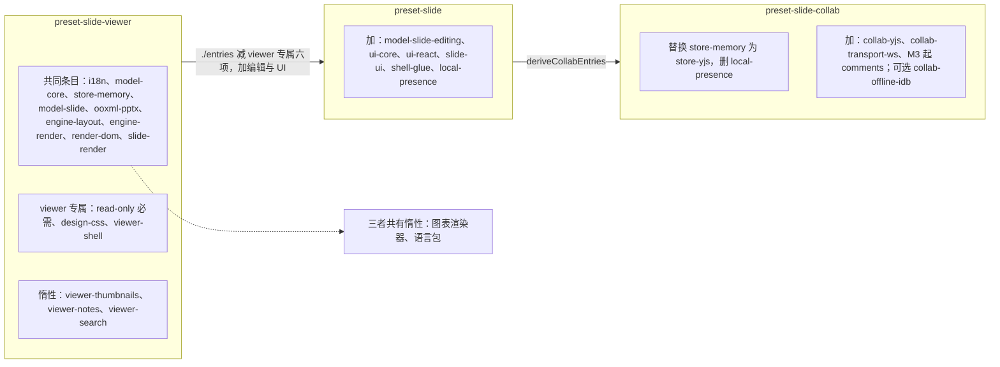
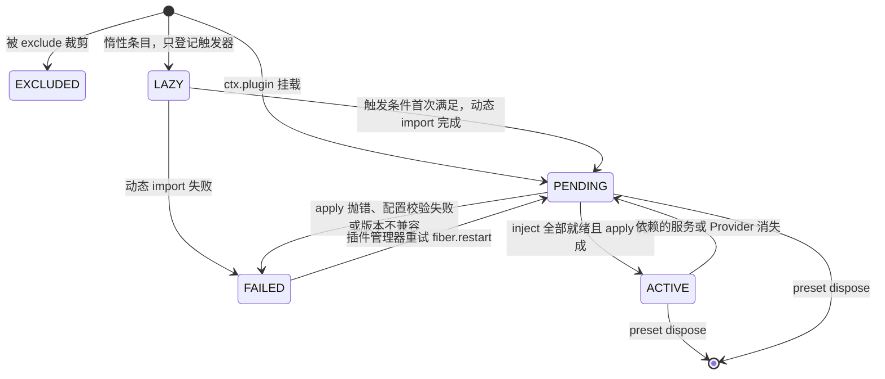
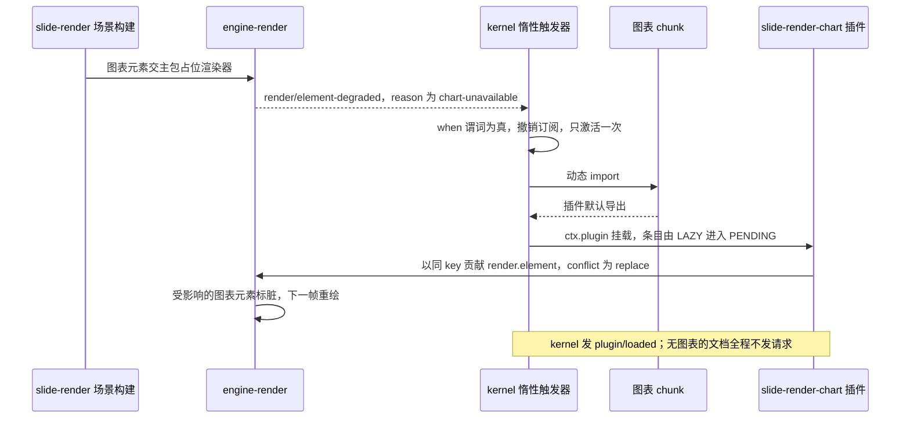
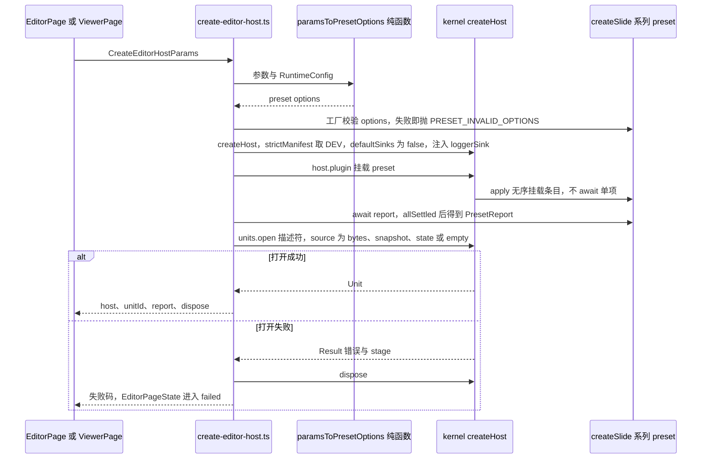
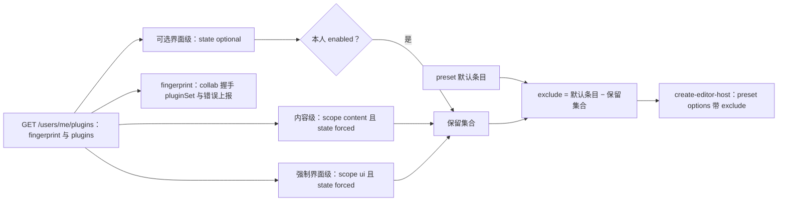
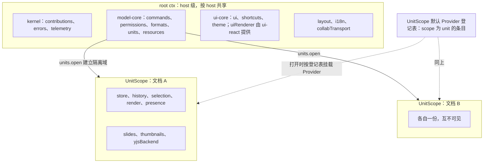
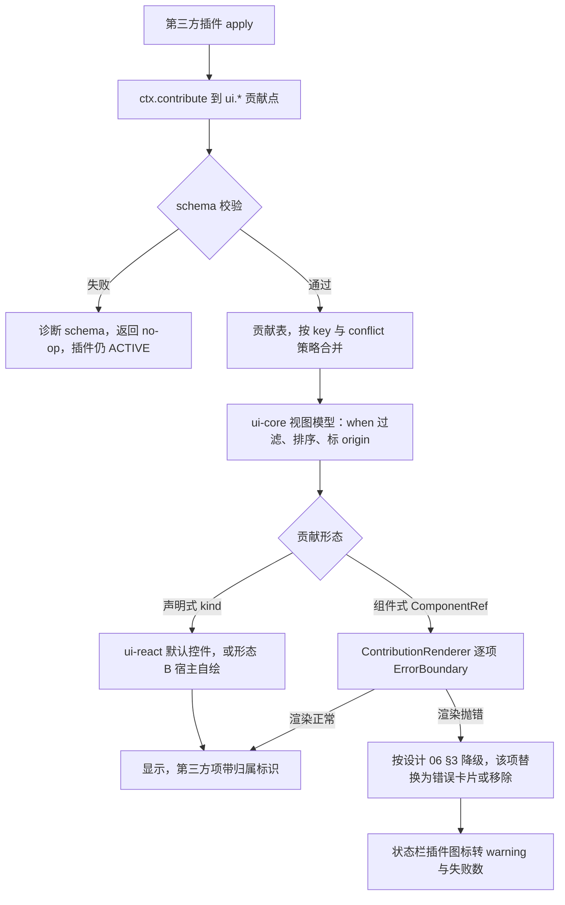
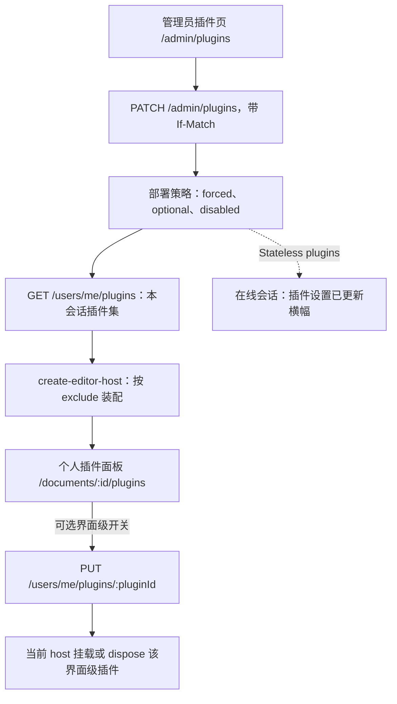

# 03 预设装配与前端插件模型
> 状态：v0.1 | 负责：前端设计线 | 更新：2026-09-25；2026-09-25（§4.19）；2026-09-26（§4.20）；2026-09-26（§4.21 Remap：原 30/08 引用按 60-backend/README §6.1 改指新位置，30/08 已删除）；2026-10-01（§4.23 插件管理：§5 按部署策略与个人选择装配、新增 §5.1 每会话插件集与 `compute-exclude`；§9 第 6、7 条改为部署预置与同源加载；§10 改写为个人插件面板与管理员页的数据流；§13 里程碑按 PRD 09 §4）；2026-10-01（§4.23 插件管理样张回写：设计承接 03-09 个人插件面板、03-32 管理员插件管理样张已确认，去掉「待样张」） | 依赖：[01 前端总览](01-overview-and-runtime-map.md)、[02 应用壳](02-app-shell-routing-and-session.md)、[30/03 内核与插件模型](../30-architecture/03-kernel-and-plugin-model.md) §3、§5–§10、[ADR-0005](../30-architecture/adr/0005-unit-scope-via-isolate.md)、[ADR-0006](../30-architecture/adr/0006-contribution-point-as-sole-registry.md)、[ADR-0010](../30-architecture/adr/0010-preset-vs-loader-composition.md)、[ADR-0015](../30-architecture/adr/0015-single-execution-entry-and-non-executable-mutations.md)、[40/11](../40-modules/11-preset-assembly-and-app-shell.md) §3、§6、§8、[40/16](../40-modules/16-plugin-catalog.md) §4–§5、[40/17](../40-modules/17-plugin-authoring-patterns.md) §2.5、[设计 06 可扩展性](../20-design/06-extensibility-ux.md)、PRD PS-02/PS-07/PS-09/PS-11、EM-01/EM-08、[rulings](../00-charter/rulings-2026-09-14.md) §4.20 FE-01、§4.23；[PRD 09 插件管理](../10-prd/03-features/09-plugin-manager.md) PM-01…PM-16

本文是浏览器侧「插件如何被组装成可运行产品」的唯一事实源：三档 preset 的定位与派生、装配运行时的行为、条目缺席的用户可见结果、惰性边界、组合根 `create-editor-host`、root ctx 与 UnitScope 的服务分布、前端贡献点与冲突策略、壳意图、第三方 UI 插件合同、插件管理器数据流、评论插件的装配位置、doc / sheet 参数化点。

**本文不写**（只链接）：装配清单本体、默认配置列与 manifest 片段（[40/11](../40-modules/11-preset-assembly-and-app-shell.md) §3.1–§3.3、§3.5，仍在 40）；装配运行时的类型签名（[40/02](../40-modules/02-kernel-protocol-and-document-core.md) 的 `kernel/src/preset/*` 与 40/11 §6）；贡献点定义与冲突策略总表（[30/03](../30-architecture/03-kernel-and-plugin-model.md) §3.6）；查看器 preset 与嵌入形态（[12](12-viewer-embedding-and-render-page.md)）；体积预算数值与 chunk 地图（[13](13-performance-and-bundling.md)）；契约套件与可插拔证据的执行（[70/02](../70-testing/02-contract-suites-and-pluggability.md)）。

## 1. 三档 preset 的定位与派生链

| preset | 定位 | 使用方 | React | 编辑 | 协同 | 基线体积（gzip） | 里程碑 |
|---|---|---|---|---|---|---|---|
| `@cordexjs/preset-slide-viewer` | 只读查看器（打开 + 渲染） | `/documents/:id/view`（M1 查看器与嵌入）、嵌入形态 C、`/render` | 无 | 无（两道只读保证） | 无 | ≤ 350 KB | M1 |
| `@cordexjs/preset-slide` | 单人编辑器 | M1 本地打开（只读渲染）、M2 起本地文档（`local:*`）的编辑器页、嵌入形态 A / B / D | 有（形态 B 排除） | 有 | 无（`local-presence` 兜底） | ≤ 900 KB | M1 装配与可插拔测试 / M2 编辑 |
| `@cordexjs/preset-slide-collab` | 协同编辑器 | M2 起 apps/web 服务端文档的编辑器页（单人编辑也经协同网关持久化，rulings §4.19 D-M2-CONTENT）；M3 起含查看者只读变体 | 有 | 有 | 有 | 协同增量 ≤ 200 KB | M2（`comments` 条目与多人协同体验层 M3） |

**派生链**（依据：rulings §4.18 FE-06、FE-07）：`preset-slide` 以 `preset-slide-viewer` 的 `./entries` 为基础加减，`preset-slide-collab` 以 `preset-slide` 的 `./entries` 经 `deriveCollabEntries` 派生；`package.json` 依赖同向（上游 preset 写 `dependencies: workspace:*`），由 R1 / R2 约束，不另设规则。

- `SLIDE = VIEWER − { read-only, design-css, viewer-shell, viewer-thumbnails, viewer-notes, viewer-search } + { model-slide-editing, local-presence, ui-core, ui-react, slide-ui, shell-glue }`；`model-core` / `engine-render` 的配置换成编辑器默认；`locale-packs` 以**同一 id 替换**而非追加（避免 `PRESET_DUPLICATE_ENTRY`）。
- `COLLAB = derive(SLIDE)`：`store-memory → store-yjs`、删 `local-presence`、加 `collab-yjs`、`collab-transport-ws`，可选 `collab-offline-idb`（M4 P2 前默认关）；M3 起另加 `comments`（§11，rulings §4.19 D-COMMENTS-PKG）。
- 超集关系：`preset-slide ⊇ preset-slide-viewer − {上面六个 viewer 专属条目}`，由 `superset.test.ts` 断言。

**图 1 三档 preset 的派生链与条目集合**



怎么读：三个子图是三档 preset 的条目集合；实线是 `./entries` 派生方向（与 `package.json` 依赖同向）；虚线表示惰性条目挂在共同条目上、三档都有。`preset-slide` 与 `preset-slide-collab` 继承上游全部未被减去的条目。

依据：[40/11](../40-modules/11-preset-assembly-and-app-shell.md) §3.1 派生式；[30/02](../30-architecture/02-layering-and-packages.md) §4.21 / §4.21b；rulings §4.18 FE-06/FE-07。

## 2. 装配运行时的行为

装配运行时位于 `@cordexjs/kernel/src/preset/`（`entry` / `lazy` / `mount` / `report` / `validate` 五文件，M-02 承载，C-07），三个 preset 与未来的 `preset-doc` / `preset-sheet` 共用。本节定行为，类型签名见 [40/11](../40-modules/11-preset-assembly-and-app-shell.md) §6。

| 阶段 | 行为 | 失败出口 |
|---|---|---|
| 选项校验 | `createXxxPreset(options)` 先以 `strictObject` schema `parse`；**在任何挂载之前**失败（EM-01「启动前抛出，不部分激活」） | 抛 `PRESET_INVALID_OPTIONS`，含字段路径 |
| 清单校验 `validateEntries` | 同一 preset 内 `id` 唯一；`required` 条目（viewer 的 `read-only`）不可被 `exclude` | 重复 id → `PRESET_DUPLICATE_ENTRY`（抛）；排除必需条目 → `PRESET_REQUIRED_ENTRY`（抛） |
| 裁剪 `applyTrim` | `exclude` 移除；`override` 替换 `plugin`；`configure` 与条目默认配置合并：**对象逐键深合并，数组与标量整体替换，`undefined` 忽略**（本文定，补 40/17 §7 G-8 的规格空白） | `override` / `configure` 的键不在清单 → `PRESET_UNKNOWN_ENTRY` 诊断，不抛 |
| 挂载 `mount` | `apply` 内对裁剪结果**无序**遍历（`Set` 语义）逐项 `ctx.plugin(entry.plugin, entry.config)`，**不 await 单项**；`scope:'unit'` 的条目不挂根，而是经 `units.registerUnitProvider` 登记为 UnitScope 默认 Provider（§6.2）；惰性条目只登记触发器（§4） | 单项 `apply` 抛错 → 该 Fiber `FAILED`，兄弟不受影响（30/03 §8） |
| 报告 `report()` | 全部 `ctx.plugin` 调用后 `Promise.allSettled`，再等一个微任务队列排空，生成 `PresetReport` 快照；之后的状态变化只经 `plugin/loaded`、`plugin/failed`、`plugin/incompatible` 事件推送 | — |
| 销毁 | `dispose` = 逆序 `fiber.dispose()`，effect 全部清空（`assertNoLiveEffects`） | — |

**`PresetReport.entries[*].state` 的含义**：`EXCLUDED`（被裁剪掉）、`LAZY`（惰性条目尚未触发）、`PENDING`（已挂载但 `inject` 未满足——**不是错误**，附缺失服务名）、`ACTIVE`、`FAILED`（附 `ErrorEnvelope`）。不变量：`entries.length === preset.entries.length`；`FAILED` 不阻断其余条目。

**图 2 条目在 PresetReport 中的状态**



怎么读：方框是 `PresetReport` 里的条目状态，箭头上是触发条件；`PENDING` 可以长期停留（例如 `collab-yjs` 在 `store-memory` 的 Unit 下等待 `yjsBackend`），它是可诊断状态而非失败；`EXCLUDED` 是终态。

依据：[30/03](../30-architecture/03-kernel-and-plugin-model.md) §7–§8；ADR-0010 决策 1、2、6；[40/11](../40-modules/11-preset-assembly-and-app-shell.md) §2.1。

## 3. 条目缺席 → 用户可见结果

「缺席」含三种来源：被 `exclude`、`FAILED`、长期 `PENDING`。章程 §5.4 要求任一非必需条目缺席后 host 仍可启动；本表规定**用户看到什么**与**可诊断的信号**，是 `pluggable.test.ts` 断言的依据。条目 id 与所属包以 [40/11](../40-modules/11-preset-assembly-and-app-shell.md) §3.1 为准。

| 条目 | 缺席后用户可见结果 | 诊断信号 |
|---|---|---|
| `i18n` | 界面文案显示为 key；功能可用 | `plugin/failed` 或 PresetReport `EXCLUDED` |
| `model-core` | 任何文档都无法打开，编辑器页进入失败态 | `units` 服务缺席（`unit/open-failed` 由 `units` 发出，此时无人发）：依赖 `units` / `commands` 的条目 `PENDING` 附缺失服务名；`create-editor-host` 取不到 `units` 即返回失败；host 仍健康 |
| `store-memory` / `store-yjs` | 打开失败态「无法打开」 | `unit/open-failed{code:'store.unavailable'}`（PRD `pluggable:m1`） |
| `model-slide` | 打开 `slide` 文档失败 | `format.no_document_type` |
| `model-slide-editing` | 编辑类按钮禁用、快捷键无效，画布可浏览（等价只读） | 执行编辑命令 → `COMMAND_NOT_FOUND` |
| `ooxml-pptx` | 无法打开或导出 `.pptx`；空白新建仍可用 | `format.no_codec` |
| `engine-layout` | 画布不渲染（`engine-render` 等待度量） | `engine-render` `PENDING` |
| `engine-render` / `render-dom` | 画布空白，命令与面板照常（PRD `render.target=noop`：`unit/opened` 触发、无异常） | `render-dom` 缺席时 `LAYOUT_MEASURER_MISSING` |
| `slide-render` | 画布空白（无 `render.scene:slide`） | `render.scene` 缺失诊断 |
| `slide-render-chart`（惰性） | 图表保持占位，其余元素正常 | `render/element-degraded{reason:'chart-unavailable'}` |
| `locale-packs`（惰性） | 切换语言后仍显示默认语言（zh-CN） | `i18n` 缺 key 诊断 |
| `read-only`（viewer 必需） | 不允许缺席 | `PRESET_REQUIRED_ENTRY`（创建时抛出） |
| `design-css`（viewer） | 查看器无主题样式；宿主须自行静态引入 CSS | — |
| `viewer-shell`（viewer） | 只有画布，无工具条与键盘（集成方自绘壳） | — |
| `viewer-thumbnails` / `-notes` / `-search` | 入口不渲染、不留占位（Q18） | — |
| `local-presence`（slide） | 无在场头像；单人编辑不受影响 | `presence` 缺席，`isCollab=false` |
| `ui-core` | 无编辑器 UI（headless）；`ui-react`、`slide-ui` `PENDING` | 两者 `PENDING` 附缺失 `ui` |
| `ui-react` | 形态 B：`ui-core` 贡献照常注册，宿主自绘；须与 `slide-ui` 一并排除（`FRAMEWORK_FREE_EXCLUDES`） | — |
| `slide-ui` | 空 Ribbon、空侧栏，画布可缩放 | — |
| `shell-glue` | 应用栏「⋯」为空、`Mod+E` 无效、`app` 命名空间文案缺失 | — |
| `collab-transport-ws` | 不连服务器，单人可编辑；`collab-yjs` `PENDING` | `collab-yjs` `PENDING` 附缺失 `collabTransport` |
| `collab-yjs` | 单人模式：无在场、无协同状态胶囊 | `isCollab=false` |
| `collab-offline-idb` | 离线更改只保存在内存，关页即失（提示方式见 [07](07-collaboration-client.md) §7） | 缺失即内存队列降级 |
| `comments`（M3） | 评论页签、画布评论钉与缩略图角标不渲染；快照中 `comments.threads` 资源的保留方式由 `resources` 服务对未注册命名空间的规则决定（[04](04-document-commands-and-undo.md)） | — |

## 4. 惰性边界与触发

惰性条目 = `lazy: () => Promise<Plugin>` + `activateWhen`，三种触发形式固定（ADR-0010 决策 2）：`{ event, when? }`、`{ contributionSeen }`、`'manual'`；`when` 谓词用于按载荷过滤事件。

| 惰性条目 | 触发 | 未加载前 | 加载后 | 加载失败 |
|---|---|---|---|---|
| `slide-render-chart`（M1–M2 为 `slide-render/chart` 子路径，M3 起独立包，只改 import，rulings §4.18 FE-08） | `{ event:'render/element-degraded', when: p => p.reason === 'chart-unavailable' }` | 图表元素走主包占位 | 以同 key 覆盖 `render.element`（`conflict:'replace'`），已挂载的图表元素标脏重绘 | 占位保持；`plugin/failed`；按 [02](02-app-shell-routing-and-session.md) §12 判定版本漂移 |
| `locale-packs` | `{ event:'i18n/locale-changed' }` | 回退默认语言 | 语言包贡献 `i18n.bundle`，界面重渲 | 保持默认语言并 toast |
| `viewer-thumbnails` / `viewer-notes` / `viewer-search` | `'manual'`（`viewer-shell` 在对应选项为真时激活） | 入口不渲染 | 见 [12](12-viewer-embedding-and-render-page.md) §4 | 入口隐藏，查看器其余部分不受影响 |

**触发语义**：preset `apply` 时订阅触发事件（`ctx.once`，首次激活后撤销订阅）；同一条目的并发触发共享一个进行中的 Promise（只 import 一次）；激活成功后条目从 `LAZY` 进入 `PENDING` / `ACTIVE`，并由 kernel 发 `plugin/loaded`。`{ contributionSeen }` 当前没有条目使用，保留为 API 完整性。

**`/render` 关闭惰性**：`/render` 装配 viewer 时 `lazy.charts` 与 `lazy.locales` 置 `false`，惰性条目按普通条目随首屏挂载，保证首帧后不会再有惰性重绘（依据：rulings §4.18 FE-09；ready 判据见 [12](12-viewer-embedding-and-render-page.md) §11）。惰性 chunk 的体积上限与预加载策略见 [13](13-performance-and-bundling.md) §6–§7。

**图 3 惰性图表渲染器的激活**



怎么读：自上而下是时间顺序；触发器只对第一个满足谓词的事件起作用，之后同类事件不再引起加载；替换发生在贡献表层面，场景与其它元素渲染器不受影响。

依据：ADR-0010 决策 2；[30/03](../30-architecture/03-kernel-and-plugin-model.md) §3.6（`render.element` 为 replace，rulings §4.18 GV-24）；[40/11](../40-modules/11-preset-assembly-and-app-shell.md) §3.1 `slide-render-chart` 行。

## 5. 组合根 `create-editor-host`

`apps/web/src/application/host/create-editor-host.ts` 是仓库中唯一调用 `createHost` 与 `createSlide*Preset` 的应用代码（[02](02-app-shell-routing-and-session.md) §1）。它把页面参数 `CreateEditorHostParams` 交给纯函数 `paramsToPresetOptions(params, runtimeConfig)`（`domain/host-options.ts`，不做 IO、不调用 `createHost`），再按 `switch(resolveDocumentType(documentType).presetKeys[params.preset])` 选工厂。

**图 4 create-editor-host 装配时序**



怎么读：自上而下是一次装配；选项校验在任何挂载之前完成，所以失败不会留下半激活的 host；`report` 只是快照，`PENDING` 条目不会阻塞 `units.open`。

依据：[40/11](../40-modules/11-preset-assembly-and-app-shell.md) §3.5 接入点表；ADR-0010 决策 1、6；[30/03](../30-architecture/03-kernel-and-plugin-model.md) §5.3。

**`CreateEditorHostParams` → preset options 的映射**（`paramsToPresetOptions`）

| 选项 | 来源 | 说明 |
|---|---|---|
| preset 键 | [02](02-app-shell-routing-and-session.md) §6「preset 选择」 | 文档类型无关的 `edit` / `collab` / `view`；经 `DOCUMENT_TYPES[documentType].presetKeys`（§12）映射为 `slide` / `slide-collab` / `slide-viewer` 工厂 |
| `locale` | `Preferences.locale` | 进入编辑器时把应用壳 `createI18n()` 实例的当前语言与已加载语言包交给 host（依据：NOHOST-I18N；[16](16-i18n-and-accessibility.md) §3） |
| `theme` | `Preferences.theme` / `density`；`<meta name="cordex-nonce">` | `apps/web` 取 `injectCss:false`（主题 CSS 由 `styles.css` 静态引入），仍把 meta 中的 nonce 作为 `cssNonce` 传入，供第三方运行时样式注入点使用（[14](14-client-security.md) §3）；嵌入宿主取 `injectCss:true` 并传 `cssNonce`（[12](12-viewer-embedding-and-render-page.md) §6） |
| `permissions` | `DocumentDetail.capabilities` | 单人：`{ capabilities }`（`ROLE_CAPABILITIES[role]`）；协同：初值同左，此后只经网关 `CONTROL.permission` → `applyRemoteDecisions` 更新（[07](07-collaboration-client.md) §8） |
| `user` | `Session.principal` | `{ id, displayName, avatarUrl?, color? }` |
| `collab` | `RuntimeConfig.wsBase`、文档 id | `endpoint = {wsBase}/collab/v1/rooms/{documentId}`；`getToken = () => POST /documents/{id}/collab-ticket`（带分享令牌头，[02](02-app-shell-routing-and-session.md) §11）；`offline.enabled` M4 P2 前恒为 `false` |
| `shell` | 固定 + `features.developerMenu` | `moreMenu` 七项开关；`onIntent` 指向 `pages/editor/editor-intents.ts`（§8） |
| `i18n.bundles` | `app` 命名空间 zh-CN / en-US | 由 `shell-glue` 贡献为 `i18n.bundle`（`apps/web` 自身不 `contribute`） |
| `media.upload` | `apps/web` 默认实现 | `(file) => Promise<{ assetId, sha256 }>`：presign → 直传 → commit、≥ 10 MB 分片、临时 mediaId 替换、失败重试 3 次（依据：MEDIA-CLIENT，authority：60-backend/04 §7（原 30/08 篇 §16.1「uploadAsset 由集成方或 apps/web 默认实现」）+ rulings C-30；行为细节见 [05](05-rendering-and-thumbnails.md) §8）；集成方可替换为自己的存储 |
| `lazy` | 固定 | 编辑器页 `{ charts:true, locales:true }`；`/render` 为 `false`（§4） |
| `history.limit` | 固定 | 编辑器 200；viewer 0 |
| sinks | `RuntimeConfig.telemetry` + `Preferences.diagnostics.*` | `application/host/sinks.ts` 选 console / OTel Web / no-op，经 `HostOptions.loggerSink` 与 `configure['kernel']` 交给 kernel 的 `errors.sink` / `telemetry.sink`（[15](15-events-errors-and-telemetry.md) §6–§9） |
| `exclude`（2026-10-01，§4.23） | `GET /api/v1/users/me/plugins` 的本会话插件集（§5.1） | `computeExclude(presetEntries, pluginSet)` 算出的条目 id 集合并入 preset 的 `exclude`；必需条目（`required`）不可能落入（部署侧已锁定为 `forced`）；嵌入宿主不经此路径，自行决定 `exclude`（EM-08） |

### 5.1 每会话插件集与 `compute-exclude`（2026-10-01，rulings §4.23）

依据：[PRD 09](../10-prd/03-features/09-plugin-manager.md) PM-03、PM-04、PM-08、PM-10、PM-13；rulings §4.23 裁决 1–3 与 O-1、O-2（2026-10-01 已确认）。

装配什么由**部署策略 + 本人选择**决定，不由界面决定。`create-editor-host` 在调用 preset 工厂前取本会话插件集：

- **来源**：`application/plugins/plugin-set.ts` 调 `GET /api/v1/users/me/plugins`（[60/15](../60-backend/15-rest-api-catalog.md) §3.15），得到 `{ fingerprint: { catalog, policy }, plugins: [{ id, version, scope, source, entry?, state, enabled, defaultOn? }] }`。响应按账号保存（O-2），浏览器只在内存中缓存本标签页的一份；个人选择的事实源在服务端，换设备一致。未登录的 `/render` 与嵌入宿主不走此路径。
- **计算**：`domain/plugins/compute-exclude.ts` 是纯函数 `computeExclude(presetEntries, pluginSet): ReadonlySet<PluginId>`——保留集合 = 内容级集合（`scope:'content'` 且 `state:'forced'`）∪ 强制界面级（`scope:'ui'` 且 `state:'forced'`）∪ 本人开启的可选界面级（`state:'optional'` 且 `enabled`）；`exclude` = preset 默认条目 − 保留集合。`state:'disabled'` 与部署级被拒的插件不出现在响应里，自然被排除。
- **指纹**：`fingerprint` 原样交给 `collab` 选项，随协同握手 Auth token 上送为 `pluginSet`（[07](07-collaboration-client.md) §2）；同时进入错误上报的公共字段（[15](15-events-errors-and-telemetry.md) §6）。
- **失败**：取插件集失败（网络、5xx）时重试一次，仍失败则按「镜像内置默认组成」装配并在个人插件面板顶部提示「未能读取插件设置，已按默认组成打开」；不阻断打开文档。协同会话随后若因 `catalog` 不符被 4426 关闭，按版本漂移处理（[02](02-app-shell-routing-and-session.md) §12）。
- **个人启停即时生效**（O-1）：在个人插件面板切换可选界面级插件时，先 `PUT /api/v1/users/me/plugins/:pluginId`，成功后在当前 host 上 `host.plugin(entry)` 挂载或对其 Fiber `dispose()`（卸载后贡献消失、无残留，PS-06 第 2 项），不重建 host、不刷新页面、不改指纹；请求失败时开关回弹并 toast。只有界面级插件能走这条路径：作用域判定保证它们不贡献 Mutation 与带写能力位的命令（PM-02、PM-13）。
- **管理员变更不热切换**（O-1）：管理员保存后本会话的装配不变；协同网关推 Stateless `plugins` 控制消息后，页面显示横幅「管理员更新了插件设置，重新加载后生效」[重新加载]（[07](07-collaboration-client.md) §9）。

**图 4a 本会话插件集到 `exclude`**



怎么读：左端是服务端下发的本会话插件集，按作用域与三态分成三股；只有可选界面级经过「本人是否开启」的判断。保留集合与 preset 默认条目相减得到 `exclude`，交给组合根；指纹另走一条线，供协同握手与错误上报使用。
依据：PRD PM-03、PM-08、PM-10、PM-13；本文 §5 映射表；[60/15](../60-backend/15-rest-api-catalog.md) §3.15。

## 6. root ctx 与 UnitScope

### 6.1 服务分布

UnitScope 以 `ctx.isolate` 为每个打开的文档建立独立解析域（ADR-0005）。浏览器三档 preset 下的服务分布：

| 位置 | 服务 | 提供方 |
|---|---|---|
| root ctx（按 host 共享，不隔离） | `contributions`、`errors`、`telemetry`、`commands`、`permissions`、`formats`、`documentTypes`、`migrations`、`resources`、`units`、`layout`、`i18n` | kernel、model-core、engine-layout、i18n |
| root ctx | `ui`、`shortcuts`、`theme`、`uiRenderer` | ui-core（定义）、ui-react（`uiRenderer` Provider） |
| root ctx | `collabTransport` | collab-transport-ws（按需 `connect()`） |
| UnitScope（每文档一份） | `store`、`history`、`selection`、`render`、`presence` | store-memory 或 store-yjs、model-core 默认 Provider、engine-render + render-dom、local-presence 或 collab-yjs |
| UnitScope | `slides`（`documentType.unitServices`）、`thumbnails` | model-slide、slide-render |
| UnitScope | 所选 store Provider 额外 `provide` 的服务（如 `yjsBackend`） | store-yjs |

根级插件看不到任何隔离服务（lint `no-unit-scoped-inject-at-root`）；因此 `collab-yjs` 在 `store-memory` 的 Unit 下自然 `PENDING`，这正是「协同需要 yjs 存储」的可诊断形态。

**多 Unit 共存**：SDK 允许一个 host 打开多个 Unit，每个 Unit 的 `store` 互不可见，UI 壳的上下文键按 `unitId` 分桶（[40/10](../40-modules/10-ui-shell-and-slide-ui.md) §3）。`apps/web` 选择**一个文档一个 host**（`HostRegistry` 以 `documentId` 为键），以隔离快捷键焦点、样式注入与销毁边界；集成方同页放 ≥ 4 个编辑器实例时同样建议一实例一 host（EM-01）。

**图 5 root ctx 与 UnitScope 的服务分布**



怎么读：上方子图是根作用域的服务，任何插件都可 `inject`；下方每个子图是一个文档的隔离域，子树内 `inject:['store']` 只解析到本文档；虚线表示 preset 中 `scope:'unit'` 的条目不挂根，而是在每次 `units.open` 时按登记表挂进新 Unit。

依据：[30/03](../30-architecture/03-kernel-and-plugin-model.md) §5.1–§5.4；ADR-0005；[40/11](../40-modules/11-preset-assembly-and-app-shell.md) §2.1 `PresetEntry.scope`。

### 6.2 UnitScope 默认 Provider 登记

登记 API 已定（rulings §4.20 FE-01，M1 前定稿；40/11 §13 Q-2 结案）：model-core 的 `units` 服务（`unit/units.service.ts`，API 面登记在 [40/02](../40-modules/02-kernel-protocol-and-document-core.md) §6）新增两个方法。

```ts
// model-core units 服务；preset 的 mount 对每个 scope:'unit' 条目调用一次 registerUnitProvider
interface UnitsService {
  // …open / close 等既有方法见 40/02
  registerUnitProvider(entry: { id: PluginId; plugin: Plugin; config?: unknown; provides: readonly string[] }): Disposer // 由 preset 的 effect 持有
  listUnitProviders(): readonly { id: PluginId; provides: readonly string[] }[]                                          // 供插件管理器与诊断
}
```

- **登记分工**：model-core 在 ready 时只登记自己的 `history`、`selection` 默认 Provider；`store`、`render`、`presence`、`collab-yjs`、`comments` 由 preset 中 `scope:'unit'` 的条目在 mount 时登记。model-core 不 import 任何水平层 Provider（章程 §5.3 只向下，既有 depcruise 秩规则兜底）；`units.open` 按登记表挂载。
- **唯一性**：同一 `provides` 服务名只允许登记一次，后来者被拒并记诊断、不抛；`exclude` 的条目不登记，打开的 Unit 中对应服务缺席，依赖方 `PENDING`。
- **生效时点**：登记在 `units.open` 之前或之后都可，登记表的变化只影响之后打开的 Unit；已打开的 Unit 不受后续登记或撤销影响（需重开才生效）。
- **撤销**：preset `dispose` 时撤销全部登记；已打开的 Unit 随 host 一并销毁。
- **不再有 `Config.defaultStoreProvider`**：store 由唯一的 `provides:['store']` 登记决定，`deriveCollabEntries` 把 `store-memory` 替换为 `store-yjs`（§1）即完成切换。
- **条目形状**：`PresetEntry` 带 `scope: 'host' | 'unit'` 与 `provides?: readonly string[]`，30/03 §9 与 40/11 §2.1 同形；`comments` 包按 Unit 的评论服务也走 `scope:'unit'` 登记（§11），不经文档类型的 `unitPlugins`。

## 7. 前端贡献点清单与冲突策略

贡献点是唯一的注册抽象（ADR-0006）。下表列出浏览器侧被使用的贡献点；项类型、键规则与 `conflict` 取值**以 [30/03](../30-architecture/03-kernel-and-plugin-model.md) §3.6 总表为准**，本表只给前端视角的贡献方与失败时的呈现。

| 贡献点 | 定义包 | 浏览器内贡献方 | conflict（30/03 §3.6） | 缺席或失败时的呈现 |
|---|---|---|---|---|
| `ui.ribbon` / `ui.toolbar` / `ui.panel` / `ui.contextMenu` / `ui.statusBar` / `ui.dialog` / `ui.notification` | ui-core | slide-ui、ui-react、shell-glue（`appBar.more` 七项）、第三方 | replace | 按设计 06 §3 降级表（§9） |
| `ui.shortcut` | ui-core | ui-react、slide-ui、shell-glue（`Mod+E`） | replace | 快捷键无效，冲突由 `shortcuts` 服务诊断 |
| `ui.command` | ui-core | ui-core、ui-react、slide-ui | replace | 命令面板缺标题，回退显示命令 id |
| `ui.theme` | ui-core | 预留（Beta） | replace | 校验失败拒绝并诊断，主题不变 |
| `render.target` / `render.scene` | engine-render | render-dom（`dom`）、slide-render（`slide`） | error | 画布空白（§3） |
| `render.element` | engine-render | slide-render（含图表占位）、`slide-render-chart`（同 key 覆盖） | replace | 单元素占位 + `render/element-failed` |
| `render.overlay` | engine-render | render-dom（选区、参考线、远端光标等）、slide-render（`master-inheritance`）、评论钉（M3） | replace | 该覆盖层停止渲染，画布与其它覆盖层不受影响 |
| `layout.measurer` | engine-layout | render-dom（`canvas`） | error | `LAYOUT_MEASURER_MISSING` |
| `i18n.bundle` | i18n | 各 UI 包、shell-glue（`app`）、locale-packs | replace | 显示 key |
| `core.permissionPolicy` | model-core | viewer `read-only` | error | viewer 中不可缺席 |
| `core.command`（Operation `shell.intent`） | model-core | shell-glue | error | 「⋯」菜单为空（§3） |
| `errors.sink` / `telemetry.sink` | kernel | 由 `apps/web` 经 `HostOptions` 交给 kernel 自身贡献 | error | 回退 no-op，不影响功能 |

- **`replace` 只在贡献点定义时显式声明才允许**，当前取值以 30/03 §3.6 conflict 列为准（`ui.*`、`render.element`、`render.overlay`、`i18n.bundle`；依据：rulings §4.18 GV-24）；其余为 `error`：重复键拒绝后者、记 `duplicate` 诊断、返回 no-op disposer，**不抛异常**。
- 坏贡献（schema 校验失败）同样只诊断不抛（30/03 §3.3），一个坏贡献不会让整个插件 `FAILED`。
- 第三方命名：新定义的贡献点、事件、能力位用 `<vendor>:` 前缀（`vendor` = npm scope 去 `@`）；向既有点贡献的条目 id 用 `<pluginId>.<localId>`；`when` 子句只能引用 ui-core `context-keys.ts` 登记的键（`scan-contributions` 规则 (e)）。上下文键全集见 [09](09-ui-system-and-theming.md) §6。

## 8. `shell-glue` 与壳意图

编辑器内需要**离开 SDK 边界**的动作（导航、打开应用级对话框）统一表达为 Operation `shell.intent{ target, unitId, payload? }`，经 `commands.execute` 走权限、审计、遥测的单一入口（ADR-0015 决策 1），再由 preset 选项 `shell.onIntent` 交给宿主。胶水插件 `preset-slide#shell-glue` 只把宿主回调与语言包翻译为既有贡献点条目，**不含业务规则**。

| `target` | 菜单项（`ui.contextMenu{slot:'appBar.more'}`） | 默认开关 | `apps/web` 的处理（`pages/editor/editor-intents.ts`） |
|---|---|---|---|
| `export` | 导出…（`Mod+E`） | 开 | 打开对话框路由 `/documents/:id/export` |
| `fidelity-report` | 保真报告 | 开 | 导航 `/documents/:id/fidelity` |
| `version-history` | 版本历史 | 开 | 导航 `/documents/:id/history`；缺 `history.read` 时 toast 说明（`CapabilityGuard` 兜底） |
| `plugin-manager` | 插件管理器（即个人插件面板，PRD PM-10；2026-10-01 §4.23） | 开 | 导航 `/documents/:id/plugins`；管理员另见「去管理 › 插件」链接（§10） |
| `rename` | 重命名 | 开 | 应用栏标题进入内联编辑（与 `onRename` 同一路径） |
| `duplicate` | 创建副本 | 开 | 端点登记前 `apps/web` 传 `moreMenu.duplicate:false`，该项不贡献（[02](02-app-shell-routing-and-session.md) §13.3） |
| `developer` | 开发者 | `import.meta.env.DEV \|\| features.developerMenu` | 打开开发者面板（[15](15-events-errors-and-telemetry.md) §10；rulings §4.12 U-16） |

- Operation 能力位为 `doc.read`：任何能打开文档的角色都能触发意图，是否放行由宿主侧路由守卫决定。
- 宿主未提供 `onIntent`：handler 返回 `shell.no_host` 诊断，菜单项仍在但点击无效果（集成方需要自行处理或经 `moreMenu` 关闭）。
- 选「preset 胶水」而非「`apps/web` 注入 React 菜单」的原因：应用栏右侧顺序固定（rulings §4.10 Q14），且 `apps/web` 禁止 `ctx.contribute(`；无 host 的开始页、文档列表直接使用 ui-react 的 `UserMenu` 普通组件，不经贡献点。
- 胶水极薄：`plugins/*.plugin.ts`、`policies/*.plugin.ts`、`shell/*.plugin.ts` 的 `apply` ≤ 60 行，不得值导入 `@cordexjs/model-*`（ESLint `max-lines-per-function` + `no-restricted-imports`，TD-094）。

## 9. 第三方 UI 插件的前端合同

依据：rulings §4.15 Q2（第三方 UI = 声明式 + React 组件，经逐项 ErrorBoundary 与 axe 夹具）；设计 06 §1、§3、§4。

1. **两种贡献形态**：声明式（按 `kind` 使用 ui-react 默认控件，零框架代码，形态 B 下也能被宿主自绘）；组件式（`ComponentRef<P>`，React 绑定下即 `React.ComponentType<P & SlotProps>`，只在装了 `ui-react` 时渲染）。
2. **逐项隔离**：每个贡献由 `ContributionRenderer` 包一层 ErrorBoundary；组件抛错只替换该项为降级表达，`plugin/failed` 不冒泡到壳；Fiber 级失败（`apply` 抛错）由 kernel 隔离（30/03 §8）。
3. **降级表达**（设计 06 §3）：页签唯一贡献方失败 → 整个页签不渲染；部分分组失败 → 只缺该分组；已打开的面板 → 错误卡片（「该面板不可用」+ 错误摘要 + 重试 / 禁用）；未打开的面板 → 检查器页签隐藏；状态栏项 → 淡出移除；覆盖层 → 停止渲染；任意失败 → 状态栏「插件」图标转 warning 并显示失败数，点击进入插件管理器并预筛「启动失败」。
4. **归属标识**：来源判定 = 贡献所属插件 id 不在当前 preset 的默认条目集合中即为第三方（ui-core 视图模型对照 `PresetReport.entries[*].id` 得出 `origin: 'builtin' | 'third-party'`）；第三方项按设计 06 §4 显示 16 px 插件图标与「由 <插件名> 提供」，内置项不带标识。
5. **可访问性**：组件式贡献须在 ui-react `testing` 的 `axeCheck` 夹具下零违规（插件作者模板自带该用例）；焦点、键盘与 ARIA 规则同内置组件（[16](16-i18n-and-accessibility.md)）。
6. **信任模型**：同源可信、无运行时沙箱（章程 §2.3）；第三方代码只在部署时经签名或审核记录校验后进入部署（PRD PM-05）。贡献清单（「该插件将新增：2 个 Ribbon 按钮、1 个面板」）在**管理员**首次把第三方插件从「禁用」改为启用时的确认卡里展示（PM-06），普通用户不再看到首次启用确认（2026-10-01 §4.23 裁决 1、2；原口径「启用前向用户展示」作废）。第三方页签 `order ≥ 1000`，排在内置页签之后（[10](10-editor-shell-and-interaction.md) §4）。
7. **装入方式**：集成方在自己的组合根 `host.plugin(thirdPartyPlugin)`，或在宿主代码内写内联插件贡献（EM-08）。`apps/web` **在任何里程碑都不提供**上传、URL 安装或市场之类的加载界面（2026-10-01 §4.23 裁决 2；原「M4 前不提供」作废）：第三方插件只经部署的插件声明文件（`plugins.catalogFile`，[60/17](../60-backend/17-deployment-and-config.md) §5.16）加入。M4 起，挂载目录中第三方插件的浏览器产物由 web 容器以同源静态路径 `/plugins/{sha256}/…` 提供（内容寻址、`immutable`），本会话插件集里该条目带 `entry`；`create-editor-host` 对每个 `entry` 做动态 `import()`，取默认导出的插件对象后与 preset 条目一起挂载。CSP `script-src 'self'` 不放宽（[14](14-client-security.md) §2）；`entry` 只接受以 `/plugins/` 开头的同源路径，其它形态直接拒绝并记 `plugin/failed`。动态 `import()` 失败按惰性件失败处理：该插件 `FAILED`、个人插件面板可重试，不判定为版本漂移（[02](02-app-shell-routing-and-session.md) §12 只对应用自身 chunk 生效）。

**图 6 第三方 UI 贡献的渲染与失败隔离**



怎么读：自上而下是一条贡献从注册到上屏的路径；两个菱形分别是注册期的 schema 校验与渲染期的形态分流；任何一处失败都只影响这一条贡献，插件其余贡献与编辑器壳照常。

依据：ADR-0006；[30/03](../30-architecture/03-kernel-and-plugin-model.md) §3.3、§8；设计 06 §3–§4；[40/10](../40-modules/10-ui-shell-and-slide-ui.md) §2.5。

## 10. 个人插件面板、管理员插件页的数据流与版本协商

2026-10-01 按 rulings §4.23 改写：原「插件管理器页只读 host、M4 起在此页启停第三方插件」作废。插件管理分两处（PRD PM-06、PM-10）：

- **个人插件面板**（`/documents/:id/plugins`，即 PS-11 所称「扩展」面板与原插件管理器页；设计承接 03-09 重写稿，2026-10-01 样张已确认）：三分组「本部署统一启用」（只读，徽标「由管理员统一」）、「我的界面插件」（开关，M3）、「本文档缺少的插件」（足迹比对触发时出现，[04](04-document-commands-and-undo.md) §1.1）；对本会话失败的插件任何人可重试。
- **管理员插件页**（`/admin/plugins`，[02](02-app-shell-routing-and-session.md) §2；设计承接 03-32，2026-10-01 样张已确认）：清单、八种部署级状态、三态控件与锁定、详情、依赖与互斥、变更确认卡；只经 REST，不读 host。

| 数据 | 来源 | 呈现 |
|---|---|---|
| 条目清单与本会话状态 | `create-editor-host` 返回的 `PresetReport` 快照 | 个人面板：运行中 / 等待依赖 / 启动失败 / 未加载（惰性）；被 `exclude` 的条目按本会话插件集归入对应分组，不单列「已排除」 |
| 实时变化 | `plugin/loaded`、`plugin/failed`、`plugin/incompatible`、`contribution/changed` | 在快照上增量更新，不重读 report |
| 部署策略与本人选择 | `GET /api/v1/users/me/plugins`（§5.1） | 分组归属；可选界面级的开关与「管理员默认开 / 关」说明 |
| 等待依赖的原因 | `host.diagnostics()` 的 `dumpFiberTree`：`PENDING` 附缺失服务名 | 「等待：yjsBackend」等可操作提示（PS-09） |
| 贡献清单 | 各包 manifest 的 `contributes` + `contributions` 服务的当前表 | 每个条目下列出贡献点与数量 |
| 失败详情 | `PresetReport.entries[*].error`（`ErrorEnvelope`） | 错误码、摘要、traceId，「复制诊断信息」 |
| 本文档缺少的插件 | `comparePluginFootprint` 结果（[04](04-document-commands-and-undo.md) §1.1） | 逐个列出插件、原因（`disabled` / `absent` / `outdated` / `failed`）与受影响的页 |
| 管理员页清单、部署级状态、近 24 h 失败会话数 | `GET /api/v1/admin/plugins`、`GET /api/v1/admin/plugins/:pluginId`（[60/15](../60-backend/15-rest-api-catalog.md) §3.15） | 八种部署级状态分组；响应 `ETag` 在保存时作为 `If-Match` |

- **个人面板的动作**：`FAILED` 条目「重试」（`fiber.restart()`，只影响本会话，成功后 `plugin/loaded`）；可选界面级「为我关闭 / 开启」（M3，§5.1 热切换，发 `plugin/user-toggled`）；内容级或强制启用的失败显示「如持续失败，请联系管理员」；管理员多一个「去管理 › 插件」链接。M2 只有只读、诊断与重试。
- **管理员页的动作**（M3）：一次保存可含多项三态变更，`PATCH /api/v1/admin/plugins` 带 `If-Match`；412 `server.plugins.revision_conflict` → 提示「设置已被他人更新」并重新载入；422 `server.plugins.policy_invalid`、409 `server.plugins.conflict` → 确认卡内逐项报错、不部分生效。保存成功发 `plugin/policy-changed`；本会话与其它在线会话都**不**热切换，新会话生效（O-1）。插件配置表单（M4，PM-09）由 Config schema 自动生成，经 `PUT /api/v1/admin/plugins/:pluginId/config` 保存。

**图 6a 两处插件管理与会话**



怎么读：左上是管理员路径，保存只改部署策略，影响的是之后新建的会话；中间是每次打开编辑器时取插件集再装配；右下是个人路径，只对可选界面级插件、只在本会话立即生效。虚线表示管理员保存后在线会话只收到横幅，不被热切换。
依据：PRD PM-03、PM-06、PM-08、PM-10；rulings §4.23 O-1、O-2。

- **版本协商**（ADR-0002；30/03 §10）：挂载时 `verifyManifest` 比对 `manifest.kernel` / `peers` 与 host 版本；不满足 → Fiber `FAILED` + `plugin/incompatible{ required, actual }` + 错误码 `plugin.incompatible`（阻断，不静默加载，PS-07）；`apps/web` 以 `strictManifest: import.meta.env.DEV` 创建 host，开发构建中 manifest 与源码不一致同样 `FAILED`，生产构建只诊断。插件管理器对不兼容条目显示红条与所需版本。
- **部署级版本校验**：挂载目录插件在部署时已按 `hostApi` 校验（PM-05），被拒的不会出现在本会话插件集里；浏览器侧的 `verifyManifest` 仍保留，作为同一口径的第二道检查。
- **依赖声明**：preset 对全部子条目包写 `peerDependencies: workspace:^`，对上游 preset（`./entries` 派生来源）写 `dependencies: workspace:*`（rulings §4.18 FE-06；rulings §4.15 Q1 内部依赖协议）。

## 11. 评论客户端插件的装配位置

依据：rulings §4.19 D-COMMENTS-PKG（用户裁决，章程 §5.2 登记包清单）。

- 新增 iso 包 `@cordexjs/comments`（横向能力、文档类型盲）：`threads` / `replies` 实体、ResourceHook `comments.threads`（命名空间按 INC-39 取 `comments.*`，authority：rulings §4.18 FE-01 文档类型盲 + ADR-0031）、`comments.*` 命令、`comment/*` 事件、锚点抽象（具体锚点解析由文档类型提供 resolver）。行为见 [08](08-comments-and-version-history.md)。
- M3 引入并装入 `preset-slide-collab`：条目 id `comments`，宿主级插件贡献 ResourceHook 与命令，按 Unit 的评论服务以 `scope:'unit'` 登记（§6.2）；slide 专属的锚点解析、检查器「评论」页签与画布评论钉由 `slide-ui` 贡献（`ui.panel`、`render.overlay`）。`preset-slide`（单人）与 viewer 不装。
- `pluggable:m3` 的 manifest 差异白名单相应改为 `{ −store-memory, +store-yjs, −collab-core#local-presence, +collab-yjs, +collab-transport-ws, +comments }`（`collab-offline-idb` 为可选项不计入），去掉 PRD 05 中不存在的 `+comments-ui`、`+presence-ui`、`+history-ui` 与重复的 `+collab-core`；其中 `−collab-core#local-presence` 是 [40/11](../40-modules/11-preset-assembly-and-app-shell.md) §3.2 collab manifest `replaces` 行的机械结果。白名单分阶段生效：M2 起参考应用以 `preset-slide-collab`（不含 `comments`）接协同网关，`manifest-diff.test.ts` 自 M2 起运行，期望集合为上式去掉 `+comments`；M3 引入 `@cordexjs/comments` 的同一 PR 加入 `+comments`，`pluggable:m3` 在 M3 出口按完整白名单判定（rulings §4.19 D-M2-CONTENT、D-COMMENTS-PKG）。执行与断言归 [70/02](../70-testing/02-contract-suites-and-pluggability.md) §10。
- 层号与依赖上限以章程 §5.2 的登记为准；[40/11](../40-modules/11-preset-assembly-and-app-shell.md) §3.1 的 collab 清单 M3 增 `comments` 条目。

## 12. doc / sheet 参数化点

`apps/web` 按 `DocumentType` 参数化，只有两个参数化点（[30/12](../30-architecture/12-extension-to-doc-and-sheet.md) §3.2；[40/11](../40-modules/11-preset-assembly-and-app-shell.md) §8）：

1. `src/domain/document-type.ts`：`DOCUMENT_TYPES: Record<string, DocumentTypeParam>`，`DocumentTypeParam = { id; label: I18nKey; icon; presetKeys: { edit; collab; view }; newCards: TemplateCard[] }`。新增 doc / sheet = 增加记录；未知类型走 `fallback`（通用图标、无新建卡），打开由 SDK 以 `format.no_document_type` 失败并渲染失败态。
2. `src/application/host/create-editor-host.ts` 的 `switch(presetKey)`：新增 doc = 增加 case 与对应 `@cordexjs/preset-doc` import，是 `apps/web` 内唯一会出现新包名的地方。

- 其余文件（`app/**`、`pages/**`、`application/**`、`infrastructure/**`、`domain/**` 除上一条）必须零改动：路由按 `/documents/:id` 通用；文档类型字面量只允许出现在上面两个文件（机械检查的登记状态见 [02](02-app-shell-routing-and-session.md) §1、§13.3）；开始页「新建」段的卡片来自 `DOCUMENT_TYPES[*].newCards` 拼接，多文档类型时按类型分组，布局不变。
- `preset-doc` / `preset-sheet` 复制三档 preset 的文件结构，只替换垂直束条目（`model-*`、`ooxml-*`、`*-render`、`*-ui`），装配运行时经 `@cordexjs/kernel/preset` 共享、不复制（[40/13](../40-modules/13-doc-sheet-extension-skeleton.md) §4.9–§4.10）；`preset-doc-viewer` / `preset-doc-collab` 属 M5 后续，经章程修订登记（rulings §4.18 FE-12）。
- `horizontal-freeze`（M5 起为 `scanners` job 的步骤）冻结范围是「无 `cordex.bundle` 且非组合根」的包；三档 preset 与 `apps/web` 是组合根，新增文档类型时可以改动（rulings §4.18 FE-01）。

## 13. 机械验证与里程碑

### 13.1 机械验证

本节只写断言；套件目录、kit 接口与运行矩阵归 [70/02](../70-testing/02-contract-suites-and-pluggability.md)，CI 步骤名以 [70/12](../70-testing/12-ci-gates-mapping.md) 为准。

| 断言 | 落点 | 执行点 |
|---|---|---|
| 条目随机顺序 × 100 次，最终 Fiber 状态集合与贡献表一致 | 三档 preset `order-independence.test.ts`（存在性由 `scan-effects` 规则 (3) 强制） | `test/lifecycle`、`scanners/scan-effects` |
| 对清单每个非 `required` 条目逐一 `exclude`：host 启动成功、`errors` 无致命项、用户可见结果符合 §3 | `pluggable.test.ts`（以清单常量为数据源） | `test/contract` |
| `store=noop` → `unit/open-failed{code:'store.unavailable'}`；`render.target=noop` → `unit/opened` 且画布空（`pluggable:m1`） | `preset-slide` `pluggable.test.ts` | `test/contract` |
| `isSuperset(SLIDE_ENTRIES, VIEWER_ENTRIES, VIEWER_ONLY_IDS)`；`deriveCollabEntries` 的替换 / 删除 / 追加精确且幂等 | `superset.test.ts`、`derive.test.ts` | `test/unit` |
| 无图表文档的图表 chunk import 计数为 0；含图表文档加载恰好一次；切换语言加载一次 | `lazy.test.ts` | `test/unit` |
| 非法 options 在工厂调用时抛 `PRESET_INVALID_OPTIONS` 且含字段路径；`configure` 深合并规则（对象合并、数组替换、`undefined` 忽略） | `options-schema.test.ts`、kernel `preset/validate.test.ts` | `test/unit` |
| `shell-glue` 按 `moreMenu` 开关贡献七项；`shell.intent` 经 `commands.execute` 到达假宿主；无 `ui` 服务时仍贡献 Operation | `shell-glue.test.ts` | `test/unit` |
| 胶水插件 `apply` ≤ 60 行、不值导入 `@cordexjs/model-*` | ESLint `max-lines-per-function` + `no-restricted-imports` | `lint` job |
| manifest 与源码、清单一致 | `manifest-gen` | `scanners/scan-manifest --check` |
| 组件式贡献抛错只替换该项，`plugin/failed` 不冒泡；组件式贡献过 `axeCheck` | ui-react `ContributionRenderer` 测试与插件模板用例 | `test/unit`、`e2e/a11y` |
| `pluggable:m3`：两份 manifest 差异恰为 §11 白名单；M2 编辑 e2e 在 `store-yjs` 下重跑通过；移除 `collab-*` 后仍能启动 | [70/02](../70-testing/02-contract-suites-and-pluggability.md) §10 | `test/contract`、`e2e/smoke` |
| UnitScope 默认 Provider 登记：同一 `provides` 第二次登记被拒且有诊断；登记后打开的 Unit 挂上登记项，已打开的 Unit 不变；preset `dispose` 后 `assertNoLiveEffects` 为空；model-core 不 import 秩更高的包（rulings §4.20 FE-01） | model-core `unit/__tests__/units-registry.test.ts`（[70/02](../70-testing/02-contract-suites-and-pluggability.md) §9.1，不调用 kit）；depcruise 秩规则 | `test/unit`、`depcruise` |
| `computeExclude`：内容级 forced、界面级 forced、本人开启的 optional 保留，其余默认条目进 `exclude`；disabled 与被拒插件不装配；`required` 条目永不进 `exclude`（2026-10-01，§4.23） | `domain/plugins/compute-exclude.test.ts`（表驱动） | `test/unit` |
| 个人启停可选界面级插件：不刷新即挂载 / 卸载，卸载后 `assertNoLiveEffects` 为空、贡献消失；指纹不变；请求失败时开关回弹 | `application/plugins/toggle.usecase.test.ts`；个人插件面板 e2e（[70/06](../70-testing/06-frontend-component-and-e2e.md)） | `test/unit`、`e2e/full-compose` |
| 第三方 `entry` 只接受 `/plugins/` 开头的同源路径；动态 `import()` 失败只令该插件 `FAILED`、不出现版本漂移横幅；任何路由都没有上传或 URL 安装插件的入口 | `application/host/third-party-entry.test.ts`；e2e 挂载目录插件（M4） | `test/unit`、`e2e/full-compose` |
| 三档体积基线 | `config/bundle-budget.json` | `scanners/scan-bundle-budget`（唯一阻断点，[13](13-performance-and-bundling.md) §6） |

### 13.2 里程碑

| 里程碑 | 本文范围 |
|---|---|
| M0 | 三个 preset 包骨架与空清单；装配运行时由 M-02 交付；`lifecycle.test.ts` |
| M1 | `preset-slide-viewer` 完整；`preset-slide` 的 `pluggable` / `order-independence` / `superset` / `lazy` 通过（`pluggable:m1`）；`create-editor-host` 单一调用点 |
| M2 | `preset-slide` 接入编辑、`slide-ui`、`shell-glue`、惰性图表与语言包；`preset-slide-collab` 接真实网关，承载 apps/web 服务端文档（快照打开、update 持久化、断线重连，rulings §4.19 D-M2-CONTENT），`lifecycle` / `pluggable` / `derive` 通过；个人插件面板只读查看、失败诊断与本会话重试（PRD PM-10 M2，与 PS-11 同一交付）、`GET /users/me/plugins` 取插件集（只含镜像内置）；三档体积门禁；形态 B 排除集（[12](12-viewer-embedding-and-render-page.md) §7） |
| M3 | 多人协同体验层（在场 UI、权限细化与查看者变体）；`comments` 条目；`slide-render-chart` 独立包（条目只改 import）；`pluggable:m3`；按部署策略与个人选择装配（§5.1）、个人启停可选界面级插件（即时热切换）、管理员插件页查看与修改三态（PRD PM-03、PM-06–PM-08、O-4）、插件集指纹随协同握手上送（PM-13） |
| M4 | 挂载目录中的第三方插件经同源 `/plugins/{sha256}/` 动态加载（§9 第 7 条；由管理员在管理员插件页设三态，界面不提供加载入口）；管理员插件配置表单（PM-09）；插件兼容套件（[70/02](../70-testing/02-contract-suites-and-pluggability.md) §12）（2026-10-01 §4.23：原「第三方插件在插件管理器中启用 / 停用」作废） |
| M5 | `preset-doc` / `preset-sheet` 按 §12 复制；`horizontal-freeze` 步骤启用 |

### 13.3 未决与回写

| 项 | 状态 | 处理 |
|---|---|---|
| D-COMMENTS-PKG | 已裁定（rulings §4.19） | §11 定稿；PRD 05 `pluggable:m3` 白名单改为 §11 写法、章程 §5.2 登记 `comments` 包（由总编排回写） |
| 插件管理（rulings §4.23） | 已裁定（2026-10-01，O-1…O-4 按推荐确认） | §5.1、§9 第 6–7 条、§10、§13.2 定稿；个人插件面板与管理员插件页的视觉以设计 03-09 重写稿与 03-32 新稿为准，样张确认后回写本文 §10 的分组文案与入口位置 |
| UnitScope 默认 Provider 登记 API（40/11 Q-2） | 已定（rulings §4.20 FE-01）：`units.registerUnitProvider(entry): Disposer` 与 `units.listUnitProviders()`，M1 前定稿 | §6.2 定稿；40/02 §2.1、§6，40/11 Q-2，30/03 §5.1 伪代码与 §9 `PresetEntry`，40/14 N-2、40/17 G-9 由各线同轮回写 |
| `configure` 合并算法（40/17 §7 G-8） | 本文定 | §2：对象深合并、数组与标量替换、`undefined` 忽略；回写 40/17 §7 与 kernel `preset/validate.ts` 说明 |
| 回写 40/11（由总编排执行） | 已回写（[40/11](../40-modules/11-preset-assembly-and-app-shell.md) §12「2026-09-25 回写」） | §1.1–§1.2、§2.1–§2.4、§6 嵌入表与 §7 改为「摘要 + 链接本文 / [02](02-app-shell-routing-and-session.md) / [12](12-viewer-embedding-and-render-page.md)」；§2.2 `CreateEditorHostParams.preset` 由 `'slide' \| 'slide-collab' \| 'slide-viewer'` 改为 `'edit' \| 'collab' \| 'view'`（与 §8 `presetKeys[params.preset]` 一致，§5），§3.5 ViewerPage / RenderPage 的 `preset:'slide-viewer'` 同步改 `'view'`；§3.1 增 `comments` 行（M3）；§4.4 增 `infrastructure/media/` 目录 |
| 回写 40/16 §5 | 已回写（[40/16](../40-modules/16-plugin-catalog.md) §5 首段注记） | preset 装配对比表加注「行为语义以 50/03 为准」 |
