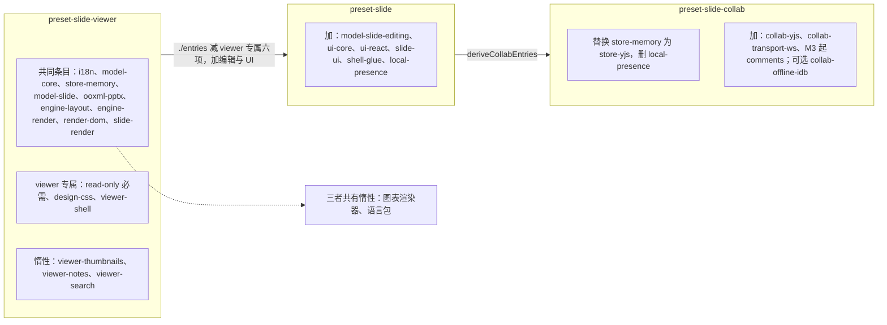
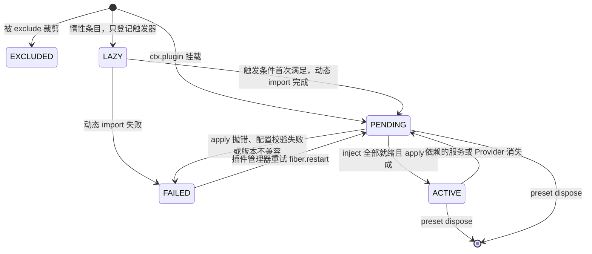
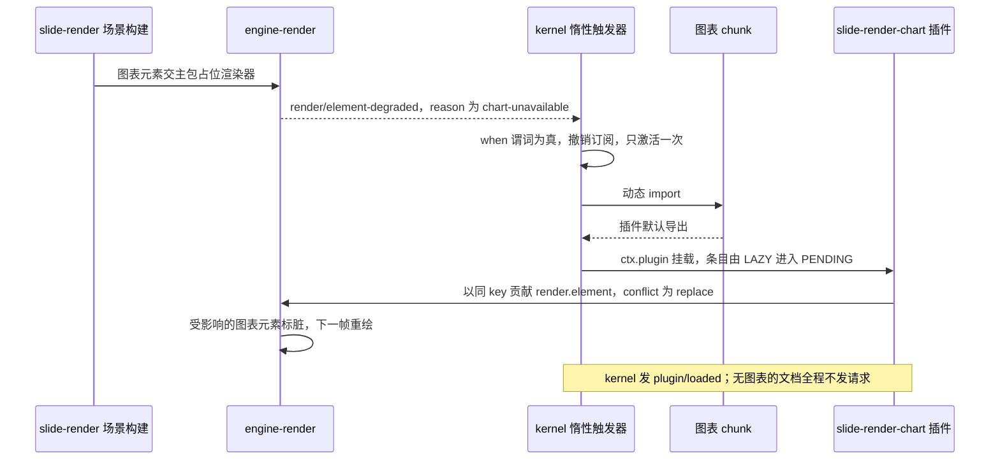
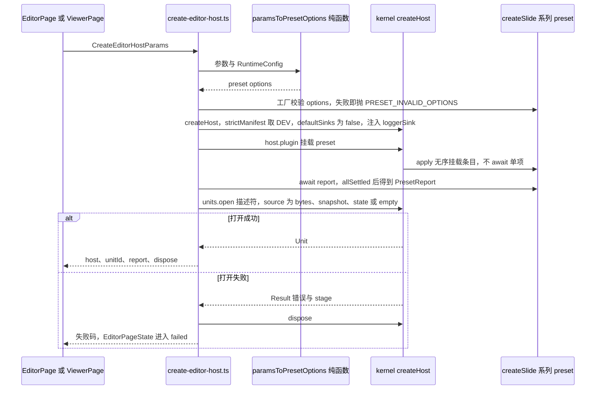
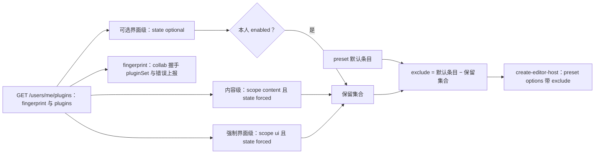
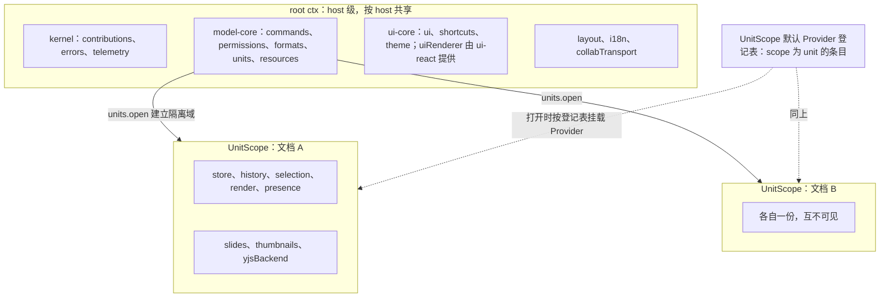
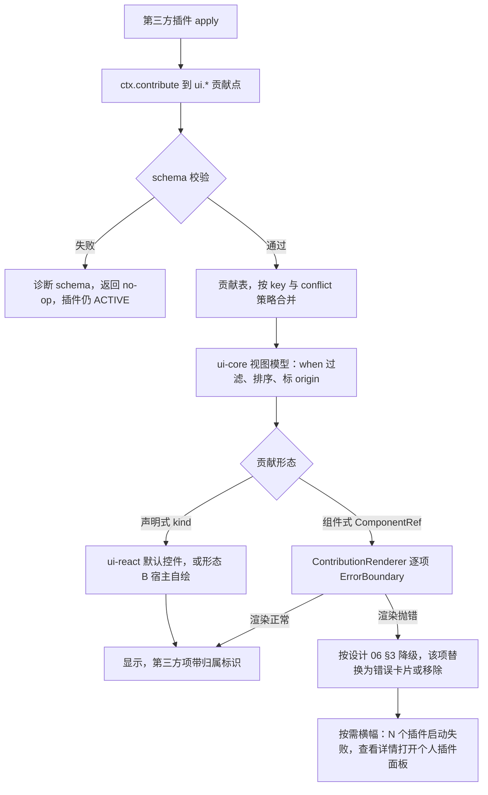
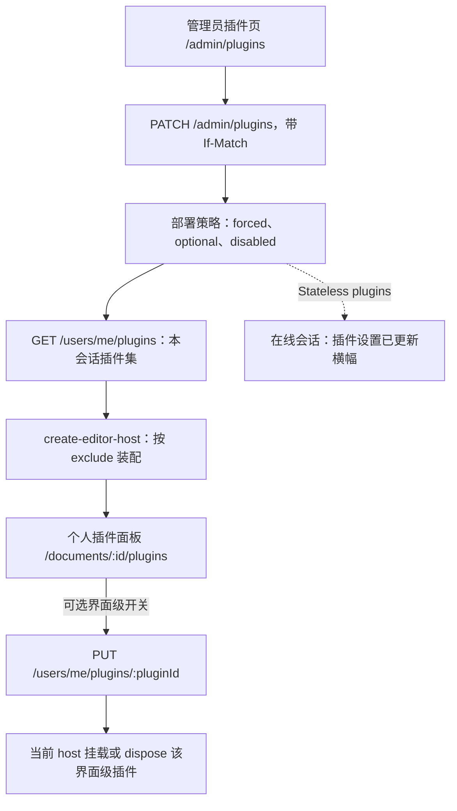

# 03 预设装配与前端插件模型
> 状态：v0.1 | 负责：前端设计线 | 更新：2026-09-25；2026-09-25（§4.19）；2026-09-26（§4.20）；2026-09-26（§4.21 Remap：原 30/08 引用按 60-backend/README §6.1 改指新位置，30/08 已删除）；2026-10-01（§4.23 插件管理：§5 按部署策略与个人选择装配、新增 §5.1 每会话插件集与 `compute-exclude`；§9 第 6、7 条改为部署预置与同源加载；§10 改写为个人插件面板与管理员页的数据流；§13 里程碑按 PRD 09 §4）；2026-10-01（§4.23 插件管理样张回写：设计承接 03-09 个人插件面板、03-32 管理员插件管理样张已确认，去掉「待样张」）；2026-10-03（§4.24 设计线对齐审计：§8 个人插件面板改为对话框路由（AL-2）；§5.1 `computeExclude` 按依赖闭包上推界面级插件（TA-6）；§9 第 3 条降级表达按设计 06 §3 改写；§10 补个人面板冲突态与管理员页前端状态（草稿与保存条、依赖 / 互斥计算、空 / 加载 / 失败态、PM-06 / PM-09 / PS-13 数据来源）；§11 增条目 id → 插件 id 对应表（TA-5）；§13.3 删去过时的「样张确认后回写」）；2026-10-03（§4.24 收尾：§10.1 依赖 / 互斥计算与详情抽屉改用 60/15 §3.15.1 字段名，`policy-draft.ts` 改为 40/11 §4.4 已登记，§13 状态行同步）；2026-10-04（design-language-v3 第 0 批：按 rulings §4.25 DS-1、DS-5、DS-6 改写插件按钮的挂载位置——§3 条目缺席表去掉空 Ribbon、应用栏「⋯」与协同状态胶囊；§7 贡献点删 `ui.ribbon`、`ui.statusBar`，增 `ui.inspectorSection`；§8 壳意图七项从应用栏「⋯」改为主菜单与文档菜单；§9 第三方创建类入口进底部工具条「更多」、格式类进检查器分区，降级表达按设计 06 §3 改为插件横幅，状态栏插件入口取消；§10 个人插件面板入口同步；§11、§13 同步）；2026-10-04（design-language-v3 第 0 批：术语残留清理：ribbon / 状态栏 / `ui.ribbon` / `ui.statusBar` 的历史陈述改用 check-terms 认可的标记措辞（废弃、作废、取代、原名））；2026-10-04（design-language-v3 第 0 批：复验修正——§8 `appBar.more` 的历史陈述加作废标记；§3、§13.3 的「30/03 §3.6、40/16 §4 待同步」改为已同步）；2026-10-04（design-language-v3 第 0 批：复验第 2 轮修正——§8 shell-glue 主菜单条目：导出…与保真报告注明样张已归入主菜单「文件」（当时为样张草稿，设计 03-02 §2.3），插件管理器与开发者项样张未列、顶层项当时未定（2026-10-07 定稿））；2026-10-05（design-language-v3 第 0 批修正：按 rulings §4.25 写入外壳类裁决——§3 条目缺席表、§8 `plugin-manager` 行与 §10 个人插件面板入口改为主菜单「插件…」（DS-18）；§8 补「返回首页」走 `onNavigateBack`、编辑器账户菜单由检查器协作行（网格：右上胶囊）里自己的头像打开，均不经 shell-glue（DS-18）；文档菜单「移动到…」改为按 DS-19 删除、不实现；§13.3 设计语言 v3 行同步）；2026-10-07（design-language-v3 第 0 批余项：§8 `plugin-manager` 行的「样张底座未列」改为样张已列的顶层位置（「排列 ▸」之后、「帮助 ▸」之前，当时为样张草稿，2026-10-07 随 DS-21 定稿，设计 03-02 §2.3，DS-18））；2026-10-07（design-language-v3 第 1 批：§3 条目缺席表 `shell-glue`、`collab-yjs`、`comments` 三行按 v3 外壳改写；§7 第三方 UI 的对象命令改走 `ui.inspectorSection` 与画布右键 `ui.contextMenu{slot:'canvas'}`（对象上下文槽位 `toolbar.<selectionKind>` 已删除，rulings §4.25 TB-29），`core.command` 缺席时的呈现改为菜单里的应用级条目不出现；§8 主菜单各项按第 1 批定稿——导出 / 保真报告在「文件」、「插件…」走顶层单项槽位 `mainMenu`、开发者面板在「帮助」最后一组，新增壳意图 `help-center`（主菜单「帮助 › 帮助中心」、母版视图「关于母版继承」TB-15、编辑器账户菜单「帮助中心」）；§9 第 6 条同步；§10 个人插件面板入口的顶层位置定稿；§11 评审条条目；§13.3 新增第 1 批行）；2026-10-08（design-language-v3 第 1 批收口：§8 `help-center` 行写明与其余应用级条目同一管线（rulings §4.25 TB-39），`developer` 行改为只在开发构建或 `features.developerMenu` 打开时出现（TB-40）；§9 第 6 条补插件条目很多时的暂行收纳规则（TB-31）；§11 评审条条目补计数项、共五项；§13.3 第 0 批行的主菜单顶层项与第 1 批行的 40/11、40/16 回写改为已回写，新增收口行）；2026-10-15（design-language-v3 第 2 批：按已拍板样张 `plugins` 回写——§9 第 3 条降级表达改为整块状态、插件横幅中性底加状态色图标、单个失败写插件名、先后与重现规则、占位两行，未打开的整页面板随分区不显示「展开」（rulings §4.25 DS-38、DS-41、DS-52、DS-54、DS-55）；第 4 条归属标识统一 12px（DS-56）；第 6 条插件收纳定稿（DS-49，取代 TB-31 暂行规则）；§10 个人插件面板为 640 居中对话框、各状态固定 720 高、行与分组画法、反馈写在底栏、管理员入口、加载行与整块出错、快捷键冲突说明吸顶并滚到冲突行（DS-38、DS-53、DS-56）；§10.1 管理员页的加载画法随第 3 批按 DS-53 统一；§13.3 新增第 2 批行）；2026-10-15（design-language-v3 第 2 批：§9 第 3 条整页面板的宽度改为 max(400, 检查器当前宽度)（rulings §4.25 TB-60），「展开」由宿主按分区条目的 `expandPanel` 画（TB-59）；同日再补：§10 个人插件面板两组都按启动失败 → 版本不兼容 → 等待依赖把需要处理的行排在组内最前，行换位时焦点交给这一行的开关（TB-78）；失败详情的错误码为 `kernel.plugin_failed`、按 `details.phase`（`activate` / `contribution`）另写「阶段」一行，不另设 `plugin` 域的两个码（TB-77）；给管理员的「去管理 › 插件」深链地址为 `/admin/plugins?plugin=<pluginId>`（TB-76），§10.1 补深链进页后的选中、滚动与搜索框兜底；冲突态吸顶说明行的语义由 `role=status` 改为 `role="note"`（`InspectorNotice`，与样张 `plugins.conflict` 一致））；2026-10-15（design-language-v3 第 2 批：§13.3 TB-76…TB-78 一行的他线项 40/11 `AdminPluginsPage.tsx` 读 `?plugin=`（rulings §4.25 TB-76）核对为已登记；正文不变）；同日再补：§10 失败详情写明「复制诊断信息」复制的四行（rulings §4.25 TB-96）；2026-10-22（design-language-v3 第 3 批：§3、§7、§8 导出键改 `Mod+Shift+E`（rulings §4.25 DS-78）；§5 选项表 `theme` 去掉 `density`（DS-76），`user` 不再传头像地址（TB-123），新增 `preferences: { locked?, values? }`（TB-118）；§8 导出对评审者、查看者与降权不可用（DS-105），帮助中心与「关于母版继承」只在配置了链接时贡献、新标签页打开带外链图标（DS-89），创建副本只给编辑者（DS-82），宿主不处理的壳意图不贡献、原「点了没反应」作废（DS-112）；§10 个人面板与管理页显示 cordis 插件 id（TB-121），管理员页按已拍板样张 `admin-plugins` 改写：详情抽屉为模态 480（DS-94）、草稿行为圆点加「· 未保存」（DS-95）、被拒横幅不放「只看被拒插件」（DS-96）、加载为加载行（DS-86）、横幅在顶栏之下（DS-92）、`lastErrorPhase` 显示阶段、只按桌面设计、已声明行只读、不设「恢复部署默认」、两张当下确认卡为模态 480（TB-119、TB-120）；§13 同步）；2026-10-22（design-language-v3 第 3 批回写补充，rulings §4.25 TB-132、TB-138、TB-145：§8 `help-center` 的条目与命令元数据带 `external: true`（字段在 09 §6.1 登记），命令面板的「帮助中心」与「关于母版继承」只在配置了链接时出现（TB-132）；重命名、创建副本、版本历史三项的降权规则注明与「文件 › 导出…」同一条（TB-138）；嵌入里交给父页的出口按 `cordex:init.intents`（TB-145）；§13.3 新增一行）；2026-10-22（design-language-v3 第 3 批回写收口，rulings §4.25 TB-118、TB-161、TB-162：§5 `preferences` 一行写明 `locked` 只收五个键、`Preferences` 取 ui-react 导出的类型、apps/web 的 schema 以 `satisfies` 对齐（TB-118）；§7 `ui.shortcut`、`ui.command`、`core.command` 三行补 shell-glue 的五个无参 Operation；§8 新增「壳意图进命令面板」一条——`shell.openExport`、`shell.openVersionHistory`、`shell.openFidelityReport`、`shell.openPluginManager`、`shell.openHelpCenter` 各配一条 `ui.command`，`Mod+Shift+E` 改绑 `shell.openExport`（TB-162），并写明「分享」不是壳意图、M2 由宿主属性 `shareUnavailable` 驱动（TB-161）；§13 同步；2026-10-22 复核修正：§8 `duplicate` 一行的降权规则改引 rulings §4.25 DS-139（取代第 1 批「降权时创建副本照常」），§13.1 同步；§10 清单行的「已声明」一态注明实际不会出现、只读画法只作兜底（与后端 60/15 §3.15、设计 03-32 §5.1 一致，TB-119）；§8 `export` 一行与 §13.1 的不可用原因按权限写，查看者写「只有查看权限」、评审者与降权写「需要编辑权限」（DS-105，设计 03-02 §2.3））；2026-11-04（design-language-v3 母版视图改版：§7 slide-render 覆盖层 id 改 `master-annotations`；§8 `fidelity-report`、`version-history`、`plugin-manager` 三项在母版视图里不可用；§13.3 新增一行；需求编号、优先级与里程碑不变；rulings §4.25 DS-157、DS-162、TB-188、TB-200、TB-203） | 依赖：[01 前端总览](01-overview-and-runtime-map.md)、[02 应用壳](02-app-shell-routing-and-session.md)、[30/03 内核与插件模型](../30-architecture/03-kernel-and-plugin-model.md) §3、§5–§10、[ADR-0005](../30-architecture/adr/0005-unit-scope-via-isolate.md)、[ADR-0006](../30-architecture/adr/0006-contribution-point-as-sole-registry.md)、[ADR-0010](../30-architecture/adr/0010-preset-vs-loader-composition.md)、[ADR-0015](../30-architecture/adr/0015-single-execution-entry-and-non-executable-mutations.md)、[40/11](../40-modules/11-preset-assembly-and-app-shell.md) §3、§6、§8、[40/16](../40-modules/16-plugin-catalog.md) §4–§5、[40/17](../40-modules/17-plugin-authoring-patterns.md) §2.5、[设计 06 可扩展性](../20-design/06-extensibility-ux.md)（§2.6、§2.12、§3、§4）、PRD PS-02/PS-07/PS-09/PS-11、EM-01/EM-08、[rulings](../00-charter/rulings-2026-09-14.md) §4.20 FE-01、§4.23、§4.25 DS-1、DS-5、DS-6、DS-18、DS-19、DS-21、TB-1、TB-15、TB-29、TB-31、TB-39、TB-40、DS-38、DS-41、DS-49、DS-52…DS-56、TB-59、TB-60、TB-76…TB-78、DS-76、DS-78、DS-82、DS-86、DS-89、DS-92、DS-94…DS-96、DS-105、DS-112、TB-118…TB-121、TB-123；[PRD 09 插件管理](../10-prd/03-features/09-plugin-manager.md) PM-01…PM-16；playground `src/v3/scenarios/plugins/`、`src/v3/scenarios/admin-plugins/`（第 3 批）；[设计 03-32](../20-design/03-screens/32-admin-plugin-management.md)；rulings §4.25 TB-132、TB-138、TB-145（第 3 批回写补充）；rulings §4.25 TB-118、TB-161、TB-162（第 3 批回写收口）；rulings §4.25 DS-139；rulings §4.25 DS-157、DS-162、TB-188、TB-200、TB-203（母版视图改版）

本文是浏览器侧「插件如何被组装成可运行产品」的唯一事实源：三档 preset 的定位与派生、装配运行时的行为、条目缺席的用户可见结果、惰性边界、组合根 `create-editor-host`、root ctx 与 UnitScope 的服务分布、前端贡献点与冲突策略、壳意图、第三方 UI 插件合同、插件管理器数据流、评论插件的装配位置、doc / sheet 参数化点。

**本文不写**（只链接）：装配清单本体、默认配置列与 manifest 片段（[40/11](../40-modules/11-preset-assembly-and-app-shell.md) §3.1–§3.3、§3.5，仍在 40）；装配运行时的类型签名（[40/02](../40-modules/02-kernel-protocol-and-document-core.md) 的 `kernel/src/preset/*` 与 40/11 §6）；贡献点定义与冲突策略总表（[30/03](../30-architecture/03-kernel-and-plugin-model.md) §3.6）；查看器 preset 与嵌入形态（[12](12-viewer-embedding-and-render-page.md)）；体积预算数值与 chunk 地图（[13](13-performance-and-bundling.md)）；契约套件与可插拔证据的执行（[70/02](../70-testing/02-contract-suites-and-pluggability.md)）。

## 1. 三档 preset 的定位与派生链

| preset | 定位 | 使用方 | React | 编辑 | 协同 | 基线体积（gzip） | 里程碑 |
|---|---|---|---|---|---|---|---|
| `@cordexjs/preset-slide-viewer` | 只读查看器（打开 + 渲染） | `/documents/:id/view`（M1 查看器与嵌入）、嵌入形态 C、`/render` | 无 | 无（两道只读保证） | 无 | ≤ 350 KB | M1 |
| `@cordexjs/preset-slide` | 单人编辑器 | M1 本地打开（只读渲染）、M2 起本地文档（`local:*`）的编辑器页、嵌入形态 A / B / D | 有（形态 B 排除） | 有 | 无（`local-presence` 兜底） | ≤ 900 KB | M1 装配与可插拔测试 / M2 编辑 |
| `@cordexjs/preset-slide-collab` | 协同编辑器 | M2 起 apps/web 服务端文档的编辑器页（单人编辑也经协同网关持久化，rulings §4.19 D-M2-CONTENT）；M3 起含查看者只读变体 | 有 | 有 | 有 | 协同增量 ≤ 200 KB | M2（`comments` 条目与多人协同体验层 M3） |

**派生链**（依据：rulings §4.18 FE-06、FE-07）：`preset-slide` 以 `preset-slide-viewer` 的 `./entries` 为基础加减，`preset-slide-collab` 以 `preset-slide` 的 `./entries` 经 `deriveCollabEntries` 派生；`package.json` 依赖同向（上游 preset 写 `dependencies: workspace:*`），由 R1 / R2 约束，不另设规则。

- `SLIDE = VIEWER − { read-only, design-css, viewer-shell, viewer-thumbnails, viewer-notes, viewer-search } + { model-slide-editing, local-presence, ui-core, ui-react, slide-ui, shell-glue }`；`model-core` / `engine-render` 的配置换成编辑器默认；`locale-packs` 以**同一 id 替换**而非追加（避免 `PRESET_DUPLICATE_ENTRY`）。
- `COLLAB = derive(SLIDE)`：`store-memory → store-yjs`、删 `local-presence`、加 `collab-yjs`、`collab-transport-ws`，可选 `collab-offline-idb`（M4 P2 前默认关）；M3 起另加 `comments`（§11，rulings §4.19 D-COMMENTS-PKG）。
- 超集关系：`preset-slide ⊇ preset-slide-viewer − {上面六个 viewer 专属条目}`，由 `superset.test.ts` 断言。

**图 1 三档 preset 的派生链与条目集合**



怎么读：三个子图是三档 preset 的条目集合；实线是 `./entries` 派生方向（与 `package.json` 依赖同向）；虚线表示惰性条目挂在共同条目上、三档都有。`preset-slide` 与 `preset-slide-collab` 继承上游全部未被减去的条目。

依据：[40/11](../40-modules/11-preset-assembly-and-app-shell.md) §3.1 派生式；[30/02](../30-architecture/02-layering-and-packages.md) §4.21 / §4.21b；rulings §4.18 FE-06/FE-07。

## 2. 装配运行时的行为

装配运行时位于 `@cordexjs/kernel/src/preset/`（`entry` / `lazy` / `mount` / `report` / `validate` 五文件，M-02 承载，C-07），三个 preset 与未来的 `preset-doc` / `preset-sheet` 共用。本节定行为，类型签名见 [40/11](../40-modules/11-preset-assembly-and-app-shell.md) §6。

| 阶段 | 行为 | 失败出口 |
|---|---|---|
| 选项校验 | `createXxxPreset(options)` 先以 `strictObject` schema `parse`；**在任何挂载之前**失败（EM-01「启动前抛出，不部分激活」） | 抛 `PRESET_INVALID_OPTIONS`，含字段路径 |
| 清单校验 `validateEntries` | 同一 preset 内 `id` 唯一；`required` 条目（viewer 的 `read-only`）不可被 `exclude` | 重复 id → `PRESET_DUPLICATE_ENTRY`（抛）；排除必需条目 → `PRESET_REQUIRED_ENTRY`（抛） |
| 裁剪 `applyTrim` | `exclude` 移除；`override` 替换 `plugin`；`configure` 与条目默认配置合并：**对象逐键深合并，数组与标量整体替换，`undefined` 忽略**（本文定，补 40/17 §7 G-8 的规格空白） | `override` / `configure` 的键不在清单 → `PRESET_UNKNOWN_ENTRY` 诊断，不抛 |
| 挂载 `mount` | `apply` 内对裁剪结果**无序**遍历（`Set` 语义）逐项 `ctx.plugin(entry.plugin, entry.config)`，**不 await 单项**；`scope:'unit'` 的条目不挂根，而是经 `units.registerUnitProvider` 登记为 UnitScope 默认 Provider（§6.2）；惰性条目只登记触发器（§4） | 单项 `apply` 抛错 → 该 Fiber `FAILED`，兄弟不受影响（30/03 §8） |
| 报告 `report()` | 全部 `ctx.plugin` 调用后 `Promise.allSettled`，再等一个微任务队列排空，生成 `PresetReport` 快照；之后的状态变化只经 `plugin/loaded`、`plugin/failed`、`plugin/incompatible` 事件推送 | — |
| 销毁 | `dispose` = 逆序 `fiber.dispose()`，effect 全部清空（`assertNoLiveEffects`） | — |

**`PresetReport.entries[*].state` 的含义**：`EXCLUDED`（被裁剪掉）、`LAZY`（惰性条目尚未触发）、`PENDING`（已挂载但 `inject` 未满足——**不是错误**，附缺失服务名）、`ACTIVE`、`FAILED`（附 `ErrorEnvelope`）。不变量：`entries.length === preset.entries.length`；`FAILED` 不阻断其余条目。

**图 2 条目在 PresetReport 中的状态**



怎么读：方框是 `PresetReport` 里的条目状态，箭头上是触发条件；`PENDING` 可以长期停留（例如 `collab-yjs` 在 `store-memory` 的 Unit 下等待 `yjsBackend`），它是可诊断状态而非失败；`EXCLUDED` 是终态。

依据：[30/03](../30-architecture/03-kernel-and-plugin-model.md) §7–§8；ADR-0010 决策 1、2、6；[40/11](../40-modules/11-preset-assembly-and-app-shell.md) §2.1。

## 3. 条目缺席 → 用户可见结果

「缺席」含三种来源：被 `exclude`、`FAILED`、长期 `PENDING`。章程 §5.4 要求任一非必需条目缺席后 host 仍可启动；本表规定**用户看到什么**与**可诊断的信号**，是 `pluggable.test.ts` 断言的依据。条目 id 与所属包以 [40/11](../40-modules/11-preset-assembly-and-app-shell.md) §3.1 为准。

| 条目 | 缺席后用户可见结果 | 诊断信号 |
|---|---|---|
| `i18n` | 界面文案显示为 key；功能可用 | `plugin/failed` 或 PresetReport `EXCLUDED` |
| `model-core` | 任何文档都无法打开，编辑器页进入失败态 | `units` 服务缺席（`unit/open-failed` 由 `units` 发出，此时无人发）：依赖 `units` / `commands` 的条目 `PENDING` 附缺失服务名；`create-editor-host` 取不到 `units` 即返回失败；host 仍健康 |
| `store-memory` / `store-yjs` | 打开失败态「无法打开」 | `unit/open-failed{code:'store.unavailable'}`（PRD `pluggable:m1`） |
| `model-slide` | 打开 `slide` 文档失败 | `format.no_document_type` |
| `model-slide-editing` | 编辑类按钮禁用、快捷键无效，画布可浏览（等价只读） | 执行编辑命令 → `COMMAND_NOT_FOUND` |
| `ooxml-pptx` | 无法打开或导出 `.pptx`；空白新建仍可用 | `format.no_codec` |
| `engine-layout` | 画布不渲染（`engine-render` 等待度量） | `engine-render` `PENDING` |
| `engine-render` / `render-dom` | 画布空白，命令与面板照常（PRD `render.target=noop`：`unit/opened` 触发、无异常） | `render-dom` 缺席时 `LAYOUT_MEASURER_MISSING` |
| `slide-render` | 画布空白（无 `render.scene:slide`） | `render.scene` 缺失诊断 |
| `slide-render-chart`（惰性） | 图表保持占位，其余元素正常 | `render/element-degraded{reason:'chart-unavailable'}` |
| `locale-packs`（惰性） | 切换语言后仍显示默认语言（zh-CN） | `i18n` 缺 key 诊断 |
| `read-only`（viewer 必需） | 不允许缺席 | `PRESET_REQUIRED_ENTRY`（创建时抛出） |
| `design-css`（viewer） | 查看器无主题样式；宿主须自行静态引入 CSS | — |
| `viewer-shell`（viewer） | 只有画布，无工具条与键盘（集成方自绘壳） | — |
| `viewer-thumbnails` / `-notes` / `-search` | 入口不渲染、不留占位（Q18） | — |
| `local-presence`（slide） | 无在场头像；单人编辑不受影响 | `presence` 缺席，`isCollab=false` |
| `ui-core` | 无编辑器 UI（headless）；`ui-react`、`slide-ui` `PENDING` | 两者 `PENDING` 附缺失 `ui` |
| `ui-react` | 形态 B：`ui-core` 贡献照常注册，宿主自绘；须与 `slide-ui` 一并排除（`FRAMEWORK_FREE_EXCLUDES`） | — |
| `slide-ui` | 空左栏与空检查器，底部工具条没有条目、整条不渲染，画布可缩放（取代 2026-10-04 前的「空 Ribbon」） | — |
| `shell-glue` | 主菜单、文档菜单与账户菜单里 shell-glue 的条目（导出、保真报告、「插件…」即个人插件面板、帮助中心、母版视图的「关于母版继承」、开发者面板、重命名、创建副本、版本历史）都不出现，主菜单顶层没有「插件…」这一组，导出键 `Mod+Shift+E` 无效（rulings §4.25 DS-78）、命令面板里没有导出、版本历史、保真报告、插件与帮助中心（TB-162，§8）、`app` 命名空间文案缺失 | — |
| `collab-transport-ws` | 不连服务器，单人可编辑；`collab-yjs` `PENDING` | `collab-yjs` `PENDING` 附缺失 `collabTransport` |
| `collab-yjs` | 单人模式：检查器协作行的头像组只剩自己的头像（账户入口，[10](10-editor-shell-and-interaction.md) §1.2），没有他人头像、在线人数与在线列表；文件名下方的同步状态行只显示本地保存态 | `isCollab=false` |
| `collab-offline-idb` | 离线更改只保存在内存，关页即失（提示方式见 [07](07-collaboration-client.md) §7） | 缺失即内存队列降级 |
| `comments`（M3） | 评论页签、工具条「评论」工具、评审条的评论与高亮条目（评审条位置只剩只读提示「评审模式 · 只读」，[10](10-editor-shell-and-interaction.md) §3.2）、画布评论钉与缩略图角标不渲染；快照中 `comments.threads` 资源的保留方式由 `resources` 服务对未注册命名空间的规则决定（[04](04-document-commands-and-undo.md)） | — |

## 4. 惰性边界与触发

惰性条目 = `lazy: () => Promise<Plugin>` + `activateWhen`，三种触发形式固定（ADR-0010 决策 2）：`{ event, when? }`、`{ contributionSeen }`、`'manual'`；`when` 谓词用于按载荷过滤事件。

| 惰性条目 | 触发 | 未加载前 | 加载后 | 加载失败 |
|---|---|---|---|---|
| `slide-render-chart`（M1–M2 为 `slide-render/chart` 子路径，M3 起独立包，只改 import，rulings §4.18 FE-08） | `{ event:'render/element-degraded', when: p => p.reason === 'chart-unavailable' }` | 图表元素走主包占位 | 以同 key 覆盖 `render.element`（`conflict:'replace'`），已挂载的图表元素标脏重绘 | 占位保持；`plugin/failed`；按 [02](02-app-shell-routing-and-session.md) §12 判定版本漂移 |
| `locale-packs` | `{ event:'i18n/locale-changed' }` | 回退默认语言 | 语言包贡献 `i18n.bundle`，界面重渲 | 保持默认语言并 toast |
| `viewer-thumbnails` / `viewer-notes` / `viewer-search` | `'manual'`（`viewer-shell` 在对应选项为真时激活） | 入口不渲染 | 见 [12](12-viewer-embedding-and-render-page.md) §4 | 入口隐藏，查看器其余部分不受影响 |

**触发语义**：preset `apply` 时订阅触发事件（`ctx.once`，首次激活后撤销订阅）；同一条目的并发触发共享一个进行中的 Promise（只 import 一次）；激活成功后条目从 `LAZY` 进入 `PENDING` / `ACTIVE`，并由 kernel 发 `plugin/loaded`。`{ contributionSeen }` 当前没有条目使用，保留为 API 完整性。

**`/render` 关闭惰性**：`/render` 装配 viewer 时 `lazy.charts` 与 `lazy.locales` 置 `false`，惰性条目按普通条目随首屏挂载，保证首帧后不会再有惰性重绘（依据：rulings §4.18 FE-09；ready 判据见 [12](12-viewer-embedding-and-render-page.md) §11）。惰性 chunk 的体积上限与预加载策略见 [13](13-performance-and-bundling.md) §6–§7。

**图 3 惰性图表渲染器的激活**



怎么读：自上而下是时间顺序；触发器只对第一个满足谓词的事件起作用，之后同类事件不再引起加载；替换发生在贡献表层面，场景与其它元素渲染器不受影响。

依据：ADR-0010 决策 2；[30/03](../30-architecture/03-kernel-and-plugin-model.md) §3.6（`render.element` 为 replace，rulings §4.18 GV-24）；[40/11](../40-modules/11-preset-assembly-and-app-shell.md) §3.1 `slide-render-chart` 行。

## 5. 组合根 `create-editor-host`

`apps/web/src/application/host/create-editor-host.ts` 是仓库中唯一调用 `createHost` 与 `createSlide*Preset` 的应用代码（[02](02-app-shell-routing-and-session.md) §1）。它把页面参数 `CreateEditorHostParams` 交给纯函数 `paramsToPresetOptions(params, runtimeConfig)`（`domain/host-options.ts`，不做 IO、不调用 `createHost`），再按 `switch(resolveDocumentType(documentType).presetKeys[params.preset])` 选工厂。

**图 4 create-editor-host 装配时序**



怎么读：自上而下是一次装配；选项校验在任何挂载之前完成，所以失败不会留下半激活的 host；`report` 只是快照，`PENDING` 条目不会阻塞 `units.open`。

依据：[40/11](../40-modules/11-preset-assembly-and-app-shell.md) §3.5 接入点表；ADR-0010 决策 1、6；[30/03](../30-architecture/03-kernel-and-plugin-model.md) §5.3。

**`CreateEditorHostParams` → preset options 的映射**（`paramsToPresetOptions`）

| 选项 | 来源 | 说明 |
|---|---|---|
| preset 键 | [02](02-app-shell-routing-and-session.md) §6「preset 选择」 | 文档类型无关的 `edit` / `collab` / `view`；经 `DOCUMENT_TYPES[documentType].presetKeys`（§12）映射为 `slide` / `slide-collab` / `slide-viewer` 工厂 |
| `locale` | `Preferences.locale` | 进入编辑器时把应用壳 `createI18n()` 实例的当前语言与已加载语言包交给 host（依据：NOHOST-I18N；[16](16-i18n-and-accessibility.md) §3） |
| `theme` | `Preferences.theme`（2026-10-22 起不再有 `density`，v3 只留单档尺寸，rulings §4.25 DS-76）；`<meta name="cordex-nonce">` | `apps/web` 取 `injectCss:false`（主题 CSS 由 `styles.css` 静态引入），仍把 meta 中的 nonce 作为 `cssNonce` 传入，供第三方运行时样式注入点使用（[14](14-client-security.md) §3）；嵌入宿主取 `injectCss:true` 并传 `cssNonce`（[12](12-viewer-embedding-and-render-page.md) §6） |
| `permissions` | `DocumentDetail.capabilities` | 单人：`{ capabilities }`（`ROLE_CAPABILITIES[role]`）；协同：初值同左，此后只经网关 `CONTROL.permission` → `applyRemoteDecisions` 更新（[07](07-collaboration-client.md) §8） |
| `user` | `Session.principal` | `{ id, displayName, avatarUrl?, color? }`（`UserRef`，[40/11](../40-modules/11-preset-assembly-and-app-shell.md) §6）；2026-10-22 起界面上的头像一律是身份色底 + 显示名首字，`avatarUrl` 只存不显示（rulings §4.25 TB-123，[14](14-client-security.md) §6），apps/web 不再传它 |
| `preferences`（2026-10-22 新增，rulings §4.25 TB-118） | `apps/web` 不传 | 集成方锁定偏好的选项 `{ locked?: ('theme' \| 'locale' \| 'unit' \| 'readingOrder' \| 'autosave')[]; values?: Partial<Preferences> }`：`locked` 只收这五个键（40/10 §2.5 的 `PreferenceKey`）；`Preferences` 是 ui-react 导出的类型（40/10 §6，字段以 [10](10-editor-shell-and-interaction.md) §10.3 为准），apps/web 的 `PreferencesSchema` 以 `satisfies` 对齐、不另定义一份（40/11 `domain/preferences.ts`，TB-118）；`values` 给出锁定项与初值，`locked` 里的项在偏好设置里只读展示（当前值 + 锁形 +「由宿主应用设置」），账户菜单的主题三项同样不可用（[10](10-editor-shell-and-interaction.md) §1.3、§10.3）；类型登记在 [40/10](../40-modules/10-ui-shell-and-slide-ui.md) §2.5（TB-118 要求先登记再写码） |
| `collab` | `RuntimeConfig.wsBase`、文档 id | `endpoint = {wsBase}/collab/v1/rooms/{documentId}`；`getToken = () => POST /documents/{id}/collab-ticket`（带分享令牌头，[02](02-app-shell-routing-and-session.md) §11）；`offline.enabled` M4 P2 前恒为 `false` |
| `shell` | 固定 + `features.developerMenu` | `moreMenu` 八项开关（2026-10-07 增 `helpCenter`，原为七项）；`onIntent` 指向 `pages/editor/editor-intents.ts`（§8） |
| `i18n.bundles` | `app` 命名空间 zh-CN / en-US | 由 `shell-glue` 贡献为 `i18n.bundle`（`apps/web` 自身不 `contribute`） |
| `media.upload` | `apps/web` 默认实现 | `(file) => Promise<{ assetId, sha256 }>`：presign → 直传 → commit、≥ 10 MB 分片、临时 mediaId 替换、失败重试 3 次（依据：MEDIA-CLIENT，authority：60-backend/04 §7（原 30/08 篇 §16.1「uploadAsset 由集成方或 apps/web 默认实现」）+ rulings C-30；行为细节见 [05](05-rendering-and-thumbnails.md) §8）；集成方可替换为自己的存储 |
| `lazy` | 固定 | 编辑器页 `{ charts:true, locales:true }`；`/render` 为 `false`（§4） |
| `history.limit` | 固定 | 编辑器 200；viewer 0 |
| sinks | `RuntimeConfig.telemetry` + `Preferences.diagnostics.*` | `application/host/sinks.ts` 选 console / OTel Web / no-op，经 `HostOptions.loggerSink` 与 `configure['kernel']` 交给 kernel 的 `errors.sink` / `telemetry.sink`（[15](15-events-errors-and-telemetry.md) §6–§9） |
| `exclude`（2026-10-01，§4.23） | `GET /api/v1/users/me/plugins` 的本会话插件集（§5.1） | `computeExclude(presetEntries, pluginSet)` 算出的条目 id 集合并入 preset 的 `exclude`；必需条目（`required`）不可能落入（部署侧已锁定为 `forced`）；嵌入宿主不经此路径，自行决定 `exclude`（EM-08） |

### 5.1 每会话插件集与 `compute-exclude`（2026-10-01，rulings §4.23）

依据：[PRD 09](../10-prd/03-features/09-plugin-manager.md) PM-03、PM-04、PM-08、PM-10、PM-13；rulings §4.23 裁决 1–3 与 O-1、O-2（2026-10-01 已确认）。

装配什么由**部署策略 + 本人选择**决定，不由界面决定。`create-editor-host` 在调用 preset 工厂前取本会话插件集：

- **来源**：`application/plugins/plugin-set.ts` 调 `GET /api/v1/users/me/plugins`（[60/15](../60-backend/15-rest-api-catalog.md) §3.15），得到 `{ fingerprint: { catalog, policy }, plugins: [{ id, version, scope, source, entry?, state, enabled, defaultOn? }] }`。响应按账号保存（O-2），浏览器只在内存中缓存本标签页的一份；个人选择的事实源在服务端，换设备一致。未登录的 `/render` 与嵌入宿主不走此路径。
- **计算**：`domain/plugins/compute-exclude.ts` 是纯函数 `computeExclude(presetEntries, pluginSet): ReadonlySet<PluginId>`——保留集合 = 内容级集合（`scope:'content'` 且 `state:'forced'`）∪ 强制界面级（`scope:'ui'` 且 `state:'forced'`）∪ 本人开启的可选界面级（`state:'optional'` 且 `enabled`）；`exclude` = preset 默认条目 − 保留集合。`state:'disabled'` 与部署级被拒的插件不出现在响应里，自然被排除。响应里的 `id` 是 cordis 插件 id，与 preset 条目 id 的换算按 §11.1 对应表（rulings §4.24 TA-5）。
- **依赖闭包上推**（2026-10-03，rulings §4.24 TA-6）：保留集合算出后，再从其中每个内容级条目出发，沿 manifest 的必需 `inject` 找到提供该服务的条目；提供者是界面级时把它并入保留集合，重复到不动点。被上推的界面级插件**视同强制启用**：不得出现在 `exclude` 里，个人插件面板把它归入「本部署统一启用」、不给开关，管理员页对它的「禁用 / 用户选择」在客户端依赖计算中同样不可选（§10.1）。不这样做，内容级插件会因缺服务长期停在 `PENDING`，协作者之间的内容集合就不再一致。按 [40/16](../40-modules/16-plugin-catalog.md) §2 当前的作用域判定，命中这条规则的是 `ui-react`（内容级）必需注入的 `ui` / `shortcuts` / `theme`（由界面级 `ui-core` 提供）与 `i18n`（界面级 `i18n` 提供）：只要 `ui-react` 在内容级集合里，`ui-core` 与 `i18n` 就不可排除；`slide-ui`、`shell-glue` 等界面级插件不被任何内容级插件必需注入，仍可按策略排除。形态 B（[12](12-viewer-embedding-and-render-page.md) §7）由嵌入宿主自己把 `ui-react` 与 `slide-ui` 一并排除，不经本路径。服务端保存策略时的同口径校验以 [60/03](../60-backend/03-modules-identity-and-access.md) §12 为准。
- **指纹**：`fingerprint` 原样交给 `collab` 选项，随协同握手 Auth token 上送为 `pluginSet`（[07](07-collaboration-client.md) §2）；同时进入错误上报的公共字段（[15](15-events-errors-and-telemetry.md) §6）。
- **失败**：取插件集失败（网络、5xx）时重试一次，仍失败则按「镜像内置默认组成」装配并在个人插件面板顶部提示「未能读取插件设置，已按默认组成打开」；不阻断打开文档。协同会话随后若因 `catalog` 不符被 4426 关闭，按版本漂移处理（[02](02-app-shell-routing-and-session.md) §12）。
- **个人启停即时生效**（O-1）：在个人插件面板切换可选界面级插件时，先 `PUT /api/v1/users/me/plugins/:pluginId`，成功后在当前 host 上 `host.plugin(entry)` 挂载或对其 Fiber `dispose()`（卸载后贡献消失、无残留，PS-06 第 2 项），不重建 host、不刷新页面、不改指纹；请求失败时开关回弹并 toast。只有界面级插件能走这条路径：作用域判定保证它们不贡献 Mutation 与带写能力位的命令（PM-02、PM-13）。
- **管理员变更不热切换**（O-1）：管理员保存后本会话的装配不变；协同网关推 Stateless `plugins` 控制消息后，页面显示横幅「管理员更新了插件设置，重新加载后生效」[重新加载]（[07](07-collaboration-client.md) §9）。

**图 4a 本会话插件集到 `exclude`**



怎么读：左端是服务端下发的本会话插件集，按作用域与三态分成三股；只有可选界面级经过「本人是否开启」的判断。保留集合与 preset 默认条目相减得到 `exclude`，交给组合根；指纹另走一条线，供协同握手与错误上报使用。
依据：PRD PM-03、PM-08、PM-10、PM-13；本文 §5 映射表；[60/15](../60-backend/15-rest-api-catalog.md) §3.15。

## 6. root ctx 与 UnitScope

### 6.1 服务分布

UnitScope 以 `ctx.isolate` 为每个打开的文档建立独立解析域（ADR-0005）。浏览器三档 preset 下的服务分布：

| 位置 | 服务 | 提供方 |
|---|---|---|
| root ctx（按 host 共享，不隔离） | `contributions`、`errors`、`telemetry`、`commands`、`permissions`、`formats`、`documentTypes`、`migrations`、`resources`、`units`、`layout`、`i18n` | kernel、model-core、engine-layout、i18n |
| root ctx | `ui`、`shortcuts`、`theme`、`uiRenderer` | ui-core（定义）、ui-react（`uiRenderer` Provider） |
| root ctx | `collabTransport` | collab-transport-ws（按需 `connect()`） |
| UnitScope（每文档一份） | `store`、`history`、`selection`、`render`、`presence` | store-memory 或 store-yjs、model-core 默认 Provider、engine-render + render-dom、local-presence 或 collab-yjs |
| UnitScope | `slides`（`documentType.unitServices`）、`thumbnails` | model-slide、slide-render |
| UnitScope | 所选 store Provider 额外 `provide` 的服务（如 `yjsBackend`） | store-yjs |

根级插件看不到任何隔离服务（lint `no-unit-scoped-inject-at-root`）；因此 `collab-yjs` 在 `store-memory` 的 Unit 下自然 `PENDING`，这正是「协同需要 yjs 存储」的可诊断形态。

**多 Unit 共存**：SDK 允许一个 host 打开多个 Unit，每个 Unit 的 `store` 互不可见，UI 壳的上下文键按 `unitId` 分桶（[40/10](../40-modules/10-ui-shell-and-slide-ui.md) §3）。`apps/web` 选择**一个文档一个 host**（`HostRegistry` 以 `documentId` 为键），以隔离快捷键焦点、样式注入与销毁边界；集成方同页放 ≥ 4 个编辑器实例时同样建议一实例一 host（EM-01）。

**图 5 root ctx 与 UnitScope 的服务分布**



怎么读：上方子图是根作用域的服务，任何插件都可 `inject`；下方每个子图是一个文档的隔离域，子树内 `inject:['store']` 只解析到本文档；虚线表示 preset 中 `scope:'unit'` 的条目不挂根，而是在每次 `units.open` 时按登记表挂进新 Unit。

依据：[30/03](../30-architecture/03-kernel-and-plugin-model.md) §5.1–§5.4；ADR-0005；[40/11](../40-modules/11-preset-assembly-and-app-shell.md) §2.1 `PresetEntry.scope`。

### 6.2 UnitScope 默认 Provider 登记

登记 API 已定（rulings §4.20 FE-01，M1 前定稿；40/11 §13 Q-2 结案）：model-core 的 `units` 服务（`unit/units.service.ts`，API 面登记在 [40/02](../40-modules/02-kernel-protocol-and-document-core.md) §6）新增两个方法。

```ts
// model-core units 服务；preset 的 mount 对每个 scope:'unit' 条目调用一次 registerUnitProvider
interface UnitsService {
  // …open / close 等既有方法见 40/02
  registerUnitProvider(entry: { id: PluginId; plugin: Plugin; config?: unknown; provides: readonly string[] }): Disposer // 由 preset 的 effect 持有
  listUnitProviders(): readonly { id: PluginId; provides: readonly string[] }[]                                          // 供插件管理器与诊断
}
```

- **登记分工**：model-core 在 ready 时只登记自己的 `history`、`selection` 默认 Provider；`store`、`render`、`presence`、`collab-yjs`、`comments` 由 preset 中 `scope:'unit'` 的条目在 mount 时登记。model-core 不 import 任何水平层 Provider（章程 §5.3 只向下，既有 depcruise 秩规则兜底）；`units.open` 按登记表挂载。
- **唯一性**：同一 `provides` 服务名只允许登记一次，后来者被拒并记诊断、不抛；`exclude` 的条目不登记，打开的 Unit 中对应服务缺席，依赖方 `PENDING`。
- **生效时点**：登记在 `units.open` 之前或之后都可，登记表的变化只影响之后打开的 Unit；已打开的 Unit 不受后续登记或撤销影响（需重开才生效）。
- **撤销**：preset `dispose` 时撤销全部登记；已打开的 Unit 随 host 一并销毁。
- **不再有 `Config.defaultStoreProvider`**：store 由唯一的 `provides:['store']` 登记决定，`deriveCollabEntries` 把 `store-memory` 替换为 `store-yjs`（§1）即完成切换。
- **条目形状**：`PresetEntry` 带 `scope: 'host' | 'unit'` 与 `provides?: readonly string[]`，30/03 §9 与 40/11 §2.1 同形；`comments` 包按 Unit 的评论服务也走 `scope:'unit'` 登记（§11），不经文档类型的 `unitPlugins`。

## 7. 前端贡献点清单与冲突策略

贡献点是唯一的注册抽象（ADR-0006）。下表列出浏览器侧被使用的贡献点；项类型、键规则与 `conflict` 取值**以 [30/03](../30-architecture/03-kernel-and-plugin-model.md) §3.6 总表为准**，本表只给前端视角的贡献方与失败时的呈现。

| 贡献点 | 定义包 | 浏览器内贡献方 | conflict（30/03 §3.6） | 缺席或失败时的呈现 |
|---|---|---|---|---|
| `ui.toolbar` / `ui.inspectorSection` / `ui.panel` / `ui.contextMenu` / `ui.dialog` / `ui.notification` | ui-core | slide-ui、ui-react、shell-glue（主菜单、文档菜单与账户菜单的应用级条目，`mainMenu` / `mainMenu.*` / `docMenu` / `userMenu`，§8）、第三方（创建类进 `ui.toolbar{slot:'create.more'}`；格式类与针对所选对象的命令进 `ui.inspectorSection` 或画布右键 `ui.contextMenu{slot:'canvas'}`，对象上下文工具条槽位 `toolbar.<selectionKind>` 已删除，rulings §4.25 TB-29） | replace | 按设计 06 §3 降级表（§9） |
| `ui.shortcut` | ui-core | ui-react、slide-ui、shell-glue（导出 `Mod+Shift+E`，rulings §4.25 DS-78；绑无参 Operation `shell.openExport`，TB-162，§8） | replace | 快捷键无效，冲突由 `shortcuts` 服务诊断 |
| `ui.command` | ui-core | ui-core、ui-react、slide-ui、shell-glue（五个壳意图 Operation 的呈现元数据，2026-10-22，rulings §4.25 TB-162，§8） | replace | 命令面板缺标题，回退显示命令 id |
| `ui.theme` | ui-core | 预留（Beta） | replace | 校验失败拒绝并诊断，主题不变 |
| `render.target` / `render.scene` | engine-render | render-dom（`dom`）、slide-render（`slide`） | error | 画布空白（§3） |
| `render.element` | engine-render | slide-render（含图表占位）、`slide-render-chart`（同 key 覆盖） | replace | 单元素占位 + `render/element-failed` |
| `render.overlay` | engine-render | render-dom（选区、参考线、远端光标等）、slide-render（`master-annotations`：母版视图的占位符标注，原名 `master-inheritance`，2026-11-04 按 rulings §4.25 TB-188 改名）、评论钉（M3） | replace | 该覆盖层停止渲染，画布与其它覆盖层不受影响 |
| `layout.measurer` | engine-layout | render-dom（`canvas`） | error | `LAYOUT_MEASURER_MISSING` |
| `i18n.bundle` | i18n | 各 UI 包、shell-glue（`app`）、locale-packs | replace | 显示 key |
| `core.permissionPolicy` | model-core | viewer `read-only` | error | viewer 中不可缺席 |
| `core.command`（Operation `shell.intent` 与五个无参 Operation `shell.open*`，后者 2026-10-22 起，TB-162） | model-core | shell-glue | error | 主菜单、文档菜单与账户菜单里的应用级条目不出现（§3；原应用栏「⋯」菜单作废），命令面板里也没有导出、版本历史、保真报告、插件与帮助中心 |
| `errors.sink` / `telemetry.sink` | kernel | 由 `apps/web` 经 `HostOptions` 交给 kernel 自身贡献 | error | 回退 no-op，不影响功能 |

- **2026-10-04 起**（rulings §4.25 DS-5、DS-6）：`ui.ribbon` 与 `ui.statusBar` 作废，新增 `ui.inspectorSection`，全仓贡献点 27 → 26；三类入口的分工是创建类走 `ui.toolbar`（插件按钮只进底部工具条「更多」）、格式类走 `ui.inspectorSection`（按选中对象类型挂检查器分区）、其余命令走 `ui.command` 与菜单槽位（[09](09-ui-system-and-theming.md) §6.1）。30/03 §3.6 总表与 40/16 §4 已同步（2026-10-04）。2026-10-07 起（rulings §4.25 TB-29）：迷你工具条全部取消后，`ui.toolbar` 的对象上下文槽位 `toolbar.<selectionKind>` 没有宿主、随之删除，插件针对所选对象的命令改走 `ui.inspectorSection`（按选中类型挂检查器分区）与画布右键 `ui.contextMenu{slot:'canvas'}`（按 `selectionKind` 过滤的对象菜单，第三方条目进末尾「插件」分组）；`ui.toolbar` 只保留 `create`、`create.more`、`reviewBar`，贡献点总数不变（26）。
- **`replace` 只在贡献点定义时显式声明才允许**，当前取值以 30/03 §3.6 conflict 列为准（`ui.*`、`render.element`、`render.overlay`、`i18n.bundle`；依据：rulings §4.18 GV-24）；其余为 `error`：重复键拒绝后者、记 `duplicate` 诊断、返回 no-op disposer，**不抛异常**。
- 坏贡献（schema 校验失败）同样只诊断不抛（30/03 §3.3），一个坏贡献不会让整个插件 `FAILED`。
- 第三方命名：新定义的贡献点、事件、能力位用 `<vendor>:` 前缀（`vendor` = npm scope 去 `@`）；向既有点贡献的条目 id 用 `<pluginId>.<localId>`；`when` 子句只能引用 ui-core `context-keys.ts` 登记的键（`scan-contributions` 规则 (e)）。上下文键全集见 [09](09-ui-system-and-theming.md) §6。

## 8. `shell-glue` 与壳意图

编辑器内需要**离开 SDK 边界**的动作（导航、打开应用级对话框）统一表达为 Operation `shell.intent{ target, unitId, payload? }`，经 `commands.execute` 走权限、审计、遥测的单一入口（ADR-0015 决策 1），再由 preset 选项 `shell.onIntent` 交给宿主。胶水插件 `preset-slide#shell-glue` 只把宿主回调与语言包翻译为既有贡献点条目，**不含业务规则**。

| `target` | 菜单项与位置（2026-10-04 起 `ui.contextMenu{slot:'mainMenu' \| 'mainMenu.*' \| 'docMenu' \| 'userMenu'}`，原 `appBar.more` 作废；主菜单条目 2026-10-07 第 1 批定稿，设计 03-02 §2.3） | 默认开关 | `apps/web` 的处理（`pages/editor/editor-intents.ts`） |
|---|---|---|---|
| `export` | 导出…（`Mod+Shift+E`，macOS ⇧⌘E；2026-10-22 由 `Mod+E` 改，`Mod+E` 归居中对齐，rulings §4.25 DS-78）· 主菜单「文件」（`mainMenu.file`）；`enablement: can.doc.export`——没有它时留在原位不可用、快捷键无效，原因按权限写：评审者与编辑中被降权后写「需要编辑权限」，查看者写「只有查看权限」（有编辑权限的人切到评审模式照常可导出；rulings §4.12 U-09、§4.25 DS-105，设计 03-02 §2.3、03-22 §2.2，原因的取法见 [09](09-ui-system-and-theming.md) §6.2） | 开 | 打开对话框路由 `/documents/:id/export` |
| `fidelity-report` | 保真报告 · 主菜单「文件」（`mainMenu.file`）；`enablement: viewMode != 'master'`——母版视图里留在原位、不可用，写「母版视图下不可用」（2026-11-04，rulings §4.25 DS-157、TB-203） | 开 | 导航 `/documents/:id/fidelity` |
| `version-history` | 版本历史 · 文档菜单（`when: can.history.read`；评审者与查看者不出现，降权时留在原位不可用并写「需要编辑权限」，rulings §4.25 TB-138，[10](10-editor-shell-and-interaction.md) §1.3；母版视图里留在原位、不可用，写「母版视图下不可用」——`viewMode != 'master'` 排在权限子句之前，又被降权时也写这句，2026-11-04，DS-157、TB-200、TB-203；版本历史开着时母版视图不能进入，DS-162，[11](11-masters-layouts-and-themes.md) §3） | 开 | 导航 `/documents/:id/history`；缺 `history.read` 时 toast 说明（`CapabilityGuard` 兜底） |
| `plugin-manager` | 插件管理器（即个人插件面板，PRD PM-10；2026-10-01 §4.23）· 主菜单顶层单项「插件…」（rulings §4.25 DS-18；`slot:'mainMenu'`，排在「排列 ▸」之后、「帮助 ▸」之前，上下各一条分隔线；评审、只读浏览与降权时照常可用；母版视图里留在原位、不可用，写「母版视图下不可用」，`enablement: viewMode != 'master'`，2026-11-04，rulings §4.25 DS-157、TB-203） | 开 | 打开对话框路由 `/documents/:id/plugins`（居中 Dialog，布局继承父路由，与导出、分享同一模式，rulings §4.24 AL-2）；管理员另见「去管理 › 插件」链接（§10） |
| `help-center`（2026-10-07 新增） | 帮助中心 · 主菜单「帮助」（`mainMenu.help`）与编辑器账户菜单「帮助中心」（`userMenu`，PRD AS-06）；母版视图中「帮助」另多一项「关于母版继承」（`when: viewMode == 'master'`，`payload:{topic:'master-inheritance'}`，rulings §4.25 TB-15，PRD ML-01）。三处都走本意图、受开关 `ShellOptions.moreMenu.helpCenter` 控制，与其余应用级菜单项同一管线（权限、审计、遥测经同一入口，rulings §4.25 TB-39） | 开 | 新标签页打开 `RuntimeConfig.help.centerUrl`（[02](02-app-shell-routing-and-session.md) §3）；`topic:'master-inheritance'` 打开 `help.guides` 里的「母版与版式」指南（PRD AS-04），未配置时退到 `help.centerUrl`；**只列配置了链接的条目**（2026-10-22，rulings §4.25 DS-89）：没配置 `centerUrl` 时主菜单「帮助 › 帮助中心」与账户菜单「帮助中心」不贡献（不留占位），两者都没配置时「关于母版继承」也不贡献，`apps/web` 按配置逐项传 `moreMenu` 开关；出现时都在新标签页打开，条目右侧 12px 外链图标、读屏名带「在新标签页打开」（第 1 批编辑器主菜单「帮助」随之改）；菜单条目与命令元数据都带 `external: true`（字段登记在 [09](09-ui-system-and-theming.md) §6.1），命令面板的「帮助中心」同一规则，「关于母版继承」同样只在配置了链接时出现（2026-10-22，rulings §4.25 TB-132） |
| `rename` | 重命名 · 文档菜单（降权时留在原位不可用并写「需要编辑权限」，rulings §4.25 TB-138） | 开 | 左栏（网格与紧凑形态：左上胶囊）的文档标题进入内联编辑（与 `onRename` 同一路径；v3 内联编辑的交互第 1 批样张未画，随实现） |
| `duplicate` | 创建副本 · 文档菜单——只给打开时有编辑权限的人（编辑者及以上，副本要 `doc.export`），评审者与查看者没有这一项（他们的文档菜单因此一项都没有，编辑器里的文件名不再是菜单触发器，[10](10-editor-shell-and-interaction.md) §1.2、§1.3；2026-10-22，rulings §4.12 U-09、§4.25 DS-82）；编辑模式已降权时留在原位、不可用并写「需要编辑权限」（`enablement: can.doc.export`，与 DS-105「文件 › 导出…」同一规则，rulings §4.25 DS-139、TB-138；取代第 1 批拍板时「降权时创建副本照常」的样张修正）；出现条件的子句随 40/11 `shell-glue` 登记 | 开 | 导航到新文档前按 [02](02-app-shell-routing-and-session.md) §8「创建副本」用例调 `POST /documents/:id/duplicate`（M2 已登记，60/15 §3.3） |
| `developer` | 开发者面板 · 主菜单「帮助」最后一组（`mainMenu.help`，分隔线后）；只在开发构建或 `features.developerMenu` 打开时出现，生产缺省不出现（rulings §4.25 TB-40；样张不画此项） | `import.meta.env.DEV \|\| features.developerMenu` | 打开开发者面板（[15](15-events-errors-and-telemetry.md) §10；rulings §4.12 U-16） |

- Operation 能力位为 `doc.read`：任何能打开文档的角色都能触发意图，是否放行由宿主侧路由守卫决定。
- **宿主不处理的意图不贡献**（2026-10-22，rulings §4.25 DS-112，与 DS-19「没有对应能力的入口删去」同一原则）：宿主没有提供 `onIntent`，或经 `moreMenu` 声明不处理某个 `target` 时，shell-glue 不贡献对应条目、不留占位；原「菜单项仍在但点击无效果」作废。条目已贡献而宿主在运行时没有接住时，handler 返回 `shell.no_host` 诊断（只作诊断，不是常态）。嵌入形态 E（`/embed`）里导出、保真报告、版本历史与插件这些应用级意图由 iframe 里的 apps/web 自己处理，需要交给父页的出口（「返回首页」与「退出登录」）只在父页经 `cordex:init.intents` 声明能处理时才出现或可用（rulings §4.25 TB-145，[12](12-viewer-embedding-and-render-page.md) §9）。
- **壳意图进命令面板**（2026-10-22，rulings §4.25 TB-162，与 TB-149 的缩放两条同一做法）：`ui.command` 的呈现元数据以 `commandId` 为键、不带参数（[09](09-ui-system-and-theming.md) §6.1），带 `target` 参数的 `shell.intent` 在命令面板里列不出一条条意图。shell-glue 因此为要进命令面板的意图各注册一个无参 Operation——`shell.openExport`（导出…）、`shell.openVersionHistory`（版本历史）、`shell.openFidelityReport`（保真报告）、`shell.openPluginManager`（插件…）、`shell.openHelpCenter`（帮助中心）——只转调 `shell.intent{target, unitId}`（`unitId` 取当前 Unit，权限、审计与遥测仍走同一入口），各配一条 `ui.command`：标题与主菜单同一份，`when` / `enablement` 与上表同名条目相同（导出 `can.doc.export`；版本历史的出现与降权规则同文档菜单），`shell.openHelpCenter` 带 `external: true`、只在配置了 `help.centerUrl` 时注册（TB-132）；宿主不处理的意图不注册（上一条）。快捷键 `Mod+Shift+E` 改绑 `shell.openExport`，命令面板与快捷键面板因此显示同一个 ⇧⌘E（[10](10-editor-shell-and-interaction.md) §10.1、§10.4 第 28 行）；主菜单、文档菜单与账户菜单的条目照旧带参数发 `shell.intent`（同 TB-149 里主菜单「视图 › 缩放」照旧带参数）。五个 Operation 由 30/05 与 40/11 `shell-glue` 登记。
- 选「preset 胶水」而非「`apps/web` 注入 React 菜单」的原因：主菜单与文档菜单的条目一律经贡献点进入（v3 去掉应用栏后，原「应用栏右侧顺序固定」rulings §4.10 Q14 失去对象），且 `apps/web` 禁止 `ctx.contribute(`；样张文档菜单里的「移动到…」在 PRD 中没有对应能力，按 rulings §4.25 DS-19 从样张删除、不实现，shell-glue 不贡献（03-02 §10 第 4 条已关闭）。上面「一律经贡献点」只指应用级条目：主菜单首项「返回首页」由外壳固定渲染、走 `EditorHost` 的 `onNavigateBack` 回调，不是 `shell.intent`；检查器协作行与网格右上胶囊的「分享」同样不是壳意图，走 `EditorHost` 的 `onShare`，M2 由 apps/web 改传 `shareUnavailable: 'later'`、按钮留在原位不可用（rulings §4.25 DS-137、TB-161，[10](10-editor-shell-and-interaction.md) §2.3）；「视图」子菜单的单页 / 网格与备注同样由外壳直接渲染（[10](10-editor-shell-and-interaction.md) §1.3、§1.4）。账户菜单 `UserMenu` 在无 host 的开始页、文档列表直接作为 ui-react 的普通组件使用、不经贡献点；编辑器里由外壳渲染在检查器协作行（网格：右上胶囊）的头像组中、由自己的头像打开（DS-18，[10](10-editor-shell-and-interaction.md) §1.2、§1.3），固定项随组件渲染，需要离开 SDK 边界的应用级条目（如「帮助中心」）由 shell-glue 经 `userMenu` 槽位贡献（上表），两处条目与次序同为 PRD AS-06。
- 胶水极薄：`plugins/*.plugin.ts`、`policies/*.plugin.ts`、`shell/*.plugin.ts` 的 `apply` ≤ 60 行，不得值导入 `@cordexjs/model-*`（ESLint `max-lines-per-function` + `no-restricted-imports`，TD-094）。

## 9. 第三方 UI 插件的前端合同

依据：rulings §4.15 Q2（第三方 UI = 声明式 + React 组件，经逐项 ErrorBoundary 与 axe 夹具）；设计 06 §1、§3、§4。

1. **两种贡献形态**：声明式（按所在槽位使用 ui-react 默认控件——工具条「更多」与各菜单的菜单项，零框架代码，形态 B 下也能被宿主自绘）；组件式（`ComponentRef<P>`，React 绑定下即 `React.ComponentType<P & SlotProps>`，只在装了 `ui-react` 时渲染）。
2. **逐项隔离**：每个贡献由 `ContributionRenderer` 包一层 ErrorBoundary；组件抛错只替换该项为降级表达，`plugin/failed` 不冒泡到壳；Fiber 级失败（`apply` 抛错）由 kernel 隔离（30/03 §8）。
3. **降级表达**（设计 06 §3；2026-10-03 按 rulings §4.24 改写；2026-10-04 按 rulings §4.25 DS-5、DS-6 改写）：工具条「更多」中的插件条目所属插件失败 → 该条目不显示（不留空位），「更多」照常列出内置项与其他插件条目；检查器分区（`ui.inspectorSection`）所属插件失败 → 该分区不显示，其余分区照常（不留空节）；已打开的整页面板（检查器整栏，宽 max(400, 检查器当前宽度)，rulings §4.25 DS-38、TB-60）→ 内容区换成整块状态（`PanelState`：图标 +「该面板不可用」+ 错误摘要 +「重试」；插件是允许用户选择的界面级插件时另有「为我关闭」，否则写「如持续失败，请联系管理员」，与个人插件面板同口径，[09](09-ui-system-and-theming.md) §5a.6），不整段消失；未打开的整页面板 → 它的入口（该插件分区上由宿主按 `expandPanel` 画的「展开」，TB-59，[09](09-ui-system-and-theming.md) §6.1）随分区一起不显示；覆盖层 → 停止渲染，不影响其他覆盖层与画布；插件负责的画布元素 → 降级为占位，两行字「〈插件名〉」+「插件启动失败，内容已保留」，与保真占位同一画法（DS-52）；有插件失败 → 按需横幅（中性底加危险色图标，DS-41；横幅通道末档「其他」，非阻断、`role=status`、不抢焦点）：一个失败时标题「插件「〈插件名〉」未能启动」、说明只写「暂时不可用，其余功能照常」，多个时标题「N 个插件启动失败」、说明行列出插件名（DS-55）；关掉后只在本会话有新插件进入 `FAILED` 时再出现一次、只写新失败的插件（DS-54）；「查看详情」打开个人插件面板，失败行排在各组最前（不再预筛「启动失败」）；打开的文档缺少插件（[04](04-document-commands-and-undo.md) §1.1）→ 一次性「缺少插件」横幅（中性底加警告色拼图，DS-41）与元素占位（两行：插件名 +「〈原因〉，内容已保留」，DS-52）；多类插件横幅同时成立时同一时刻只放一条，按「缺少插件 > 启动失败 > 设置已更新」取第一条本会话没关过的（DS-54）；无失败、无缺插件时界面上不显示任何插件状态（原状态栏插件入口与常驻的「插件正常」随 DS-6 废弃）。横幅的优先级与合并规则见 [10](10-editor-shell-and-interaction.md) §11 规则 10。
4. **归属标识**：来源判定 = 贡献所属插件 id 不在当前 preset 的默认条目集合中即为第三方（ui-core 视图模型对照 `PresetReport.entries[*].id` 得出 `origin: 'builtin' | 'third-party'`）；第三方项按设计 06 §4 显示 12px 归属标识与「由「〈插件名〉」（〈供应商〉）提供」（归属标识统一 12px，rulings §4.25 DS-56），插件整页面板的标题行写「第三方插件 · 〈供应商〉」；内置项不带标识。
5. **可访问性**：组件式贡献须在 ui-react `testing` 的 `axeCheck` 夹具下零违规（插件作者模板自带该用例）；焦点、键盘与 ARIA 规则同内置组件（[16](16-i18n-and-accessibility.md)）。
6. **信任模型**：同源可信、无运行时沙箱（章程 §2.3）；第三方代码只在部署时经签名或审核记录校验后进入部署（PRD PM-05）。贡献清单（「该插件将新增：2 个工具条「更多」条目、1 个检查器分区」）在**管理员**首次把第三方插件从「禁用」改为启用时的确认卡里展示（PM-06），普通用户不再看到首次启用确认（2026-10-01 §4.23 裁决 1、2；原口径「启用前向用户展示」作废）。第三方条目不进底部工具条主行，也不进主菜单顶层：创建类进「更多」、格式类与针对所选对象的命令进检查器分区或画布右键的「插件」分组（TB-29），均 `order ≥ 100`、排在同类内置项之后并带归属图标（[09](09-ui-system-and-theming.md) §6.1，[10](10-editor-shell-and-interaction.md) §4、§5、§7.3；原「第三方页签 `order ≥ 1000`」随 Ribbon 作废）。插件条目很多时的收纳（2026-10-15，rulings §4.25 DS-49，取代 TB-31 的暂行规则）：「更多」与主菜单「插入」在插件不超过 3 个、且每个不超过 3 条时每个插件一组平铺，否则改为「插件 · N」小标题、每个插件一行、条目进子菜单；检查器插件分区超过 2 个时全部默认折叠为一行、展开状态按分区记在本机；内置条目的位置与长短不随插件数量变化（[09](09-ui-system-and-theming.md) §6.1、[10](10-editor-shell-and-interaction.md) §4、§5）。
7. **装入方式**：集成方在自己的组合根 `host.plugin(thirdPartyPlugin)`，或在宿主代码内写内联插件贡献（EM-08）。`apps/web` **在任何里程碑都不提供**上传、URL 安装或市场之类的加载界面（2026-10-01 §4.23 裁决 2；原「M4 前不提供」作废）：第三方插件只经部署的插件声明文件（`plugins.catalogFile`，[60/17](../60-backend/17-deployment-and-config.md) §5.16）加入。M4 起，挂载目录中第三方插件的浏览器产物由 web 容器以同源静态路径 `/plugins/{sha256}/…` 提供（内容寻址、`immutable`），本会话插件集里该条目带 `entry`；`create-editor-host` 对每个 `entry` 做动态 `import()`，取默认导出的插件对象后与 preset 条目一起挂载。CSP `script-src 'self'` 不放宽（[14](14-client-security.md) §2）；`entry` 只接受以 `/plugins/` 开头的同源路径，其它形态直接拒绝并记 `plugin/failed`。动态 `import()` 失败按惰性件失败处理：该插件 `FAILED`、个人插件面板可重试，不判定为版本漂移（[02](02-app-shell-routing-and-session.md) §12 只对应用自身 chunk 生效）。

**图 6 第三方 UI 贡献的渲染与失败隔离**



怎么读：自上而下是一条贡献从注册到上屏的路径；两个菱形分别是注册期的 schema 校验与渲染期的形态分流；任何一处失败都只影响这一条贡献，插件其余贡献与编辑器壳照常，失败汇总到按需横幅（2026-10-04 起取代状态栏插件图标，rulings §4.25 DS-6）。

依据：ADR-0006；[30/03](../30-architecture/03-kernel-and-plugin-model.md) §3.3、§8；设计 06 §3–§4；[40/10](../40-modules/10-ui-shell-and-slide-ui.md) §2.5。

## 10. 个人插件面板、管理员插件页的数据流与版本协商

2026-10-01 按 rulings §4.23 改写：原「插件管理器页只读 host、M4 起在此页启停第三方插件」作废。插件管理分两处（PRD PM-06、PM-10）：

- **个人插件面板**（对话框路由 `/documents/:id/plugins`，居中 Dialog、布局继承父路由，[02](02-app-shell-routing-and-session.md) §2，rulings §4.24 AL-2；即 PS-11 所称「扩展」面板与原插件管理器页；设计承接 03-09 与已拍板的第 2 批样张 `plugins`）：三分组「本部署统一启用」（只读，徽标「由管理员统一」）、「我的界面插件」（开关，M3）、「本文档缺少的插件」（足迹比对触发时出现，[04](04-document-commands-and-undo.md) §1.1）；对本会话失败的插件任何人可重试。入口（2026-10-04 按 rulings §4.25 DS-1、DS-6 改，2026-10-05 按 DS-18 定名：主菜单顶层单项「插件…」（「排列 ▸」之后、「帮助 ▸」之前，2026-10-07 第 1 批定稿）、插件横幅「查看详情」（缺少插件与插件启动失败两类）、快捷键面板冲突条目；原应用栏「⋯ › 插件管理器」与状态栏插件入口废弃）打开同一个对话框；带 `?state=conflict` 时进入冲突态：顶部吸顶的说明行（说明行件 `InspectorNotice`，`role="note"`，[09](09-ui-system-and-theming.md) §5a.6；2026-10-15 由 `role=status` 改正，与样张 `plugins.conflict` 一致）写明冲突键、双方与当前生效方，相关插件行为当前项并给「为我关闭」，冲突一方不可由用户关闭时改写「请联系管理员」（设计 03-09 §4.4，PRD PM-11）；从缺插件横幅进入时「本文档缺少的插件」分组置顶，从启动失败横幅进入时失败行排在各组最前。
  - **形态**（rulings §4.25 DS-38、DS-56）：居中对话框，宽 640（设置类、低频、需要宽行：一行放状态、开关与展开，640 能让说明保持一行）；各状态固定 720 高（不超过视口高 − 64），列表在框内滚动，加载、出错与各状态同高、数据到了框体不跳。标题「插件」+ 一句说明 + 计数行（如「运行中 15 · 等待依赖 1 · 未加载 1」，有问题时「启动失败 2 · 版本不兼容 1」）；我的界面插件在上，本部署统一启用在下，核心组件合成一行；两组都把需要处理的行排在组内最前——启动失败（含重试中）→ 版本不兼容 → 等待依赖，其余按部署声明顺序，「本部署统一启用」里排在核心组件行之前（2026-10-15，rulings §4.25 TB-78，设计 03-09 §3）；行随状态变化换位（如重试成功后回到组内原位）时，焦点原在这一行上的，在同一个任务里交给挪动后这一行的开关，没有开关的交给它的展开按钮，不经过 `body`（[16](16-i18n-and-accessibility.md) §8.1）；分组不套卡片，行高 54、行距 55，行与行之间不画线，组与组之间一条贴边的 1px 分隔；正常态不着色。开关用安静样式的 `Switch`（[09](09-ui-system-and-theming.md) §5a.6）。
  - **反馈写在底栏**（DS-56）：模态遮罩会盖住画布轻提示，所以开关、重试、复制诊断的结果写在对话框底栏（polite 播报，可撤销的带「撤销」），不另弹轻提示；开关保存失败时开关回弹、底栏写失败原因（危险色图标），再拨一次即重试。
  - **管理员**：计数行右端一个「去管理 › 插件」（ghost 按钮，整个对话框只留这一个总入口）；内容级失败行与「本文档缺少的插件」各行行尾是给管理员的「去管理 › 插件」深链（24px 图标按钮，读屏名「在管理页查看「〈插件名〉」」），直达管理页里这个插件的详情（DS-56）：地址为 `/admin/plugins?plugin=<pluginId>`，进页后打开该插件的详情抽屉并选中、滚到这一行，部署里没有这个插件（如「本文档缺少的插件」里原因为 `absent` 的）时把 id 填进搜索框（rulings §4.25 TB-76，路由登记在 [02](02-app-shell-routing-and-session.md) §2）；管理员视角的失败说明写「仅在本会话重试；如持续失败，请在管理页查看」。
  - **快捷键冲突**：说明行（`InspectorNotice`，状态色只给键盘图标）吸顶，打开时自动滚到冲突那一行，该行是当前项画法（强调色淡底、圆角 6、左右内缩 8）（DS-56）。
- **插件标识的显示**（2026-10-22，rulings §4.25 TB-121）：个人插件面板、管理员插件页与深链 `?plugin=` 一律显示 cordis 插件 id（[40/16](../40-modules/16-plugin-catalog.md) §2，TA-5，如 `comments`、`kernel`；`model-slide`、`ooxml-pptx` 写 `@cordexjs/…`），不显示 preset 条目 id（对应表见 §11.1）；第 2 批个人插件面板的显示随之改。必需性文字照 40/16 §2（评论是「可选扩展」，契约必需写全「契约必需·可换」）；`model-slide` 按核心组件锁定（40/16 §2 第 8 行的必需性按 TB-121 改为「内核必需（slide 部署中不可排除）」）。
- **管理员插件页**（`/admin/plugins`，[02](02-app-shell-routing-and-session.md) §2；设计承接 03-32，2026-10-01 样张已确认，2026-10-22 起按已拍板的第 3 批样张 `admin-plugins` 呈现，rulings §4.25 DS-86、DS-92、DS-94…DS-96、TB-119…TB-121）：清单、八种部署级状态、三态控件与锁定、详情、依赖与互斥、变更确认卡；只经 REST，不读 host。页面要点（行为细节见 §10.1，外观以设计 03-32 为准）：
  - **只按桌面设计**（TB-119）：表格最小宽 916，1280 宽的窗口放得下，更窄时只有筛选与表格在主区里横向滚动；左栏是应用壳左栏（「← 返回首页 · 管理 · 插件」与三项 M4 标签、禁用而不隐藏），不放「帮助」（03-32 §10，2026-10-01 用户确认）。
  - **横幅**（DS-92、DS-96、TB-119）：在主区顶栏之下、只横跨主区，最多两条叠放。被拒横幅（声明为强制启用的插件未通过部署校验）危险浅底、不可关闭、`role=status`（页面一打开就成立的状态），只陈述事实，**不放「只看被拒插件」**——筛选就在下方（DS-96，质量门 Q2 入口唯一；原 03-32 §3 的按钮与它消失时的焦点交接作废）；非生产部署允许未签名插件时（`plugins.allowUnsigned`，M4）另有一条中性底 + 警告色盾牌、不可关闭的警示横幅，叠在被拒横幅之上。
  - **清单行**：插件（图标 · 名称 + 版本 · 来源 · 插件 id）· 作用域 · 必需性 · 策略 · 部署状态 · 24 h 失败 · 详情 ›；启动失败行写错误码与阶段，阶段取后端在清单行与详情里补的 `lastErrorPhase`（即 `kernel.plugin_failed` 的 `details.phase`，TB-77、TB-119；字段以 [60/15](../60-backend/15-rest-api-catalog.md) §3.15.1 为准）；「已声明」（部署启动时读到、校验尚未完成）的行只读——策略列写「校验中」、24 h 失败写「—」；部署时校验在服务进程启动阶段、主端口开始监听之前做完，清单接口只返回校验完成后的结果，所以这一态在界面上实际不会出现，只读画法只作兜底（协议枚举保留，[60/15](../60-backend/15-rest-api-catalog.md) §3.15、设计 03-32 §5.1，TB-119）；被拒行无开关、策略列「无开关 · 需重新部署」。
  - **不设「恢复部署默认」**（TB-119）：`PATCH` 的 `reset` 不经界面、供运维脚本（60/15 注明）。
  - **详情抽屉**（DS-94）：点行尾「›」打开右侧贴边整高、宽 480、带遮罩的模态抽屉（kit Drawer），打开时这一行在遮罩后保留强调色淡底；抽屉只读，`Esc` / × / 点遮罩关闭，焦点回到这一行的「›」；被拒插件的详情照常可开。原 460 宽、圆角 24 的浮起 Sheet 作废。

| 数据 | 来源 | 呈现 |
|---|---|---|
| 条目清单与本会话状态 | `create-editor-host` 返回的 `PresetReport` 快照 | 个人面板：运行中 / 等待依赖 / 启动失败 / 未加载（惰性）；被 `exclude` 的条目按本会话插件集归入对应分组，不单列「已排除」 |
| 实时变化 | `plugin/loaded`、`plugin/failed`、`plugin/incompatible`、`contribution/changed` | 在快照上增量更新，不重读 report |
| 部署策略与本人选择 | `GET /api/v1/users/me/plugins`（§5.1） | 分组归属；可选界面级的开关与「管理员默认开 / 关」说明 |
| 等待依赖的原因 | `host.diagnostics()` 的 `dumpFiberTree`：`PENDING` 附缺失服务名 | 「等待：yjsBackend」等可操作提示（PS-09） |
| 贡献清单 | 各包 manifest 的 `contributes` + `contributions` 服务的当前表 | 每个条目下列出贡献点与数量 |
| 失败详情 | `PresetReport.entries[*].error`（`ErrorEnvelope`） | 错误码、阶段、摘要、traceId，「复制诊断信息」（复制四行：`plugin: <id>@<版本>`、`code`、`phase`、`traceId`，不含文档内容，rulings §4.25 TB-96）。启动失败与贡献失败是同一个码 `kernel.plugin_failed`（登记在 [30/10](../30-architecture/10-observability-and-errors.md)，2026-10-15，rulings §4.25 TB-77），按 `details.phase` 另写一行「阶段」：`activate` 为「启动」（Fiber 进入 `FAILED`：`apply` 抛错、配置校验失败等），`contribution` 为「贡献」（插件已激活，但某条贡献未通过校验或其界面件抛错被逐项错误边界接住，`details.point` 为贡献点 id，§9 第 2 条）；`details` 的完整字段以 30/10 为准；不另设 `plugin` 域的启动、贡献两个码，样张与设计 03-32 的演示码改用这一个；版本不兼容仍是 `plugin.incompatible`（本节末「版本协商」） |
| 本文档缺少的插件 | `comparePluginFootprint` 结果（[04](04-document-commands-and-undo.md) §1.1） | 逐个列出插件、原因（`disabled` / `absent` / `outdated` / `failed`）与受影响的页 |
| 管理员页清单、部署级状态、近 24 h 失败会话数 | `GET /api/v1/admin/plugins`、`GET /api/v1/admin/plugins/:pluginId`（[60/15](../60-backend/15-rest-api-catalog.md) §3.15） | 八种部署级状态分组；响应 `ETag` 在保存时作为 `If-Match` |

- **个人面板的动作**：`FAILED` 条目「重试」（`fiber.restart()`，只影响本会话，成功后 `plugin/loaded`）；可选界面级「为我关闭 / 开启」（M3，§5.1 热切换，发 `plugin/user-toggled`）；内容级或强制启用的失败显示「如持续失败，请联系管理员」；管理员多一个「去管理 › 插件」链接。M2 只有只读、诊断与重试。
- **管理员页的动作**（M3）：一次保存可含多项三态变更，`PATCH /api/v1/admin/plugins` 带 `If-Match`；412 `server.plugins.revision_conflict` → 提示「设置已被他人更新」并重新载入；422 `server.plugins.policy_invalid`、409 `server.plugins.conflict` → 确认卡内逐项报错、不部分生效。保存成功发 `plugin/policy-changed`；本会话与其它在线会话都**不**热切换，新会话生效（O-1）。插件配置表单（M4，PM-09）由 Config schema 自动生成，经 `PUT /api/v1/admin/plugins/:pluginId/config` 保存。
- **个人面板的空 / 加载 / 失败**（设计 03-09 §7；rulings §4.25 DS-53）：管理员没有开放可选插件时「我的界面插件」分组连标题一起隐藏，顶部一行锁图标说明「可选插件由管理员设置：本部署目前没有开放给个人开关的插件」；`GET /users/me/plugins` 进行中头部只有标题与说明（无计数行），内容区居中一行加载行「插件列表加载中…」（`LoadingRow`，不画骨架行）；失败时内容区换成整块状态（`PanelState`：危险色图标 ·「插件列表加载失败」·「编辑器本身不受影响；已装配的插件照常运行」·「重试」次按钮），点「重试」后焦点交给列表区（取插件集失败时的装配兜底见 §5.1）。评审、只读浏览与查看者打开的是同一个面板：计数行末尾「只读：编辑类命令不可用」，声明了写能力位命令的插件行内注明「编辑类命令不可用（你只有查看权限）」，我的界面插件的开关照常可用（个人启停与文档权限无关）。

**图 6a 两处插件管理与会话**



怎么读：左上是管理员路径，保存只改部署策略，影响的是之后新建的会话；中间是每次打开编辑器时取插件集再装配；右下是个人路径，只对可选界面级插件、只在本会话立即生效。虚线表示管理员保存后在线会话只收到横幅，不被热切换。
依据：PRD PM-03、PM-06、PM-08、PM-10；rulings §4.23 O-1、O-2。

- **版本协商**（ADR-0002；30/03 §10）：挂载时 `verifyManifest` 比对 `manifest.kernel` / `peers` 与 host 版本；不满足 → Fiber `FAILED` + `plugin/incompatible{ required, actual }` + 错误码 `plugin.incompatible`（阻断，不静默加载，PS-07）；`apps/web` 以 `strictManifest: import.meta.env.DEV` 创建 host，开发构建中 manifest 与源码不一致同样 `FAILED`，生产构建只诊断。插件管理器对不兼容条目显示红条与所需版本。
- **部署级版本校验**：挂载目录插件在部署时已按 `hostApi` 校验（PM-05），被拒的不会出现在本会话插件集里；浏览器侧的 `verifyManifest` 仍保留，作为同一口径的第二道检查。
- **依赖声明**：preset 对全部子条目包写 `peerDependencies: workspace:^`，对上游 preset（`./entries` 派生来源）写 `dependencies: workspace:*`（rulings §4.18 FE-06；rulings §4.15 Q1 内部依赖协议）。

### 10.1 管理员插件页的前端状态（2026-10-03，rulings §4.24）

设计承接 03-32 §5.2–§6、§9、§11；需求 PRD PM-06、PM-07、PM-09、PS-13。页面状态全部在 `apps/web` 的管理页内（[40/11](../40-modules/11-preset-assembly-and-app-shell.md) §4.4 的 `admin/` 页面），不经 host，也不进 `cordex.prefs`。

**草稿模型**：页面持有两份数据——`server`（最近一次 `GET /admin/plugins` 的响应与其 `ETag`）与 `draft: Map<PluginId, { state, defaultOn? }>`。点三段胶囊或改「用户默认」只写 `draft`，不发请求；改回 `server` 中的原值即从 `draft` 删除该项。行的显示值 = `draft` 覆盖 `server`；草稿行在名称前一个 6px 强调色圆点（与「分享」按钮上待处理的圆点同一用法，DS-48）、版本与来源之后接「· 未保存」（12px 次级文字），不铺底、不画竖条——强调色淡底只留给打开详情的选中行（2026-10-22，rulings §4.25 DS-95；原「整行浅主色底、左侧竖条」作废）；经 `useAnnounce(…, 'polite')` 播报「『名称』改为〈策略〉，尚未保存」。两类改动在点击当下先弹模态确认、确认后才进草稿：禁用一个被已启用插件依赖的插件（设计 03-32 §7.2）、首次启用第三方插件（§7.3，M4）。两张卡都是模态 md 480（PRD PM-16），初始焦点在「取消」，主按钮用强调色——确认后只进草稿、还能放弃或改回，危险实底留给销毁类（设计 09 §3.3）；首次启用卡在标题下加 28 图标块与一句说明（取清单 `description`）（rulings §4.25 TB-120）；关闭后焦点回到这一行的三段控件。

**客户端依赖 / 互斥计算**：纯函数 `domain/plugins/policy-draft.ts`（[40/11](../40-modules/11-preset-assembly-and-app-shell.md) §4.4 已登记）以全部行的依赖图和 `draft` 求出每行的派生态，只用于呈现与阻止保存，最终裁决仍以服务端整批校验（422 / 409）为准。依赖图直接取 `GET /admin/plugins` 每行的 `requires`（必需注入的服务及其提供者）、`requiredBy`（被谁依赖）、`conflictsWith`（互斥对象，含 `kind` 与 `key`），字段见 [60/15](../60-backend/15-rest-api-catalog.md) §3.15.1；不逐个取详情，也不在前端推断依赖：

| 派生态 | 判定（以草稿后的策略为准） | 呈现 |
|---|---|---|
| 等待依赖 | 本行启用，而它必需注入的某个提供者被禁用 | 行下说明「等待依赖：『X』已停用」与链接按钮「一并启用『X』」（把 X 在草稿里改为强制启用，设计 03-32 §5.3） |
| 将进入等待依赖 | 本行将被禁用，而有已启用插件依赖它 | 点击当下的确认卡逐个列出受影响插件；有 §3 缺席后果时附「缺席后果：…」 |
| 视同强制 | 本行是界面级，被某个启用中的内容级插件必需注入（§5.1 依赖闭包） | 「禁用 / 用户选择」不可选（`aria-disabled`、可聚焦），tooltip 说明被哪个内容级插件依赖 |
| 互斥 | 两个启用中的插件争用同一 Provider 座或注册同一 `slide.shapeKind` | 两行都出现红色说明；保存条进入阻止态 |
| 可并存冲突 | 快捷键、菜单位置等可以并存的冲突 | 只警告、不阻止保存（PM-07、PM-11） |

**底部保存条**：`draft` 非空时出现在视口底部（`region`，可读名称「未保存的变更」），显示「N 项未保存的变更 · 保存后新会话生效」与「放弃」「检查并保存…」；有互斥时中间文案换成红色「N 处互斥冲突」，「检查并保存…」`aria-disabled`。「放弃」清空 `draft` 并播报；「检查并保存…」打开变更确认卡（md 480 普通对话框），合并列出全部草稿项及影响（将从等待依赖恢复、将进入等待依赖、生效时机；界面级插件改为禁用时追加「；改为禁用时，所有人都不再装配，个人选择暂时失效（保留记录）」，与改为强制启用那句对称，rulings §4.25 TB-120、PM-03），确认后才发 `PATCH`（上一段动作）。成功后以响应替换 `server`、清空 `draft`、轻提示「已保存 N 项插件变更」；网络中断或 5xx 时确认卡不关、底栏写「保存失败，未做任何更改」、草稿保留，再点即重试；412 时确认卡里写「设置已被其他管理员更新，已重新载入」，以新载入的 `server` 重算变更列表（与他人改动相同的项不再列出），保留 `draft` 供管理员核对后再保存；422 / 409 在确认卡列表里逐项写原因、整批不生效（样张 `admin-plugins.save-*`）；离开页面而 `draft` 非空时弹 sm 360 确认「离开将放弃 N 项未保存的变更」+「留下」（初始焦点）/「仍要离开」（路由离开；刷新与关标签页只能用 `beforeunload` 原生提示，DS-59 同一走向）。

**空、加载、失败与无权限**（设计 03-32 §11；2026-10-22 按 rulings §4.25 DS-86 统一为加载行，原「表头下 7 行骨架」作废）：加载中页头与来源说明照常，表头照常、表头下居中一行加载行「正在加载插件清单…」（超过 300 ms 才出现），表格 `aria-busy=true`，元信息与筛选行留位不显示、被拒横幅不出（数据未知）；加载失败时清单区换成整块状态（`PanelState`：危险色图标 ·「插件清单加载失败」·「管理接口暂时不可用，未做任何更改」·「重试」，落在画布底上用 outline，TB-128），筛选、表头与被拒横幅都不显示，点「重试」时焦点先交给主区；部署至少声明内核必需插件，清单不设空态，搜索无结果一行「没有与「X」相关的插件」；普通成员由 `RequirePlatformAdmin` 回开始页并 toast，产品不实现无权限页（[02](02-app-shell-routing-and-session.md) §2.1，rulings §4.25 TB-101）。

**详情抽屉的数据来源**：抽屉只读，打开时取 `GET /api/v1/admin/plugins/:pluginId`（[60/15](../60-backend/15-rest-api-catalog.md) §3.15.1 的 `AdminPluginDetail`）。下表字段名按 60/15 §3.15.1 登记，前端不自拟协议字段：

| 区块（设计 03-32 §9） | 需求 | 来源 | 字段名 |
|---|---|---|---|
| 信任来源（镜像内置 / 签名公钥指纹 / 审核记录：审核人、日期、钉住的 SHA-256） | PM-06 | `AdminPluginDetail`「信任来源」 | `trust`（`kind`：`builtin` / `signature` 带 `publicKeyFingerprint` / `review` 带 `reviewer`、`date`、`sha256`、`link?` / `unsigned`） |
| 最近策略变更（最近 5 条：时间、操作者、变更；无记录写「暂无变更记录」） | PM-06、PM-14 | `AdminPluginDetail`「最近 5 次策略变更（审计查询）」 | `recentPolicyChanges`（`occurredAt`、`actor`、`from`、`to`、`reset?`；空数组即「暂无变更记录」） |
| 能力声明（胶囊；未声明写「未声明额外能力」；标「仅展示，不做运行时限制」） | PS-13（M4 P2） | `AdminPluginDetail`「能力声明（仅展示）」，源头是插件清单的 `permissions` | `permissions`（空数组即「未声明额外能力」） |
| 依赖与冲突、贡献点摘要、宿主兼容范围 | PM-06、PM-07 | `AdminPluginDetail`「`injects` 与提供者、被谁依赖、按贡献点分组的贡献计数、宿主兼容范围」 | `injects`（`service`、`optional`、`providers[].state`）、`requiredByDetail`、`conflictsDetail`（互斥对象）、`contributions`（`point`、`count`）、`hostCompat`（`range`、`current`） |
| 配置（M4，由 Config schema 生成；M3 禁用而不隐藏） | PM-09 | `AdminPluginDetail`「配置 schema 与当前非机密值（M4）」；保存走 `PUT /admin/plugins/:pluginId/config` | `config`（`schema`、`values`、`secrets[].usesDeploymentValue`；M3 省略） |

- **机密字段**（PM-09）：schema 标 `secret` 的字段只写不读，输入框显示 `***`，说明「机密：只写不读，建议使用部署文件中的值」；前端不回显、不缓存、不进错误上报与诊断复制；提交时机密字段只能取「使用部署文件中的值」，不随请求体上送明文（与 60/15 §3.15「机密字段只能使用部署文件中的值」一致）。
- **焦点**：详情抽屉（模态、带遮罩，DS-94）打开时焦点落在抽屉本身，`Esc` / × / 点遮罩关闭后回到该行「›」；确认卡关闭后回到触发它的三态胶囊（设计 03-32 §7.2，[16](16-i18n-and-accessibility.md) §8.1）；「一并启用「X」」点后按钮随之消失，焦点先交给同一行策略里选中的那一项。
- **深链 `?plugin=<pluginId>`**（2026-10-15，rulings §4.25 TB-76；地址登记在 [02](02-app-shell-routing-and-session.md) §2，个人插件面板里给管理员的「去管理 › 插件」用它，§10）：只在进页时读一次。清单加载完后按 id 找行——找到就在清单里选中这一行、滚进可视区并打开它的详情抽屉（被拒的插件同样打开，抽屉照常写被拒原因）；部署里没有这个插件时不开抽屉，把 id 填进搜索框，由搜索无结果的提示说明；清单加载失败时，「重试」成功后再按同一规则处理。深链打开的抽屉与手动打开的同一套焦点规则（上一条），关闭后焦点回到这一行的「›」。

## 11. 评论客户端插件的装配位置

依据：rulings §4.19 D-COMMENTS-PKG（用户裁决，章程 §5.2 登记包清单）。

- 新增 iso 包 `@cordexjs/comments`（横向能力、文档类型盲）：`threads` / `replies` 实体、ResourceHook `comments.threads`（命名空间按 INC-39 取 `comments.*`，authority：rulings §4.18 FE-01 文档类型盲 + ADR-0031）、`comments.*` 命令、`comment/*` 事件、锚点抽象（具体锚点解析由文档类型提供 resolver）。行为见 [08](08-comments-and-version-history.md)。
- M3 引入并装入 `preset-slide-collab`：条目 id `comments`，宿主级插件贡献 ResourceHook 与命令，按 Unit 的评论服务以 `scope:'unit'` 登记（§6.2）；slide 专属的锚点解析、检查器「评论」页签、底部工具条「评论」工具、评审条的评论 · 高亮 · 上一处 / 下一处评论与画布评论钉由 `slide-ui` 贡献（`ui.panel`、`ui.toolbar{slot:'create' | 'reviewBar'}`、`render.overlay`；`reviewBar` 共五项：评论、高亮、上一处、两枚箭头之间的计数「N 条评论」`slide.review.commentCount`、下一处，[40/10](../40-modules/10-ui-shell-and-slide-ui.md) §3；评审条的「浏览」「评审模式」「返回编辑」由外壳内置，rulings §4.25 TB-1）。`preset-slide`（单人）与 viewer 不装。
- `pluggable:m3` 的 manifest 差异白名单相应改为 `{ −store-memory, +store-yjs, −collab-core#local-presence, +collab-yjs, +collab-transport-ws, +comments }`（`collab-offline-idb` 为可选项不计入），去掉 PRD 05 中不存在的 `+comments-ui`、`+presence-ui`、`+history-ui` 与重复的 `+collab-core`；其中 `−collab-core#local-presence` 是 [40/11](../40-modules/11-preset-assembly-and-app-shell.md) §3.2 collab manifest `replaces` 行的机械结果。白名单分阶段生效：M2 起参考应用以 `preset-slide-collab`（不含 `comments`）接协同网关，`manifest-diff.test.ts` 自 M2 起运行，期望集合为上式去掉 `+comments`；M3 引入 `@cordexjs/comments` 的同一 PR 加入 `+comments`，`pluggable:m3` 在 M3 出口按完整白名单判定（rulings §4.19 D-M2-CONTENT、D-COMMENTS-PKG）。执行与断言归 [70/02](../70-testing/02-contract-suites-and-pluggability.md) §10。
- 层号与依赖上限以章程 §5.2 的登记为准；[40/11](../40-modules/11-preset-assembly-and-app-shell.md) §3.1 的 collab 清单 M3 增 `comments` 条目。
- **评论不进内容插件足迹**（2026-10-03，rulings §4.24 AL-6）：`comments` 在 40/16 里按作用域判定为内容级（它贡献 ResourceHook 与 Mutation），但评论不是幻灯片内容，[ADR-0050](../30-architecture/adr/0050-content-plugin-footprint.md) 决策 1 把 `comments.*` 命名空间排除在足迹之外。单人 preset 与查看器打开带评论的文档时，评论数据按未注册命名空间静默原样保留，不弹缺插件横幅（2026-10-04 起状态栏插件入口已废弃，DS-6）（[04](04-document-commands-and-undo.md) §1.1、[08](08-comments-and-version-history.md) §2）。

### 11.1 条目 id → 插件 id 对应表（2026-10-03，rulings §4.24 TA-5）

服务端的插件声明文件、策略表（`plugin_policies`、`user_plugin_prefs`）、`GET /users/me/plugins` 响应与插件集指纹一律使用 **cordis 插件 id**（[40/16](../40-modules/16-plugin-catalog.md) §2 主表的单元名）；preset 条目 id（[40/11](../40-modules/11-preset-assembly-and-app-shell.md) §3.1）只是装配别名。`computeExclude` 收到响应后按本表把插件 id 换成条目 id 再求 `exclude`（§5.1），60-backend 引用本表。作用域取 40/16 §2 的「作用域」列；「—」表示该行不是可启停的插件。

| 条目 id（40/11 §3.1） | 插件 id（40/16 §2 单元名） | 40/16 行号 | 作用域 | 所在 preset |
|---|---|---|---|---|
| `i18n` | `i18n` | 4 | 界面级 | viewer、slide、collab |
| `model-core` | `model-core` | 5 | 内容级 | viewer、slide、collab |
| `store-memory` | `store-memory` | 6 | 内容级 | viewer、slide |
| `store-yjs` | `store-yjs` | 7 | 内容级 | collab |
| `model-slide` | `@cordexjs/model-slide` | 8 | 内容级 | viewer、slide、collab |
| `model-slide-editing` | `@cordexjs/model-slide/editing` | 9 | 内容级 | slide、collab |
| `ooxml-pptx` | `@cordexjs/ooxml-pptx` | 12 | 内容级 | viewer、slide、collab |
| `local-presence` | `localPresencePlugin` | 13 | 内容级 | slide |
| `collab-yjs` | `collab-yjs` | 14 | 内容级 | collab |
| `collab-transport-ws` | `collab-transport-ws` | 15 | 内容级 | collab |
| `collab-offline-idb` | `collab-offline-idb` | 16 | 内容级 | collab（可选） |
| `comments` | `comments` | 17 | 内容级（不进足迹，见上条） | collab（M3） |
| `engine-layout` | `engine-layout` | 18 | 内容级 | viewer、slide、collab |
| `engine-render` | `engine-render` | 19 | 内容级 | viewer、slide、collab |
| `render-dom` | `render-dom` | 20 | 内容级 | viewer、slide、collab |
| `slide-render` | `slide-render` | 21 | 内容级 | viewer、slide、collab |
| `slide-render-chart` | `slide-render-chart` | 22 | 内容级 | 三者惰性 |
| `ui-core` | `ui-core` | 24 | 界面级（被 `ui-react` 必需注入，视同强制，§5.1） | slide、collab |
| `ui-react` | `ui-react` | 25 | 内容级 | slide、collab |
| `slide-ui` | `slide-ui` | 26 | 界面级 | slide、collab |
| `shell-glue` | `preset-slide#shell-glue` | 27 | 界面级 | slide、collab |
| `read-only` | `preset-slide-viewer#read-only` | 28 | 内容级（viewer 必需） | viewer |
| `viewer-shell` | `preset-slide-viewer#viewer-shell` | 29 | 界面级 | viewer |
| `design-css` | `preset-slide-viewer#design-css` | 30 | 界面级 | viewer |
| `locale-packs` | 待 40/16 登记（第 31 行「语言包（locale-packs）」未给单元名，登记前以条目 id 充当） | 31 | 界面级 | 三者惰性 |
| `viewer-thumbnails` / `viewer-notes` / `viewer-search` | `viewer-thumbnails` / `viewer-notes` / `viewer-search` | 32–34 | 界面级 | viewer 惰性 |

- `kernel`（40/16 第 2 行）是 host 自带、不是条目，不出现在本表与 `exclude` 里；三个 preset 自身（第 35–37 行，形态 bundle）同样不是可启停单元。
- 本表随 40/11 §3.1 与 40/16 §2 变化同步；新增条目时两列都要填，`computeExclude` 遇到对应不上的插件 id 记诊断并忽略该项，不猜测。

## 12. doc / sheet 参数化点

`apps/web` 按 `DocumentType` 参数化，只有两个参数化点（[30/12](../30-architecture/12-extension-to-doc-and-sheet.md) §3.2；[40/11](../40-modules/11-preset-assembly-and-app-shell.md) §8）：

1. `src/domain/document-type.ts`：`DOCUMENT_TYPES: Record<string, DocumentTypeParam>`，`DocumentTypeParam = { id; label: I18nKey; icon; presetKeys: { edit; collab; view }; newCards: TemplateCard[] }`。新增 doc / sheet = 增加记录；未知类型走 `fallback`（通用图标、无新建卡），打开由 SDK 以 `format.no_document_type` 失败并渲染失败态。
2. `src/application/host/create-editor-host.ts` 的 `switch(presetKey)`：新增 doc = 增加 case 与对应 `@cordexjs/preset-doc` import，是 `apps/web` 内唯一会出现新包名的地方。

- 其余文件（`app/**`、`pages/**`、`application/**`、`infrastructure/**`、`domain/**` 除上一条）必须零改动：路由按 `/documents/:id` 通用；文档类型字面量只允许出现在上面两个文件（机械检查的登记状态见 [02](02-app-shell-routing-and-session.md) §1、§13.3）；开始页「新建」段的卡片来自 `DOCUMENT_TYPES[*].newCards` 拼接，多文档类型时按类型分组，布局不变。
- `preset-doc` / `preset-sheet` 复制三档 preset 的文件结构，只替换垂直束条目（`model-*`、`ooxml-*`、`*-render`、`*-ui`），装配运行时经 `@cordexjs/kernel/preset` 共享、不复制（[40/13](../40-modules/13-doc-sheet-extension-skeleton.md) §4.9–§4.10）；`preset-doc-viewer` / `preset-doc-collab` 属 M5 后续，经章程修订登记（rulings §4.18 FE-12）。
- `horizontal-freeze`（M5 起为 `scanners` job 的步骤）冻结范围是「无 `cordex.bundle` 且非组合根」的包；三档 preset 与 `apps/web` 是组合根，新增文档类型时可以改动（rulings §4.18 FE-01）。

## 13. 机械验证与里程碑

### 13.1 机械验证

本节只写断言；套件目录、kit 接口与运行矩阵归 [70/02](../70-testing/02-contract-suites-and-pluggability.md)，CI 步骤名以 [70/12](../70-testing/12-ci-gates-mapping.md) 为准。

| 断言 | 落点 | 执行点 |
|---|---|---|
| 条目随机顺序 × 100 次，最终 Fiber 状态集合与贡献表一致 | 三档 preset `order-independence.test.ts`（存在性由 `scan-effects` 规则 (3) 强制） | `test/lifecycle`、`scanners/scan-effects` |
| 对清单每个非 `required` 条目逐一 `exclude`：host 启动成功、`errors` 无致命项、用户可见结果符合 §3 | `pluggable.test.ts`（以清单常量为数据源） | `test/contract` |
| `store=noop` → `unit/open-failed{code:'store.unavailable'}`；`render.target=noop` → `unit/opened` 且画布空（`pluggable:m1`） | `preset-slide` `pluggable.test.ts` | `test/contract` |
| `isSuperset(SLIDE_ENTRIES, VIEWER_ENTRIES, VIEWER_ONLY_IDS)`；`deriveCollabEntries` 的替换 / 删除 / 追加精确且幂等 | `superset.test.ts`、`derive.test.ts` | `test/unit` |
| 无图表文档的图表 chunk import 计数为 0；含图表文档加载恰好一次；切换语言加载一次 | `lazy.test.ts` | `test/unit` |
| 非法 options 在工厂调用时抛 `PRESET_INVALID_OPTIONS` 且含字段路径；`configure` 深合并规则（对象合并、数组替换、`undefined` 忽略） | `options-schema.test.ts`、kernel `preset/validate.test.ts` | `test/unit` |
| `shell-glue` 按 `moreMenu` 开关贡献八类壳意图条目（§8，2026-10-07 增 `help-center`）；「插件…」只投顶层单项槽位 `mainMenu`；`shell.intent` 经 `commands.execute` 到达假宿主；无 `ui` 服务时仍贡献 Operation | `shell-glue.test.ts` | `test/unit` |
| 胶水插件 `apply` ≤ 60 行、不值导入 `@cordexjs/model-*` | ESLint `max-lines-per-function` + `no-restricted-imports` | `lint` job |
| manifest 与源码、清单一致 | `manifest-gen` | `scanners/scan-manifest --check` |
| 组件式贡献抛错只替换该项，`plugin/failed` 不冒泡；组件式贡献过 `axeCheck` | ui-react `ContributionRenderer` 测试与插件模板用例 | `test/unit`、`e2e/a11y` |
| `pluggable:m3`：两份 manifest 差异恰为 §11 白名单；M2 编辑 e2e 在 `store-yjs` 下重跑通过；移除 `collab-*` 后仍能启动 | [70/02](../70-testing/02-contract-suites-and-pluggability.md) §10 | `test/contract`、`e2e/smoke` |
| UnitScope 默认 Provider 登记：同一 `provides` 第二次登记被拒且有诊断；登记后打开的 Unit 挂上登记项，已打开的 Unit 不变；preset `dispose` 后 `assertNoLiveEffects` 为空；model-core 不 import 秩更高的包（rulings §4.20 FE-01） | model-core `unit/__tests__/units-registry.test.ts`（[70/02](../70-testing/02-contract-suites-and-pluggability.md) §9.1，不调用 kit）；depcruise 秩规则 | `test/unit`、`depcruise` |
| `computeExclude`：内容级 forced、界面级 forced、本人开启的 optional 保留，其余默认条目进 `exclude`；disabled 与被拒插件不装配；`required` 条目永不进 `exclude`（2026-10-01，§4.23）；被内容级条目必需注入的界面级条目（如 `ui-react` → `ui-core`、`i18n`）即使策略为禁用或本人关闭也不进 `exclude`；插件 id 按 §11.1 换成条目 id，对应不上的记诊断并忽略（2026-10-03，§4.24 TA-5、TA-6） | `domain/plugins/compute-exclude.test.ts`（表驱动） | `test/unit` |
| 个人启停可选界面级插件：不刷新即挂载 / 卸载，卸载后 `assertNoLiveEffects` 为空、贡献消失；指纹不变；请求失败时开关回弹 | `application/plugins/toggle.usecase.test.ts`；个人插件面板 e2e（[70/06](../70-testing/06-frontend-component-and-e2e.md)） | `test/unit`、`e2e/full-compose` |
| 第三方 `entry` 只接受 `/plugins/` 开头的同源路径；动态 `import()` 失败只令该插件 `FAILED`、不出现版本漂移横幅；任何路由都没有上传或 URL 安装插件的入口 | `application/host/third-party-entry.test.ts`；e2e 挂载目录插件（M4） | `test/unit`、`e2e/full-compose` |
| 壳意图按宿主能力贡献（2026-10-22，rulings §4.25 DS-82、DS-89、DS-105、DS-112）：没提供 `onIntent` 或 `moreMenu` 关掉的意图不出现任何条目；没配置 `help.centerUrl` 时「帮助中心」不出现、配置了时带外链图标在新标签页打开；评审者与查看者的文档菜单没有「创建副本」；评审者、查看者与降权后「导出…」`aria-disabled`、`Mod+Shift+E` 无效，原因评审者与降权为「需要编辑权限」、查看者为「只有查看权限」（DS-105），降权后文档菜单的「创建副本」同样 `aria-disabled`（DS-139）；同日另补（TB-162）：命令面板里导出、版本历史、保真报告、插件与帮助中心各有一条，执行即发对应 `target` 的 `shell.intent`，帮助中心只在配置了链接时注册，`Mod+Shift+E` 执行 `shell.openExport`、命令面板「导出…」旁显示 ⇧⌘E | `shell-glue.test.ts`；编辑器主菜单 e2e | `test/unit`、`e2e/full-compose` |
| 管理员插件页（2026-10-22，rulings §4.25 DS-86、DS-94…DS-96、TB-119…TB-121）：加载中为加载行、没有骨架行；被拒横幅没有按钮、`role=status`；草稿行有圆点与「· 未保存」、不铺底；详情抽屉为模态、关闭后焦点回「›」；已声明行没有可用的三段控件；没有「恢复部署默认」；清单与深链显示 cordis 插件 id；两张当下确认卡初始焦点在「取消」、主按钮为强调色；窗口窄于表格最小宽时只有清单区横向滚动 | 管理员插件页组件单测；e2e 管理员插件页（[70/06](../70-testing/06-frontend-component-and-e2e.md)） | `test/unit`、`e2e/full-compose` |
| 三档体积基线 | `config/bundle-budget.json` | `scanners/scan-bundle-budget`（唯一阻断点，[13](13-performance-and-bundling.md) §6） |

### 13.2 里程碑

| 里程碑 | 本文范围 |
|---|---|
| M0 | 三个 preset 包骨架与空清单；装配运行时由 M-02 交付；`lifecycle.test.ts` |
| M1 | `preset-slide-viewer` 完整；`preset-slide` 的 `pluggable` / `order-independence` / `superset` / `lazy` 通过（`pluggable:m1`）；`create-editor-host` 单一调用点 |
| M2 | `preset-slide` 接入编辑、`slide-ui`、`shell-glue`、惰性图表与语言包；`preset-slide-collab` 接真实网关，承载 apps/web 服务端文档（快照打开、update 持久化、断线重连，rulings §4.19 D-M2-CONTENT），`lifecycle` / `pluggable` / `derive` 通过；个人插件面板只读查看、失败诊断与本会话重试（PRD PM-10 M2，与 PS-11 同一交付）、`GET /users/me/plugins` 取插件集（只含镜像内置）；三档体积门禁；形态 B 排除集（[12](12-viewer-embedding-and-render-page.md) §7） |
| M3 | 多人协同体验层（在场 UI、权限细化与查看者变体）；`comments` 条目；`slide-render-chart` 独立包（条目只改 import）；`pluggable:m3`；按部署策略与个人选择装配（§5.1）、个人启停可选界面级插件（即时热切换）、管理员插件页查看与修改三态（PRD PM-03、PM-06–PM-08、O-4）、插件集指纹随协同握手上送（PM-13） |
| M4 | 挂载目录中的第三方插件经同源 `/plugins/{sha256}/` 动态加载（§9 第 7 条；由管理员在管理员插件页设三态，界面不提供加载入口）；管理员插件配置表单（PM-09）；插件兼容套件（[70/02](../70-testing/02-contract-suites-and-pluggability.md) §12）（2026-10-01 §4.23：原「第三方插件在插件管理器中启用 / 停用」作废） |
| M5 | `preset-doc` / `preset-sheet` 按 §12 复制；`horizontal-freeze` 步骤启用 |

### 13.3 未决与回写

| 项 | 状态 | 处理 |
|---|---|---|
| D-COMMENTS-PKG | 已裁定（rulings §4.19） | §11 定稿；PRD 05 `pluggable:m3` 白名单改为 §11 写法、章程 §5.2 登记 `comments` 包（由总编排回写） |
| 插件管理（rulings §4.23） | 已裁定（2026-10-01，O-1…O-4 按推荐确认） | §5.1、§9 第 6–7 条、§10、§13.2 定稿；个人插件面板与管理员插件页的视觉以设计 03-09 与 03-32 为准（样张 2026-10-01 已确认），分组文案、入口与管理员页状态已按其写入 §10、§10.1（2026-10-03，rulings §4.24） |
| 设计线对齐审计（rulings §4.24） | 已落地（2026-10-03） | 个人插件面板为对话框路由（AL-2，§8、§10）；`computeExclude` 依赖闭包上推（TA-6，§5.1）；条目 id → 插件 id 对应表（TA-5，§11.1）；评论不进足迹（AL-6，§11）；管理员页前端状态（§10.1）。`AdminPluginDetail` 字段名与清单级依赖图已由 60/15 §3.15.1 登记、§10.1 已改用实际字段名；`policy-draft.ts` 已由 40/11 §4.4 登记；40/11 §4.4 `PluginManagerPage.tsx` 注释已改为对话框路由 |
| UnitScope 默认 Provider 登记 API（40/11 Q-2） | 已定（rulings §4.20 FE-01）：`units.registerUnitProvider(entry): Disposer` 与 `units.listUnitProviders()`，M1 前定稿 | §6.2 定稿；40/02 §2.1、§6，40/11 Q-2，30/03 §5.1 伪代码与 §9 `PresetEntry`，40/14 N-2、40/17 G-9 由各线同轮回写 |
| `configure` 合并算法（40/17 §7 G-8） | 本文定 | §2：对象深合并、数组与标量替换、`undefined` 忽略；回写 40/17 §7 与 kernel `preset/validate.ts` 说明 |
| 回写 40/11（由总编排执行） | 已回写（[40/11](../40-modules/11-preset-assembly-and-app-shell.md) §12「2026-09-25 回写」） | §1.1–§1.2、§2.1–§2.4、§6 嵌入表与 §7 改为「摘要 + 链接本文 / [02](02-app-shell-routing-and-session.md) / [12](12-viewer-embedding-and-render-page.md)」；§2.2 `CreateEditorHostParams.preset` 由 `'slide' \| 'slide-collab' \| 'slide-viewer'` 改为 `'edit' \| 'collab' \| 'view'`（与 §8 `presetKeys[params.preset]` 一致，§5），§3.5 ViewerPage / RenderPage 的 `preset:'slide-viewer'` 同步改 `'view'`；§3.1 增 `comments` 行（M3）；§4.4 增 `infrastructure/media/` 目录 |
| 回写 40/16 §5 | 已回写（[40/16](../40-modules/16-plugin-catalog.md) §5 首段注记） | preset 装配对比表加注「行为语义以 50/03 为准」 |
| 设计语言 v3 第 0 批（rulings §4.25 DS-1、DS-5、DS-6） | 已写（2026-10-04） | §3、§7、§8、§9、§10、§11 按 v3 改写：插件创建类按钮进底部工具条「更多」（`ui.toolbar{slot:'create.more'}`），格式类进检查器分区（`ui.inspectorSection`），壳意图七项从应用栏「⋯」改到主菜单与文档菜单，状态栏插件入口由插件横幅取代；30/03 §3.6、40/11 `shell-glue` 贡献清单（`appBar.more` 作废 → `mainMenu.*` / `docMenu`）、40/16 §4 已同步（2026-10-04 复验）；主菜单顶层项归属当时未定，2026-10-07 定稿（见下行）。2026-10-05 按 DS-18、DS-19 补：个人插件面板的主菜单入口定名「插件…」（§8、§10），「返回首页」走 `onNavigateBack`、账户菜单由自己的头像打开，二者都不经 shell-glue（§8）；文档菜单「移动到…」不实现（§8） |
| 设计语言 v3 第 1 批（rulings §4.25 DS-21…DS-30、TB-1、TB-15、TB-29，2026-10-07） | 已写（2026-10-07） | §3、§7、§8、§9、§10、§11 按第 1 批改写：主菜单条目定稿，「插件…」改投顶层单项槽位 `mainMenu`（[09](09-ui-system-and-theming.md) §6.1）；新增壳意图 `help-center`（帮助中心、关于母版继承）与菜单开关 `moreMenu.helpCenter`；开发者面板落在「帮助」最后一组；第三方的对象命令改走检查器分区与画布右键（TB-29）。已回写（2026-10-08 核对）：40/11 `shell-glue` 贡献清单（§0、§3.3）、`config/shell.ts`（§4.1、§5.1：`SHELL_INTENT_TARGETS` 八项含 `help-center`、`SHELL_MENU_ITEMS` 改投 `mainMenu` / `mainMenu.help` / `userMenu`、`ShellOptions.moreMenu` 增 `helpCenter`）、`editor-intents.ts`（§3.5，打开帮助链接）与 §8、§9、§11 的同步；40/16 §2、§4 的 shell-glue 条目同步为 10 项。30/03 §3.6 已由同批注明 `toolbar.<selectionKind>` 作废（TB-29），无需另改 |
| 设计语言 v3 第 1 批收口（rulings §4.25 TB-31、TB-39、TB-40，2026-10-08） | 已写（2026-10-08） | §8 `help-center` 三处入口同一管线与开关（TB-39）、开发者面板只在开发构建或 `features.developerMenu` 时出现（TB-40）；§9 第 6 条插件条目很多时的暂行收纳规则（TB-31，2026-10-15 被 DS-49 取代）；§11 `reviewBar` 五项与 40/10 §3 一致 |
| 设计语言 v3 第 2 批（rulings §4.25 DS-38、DS-41、DS-49、DS-52…DS-56，2026-10-15） | 已写（2026-10-15） | §9 降级表达、插件横幅三类的画法与先后、12px 归属标识、插件收纳；§10 个人插件面板的对话框形态、反馈写在底栏、管理员入口、加载与出错。已登记（2026-10-15 核对）：40/10 §4.3 / §5.3 `ui/plugins/PersonalPluginPanel.tsx` 为居中 Dialog 640、固定 720 高（原登记的 `Sheet` 作废），`MissingPluginsBanner.tsx` 的中性底与 DS-55 标题，插件整页面板的整栏外框（`InspectorTakeover`）；40/11 `plugins/PluginManagerPage.tsx` 注释同步；设计 03-09、06 §2.2 |
| 设计语言 v3 第 2 批（rulings §4.25 TB-76…TB-78，2026-10-15） | 已写（2026-10-15）：§10 两组需要处理的行排在最前与行换位时的焦点（TB-78）、失败详情的码与「阶段」（TB-77）、管理员深链地址（TB-76）、冲突说明行 `role="note"`；§10.1 深链进页后的处理 | 已登记（2026-10-15 核对，后端与架构线同批）：30/10 `kernel` 域 `plugin_failed`，`details: { pluginId, version, phase, point?, cause? }`，事件 `plugin/failed` 另带同值的 `phase`（TB-77；40/02 §2.6 与 kernel `errors.ts`、40/17 §3.5 早已用这个码）。原列他线待登记的 40/11 `pages/admin/AdminPluginsPage.tsx` 读 `?plugin=` 的行为（TB-76）已登记（2026-10-15 再次核对，§4.4 目录树与 §5.4 文件表）；70/06 对应用例另由测试线核对 |
| 设计语言 v3 第 3 批（rulings §4.25 DS-76、DS-78、DS-82、DS-86、DS-89、DS-92、DS-94…DS-96、DS-105、DS-112、TB-118…TB-121、TB-123，2026-10-22） | 已写（2026-10-22）：§3、§7、§8 导出键 `Mod+Shift+E`；§5 选项表 `theme` 去 `density`、`user` 不再传头像地址、新增 `preferences`；§8 导出 `enablement`、帮助中心按配置、创建副本只给编辑者、宿主不处理的意图不贡献；§10 插件 id 的显示与管理员页要点；§10.1 草稿圆点、两张确认卡、保存结果、加载行与整块出错；§13.1 新增两行 | 他线同批回写（各线并行，以各文档为准）：40/10 §2.5 `preferences: { locked?, values? }` 与 `UiCoreConfig.theme` 删 `density`（DS-76、TB-118）；40/11 `shell-glue` 贡献清单与 `config/shell.ts` 的导出键、`help-center` 按配置逐项开关、`duplicate` 的出现条件，`pages/admin/*` 的抽屉、草稿圆点、横幅与确认卡（`AdminPluginsPage.tsx`、`PluginChangeConfirm.tsx`）；40/16 §2 第 8 行必需性改为「内核必需（slide 部署中不可排除）」（TB-121）；60/15 §3.15 清单行与详情补 `lastErrorPhase`、注明 `reset` 不经界面（TB-119，后端线）；设计 03-32 改写（设计线） |
| 设计语言 v3 第 3 批回写补充（rulings §4.25 TB-132、TB-138、TB-145，2026-10-22） | 已写（2026-10-22）：§8 `help-center` 的菜单条目与命令元数据带 `external: true`、命令面板的「帮助中心」与「关于母版继承」只在配置了链接时出现（TB-132）；`rename`、`duplicate`、`version-history` 三行注明降权规则同「文件 › 导出…」（TB-138）；嵌入出口按 `cordex:init.intents`（TB-145） | 他线同批回写（各线并行，以各文档为准）：40/11 `shell-glue` 的帮助中心条目与命令带 `external`、`config/shell.ts` 逐项开关；40/10 `contribution-items.ts` 的 `external?`（模块线） |
| 设计语言 v3 第 3 批回写收口（rulings §4.25 TB-118、TB-161、TB-162，2026-10-22） | 已写（2026-10-22）：§5 `preferences` 一行的键与类型来源（TB-118）；§7 三行与 §8「壳意图进命令面板」——五个无参 Operation 各配一条 `ui.command`、`Mod+Shift+E` 改绑 `shell.openExport`（TB-162）；§8「分享」不是壳意图、M2 由 `shareUnavailable` 驱动（TB-161）；§13.1 一行；2026-10-22 复核修正：§8 `duplicate` 一行与 §13.1 的降权规则改引 DS-139（取代第 1 批「降权时创建副本照常」）；§10 清单行的「已声明」注明实际不会出现、只作兜底（与 60/15 §3.15 一致）；§8 `export` 一行与 §13.1 的不可用原因按权限写——查看者「只有查看权限」、评审者与降权「需要编辑权限」（DS-105，设计 03-02 §2.3、03-22 §2.2；40/10 §2.6、40/11 §3.3 已是这一写法） | 已登记（2026-10-22 核对，模块线）：40/10 §2.5 `UiReactConfig.preferences` 与 `PreferenceKey`、§6 导出的 `Preferences`，40/11 `domain/preferences.ts` 以 `satisfies` 对齐（TB-118）。已登记（2026-10-22 核对，架构与模块线同批）：30/05 §7 五个 `shell.open*` Operation（只转调 `shell.intent{target}`，由 shell-glue 注册并各配一条 `ui.command`）；40/10 §6 `EditorHostProps.shareUnavailable?: 'later'`，§2.6 与 TB-162 落点表的「`Mod+Shift+E` 改绑 `shell.openExport`、菜单条目照旧带参数调 `shell.intent`」（TB-161、TB-162）；设计 03-02、03-24 命令面板（设计线）。他线同批回写（各线并行，以各文档为准）：40/11 `shell-glue` 贡献清单与 `config/shell.ts` 的五个 Operation、`ui.command` 与 `Mod+Shift+E` 的 `ui.shortcut`（模块线）；70/06 对应用例（测试线） |
| 设计语言 v3 母版视图改版（rulings §4.25 DS-157、DS-162、TB-188、TB-200、TB-203，2026-11-04） | 已写（2026-11-04）：§7 slide-render 覆盖层 id 改 `master-annotations`（原名 `master-inheritance`，TB-188；帮助主题 `topic:'master-inheritance'` 不是这个 id，不改）；§8 `fidelity-report`、`version-history`、`plugin-manager` 三项带 `enablement: viewMode != 'master'`，母版视图里留在原位、写「母版视图下不可用」，同时被降权时也写这句，命令面板里的同名无参 Operation 随之一致（DS-157、TB-200、TB-203）；`version-history` 一行注明版本历史开着时母版视图不能进入（DS-162） | 他线同批回写（各线并行，以各文档为准）：40/11 `shell-glue` 三项与 `shell.open*` 的 `enablement`（模块线）；40/07、40/16 覆盖层 id（模块线） |
