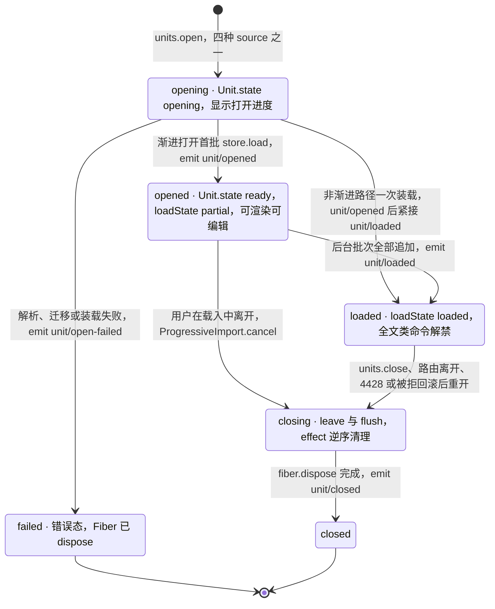
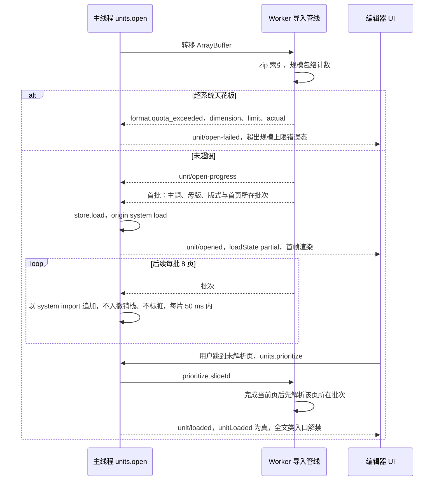
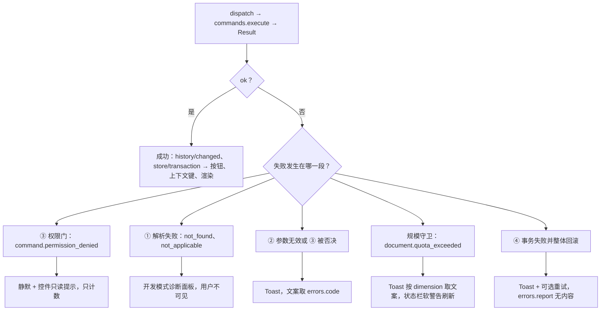
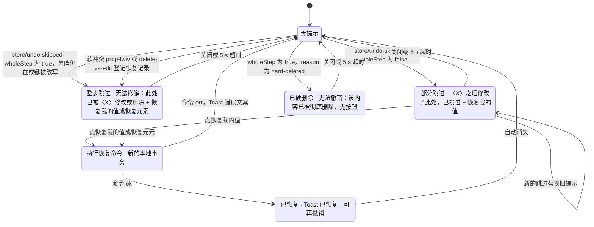
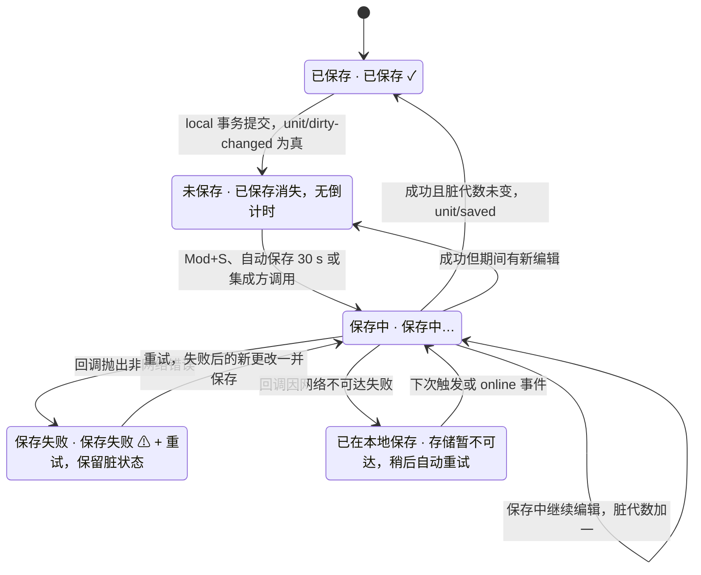
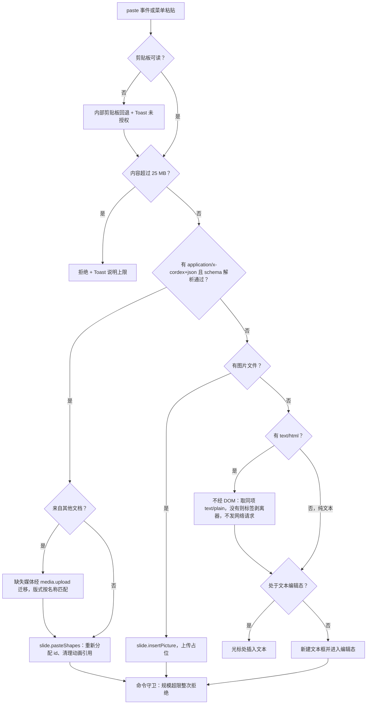

# 04 客户端文档模型、命令与撤销
> 状态：v0.1 | 负责：前端设计线 | 更新：2026-09-25；2026-09-25（§4.19） | 依赖：[30/04](../30-architecture/04-document-model.md) §2.1、§2.2、§2.9、§3.1a；[30/05](../30-architecture/05-command-and-history.md) §1、§3、§6–§9、§13.3；[30/07](../30-architecture/07-rendering.md) §14.2；[40/02](../40-modules/02-kernel-protocol-and-document-core.md) §2.1、§2.4–§2.6；[40/03](../40-modules/03-slide-domain-model.md) §2.6；[40/10](../40-modules/10-ui-shell-and-slide-ui.md) §2.1、§2.2、§2.6；[40/05](../40-modules/05-collaboration-client.md) §2.3；[ADR-0007](../30-architecture/adr/0007-document-store-and-derived-undo.md)、[ADR-0013](../30-architecture/adr/0013-mutation-lowering-and-store-ops.md)、[ADR-0020](../30-architecture/adr/0020-crdt-selection.md)；[rulings](../00-charter/rulings-2026-09-14.md) §4.15 Q3/Q5、§4.17 D2/D4/D5、§4.18 CO-07/CO-11/CO-12/UX-05、§4.19 D-M2-CONTENT；[PRD 02](../10-prd/03-features/02-editing.md) ED-14/ED-17/ED-23；[PRD 03](../10-prd/03-features/03-collaboration.md) CO-08/CO-09；[设计 05](../20-design/05-collaboration-ux.md) §5–§6、[设计 03-19](../20-design/03-screens/19-undo-redo-clipboard-and-save-state.md)

本文是**浏览器中文档模型、命令与撤销的运行侧行为**的唯一事实源：Unit 在浏览器中的生命周期、渐进打开的 UI 行为、命令入口与结果分流、历史策略、协同撤销语义的 UI 表达（不简化）、墓碑在客户端的可见性与「彻底删除元素」入口、保存与离开保护、剪贴板管线、规模守卫的编辑期 UI。

不在本文（只链接）：

| 主题 | 事实源 |
|---|---|
| `Unit`、`DocumentType`、`DocumentStore`、`StoreOp`、`Origin`、`Selection<A>` 契约本体 | [30/04 §2](../30-architecture/04-document-model.md)、[40/02 §2.1–§2.5](../40-modules/02-kernel-protocol-and-document-core.md) |
| 命令三分法、七阶段管线、中性撤销契约与五个契约用例 | [30/05 §1–§6](../30-architecture/05-command-and-history.md)、[40/02 §2.5「撤销协同契约用例名表」](../40-modules/02-kernel-protocol-and-document-core.md) |
| 幻灯片 Command / Mutation 清单与全文命令守卫 | [40/03 §2.6](../40-modules/03-slide-domain-model.md) |
| 墓碑 TTL 硬删除、tombstone-sweeper、元素彻底删除的服务端执行 | [60/05](../60-backend/05-modules-collab-and-snapshots.md) |
| 协同会话、ack、被拒回滚、软冲突信号 | [07](07-collaboration-client.md) |
| 文本编辑与 IME 的事务合并 | [06](06-text-editing-and-ime.md) |
| 错误码 → 文案（i18n `errors.<code>.{title, action}`） | [15 §4](15-events-errors-and-telemetry.md) |
| 横幅、Toast、FieldError、状态胶囊的全局分层 | [10 §11](10-editor-shell-and-interaction.md) |
| 用例 id、运行矩阵、CI 步骤 | [70/02](../70-testing/02-contract-suites-and-pluggability.md)、[70/05](../70-testing/05-collab-simulation-and-property-tests.md) |

包名一律省略 `@cordexjs/` 前缀。

## 1. 浏览器中的 Unit 生命周期与 Store Provider

一个 Unit 就是一份打开的文档：一个插件 Fiber、一个隔离的 UnitScope（`store / history / selection / render / presence` 等服务在其中），关闭即 `fiber.dispose()`。浏览器里常见的多 Unit 共存：编辑中的文档、版本预览（[08 §9](08-comments-and-version-history.md)）、「导出为本地副本」的临时 Unit（[07 §8.2](07-collaboration-client.md)），三者互不可见。

**打开的四种 `source`**

| `source.kind` | 浏览器中的来源 | 装载路径 | Store Provider | 里程碑 |
|---|---|---|---|---|
| `bytes` | 本地 .pptx（`File` / `Blob` / `ArrayBuffer`）：M1 查看器、apps/web 本地文档（`local:*`）与集成方 | Worker 渐进打开（§2） | `store-memory` | M1（查看器）/ M2 |
| `snapshot` | 集成方交回的 Snapshot（EM-02 热保存） | 一次性 `load`，旧 `schemaVersion` 先迁移并发 `unit/migrated` | `store-memory` | M2 |
| `state` | 协同 HTTP 快照 bootstrap（V2 update），M2 起 apps/web 的全部服务端文档（rulings §4.19 D-M2-CONTENT）；版本预览字节 | 一次性应用，origin `system('load')`（[07 §2](07-collaboration-client.md)） | `store-yjs` | M2（版本预览 M3） |
| `empty` | 本地或集成方新建（`documentType.createEmpty()`，首页为标题版式）；apps/web 服务端文档的新建改走服务端导入（[02 §8](02-app-shell-routing-and-session.md)） | 一次性 `load` | 随 preset | M2 |

- **Provider 由 preset 决定**（[03](03-preset-assembly-and-plugins.md)）：`preset-slide-viewer` 用 `store-memory` 且 `history.limit = 0`（无撤销）；`preset-slide` 用 `store-memory`，`history.limit = 200`；`preset-slide-collab` 用 `store-yjs`。两者同一契约、同一中性撤销语义（rulings §4.15 Q3），切换只改 preset 配置（PRD CO-11）。
- **打开失败**（`unit/open-failed(unitId, code, stage)`）：`format.no_document_type`、`format.quota_exceeded`（超系统天花板，§2）、`format.encrypted`、`format.macro_rejected`、`format.pptx.invalid_package`、迁移缺链等，编辑器页进入错误态，文案取 `errors.<code>`；失败时 Fiber 已 dispose，不留半个 Unit。
- **未注册的 ResourceHook 命名空间**：打开的 Snapshot 或 Y 状态里带有当前 preset 未注册的资源命名空间时（例如单人 preset 打开含 `comments.threads` 的文档，[03](03-preset-assembly-and-plugins.md) §3），数据原样保留、随 Snapshot / Y 状态往返与导出，不渲染、不可编辑；`validateSnapshot` 对未注册命名空间只校验其为合法 JSON，不报错。
- **关闭**：`units.close(unitId)` → 协同时先 `Session.leave()`（内含 5 s `flush`，[07 §6](07-collaboration-client.md)）→ `fiber.dispose()` 逆序运行 effect（MediaCache 回收 blob URL、Worker 终止、`ProgressiveImport.cancel()`）→ `unit/closed`。路由离开时由 HostRegistry 调用（[02 §6](02-app-shell-routing-and-session.md)）。

**Unit 生命周期（浏览器）**

怎么读：方框里的前半句是契约状态（`Unit.state` / `loadState`，[40/02 §2.1](../40-modules/02-kernel-protocol-and-document-core.md)），后半句是浏览器中的可见含义；只有本地字节的渐进打开会经过 `opened`，其余三种 source 直接到 `loaded`。协同中的 4428 与被拒回滚都是「关闭再重开」，得到新的 Unit 与 Session。
依据：40/02 §2.1 UnitScope 状态机；30/07 §14.2；rulings §4.18 CO-12。

## 2. 渐进打开

只用于 `source.kind:'bytes'` 且 codec 实现了 `importProgressive()`（slide 为 `ooxml-pptx` 的 Worker 入口，[40/04](../40-modules/04-ooxml-format-and-pptx-codec.md)）；协同模式不走此路径（rulings §4.18 CO-12）。契约（`ProgressiveImport{first, batches, prioritize, cancel, done}`、import 追加语义、`units.whenLoaded` / `units.prioritize`）以 [40/02 §2.1、§2.5](../40-modules/02-kernel-protocol-and-document-core.md) 为准，本节只写浏览器行为。

1. 主线程把 `ArrayBuffer` 转移给 Worker；Worker 解析 zip 索引后**先完成规模包络计数**（页数、单页元素、总元素、文件大小）：超系统天花板整体拒绝，`unit/open-failed{code:'format.quota_exceeded', details:{dimension, limit, actual}}`，进入「超出规模上限：直接拒绝导入」错误态（设计 03-13），不会装到一半才失败。
2. Worker 按「主题 / 母版 / 版式 → 首页所在批次 → 其余页（每批 8 页，按 `order` 键顺序）」回传；首批经迁移校验后 `store.load`（origin `system('load')`），立即 `unit/opened`（`loadState:'partial'`），首帧渲染。
3. 后续批次以 `transact(fn, {origin: system('import'), undoable: false})` **追加**：只新增实体键、不改已有键（用户已在首批上的编辑不会被覆盖），不入撤销栈、不标脏（DirtyTracker 与 `unit/dirty-changed` 忽略该来源）；主线程以 `scheduler.yield` 分片，每片 ≤ 50 ms。
4. 用户跳到尚未解析的页（点缩略图骨架、深链 `?page=`、翻页越界）时调用 `units.prioritize(unitId, slideId)`：Worker 完成当前页后先解析该页所在批次，主线程把已解析未装载的批次提到队首；目标页显示骨架，未解析页 ≤ 300 ms 可见、已解析未装载页 ≤ 100 ms（rulings §4.18 CO-11）。
5. 全部批次到齐 → `unit/loaded`（`loadState:'loaded'`），上下文键 `unitLoaded` 变为真。用户在载入中关闭 → `ProgressiveImport.cancel()`，Worker 终止。

**渐进打开期间受 `unitLoaded` 约束的入口**

| 入口 | 载入完成前 | 依据 |
|---|---|---|
| 全选 `Mod+A` | 禁用，tooltip「正在载入其余页面…」 | 40/10 §2.1 `unitLoaded` 键 |
| 查找 / 替换面板 | 面板显示等待态，可关闭 | 40/10 §2.6 |
| 导出（`core.export`） | 先 `await units.whenLoaded`，导出对话框显示「正在载入其余页面…」，可取消 | 40/02 §2.6 |
| 跨页重排、新建页、复制页（`slide.reorderSlides` / `addSlide` / `duplicateSlide`） | 命令等待 `whenLoaded`，命令面显示忙态，可取消 | 40/03 §2.6 全文命令守卫 |
| 删除版式 / 母版、换主题、多页应用版式 | 同上 | 40/03 §2.6 |
| 当前页内的形状、文本、页属性编辑 | 不受影响 | — |
| 缩略图栏 | 未装载页显示骨架；页数显示「共 N 页（正在载入）」 | [10 §6](10-editor-shell-and-interaction.md) |
| 保存（单人） | 可保存；首批上的编辑标脏，追加批次不标脏；导出型保存同样等待 `whenLoaded` | §8 |

进度 UI 订阅 `unit/open-progress{stage, pct}`；首帧前显示加载骨架，首帧后只在状态胶囊显示「正在载入其余页面 x%」，不阻挡编辑。预算（RM-A p75：D50 ≤ 1.5 s、D200 ≤ 3.0 s 首屏；主线程最长任务 ≤ 50 ms）以 [13](13-performance-and-bundling.md) 为准。

**渐进打开（浏览器侧）**

怎么读：包络计数在回传首批之前完成，所以超限只会整体拒绝；首批一到就可以编辑，后台批次以 `system('import')` 追加、既不进撤销栈也不标脏；`prioritize` 是用户跳页时发给 Worker 的抢占消息。
依据：30/07 §14.2；40/02 §2.1、§2.5「import 追加语义」；rulings §4.18 CO-11、CO-12。

## 3. 命令入口

UI 的一切行为都经 `dispatch(ctx, unitId, commandId, params)` 转 `commands.execute()`（[40/10 §2.2](../40-modules/10-ui-shell-and-slide-ui.md) 五条输入管线的终点）；UI 不直接写 Store（lint `cordex/store-transact-in-commands-only`），也不自行实现撤销语义（撤销 / 重做只绑定内置 `core.undo` / `core.redo`）。

| 管线阶段（30/05 §3） | 失败时的事件 | UI 可见后果 |
|---|---|---|
| ① resolve | `command/rejected{reason:'not-found'}` | 不提示用户（控件本应由 `when` 隐藏）；开发模式诊断面板记录 |
| ② validate | `command/rejected{reason:'validation'}` | Toast「操作参数无效」；只遥测计数，不 `errors.report` |
| ③ 权限门 | `command/rejected{reason:'permission'}` + `permission/denied` | **静默**，只在控件上显示只读提示（tooltip「需要编辑权限」）；只读态下写命令控件禁用而非隐藏 |
| ③ 第三方监听器否决（未调用 `next`） | 审计记 `VETOED`；Result 为 `command.vetoed` | Toast「操作被插件拦截」，诊断面板显示监听器所属 Fiber |
| ③→④ 规模守卫 | `command/rejected{reason:'validation'}`；Result 为 `document.quota_exceeded`（30/05 §8） | Toast（按 `dimension` 取文案，§10）；不开事务 |
| ④ 事务 | `command/failed` + `errors.report` | Toast「操作失败」+ 错误码；事务已整体回滚，无半截状态 |
| ⑤ 历史 | `history/changed` | 撤销 / 重做按钮与 tooltip 更新 |
| ⑥ 事件 | `store/transaction`、`command/executed` | 渲染脏区重绘、状态栏与上下文键更新 |
| ⑦ 审计 | `command/audited` | 无 |

- **Operation**（`view.setMode`、`ui.*`、`slide.setCurrentSlide` / `setSelection` / `setZoom`、`slide.selectMasterOrLayout`）同样走 `commands.execute`（同一入口、权限门、审计），但跳过事务与历史，不标脏；`broadcast:true` 的 Operation 经 presence 广播（[07 §10](07-collaboration-client.md)）。
- **结果必须解构**：`useCommand(id)` 返回 `{ run, lastError }`，`run` 的结果是 `Result`，禁止布尔结果与 `if (!ok)` 用法（lint `no-boolean-command-result`）。
- **控件可用性**只看上下文键（`isReadOnly`、`canUndo`、`unitLoaded`、`selectionKind` 等）与 `commands.describe(id).permission`，不在组件里硬编码角色判断。

## 4. Result 错误码 → UI 处理矩阵

文案一律取 i18n `errors.<code>.{title, action}`（决策 ERR-COPY；`user:true` 的码必须有 zh-CN 与 en-US 键，[15 §4](15-events-errors-and-telemetry.md)）；下表只定通道与附带动作。

| 码 | 来源 | 通道 | 附带动作 |
|---|---|---|---|
| `command.permission_denied` | ③ 权限门 | 静默 + 控件只读提示 | 不上报错误，只计数 |
| `command.not_found` / `command.not_applicable` / `command.unit_not_found`（30/05 §3.1，40/02 §2.6 同名） | ① | 静默（开发模式诊断） | 计数 |
| `command.invalid_params` | ② | Toast | 计数 |
| `command.vetoed` | ③ | Toast | 诊断面板记录否决者 |
| `document.quota_exceeded{dimension, limit, actual}` | 规模守卫 | Toast（§10 按维度取文案） | 不开事务；状态栏软警告同步刷新 |
| `command.handler_failed` / `command.mutation_rejected` | ④ | Toast + [重试]（仅当命令幂等且参数仍有效） | `errors.report`（无文档内容） |
| `command.store_unavailable` | ④（Unit 正在关闭或重开） | 静默丢弃 | 计数 |
| 领域前置失败：版式 / 母版仍被引用（`LAYOUT_IN_USE` / `MASTER_IN_USE`）、占位符超上限（`PLACEHOLDER_LIMIT_EXCEEDED`） | ④ 前置校验 | 对应流程内的确认卡或 Toast（[11](11-masters-layouts-and-themes.md) §7–§8） | 不开事务 |
| `HISTORY_EMPTY`（`core.undo` / `core.redo` 栈空） | Operation | 无（按钮本应禁用） | 无 |
| `store.import_append_conflict` | 渐进打开追加批次触及已有键 | 不面向用户：追加批次整体拒绝并 `errors.report`，已装载内容保持 | 诊断 |

**命令结果到 UI 反馈的分流**

怎么读：只有权限拒绝是静默的（用户已在控件上看到只读提示，再弹 Toast 是噪音）；其余失败按阶段分到诊断、普通 Toast、带维度的配额 Toast 与带重试的失败 Toast。任何失败都不会留下半截事务。
依据：30/05 §3、§9；40/10 §2.2 输入管线图；rulings §4.17 D2；决策 ERR-COPY。

## 5. 历史策略

| 规则 | 口径 | 依据 |
|---|---|---|
| 粒度 | 一个 Command = 一个事务 = 一个撤销单元 | 30/05 §1 |
| 合并 | 同 `label`、同 origin、间隔 < `coalesceMs`（默认 500 ms）的连续文本事务合并为一步（store-yjs 的 `captureTimeout` 同值）；格式修改、拖动、粘贴各为一步 | 30/05 §6；PRD ED-14（同为 500 ms） |
| 拖拽 | 首选「一次拖拽一个命令」：拖动中只画覆盖层预览，`pointerup` 时以一个 `slide.moveShapes` / `resizeShapes` / `rotateShapes` 收口；确需多命令的手势用 `history.beginGroup(label) … endGroup()` | 30/05 §8；[10 §7](10-editor-shell-and-interaction.md) |
| IME | 组合期不写 Store，`compositionend` 一次事务（[06 §5](06-text-editing-and-ime.md)） | ADR-0028 |
| 容量 | 默认 200 步（preset `history.limit`，PRD 要求 ≥ 100），超出淘汰最旧；查看器 0 | 30/05 §6 |
| 不入栈 | 导出、保存（`undoable:false`）；全部 Operation；`comments.*` 命名空间（ADR-0031，[08 §3](08-comments-and-version-history.md)）；一切 `system(...)` origin（load、import、migration、repair、restore、maintenance）；远端事务 | 30/05 §6；40/02 §2.5 |
| 作用域 | 撤销栈随 Unit 隔离；切页不清空；协同重连后保留；Unit 重开（4428、被拒回滚、身份变更）后清空 | PRD ED-14、CO-09 |
| 撤销后定位 | 由 `TransactionRecord` 的触及路径算出所在页与实体 → `slide.setCurrentSlide` + `slide.setSelection`（Operation，不入历史） | PRD ED-14 |
| 连击 | 快速连按 `Mod+Z` 每次仍是独立一步，不合并 | 设计 03-19 |

- **UI 绑定**：应用栏撤销 / 重做按钮（编辑模式常驻、评审与放映隐藏，Ribbon 不重复放）、`Mod+Z` / `Mod+Shift+Z` / `Mod+Y`、命令面板一律绑定 `core.undo` / `core.redo`；`history/changed{canUndo, canRedo, depth}` 驱动上下文键 `canUndo` / `canRedo`；按钮 tooltip 显示下一步的步骤名（取该命令 `ui.command` 标题，如「撤销：移动形状 (Mod+Z)」）。
- **预算**：撤销 / 重做 p95 ≤ 50 ms；随机 1,000 步命令序列撤销后再重做，模型哈希一致（[70/05 §10](../70-testing/05-collab-simulation-and-property-tests.md) `history:property`）。

## 6. 协同撤销语义的 UI 表达（不简化）

语义本体是 `DocumentStore` 的中性契约（[30/05 §6](../30-architecture/05-command-and-history.md)、[40/02 §2.5](../40-modules/02-kernel-protocol-and-document-core.md)），`store-memory` 与 `store-yjs` 同语义。四条规则在 UI 上一条不减：

1. **不覆盖他人**：一步撤销中被他人后写的键跳过，其余键照常回退；
2. **整步被跳过即停**：本步全部键都被跳过时，本次撤销丢弃该步并停下，**不连撤更早一步**；下一次 `Mod+Z` 才处理更早一步；
3. **永不复活他人删除的元素**：撤销目标已被他人删除（墓碑 TTL 内亦然，不看 TTL）→ 跳过并提示；恢复只能由删除方撤销自己的删除，或由我显式执行「恢复元素」（新事务）；
4. **硬删除后整步跳过**：删除方撤销自己的删除时，若墓碑已 TTL 到期或已被「彻底删除元素」，按整步被跳过处理（`wholeStep:true`）。

`store/undo-skipped{skipped: UndoSkip[], wholeStep}` 由 Store Provider 发出；**单独统计**跳过次数与整步跳过次数，不派生 `collab/soft-conflict`、不计入软冲突率 MT-15（rulings §4.17 D5，[15 §8](15-events-errors-and-telemetry.md)）。

### 6.1 恢复记录（UndoSkip 记录）

依据：决策 RESTORE-CMD（rulings §4.15 Q3「恢复我的值为新事务」、§4.18 CO-07、30/05）。`history` 服务（model-core，UnitScope）保留最近 20 条记录，不持久化，Unit 重开（含 epoch 变更）时清空：

| 字段 | 含义 |
|---|---|
| `skipId` | 记录 id |
| `stepId` | 同一次撤销（或同一次软冲突通知）产生的记录共享一个 `stepId` |
| `entityId`、`path` | 被跳过的实体与键 |
| `myValue` | 本端在该键上最后一次写入的值快照（「恢复我的值」写回它） |
| `wholeStep` | 所属那一步是否整步被跳过 |
| `reason` | `'remote-conflict'`（同键被他人后写）｜`'remote-deleted'`（目标被他人删除，墓碑仍在）｜`'hard-deleted'`（目标已硬删除）。前两值照抄 40/02 `UndoSkip.reason`；决策原文的 `remote-overwrite` 即 `remote-conflict`；`hard-deleted` 由 `history` 在记录时检查实体键已不存在而派生 |
| `source` | `'undo'`（来自 `store/undo-skipped`）｜`'conflict'`（来自 [07 §12](07-collaboration-client.md) 的 `prop-lww` 与 `delete-vs-edit` 通知，由 `collab-yjs` 调用 `history` 登记） |
| `by`、`at` | 覆盖或删除者（经 awareness 映射的显示名，查不到时「一位协作者」）与时间 |

### 6.2 两个恢复命令

| 命令 | 参数 | 能力位 | 语义 | 不可用时 |
|---|---|---|---|---|
| `core.history.restoreMine` | `{ skipId }` | `['doc.write']` | 把 `skipId` 所属 `stepId` 下全部 `reason:'remote-conflict'` 记录的 `myValue` 写回原键，作为**一个新的本地事务**（普通可撤销命令，会覆盖对方的后写，进入审计） | 目标实体已是墓碑或已硬删除、记录已被淘汰 → 按钮禁用，tooltip「目标已被删除」或「提示已过期」；强行调用返回 `err(command.not_applicable)` |
| `core.history.restoreElement` | `{ skipId }` | `['doc.write']` | 对 `skipId` 所属 `stepId` 下仍为墓碑态、未硬删除的实体清除 `_deleted`，以**原 id** 复活（连同期间落在墓碑上的他人编辑），作为一个新的本地事务（可撤销） | 目标已硬删除 → 按钮禁用并提示「该内容已被彻底删除」（按 rulings §4.18 CO-07 术语，替换决策原文「已被永久删除」）；目标已被他人恢复 → 无操作并 Toast「已恢复」 |

两者都是普通 Command：经权限门、规模守卫（复活的元素计入上限）、审计；命令 id 由 [40/02](../40-modules/02-kernel-protocol-and-document-core.md) 按命名规则登记（`scan-command-capabilities` 规则 (c)），若规则要求两段式以 40/02 登记名为准。它们不是「撤销的延续」，`Mod+Z` 永不自动执行它们。

### 6.3 提示条

提示条以带操作按钮的 Toast 呈现（设计 05 §6：非阻断、可关闭、不打断输入；含操作按钮时停留 5 s，悬停暂停计时）。同一时刻只保留最新一条，新的跳过替换旧的。

| 情形 | 文案（取 i18n，示意） | 按钮 |
|---|---|---|
| 部分键被他人后写（`wholeStep:false`） | 「〈X〉之后修改了此处，已跳过」 | 恢复我的值 |
| 整步被他人改写 | 「无法撤销：此处已被〈X〉修改」 | 恢复我的值 |
| 目标被他人删除（墓碑仍在） | 「无法撤销：此处已被〈X〉删除」 | 恢复元素 |
| 撤销自己的删除但已硬删除 | 「无法撤销：该内容已被彻底删除」 | 无 |
| 软冲突 `prop-lww`（[07 §12](07-collaboration-client.md)） | 「〈X〉移动了该形状」等 | 恢复我的值 |
| 软冲突 `delete-vs-edit` | 「你编辑的元素已被〈X〉删除」/ 页级「此页已被〈X〉删除」 | 恢复元素（含我的编辑）/ 恢复此页 |

整步被跳过后，撤销按钮 tooltip 立即更新为再前一步的步骤名。提示出现率 100%（PRD CO-09 验收）。

**撤销跳过提示条**

怎么读：提示条只由两类来源进入（撤销跳过与软冲突通知），离开只有三种（执行恢复、关闭、超时）；「恢复」永远是新事务，所以执行后仍可再被撤销。
依据：30/05 §6；PRD CO-08、CO-09；设计 05 §5–§6、设计 03-19；rulings §4.15 Q3、§4.17 D4/D5、§4.18 CO-07；决策 RESTORE-CMD。

## 7. 软删除墓碑在客户端的可见性

用户删除有身份实体（页、形状、版式、母版、节）只写 `_deleted: {at, by}` 墓碑，id 稳定（[30/04 §3.1a](../30-architecture/04-document-model.md)）。客户端规则：

- **读路径一律过滤**：选择器、`slides` 服务、SceneProvider 与渲染、缩略图、导出、查找替换、可访问树镜像都只读 `filterLive()` 视图；墓碑实体不可见、不可选中、不参与 `(order, id)` 排序（契约用例 `read-path-filters-tombstone`）。墓碑在 TTL 内计入文档总元素上限（§10）。
- **选区收敛**：本端选中的实体被远端标墓碑时，从选区中静默移除（Operation）；若正在编辑它的文本，退出文本编辑态；若本端 60 s 内对它有写入，由 [07 §12](07-collaboration-client.md) 发 `delete-vs-edit` 提示「你编辑的元素已被〈X〉删除」+「恢复元素（含我的编辑）」（`core.history.restoreElement`，§6.2）；页级为「恢复此页」（原 id、原位置，页内他人新增的形状随之可见）。
- **评论**：锚点目标成为墓碑时线程进入「已脱离锚点」，以原 id 恢复后自动回到原锚点（[08 §6](08-comments-and-version-history.md)）。
- **后加入者**：TTL 内的墓碑仍随 Y 状态同步给后加入的协作者（含查看者），但同样被读路径过滤；访问审计由服务端负责。
- **客户端从不硬删除墓碑**：硬删除只有三条服务端路径——TTL 到期（`tombstone.ttlHours`，默认 24 h）、owner 的「彻底删除元素」、文档级「永久删除文档」（[60/05](../60-backend/05-modules-collab-and-snapshots.md)、[60/04](../60-backend/04-modules-documents-storage-media.md)）。

### 7.1 「最近删除」与彻底删除元素（M3，仅 owner）

入口是版本历史面板顶部的可折叠分组「最近删除」（[08 §9](08-comments-and-version-history.md)；编辑者不显示），这是「彻底删除元素」的唯一入口（rulings §4.18 CO-07）。

- **数据来源**：本地 Y 状态中带 `_deleted` 且 `at + ttlHours > now` 的实体，按删除时间倒序；每行：元素类型与名称、所在页、删除者、删除时间与剩余保留时长（`ttlHours` 由装配时注入，与服务端 `tombstone.ttlHours` 同一部署值，SDK 默认 24 h）。删除者显示：取 `Tombstone.byUser`（命令层写入当前 principal 的 userId，服务端 L4 软门禁校验它等于来源会话的 userId，否则按修复还原，[60/16](../60-backend/16-ws-protocol-server-view.md) §4）经用户目录映射为显示名；没有 `byUser` 的旧墓碑回退为 `Tombstone.by`（Yjs clientID）经在线 awareness 映射，仍映射不到时显示「一位协作者」。
- 本分组不设恢复按钮：找回仍走删除方撤销或被影响者的「恢复元素」。
- **[彻底删除]**：弹 `AlertDialog`「彻底删除"〈名称〉"？删除后无法恢复。历史版本仍含该内容，要连历史清除请永久删除文档。」→ `POST /documents/:id/elements/purge{ids}`（`doc.manage`，路由见 [60/15 §3.7](../60-backend/15-rest-api-catalog.md)）→ 服务端单写者以 `system('maintenance')` 立即硬删并写审计 `document.element_purged`，结果经 CRDT 到达所有端 → 该行消失，Toast「已彻底删除 1 个元素」（不带撤销）。可多选批量。
- **失败**：`server.documents.element_not_tombstoned`（目标已被恢复）→ 刷新列表并 Toast 说明；403 → 静默并刷新权限；离线时按钮禁用，tooltip「离线时不可用」。
- 之后删除方再撤销该步 → 整步被跳过，提示「无法撤销：该内容已被彻底删除」（§6.3）。它只清当前文档状态，历史快照与 update 表按保留期存在，引用的图片原件按 30 天无引用回收——文案必须如实说明，不承诺「彻底消失」。

## 8. 保存、脏状态与离开保护

### 8.1 单人模式（`store-memory`）：回调式保存

适用于本地文档（`local:*`）与集成方的单人 preset（EM-02）；apps/web 的服务端文档自 M2 起走 §8.3。

- **脏状态**：任一 `local` origin 事务提交 → `unit/dirty-changed{dirty:true}`；`system('load'|'import')` 与 Operation 不标脏。保存成功 → `unit/saved` 且 `dirty:false`。
- **触发**：`Mod+S`（立即保存，完成后应用栏短暂显示「已保存 · 刚刚」）；自动保存（Preferences `autosaveSec`，默认 30 s，仅在 dirty 时触发，0 = 关闭）；集成方主动调用。
- **保存内容**（EM-02 (a)）：集成方选择 `onSave(bytes)`（`core.export` 在 Worker 中对快照副本生成 pptx，先 `await whenLoaded`）或 `onSave(snapshot)`（热保存，比 pptx 快 ≥ 5 倍）。
- **不阻塞编辑**：保存以「脏代数」判定——开始保存时记下当前代数，成功后只有代数未变才 `markClean`，保存期间的新编辑归入下一次保存。
- **失败**：保留脏状态，应用栏「保存失败 ⚠ [重试]」，只保留一条最新失败提示；失败后的新更改并入重试。`onSave` 以网络类错误失败（集成方存储暂不可达）时显示「已在本地保存」（warning）：内容仍在内存，下次触发或 `online` 事件时自动重试；这不是协同的离线态。
- **离开保护**：dirty 时关闭或刷新标签页触发 `beforeunload` 原生提示（集成方可经 preset 选项关闭，选项登记见 [40/11](../40-modules/11-preset-assembly-and-app-shell.md)）。

**单人模式保存与脏状态**

怎么读：只有 `local` origin 的事务会把文档变脏；保存期间的编辑不会被误标为已保存（脏代数不等就回到未保存）。协同模式不走这张图，改用 [07 §3](07-collaboration-client.md) 的会话状态指示。
依据：PRD ED-23、EM-02；设计 03-19「保存态切换」；40/02 §2.4 `unit/dirty-changed`、`unit/saved`。

### 8.2 apps/web 服务端文档的持久化

依据：rulings §4.19 D-M2-CONTENT（覆盖 INC-37 的 M2 / M3 分界）。M2 起服务端文档的内容**以协同快照为唯一事实源**：以 `preset-slide-collab` 打开（`source:'state'`，[07 §2](07-collaboration-client.md)），每个本地事务经协同网关落库，没有 pptx 内容版本、没有 `onSave` 回调、没有「保存」动作；同一用户多个标签页经同一 Room 收敛，不存在覆盖冲突。新建与导入先由服务端导入生成 import 快照（[02 §8](02-app-shell-routing-and-session.md)）。脏状态、离开保护与导出「等待同步」按 §8.3。

### 8.3 协同模式（`store-yjs`，M2 起 apps/web 服务端文档）

- 协同模式没有「保存」动作，也不显示保存态文案：持久化由服务端负责，应用栏显示会话状态（[07 §3](07-collaboration-client.md)）；`unit/dirty-changed` 不驱动 UI。
- **离开保护**：`Session.stats.pendingLocalUpdates > 0`，或处于 `reconnecting` / `offline`（M4 前为内存队列）时，刷新或关闭标签页触发 `beforeunload`「刷新将丢失未同步更改」；应用内路由离开先 `Session.flush()`（5 s），仍有 pending 则弹确认「有 N 项更改尚未同步，离开将丢失」［留下］［仍要离开］。
- **导出期间可编辑**：`core.export` 在 Worker 中对快照的结构化克隆运行，编辑不受阻塞（NF-01 1.4）。
- **导出「等待同步」**（rulings §4.18 UX-05；对话框视觉见设计 22，导出用例见 [02 §8](02-app-shell-routing-and-session.md)）：打开导出对话框时若 `pendingLocalUpdates = N > 0`：
  - 客户端格式（pptx）：提示「导出将包含本地最新内容」+［仍要导出］［等待同步］；
  - 服务端格式（PDF、M3 起的批量 PNG）：不提供「仍要导出」，警告改为「需先同步 N 项更改」+［等待同步］；
  - 点［等待同步］后对话框停在该态，调用 `Session.flush()` 并实时显示「正在同步 N 项…」，归零后自动进入生成中，期间可取消；`offline` / `reconnecting` 时该按钮禁用并提示「恢复连接后才能同步」。

## 9. 剪贴板管线

三层分工（[40/10 §2.2、§2.6](../40-modules/10-ui-shell-and-slide-ui.md)）：

| 层 | 职责 | 不做 |
|---|---|---|
| `ui-core` 剪贴板管线（文档类型盲） | 捕获 `copy` / `cut` / `paste` 与菜单触发；MIME 协商；外部内容清洗（不经 DOM）；25 MB 上限；Clipboard API 不可用时的内部剪贴板回退；产出 `ClipboardIntent` | 不认识幻灯片，不写 Store |
| `slide-ui` 绑定 | 意图 → 命令参数：片段 → `slide.pasteShapes`；图片 → `slide.insertPicture`；文本 → 编辑态插入或 `slide.insertShape{kind:'sp'}` + `slide.insertText`；复制时序列化选区为片段 | 不直接写 Store |
| 命令（[40/03 §2.6](../40-modules/03-slide-domain-model.md)） | 重新分配 id、清理动画引用、`order` 键经 `between` 计算、规模守卫、一个事务一步撤销 | 不碰剪贴板 API |

- **写入**：复制 = 仅序列化（无命令）；剪切 = 序列化 + `slide.deleteShapes`（一步撤销）。同时写入 `application/x-cordex+json`（模型片段：`{v, documentType, schemaVersion, sourceDocumentId, entities, media: sha256[]}`）、`text/html`（由片段生成的简单语义 HTML）、`text/plain`、单张图片时 `image/png`。
- **读取优先级**：自定义 MIME（按文档类型 schema `safeParse`，类型或版本不符即落到下一档）→ `image/*` → `text/html`（M2 只取纯文本，基本格式为 P2）→ `text/plain`（文本编辑态在光标处插入，否则新建文本框并进入编辑态）。
- **清洗**（不经 DOM，与 [14](14-client-security.md) §4.3、§5 一致）：M2 对 `text/html` 项取同一剪贴板项的 `text/plain`；该项没有 `text/plain` 时，用不经 DOM 的标签剥离器（线性扫描去掉标签、解码字符实体、整段丢弃 `script` / `style` 等元素的内容）得到纯文本；P2 的基本格式改用不经 DOM 的白名单片段解析器，直接产出允许的行内格式对应的 Mutation 参数。全程不调用 `DOMParser`、`innerHTML` 等 TrustedHTML sink，不发起任何网络请求（远程 `img` 一律忽略，只接受剪贴板里的图片文件）。
- **上限**：单次粘贴内容 > 25 MB 拒绝并 Toast 说明上限；粘贴后的元素数触及规模上限时整次粘贴被命令守卫拒绝（§10），不做部分粘贴。
- **API 不可用**：`copy` / `cut` / `paste` 事件的 `clipboardData` 可读写自定义类型；菜单触发的粘贴用异步 Clipboard API（自定义格式按浏览器支持用 `web application/x-cordex+json`）。权限被拒时退化为编辑器内部剪贴板（每个标签页各自一份，不跨标签页共享），并 Toast「浏览器未授权访问剪贴板，已使用编辑器内部剪贴板」。
- **跨文档（M3 P1）**：片段携带 `sourceDocumentId` 与媒体 `sha256`；目标文档缺少媒体关联时，以用户对源文档的读权限取字节（`GET /documents/:srcId/media/:sha256`），再经 `media.upload` 提交到目标文档（服务端按 sha256 去重，决策 MEDIA-CLIENT、INC-21），完成前显示占位；图表内嵌工作簿等不透明部件同法迁移；目标缺失的版式按名称匹配，否则映射到默认版式并 Toast 提示。
- **协同模式**：大片段粘贴由命令层分批为多个事务，避免单帧超限（[07 §5](07-collaboration-client.md)）；只读态下粘贴被权限门静默拒绝。
- **反馈**（设计 03-19）：粘贴外部富文本 → Toast「部分格式已被简化」；粘贴纯文本到画布空白处 → 直接进入编辑态、不提示；粘贴图片 → 上传占位流程（[05 §8](05-rendering-and-thumbnails.md)）；右键「粘贴 ▾」变体为 P2。

**粘贴 MIME 协商与清洗**

怎么读：自上而下按优先级逐项判定、命中即停；外部 HTML 先清洗再当文本处理；所有落到命令的分支都要过规模守卫，超限时整次拒绝而不是粘一半。
依据：PRD ED-17；设计 03-19「剪贴板反馈」；40/10 §2.2 ClipboardIntent。

## 10. 规模守卫的编辑期 UI

数值为系统天花板默认值（rulings §4.15 Q5），部署可调；前端取编辑子插件 `Config.limits`（[40/03 §3](../40-modules/03-slide-domain-model.md)），由装配注入，与服务端同一部署值（[60/17](../60-backend/17-deployment-and-config.md)），界面文案读实际配置、不写死。

| 维度（`dimension`） | 软警告 | 硬上限 | 触及软警告 | 触及硬上限 |
|---|---|---|---|---|
| `slides` | 150 | 200 | 状态栏弱提示「已接近 200 页上限」 | 拒绝 + Toast「已达页数上限（200）」 |
| `elementsPerSlide` | — | 1,000 | — | 拒绝 + Toast，不产生新对象 |
| `elementsTotal`（墓碑计入） | 15,000 | 20,000 | 状态栏弱提示「元素数量已接近上限（15,000 / 20,000）」，悬停说明「最近 24 小时内删除的元素仍计入，到期后自动释放」 | 拒绝 + Toast「已达每份文档 20,000 个元素的上限」 |

- 硬上限由命令守卫在 ③ 之后、④ 之前按「提交后计数」判定，超限返回 `document.quota_exceeded{dimension, limit, actual}`（409，不关协同连接，rulings §4.17 D2），不开事务、不产生撤销记录；新增页、新增元素、粘贴、插入页、复制页、「恢复元素」同受约束。
- 软警告不是横幅、不阻断：跨越阈值时出现一次，降回阈值下自动消失。
- 协同并发合并后越线（两端各自未超限、合并后超限）：不变量 I-LIM1 只报告不修复，状态栏弱提示改为「已超过上限，新增内容将被拒绝」。
- 导入期超限（`format.quota_exceeded`）属于打开失败，见 §2 第 1 步。

## 11. 机械验证

本节只写断言与所在套件 / CI 步骤，执行方式归 [70](../70-testing/02-contract-suites-and-pluggability.md)。

| # | 断言 | 套件 / 用例 | CI 步骤 |
|---|---|---|---|
| V1 | 生产代码中 `store.transact(` 只出现在 `model-core/command/pipeline.ts` 与 `unit-plugin.ts`（load 与 `system('import')` 追加） | lint `cordex/store-transact-in-commands-only` | lint |
| V2 | 命令 handler 不返回布尔、调用方不以布尔判断结果 | lint `no-boolean-command-result` | lint |
| V3 | 中性撤销五用例在 `store-memory` 与 `store-yjs` 上同结果：`remote-conflict-skip`、`undo-skip-no-cascade`（含硬删除分支）、`soft-delete-tombstone`、`delete-vs-edit-undo`、`read-path-filters-tombstone` | `runDocumentStoreConformance` 中性撤销分节（[70/02 §4](../70-testing/02-contract-suites-and-pluggability.md)） | test/contract |
| V4 | 首批 `load` + 若干 `system('import')` 追加后：`toSnapshotBody()` 深等于一次性全量 `load`；`canUndo` 为假；`dirty()` 为空；追加触及已有键被拒 | `runDocumentStoreConformance` 用例 `import-append` | test/contract |
| V5 | `restoreMine` / `restoreElement` 契约：新事务、可撤销、硬删除后禁用、恢复元素沿用原 id 且无重复元素；epoch 变更后记录清空 | `runDocumentStoreConformance` 的 `history-commands` 分节（[70/02 §4](../70-testing/02-contract-suites-and-pluggability.md)）；70/05 §7 `collab:undo` 专项 | test/contract、test/collab-sim |
| V6 | 每种跳过情形提示出现率 100%；`store/undo-skipped` 单独计数、不计入软冲突率 | 双浏览器「撤销跳过提示、恢复我的值、恢复元素」用例（[70/06 §5](../70-testing/06-frontend-component-and-e2e.md)） | e2e/full-compose |
| V7 | 随机 1,000 步命令序列撤销后重做，模型哈希一致；撤销 / 重做 p95 ≤ 50 ms | `history:property`（70/05 §10）；perf 场景 | test/unit、perf/perf-client |
| V8 | 渐进打开：超天花板在首批之前拒绝；`unitLoaded` 为假时全选、查找替换、导出、跨页重排入口禁用或等待；零编辑导出零脏部件 | `runFormatCodecConformance`（importProgressive 分支）；`slide-ui` 入口单测；打开 e2e | test/contract、test/unit、e2e/smoke |
| V9 | 规模守卫：超限返回 `document.quota_exceeded` 且无事务、无撤销记录，墓碑计入 | `command-harness` 用例（40/03 §9）；`neutral-undo/tombstone-counts-toward-limit`（70/02 §4） | test/unit、test/contract |
| V10 | 粘贴：优先级顺序、外部 HTML 只以纯文本进入模型（无脚本执行、无外链请求、管线内无 `DOMParser` 调用）、25 MB 拒绝、内部剪贴板回退 | `ui-core` 剪贴板管线单测；编辑 e2e（每条 P0 / P1 ED 至少一个用例） | test/unit、e2e/smoke |
| V11 | 单人保存：保存期间的编辑不被误标已保存；失败保留脏状态；dirty 时 `beforeunload` 生效 | apps/web 保存用例 | test/unit、e2e/smoke |
| V12 | 彻底删除元素只对墓碑态、只 owner 可用；之后删除方撤销整步跳过 | 70/07 §10；70/05 §7 | test/server-integration、test/collab-sim |

## 12. 里程碑

| 里程碑 | 交付 |
|---|---|
| M1 | 查看器：`bytes` 打开与 Worker 渐进打开、`unit/loaded`、打开失败错误态；`historyLimit 0` |
| M2 | 编辑：命令入口与结果分流、历史策略、撤销 / 重做 UI、剪贴板（同文档与纯文本 / 图片 / HTML 取纯文本）、规模守卫 UI、墓碑读路径过滤与选区收敛；本地文档的单人保存与离开保护（§8.1）；apps/web 服务端文档经协同快照持久化（§8.2，rulings §4.19 D-M2-CONTENT），协同离开保护与导出「等待同步」（§8.3） |
| M3 | 多人协同体验层：协同撤销语义的 UI 表达（撤销跳过提示条）、恢复记录与两个恢复命令、「最近删除」与「彻底删除元素」、跨文档粘贴（P1） |
| M4 | 离线持久化后的离开保护文案改写（[07 §7](07-collaboration-client.md)） |

## 13. 未决、待登记与已关闭项

| 项 | 状态 | 去向 |
|---|---|---|
| D-M2-CONTENT：服务端文档的内容持久化 | 已裁定（rulings §4.19）：M2 起以协同快照为唯一事实源，pptx 内容版本方案取消 | §8.2 |
| 未找到 Unit 的错误码值 | 已关闭：统一为 `command.unit_not_found`（30/05 §3.1，40/02 §2.6 同步改名） | §4 |
| 页数软警告 150 的注入键 | 已关闭：40/03 `Config.limits` 登记 `softWarnSlides: 150`，由部署键 `scale.softWarnPages` 注入 | §10 |
| 键入合并窗口 | 已关闭：PRD ED-14 改为 500 ms，与 30/05 §6、store-yjs `captureTimeout` 一致 | §5 |
| 恢复记录 `source:'conflict'` 与 `history` 的登记接口（供 `collab-yjs` 调用），`stepId` 字段；两个恢复命令的最终 id | 已登记（40/02 §2.6、§4.5、§5.5：`recordConflict()`、`stepId`、`core.history.restoreMine` / `core.history.restoreElement`） | [40/02](../40-modules/02-kernel-protocol-and-document-core.md) §2.5–§2.6 |
| 「最近删除」显示删除者 | 已关闭：`Tombstone` 增可选 `byUser: UserId`（命令层写入，40/02 §2.2），服务端 L4 软门禁校验其等于来源会话 userId（[60/16](../60-backend/16-ws-protocol-server-view.md) §4） | §7.1 |
| 单人模式「关闭离开保护」的 preset 选项名 | 已登记（`SlidePresetOptions.leaveGuard`） | [40/11](../40-modules/11-preset-assembly-and-app-shell.md) §2.2 `SlidePresetOptions` |

