# 05 渲染、布局与缩略图
> 状态：v0.1 | 负责：前端设计线 | 更新：2026-09-25；2026-09-25（§4.19）；2026-09-26（§4.20）；2026-09-26（§4.21：canvas 第 ④ 角色媒体与图标预处理、emf-converter 4.x、编辑态临时播放、降级对齐 50/19、图表路线摘要）；2026-09-26（§4.21 整合：§1 标题改四个角色；§6 断行来源改 UCD 生成表；§9 chartex-unsupported 发出方改 fallback.renderer、占位口径对齐 50/19 §4.10；§11 A11yDescriptor 增 role link、links、表格与图表数据；canvas 限制规则标为已登记）；2026-09-26（§4.21 Remap：原 30/07 迁出节的引用改指 50/01 §4a、50/19、50-frontend/04、50-frontend/13 等新位置）；2026-10-03（§4.24 TA-1：§5.2 `comment-pins` 覆盖层归属改为 slide-ui `CommentPins`）；2026-10-03（§4.24 TA-1 收口：40/06 已移出 `comment-pins`，本表该行注明不经 `render.overlay`）；2026-10-04（design-language-v3 第 0 批：§4.3 `view/zoom-changed` 消费方由状态栏缩放胶囊改为检查器页签行与网格右上胶囊的缩放读数（rulings §4.25 DS-6））；2026-10-08（design-language-v3 第 1 批收口：§11 `missingAlt` 补不含文字的形状，rulings §4.25 TB-54）；2026-10-15（design-language-v3 第 2 批：§9 预期降级与查表未命中的占位统一为虚线框 + 类型图标 + 一行标题 + 一行原因，与缺插件元素的占位同一画法；保真占位可改大小、缺插件占位不能；汇总面板改称保真报告（检查器整栏面板）（rulings §4.25 DS-38、DS-51、DS-52））；2026-10-22（design-language-v3 第 3 批（rulings §4.25 DS-102、DS-103）：§10.1 Provider 表与图 10-1 的 `raster` 改为 M2 全部范围的 PNG 导出、M3 起只有「全部页」走服务端，`server-png` 的「批量 PNG」改写为 M3 起 PNG「全部页」；§10.3 已知限制一段补多页导出的路径与页数上限；JPEG 只给集成方直接调用）；2026-10-22（design-language-v3 第 3 批回写补充，rulings §4.25 TB-151：§9 页级占位（保真「此页内容无法解析」与放映单页渲染失败「此页内容暂时无法显示」）同一画法、在渲染层的纸面内画，与元素级占位、服务端缩略图一致）；2026-10-22（design-language-v3 第 3 批回写收口，rulings §4.25 TB-135、TB-151、TB-157：§9 页级占位的落点写明为 slide-render 的页级回退（40/07 §1.1、§5.1：页层换成覆盖纸面的 `unknown` 节点、母版与版式层照常，界面层不另叠层），运行时回退的页在 `/render` 里报 `render.page_failed`（TB-157）；§10.1 `dom-scaled` 一行的挂载数改引 50/10 §6（overscan 6、同时挂载 ≤ 12 项，TB-135）；§14.2 新增一行；2026-10-22 复核修正：§9 与 §10.3 第 5 步补浏览器图片导出遇运行时页级回退即失败（rulings §4.25 TB-166）；§2 事件表 `render/first-paint` 一行的「加载骨架」改为打开中画面（协同快照打开不画骨架，DS-99）；§14.2 同步；§1、§5.1、§9、§11、§15 五处仍写「待登记 / 待回写」的已回写项按 §14.2 改为已登记，§14.2 canvas 第 ④ 角色一行补已回写的去向）；2026-11-04（design-language-v3 母版视图改版：§5.2 覆盖层 `master-inheritance` 改名 `master-annotations`，数据（含 slide-ui 给的文案与是否 M2 的启用入参 `MasterAnnotationsOptions`）、刷新与落位；§14.2 新增一行；需求编号、优先级与里程碑不变；rulings §4.25 DS-148、TB-188、TB-189、TB-190） | 依赖：[30/07 渲染](../30-architecture/07-rendering.md)、[40/06 布局与渲染引擎](../40-modules/06-layout-and-render-engine.md)、[40/07 幻灯片渲染](../40-modules/07-slide-rendering.md)、[30/04 文档模型](../30-architecture/04-document-model.md) §6 / §12.4、[ADR-0021](../30-architecture/adr/0021-rendering-medium.md)、[ADR-0026](../30-architecture/adr/0026-headless-rendering-and-thumbnails.md)、[ADR-0027](../30-architecture/adr/0027-text-measurement-strategy.md)、[ADR-0036](../30-architecture/adr/0036-chart-rendering-and-editing.md)、[50/19 可追加元素目录](./19-insertable-elements-overview.md)、[50/23 媒体类](./23-elements-media.md)、[rulings](../00-charter/rulings-2026-09-14.md) §4.15 Q4 / Q5 / Q7 / Q8、§4.18 CO-01 / CO-02 / CO-19 / FE-08 / FE-09、§4.20 BE-02 / FE-16 / FE-24、§4.21（q-media-insert、q-chart-route、q-extra-inserts）；rulings §4.25 DS-102、DS-103；rulings §4.25 TB-151（第 3 批回写补充）；rulings §4.25 TB-135、TB-157（第 3 批回写收口）；rulings §4.25 TB-166；[40/07](../40-modules/07-slide-rendering.md) §1.1、§2.5、§5.1；rulings §4.25 DS-148、TB-188…TB-190（母版视图改版）

本文是浏览器侧渲染运行时的唯一事实源：一帧怎么画、画到哪、字体与媒体从哪来、画不出来时怎么表达、缩略图用哪条路、屏幕阅读器读什么。`SceneProvider` / `RenderTarget` / `ElementRenderer` / `OverlayRenderer` / `TextMeasurer` 的签名本体留在 [30/07](../30-architecture/07-rendering.md) §2.1 与 [40/06](../40-modules/06-layout-and-render-engine.md) §2.5，包与文件落点留在 40/06、40/07 的 §4–§5，本文只写这些契约在浏览器里怎么被使用、按什么参数运行。

## 0. 定位与边界

| 本文拥有 | 本文引用（事实源） |
|---|---|
| `RenderService` 在浏览器中的生命周期、帧参数与 `render/frame` 载荷语义（§2） | 契约签名：30/07 §2.1、40/06 §2.5；包与文件：40/06 §4–§5、40/07 §4–§5 |
| 视口、虚拟化与 `view/page-changed`、`view/zoom-changed` 的发布（§4） | 文本编辑宿主与 IME：[06](./06-text-editing-and-ime.md) |
| 命中链、覆盖层层序与独立刷新（§5） | 预算 target 与 chunk 地图：[13](./13-performance-and-bundling.md)；gate：PRD [NF-01](../10-prd/04-non-functional-requirements.md) |
| 字体供给：fontProfile、`/fonts/`、内嵌与受限字体、回退决策（§6–§7） | `/render` 页 ready 判据与页面状态机：[12](./12-viewer-embedding-and-render-page.md) |
| 媒体拉取、上传默认实现、MediaCache、媒体与图标预处理、EMF 栅格化、外链资源与媒体播放的渲染行为（§8） | CSP 正文、`externalResources` 的确认交互：[14](./14-client-security.md)；媒体类元素的逐项设计：[50/23](./23-elements-media.md) |
| 元素降级与失败的表达（§9）、缩略图 Provider 选用（§10） | 可访问树的 UI（阅读顺序切换、缺 alt 提示、对象列表导航）：[16](./16-i18n-and-accessibility.md)；各 kind 的渲染器与降级原因总表：[50/19](./19-insertable-elements-overview.md) |
| 画布可访问树的数据源（§11）、放映渲染（§12） | 画布交互、缩放手势、放映舞台：[10](./10-editor-shell-and-interaction.md)；母版视图编排：[11](./11-masters-layouts-and-themes.md) |
| 四处 LRU 与 DX-1000 各步的渲染技术内容（§13） | 媒体与缩略图 REST：[60/15](../60-backend/15-rest-api-catalog.md)；对象键：[60/14](../60-backend/14-valkey-object-storage-and-retention.md)；renderer sidecar：[60/06](../60-backend/06-modules-jobs-import-export-thumbnails.md) |
| 本侧机械验证的断言（§15） | 测试层级、落点与 CI 步骤：[70/02](../70-testing/02-contract-suites-and-pluggability.md)、[70/04](../70-testing/04-visual-oracle.md)、[70/06](../70-testing/06-frontend-component-and-e2e.md)、[70/09](../70-testing/09-performance-and-capacity.md) |

**图 0-1 浏览器渲染运行时总览**

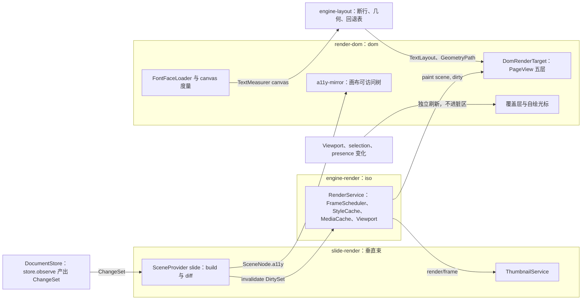

怎么读：左侧两个输入分别驱动内容重绘（经脏区）与覆盖层刷新（不经脏区）；engine-render 只做调度与缓存，绘制交给 render-dom；缩略图订阅 `render/frame` 去抖，可访问树直接吃场景数据、不依赖视觉层是否挂载。
依据：30/07 §0、40/06 图 2-2、40/07 图 2-1；本文 §11。

## 1. DOM/SVG 单实现、canvas 四个角色与坐标

规则（依据：ADR-0021 已接受，rulings §4.15 Q4）：

1. 编辑、查看、放映、可见缩略图、`/render` 页（服务端缩略图与 PDF）共用同一套 SVG 渲染，不存在第二套实现；渲染介质相关的一切分支只能出现在 `RenderTarget` Provider 内部。
2. canvas 只承担四个角色（第 ④ 个为 2026-09-26 按 rulings §4.21 与 ADR-0021 修订增补，R-d-23；原「三个角色」口径作废），其余任何「用 canvas 画内容」的路径都不允许进入仓库：

| 角色 | 落点 | 线程 | 说明 |
|---|---|---|---|
| ① `toImage` 栅格化画板 | render-dom `infrastructure/export/to-image.ts` | 主线程 | 单页导出 PNG / JPEG、复制为图片；不做 Worker / OffscreenCanvas 版本（§10.3） |
| ② `measureText` 度量器 | render-dom `infrastructure/measurer/canvas-measurer.ts`（`layout.measurer` 的 `canvas` Provider） | 主线程（`OffscreenCanvas` 对象但在主线程使用） | 浏览器与 renderer 内 Chromium 都用它，两端度量一致（§6） |
| ③ `RenderTarget('canvas')` 预留座位 | 仅 M3 末 `engine-render/src/__tests__/canvas-target-contract.test.ts` 内的最小 Provider | — | 只验证 `render.target` 契约不含 DOM 偏置，不进入产品；DX-1000 回退第 ③ 步才可能启用（§13.3） |
| ④ 媒体与图标预处理 | render-dom `infrastructure/media/image-preprocess.ts`（40/06 §4、§5 已登记，§14.2） | 主线程（`createImageBitmap` 异步解码不阻塞；SVG 必须在主线程经 `` 解码） | 只处理媒体字节：大图压缩、GIF 首帧、SVG 与图标的 PNG 回退、视频海报帧与截图取帧；产出 `Blob` 交给插入命令或 MediaCache 变体，不绘制幻灯片内容、不进 Scene、不是 RenderTarget；细则 §8.3 |

3. 文档内 SVG（`asvg:svgBlip`、SVG 媒体）一律以图像上下文 `<image href="blob:…">` 渲染；render-dom、slide-render 禁止用 `innerHTML` / `insertAdjacentHTML` / `DOMParser` / `outerHTML` / `createContextualFragment` 注入文档内容，DOM 只经 `createElementNS` + `setAttribute` 建树（依据：ADR-0021 修订 5、TD-081）。

**坐标与单位**

| 量 | 规则 | 配置 |
|---|---|---|
| 模型长度 | `Emu`（品牌类型） | — |
| SVG 用户单位 | px@96dpi，1 px = 9525 EMU；每页 `viewBox = 0 0 W H`（16:9 默认 960 × 540） | `engine-layout` `dpi: 96` |
| 字号 | `sz`（百分点）→ px：`sz / 100 × 96 / 72` | — |
| 缩放与平移 | 只改页容器的 CSS `transform: translate() scale(z)`，SVG 内数值不随缩放变化 | `Viewport.zoom` |
| 设备像素比 | 位图与导出按 `min(devicePixelRatio, 3)` 取样 | render-dom `pixelRatioCap: 3` |
| 数值精度 | SVG 属性保留 2 位小数，降低属性写入量与快照噪声 | render-dom `svgPrecision: 2` |

**PageView 五层**：`DomRenderTarget.mount()` 为每个挂载页在宿主容器内建 `.cordex-surface > .cordex-page[data-page-id]`，其下由底到顶为 `svg.master`、`svg.layout`、`svg.page`、`svg.overlay`、`div.text-host`（每个 Unit 只有一个隐藏 textarea，挂在正在编辑的页的 `div.text-host` 下，见 [06](./06-text-editing-and-ime.md) §1）。页层内每个顶层元素是一个 `g[data-cordex-node="<ShapeId>"]`（`SceneNode.id === ShapeId`，40/07 §2.1），组合只产生一个 `<g transform>`，子元素在其内各自一个节点——「一个逻辑元素 = 一个可定位的 DOM 节点」是命中测试、e2e 断言与设计 07 §3 的共同前提，DX-1000 回退第 ② 步是唯一会打破它的手段（§13.3）。

模板层只装母版与版式上**与具体页无关**的内容：母版 / 版式上的占位符形状只经继承链作用于页层形状，不在普通页上绘制（与 PowerPoint 一致：删掉页上的标题占位符不会露出版式的标题占位符），因此同一 `(layoutId, showMasterSp, themeVersion)` 的所有页可以共享一份 DOM 模板——该模板键本身就要求模板层与具体页的占位符无关。[50/01](01-overview-and-runtime-map.md) §4a.3 与 40/07 §2.1 的 `occluded` 规则已按同一 PowerPoint 行为改写（普通页上母版与版式的占位符一律不绘制，只绘制其非占位符形状，§14.2）。母版视图不走模板共享，由 `composeMasterView` 单独合成（[11](./11-masters-layouts-and-themes.md)）。

**图 1-1 PageView DOM 分层与模板层克隆**

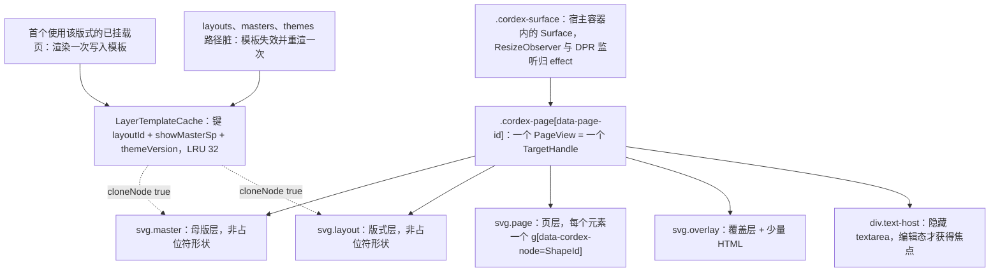

怎么读：实线自上而下是 DOM 父子关系，五个子层按列出顺序由底到顶叠放；左下两个输入决定模板何时生成与失效，虚线是新页挂载时从模板克隆，模板层不逐页重渲。
依据：30/07 §1、§4.1；40/07 §2.2 `LayerTemplateKey`；本节模板层内容规则。

## 2. RenderService 生命周期与帧管线

`RenderService`（UnitScope 服务 `render`，`engine-render/src/application/services/render.service.ts`）每个 Unit 一个实例；调用方是 ui-react 的 `CanvasHost`（编辑器）、`preset-slide-viewer` 的壳（查看器）与 `/render` 页（[12](./12-viewer-embedding-and-render-page.md)）。

| 阶段 | 触发 | 做什么 | 参数与约束 |
|---|---|---|---|
| attach | `render.attach(targetId, container, callbacks?)` | 按 `targetId` 查 `render.target` 贡献（缺失得 `render.target_missing`）；为 `Viewport.visiblePages()` 内的页 `mount` 得 `TargetHandle` | `callbacks.onEditIntent` 为文本编辑意图的唯一回传通道（IoC，消费方 slide-ui，见 [06](./06-text-editing-and-ime.md) §4） |
| 首帧 | attach 完成 | 查 `render.scene`（key = documentType）→ `build(unitScope, view)` → `paint(scene, {full:true})` → 建 `HitTestIndex` → emit `render/first-paint` | 首帧前最多等主题字体 render-dom 配置 `fonts.firstPaintWaitMs`（默认 100 ms，§7.3），超时即用回退度量绘制 |
| invalidate | slide-render 在本 Unit 的 `store.observe` 回调里调 `diff` 后推送 | `mergeDirtySet(pending, dirty)`（幂等、可结合） | engine-render 自身不订阅 `store/transaction`；origin 为 local / remote / `system('import')` 的变更走同一路径 |
| flush | `requestAnimationFrame`，一帧最多一次 | 按「可见 > overscan 近邻 > 其他」排序 pending → 逐页 `paint(scene, 子集)` → `StyleCache.invalidate` → 逐节点 try/catch | 帧脚本预算 `frameBudgetMs: 8`；超预算的剩余页顺延下一帧（时间切片）并置 `overrun` |
| 收尾 | flush 末尾 | 重建 `HitTestIndex`；统计 `pendingDirty`；emit `render/frame`；缩略图订阅方自行去抖 | 覆盖层与 ⑤–⑦ 并行、不进 pending（§5） |
| detach / dispose | Unit 关闭、`CanvasHost` 卸载 | 全部 `TargetHandle.dispose`、缓存清空、blob URL 全部 revoke | 全部由 `ctx.effect` 拥有，关闭后 `getEffects()` 为空（PRD NF-01 §1.3） |

**`render/frame` 载荷**（cordis 进程内事件，依据：INC-08 + rulings §4.11 C-25 / §4.18 FE-09）：`render/frame(unitId, stats)`，`stats = { pages, elementsUpdated, ms, overrun, pendingDirty }`。

| 字段 | 含义 |
|---|---|
| `pages` | 本帧实际 `paint` 的页数 |
| `elementsUpdated` | 本帧 `ElementRenderer.render` + `update` + `dispose` 调用总数（40/06 旧名 `elements` 作废） |
| `ms` | 本帧 flush 的脚本耗时 |
| `overrun` | 本帧是否超出 `frameBudgetMs` 并把剩余脏页顺延 |
| `pendingDirty` | 本帧提交后仍待绘的脏节点数：包括顺延页、字体到达后标脏的重排、惰性渲染器到达后的重绘；`/render` 页 ready 判据读它（判据全文只在 [12](./12-viewer-embedding-and-render-page.md) §11），不另设 `hasPendingWork()` |

`render/frame` 只供进程内订阅（渲染统计、开发者面板、缩略图去抖），公开订阅按 ≥ 50 ms 合并。遥测事件 `perf/frame{ frameMs, interaction, pages, elementsUpdated, overrun }` 由它派生，只取交互期间的帧：交互态由 `RenderService.noteInteraction(kind)` 标记（`kind ∈ drag | zoom | scroll | type`；ui-core 拖拽与键入管线调用，Viewport 在缩放与滚动时自行标记），`interaction` 取最近一次标记；属产品遥测、默认关（依据：TELEMETRY-DEFAULT），抽样窗口与上报归 [15](./15-events-errors-and-telemetry.md) §8。`render.frame_overrun` 只计入开发者面板，不走错误上报。

**本文涉及的渲染与布局事件**（声明在 engine-render / engine-layout，发布者可在 Provider 包；命名定稿见 [30/10](../30-architecture/10-observability-and-errors.md) §11.1）

| 事件 | 载荷要点 | 发布者 | 浏览器侧主要订阅者 |
|---|---|---|---|
| `render/first-paint` | `(unitId, {ms})` | engine-render | 首屏计时 mark（[13](./13-performance-and-bundling.md) §2）、壳的打开中画面退场（本地字节渐进打开为版式骨架，协同快照打开为画布中央转圈，[02](./02-app-shell-routing-and-session.md) §6，rulings §4.25 DS-99） |
| `render/frame` | 见上表 | engine-render | ThumbnailService 去抖、开发者面板、`/render` ready |
| `render/page-mounted` / `render/page-unmounted` | `(unitId, pageId)` | render-dom | `/render` ready、缩略图驻留、资源清理 |
| `render/element-failed` | `(unitId, nodeId, kind, code)` | render-dom `painter.ts` | `errors.report`、保真诊断（§9） |
| `render/element-degraded` | `(unitId, nodeId, kind, reason)` | render-dom（通用原因）、slide-render（文档类型相关原因） | 惰性条目触发（`chart-unavailable`）、保真诊断、提示（§9） |
| `render/font-fallback` | `(unitId, requested, fallback, scope, reason)` | render-dom `font-face-loader.ts` | 保真诊断、`/render` 字体结算（§7） |
| `layout/fonts-ready` | `(families)` | render-dom | slide-render 把使用这些族的文本节点标脏（§7.3） |
| `layout/measurer-changed` | `(measurerId)` | engine-layout | 度量缓存与已缓存 `TextLayout` 全部失效 |
| `view/page-changed` / `view/zoom-changed` | 见 §4.3 | engine-render `Viewport` | 查看器页码、放映 `?page=` 同步、EM-05 公开事件、缩略图栏高亮 |

**图 2-1 帧管线：attach、invalidate、flush 与覆盖层并行**

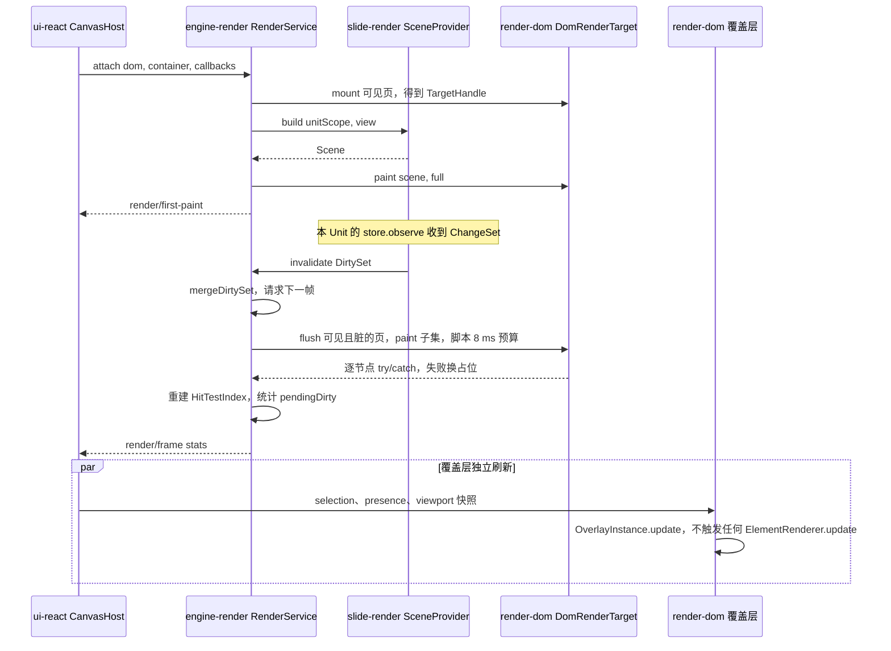

怎么读：纵向是时间；上段是 attach 与首帧，中段是一次增量更新（slide-render 自己订阅 Store、engine-render 只接收推送的脏集），`par` 段表示覆盖层与内容渲染互不等待。
依据：40/06 §2.6 九阶段、图 2-3；40/07 图 2-3；30/10 §11.1。

## 3. 场景与脏区

- **只重绘受影响元素（A28）**：`SceneProvider('slide').diff` 把 `ChangeSet.touched` 归类为 `DirtySet{ nodeIds, full, changed? }`，`paint` 只对集合内节点调 `update(handle, node)`；`changed` 给出属性级路径，渲染器据此只写变化的 attribute。改版式时整页重合成，但已挂载元素句柄**复用**（只 `update`，不重新 `render`）。
- **热路径无拦截链（A30）**：渲染器选择是 `Map<"${targetId}:${kind}", ElementRenderer>` 查表；engine-render、render-dom、slide-render 中禁止 `ctx.waterfall`，`ctx.bail` 只允许 `render/hit-test` 一处（§5）。
- **keyed reconcile**：页层按节点 id 协调——新增 → `render`；删除（含墓碑态，读路径已过滤）→ `dispose`；`zIndex` / `parentId` 变化 → 只移动 DOM 节点（按 FracKey 比较后 `insertBefore`）；属性变化 → `update`。批量写入经 `DocumentFragment` 一次提交。
- **归类规则**（摘要，逐行定义与测试在 40/07 §2.3 与 `dirty-mapping.test.ts`）：

| `touched` 路径前缀 | 归类 |
|---|---|
| `shapes.<id>.*` | 该形状节点（多处引用时展开为全部引用者） |
| `slides.<id>.{order,layoutId,hidden,background}` | 该页 `full` |
| `layouts.<id>.*` / `masters.<id>.*` / `themes.<id>.*` | 经 `dependentsOf` 反向索引得到的全部已挂载页 `full`，命中的模板一并失效 |
| `media.<id>.*` | 引用该媒体的形状节点（不整页重排） |
| 其他（`presentation.*` 等） | 当前 Scene `full`（保守兜底） |

- **不可见页只记脏**：未挂载页的脏记录累积为 `full`，下次挂载时整页重建；后台追加的 `system('import')` 批次只对已挂载页产生绘制（依据：rulings §4.18 CO-12）。
- **单属性变更**的 target：恰 1 次 `update`、≤ 5 ms；版式变更页级重合成 ≤ 30 ms（30 元素）——数值归 [13](./13-performance-and-bundling.md) §3。
- **主题预览覆盖**（rulings §4.20 FE-24；UI 流程见 [11](./11-masters-layouts-and-themes.md) §9）：`ViewDescriptor.themePreview?: { masterId; colors?; fonts? }` 由 slide-ui 经 `render.setView` 写入，是视图参数而不是文档数据——不入 Store、不产生事务、不广播（不进 awareness），只作用于携带它的视图（编辑画布），缩略图与其他协作者不受影响。slide-render 合成时对 `masterId` 所用主题的色槽与字体优先取覆盖值，受影响页经 `dependentsOf` 按 `full` 标脏；`LayerTemplateCache` 的键在预览期间附带覆盖内容的哈希，不覆写正式条目。取消或关闭面板时以 `themePreview: undefined` 清空并再次按 `full` 标脏；「应用」后清空覆盖，由随之而来的主题事务按常规路径重绘。全文重算 ≤ 300 ms（[13](./13-performance-and-bundling.md) §3）。

## 4. 视口与虚拟化

### 4.1 视口模式与挂载上限

| `Viewport.mode` | 使用场景 | 同时挂载页上限 | 说明 |
|---|---|---|---|
| `single` | 编辑器普通视图、母版视图 | 3（当前 ± 1） | overscan 1 页 |
| `continuous` | 查看器连续滚动、嵌入 | 6 | 屏外页容器加 `content-visibility: auto` 与 `contain-intrinsic-size`（页尺寸） |
| `grid` | 全览网格 | 由缩略图 Provider 决定 | M3 前用 `dom-scaled` 虚拟化，M3 起用 `server-png`（§10） |
| `show` | 放映 | 2（当前 + 下一页预挂载） | fit 到全屏，见 §12 |

- `visiblePages()` 含 overscan 1 页；离开视口满 `unmountDelayMs: 5000` 才 `dispose`，期间回到视口直接复用；挂载数超上限时按「最久未见」立即卸载待卸载页。
- 缩放：engine-render 默认 clamp `0.1–8`（引擎上限，40/06 Q-7）；产品范围 10–400% 由 preset 默认配置 `zoom: { min: 0.1, max: 4 }` 下发（与 PRD OF-14、设计 20 一致；本文决定）。缩放手势、锚定鼠标与 fit 规则归 [10](./10-editor-shell-and-interaction.md) §8，本文只保证缩放只改 transform、不触发内容重绘。

**图 4-1 页的挂载状态**

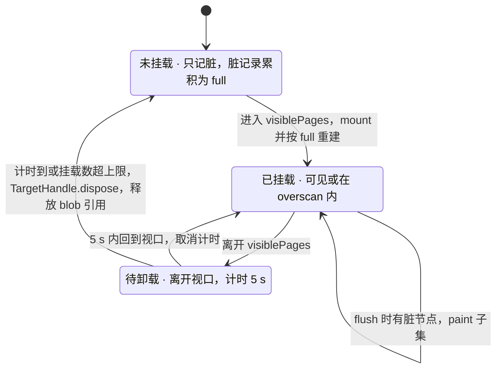

怎么读：每页独立处于三态之一；只有「已挂载」参与绘制，其余两态只累积脏记录；卸载时释放该页持有的 MediaCache 引用计数（§8.2），缓存条目本身按 LRU 淘汰。
依据：30/07 §2.3；40/06 §3 `unmountDelayMs`。

### 4.2 当前页的判定

「当前页」只有一个事实源：`Viewport.page`。`single` / `show` 模式下由导航命令（`slide.setCurrentSlide`、翻页键、缩略图点击）直接设定；`continuous` 模式下取可见面积最大的页，面积相等取靠上者，滚动停止 100 ms 后才确认（避免滚动途中频繁切换）。

### 4.3 视图事件（依据：VIEW-EVENTS + 30/07 §2.3）

engine-render 的 `Viewport` 是 `view/page-changed` 与 `view/zoom-changed` 的**唯一发布者**，编辑器与查看器共用；其他包（查看器壳、slide-ui、应用壳）只订阅、不自行发布同名事件。

| 事件 | 载荷 | 发出时机 | 订阅者 |
|---|---|---|---|
| `view/page-changed` | `(unitId, { pageId, index })` | `Viewport.page` 实际改变时，每次改变恰一次 | 查看器壳页码（[12](./12-viewer-embedding-and-render-page.md) §3）、放映 `?page=` 同步与深链（[10](./10-editor-shell-and-interaction.md) §8–§9）、缩略图栏高亮、EM-05 公开事件（[15](./15-events-errors-and-telemetry.md)） |
| `view/zoom-changed` | `(unitId, { zoom, fit: 'none' \| 'width' \| 'page' })` | 缩放手势结束或数值变更后，按 ≥ 50 ms 合并 | 缩放读数（单页在检查器页签行、网格在右上胶囊）、查看器工具条、EM-05 |

`view/mode-changed` 不属本条：视图模式由 ui-core 的 `view.setMode` Operation 驱动（[10](./10-editor-shell-and-interaction.md)、[11](./11-masters-layouts-and-themes.md)），Viewport 只按 `mapViewMode()` 改排布。

## 5. 命中测试链与覆盖层

### 5.1 命中链

命中是一次 `ctx.bail('render/hit-test', point, ctx)`：覆盖层按层序自顶向下询问，任一接管即短路；无人接管时交给 `RenderTarget.hitTest`。dom target 先用 `document.elementFromPoint` 找最近的 `data-cordex-node` 祖先，覆盖不到的情形（无填充文本框的空白区、旋转盒透明区、组合边界）走 `HitTester.geometric` 几何回退。内容命中结果为 40/06 §2.2 的 `HitResult{ nodeId, region: 'body' | 'handle' | 'text', local }`；覆盖层接管时结果另带 `kind: 'handle' | 'pin' | 'presence-label'`（30/07 §7），两种形状已在 40/06 §2.2 合并为判别联合（§14.2）。「首次点击选组、双击进组」等选择语义不在命中层，由 slide-ui `canvas-interaction.ts` 决定（[10](./10-editor-shell-and-interaction.md) §7）。

**图 5-1 命中链**

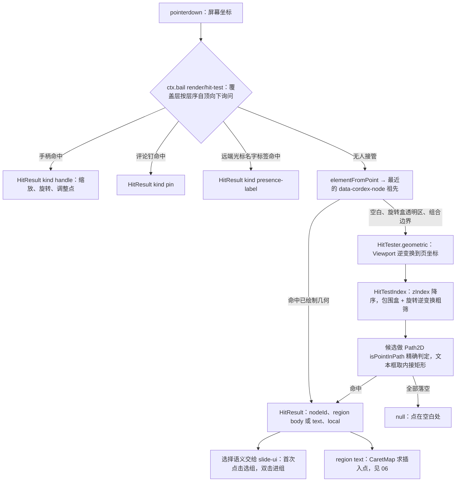

怎么读：自上而下是判定顺序，菱形是 bail 链的短路点；覆盖层接管后不再做内容命中；几何回退只在 elementFromPoint 覆盖不到时才走，结果汇入同一个 `HitResult`。
依据：30/07 §7；40/06 §2.2 `HitResult`、§13 Q-4。

- `HitTestIndex` 在每次 `paint` 后按页重建；M1 用 `zIndex` 降序线性扫描 + 包围盒提前退出，M2 按 bench 决定是否引入空间索引（40/06 Q-4）；预算命中 p95 ≤ 2 ms（300 元素页），数值见 [13](./13-performance-and-bundling.md) §3。
- 降级与失败占位同样可命中（可选中、移动、删除，PRD OF-13）；锁定与隐藏元素的命中过滤归 slide-ui。

### 5.2 覆盖层

覆盖层画在每页的 `svg.overlay`，不参与内容脏区：订阅各自的数据源，数据变化只调 `OverlayInstance.update`，**不**调任何 `ElementRenderer.update`（`overlay-independent` 断言，§15）。层序数值由本文定（`render.overlay` 贡献 `conflict: 'replace'`，第三方覆盖层取 ≥ 100）。

| 覆盖层 id | 所属包 | 数据源 | zIndex | 可命中 | 刷新触发 |
|---|---|---|---|---|---|
| `master-annotations`（原名 `master-inheritance`，2026-11-04 按 rulings §4.25 TB-188 改名） | slide-render | 最近一次 `build` 的 `ComposedSlide` 里全部占位符框（含继承来源 `inheritedFrom`，闭包持有，40/07 Q-3）+ `selection` 服务的当前选中 + Viewport + 启用入参 `MasterAnnotationsOptions`（slide-ui 启用这一层时给的 `labels`——类型名、「母版 · 〈类型〉」与锁签文案——与是否 M2 的 `m2Locked`，40/07 §2.5 登记，[11](./11-masters-layouts-and-themes.md) §6，键见 [16](./16-i18n-and-accessibility.md) §1）；M2 锁签也画在这一层（TB-190） | 10 | 否 | 母版视图每次 `build` 后、选中变化与视口变化（缩放、滚动）后；类型名与锁签按数据里的占位符几何在同一遍里定落位，不量 DOM、不等过渡（落位规则以设计 03-26 §4.2 为准，TB-189） |
| `guides` | render-dom | slide-ui 交互层算好的吸附线与间距（本包不计算吸附） | 20 | 否 | 拖拽帧 |
| `remote-presence` | render-dom | presence 中性快照 `{id, color, name, position}[]`（[07](./07-collaboration-client.md)） | 30 | 名字标签 | awareness 变化，节流 ≥ 50 ms；3 s 无活动淡出（`remoteCursorFadeMs: 3000`） |
| `comment-pins` | slide-ui（`CommentPins`，React 画布覆盖组件，不经 `render.overlay` 贡献，与 [40/10](../40-modules/10-ui-shell-and-slide-ui.md)「本包不再贡献覆盖层渲染器」一致；rulings §4.24 TA-1，[40/06](../40-modules/06-layout-and-render-engine.md) §3 已同步移出） | 评论客户端服务（`comments` 包，[08](./08-comments-and-version-history.md)，rulings §4.19 D-COMMENTS-PKG）；无该服务则不挂 | 40 | 钉 | `comment/*` 事件 |
| `selection` | render-dom | `selection` 服务 + Viewport | 50 | 手柄 | `selection/changed`、缩放 |
| `media-playback`（2026-09-26，R-d-68） | render-dom | slide-ui 发出的播放意图 + 被播放元素的变换 + Viewport | 55 | 播放图标（`kind:'handle'`，手柄名 `media-play`）与原生控件 | 播放意图、选区变化、页变化、元素变换或删除（§8.5） |
| 文本光标、本地选区、组合预览 | render-dom `text-host/*`（包内，非贡献条目） | `CaretMap` + 当前 StablePosition | 60 | 否 | 见 [06](./06-text-editing-and-ime.md) |

- 远端光标的目标形状未挂载或不在视口时，只在该页缩略图上显示头像（[07](./07-collaboration-client.md)）。
- 覆盖层主题色直接写 CSS 变量名字符串（render-dom 不依赖 `@cordexjs/design`，rulings §4.18 FE-18）。
- 导出（PNG / SVG / PDF）与缩略图不含覆盖层（PRD OF-19）。

## 6. 文本度量与断行

- **自己断行**（ADR-0027）：`engine-layout.layoutTextBody()` 产出 `LineBox[]` 与 `CaretMap`，渲染只画已定位的行；浏览器不参与文本排版。
- **度量器**：浏览器与 renderer 内 Chromium 都用 `canvas` Provider（`OffscreenCanvas.getContext('2d').measureText` + `fontBoundingBoxAscent/Descent`）；服务端不启动 Chromium 的校验路径才用 `node-font`，与本侧无关。
- **断行**：UAX#14 机会点，主路径是 tooling 从最新 UCD 生成的断行表（engine-layout `linebreak-trie.ts`，脚本 `tooling/scripts/gen-linebreak-table.ts`；`Intl.Segmenter` 没有 line 粒度，不作断行来源，只用于字素与词；ADR-0027 决策 4 修订 2026-09-26）+ CJK 行首行尾禁则 + `wrap="none"` + 强制换行 `a:br`；run 边界重置字距。
- **度量缓存**：`(fontKey, word)` → 结果，LRU 50,000 条（`measureCache.maxEntries`）；`layout/measurer-changed` 时整体失效。逐字符批量方法 `measureRun` 暂不加，等 `CaretMap` 逐字符调用的实测不达标（键入 p95 > 33 ms 或命中 p95 > 2 ms）再补（40/06 Q-1）。
- **autofit**：`normAutofit`（fontScale / lnSpcReduction 阶梯）与 `spAutoFit`（增高）迭代 ≤ 6 次；autofit 结果在编辑时的回写规则见 [06](./06-text-editing-and-ime.md) §7，渲染侧只算不写。
- **行绘制**：每行一个 `<text>` 块；LTR 与 CJK 行按 run 切 `<tspan>` 并给显式 `x`；含 RTL 字符的行 run 不设 `x`，行内 bidi 交给浏览器（M1–M3 不自研 UAX#9）；竖排 `vert` / `vert270` 以文本框整体旋转近似，`eaVert` 近似并记诊断；下划线与删除线用 `<line>`（依据：rulings §4.15 Q7、ADR-0027 修订）。
- **一致性键**：`layoutAlgoVersion`（断行算法版本，engine-layout 常量；拼写以 ADR-0026 决策 5 与 [12](./12-viewer-embedding-and-render-page.md) §11.1 为准，30/07 §5.1 的 `layoutAlgorithmVersion` 为旧写法）与 fontProfile id（§7.1）进入服务端缩略图的 `contentHash`；客户端与 renderer 同版本发布，版本不一致时以客户端为准并触发重生成（ADR-0026 决策 5）。

## 7. 字体供给（依据：FONTS + ADR-0027 + PRD OF-05 / OF-17 / OF-25）

### 7.1 fontProfile 与同源自托管

- **一份清单两端共用**：fontProfile 是一份 JSON 清单，列出受控字体集的族名、版本、字重 / 字形、每个 unicode-range 子集文件与 sha256，以及回退表（请求族 → 度量兼容替身）；浏览器与 renderer 读同一份，fontProfile id = 清单内容哈希，随 `/render` 查询参数下发并进入缩略图 `contentHash`。清单与字体文件由 tooling 在构建期生成，随 `apps/web` 发布，与 renderer 镜像锁步（文件落点待 40/11 登记）。
- **同源自托管**：字体文件放在 `apps/web` 同源 `/fonts/<family>/<version>/<subset>.<hash>.woff2`，带哈希文件名、`Cache-Control: immutable`；清单固定为 `/fonts/font-profile.json`（`Cache-Control: no-cache`，`ETag` = 清单哈希 = fontProfile id），因为部署方字体在启动时并入后清单哈希才确定（§7.5），浏览器无需预知文件名；**不访问任何第三方字体源**。
- **默认内容**：内置 Noto（含 CJK）、Liberation、Carlito / Caladea（均为开源许可，随 renderer 镜像同版本发布，rulings §4.16 Q19），不内置商业字体。回退表默认值：

| 请求族 | 替身（度量兼容） | 精度 |
|---|---|---|
| Calibri | Carlito | 兼容 |
| Cambria | Caladea | 兼容 |
| Arial / Helvetica | Liberation Sans | 兼容 |
| Times New Roman | Liberation Serif | 兼容 |
| Courier New | Liberation Mono | 兼容 |
| 微软雅黑 / 宋体 / 黑体等 CJK | Noto Sans CJK SC / Noto Serif CJK SC | `approx` |
| 主题 `+mj-lt` / `+mn-lt` / `+mj-ea` / `+mn-ea` | 先按主题 fontScheme 解析为实际族再查表（30/04 §6） | — |

- **只用受控字体**（本文决定，依据 ADR-0027「受控字体集」）：所有字体都以内部别名注册（如 `cordex-f-<hash>`），SVG 与 canvas 的 `font-family` 只写别名 + 最后一个 generic；**不按名字命中本机已安装的同名字体**。这样浏览器与 renderer 选到的字形一致，也不把本机字体集暴露给文档内容。本机字体只作为 generic 的最后兜底，命中时上报 `render/font-fallback{reason:'missing'}`。SVG 导出（PRD OF-19）时别名还原为「请求族名、替身族名、generic」，或按导出选项以 `@font-face` 内嵌子集，导出文件不出现内部别名。

### 7.2 回退决策

**图 7-1 字体加载与回退决策**

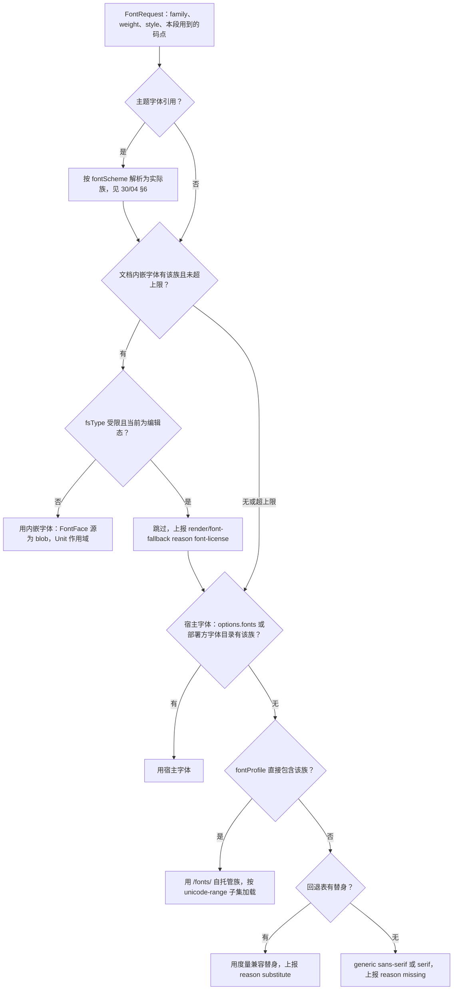

怎么读：自上而下依次尝试，命中即停；左侧分支是内嵌字体与许可位判定（fail-closed），其后依次是宿主字体、受控字体集与回退表；每条回退路径都上报一次 `render/font-fallback`（只含字体名与原因，不含文本）。
依据：PRD OF-05 回退链、OF-17 许可位、OF-25；ADR-0027 修订第 5 条；FONTS。

`render/font-fallback` 的 `reason` 取值：`font-license`（受限字体在编辑态）、`substitute`（回退表替身）、`missing`（落到 generic）、`limit`（内嵌字体超上限被跳过）、`load-failed`（文件加载失败）、`timeout`（§7.3 超时）。同一 Unit 内同一 `(requested, reason)` 只上报一次——该去重**只约束遥测上报**（产品遥测与诊断计数），不代表字体已结算；进程内的字体结算状态以 §7.3 的 `fontsSettled` 为准。

### 7.3 加载时序与重排

1. **按需加载**：`FontFaceLoader.ensure(fontKey, codepoints)` 对别名族调用 `document.fonts.load('<style> <weight> 16px <alias>', <本段去重字符>)`，浏览器按 unicode-range 只下载覆盖这些字符的子集；同一 `(fontKey, subset)` 去重。
2. **首帧**：`unit/opened` 时按主题的 major / minor（latin 与 ea）族预发起常规字重加载；首帧最多等 `fonts.firstPaintWaitMs`（默认 100 ms），超时即用回退度量绘制，不阻塞首屏（本文决定）。
3. **到达后重排**：加载完成 emit `layout/fonts-ready(families)`；slide-render 按「节点 → 使用的字体族」反向索引，只把用到这些族的文本节点标脏，≤ 1 帧内进入 `DirtySet`，重排不涉及其他文本。未到达期间这些节点计入 `pendingDirty`。
4. **超时与失败**：单次加载超过 render-dom 配置 `fonts.loadTimeoutMs`（默认 3000 ms，与 OF-17 处理时长上限同值；本文决定）或失败，即视为已结算，按回退链下一级重排并上报 `timeout` / `load-failed`。`/render` 页的「字体全部结算」即指本条的到达、超时或失败三者之一（判据见 [12](./12-viewer-embedding-and-render-page.md) §11.5）。
6. **按页结算状态**：engine-layout 按页记录该页布局用到的字体请求集合，并提供只读查询 `fontsSettled(pageIds): boolean`——这些页记录的每个请求都已到达、超时或失败（第 3、4 条）时为真，某页没有需要加载的字体即视为已结算；状态变化时随 `layout/fonts-ready` 或下一个 `render/frame` 可被重新读取。这是 `/render` ready 判据读取的唯一字体状态，不依赖每页各出现一次 `render/font-fallback`（该事件受 §7.2 的上报去重约束）。
5. **度量一致**：TextMeasurer 只在该字体的 `document.fonts.check()` 为真后才以它度量；否则以当前实际生效的回退字体度量并在到达后重排，保证「度量用的字体 = 绘制用的字体」。

### 7.4 内嵌字体与受限字体

- 来源：ooxml-core 反混淆 `ppt/fonts/*.fntdata` 后以 `BlobRef` 提供；render-dom 以 `new FontFace(alias, bytes)` 注入 `document.fonts`，归属当前 Unit，Unit 关闭时 `document.fonts.delete()` 卸载（PRD OF-17）。
- 上限：单字体 ≤ 20 MB、总计 ≤ 60 MB、处理 ≤ 3 s（OF-17 为唯一口径），超出跳过并上报 `limit`。
- 受限（`fsType` 为 Restricted 或 Preview & Print）：只用于只读渲染（查看、放映、缩略图、`/render`、PDF）；**编辑态**里用到它的文本改用回退链下一级（上报 `font-license`），文档仍可编辑。编辑态判定按 `EditorHost.mode`（[02](./02-app-shell-routing-and-session.md) §6 的角色映射）：`edit` 为编辑态；`review`、`view`、查看器与 `/render` 为只读态；模式切换时用到受限字体的文本按新解析结果标脏重排。代价是编辑态与查看态字形可能不同，差异列入保真诊断（ADR-0027 修订第 5 条）。fontProfile 因此区分「只读 / 编辑」两种解析结果，缩略图 `contentHash` 用只读结果。
- 导出不新增内嵌字体，原部件字节原样保留。

### 7.5 宿主字体与部署方字体

- **集成方**（SDK 形态，OF-25）：preset 选项 `fonts: Array<{ family, source: ArrayBuffer | URL, descriptors?, substitutes? }>`；URL 必须满足宿主页 CSP 的 `font-src`；SDK 不内置 CJK 字体（PD-12）。
- **部署方**（apps/web）：在 web 容器与 renderer 的同一路径挂载授权字体目录与一份自有字体清单，启动时并入 fontProfile（fontProfile id 随之变化），经 `/fonts/custom/…` 同源提供；挂载路径与配置键归 [60/17](../60-backend/17-deployment-and-config.md)。
- 缺失字体在保真诊断面板列出（OF-25）。

### 7.6 与 CSP 的关系

`font-src 'self' blob:`（`blob:` 用于内嵌字体与集成方字节源）；策略正文只在 [14](./14-client-security.md) §2，本文只声明需求。`raster` 导出若在 M2 位图 spike 后采用「data URI 内联字体子集」，内联发生在被序列化的 SVG 图像文档内部，不放宽页面的 `font-src`（§10.3）。

## 8. 媒体

### 8.1 字节从哪来

| 场景 | 来源 | 说明 |
|---|---|---|
| 本地打开 `.pptx`（M1 查看器、本地文档与集成方的单人编辑） | 导入时写入本 Unit 内存 `BlobStore`（model-core `MemoryBlobStore`，不持久化、不上传；浏览器不建持久化 BlobStore Provider，决策 MEDIA-CLIENT）的字节 | 媒体懒解压（A-13），首次渲染时取 |
| 服务端文档（M2 起，store-yjs） | `GET /api/v1/documents/:id/media/:sha256` 经 apps/web `http.ts` 发出（同源、带会话 cookie；只凭链接的会话附 `X-Cordex-Share-Token`，[02](./02-app-shell-routing-and-session.md) §7）：服务端校验 `doc.read` 且该媒体已关联到本文档，否则 404；成功返回 `{url, expiresAt}`（1 h 预签名 GET，`Cache-Control: no-store`，依据：INC-21） | 再对 `url` 发 `fetch(url, { credentials: 'omit' })`，不带任何自定义头与 `traceparent`（不触发预检），取回 `Blob`；不跟随跨源 302，分享令牌头因此不会被带到存储源；不再有无文档作用域的 `/media/*` 端点 |
| 本机刚插入、尚未上传完成的图片 | 同一内存 `BlobStore`（插入时已写入） | 见 §8.3 |
| 外链资源（`r:link`、外链音视频，仅 http(s)） | 远端 URL，受 `externalResources` 控制 | 见 §8.5 |

路由、DTO 与错误码只在 [60/15](../60-backend/15-rest-api-catalog.md)；对象键布局只在 [60/14](../60-backend/14-valkey-object-storage-and-retention.md)。

### 8.2 MediaCache 与 blob URL 生命周期

- `MediaCache`（engine-render）：键 `sha256`（派生变体加后缀：EMF 栅格结果 `sha256#raster@<px>`、GIF 首帧 `sha256#frame0`（2026-09-26，§8.3））；值 `{ url: blob:…, bytes, refCount }`；按**字节** LRU，上限 `mediaCache.maxBytes`（默认 256 MiB）。
- 引用计数：元素句柄 `render` 时 +1、`dispose` 时 −1；`refCount > 0` 的条目不淘汰（已挂载元素正在用）；淘汰时 `URL.revokeObjectURL`。页卸载只减引用计数，Unit 关闭时全部 revoke。
- 断言：每个 Unit 的 `createObjectURL` 调用数 = `revokeObjectURL` 调用数（PRD OF-07；blob URL 泄漏 0，NF-01 §1.3）。
- 解码：`<image href=blob:…>` 监听 `decode` / `error`；解码失败 → 该元素 `render/element-degraded{reason:'media-decode-failed'}` 并上报 `render.dom.media_decode_failed`。
- 取回失败（404、网络错误）：先画「加载中」占位，按 1 s、2 s、4 s … 退避重试，累计 60 s 仍失败改为 `render/element-degraded{reason:'media-unavailable'}`；该媒体后续被任何端提交或网络恢复后，节点标脏即恢复正常。这覆盖了「他人刚插入、上传尚未 commit」的窗口（§8.3）。

### 8.3 上传：`options.media.upload`（依据：MEDIA-CLIENT）

preset 选项 `media.upload(file) → Promise<{ assetId, sha256 }>`；集成方可替换，`apps/web` 提供默认实现（`MediaUploadQueue`）。apps/web 的服务端文档（M2 起，store-yjs）插入的图片都要上传——内容以协同快照为唯一事实源，而媒体字节不进 CRDT（rulings §4.19 D-M2-CONTENT、PRD CO-12）；本地文档与集成方单人 preset 的图片只在内存 `BlobStore`，随导出的 pptx 保存。

1. **临时占位**：用户选定文件后，覆盖层立即在插入位置显示临时占位（id 形如 `tmp:<uuid>`，只在覆盖层、**不入 Store**），同时做插入前预处理（本节下方「插入前预处理」），完成后用 SubtleCrypto 对**预处理后的字节**计算 sha256。
2. **插入即生效**：哈希完成后执行一次 `slide.insertPicture{ containerId, box, blob }`（一个可撤销事务：`media.add` + `shape.insert`，40/03 §2.6），`MediaId` 为新稳定 id、`BlobRef.hash` 为本地 sha256；临时占位被真实形状替换。`BlobRef` 内容寻址，上传完成后无需改写模型。
3. **后台上传**：`presign{ sha256, byteSize, mime }`（≥ 10 MB 返回分片 URL）→ PUT 预签名 URL（`credentials:'omit'`；客户端不构造、不提交对象键，[14](./14-client-security.md) §9）→ `commit{ uploadId, sha256, byteSize, parts? }`；服务端流式重算 sha256 并把媒体关联到本文档后，其他端即可取到。队列一次只跑一个上传；撞上 upload 限流档（presign 与 commit 共用，默认 60/min、突发 20，[60/15](../60-backend/15-rest-api-catalog.md) §8）时 429 按 `Retry-After` 等待（第 4 步）。串行并不减少每分钟的调用次数，不作为限流手段（rulings §4.20 BE-02）。
4. **失败**：每步按 1 s、2 s、4 s 重试 3 次（429 按 `Retry-After` 等待，不计入次数）；仍失败标 `failed`，形状上显示「上传失败 · 重试」徽标（覆盖层），不回滚插入；页面关闭前若仍有未完成上传，离开保护提示（[04](./04-document-commands-and-undo.md) §8）。集成方回调返回的 `sha256` 必须等于本地哈希，否则按失败处理；`assetId` 只记录在上传队列里供诊断，不进模型。SVG 的例外风险：服务端提交校验会做白名单消毒，改变了字节时返回新的规范 sha256（[60/04](../60-backend/04-modules-documents-storage-media.md) §7.2 第 6 步）；本地在哈希前先跑同一份消毒器，两者即一致。消毒器进 iso 包之前（§14.2），本机先拒绝含不安全构造的 SVG，不让它走到「返回值不等于本地哈希」这一步（2026-09-26，§4.21）。
5. 大小与配额：上限来自 presign 响应的 `maxBytes`；配额错误码 `storage.quota_exceeded` 的文案归 [15](./15-events-errors-and-telemetry.md)，限制与清洗规则归 [14](./14-client-security.md) §7。

**图 8-1 图片插入与上传（协同文档）**

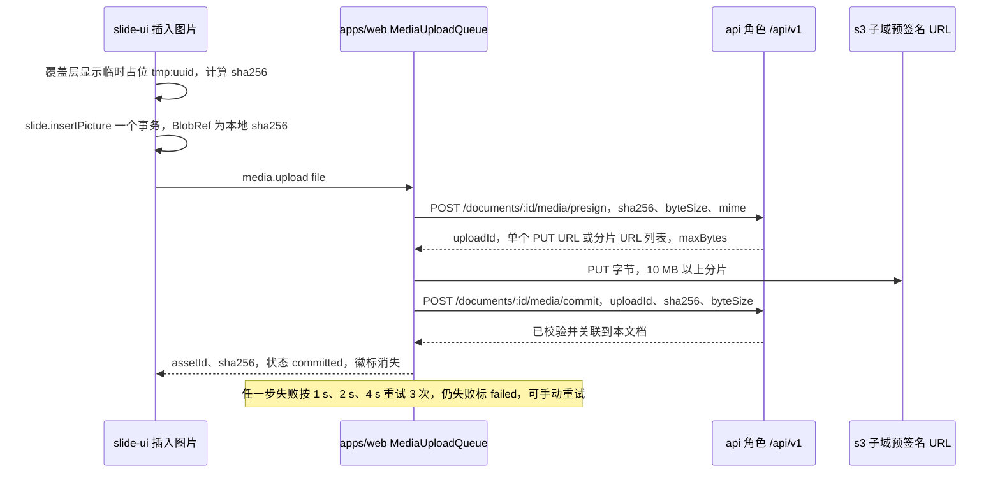

怎么读：前两步在本机完成，插入不等上传；中段是后台上传三步，其他协作者在 commit 之前取媒体会拿到 404 并按 §8.2 退避重试。
依据：MEDIA-CLIENT、INC-21；40/03 §2.6 `slide.insertPicture`。

**插入前预处理**（2026-09-26，rulings §4.21，R-d-23；canvas 第 ④ 角色，§1、ADR-0021 修订）：落点 render-dom `infrastructure/media/image-preprocess.ts`，文档类型盲；由 slide-ui 的插入流程在执行命令之前调用（GIF 首帧除外，它由 `pic.renderer` 在渲染时调用）。命令只收处理好的字节与数值，需要原图尺寸的命令由调用方传入 `pixelSize{w, h, dpi}`（逐元素用法见 [50/23](./23-elements-media.md) §1.3）。

| 处理 | 何时 | 做法 | 产出 | 里程碑 |
|---|---|---|---|---|
| 取尺寸与 DPI | 每次插入位图 | `createImageBitmap(blob)` 取像素尺寸（EXIF 方向按浏览器默认处理）；DPI 读文件头（PNG `pHYs`、JPEG JFIF / EXIF），读不到按 96 | `pixelSize{w, h, dpi}`：默认尺寸，及替换、填充 / 适合、重置大小的参数 | M2 P0 |
| 大图压缩 | 插入后用户对「是否压缩到 2048 px」选「压缩」，或检查器「压缩」 | `createImageBitmap(blob, {resizeWidth 或 resizeHeight, resizeQuality: 'high'})` → canvas → `toBlob`，保持原格式（有透明通道仍为 PNG）；动画 GIF、SVG、EMF 不处理 | 新 Blob → `slide.compressPicture` | M2 P1 |
| GIF 首帧 | `pic.renderer` 在编辑态、缩略图、`/render` 首次画 GIF | `createImageBitmap(blob)` 取首帧 → canvas → PNG | MediaCache 变体 `sha256#frame0`（不入模型、不上传） | M1 |
| SVG 消毒与 PNG 回退 | 插入 SVG | 先白名单消毒（与服务端同一份，§14.2）→ `` 解码 → canvas `drawImage`（2 倍显示尺寸，长边 ≤ 2048 px）→ `toBlob('image/png')`；canvas 被污染或解码失败即拒绝插入 | 消毒后的 SVG + PNG 回退 | M2 P1 |
| 图标着色与回退 | 图标面板插入、重新着色 | 写入颜色后同 SVG 回退 | SVG + PNG | M3 P2 |
| 视频海报帧 | 插入视频、「取当前帧」 | `<video>` 载入本机 blob → 定位到目标时间 → `seeked` 后 canvas `drawImage` → PNG | 海报 Blob | M2 P2 |
| 截图取帧 | 屏幕截图 | `getDisplayMedia` 的流挂到 `<video>` → 取一帧 → 立即停止全部轨道 | PNG Blob | M4+ |

约束：只处理本机字节（`blob:` 同源），从不对外链资源做预处理（跨源会污染 canvas，也会发网络请求）；单次输出像素 ≤ 16,777,216（与 OF-24 位图预览上限同值），超出先等比缩小；失败只影响本次插入并 Toast 说明，不开事务、不留半个元素。

**图 8-2 插入前预处理的分流**

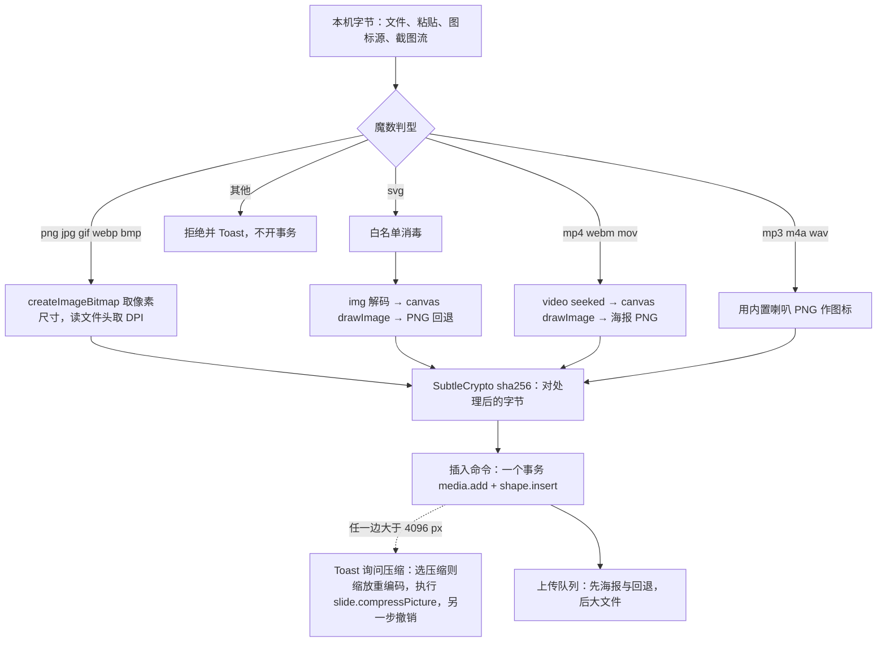

怎么读：按类型分流后都汇到「对处理后的字节算哈希」，所以本地 `BlobRef` 与上传后服务端的规范 sha256 一致；压缩是插入之后的独立一步（虚线），可拒绝；上传顺序让他端先看到海报与回退图。
依据：R-d-23；ADR-0021 修订（2026-09-26）；50/23 §2、§3、§7；60/04 §7.2。

### 8.4 EMF / WMF 栅格化（M2 P1，依据：rulings §4.15 Q7、PRD OF-07 / OF-24）

- M1：有包内位图预览则显示，否则占位并上报 `render/element-degraded{reason:'emf-no-preview'}`。
- M2 起：首次遇到 EMF / WMF 时惰性加载 Worker chunk `emf-rasterizer.worker`（封装 emf-converter，Apache-2.0，单点引入），单个 Worker 串行处理、空闲 60 s 回收；输出位图以 `sha256#raster@<px>` 进 MediaCache。记录数、输出像素（≤ 16,777,216）与单文件耗时上限取 slide-render 配置 `emf.{maxRecords, maxPixels, timeoutMs}`（初值由 M2 spike 定并回填 OF-24，只收紧）；超限或超时终止 Worker 任务，回到占位并上报 `emf-raster-limit`。
- 渲染代码与 renderer 共用同一份；chunk 预算见 [13](./13-performance-and-bundling.md) §6。
- **版本口径**（2026-09-26，rulings §4.21，R-d-24）：emf-converter 改评 **4.0.x**（4.0.0 于 2026-09-25 发布，3.4.0–4.0.0 同日连发）。4.0 起默认输出的 PNG 不再抗锯齿，`emf-rasterizer.worker.ts` 调用时**显式**传 `gdiAntialias: true`，保证与 3.x 基线的视觉一致；过 minimumReleaseAge 后在 catalog 精确锁版本（登记见 [50/17](./17-reuse-and-dependency-catalog.md)）。
- **像素档**：栅格像素按元素显示尺寸 × `pixelRatioCap` 取档，缓存键 `sha256#raster@<px>`；缩放跨档变大时才重做，变小直接复用（元素级显示状态见 [50/23](./23-elements-media.md) §5）。
- **M4+ 矢量**：改用转换器的 SVG 输出（3.4.0 起已导出 `convertMetafileToSvg`），以 `<image href="blob:…">` 在图像上下文渲染（§1 规则 3），不内联 SVG 标记；是否过 SVG 消毒器见 50/23 §5 第 ⑭ 栏。

### 8.5 外链资源、文档内 SVG 与媒体播放

| `externalResources` | 渲染行为 | 退化原因 |
|---|---|---|
| `auto`（默认，rulings §4.15 Q7 用户选择） | http(s) 外链图片直接 `<image href="https://…">`；外链音视频 `preload="none"` | 加载失败 → `external-resource-blocked` |
| `confirm` | 先占位；用户确认来源域名后加载（确认交互与记忆归 [14](./14-client-security.md) §6） | 未确认 → `external-resource-blocked` |
| `never` | 一律占位 | `external-resource-blocked` |

- 只有 `http(s)` 外部关系可激活，其余协议原样保留不激活（M-04 不变量）；超链接协议白名单在渲染层再校验一次。
- `/render` 页恒按 `never` 装配（renderer 零出站），外链不计入缩略图 `contentHash`。
- 文档内 SVG 只经图像上下文渲染（§1 规则 3），脚本与外链在图像上下文中天然失效。
- 视频与音频（2026-09-26 按 R-d-68 改写，原「编辑态与缩略图只画海报帧」与设计 03-13 G-06「编辑态可点击播放」冲突，作废）：
  - **页层只画海报**：编辑、查看、缩略图、`/render`、导出一律画海报帧（音频为图标），覆盖层在中央叠播放图标；探测到浏览器不支持的编码（`MediaCapabilities.decodingInfo` / `canPlayType`）时海报加角标「此格式无法在浏览器中播放」，不发降级事件（海报本身画得出来）。
  - **编辑态临时播放**：编辑、评审与查看器普通视图下，点播放图标或选中后按 `Enter`，由 `media-playback` 覆盖层（§5.2）在元素变换位置挂 HTML `<video controls>` / `<audio controls>` 播放；不进 Scene、不写 Store、不进 awareness，不触发任何 `ElementRenderer.update`；同一 Unit 同时只播一个。停止条件与交互细则见 [50/23](./23-elements-media.md) §7.2。
  - **放映态**：页容器内叠放 HTML `<video>` / `<audio>`（非 SVG 节点），位置随元素变换，点击播放，只播放浏览器支持的编解码（PRD OF-07）；翻页即停止并释放。`p:timing` 里的自动播放、循环、跨页播放 M1–M3 不解析（放映只重放主序列可见性终态，§12），全部按点击播放处理。
  - **字节**：内嵌媒体经 MediaCache 取 `blob:` URL，挂载时引用计数 +1、卸载时 −1，计入 §8.2 的泄漏断言；外链媒体按上表三档，`preload="none"`。

**图 8-3 视频与音频的播放状态**

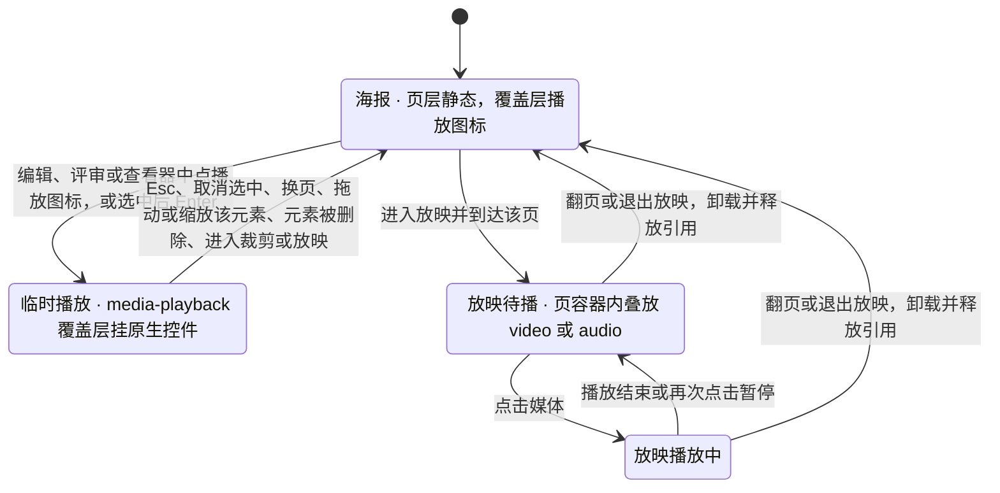

怎么读：只有两个播放态会挂载原生媒体元素，且都在页层之外；回到「海报」的每条边都会卸载播放元素并归还 MediaCache 引用；缩略图与 `/render` 永远停在「海报」。
依据：R-d-68；设计 03-13 G-06；PRD OF-07、ED-21；rulings §4.21 q-media-insert（插入不写 `p:timing`，放映按点击播放）。

## 9. 元素错误隔离与降级

两条路径分开（依据：A11、PRD OF-13、40/07 §2.4）：

- **意外失败**：`ElementRenderer.render` / `update` 抛错 → render-dom `painter.ts` 捕获，换成失败占位（红色虚线框 +「无法渲染」图标与 i18n 文案），emit `render/element-failed{kind, code}` 并 `errors.report('render.element_failed')`；同页其他元素与其他页不受影响。失败节点在其 `revision` 下一次变化时重试一次，不做定时重试。
- **预期降级**：渲染器自己判定「按设计画不了」→ 画对应占位，emit `render/element-degraded{reason}`，不走错误上报。
- **查表未命中**：画 `unknown` 占位（虚线框 + kind 文本），`render.renderer_missing` 每个 kind 上报一次；某个 `ElementRenderer` 插件整体 `FAILED` 时，其 kind 全部走这条路。
- **占位的画法**（2026-10-15，rulings §4.25 DS-52）：预期降级与查表未命中的占位统一为虚线框 + 类型图标 + 一行标题 + 一行原因（「内容已保留」一类的话并进原因行），缺插件元素的占位（[04](./04-document-commands-and-undo.md) §1.1）与它同一画法、同一字号，画在纸面上（纸面亮色 token）；整页解析失败时画页级占位「此页内容无法解析」（母版页脚照常）；放映里单页渲染失败的「此页内容暂时无法显示」与它同一画法——页级占位都在渲染层的纸面内画，落点是 slide-render 的页级回退（[40/07](../40-modules/07-slide-rendering.md) §1.1、§5.1）：整页解析失败的页在 `compose-slide.ts` 合成时换，合成某一页抛出的意外错误由 `slide-scene-provider.service.ts` 捕获后换成同一个占位（经 `errors.report('render.page_failed', { pageId, cause })` 上报并发 `render/element-failed{ kind: 'page', pageId, code }`，其余页不受影响）；两种都只把页层换成一个覆盖纸面的 `unknown` 节点（`data.placeholder: 'page'`，不新增 `render.element` key），母版与版式层照常合成（母版页脚照常），由 `fallback.renderer.ts` 用与元素级占位同一组画笔画。编辑器、查看器、放映、客户端与服务端缩略图看到的是同一份，外壳、放映舞台与 slide-ui 都不在画布上另叠一层（2026-10-22，rulings §4.25 TB-151，[10](./10-editor-shell-and-interaction.md) §9.3）。运行时回退的页在 `/render` 的 `ready` 诊断里报 `render.page_failed`，renderer 把它记为失败、不写进缩略图；整页解析失败的页是确定内容，照常回传（TB-157，[12](./12-viewer-embedding-and-render-page.md) §11.3）；浏览器生成的图片导出同一口径，所导页里有运行时回退即这次导出失败（2026-10-22，rulings §4.25 TB-166，§10.3）。意外失败的占位维持危险色虚线框。
- 三类占位都可选中、移动、删除，内部不可编辑，且都带降级原因；保真占位可以缩放，缺插件占位不能改大小（只画选中框与尺寸角标，[25](./25-elements-readonly-and-opaque.md) §2.5）；保真报告（检查器整栏面板，M2 P1，[18](./18-editor-capabilities.md) UI-04）汇总本 Unit 的降级与失败项。口径与 [50/19](./19-insertable-elements-overview.md) §4.10 一致：覆盖层（选择框、手柄、裁剪遮罩、连接点、内容占位符图标条、上传进度占位、视频临时播放器）不进 Scene；逐元素的渲染器与降级原因见 50/19 §6。

预期降级的 `reason` 取值（占位上的 i18n 文案与命名空间归 [16](./16-i18n-and-accessibility.md)）：

| `reason` | 发出方 | 触发 | 可恢复 | 里程碑 |
|---|---|---|---|---|
| `chart-unavailable` | slide-render 主包图表占位 | 图表渲染器未加载；同时作为惰性条目的触发信号 | 渲染器到达后自动替换 | M1 |
| `chartex-unsupported` | `fallback.renderer`（2026-09-26 起 chartex 导入为 `UnknownShape{renderHint:'placeholder', source:'chartex'}`，40/07 §2.7；原写「图表渲染器」） | `cx:chart`（chartex），不渲染其 Fallback | 否 | M1 |
| `smartart-no-dsp` | `diagram.renderer` | SmartArt 缺 `dsp:drawing` | 否 | M1 |
| `ole-preview-missing` | `ole.renderer` | OLE 无预览图 | 否 | M1 |
| `emf-no-preview` / `emf-raster-limit` | `pic.renderer` / EMF 栅格化 | 见 §8.4 | 否 | M1 / M2 |
| `external-resource-blocked` | `pic.renderer`、媒体 | 见 §8.5 | `confirm` 确认后可恢复 | M1 |
| `unsupported-shape-kind` | `fallback.renderer` | 未知 `graphicData` | 否 | M1 |
| `media-decode-failed` / `media-unavailable` | render-dom `media-resolver` | 见 §8.2 | 媒体到达后恢复 | M1 / M2 |

`media-decode-failed` 与 `media-unavailable` 是本文新增的通用原因（render-dom 发出），与 40/07 §2.4 的文档类型相关原因同属 `reason` 取值集合，已登记在 40/06 §2.4（§14.2）。

**图 9-1 元素渲染状态**

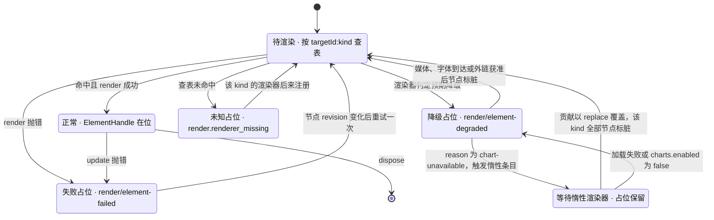

怎么读：每个元素独立处于一态；三种占位态都可被选中、移动、删除；回到「待渲染」的每条边都由一个明确事件驱动（贡献变化、资源到达、节点变化），没有定时重试。
依据：40/06 §2.4、40/07 §2.4 与 §3 可插拔证据；rulings §4.18 FE-08（图表占位与惰性子路径同 key 覆盖）。

- 惰性替换的实现：`render.element` 贡献点 `conflict: 'replace'`，`renderer-table.ts` 在 `contribution/changed` 时重建查表，并把该 kind 的全部已挂载节点加入下一帧 `DirtySet`；未挂载页随下次挂载重建。
- 图表 chunk 的触发、预算与 `/render` 关闭惰性见 [13](./13-performance-and-bundling.md) §6 与 [12](./12-viewer-embedding-and-render-page.md) §11。

**与 50/19 的分工**（2026-09-26，rulings §4.21）：每个 `kind` 用哪个渲染器、会发哪些 `reason`、占位上的文案与可做的操作，汇总在 [50/19](./19-insertable-elements-overview.md) 的元素渲染器表（承接 30/07 原第 4.2 节，R-d-04）与各族分册（50/20–50/25）；本节只定义三类占位的通用机制与 `reason` 取值集合。两处不一致时，`reason` 的取值与语义以本节为准，元素到渲染器的归属以 50/19 为准。三类占位的共同行为——可选中、移动、删除，内部不可编辑，导出原样写回——对所有族一致，分册不另设例外。媒体族的补充（[50/23](./23-elements-media.md)）：TIFF 在 M1–M2 由 `pic.renderer` 按魔数直接画占位并发 `media-decode-failed`（不尝试解码），M3 起客户端解码；SVG 部件解码失败先回退 PNG，两者都失败才发 `media-decode-failed`；视频编码不受支持只加角标、不发降级事件（§8.5）。

**图表渲染路线**（[ADR-0036](../30-architecture/adr/0036-chart-rendering-and-editing.md) 摘要，rulings §4.21 q-chart-route）：图表渲染器底层用 d3-scale / d3-shape / d3-array（ISC，合计约 30 KB），只做刻度、路径与数组运算；版式按 OOXML 语义自研（`manualLayout`、Excel 自动刻度、堆积、饼图标签避让），不引自带版式的图表库（ECharts 的版式模型与 OOXML 对不上）。M1–M2 的只读渲染在主包惰性子路径 `@cordexjs/slide-render/chart`，按图表部件与缓存数据绘制、SSIM ≥ 0.80，不以包内位图代替（章程 D16）；M3 起由 `slide-render-chart` 以同 key 覆盖并提供五类编辑（bar / line / pie / area / scatter）。占位、惰性触发与替换机制仍按本节与图 9-1，不随路线改变；元素层面的设计见 [50/24](./24-elements-tables-and-charts.md)。

## 10. 缩略图

### 10.1 Provider 选用

| Provider | 用途 | 机制 | 里程碑 |
|---|---|---|---|
| `dom-scaled` | 侧栏、母版窗格、查看器缩略图条的**可见项**；M3 前的全览网格 | 每项一个独立的小 `TargetHandle`（复用模板层）+ CSS `scale`，宽 192 px；`IntersectionObserver` 驻留，同时挂载 ≤ 12 项、overscan 6（挂载数以 [10](./10-editor-shell-and-interaction.md) §6 为唯一口径，PRD OF-15 已按此表述，rulings §4.25 TB-135） | M1 |
| `raster` | 复制为图片、导出 PNG（2026-10-22 起 M2 四种范围都在浏览器逐页生成、多页打 .zip，M3 起只有「全部页」改走服务端，rulings §4.25 DS-102）；JPEG 只给集成方直接调用，导出对话框不放（DS-103）（**不是**可配置的缩略图 Provider） | 主线程 `toImage`（§10.3） | M2 |
| embedded 封面 | 文档列表卡片封面（过渡） | 服务端导入处理器取导入原件的包内 `docProps/thumbnail.jpeg` 写为 `__cover`，只做 JPEG 头校验不解码，标 `provisional`；空白文档与包内无该部件时占位 | M2 |
| `server-png` | 列表封面、全览网格、M3 起 PNG「全部页」导出（DS-102）、分享与版本预览 | `GET /api/v1/documents/:id/thumbnails/:slideId?size=640\|1280`，renderer sidecar 生成 WebP（名称沿用历史）；封面 `slideId = '__cover'`（依据：SG-10、MECH-INC INC-16） | M3 前半段 |

`SlideRenderConfig.thumbnails = { provider: 'dom-scaled' | 'server-png', width: 192, debounceMs: 300, maxMounted: 12 }`；`raster` 不在枚举内，配置为 `raster` 被 zod 拒绝。

**图 10-1 缩略图 Provider 选用**

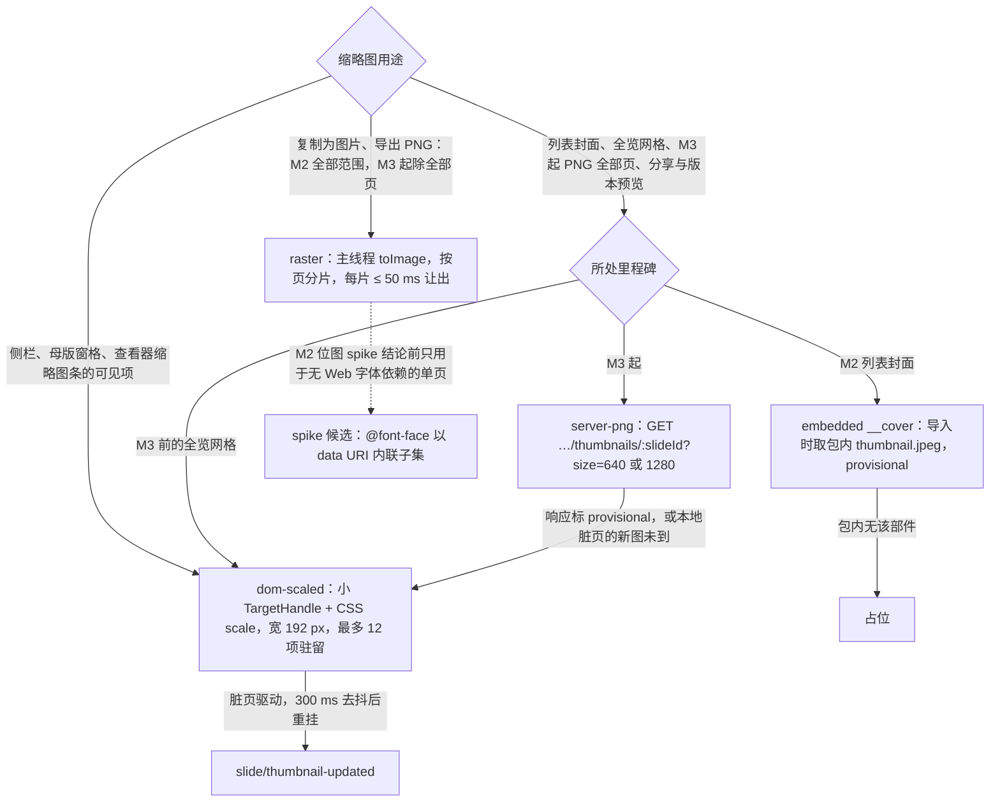

怎么读：从顶部菱形按用途分流；边上文字是选用条件；两条回到 `dom-scaled` 的边是兜底——服务端图过时或未到时本地实时渲染覆盖；虚线标出 `raster` 的已知限制。
依据：30/07 §8；ADR-0026 决策 3–4；40/07 §2.6、图 2-4；rulings §4.15 Q4 / Q8。

### 10.2 刷新与缓存

- 脏页驱动：ThumbnailService 订阅 `render/frame` 与脏页集合，按页 300 ms 去抖后重挂，重挂渲染 ≤ 100 ms；编辑后 ≤ 500 ms 内更新（PRD NF-01 §1.2、OF-15），数值口径见 [13](./13-performance-and-bundling.md) §3。
- **取法**：文档页内（编辑器、查看器）的 `server-png` 缩略图一律经 apps/web 的 `http.ts` 取回 Blob，再以 `URL.createObjectURL` 交给 ``（SDK 内为装配注入的取数回调，apps/web 默认实现经 `http.ts`，选项名 `thumbnails.fetchImage`，40/11 §2.2）；不把端点 URL 直接写进 ``——只凭链接的会话必须带 `X-Cordex-Share-Token`，`` 请求带不上（依据：INC-25）。blob URL 在缩略图项卸载或被新图替换时 revoke，计入 §8.2 的泄漏断言。应用壳列表页的封面不在文档页内、只列有直接授权的文档，可直接以 `` 引用同源端点（[14](./14-client-security.md) §9）。
- `server-png` 缓存：DTO 给出缩略图 URL 时按上一条取该 URL，否则请求 `GET …/thumbnails/:slideId?size=`；客户端不自拼版本参数、不另做缓存层，由浏览器 HTTP 缓存按 `ETag = contentHash` 以 `If-None-Match` 复核（304）复用；缓存头以 [60/15](../60-backend/15-rest-api-catalog.md) §3.10 为准（依据：APP-DATA；列表页数据缓存见 [02](./02-app-shell-routing-and-session.md) §9）。
- 取图失败 → 可见项回退 `dom-scaled`，列表卡片显示占位；404 带 `Retry-After`（服务端已惰性入队）时按该值退避重取，累计 30 s 仍未生成则保持占位到下次进入视口；5xx 时同一 URL 30 s 内不重复请求，避免重试风暴。

### 10.3 `raster`：主线程 toImage

1. 为目标页新建游离 `PageView`（不挂到文档流、不含覆盖层）并完成一次全量 paint；
2. 把 `blob:` 图片内联为 data URI（SVG 作为图像加载时不允许引用外部资源）；
3. `XMLSerializer` 序列化 → `Blob(image/svg+xml)` → `Image.decode()` → `<canvas>` 按目标宽度（1280 / 1920 / 3840）与 `pixelRatioCap` 绘制 → `canvas.toBlob(png | jpeg)`；超过浏览器画布尺寸上限时拒绝并提示降低宽度；
4. 多页导出按页分片，每片 ≤ 50 ms 让出主线程；导出期间 UI 可编辑（快照取自当前 Store）。
5. 第 1 步合成某一页时走了 slide-render 的运行时页级回退（发 `render/element-failed{ kind: 'page', pageId }`，§9），这次导出即中止、不把「此页内容暂时无法显示」写进文件，导出对话框进失败态（2026-10-22，rulings §4.25 TB-166；判定见 [18](./18-editor-capabilities.md) EXP-03）；整页无法解析的保真占位照常导出。

已知限制：序列化后的 SVG 在图像上下文里取不到页面已加载的 Web 字体（CJK 尤甚）。**M2 位图 spike** 的候选是把用到的字体子集以 `@font-face` data URI 内联进被序列化的 SVG；spike 结论前，客户端 PNG 预算只对「单页、无 Web 字体依赖」场景门禁、多页导出只报告；封面不走本路径（M2 embedded 封面、M3 起 `server-png`）。M2 的多页 PNG 导出走本路径逐页生成、打成 .zip，M3 起 PNG「全部页」改走服务端、其余范围仍走本路径（2026-10-22，rulings §4.25 DS-102）；一次能导出的页数按宽度分档设上限（[13](./13-performance-and-bundling.md) §3）。单页 PNG 预算见 [13](./13-performance-and-bundling.md) §3。

## 11. 画布可访问树的数据源（依据：A11Y-TREE + 设计 07 §3 + 30/07 §6.1）

分工：render-dom 提供通用宿主（`text-host/a11y-mirror.ts`，文档类型盲）；slide-render 经场景节点提供替代文本与阅读顺序；slide-ui 只负责阅读顺序切换与缺失 alt 提示的 UI（[16](./16-i18n-and-accessibility.md) §9）；文本编辑态的段落镜像见 [06](./06-text-editing-and-ime.md) §8。

- **数据**：`SceneProvider` 为每个可见元素附 `SceneNode.a11y: A11yDescriptor`：

| 字段 | 取值 |
|---|---|
| `role` | `text` / `image` / `table` / `chart` / `media` / `group` / `shape`；2026-09-26 增 `link`——只在放映态用于可点击的缩放定位与带动作的对象（[50/25](./25-elements-readonly-and-opaque.md) §2.7、§8） |
| `name` | 替代文字（`cNvPr@descr`）；无则取文本内容摘要（≤ 120 字符）；再无则「类型 + 序号」（i18n，如「矩形 3」） |
| `position` | 相对页面的九宫格位置键（如 `topLeft`），用于「左上」这类相对描述 |
| `order` | `{ z, placeholder? }`：z 序序号；占位符阅读序（标题 → 副标题 → 正文 → 其他，按 idx） |
| `missingAlt` | 图片、图表、媒体，以及不含文字的预设形状与任意多边形缺替代文字时为真（含文字的形状与文本框不计入，rulings §4.25 TB-54），供 slide-ui 提示作者 |
| `decorative` | 元素标记为装饰性（OOXML `adec:decorative`）时为真：不入可访问树、不提示缺少替代文字（[16](./16-i18n-and-accessibility.md) §9） |
| `links` | 2026-09-26 新增：元素内超链接的列表 `{ text; target: 描述 }[]`（链接文本与目标的可读描述，如「跳到第 5 页」「打开 example.com」）；读屏激活受同一协议白名单约束（只激活 http(s) 与页内跳转，[50/20](./20-elements-text.md) §4 ⑪） |
| `table` / `chartData` | 2026-09-26 新增：表格项内嵌视觉隐藏的 `<table>`（`firstRow` 时首行为 `th scope="col"`）；图表项附数据表摘要（超过 20 行或 10 列截断并注明），[50/24](./24-elements-tables-and-charts.md) |

- **宿主结构**：宿主位于画布容器之内（render-dom 的 text-host，使文本编辑 textarea 的 `aria-activedescendant` 指向容器的 DOM 后代，[16](./16-i18n-and-accessibility.md) §9）；`
` 下每页一个 `<section aria-label="第 N 页，共 M 页：<标题>">`，其内 `<ol>` 每项 `<li id="a11y-<ShapeId>">` 只含文本（视觉隐藏，非 `display:none`）；隐藏元素（`hidden`）与装饰性元素（`decorative`）不入列表。时间与内存预算见 [13](./13-performance-and-bundling.md) §3、§5。
- **未挂载页的数据**：`SceneNode.a11y` 只随已挂载页的 `build` 产出；未挂载页由 slide-render 以同一派生规则直接读模型生成描述（不排版、不建 DOM、不构建完整 Scene），接口形状随 `SceneNode.a11y` 一并回写。
- **不随虚拟化裁剪**：可访问树覆盖全部已装载页，与视觉层是否挂载无关；未装载完的页（`unit/loaded` 之前）以 `aria-busy="true"` 占位。更新走同一 `DirtySet`：只改受影响的列表项，不整树重建。
- **消费者**：屏幕阅读器（语义）、对象列表键盘导航（顺序，[16](./16-i18n-and-accessibility.md)）、文本编辑态 textarea 的 `aria-activedescendant` 指向当前形状的列表项（[06](./06-text-editing-and-ime.md) §8）。
- 契约影响：`SceneNode.a11y` 是对 `Scene` 契约的通用（类型盲）扩展，已登记在 30/07 §2.1 与 40/06 §2.1（字段与派生规则以本节为准，§14.2）。

**图 11-1 可访问树的数据流**

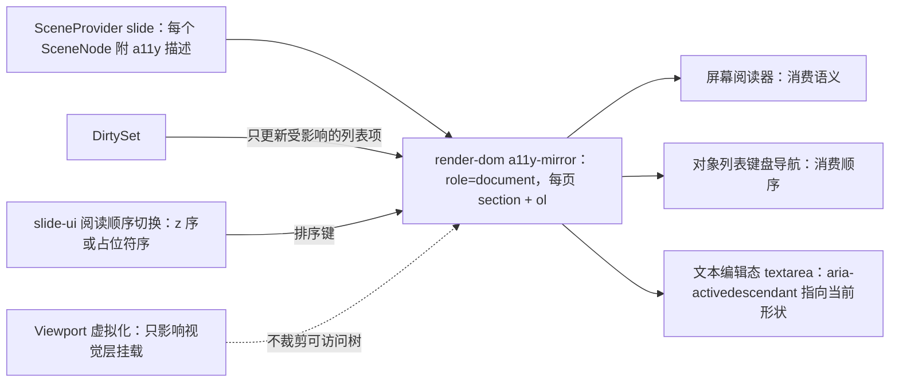

怎么读：左侧三个输入决定列表内容、增量更新与顺序；虚线强调虚拟化只作用于视觉层；右侧是同一棵树的三个消费端。
依据：A11Y-TREE；设计 07 §3「画布内容可访问树」；30/07 §6.1。

## 12. 放映渲染

- `Viewport.mode = 'show'`，同一 Surface（DOM/SVG）fit 到全屏容器，不走 canvas；`ViewDescriptor.mode = 'present'`（`mapViewMode`：`presenter → present`）。放映编排（进入 / 退出、翻页、B / W 黑白屏、控制条）归 slide-ui，见 [10](./10-editor-shell-and-interaction.md) §9。
- 预挂载下一页，翻页只切换可见性，预算按「跳转到已解析页」计（[13](./13-performance-and-bundling.md) §3）。
- 动画与切换不播放（M1–M3）；**动画结束态按场景**：编辑、缩略图、`/render`、PDF 一律全部元素可见；放映态按主动画序列的可见性终态显示（`animation-end-state.ts`，M2 P1，rulings §4.15 Q7）。`slide.showTransition` 贡献点预留到 M4+。
- 超链接在放映态可点击，协议白名单同 §8.5；媒体播放见 §8.5 与图 8-3（点击播放，翻页即停；`p:timing` 的自动播放 M1–M3 不解析）。
- 放映中收到协同更新照常经脏区重绘（[10](./10-editor-shell-and-interaction.md) §9）。

## 13. 缓存与 DX-1000 回退

### 13.1 四处 LRU（A29）

| 缓存 | 包 | 键 → 值 | 上限 | 失效 | 淘汰测试 |
|---|---|---|---|---|---|
| `StyleCache` | engine-render | `(pageId, nodeId)` → 已解析样式 | 已挂载页元素数 × 2（`maxEntriesFactor: 2`） | `DirtySet` 精确失效（反向依赖索引） | `cache-eviction.test.ts` |
| `MediaCache` | engine-render | `sha256[#变体]` → blob URL + 字节 + 引用计数 | 256 MiB（按字节，引用中条目不淘汰） | 不失效（内容寻址），只淘汰 | `cache-eviction.test.ts` |
| `MeasureCache` | engine-layout | `(fontKey, word)` → 度量结果 | 50,000 条 | `layout/measurer-changed`、字体到达 | `measure-cache-eviction.test.ts` |
| `LayerTemplateCache` | slide-render | `(layoutId, showMasterSp, themeVersion)` → DOM 模板 | 32 项 | `layouts` / `masters` / `themes` 路径脏 | `template-cache-eviction.test.ts` |

- 四处是 A29 在渲染层的口径（30/07 §11）；engine-layout 的 `layout-result-cache`（内容哈希键）与 model-slide 的样式链缓存（30/04 §6.3，默认 5000）同受 A29 约束，淘汰测试在各自模块。
- 统计：每处缓存暴露 `{ size, bytes?, hits, misses, evicted }`，经 `render.stats()` 汇总给开发者面板（[15](./15-events-errors-and-telemetry.md) §10）与 perf 场景读取；不进产品遥测。
- 内存总量与各项 target 分解见 [13](./13-performance-and-bundling.md) §5。

### 13.2 其他渲染侧手段

可见优先与时间切片（§2）、模板层克隆（§1）、屏外页 `content-visibility`（§4.1）、只写变化的 attribute 与 `DocumentFragment` 批量提交（§3）、覆盖层独立刷新（§5.2）。这些手段对 DX-1000 与 D200 同样生效，性能数值归 [13](./13-performance-and-bundling.md) §9。

### 13.3 DX-1000 回退的渲染技术内容（依据：ADR-0021 修订 2、rulings §4.18 CO-01 / CO-02）

对外门禁只有 DX-1000「首页可见 ≤ 2.5 s、交互 ≥ 30 fps」；「场景构建 + 首次挂载 ≤ 200 ms」只是引擎内部分解目标、不作门禁。何时触发、谁决定、如何复测与留证归 [13](./13-performance-and-bundling.md) §11；本节只定义每一步在渲染层具体做什么。

**图 13-1 DX-1000 回退顺序（渲染技术内容）**

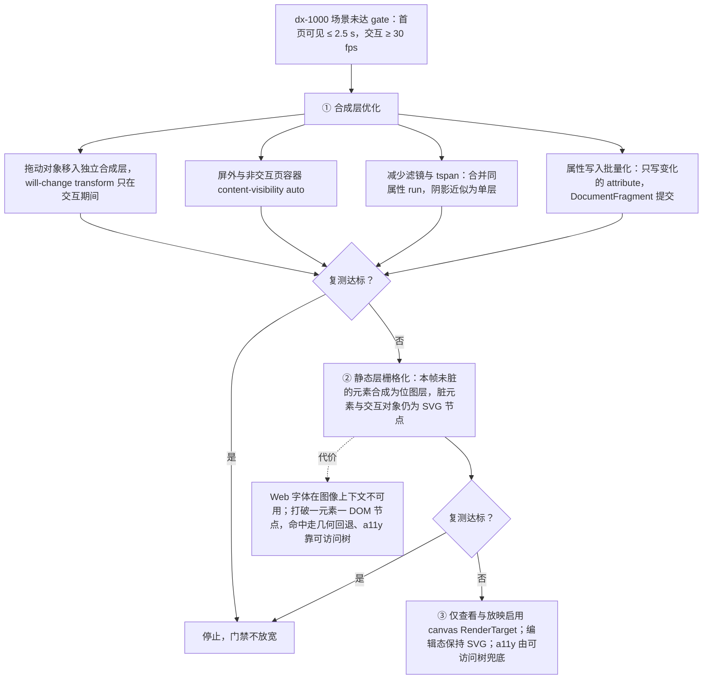

怎么读：自上而下按序执行，每一步后用同一门禁复测、达标即停；② 是 DOM/SVG 路线内的最后手段，排在 ③ 之前；任何分支都不改变编辑态的 SVG 实现，也不放宽门禁。
依据：ADR-0021 修订 2 与图 2；rulings §4.18 CO-01（顺序 ① → ② → ③）、CO-02（200 ms 只作分解目标）。

## 14. 里程碑与待回写

### 14.1 里程碑

| 里程碑 | 本文交付 |
|---|---|
| M1 | DOM/SVG 单实现、PageView 五层与模板克隆；帧管线与四处 LRU；命中链与 selection 覆盖层；canvas 度量、断行、fontProfile 与回退表；内嵌字体渲染（受限位判定）；EMF 预览或占位；外链三档；GIF 编辑态首帧（`sha256#frame0`）；图表只读渲染（d3 底层 + 自研布局，惰性子路径，§9）；放映中点击播放视频音频；元素降级与失败；`dom-scaled` 缩略图；可访问树（只读 `role=document`）；DX-1000 spike（M1 中期） |
| M2 | 编辑态文本（[06](./06-text-editing-and-ime.md)）；guides 覆盖层；EMF / WMF 惰性栅格化（emf-converter 4.0.x，显式 `gdiAntialias`）；插入前预处理（尺寸与 DPI P0；SVG 回退、大图压缩 P1；视频海报帧 P2，§8.3）；`media-playback` 覆盖层与编辑态临时播放（P1，§8.5）；`raster` 单页导出与位图 spike；列表 embedded 封面（导入时写入）；服务端文档的媒体按文档作用域拉取与上传队列（rulings §4.19 D-M2-CONTENT）；动画结束态（放映 P1）；保真诊断面板数据 |
| M3 | 多人协同体验层：remote-presence 与 comment-pins 覆盖层；`server-png`（前半段）；图表拆包 `slide-render-chart`（五类编辑）；图标着色与 PNG 回退（P2）；M3 末最小 canvas Provider 契约验证 |
| M4+ | `slide.showTransition`、EMF 矢量渲染（`convertMetafileToSvg` 经 `<image>`）、屏幕截图取帧（P2）、RTL 编辑与 HarfBuzz（ADR-0027 路线） |

### 14.2 待回写与未决

| 项 | 性质 | 建议去向 |
|---|---|---|
| `SceneNode.a11y` 通用扩展与未挂载页的描述派生（§11） | 已回写：40/06 §2.1（其 §12「2026-09-25 回写」）、40/07 §2.1 与 `domain/scene/a11y-descriptor.ts`；30/07 §2.1 随 rulings §4.20 FE-16 回写 | 30/07 §2.1、40/06 §2.1、40/07 §2.1 |
| `render/element-degraded` 新增通用原因 `media-decode-failed`、`media-unavailable`；`render/font-fallback` 增 `reason` 字段与取值（§7.2、§9） | 已回写：40/06 §2.4；30/10 §11.1 随 rulings §4.20 FE-16 回写 | 40/06 §2.4、30/10 §11.1 |
| `RenderService.noteInteraction(kind)`（§2，[15](./15-events-errors-and-telemetry.md) 待回写第 4 条）；render-dom 配置 `fonts.{firstPaintWaitMs, loadTimeoutMs}`（§7.3）；engine-layout 只读查询 `fontsSettled(pageIds)`（§7.3 第 6 条，[12](./12-viewer-embedding-and-render-page.md) §11.5 读取） | 已回写：40/06 §2.4、§3 render-dom Config 与 `layout.service.ts` | 40/06 §2.4 / §3 render-dom Config |
| `ViewDescriptor.themePreview?: {masterId; colors?; fonts?}`（§3，[11](./11-masters-layouts-and-themes.md) §9） | 已定（rulings §4.20 FE-24），本文 §3 登记行为 | 已回写（2026-09-26）：40/07 §2.1「主题预览」段登记为 slide-render 识别的扩展键，engine-render 的 `ViewDescriptor` 靠索引签名承载 |
| `server-png` 与封面的取数回调（§10.2，apps/web 默认实现经 `http.ts`） | 已登记：preset 选项 `thumbnails.fetchImage`（40/11 §2.2） | 40/07 缩略图配置、40/11 preset 选项 |
| 覆盖层命中结果的 `kind` 与内容命中 `HitResult.region` 的合并形状（§5.1） | 已回写：40/06 §2.2 合并为判别联合 | 40/06 §2.2 |
| 模板层只含非占位符形状（§1）与 `occluded` 规则 | 已关闭：50/01 §4a.3（原 30/07 §4.1）、40/07 §2.1 改为 PowerPoint 行为（普通页上母版与版式的占位符一律不绘制，只绘制其非占位符形状，受 `showMasterSp` 控制），与本文 §1 一致 | 50/01 §4a.3（原 30/07 §4.1）、40/07 §2.1 |
| `layoutAlgorithmVersion` 统一为 `layoutAlgoVersion`（§6） | 已关闭（30/07 §5.1 同步） | 30/07 §5.1 |
| 30/06 §9.1 第 4 条媒体端点 | 已关闭：改为文档作用域 `/documents/:id/media/:sha256`（INC-21） | 30/06 §9.1 |
| fontProfile 清单与字体文件的仓库落点、部署方字体目录的配置键（§7.1、§7.5） | 落点登记 | 40/11（apps/web）、[60/17](../60-backend/17-deployment-and-config.md) |
| 产品缩放范围 10–400% 由 preset 默认配置下发，引擎 clamp 仍为 0.1–8（§4.1） | 本文决定 | 40/06 Q-7 结案、40/11 preset 默认配置 |
| M2 列表封面的来源 | 已裁定（rulings §4.19 D-M2-CONTENT）：导入处理器写 embedded `__cover`，空白文档占位 | §10.1 |
| 评论钉覆盖层的数据源包归属 | 已裁定（rulings §4.19 D-COMMENTS-PKG）：`comments` 包 | §5.2 |
| canvas 第 ④ 角色「媒体与图标预处理」、`infrastructure/media/image-preprocess.ts`、`media-playback` 覆盖层（zIndex 55）、MediaCache 变体 `sha256#frame0`（§1、§5.2、§8.2、§8.3、§8.5） | 本轮新增（rulings §4.21，R-d-23、R-d-68）；ADR-0021 已修订；已回写：40/06 渲染介质口径段（四个角色）、§4 目录树与 §5 文件表，30/07 §1 第 ④ 角色，40/07 §1.1 与 `pic.renderer` 职责 | 40/06 渲染介质口径段（「canvas 只承担三个角色」改四个）与 render-dom 目录树、文件职责表；30/07 §1 canvas 角色；40/07 `pic.renderer` 职责（GIF 首帧、SVG 回退、播放图标） |
| SVG 白名单消毒器进 iso 包、浏览器与服务端共用，使本地 sha256 等于服务端规范 sha256（§8.3） | 待定（[50/23](./23-elements-media.md) §13 Q-1） | 30/02、40/04、60/04 §7.2 |
| 扫描器：`getContext`、`OffscreenCanvas`、`drawImage`、`createImageBitmap` 只允许出现在 `to-image.ts`、`canvas-measurer.ts`、`media/image-preprocess.ts` 与 canvas 契约测试（§15） | 已登记（2026-09-26 整合）：落为 lint 规则而非新扫描器——09-type-discipline/02 §3「canvas 用在四个允许位置之外」行、40/01 `rules/style.ts`，夹具随 TD-081 | 09-type-discipline/02、08；40/01 |
| emf-converter 4.0.x 版本锁与 `gdiAntialias` 口径（§8.4） | 已定（R-d-24） | 50/17、40/07 §5.1、章程 §5.3 单点表 |
| 页级回退的落点与 `/render` 的页级失败（§9，rulings §4.25 TB-151、TB-157，2026-10-22） | 已定：落在 slide-render（`compose-slide.ts`、`slide-scene-provider.service.ts`、`fallback.renderer.ts`），已登记（2026-10-22 核对）于 40/07 §1.1、§5.1；运行时回退的页在 `/render` 报 `render.page_failed`（[12](./12-viewer-embedding-and-render-page.md) §11.3） | 已登记（2026-10-22 核对，架构与模块线同批）：30/10 §1.1a `render` 域的 `page_failed`、§11.1 `render/element-failed` 的 `kind: 'page'`；40/07 §1.1、§2.4 运行时回退时发 `render/element-failed{ kind: 'page', pageId, code }`；2026-10-22 复核修正（rulings §4.25 TB-166）：浏览器图片导出遇运行时回退即失败，本文 §9、§10.3 第 5 步，判定在 [18](./18-editor-capabilities.md) EXP-03 |
| 母版视图的占位符标注覆盖层（§5.2，rulings §4.25 DS-148、TB-188…TB-190，2026-11-04） | 已定：覆盖 id 改为 `master-annotations`（原名 `master-inheritance`），覆盖全部占位符；M2 锁签并入同一层，类型名与锁签的落位纯函数单独成件；标注层从 `selection` 服务与 Viewport 读选中与视口，不扩展 `OverlayContext`；类型名、「母版 · 〈类型〉」与锁签的文案和是否 M2 由 slide-ui 在启用这一层时作为入参 `MasterAnnotationsOptions`（`labels`、`m2Locked`）给出，slide-render 不登记 i18n 命名空间（[11](./11-masters-layouts-and-themes.md) §6，[16](./16-i18n-and-accessibility.md) §1） | 40/07 §2.1、§2.5、§4、§5、§13 Q-3（模块线）；40/10、40/16（覆盖 id 与删去的件）；落位规则以设计 03-26 §4.2 为准 |

## 15. 机械验证

本节只写断言（what）；测试层级、夹具、阈值判定与 CI 步骤归 70 线。

| 断言 | 落点（40 登记的文件） | 70 线套件 / CI 步骤 |
|---|---|---|
| 改 1 个元素的 1 个属性：`update` 恰 1 次、`changed` 等于该路径；改版式：整页重合成且元素句柄复用（A28） | `engine-render/__tests__/dirty-consumed.test.ts`、slide-render `dirty-mapping.test.ts` | test/unit（[70/01](../70-testing/01-strategy-and-layers.md)） |
| 四处缓存塞入 3× 上限后 `evicted > 0` 且命中率可读（A29） | `cache-eviction`、`measure-cache-eviction`、`template-cache-eviction` 三个测试 | test/unit |
| 抛错渲染器只替换该元素，其余元素与其他页正常；预期降级走 `element-degraded`、意外失败走 `element-failed`（A11） | `error-isolation.test.ts`、slide-render `degrade.test.ts` | test/unit |
| `render-dom` 通过 `runRenderTargetConformance`；M3 末最小 canvas Provider 通过同一套件 | render-dom `__tests__`、`canvas-target-contract.test.ts` | test/contract（[70/02](../70-testing/02-contract-suites-and-pluggability.md)） |
| `canvas` 度量器通过 `runTextMeasurerConformance` | render-dom `__tests__` | test/contract |
| 改 selection / presence 不调用任何 `ElementRenderer.update` | `overlay-coordinates.test.ts`（overlay-independent） | test/unit |
| 渲染热路径无 `ctx.waterfall`；DOM 注入禁令（TD-081）；`asvg:svgBlip` 只产出 `<image>` | lint 规则 + `svg-image-context.test.ts` | lint、test/unit |
| canvas 与图像解码 API 只出现在四处落点（§1 角色 ①–④）；预处理从不对外链资源发请求 | lint 规则（已登记：09-type-discipline/02 §3「canvas 用在四个允许位置之外」行，§14.2） | lint |
| 预处理：插入的 SVG 已消毒、哈希对象是处理后的字节；输出像素 ≤ 16,777,216；GIF 在编辑态、缩略图、`/render` 为首帧，放映为动画 | render-dom `image-preprocess.test.ts`；slide-render 单测 | test/unit |
| 编辑态临时播放不触发 `ElementRenderer.update`、不写 Store、不进 awareness；停止后 MediaCache 引用计数复原；缩略图与 `/render` 从不挂载播放元素 | render-dom `media-playback.test.ts`；e2e 资源断言 | test/unit、e2e（70/06 §11） |
| EMF 栅格化调用显式 `gdiAntialias: true`；超限回到占位 `emf-raster-limit` | slide-render `degrade.test.ts` | test/unit |
| RTL 行每行一个 `<text>` 且 run 无 `x`；CJK 禁则黄金用例 | `text-lines-bidi.test.ts`、engine-layout 断行用例 | test/unit |
| 字体：回退链每条路径上报恰一次 `render/font-fallback`；受限字体在编辑态不进 FontFace 列表、只读态加载；浏览器只请求同源 `/fonts/`，无第三方字体请求 | `font-fallback.test.ts`；e2e 网络断言 | test/unit；e2e（[70/06](../70-testing/06-frontend-component-and-e2e.md) §10） |
| 每个 Unit `createObjectURL` 次数 = `revokeObjectURL` 次数；关闭后 `getEffects()` 为空 | e2e 资源断言 | e2e（70/06 §11） |
| `view/page-changed`、`view/zoom-changed` 只由 Viewport 发出，页变更恰一次 | engine-render `viewport` 单测 | test/unit |
| 可访问树覆盖全部已装载页，与视觉层挂载数无关 | e2e a11y 用例 | e2e/a11y（70/06 §7） |
| 缩略图：去抖、`maxMounted`、Provider 切换、`raster` 被配置 schema 拒绝、provisional 回退 | slide-render `thumbnails.test.ts` | test/unit |
| 主题预览覆盖：`themePreview` 生效时合成取覆盖值，期间 Store 无事务、无 awareness 变化；清空后回到文档主题且模板缓存正式条目未被覆写（rulings §4.20 FE-24） | slide-render `__tests__/master-view.test.ts`（40/07 §9） | test/unit |
| 视觉保真（客户端 render-dom 截图对 PowerPoint 基线；与 renderer 输出互差 ≤ 0.5%） | 语料与基线 | e2e/oracle-gated（[70/04](../70-testing/04-visual-oracle.md)） |
| 性能（首帧、帧率、键入、缩略图更新、DX-1000） | perf 场景 | perf/perf-client（[70/09](../70-testing/09-performance-and-capacity.md)） |
| `/render` 页零外呼、ready 判据 | `render-page.spec.ts` | 见 [12](./12-viewer-embedding-and-render-page.md) §12 |
