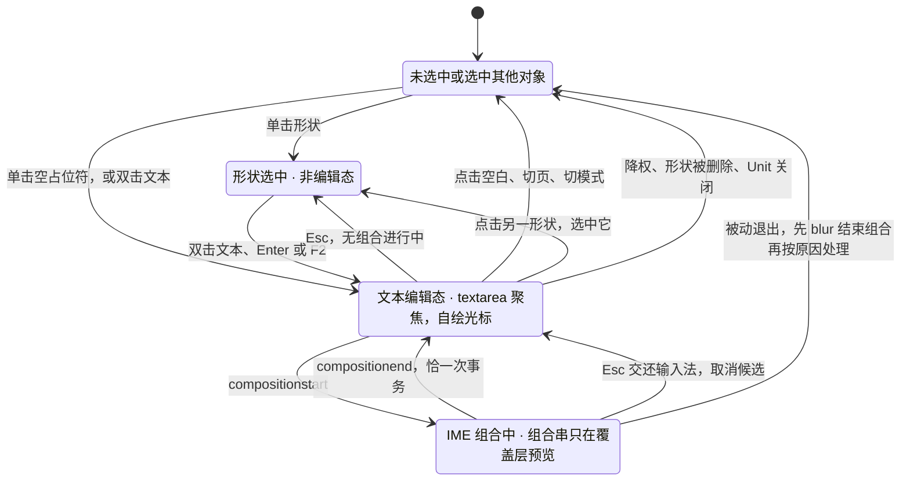
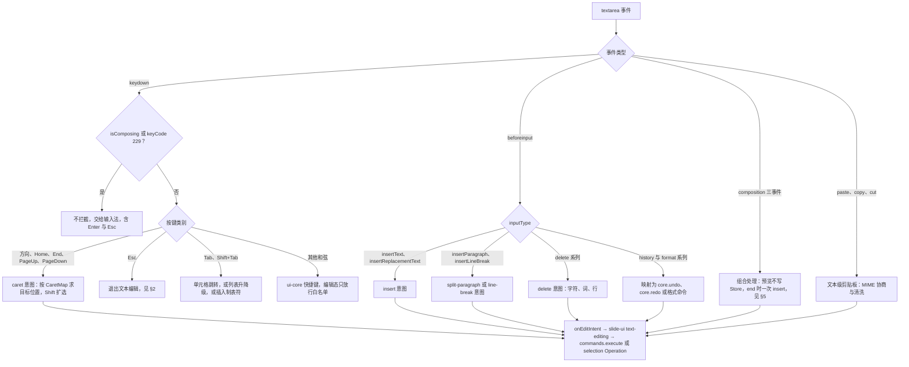
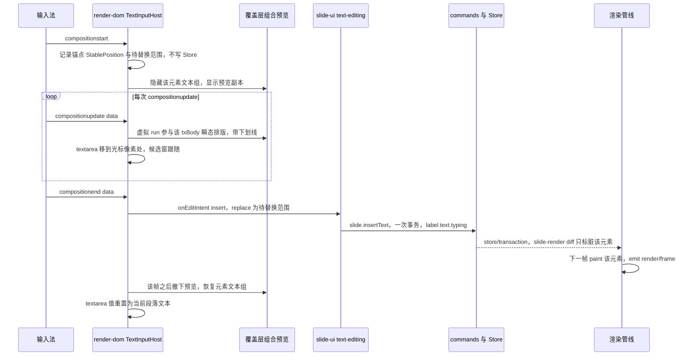
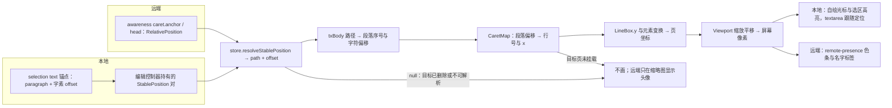
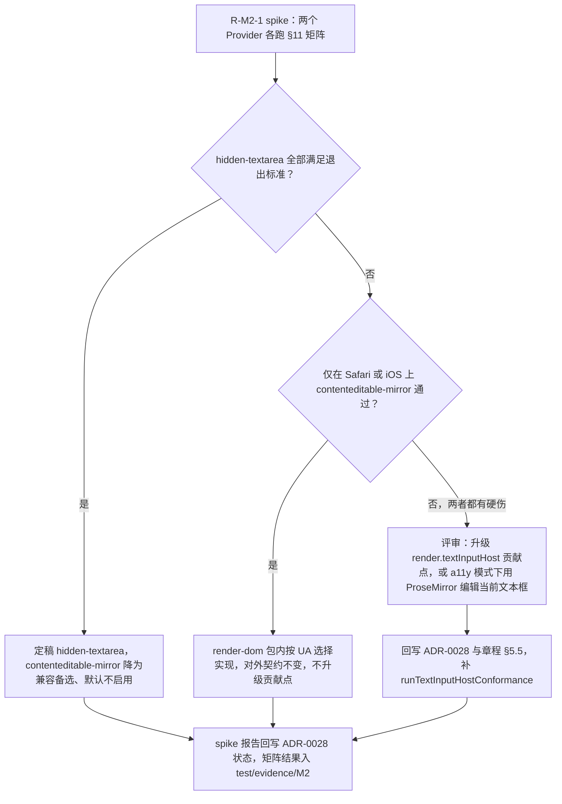

# 06 文本编辑与 IME
> 状态：v0.1 | 负责：前端设计线 | 更新：2026-09-25；2026-09-25（§4.19） | 依赖：[ADR-0028 文本编辑宿主](../30-architecture/adr/0028-text-editing-host.md)、[ADR-0027 文本度量](../30-architecture/adr/0027-text-measurement-strategy.md)、[30/07](../30-architecture/07-rendering.md) §6 / §9、[30/06](../30-architecture/06-collaboration.md) §1.4 / §7.2 / §8、[40/06](../40-modules/06-layout-and-render-engine.md) §2.5 / §2.6 / §13、[40/10](../40-modules/10-ui-shell-and-slide-ui.md) §2.2 / §2.6、PRD [02-editing](../10-prd/03-features/02-editing.md) ED-02 / ED-03 / ED-10 / ED-18 / ED-24、PRD [NF-01](../10-prd/04-non-functional-requirements.md) §1.2 / NF-05、PRD 05 R-M2-1、设计 [07](../20-design/07-accessibility-and-i18n.md) §1.3 / §4、设计 [03-16](../20-design/03-screens/16-text-editing-and-formatting.md)、rulings §4.18 UX-06

本文是画布内文本编辑的唯一事实源：从按键、输入法到一次事务提交与重绘的全部行为语义。渲染管线、字体与度量见 [05](./05-rendering-and-thumbnails.md)；命令与撤销语义本体见 [04](./04-document-commands-and-undo.md)；通用输入管线与快捷键表见 [09](./09-ui-system-and-theming.md) §8；Esc 逐级链的画布部分与选择模型见 [10](./10-editor-shell-and-interaction.md) §7；协同会话与 presence 数据见 [07](./07-collaboration-client.md)。

## 0. 定位与边界

| 本文拥有 | 本文引用（事实源） |
|---|---|
| 文本编辑态状态机：进入、退出、组合态（§2） | `TextInputHostProvider` / `TextInputHostHandle` 接口本体：40/06 §2.5 |
| textarea 事件分流与意图归约（§3–§4） | 命令 id、Mutation 与参数：40/03 §2.6；撤销策略本体：30/05 §6、[04](./04-document-commands-and-undo.md) §5 |
| IME 组合处理、候选窗定位、浏览器差异（§5） | 快捷键表、`textEditing` 上下文键、chord 规范化：[09](./09-ui-system-and-theming.md) §6 / §8 |
| 光标与选区的位置解析与绘制（§6） | CaretMap、断行与 autofit 算法：engine-layout，[05](./05-rendering-and-thumbnails.md) §6 |
| 文本重排范围与 autofit 回写（§7） | 预算 target：[13](./13-performance-and-bundling.md) §3；gate：PRD NF-01 §1.2 |
| 编辑态可访问性镜像（§8） | 画布可访问树数据源：[05](./05-rendering-and-thumbnails.md) §11；键盘模型与 live region：[16](./16-i18n-and-accessibility.md) |
| 表格单元格、备注、占位符的共同路径与差异（§9） | 撤销跳过提示、「恢复我的值」UI：[04](./04-document-commands-and-undo.md) §6 |
| 协同下的文本行为（§10）、R-M2-1 spike 验收矩阵（§11） | IME 自动化用例与真机清单的执行：[70/06](../70-testing/06-frontend-component-and-e2e.md) §9 |

## 1. 决策与范围

**决策**（ADR-0028）：每个 Unit 的 Surface 只有**一个隐藏 `<textarea>`**（`div.text-host` 内，render-dom `infrastructure/text-host/text-input-host.ts`）；光标、选区高亮、组合中文本全部自绘在覆盖层；输入事件直接转为命令，Store 之外没有第二份编辑缓冲（A32）。

- **可插拔点**：`TextInputHost` 是 render-dom **包内**可插拔点，不是贡献点；Provider `hidden-textarea`（默认）与 `contenteditable-mirror`（R-M2-1 spike 候选，默认不启用），由 render-dom 配置 `textHost.provider` 选择。升级为 `render.textInputHost` 贡献点须同时满足：R-M2-1 否定 `hidden-textarea`（或出现须跨包可发现的第三方宿主），且回写章程 §5.5 与 ADR-0028 并补 `runTextInputHostConformance`；M0–M2 不登记该 id（40/06 §2.5、§13 Q-3）。
- **与渲染介质无关**：IME 对齐由隐藏 textarea 承担，与 DOM/SVG 还是 canvas 无关（ADR-0021 修订 6）。
- **适用范围**：

| 适用 | 不适用（走原生输入控件，遵守设计 07 §4 的组合态规则） |
|---|---|
| 形状文本（含占位符）、表格单元格文本（M2）、母版视图中的占位符与文本（ML-03，M3）、备注正文（M3，§9） | 检查器数值输入、评论输入框、命令面板、对话框表单、图表数据网格（M3） |

- **时点**：竖排文本编辑为 E~（P2），M2 以「旋转后的水平行模型」近似编辑、不承诺与 PowerPoint 一致；RTL 编辑与 HarfBuzz shaping 在 M4 / M5，M1–M3 不承诺 RTL 光标与选区正确（ADR-0027 / 0028 修订）。

## 2. 进入与退出文本编辑态

**进入**（slide-ui `application/text-editing.ts` 编排；进入即写上下文键 `textEditing = true` 并让 textarea 获得焦点）：

| 触发 | 条件 | 插入点 |
|---|---|---|
| 双击文本形状或表格单元格 | `EditorHost.mode = 'edit'`（有 `doc.write`；`review` / `view` 不进入）；目标未锁定 | `HitResult.region = 'text'` 时由 `CaretMap` 求点击处（§6） |
| 单击空占位符 | 同上 | 文本开头；提示文字随即隐藏 |
| 选中单个文本形状后按 Enter 或 F2 | 同上（ED-29 键盘等价） | 文本末尾 |
| 插入文本框（`slide.insertShape{kind:'sp'}`） | 命令成功后 | 新文本框开头 |

**退出**（任何路径都先处理进行中的组合，见 §5.5）：

| 触发 | 退出后状态 |
|---|---|
| Esc（无组合进行中） | 回到选中该形状；组合内子元素的文本编辑退出后仍选中该子元素（UX-06 逐级链的第一级） |
| 点击画布空白处 | 退出编辑并取消选择（与「非编辑态点击空白取消选择」同一条指针规则，与 PowerPoint 一致；设计 03-16 状态图的「返回选中态」待回写） |
| 点击或双击另一个形状 | 退出，选中该形状；双击文本则直接进入其编辑态 |
| 切页、切换视图模式（评审、放映、母版视图进出） | 退出，不保留编辑态 |
| 降权为只读、形状被他人删除（墓碑）、Unit 关闭 | 被动退出，处理见 §5.5 与 §10 |
| 窗口失焦 | **不退出**：光标隐藏，重新获得焦点时恢复 |

退出时若占位符仍为空，恢复显示提示文字（提示文字不入模型、不导出）。Esc 逐级链的后续级别（选中子元素 → 选中整个组合 → 取消选择 → 退出母版视图）由 ui-core 键盘管线执行，见 [10](./10-editor-shell-and-interaction.md) §7。

**图 2-1 文本编辑态**



怎么读：四个状态覆盖文本编辑的全部生命周期；组合态只能经 `compositionend` 或输入法自身的取消回到编辑态，Esc 在组合中永远先交给输入法；被动退出从任一编辑相关状态都可能发生。空占位符的灰色提示是非编辑态下的渲染表现，不单列状态。
依据：ADR-0028；设计 03-16 状态图、设计 07 §4 Esc 分流；rulings §4.18 UX-06。

## 3. 事件分流

textarea 只在编辑态持有焦点；非编辑态的键盘事件落在画布或其他区域，由 ui-core 键盘管线处理。组合态判定一律用 `event.isComposing || event.keyCode === 229`，不自行维护「是否在组合」的平行状态来决定是否拦截。

| 事件 | 非编辑态（画布焦点） | 编辑态 | 组合态 |
|---|---|---|---|
| keydown 方向键、Home、End、PageUp、PageDown | 微调移动、翻页（[10](./10-editor-shell-and-interaction.md) §7–§8） | `caret` 意图：按 CaretMap 求目标位置（Shift 扩选，Ctrl / Alt 按词，Home / End 按行，Mod+Home / End 与 PageUp / Down 到文本首尾）；`preventDefault` | 不拦截，交给输入法 |
| keydown Enter | 选中文本形状时进入编辑态 | 不处理 keydown，由 beforeinput 处理 | 不拦截（候选确认） |
| keydown Esc | Esc 逐级链 | 退出编辑态（§2） | 不拦截（取消候选） |
| keydown Tab / Shift+Tab | 在形状间移动焦点 | 表格：到下一 / 上一单元格；列表段落且光标在段首：升 / 降级；否则插入制表符 | 不拦截 |
| keydown 其他和弦（Mod+B / I / U、Mod+Z / Y、Mod+A …） | 快捷键表 | ui-core 快捷键：编辑态只放行编辑类白名单（白名单在 [09](./09-ui-system-and-theming.md) §8） | 一律不拦截（设计 07 §1.3） |
| beforeinput `insertText` / `insertReplacementText` | — | `insert` 意图（后者带替换范围，来自 `getTargetRanges()`）；`preventDefault` | — |
| beforeinput `insertParagraph` / `insertLineBreak` | — | `split-paragraph` / `line-break` 意图（Shift+Enter → `a:br`） | — |
| beforeinput `delete*`（`deleteContentBackward/Forward`、`deleteWord*`、`deleteSoftLine*`、`deleteHardLine*`） | — | `delete` 意图（字符、词、行） | — |
| beforeinput `historyUndo` / `historyRedo`、`formatBold` / `formatItalic` / `formatUnderline` | — | 映射为 `core.undo` / `core.redo` / 对应格式命令 | — |
| beforeinput `insertCompositionText` | — | — | 不可取消，忽略（由组合事件处理） |
| beforeinput 其他类型（`insertFromPaste` 等） | — | `preventDefault` 并忽略（粘贴走 paste 事件） | — |
| compositionstart / update / end | — | 进入组合态 | §5 |
| paste / copy / cut | 形状级剪贴板（[04](./04-document-commands-and-undo.md) §9） | 文本级剪贴板：copy 产出 `text/plain` + `text/html` + `application/x-cordex+json`；cut = copy + `delete` 意图；paste 经同一管线 MIME 协商与清洗后产出 `insert` 意图 | 不处理 |

**图 3-1 输入事件分流**



怎么读：先按事件类型分流；keydown 先判组合态，组合中一律放行给输入法；其余分支各自归约成一种意图，最终都经同一个回调交给 slide-ui，由它决定落成命令（写 Store）还是 selection Operation（只改选区、不入历史）。
依据：ADR-0028 决策 2；30/07 §6.2；40/18 图 6-5；设计 07 §1.3 / §4。

## 4. 意图链

render-dom 只把浏览器事件归约为**中性**的 `TextEditIntent`（不含任何 Mutation 或命令知识，文档类型盲），经 `RenderService.attach(targetId, container, callbacks)` 注入的 `callbacks.onEditIntent` 交给 slide-ui；回调名以 M-06 契约为准（40/06 §13 Q-2），40/10 与 40/18 中的 `onTextEditIntent` 写法待回写。

```ts
// render-dom 产出，slide-ui 消费（形状草案；类型落点 40/06 §2.5 TextInputHost 旁）
type TextEditIntent =
  | { kind: 'insert'; nodeId: NodeId; text: string; replace?: TextRange }
  | { kind: 'delete'; nodeId: NodeId; unit: 'char' | 'word' | 'line'; direction: 'backward' | 'forward' }
  | { kind: 'split-paragraph' | 'line-break'; nodeId: NodeId }
  | { kind: 'caret'; nodeId: NodeId; to: TextPosition; extend: boolean }
  | { kind: 'format'; nodeId: NodeId; format: 'bold' | 'italic' | 'underline' }
  | { kind: 'history'; op: 'undo' | 'redo' }
  | { kind: 'clipboard'; op: 'copy' | 'cut' | 'paste'; data: DataTransfer }
// nodeId === ShapeId（40/07 §2.1）；TextRange 由两个 TextPosition 组成，offset 以字素计（30/04 §3.6）
```

| 意图 | slide-ui 落成 | Mutation | 撤销 |
|---|---|---|---|
| `insert`（含组合结束、替换选区） | `slide.insertText`（有 `replace` 时同一事务先删后插） | `text.applyDelta` | 可合并，见下 |
| `delete` | `slide.deleteText` | `text.applyDelta` | 可合并 |
| `split-paragraph` / `line-break` | `slide.insertText`（段落分隔或 `a:br` 嵌入，由 TextDelta 表达，40/02 `text-delta.ts`） | `text.applyDelta` | 可合并 |
| `format` 与格式控件 | `slide.toggleBold` / `setFontSize` / `setAlignment` / `setBullet` … | `run.setProperties` / `paragraph.setProperties` | 独立一步；无选区时作用于当前词，空文本框作用于 `a:endParaRPr`（ED-03） |
| `caret` | `slide.setSelection`（`text` 锚点），每帧至多一次 | 无（Operation，不入历史） | — |
| `history` | `core.undo` / `core.redo` | — | — |
| `clipboard` | 剪贴板管线（[04](./04-document-commands-and-undo.md) §9）后落成 `insert` / `delete` | 同上 | 粘贴独立一步 |

**键入合并**：连续键入以 label `text.typing:<runId>` 提交，history 按「同 label、同 origin、间隔 < 500 ms」合并为一个撤销单元（30/05 §6 `coalesceMs` = store-yjs `undo.captureTimeout` 500 ms）。`runId` 在以下时刻自增，从而切断合并：非键入引起的光标移动（方向键、指针）、格式命令、粘贴、退出编辑。连续的组合结束（中文逐词上屏）照常合并。撤销的协同语义（跳过他人后写的键、整步被跳过即停）不简化，UI 表达见 [04](./04-document-commands-and-undo.md) §6。

## 5. IME

### 5.1 一次组合的处理

1. **compositionstart**：记录锚点 `StablePosition`（选区起点）；若选区非空，记下「待替换范围」（两个 StablePosition），**不**立即删除（组合过程中不产生任何事务，ED-02）。
2. **compositionupdate(data)**：组合串作为一个「虚拟 run」替换待替换范围，只对被编辑的 txBody 做一次瞬态排版；预览画在该页的 `svg.overlay`，同时把该元素的文本组设为 `visibility: hidden`（不重建 DOM）；预览带下划线表示组合中。Store 不变，其他协作者看不到组合串。
3. **compositionend(data)**：产出一个 `insert` 意图（`text = data`，`replace` = 待替换范围）→ slide-ui 执行一次 `slide.insertText` → 恰一个事务；在该事务的那一帧 `render/frame` 之后撤下预览、恢复元素文本组，避免闪烁；重置 textarea 值为当前段落文本（§8）。`data` 为空（组合被取消）时不产生事务，原选区文本保持不变。

预览走覆盖层而非写 Store，是 ADR-0028 决策 1「组合中文本自绘在覆盖层」与 A32「无第二份编辑缓冲」的共同要求；预览排版只涉及一个 txBody，预算 IME 组合更新 p95 ≤ 80 ms（PRD NF-01 §1.2）。

**图 5-1 一次 IME 组合：从 compositionstart 到事务提交与重绘**



怎么读：纵向是时间；`loop` 段内所有更新只动覆盖层与 textarea 位置，Store 在整个组合期间不变；`compositionend` 之后才有唯一一次事务，随后走普通的脏区重绘，预览在新文本画出后才撤下。
依据：ADR-0028 决策 1–3；30/07 §6.2；PRD ED-02。

### 5.2 候选窗定位

- textarea 始终跟随插入点：`position: absolute`，左上角 = 插入点所在行的左上（页坐标经 Viewport 变换为容器坐标），宽 1 px，高 = 行高 × 缩放，`font-size` = 行高 × 缩放，`opacity: 0`、`pointer-events: none`、`resize: none`、`white-space: pre`、`spellcheck="false"`、`autocomplete="off"`；候选窗由浏览器按 textarea 的插入符矩形放在行下方，与插入符水平偏差 ≤ 4 px（spike 退出标准）；render-dom 配置 `textHost.imeCandidateOffsetPx: 2` 只做纵向微调。
- 缩放、滚动、光标移动、远端改动导致重排后，在同一帧内重新定位 textarea；组合进行中也跟随。
- 视口边缘的候选窗翻转交给浏览器默认行为，编辑器不自定义定位覆盖（设计 07 §4）；浮层不得遮挡候选窗。

### 5.3 组合期间屏蔽

- ui-core 键盘管线、命令面板的 Enter 确认、`@` 提及候选的过滤刷新，在组合期间一律不响应（设计 07 §1.3 / §4）。
- 组合期间点击迷你工具条：按钮 `mousedown` 阻止默认以保持 textarea 焦点，其命令排到 `compositionend` 之后执行。
- 组合期间的 Mod+Z / Mod+Y 交给输入法，不触发编辑器撤销。

### 5.4 协作者并发

组合进行中收到远端对同一 txBody 的改动：按锚点 StablePosition 重新解析位置，用当前 Store 内容 + 虚拟 run 重新做一次预览排版；`compositionend` 时按解析后的位置插入。位置正确，但用户可能看到组合串短暂位移（ADR-0028 后果，可接受）。

### 5.5 组合中被退出

| 退出原因 | 处理 |
|---|---|
| 用户主动（点击别处、切页、切模式） | 先 `textarea.blur()`，浏览器结束组合并派发 `compositionend`，按 §5.1 第 3 步正常提交，再退出 |
| 形状被他人删除（墓碑） | 丢弃未上屏的组合串：它从未进入 Store，而本端观察到墓碑后读路径已过滤该形状，新命令无法再以它为目标（[04](./04-document-commands-and-undo.md) §7）；此前已提交的键入落在墓碑实体上、不丢失（30/06 §8 第 2 行），「恢复元素（含我的编辑）」提示由 04 §7 负责 |
| 降权为只读 | 丢弃组合串（命令会被权限门拒绝），退出编辑并显示只读横幅（[07](./07-collaboration-client.md)） |
| Unit 关闭 | 丢弃；关闭前的离开保护见 [04](./04-document-commands-and-undo.md) §8 |

### 5.6 浏览器差异处理

| 环境 | 现象 | 处理 |
|---|---|---|
| Safari（macOS / iOS） | `compositionend` 先于最后一个 Enter 的 keydown 到达，该 keydown 的 `isComposing` 为 false | `compositionend` 后同一任务内到达的 Enter keydown 忽略（下一任务清除标记） |
| Chromium / Firefox | `insertCompositionText` 不可取消 | 忽略，以组合事件为准 |
| Android GBoard | 拉丁文按词组合，退格在组合内经 `compositionupdate` 表达 | 与 CJK 同一路径；组合中的 `deleteContentBackward` 不单独处理 |
| iOS 自动更正、双空格句点 | `insertReplacementText` 带 `getTargetRanges()` | 归约为带 `replace` 的 `insert` 意图 |
| 韩文 | 逐字母组合、字母间频繁 `compositionupdate` | 预览排版按帧合并，每帧至多一次 |
| macOS 死键（Option+e 等） | 以组合事件出现 | 同 CJK 路径 |

## 6. 光标与选区

- **位置的事实源**：本地选区在模型层是 `SlideSelectionAnchor{ kind: 'text', shapeId, start, end }`（`TextPosition{ paragraph, offset }`，offset 以字素计，30/04 §3.6）；编辑控制器内部同时持有一对 `StablePosition`（`store.createStablePosition(path, offset)`，协同时即 Yjs RelativePosition），远端改动后用它重新解析，保证光标不漂移。
- **解析链**：`StablePosition` →`store.resolveStablePosition` → `{ path, offset }` → 段落序号与字符偏移 → `CaretMap`（段落偏移 → 行号与 x）→ `LineBox.y` 与元素变换 → 页坐标 → Viewport 缩放平移 → 屏幕像素。字素与 UTF-16 下标的换算只发生在 textarea 边界（§8）。
- **点击定位**：`HitResult{ region: 'text', local }` → `CaretMap` 反查最近插入点；双击选词（`Intl.Segmenter` 词粒度）、三击选段。
- **上下移动**保持目标 x（sticky x），跨段落时同样按 x 取最近插入点；行首行尾按 `LineBox` 边界。
- **绘制**：本地光标宽 1 CSS px，闪烁周期 500 ms，每次输入或移动后常亮 500 ms；`prefers-reduced-motion` 下不闪烁；选区高亮按行矩形；颜色写 CSS 变量名，`forced-colors` 下用系统色 `CanvasText` / `Highlight`。闪烁 timer 归 effect。
- **远端光标**：awareness 中的 `caret.anchor / head`（RelativePosition）走同一条解析链，由 `remote-presence` 覆盖层绘制色条与名字标签（颜色取 presence 调色板），3 s 无活动淡出；解析为 null（目标已删除）或目标页未挂载时不画，只在缩略图上显示头像（[05](./05-rendering-and-thumbnails.md) §5.2）。

**图 6-1 本地与远端光标的位置解析链**



怎么读：本地与远端光标在「解析」这一步汇合，此后走完全相同的几何链，因此同源绘制、像素一致；两条虚线外的失败分支都落到「不画」。
依据：30/07 §6.2、§7；30/06 §2.2 `createStablePosition` / `resolveStablePosition`；ADR-0028 决策 5。

## 7. 重排、autofit 回写与预算

- **只重排被编辑的 txBody**：文本事务的 `ChangeSet.touched` 只命中 `shapes.<id>.textBody.*`，slide-render 只把该形状节点标脏（元素级脏，A28）；其他元素与模板层不动。
- **autofit**：`normAutofit` 在 PRD ED-24 的阶梯（fontScale 100 → 92.5 → 85 → …，lnSpcReduction 0 → 10 → 20）上二分，≤ 6 次迭代；`spAutoFit` 按内容增高，每帧至多一次布局（ED-02）。渲染侧总是用自己算出的结果绘制，不依赖文件里存的值。
- **autofit 回写**（本文决定，依据：ADR-0027 v0.2「排版结果中需要落盘的量由编辑端在布局时作为 Mutation 写回」、PRD ED-24「缩小并写回属性」）：
  1. 只有**正在编辑该形状的本机**回写；打开、查看、放映、`/render` 永不回写（零编辑导出字节不变，协同时也不会多端争写）。
  2. 该形状的文本事务提交后的那一帧，slide-render 比较算得的 `fontScale` / `lnSpcReduction`（或 `spAutoFit` 的新高度）与模型中的值，不同则 emit `slide/autofit-changed{ unitId, shapeId, fontScale?, lnSpcReduction?, height? }`。
  3. slide-ui 收到后执行一次薄命令（工作名 `slide.applyAutofit`，复用既有 Mutation `textBody.setBodyProperties` 与 `shape.setTransform`），label 与触发它的键入相同，从而并入同一个撤销单元——撤销一次键入会连同其 autofit 一起回退。
  4. 表格单元格文本增长引起的行高变化按同一机制回写受影响行高（M3 表格结构编辑时定载荷）。
  事件与命令的登记待 40/07 §2.4 与 40/03 §2.6 回写。
- **预算**：键入 → 像素 gate p95 ≤ 50 ms（PRD）；target p50 ≤ 16 ms、p95 ≤ 33 ms；IME 组合更新 p95 ≤ 80 ms。测量起点是 `beforeinput`（组合为 `compositionupdate`）的 `timeStamp`，终点是包含该节点的 `render/frame` 结束；mark 命名与 target 事实源见 [13](./13-performance-and-bundling.md) §2–§3。逐字符度量若使 p95 超 33 ms，再按 40/06 Q-1 补 `measureRun`。

## 8. 可访问性镜像

- textarea 的值 = **当前段落**的纯文本，`selectionStart` / `selectionEnd` = 光标在段内的位置（字素换算为 UTF-16 下标）；光标跨段时整体替换为新段落。屏幕阅读器因此能朗读当前段落并跟随光标（ADR-0028 决策 4）。
- 属性：`aria-multiline="true"`；`aria-label` = 形状的可访问名称 + 「文本编辑」（i18n）；`aria-activedescendant` 指向画布可访问树中当前形状的列表项 `a11y-<ShapeId>`（[05](./05-rendering-and-thumbnails.md) §11）。
- **局限**：屏幕阅读器只能按段落朗读，跨段选区只播报焦点所在段落（同 Google Slides 类方案；R2 a11y 级别见 [16](./16-i18n-and-accessibility.md) §5）。格式变化等状态的播报走 live region（[16](./16-i18n-and-accessibility.md) §8）。
- **分工**：本节只管编辑态的焦点与段落镜像；只读语义树（全部页、全部元素）由 [05](./05-rendering-and-thumbnails.md) §11 的可访问树提供；对象列表导航与阅读顺序切换在 [16](./16-i18n-and-accessibility.md) §9。

## 9. 表格单元格、备注与占位符

三者共用：同一个隐藏 textarea（同一时刻只有一个文本焦点）、同一套意图与事件分流、同一 CaretMap 解析链、同一 `text.applyDelta` 字符级合并。差异如下：

| 维度 | 形状文本（含占位符） | 表格单元格（M2 文本） | 备注（M3 可编辑） |
|---|---|---|---|
| 文本目标 | `{ shapeId }` 的 txBody | `{ shapeId, cell: [row, col] }` 的单元格 txBody | `{ slideId }` 的备注 txBody |
| 进入 | 双击、Enter / F2、单击空占位符 | 双击单元格；选中表格后 Enter 进入首格 | 点击备注卡正文区 |
| 排版宽度 | 几何内接矩形减内边距 | 单元格宽减边距，行高随内容增长 | 备注卡宽度，无 autofit |
| Tab | 列表升降级或制表符 | 下一 / 上一单元格；末格 Tab 新增一行（M3，ED-10） | 制表符 |
| 空内容提示 | 版式提示文字或按类型的默认文案，不入模型、不导出 | 无 | 「单击此处添加备注」（i18n） |
| 承载 | 画布页 `PageView` | 画布页 `PageView` | 备注卡内的独立文本容器，同一 engine-layout 排版、render-dom 文本行绘制 |
| 命令 | `slide.insertText` / `deleteText` / 格式族 | 同左，目标带 `cell` | 同左，目标为备注；整段替换才用 `slide.setNotes` |

- 占位符：单击空占位符即隐藏提示并进入编辑；首个字符写入该页已有的占位符形状（继承链决定其样式）；母版视图里编辑的是版式 / 母版上的占位符提示文字与样式（ML-03，M3），编排见 [11](./11-masters-layouts-and-themes.md)。
- 备注：M1–M2 只读，M3 可编辑（`slide.setNotes` 与备注建模在 M3，40/03 §2.6；PRD ED-18 目标里程碑同为 M3）。备注的字符级编辑须走 `text.applyDelta`，`slide.setNotes` 只用于整段替换；备注文本容器的挂载接口待 40/06 登记。
- 单元格与备注的目标寻址（`cell`、备注）是对 40/03 `slide.insertText` 参数 `{ shapeId; paragraph; offset }` 的扩展，待 40/03 §2.6 回写。

## 10. 协同下的文本

- **字符级合并**：段落为 `Y.XmlElement('p')`、run 为带属性的文本区间（30/06 §1.4），同一段落不同位置的并发编辑自动合并；同一位置的并发插入按 Yjs 确定性顺序排列，各端一致；本地光标经 RelativePosition 保持相对位置。
- **已知限制**（30/06 §8 第 8 行）：A 回车分段、B 同时给被移动的尾部文本加粗 → 尾部失去加粗；分段实现优先「保留头部、移动较短的一侧」降低概率，不改变正确性。格式并发：不同属性都保留，同一属性后写者胜。
- **「X 正在编辑」软提示**：awareness 的 `editing` 字段（ADR-0024）→ 该形状显示协作者颜色的描边与名字标签，缩略图显示头像；不加锁（rulings §4.16 Q16），冲突按软冲突规则收敛。
- **远端删除正在编辑的形状**：本机被动退出编辑，进行中的组合按 §5.5 丢弃，已提交的编辑保留在墓碑实体上，提示与「恢复元素」由 [04](./04-document-commands-and-undo.md) §7 负责。
- **撤销**：只撤销本机自己的修改；他人后写的键跳过并提示、整步被跳过即停，UI 见 [04](./04-document-commands-and-undo.md) §6。
- **流量**：键入 update 经 collab-yjs 50 ms 合并后发送，合并后 ≤ 200 B（p50）；光标变化经 awareness 节流 ≥ 50 ms（[07](./07-collaboration-client.md)）。离线期间照常编辑，pending 排队，重连后补发。
- **降权**：编辑中被降为只读 → 被动退出，组合串丢弃，只读横幅（[07](./07-collaboration-client.md)）。

## 11. R-M2-1 spike：验收矩阵与切换判据

时间盒：M2 第 1 月，2 名工程师，2 周（ADR-0028 v0.2 补充）；两个 Provider 在同一矩阵上各跑一遍。

### 11.1 环境矩阵

| 平台 / 浏览器 | 输入法 | 执行方式 |
|---|---|---|
| Windows · Chrome、Edge | 微软拼音、搜狗拼音、微软日语 IME、微软韩文 | 自动化（CDP 组合事件）+ 真机手测 |
| Windows · Firefox | 微软拼音、微软日语 IME | 合成事件自动化 + 真机手测 |
| macOS · Chrome、Safari | 简体拼音、日本語（ローマ字）、2-Set 韩文、死键（Option+e） | Chrome 自动化；Safari 真机手测 |
| macOS · Firefox | 简体拼音 | 真机手测 |
| iOS · Safari | 系统中文、日文键盘；英文键盘的自动更正与双空格句点 | 真机手测 |
| Android · Chrome | GBoard 中文、GBoard 英文（按词组合） | 真机手测 |
| 屏幕阅读器 | VoiceOver（macOS Safari）、NVDA（Windows Chrome） | 真机手测 |

自动化部分的用例与夹具归 [70/06](../70-testing/06-frontend-component-and-e2e.md) §9；真机手测按清单记录，证据放 `test/evidence/M2/ime-spike.md`（格式见 70 线）。

### 11.2 场景与退出标准

| 场景 | 通过标准 |
|---|---|
| 段中输入、行尾（自动换行处）输入、跨 run 边界输入 | 无丢字、无重复字；`compositionend` 恰一次事务 |
| 选区替换（先选中再组合） | 组合期间原文本只在预览中隐藏，Store 不变；结束后一次事务完成替换；取消组合原文本保留 |
| 候选窗跟随：缩放 50% / 100% / 200%、滚动、靠近视口边缘 | 候选窗与插入符水平偏差 ≤ 4 px，不被浮层遮挡 |
| 组合中远端并发插入（双浏览器） | 最终插入位置正确，双方文本一致 |
| Esc 取消候选、组合中点击别处、组合中切页 | Esc 不退出编辑；其余按 §5.5 处理 |
| 撤销粒度 | 连续键入合并为一步；组合上屏按 §4 合并；autofit 与其键入同一步 |
| 性能 | IME 组合更新 p95 ≤ 80 ms（RM-A） |
| 屏幕阅读器 | 朗读当前段落并跟随光标 |

退出标准（全部满足才算通过）：① 全场景无丢字 / 重复字；② 候选窗偏差 ≤ 4 px；③ IME 组合更新 p95 ≤ 80 ms；④ `compositionend` 恰一次事务、组合期间无 Store 写入；⑤ VoiceOver / NVDA 可朗读当前段落并跟随光标；⑥ 两个 Provider 的通过率对比表。

### 11.3 切换判据

**图 11-1 R-M2-1 结论与切换**



怎么读：自上而下是判定顺序；只有两个 Provider 都有硬伤时才触发契约层面的变更，其余情况都在 render-dom 包内解决、对外无感。
依据：ADR-0028 v0.2「决策规则」与「可替换性」；40/06 §2.5 升级条件。

## 12. 里程碑与待回写

| 里程碑 | 本文交付 |
|---|---|
| M1 | 只读：文本渲染、画布可访问树；无编辑态 |
| M2 | R-M2-1 spike（首月）与定稿；`hidden-textarea` 编辑：ED-02 / ED-03 / ED-24、表格单元格文本（ED-10 M2 部分）、占位符；autofit 回写；竖排近似编辑（E~）；备注只读 |
| M3 | 协同文本（远端光标、「正在编辑」提示、组合中并发）；备注可编辑；母版视图文本编辑（ML-03）；表格末格 Tab 新增行 |
| M4 / M5 | RTL 编辑与 HarfBuzz shaping（ADR-0027 路线） |

| 待回写项 | 去向 |
|---|---|
| 回调名统一为 `callbacks.onEditIntent`（40/10 §2.2、40/18 图 6-5 写作 `onTextEditIntent`） | 40/10、40/18 |
| `TextEditIntent` 形状（§4）登记在 TextInputHost 旁 | 40/06 §2.5 |
| `slide.insertText` 目标寻址扩展（单元格、备注）与分段 / 软换行表达 | 40/03 §2.6 |
| `slide/autofit-changed` 事件与 `slide.applyAutofit` 薄命令（§7） | 40/07 §2.4、40/03 §2.6 |
| 备注编辑里程碑 | 已关闭：定为 M3（PRD ED-18 改为 M3，与 40/03 一致） |
| 设计 03-16「点击画布空白处返回选中态」改为「退出并取消选择」（§2） | 设计 03-16 |

## 13. 机械验证

本节只写断言；层级、夹具与 CI 步骤归 70 线。

| 断言 | 落点 | 70 线套件 / CI 步骤 |
|---|---|---|
| 合成 `compositionstart / update / end` 序列：恰一次事务，组合期间 Store 无写入 | render-dom `ime-composition.test.ts`（browser mode）、slide-ui `text-editing.test.ts` | test/unit |
| `beforeinput insertText` 每字一次事务，间隔 < 500 ms 的连续键入合并为一个撤销步；光标跳转后不再合并 | slide-ui `text-editing.test.ts`、ui-core `input-pipelines.test.ts` | test/unit |
| 组合态 keydown 不被任何快捷键拦截；命令面板 Enter 排除组合态 | ui-core `shortcuts.service.test.ts` | test/unit |
| Esc 逐级：组合内文本编辑三次 Esc 才到未选中（UX-06） | ui-core `shortcuts.service.test.ts` | test/unit |
| 编辑中截图与失焦后截图像素相同（除光标与选区层） | e2e 视觉用例 | e2e（[70/04](../70-testing/04-visual-oracle.md) §8） |
| IME 自动化（中 / 日 / 韩 × Chromium，CDP 组合事件）、移动视口聚焦弹出键盘 | Playwright 用例 | e2e（[70/06](../70-testing/06-frontend-component-and-e2e.md) §9） |
| 键入与 IME 延迟 | perf 场景 `type-latency` 与 IME 场景（场景名由 70/09 定） | perf/perf-client（[70/09](../70-testing/09-performance-and-capacity.md)） |
| 可聚焦、有可访问名称、段落镜像随光标更新 | axe 与键盘 e2e | e2e/a11y |
| `render.textInputHost` 贡献点不存在（除非 §11.3 升级经评审成立） | `scan-contributions` 子规则 | scanners |
| autofit 只由编辑中的本机回写：打开后零编辑导出无脏部件 | 往返用例 | test/fidelity-roundtrip（[70/03](../70-testing/03-fidelity-roundtrip-and-corpus.md)） |
