# 07 协同客户端
> 状态：v0.1 | 负责：前端设计线 | 更新：2026-09-25；2026-09-25（§4.19）；2026-09-25（§4.19 N1）；2026-09-26（§4.20）；2026-09-26（§4.21：同步层改用官方 @hocuspocus/provider 4.7.0，自有调度器、FIFO 垫片、两级 ack 与 OfflineStore 保留；step2 单设 16 MiB；删应用层心跳）；2026-09-26（§4.21 整合：§9 1012 补 reason contaminated 的重建口径；§10 awareness 的 editing{shapeId} 登记为 P2 字段（COL-03）；§17 三项待对齐关闭：404 带 X-Cordex-Epoch 与文档名解析、只读会话空差量不回 ack、RTT 用 rtt.ping / rtt.pong）；2026-09-26（§4.21 复核：4205 触发条件按适配层 preAuthMax* 改写）；2026-09-30（§4.21 剩余缺口样张回写：§12 分流表补表格行 / 列粒度的 delete-vs-edit 一行，来源设计 [03-30](../20-design/03-screens/30-table-editing.md) §7；分流图的恢复按钮同步）；2026-09-30（§4.22 设计待决收口：§12 表格行列变体的按钮与说明文案按样张定稿，补图表类别 / 系列粒度的 delete-vs-edit 一行，分流图同步）；2026-10-01（§4.23 插件管理：§2 Auth token 增 `pluginSet`；§9 4426 增 reason `collab.plugins_outdated`，新增 Stateless `plugins` 控制消息与「插件设置已更新」横幅；§15 V19、§16 M3 同步）；2026-10-04（design-language-v3 第 0 批：§6.1 其余协作者的弱提示改在文件名旁同步状态行、§8.1 权限提升时解锁工具条、检查器与画布（rulings §4.25 DS-1、DS-6））；2026-10-04（design-language-v3 第 0 批：复验修正——原「状态胶囊」改称文件名旁的同步状态行（rulings §4.25 DS-6），带作废标记的历史陈述统一措辞；§11 头像簇位置由应用栏改为检查器协作行与网格右上胶囊（DS-1））；2026-10-05（design-language-v3 第 0 批修正：§11 头像簇按 rulings §4.25 DS-18 写明组里含自己的头像（数据取会话用户，无 `presence` 服务时也渲染，点开 `UserMenu`、不进入跟随），他人头像才取 `presence.remotes`、点击进入跟随，最多 5 个含自己，读屏名的 N 含自己（与 50/10 §1.2、§11 一致）；跟随模式一条与在场头像折叠图同步）；2026-10-08（design-language-v3 第 1 批收口：§3.3「同一时刻最多一条横幅」补母版视图例外——母版横幅常驻在上、其余横幅在它下方另占一条（rulings §4.25 TB-14））；2026-10-15（design-language-v3 第 2 批：按已拍板样张 `offline-conflict` 回写——§3.2、§3.3、§8.1、§9 会话中访问被撤销改为整个工作区换成阻断页、内存文档与待同步更改一并清空、不提供导出（rulings §4.25 DS-50）；§3.3 处理前不可关闭的横幅由四类加到六类（加「文档已被删除」「有更改过大无法同步」，访问权限已变更改为阻断页），版本预览与母版视图一样允许两条叠放（DS-39、DS-58），「已恢复」中性底加成功色对勾（DS-41）；§3.3、§6.1、§8.1、§9 同步状态行各态的文案与图标着色（DS-61）；§4 应用内的离开与刷新先同步再确认、浏览器刷新只用原生提示、离线横幅文案不改，长时间离线在「已恢复」上追加检查提示与可点页码（DS-59）；§8.1 名额已满改中性横幅、不自动提升，被提权与无未同步更改的降权只给轻提示，登录已过期与协同已暂停期间字段留在原位不可用（DS-58）；§8.2 降权横幅正文后半句改为「文档已重新载入服务端版本，撤销历史已清空」、导出对话框列出未保存的更改并可选 .pptx / .json、导出后降级为「已导出本地副本」（DS-58）；§9 查看人数已满的阻断页写明会自动打开（DS-60）；§10–§12 同一文本框同时编辑的提示签与同时更换版式只写在检查器字段处（DS-60）；§13 补长离线阈值；§15 新增 V20；§17 登记第 2 批结案项）；2026-10-15（design-language-v3 第 2 批：§3.3 补同步状态行各态文案与着色的总述（DS-61）与未画横幅的归档——「发现新版本」、换纪元后的两种横幅、「文档已达元素上限，只读打开」、「文档正忙」归「权限 / 文档状态」档（rulings §4.25 TB-66）；§4 长离线提示、§8.2 导出本地副本补代码落点（对话框、被拒集合的合并与导出用例、页码换算）；§8.1 超天花板与文档锁定两行写明档位与中性锁形；§9 1012 污染后的「部分更改未保存」改为轻提示、4426 与「插件设置已更新」按 PRD 07 G-87 合并、4428 归档（TB-66）；§16 写明里程碑指协议层，界面状态以 PRD 为准（TB-66）；§17 新增 TB-66 一行；同日再补：§3.3 写明「发现新版本」、换纪元后的两种横幅与「文档已达元素上限，只读打开」的底色、图标与能否关闭并入第 3 批横幅样张（rulings §4.25 TB-80），§8.1 超天花板一行与 §9 4428 一行的「可关闭」「3 s 后自动消失」标为现行写法；§8.2 第 6 步注明导出本地副本对话框放在 SDK、ui-react 的 `ui.dialog` 模板由 3 个变为 4 个（TB-85）；§17 两行同步）；2026-10-15（design-language-v3 第 2 批：§3.3、§8.1 超天花板一行与 §9 4428 一行的「可关闭」「3 s 后自动消失」由「现行写法」改称暂行写法，写明能否关闭与是否自动消失随第 3 批横幅样张与横幅高度一起拍板，出现条件、文案与档位不变（rulings §4.25 TB-80）；§4「长离线提示」行与 §8.2 第 6 步把「文件名为建议」「方法名与类型由 40/05 §2.5 登记」改为已登记的名称——`CollabService.rejectedChanges(unitId)`（返回 `RejectedChanges` 或 `null`：`count`、`reason`、`rows: RejectedChangeRow{ label, touched, at }`、`mergedUpdate()`、`summaryJson()`）、collab-yjs `infrastructure/offline/rejected-export.ts`、ui-react `ui/shell/ExportLocalCopyDialog.tsx`（可选注入 `collab`）、slide-ui `domain/affected-pages.ts` 的 `affectedPages()`，并写明 ui-react 的横幅与对话框只显示页码、点页码由垂直束桥接器执行 `slide.setCurrentSlide`（ui-react 文档类型盲，TB-85）；§17 两行同步）；2026-10-22（design-language-v3 第 3 批：按已拍板样张 `doc-banners`、`presence-scale`、`present` 回写（rulings §4.25 DS-75、DS-106、DS-126…DS-129、DS-132、TB-113、TB-122、TB-124）——§3.3 三条文档状态横幅定稿、不可关闭的另加两条、同步状态行补「需要刷新」「只读 · 文档已达元素上限」；§4 确认框补发现新版本与退出登录；§8.1 超天花板横幅定稿、暂时不能编辑补发现新版本；§8.2 导出说明与「已导出本地副本」按原因换、模板参数 `reason`；§9 4426 / 4428；§10 名签「（你 · 窗口 2）」；§11 跟随按钮与跟随条、放映里的跟随、序号角标与在线列表；§15 V21；§17 TB-80 结案、`over_ceiling` 数字字段待登记）；2026-10-22（design-language-v3 第 3 批回写补充，rulings §4.25 TB-139、TB-146：§2 第 5 步 `auth.ok` 在 `over_ceiling` 时另带 `elementCount` 与 `maxElements`，§8.1 超天花板横幅的两个数取自这里，§17 该项改为已定（TB-146）；§8.2 第 5、6 步导出对话框没有点名的原因用中性句，`reason` 的取值改为登记在 50/09 §6.1（TB-139））；2026-10-22（design-language-v3 第 3 批回写收口，rulings §4.25 TB-146、DS-128：§2 第 5 步注明字段登记在 30/06 §6.3、客户端原样放进 `SessionStats.overCeiling`；§3.2 `SessionStats` 的 UI 相关字段补 `overCeiling?`（40/05 §2.2）；§8.1 超天花板一行改为经 `SessionStats.overCeiling` 读两个数；§17 该项他线核对为已登记，TB-66 一行补第 3 批定稿后暂行写法作废；2026-10-22 复核修正：§8.1 撤销访问一行的「申请访问」补 M2 留在原位不可用、说明句不变（rulings §4.25 TB-156，与 50/02 §6 一致）；§3.2 表首连时的「加载骨架」改为协同快照的打开中画面（DS-99）；§3.3 文档状态横幅的「统一高 40」注明指非触控形态，触控形态按钮 44 高、横幅随之撑高（TB-172））；2026-10-23（design-language-v3 第 3 批评审修改：§8.2 第 5 步「导出本地副本」的格式两行加 20px 文件类型图标——.pptx 一行与导出对话框格式行同一套 Tabler 原件，.json 一行用 lucide `FileBraces`，只作装饰（rulings §4.25 DS-143、TB-182）；§17 同步）；2026-11-04（design-language-v3 母版视图改版：§3.3 横幅取舍的例外改称上下文条；§11 进入母版视图时停止跟随、母版视图里头像与在线列表的「跟随」不可用（不可用、原因与在线列表的说明由 slide-ui 给出，ui-react 的跟随件不写视图模式条件）；§17 新增一行；需求编号、优先级与里程碑不变；rulings §4.25 DS-157、DS-167、DS-177、TB-203、TB-208） | 依赖：[30/06](../30-architecture/06-collaboration.md) §5–§12、§18；[40/05](../40-modules/05-collaboration-client.md)；[ADR-0020](../30-architecture/adr/0020-crdt-selection.md)、[ADR-0023](../30-architecture/adr/0023-transport-and-protocol.md)（部分被 ADR-0039 取代）、[ADR-0024](../30-architecture/adr/0024-presence-and-awareness.md)、[ADR-0033](../30-architecture/adr/0033-offline-persistence.md)、[ADR-0039](../30-architecture/adr/0039-collab-server-hocuspocus.md)；[rulings](../00-charter/rulings-2026-09-14.md) §4.15 Q3/Q5/S-3a、§4.18 UX-02/UX-03/CO-03/CO-08/CO-09/CO-10/BE-02、§4.19 D-M2-CONTENT/INC-09/N1、§4.20 BE-01+TX-03/BE-09+TX-15/TX-08/FE-17、§4.21 q-ws-gateway/H:q-hp-persist-ack/H:q-hp-provider/H:q-hp-step2-cap；Hocuspocus 采用证据 `00-charter/_evidence/hocuspocus-adoption-2026-09-26.json`（defaults d-02~d-09、d-24~d-30，核实 vA–vG）；[PRD 03](../10-prd/03-features/03-collaboration.md)；[设计 05](../20-design/05-collaboration-ux.md)、[设计 03-12](../20-design/03-screens/12-offline-conflict-banner.md)；[PRD 09](../10-prd/03-features/09-plugin-manager.md) PM-08、PM-13；rulings §4.23 O-1；rulings §4.25 DS-39、DS-41、DS-50、DS-58…DS-62、TB-66、TB-80、TB-85；playground `src/v3/scenarios/offline-conflict/`；rulings §4.25 DS-75、DS-106、DS-126…DS-129、DS-132、TB-80、TB-113、TB-122、TB-124；第 3 批 playground `src/v3/scenarios/doc-banners/`、`presence-scale/`、`present/`（跟随）、`src/v3/kit/Follow.tsx`；[设计 03-12](../20-design/03-screens/12-offline-conflict-banner.md) §2.4、§2.5、§7.2、§7.3、§8.5、§8.6、§9、§10；[设计 05](../20-design/05-collaboration-ux.md) §1a、§2、§4、§9；rulings §4.25 TB-139、TB-146（第 3 批回写补充）；[40/05](../40-modules/05-collaboration-client.md) §2.2（第 3 批回写收口）；rulings §4.25 DS-99、TB-156、TB-172；rulings §4.25 DS-143、TB-182（第 3 批评审修改）；rulings §4.25 DS-157、DS-167、DS-177、TB-203、TB-208（母版视图改版）

本文是**浏览器侧协同运行时的唯一事实源**：客户端 Session 状态机（自 [30/06 §5.1](../30-architecture/06-collaboration.md) 迁入，30/06 原处只保留定位句与链接）、连接建立、重连与离线、出站合并与两级 ack、离线队列、权限与令牌、关闭码处理、awareness 与在场 UI、软冲突信号分流、前端计时器。

**§4.21 起的分工**（rulings §4.21 H:q-hp-provider，用户选推荐项「用官方 provider」）：socket 生命周期、Auth 帧、step1 / step2、update 与 awareness 的合并发送、awareness 收发与 15 s 续期、pagehide 清理交给官方 `@hocuspocus/provider` 4.7.0（MIT，精确钉版本，gzip 约 10 KB）；本文自有的是它不提供或语义不够的部分——11 态 reducer 与重连调度器（注入 Clock）、`localSeq` 与在途 FIFO 的帧映射、两级 ack、「未保存到服务器」判据、PermissionGate、被拒回滚、OfflineStore、关闭码策略。用户可见行为与 §4.20 相同；只有长离线差量超过 16 MiB 这一罕见情形从「分块同步」改为「导出后重载」（§6、§7）。

不在本文（只链接）：

| 主题 | 事实源 |
|---|---|
| 线上帧格式（Hocuspocus 帧：y-protocols sync / awareness，Yjs v1 编码，另有 Auth 与 Stateless）、CONTROL 判别联合（作 Stateless 载荷）、ack 帧形状、关闭码定义 | [30/06 §6](../30-architecture/06-collaboration.md)、[ADR-0039](../30-architecture/adr/0039-collab-server-hocuspocus.md)；代码落点 `protocol` 的 `collab/{close-codes,awareness,ticket}.ts`、`ws/{frames,handshake}.ts`（[40/02](../40-modules/02-kernel-protocol-and-document-core.md) §4.3；原 `collab/frame.ts` 信封编解码随 §4.21 删除） |
| `DocumentStore`、中性撤销、`StoreOp`、`OfflineStore` 签名 | [30/04](../30-architecture/04-document-model.md) §2.2、[30/05](../30-architecture/05-command-and-history.md) §6、[30/06 §18.6](../30-architecture/06-collaboration.md)、[40/02](../40-modules/02-kernel-protocol-and-document-core.md) §2.5 |
| 服务端门禁 L1–L4、ack 发出规则、限额数值、扇出 | [60/16](../60-backend/16-ws-protocol-server-view.md) |
| Room 七态、持久化、溢写回放、准入、墓碑 TTL | [60/05](../60-backend/05-modules-collab-and-snapshots.md)（Room 七态照抄 30/06 §5.2） |
| 票据签发、会话吊销、分享链接解析与 WS 侧角色重算 | [60/02](../60-backend/02-auth-chain.md) |
| 撤销跳过提示条、「恢复我的值」「恢复元素」命令 | [04 §6–§7](04-document-commands-and-undo.md) |
| 评论数据与 `CONTROL.event{comments.changed}` 的消费 | [08](08-comments-and-version-history.md) |
| 浏览器会话、重新登录弹窗、分享令牌落地 | [02](02-app-shell-routing-and-session.md) §4、§5、§11 |
| 契约、模拟、故障注入测试的执行 | [70/02](../70-testing/02-contract-suites-and-pluggability.md)、[70/05](../70-testing/05-collab-simulation-and-property-tests.md)、[70/07](../70-testing/07-backend-integration-and-api-e2e.md) |

包名一律省略 `@cordexjs/` 前缀；「pending」指本地已应用、尚未获 `ack{tier:'db'}` 的本地 update；「在途」指已真正写上 socket、尚未获任何 db 应答的帧；「provider」指 `@hocuspocus/provider` 的两个类——`HocuspocusProviderWebsocket`（管一条 WS）与 `HocuspocusProvider`（管一个文档，挂在前者上）。

## 1. 四包在浏览器中的装配与职责

协同客户端只在 `preset-slide-collab` 中装配（[40/05 §7](../40-modules/05-collaboration-client.md)、[03](03-preset-assembly-and-plugins.md)）：`store-yjs` 替换 `store-memory`，再加入四个协同包；`apps/web` 不直接 import 其中任何包。M2 起 apps/web 的服务端文档一律经它打开，单人编辑也经协同网关持久化（rulings §4.19 D-M2-CONTENT）；各节的 M2 / M3 分工见 §16。

| 包 | 层 / 同构 | 浏览器中的角色 | 提供的服务 | 本文章节 |
|---|---|---|---|---|
| `collab-core` | L4 / iso，definition | 契约与纯函数：`CollabService`、`Session`、`PresenceService`、`CollabTransport`、`SyncEngine`、`OfflineStore`；`session-fsm.reduce`、`projectSyncState`、`nextDelay`、`classifySoftConflict`；不 import `@hocuspocus/*` | 无（`localPresencePlugin` 只在单人 preset 挂载，协同 preset 不加载） | §3、§4、§12 |
| `collab-yjs` | L4 / iso，provider | 编排中枢：ProviderSession（装配 `HocuspocusProvider`，§4.21 新增）、SessionDriver、LocalBatcher（`localSeq`、在途 FIFO、两级 ack；合并已交 provider）、ControlChannel（Stateless 载荷 ↔ CONTROL zod）、AwarenessAdapter、PermissionGate、OfflineQueueRuntime | `collab`（根作用域）、`presence`（UnitScope） | §2、§3、§5–§8、§10 |
| `collab-transport-ws` | L4 / iso，provider | 装配 `HocuspocusProviderWebsocket`（`autoConnect:false`、`maxAttempts:1`）、WebSocketPolyfill 计量垫片（包装全局 `WebSocket`，`binaryType='arraybuffer'`）、重连调度器（注入 Clock）、关闭码策略（构造配置 `onClose`） | `collabTransport`（根作用域） | §2、§4、§5、§9 |
| `collab-offline-idb` | L4 / dom，provider | IndexedDB 版 `OfflineStore`（自写 idb 适配：update 追加日志 + 压实，不采用 y-indexeddb，ADR-0033）；M4 P2 前默认不加载，M4 P2 可选 | `offlineStore`（UnitScope） | §7 |

- **provider 的两个类分属两包**（证据 d-25，章程 §5.3 规则 4 白名单由总编排登记）：`HocuspocusProvider` 只在 `collab-yjs` 的 `infrastructure/provider/` 构造；`HocuspocusProviderWebsocket` 只在 `collab-transport-ws` 构造，经 `collabTransport` 服务以不透明句柄交给 `collab-yjs`；两包仍互不 import（三角色规则），`collab-core` 与 `collab-offline-idb` 不依赖 `@hocuspocus/*`。版本 `@hocuspocus/provider` 与 `@hocuspocus/common` 精确钉 4.7.0，根 overrides 锁 `yjs` 13.6.33，升级须过 §15 的 provider 时序契约（V17）。
- **`yjsBackend` 受控面**：`collab-yjs` 只经 `store-yjs` 提供的 `yjsBackend` 触碰文档状态。provider 必须拿到原始 `Y.Doc` 与 `Awareness` 实例，因此 §4.21 起 `yjsBackend` 增两项（[40/02](../40-modules/02-kernel-protocol-and-document-core.md) §5.7）：`docHandle()` 返回不透明句柄 `YDocHandle`，只有 `collab-yjs/infrastructure/provider/provider-session.ts` 解包后传给 provider（公共 API 仍无 `Y.*` 类型，api-extractor 守护不变）；`registerRemoteOrigin(origin)` 把 provider 实例登记为远端来源——provider 以自身为 origin 应用远端 update、且不回发 origin 为自己的更新，store-yjs 据此把这些事务记为 origin `remote`、不入撤销栈，撤销包装层的「键 → 最后写入 origin」表照常识别他人后写（[30/05 §6](../30-architecture/05-command-and-history.md)）。漏登记会把他人修改卷进撤销栈，由 V18 断言。
- **缺席降级**：未装 `collab-offline-idb` 时 `collab-yjs` 用同接口内存实现；`collabTransport` 是硬依赖，缺席则整个 `collab-yjs` PENDING（可诊断，不是静默无操作）；移除全部 `collab-*` 条目后协同 preset 以单人模式启动（PRD CO-11）。
- **权限只经一个入口进入客户端**：`CONTROL.permission`（Stateless 载荷）→ `permissions.applyRemoteDecisions()`；`permission/changed` 只由 `permissions` 服务发出，协同包从不发权限事件（§8）。provider 的 `authorizedScope`（`Authenticated` 帧里的 `readonly` / `read-write`）只作加入时的初值参考，不作权限来源。

**provider 两个类在四包中的装配**

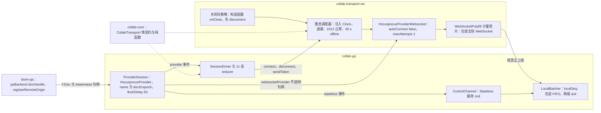

怎么读：左框是 `collab-transport-ws`，只管 socket 这一层；右框是 `collab-yjs`，只管文档这一层；两框之间只有服务注入传来的不透明句柄与事件，没有 import。垫片观测「帧真正写上 socket」这一刻，是在途 FIFO 与 provider 内部合并对齐的唯一依据（§5、§6）；重连只由自有调度器发起，provider 内置的退避重连被关掉（§4）。
依据：rulings §4.21 H:q-hp-provider；证据 d-25~d-28、CL-01、CL-02、SY-02；ADR-0039。

## 2. 连接建立

协同打开不走 Worker 分批解析（rulings §4.18 CO-12；渐进打开只用于本地字节，见 [04 §2](04-document-commands-and-undo.md)）：Unit 以 `source.kind:'state'` 打开，Y 状态由 HTTP 快照一次性 bootstrap，WS 只交换差量。§4.21 起 WS 这一段由 provider 执行（证据 TX-03、TX-06、d-27），步骤如下（路由相对 `apiBase=/api/v1`，见 [60/15 §3.7、§3.8](../60-backend/15-rest-api-catalog.md)）：

1. **HTTP 快照 bootstrap**：`GET /documents/:id/snapshots/latest`（`If-None-Match`，快照字节 + ETag + 响应头 `X-Cordex-Epoch`）→ 在 store-yjs 的空 Y.Doc 上应用，origin `system('load')`，不入撤销栈；记下纪元。返回 `server.snapshots.not_found`（404，文档尚无快照）或网络错误：不阻塞，以空 Y.Doc 继续，由服务端 step2 带回全量状态（体积更大但结果一致）；返回 403 或 `server.documents.not_found`：打开失败，交编辑器页错误态（[02 §6](02-app-shell-routing-and-session.md)）。
2. **装配 provider**（快照应用之后才装配，provider 拿到的就是已含快照的 Y.Doc，step1 只交换差量）：
   - `collab-transport-ws` 构造 `HocuspocusProviderWebsocket({ url: 'wss://<host>/collab/v1/rooms/:documentId', autoConnect: false, maxAttempts: 1, WebSocketPolyfill: 计量垫片, messageReconnectTimeout: 30000, onClose: 关闭码策略 })`，URL 只带 documentId，不带任何凭据；
   - `collab-yjs` 构造 `HocuspocusProvider({ websocketProvider, name: '{documentId}:{epoch}', document, awareness, token, flushDelay: 50, onStateless })`：`document` 与 `awareness` 是 store-yjs 已构造的同一对实例（经 `yjsBackend.docHandle()` 解包，awareness 不得设为 `null`，否则失去 15 s 续期带来的保活，§4）；文档名带纪元（ADR-0039：新纪元天然是新文档，旧纪元的服务端文档自然排空），`epoch` 取第 1 步的 `X-Cordex-Epoch`；随后 `yjsBackend.registerRemoteOrigin(provider)`；
   - 两个实例都在 SessionDriver 的 `ctx.effect` 里创建，Unit 关闭时依次 `destroy()`，清掉 provider 内部的 `connectionChecker` 等定时器（证据 CL-10）。
3. **连接**：reducer 发出 `connect` 效果，重连调度器调 `websocketProvider.connect()`（首连不等待）。WS 打开后 provider 调 `token` 函数取票并发 Auth 帧。`token` 是 async 函数，每次 WS 打开与每次 `sendToken()` 都现换一张新票（§8.3）：`POST /documents/:id/collab-ticket`（附 `X-Cordex-Request: 1`；sessionStorage 有 `cordex.share.{docId}` 时附 `X-Cordex-Share-Token`，票据因此带 `lnk` claim，[02 §11](02-app-shell-routing-and-session.md)），票据 60 s、单次有效、只在内存；函数返回 Auth 字段的 JSON 字符串 `{ticket, protocolVersion:1, clientId, capabilities, appVersion, epoch?, maxSchemaVersion, pluginSet?, traceparent?}`——`epoch` 为本地 Y 状态所属纪元（无本地状态时省略），`maxSchemaVersion` 为客户端支持的最高文档 `schemaVersion`，二者供服务端判定 4428 / 4426（[30/06 §6.3](../30-architecture/06-collaboration.md)、[60/16](../60-backend/16-ws-protocol-server-view.md) §2）；`pluginSet` 为本会话插件集指纹 `{ catalog, policy }`（2026-10-01，rulings §4.23；取自 `GET /users/me/plugins`，[03](03-preset-assembly-and-plugins.md) §5.1），供服务端按 [60/16](../60-backend/16-ws-protocol-server-view.md) §12 判定：`catalog` 不符 → 4426 `collab.plugins_outdated`，`policy` 不符 → 照常准入并下发 Stateless `plugins`（§9）。嵌入宿主未取插件集时省略该字段，服务端不做插件集判定。
4. **认证前的帧**：provider 发完 Auth 立即发 step1 与 awareness，取票期间的编辑也可能先于 Auth 上线（核实 vA-A1）。这些帧由服务端**排队、不应用**，认证通过后按序回放；原「首帧必须是 auth、认证前的同步帧即 4401」随 §4.21 删除（ADR-0039 部分取代 ADR-0023；用户可见行为不变）。客户端自 WS 打开起 5 s 内须收到 `Authenticated` 或认证失败，否则主动断开进入 `backoff`（服务端适配层同为 5 s，超时以 4408 关闭）。
5. **认证结果**：provider 的 `authenticated` 事件即进入 `syncing`；其 scope 为 `readonly` 时 PermissionGate 先按只读处理，等 `auth.ok` 给出确切角色。`auth.ok{sessionId, role, serverSeq, schemaVersion, limits{maxUpdateBytes, msgRateHz, msgBurst}, serverTime, reason?}` 由服务端以 Stateless 载荷下发，它与 step1 / step2 的先后**不保证**（实测 `auth.ok` 在前，证据 d-06）：收到时把 `role` 经 `applyRemoteDecisions` 生效，再以 `limits` 覆盖本地兜底值（§5）。`reason` 表示以只读加入的原因：`'capacity'` 为编辑者名额已满，`'over_ceiling'` 为文档元素数已超部署天花板（部署调低天花板后只读打开，[60/05](../60-backend/05-modules-collab-and-snapshots.md) §4.1、[60/16](../60-backend/16-ws-protocol-server-view.md) §3）；`over_ceiling` 时另带 `elementCount` 与 `maxElements`——文档的元素数与部署天花板，与服务端准入判定同口径、墓碑计入，横幅正文的两个数取自这里（2026-10-22，rulings §4.25 TB-146；字段登记在 [30/06](../30-architecture/06-collaboration.md) §6.3，客户端原样放进 `SessionStats.overCeiling`，§3.2）；文案按原因分流，见 §8.1。认证失败：服务端先发 `PermissionDenied`（reason 为 `{code}` JSON，provider 报 `authenticationFailed`），再以原始 `ws.close(映射码)` 关闭（§9）。
6. **双向差量**：本端 step1（本地状态向量）→ 服务端**先发自己的 step1、再回 step2**（核实 TX-07 更正了原来的先后）→ 本端应用服务端 step2，并由 provider 对服务端 step1 自动回 step2（覆盖全部 pending；垫片观测到它上线时记一个在途条目，§6）。服务端 step2 已应用且本端 step2 已获 db ack → `live`，emit `collab/synced`。只读会话（viewer，含名额降级）同样收到服务端 step1，provider 照样回 step2（本端无 pending，差量为空），这一帧不建在途条目；服务端 step2 应用后即进入 `readonly` 并 emit `collab/synced`；commenter 是可写会话，按前一句处理。此后的新编辑按常规在途处理，不阻止进入 `live`（这是对 30/06「pending 为 0」写法的精确化：连续键入不会让会话永远停在 `syncing`）。provider 的 `synced` 与 `unsyncedChanges` 只表示「服务端已应用到内存」，不用来判断已保存（§6）。
7. `syncing` 期间已可渲染、可编辑；本地编辑先进入 pending，按 §5 发送。

**加入 → 同步 → 编辑（客户端视角）**

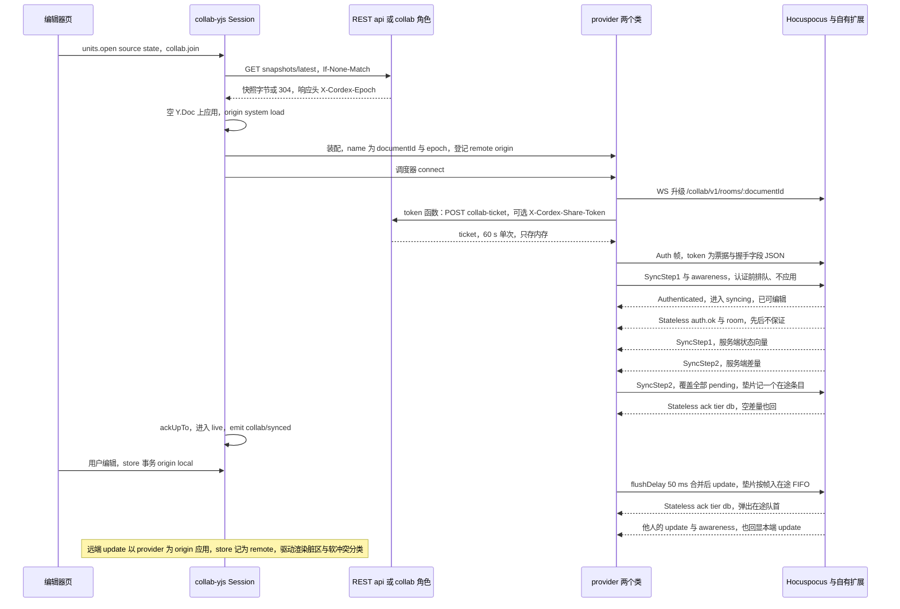

怎么读：快照先于 provider 装配，WS 打开后由 provider 调 token 函数现换票据，所以换票不再与快照并行；认证之前 provider 已发出的同步帧在服务端排队、不应用。之后先交换两次差量，本端 step2 获 db ack 才进入 `live`；末三行是稳态下一次本地编辑的往返与远端更新的到达。服务端会把 update 回显给发送者（证据 K18，接受），回显在本端幂等应用、不产生新变更，但发送者的下行字节随之翻倍（PRD 04 §1.6 注脚）。服务端对每帧的处理与 ack 发出规则见 [60/16](../60-backend/16-ws-protocol-server-view.md)。
依据：30/06 §5.3、§6.3、§9.1；rulings §4.18 CO-10、CO-12、BE-02；§4.21 H:q-hp-provider；证据 TX-03、TX-05~TX-07、d-04、d-06、d-14、d-27、d-29；决策 INC-03/04/05、INC-07、INC-25。

## 3. Session 状态三层对照

三层状态的关系：`collab-core/domain/fsm/session-fsm.ts` 的内部 11 态是**唯一可迁移的状态**（纯 reducer，零 IO，effects 由 SessionDriver 执行；§4.21 起 reducer 的输入改为 provider 事件与自有计时，见 §3.1 末表）；对外 `Session.state: SyncState` 六态是它的投影（`projectSyncState`）；UI 六态是 UI 层用 `SyncState + role + SessionStats` 再派生的展示态。三层都不允许外部 setter。

### 3.1 内部 11 态（本文为唯一源，迁自 30/06 §5.1）

**客户端 Session 内部状态机**

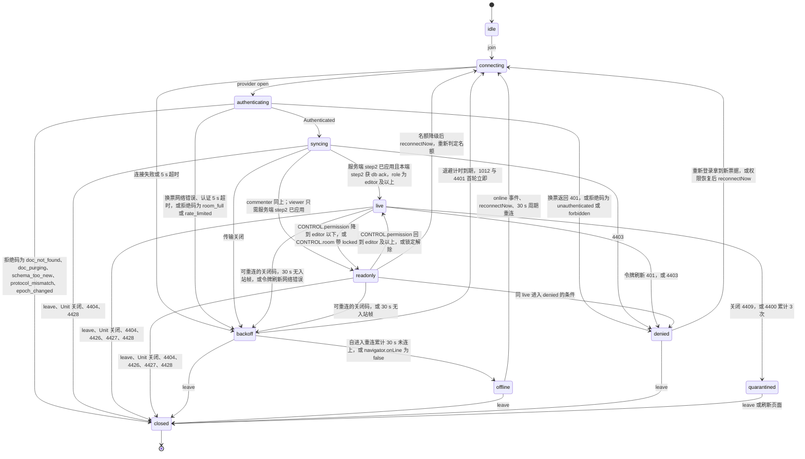

怎么读：箭头是状态转换，冒号后是触发条件；「可重连的关闭码」与 4404 / 4428 等的具体处理见 §9 表。`closed` 是终态：4404 由编辑器页提示并提供导出，4428 与被拒回滚（§8）由编辑器页关闭并重开 Unit，得到一个新的 Session。本地编辑在一切非 `closed` 态都允许，前提是权限快照含 `doc.write`；`readonly` / `denied` 下命令管线按 `permissions` 拒绝写命令（D12 客户端检查点），commenter 在 `readonly` 下仍可执行评论命令（`doc.comment`，§5）。换票（`POST collab-ticket`）由 provider 的 `token` 函数在 WS 打开之后执行（§2 第 3 步），所以换票 401 从 `authenticating` 进入 `denied`；「拒绝码」指 `PermissionDenied` 的 reason JSON 中的 `code`，随后服务端以对应关闭码关闭（§9）。
依据：30/06 §5.1 原图（本图取代）；rulings §4.18 UX-02、UX-03、CO-03；决策 INC-06、INC-27。

与原 30/06 §5.1 图相比的补全（均为既有裁决的落图，不是新语义）：`syncing → readonly`（以查看者、评论者或名额满身份加入）；`readonly → denied` 与 `readonly → backoff` 对称边；`syncing → denied`（4403）；`readonly → connecting`（名额降级的会话不会自动升回，用户「重试以编辑身份加入」时重连并重新判定名额，[60/05](../60-backend/05-modules-collab-and-snapshots.md) §4.2）；握手拒绝按码分流——`unauthenticated` / `forbidden` 进 `denied`，`room_full` 进 `backoff`，文档不存在、永久删除中、版本不兼容与换纪元进 `closed`；4404 / 4426 / 4427 / 4428 进入 `closed`（INC-06）。每次迁移 emit `collab/state-changed(unitId, prev, next)` 并计数 `cordex_collab_session_transitions_total{from,to}`（客户端遥测，[15](15-events-errors-and-telemetry.md)）。

**reducer 的输入：provider 事件与自有计时**（§4.21，证据 CL-03、CL-04、CL-05）。reducer 仍是纯函数、零 IO；下表把 provider 的事件翻译成 reducer 事件，翻译发生在 SessionDriver。provider 的事件先后依赖其内部实现（监听器注册顺序、`Authenticated` 先于 step2 等），由 V17 契约测试钉住，升级 provider 须重跑。

| 来源 | 事件 | reducer 事件 | SessionDriver 的附加动作 |
|---|---|---|---|
| `HocuspocusProviderWebsocket` | `open` | `transport-open` | 启动 5 s 认证计时（注入 Clock） |
| `HocuspocusProviderWebsocket` | 构造配置 `onClose{code, reason}` | `transport-closed{code}` | **先** `disconnect()`，再交关闭码策略（§4、§9）；事后注册的 `.on('close')` 拦不住内部重连（exp7） |
| `HocuspocusProvider` | `authenticated{scope}` | `authenticated` | 清认证计时；`scope` 只作 PermissionGate 初值 |
| `HocuspocusProvider` | `authenticationFailed{reason}` | `auth-failed{code}` | 立即 `disconnect()`：取票失败后 provider 仍会在无 Auth 的情况下发 step1 与 awareness（核实 CL-05），不断开会被服务端认证期限误判 |
| `HocuspocusProvider` | `stateless{payload}` | 经 ControlChannel 解析为 `auth.ok`、`room`、`permission`、`ack`、`error`、`repair`、`event` 之一 | zod 失败丢弃并计数；`ack` 交 LocalBatcher（§6） |
| `HocuspocusProvider` | `synced{state:true}` | `server-step2-applied` | 只表示首次握手完成，不代表持久化 |
| 计量垫片 | 帧真正写上 socket | 无（不驱动迁移） | 在途 FIFO 入队（§5、§6） |
| 自有调度器（注入 Clock） | 退避到期、30 s 累计、周期重连、`online` 事件 | `backoff-elapsed`、`offline-threshold`、`periodic-retry`、`online` | 调 `connect()`（§4） |
| provider 其余事件（`status`、`message`、`unsyncedChanges`） | — | 无 | 只进诊断面板（§14） |

### 3.2 三层对照单表

| 内部态 | 对外 `SyncState` | UI 六态 | 可编辑 | pending | 说明 |
|---|---|---|---|---|---|
| `idle` | `disconnected` | —（打开中画面） | — | — | 尚未 `join` |
| `connecting`、`authenticating` | `connecting` | `connecting`（`reconnectAttempt=0`）或 `reconnecting`（`>0`） | 是 | 保留 | 首连由打开中画面呈现——编辑器外壳照常、全部不可用，画布中央转圈「正在打开…」+「取消」，不画版式骨架（rulings §4.25 DS-99，[02](02-app-shell-routing-and-session.md) §6），不出横幅 |
| `syncing` | `syncing` | `syncing` | 是 | 保留 | 重连后的同步持续 ≥ 2 s 才出横幅 |
| `live` | `synced` | `synced` | 是 | 在途按常规 | 稳态 |
| `readonly` | `synced` + `role` 降级 | `readonly-degraded`（`readonlyReason` 非空）或 `synced`（角色本来就低于 editor） | 否（commenter 仍可评论） | 见 §8 | 查看者与评论者的正常会话显示为 `synced`，不是「降级」 |
| `backoff` | `connecting` | `reconnecting` | 是 | 保留 | 与离线共用 30 s 计时 |
| `offline` | `offline` | `offline` | 是 | 保留 | 仍按 30 s 周期重连 |
| `denied` | `error`（附 `code`） | 覆盖态「登录已过期」横幅，或访问被撤销后整个工作区换成阻断页（rulings §4.25 DS-50） | 否 | 保留（过期）或清空（撤销） | 见 §8 |
| `quarantined` | `error`（`collab.quarantined`） | 覆盖态「隔离」 | 否 | 保留 | 阻断横幅，刷新退出 |
| `closed` | `disconnected` | —（或「文档已被删除」「发现新版本」覆盖态，查看人数已满时为阻断页，§9） | — | 见 §9 | 终态 |

- `SessionStats` 的 UI 相关字段：`reconnectAttempt`、`pendingLocalUpdates`、`inFlight`、`spillOnlyInFlight`、`oldestInFlightMs`、`roomPersist`（`'ok' | 'degraded'`，来自 `CONTROL.room.persist`）、`readonlyReason`（`'downgraded' | 'capacity' | 'over_ceiling' | 'locked' | 'identity-changed' | null`）、`overCeiling?: { elementCount; maxElements }`（只在 `readonlyReason` 为 `over_ceiling` 时有值，原样取自 `auth.ok`，「文档已达元素上限」横幅与同步状态行说明的两个数读它，2026-10-22，rulings §4.25 TB-146、DS-128）、`rtt`、`lastSyncedAt`；其中 `inFlight`、`roomPersist`、`readonlyReason`、`overCeiling` 为新增字段，由 40/05 `domain/session.ts` 登记（§2.2）。
- UI 六态由纯函数 `deriveCollabUiState(state, role, stats)` 派生（文档类型盲，落 `ui-core` `domain/`，绑定在 `ui-react` 的同步状态行（`SyncStatus`）与横幅宿主（`Banner`）；文件登记见 [40/10](../40-modules/10-ui-shell-and-slide-ui.md)）。横幅通道的使用准则、文案与视觉以 [设计 03-12](../20-design/03-screens/12-offline-conflict-banner.md) 为准，本文只定出现条件；横幅、Toast、同步状态行的全局分层见 [10 §11](10-editor-shell-and-interaction.md)。

### 3.3 UI 六态与横幅出现条件

**UI 六态与横幅**

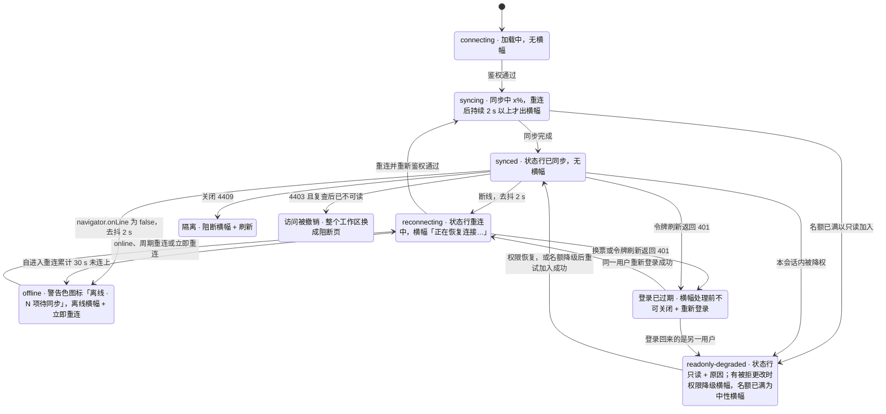

怎么读：前六个是 PRD CO-01 定义的 UI 六态，其后三个是 `SyncState = error` 的覆盖态（访问被撤销不出横幅，整个工作区换成阻断页，rulings §4.25 DS-50）；每个方框里写着该状态下唯一显示的横幅（「无横幅」即只有文件名旁的同步状态行）。所有翻转都经 2 s 去抖；「已恢复」横幅是中性底加成功色对勾（DS-41），在同步完成后 3 s 自动滑出，长时间离线后的那一条除外（§4）。同一时刻最多一条横幅，按「连接问题 > 权限 / 文档状态问题 > 服务器保存 > 其他」取最高者；两个例外：母版视图中上下文条（母版视图的模式横幅）常驻在上、不参与取舍（rulings §4.25 TB-14，[11](11-masters-layouts-and-themes.md) §4），版本预览中预览横幅同样常驻在上（DS-39，[08](08-comments-and-version-history.md) §9），这里取出的那一条在它下方另占一条，最多两条。**处理前不可关闭**的共六类（DS-58，由 03-12 原来的四类加上后两类）：权限降级（有被拒更改，导出前；登录账号已变更用同一条横幅，UX-02）、访问权限已变更（不再是横幅，整个工作区换成阻断页，DS-50）、隔离态、登录已过期、文档已被删除（导出前）、有更改过大无法同步（导出前）。导出后带导出入口的几条降级为可关闭的「已导出本地副本」（§8.2）。第 3 批另加两条处理前不可关闭的（2026-10-22，设计 03-12 §2.5）：发现新版本（始终不可关闭，只能刷新，rulings §4.25 DS-126）、换纪元时有未提交的更改（导出前，DS-127）。

- **文档状态横幅**（rulings §4.25 TB-66；第 2 批没画的三条 2026-10-22 随第 3 批横幅样张拍板，DS-126…DS-128，样张 `doc-banners`，画法与文案以设计 03-12 §2.4、§8.6 为准，横幅统一高 40，DS-75；高 40 指非触控形态，仅查看形态等触控形态里按钮照常 44 高、横幅随之撑高，rulings §4.25 TB-172，[10](10-editor-shell-and-interaction.md) §11）：「发现新版本」（§9 的 4426 / 4427 与 [02](02-app-shell-routing-and-session.md) §12 的惰性 chunk 漂移）为警告浅底加刷新图标、始终不可关闭、唯一按钮「刷新」；换纪元后的「文档已替换为导入的文件」/「文档已由管理员重建」（4428）没有未提交的更改时为中性底加信息图标、可关闭、不自动消失，有未提交的更改时同「有更改过大无法同步」——危险浅底、导出前不可关闭；「文档已达元素上限，只读打开」（§8.1）同「编辑者名额已满」——中性底加锁形、可关闭、没有按钮；「文档正忙」与合并后超上限的「文档已达元素上限」（有更改被拒，§8.2）就是降权那一条横幅、标题按原因换。它们都归设计 03-12 横幅通道的「权限 / 文档状态」档；「发现新版本」与「插件设置已更新」同时成立时按 PRD 07 G-87 合并为一条、以版本漂移为准（§9）；连接污染重建后的「部分更改未保存」走轻提示、不占横幅（§9 的 1012 行）。原「§8.1 超天花板一行的『可关闭』与 §9 4428 一行的『3 s 后自动消失』是暂行写法」结案：前者按 DS-128 定稿，后者按 DS-127 改为不自动消失（TB-80）。
- **同步状态行**（rulings §4.25 DS-61；各态逐条文案以 [10](10-editor-shell-and-interaction.md) §1.2 与设计 03-02 §3.1 为准）：第 2 批新增「未保存到服务器 N 项」（发起方，§6.1）、「服务器保存延迟」（其余协作者，悬停或聚焦看说明）、「登录已过期 · N 项待同步」、「协同已暂停 · N 项未同步」、「只读 · 名额已满」、「只读 · 登录账号已变更」、「文档已被删除」；第 3 批补「需要刷新 · N 项未同步」（发现新版本且会话已关闭；没有未同步项时只写「需要刷新」，DS-126）与「只读 · 文档已达元素上限」（可聚焦，悬停或聚焦看与横幅正文同一句的说明，DS-128）。还带着待同步计数的态（离线、未保存到服务器、登录已过期、协同已暂停、需要刷新）用警告色图标；转为只读（含文档已达元素上限）、文档已不存在、没有未同步项的「需要刷新」与「服务器保存延迟」用中性图标；文档锁定时的「文档正忙」用中性锁形图标（TB-66，§8.1）。

依据：PRD 03 §3 图 3-1；设计 05 §7、设计 03-12；rulings §4.18 UX-01、UX-02、UX-03、UX-04、§4.25 DS-39、DS-41、DS-50、DS-58、DS-61、TB-66、DS-75、DS-126…DS-128。

## 4. 重连与离线

重连与离线全部由自有调度器驱动（rulings §4.21 H:q-hp-provider；证据 CL-04、d-27）：provider 内置的 `@lifeomic/attempt` 退避（1 s 起、×2、封顶 30 s）不看关闭码、4401 / 4403 之后也会重连，且用全局计时器，无法满足 1012 立即、30 s 离线判据与 FixedClock 确定性，因此关掉。

| 规则 | 口径 | 落点 |
|---|---|---|
| provider 内置重连停用 | `HocuspocusProviderWebsocket` 以 `autoConnect:false`、`maxAttempts:1` 构造；关闭码策略写在**构造配置**的 `onClose` 里，先 `disconnect()`（它先于 provider 内部重连执行），再把关闭码交调度器；只有调度器调 `connect()`。依赖 provider 监听器注册顺序这一内部细节，版本精确钉 4.7.0，V17 覆盖 | `collab-transport-ws/infrastructure/close-policy.ts` |
| 退避 | `delay(n) = min(maxMs, baseMs × 2^n) × (1 ± jitter)`，默认 1 s → 2 s → 4 s … 上限 30 s、抖动 ±20%；`rand` 显式注入，测试用 FixedClock 与 SeededRandom | `collab-core/domain/backoff.ts` `nextDelay` |
| 1012 首轮立即 | 服务重启或实例驱逐（1012）后第一次重连不等待，之后按正常退避；客户端应在 ≤ 5 s 内连到其他实例（PRD SV-05）。同一办公出口的多人集体重连不会被 IP 限流卡成分钟级：WS 升级的按 IP 额度「先扣后退」，票据验签通过即退还，桶实际只约束未认证的升级（[60/16](../60-backend/16-ws-protocol-server-view.md) §1，rulings §4.20 BE-01+TX-03），同一出口数十人约分 3 波、≤ 5 s 重连完，更大的出口由部署调高 `limits.ws.connectPerIpPerMin`。升级被 429 拒绝时浏览器只看到 1006，按常规退避处理 | `collab-transport-ws/infrastructure/reconnect.ts`（重连调度器） |
| 进入 offline（时间判据） | 自进入重连起**累计** `offlineAfterMs`（30 s）仍未连上即 `offline`；`navigator.onLine=false` 立即 `offline`（UI 去抖 2 s）；令牌刷新的网络失败与重连共用同一计时，不另设计时器 | rulings §4.18 UX-03 |
| offline 不停止重试 | 每 `offlineRetryMs`（30 s，±20%）自动重连一次；`navigator.onLine=false` 期间暂停；`online` 事件或「立即重连」（`Session.reconnectNow()`）立即进入 `connecting`；服务端恢复后 offline 会话 ≤ 36 s 自动回连 | rulings §4.18 CO-03 |
| 判死（原应用层心跳，§4.21 删除） | 不再发 `CONTROL.ping` / `pong`（证据 d-07）。保活靠 awareness：y-protocols 每 15 s 续期本端状态，服务端回显，所以正常连接至少每 15 s 有入站帧；provider 的 `messageReconnectTimeout`（30 s）内无任何入站帧即断开——前两次超时只调 `close()`，第三次才合成 4408 `'forced'`，客户端先看到的是自身 `close()` 产生的码，一律按可重连处理（核实 TX-09）。awareness 不得设为 `null`，否则失去保活。RTT 诊断改用可选的 Stateless `ping`（§14） | `collab-transport-ws` 装配参数；provider 内部计时 |
| 断线时的本地动作 | 清空在途 FIFO（pending 保留，§6）；远端 presence 由 provider 在关闭时移除（在场停止，头像只剩自己）；停止 awareness 上报；provider 丢弃尚未发出的合并批次与内部 `messageQueue`（重建 WS 时清空），补齐只靠重连后的 step1 / step2；未完成的 `flush()` 继续等待 | `collab-yjs` SessionDriver |
| 重连不重做 bootstrap | Y.Doc 与两个 provider 实例保留，调度器调 `connect()`；每次 WS 打开由 `token` 函数换新票据，认证后直接 step1 / step2 交换差量（§6 step2 上限） | §2 第 3–6 步 |
| 离开与刷新保护（rulings §4.25 DS-59） | M4 前内存队列刷新即丢。应用内的离开与刷新（主菜单「返回首页」、隔离态「刷新」、插件设置「重新加载」、发现新版本「刷新」）先 `Session.flush()`（离开 5 s、刷新 10 s），仍有未同步项时弹应用内确认框：「离开将丢失 N 项未同步更改」/「刷新将丢失 N 项未同步更改」，第一句按原因换（离线、登录已过期、协同已暂停、服务器保存延迟；2026-10-22 补发现新版本「发现新版本，这些更改还没有提交到服务器。」——4426 / 4427 后会话已关闭、没法先同步，直接按未同步项判断，rulings §4.25 DS-126；逐句以设计 03-12 §9 为准），左下「导出为本地副本」，右侧安全项与危险色「仍要离开」/「仍要刷新」，初始焦点在安全项（离开为「留下」，刷新为「取消」）；关闭后焦点回到触发处（[04](04-document-commands-and-undo.md) §8.3、[02](02-app-shell-routing-and-session.md) §12）。账户菜单「退出登录」同一走向：先同步，仍有未同步项才弹「退出登录将丢失 N 项未同步更改」，导出后回到编辑器、不自动退出（TB-122，[02](02-app-shell-routing-and-session.md) §10.2）。浏览器刷新、关闭标签页只能触发 `beforeunload` 原生提示，文案不能定制。离线横幅维持第 1 批文案「更改已保存在本地，将在重新连接后同步」；写明「关闭或刷新会丢失」的文案在 M4 启用 `collab-offline-idb` 前再定 | 设计 05 §7、03-12；PRD CO-06 |
| 长离线提示（P1，rulings §4.25 DS-59） | 离线超过 24 h 的队列重连合并后，在「已恢复」横幅上追加「较长时间离线（超过 24 小时），合并后请检查」与可点的页码（取被合并的 pending 事务 `ChangeSet.touched` 所在页，点页码切到该页；超过 3 页时只列前 3 页，其后写「等 N 页」，N 为受影响页总数）；这一条不自动滑出、看完手动关闭，图标换成中性信息图标（要用户回头检查，不用成功色对勾；普通「已恢复」仍是成功色对勾）。代码落点（rulings §4.25 TB-85，已登记于 [40/10](../40-modules/10-ui-shell-and-slide-ui.md) §4.4、§5.4）：页码换算是 slide-ui `domain/affected-pages.ts` 的 `affectedPages()`（纯函数：实体 id → 所在页 → 页码，按当前页序去重升序，超过 3 页时给出前 3 页与总数），经垂直束桥接器交给外壳（与检查器面板标题同一个桥，[09](09-ui-system-and-theming.md) §7）；ui-react 的「已恢复」横幅只显示页码，点页码由垂直束桥接器执行 `slide.setCurrentSlide`（ui-react 文档类型盲，不直接调 slide 命令）；§8.2 导出对话框列表的「所在页」用同一函数 | PRD CO-06 |

每次重连都**先鉴权再同步**：`backoff / offline → connecting → authenticating → syncing → live`，不会从「重连中」直接跳回「已同步」。

**一次关闭到下一次连接：关闭码策略与自有调度器**

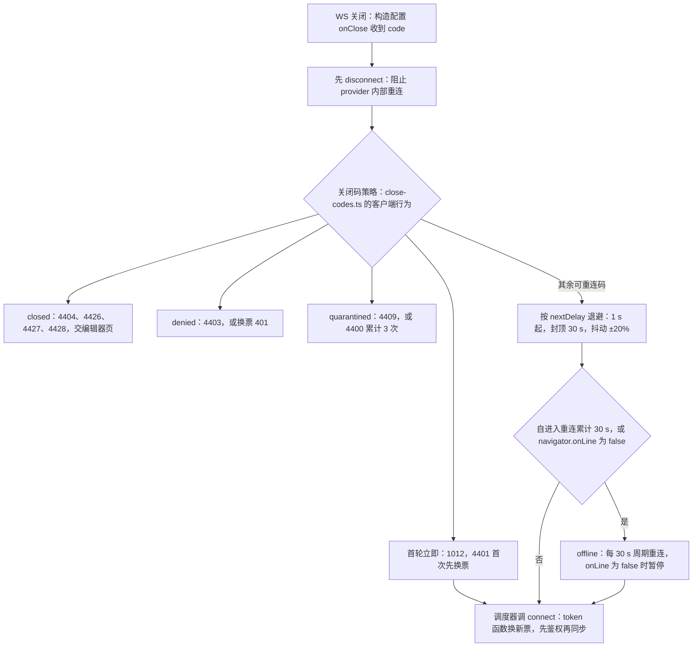

怎么读：自上而下是一次关闭的处理顺序；provider 不看关闭码，所以「是否重连、何时重连」全在菱形里由自有代码决定，计时都走注入的 Clock（TD-110 只约束这部分自有代码，provider 内部计时在测试中用 fake timers 驱动，§13）。各码的具体行为见 §9 表。
依据：rulings §4.18 UX-03、CO-03；§4.21 H:q-hp-provider；证据 CL-04、K5-A、K10-A。

## 5. 出站同步

§4.21 起合并与发送交给 provider，自有代码只负责把「哪些本地 update 进了哪一帧」对上号（证据 SY-02、AD-07、d-28）。

- **合并**：`HocuspocusProvider` 以 `flushDelay: 50`（`collab-yjs` 配置 `flushMs`）的固定窗口合并：窗口内的 update 用 `Y.mergeUpdates` 合成一帧，awareness 只保留每个客户端的最新状态；它是固定批次而不是会被持续键入推迟的去抖，附加时延上限 50 ms。键入 1 字合并后 p50 ≤ 200 B。
- **`localSeq` 与帧的对应**（LocalBatcher，只剩「计号 + 对应」两件事）：
  1. LocalBatcher 对 `yjsBackend.onUpdate` 的监听**先于** provider 注册，每个非 remote update 分配单调递增的 `localSeq` 并 `appendPending(update, localSeq)`；
  2. provider 每次发送前同步发出 `outgoingMessage` 事件，LocalBatcher 把此前尚未成帧的 `localSeq` 归到这一帧；
  3. 计量垫片（WebSocketPolyfill，包装全局 `WebSocket`）在该帧**真正写上 socket** 时按内容哈希取出这一帧的 `localSeq` 上界，入在途 FIFO（exp7 验证垫片能识别 update 与 step2 写帧）。
  断线期间 provider 会丢弃尚未发出的合并批次，重建 WS 时还会清空内部 `messageQueue`，这些内容靠重连后的 step2 补齐，所以 FIFO 只按「真正上线」的帧入队，从不按「交给 provider」入队。上述三步依赖 provider 的监听器顺序与事件时序，版本精确钉 4.7.0，V17 覆盖。
- **单帧上限（决策 INC-07）**：update 帧 payload ≤ `maxUpdateBytes`。收到 `auth.ok` 之前用 `Config.maxUpdateBytes`（默认 1 MiB）兜底，之后以 `auth.ok.limits.maxUpdateBytes` 为准。合并批次将要超限前，LocalBatcher 先调 `provider.flushPendingUpdates()` 把已攒的部分立即发出，使合并结果不越界（服务端 L1 超限以 4413 关闭）。重连 step2 另设 16 MiB 上限，见 §6。
- **编辑期大事务**：可能产生大 update 的命令（粘贴大量形状、插入大表格、批量插图）由命令层按实体分批为多个事务（`commands` 的 `chunked` 选项，落点 [40/02](../40-modules/02-kernel-protocol-and-document-core.md)），每批按 `maxUpdateBytes` 的一半估算；媒体字节从不进 CRDT，只存 `BlobRef`（上传见 [05](05-rendering-and-thumbnails.md) §8）。单个事务的 update 仍超限（无法再拆）时，按 `collab.payload_too_large` 走 §8 的「导出后重载」路径：后续 update 依赖它，跳过它会让服务端积压 `pendingStructs`，所以不能只丢这一帧。
- **速率（决策 INC-07，§4.21 改写）**：删除原客户端令牌桶。50 ms 固定窗口下出站约为 update 20 帧/s 加 awareness 20 帧/s，远低于 `auth.ok.limits` 的 `msgRateHz`（默认 200）与 `msgBurst`（默认 500）。万一运行期收到 4429，本会话把 provider 的 `flushDelay` 加倍后由调度器重连；握手期的 4429（每用户连接数超限）只退避、不改 `flushDelay`（§9）。
- **背压**：出站积压（provider 待发批次 + 垫片读到的 `WebSocket.bufferedAmount` 折算）实时写入客户端指标 `cordex_collab_outbound_queued`（gauge，[15 §7.2](15-events-errors-and-telemetry.md)）；超过 `outboundHighWater`（200 帧）时把 provider 的 `flushDelay` 临时放宽到 200 ms 直至回落。背压只是指标，供开发者面板与诊断包读取，不是 cordis 事件、不出用户提示（依据：30/10 §11.1「降为指标」）。
- **查看者不发 update**：provider 不拦截本地编辑（exp1：只读连接的本地修改照样进入本地 Y.Doc 并被发出，服务端丢弃，本地文档分叉），所以拦截点只能在 Y.Doc 之前——`role` 为 viewer（含名额降级）时命令管线按 `permissions` 拒绝全部写命令（D12 客户端检查点），不会产生非 remote update；只允许 awareness（§10）与 CONTROL。一旦在只读期间观察到非 remote update（缺陷或绕过命令管线），PermissionGate 把它按 §8.2 收拢为被拒更改，而不是等服务端丢弃。commenter 照常发送 update：评论就在文档状态里（[08 §3](08-comments-and-version-history.md)），命令管线只放行 `doc.comment` 类命令，服务端 L2 门槛为 commenter、越出 `comments` 命名空间的写入由 L4 软门禁还原（[60/16](../60-backend/16-ws-protocol-server-view.md) §4）。

**一次本地编辑从 Y.Doc 到在途 FIFO**

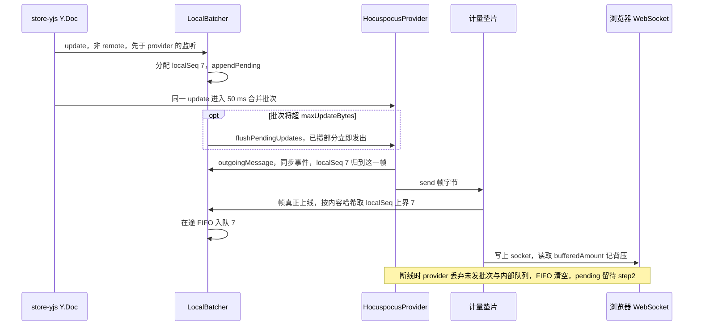

怎么读：左起两条泳道是自有代码的「计号」，中间是 provider 的「合并与发送」，右侧垫片把两者在「真正上线」这一刻对齐；FIFO 条目的出队只由 §6 的 db ack 决定。
依据：rulings §4.21 H:q-hp-provider；证据 SY-02、AD-07、d-28、K10-A；决策 INC-07。

## 6. 两级 ack 与在途 FIFO

两级 ack 语义不变（rulings §4.21 H:q-hp-persist-ack，用户选推荐项「逐帧落库 + 两级 ack」）：服务端在 `beforeSync` 钩子里先落库取 `seq`、再放行应用与广播，在 `afterHandleMessage` 里经 Stateless 下发 ack（ADR-0039）。ack 帧形状以 [30/06 §6.3](../30-architecture/06-collaboration.md) 为准：`{type:'ack', tier:'spill'} | {type:'ack', tier:'db', seq}`（判别键统一为 `type`，决策 INC-03/04/05），作为 Stateless 载荷到达，客户端入口是 provider 的 `stateless` 事件 → ControlChannel zod 解析 → LocalBatcher。服务端对每个通过门禁的写入帧（update 与重连 step2）按到达顺序恰好回一帧 db 应答（rulings §4.18 CO-09、CO-10）。provider 原生的 `SyncStatus` 与 `unsyncedChanges` 只表示「已应用到服务端内存」、没有 `seq`、缺依赖被挂起的更新也回「成功」，**不参与**本节任何判断（核实 SyncStatus 语义）。

| 事件 | 客户端动作 |
|---|---|
| 垫片观测到 update 帧上线 | 在途 FIFO 入队该帧的 `localSeq` 上界（§5） |
| 垫片观测到 step2 上线 | 以上线时 pending 的最大 `localSeq` 作为**一个** FIFO 条目；被 step2 覆盖的 pending 不再逐帧重发（避免重复落库）。step2 由 provider 在收到服务端 step1 时自动生成，无法事先切块（核实 SY-05） |
| 收到 `ack{tier:'db', seq}` | 弹出 FIFO 队首 → `ackUpTo(该 localSeq)`（清 OfflineQueue 与 OfflineStore 中 ≤ 该值的 pending）；`seq` 只写入 `meta.lastAckSeq`，从不与 `localSeq` 比较；FIFO 为空时到达的 db ack 忽略并计数（如 viewer 空差量 step2 的应答） |
| 收到 `ack{tier:'spill'}` | 不弹出、不 `ackUpTo`；按到达顺序给 FIFO 中第一个未标记条目打 spill 标记，只用于计数 `spillOnlyInFlight` |
| 收到写入帧的 `error{collab.forbidden}` 或 `error{document.quota_exceeded}` | 被拒帧不回 ack（[60/16](../60-backend/16-ws-protocol-server-view.md) §5 第 7 条），`error` 与 db ack 的先后不保证，FIFO 从此无法可靠对应。因此**冻结 FIFO**：此后到达的 db ack 不再弹出、不再 `ackUpTo`；此刻仍未 `ackUpTo` 的全部 pending 进入 §8.2 被拒集合。服务端同时对这条连接执行**连接污染规则**（证据 d-09）：丢过写入帧的连接，之后的写入帧一律不落库、不回 ack，直到重连——因为被拒帧之后同一客户端的更新会因因果依赖挂在服务端 `pendingStructs` 里，若照常 ack 就成了「已 ack 但不可见」（核实 vB）。客户端冻结 FIFO 与之天然一致：宁多勿少，多算的更新在导出时与服务端状态幂等合并，少算则会丢失用户的工作 |
| 传输关闭 | 清空 FIFO；pending 全部保留，重连时由 provider 并入 step2（provider 自身的发送队列在重建 WS 时被清空，不依赖它补发） |
| 重连 step2 超限（§4.21 改写） | step2 单设上限 **16 MiB**（等于服务端 ws `maxPayload`，rulings §4.21 H:q-hp-step2-cap；update 帧仍 ≤ 1 MiB）。不超过 16 MiB：照常一帧送达、恰回一帧 db ack，离线累计 5 MiB 的场景无 4413（ADR-0023 验收保留）。超过 16 MiB（极少见，M2–M3 离线只在内存）：服务端以 4413 关闭，客户端上报遥测，按 §8.2 `payload-too-large` 走「导出后重载」，不重试（重试生成的 step2 同样超限）。原「先按 `localSeq` 用 `mergeUpdates` 切块、逐块发 update，再发剩余 step2」随 §4.21 取消：它要改写 provider 内部消息处理，升级易碎（证据 q-hp-step2-cap） |

- `Session.flush(opts?)`：等待 pending 全部获 db ack（spill 不算），默认无超时。
- `leave()`：顺序固定为 `provider.flushPendingUpdates()` → 等 db ack，上限 `leaveFlushTimeoutMs`（5 s）→ `destroy()` 两个 provider 实例；超时后照常离开（M4 前为内存队列，随之丢弃，离开前已由 `beforeunload` 提示）。不能先 `destroy()`：它会先 detach 并发 CLOSE，之后到达的 ack 在 provider 内被丢弃（核实 SY-07）。调用方：Unit 关闭、导出「等待同步」（[04 §8](04-document-commands-and-undo.md)）、版本恢复前（[08 §10](08-comments-and-version-history.md)）、「发现新版本」刷新前（[02 §12](02-app-shell-routing-and-session.md)）。
- **不以 provider 状态判断已保存**：`provider.synced` 只表示首次握手完成，`hasUnsyncedChanges` / `unsyncedChanges` 只计「已应用到服务端内存」（收到 `SyncStatus(0)` 也不减），二者都不代表持久化（证据 d-27、CL-07）；`flush`、`leave`、`beforeunload` 与 §6.1 只看 db ack FIFO 与 `room.persist`。
- **离线期不可 flush**：`offline` / `reconnecting` 时 `flush()` 保持等待，调用方据 `SyncState` 禁用「等待同步」一类按钮并提示「恢复连接后才能同步」（rulings §4.18 UX-05）。

### 6.1 「未保存到服务器」派生规则

依据：rulings §4.19 INC-09（服务端显式信号 + 分级受众，用户裁决）。服务端 PG 写失败的降级期照常广播（rulings §4.18 CO-08），会话仍为 `synced`，但发起方的 pending 要到 db ack 才清。客户端判据：

`unsaved = room.persist === 'degraded' ∨ spillOnlyInFlight > 0 ∨ oldestInFlightMs ≥ unsavedWarnAfterMs`

- `room.persist` 来自 `CONTROL.room` 的可选字段 `persist:'ok'|'degraded'`（服务端 PG 写失败 ≤ 1 s 内推 degraded，回放完成且无溢写后推 ok；不新增帧类型）；字段缺席视为 `'ok'`。
- `unsavedWarnAfterMs` 为 `collab-yjs` 新配置键，默认 15000，不借用 `heartbeatMs`（覆盖服务端 none 档退避重试、尚未回任何 ack 的情形）。
- 受众：有本地未获 db ack 项的**发起方**显示警告横幅「未保存到服务器 N 项」（N = `pendingLocalUpdates`；说明「服务器存储暂时不可用，更改已暂存，恢复后自动保存」，`role=status`，可关闭），同步状态行同时显示警告色图标的「未保存到服务器 N 项」，横幅关闭后状态行保留，直到全部获 db 确认；其余协作者（`room.persist === 'degraded'` 但本端无 pending）不出横幅，只在文件名旁的同步状态行显示中性图标的「服务器保存延迟」，悬停或聚焦看说明「服务器存储暂时不可用，你看到的他人修改可能尚未保存」（他们看到的他人修改在此期间可能丢失；状态行文案与着色见 rulings §4.25 DS-61）。
- 消失条件：在途全部获 db ack 且 `room.persist` 回到 `'ok'`。
- 呈现通道已由裁决定下：发起方用**横幅**，其余协作者用文件名旁同步状态行的弱提示（取代原状态胶囊，rulings §4.25 DS-6）；这覆盖 [设计 03-12](../20-design/03-screens/12-offline-conflict-banner.md)「使用准则」中「只用状态栏 warning 色点、不出横幅」的写法（已作废，设计稿回写见 [10 §12.3](10-editor-shell-and-interaction.md)）。M2 起即生效（单人编辑同样经此链路持久化，rulings §4.19 D-M2-CONTENT）。指标 `cordex_collab_broadcast_before_persist_total` 属服务端，不变。

**两级 ack 与在途 FIFO（客户端侧）**

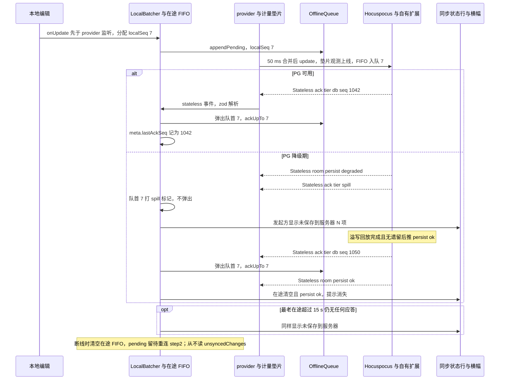

怎么读：只有 `tier db` 让 FIFO 弹出队首并清 pending；`tier spill` 只打计数标记。所有 ack 与 `room` 信号都是 Stateless 载荷，经 provider 的 `stateless` 事件进入。降级期的广播照常进行，别人仍能实时看到这次编辑，但发起方在收到 db 应答前一直保留它。`opt` 段对应服务端还在内存退避重试、尚未回任何 ack 的情形。
依据：30/06 §6.4；rulings §4.15 S-3a、§4.18 CO-08、CO-09、§4.19 INC-09、§4.21 H:q-hp-persist-ack；证据 SY-03、SY-04、CL-07、K9-A。

**写入帧被拒之后：冻结 FIFO 与连接污染**

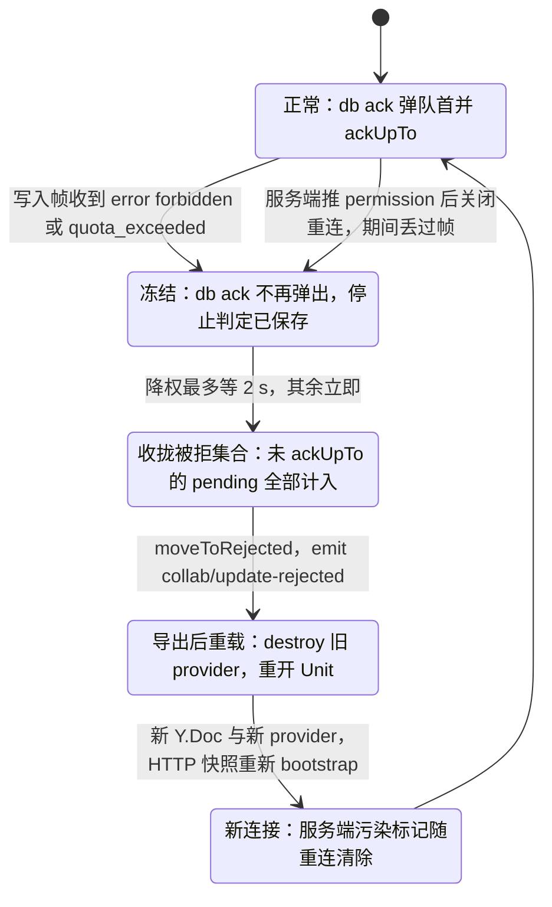

怎么读：服务端一旦丢弃过某条连接的写入帧，就不再为这条连接落库或回 ack（连接污染），客户端这一侧对应的就是冻结 FIFO；被拒内容已经进了本地 Y.Doc，不能继续用同一个 provider（exp1 分叉），所以一律以「新 Y.Doc + 新 provider」收尾。
依据：证据 d-09、K4、K14、CL-06；§8.2。

## 7. 离线队列

| 项 | M2–M3（默认） | M4 P2（可选 `collab-offline-idb`） |
|---|---|---|
| 实现 | `collab-yjs` 内置同接口内存实现，按 `{userId}/{documentId}` 挂在根作用域（页面生命周期），因此 Unit 重开（§8.2、4428）后仍能 `listRejected()` | IndexedDB Provider：自写 idb 8 适配（ISC；update 追加日志 + 压实），不采用 y-indexeddb（ADR-0033 修订 2026-09-26）；库名 `cordex-collab`，按 `{userId}/{documentId}` 分对象仓：`updates`、`state`、`rejected`、`meta{epoch, schemaVersion, lastAckSeq, savedAt}` |
| 刷新后 | 全部丢失（`beforeunload` 提示） | 保留：打开时先 `loadState`（origin `system('load')`）→ HTTP 快照 bootstrap（CRDT 幂等合并）→ `loadPending` 按 `localSeq` 升序重放（重放不入撤销栈，且在「最后写入 origin」表中不计为他人后写，40/05 用例 `::offline-replay-not-other-writer`）→ WS 同步 → db ack 清理 → `live` 后 `compact` |
| 上限 | 内存（受 NF-01 堆预算） | 单文档 50 MiB；`appendPending` 返回 `err(collab.offline_quota_exceeded)` 时停止持久化、会话继续编辑，提示「本地离线存储已满」；`estimate()` 余量不足时提前提示 |
| epoch / schema 不一致 | —（内存随 Unit 生灭） | 本地 `meta.epoch` 或 `schemaVersion` 与 `auth.ok` 不一致 → 本地数据整体 `moveToRejected`，提示导出 |
| 登出 / 切换账号 | 随页面释放 | `OfflineStore.clearAll({userId})`，清理矩阵见 [02 §10](02-app-shell-routing-and-session.md) |
| 加密 | 不加密（30/06 §15 P4、ADR-0033） | 同左 |

**OfflineStore 与 provider 内部队列无关**（ADR-0033 修订 2026-09-26，证据 CL-08）：provider 断线期间把待发帧放进自身的 `messageQueue`，但重建 WS 时整个队列被清空，补齐靠重连后的 step1 / step2；它也没有本地持久化。所以离线期间「哪些更改还没被服务端确认」只由 OfflineQueue / OfflineStore 的 pending 回答，provider 的队列既不读取也不依赖。

**多标签页互斥**（决策 OFFLINE-TABS，依据：ADR-0033 + 规格空白，M4 P2 启用前定稿）：同一用户在多个标签页编辑同一文档时，用 `navigator.locks.request('cordex-offline:{userId}:{documentId}', {mode:'exclusive'})` 争用离线库；持锁标签页使用 `OfflineStore`，其余标签页用内存队列并在同步状态行提示「另一个标签页正在保存离线更改」；持锁标签页关闭后锁转给下一个等待者，后者把当前内存 pending 一次写入离线库再切换。浏览器不支持 Web Locks 时经 `BroadcastChannel('cordex-offline')` 协商，只让首个宣告的标签页持库。每个标签页仍是独立的 Session 与 awareness 客户端（§10）。

**离线编辑与重连 step2（单设 16 MiB）**

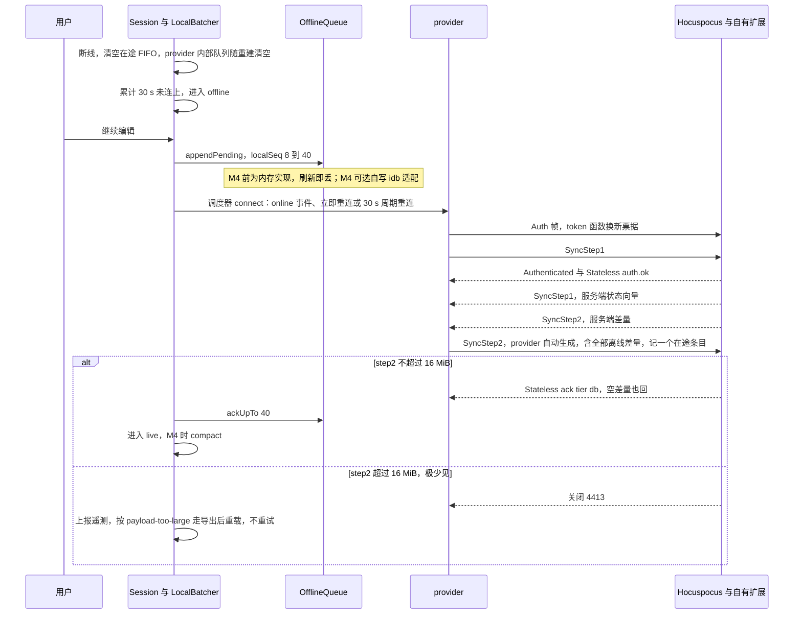

怎么读：离线期间的编辑只追加到 OfflineQueue；重连后靠 step1 / step2 的双向差量合并。step2 由 provider 在收到服务端 step1 时自动生成、无法事先切块，因此单独设 16 MiB 上限（update 帧仍 ≤ 1 MiB）：离线累计 5 MiB 的验收场景一帧送达、无 4413；超过 16 MiB 属极少见的长时间大批量离线编辑，走导出后重载。M4 IndexedDB 上线后按实测再评估这一上限。
依据：30/06 §6.4、§12、§18.6；rulings §4.18 UX-03、CO-03；§4.21 H:q-hp-step2-cap（改写 §4.18 CO-10 的「先切块」）；证据 SY-05、CL-08；ADR-0033。

## 8. 权限与令牌

### 8.1 权限变更

`CONTROL.permission{role, reason:'granted'|'revoked'|'changed', permVersion}`（§4.21 起作为 Stateless 载荷，经 provider 的 `stateless` 事件与 ControlChannel 到达；服务端由 PermissionSync 扩展重算后推送，ADR-0039）由 PermissionGate 接收，唯一动作是调用 `permissions.applyRemoteDecisions(unitId, decisions)`；`permission/changed` 由 `permissions` 服务发出，上下文键 `isReadOnly`、命令管线、同步状态行都只订阅它。服务端的重算链路（`perm:doc` 广播、`max(直接授权, 有效链接角色)`、链接到期主动降权）见 [60/02](../60-backend/02-auth-chain.md)；客户端对「凭链接加入」与「直接授权」不做区分。

| 变更 | 客户端动作 | UI |
|---|---|---|
| 提升（`granted`，回到 editor 及以上） | PermissionGate 放开出站 update；`readonly → live`；`readonlyReason` 置空。若这条连接此前丢过写入帧（连接污染，§6），服务端发完 `permission` 随即关闭让客户端重连，客户端按 §8.2 以新 provider 重建后再进入 `live`（证据 d-09） | 轻提示「你现在可以编辑此文档」（rulings §4.25 DS-58）；工具条、检查器与画布立即解锁，无需刷新；已进入「未同步更改」的内容不自动重放 |
| 降权（`changed`，editor 以下） | 立即停止发送降权前产生的 update（降为 viewer 时 awareness 转为只报 view）；`live → readonly`，`readonlyReason='downgraded'`；若有未获 db ack 的 pending，进入 §8.2 被拒回滚；降为 commenter 时，此后新产生的评论更新照常发送（§5） | 当前手势自然结束后画布转只读，同步状态行「只读 · 权限已变更」（锁形、中性）；本端没有未同步更改时不出横幅，只给一条轻提示「你的权限已变更为「〈角色〉」」写明新角色（rulings §4.25 DS-58，与被提权对称）；有被拒更改时出 §8.2 的权限降级横幅 |
| 撤销（`revoked`，role `none`，随后关闭 4403） | 进入 `denied`；Unit 关闭并清空内存中的文档与 pending，**不提供本地副本导出**：撤销后不再向该用户下发或留存文档内容，与 UX-02「换人只读」同一原则（用户偏好「安全宁可提前」）；仍保有读权限的降权（上一行）按 PRD CO-05 可导出 | 整个工作区换成阻断页，与「打开失败 · 没有访问权限」同一布局（[02](02-app-shell-routing-and-session.md) §6）：锁形图标 · 文档名 ·「访问权限已变更」·「你已无法查看或编辑此文档，未同步的更改已随之丢弃」+「申请访问」（主操作，打开留言弹层，发送后按钮留在原位不可用并写「已发送申请，等待文档所有者批准」；M3 起可用，M2 留在原位、不可用、写「后续版本提供」，说明句不变，rulings §4.25 TB-156，[02](02-app-shell-routing-and-session.md) §6）·「返回文档列表」；画布与缩略图上不再留文档内容（rulings §4.25 DS-50；原「阻断横幅留在编辑器上」作废） |
| 名额已满（`auth.ok{role:'viewer', reason:'capacity'}`） | 以 `viewer` 只读加入（30/06 §14、[60/05](../60-backend/05-modules-collab-and-snapshots.md) §4.2），不可评论，`readonlyReason='capacity'`；本次连接内服务端不会自动升回（60/05、60/16 §8），不自动提升，用户点「重试以编辑身份加入」时 `reconnectNow` 重新判定名额 | 可关闭的中性信息横幅（锁形图标、不用危险色：没有丢失任何东西，rulings §4.25 DS-58）「编辑者名额已满（上限 {N} 人）」+ 说明「你已以只读身份加入；有名额空出后，可以重试以编辑身份加入」+［重试以编辑身份加入］；关闭后同步状态行保留「只读 · 名额已满」（中性图标，与查看者的「仅查看」分开称呼，UX-19） |
| 超天花板只读打开（`auth.ok{reason:'over_ceiling'}`） | 以只读加入，`readonlyReason='over_ceiling'`；不提供「重试以编辑身份加入」（文档元素数降到部署天花板以下之前结果不变） | 横幅「文档已达元素上限，只读打开」（「权限 / 文档状态」档，rulings §4.25 TB-66；2026-10-22 定稿，DS-128）：同「编辑者名额已满」——中性底加锁形、×「关闭提示」、没有按钮、`role="status"`；正文写两个数与出路「元素数量超过本部署的上限（实际 / 上限）；如需编辑，请联系管理员」，两个数与服务端判定同口径（墓碑计入），由服务端随 `over_ceiling` 给出（`auth.ok` 的 `elementCount`、`maxElements`，[30/06](../30-architecture/06-collaboration.md) §6.3，rulings §4.25 TB-146，§2 第 5 步），横幅经 `SessionStats.overCeiling` 读取（§3.2，[40/05](../40-modules/05-collaboration-client.md) §2.2）、界面不写死；编辑器只读展示，检查器顶部「只读 · 文档已达元素上限」，创建工具、评论与改文档的命令留在原位不可用、原因「文档已达元素上限」；关掉后由同步状态行「只读 · 文档已达元素上限」（中性锁形、可聚焦看说明）与检查器顶部继续说明，本会话不再出现 |
| 文档锁定（`CONTROL.room{locked:{reason, until}}`，`reason ∈ 'import' \| 'migration'`：覆盖导入与迁移窗口；版本恢复不加锁，rulings §4.19 N1） | 停止发送 update，`live → readonly`，`readonlyReason='locked'`；锁定前已发出的帧若收到 `error{collab.forbidden}`，按 §8.2 以 `reason:'locked'` 收拢被拒集合；收到不带 `locked` 的 `CONTROL.room` 即解锁，回到 `live`。`reason='import'` 的锁定通常不以解锁收尾：导入提交后服务端以 4428 关闭会话，按 §9 重新 bootstrap 到新纪元；导入失败或取消才收到解锁 | 同步状态行「文档正忙」+ 中性锁形图标（`reason='import'` 时 tooltip「正在导入新文件，完成后将自动载入」，rulings §4.25 TB-66）；有被拒更改时按 §8.2 出横幅（文案「文档正忙」，「权限 / 文档状态」档） |

- **暂时不能编辑**（登录已过期、协同已暂停，§3.2「可编辑：否」，rulings §4.25 DS-58；2026-10-22 起另有「发现新版本」且会话已关闭（4426 / 4427），DS-126）：命令管线拒绝写命令；创建工具、新建与检查器字段留在原位、`aria-disabled`，工具提示写原因（「重新登录后可编辑」「协同已暂停，刷新后可编辑」「刷新后可编辑」），检查器标题上方一行说明（「暂不可编辑 · 重新登录后恢复」「暂不可编辑 · 协同已暂停，刷新后恢复」「暂不可编辑 · 发现新版本，刷新后恢复」，图标同横幅）；连接已断开，头像组只剩自己；这是暂时状态，不按只读展示（[10](10-editor-shell-and-interaction.md) §5，设计 03-12 §8.5）。惰性 chunk 漂移的「发现新版本」会话还在、照常编辑，不进这一形态（[02](02-app-shell-routing-and-session.md) §12）。

### 8.2 被拒回滚与导出本地副本（迁自 30/06 §18.4）

被拒只发生在降权、锁定、身份变更、单帧超限（含重连 step2 超过 16 MiB）、合并后超元素天花板（L3）与换纪元这几种窗口：服务端未应用、他人未见，但本地 Y.Doc 已含这些事务。§4.21 起触发源是 Stateless 的 `error`、`permission`、`room` 与关闭码；provider 不拦截本地编辑，被拒内容已进本地 Y.Doc，同一 provider 不能继续使用（exp1 分叉，证据 CL-06）。策略是**导出后重载**，`history` 不参与回退：

1. **收拢被拒集合**：
   - 降权：停止发送后等待在途帧的 db ack，最长 2 s（`rejectSettleMs`）；期间一旦收到写入帧的 `error` 即按 §6 冻结 FIFO；届时仍未 `ackUpTo` 的 pending 与从未发出的 pending 全部视为被拒；
   - 锁定（ADR-0029 决策 5 的锁定窗口，只有覆盖导入与迁移）：服务端推 `CONTROL.room{locked}`（[60/16](../60-backend/16-ws-protocol-server-view.md) §8，不借 `permission{reason:'changed'}`），客户端据此判定「文档正忙」并停止发送；锁定前已发出的帧可能收到 `error{collab.forbidden}`，处理同降权；
   - 合并后超元素天花板（L3 `error{document.quota_exceeded}`）：按 §6 冻结 FIFO，未 `ackUpTo` 的 pending 全部视为被拒；
   - 身份变更、换纪元（4428，运维换纪元或覆盖导入提交）、单帧超限：全部 pending（超限更新之后的更新都依赖它）。覆盖导入的完整顺序是「`room{locked:{reason:'import'}}` → 只读 → 4428 → 重新 bootstrap」：锁定期间不再产生新的 pending，锁定前被 L2 拒绝的帧已按上一条以 `locked` 收拢，4428 到达时剩余的未获 db 确认项（含只获 `tier:'spill'` 的项）以 `epoch-changed` 移入 rejected（rulings §4.19 N1，服务端编排见 [60/06 §6.5](../60-backend/06-modules-jobs-import-export-thumbnails.md)）。

   被拒集合 = 这些 pending update 的 `mergeUpdates`，覆盖全部未被服务端确认接受的本地更改（可能多含已落库的部分，导出时幂等合并）。
2. `moveToRejected([{ update, records: TransactionRecordSummary[], reason, at }])`，`reason ∈ 'permission' | 'locked' | 'identity-changed' | 'payload-too-large' | 'quota-exceeded' | 'epoch-changed'`；emit `collab/update-rejected{code, count}`。
3. 编辑器页关闭并重开 Unit（先 `destroy()` 旧的两个 provider 实例，再以新 Y.Doc 与新 provider 走 §2：HTTP 快照 + step1 / step2 重新 bootstrap，origin `system('load')`）：撤销栈与 UndoSkip 记录清空（[04 §6](04-document-commands-and-undo.md)）。
4. 横幅（危险浅底、锁形，导出前不可关闭，rulings §4.25 DS-58）：标题按原因——权限降级「你的权限已变更为「〈角色〉」」、锁定「文档正忙」、超天花板「文档已达元素上限」、身份变更「登录账号已变更」、单帧或 step2 超限「有更改过大无法同步」（换纪元见 §9）；正文「N 项更改未被保存；文档已重新载入服务端版本，撤销历史已清空」（身份变更为「N 项更改来自原账号〈X〉，不会以你的身份提交；文档已重新载入服务端版本，撤销历史已清空」）+「导出为本地副本」。生成副本期间按钮转圈「正在导出…」、不可用（浅底上的文字用次级文字色，DS-41）；导出后横幅降级为可关闭的中性提示「已导出本地副本」，正文按原因写（2026-10-22，rulings §4.25 DS-129，设计 03-12 §7.2 表）：降权与登录账号已变更「可另行申请编辑权限后重新应用；系统不会把副本自动合并回文档」，换纪元、更改过大、锁定与合并后超上限的被拒「系统不会把副本自动合并回文档，可以对照重做」，文档已被删除「系统不会把副本自动合并回文档，可以另存为新文档」。原降权横幅正文后半句「导出后可另行申请编辑权限再重新应用」移到导出对话框与这条提示里，第 1 批 3 个降权画面随之改。
5. **导出为本地副本**：横幅的「导出为本地副本」打开对话框「导出本地副本」（md 480，DS-58）——说明「下面 N 项更改没有保存到文档。」+ 按打开它的原因换的第二句（2026-10-22，rulings §4.25 DS-129；只有失去编辑权限的原因才提权限）：降权与登录账号已变更「导出的副本不会自动合并回文档，获得编辑权限后可以对照重做。」，文档已被删除「…可以另存为新文档。」，离线时的离开确认与退出登录确认「…恢复连接后可以对照重做。」，其余（换纪元、更改过大、锁定与超上限的被拒、发现新版本，以及登录已过期、协同已暂停、未保存到服务器时的离开或刷新确认等没有点名的原因）一律用中性句「…可以对照重做。」（rulings §4.25 TB-139），逐句以设计 03-12 §7.2 表为准，`reason` 的取值登记在 [09](09-ui-system-and-theming.md) §6.1 · 未保存的更改（被拒事务的摘要 `TransactionRecordSummary`：命令名 + 所在页，只读列表，点某一项切到该页对照）· 格式单选：演示文稿副本 .pptx（缺省，含这些更改的完整文档）或更改摘要 .json（逐项列出更改，供人工比对），两行在单选圈与名称之间各有一枚 20px 文件类型图标——.pptx 一行与导出对话框的格式行同一套（Tabler `file-type-ppt` 原件，ui-react `infrastructure/file-type-icons.tsx`，[09](09-ui-system-and-theming.md) §5a.1），.json 一行用 lucide `FileBraces`（描边 1.5；Tabler 没有 json 的文件类型图标）；中性色、只作装饰（`aria-hidden`），读屏名不变（2026-10-23，rulings §4.25 DS-143、TB-182，设计 03-12 §7.2）·「取消 / 导出」。导出即下载：pptx 在隔离的临时 Unit（`store-yjs`、不连协同、`historyLimit 0`）上先应用当前服务端状态、再应用被拒集合，得到回滚前的文档后调用 `core.export`；JSON 为事务摘要。降权后用户即使没有 `doc.export` 也可导出这份副本（PRD CO-05 明示）。系统不承诺把导出内容自动合并回文档。离开、刷新确认框左下的「导出为本地副本」打开同一个对话框（§4）。
6. **代码落点**（归属按 rulings §4.25 TB-85 放在 SDK：对话框是 ui-react 的 `ui.dialog` 模板、合并字节在 collab-yjs、受影响页码在 slide-ui，嵌入形态因此同样有这条兜底（PRD CO-05）；下列名称已登记于 [40/05](../40-modules/05-collaboration-client.md) §2.5、§4.2、§5 与 [40/10](../40-modules/10-ui-shell-and-slide-ui.md) §3、§4.3、§4.4、§5，2026-10-15 核对）：
   - **被拒集合的读出与合并**：`collab-yjs` `infrastructure/offline/rejected-export.ts`——读 `listRejected()`（§7）取各条 `TransactionRecordSummary`，生成对话框列表行与 .json 的内容；把服务端当前状态与被拒集合合并为一份更新字节（只用 yjs 的静态编码函数，不导出 `Y.*` 类型，守 40/05 §4.2 的依赖约束）。经 `CollabService.rejectedChanges(unitId): Promise<RejectedChanges | null>` 只读暴露（没有被拒更改时为 `null`）：`RejectedChanges{ count, reason, rows, mergedUpdate(), summaryJson() }`——`count` 是被拒事务数（横幅与对话框说明里的 N），`rows` 为 `RejectedChangeRow{ label, touched, at }`（命令名、涉及的实体、发生时刻），`mergedUpdate()` 给合并字节，`summaryJson()` 给 .json 的内容（40/05 §2.5）。
   - **对话框与生成文件**：ui-react `ui/shell/ExportLocalCopyDialog.tsx`，以 `ui.dialog` 模板 `export-local-copy` 贡献（[09](09-ui-system-and-theming.md) §6.1；ui-react 的 `ui.dialog` 模板由 3 个变为 4 个，TB-85）；ui-react 可选注入 `collab`，列表与 .json 取自 `collab.rejectedChanges(unitId)`（单人模式没有被拒集合，不注入也无影响）。横幅（`Banner.tsx`）与 apps/web 的离开 / 刷新确认框都执行 `ui.openDialog('export-local-copy')` 打开同一个；2026-10-22 起模板带参数 `reason`（DS-129）：缺省取 `collab.rejectedChanges(unitId).reason`（第 2 步的六值），4404 的横幅、离开 / 刷新确认框与退出登录确认按自己的原因另传（4404 传 `'document-deleted'`，离开 / 刷新确认按原因传 `'offline'`、`'auth-expired'`、`'quarantined'`、`'server-unsaved'`、`'version-drift'`，退出登录确认传 `'sign-out'`），取值集合与对应的第二句登记在 [09](09-ui-system-and-theming.md) §6.1（2026-10-22，TB-139）。「导出」时经 host 打开隔离的临时 Unit（`source.kind:'state'`、`store-yjs`、不连协同、`historyLimit 0`，与版本预览 Unit 同一打开方式，[08](08-comments-and-version-history.md) §9），载入 `mergedUpdate()` 的字节后执行 `core.export`，下载后关闭临时 Unit；.json 直接下载 `summaryJson()`。放在 SDK 里，嵌入形态同样有这条兜底（PRD CO-05）。
   - **「所在页」与页码**：列表行的「所在页」由 slide-ui `domain/affected-pages.ts` 的 `affectedPages()` 按 `touched` 换算，与 §4「长离线提示」的页码是同一个函数，经垂直束桥接器交给外壳；ui-react 的对话框与横幅只显示页码，点某一项或某个页码时由桥接器执行 `slide.setCurrentSlide`（ui-react 文档类型盲，不直接调 slide 命令）。

**权限降级、被拒回滚与导出本地副本**

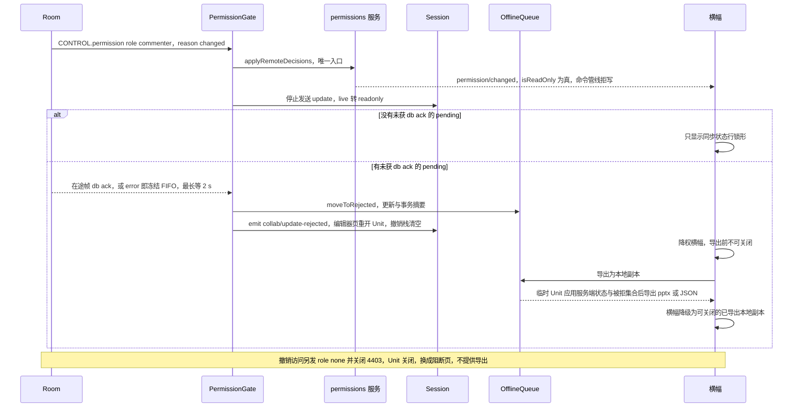

怎么读：权限只经 `applyRemoteDecisions` 一个入口进入客户端；降权本身不断连，只有存在被拒更改时才走「导出后重载」；撤销访问是更严重的另一条路径。
依据：30/06 §10、§18.3、§18.4；60/16 §5、§8；PRD CO-05、CO-12；设计 05 §8；rulings §4.18 BE-02。

### 8.3 票据、会话与重新登录

- **票据与 `token` 函数**（决策 INC-27；[60/02](../60-backend/02-auth-chain.md) §9.5、[60/16](../60-backend/16-ws-protocol-server-view.md) §3；§4.21 证据 TX-03、d-27）：票据 60 s、单次有效，只存内存。provider 的 `token` 配置为 async 函数，在每次 WS 打开与每次 `sendToken()` 时被调用，每次都经 `POST /documents/:id/collab-ticket` 现换一张新票，返回 Auth 字段的 JSON（§2 第 3 步）；票据只出现在 Auth 帧里，不进 URL、请求头或 `Sec-WebSocket-Protocol`（服务端适配层限 Auth 帧 ≤ 8 KiB）。
- **重新绑定**：M1–M3 的 WS 会话寿命由票据 `sid` 指向的登录会话承担，重新绑定**只重新绑定、不延长**。浏览器会话每次被动续期成功之后（[02 §4.2](02-app-shell-routing-and-session.md)，不依赖会话到期时刻、不定时），SessionDriver 调 `provider.sendToken()`：`token` 函数换一张新票，provider 在已认证的连接上再发一个 Auth 帧，服务端经 `onTokenSync` 钩子验签、`jti` 单次、`sub` / `doc` / `sid` 与当前会话一致后重算角色与链接；服务端适配层在转发这个 Auth 帧后暂停后续帧、等钩子完成再放行，保证重算前后的帧按新旧角色正确处理（证据 d-05）。成功不回应答帧、不断连；失败由服务端对原始 WS 以 4401 关闭。它取代原 `CONTROL.auth.refresh{ticket}` 专用帧（ADR-0039 部分取代 ADR-0023）。M4 集成方 JWT 复用同一路径，届时 `token` 函数在令牌到期前 60 s 取新令牌，才以新 JWT 的 `exp` 延长。
- **失败分流**（rulings §4.18 UX-02）：`token` 函数取票遇网络错误 → 抛出可重连错误 → `backoff`（与重连共用 30 s 离线计时）；遇 401（`server.auth.expired` / `collab.unauthenticated`）→ 抛出 `collab.unauthenticated`，provider 报 `authenticationFailed`，SessionDriver **立即 `disconnect()`**（否则 provider 会在没有 Auth 的情况下照样发 step1 与 awareness，核实 CL-05）→ 直接 `denied`，UI 为「登录已过期」横幅（不经「重连中 → 离线」）；遇 403 → 按 §9 的 4403 处理。
- **服务端吊销会话**：登出、停用或擦除用户后，服务端经每 5 s 的批量会话复核以 4401 关闭（[60/02](../60-backend/02-auth-chain.md) §9.5）；客户端下一次取票得 401 → `denied`。

**token 函数与 401 分流**

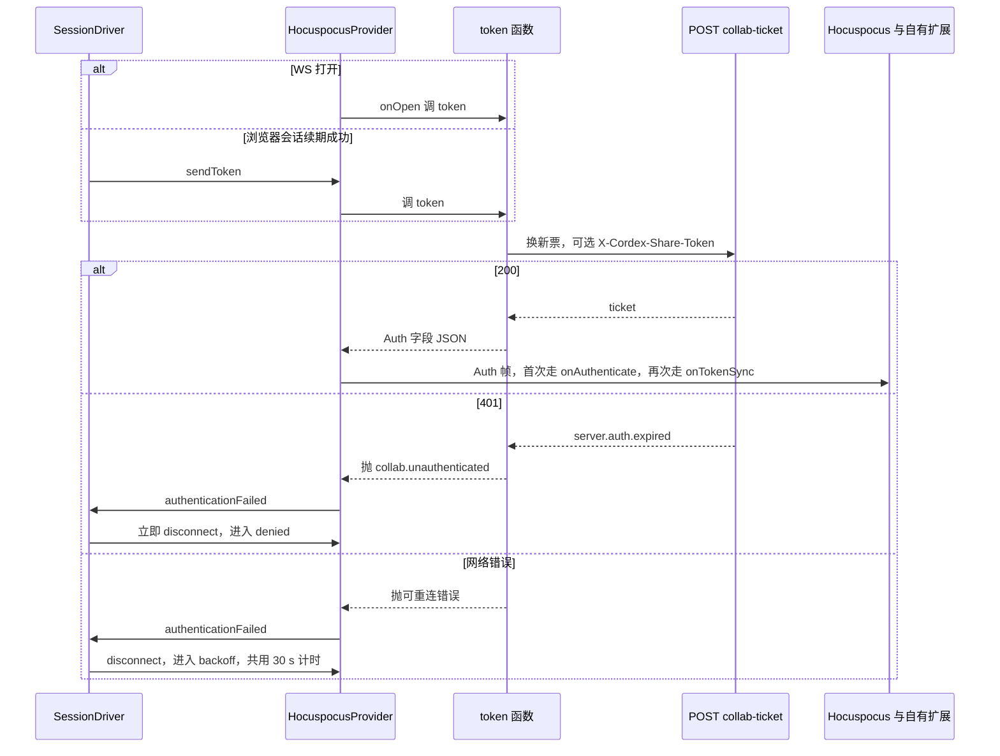

怎么读：两个入口（WS 打开、会话续期）都走同一个 `token` 函数；401 与网络错误都表现为 provider 的 `authenticationFailed`，由 SessionDriver 按错误类别分流，并且一律立即断开，不让 provider 带着未认证状态继续发同步帧。
依据：rulings §4.18 UX-02；证据 TX-03、TX-10、CL-05、d-05、d-27；决策 INC-27。
- **重新登录**：横幅「重新登录」在弹窗或新标签完成 OIDC（[02 §5](02-app-shell-routing-and-session.md)），原页不跳转、pending 保留；`BroadcastChannel('cordex-auth')` 通知或原页重获焦点探测 `GET /auth/me`：
  - 同一用户 → 换新票据，`denied → connecting`，经 step2 提交 pending，「重连中 → 同步中 → 已恢复」；
  - 另一用户 → 不重放 pending，按 §8.2 以 `reason:'identity-changed'` 移入 rejected 并提供导出（横幅「登录账号已变更」）；新会话在横幅处理前保持只读（`readonlyReason='identity-changed'`，同步状态行「只读 · 登录账号已变更」、中性图标，rulings §4.25 DS-61），防止以他人身份提交更改。
- **分享链接会话**：票据是否带 `lnk` 只取决于请求头 `X-Cordex-Share-Token`（令牌来自 sessionStorage，[02 §11](02-app-shell-routing-and-session.md)）；链接收紧、撤销或到期后的降权由服务端 ≤ 1 s 内经 `CONTROL.permission` 下发，客户端按 §8.1 处理。

## 9. 关闭码 → 客户端行为与 UI

关闭码定义以 [30/06 §6.5](../30-architecture/06-collaboration.md) 补全版为唯一源（决策 INC-06：补 1011、4427，`collab.doc_purging → 4404`，epoch 变更新增 4428、不复用 4426；§4.21 新增 4205、4408 扩为超时通用码），代码落点 `protocol/collab/close-codes.ts`。§4.21 起一个 WS 只承载一个文档，服务端的业务关闭一律对原始 WS 调 `ws.close(码)`，客户端在 `HocuspocusProviderWebsocket` 构造配置的 `onClose` 里拿到原码（ADR-0039；exp1、exp7 验证）；provider 自身不看关闭码，是否重连全由 `close-policy.ts` 按下表决定（§4 图）。下表只写客户端行为；握手阶段的拒绝先收到 `PermissionDenied`（reason 为 `{code}` JSON，provider 报 `authenticationFailed`）再关闭。

| 码 | 含义 | 内部迁移 | 客户端行为 | UI |
|---|---|---|---|---|
| 1000 | 正常关闭（本端 `leave` 或服务端正常关闭整条 WS） | → `closed` | 无 | 无 |
| 1000（文档级 CLOSE，socket 仍开着） | 服务端钩子异常只关了文档连接（不应出现：服务端钩子一律自包异常并以 1011 关闭整条 WS，证据 d-19） | → `backoff` | 视同 1011：主动 `disconnect()` 后退避重连并上报；不能停在原地——provider 此后不会重新认证，后续编辑会进入服务端认证前队列，最终整条 socket 被 4205 关闭（核实 vG） | 同 1006 |
| 1001 / 1006 | 对端离开 / 网络中断 | → `backoff` | 按退避重连 | 去抖 2 s 后「重连中」 |
| 1011 | 服务端内部错误 | → `backoff` | 退避重连，`errors.report(transport.closed_by_server{1011})` | 同上 |
| 1012 | 服务重启 / 实例驱逐；reason 为 `contaminated` 时是连接污染规则（本连接此前丢过写入帧，权限升级或解锁后服务端发 permission 再关闭，H-d-09，§4.21） | → `backoff` | 首轮立即重连，之后正常退避；`contaminated` 且本地有被拒项时，按 [30/06 §18.4](../30-architecture/06-collaboration.md) 重建本地状态（被拒事务回滚、移入 rejected 供导出）后再重连 | 通常 ≤ 5 s 恢复，不出横幅；`contaminated` 有被拒项时出轻提示「部分更改未保存」，不占横幅（rulings §4.25 TB-66） |
| 4400 | 坏帧 | → `backoff`，累计 3 次 → `quarantined` | 上报缺陷（附最近帧摘要，不含内容）后重连 | 3 次后阻断横幅 |
| 4401 | 未认证 / 票据过期 / 会话被吊销 | → `backoff`（首轮立即换票） | 换票成功即重连；换票 401 → `denied`；连续 3 次 4401 → `denied` | 仅进入 `denied` 时出「登录已过期」横幅（[02](02-app-shell-routing-and-session.md) §5）；同步状态行「登录已过期 · N 项待同步」（警告色图标，rulings §4.25 DS-61） |
| 4403 | 无权限 | → `denied` | 先 `GET /documents/:id` 复查角色：仍可读 → 以新票据重连（按降权处理）；不可读 → 按撤销访问处理：关闭 Unit、清空内存文档与 pending | 不可读时整个工作区换成「访问权限已变更」阻断页（§8.1，rulings §4.25 DS-50） |
| 4404 | 文档不存在、已删除或永久删除中（`collab.doc_purging`） | → `closed` | 停止重连；pending 移入 rejected 并允许导出本地副本（PRD CO-06）；编辑器只读展示，「分享」不可用 | 危险浅底横幅「文档已被删除」+「N 项更改没有同步，可以导出为本地副本」+「导出为本地副本」「返回文档列表」，导出前不可关闭（关掉只会剩下一个不能保存的编辑器），导出后降级为「已导出本地副本」（rulings §4.25 DS-58、DS-62）；同步状态行「文档已被删除」（中性图标，DS-61） |
| 4205 | 认证前排队超限（主触发：服务端适配层对认证前入站帧的严格计数超过 `limits.ws.preAuthMaxFrames` / `preAuthMaxBytes`，默认 16 帧 / 64 KiB，60-backend/16 §13；Hocuspocus 内部认证前队列或待认证文档数超限只作兜底；§4.21 新增） | → `backoff` | 退避重连；连续出现视为客户端缺陷上报（通常是认证迟迟未完成时仍在大量编辑） | 同 1006 |
| 4408 | 超时（§4.21 扩为通用码）：5 s 认证期限、服务端 45 s 无入站帧、provider 第三次无入站超时合成的 4408 `'forced'` | → `backoff` | 退避重连 | 同 1006 |
| 4409 | 被隔离（10 分钟内 ≥ 5 次修复） | → `quarantined` | 停止重连；pending 保留在内存供导出；写命令被拒（§8.1「暂时不能编辑」） | 阻断横幅（危险浅底、`role=alert`、始终不可关闭）「你的会话已被暂停协同」+「请刷新页面重新加入；如持续出现请联系管理员」+「刷新」——有未同步项时「刷新」先弹刷新确认（§4）；同步状态行「协同已暂停 · N 项未同步」（警告色图标，rulings §4.25 DS-61） |
| 4413 | 帧过大：update 帧超 `maxUpdateBytes`，或重连 step2 超 16 MiB | → `backoff`（step2 超限时不再发起重连，由编辑器页按 §8.2 重开 Unit） | update 帧：视为客户端缺陷或限额不一致，重连后以新 `limits` 发送，同一 `localSeq` 再次触发 → §8.2 `payload-too-large`；step2：不重试（重新生成的 step2 同样超限），直接 §8.2 `payload-too-large` | update 帧第二次起、step2 第一次即「有更改过大无法同步」+「导出为本地副本」，导出前不可关闭（rulings §4.25 DS-58）；文档已重新载入服务端版本，可以继续编辑 |
| 4426 | schema 过新，客户端需升级（`collab.schema_too_new`）；或内容级插件集已随重新部署变化（`collab.plugins_outdated`，2026-10-01，§4.23） | → `closed` | 不重连；有 pending 先提供导出（M4 前刷新即丢）；两种 reason 行为相同 | 「发现新版本」横幅 + 刷新（[02 §12](02-app-shell-routing-and-session.md)），归「权限 / 文档状态」档；与「插件设置已更新」同时成立时按 PRD 07 G-87 合并为这一条（rulings §4.25 TB-66）。2026-10-22 定稿（DS-126）：「发现新版本，刷新后继续」，警告浅底加刷新图标、始终不可关闭、唯一按钮「刷新」；会话已关闭，编辑器转为暂时不能编辑（§8.1），同步状态行「需要刷新 · N 项未同步」；点「刷新」时会话已关闭、没法先同步，有未同步项就弹刷新确认（第一句「发现新版本，这些更改还没有提交到服务器。」，左下「导出为本地副本」，§4），没有就直接刷新 |
| 4427 | 协议版本不兼容（`collab.protocol_mismatch`） | → `closed` | 同 4426 | 同 4426 |
| 4428 | 文档换纪元（`collab.epoch_changed`：运维换纪元，或覆盖既有文档的导入提交，rulings §4.19 N1） | → `closed` | 丢弃本地 Y 状态；pending 按 §8.2 `epoch-changed` 移入 rejected；编辑器页重开 Unit 重新 bootstrap；UndoSkip 记录与撤销栈清空；评论文本范围锚点重算（[08 §6](08-comments-and-version-history.md)） | 本会话此前收到过 `room.locked.reason='import'`：「文档已替换为导入的文件」；否则「文档已由管理员重建」（两者都归「权限 / 文档状态」档，rulings §4.25 TB-66）。正文「文档已重新载入，撤销历史已清空」，主菜单「编辑 › 撤销 / 重做」留在原位不可用「没有可撤销的操作」；没有未提交的更改时中性底加信息图标、×「关闭提示」、不自动消失（原暂行的「3 s 后自动消失」作废）；有未提交的更改时正文追加「；N 项更改未提交」+「导出为本地副本」，危险浅底加圆圈感叹号、导出前不可关闭，导出后降级为「已导出本地副本」（正文按原因，§8.2 第 4 步）（2026-10-22，rulings §4.25 DS-127、DS-129；TB-80 结案） |
| 4429 | 速率限制：运行期出站超速，或握手期同一用户在本实例上的连接数超过 `limits.ws.maxConnectionsPerUser`（默认 32，先收到 `PermissionDenied{collab.rate_limited}`，rulings §4.20 BE-01+TX-03） | → `backoff` | 退避重连；运行期超速时本会话 provider 的 `flushDelay` 加倍（§5），握手期超限只退避、不改 `flushDelay` | 同 1006 |
| 4503 | 房间不可用 / 满 / draining | → `backoff` | 退避重连；若握手时收到 `PermissionDenied{collab.room_full}`（查看者名额也满）则后台继续按退避重试，进入后直接显示编辑器 | 查看者名额也满时显示阻断页「文档当前查看人数已达上限」+「有名额空出时会自动打开，保持此页即可」+「返回文档列表」（rulings §4.25 DS-60，[02](02-app-shell-routing-and-session.md) §6），其余同 1006 |

- 「可重连的关闭码」（§3.1 图中的说法）= 1001、1006、1011、1012、4205、4400（未满 3 次）、4401（换票未遇 401 时）、4408、4413（update 帧首次）、4429、4503，另加文档级 CLOSE。
- 30 s 无入站帧由 provider 本地断开（§4），按可重连处理。
- 握手期拒绝码 → 关闭码（`PermissionDenied` 的 reason JSON 中的 `code`，原 `auth.denied.code`）：`collab.unauthenticated → 4401`、`collab.forbidden → 4403`、`collab.doc_not_found / collab.doc_purging → 4404`、`collab.schema_too_new / collab.plugins_outdated → 4426`、`collab.protocol_mismatch → 4427`、`collab.epoch_changed → 4428`、`collab.rate_limited → 4429`、`collab.room_full → 4503`；文案取 i18n `errors.<code>.{title, action}`（[15 §4](15-events-errors-and-telemetry.md)）。

**插件设置已更新（Stateless `plugins`，2026-10-01，rulings §4.23 O-1；PRD PM-08）**：服务端在两种情况下向本连接发 `{type:'plugins', reason:'policy_changed', policy}`——握手时本会话 `pluginSet.policy` 与部署当前值不符（`connected` 后立即发）；在线期间管理员保存了插件策略（api 经 Valkey 频道 `plugins:ctl` 通知各 collab 实例，另有每 `plugins.policyPollSeconds`（默认 60）一次的轮询兜底，≤ 60 s 送达，[60/16](../60-backend/16-ws-protocol-server-view.md) §3、§12）。客户端处理：

- 不改内部状态、不断连、不改 `SyncState`，编辑照常；`onStateless` 把消息交给 `pages/editor` 的横幅控制器。
- 横幅「管理员更新了插件设置，重新加载后生效」[重新加载]，可关闭；同一 `policy` 值每会话只出现一次，收到不同的新值时再出现。优先级低于连接、权限与文档状态横幅（§3.3 的「其他」档）。
- 点「重新加载」：`Session.flush()`（最长 10 s）→ 有未同步项按 [02 §12](02-app-shell-routing-and-session.md) 提示导出 → `location.reload()`，新会话按新策略装配。
- 本端 `catalog` 已过期时服务端直接以 4426 关闭，不会先发 `plugins`；两者同时出现时只按 4426 处理，横幅合并为「发现新版本」一条（PRD 07 G-87，rulings §4.25 TB-66）。
- 未知 `reason` 的 `plugins` 消息丢弃并计数（与未知 `type` 同一口径）。

**图 9a 管理员保存后在线会话的提示**

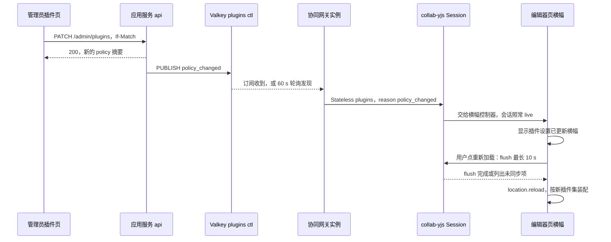

怎么读：纵线是参与方，自上而下是时间。管理员保存只改服务端策略；协同网关把变化转成一条控制消息，客户端只显示横幅，连接与编辑都不受影响；是否重新加载由用户决定，重新加载前先 flush。
依据：本节；[60/16](../60-backend/16-ws-protocol-server-view.md) §3、§12；PRD PM-08；rulings §4.23 O-1。

## 10. Awareness

状态 schema 以 [30/06 §7.1](../30-architecture/06-collaboration.md) 与 `protocol/collab/awareness.ts` 为准：`{v, user, client, view?, selection?: SerializedSelection, caret?, editing?, idle?, ts}`，单状态 ≤ 2 KiB；`selection` 即 `Selection<A>.serialize()`（ADR-0024 v0.2），`caret` 与 `selection.range` 为 RelativePosition base64。

**§4.21 起的分工**（证据 AW-02、d-17）：`provider.awareness` 就是 y-protocols 的 `Awareness`（与 store-yjs 构造的是同一实例，§2），收发、编码、15 s 续期、30 s 超时、`pagehide` 与 `destroy` 时移除本端、断线时清远端，全部由 provider 原生完成；provider 的 `flushDelay` 50 ms 同样合并 awareness（每个客户端只留最新状态），awareness 因此最多多等 50 ms。自有代码只剩下表的字段集合、频率上限与两侧 zod 清洗（`collab-yjs` AwarenessAdapter）。服务端在 `beforeHandleAwareness` 里就地校验、对 `clientID` 与 `user.id` 盖章、剥离只读会话的字段，从不因 awareness 断开连接；≥ 20 人房间的 100 ms 合并下发改为服务端包装出站发送、只合并 awareness 帧，不拖慢文档更新（rulings §4.21 H:q-hp-awareness-tick），客户端不感知。本端 awareness 不得设为 `null`：它的 15 s 续期是连接保活的来源（§4）。

| 字段 | 本地来源 | 上报频率上限 | 谁上报 |
|---|---|---|---|
| `view{slideId, zoom}` | engine-render Viewport 的 `view/page-changed`、`view/zoom-changed`（决策 VIEW-EVENTS） | 2 Hz（`awareness.stateHz`） | 全部角色 |
| `selection` | `selection/changed`（`broadcast:true` 的 Operation） | 20 Hz（`awareness.cursorHz`） | editor、owner、commenter |
| `caret`、`editing` | 文本编辑态（[06 §6](06-text-editing-and-ime.md)）；`editing` 的形状为 `{ shapeId }`（P2，COL-03 / PRD CO-10，M3；2026-09-26 整合登记）：远端 `remote-presence` 覆盖层在该文本框上沿外侧显示提示签「● 〈姓名〉也在编辑此文本框」（§11），只作软提示、不加锁 | 20 Hz | editor、owner |
| `idle` | 60 s 无输入置位，任一输入清除 | 变化时 | 全部角色 |

- **查看者只上报 `view`**（rulings §4.15 Q5、ADR-0024 修订）：`role=viewer` 或以 `capacity` 只读加入时不上报 selection / caret / editing。
- **本地清洗**：上报前做 zod 校验；序列化超过 2 KiB 时去掉 `selection`、只留 `view` 并计数。
- **远端清洗**：每个远端状态 `safeParse`，非法即丢弃并计数；RelativePosition 解析失败只隐藏该光标。
- **超时与离开**：远端 30 s 无更新移除（y-protocols 默认，`awareness.timeoutMs`）；服务端在会话断开时主动广播移除（Hocuspocus 原生），客户端立即移除头像与光标；本端断线时 provider 清空全部远端状态（§4）。
- **多窗口（标签页或设备）**：每个会话是独立的 awareness 客户端（独立 `clientId`），画布上各自显示光标，名签写「〈姓名〉（你 · 窗口 2）」（2026-10-22，rulings §4.25 TB-124：同一账号的多个会话统一称「窗口」，与在线列表的「（你）」一致；原「（我 · 标签 2）」作废）；头像簇与名额按 `userId` 合并（§11）。
- 远端光标与选区由 `render-dom` 的 `remote-presence` 覆盖层绘制（`pointer-events: none`，放映模式不显示），不经 React，见 [05 §5](05-rendering-and-thumbnails.md)。

## 11. 在场 UI

视觉与文案以 [设计 05 §1–§4、§9](../20-design/05-collaboration-ux.md) 为准；本节定数据来源与规则。

- **头像簇**（检查器协作行，网格视图在右上胶囊；`ui-react` `PresenceStack`；原应用栏位置随 rulings §4.25 DS-1 作废）：组里含**自己的头像**——它是编辑器的账户入口，点开 `UserMenu`、不进入跟随（rulings §4.25 DS-18，[10](10-editor-shell-and-interaction.md) §1.2、§1.3），数据取会话用户（`Session.principal`），没有 `presence` 服务时（M2）也渲染；他人头像的数据 = `presence.remotes` 按 `user.id` 合并（同一账号多会话一个头像；会话数不上头像，写在在线列表那一行「N 个窗口」、读屏名同写，rulings §4.25 DS-132、TB-124，原「角标显示会话数」作废；本人其他窗口的会话并入自己的头像）。他人的头像是按钮「跟随 〈姓名〉」（`aria-pressed`）：点按进入跟随、再点停止，点另一位即改为跟随他（DS-106）。连同自己最多 5 个，其余折叠为可交互的「+N」，点开在线列表（贴头像组左缘向下，最窄 256、按内容加宽，DS-132）：标题「N 人在线」，自己在最上、不可点，其余按最近编辑活动排序（取远端 `selection` / `caret` 最近变化时间），每行头像 + 姓名 + 角色 + 所在页（设计 05 §1a），点他人即进入跟随。组的读屏名「正在协作的人：N 人」中的 N 为在线总数，含自己与折叠进「+N」的人（[10](10-editor-shell-and-interaction.md) §11）；在线人数的权威值取 `CONTROL.room.clients`，不取本地 awareness 数。
- **颜色**：集成方提供 `user.color` 时直接用；否则 `index = hash(userId) mod 12` 取 `--presence-1…12`，若与同屏相邻协作者撞色则顺延到下一个未占用索引；一次会话内对同一用户稳定，刷新后可重算；第 13 位起复用并在头像挂序号角标（2026-10-22 定稿，rulings §4.25 DS-132、TB-124：写这个人在同色里的序号，同色第一位不画；头像组里挂在头像下沿中线、在线列表里在右下，24px 头像配 14、20px 配 12；角标 `aria-hidden`，序号写进读屏名「〈姓名〉，同色第 N 位」；画布上的远端光标与名签不加序号，画法见设计 04 §2.4）。presence 色不得用于任何语义状态。
- **画布密度**：同屏远端光标 / 选区 ≤ 8 组全部完整呈现；9–20 组时只有 5 s 内有活动者保持完整，其余隐藏姓名标签、光标 60% 不透明；位置高度重叠时叠加聚合徽标「+3」，悬停展开。同屏 ≥ 20 组远端选区仍需 ≥ 55 fps（预算见 [13](13-performance-and-bundling.md)）。
- **跟随模式（P1）**：点他人头像（「跟随」按钮）或「+N」列表项进入（自己的头像打开账户菜单，不进入跟随）；本地视口与当前页随对方 `view` 同步；跟随中这枚头像外圈换成对方身份色、画布列四周画同色外框，画布顶部居中是跟随条「正在跟随 〈姓名〉 ┊ 停止跟随」（ui-react `FollowBar`，[09](09-ui-system-and-theming.md) §5a.7；画布顶部同一时刻只放一条提示，插入工具这类模式提示出现时跟随条让位）；手动翻页 / 滚动 / 缩放、对方离开、点「停止跟随」或再点一次对方的头像即退出，停止后焦点交给画布（2026-10-22，rulings §4.25 DS-106、TB-113；原按钮名「退出」作废）；进入母版视图时停止跟随（2026-11-04，rulings §4.25 DS-167，[11](11-masters-layouts-and-themes.md) §2）；母版视图里头像与「+N」在线列表各行的「跟随」留在原位、不可用（DS-157、TB-203）：头像外观不变——身份色不变灰，只去掉悬停外圈，读屏名「跟随 〈姓名〉（母版视图下不可用）」、工具提示写原因、`aria-disabled`，点了不跟随（DS-177）；这条判定不写在 ui-react 的 `PresenceStack` 与 `useFollow` 里（文档类型盲件，不认 `viewMode` 的取值）：由外壳 slide-ui 按视图模式经垂直束桥接器（同跟随里页的跳转，40/10）把「跟随不可用」、原因（「母版视图下不可用」，`explainWhen` 同一组原因句，[09](09-ui-system-and-theming.md) §6.2）与在线列表底部的说明（「母版视图下不能跟随协作者」，键见 [16](16-i18n-and-accessibility.md) §1）交给它们，退出母版视图时清掉，头像组与在线列表各行只按这份状态画；被跟随者不感知（awareness 中没有「正在被跟随」字段）；跟随只同步「看什么」，不限制跟随者编辑。
- **放映里的跟随**（DS-106，[10](10-editor-shell-and-interaction.md) §9）：先在编辑器里跟随主讲人再进放映，即从对方当前页开始并保持跟随；跟随条随控制条显隐；观众自己翻页或点「停止跟随」转为自由浏览，跟随条换成「已停止跟随 〈姓名〉 ┊ 返回同步」并常驻，「返回同步」跳到主讲人当前页、重新跟随；与主讲人失去连接时写「与主讲人失去连接，正在显示最后同步的页面」，常驻、没有按钮，连接恢复后回到跟随。主讲人一侧没有变化，awareness 不加字段；放映里不画画布列外框、不显示远端光标。
- **同一文本框同时编辑**：远端 `selection.kind === 'text'` 且目标形状与本端相同，或远端 `editing` 等于本端正在编辑的形状时，文本框上沿外侧出中性提示签「● 〈姓名〉也在编辑此文本框」（色点为对方身份色），并画对方的插入符；不阻止输入，两段插入相邻并存、顺序确定，断线即消失（预防性提示，不是锁，rulings §4.16 Q16、§4.25 DS-60）；文本编辑细节见 [06 §10](06-text-editing-and-ime.md)。
- **检查器色点**：他人选中了本端也选中的对象时，属性字段旁出现对方 presence 色点。
- **名额已满只读加入**：见 §8.1 表末行；查看者名额也满时显示阻断态（§9 的 4503 行）。

**在场头像折叠与跟随模式**

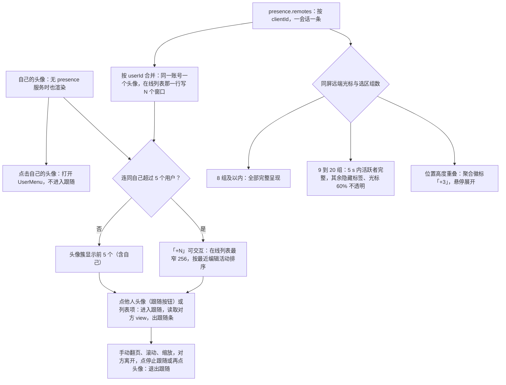

怎么读：上半支是检查器协作行的头像簇（按用户折叠，自己的头像另由会话用户给出、点开账户菜单），下半支是画布覆盖层（按空间密度分级）；他人头像与画布两支都从同一份 `presence.remotes` 出发，互不影响。
依据：设计 05 §1a、§2、§4、§9；PRD CO-03；ADR-0024；rulings §4.25 DS-18、DS-106、DS-132、TB-113、TB-124。

## 12. 软冲突信号分流

CRDT 保证收敛，「软冲突」只是需要告诉用户的并发结果。客户端有四类信号，各有唯一发布者：

| 信号 | 发布者 | 触发 | 计数口径 |
|---|---|---|---|
| `collab/soft-conflict{type, paths, by}` | `collab-yjs` YjsSyncEngine：应用远端 update 后调用 `classifySoftConflict` | 远端事务改写了本端 `conflictWindowMs`（60 s）内写过的键或实体 | 软冲突率 MT-15 |
| `collab/repair{reason, paths}` 或 `{rule}` | `collab-yjs`：收到 `CONTROL.repair` 或本地轻量环修复 | 不变量修复 | 单独计数，不属软冲突 |
| `collab/update-rejected{code, count}` | `collab-yjs` PermissionGate | 本地更改被拒（§8.2） | 单独计数 |
| `store/undo-skipped{skipped, wholeStep}` | `store-yjs` 撤销包装层（本包只订阅） | 撤销跳过他人后写或被删目标 | **单独统计**跳过次数与整步跳过次数，不计入软冲突率（rulings §4.17 D5） |

`by` 由远端 Yjs `clientID` 经 awareness 映射到 `user.name`，查不到时显示「一位协作者」。`prop-lww` 与 `delete-vs-edit` 两类在 emit 的同时向 `history` 登记一条恢复记录（`source:'conflict'`），使 Toast 上的「恢复我的值」「恢复元素（含我的编辑）」与撤销提示条共用同一对命令（[04 §6](04-document-commands-and-undo.md)）。

| 30/06 §8 # | 场景 | 客户端信号 | UI 形态（设计 05 §5 字母） | 恢复动作 |
|---|---|---|---|---|
| 1 | 并发移动同一形状 | `soft-conflict{prop-lww}`，只发给 60 s 内写过该键、被覆盖的一方 | Toast「X 移动了该形状」（C） | 「恢复我的值」 |
| 2 | 删除 vs 编辑文本 | `soft-conflict{delete-vs-edit}` | Toast「你编辑的元素已被 X 删除」（D，P1） | 「恢复元素（含我的编辑）」，原 id |
| 3 | 删页 vs 页内新增 | `soft-conflict{delete-vs-edit}`，粒度为页 | Toast（E，P1） | 「恢复此页」，原 id、原位置 |
| 4 | 同一间隙并发插入 | 不发事件（40/05 Q-05-3 取「不下发用户可见事件」） | 缩略图位置动效（同 F） | 无 |
| 5 | 父子成环 | `collab/repair{rule:'cycle'}` | Toast「已自动修正 1 处结构问题」+ 查看 | 无（撤销栈不清空） |
| 6 | 同一形状不同键 | 无 | 无 | 无 |
| 7 | 同段落不同位置 | 无；同位置由 presence 预防（`text-same-pos`，B） | 文本框上沿提示签「● X 也在编辑此文本框」+ 对方插入符（§11） | 无 |
| 8 | 分段 vs 尾部加粗 | 无（已知限制） | 无 | 无 |
| 9 | 换版式 vs 编辑占位符文本 | 无（不同键都存活） | 无 | 无 |
| 10 | 撤销 vs 他人后写 | `store/undo-skipped` | 撤销提示条（[04 §6](04-document-commands-and-undo.md)） | 「恢复我的值」 |
| 11 | 离线编辑 vs 在线删除 | TTL 内：`soft-conflict{delete-vs-edit}`；已硬删：修改被丢弃 | 同 #2；已硬删时提示可从「未同步更改」导出 JSON | 「恢复元素」（TTL 内） |
| 12 | 降权时仍有 pending | `collab/update-rejected` | readonly-degraded 横幅 + 导出（§8.2） | 导出本地副本 |
| —（ML-03，[11 §10](11-masters-layouts-and-themes.md)；70/05 `sc-22`） | 删除版式占位符 vs 编辑该占位符文本 | `soft-conflict{delete-vs-reference}`，`paths` 指向版式上被删的占位符，只发给编辑方（2026-09-25 登记） | Toast「占位符已被 X 删除，你的文本已保留为普通形状」 | 无（文本已保留为普通形状） |
| —（表格行列粒度，设计 [03-30](../20-design/03-screens/30-table-editing.md) §7、§12 第 6 行；2026-09-30 登记，M3） | 删除表格的行 / 列 vs 编辑该行（列）中的单元格 | `soft-conflict{delete-vs-edit}`，粒度为表格的行或列，`paths` 指向被写墓碑的 `Row` / `Column`；本端退出单元格编辑、回到整表选中属选区收敛（[04 §7](04-document-commands-and-undo.md)） | Toast「该行（列）已被 X 删除」，说明「恢复即可找回你在该行（列）的修改」（D 的行列变体，P1） | 按钮「恢复该行」（列为「恢复该列」），恢复后提示「已恢复该行（列）」：`core.history.restoreElement` 清除行（列）墓碑、原 id 复活，本端已提交的键入一并回来（2026-09-30 按样张定稿，rulings §4.22） |
| —（图表类别 / 系列粒度，[50/24](24-elements-tables-and-charts.md) §3.9；2026-09-30 登记，M3） | 删除图表的类别 / 系列 vs 编辑该类别（系列）中的数据格 | `soft-conflict{delete-vs-edit}`，粒度为图表的类别或系列，`paths` 指向带墓碑的 `CatId` / `SerId`（50/24 §3.4）；本端先退出格编辑 | Toast「该类别（系列）已被 X 删除」，说明「恢复即可找回你的修改」，与表格行列同一组件（P1） | 「恢复该类别」（系列为「恢复该系列」）：`core.history.restoreElement` 清墓碑、原 id 复活，含本端的修改（rulings §4.22） |

PRD CO-08 / 设计 05 另有的行：F 并发重排页序 → `soft-conflict{reorder}`（`order` 键被改写），只有缩略图动效；I 并发换同一页版式 → `soft-conflict{prop-lww}`，不弹轻提示，写在检查器「版式」字段处——字段外圈换成对方身份色，节末「〈姓名〉同时把这一页改成了「〈版式〉」，你选的「〈版式〉」没有生效」+「恢复我的值」（新事务），与远端覆盖正在输入的字段同一画法（rulings §4.25 DS-60，[10](10-editor-shell-and-interaction.md) §5）；G、H、K 无提示；J「已解决线程有新回复」由评论面板内联呈现（[08 §5](08-comments-and-version-history.md)）；母版编辑的「删除 vs 引用」（`delete-vs-reference`）见 [11 §10](11-masters-layouts-and-themes.md)。软冲突一律不用横幅（设计 03-12 使用准则）。

**软冲突信号到 UI 的分流**

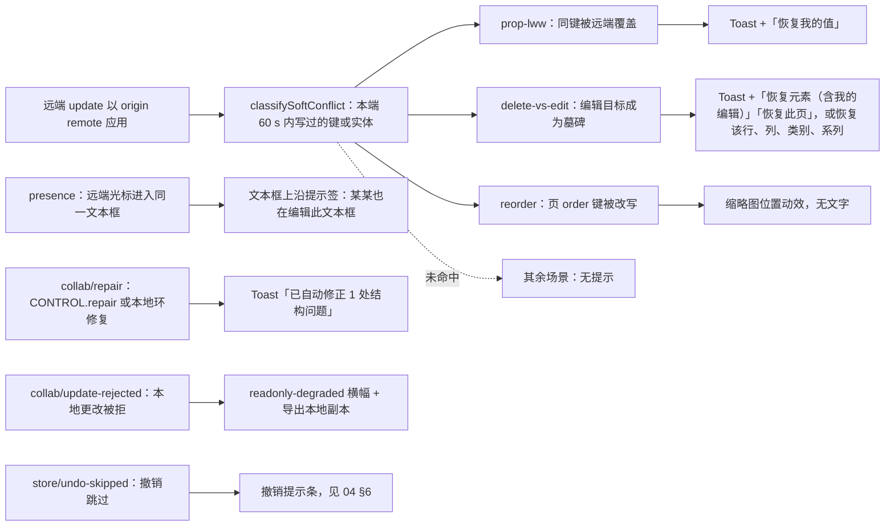

怎么读：左侧五个入口是四类信号加 presence 的预防性提示，右侧是唯一的 UI 形态；只有 `classifySoftConflict` 的三个分支计入软冲突率，修复、被拒与撤销跳过各自单独计数。横幅只留给被拒回滚这一条（它会丢失本地工作），其余软冲突一律用 Toast、内联或动效。
依据：30/06 §8；PRD CO-08、CO-09；设计 05 §5、§6；rulings §4.15 Q3、§4.17 D5。

## 13. 前端计时器总表

| 计时器 | 默认 | 配置键（所在包） | 作用 | 依据 |
|---|---|---|---|---|
| 连接超时 | 5 s | `connectTimeoutMs`（collab-transport-ws） | 超时进入 `backoff` | 30/06 §4.3 |
| 认证超时 | 5 s | 常量（collab-yjs `session-driver.ts`） | 自 WS 打开起未收到 `Authenticated` 或认证失败即断开进入 `backoff`（服务端适配层同为 5 s，4408） | 30/06 §6.3；证据 d-04 |
| 退避 | 1 s → 30 s，±20% | `backoff.{baseMs, maxMs, jitter}`（collab-transport-ws） | 重连间隔；1012 首轮立即 | PRD CO-06 |
| 离线判据 | 30 s 累计 | `offlineAfterMs`（collab-transport-ws） | 自进入重连起累计未连上即 `offline`；令牌刷新网络失败共用 | UX-03 |
| 离线周期重连 | 30 s，±20% | `offlineRetryMs`（collab-transport-ws） | `offline` 后周期重连，`onLine=false` 时暂停 | CO-03 |
| UI 去抖 | 2 s | 常量（ui-react 横幅宿主） | 网络翻转持续 ≥ 2 s 才切换横幅；`onLine=false` 去抖 | 设计 03-12 |
| 同步中横幅阈值 | 2 s | 常量（ui-react） | 重连后同步 ≥ 2 s 才出「同步中」，否则直接「已恢复」 | 设计 03-12 |
| 已恢复横幅 | 3 s | 常量（ui-react） | 自动滑出；长时间离线后带检查提示的那一条不自动滑出（§4） | 设计 03-12 |
| 长离线阈值 | 24 h | 常量（collab-yjs） | 离线累计超过即在重连后的「已恢复」上追加检查提示与受影响页（§4，P1） | PRD CO-06；rulings §4.25 DS-59 |
| 无入站判死 | 30 s | `messageReconnectTimeoutMs`（collab-transport-ws，装配时传给 provider 的 `messageReconnectTimeout`；取代原 15 s 应用层心跳 `heartbeatMs`） | 30 s 无任何入站帧即断开；**provider 内部计时** | 证据 d-07、TX-09 |
| awareness 续期 | 15 s | 无（y-protocols 内部） | 本端 awareness 定期续期，服务端回显，兼作保活；**provider 内部计时** | ADR-0024 |
| 出站合并 | 50 ms（背压时 200 ms；运行期 4429 后加倍） | `flushMs`（collab-yjs，装配时传给 provider 的 `flushDelay`） | provider 固定窗口合并 update 与 awareness；**provider 内部计时** | 30/06 §9.3；证据 d-28 |
| 未保存阈值 | 15 s | `unsavedWarnAfterMs`（collab-yjs，新增） | 最老在途超过即「未保存到服务器」 | rulings §4.19 INC-09 |
| 降权收拢 | 2 s | `rejectSettleMs`（collab-yjs，新增） | 降权后等待在途帧结束再判定被拒集合 | §8.2 |
| 离开 flush | 5 s | `leaveFlushTimeoutMs`（collab-yjs，新增） | `leave()` 等待 pending 的上限 | §6 |
| 票据重新绑定 | 浏览器会话每次被动续期成功后（不定时）；M4 `getToken` 在 JWT 到期前 60 s | 浏览器会话见 [02 §4.2](02-app-shell-routing-and-session.md)；M4 `token` 函数 | 调 `provider.sendToken()` 以新票据再发 Auth 帧（原 `auth.refresh`）：M1–M3 只重新绑定、不延长，M4 集成方 JWT 以新 `exp` 延长 | INC-27、60/02 §9.5 |
| 票据有效期 | 60 s，单次 | 服务端签发（[60/02](../60-backend/02-auth-chain.md)） | 客户端不缓存，每次（重）连换新 | ADR-0029 |
| 光标 / 选区上报 | 50 ms（20 Hz） | `awareness.cursorHz`（collab-yjs） | awareness 节流 | ADR-0024 |
| 视图上报 | 500 ms（2 Hz） | `awareness.stateHz`（collab-yjs） | `view` 等字段节流 | ADR-0024 |
| 空闲判定 | 60 s | 常量（collab-yjs AwarenessAdapter） | `idle` 置位，头像灰显 | PRD CO-03 |
| 远端 awareness 超时 | 30 s | `awareness.timeoutMs`（collab-yjs） | 静默失联的远端最迟 30 s 移除 | PRD CO-03 |
| 软冲突窗口 | 60 s | `conflictWindowMs`（collab-yjs，新增） | 本端多久内写过的键被覆盖才提示 | 30/06 §8 #2、PRD CO-08 |
| 画布活跃窗口 | 5 s | 常量（render-dom `remote-presence`） | 9–20 组时谁保持完整呈现 | 设计 05 §1a |

「新增」配置键由 [40/05](../40-modules/05-collaboration-client.md) §3 的 `collab-yjs` Config 登记。自有计时器（表中未标「provider 内部计时」的行）全部经可注入时钟（FixedClock，[70/11](../70-testing/11-test-data-fixtures-and-determinism.md)）实现，不直接读 `Date.now` / `setTimeout`；机械约束为 TD-110 及其 `collab-*` 子项（§15 V15）。标「provider 内部计时」的行由 `@hocuspocus/provider` 与 y-protocols 内部的 `setTimeout` / `setInterval` / `Date` 实现，**豁免** TD-110（lint 只约束自有 `collab-*` 源码，证据 TS-05、d-30），测试里用全局 fake timers 驱动，与注入 Clock 同步推进（[70/05](../70-testing/05-collab-simulation-and-property-tests.md) §2）。

## 14. 诊断与遥测

- **诊断面板**（开发者模式，入口与 gating 见 [15 §10](15-events-errors-and-telemetry.md)）的协同页：内部态与 `SyncState`、RTT、pending 数、在途 FIFO（含 spill 标记）、`roomPersist`、`limits`、最近 100 条同步事件（帧类型、字节数、ack 层级，不含内容；数据取自垫片与 provider 的 `message` / `outgoingMessage` 事件）、provider 的 `status` 与 `unsyncedChanges`（只作对照，标注「不代表已保存」）、awareness 快照（去掉 `caret` 原文）、离线库用量（`estimate()`）。RTT 由可选的 Stateless `ping{t}` 往返测得（服务端应答形状以 [60/16](../60-backend/16-ws-protocol-server-view.md) 为准；与 `collab/latency` 同为每 30 s 采样一次；不参与判死，证据 d-07、OB-03）。
- **发布的事件**（全部在 `collab.contribution.ts` 声明，lint `cordex/events-must-be-declared`）：`collab/state-changed`、`collab/synced`、`collab/reconnect{reason}`、`collab/auth-failed{code}`、`collab/soft-conflict`、`collab/repair`、`collab/update-rejected`、`presence/joined|left|changed`。
- **遥测专用与指标**（依据：30/10 §11.1；PRD 06；不提请章程 §5.5 收编）：`collab/latency{rttMs, applyMs}` 是遥测专用事件，由 collab-yjs 经 `telemetry.event` 发出，采样按 PRD 06 高频事件默认 1%（可配置），`rttMs` / `applyMs` 的测量口径以 PRD 06 为准（MT-17），不是 cordis 事件；出站背压只以客户端指标 `cordex_collab_outbound_queued` 表达（§5）。
- **遥测**：上述事件按 [15 §8](15-events-errors-and-telemetry.md) 的产品遥测口径去标识上报（默认关）；`store/undo-skipped` 单独统计（D5）；客户端错误（1011、4400、`collab.payload_too_large`）经错误上报管线（默认开，不含文档内容）。服务端指标名统一在 [60/18](../60-backend/18-observability-and-ops-endpoints.md)。
- **预算**（数值以 [13](13-performance-and-bundling.md) 为准）：本地回显同步完成；A → B 可见 p50 ≤ 150 ms / p95 ≤ 400 ms；presence p95 ≤ 200 ms；初始同步 D50 ≤ 2 s、D200 ≤ 5 s（p75）；重连重同步（≤ 5,000 update）≤ 3 s；权限传播 ≤ 2 s。

## 15. 机械验证

本节只写断言与所在套件 / CI 步骤；测试层级、夹具、判定与 CI 编排归 70（[70/02](../70-testing/02-contract-suites-and-pluggability.md)、[70/05](../70-testing/05-collab-simulation-and-property-tests.md)、[70/06](../70-testing/06-frontend-component-and-e2e.md)、[70/12](../70-testing/12-ci-gates-mapping.md)）。

| # | 断言 | 套件 / 用例 | CI 步骤 |
|---|---|---|---|
| V1 | §3.1 每条边都有表驱动用例；表外迁移被 reducer 拒绝；`projectSyncState` 与 `deriveCollabUiState` 与 §3.2 表逐行一致 | `collab-core/__tests__/session-fsm.test.ts`；`ui-core` 派生函数单测 | test/unit |
| V2 | 退避序列在 SeededRandom 下确定；29.9 s 未离线、30 s 离线；服务端恢复后 offline 会话 ≤ 36 s 回连；`onLine=false` 期间不发起连接；1012 首轮不等待 | `runCollabTransportConformance`（FixedClock） | test/contract |
| V3 | 关闭码全表（含 1011、4205、4408 超时通用、4427、4428 与握手期 4429，以及文档级 CLOSE）的内部迁移与 §9 一致；拒绝码 → 关闭码映射一致（含 `collab.rate_limited → 4429`，握手期超限不改 `flushDelay`）；每个码都经构造配置 `onClose` 先 `disconnect()`，provider 内部不发起任何重连 | `runCollabTransportConformance`；`collab-transport-ws` 的 `close-policy.test.ts`（全表覆盖，INC-06） | test/contract、test/unit |
| V4 | `tier:'spill'` 不清 pending；`tier:'db'` 弹 FIFO 队首并 `ackUpTo`；连续 spill 后 db 仍按序对应；step2 恰一个在途条目、空差量也获 db ack；FIFO 为空时到达的 db ack 被忽略；收到写入帧 `error` 后 FIFO 冻结，其后到达的 db ack 不再 `ackUpTo`，未确认 pending 全部进入被拒集合；viewer 的命令管线不产生非 remote update、commenter 可发；`flush`、`leave` 与「未保存」判据从不读 provider 的 `unsyncedChanges` / `synced` | `collab-yjs/__tests__/batcher.test.ts`；`runOfflineStoreConformance` | test/unit、test/contract |
| V5 | 任意合并下 update 帧 payload ≤ `maxUpdateBytes`（将超限前先 `flushPendingUpdates`，性质测试）；离线 5 MiB 更改重连后以一个 step2 送达、无 4413、pending 一次清空、服务端不重复落库；step2 超 16 MiB 时 4413 后走 `payload-too-large` 且不再重连 | fast-check 性质；70/05 §9 重连脚本 | test/unit、test/collab-sim |
| V6 | 突发键入下 provider 以 50 ms 固定窗口合并后出站帧率 ≤ `msgRateHz`、不触发 4429；运行期 4429 后 `flushDelay` 加倍 | 70/05 §9 | test/collab-sim |
| V7 | `room.persist` 从 degraded 到 ok 时「未保存到服务器」出现与消失；最老在途 ≥ 15 s 时出现（INC-09） | 70/05 §9 故障注入；双浏览器用例 | test/collab-sim、e2e/full-compose |
| V8 | 降权后本地拦截出站、`live → readonly`；被拒集合进入 rejected、重开 Unit 后撤销栈为空；导出的 pptx 含被拒更改；撤销访问后不提供导出 | `permission-gate.test.ts`；双浏览器降权横幅用例 | test/unit、e2e/full-compose |
| V9 | `permission/changed` 只由 `permissions` 服务发出，协同包内无该 emit | 30/05 §12「权限变更单一发出者」检查；`cordex/events-must-be-declared` | scanners（由 70/12 映射子规则） |
| V10 | awareness 1 s 内最多 20 帧；远端 30 s 超时移除；非法状态丢弃并计数；查看者只含 `view` | `collab-yjs/__tests__/awareness.test.ts` | test/unit |
| V11 | 30/06 §8 十二个场景各触发 §12 表中的信号且只触发一次；提示出现率 100% | `test/collab-sim/scenarios/sc-NN.test.ts`（70/05 §6）；`collab-yjs` 的 `soft-conflict-scenarios.test.ts`（`fixture` 通用版）；双浏览器用例 | test/collab-sim、test/unit、e2e/full-compose |
| V12 | 同一登录用户重新登录后 pending 经 step2 提交；另一用户登录后 pending 进入 rejected 且会话只读 | 70/06 §5「重新登录弹窗」 | e2e/full-compose |
| V13 | 20 客户端 × 1,000 随机命令、随机分区后全部端状态一致 | `collab:converge`（70/05 §4） | test/collab-sim（nightly 放大） |
| V14 | `collab-offline-idb` 刷新后恢复、配额超限返回 `err`、两个标签页只有一个持有离线库（M4） | `runOfflineStoreConformance`；多标签页用例 | test/contract、e2e/full-compose |
| V15 | 协同包内**自有代码**的计时只经注入时钟：`Date.now`、`Math.random` 与无参 `new Date()` 由确定性 lint TD-110 覆盖（`tooling/eslint-config/rules/determinism.ts` 第二个 override，范围为全部生产源码与测试代码，`SystemClock` / `SystemRandom` 的实现文件除外，rulings §4.20 TX-08）；`collab-*` 另在 restricted-globals 配置里禁 `setTimeout` / `setInterval`（改经 `Clock` 的定时器），作为 TD-110 的子项登记，不新增扫描器；`@hocuspocus/provider` 与 y-protocols 的内部计时不在 lint 范围内（§13 豁免），测试用全局 fake timers 驱动 | lint（09-type-discipline/02 §3、08 §12c TD-110） | lint 步骤（70/12） |
| V16 | 覆盖导入：收到 `room{locked:{reason:'import'}}` 后停止发送、`readonlyReason='locked'`；随后 4428 → 重开 Unit、本地纪元更新为新 `X-Cordex-Epoch`，未获 db 确认项以 `epoch-changed` 进入 rejected 且可导出，横幅为「文档已替换为导入的文件」；版本恢复期间协作者不进入 `readonly`、不断连（rulings §4.19 N1） | `session-scripts.test.ts`（70/05 §9 `rs/import-overwrite`）；70/06 §5 第 21 行 | test/unit、e2e/full-compose |
| V17 | provider 时序契约（§4.21）：`open` → `authenticated` → `synced` 的事件顺序；`auth.ok` 先于或晚于 step2 到达都进入同一状态；LocalBatcher 的 `onUpdate` 监听先于 provider、`outgoingMessage` 同步发生在垫片 `send` 之前，FIFO 与上线帧一一对应；构造配置 `onClose` 能阻止内部重连（事后 `.on('close')` 不能）；`authenticationFailed` 后立即断开、不再发出无 Auth 的 step1；`leave()` 顺序为 flush → 等 db ack → `destroy()`；升级 provider 版本必须重跑 | `runCollabTransportConformance` 的 `provider/*` 分节（[70/02 §6.1](../70-testing/02-contract-suites-and-pluggability.md)）；`collab-yjs` 的 `session-scripts.test.ts`（进程内 Hocuspocus 脚本服务端 + 内存 WebSocketLike + fake timers，[70/05 §9](../70-testing/05-collab-simulation-and-property-tests.md)） | test/contract、test/unit |
| V18 | provider 以自身为 origin 应用的远端 update 在 store-yjs 中记为 `remote`、不入撤销栈，撤销跳过他人后写照常生效；回显给发送者的本端 update 幂等、不产生变更事件；`provider.awareness` 与 `yjsBackend.awareness()` 为同一实例且非 `null` | `collab-yjs` 的 `provider-session.test.ts`；`store-yjs` 契约套件协同分节 | test/unit、test/contract |
| V20 | 横幅与阻断页（rulings §4.25 DS-50、DS-58…DS-61）：4403 复查不可读后 Unit 关闭、内存文档与 pending 清空、工作区换成阻断页且没有导出入口；处理前不可关闭的横幅恰为 §3.3 的六类加第 3 批两条（发现新版本、换纪元时有未提交的更改），导出后降级为可关闭的「已导出本地副本」；降权且无未同步更改时不出横幅、只出轻提示；名额已满为中性横幅且不自动提升；同步状态行带待同步计数的态为警告色图标、只读与文档已不存在为中性；应用内离开与刷新先 flush、仍有未同步项才弹确认且初始焦点在安全项；查看人数已满的阻断页在名额空出后自动进入编辑器 | `ui-core` `deriveCollabUiState` 单测；`ui-react/__tests__/banner-priority.test.tsx`；离线与冲突 e2e（[70/06](../70-testing/06-frontend-component-and-e2e.md) §5） | test/unit、e2e/full-compose |
| V21 | 第 3 批文档状态横幅与在场（2026-10-22，rulings §4.25 DS-106、DS-126…DS-129、DS-132、TB-113、TB-124）：4426 / 4427 后「发现新版本」不可关闭、只有「刷新」，写命令被拒、工具提示「刷新后可编辑」、同步状态行「需要刷新 · N 项未同步」，有未同步项时「刷新」弹确认、没有就直接刷新；惰性 chunk 漂移时会话照常 `live`；4428 没有未提交的更改时横幅可关闭、过 10 s 仍在，有未提交的更改时导出前不可关闭；`over_ceiling` 横幅可关闭、没有按钮，关闭后同步状态行可聚焦且说明与正文同句；导出对话框说明的第二句随 `reason` 换；他人头像为 `aria-pressed` 的「跟随」按钮，跟随中出跟随条「停止跟随」、自己翻页即退出；同色第 13 位起出序号角标且读屏名含「同色第 N 位」，同一账号两个窗口只占一个头像、在线列表写「2 个窗口」 | `ui-core` `deriveCollabUiState` 单测；`ui-react/__tests__/banner-priority.test.tsx`、`presence-stack.test.tsx`；文档状态横幅与双浏览器在场 e2e（[70/06](../70-testing/06-frontend-component-and-e2e.md) §5） | test/unit、e2e/full-compose |
| V19 | 插件集指纹（2026-10-01，§4.23）：Auth token 含 `pluginSet`；4426 `collab.plugins_outdated` 与 `collab.schema_too_new` 客户端行为一致；Stateless `plugins` 不改 `SyncState`、不断连，同一 `policy` 值只出一次横幅，点重新加载先 flush；未知 `reason` 丢弃并计数 | `collab-transport-ws` 的 `close-policy.test.ts`；`collab-yjs` 的 `session-scripts.test.ts`（`rs/plugins-policy-changed`）；e2e 管理员保存后在线会话横幅（[70/06](../70-testing/06-frontend-component-and-e2e.md)） | test/unit、e2e/full-compose |

## 16. 里程碑

本表的里程碑指协议层：关闭码的处理、停止重连、被拒集合的收拢与导出能力随网关交付；界面状态（横幅、阻断页、同步状态行各态）标注的里程碑以 PRD 需求为准——「文档已被删除」「有更改过大无法同步」两条横幅跟 PRD CO-06 写 M3（rulings §4.25 TB-66）。

| 里程碑 | 交付 |
|---|---|
| M2 | **服务端文档的协同持久化**（rulings §4.19 D-M2-CONTENT，覆盖 INC-37 的 M2 / M3 分界；原「M3 前置技术切片」改为 M2 交付并作 M2 验收，[40/05 §11](../40-modules/05-collaboration-client.md)）：§1 provider 两个类的装配（`@hocuspocus/provider` 4.7.0 精确钉版本，rulings §4.21）；§2 连接建立与 HTTP bootstrap、`token` 函数；§3 内部 FSM（输入为 provider 事件）与 UI 状态（`offline` 态及其横幅随 M3）；§4 自有调度器的断线退避重连（上限 30 s 持续重试，UI 为「正在恢复连接…」）、1012 首轮立即、30 s 无入站判死、重连不重做 bootstrap、刷新保护；§5 `localSeq` 与帧对应（计量垫片）、单帧上限与背压指标；§6 两级 ack、在途 FIFO、step2 单设 16 MiB、`flush` / `leave` 与「未保存到服务器」分级提示（§6.1）；§8.1 中的文档锁定与超天花板只读打开；§8.2 被拒回滚与导出本地副本（单帧超限、超元素天花板、锁定、换纪元、身份变更；导出说明的第二句按原因换，DS-129）；第 3 批定稿的三条文档状态横幅（发现新版本、换纪元两态、元素上限只读打开，DS-126…DS-128；插件集变化引起的 4426 随 M3）；§8.3 票据、重新绑定与重新登录；§9 关闭码全表；§10 awareness 的本端上报、节流与清洗（服务端中继随网关就位，同一用户多标签页互见）；§14 诊断面板协同页。PRD 05 §0.3 为本分工的依据。 |
| M3 | **多人协同体验层**：§4 离线体验（`offline` 判据与离线横幅、30 s 周期重连与「立即重连」、`navigator.onLine=false` 暂停、长离线提示；PRD CO-06 与 `offline:queue` 验收）；§8.1 权限变更、撤销访问与名额降级（随分享与角色细化生效）；§10 远端在场的多人呈现与 §11 在场 UI（头像簇、远端光标密度、跟随模式 P1——他人头像即「跟随」按钮、跟随条与放映里的跟随，DS-106；同色序号角标、在线列表「N 个窗口」与最窄 256，DS-132、TB-124）；§12 软冲突信号与提示；评论相关的 `CONTROL.event`（[08](08-comments-and-version-history.md)）；Auth token `pluginSet`、4426 `collab.plugins_outdated` 与 Stateless `plugins` 横幅（§2、§9，rulings §4.23 PM-13）。 |
| M4 | `collab-offline-idb` 跨刷新持久化（PRD CO-06 P2）与多标签页互斥（OFFLINE-TABS）；集成方 JWT 经 `getToken` 续期（ADR-0029）。大规模只读广播（PRD CO-14）为 M4+，不在本文范围。 |
| M5 | doc / sheet 复用四包零改动（[40/05 §8](../40-modules/05-collaboration-client.md)），只在装配层引用同一批服务名。 |

## 17. 未决、待登记与已关闭项

| 项 | 状态 | 去向 |
|---|---|---|
| INC-09「未保存到服务器」判据、受众与呈现 | 已关闭：rulings §4.19 INC-09 定稿（发起方横幅、其余协作者同步状态行弱提示），不再二选一 | §6.1；设计 03-12 回写见 [10 §12.3](10-editor-shell-and-interaction.md) |
| 撤销访问（4403 / `role:none`）时是否提供本地副本导出 | 已关闭：不提供（「安全宁可提前」，与 UX-02 换人只读同一原则）；仍有读权限的降权按 PRD CO-05 可导出 | §8.1；PRD CO-05 / CO-06 与设计 03-12「访问权限已变更」分支同步 |
| 服务端 L2 对降权瞬间的在途帧计数 | 已关闭：只统计服务端发出降权 `permission` 或 `room{locked}` 之后到达的写入帧（[60/16](../60-backend/16-ws-protocol-server-view.md) §4） | §8.1 |
| 名额已满降级的角色 | 已关闭：按 30/06 §14、60/05 §4.2 定为 viewer（不可评论），横幅不写「仍可评论」 | §8.1；设计 03-12 |
| `auth.ok.reason` 区分名额满与超天花板 | 已关闭：`'capacity'` 与 `'over_ceiling'` 分列（30/06 §6.3、[60/16](../60-backend/16-ws-protocol-server-view.md) §3） | §2、§8.1 |
| 文档锁定的会话信号 | 已关闭：`CONTROL.room` 可选字段 `locked:{reason, until}`，不借 `permission{reason:'changed'}`（30/06 §6.3、[60/16](../60-backend/16-ws-protocol-server-view.md) §8） | §8.1、§8.2 |
| 覆盖导入与版本恢复是否锁定文档 | 已关闭：rulings §4.19 N1——恢复不加锁、在线不断连；覆盖导入锁定后以 4428 换纪元收尾，客户端重新 bootstrap，未获 db 确认项移入 rejected 可导出 | §8.1、§8.2、§9；[08 §10](08-comments-and-version-history.md) |
| 认证字段中的本地纪元与最高 `schemaVersion` | 已关闭：原 `CONTROL.auth` 的可选 `epoch` 与 `maxSchemaVersion`，§4.21 起放在 Auth 帧 token 的 JSON 里；纪元随 `GET snapshots/latest` 响应头 `X-Cordex-Epoch` 下发 | §2 |
| 写入帧 `error` 与 db ack 的相对顺序不保证，本文 §6 以「冻结 FIFO、宁多勿少」兜底 | 已关闭（rulings §4.20 BE-09+TX-15，分诊 #24 结案）：冻结 FIFO、宁多勿少为最终口径——被拒后会话本就导出后重载，多算的更新导出时幂等合并，逐帧对应无用户可见收益；60/16 不新增顺序保证 | §6；[60/16](../60-backend/16-ws-protocol-server-view.md) §5 第 7 条 |
| 30/06 §8 #1「并发移动同一形状」 | 已关闭：30/06 §8 改为 `prop-lww` 提示 +「恢复我的值」，与本文 §12 一致 | §12 |
| `collab-yjs` 新配置键 `unsavedWarnAfterMs`、`rejectSettleMs`、`leaveFlushTimeoutMs`、`conflictWindowMs`；`SessionStats` 新字段 `inFlight`、`roomPersist`、`readonlyReason`（取值含 `over_ceiling`、`locked`）；内存版 `OfflineStore` 挂根作用域（§7）；`RejectedEntry.reason` 取值集合（§8.2）；客户端指标 `cordex_collab_outbound_queued` | 已登记（40/05 §2.2、§2.4、§2.5、§3；指标另登记于 30/10 §3.3） | [40/05](../40-modules/05-collaboration-client.md) §2.2、§2.5、§3 |
| 错误码 `collab.payload_too_large`（映射 4413） | 已关闭：随 INC-10 批次登记进 30/10 §1.1 | §5、§9 |
| `deriveCollabUiState` 纯函数文件 | 已回写（40/10 §2.1、§4 ui-core `domain/` 目录树与 §5 文件表） | [40/10](../40-modules/10-ui-shell-and-slide-ui.md) ui-core `domain/` |
| 30/06 §5.1 原图改为定位句 + 链接本文 §3.1 | 已定，由 30/06 回写 | §3.1 |
| 同步层是否改用官方 provider（rulings §4.21 H:q-hp-provider） | 已关闭：用官方 `@hocuspocus/provider` 4.7.0，`autoConnect:false`、`maxAttempts:1`，重连与离线由注入 Clock 的自有调度器驱动；FIFO 由 `outgoingMessage` 与 WebSocketPolyfill 垫片映射；两级 ack、PermissionGate、被拒回滚、OfflineStore 保留 | §1–§6、§8、§9 |
| 重连 step2 超 1 MiB 是否先切块（§4.18 CO-10 原口径） | 已关闭（rulings §4.21 H:q-hp-step2-cap）：不切块，step2 单设 16 MiB；超限 4413 后导出重载；M4 IndexedDB 上线后按实测再评估 | §6、§7；PRD 03 CO-06 同步 |
| 首帧必须 auth、认证前同步帧即 4401 | 已关闭（ADR-0039）：provider 发完 Auth 即发 step1 与 awareness，服务端认证前排队、不应用；严格期限 5 s 留在服务端适配层 | §2 第 4 步；PRD 03 CO-12 同步 |
| 应用层心跳 `CONTROL.ping` / `pong` | 已关闭（证据 d-07）：删除；保活靠 awareness 15 s 续期与 `messageReconnectTimeout` 30 s；RTT 用可选 Stateless `rtt.ping` / `rtt.pong`（形状已由 [60/16](../60-backend/16-ws-protocol-server-view.md) §3 与 30/06 §6.3 登记，2026-09-26 整合） | §4、§13、§14 |
| provider 文档名 `{documentId}:{epoch}` 在快照 404（新文档尚无快照）时的纪元来源 | 已关闭（2026-09-26 整合）：404 同样带 `X-Cordex-Epoch`（[60/15](../60-backend/15-rest-api-catalog.md) §3.8 `snapshots/latest` 行）；文档名按最后一个 `:` 切分、前段为 UUID、后段为十进制纪元（[60/16](../60-backend/16-ws-protocol-server-view.md) §2） | §2 第 1–2 步 |
| viewer 的空差量 step2 是否获 db ack | 已关闭（2026-09-26 整合）：只读会话的空差量 step2 不回 ack、不计违规（[60/16](../60-backend/16-ws-protocol-server-view.md) §5 第 2 条、§6 第 3 步）；客户端仍容忍两种情形 | §2 第 6 步、§6 |
| 会话中访问被撤销的呈现（03-12 线框原为编辑器上的阻断横幅） | 已关闭（2026-10-15，rulings §4.25 DS-50）：整个工作区换成与「打开失败 · 没有访问权限」同一布局的阻断页，内存文档与待同步更改一并清空，不提供导出 | §3.2、§3.3、§8.1、§9；[02](02-app-shell-routing-and-session.md) §6 |
| 处理前不可关闭的横幅类别、导出流程与降权横幅正文（DS-58） | 已关闭（2026-10-15）：六类不可关闭（§3.3）；导出对话框列出未保存的更改、可选 .pptx / .json；降权横幅后半句改为「文档已重新载入服务端版本，撤销历史已清空」；名额已满中性、不自动提升；被提权与无未同步更改的降权只给轻提示 | §3.3、§8.1、§8.2、§9；设计 03-12（设计线同批） |
| 未画横幅的档位与界面状态的里程碑（rulings §4.25 TB-66） | 已关闭（2026-10-15）：「发现新版本」、换纪元后的两种横幅、「文档已达元素上限，只读打开」、「文档正忙」归「权限 / 文档状态」档，「发现新版本」与「插件设置已更新」按 PRD 07 G-87 合并，「部分更改未保存」走轻提示，「文档正忙」中性锁形；§16 的里程碑指协议层，界面状态以 PRD 为准；同日再补：「发现新版本」、换纪元后的两种横幅与「文档已达元素上限，只读打开」的底色、图标与能否关闭并入第 3 批横幅样张（rulings §4.25 TB-80），§8.1、§9 的「可关闭」「3 s 后自动消失」标为现行写法；后又改称暂行写法，写明能否关闭与是否自动消失随第 3 批横幅样张与横幅高度一起拍板、出现条件、文案与档位不变（§3.3、§8.1、§9）；2026-10-22 已随第 3 批样张 `doc-banners` 定稿（rulings §4.25 DS-75、DS-126…DS-128，§3.3 文档状态横幅、§8.1、§9 已按定稿改写），暂行写法作废 | §3.3、§8.1、§9、§16；设计 03-12 §2.2、§2.4、§8.6（设计线同批） |
| 导出本地副本与长离线页码的代码落点（模块线 2026-10-15 报来） | 已定（2026-10-15，rulings §4.25 TB-85）：放在 SDK——ui-react `ui.dialog` 模板 `export-local-copy`（ui-react 的 `ui.dialog` 模板由 3 个变为 4 个）、合并字节在 collab-yjs、受影响页码在 slide-ui；§8.2 第 6 步、§4「长离线提示」行 | 已登记（2026-10-15 核对）：40/05 §2.5 `CollabService.rejectedChanges(unitId): Promise<RejectedChanges \| null>`（`RejectedChanges{ count, reason, rows, mergedUpdate(), summaryJson() }`、`RejectedChangeRow{ label, touched, at }`），§4.2 / §5 `collab-yjs` `infrastructure/offline/rejected-export.ts`；40/10 §3 ui-react 可选注入 `collab`、Manifest 与「贡献点：提供」行的 `ui.dialog` 模板为 4 个（含 `export-local-copy`），§4.3 / §5.3 `ui/shell/ExportLocalCopyDialog.tsx`，§4.4 / §5.4 slide-ui `domain/affected-pages.ts`（`affectedPages()`）与桥接；40/16 §2、§4 `ui.dialog` 的 ui-react 模板 4 个；40/11 `EditorPage.tsx` 离开 / 刷新确认框执行 `ui.openDialog('export-local-copy')`。本文 §4、§8.2 第 6 步已改为登记后的名称 |
| 离线文案、长时间离线与离开拦截（DS-59）；同步状态行各态（DS-61）；同时编辑的提示签与查看人数已满的阻断页（DS-60） | 已关闭（2026-10-15）：离线横幅文案不改，「关闭或刷新会丢失」的写法在 M4 启用本地持久化前再定；长离线追加检查提示与可点页码、不自动滑出、中性图标；应用内离开与刷新先同步再确认；状态行着色只标待同步计数 | §4、§6.1、§8.1、§9、§11、§12、§13；设计 03-02 §3.1、03-12（设计线同批） |
| 第 3 批横幅样张：「发现新版本」、换纪元两态与「文档已达元素上限，只读打开」的底色、图标与能否关闭（rulings §4.25 TB-80、DS-62 推迟项） | 已关闭（2026-10-22，DS-75、DS-126…DS-128，均按推荐）：发现新版本警告浅底、不可关闭、唯一按钮「刷新」，会话已关闭时转为暂时不能编辑；换纪元没有未提交的更改时中性、可关闭、不自动消失，有未提交的更改时同「有更改过大」；元素上限只读打开同「名额已满」；横幅统一高 40 | §3.3、§8.1、§9；设计 03-12 §2.4、§2.5、§8.5、§8.6（设计线同批） |
| 「导出本地副本」说明与「已导出本地副本」的第二句（DS-129） | 已关闭（2026-10-22，按推荐按原因换）：`export-local-copy` 模板加参数 `reason` | §8.2 第 4–6 步；[09](09-ui-system-and-theming.md) §6.1；40/10 `ExportLocalCopyDialog.tsx`；设计 03-12 §7.2、§7.3 |
| 「文档已达元素上限，只读打开」横幅正文的两个数（文档元素数与部署天花板）从哪来 | 已定（2026-10-22，rulings §4.25 TB-146）：`auth.ok` 在 `reason: 'over_ceiling'` 时带 `elementCount` 与 `maxElements`（与服务端准入判定同口径、含墓碑）；本文 §2 第 5 步与 §8.1 照此写 | 已登记（后端线）：[60/16](../60-backend/16-ws-protocol-server-view.md) §3、[60/05](../60-backend/05-modules-collab-and-snapshots.md) §4.1；已登记（2026-10-22 核对）：[30/06](../30-architecture/06-collaboration.md) §6.3 `auth.ok` 的 `elementCount?`、`maxElements?`（架构线），40/02 `ws/frames.ts`、40/05 §2.2 `SessionStats.overCeiling`、40/09 `auth.extension.ts`（模块线） |
| design-language-v3 第 3 批（rulings §4.25 DS-75、DS-106、DS-126…DS-129、DS-132、TB-113、TB-122、TB-124，2026-10-22） | 已写（2026-10-22）：§3.3 不可关闭的第 3 批两条、文档状态横幅定稿、同步状态行两态；§4 离开与刷新确认补「发现新版本」原因与退出登录确认；§8.1 超天花板一行定稿、「暂时不能编辑」补发现新版本；§8.2 第 4–6 步按原因换第二句与 `reason` 参数；§9 4426 / 4428 两行；§10 名签「（你 · 窗口 2）」；§11 跟随按钮、跟随条、放映里的跟随、序号角标与在线列表、图；§15 V20、V21；§16 M2 / M3 | 他线同批回写（各线并行，以各文档为准）：设计 03-12、05 §1a / §2 / §4 / §9（设计线）；40/10 ui-react `Banner.tsx`、`SyncStatus`、`PresenceStack`、`FollowBar.tsx`、`ExportLocalCopyDialog.tsx` 的 `reason`（模块线）；30/06 §6.3 与 60/16 §3 的 `over_ceiling` 数字字段（上一行）；PRD CO-03 角标与「窗口」措辞（产品线）；70/06 §5、70/13 DS-42 行断言（测试线） |
| design-language-v3 第 3 批评审修改（rulings §4.25 DS-143、TB-182，2026-10-23） | 已写（2026-10-23）：§8.2 第 5 步「导出本地副本」格式两行的文件类型图标（.pptx 用与导出对话框同一套 Tabler 原件，.json 用 lucide `FileBraces`） | 他线同批回写（各线并行，以各文档为准）：设计 03-12 §7.2（设计线）；40/10 `ExportLocalCopyDialog.tsx` 取 `infrastructure/file-type-icons.tsx`（模块线）；来源与许可见 [17](17-reuse-and-dependency-catalog.md) §3 |
| design-language-v3 母版视图改版（rulings §4.25 DS-157、DS-167、DS-177、TB-203、TB-208，2026-11-04） | 已写（2026-11-04）：§3.3 横幅取舍的例外改称上下文条（叫法 TB-208）；§11 进入母版视图时停止跟随（DS-167），母版视图里头像与在线列表的「跟随」不可用、外观不变（DS-157、DS-177、TB-203），不可用、原因与在线列表底部的说明由 slide-ui 按视图模式给出，`PresenceStack` 与跟随件不写 `viewMode` 条件 | 他线同批回写（各线并行，以各文档为准）：[10](10-editor-shell-and-interaction.md) §1.2、[11](11-masters-layouts-and-themes.md) §2；设计 03-02 §3.5、05 §4（设计线）；40/10 ui-react `PresenceStack.tsx`、`FollowBar.tsx` 接收 slide-ui 给的不可用、原因与说明（模块线） |
