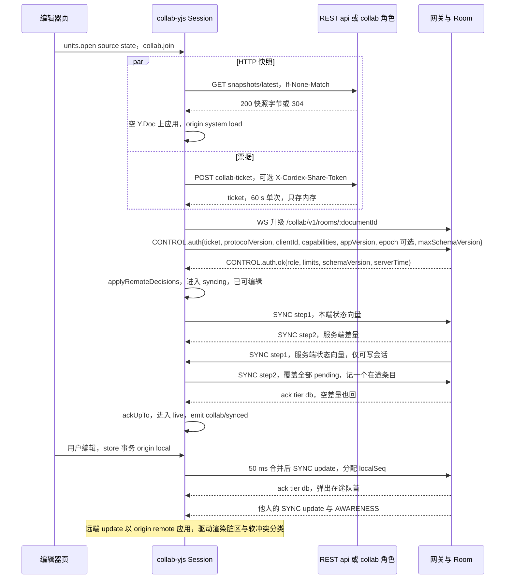
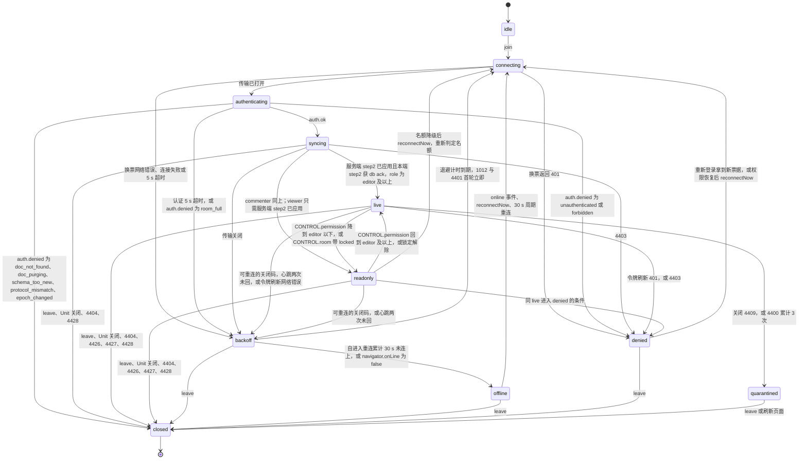
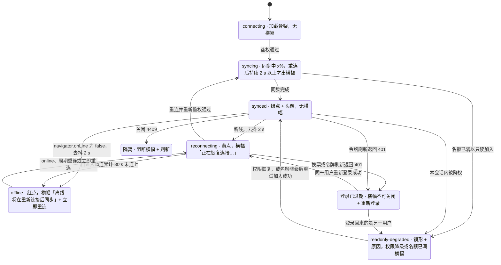
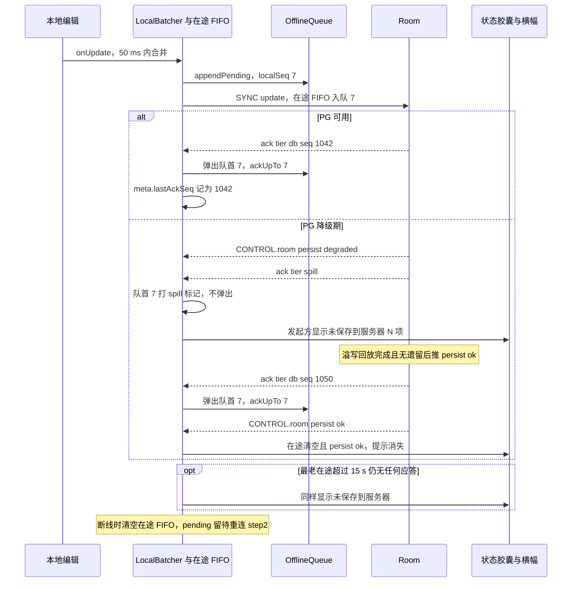
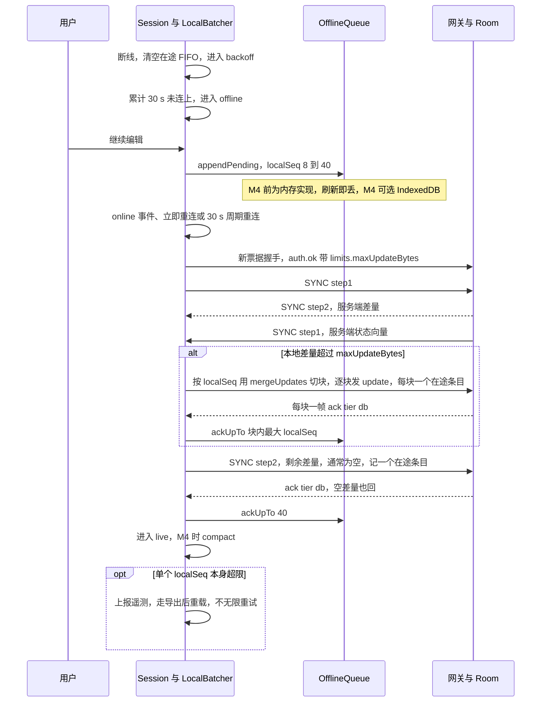
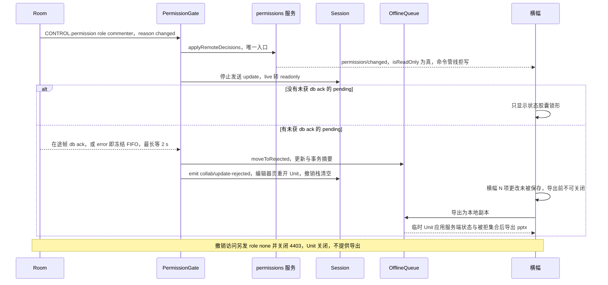
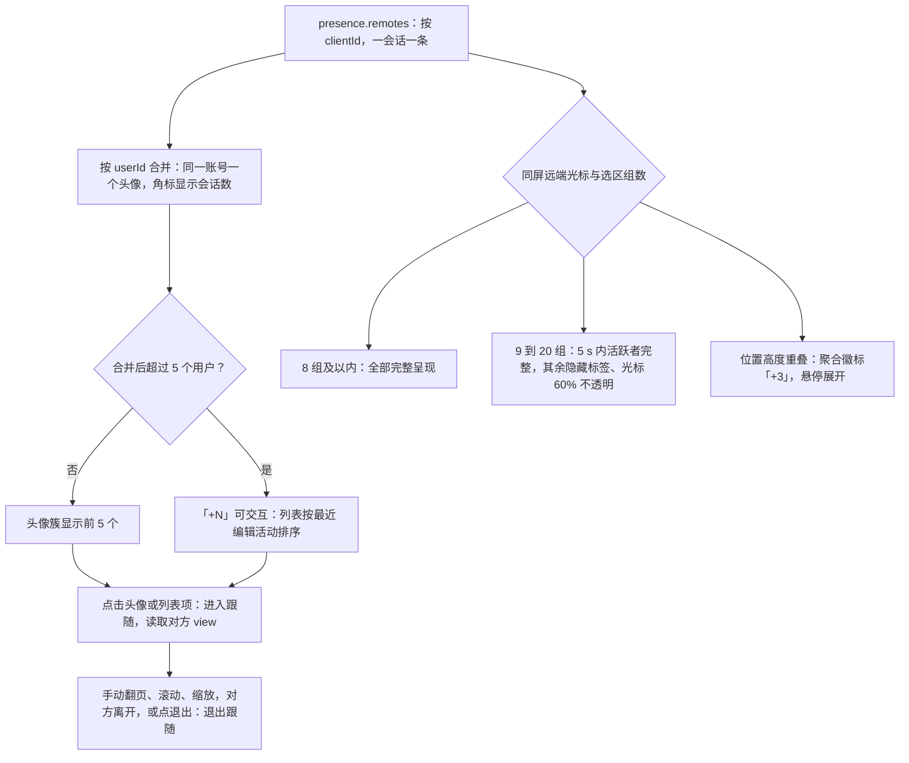
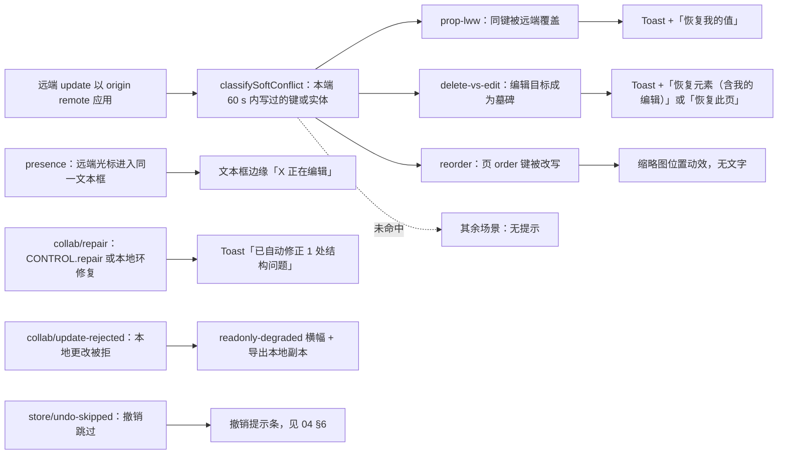

# 07 协同客户端
> 状态：v0.1 | 负责：前端设计线 | 更新：2026-09-25；2026-09-25（§4.19）；2026-09-25（§4.19 N1） | 依赖：[30/06](../30-architecture/06-collaboration.md) §5–§12、§18；[40/05](../40-modules/05-collaboration-client.md)；[ADR-0020](../30-architecture/adr/0020-crdt-selection.md)、[ADR-0023](../30-architecture/adr/0023-transport-and-protocol.md)、[ADR-0024](../30-architecture/adr/0024-presence-and-awareness.md)、[ADR-0033](../30-architecture/adr/0033-offline-persistence.md)；[rulings](../00-charter/rulings-2026-09-14.md) §4.15 Q3/Q5/S-3a、§4.18 UX-02/UX-03/CO-03/CO-08/CO-09/CO-10/BE-02、§4.19 D-M2-CONTENT/INC-09/N1；[PRD 03](../10-prd/03-features/03-collaboration.md)；[设计 05](../20-design/05-collaboration-ux.md)、[设计 03-12](../20-design/03-screens/12-offline-conflict-banner.md)

本文是**浏览器侧协同运行时的唯一事实源**：客户端 Session 状态机（自 [30/06 §5.1](../30-architecture/06-collaboration.md) 迁入，30/06 原处只保留定位句与链接）、连接建立、重连与离线、出站合并与两级 ack、离线队列、权限与令牌、关闭码处理、awareness 与在场 UI、软冲突信号分流、前端计时器。

不在本文（只链接）：

| 主题 | 事实源 |
|---|---|
| 帧信封、CONTROL 判别联合、ack 帧形状、关闭码定义 | [30/06 §6](../30-architecture/06-collaboration.md)（按决策 INC-02~INC-07、INC-09 补齐后）；代码落点 `protocol` 的 `collab/{frame,close-codes,awareness,ticket}.ts`、`ws/{frames,handshake}.ts`（[40/02](../40-modules/02-kernel-protocol-and-document-core.md) §4.3） |
| `DocumentStore`、中性撤销、`StoreOp`、`OfflineStore` 签名 | [30/04](../30-architecture/04-document-model.md) §2.2、[30/05](../30-architecture/05-command-and-history.md) §6、[30/06 §18.6](../30-architecture/06-collaboration.md)、[40/02](../40-modules/02-kernel-protocol-and-document-core.md) §2.5 |
| 服务端门禁 L1–L4、ack 发出规则、限额数值、扇出 | [60/16](../60-backend/16-ws-protocol-server-view.md) |
| Room 七态、持久化、溢写回放、准入、墓碑 TTL | [60/05](../60-backend/05-modules-collab-and-snapshots.md)（Room 七态照抄 30/06 §5.2） |
| 票据签发、会话吊销、分享链接解析与 WS 侧角色重算 | [60/02](../60-backend/02-auth-chain.md) |
| 撤销跳过提示条、「恢复我的值」「恢复元素」命令 | [04 §6–§7](04-document-commands-and-undo.md) |
| 评论数据与 `CONTROL.event{comments.changed}` 的消费 | [08](08-comments-and-version-history.md) |
| 浏览器会话、重新登录弹窗、分享令牌落地 | [02](02-app-shell-routing-and-session.md) §4、§5、§11 |
| 契约、模拟、故障注入测试的执行 | [70/02](../70-testing/02-contract-suites-and-pluggability.md)、[70/05](../70-testing/05-collab-simulation-and-property-tests.md)、[70/07](../70-testing/07-backend-integration-and-api-e2e.md) |

包名一律省略 `@cordexjs/` 前缀；「pending」指本地已应用、尚未获 `ack{tier:'db'}` 的本地 update；「在途」指已发出、尚未获任何 db 应答的帧。

## 1. 四包在浏览器中的装配与职责

协同客户端只在 `preset-slide-collab` 中装配（[40/05 §7](../40-modules/05-collaboration-client.md)、[03](03-preset-assembly-and-plugins.md)）：`store-yjs` 替换 `store-memory`，再加入四个协同包；`apps/web` 不直接 import 其中任何包。M2 起 apps/web 的服务端文档一律经它打开，单人编辑也经协同网关持久化（rulings §4.19 D-M2-CONTENT）；各节的 M2 / M3 分工见 §16。

| 包 | 层 / 同构 | 浏览器中的角色 | 提供的服务 | 本文章节 |
|---|---|---|---|---|
| `collab-core` | L4 / iso，definition | 契约与纯函数：`CollabService`、`Session`、`PresenceService`、`CollabTransport`、`SyncEngine`、`OfflineStore`；`session-fsm.reduce`、`projectSyncState`、`nextDelay`、`classifySoftConflict` | 无（`localPresencePlugin` 只在单人 preset 挂载，协同 preset 不加载） | §3、§4、§12 |
| `collab-yjs` | L4 / iso，provider | 编排中枢：YjsSyncEngine、AwarenessAdapter、LocalBatcher、PermissionGate、SessionDriver、OfflineQueueRuntime 六个内部组件 | `collab`（根作用域）、`presence`（UnitScope） | §2、§5–§8、§10 |
| `collab-transport-ws` | L4 / iso，provider | 全局 `WebSocket`（`binaryType='arraybuffer'`）、握手、应用层心跳、重连计时与在线事件钩子 | `collabTransport`（根作用域） | §2、§4、§9 |
| `collab-offline-idb` | L4 / dom，provider | IndexedDB 版 `OfflineStore`；M4 P2 前默认不加载，M4 P2 可选 | `offlineStore`（UnitScope） | §7 |

- **`yjsBackend` 受控面**：`collab-yjs` 只经 `store-yjs` 提供的 `yjsBackend`（`encodeStateVector` / `encodeStateAsUpdate` / `applyUpdate(update, origin)` / `onUpdate` / `awareness()` / `stats()`）触碰文档状态，不导出也不长期持有 `Y.Doc`；入站远端 update 一律以 origin `remote` 应用，使撤销包装层的「键 → 最后写入 origin」表能识别他人后写（[30/05 §6](../30-architecture/05-command-and-history.md)）。
- **缺席降级**：未装 `collab-offline-idb` 时 `collab-yjs` 用同接口内存实现；`collabTransport` 是硬依赖，缺席则整个 `collab-yjs` PENDING（可诊断，不是静默无操作）；移除全部 `collab-*` 条目后协同 preset 以单人模式启动（PRD CO-11）。
- **权限只经一个入口进入客户端**：`CONTROL.permission` → `permissions.applyRemoteDecisions()`；`permission/changed` 只由 `permissions` 服务发出，协同包从不发权限事件（§8）。

## 2. 连接建立

协同打开不走 Worker 分批解析（rulings §4.18 CO-12；渐进打开只用于本地字节，见 [04 §2](04-document-commands-and-undo.md)）：Unit 以 `source.kind:'state'` 打开，Y 状态由 HTTP 快照一次性 bootstrap，WS 只交换差量。

1. **并行两件事**（均相对 `apiBase=/api/v1`，路由见 [60/15 §3.7、§3.8](../60-backend/15-rest-api-catalog.md)）：
   - `GET /documents/:id/snapshots/latest`（`If-None-Match`，快照字节 + ETag）→ 在空 Y.Doc 上应用，origin `system('load')`，不入撤销栈；
   - `POST /documents/:id/collab-ticket`（附 `X-Cordex-Request: 1`；若 sessionStorage 有 `cordex.share.{docId}` 则附 `X-Cordex-Share-Token`，票据因此携带 `lnk` claim，[02 §11](02-app-shell-routing-and-session.md)）→ 票据 60 s、单次有效，只保存在内存，每次（重）连都重新换取。
2. HTTP 快照返回 `server.snapshots.not_found`（404，文档尚无快照）或网络错误：不阻塞，以空 Y.Doc 直接连 WS，由服务端 step2 带回全量状态（体积更大但结果一致）；返回 403 或 `server.documents.not_found`：打开失败，交编辑器页错误态（[02 §6](02-app-shell-routing-and-session.md)）。
3. WS 升级 `wss://<host>/collab/v1/rooms/:documentId`，首帧 `CONTROL.auth{ticket, protocolVersion:1, clientId, capabilities, appVersion, traceparent?, epoch?, maxSchemaVersion}`：`epoch` 为本地 Y 状态所属文档纪元（取自 `snapshots/latest` 响应头 `X-Cordex-Epoch`，无本地状态时省略），`maxSchemaVersion` 为客户端支持的最高文档 `schemaVersion`，二者供服务端判定 4428 / 4426（[30/06 §6.3](../30-architecture/06-collaboration.md)、[60/16](../60-backend/16-ws-protocol-server-view.md) §2）；5 s 内须收到 `auth.ok` 或 `auth.denied`。
4. `auth.ok{sessionId, role, serverSeq, schemaVersion, limits{maxUpdateBytes, msgRateHz, msgBurst}, serverTime, reason?}`：先把 `role` 经 `applyRemoteDecisions` 生效，再以 `limits` 覆盖本地兜底值（§5），进入 `syncing`。`reason` 表示以只读加入的原因：`'capacity'` 为编辑者名额已满，`'over_ceiling'` 为文档元素数已超部署天花板（部署调低天花板后只读打开，[60/05](../60-backend/05-modules-collab-and-snapshots.md) §4.1、[60/16](../60-backend/16-ws-protocol-server-view.md) §3）；文案按原因分流，见 §8.1。
5. 双向差量：本端发 step1（本地状态向量）→ 服务端回 step2 → 服务端发 step1 → 本端回 step2（覆盖全部 pending，记一个在途条目，§6）。服务端 step2 已应用且本端 step2 已获 db ack → `live`，emit `collab/synced`。只读会话（viewer，含名额降级）服务端不发 step1、本端也不发 step2（[60/16](../60-backend/16-ws-protocol-server-view.md) §6 第 3 步），服务端 step2 应用后即进入 `readonly` 并 emit `collab/synced`；commenter 是可写会话，按前一句处理。此后的新编辑按常规在途处理，不阻止进入 `live`（这是对 30/06「pending 为 0」写法的精确化：连续键入不会让会话永远停在 `syncing`）。
6. `syncing` 期间已可渲染、可编辑；本地编辑先进入 pending，按 §5 发送。

**加入 → 同步 → 编辑（客户端视角）**

怎么读：`par` 两段是打开时并行的两个 HTTP 请求；WS 握手之后先交换两次差量，本端 step2 获 db ack 才进入 `live`；最后四行是稳态下一次本地编辑的往返与远端更新的到达。服务端对每帧的处理与 ack 发出规则见 [60/16](../60-backend/16-ws-protocol-server-view.md)。
依据：30/06 §5.3、§6.3、§9.1；rulings §4.18 CO-10、CO-12、BE-02；决策 INC-03/04/05、INC-07、INC-25。

## 3. Session 状态三层对照

三层状态的关系：`collab-core/domain/fsm/session-fsm.ts` 的内部 11 态是**唯一可迁移的状态**（纯 reducer，零 IO，effects 由 SessionDriver 执行）；对外 `Session.state: SyncState` 六态是它的投影（`projectSyncState`）；UI 六态是 UI 层用 `SyncState + role + SessionStats` 再派生的展示态。三层都不允许外部 setter。

### 3.1 内部 11 态（本文为唯一源，迁自 30/06 §5.1）

**客户端 Session 内部状态机**

怎么读：箭头是状态转换，冒号后是触发条件；「可重连的关闭码」与 4404 / 4428 等的具体处理见 §9 表。`closed` 是终态：4404 由编辑器页提示并提供导出，4428 与被拒回滚（§8）由编辑器页关闭并重开 Unit，得到一个新的 Session。本地编辑在一切非 `closed` 态都允许，前提是权限快照含 `doc.write`；`readonly` / `denied` 下命令管线按 `permissions` 拒绝写命令（D12 客户端检查点），commenter 在 `readonly` 下仍可执行评论命令（`doc.comment`，§5）。换票（`POST collab-ticket`）发生在 WS 升级之前，所以换票 401 从 `connecting` 进入 `denied`。
依据：30/06 §5.1 原图（本图取代）；rulings §4.18 UX-02、UX-03、CO-03；决策 INC-06、INC-27。

与原 30/06 §5.1 图相比的补全（均为既有裁决的落图，不是新语义）：`syncing → readonly`（以查看者、评论者或名额满身份加入）；`readonly → denied` 与 `readonly → backoff` 对称边；`syncing → denied`（4403）；`readonly → connecting`（名额降级的会话不会自动升回，用户「重试以编辑身份加入」时重连并重新判定名额，[60/05](../60-backend/05-modules-collab-and-snapshots.md) §4.2）；握手拒绝按码分流——`unauthenticated` / `forbidden` 进 `denied`，`room_full` 进 `backoff`，文档不存在、永久删除中、版本不兼容与换纪元进 `closed`；4404 / 4426 / 4427 / 4428 进入 `closed`（INC-06）。每次迁移 emit `collab/state-changed(unitId, prev, next)` 并计数 `cordex_collab_session_transitions_total{from,to}`（客户端遥测，[15](15-events-errors-and-telemetry.md)）。

### 3.2 三层对照单表

| 内部态 | 对外 `SyncState` | UI 六态 | 可编辑 | pending | 说明 |
|---|---|---|---|---|---|
| `idle` | `disconnected` | —（加载骨架） | — | — | 尚未 `join` |
| `connecting`、`authenticating` | `connecting` | `connecting`（`reconnectAttempt=0`）或 `reconnecting`（`>0`） | 是 | 保留 | 首连由加载骨架呈现，不出横幅 |
| `syncing` | `syncing` | `syncing` | 是 | 保留 | 重连后的同步持续 ≥ 2 s 才出横幅 |
| `live` | `synced` | `synced` | 是 | 在途按常规 | 稳态 |
| `readonly` | `synced` + `role` 降级 | `readonly-degraded`（`readonlyReason` 非空）或 `synced`（角色本来就低于 editor） | 否（commenter 仍可评论） | 见 §8 | 查看者与评论者的正常会话显示为 `synced`，不是「降级」 |
| `backoff` | `connecting` | `reconnecting` | 是 | 保留 | 与离线共用 30 s 计时 |
| `offline` | `offline` | `offline` | 是 | 保留 | 仍按 30 s 周期重连 |
| `denied` | `error`（附 `code`） | 覆盖态「登录已过期」或「访问权限已变更」 | 否 | 保留（过期）或清空（撤销） | 见 §8 |
| `quarantined` | `error`（`collab.quarantined`） | 覆盖态「隔离」 | 否 | 保留 | 阻断横幅，刷新退出 |
| `closed` | `disconnected` | —（或「文档已删除」「发现新版本」覆盖态） | — | 见 §9 | 终态 |

- `SessionStats` 的 UI 相关字段：`reconnectAttempt`、`pendingLocalUpdates`、`inFlight`、`spillOnlyInFlight`、`oldestInFlightMs`、`roomPersist`（`'ok' | 'degraded'`，来自 `CONTROL.room.persist`）、`readonlyReason`（`'downgraded' | 'capacity' | 'over_ceiling' | 'locked' | 'identity-changed' | null`）、`rtt`、`lastSyncedAt`；其中 `inFlight`、`roomPersist`、`readonlyReason` 为新增字段，由 40/05 `domain/session.ts` 登记。
- UI 六态由纯函数 `deriveCollabUiState(state, role, stats)` 派生（文档类型盲，落 `ui-core` `domain/`，绑定在 `ui-react` 的状态胶囊与横幅宿主；文件登记见 [40/10](../40-modules/10-ui-shell-and-slide-ui.md)）。横幅通道的使用准则、文案与视觉以 [设计 03-12](../20-design/03-screens/12-offline-conflict-banner.md) 为准，本文只定出现条件；横幅、Toast、状态胶囊的全局分层见 [10 §11](10-editor-shell-and-interaction.md)。

### 3.3 UI 六态与横幅出现条件

**UI 六态与横幅**

怎么读：前六个是 PRD CO-01 定义的 UI 六态，后两个是 `SyncState = error` 的覆盖态；每个方框里写着该状态下唯一显示的横幅（「无横幅」即只有状态胶囊）。所有翻转都经 2 s 去抖；「已恢复」横幅在同步完成后 3 s 自动滑出。同一时刻最多一条横幅，按「连接问题 > 权限 / 文档状态问题 > 其他」取最高者。
依据：PRD 03 §3 图 3-1；设计 05 §7、设计 03-12；rulings §4.18 UX-01、UX-02、UX-03、UX-04。

## 4. 重连与离线

| 规则 | 口径 | 落点 |
|---|---|---|
| 退避 | `delay(n) = min(maxMs, baseMs × 2^n) × (1 ± jitter)`，默认 1 s → 2 s → 4 s … 上限 30 s、抖动 ±20%；`rand` 显式注入，测试用 FixedClock 与 SeededRandom | `collab-core/domain/backoff.ts` `nextDelay` |
| 1012 首轮立即 | 服务重启或实例驱逐（1012）后第一次重连不等待，之后按正常退避；客户端应在 ≤ 5 s 内连到其他实例（PRD SV-05） | `collab-transport-ws/reconnect.ts` |
| 进入 offline（时间判据） | 自进入重连起**累计** `offlineAfterMs`（30 s）仍未连上即 `offline`；`navigator.onLine=false` 立即 `offline`（UI 去抖 2 s）；令牌刷新的网络失败与重连共用同一计时，不另设计时器 | rulings §4.18 UX-03 |
| offline 不停止重试 | 每 `offlineRetryMs`（30 s，±20%）自动重连一次；`navigator.onLine=false` 期间暂停；`online` 事件或「立即重连」（`Session.reconnectNow()`）立即进入 `connecting`；服务端恢复后 offline 会话 ≤ 36 s 自动回连 | rulings §4.18 CO-03 |
| 心跳 | 每 `heartbeatMs`（15 s）发 `CONTROL.ping{t}`，连续 2 次未收到 `pong` 判连接已死，本地关闭并按传输关闭处理（浏览器不可见 WS 协议层 ping） | `collab-transport-ws/heartbeat.ts` |
| 断线时的本地动作 | 清空在途 FIFO（pending 保留，§6）；清空远端 presence（在场停止，头像只剩自己）；停止 awareness 上报；未完成的 `flush()` 继续等待 | `collab-yjs` SessionDriver |
| 重连不重做 bootstrap | Y.Doc 保留，每次重连换新票据、握手后直接 step1 / step2 交换差量（§6 拆块规则） | §2 第 3–5 步 |
| 刷新保护 | M4 前内存队列刷新即丢：`reconnecting` / `offline` / 有 pending 时刷新或关闭标签页，`beforeunload` 提示「刷新将丢失未同步更改」；M4 启用 `collab-offline-idb` 后改为「更改已在本地保存」一类文案 | 设计 05 §7；PRD CO-06 |
| 长离线提示（P1） | 离线超过 24 h 的队列重连合并后，提示「较长时间离线，合并后请检查」并列出受影响页（取 pending 事务 `ChangeSet.touched` 所在页） | PRD CO-06 |

每次重连都**先鉴权再同步**：`backoff / offline → connecting → authenticating → syncing → live`，不会从「重连中」直接跳回「已同步」。

## 5. 出站同步

- **合并**：LocalBatcher 订阅 `yjsBackend.onUpdate`（只回调非 remote 的 update），在 `flushMs`（50 ms）窗口内用 `mergeUpdates` 合成一帧 `SYNC update`，每帧分配单调递增的 `localSeq`，写入 OfflineQueue（`appendPending(update, localSeq)`）并进入在途 FIFO。键入 1 字合并后 p50 ≤ 200 B。
- **单帧上限（决策 INC-07）**：payload（不含 1 字节 FrameType）≤ `maxUpdateBytes`。收到 `auth.ok` 之前用 `Config.maxUpdateBytes`（默认 1 MiB）兜底，之后一律以 `auth.ok.limits.maxUpdateBytes` 为准；合并结果超限时按原始 update 边界拆成多帧，绝不发出超限帧（服务端 L1 会以 4413 关闭）。
- **编辑期大事务**：可能产生大 update 的命令（粘贴大量形状、插入大表格、批量插图）由命令层按实体分批为多个事务（`commands` 的 `chunked` 选项，落点 [40/02](../40-modules/02-kernel-protocol-and-document-core.md)），每批按 `maxUpdateBytes` 的一半估算；媒体字节从不进 CRDT，只存 `BlobRef`（上传见 [05](05-rendering-and-thumbnails.md) §8）。单个事务的 update 仍超限（无法再拆）时，按 `collab.payload_too_large` 走 §8 的「导出后重载」路径：后续 update 依赖它，跳过它会让服务端积压 `pendingStructs`，所以不能只丢这一帧。
- **速率（决策 INC-07）**：客户端对**全部**出站帧（SYNC、AWARENESS、CONTROL）按 `auth.ok.limits` 的 `msgRateHz`（默认 200）与 `msgBurst`（默认 500）做令牌桶自限；令牌不足时 LocalBatcher 继续合并而不丢弃，awareness 只保留最新一帧。自限的目的是永远不触发服务端 4429；万一收到 4429，本会话把自限速率减半。
- **背压**：出站队列（含 `WebSocket.bufferedAmount` 折算）实时写入客户端指标 `cordex_collab_outbound_queued`（gauge，[15 §7.2](15-events-errors-and-telemetry.md)）；超过 `outboundHighWater`（200 帧）时 LocalBatcher 把合并窗口放宽到 200 ms 直至回落。背压只是指标，供开发者面板与诊断包读取，不是 cordis 事件、不出用户提示（依据：30/10 §11.1「降为指标」）。
- **查看者不发 update**：`role` 为 viewer（含名额降级）时 PermissionGate 在本地拦截全部 `SYNC update`（§8），只允许 AWARENESS（§10）与 CONTROL。commenter 照常发送 update：评论就在文档状态里（[08 §3](08-comments-and-version-history.md)），命令管线只放行 `doc.comment` 类命令，服务端 L2 门槛为 commenter、越出 `comments` 命名空间的写入由 L4 软门禁还原（[60/16](../60-backend/16-ws-protocol-server-view.md) §4）。

## 6. 两级 ack 与在途 FIFO

ack 帧形状以 [30/06 §6.3](../30-architecture/06-collaboration.md) 为准：`{type:'ack', tier:'spill'} | {type:'ack', tier:'db', seq}`（判别键统一为 `type`，决策 INC-03/04/05）。服务端对每个入站 update 帧（含重连 step2 与拆出的块）按到达顺序恰好回一帧 db 应答（rulings §4.18 CO-09、CO-10）。

| 事件 | 客户端动作 |
|---|---|
| 发出 update 帧 | 在途 FIFO 入队该帧的 `localSeq` |
| 发出 step2 | 以发送时 pending 的最大 `localSeq` 作为**一个** FIFO 条目；被 step2 覆盖的 pending 不再逐帧重发（避免重复落库） |
| 收到 `ack{tier:'db', seq}` | 弹出 FIFO 队首 → `ackUpTo(该 localSeq)`（清 OfflineQueue 与 OfflineStore 中 ≤ 该值的 pending）；`seq` 只写入 `meta.lastAckSeq`，从不与 `localSeq` 比较 |
| 收到 `ack{tier:'spill'}` | 不弹出、不 `ackUpTo`；按到达顺序给 FIFO 中第一个未标记条目打 spill 标记，只用于计数 `spillOnlyInFlight` |
| 收到写入帧的 `error{collab.forbidden}` 或 `error{document.quota_exceeded}` | 被拒帧不回 ack（[60/16](../60-backend/16-ws-protocol-server-view.md) §5 第 7 条），且 `error` 立即发出、db ack 要等批量提交，两者先后不保证，FIFO 从此无法可靠对应。因此**冻结 FIFO**：停止发送 update，此后到达的 db ack 不再弹出、不再 `ackUpTo`；此刻仍未 `ackUpTo` 的全部 pending 进入 §8.2 被拒集合。宁多勿少：多算的更新在导出时与服务端状态幂等合并，少算则会丢失用户的工作 |
| 传输关闭 | 清空 FIFO；pending 全部保留，重连时并入 step2 |
| 重连 step2 超限 | 先按 `localSeq` 用 `mergeUpdates` 切成不超限的块，逐块以普通 update 帧发送（每块一个 FIFO 条目，取块内最大 `localSeq`），再发只含剩余差量的 step2（剩余差量按服务端 step1 的状态向量并上已发各块计算，通常为空）；单个 `localSeq` 本身超限 → 上报遥测并走 §8「导出后重载」，不无限重试 |

- `Session.flush(opts?)`：等待 pending 全部获 db ack（spill 不算），默认无超时；`leave()` 用 5 s 超时，超时后照常离开（M4 前为内存队列，随之丢弃，离开前已由 `beforeunload` 提示）。调用方：Unit 关闭、导出「等待同步」（[04 §8](04-document-commands-and-undo.md)）、版本恢复前（[08 §10](08-comments-and-version-history.md)）、「发现新版本」刷新前（[02 §12](02-app-shell-routing-and-session.md)）。
- **离线期不可 flush**：`offline` / `reconnecting` 时 `flush()` 保持等待，调用方据 `SyncState` 禁用「等待同步」一类按钮并提示「恢复连接后才能同步」（rulings §4.18 UX-05）。

### 6.1 「未保存到服务器」派生规则

依据：rulings §4.19 INC-09（服务端显式信号 + 分级受众，用户裁决）。服务端 PG 写失败的降级期照常广播（rulings §4.18 CO-08），会话仍为 `synced`，但发起方的 pending 要到 db ack 才清。客户端判据：

`unsaved = room.persist === 'degraded' ∨ spillOnlyInFlight > 0 ∨ oldestInFlightMs ≥ unsavedWarnAfterMs`

- `room.persist` 来自 `CONTROL.room` 的可选字段 `persist:'ok'|'degraded'`（服务端 PG 写失败 ≤ 1 s 内推 degraded，回放完成且无溢写后推 ok；不新增帧类型）；字段缺席视为 `'ok'`。
- `unsavedWarnAfterMs` 为 `collab-yjs` 新配置键，默认 15000，不借用 `heartbeatMs`（覆盖服务端 none 档退避重试、尚未回任何 ack 的情形）。
- 受众：有本地未获 db ack 项的**发起方**显示横幅「未保存到服务器 N 项」（N = `pendingLocalUpdates`）；其余协作者（`room.persist === 'degraded'` 但本端无 pending）只在状态胶囊显示弱提示「服务器保存延迟」（他们看到的他人修改在此期间可能丢失）。
- 消失条件：在途全部获 db ack 且 `room.persist` 回到 `'ok'`。
- 呈现通道已由裁决定下：发起方用**横幅**，其余协作者用状态胶囊弱提示；这覆盖 [设计 03-12](../20-design/03-screens/12-offline-conflict-banner.md)「使用准则」中「只用状态栏 warning 色点、不出横幅」的写法（设计稿回写见 [10 §12.3](10-editor-shell-and-interaction.md)）。M2 起即生效（单人编辑同样经此链路持久化，rulings §4.19 D-M2-CONTENT）。指标 `cordex_collab_broadcast_before_persist_total` 属服务端，不变。

**两级 ack 与在途 FIFO（客户端侧）**

怎么读：只有 `tier db` 让 FIFO 弹出队首并清 pending；`tier spill` 只打计数标记。降级期的广播照常进行，别人仍能实时看到这次编辑，但发起方在收到 db 应答前一直保留它。`opt` 段对应服务端还在内存退避重试、尚未回任何 ack 的情形。
依据：30/06 §6.4；rulings §4.15 S-3a、§4.18 CO-08、CO-09、§4.19 INC-09。

## 7. 离线队列

| 项 | M2–M3（默认） | M4 P2（可选 `collab-offline-idb`） |
|---|---|---|
| 实现 | `collab-yjs` 内置同接口内存实现，按 `{userId}/{documentId}` 挂在根作用域（页面生命周期），因此 Unit 重开（§8.2、4428）后仍能 `listRejected()` | IndexedDB Provider，库名 `cordex-collab`，按 `{userId}/{documentId}` 分对象仓：`updates`、`state`、`rejected`、`meta{epoch, schemaVersion, lastAckSeq, savedAt}` |
| 刷新后 | 全部丢失（`beforeunload` 提示） | 保留：打开时先 `loadState`（origin `system('load')`）→ HTTP 快照 bootstrap（CRDT 幂等合并）→ `loadPending` 按 `localSeq` 升序重放（重放不入撤销栈，且在「最后写入 origin」表中不计为他人后写，40/05 用例 `::offline-replay-not-other-writer`）→ WS 同步 → db ack 清理 → `live` 后 `compact` |
| 上限 | 内存（受 NF-01 堆预算） | 单文档 50 MiB；`appendPending` 返回 `err(collab.offline_quota_exceeded)` 时停止持久化、会话继续编辑，提示「本地离线存储已满」；`estimate()` 余量不足时提前提示 |
| epoch / schema 不一致 | —（内存随 Unit 生灭） | 本地 `meta.epoch` 或 `schemaVersion` 与 `auth.ok` 不一致 → 本地数据整体 `moveToRejected`，提示导出 |
| 登出 / 切换账号 | 随页面释放 | `OfflineStore.clearAll({userId})`，清理矩阵见 [02 §10](02-app-shell-routing-and-session.md) |
| 加密 | 不加密（30/06 §15 P4、ADR-0033） | 同左 |

**多标签页互斥**（决策 OFFLINE-TABS，依据：ADR-0033 + 规格空白，M4 P2 启用前定稿）：同一用户在多个标签页编辑同一文档时，用 `navigator.locks.request('cordex-offline:{userId}:{documentId}', {mode:'exclusive'})` 争用离线库；持锁标签页使用 `OfflineStore`，其余标签页用内存队列并在状态胶囊提示「另一个标签页正在保存离线更改」；持锁标签页关闭后锁转给下一个等待者，后者把当前内存 pending 一次写入离线库再切换。浏览器不支持 Web Locks 时经 `BroadcastChannel('cordex-offline')` 协商，只让首个宣告的标签页持库。每个标签页仍是独立的 Session 与 awareness 客户端（§10）。

**离线编辑与重连 step2 超限拆块**

怎么读：离线期间的编辑只追加到 OfflineQueue；重连后靠 step1 / step2 的双向差量合并，差量超过单帧上限时先拆块再发 step2，拆块只改客户端算法，帧格式与服务端门禁都不变。
依据：30/06 §6.4、§12、§18.6；rulings §4.18 CO-10、UX-03、CO-03；ADR-0033。

## 8. 权限与令牌

### 8.1 权限变更

`CONTROL.permission{role, reason:'granted'|'revoked'|'changed', permVersion}` 由 PermissionGate 接收，唯一动作是调用 `permissions.applyRemoteDecisions(unitId, decisions)`；`permission/changed` 由 `permissions` 服务发出，上下文键 `isReadOnly`、命令管线、状态胶囊都只订阅它。服务端的重算链路（`perm:doc` 广播、`max(直接授权, 有效链接角色)`、链接到期主动降权）见 [60/02](../60-backend/02-auth-chain.md)；客户端对「凭链接加入」与「直接授权」不做区分。

| 变更 | 客户端动作 | UI |
|---|---|---|
| 提升（`granted`，回到 editor 及以上） | PermissionGate 放开出站 update；`readonly → live`；`readonlyReason` 置空 | Toast「你现在可以编辑此文档」；Ribbon 与画布立即解锁；已进入「未同步更改」的内容不自动重放 |
| 降权（`changed`，editor 以下） | 立即停止发送降权前产生的 update（降为 viewer 时 awareness 转为只报 view）；`live → readonly`，`readonlyReason='downgraded'`；若有未获 db ack 的 pending，进入 §8.2 被拒回滚；降为 commenter 时，此后新产生的评论更新照常发送（§5） | 当前手势自然结束后画布转只读；无 pending 时只有状态胶囊锁形 |
| 撤销（`revoked`，role `none`，随后关闭 4403） | 进入 `denied`；Unit 关闭并清空内存中的文档与 pending，**不提供本地副本导出**：撤销后不再向该用户下发或留存文档内容，与 UX-02「换人只读」同一原则（用户偏好「安全宁可提前」）；仍保有读权限的降权（上一行）按 PRD CO-05 可导出 | 阻断横幅「访问权限已变更」+ 申请访问 / 返回列表（设计 03-12） |
| 名额已满（`auth.ok{role:'viewer', reason:'capacity'}`） | 以 `viewer` 只读加入（30/06 §14、[60/05](../60-backend/05-modules-collab-and-snapshots.md) §4.2），不可评论，`readonlyReason='capacity'`；本次连接内服务端不会自动升回（60/05、60/16 §8），用户点「重试以编辑身份加入」时 `reconnectNow` 重新判定名额 | 可关闭横幅「编辑者名额已满（上限 {N}），你已以只读身份加入」+［重试以编辑身份加入］，关闭后状态胶囊保留只读指示 |
| 超天花板只读打开（`auth.ok{reason:'over_ceiling'}`） | 以只读加入，`readonlyReason='over_ceiling'`；不提供「重试以编辑身份加入」（文档元素数降到部署天花板以下之前结果不变） | 可关闭横幅「文档已达元素上限，只读打开」，关闭后状态胶囊保留只读指示 |
| 文档锁定（`CONTROL.room{locked:{reason, until}}`，`reason ∈ 'import' \| 'migration'`：覆盖导入与迁移窗口；版本恢复不加锁，rulings §4.19 N1） | 停止发送 update，`live → readonly`，`readonlyReason='locked'`；锁定前已发出的帧若收到 `error{collab.forbidden}`，按 §8.2 以 `reason:'locked'` 收拢被拒集合；收到不带 `locked` 的 `CONTROL.room` 即解锁，回到 `live`。`reason='import'` 的锁定通常不以解锁收尾：导入提交后服务端以 4428 关闭会话，按 §9 重新 bootstrap 到新纪元；导入失败或取消才收到解锁 | 状态胶囊「文档正忙」+ 锁形（`reason='import'` 时 tooltip「正在导入新文件，完成后将自动载入」）；有被拒更改时按 §8.2 出横幅（文案「文档正忙」） |

### 8.2 被拒回滚与导出本地副本（迁自 30/06 §18.4）

被拒只发生在降权、锁定、身份变更、单帧超限、合并后超元素天花板（L3）与换纪元这几种窗口：服务端未应用、他人未见，但本地 Y.Doc 已含这些事务。策略是**导出后重载**，`history` 不参与回退：

1. **收拢被拒集合**：
   - 降权：停止发送后等待在途帧的 db ack，最长 2 s（`rejectSettleMs`）；期间一旦收到写入帧的 `error` 即按 §6 冻结 FIFO；届时仍未 `ackUpTo` 的 pending 与从未发出的 pending 全部视为被拒；
   - 锁定（ADR-0029 决策 5 的锁定窗口，只有覆盖导入与迁移）：服务端推 `CONTROL.room{locked}`（[60/16](../60-backend/16-ws-protocol-server-view.md) §8，不借 `permission{reason:'changed'}`），客户端据此判定「文档正忙」并停止发送；锁定前已发出的帧可能收到 `error{collab.forbidden}`，处理同降权；
   - 合并后超元素天花板（L3 `error{document.quota_exceeded}`）：按 §6 冻结 FIFO，未 `ackUpTo` 的 pending 全部视为被拒；
   - 身份变更、换纪元（4428，运维换纪元或覆盖导入提交）、单帧超限：全部 pending（超限更新之后的更新都依赖它）。覆盖导入的完整顺序是「`room{locked:{reason:'import'}}` → 只读 → 4428 → 重新 bootstrap」：锁定期间不再产生新的 pending，锁定前被 L2 拒绝的帧已按上一条以 `locked` 收拢，4428 到达时剩余的未获 db 确认项（含只获 `tier:'spill'` 的项）以 `epoch-changed` 移入 rejected（rulings §4.19 N1，服务端编排见 [60/06 §6.5](../60-backend/06-modules-jobs-import-export-thumbnails.md)）。

   被拒集合 = 这些 pending update 的 `mergeUpdates`，覆盖全部未被服务端确认接受的本地更改（可能多含已落库的部分，导出时幂等合并）。
2. `moveToRejected([{ update, records: TransactionRecordSummary[], reason, at }])`，`reason ∈ 'permission' | 'locked' | 'identity-changed' | 'payload-too-large' | 'quota-exceeded' | 'epoch-changed'`；emit `collab/update-rejected{code, count}`。
3. 编辑器页关闭并重开 Unit（HTTP 快照 + step1 / step2 重新 bootstrap，origin `system('load')`）：撤销栈与 UndoSkip 记录清空（[04 §6](04-document-commands-and-undo.md)）。
4. 横幅「你的 N 项更改未被保存（权限已变更）」（锁定为「文档正忙」、超天花板为「文档已达元素上限」、身份变更为「登录账号已变更」、换纪元见 §9）+ 追加行「文档已重新载入服务端版本，撤销历史已清空」+「导出为本地副本」；导出前不可关闭，导出后降级为可关闭的「已导出，可另行申请编辑权限后重新应用」。
5. **导出为本地副本**：在隔离的临时 Unit（`store-yjs`、不连协同、`historyLimit 0`）上先应用当前服务端状态、再应用被拒集合，得到回滚前的文档，调用 `core.export` 生成 pptx 下载；另可导出 JSON（事务摘要，供人工比对）。降权后用户即使没有 `doc.export` 也可导出这份副本（PRD CO-05 明示）。系统不承诺把导出内容自动合并回文档。

**权限降级、被拒回滚与导出本地副本**

怎么读：权限只经 `applyRemoteDecisions` 一个入口进入客户端；降权本身不断连，只有存在被拒更改时才走「导出后重载」；撤销访问是更严重的另一条路径。
依据：30/06 §10、§18.3、§18.4；60/16 §5、§8；PRD CO-05、CO-12；设计 05 §8；rulings §4.18 BE-02。

### 8.3 票据、会话与重新登录

- **票据**（决策 INC-27；[60/02](../60-backend/02-auth-chain.md) §9.5、[60/16](../60-backend/16-ws-protocol-server-view.md) §3）：票据 60 s、单次有效，只存内存；每次（重）连都经 `POST /documents/:id/collab-ticket` 换新。M1–M3 的 WS 会话寿命由票据 `sid` 指向的登录会话承担，`auth.refresh` **只重新绑定、不延长**：浏览器会话每次被动续期成功之后（[02 §4.2](02-app-shell-routing-and-session.md)，不依赖会话到期时刻、不定时），协同客户端换一张新票据并发 `CONTROL.auth.refresh{ticket}`，服务端验签、`jti` 单次、`sub` / `doc` / `sid` 与当前会话一致后重算角色与链接（成功不回应答帧，失败 4401），不断连。M4 集成方 JWT 复用同一帧，届时才以新 JWT 的 `exp` 延长：`getToken()` 在令牌到期前 60 s 取新令牌。
- **刷新失败分流**（rulings §4.18 UX-02）：换票或续期遇网络错误 → `backoff`（与重连共用 30 s 离线计时）；遇 401（`server.auth.expired` / `collab.unauthenticated`）→ 直接 `denied`，UI 为「登录已过期」横幅（不经「重连中 → 离线」）；遇 403 → 按 §9 的 4403 处理。
- **服务端吊销会话**：登出、停用或擦除用户后，服务端经每 5 s 的批量会话复核以 4401 关闭（[60/02](../60-backend/02-auth-chain.md) §9.5）；客户端换票得 401 → `denied`。
- **重新登录**：横幅「重新登录」在弹窗或新标签完成 OIDC（[02 §5](02-app-shell-routing-and-session.md)），原页不跳转、pending 保留；`BroadcastChannel('cordex-auth')` 通知或原页重获焦点探测 `GET /auth/me`：
  - 同一用户 → 换新票据，`denied → connecting`，经 step2 提交 pending，「重连中 → 同步中 → 已恢复」；
  - 另一用户 → 不重放 pending，按 §8.2 以 `reason:'identity-changed'` 移入 rejected 并提供导出；新会话在横幅处理前保持只读（`readonlyReason='identity-changed'`），防止以他人身份提交更改。
- **分享链接会话**：票据是否带 `lnk` 只取决于请求头 `X-Cordex-Share-Token`（令牌来自 sessionStorage，[02 §11](02-app-shell-routing-and-session.md)）；链接收紧、撤销或到期后的降权由服务端 ≤ 1 s 内经 `CONTROL.permission` 下发，客户端按 §8.1 处理。

## 9. 关闭码 → 客户端行为与 UI

关闭码定义以 [30/06 §6.5](../30-architecture/06-collaboration.md) 补全版为唯一源（决策 INC-06：补 1011、4427，`collab.doc_purging → 4404`，epoch 变更新增 4428、不复用 4426），代码落点 `protocol/collab/close-codes.ts`。下表只写客户端行为；握手阶段的拒绝先收到 `auth.denied{code}` 再关闭。

| 码 | 含义 | 内部迁移 | 客户端行为 | UI |
|---|---|---|---|---|
| 1000 | 正常关闭 | → `closed` | 无 | 无 |
| 1001 / 1006 | 对端离开 / 网络中断 | → `backoff` | 按退避重连 | 去抖 2 s 后「重连中」 |
| 1011 | 服务端内部错误 | → `backoff` | 退避重连，`errors.report(transport.closed_by_server{1011})` | 同上 |
| 1012 | 服务重启 / 实例驱逐 | → `backoff` | 首轮立即重连，之后正常退避 | 通常 ≤ 5 s 恢复，不出横幅 |
| 4400 | 坏帧 | → `backoff`，累计 3 次 → `quarantined` | 上报缺陷（附最近帧摘要，不含内容）后重连 | 3 次后阻断横幅 |
| 4401 | 未认证 / 票据过期 / 会话被吊销 | → `backoff`（首轮立即换票） | 换票成功即重连；换票 401 → `denied`；连续 3 次 4401 → `denied` | 仅进入 `denied` 时出「登录已过期」横幅 |
| 4403 | 无权限 | → `denied` | 先 `GET /documents/:id` 复查角色：仍可读 → 以新票据重连（按降权处理）；不可读 → 按撤销访问处理 | 「访问权限已变更」阻断横幅 |
| 4404 | 文档不存在、已删除或永久删除中（`collab.doc_purging`） | → `closed` | 停止重连；pending 移入 rejected 并允许导出本地副本（PRD CO-06） | 「文档已被删除」+ 导出 / 返回列表 |
| 4408 | 认证超时 | → `backoff` | 退避重连 | 同 1006 |
| 4409 | 被隔离（10 分钟内 ≥ 5 次修复） | → `quarantined` | 停止重连；pending 保留在内存供导出 | 阻断横幅「你的会话已被暂停协同，请刷新页面重新加入」 |
| 4413 | 帧过大 | → `backoff` | 视为客户端缺陷或限额不一致：重连后以新 `limits` 重新拆分；同一 `localSeq` 再次触发 → §8.2 `payload-too-large` | 第二次起「有更改过大无法同步」+ 导出 |
| 4426 | schema 过新，客户端需升级 | → `closed` | 不重连；有 pending 先提供导出（M4 前刷新即丢） | 「发现新版本」横幅 + 刷新（[02 §12](02-app-shell-routing-and-session.md)） |
| 4427 | 协议版本不兼容（`collab.protocol_mismatch`） | → `closed` | 同 4426 | 同 4426 |
| 4428 | 文档换纪元（`collab.epoch_changed`：运维换纪元，或覆盖既有文档的导入提交，rulings §4.19 N1） | → `closed` | 丢弃本地 Y 状态；pending 按 §8.2 `epoch-changed` 移入 rejected；编辑器页重开 Unit 重新 bootstrap；UndoSkip 记录与撤销栈清空；评论文本范围锚点重算（[08 §6](08-comments-and-version-history.md)） | 本会话此前收到过 `room.locked.reason='import'`：「文档已替换为导入的文件」；否则「文档已由管理员重建」。有未提交更改时追加「N 项更改未提交」+ 导出，无则 3 s 后自动消失 |
| 4429 | 速率限制 | → `backoff` | 退避重连，本会话出站自限速率减半（§5） | 同 1006 |
| 4503 | 房间不可用 / 满 / draining | → `backoff` | 退避重连；若握手时收到 `auth.denied{collab.room_full}`（查看者名额也满）则后台继续按退避重试 | 名额满时显示阻断态「文档当前查看人数已达上限，请稍后再试」，其余同 1006 |

- 「可重连的关闭码」（§3.1 图中的说法）= 1001、1006、1011、1012、4400（未满 3 次）、4401（换票未遇 401 时）、4408、4413（首次）、4429、4503。
- 心跳判死由客户端本地关闭，按 1006 处理。
- 握手期 `auth.denied.code → 关闭码`：`collab.unauthenticated → 4401`、`collab.forbidden → 4403`、`collab.doc_not_found / collab.doc_purging → 4404`、`collab.schema_too_new → 4426`、`collab.protocol_mismatch → 4427`、`collab.epoch_changed → 4428`、`collab.room_full → 4503`；文案取 i18n `errors.<code>.{title, action}`（[15 §4](15-events-errors-and-telemetry.md)）。

## 10. Awareness

状态 schema 以 [30/06 §7.1](../30-architecture/06-collaboration.md) 与 `protocol/collab/awareness.ts` 为准：`{v, user, client, view?, selection?: SerializedSelection, caret?, editing?, idle?, ts}`，单状态 ≤ 2 KiB；`selection` 即 `Selection<A>.serialize()`（ADR-0024 v0.2），`caret` 与 `selection.range` 为 RelativePosition base64。

| 字段 | 本地来源 | 上报频率上限 | 谁上报 |
|---|---|---|---|
| `view{slideId, zoom}` | engine-render Viewport 的 `view/page-changed`、`view/zoom-changed`（决策 VIEW-EVENTS） | 2 Hz（`awareness.stateHz`） | 全部角色 |
| `selection` | `selection/changed`（`broadcast:true` 的 Operation） | 20 Hz（`awareness.cursorHz`） | editor、owner、commenter |
| `caret`、`editing` | 文本编辑态（[06 §6](06-text-editing-and-ime.md)） | 20 Hz | editor、owner |
| `idle` | 60 s 无输入置位，任一输入清除 | 变化时 | 全部角色 |

- **查看者只上报 `view`**（rulings §4.15 Q5、ADR-0024 修订）：`role=viewer` 或以 `capacity` 只读加入时不上报 selection / caret / editing。
- **本地清洗**：上报前做 zod 校验；序列化超过 2 KiB 时去掉 `selection`、只留 `view` 并计数。
- **远端清洗**：每个远端状态 `safeParse`，非法即丢弃并计数；RelativePosition 解析失败只隐藏该光标。
- **超时与离开**：远端 30 s 无更新移除（y-protocols 默认，`awareness.timeoutMs`）；服务端在会话断开时主动广播移除，客户端立即移除头像与光标；本端断线时清空全部远端状态（§4）。
- **多标签页 / 多设备**：每个会话是独立的 awareness 客户端（独立 `clientId`），画布上各自显示光标，姓名标签加会话角标「（我 · 标签 2）」；头像簇与名额按 `userId` 合并（§11）。
- 远端光标与选区由 `render-dom` 的 `remote-presence` 覆盖层绘制（`pointer-events: none`，放映模式不显示），不经 React，见 [05 §5](05-rendering-and-thumbnails.md)。

## 11. 在场 UI

视觉与文案以 [设计 05 §1–§4、§9](../20-design/05-collaboration-ux.md) 为准；本节定数据来源与规则。

- **头像簇**（应用栏，`ui-react` `PresenceStack`）：数据 = `presence.remotes` 按 `user.id` 合并（同一账号多会话一个头像，角标显示会话数）；最多 5 个，其余折叠为可交互的「+N」，展开列表按最近编辑活动排序（取远端 `selection` / `caret` 最近变化时间），每行头像 + 姓名 + 角色 + 色点，点击即进入跟随。「N 人在线」的权威值取 `CONTROL.room.clients`，不取本地 awareness 数。
- **颜色**：集成方提供 `user.color` 时直接用；否则 `index = hash(userId) mod 12` 取 `--presence-1…12`，若与同屏相邻协作者撞色则顺延到下一个未占用索引；一次会话内对同一用户稳定，刷新后可重算；第 13 位起复用并在头像加序号角标。presence 色不得用于任何语义状态。
- **画布密度**：同屏远端光标 / 选区 ≤ 8 组全部完整呈现；9–20 组时只有 5 s 内有活动者保持完整，其余隐藏姓名标签、光标 60% 不透明；位置高度重叠时叠加聚合徽标「+3」，悬停展开。同屏 ≥ 20 组远端选区仍需 ≥ 55 fps（预算见 [13](13-performance-and-bundling.md)）。
- **跟随模式（P1）**：点击头像或「+N」列表项进入；本地视口与当前页随对方 `view` 同步；手动翻页 / 滚动 / 缩放、对方离开、点「退出」三者任一即退出；被跟随者不感知（awareness 中没有「正在被跟随」字段）；跟随只同步「看什么」，不限制跟随者编辑。
- **「X 正在编辑」**：远端 `selection.kind === 'text'` 且目标形状与本端相同，或远端 `editing` 等于本端正在编辑的形状时，在文本框边缘显示其名字（预防性提示，不是锁，rulings §4.16 Q16）；文本编辑细节见 [06 §10](06-text-editing-and-ime.md)。
- **检查器色点**：他人选中了本端也选中的对象时，属性字段旁出现对方 presence 色点。
- **名额已满只读加入**：见 §8.1 表末行；查看者名额也满时显示阻断态（§9 的 4503 行）。

**在场头像折叠与跟随模式**

怎么读：上半支是应用栏头像簇（按用户折叠），下半支是画布覆盖层（按空间密度分级）；两支都从同一份 `presence.remotes` 出发，互不影响。
依据：设计 05 §1a、§2、§4、§9；PRD CO-03；ADR-0024。

## 12. 软冲突信号分流

CRDT 保证收敛，「软冲突」只是需要告诉用户的并发结果。客户端有四类信号，各有唯一发布者：

| 信号 | 发布者 | 触发 | 计数口径 |
|---|---|---|---|
| `collab/soft-conflict{type, paths, by}` | `collab-yjs` YjsSyncEngine：应用远端 update 后调用 `classifySoftConflict` | 远端事务改写了本端 `conflictWindowMs`（60 s）内写过的键或实体 | 软冲突率 MT-15 |
| `collab/repair{reason, paths}` 或 `{rule}` | `collab-yjs`：收到 `CONTROL.repair` 或本地轻量环修复 | 不变量修复 | 单独计数，不属软冲突 |
| `collab/update-rejected{code, count}` | `collab-yjs` PermissionGate | 本地更改被拒（§8.2） | 单独计数 |
| `store/undo-skipped{skipped, wholeStep}` | `store-yjs` 撤销包装层（本包只订阅） | 撤销跳过他人后写或被删目标 | **单独统计**跳过次数与整步跳过次数，不计入软冲突率（rulings §4.17 D5） |

`by` 由远端 Yjs `clientID` 经 awareness 映射到 `user.name`，查不到时显示「一位协作者」。`prop-lww` 与 `delete-vs-edit` 两类在 emit 的同时向 `history` 登记一条恢复记录（`source:'conflict'`），使 Toast 上的「恢复我的值」「恢复元素（含我的编辑）」与撤销提示条共用同一对命令（[04 §6](04-document-commands-and-undo.md)）。

| 30/06 §8 # | 场景 | 客户端信号 | UI 形态（设计 05 §5 字母） | 恢复动作 |
|---|---|---|---|---|
| 1 | 并发移动同一形状 | `soft-conflict{prop-lww}`，只发给 60 s 内写过该键、被覆盖的一方 | Toast「X 移动了该形状」（C） | 「恢复我的值」 |
| 2 | 删除 vs 编辑文本 | `soft-conflict{delete-vs-edit}` | Toast「你编辑的元素已被 X 删除」（D，P1） | 「恢复元素（含我的编辑）」，原 id |
| 3 | 删页 vs 页内新增 | `soft-conflict{delete-vs-edit}`，粒度为页 | Toast（E，P1） | 「恢复此页」，原 id、原位置 |
| 4 | 同一间隙并发插入 | 不发事件（40/05 Q-05-3 取「不下发用户可见事件」） | 缩略图位置动效（同 F） | 无 |
| 5 | 父子成环 | `collab/repair{rule:'cycle'}` | Toast「已自动修正 1 处结构问题」+ 查看 | 无（撤销栈不清空） |
| 6 | 同一形状不同键 | 无 | 无 | 无 |
| 7 | 同段落不同位置 | 无；同位置由 presence 预防（`text-same-pos`，B） | 文本框边缘「X 正在编辑」 | 无 |
| 8 | 分段 vs 尾部加粗 | 无（已知限制） | 无 | 无 |
| 9 | 换版式 vs 编辑占位符文本 | 无（不同键都存活） | 无 | 无 |
| 10 | 撤销 vs 他人后写 | `store/undo-skipped` | 撤销提示条（[04 §6](04-document-commands-and-undo.md)） | 「恢复我的值」 |
| 11 | 离线编辑 vs 在线删除 | TTL 内：`soft-conflict{delete-vs-edit}`；已硬删：修改被丢弃 | 同 #2；已硬删时提示可从「未同步更改」导出 JSON | 「恢复元素」（TTL 内） |
| 12 | 降权时仍有 pending | `collab/update-rejected` | readonly-degraded 横幅 + 导出（§8.2） | 导出本地副本 |
| —（ML-03，[11 §10](11-masters-layouts-and-themes.md)；70/05 `sc-22`） | 删除版式占位符 vs 编辑该占位符文本 | `soft-conflict{delete-vs-reference}`，`paths` 指向版式上被删的占位符，只发给编辑方（2026-09-25 登记） | Toast「占位符已被 X 删除，你的文本已保留为普通形状」 | 无（文本已保留为普通形状） |

PRD CO-08 / 设计 05 另有的行：F 并发重排页序 → `soft-conflict{reorder}`（`order` 键被改写），只有缩略图动效；I 并发换同一页版式 → `soft-conflict{prop-lww}`，内联提示附「恢复我的值」；G、H、K 无提示；J「已解决线程有新回复」由评论面板内联呈现（[08 §5](08-comments-and-version-history.md)）；母版编辑的「删除 vs 引用」（`delete-vs-reference`）见 [11 §10](11-masters-layouts-and-themes.md)。软冲突一律不用横幅（设计 03-12 使用准则）。

**软冲突信号到 UI 的分流**

怎么读：左侧五个入口是四类信号加 presence 的预防性提示，右侧是唯一的 UI 形态；只有 `classifySoftConflict` 的三个分支计入软冲突率，修复、被拒与撤销跳过各自单独计数。横幅只留给被拒回滚这一条（它会丢失本地工作），其余软冲突一律用 Toast、内联或动效。
依据：30/06 §8；PRD CO-08、CO-09；设计 05 §5、§6；rulings §4.15 Q3、§4.17 D5。

## 13. 前端计时器总表

| 计时器 | 默认 | 配置键（所在包） | 作用 | 依据 |
|---|---|---|---|---|
| 连接超时 | 5 s | `connectTimeoutMs`（collab-transport-ws） | 超时进入 `backoff` | 30/06 §4.3 |
| 认证超时 | 5 s | 常量（collab-transport-ws `handshake.ts`） | 未收到 `auth.ok/denied` 进入 `backoff`（服务端同为 5 s，4408） | 30/06 §6.3 |
| 退避 | 1 s → 30 s，±20% | `backoff.{baseMs, maxMs, jitter}`（collab-transport-ws） | 重连间隔；1012 首轮立即 | PRD CO-06 |
| 离线判据 | 30 s 累计 | `offlineAfterMs`（collab-transport-ws） | 自进入重连起累计未连上即 `offline`；令牌刷新网络失败共用 | UX-03 |
| 离线周期重连 | 30 s，±20% | `offlineRetryMs`（collab-transport-ws） | `offline` 后周期重连，`onLine=false` 时暂停 | CO-03 |
| UI 去抖 | 2 s | 常量（ui-react 横幅宿主） | 网络翻转持续 ≥ 2 s 才切换横幅；`onLine=false` 去抖 | 设计 03-12 |
| 同步中横幅阈值 | 2 s | 常量（ui-react） | 重连后同步 ≥ 2 s 才出「同步中」，否则直接「已恢复」 | 设计 03-12 |
| 已恢复横幅 | 3 s | 常量（ui-react） | 自动滑出 | 设计 03-12 |
| 心跳 | 15 s，2 次未回判死 | `heartbeatMs`（collab-transport-ws） | 应用层 ping / pong | 30/06 §4.3 |
| 出站合并 | 50 ms（背压时 200 ms） | `flushMs`（collab-yjs） | LocalBatcher 合并窗口 | 30/06 §9.3 |
| 未保存阈值 | 15 s | `unsavedWarnAfterMs`（collab-yjs，新增） | 最老在途超过即「未保存到服务器」 | rulings §4.19 INC-09 |
| 降权收拢 | 2 s | `rejectSettleMs`（collab-yjs，新增） | 降权后等待在途帧结束再判定被拒集合 | §8.2 |
| 离开 flush | 5 s | `leaveFlushTimeoutMs`（collab-yjs，新增） | `leave()` 等待 pending 的上限 | §6 |
| 票据重新绑定 | 浏览器会话每次被动续期成功后（不定时）；M4 `getToken` 在 JWT 到期前 60 s | 浏览器会话见 [02 §4.2](02-app-shell-routing-and-session.md)；M4 `getToken` | 换新票据发 `auth.refresh`：M1–M3 只重新绑定、不延长，M4 集成方 JWT 以新 `exp` 延长 | INC-27、60/02 §9.5 |
| 票据有效期 | 60 s，单次 | 服务端签发（[60/02](../60-backend/02-auth-chain.md)） | 客户端不缓存，每次（重）连换新 | ADR-0029 |
| 光标 / 选区上报 | 50 ms（20 Hz） | `awareness.cursorHz`（collab-yjs） | awareness 节流 | ADR-0024 |
| 视图上报 | 500 ms（2 Hz） | `awareness.stateHz`（collab-yjs） | `view` 等字段节流 | ADR-0024 |
| 空闲判定 | 60 s | 常量（collab-yjs AwarenessAdapter） | `idle` 置位，头像灰显 | PRD CO-03 |
| 远端 awareness 超时 | 30 s | `awareness.timeoutMs`（collab-yjs） | 静默失联的远端最迟 30 s 移除 | PRD CO-03 |
| 软冲突窗口 | 60 s | `conflictWindowMs`（collab-yjs，新增） | 本端多久内写过的键被覆盖才提示 | 30/06 §8 #2、PRD CO-08 |
| 画布活跃窗口 | 5 s | 常量（render-dom `remote-presence`） | 9–20 组时谁保持完整呈现 | 设计 05 §1a |

「新增」配置键由 [40/05](../40-modules/05-collaboration-client.md) §3 的 `collab-yjs` Config 登记；全部计时器经可注入时钟（FixedClock，[70/11](../70-testing/11-test-data-fixtures-and-determinism.md)）实现，不直接读 `Date.now` / `setTimeout`。

## 14. 诊断与遥测

- **诊断面板**（开发者模式，入口与 gating 见 [15 §10](15-events-errors-and-telemetry.md)）的协同页：内部态与 `SyncState`、RTT、pending 数、在途 FIFO（含 spill 标记）、`roomPersist`、`limits`、最近 100 条同步事件（帧类型、字节数、ack 层级，不含内容）、awareness 快照（去掉 `caret` 原文）、离线库用量（`estimate()`）。
- **发布的事件**（全部在 `collab.contribution.ts` 声明，lint `cordex/events-must-be-declared`）：`collab/state-changed`、`collab/synced`、`collab/reconnect{reason}`、`collab/auth-failed{code}`、`collab/soft-conflict`、`collab/repair`、`collab/update-rejected`、`presence/joined|left|changed`。
- **遥测专用与指标**（依据：30/10 §11.1；PRD 06；不提请章程 §5.5 收编）：`collab/latency{rttMs, applyMs}` 是遥测专用事件，由 collab-yjs 经 `telemetry.event` 发出，采样按 PRD 06 高频事件默认 1%（可配置），`rttMs` / `applyMs` 的测量口径以 PRD 06 为准（MT-17），不是 cordis 事件；出站背压只以客户端指标 `cordex_collab_outbound_queued` 表达（§5）。
- **遥测**：上述事件按 [15 §8](15-events-errors-and-telemetry.md) 的产品遥测口径去标识上报（默认关）；`store/undo-skipped` 单独统计（D5）；客户端错误（1011、4400、`collab.payload_too_large`）经错误上报管线（默认开，不含文档内容）。服务端指标名统一在 [60/18](../60-backend/18-observability-and-ops-endpoints.md)。
- **预算**（数值以 [13](13-performance-and-bundling.md) 为准）：本地回显同步完成；A → B 可见 p50 ≤ 150 ms / p95 ≤ 400 ms；presence p95 ≤ 200 ms；初始同步 D50 ≤ 2 s、D200 ≤ 5 s（p75）；重连重同步（≤ 5,000 update）≤ 3 s；权限传播 ≤ 2 s。

## 15. 机械验证

本节只写断言与所在套件 / CI 步骤；测试层级、夹具、判定与 CI 编排归 70（[70/02](../70-testing/02-contract-suites-and-pluggability.md)、[70/05](../70-testing/05-collab-simulation-and-property-tests.md)、[70/06](../70-testing/06-frontend-component-and-e2e.md)、[70/12](../70-testing/12-ci-gates-mapping.md)）。

| # | 断言 | 套件 / 用例 | CI 步骤 |
|---|---|---|---|
| V1 | §3.1 每条边都有表驱动用例；表外迁移被 reducer 拒绝；`projectSyncState` 与 `deriveCollabUiState` 与 §3.2 表逐行一致 | `collab-core/__tests__/session-fsm.test.ts`；`ui-core` 派生函数单测 | test/unit |
| V2 | 退避序列在 SeededRandom 下确定；29.9 s 未离线、30 s 离线；服务端恢复后 offline 会话 ≤ 36 s 回连；`onLine=false` 期间不发起连接；1012 首轮不等待 | `runCollabTransportConformance`（FixedClock） | test/contract |
| V3 | 关闭码全表（含 1011、4427、4428）的内部迁移与 §9 一致；`auth.denied.code → 关闭码` 映射一致 | `runCollabTransportConformance`；`collab-transport-ws` 的 `heartbeat-and-close-codes.test`（全表覆盖，INC-06） | test/contract、test/unit |
| V4 | `tier:'spill'` 不清 pending；`tier:'db'` 弹 FIFO 队首并 `ackUpTo`；连续 spill 后 db 仍按序对应；step2 恰一个在途条目、空差量也获 db ack；收到写入帧 `error` 后 FIFO 冻结，其后到达的 db ack 不再 `ackUpTo`，未确认 pending 全部进入被拒集合；viewer 不发 SYNC update、commenter 可发 | `collab-yjs/__tests__/batcher.test.ts`；`runOfflineStoreConformance` | test/unit、test/contract |
| V5 | 任意合并与拆分下出站帧 payload ≤ `maxUpdateBytes`（性质测试）；离线 5 MiB 更改重连后无 4413、step2 后 pending 一次清空、服务端不重复落库 | fast-check 性质；70/05 §9 重连脚本 | test/unit、test/collab-sim |
| V6 | 突发键入下客户端自限后不触发 4429 | 70/05 §9 | test/collab-sim |
| V7 | `room.persist` 从 degraded 到 ok 时「未保存到服务器」出现与消失；最老在途 ≥ 15 s 时出现（INC-09） | 70/05 §9 故障注入；双浏览器用例 | test/collab-sim、e2e/full-compose |
| V8 | 降权后本地拦截出站、`live → readonly`；被拒集合进入 rejected、重开 Unit 后撤销栈为空；导出的 pptx 含被拒更改；撤销访问后不提供导出 | `permission-gate.test.ts`；双浏览器降权横幅用例 | test/unit、e2e/full-compose |
| V9 | `permission/changed` 只由 `permissions` 服务发出，协同包内无该 emit | 30/05 §12「权限变更单一发出者」检查；`cordex/events-must-be-declared` | scanners（由 70/12 映射子规则） |
| V10 | awareness 1 s 内最多 20 帧；远端 30 s 超时移除；非法状态丢弃并计数；查看者只含 `view` | `collab-yjs/__tests__/awareness.test.ts` | test/unit |
| V11 | 30/06 §8 十二个场景各触发 §12 表中的信号且只触发一次；提示出现率 100% | `test/collab-sim/scenarios/sc-NN.test.ts`（70/05 §6）；`collab-yjs` 的 `soft-conflict-scenarios.test.ts`（`fixture` 通用版）；双浏览器用例 | test/collab-sim、test/unit、e2e/full-compose |
| V12 | 同一登录用户重新登录后 pending 经 step2 提交；另一用户登录后 pending 进入 rejected 且会话只读 | 70/06 §5「重新登录弹窗」 | e2e/full-compose |
| V13 | 20 客户端 × 1,000 随机命令、随机分区后全部端状态一致 | `collab:converge`（70/05 §4） | test/collab-sim（nightly 放大） |
| V14 | `collab-offline-idb` 刷新后恢复、配额超限返回 `err`、两个标签页只有一个持有离线库（M4） | `runOfflineStoreConformance`；多标签页用例 | test/contract、e2e/full-compose |
| V15 | 协同包内计时只经注入时钟：`collab-*` 的 ESLint `no-restricted-globals` 禁 `setTimeout` / `Date.now` 直接调用（既有规则的配置，不新增扫描器） | lint | lint 步骤（70/12） |
| V16 | 覆盖导入：收到 `room{locked:{reason:'import'}}` 后停止发送、`readonlyReason='locked'`；随后 4428 → 重开 Unit、本地纪元更新为新 `X-Cordex-Epoch`，未获 db 确认项以 `epoch-changed` 进入 rejected 且可导出，横幅为「文档已替换为导入的文件」；版本恢复期间协作者不进入 `readonly`、不断连（rulings §4.19 N1） | `session-scripts.test.ts`（70/05 §9 `rs/import-overwrite`）；70/06 §5 第 21 行 | test/unit、e2e/full-compose |

## 16. 里程碑

| 里程碑 | 交付 |
|---|---|
| M2 | **服务端文档的协同持久化**（rulings §4.19 D-M2-CONTENT，覆盖 INC-37 的 M2 / M3 分界；原「M3 前置技术切片」改为 M2 交付并作 M2 验收，[40/05 §11](../40-modules/05-collaboration-client.md)）：§2 连接建立与 HTTP bootstrap；§3 内部 FSM 与 UI 状态（`offline` 态及其横幅随 M3）；§4 断线退避重连（上限 30 s 持续重试，UI 为「正在恢复连接…」）、1012 首轮立即、心跳、重连不重做 bootstrap、刷新保护；§5 出站合并、单帧上限、速率自限与背压指标；§6 两级 ack、在途 FIFO、step2 拆块、`flush` / `leave` 与「未保存到服务器」分级提示（§6.1）；§8.1 中的文档锁定与超天花板只读打开；§8.2 被拒回滚与导出本地副本（单帧超限、超元素天花板、锁定、换纪元、身份变更）；§8.3 票据、重新绑定与重新登录；§9 关闭码全表；§10 awareness 的本端上报、节流与清洗（服务端中继随网关就位，同一用户多标签页互见）；§14 诊断面板协同页。PRD 05 §0.3 为本分工的依据。 |
| M3 | **多人协同体验层**：§4 离线体验（`offline` 判据与离线横幅、30 s 周期重连与「立即重连」、`navigator.onLine=false` 暂停、长离线提示；PRD CO-06 与 `offline:queue` 验收）；§8.1 权限变更、撤销访问与名额降级（随分享与角色细化生效）；§10 远端在场的多人呈现与 §11 在场 UI（头像簇、远端光标密度、跟随模式 P1）；§12 软冲突信号与提示；评论相关的 `CONTROL.event`（[08](08-comments-and-version-history.md)）。 |
| M4 | `collab-offline-idb` 跨刷新持久化（PRD CO-06 P2）与多标签页互斥（OFFLINE-TABS）；集成方 JWT 经 `getToken` 续期（ADR-0029）。大规模只读广播（PRD CO-14）为 M4+，不在本文范围。 |
| M5 | doc / sheet 复用四包零改动（[40/05 §8](../40-modules/05-collaboration-client.md)），只在装配层引用同一批服务名。 |

## 17. 未决、待登记与已关闭项

| 项 | 状态 | 去向 |
|---|---|---|
| INC-09「未保存到服务器」判据、受众与呈现 | 已关闭：rulings §4.19 INC-09 定稿（发起方横幅、其余协作者状态胶囊弱提示），不再二选一 | §6.1；设计 03-12 回写见 [10 §12.3](10-editor-shell-and-interaction.md) |
| 撤销访问（4403 / `role:none`）时是否提供本地副本导出 | 已关闭：不提供（「安全宁可提前」，与 UX-02 换人只读同一原则）；仍有读权限的降权按 PRD CO-05 可导出 | §8.1；PRD CO-05 / CO-06 与设计 03-12「访问权限已变更」分支同步 |
| 服务端 L2 对降权瞬间的在途帧计数 | 已关闭：只统计服务端发出降权 `permission` 或 `room{locked}` 之后到达的写入帧（[60/16](../60-backend/16-ws-protocol-server-view.md) §4） | §8.1 |
| 名额已满降级的角色 | 已关闭：按 30/06 §14、60/05 §4.2 定为 viewer（不可评论），横幅不写「仍可评论」 | §8.1；设计 03-12 |
| `auth.ok.reason` 区分名额满与超天花板 | 已关闭：`'capacity'` 与 `'over_ceiling'` 分列（30/06 §6.3、[60/16](../60-backend/16-ws-protocol-server-view.md) §3） | §2、§8.1 |
| 文档锁定的会话信号 | 已关闭：`CONTROL.room` 可选字段 `locked:{reason, until}`，不借 `permission{reason:'changed'}`（30/06 §6.3、[60/16](../60-backend/16-ws-protocol-server-view.md) §8） | §8.1、§8.2 |
| 覆盖导入与版本恢复是否锁定文档 | 已关闭：rulings §4.19 N1——恢复不加锁、在线不断连；覆盖导入锁定后以 4428 换纪元收尾，客户端重新 bootstrap，未获 db 确认项移入 rejected 可导出 | §8.1、§8.2、§9；[08 §10](08-comments-and-version-history.md) |
| `CONTROL.auth` 的本地纪元与最高 `schemaVersion` | 已关闭：`auth` 可选 `epoch` 与 `maxSchemaVersion`；纪元随 `GET snapshots/latest` 响应头 `X-Cordex-Epoch` 下发 | §2 |
| 写入帧 `error` 与 db ack 的相对顺序不保证，本文 §6 以「冻结 FIFO、宁多勿少」兜底；若 60/16 能保证「每个写入帧恰好一帧 ack 或 error、且同序」，可改为逐帧对应 | 暂缓（实现期优化，现有兜底已正确） | [60/16](../60-backend/16-ws-protocol-server-view.md) §5 |
| 30/06 §8 #1「并发移动同一形状」 | 已关闭：30/06 §8 改为 `prop-lww` 提示 +「恢复我的值」，与本文 §12 一致 | §12 |
| `collab-yjs` 新配置键 `unsavedWarnAfterMs`、`rejectSettleMs`、`leaveFlushTimeoutMs`、`conflictWindowMs`；`SessionStats` 新字段 `inFlight`、`roomPersist`、`readonlyReason`（取值含 `over_ceiling`、`locked`）；内存版 `OfflineStore` 挂根作用域（§7）；`RejectedEntry.reason` 取值集合（§8.2）；客户端指标 `cordex_collab_outbound_queued` | 已登记（40/05 §2.2、§2.4、§2.5、§3；指标另登记于 30/10 §3.3） | [40/05](../40-modules/05-collaboration-client.md) §2.2、§2.5、§3 |
| 错误码 `collab.payload_too_large`（映射 4413） | 已关闭：随 INC-10 批次登记进 30/10 §1.1 | §5、§9 |
| `deriveCollabUiState` 纯函数文件 | 待登记 | [40/10](../40-modules/10-ui-shell-and-slide-ui.md) ui-core `domain/` |
| 30/06 §5.1 原图改为定位句 + 链接本文 §3.1 | 已定，由 30/06 回写 | §3.1 |

