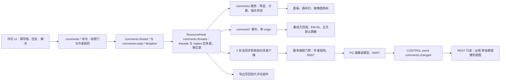
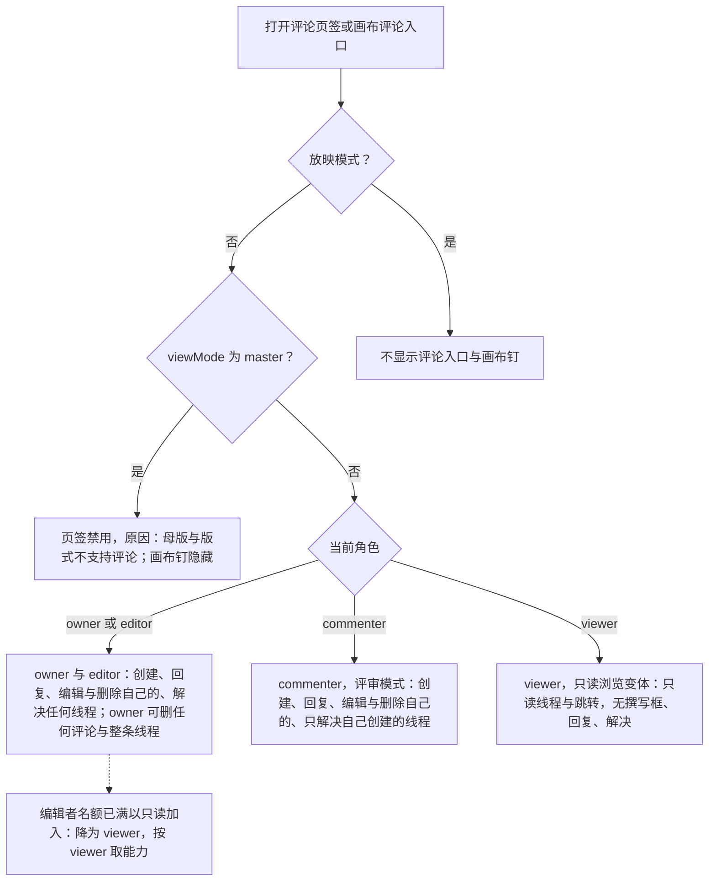
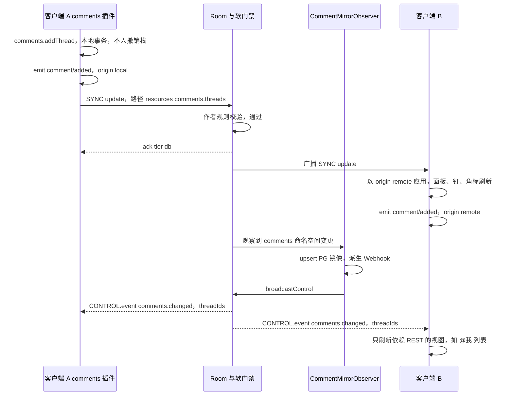
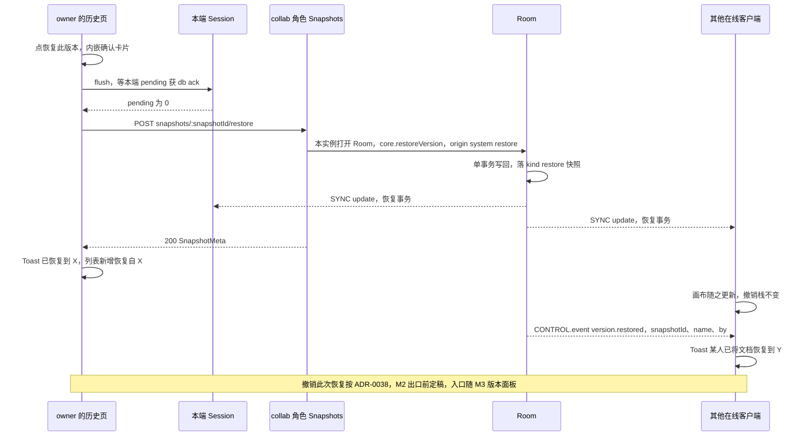

# 08 评论与版本历史（客户端）
> 状态：v0.1 | 负责：前端设计线 | 更新：2026-09-25；2026-09-25（§4.19）；2026-09-25（§4.19 N1）；2026-09-26（§4.20）；2026-10-03（§4.24 设计线对齐审计：§2、§5 画布评论钉改为 slide-ui `CommentPins` 绘制（TA-1）；ADR-0038 状态按 ADR 文件改为「草稿」（TA-3）；§2 写明评论不进内容插件足迹（AL-6）） | 依赖：[PRD 03](../10-prd/03-features/03-collaboration.md) CO-04、CO-07、§3；[ADR-0031](../30-architecture/adr/0031-comments-and-anchors-storage.md) 决策修订 v0.2；[30/04](../30-architecture/04-document-model.md) §2.7；[30/06](../30-architecture/06-collaboration.md) §18.5；[40/10](../40-modules/10-ui-shell-and-slide-ui.md) §1.3、§2.6、§4.4；[40/11](../40-modules/11-preset-assembly-and-app-shell.md) §2.6、§3a；[40/02](../40-modules/02-kernel-protocol-and-document-core.md) §2.6；[rulings](../00-charter/rulings-2026-09-14.md) §4.12 U-07/U-14、§4.18 BE-03/UX-17/UX-19/CO-07、§4.19 D-COMMENTS-PKG/C-06/N1、§4.20 TX-01+BE-10/FE-09/FE-14/FE-16；[ADR-0038](../30-architecture/adr/0038-version-restore-undo.md)（草稿）；[设计 02](../20-design/02-user-flows.md) F7/F8、[设计 03-06](../20-design/03-screens/06-comments-panel.md)、[设计 03-07](../20-design/03-screens/07-version-history.md)、[设计 05](../20-design/05-collaboration-ux.md) §5；[PRD 05](../10-prd/03-features/05-embedding-and-integration.md) EM-05

本文是**评论客户端插件与版本历史 UI** 的唯一事实源：包归属、客户端评论数据与命令、评论 UI 与锚点状态、导入导出、实时与跨文档、版本历史页与恢复流程、离线与降级。

不在本文（只链接）：

| 主题 | 事实源 |
|---|---|
| PG 评论镜像、`CommentMirrorObserver`、Webhook、跨文档「@我」查询、服务端作者软门禁 | [60/07](../60-backend/07-modules-comments-webhooks-audit.md)、[60/13](../60-backend/13-ddl-comments-webhooks-audit.md) |
| 快照写入、压缩、保留期、恢复在 Room 内的执行 | [60/05](../60-backend/05-modules-collab-and-snapshots.md)、[60/11](../60-backend/11-ddl-collab-updates-and-snapshots.md) |
| REST 路由、守卫与错误码 | [60/15 §3.2、§3.8、§3.11](../60-backend/15-rest-api-catalog.md) |
| `CONTROL.event` 帧定义与服务端发送规则 | [30/06 §6.3](../30-architecture/06-collaboration.md)、[60/16](../60-backend/16-ws-protocol-server-view.md) |
| 路由 `/documents/:id/history` 与深链 `?comment=` | [02 §2](02-app-shell-routing-and-session.md) |
| 「最近删除」与「彻底删除元素」 | [04 §7.1](04-document-commands-and-undo.md) |
| 协同会话、被拒回滚 | [07](07-collaboration-client.md) |
| 版本恢复的撤销语义（U-07 `version-restore-undo`） | [ADR-0038](../30-architecture/adr/0038-version-restore-undo.md)（草稿；M-02 主笔，M-05、M-09 会签；M2 出口评审前定稿，rulings §4.20 TX-01+BE-10），本文只写前端落点（§10） |

包名一律省略 `@cordexjs/` 前缀。

## 1. 范围

- **评论**：线程与回复的客户端数据、`comments.*` 命令、检查器「评论」页签、画布评论钉、缩略图角标、锚点状态、pptx 评论的只读导入与「导入为可编辑线程」、导出写回、实时刷新、集成方回调事件。事实源是文档内的 ResourceHook 数据（随 Snapshot / Y 状态同步、导出、离线可写），PG 只是镜像读模型（ADR-0031 v0.2）。
- **版本历史**：版本列表、预览、命名当前版本、恢复与二次确认；自动快照保留口径在列表中的表现。
- 两者都是 M3 能力（PRD CO-04 P0、CO-07 P1）。

## 2. 包归属

依据：rulings §4.19 D-COMMENTS-PKG（用户裁决；章程 §5.2 登记包清单）。

| 落点 | 内容 |
|---|---|
| 新 iso 包 `comments`（横向能力、文档类型盲） | ResourceHook 命名空间 `comments.threads`（决策 INC-39，依据 rulings §4.18 FE-01 文档类型盲 + ADR-0031；服务端镜像按 `comments.` 前缀识别，同样不识别文档类型）；`threads` / `replies` 两张实体表与 Mutation（`comments.thread.*`、`comments.reply.*`）；`comments.*` 命令（§4）；`comment/*` 事件（§8）；UnitScope 服务 `comments`（只读查询：按筛选列线程、单线程、每页未解决数、已脱离锚点列表）；贡献点 `comments.anchorResolver`（按 `documentType` 键，文档类型提供锚点解析） |
| `slide-ui` 贡献 | slide 锚点解析器（页 / 元素 / 文本范围）；检查器「评论」页签（`ui.panel{slot:'inspector.tab'}`）；画布评论钉 `CommentPins`（`ui/canvas-overlays/CommentPins.tsx`，钉与悬停预览气泡都由它绘制，以 `render.overlay` 贡献，[40/10](../40-modules/10-ui-shell-and-slide-ui.md) §4.4、[40/20](../40-modules/20-comments-client.md)；2026-10-03 按 rulings §4.24 TA-1 改正，原写「钉由 render-dom 的 `comment-pins` 覆盖层绘制」作废）；缩略图角标；插入页签「评论」按钮与右键「添加批注」 |
| 装配 | M3 只装入 `preset-slide-collab`（条目 id `comments`，[03 §11](03-preset-assembly-and-plugins.md)）；单人 preset 与查看器不装，未装时评论数据按 [04 §1](04-document-commands-and-undo.md) 静默原样保留；评论不进内容插件足迹（[ADR-0050](../30-architecture/adr/0050-content-plugin-footprint.md) 决策 1），打开带评论的文档不弹缺插件横幅（rulings §4.24 AL-6，[04](04-document-commands-and-undo.md) §1.1） |
| 连带改名 | `pluggable:m3` 白名单为 `{−store-memory, +store-yjs, −collab-core#local-presence, +collab-yjs, +collab-transport-ws, +comments}`（去掉不存在的 `+comments-ui` / `+presence-ui` / `+history-ui` 与重复的 `+collab-core`，[03 §11](03-preset-assembly-and-plugins.md)、[70/02 §10](../70-testing/02-contract-suites-and-pluggability.md)）；40/10 `CommentPins.tsx` 读取的 `resources['slide-comments.threads']` 改为 `comments.threads`；层号与依赖上限登记在章程 §5.2 |

**评论数据与事件流**

怎么读：评论只有一条写路径（命令 → Mutation → ResourceHook）；面板、画布钉与事件都从本地 ResourceHook 派生，其他在线客户端靠 CRDT 同步看到变化；PG 镜像在服务端软门禁之后写入，镜像提交后的 `comments.changed` 只驱动依赖 REST 的视图。
依据：ADR-0031 v0.2；PRD CO-04 图 2-1；决策 SG-03、INC-39；rulings §4.19 D-COMMENTS-PKG。

## 3. 客户端评论数据

实体形状以 ADR-0031 v0.2 为准，Y 状态路径为 `resources['comments.threads']` 下的两张实体表（ADR-0031 写作 `resources.comments`，即同一份数据按 `${pluginId}.${name}` 命名规则的落位）：

| 实体 | 字段 | 说明 |
|---|---|---|
| `Thread` | `id`、`anchor`、`resolved`、`resolvedBy?`、`resolvedAt?`、`createdBy`、`createdAt`、`order: FracKey`、`imported?{authorName, source:'modern'\|'legacy', readOnly}` | 线程本身没有正文，首条回复即发起评论；`imported` 仅 pptx 导入的只读批注有 |
| `Reply` | `id`、`threadId`、`authorId`、`body`、`mentions: UserId[]`、`createdAt`、`editedAt?`、`deletedAt?`、`order: FracKey` | `body` 为纯文本 + 换行 + @ 提及 + 自动识别链接，≤ 5,000 字符；`mentions` ≤ 50 个用户 id，是提及的唯一依据（服务端不扫正文）；删除只置 `deletedAt` 并清空 `body` |

- **锚点**（`anchor`，判别字段 `kind`；`comments` 包只认识 `kind`，其余字段由文档类型的解析器 schema 校验）：slide 取 `{kind:'slide', slideId}`、`{kind:'element', slideId, elementId}`、`{kind:'text', slideId, elementId, range:{anchor, head}}`（`range` 为 `store.createStablePosition` 生成的 RelativePosition base64）。
- **不入撤销栈**：Store 配置 `undo.excludedNamespaces` 含 `comments.threads`，评论命令 `undoable:false`（ADR-0031 决策 3）；UI 提供「删除」「重新打开」而不是撤销。
- **规模**：单文档 ≤ 5,000 线程、单线程 ≤ 500 回复（约 2 MB，计入 Y 状态体积预算，不计入元素上限）；面板直接读内存数据，打开 ≤ 300 ms，列表虚拟滚动。
- **离线可写**：评论在文档状态里，离线时照常创建、回复、解决（§11）。

## 4. 命令与权限

全部命令经 `commands.execute`（[04 §3](04-document-commands-and-undo.md)），`undoable:false`。作者规则在客户端是 UX 守卫（Mutation 级 `permission?(m)` 按线程或回复作者细化能力位），在服务端由软门禁执行（commenter 的 update 只能触及 `comments.` 命名空间，改他人评论被还原并计数，ADR-0031 决策 2，[60/07](../60-backend/07-modules-comments-webhooks-audit.md)）。

| 命令 | 参数 | 能力位 | 作者规则 |
|---|---|---|---|
| `comments.addThread` | `{anchor, body, mentions}` | `doc.comment` | 线程与首条回复的作者 = 当前用户 |
| `comments.reply` | `{threadId, body, mentions}` | `doc.comment` | 作者 = 当前用户；目标线程为只读导入批注时不可用 |
| `comments.editReply` | `{replyId, body, mentions}` | `doc.comment` | 只能编辑自己的回复 |
| `comments.deleteReply` | `{replyId}` | 自己的：`doc.comment`；他人的：`doc.manage`（owner） | — |
| `comments.deleteThread` | `{threadId}` | `doc.manage`（owner） | 连同全部回复 |
| `comments.resolve` / `comments.reopen` | `{threadId}` | 自己创建的线程：`doc.comment`；任何线程：`doc.write`（editor 及以上） | commenter 只能解决 / 重开自己创建的线程 |
| `comments.importThreads`（P1，仅单人或本地） | `{threadIds}` | `doc.comment` | 协同模式改走 REST（§7） |
| `comments.reanchor`（P1） | `{threadId, anchor}` | `doc.comment` | 把已脱离锚点的线程重新锚定 |

- **@ 提及**：撰写框中输入 `@` 触发候选下拉（↑↓ 选择、Enter 确认、Esc 只取消候选）。候选来自集成方用户目录回调 `searchUsers(query) → {id, displayName, avatarUrl?}[]`；apps/web 默认实现为 `GET /users?query=`（[60/15 §3.2](../60-backend/15-rest-api-catalog.md)）：至少 2 个字符才发请求、结果 ≤ 20 条、只含 id / 显示名 / 头像，邮箱只做精确匹配且不回显，服务端按用户令牌桶限流（决策 SG-05）；客户端去抖 200 ms，当前在场协作者排在最前。没有目录回调时 `@` 作为普通字符插入、不弹候选。提交时把选中的用户 id 写入 `mentions`，正文保留输入时的「@显示名」文本。
- **查看者**没有 `doc.comment`：评论命令全部被权限门拒绝，面板为只读（§5）。

## 5. 评论 UI

视觉与线框以 [设计 03-06](../20-design/03-screens/06-comments-panel.md) 为准；本节定数据来源与规则。

- **检查器「评论」页签**：筛选「全部 / 当前页 / 未解决 / @我」，存在 ≥ 1 条已脱离锚点线程时追加临时筛选「已脱离锚点（N）」；排序「最新 / 最旧 / 按页码」；已解决线程折叠为单行摘要；长正文默认折叠 3 行；「编辑过」标记附时间 tooltip。「@我」= `mentions` 含当前用户的线程，本地内存计算，不走 REST。
- **锚点创建三路**：选中元素后「添加批注」→ 元素锚点；文本编辑态选中范围后「添加批注」→ 文本范围锚点；无选中时在面板底部撰写 → 页级锚点。创建时画布先出现临时钉（编号 = 当前页最大编号 + 1），提交后刷新为正式序号。
- **画布评论钉**：slide-ui 的 `CommentPins` 覆盖层按锚点位置绘制编号钉（24 px）并提供悬停预览气泡（rulings §4.24 TA-1）；同一位置过密时合并为「3 条评论」聚合钉，点击展开选择；点钉 → 页签定位该线程并高亮一次；点线程 → 画布钉脉冲一次并把目标滚入视口。放映模式与母版视图不显示钉。
- **缩略图角标**：每页右上角显示该页未解决线程数（中性色），tooltip「另有 N 条已解决」。
- **深链** `?comment={threadId}`（决策 INC-35）：跳到对应页、切到评论页签、滚动定位并高亮、钉脉冲一次。
- **删除**：删除自己的回复先乐观隐藏，显示 5 s 可撤销 Toast，超时才执行 `comments.deleteReply`（Toast 的「撤销」只是取消尚未执行的命令，不是撤销栈）；owner 删除他人回复或整条线程走确认对话框「删除此讨论串？将同时删除 N 条回复」，立即执行、不可撤销。
- **并发**：「已解决线程有新回复」在面板该线程处内联提示（设计 05 §5 场景 J），不出 Toast。
- **状态**：空态（插画 + 引导文案）；Unit 未 `loaded` 前显示骨架；单条线程的锚点解析抛错只影响该条（显示「锚点无法解析」，内容仍可读）；离线时本端尚未同步的条目带「待同步」标记，`pendingLocalUpdates` 归零后统一清除。

**评论入口按角色与视图模式的过滤**

怎么读：先按放映与母版视图两道视图门过滤，再按角色给出能力；名额已满的只读加入按 30/06 §14 降为 viewer，与 viewer 同一能力（不可评论，[07 §8.1](07-collaboration-client.md)）。所有写入口的最终把关是命令管线的权限门与服务端软门禁，UI 过滤只是体验。
依据：PRD §1 角色表、CO-04；设计 03-06；40/10 §2.1 `InspectorSections`；rulings §4.18 UX-19。

## 6. 锚点状态

锚点状态**不存储、每次派生**：`comments` 服务调用文档类型登记的解析器 `resolveAnchor(anchor, view) → {state:'anchored', page, box?, range?} | {state:'detached', reason, by?, at?}`，`view` 是 `filterLive()` 视图；只在 `store/transaction` 触及锚点目标（按 `entityId` 建索引）时重算。服务端镜像用同一套解析规则计算 `anchor_state`（[60/07](../60-backend/07-modules-comments-webhooks-audit.md)），客户端不读它。

| 锚点 | 已锚定 | 已脱离 |
|---|---|---|
| 页 | 页存活 | 页为墓碑（`target-deleted`）或已硬删除（`target-purged`） |
| 元素 | 元素及所在页都存活 | 元素或所在页为墓碑（`target-deleted`，带删除者与时间）或已硬删除（`target-purged`） |
| 文本范围 | 元素存活且 `resolveStablePosition(anchor/head)` 都成功；只解析失败而元素仍在时退化为元素锚点显示（`rangeLost`） | 同元素 |

- 已脱离的线程没有画布钉，面板标注「原对象已删除」，仍可读、回复、解决；墓碑 TTL 内目标以**原 id** 恢复（删除方撤销，或「恢复元素」，[04 §6.2](04-document-commands-and-undo.md)）后自动回到原锚点，标注消失；目标硬删除后永久脱离（可 P1 重新锚定）。
- **epoch 变更**（4428，[07 §9](07-collaboration-client.md)）：Unit 重开后 RelativePosition 失效，文本范围锚点退化为元素锚点（`rangeLost`），页与元素锚点因 id 稳定不受影响；换纪元时服务端是否批量重写锚点见 [60/05](../60-backend/05-modules-collab-and-snapshots.md)（ADR-0031 后果段）。

**评论锚点状态**

怎么读：状态由目标实体的存活情况派生，评论本身从不因目标删除而被改写；只有删除方撤销或「恢复元素」这类以原 id 复活的操作能把线程带回原锚点，重新锚定是 P1 的显式命令。
依据：ADR-0031 v0.2 与「如何被机械验证」；PRD CO-04；设计 03-06「已脱离锚点」；rulings §4.15 Q3。

## 7. 导入 / 导出

- **只读导入**：打开含现代评论（`p188:cm`）或旧式评论（`p:cm`）的 pptx 时，codec 把批注解成 `imported.readOnly=true` 的线程（作者名取自 `commentAuthors`，`authorId` 为空），标题追加徽标「来自原文件」，不可回复、不可解决。
- **导入为可编辑线程（P1）**：线程底部按钮。协同模式调用 `POST /documents/:id/comments/import{importedThreadIds}`（`doc.comment`，[60/15 §3.11](../60-backend/15-rest-api-catalog.md)），由服务端在 Room 内以系统事务改写（导入批注的作者不是当前会话用户，客户端写入会被作者规则还原），结果经 CRDT 到达；单人或本地模式直接执行 `comments.importThreads`。
- **导出**：默认把线程写回现代评论部件（`commentAuthors.xml` + `modernComment_*.xml`，PD-04，可在导出选项关闭），PowerPoint 365 打开可见评论且作者、时间正确；已删除回复不导出；已脱离锚点的线程在其页仍存活时按页级批注导出，页已不存在时省略并在导出报告中计数；只读导入批注按原样写回。

## 8. 实时与跨文档

- **在线实时**：评论是文档状态的一部分，他人的评论经 CRDT 同步到达，`comments` 服务观察 `resources['comments.threads']` 的变更刷新面板、钉与角标，≤ 1 s 可见（ADR-0031 验收）；不依赖任何额外通知帧。
- **`CONTROL.event{name:'comments.changed', payload:{threadIds[]}}`**（决策 INC-03/04/05、SG-03）：服务端在 PG 镜像提交后发出，含义是「镜像已与 CRDT 一致」。客户端只用它刷新依赖 REST 的视图（应用壳的跨文档「@我」列表与角标），编辑器内的面板从不因它重新拉取；同一帧类型的 `version.restored` 由版本恢复流程消费（§10 第 6 步）；未知 `event.name` 丢弃并计数。
- **跨文档「@我」**：`GET /comments/mentions?cursor=`（[60/15 §3.11](../60-backend/15-rest-api-catalog.md)），结果按文档直接授权过滤（分享链接角色不参与跨文档查询）；列表项点击以深链 `?comment=` 打开对应文档。视图落位在应用壳，页面结构归 [02](02-app-shell-routing-and-session.md)。
- **集成方回调**（EM-05）：`comments` 插件在观察到本地或远端变更时发出 `comment/added | replied | resolved | reopened | deleted | mentioned`，载荷 `{threadId, replyId?, authorId, mentioned?, anchorSummary, origin:'local'|'remote', body?}`；`comment/mentioned` 对每个新增被提及用户各发一次。建议集成方只对 `origin:'local'` 发通知（每条评论只在作者端触发一次），不需要常驻前端的集成方改用服务端 Webhook（`comment.added` / `comment.mentioned` / `comment.resolved`，[60/07](../60-backend/07-modules-comments-webhooks-audit.md)）。正文默认脱敏（`body` 省略，只给长度），集成方显式开启 `comments.events.includeBody` 才带正文。

**创建评论并到达其他在线客户端**

怎么读：评论到达他人靠的是普通的 CRDT 广播，面板在这一步就已更新；`comments.changed` 晚于它、只表示镜像已追上，用来刷新跨文档的 REST 视图。作者规则不通过时服务端还原该改动并计数，客户端表现为一次普通的远端修复。
依据：ADR-0031 v0.2；60/07 镜像观察器；决策 SG-03、INC-03/04/05；PRD CO-04 通知条款、EM-05。

## 9. 版本历史页

视觉与线框以 [设计 03-07](../20-design/03-screens/07-version-history.md) 为准。

- **入口与路由**：检查器「历史」页签、「⋯ → 版本历史」、命令面板；路由 `/documents/:id/history`（兄弟路由，HostRegistry 保活编辑器 host，不重建 Unit；检查器加宽到 560 px，[02 §2](02-app-shell-routing-and-session.md)、[10 §2](10-editor-shell-and-interaction.md)）。
- **能力位分流**（rulings §4.18 UX-17）：没有 `history.read`（评论者、查看者）时页签入口本身不出现；编辑者可浏览与预览，「恢复此版本」与「命名当前版本」禁用并 tooltip「需要所有者权限」；恢复需 `history.restore`、命名需 `doc.manage`，二者只属于 owner。
- **列表**：`GET /documents/:id/snapshots?cursor=&limit=`（[60/15 §3.8](../60-backend/15-rest-api-catalog.md)）→ `SnapshotMeta{snapshotId, kind, name?, description?, contributors[], seqUpto, createdAt}`，`kind ∈ auto | named | import | migration | restore | epoch`。按天分组、按月折叠（默认展开最近一个月），「加载更早版本」按游标翻页。● 自动版本显示时间与贡献者头像（`contributors`，压缩时由该段 update 的作者去重写入，决策 DDL-COLS）；★ 命名版本加粗名称、说明与作者；`restore` 显示「恢复自『X』」；`import` / `migration` / `epoch` 显示对应系统标签。只有检查器页签可见时才请求，结果只在内存缓存。
- **保留口径在列表中的表现**（依据：rulings §4.19 C-06）：自动版本 30 天内全量保留；30 天后每天只留当天最后一个 auto 快照，保留至 `retention.autoSnapshotDailyDays`（默认 365，0 = 永久）；命名版本永久（每文档上限 200）；`import` / `migration` / `restore` / `epoch` 按自动版本口径。列表中 30 天以前的日期分组只会有一条，标注「当日最后版本」；列表末尾说明「较早的自动版本按天保留，命名版本永久保留」，文案不写死天数。
- **预览**：点击某版本 → `GET /documents/:id/snapshots/:snapshotId`（字节，形态同 latest）→ 在同一 host 内打开隔离的预览 Unit（`source.kind:'state'`、`store-yjs`、不连协同、`historyLimit 0`、只读策略），旧 `schemaVersion` 先经 `migrations` 迁移（章程 D6）；画布切换为该版本的只读预览，带迷你页条可翻页；不影响当前协同会话，不向他人广播（本端 awareness 仍报告实时文档的视图）。切换版本时取消上一个请求（`AbortController`）并释放上一个预览 Unit；大快照显示骨架，时间轴保持可点。离开历史页即关闭预览 Unit。
- **命名当前版本**：输入名称（≤ 30 字符）与可选说明 → 先 `Session.flush()`（等本端 pending 落库，5 s）→ `POST /documents/:id/snapshots{name, description?}`（决策 MECH-INC 中 INC-15）→ 列表刷新。`server.snapshots.named_limit_reached`（409，每文档命名版本上限 200，不属配额码）→ Toast（文案取 `errors.<code>`）。
- **「最近删除」分组**（owner）：位于时间轴顶部，行为见 [04 §7.1](04-document-commands-and-undo.md)。
- **状态**：加载（时间轴骨架 + 预览骨架）、空（「尚无历史记录，继续编辑后将自动生成版本快照」）、错误（整块替换为「版本历史加载失败」+ 重试）、离线（§11）。
- **不做**：版本对比（`GET …/diff`，P2 未排期）。

## 10. 版本恢复流程（前端视角）

1. 点「恢复此版本」→ 内嵌确认卡片（不用浏览器 `confirm()`）：「恢复到『X』？将创建一个新版本，当前更改不会丢失。若有协作者正在编辑，他们的画布将自动更新为恢复后的内容。」
2. 确认后先 `Session.flush()`，让本端 pending 先落库、被恢复前的自动版本覆盖；`offline` / `reconnecting` 时按钮禁用，tooltip「恢复连接后才能恢复版本」。
3. `POST /documents/:id/snapshots/:snapshotId/restore`（`history.restore`）。该路由只在 collab 角色装配（rulings §4.18 BE-03）：服务端在接到请求的 collab 实例上打开或复用 Room 执行 `core.restoreVersion`（单事务，origin `system('restore')`；若最新检查点之后还有已落库的更新，先落一个 `auto` 快照保留恢复前状态，60/05 §10），写一个 `kind='restore'` 快照，在线客户端不断连，多副本经扇出收敛（[60/05](../60-backend/05-modules-collab-and-snapshots.md)）。
4. 恢复事务像任何远端 update 一样经 CRDT 到达所有在线客户端（含发起方），画布随之更新；发起方 Toast「已恢复到『X』」，列表出现「恢复自『X』」。
5. **撤销语义**：恢复事务是 `system` origin，不进入任何人的撤销栈；之后任何人撤销自己更早的步骤，都按中性撤销语义跳过被恢复改写的键（[04 §6](04-document-commands-and-undo.md)）。「撤销此次恢复」由 [ADR-0038 version-restore-undo](../30-architecture/adr/0038-version-restore-undo.md) 定义（草稿；M-02 主笔，M-05、M-09 会签；M2 出口评审前定稿，未定稿则 M3 的版本恢复 CO-07 不开工，rulings §4.12 U-07、§4.20 TX-01+BE-10）。ADR 起草基线：在持有 Room 的实例内以单事务执行、不加锁、不断连，走命令管线（不用 `revertTo`）；只处理恢复事务改写过的键，「他人后写」看当前值是否仍出自恢复事务的 struct 范围（不比较值是否相等），被写过的键跳过并计入提示，全部被跳过时不提交（整步跳过即停，rulings §4.15 Q3）；恢复时删掉的元素以原 id 复活，墓碑 TTL 已过的跳过。前端落点：版本面板上最近一次恢复的条目提供「撤销此次恢复」入口，内嵌二次确认，完成后 Toast 提示跳过的键数；确认卡片与成功 Toast 预留该动作位。「谁能撤销」（建议任一持 `history.restore` 者）与「可撤销时效」两处待 ADR 定稿时交互拍板，入口的出现条件随之确定；接口形状以 ADR 为准。
6. **其他协作者**：画布随 CRDT 更新；同时订阅 `CONTROL.event{name:'version.restored', payload:{snapshotId, name?, by}}`（30/06 §6.3 登记，服务端在恢复提交后经扇出发送，[60/05](../60-backend/05-modules-collab-and-snapshots.md) §10），收到即显示 Toast「〈by〉已将文档恢复到『name』」（无名称时显示该版本时间，设计 F8）；发起方收到本人发起的同名事件不重复提示。
7. **失败**：`server.snapshots.not_found`（404）→ 刷新列表；`server.documents.locked`（409，文档正在覆盖导入或迁移；恢复本身不加锁）→ Toast「文档正忙，请稍后再试」；服务端保存处于降级期（Room `persist ≠ ok`，60/05 §10 第 1 步）→ 503 `server.snapshots.persist_degraded`（可重试），Toast「服务器暂时无法保存，请稍后再试」；403 → 刷新权限；网络错误 → 可重试（服务端以单事务执行，重复请求会再创建一个恢复版本，不会损坏文档）。`room.persist='degraded'` 时「恢复此版本」与「命名当前版本」预先禁用（§11）。
8. **不加锁**（rulings §4.19 N1，已裁定）：恢复是持有 Room 的 collab 进程内的单个事务，不锁定文档、不推 `room{locked}`、不断连；协作者在恢复期间照常编辑，其并发更新与恢复事务按 CRDT 合并，不会被 L2 拒绝，因此不触发 [07 §8.2](07-collaboration-client.md) 的「导出后重载」。ADR-0029 决策 5 的锁定窗口已收窄为覆盖导入与迁移。原写法「恢复是否加锁待用户裁决，本文建议不加锁」作废。

**版本恢复（前端视角）**

怎么读：恢复在服务端 Room 内以一个 `system('restore')` 事务完成，所有在线客户端（含发起方）都像接收普通远端更新一样看到结果；发起前的 `flush` 保证本端未落库的编辑先进入历史。
依据：PRD CO-07；设计 02 F8、设计 03-07；40/02 §2.6 `core.restoreVersion`；60/15 §3.8；rulings §4.12 U-07、§4.18 BE-03、§4.20 TX-01+BE-10；ADR-0038（草稿）。

## 11. 离线与降级

| 情形 | 评论 | 版本历史 |
|---|---|---|
| `offline` / `reconnecting` | 照常创建、回复、解决、删除自己的（数据在文档状态内，重连经 step2 提交）；条目带「待同步」；@ 候选只来自本地在场缓存，目录搜索禁用并提示「离线时无法搜索用户」 | 时间轴置灰不可点；曾加载过则显示内存缓存并标注「离线 · 可能不是最新」；命名、恢复、彻底删除禁用 |
| 离线期间被降为查看者 | 重连后评论更新被拒，按 [07 §8.2](07-collaboration-client.md) 进入「未同步更改」并可导出 | — |
| PG 降级期（`room.persist='degraded'`） | 面板不受影响（读内存）；镜像滞后，「@我」REST 视图可能暂时过期，`comments.changed` 恢复后补发 | 列表可能缺最近的自动版本；命名与恢复禁用，tooltip「服务器暂时无法保存」（服务端要求 `persist = ok`，60/05 §10） |
| 服务端未发 `comments.changed`（丢帧、断线） | 「@我」视图在下次进入或手动刷新时重新拉取，不影响面板 | — |
| 分享与链接 | 离线时分享对话框与生成链接不可用（[02](02-app-shell-routing-and-session.md)） | — |
| 单条线程锚点解析失败 | 只影响该条（「锚点无法解析」），其余正常 | — |

## 12. 机械验证

本节只写断言与所在套件 / CI 步骤，执行方式归 [70](../70-testing/06-frontend-component-and-e2e.md)。

| # | 断言 | 套件 / 用例 | CI 步骤 |
|---|---|---|---|
| V1 | commenter 可创建与回复、不可编辑或删除他人评论；commenter 只能解决自己创建的线程，editor 可解决任何线程；viewer 面板只读 | `comments` 命令单测（权限矩阵）；评论 e2e（[70/06 §5](../70-testing/06-frontend-component-and-e2e.md)） | test/unit、e2e/full-compose |
| V2 | 绕过客户端改他人评论被服务端软门禁还原并计数 | [70/07 §12](../70-testing/07-backend-integration-and-api-e2e.md) | test/server-integration |
| V3 | 评论命令不入撤销栈：执行后 `canUndo` 不变，撤销不回退评论 | `runDocumentStoreConformance` 排除命名空间用例；`comments` 单测 | test/contract、test/unit |
| V4 | 删除锚点目标后线程进入已脱离；TTL 内以原 id 恢复后自动回到原锚点；硬删除后永久脱离 | ADR-0031「如何被机械验证」e2e；锚点解析单测 | test/unit、e2e/full-compose |
| V5 | 评论变更 ≤ 1 s 到达其他在线客户端；`comments.changed` 只触发 REST 视图刷新、不触发面板重拉 | 双浏览器评论用例；`comments` 服务单测 | e2e/full-compose、test/unit |
| V6 | 5,000 线程 × 500 回复时面板打开 ≤ 300 ms | perf 场景（[70/09](../70-testing/09-performance-and-capacity.md)） | perf/perf-client |
| V7 | 含现代与旧式评论的 pptx 只读显示；导出后 PowerPoint 365 可见评论且作者与时间正确；只读导入批注往返不变 | 保真往返语料（[70/03](../70-testing/03-fidelity-roundtrip-and-corpus.md)）；人工证据 | test/fidelity-roundtrip |
| V8 | 历史页签按 `history.read` 出现或消失；恢复与命名按钮按 `history.restore` / `doc.manage` 禁用 | 版本历史 e2e（70/06 §5） | e2e/full-compose |
| V9 | 预览不影响当前会话与 awareness；旧 `schemaVersion` 快照迁移后预览；离开历史页后预览 Unit 已 dispose（`getEffects()` 为空） | 预览 Unit 生命周期单测；e2e | test/lifecycle、e2e/full-compose |
| V10 | 恢复：在线客户端不断连、内容一致、生成 `kind='restore'` 快照；恢复前 `flush` 使本端 pending 已落库；恢复进行中协作者不进入只读、不收到 `room{locked}`（rulings §4.19 N1） | 70/07 §9；双浏览器恢复用例 | test/server-integration、e2e/full-compose |
| V11 | `comment/*` 事件载荷默认不含正文；`origin` 字段正确区分本地与远端 | `comments` 事件单测 | test/unit |
| V12 | 事件先声明后使用（`comment/*`） | lint `cordex/events-must-be-declared` | lint |
| V13 | 撤销此次恢复（ADR-0038 定稿后）：他人在恢复后改过的键被跳过并提示、全部被跳过时不提交、墓碑 TTL 已过的元素跳过；恢复时删掉的元素以原 id 复活 | 70/05 `rs/restore-revert-*` 场景；PRD 05 M3 检查名 `history:restore-revert` | test/collab-sim、e2e/full-compose |

## 13. 里程碑、未决与待登记

**里程碑**：本文全部为 M3。其中 PRD P1 项（「导入为可编辑线程」、重新锚定）可在 M3 后半段交付；版本对比为 P2（未排期）；「撤销此次恢复」按 ADR-0038 随 M3 交付（PRD 05 M3 验收检查名 `history:restore-revert`，70/13 §3.4 登记）。

| 项 | 状态 | 去向 |
|---|---|---|
| D-COMMENTS-PKG：新 iso 包 `comments` 与 `pluggable:m3` 白名单 | 已裁定（rulings §4.19）：§2 定稿 | 章程 §5.2、PRD 05 由总编排回写；[03 §11](03-preset-assembly-and-plugins.md) |
| C-06：自动快照 30 天后按天稀疏的上限、命名版本上限 | 已裁定（rulings §4.19）：`retention.autoSnapshotDailyDays` 默认 365（0 = 永久），命名版本每文档上限 200；§9 定稿 | [60/05](../60-backend/05-modules-collab-and-snapshots.md)、[60/14](../60-backend/14-valkey-object-storage-and-retention.md) |
| 设计 F8「其他协作者收到恢复 Toast」所需信号 | 已关闭：`CONTROL.event{name:'version.restored', payload:{snapshotId, name?, by}}`（30/06 §6.3），§10 第 6 步订阅 | [30/06 §6.3](../30-architecture/06-collaboration.md)、[60/16](../60-backend/16-ws-protocol-server-view.md) |
| 恢复是否锁定文档 | 已裁定（rulings §4.19 N1「恢复不锁、覆盖导入换纪元」）：恢复不加锁、在线不断连（§10 第 8 步）；ADR-0029 决策 5 与 60/04 状态机的锁定窗口已收窄为覆盖导入与迁移；覆盖导入的客户端表现见 [07 §8.1、§9](07-collaboration-client.md) | [60/05](../60-backend/05-modules-collab-and-snapshots.md) §10、[60/04](../60-backend/04-modules-documents-storage-media.md) §2、[60/06](../60-backend/06-modules-jobs-import-export-thumbnails.md) §6.5 |
| 恢复在 `persist ≠ ok` 时的 503 错误码名 | 已关闭（审稿）：`server.snapshots.persist_degraded`（503，`retryable`），60/15 §3.8 恢复与命名两条路由已列、60/05 §14 已登记；§10 第 7 步按此码提示 | [60/15 §3.8](../60-backend/15-rest-api-catalog.md) |
| 名额已满只读加入的降级角色 | 已关闭：viewer（不能评论），设计 03-12 删「仍可评论」 | 同 [07 §17](07-collaboration-client.md) |
| 评论 Y 路径 | 已关闭：统一写 `resources['comments.threads']`（内含 threads、replies 两张表），ADR-0031、60/07 与 60/16 L4 放行前缀同步 | [60/07](../60-backend/07-modules-comments-webhooks-audit.md)、[60/16](../60-backend/16-ws-protocol-server-view.md) §4 |
| `comment/*` 事件正文默认脱敏与 `comments.events.includeBody` 选项名；`origin` 字段 | 已登记（rulings §4.20 FE-16）：[15](15-events-errors-and-telemetry.md) §2 事件表；30/10 §11.1 同轮回写 | [15](15-events-errors-and-telemetry.md) §2、30/10 §11.1 |
| `comments.anchorResolver` 贡献点、`comments` UnitScope 服务、`comments.reanchor` / `comments.importThreads` 命令 id | 落点已定（rulings §4.20 FE-09，40/00 Q-M8 确认）：[40/20](../40-modules/20-comments-client.md)（占位，行为以本文为准，不并入 M-12 或 M-05）；正文（目录树、文件职责、契约套件、slide-ui 的 resolver 接口）M3 开工前补齐 | [40/20](../40-modules/20-comments-client.md) |
| U-07 撤销此次恢复 | 已立项（rulings §4.20 TX-01+BE-10）：[ADR-0038](../30-architecture/adr/0038-version-restore-undo.md)（草稿），M2 出口评审前定稿；「谁能撤销」「可撤销时效」待定稿时交互拍板；本文 §10 第 5 步为前端落点 | ADR-0038；70/05 `rs/restore-revert-*`；70/13 §3.4 |
| 30/04 §2.7 示例命名空间 `slide-comments.threads` 与 40/10 `CommentPins` 的读取键改为 `comments.threads`（INC-39） | 已定；30/04 §2.7 与 40/10 §4.4、§5.4 已回写（2026-09-25） | 总编排 |

