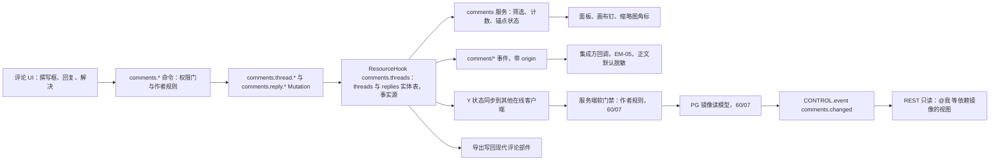
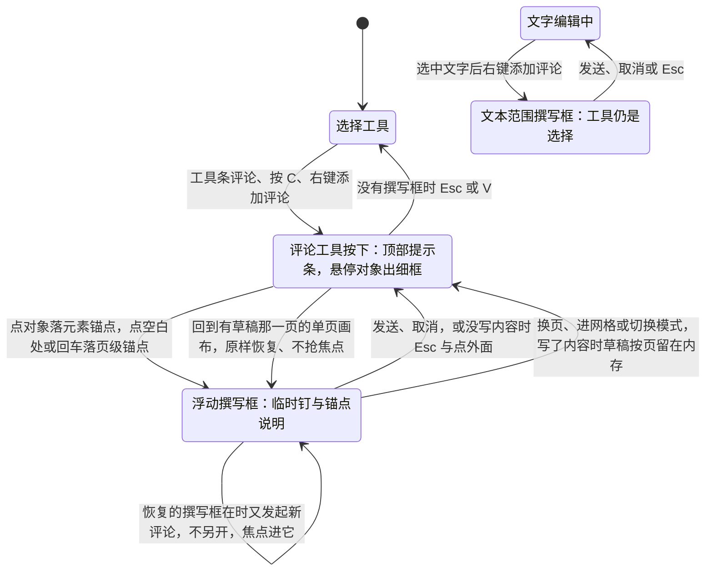
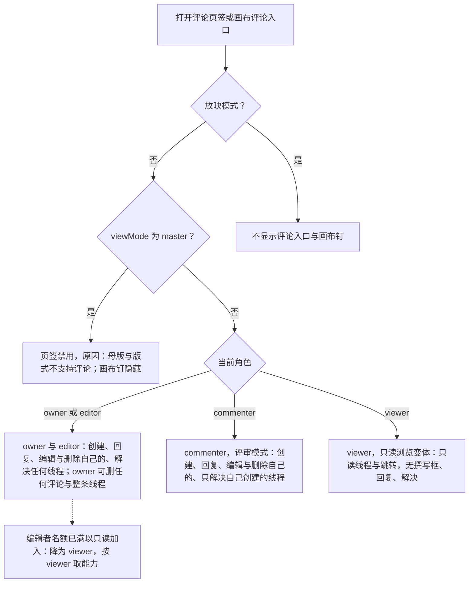
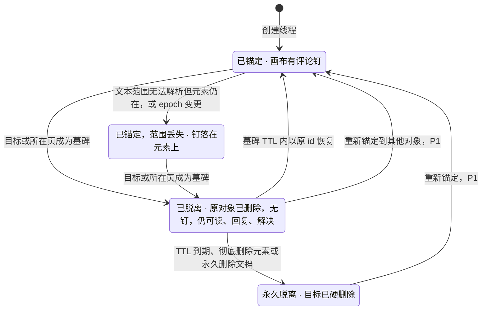
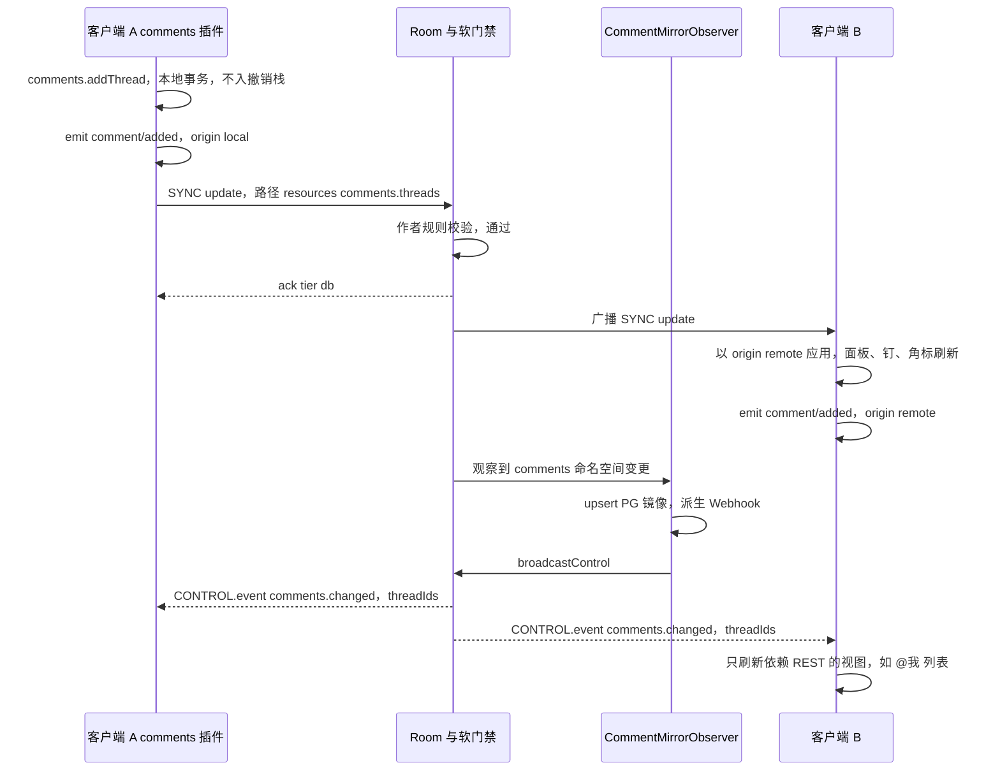
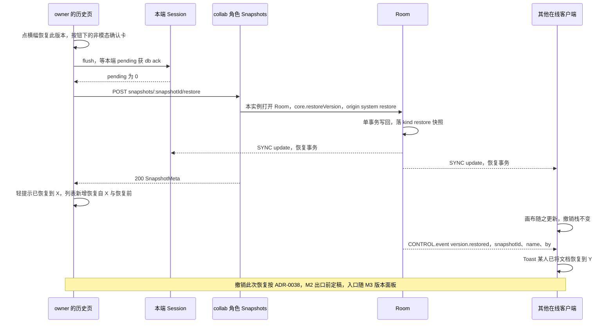

# 08 评论与版本历史（客户端）
> 状态：v0.1 | 负责：前端设计线 | 更新：2026-09-25；2026-09-25（§4.19）；2026-09-25（§4.19 N1）；2026-09-26（§4.20）；2026-10-03（§4.24 设计线对齐审计：§2、§5 画布评论钉改为 slide-ui `CommentPins` 绘制（TA-1）；ADR-0038 状态按 ADR 文件改为「草稿」（TA-3）；§2 写明评论不进内容插件足迹（AL-6））；2026-10-04（design-language-v3 第 0 批：复验修正——§1 slide-ui 贡献的「评论」页签槽位 `inspector.tab` 改为 `inspector`（50/09 §6.1），插入页签按钮改为底部工具条「评论」）；2026-10-07（design-language-v3 第 1 批：§5 锚点创建的入口名按设计 03-05 右键表改为「添加评论」（原称「添加批注」），工具条「评论」与评论面板的交互随第 2 批（rulings §4.25 DS-21））；2026-10-08（design-language-v3 第 1 批收口：§2 右键名改为「添加评论」；§5 补仅查看形态的评论——手机（< 640）M3 起可发表与回复、平板只读评审（rulings §4.25 DS-28、TB-49），撰写区样张随第 2 批；§9 版本历史入口改为文档菜单「版本历史」与命令面板（原检查器「历史」页签与「⋯ → 版本历史」作废，呈现随第 2 批））；2026-10-15（design-language-v3 第 2 批：按已拍板样张 `comments`、`version-history` 改写 §5、§9–§11——§5 拆为六小节：分段筛选「全部 / 当前页 / 未解决 / @我」缺省「当前页」、临时筛选「已脱离锚点 N」、钉与列表不编号、选中铺强调色淡底、作者名与提及 500、导入批注中性钉、编辑模式照常显示钉（rulings §4.25 DS-43）；评论工具落点旁浮动撰写框、发表后工具保持按下、文本范围例外、桌面 ↵ 发送与手机 ↵ 换行、键盘新建与右键「添加评论 C」（DS-44）；面板不常驻撰写框、点空白处即页级评论，原「面板底部撰写 → 页级锚点」作废（DS-45）；手机底部面板可发表与回复、平板只读评审（DS-46）；整条讨论串只有所有者能删并走模态确认（DS-40）；加载随整栏不可用、不设面板级加载失败（DS-53）；缩略图角标读屏名带计数（DS-62）；§9 版本历史改为检查器整栏面板 280、原 560 与 `historyWidth` 作废（DS-38），预览时画布与左栏换成所选版本、预览横幅与其余横幅最多两条、缩略图迷你条作废（DS-39），自动版本收组含「恢复前」单列、命名 ≤ 30 字原位展开、达上限表单保留并走轻提示、命名版本加粗不用 ● / ★、不做「以此版本创建副本」（DS-57），加载转圈一行、整块出错、空态显示导入快照（DS-53）；§10 恢复确认改为锚在横幅按钮下的非模态确认卡（DS-40）、恢复后列表出现「恢复自『X』」与「恢复前」；§11 离线行按样张；§6 状态图去掉「编号钉」；§7 按钮名「导入为可编辑评论」；§12 V8 改为文档菜单入口、新增 V14–V16；§13 登记第 2 批回写与他线待登记项）；2026-10-15（design-language-v3 第 2 批：§5.3 钉右键改称「评论钉」并写明由 `CommentPins` 直接渲染、不走 `ui.contextMenu`、查看者右键不拦截（rulings §4.25 TB-61）；§5.4 写了内容的撰写框遇到换页按页保留草稿（DS-65），键盘 ↵ 只在评论工具开着或焦点在「评论」上时落钉（TB-62）；§5.5 查看者的钉；§9 宽度改为沿用检查器宽度（TB-60）、打开期间失去 `history.read` 即关闭（TB-63）、说明 ≤ 200 字（TB-64）、`preRestore` / `restoredFrom` 与 `details.limit` 已登记、API 直接建的空文档的空态（TB-74）；§12 V8、V14、V15 同步；§13 他线登记核对、空态核对行结案；同日再补：§5.4 写了内容的撰写框在换页、进入网格视图与切到评审模式时同样按页留草稿（rulings §4.25 TB-84），恢复时不抢焦点、焦点留在换页处，点临时钉或在钉上按 `Tab` 进入，评论工具是否按下不因恢复而改变，收起时焦点在框里的先交给画布、不经过 `body`（TB-79 修订），文本范围撰写框恢复后不恢复文字编辑；状态图与「怎么读」同步；§9 列表最早一条 `import` 按来源写「导入自『文件名.pptx』」「新建演示文稿」「从模板『〈模板名〉』新建」「创建自『〈原文档名〉』的副本」，来源与显示名取自 `SnapshotMeta.origin` / `originName`（DS-70，60/15 §3.8），空态同步；命名说明写到 180 字起才显示「N/200」，所有者降为编辑者时命名表单与恢复确认卡收起、「最近删除」不再显示（按设计 03-07 §4.3、§7）；§12 V8、V14、V15 同步；§13 两行他线项核对为已登记、新增 DS-70、TB-79、TB-84 一行）；2026-10-15（design-language-v3 第 2 批：§5.4 撰写框留稿一条拆成小节——切到评审模式或从评审返回编辑后仍停在同一页的单页画布时撰写框当场原样恢复、不抢焦点、不改评论工具，草稿按页存、不按模式存（rulings §4.25 TB-87）；写明在临时钉上按 `Tab` 或 `↵` 进撰写框，因为撰写框挂在浮层平面、不紧跟钉的 DOM 位置（样张 `tabIntoDraftComposer`）；有恢复的撰写框时在「评论」上按 `↵`、按 `C`、右键「添加评论」或开着工具点画布别处都不另开撰写框，焦点直接进它、光标在末尾、临时钉脉冲一次（TB-88）；回到那一页时锚点对象已删退为页级锚点（框顶「评论 · 整页」）、文本范围解析不到退为元素锚点、整页已删则草稿随页丢弃不提示（TB-92）；文本范围撰写框发送或取消后回到画布「选择」；键盘一条、状态图（加自环）与「怎么读」同步；§9 `SnapshotMeta` 补 `origin?` / `originName?` 且只有 `import` 行带，源文档未命名的副本写「创建自『未命名演示文稿』的副本」，覆盖导入（换纪元）同为 `upload` 加文件名，`import` 行的类别名「导入版本」/「初始版本」用于月份行摘要与读屏名（TB-90）；§12 V14、V15 同步；§13 DS-70、TB-79、TB-84 一行的他线项核对为已登记、新增 TB-87、TB-88、TB-90、TB-92 一行；同日再补：§5.4「收起与留稿」的「只有关闭文档才丢弃草稿」后注明整页被删除时随页丢弃（TB-92）；「又发起新评论」补评论工具照各入口原有的规则按下、TB-88 只改撰写框与焦点的去向，编辑文字时对选中文字发起评论的例外照旧（rulings §4.25 TB-97），「工具」一条与「怎么读」同步；「锚点不在了」补整页被删、草稿已丢弃后撤销删页草稿不回来（TB-99）；§9 月份行摘要改为当月有任一 `import` 行（含覆盖导入写下的那条）就写它的类别名，没有命名版本、也没有 `import` 行时才写「N 个自动版本」（TB-98）；§13 新增 TB-97…TB-99 一行）；同日再补：§13 TB-87…TB-92 一行的他线登记核对为已登记；2026-10-22（design-language-v3 第 3 批：按已拍板样张 `narrow-review`、`embed` 回写（rulings §4.25 DS-112、DS-130、DS-131、TB-125）——§5.5 紧凑抽屉从横幅下沿开始、嵌入里手机评论面板那一行改为「当前区域太窄，暂不能解决评论」、平板评论面板按方向落位（竖屏贴底与当前页同宽，横屏右侧侧栏 360）；§9 紧凑形态里版本历史进检查器抽屉、预览时不盖预览横幅；§12 V16）；2026-10-22（design-language-v3 第 3 批回写补充：§5 @ 提及候选行的头像一律身份色首字、不加载 `avatarUrl`（rulings §4.25 TB-123）；§13 第 3 批一行的组件名对齐 40/10——平板评论面板的落位由 ui-react `BottomSheet` 的 `layout` 与 `NarrowShell` 承担（DS-131））；2026-10-22（design-language-v3 第 3 批回写收口：§9 写明命令面板「版本历史」是 shell-glue 的无参 Operation `shell.openVersionHistory`，出现与可用条件同文档菜单那一项（rulings §4.25 TB-162））；2026-11-04（design-language-v3 母版视图改版：§9 能力位分流补母版视图里「版本历史」不可用、版本历史开着时母版视图不能进入；§12 V8；§13 新增一行；需求编号、优先级与里程碑不变；rulings §4.25 DS-157、DS-162、TB-200、TB-203、TB-209） | 依赖：[PRD 03](../10-prd/03-features/03-collaboration.md) CO-04、CO-07、§3；[ADR-0031](../30-architecture/adr/0031-comments-and-anchors-storage.md) 决策修订 v0.2；[30/04](../30-architecture/04-document-model.md) §2.7；[30/06](../30-architecture/06-collaboration.md) §18.5；[40/10](../40-modules/10-ui-shell-and-slide-ui.md) §1.3、§2.6、§4.4；[40/11](../40-modules/11-preset-assembly-and-app-shell.md) §2.6、§3a；[40/02](../40-modules/02-kernel-protocol-and-document-core.md) §2.6；[rulings](../00-charter/rulings-2026-09-14.md) §4.12 U-07/U-14、§4.18 BE-03/UX-17/UX-19/CO-07、§4.19 D-COMMENTS-PKG/C-06/N1、§4.20 TX-01+BE-10/FE-09/FE-14/FE-16；[ADR-0038](../30-architecture/adr/0038-version-restore-undo.md)（草稿）；[设计 02](../20-design/02-user-flows.md) F7/F8、[设计 03-06](../20-design/03-screens/06-comments-panel.md)、[设计 03-07](../20-design/03-screens/07-version-history.md)、[设计 05](../20-design/05-collaboration-ux.md) §5；[PRD 05](../10-prd/03-features/05-embedding-and-integration.md) EM-05；rulings §4.25 DS-38…DS-46、DS-53、DS-57、DS-62、DS-63、DS-65、DS-70、TB-60…TB-64、TB-74、TB-79、TB-84、TB-87、TB-88、TB-90、TB-92、TB-97…TB-99；playground `src/v3/scenarios/comments/`、`src/v3/scenarios/version-history/`；rulings §4.25 DS-112、DS-130、DS-131、TB-125；第 3 批 playground `src/v3/scenarios/narrow-review/`（`tablet-comments`、`tablet-comments-landscape`、`compact-history`、`compact-history-preview`）；rulings §4.25 TB-123、DS-131（第 3 批回写补充）；rulings §4.25 DS-157、DS-162、TB-200、TB-203、TB-209（母版视图改版）

本文是**评论客户端插件与版本历史 UI** 的唯一事实源：包归属、客户端评论数据与命令、评论 UI 与锚点状态、导入导出、实时与跨文档、版本历史页与恢复流程、离线与降级。

不在本文（只链接）：

| 主题 | 事实源 |
|---|---|
| PG 评论镜像、`CommentMirrorObserver`、Webhook、跨文档「@我」查询、服务端作者软门禁 | [60/07](../60-backend/07-modules-comments-webhooks-audit.md)、[60/13](../60-backend/13-ddl-comments-webhooks-audit.md) |
| 快照写入、压缩、保留期、恢复在 Room 内的执行 | [60/05](../60-backend/05-modules-collab-and-snapshots.md)、[60/11](../60-backend/11-ddl-collab-updates-and-snapshots.md) |
| REST 路由、守卫与错误码 | [60/15 §3.2、§3.8、§3.11](../60-backend/15-rest-api-catalog.md) |
| `CONTROL.event` 帧定义与服务端发送规则 | [30/06 §6.3](../30-architecture/06-collaboration.md)、[60/16](../60-backend/16-ws-protocol-server-view.md) |
| 路由 `/documents/:id/history` 与深链 `?comment=` | [02 §2](02-app-shell-routing-and-session.md) |
| 「最近删除」与「彻底删除元素」 | [04 §7.1](04-document-commands-and-undo.md) |
| 协同会话、被拒回滚 | [07](07-collaboration-client.md) |
| 版本恢复的撤销语义（U-07 `version-restore-undo`） | [ADR-0038](../30-architecture/adr/0038-version-restore-undo.md)（草稿；M-02 主笔，M-05、M-09 会签；M2 出口评审前定稿，rulings §4.20 TX-01+BE-10），本文只写前端落点（§10） |

包名一律省略 `@cordexjs/` 前缀。

## 1. 范围

- **评论**：线程与回复的客户端数据、`comments.*` 命令、检查器「评论」页签、画布评论钉、缩略图角标、锚点状态、pptx 评论的只读导入与「导入为可编辑线程」、导出写回、实时刷新、集成方回调事件。事实源是文档内的 ResourceHook 数据（随 Snapshot / Y 状态同步、导出、离线可写），PG 只是镜像读模型（ADR-0031 v0.2）。
- **版本历史**：检查器整栏面板里的版本列表、预览、命名当前版本、恢复与二次确认；自动快照保留口径在列表中的表现。
- 两者都是 M3 能力（PRD CO-04 P0、CO-07 P1）。

## 2. 包归属

依据：rulings §4.19 D-COMMENTS-PKG（用户裁决；章程 §5.2 登记包清单）。

| 落点 | 内容 |
|---|---|
| 新 iso 包 `comments`（横向能力、文档类型盲） | ResourceHook 命名空间 `comments.threads`（决策 INC-39，依据 rulings §4.18 FE-01 文档类型盲 + ADR-0031；服务端镜像按 `comments.` 前缀识别，同样不识别文档类型）；`threads` / `replies` 两张实体表与 Mutation（`comments.thread.*`、`comments.reply.*`）；`comments.*` 命令（§4）；`comment/*` 事件（§8）；UnitScope 服务 `comments`（只读查询：按筛选列线程、单线程、每页未解决数、已脱离锚点列表）；贡献点 `comments.anchorResolver`（按 `documentType` 键，文档类型提供锚点解析） |
| `slide-ui` 贡献 | slide 锚点解析器（页 / 元素 / 文本范围）；检查器「评论」页签（`ui.panel{slot:'inspector'}`，槽位名以 [09](09-ui-system-and-theming.md) §6.1 为准，原 `inspector.tab` 已并入）；画布评论钉 `CommentPins`（`ui/canvas-overlays/CommentPins.tsx`，钉与悬停预览气泡都由它绘制，以 `render.overlay` 贡献，[40/10](../40-modules/10-ui-shell-and-slide-ui.md) §4.4、[40/20](../40-modules/20-comments-client.md)；2026-10-03 按 rulings §4.24 TA-1 改正，原写「钉由 render-dom 的 `comment-pins` 覆盖层绘制」作废）；缩略图角标；底部工具条「评论」工具、评论工具的浮动撰写框（画布覆盖层，§5.4）与右键「添加评论」（原称「添加批注」，设计 03-05 §3；原插入页签「评论」按钮随 rulings §4.25 DS-1 作废） |
| 装配 | M3 只装入 `preset-slide-collab`（条目 id `comments`，[03 §11](03-preset-assembly-and-plugins.md)）；单人 preset 与查看器不装，未装时评论数据按 [04 §1](04-document-commands-and-undo.md) 静默原样保留；评论不进内容插件足迹（[ADR-0050](../30-architecture/adr/0050-content-plugin-footprint.md) 决策 1），打开带评论的文档不弹缺插件横幅（rulings §4.24 AL-6，[04](04-document-commands-and-undo.md) §1.1） |
| 连带改名 | `pluggable:m3` 白名单为 `{−store-memory, +store-yjs, −collab-core#local-presence, +collab-yjs, +collab-transport-ws, +comments}`（去掉不存在的 `+comments-ui` / `+presence-ui` / `+history-ui` 与重复的 `+collab-core`，[03 §11](03-preset-assembly-and-plugins.md)、[70/02 §10](../70-testing/02-contract-suites-and-pluggability.md)）；40/10 `CommentPins.tsx` 读取的 `resources['slide-comments.threads']` 改为 `comments.threads`；层号与依赖上限登记在章程 §5.2 |

**评论数据与事件流**

怎么读：评论只有一条写路径（命令 → Mutation → ResourceHook）；面板、画布钉与事件都从本地 ResourceHook 派生，其他在线客户端靠 CRDT 同步看到变化；PG 镜像在服务端软门禁之后写入，镜像提交后的 `comments.changed` 只驱动依赖 REST 的视图。
依据：ADR-0031 v0.2；PRD CO-04 图 2-1；决策 SG-03、INC-39；rulings §4.19 D-COMMENTS-PKG。

## 3. 客户端评论数据

实体形状以 ADR-0031 v0.2 为准，Y 状态路径为 `resources['comments.threads']` 下的两张实体表（ADR-0031 写作 `resources.comments`，即同一份数据按 `${pluginId}.${name}` 命名规则的落位）：

| 实体 | 字段 | 说明 |
|---|---|---|
| `Thread` | `id`、`anchor`、`resolved`、`resolvedBy?`、`resolvedAt?`、`createdBy`、`createdAt`、`order: FracKey`、`imported?{authorName, source:'modern'\|'legacy', readOnly}` | 线程本身没有正文，首条回复即发起评论；`imported` 仅 pptx 导入的只读批注有 |
| `Reply` | `id`、`threadId`、`authorId`、`body`、`mentions: UserId[]`、`createdAt`、`editedAt?`、`deletedAt?`、`order: FracKey` | `body` 为纯文本 + 换行 + @ 提及 + 自动识别链接，≤ 5,000 字符；`mentions` ≤ 50 个用户 id，是提及的唯一依据（服务端不扫正文）；删除只置 `deletedAt` 并清空 `body` |

- **锚点**（`anchor`，判别字段 `kind`；`comments` 包只认识 `kind`，其余字段由文档类型的解析器 schema 校验）：slide 取 `{kind:'slide', slideId}`、`{kind:'element', slideId, elementId}`、`{kind:'text', slideId, elementId, range:{anchor, head}}`（`range` 为 `store.createStablePosition` 生成的 RelativePosition base64）。
- **不入撤销栈**：Store 配置 `undo.excludedNamespaces` 含 `comments.threads`，评论命令 `undoable:false`（ADR-0031 决策 3）；UI 提供「删除」「重新打开」而不是撤销。
- **规模**：单文档 ≤ 5,000 线程、单线程 ≤ 500 回复（约 2 MB，计入 Y 状态体积预算，不计入元素上限）；面板直接读内存数据，打开 ≤ 300 ms，列表虚拟滚动。
- **离线可写**：评论在文档状态里，离线时照常创建、回复、解决（§11）。

## 4. 命令与权限

全部命令经 `commands.execute`（[04 §3](04-document-commands-and-undo.md)），`undoable:false`。作者规则在客户端是 UX 守卫（Mutation 级 `permission?(m)` 按线程或回复作者细化能力位），在服务端由软门禁执行（commenter 的 update 只能触及 `comments.` 命名空间，改他人评论被还原并计数，ADR-0031 决策 2，[60/07](../60-backend/07-modules-comments-webhooks-audit.md)）。

| 命令 | 参数 | 能力位 | 作者规则 |
|---|---|---|---|
| `comments.addThread` | `{anchor, body, mentions}` | `doc.comment` | 线程与首条回复的作者 = 当前用户 |
| `comments.reply` | `{threadId, body, mentions}` | `doc.comment` | 作者 = 当前用户；目标线程为只读导入批注时不可用 |
| `comments.editReply` | `{replyId, body, mentions}` | `doc.comment` | 只能编辑自己的回复 |
| `comments.deleteReply` | `{replyId}` | 自己的：`doc.comment`；他人的：`doc.manage`（owner） | — |
| `comments.deleteThread` | `{threadId}` | `doc.manage`（owner） | 连同全部回复 |
| `comments.resolve` / `comments.reopen` | `{threadId}` | 自己创建的线程：`doc.comment`；任何线程：`doc.write`（editor 及以上） | commenter 只能解决 / 重开自己创建的线程 |
| `comments.importThreads`（P1，仅单人或本地） | `{threadIds}` | `doc.comment` | 协同模式改走 REST（§7） |
| `comments.reanchor`（P1） | `{threadId, anchor}` | `doc.comment` | 把已脱离锚点的线程重新锚定 |

- **@ 提及**：撰写框中输入 `@` 触发候选下拉（↑↓ 选择、Enter 确认、Esc 只取消候选）。候选来自集成方用户目录回调 `searchUsers(query) → {id, displayName, avatarUrl?}[]`；apps/web 默认实现为 `GET /users?query=`（[60/15 §3.2](../60-backend/15-rest-api-catalog.md)）：至少 2 个字符才发请求、结果 ≤ 20 条、只含 id / 显示名 / 头像，邮箱只做精确匹配且不回显，服务端按用户令牌桶限流（决策 SG-05）；客户端去抖 200 ms，当前在场协作者排在最前；候选行的头像与界面其余处一样画身份色首字，不加载 `avatarUrl`（2026-10-22，rulings §4.25 TB-123）。没有目录回调时 `@` 作为普通字符插入、不弹候选。提交时把选中的用户 id 写入 `mentions`，正文保留输入时的「@显示名」文本。
- **查看者**没有 `doc.comment`：评论命令全部被权限门拒绝，面板为只读（§5）。

## 5. 评论 UI

视觉、线框与逐状态说明以 [设计 03-06](../20-design/03-screens/06-comments-panel.md) 与已拍板的第 2 批样张为准（playground `#/v3/editor?state=comments.<状态>`，源码 `src/v3/scenarios/comments/`）；本节定数据来源、交互规则与焦点去向。2026-10-15 起按 design-language-v3 第 2 批改写（rulings §4.25 DS-40、DS-43…DS-46、DS-53、DS-62）；样张里标「未采纳」的状态不实现（DS-63，本节末）。

### 5.1 检查器「评论」页签

- **筛选**：页签顶部是分段控件「全部 / 当前页 / 未解决 / @我」，缺省「当前页」（rulings §4.25 DS-43），与画布上的评论钉一一对应；四项的工具提示与读屏名为「全部评论」「当前页的评论」「未解决的评论」「提及我的评论」。存在 ≥ 1 条已脱离锚点的线程时，筛选行下方多一个临时筛选「已脱离锚点 N」（不占固定筛选位；按下时四项分段都不选）。「@我」= 回复的 `mentions` 含当前用户的线程，本地内存计算，不走 REST。
- **排序**：筛选行右端「排序」打开单选菜单「最新 / 最旧 / 按页码」，选了即收起。「按页码」按页分组，组头「第 N 页 · 页名」，紧跟未解决条数。
- **列表**：「当前页」只有一组、不画组头；「全部」不分页、不分状态，按时间平铺，锚点说明前写页码；「未解决」跨全文档筛出待处理的线程。各筛选里未解决在前；已解决的收在末尾一行「已解决 N」（列表折叠行 `FoldRow`，[09](09-ui-system-and-theming.md) §5a.6），点开逐条列出摘要（发起人 · 回复数 · 正文最多两行，不截成一行省略号），再点摘要展开完整对话；选中一条已解决的线程时「已解决 N」自动展开。
- **钉与列表都不编号**（DS-43）：原「编号钉」与「临时钉编号 = 当前页最大编号 + 1，提交后刷新为正式序号」作废。
- **线程**：锚点说明（「图表 1」「整页」「「4,800 万元」」）· 作者行（头像 · 作者名 · 时间）· 正文 · 回复串；右上「解决」与「⋯」。作者名与正文里的 @提及同为中等字重 500，链接加下划线，都不用强调色（DS-43，设计质量门 Q3），时间用 `text-2`。正文为纯文本 + 换行 + @提及 + 自动识别的链接，长正文默认折叠 3 行、下面「展开」；编辑过的标「已编辑」，工具提示写编辑时间。
- **选中（定位）**：被定位的线程主体（锚点说明 · 作者行 · 正文）铺强调色淡底，左右内缩 8、圆角 6（与左栏当前页、版本列表选中行同一画法，DS-43），描边淡出一次；展开全部回复与回复框（都在淡底之外）。画布上对应的钉加强调色外圈、脉冲一次；锚点对象画 1px 强调色虚线（不画手柄，区别于选中对象）。

### 5.2 线程操作

- **回复**：回复框在展开的线程底部，桌面 `↵` 发送、`⇧↵` 换行（DS-44）。已解决的线程没有回复框，要继续讨论先「重新打开」（DS-44）。
- **解决 / 重新打开**：「解决」在线程右上；已解决的线程展开后顶部写「〈姓名〉 已解决 · 〈时间〉」，「解决」的位置换成「重新打开」。已解决不计入缩略图角标。
- **编辑自己的**：「⋯ › 编辑」把正文原位换成撰写框（「取消 / 保存」，`↵` 保存）；打开时焦点进编辑框、光标在末尾；保存后标「已编辑」；保存或取消后焦点回到这一条的「⋯」。只能编辑自己的评论。
- **删除自己的回复**：先乐观隐藏，轻提示「已删除你的回复」+「撤销」，5 s 内可撤销，超时才执行 `comments.deleteReply`（「撤销」只是取消尚未执行的命令，评论不入撤销栈）；首条评论有回复时只留「此评论已删除」；被删项与它的「⋯」消失后焦点交给这条线程的作者行。
- **删除讨论串**（rulings §4.25 DS-40）：整条讨论串只有文档所有者能删（§4 `comments.deleteThread` 为 `doc.manage`），发起人只能删自己的评论与回复；原写法「评论发起人也能删整条讨论串」作废（rulings §4.25「被修订的既有口径」）。所有者删除整条讨论串或他人的回复走模态确认框「删除此讨论串？将同时删除 N 条回复，删除后无法恢复。」（删他人回复时文案按对象换），主按钮危险色、初始焦点在「取消」，立即执行、不可撤销；取消或 `Esc` 后焦点回到打开它的「⋯」（或评论钉），删除后交给相邻线程的作者行。
- **并发**（设计 05 §5 场景 J）：标记已解决的同时有人回复——回复保留、线程仍是已解决，只在这条线程处内联写「解决之后又有新回复」，收起时摘要行右侧写「有新回复」；不出轻提示与横幅。

### 5.3 画布评论钉与缩略图角标

- **钉**：slide-ui `CommentPins` 覆盖层（rulings §4.24 TA-1）按锚点位置画钉——24px 发起人身份色圆形、白色首字、左下尖角指向锚点（视觉第 1 批已定）；导入的只读批注用中性头像与中性钉（专用的中性钉颜色变量，DS-43）。
- **显示范围**（DS-43）：编辑、评审与只读浏览都照常显示钉，只有放映与母版视图不显示；第 1 批编辑模式停在有评论的页的画面随之补钉。已解决的线程不画钉，选中它时临时显示；已脱离锚点的线程没有钉（§6）。
- **悬停预览**（PRD CO-04）：悬停或键盘聚焦钉时旁边出一张小卡——作者（500）· 时间 · 正文前两行 · 回复数 ·「点按查看」；不可交互、不抢焦点；靠右的钉卡片放在左侧。
- **点钉**：检查器自动切到「评论」页签并定位线程（§5.1；设计 01 §2.3 唯一的自动切换，深链 `?comment=` 同此）。检查器正被整栏面板（版本历史、保真报告、插件整页面板，[10](10-editor-shell-and-interaction.md) §5）占着时，先收起面板再切页签，焦点留在钉上；紧凑形态的检查器抽屉收着时先展开再定位。
- **聚合钉**：同一位置的钉过密时合并为聚合钉（深色中性底、写数量，不占身份色）；点开列出这几条（头像 · 姓名 / 正文预览最多两行，超出才省略），点一条即定位线程、焦点交给展开后的那一枚钉；选中的那一组按小幅偏移展开成单独的钉。
- **钉右键**（设计 03-05 §3「评论钉」）：解决（已解决的线程为「重新打开」）· 复制链接 ┊ 删除讨论串…（只有文档所有者，确认后不可撤销，§5.2）；评审者对他人线程、导入的批注，「解决」留在原位不可用并写原因（「只能解决自己发起的评论」「来自原文件的批注不能解决」）。这份菜单由 slide-ui `CommentPins` 直接渲染，不走 `ui.contextMenu`、不开放插件贡献（rulings §4.25 TB-61，同 TB-23 左栏节标题的右键，[09](09-ui-system-and-theming.md) §6.1）；查看者没有这份菜单，在钉上右键不拦截浏览器默认菜单（设计 03-05 §2.5）。菜单贴在钉右侧展开、不盖住钉（在钉上右键或焦点在钉上按 `⇧F10` / 菜单键都是这个落点），关闭后焦点回到钉；右键不切检查器页签。
- **缩略图角标**：每页右上角显示该页未解决线程数（中性色，已解决不计）；工具提示「N 条未解决 · 另有 M 条已解决」，读屏名带计数（rulings §4.25 DS-62，[16](16-i18n-and-accessibility.md) §8）。

### 5.4 发起评论：评论工具与浮动撰写框

依据：rulings §4.25 DS-44、DS-45；PRD ED-29（键盘用户必须能发起新评论）。

- **入口**：常驻入口只有底部工具条「评论」（`C`）——在画布上点对象落元素锚点，点空白处落页级锚点（DS-45）。右键与 `⇧F10` / 菜单键菜单里的「添加评论 C」是不常驻的第二入口，与按 `C` 相同：进入评论工具，有选中对象时落元素锚点（钉在对象右上角），否则在当前页放页级临时钉（设计 03-05 §3；第 1 批画布空白处菜单随之补这一组）。主菜单「插入 › 评论 C」等同工具条。面板里不常驻撰写框：原「无选中时在面板底部撰写 → 页级锚点」作废（rulings §4.25「被修订的既有口径」）。
- **评论工具态**：`activeTool = 'comment'`（slide-ui 本地 UI 状态，不入历史、不广播，[10](10-editor-shell-and-interaction.md) §7.4）；画布顶部出提示条「点选对象或空白处添加评论 · Esc 退出」（与插入工具态同一外观）；悬停的对象出强调色细框；光标为评论光标。
- **落点与撰写框**：点下去后在落点放临时钉（自己的钉 + 强调色外圈），钉旁出浮动撰写框，框顶写锚点（「评论 · 图表 1」「评论 · 整页」）；撰写框与 @ 候选不盖住画布上的钉，离幻灯片文字行至少 8，放不下时换到钉的上方或另一侧（按当页版面计算）；页级钉的默认落点不盖住标题与已有的钉。不自动切检查器页签（设计 01 §2.3 只允许点钉时切换）。撰写框是 slide-ui 的画布覆盖层件，与 `CommentPins` 同属评论的 slide 专属贡献（§2；文件由模块线登记进 [40/10](../40-modules/10-ui-shell-and-slide-ui.md) §4.4）。
- **发表**：桌面 `↵` 或「发送」→ `comments.addThread`（`⇧↵` 换行；手机见 §5.5）；钉变为正式的，线程进列表并描边一次，缩略图角标 +1，读屏播报一次「已发表评论」，焦点交给画布。没写内容时「发送」不可用并写原因。
- **发表后工具保持按下**（DS-44；同 Figma 评论模式，是插入工具「用后回到选择」的例外）：下一次点画布接着落钉；没有撰写框时按 `Esc` 或 `V` 回到「选择」；`Esc` 逐层——先关撰写框、再退工具。
- **取消**：没写内容时 `Esc` 或点外面取消（只收起撰写框，工具照旧按下）；写了内容时 `Esc` 与点外面都不关（免得丢稿，点画布别处也不把稿子挪到新落点），按「取消」才放弃。
- **换页、进入网格视图与切到评审模式**（rulings §4.25 DS-65、TB-79、TB-84、TB-87、TB-88、TB-92、TB-97、TB-99）：
  - **哪些情形**：撰写框写了内容时离开了它所在那一页的单页画布——切到别的页（点左栏缩略图、翻页键、在评论列表里定位到别页的线程、评审条「上一处 / 下一处评论」）、进入网格视图、切到评审模式或从评审返回编辑，几种情形同样处理（TB-84）。没写内容的撰写框遇到同样的情形直接收起、临时钉去掉，不留草稿。
  - **收起与留稿**：撰写框随旧页（或原视图、原模式）收起，草稿按页留在内存：每页至多一份，含锚点、已写的内容与 @ 提及，是 slide-ui 的本地 UI 状态，不进文档、不同步给协作者、不入撤销栈。草稿按页存、不按模式存（评审条也有「评论」工具，TB-87）。只有关闭文档才丢弃草稿（整页被删除时草稿随页丢弃，见下文「锚点不在了」，TB-92）。收起时焦点若在撰写框里，先交给画布再收起，不经过 `body`（[16](16-i18n-and-accessibility.md) §7）；焦点已在用户点的缩略图等处时不动。
  - **恢复**：回到那一页的单页画布时临时钉与撰写框原样恢复（内容与 @ 提及都在，@ 候选不再弹出）。切到评审模式、或从评审返回编辑之后仍停在同一页的单页画布时，撰写框当场原样恢复，同样不抢焦点、不改评论工具（TB-87）。
  - **锚点不在了**（rulings §4.25 TB-92）：回到那一页时按当时的文档重新解析草稿的锚点（与线程同一个解析器，§6）。锚点对象已被删除 → 恢复为同一页的页级锚点，临时钉与撰写框仍在原处，框顶改写「评论 · 整页」，内容与 @ 提及不丢；文本范围解析不到、元素还在 → 退为元素锚点（同 §6 线程的 `rangeLost` 口径：钉落在元素上，框顶写元素名）；整页已被删除 → 草稿随页丢弃，不另提示；之后撤销删页，页回来、草稿不回来：草稿不入撤销栈，撤销只恢复文档内容、不恢复本机界面状态（rulings §4.25 TB-99）。
  - **焦点**（TB-79）：恢复的撰写框**不抢焦点**——焦点留在这次操作落下的地方（左栏缩略图、翻页键所在的画布、评审条「上一处 / 下一处」；从网格回单页时是 [10](10-editor-shell-and-interaction.md) §2.3 交到的位置，如左栏「单页」或工具条按钮）。撰写框照常能用指针与键盘到达：点临时钉或撰写框，或焦点到临时钉上按 `Tab` 或 `↵`，焦点进文本框、光标在末尾，接着写或发送。`Tab` 要由临时钉交过去：撰写框挂在画布的浮层平面、不紧跟钉的 DOM 位置，`Tab` 不会自然走到它；`⇧Tab` 照常往回（样张 `comments/canvas.tsx` `tabIntoDraftComposer`）。这是设计 07 §2「用户打开的浮层焦点进内容」的例外：这个撰写框不是用户此刻打开的（[10](10-editor-shell-and-interaction.md) §5「从一出现就开着的状态不抢焦点」同理）。
  - **又发起新评论**（rulings §4.25 TB-88）：有恢复的撰写框时用户又明确发起新评论——工具条「评论」上按 `↵`、有选中对象时按 `C`、右键「添加评论」、开着评论工具点画布别处——都不另开撰写框（同一时刻只有一个，写了内容的不被挪到新落点）：焦点直接进恢复的那个撰写框、光标在末尾，临时钉脉冲一次（减少动态效果时不播）。这一次是用户自己要写评论，设计 07 §2.3「打开时焦点进文本框」照常适用。评论工具照各入口原有的规则按下（rulings §4.25 TB-97）：工具条「评论」上按 `↵`、有选中对象时按 `C`、右键「添加评论」本来就进入评论工具（`activeTool = 'comment'`），开着评论工具点画布别处时本来就按着；TB-88 只改撰写框与焦点的去向。编辑文字时对选中文字发起评论的例外照旧：工具仍是「选择」。
  - **工具**（TB-79）：恢复不改变评论工具是否按下：在别的页按 `V` 回到「选择」后再回来，撰写框照样在、工具仍是「选择」，发送或取消后停在「选择」；之后又发起新评论的，工具按上一条照各入口的规则按下（TB-97）。文字编辑中发起的文本范围撰写框同样按页留草稿，文字编辑不随之恢复，发送或取消后回到画布「选择」。
  - 原样张「当前页变化时丢弃临时钉与撰写框」作废（rulings §4.25「被修订的既有口径」）。
- **键盘**（DS-44、rulings §4.25 TB-62）：焦点在工具条「评论」上按 `↵`——打开评论工具并在当前页落钉、打开撰写框，有选中对象时为元素锚点，否则为页级临时钉；评论工具开着、焦点在画布上按 `↵`——没有选中对象时放页级临时钉，有选中对象时落元素锚点；有选中对象时按 `C`——进入评论工具并落元素锚点。`↵` 只在评论工具开着或焦点在「评论」上时落钉：没开评论工具时选中对象按 `↵` 仍是进入文字编辑（[10](10-editor-shell-and-interaction.md) §10.4 第 19 行）。网格视图里在「评论」上按一次 `↵`：先带着评论工具回单页，再放钉。当前页已有恢复的撰写框时，这几种操作都不另开撰写框，焦点进那个撰写框（TB-88，上文）。键盘与菜单打开的撰写框因 `Esc` /「取消」关闭时焦点回到来源（「评论」按钮、画布或被右键的对象），发送后交给画布。
- **文本范围锚点**：编辑文字时选中一段，右键「添加评论 C」→ 文本范围锚点（`store.createStablePosition`，§3）；临时钉落在选区末尾，撰写框写引文（「评论 · 「4,800 万元」」）。这是「工具保持按下」的例外：撰写时工具仍是「选择」（不进入评论工具），发表或取消（含 `Esc`）后回到文字编辑——文本框描边与选区还在、检查器仍是「文本」，焦点回画布（DS-44）。
- **@ 提及**：撰写框里输入 `@`（或点「@」）弹出候选，只列人：在场的排在最前，其余按最近协作（来源见 §4），不另标角色；`↑` / `↓` 选择、`↵` 插入、`Esc` 只取消候选；焦点留在文本框（`aria-activedescendant`）。没有用户目录回调时 `@` 作为普通字符插入、不弹候选。

**评论工具与撰写框**

怎么读：评论工具发表后不回到「选择」，所以从撰写框出来回到的是「评论工具按下」；只有没有撰写框时的 `Esc` 或 `V` 才回到选择。换页、进网格视图或切换编辑 / 评审模式时写了内容的撰写框随旧页收起、草稿留着，回到那一页的单页画布再原样出现；切换模式后仍停在这一页的，当场就原样出现（DS-65、TB-84、TB-87）。草稿的锚点对象在此期间被删的，出现时已退为页级锚点（TB-92）。有恢复的撰写框时再用任一入口发起新评论，不另开一个，焦点进这个撰写框（自环，TB-88）。图中画的是工具一直按下的情形；恢复不改变工具是否按下——在别的页已按 `V` 回到选择的，撰写框照样恢复、工具仍是选择，发送或取消后停在选择（TB-79）；这时再用工具条「评论」、按 C 或右键「添加评论」发起新评论，工具照这些入口的规则按下（TB-97）。文字编辑里对选中文字发起评论是另一条支路，不经过评论工具，结束后回到文字编辑。
依据：rulings §4.25 DS-44、DS-45、DS-65、TB-62、TB-79、TB-84、TB-87、TB-88、TB-92、TB-97、TB-99；设计 03-06；样张 `comments.tool`、`comments.compose`、`comments.compose-text`。

### 5.5 角色、里程碑与窄屏

- **评审者**（commenter；评审模式下检查器缺省停在「评论」页签，rulings §4.25 DS-23）：可发表、回复、编辑与删除自己的评论；只能解决自己发起的线程，他人线程的「解决」留在原位不可用，工具提示「解决 · 只能解决自己发起的评论」；评审条「上一处 / 下一处评论」在未解决的线程间跳转（换页并定位）。
- **查看者**：页签只读——顶部一行「只读 · 你只有查看权限」，筛选照常，线程可展开阅读，没有撰写框、回复框、解决与「⋯」，钉上没有右键菜单（右键交还浏览器默认菜单，TB-61）；浏览条「上一处 / 下一处评论 ┊ 只读浏览中」。编辑者名额已满以只读加入的同此（下图）。
- **M2 未装评论包**（`slide.hasComments` 为假）：工具条主行七项（没有「评论」，单键 `C` 无效）、检查器没有「评论」页签、画布没有钉、缩略图没有评论角标、主菜单「插入」里没有「评论」。
- **第 1 批画面**（rulings §4.25 DS-62）：第 1 批评审、只读浏览与紧凑抽屉画面里的「评论」页签（原「第 4 页 · 3 条评论」平铺列表）一律换成本节的评论面板画法（分段筛选、未解决在前、已解决收起、可展开回复）。
- **紧凑形态**（640–1024，[10](10-editor-shell-and-interaction.md) §2.2）：检查器抽屉的「评论」页签与桌面完全相同，新评论同样走评论工具，画布照常标钉；点钉时抽屉若收着先展开再定位；抽屉从横幅下沿开始、不盖横幅（2026-10-22，rulings §4.25 DS-130）。
- **手机**（< 640，仅查看形态；rulings §4.25 DS-46、DS-28）：底部面板「评论」的标题写本页未解决数（「第 4 页 · 2 条未解决」）；内容为本页评论（未解决在前，已解决收在「已解决 N」一行，触控尺寸的 `FoldRow`）+ 常驻撰写区（44px 文本框 ·「发送」44px；`↵` 换行，只用「发送」提交，DS-44），撰写区上方一行「解决评论请在更大窗口中进行」；嵌入里这一行改为「当前区域太窄，暂不能解决评论」（2026-10-22，rulings §4.25 DS-112：容器尺寸由宿主定，「更大窗口」照做不了）。只有有 `doc.comment` 的角色有撰写区。点某条的「回复」：那一条展开全部回复并铺选中底色，撰写区上方出现「回复 〈姓名〉 ×」，文本框读屏名「回复〈姓名〉」，发送后焦点留在面板里并 polite 播报「已回复〈姓名〉」。画布同时标钉（点按区 44）；点钉时面板里那一条铺选中底色（内缩 8、圆角 6）、`aria-current`，polite 播报「已定位到第 N 页：…」。用户打开面板时焦点落在面板本身，`Esc` 关闭（框里有字时不关），关闭后焦点回到「评论」按钮。查看者没有撰写区与「回复」，底部一行「你只有查看权限，只能查看评论」。第 1 批仅查看形态的评论面板（`narrow.narrow-comments`）随之改为这一画法。
- **平板**（触控、≥ 640）：仍为只读评审（PRD NF-07，rulings §4.25 TB-49）——没有撰写区与「回复」，底部一行「平板上只能查看评论」。面板按方向落位（2026-10-22，rulings §4.25 DS-131，样张 `narrow-review.tablet-comments`、`tablet-comments-landscape`）：竖屏当前页在上、面板在下，与当前页同宽、贴底补满（不低于 40dvh），有空间时保留只读备注卡、面板不足 40dvh 时备注卡才让位，没有浮层阴影与把手；横屏为右侧整高侧栏（宽 360），当前页与备注卡在左侧。两向状态行都写「仅查看 · 在电脑上编辑」（TB-125，[10](10-editor-shell-and-interaction.md) §2.2）。原「底部居中、宽 560 的浮层」只留给其余底部面板（设计 03-02 §5a.2）。

### 5.6 状态

- **空**（不用插画，`EmptyNote`：居中两行 12px）：「当前页」下第一行「第 N 页还没有评论」（主文字色），第二行告诉怎么开始「用工具条的「评论」（C）点选对象或空白处添加评论」（DS-45）；「全部」下为「这份文档还没有评论」，「未解决」「@我」「已脱离锚点」各一句（「没有未解决的评论」「没有提及你的评论」「没有已脱离锚点的评论」）。
- **加载**（rulings §4.25 DS-53）：评论是文档状态的一部分，随文档一起打开（ADR-0031），没有独立拉取；Unit 未 `loaded` 前（如评审者以评审模式打开、页签缺省停在「评论」）页签里居中一行「正在加载评论…」（`LoadingRow`：转圈 + 一句话，不画骨架），筛选与排序随整栏一起不可用（工具提示「文档打开后可用」），评审条整条不可用。
- **不设面板级加载失败**（DS-53）：只有单条线程的「锚点无法解析」——解析器抛错只影响这一条，内容仍可读（§6）。
- **已脱离锚点**（§6）：锚点说明换成「原对象已删除」（工具提示写谁何时删的、墓碑保留期内恢复后回到原处），没有画布钉，照常回复、解决；「⋯ › 重新锚定…」为 P1，之前留在原位不可用。
- **离线**：照常发表、回复、解决（评论在文档状态里），本端尚未同步的条目带「待同步」，`pendingLocalUpdates` 归零后统一清除；撰写框里的 @ 候选只来自本地在场缓存，候选底部写「离线时无法搜索其他用户」（§11）。
- **导入的只读批注**（§7）：作者名取自原文件，头像用中性底（不是协作者、不占身份色），每条线程标「来自原文件」、不能回复与解决，底部各一个「导入为可编辑评论」（P1，DS-43）；画布钉同样中性。
- **深链** `?comment={threadId}`（决策 INC-35）：跳到对应页、切到评论页签、滚动定位并选中、钉脉冲一次；线程不存在时轻提示「评论不存在或已删除」（[02](02-app-shell-routing-and-session.md) §2）。

**评论入口按角色与视图模式的过滤**

怎么读：先按放映与母版视图两道视图门过滤，再按角色给出能力；名额已满的只读加入按 30/06 §14 降为 viewer，与 viewer 同一能力（不可评论，[07 §8.1](07-collaboration-client.md)）。所有写入口的最终把关是命令管线的权限门与服务端软门禁，UI 过滤只是体验。
依据：PRD §1 角色表、CO-04；设计 03-06；40/10 §2.1 `InspectorSections`；rulings §4.18 UX-19、§4.25 DS-40。

**未采纳**（拍板时画给用户对照的备选，样张里标「未采纳」，实现以上文为准，rulings §4.25 DS-63）：筛选收进一个下拉、分段缺省「全部」、导入批注只在列表顶部提示一次（DS-43）；撰写框放在检查器、评论工具按下时切到「评论」页签（DS-44）；面板底部常驻撰写框、评论工具只认对象（DS-45）；平板也能发表（DS-46）；评论页签面板级加载失败（DS-53）。

## 6. 锚点状态

锚点状态**不存储、每次派生**：`comments` 服务调用文档类型登记的解析器 `resolveAnchor(anchor, view) → {state:'anchored', page, box?, range?} | {state:'detached', reason, by?, at?}`，`view` 是 `filterLive()` 视图；只在 `store/transaction` 触及锚点目标（按 `entityId` 建索引）时重算。服务端镜像用同一套解析规则计算 `anchor_state`（[60/07](../60-backend/07-modules-comments-webhooks-audit.md)），客户端不读它。

| 锚点 | 已锚定 | 已脱离 |
|---|---|---|
| 页 | 页存活 | 页为墓碑（`target-deleted`）或已硬删除（`target-purged`） |
| 元素 | 元素及所在页都存活 | 元素或所在页为墓碑（`target-deleted`，带删除者与时间）或已硬删除（`target-purged`） |
| 文本范围 | 元素存活且 `resolveStablePosition(anchor/head)` 都成功；只解析失败而元素仍在时退化为元素锚点显示（`rangeLost`） | 同元素 |

- 已脱离的线程没有画布钉，面板标注「原对象已删除」，仍可读、回复、解决；墓碑 TTL 内目标以**原 id** 恢复（删除方撤销，或「恢复元素」，[04 §6.2](04-document-commands-and-undo.md)）后自动回到原锚点，标注消失；目标硬删除后永久脱离（可 P1 重新锚定）。
- **epoch 变更**（4428，[07 §9](07-collaboration-client.md)）：Unit 重开后 RelativePosition 失效，文本范围锚点退化为元素锚点（`rangeLost`），页与元素锚点因 id 稳定不受影响；换纪元时服务端是否批量重写锚点见 [60/05](../60-backend/05-modules-collab-and-snapshots.md)（ADR-0031 后果段）。

**评论锚点状态**

怎么读：状态由目标实体的存活情况派生，评论本身从不因目标删除而被改写；只有删除方撤销或「恢复元素」这类以原 id 复活的操作能把线程带回原锚点，重新锚定是 P1 的显式命令。
依据：ADR-0031 v0.2 与「如何被机械验证」；PRD CO-04；设计 03-06「已脱离锚点」；rulings §4.15 Q3。

## 7. 导入 / 导出

- **只读导入**：打开含现代评论（`p188:cm`）或旧式评论（`p:cm`）的 pptx 时，codec 把批注解成 `imported.readOnly=true` 的线程（作者名取自 `commentAuthors`，`authorId` 为空），每条线程标「来自原文件」、头像与画布钉用中性色，不可回复、不可解决（§5.6）。
- **导入为可编辑线程（P1）**：每条导入线程底部的「导入为可编辑评论」（rulings §4.25 DS-43）。协同模式调用 `POST /documents/:id/comments/import{importedThreadIds}`（`doc.comment`，[60/15 §3.11](../60-backend/15-rest-api-catalog.md)），由服务端在 Room 内以系统事务改写（导入批注的作者不是当前会话用户，客户端写入会被作者规则还原），结果经 CRDT 到达；单人或本地模式直接执行 `comments.importThreads`。
- **导出**：默认把线程写回现代评论部件（`commentAuthors.xml` + `modernComment_*.xml`，PD-04，可在导出选项关闭），PowerPoint 365 打开可见评论且作者、时间正确；已删除回复不导出；已脱离锚点的线程在其页仍存活时按页级批注导出，页已不存在时省略并在导出报告中计数；只读导入批注按原样写回。

## 8. 实时与跨文档

- **在线实时**：评论是文档状态的一部分，他人的评论经 CRDT 同步到达，`comments` 服务观察 `resources['comments.threads']` 的变更刷新面板、钉与角标，≤ 1 s 可见（ADR-0031 验收）；不依赖任何额外通知帧。
- **`CONTROL.event{name:'comments.changed', payload:{threadIds[]}}`**（决策 INC-03/04/05、SG-03）：服务端在 PG 镜像提交后发出，含义是「镜像已与 CRDT 一致」。客户端只用它刷新依赖 REST 的视图（应用壳的跨文档「@我」列表与角标），编辑器内的面板从不因它重新拉取；同一帧类型的 `version.restored` 由版本恢复流程消费（§10 第 6 步）；未知 `event.name` 丢弃并计数。
- **跨文档「@我」**：`GET /comments/mentions?cursor=`（[60/15 §3.11](../60-backend/15-rest-api-catalog.md)），结果按文档直接授权过滤（分享链接角色不参与跨文档查询）；列表项点击以深链 `?comment=` 打开对应文档。视图落位在应用壳，页面结构归 [02](02-app-shell-routing-and-session.md)。
- **集成方回调**（EM-05）：`comments` 插件在观察到本地或远端变更时发出 `comment/added | replied | resolved | reopened | deleted | mentioned`，载荷 `{threadId, replyId?, authorId, mentioned?, anchorSummary, origin:'local'|'remote', body?}`；`comment/mentioned` 对每个新增被提及用户各发一次。建议集成方只对 `origin:'local'` 发通知（每条评论只在作者端触发一次），不需要常驻前端的集成方改用服务端 Webhook（`comment.added` / `comment.mentioned` / `comment.resolved`，[60/07](../60-backend/07-modules-comments-webhooks-audit.md)）。正文默认脱敏（`body` 省略，只给长度），集成方显式开启 `comments.events.includeBody` 才带正文。

**创建评论并到达其他在线客户端**

怎么读：评论到达他人靠的是普通的 CRDT 广播，面板在这一步就已更新；`comments.changed` 晚于它、只表示镜像已追上，用来刷新跨文档的 REST 视图。作者规则不通过时服务端还原该改动并计数，客户端表现为一次普通的远端修复。
依据：ADR-0031 v0.2；60/07 镜像观察器；决策 SG-03、INC-03/04/05；PRD CO-04 通知条款、EM-05。

## 9. 版本历史

视觉、线框与逐状态说明以 [设计 03-07](../20-design/03-screens/07-version-history.md) 与已拍板的第 2 批样张为准（playground `#/v3/editor?state=version-history.<状态>`，源码 `src/v3/scenarios/version-history/`）；本节定数据来源、交互规则与焦点去向。2026-10-15 起按 design-language-v3 第 2 批改写（rulings §4.25 DS-38、DS-39、DS-53、DS-57）。

- **入口与路由**：唯一的常驻入口是文档菜单（文件名 ▾）「版本历史」，命令面板「版本历史」是第二入口（shell-glue 的无参 Operation `shell.openVersionHistory`，转调同一个壳意图，出现与可用条件同文档菜单那一项，2026-10-22，rulings §4.25 TB-162，[03](03-preset-assembly-and-plugins.md) §8；设计 03-02 §2.3；原检查器「历史」页签与「⋯ → 版本历史」随 rulings §4.25 DS-1 作废）；路由 `/documents/:id/history`（编辑器族子路由，HostRegistry 保活编辑器 host，不重建 Unit，[02 §2](02-app-shell-routing-and-session.md)）。网格视图里先回单页再打开面板（同「文件 › 保真报告」），关闭后焦点交给单页里的文件名。
- **落位**（DS-38）：检查器整栏面板（[10](10-editor-shell-and-interaction.md) §5「整栏面板」）——宽度沿用检查器宽度（缺省 280）、不另加宽，画布不跳动；开着时检查器左缘的分隔条照常可拖，拖的就是检查器宽度（rulings §4.25 TB-60）；协作行原样不动，页签行换成标题行「版本历史 · 命名当前版本 · 关闭 Esc」。原「版本历史打开时检查器临时加宽到 560」与 `EditorLayoutState.historyWidth` 作废（rulings §4.25「被修订的既有口径」）。面板开着时「单页 / 网格」不可用（网格视图没有检查器栏）；点画布上的评论钉先收起面板再切到「评论」页签（§5.3）。紧凑形态（640–1024）里进右侧检查器抽屉的整栏（宽 280 不变，2026-10-22，rulings §4.25 DS-130，样张 `narrow-review.compact-history`、`compact-history-preview`）：面板「关闭」与抽屉「收起检查器」各管各的，「单页 / 网格」不可用、原因「关闭版本历史后可用」；预览时预览横幅常驻在上，抽屉从横幅下沿开始，不盖「返回当前版本」「恢复此版本」（[10](10-editor-shell-and-interaction.md) §2.2）。
- **打开与关闭的焦点**：从文档菜单打开时焦点落在「当前版本」一行；`×` 或 `Esc` 关闭后焦点回到文件名。预览中 `Esc` 先回到当前版本，再按才关闭面板（[16](16-i18n-and-accessibility.md) §7）。
- **能力位分流**（rulings §4.18 UX-17）：没有 `history.read`（评论者、查看者）时文档菜单里的「版本历史」本身不出现；编辑模式已降权时留在原位不可用并写「需要编辑权限」（设计 03-02 §2.3）。编辑者可浏览与预览，「恢复此版本」（`history.restore`）与「命名当前版本」（`doc.manage`）只属于所有者——留在原位不可用、工具提示「需要所有者权限」，面板顶部一行说明「只有所有者可以命名或恢复版本」（锁图标，与检查器只读说明同一组件 `InspectorNotice`）；编辑者的列表没有「最近删除」。**母版视图里**（2026-11-04，rulings §4.25 DS-157、TB-203）文档菜单「版本历史」与命令面板的同名命令留在原位、不可用，写「母版视图下不可用」，母版视图里又被降权时也写这句（TB-200，[10](10-editor-shell-and-interaction.md) §1.3）；反过来，版本历史开着时母版视图不能进入，原因「关闭版本历史后可用」（DS-162、TB-209，[11](11-masters-layouts-and-themes.md) §3）。**面板打开期间被降权**（rulings §4.25 TB-63）：失去 `history.read`（降为评论者或查看者，编辑模式进入 `readonly-degraded`）时面板随即关闭——预览中的版本释放、画布与左栏回到当前版本，焦点交回文件名（先交焦点、再卸载面板，[16](16-i18n-and-accessibility.md) §7），同设计 03-21 查找面板在降权时收起替换行的口径；所有者降为编辑者时仍有 `history.read`，面板留着、改按编辑者呈现：「恢复此版本」「命名当前版本」改为留在原位不可用并写「需要所有者权限」，顶部出现上面那行说明，「最近删除」一节不再显示；正展开的命名表单与恢复确认卡随之收起，焦点若在其中先交给「当前版本」一行再收起（设计 03-07 §7；焦点不在其中时不动，远端引起的变化不移动本地焦点，[16](16-i18n-and-accessibility.md) §7「协同不抢焦点」）。
- **列表**：`GET /documents/:id/snapshots?cursor=&limit=`（[60/15 §3.8](../60-backend/15-rest-api-catalog.md)）→ `SnapshotMeta{snapshotId, kind, name?, description?, contributors[], seqUpto, createdAt, preRestore?, restoredFrom?{snapshotId, name?}, origin?, originName?}`，`kind ∈ auto | named | import | migration | restore | epoch`；`preRestore` 为真的 `auto` 版本标「恢复前」，`restoredFrom` 给 `restore` 版本写「恢复自『name』」（没有名称时写该版本的时间），两项已登记在 60/15 §3.8（2026-10-15，DS-57）；`origin` / `originName` 只有 `kind = 'import'` 的行才带（DS-70，用法见下）。只有版本历史打开时才请求，结果只在内存缓存。
  - 最前是「当前版本」：本地的、立即可选，缺省选中，画布仍是正在编辑的文档。
  - 按天分组；同一天里相邻两条及以上的自动版本收成一行「N 个自动版本 起–止」（列表折叠行 `FoldRow`，[09](09-ui-system-and-theming.md) §5a.6），只有一条时单列；标「恢复前」的自动版本也单列、不并进相邻的组（DS-57：恢复留下的找回点要一眼看得到）。组展开后逐条列出、新的在前，缩进一档。收组由当天的版本推导（按 `kind` 与「恢复前」标记），不另存。
  - 自动版本一行：时刻 · 贡献者头像与姓名（`contributors`，压缩时由该段 update 的作者去重写入，决策 DDL-COLS）。命名版本：加粗名称 + 说明 + 作者与时刻，不用 ● / ★（DS-57）。`restore` 显示「恢复自『X』」；`import` 按这条快照记下的来源写（rulings §4.25 DS-70）——导入「导入自『文件名.pptx』」、新建空白「新建演示文稿」、从模板新建「从模板『〈模板名〉』新建」、创建副本「创建自『〈原文档名〉』的副本」，来源与显示名由服务端写在这条快照里、随 `SnapshotMeta.origin`（`upload` / `blank` / `template` / `duplicate`）与 `originName`（原文件名含扩展名、模板名或源文档受理时的标题，`blank` 不带）返回（[60/15](../60-backend/15-rest-api-catalog.md) §3.8；新建空白与从模板新建的来源由受理请求带上，[02](02-app-shell-routing-and-session.md) §8），前端只按 `origin` 选文案、把 `originName` 填进去，不从文件名或文档名推断，其余 kind 的行不读这两项；`duplicate` 的 `originName` 为空串即源文档没有标题，书名号里填未命名文档的本地化显示名，写「创建自『未命名演示文稿』的副本」（与空标题的统一显示一致，[60/04](../60-backend/04-modules-documents-storage-media.md) §3.1，rulings §4.25 TB-90）；覆盖导入（换纪元）写下的 `import` 同样是 `origin = upload` 加文件名，照样写「导入自『文件名.pptx』」；`migration` / `epoch` 显示对应系统标签；服务端恢复前补写的自动版本（[60/05](../60-backend/05-modules-collab-and-snapshots.md) §10 第 2 步，`preRestore` 为真）标「恢复前」。
  - 类别名（rulings §4.25 TB-90，设计 03-07 §4.1、§6）：`import` 行按来源分两类——`origin = upload` 叫「导入版本」，`blank` / `template` / `duplicate` 叫「初始版本」；行上只显示标题，类别名用在月份行摘要与这一行的读屏名（如「新建演示文稿，初始版本，〈作者〉，〈时间〉」；各类版本行的读屏名格式见设计 03-07 §6，[16](16-i18n-and-accessibility.md) §8 版本历史行）。
  - 按月折叠（月份行同为 `FoldRow`），默认只展开最近一个月；更早的月份各收成一行「〈月〉 · 〈摘要〉」，摘要由当月的版本推导、不另存（同收组）：有命名版本时写「N 个命名版本」；没有命名版本、当月有任一 `import` 行时写它的类别名（「7 月 · 导入版本」「7 月 · 初始版本」，TB-90）——不只文档最早那一条，覆盖导入写下的那条（同样显示「导入自『文件名.pptx』」）也算，类别名为「导入版本」（rulings §4.25 TB-98）；没有命名版本、也没有 `import` 行时才写「N 个自动版本」。
  - 列表末尾「加载更早版本」按游标翻页：左对齐的安静行（不满宽、不描边，12px 历史图标与月份行的箭头同一列，文字 12px 次级色常规字重）；点了先显示左对齐的加载行「正在加载更早版本」并把焦点交给它，加载完把焦点交给新出现的月份行（焦点不掉到 `body`）；它下方隔 12 是保留口径说明（下条）。
- **保留口径在列表中的表现**（依据：rulings §4.19 C-06）：自动版本 30 天内全量保留；30 天后每天只留当天最后一个 auto 快照，保留至 `retention.autoSnapshotDailyDays`（默认 365，0 = 永久）；命名版本永久（每文档上限 200）；`import` / `migration` / `restore` / `epoch` 按自动版本口径。列表中 30 天以前的日期分组只会有一条，标注「当日最后版本」；列表末尾说明「较早的自动版本按天保留，命名版本永久保留」，文案不写死天数。
- **预览**（DS-39）：点某个版本 → `GET /documents/:id/snapshots/:snapshotId`（字节，形态同 latest）→ 在同一 host 内打开隔离的预览 Unit（`source.kind:'state'`、`store-yjs`、不连协同、`historyLimit 0`、只读策略），旧 `schemaVersion` 先经 `migrations` 迁移（章程 D6）。画布与左栏缩略图换成这个版本的只读内容（左栏不提供新建），底部创建工具条收起；横幅通道出预览横幅（模式横幅，常驻在上）：「正在查看〈时间〉的版本 ·「〈名称〉」· 仅你可见」（自动版本写「自动版本 · 〈贡献者〉 · 仅你可见」）+「返回当前版本」「恢复此版本」——恢复只在这里，列表行上不重复（设计质量门 Q2）；横幅不写「只读预览」（工具条收起、左栏不提供新建已经表达）。离线等其余横幅在它下方另占一条，最多两条（DS-39：把母版视图的叠放例外 TB-14 扩到版本预览，[10](10-editor-shell-and-interaction.md) §11 规则 1）。预览不影响当前协同会话，不向他人广播（本端 awareness 仍报告实时文档的视图）。切换版本时取消上一个请求（`AbortController`）并释放上一个预览 Unit；离开历史页即关闭预览 Unit。原「画布切换为该版本的只读预览，带迷你页条可翻页」（左栏不换、缩略图迷你条）作废（rulings §4.25「被修订的既有口径」）。
- **大预览加载中**（DS-53）：快照较大时，左栏与画布都不显示切换前那个版本的页——左栏列表区中央、画布上幻灯片位置的面板色框里各是「转圈 + 正在加载这个版本…」（不画骨架），读屏只由左栏那一行（`role="status"`）播报一次；横幅已切到这个版本，「恢复此版本」不可用（「版本加载完成后可用」）；列表照样可点。
- **返回当前版本**：横幅「返回当前版本」或 `Esc` → 释放预览 Unit，画布、左栏与工具条回到正在编辑的文档。按钮随横幅卸载，先把焦点交给列表里的「当前版本」一行、再改状态（[16](16-i18n-and-accessibility.md) §7）。
- **命名当前版本**（DS-57）：标题行「命名当前版本」（书签加号，展开时为按下态）在面板顶部原位展开一节——名称（去首尾空白后 1–30 字，到上限后不再接收输入，计数常显）、说明（可选，≤ 200 字：到上限后不再接收输入；计数平时不显示，写到 180 字起才在框内右下出现「N/200」，阈值按设计 03-07 §4.3、不另定；服务端建快照时同样校验，rulings §4.25 TB-64；字数按码位计，同 60/15 §1「字数」口径）、「取消 / 保存」；名称为空时「保存」不可用（「请输入名称」）；万一入参校验失败（400，码由 60/15 §3.8 登记），在对应字段下方 `FieldError`、表单留着。保存先 `Session.flush()`（等本端 pending 落库，5 s）→ `POST /documents/:id/snapshots{name, description?}`（决策 MECH-INC 中 INC-15）→「今天」最前面出现这个命名版本，轻提示「已将当前版本命名为『X』」。`server.snapshots.named_limit_reached`（409，每文档命名版本上限 200，不属配额码）→ 表单留着、名称不丢，错误走轻提示「命名版本已达上限（每份文档 {limit} 个）」（`{limit}` 取错误的 `details.limit`，即本部署的 `quota.namedSnapshotsPerDoc`，缺省 200，已登记于 60/15 §3.8；文案取 `errors.<code>`；上限是整份文档的，不是名称写错了，所以不在名称框下方原位报错，DS-57）。保存与取消会让表单卸载，先把焦点交给标题行的「命名当前版本」再改状态。命名用面板内原位展开，不用模态对话框（DS-57）。
- **「最近删除」分组**（owner，M3）：列表顶部一行折叠行「最近删除 N」，缺省收起；列出墓碑保留期内被删除的元素（不是版本），「彻底删除」是中性次按钮、危险色只给确认框的主按钮（DS-57）；数据、确认框与失败处理见 [04 §7.1](04-document-commands-and-undo.md)。
- **状态**（DS-53）：
  - 加载：「当前版本」立即可选；其下一行左对齐的加载行「正在加载版本历史…」（`LoadingRow`；不画时间轴骨架与预览骨架）；画布照常是正在编辑的文档。
  - 错误：整个内容区换成整块状态（`PanelState`，[09](09-ui-system-and-theming.md) §5a.6：危险色图标 ·「版本历史加载失败」·「请检查网络连接后重试」·「重试」次按钮），不进横幅通道；用户打开面板（或面板开着时再选文档菜单「版本历史」）时焦点落在「重试」上；点「重试」先把焦点交给「当前版本」一行，再回到加载中。
  - 空：服务端文档的新建、模板与导入都由导入路径写 `import` 快照（rulings §4.19 D-M2-CONTENT，[60/05](../60-backend/05-modules-collab-and-snapshots.md) §3.2），所以列表不会一条都没有——显示「当前版本」+ 今天的最早一条（按来源写，如「导入自『〈文件名〉』」「新建演示文稿」，DS-70）+ 一句说明「还没有其他版本。继续编辑后会自动生成版本；需要留档时，可以命名当前版本」。原空态「尚无历史记录，继续编辑后将自动生成版本快照」作废。用户可见的建文档路径（导入、新建空白、从模板新建、创建副本）都先写 `import` 快照；`POST /documents` 直接建的空文档（API 与测试用）在首次压缩前列表只有「当前版本」一行与同一句说明（rulings §4.25 TB-74，60/05 §3.2 不改）。
  - 离线：见 §11。
- **不做**：版本对比（`GET …/diff`，P2 未排期）；「以此版本创建副本」——PRD、设计 03-07 与后端都没有这项能力，没有能力的入口不放（DS-57，要做需走新增需求的变更）。
- **未采纳**（样张里标「未采纳」，实现以上文为准，rulings §4.25 DS-63）：版本列表放进左栏、整栏加宽到 400（DS-38）；缩略图迷你条（DS-39）；恢复确认用模态对话框（DS-40）；以此版本创建副本（DS-57）。

## 10. 版本恢复流程（前端视角）

1. 预览中点横幅「恢复此版本」→ 按钮下方弹出锚定的非模态确认卡（不用浏览器 `confirm()`，也不用模态对话框，rulings §4.25 DS-40）：「恢复到『X』？将以这个版本的内容创建一个新版本，当前更改不会丢失」；有协作者正在编辑时加一行头像 +「〈姓名〉正在编辑，恢复后他们的画布会自动更新」（设计 F8 边界，不阻止操作）；「取消 / 确认恢复」，`Esc` 或点外面关闭、焦点回到按钮。恢复能找回：服务端恢复前先把当前内容存成标「恢复前」的自动版本，找回走版本历史、不靠本会话的撤销，所以不归设计 03-05 §6 的第二类（会波及其他页、确认后靠撤销找回的操作），不用遮罩打断（DS-40）。
2. 确认后先 `Session.flush()`，让本端 pending 先落库、被恢复前的自动版本覆盖；`offline` / `reconnecting` 时「恢复此版本」留在原位不可用，工具提示「恢复连接后才能恢复版本」。
3. `POST /documents/:id/snapshots/:snapshotId/restore`（`history.restore`）。该路由只在 collab 角色装配（rulings §4.18 BE-03）：服务端在接到请求的 collab 实例上打开或复用 Room 执行 `core.restoreVersion`（单事务，origin `system('restore')`；若最新检查点之后还有已落库的更新，先落一个 `auto` 快照保留恢复前状态，60/05 §10），写一个 `kind='restore'` 快照，在线客户端不断连，多副本经扇出收敛（[60/05](../60-backend/05-modules-collab-and-snapshots.md)）。
4. 恢复事务像任何远端 update 一样经 CRDT 到达所有在线客户端（含发起方），画布随之更新。发起方：预览结束、画布与左栏回到当前版本（内容已是恢复后的）、预览横幅消失、工具条回来；「今天」最前面出现「恢复自『X』」与标「恢复前」的自动版本（单列、不并进相邻的自动版本组，§9，DS-57）；轻提示「已恢复到『X』」。
5. **撤销语义**：恢复事务是 `system` origin，不进入任何人的撤销栈；之后任何人撤销自己更早的步骤，都按中性撤销语义跳过被恢复改写的键（[04 §6](04-document-commands-and-undo.md)）。「撤销此次恢复」由 [ADR-0038 version-restore-undo](../30-architecture/adr/0038-version-restore-undo.md) 定义（草稿；M-02 主笔，M-05、M-09 会签；M2 出口评审前定稿，未定稿则 M3 的版本恢复 CO-07 不开工，rulings §4.12 U-07、§4.20 TX-01+BE-10）。ADR 起草基线：在持有 Room 的实例内以单事务执行、不加锁、不断连，走命令管线（不用 `revertTo`）；只处理恢复事务改写过的键，「他人后写」看当前值是否仍出自恢复事务的 struct 范围（不比较值是否相等），被写过的键跳过并计入提示，全部被跳过时不提交（整步跳过即停，rulings §4.15 Q3）；恢复时删掉的元素以原 id 复活，墓碑 TTL 已过的跳过。前端落点：版本面板上最近一次恢复的条目提供「撤销此次恢复」入口，内嵌二次确认，完成后轻提示跳过的键数；确认卡与成功轻提示预留该动作位（样张随 ADR-0038 定稿后出稿）。「谁能撤销」（建议任一持 `history.restore` 者）与「可撤销时效」两处待 ADR 定稿时交互拍板，入口的出现条件随之确定；接口形状以 ADR 为准。
6. **其他协作者**：画布随 CRDT 更新；同时订阅 `CONTROL.event{name:'version.restored', payload:{snapshotId, name?, by}}`（30/06 §6.3 登记，服务端在恢复提交后经扇出发送，[60/05](../60-backend/05-modules-collab-and-snapshots.md) §10），收到即显示轻提示「〈by〉已将文档恢复到『name』」（左侧恢复者头像；无名称时显示该版本时间，设计 F8）；发起方收到本人发起的同名事件不重复提示。
7. **失败**：`server.snapshots.not_found`（404）→ 刷新列表；`server.documents.locked`（409，文档正在覆盖导入或迁移；恢复本身不加锁）→ Toast「文档正忙，请稍后再试」；服务端保存处于降级期（Room `persist ≠ ok`，60/05 §10 第 1 步）→ 503 `server.snapshots.persist_degraded`（可重试），Toast「服务器暂时无法保存，请稍后再试」；403 → 刷新权限；网络错误 → 可重试（服务端以单事务执行，重复请求会再创建一个恢复版本，不会损坏文档）。`room.persist='degraded'` 时「恢复此版本」与「命名当前版本」预先禁用（§11）。
8. **不加锁**（rulings §4.19 N1，已裁定）：恢复是持有 Room 的 collab 进程内的单个事务，不锁定文档、不推 `room{locked}`、不断连；协作者在恢复期间照常编辑，其并发更新与恢复事务按 CRDT 合并，不会被 L2 拒绝，因此不触发 [07 §8.2](07-collaboration-client.md) 的「导出后重载」。ADR-0029 决策 5 的锁定窗口已收窄为覆盖导入与迁移。原写法「恢复是否加锁待用户裁决，本文建议不加锁」作废。

**版本恢复（前端视角）**

怎么读：恢复在服务端 Room 内以一个 `system('restore')` 事务完成，所有在线客户端（含发起方）都像接收普通远端更新一样看到结果；发起前的 `flush` 保证本端未落库的编辑先进入历史。
依据：PRD CO-07；设计 02 F8、设计 03-07；40/02 §2.6 `core.restoreVersion`；60/15 §3.8；rulings §4.12 U-07、§4.18 BE-03、§4.20 TX-01+BE-10、§4.25 DS-40、DS-57；ADR-0038（草稿）。

## 11. 离线与降级

| 情形 | 评论 | 版本历史 |
|---|---|---|
| `offline` / `reconnecting` | 照常创建、回复、解决、删除自己的（数据在文档状态内，重连经 step2 提交）；条目带「待同步」；@ 候选只来自本地在场缓存，候选底部写「离线时无法搜索其他用户」 | 没加载过：面板只有「当前版本」+ 顶部说明「离线 · 无法加载版本历史，只显示本地最新内容」（`InspectorNotice`）；曾加载过：显示内存缓存，整条时间轴置灰、不可点（月份行与组行同为不可用的 `FoldRow`），顶部「离线 · 可能不是最新」；离线前已打开的预览留着，预览横幅在上、离线横幅在下两条（DS-39），「恢复此版本」不可用（「恢复连接后才能恢复版本」）；「命名当前版本」不可用（「离线时不可用」）；「最近删除」读本地文档状态照常显示，「彻底删除」不可用（「离线时不可用」） |
| 离线期间被降为查看者 | 重连后评论更新被拒，按 [07 §8.2](07-collaboration-client.md) 进入「未同步更改」并可导出 | — |
| PG 降级期（`room.persist='degraded'`） | 面板不受影响（读内存）；镜像滞后，「@我」REST 视图可能暂时过期，`comments.changed` 恢复后补发 | 列表可能缺最近的自动版本；命名与恢复禁用，tooltip「服务器暂时无法保存」（服务端要求 `persist = ok`，60/05 §10） |
| 服务端未发 `comments.changed`（丢帧、断线） | 「@我」视图在下次进入或手动刷新时重新拉取，不影响面板 | — |
| 分享与链接 | 离线时分享对话框照常打开、成员列表是离线前的缓存，邀请、角色、链接权限与「复制链接」留在原位不可用，顶部一行中性说明「离线时无法邀请协作者或生成分享链接」（[02](02-app-shell-routing-and-session.md) §8，rulings §4.25 DS-62） | — |
| 单条线程锚点解析失败 | 只影响该条（「锚点无法解析」），其余正常 | — |

## 12. 机械验证

本节只写断言与所在套件 / CI 步骤，执行方式归 [70](../70-testing/06-frontend-component-and-e2e.md)。

| # | 断言 | 套件 / 用例 | CI 步骤 |
|---|---|---|---|
| V1 | commenter 可创建与回复、不可编辑或删除他人评论；commenter 只能解决自己创建的线程，editor 可解决任何线程；viewer 面板只读 | `comments` 命令单测（权限矩阵）；评论 e2e（[70/06 §5](../70-testing/06-frontend-component-and-e2e.md)） | test/unit、e2e/full-compose |
| V2 | 绕过客户端改他人评论被服务端软门禁还原并计数 | [70/07 §12](../70-testing/07-backend-integration-and-api-e2e.md) | test/server-integration |
| V3 | 评论命令不入撤销栈：执行后 `canUndo` 不变，撤销不回退评论 | `runDocumentStoreConformance` 排除命名空间用例；`comments` 单测 | test/contract、test/unit |
| V4 | 删除锚点目标后线程进入已脱离；TTL 内以原 id 恢复后自动回到原锚点；硬删除后永久脱离 | ADR-0031「如何被机械验证」e2e；锚点解析单测 | test/unit、e2e/full-compose |
| V5 | 评论变更 ≤ 1 s 到达其他在线客户端；`comments.changed` 只触发 REST 视图刷新、不触发面板重拉 | 双浏览器评论用例；`comments` 服务单测 | e2e/full-compose、test/unit |
| V6 | 5,000 线程 × 500 回复时面板打开 ≤ 300 ms | perf 场景（[70/09](../70-testing/09-performance-and-capacity.md)） | perf/perf-client |
| V7 | 含现代与旧式评论的 pptx 只读显示；导出后 PowerPoint 365 可见评论且作者与时间正确；只读导入批注往返不变 | 保真往返语料（[70/03](../70-testing/03-fidelity-roundtrip-and-corpus.md)）；人工证据 | test/fidelity-roundtrip |
| V8 | 文档菜单「版本历史」按 `history.read` 出现或消失、降权时留在原位不可用；恢复与命名按 `history.restore` / `doc.manage` 不可用并写「需要所有者权限」；面板宽度沿用检查器宽度（缺省 280）、打开不改变画布宽度，开着时分隔条照常可拖；预览时左栏与画布换成所选版本、预览横幅与离线横幅叠放最多两条；面板打开期间失去 `history.read` 即关闭、回到当前版本、焦点在文件名；所有者降为编辑者时面板留着、命名表单与恢复确认卡收起，焦点原在其中的交给「当前版本」一行；母版视图里文档菜单与命令面板的「版本历史」不可用并写「母版视图下不可用」，版本历史开着时母版视图的入口写「关闭版本历史后可用」（rulings §4.25 DS-38、DS-39、TB-60、TB-63；2026-11-04 补 DS-157、DS-162、TB-203、TB-209） | 版本历史 e2e（70/06 §5） | e2e/full-compose |
| V9 | 预览不影响当前会话与 awareness；旧 `schemaVersion` 快照迁移后预览；离开历史页后预览 Unit 已 dispose（`getEffects()` 为空） | 预览 Unit 生命周期单测；e2e | test/lifecycle、e2e/full-compose |
| V10 | 恢复：在线客户端不断连、内容一致、生成 `kind='restore'` 快照；恢复前 `flush` 使本端 pending 已落库；恢复进行中协作者不进入只读、不收到 `room{locked}`（rulings §4.19 N1） | 70/07 §9；双浏览器恢复用例 | test/server-integration、e2e/full-compose |
| V11 | `comment/*` 事件载荷默认不含正文；`origin` 字段正确区分本地与远端 | `comments` 事件单测 | test/unit |
| V12 | 事件先声明后使用（`comment/*`） | lint `cordex/events-must-be-declared` | lint |
| V13 | 撤销此次恢复（ADR-0038 定稿后）：他人在恢复后改过的键被跳过并提示、全部被跳过时不提交、墓碑 TTL 已过的元素跳过；恢复时删掉的元素以原 id 复活 | 70/05 `rs/restore-revert-*` 场景；PRD 05 M3 检查名 `history:restore-revert` | test/collab-sim、e2e/full-compose |
| V14 | 评论工具（rulings §4.25 DS-44、DS-45）：点对象落元素锚点、点空白处或 `↵` 落页级锚点；发表后工具保持按下，`Esc` 先关撰写框再退工具；写了内容时 `Esc` 与点外面不关撰写框；文字编辑中对选中文字发起的评论发表或取消后回到文字编辑；面板里没有常驻撰写框；工具按下不切检查器页签，点钉才切（整栏面板开着时先收起）；写了内容的撰写框换页、进网格视图或切到评审模式后，回到那一页的单页画布原样恢复（内容与 @ 提及都在），焦点仍在换页处（`document.activeElement` 不是撰写框）、评论工具是否按下与恢复前相同，收起时焦点在框里的交给画布、从不落在 `body`；关闭文档后不留（DS-65、TB-79、TB-84）；焦点在临时钉上按 `Tab` 或 `↵` 进撰写框、光标在末尾，`⇧Tab` 往回；切到评审模式或从评审返回编辑后仍在同一页时撰写框当场恢复、焦点不动（TB-87）；有恢复的撰写框时在「评论」上按 `↵`、按 `C`、右键「添加评论」或开着工具点画布别处，都不另开撰写框（画布上仍只有一个）、焦点进那个撰写框且光标在末尾、临时钉脉冲一次（TB-88）；草稿的锚点对象被删后回到那一页为页级锚点（框顶「评论 · 整页」，内容与 @ 提及都在），文本范围解析不到时退为元素锚点，整页被删后草稿不再出现、也不出提示（TB-92）；没开评论工具时选中对象按 `↵` 进入文字编辑、不落钉（TB-62）；钉右键菜单不经 `ui.contextMenu`、查看者在钉上右键得到浏览器默认菜单（TB-61） | slide-ui 评论工具单测；评论 e2e（70/06 §5） | test/unit、e2e/full-compose |
| V15 | 版本列表（DS-57）：同一天相邻 ≥ 2 条自动版本收组、只有一条单列、标「恢复前」的单列；30 天以前每天一条并标「当日最后版本」；命名上限 409 时表单与名称保留并出轻提示（上限数取 `details.limit`）；说明到 200 字后不再接收输入、写到 180 字才出现「N/200」（TB-64）；`import` 快照按 `origin` 出四种文案（`upload` / `blank` / `template` / `duplicate`，`originName` 填进书名号，DS-70），`duplicate` 的 `originName` 为空串时写「创建自『未命名演示文稿』的副本」，类别名 `upload` 为「导入版本」、其余三种为「初始版本」，没有命名版本的月份行摘要与版本行读屏名都用它（TB-90）；恢复确认是非模态确认卡、`Esc` 后焦点回按钮 | 版本列表推导单测；版本历史 e2e | test/unit、e2e/full-compose |
| V16 | 手机评论（DS-46）：`< 640` 时底部面板有撰写区、`↵` 换行、「发送」提交、没有「解决」；触控 ≥ 640 的平板没有撰写区与「回复」；查看者没有撰写区；2026-10-22 补（DS-112、DS-130、DS-131）：嵌入里撰写区上方写「当前区域太窄，暂不能解决评论」；平板竖屏面板贴底、与当前页同宽、不低于 40dvh，横屏为右侧整高侧栏 360，两向都没有浮层阴影与把手；紧凑形态的版本历史在检查器抽屉里、预览时抽屉不盖预览横幅 | 仅查看形态评论 e2e（移动与平板视口）；紧凑形态版本历史 e2e | e2e/full-compose |

## 13. 里程碑、未决与待登记

**里程碑**：本文全部为 M3。其中 PRD P1 项（「导入为可编辑线程」、重新锚定）可在 M3 后半段交付；版本对比为 P2（未排期）；「撤销此次恢复」按 ADR-0038 随 M3 交付（PRD 05 M3 验收检查名 `history:restore-revert`，70/13 §3.4 登记）。

| 项 | 状态 | 去向 |
|---|---|---|
| D-COMMENTS-PKG：新 iso 包 `comments` 与 `pluggable:m3` 白名单 | 已裁定（rulings §4.19）：§2 定稿 | 章程 §5.2、PRD 05 由总编排回写；[03 §11](03-preset-assembly-and-plugins.md) |
| C-06：自动快照 30 天后按天稀疏的上限、命名版本上限 | 已裁定（rulings §4.19）：`retention.autoSnapshotDailyDays` 默认 365（0 = 永久），命名版本每文档上限 200；§9 定稿 | [60/05](../60-backend/05-modules-collab-and-snapshots.md)、[60/14](../60-backend/14-valkey-object-storage-and-retention.md) |
| 设计 F8「其他协作者收到恢复 Toast」所需信号 | 已关闭：`CONTROL.event{name:'version.restored', payload:{snapshotId, name?, by}}`（30/06 §6.3），§10 第 6 步订阅 | [30/06 §6.3](../30-architecture/06-collaboration.md)、[60/16](../60-backend/16-ws-protocol-server-view.md) |
| 恢复是否锁定文档 | 已裁定（rulings §4.19 N1「恢复不锁、覆盖导入换纪元」）：恢复不加锁、在线不断连（§10 第 8 步）；ADR-0029 决策 5 与 60/04 状态机的锁定窗口已收窄为覆盖导入与迁移；覆盖导入的客户端表现见 [07 §8.1、§9](07-collaboration-client.md) | [60/05](../60-backend/05-modules-collab-and-snapshots.md) §10、[60/04](../60-backend/04-modules-documents-storage-media.md) §2、[60/06](../60-backend/06-modules-jobs-import-export-thumbnails.md) §6.5 |
| 恢复在 `persist ≠ ok` 时的 503 错误码名 | 已关闭（审稿）：`server.snapshots.persist_degraded`（503，`retryable`），60/15 §3.8 恢复与命名两条路由已列、60/05 §14 已登记；§10 第 7 步按此码提示 | [60/15 §3.8](../60-backend/15-rest-api-catalog.md) |
| 名额已满只读加入的降级角色 | 已关闭：viewer（不能评论），设计 03-12 删「仍可评论」 | 同 [07 §17](07-collaboration-client.md) |
| 评论 Y 路径 | 已关闭：统一写 `resources['comments.threads']`（内含 threads、replies 两张表），ADR-0031、60/07 与 60/16 L4 放行前缀同步 | [60/07](../60-backend/07-modules-comments-webhooks-audit.md)、[60/16](../60-backend/16-ws-protocol-server-view.md) §4 |
| `comment/*` 事件正文默认脱敏与 `comments.events.includeBody` 选项名；`origin` 字段 | 已登记（rulings §4.20 FE-16）：[15](15-events-errors-and-telemetry.md) §2 事件表；30/10 §11.1 同轮回写 | [15](15-events-errors-and-telemetry.md) §2、30/10 §11.1 |
| `comments.anchorResolver` 贡献点、`comments` UnitScope 服务、`comments.reanchor` / `comments.importThreads` 命令 id | 落点已定（rulings §4.20 FE-09，40/00 Q-M8 确认）：[40/20](../40-modules/20-comments-client.md)（占位，行为以本文为准，不并入 M-12 或 M-05）；正文（目录树、文件职责、契约套件、slide-ui 的 resolver 接口）M3 开工前补齐 | [40/20](../40-modules/20-comments-client.md) |
| U-07 撤销此次恢复 | 已立项（rulings §4.20 TX-01+BE-10）：[ADR-0038](../30-architecture/adr/0038-version-restore-undo.md)（草稿），M2 出口评审前定稿；「谁能撤销」「可撤销时效」待定稿时交互拍板；本文 §10 第 5 步为前端落点 | ADR-0038；70/05 `rs/restore-revert-*`；70/13 §3.4 |
| 30/04 §2.7 示例命名空间 `slide-comments.threads` 与 40/10 `CommentPins` 的读取键改为 `comments.threads`（INC-39） | 已定；30/04 §2.7 与 40/10 §4.4、§5.4 已回写（2026-09-25） | 总编排 |
| design-language-v3 第 2 批（rulings §4.25 DS-38…DS-46、DS-53、DS-57、DS-62，2026-10-15） | 本文已写：§5 评论页签、线程操作、画布钉、评论工具与浮动撰写框、角色与窄屏、状态；§9 版本历史整栏面板、列表收组、预览、命名、状态；§10 非模态恢复确认卡；§11 离线行；§12 V8、V14–V16 | 已登记（2026-10-15 再次核对）：40/10 slide-ui `CommentsTab.tsx`（分段筛选、无常驻撰写框、`FoldRow`、手机撰写区）、`CommentPins.tsx`（不编号、悬停卡、聚合钉、钉右键）与评论工具浮动撰写框件 `ui/canvas-overlays/CommentComposer.tsx`；40/11 `history/VersionHistoryPage.tsx` 为检查器整栏面板、恢复为非模态确认卡、不做对比；70/06 §5 第 14、15、49 行等 V14–V16 用例。此前已登记（2026-10-15 核对）：60/15 §3.8 `SnapshotMeta.preRestore`、`restoredFrom{snapshotId, name?}`，命名名称 1–30 字，409 `server.snapshots.named_limit_reached` 带 `details.limit`（30/10 §1.1a） |
| 版本历史空态依赖「服务端新建文档必写 `import` 快照」（§9，DS-53） | 已关闭（2026-10-15，rulings §4.25 TB-74）：用户可见的建文档路径都先写 `import` 快照，空态按 §9；`POST /documents` 直接建的空文档（API 与测试用）首次压缩前只有「当前版本」一行与同一句说明，60/05 §3.2、§15 不改 | §9 空态 |
| design-language-v3 第 2 批（rulings §4.25 DS-65、TB-60…TB-64、TB-74，2026-10-15） | 本文已写：§5.3 钉右键的来源与查看者（TB-61）；§5.4 换页保留草稿（DS-65）与 ↵ 的前提（TB-62）、状态图；§5.5 查看者的钉；§9 宽度、打开期间降权、说明上限、`preRestore` / `restoredFrom` 与 `details.limit`、API 建的空文档；§12 V8、V14、V15 | 已登记（2026-10-15 核对）：40/10 slide-ui `CommentPins.tsx` 注明钉菜单自绘、不走 `ui.contextMenu`（TB-61），`CommentComposer.tsx` 写明按页留草稿（DS-65）；40/11 `history/VersionHistoryPage.tsx` 沿用检查器宽度（TB-60）、打开期间降权即关闭（TB-63）；60/15 §3.8 说明 ≤ 200 字的服务端校验与 400 `server.snapshots.validation_failed`（TB-64）；70/06 对应用例 |
| design-language-v3 第 2 批（rulings §4.25 DS-70、TB-79、TB-84，2026-10-15） | 本文已写：§5.4 写了内容的撰写框在换页、进网格视图与切到评审模式时同样按页留草稿，恢复时不抢焦点、不改评论工具是否按下，收起时焦点在框里的先交给画布（TB-79、TB-84），状态图与「怎么读」同步；§9 列表最早一条 `import` 按来源写四种文案（DS-70）、空态同步，命名说明的计数写到 180 字起才出现，所有者降为编辑者时表单与确认卡收起；§12 V8、V14、V15 | 已登记（2026-10-15 核对，后端线同批）：60/15 §3.8 `SnapshotMeta.origin` / `originName`、§3.9 `POST /imports/uploads` 的 `origin` / `templateName`（[02](02-app-shell-routing-and-session.md) §8）；60/05、60/06 导入、新建与副本作业写入这两项，60/11 的 `origin`、`origin_name` 两列。此前列为他线待登记的两项已登记（2026-10-15 再次核对）：40/10 `CommentComposer.tsx` 与 §9 `comment-tool.test.ts` 已写进网格、切评审同样留草稿、恢复不抢焦点不改工具（TB-79、TB-84）；70/06 对应用例 |
| design-language-v3 第 2 批（rulings §4.25 TB-87、TB-88、TB-90、TB-92，2026-10-15） | 本文已写：§5.4 撰写框留稿一条拆成小节——切到评审模式或从评审返回编辑后仍在同一页即当场恢复、草稿按页存不按模式存（TB-87），在临时钉上按 `Tab` 或 `↵` 进撰写框及原因（撰写框挂在浮层平面、`Tab` 不会自然走到），有恢复的撰写框时再发起新评论不另开、焦点进它（TB-88），回页时锚点对象已删退为页级、文本范围丢失退为元素、整页已删即丢弃（TB-92），键盘一条同步，状态图加自环、「怎么读」同步；§9 `SnapshotMeta` 补 `origin?` / `originName?`、只有 `import` 行带，未命名副本写「创建自『未命名演示文稿』的副本」，覆盖导入同为 `upload` 加文件名，类别名「导入版本」/「初始版本」与月份行摘要（TB-90）；§12 V14、V15 | 已登记（2026-10-15 核对）：40/10 `CommentComposer.tsx` 注释与 §9 `comment-tool.test.ts` 补 TB-87、TB-88、TB-92；70/06 对应用例 |
| design-language-v3 第 2 批（rulings §4.25 TB-97…TB-99，2026-10-15） | 本文已写：§5.4 有恢复的撰写框时再次发起评论，评论工具照各入口原有的规则按下、TB-88 只改撰写框与焦点的去向，编辑文字时对选中文字发起评论的例外照旧（TB-97），整页被删、草稿已丢弃后撤销删页草稿不回来（TB-99），「只有关闭文档才丢弃草稿」注明整页被删时随页丢弃（TB-92），「工具」一条与「怎么读」同步；§9 月份行摘要按当月任一 `import` 行写类别名，覆盖导入为「导入版本」（TB-98） | 已登记（2026-10-15 核对，模块线同批）：40/10 `CommentComposer.tsx`（§4.4 / §5.4）与 §9 `comment-tool.test.ts` 已写 TB-97、TB-99；40/11 §9 `comments/comment-tool.spec.ts` 已写 TB-97、TB-99。月份行摘要只在本文与设计 03-07 §4.1，40/11 `VersionHistoryPage.tsx` 不另写；70/06 对应用例（测试线同批） |
| design-language-v3 第 3 批（rulings §4.25 DS-112、DS-130、DS-131、TB-125，2026-10-22） | 已写（2026-10-22）：§5.5 紧凑抽屉从横幅下沿开始、嵌入里手机评论面板那一行、平板评论面板按方向落位；§9 紧凑形态里的版本历史落位；§12 V16 | 他线同批回写（各线并行，以各文档为准）：40/10 ui-react `BottomSheet` 的 `layout`（sheet / stacked / sidebar；平板按方向落位由 `NarrowShell` / `BottomSheet` 承担，40/10 §5.3）与 `ShellDrawer.tsx` 顶端取横幅总高（模块线）；设计 03-02 §5a.1 / §5a.2、03-06 §9.5、03-07、05 §11（设计线）；70/06 第 82、153、326 行的位置断言（测试线） |
| design-language-v3 母版视图改版（rulings §4.25 DS-157、DS-162、TB-203、TB-209，2026-11-04） | 已写（2026-11-04）：§9 能力位分流补母版视图里「版本历史」不可用、版本历史开着时母版视图不能进入；§12 V8 同步 | 他线同批回写（各线并行，以各文档为准）：[10](10-editor-shell-and-interaction.md) §1.3、[11](11-masters-layouts-and-themes.md) §2、§3；设计 03-07（设计线） |
