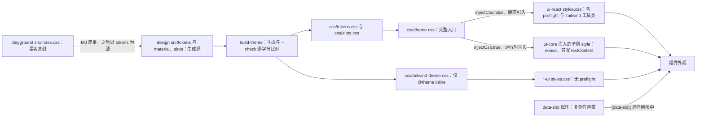
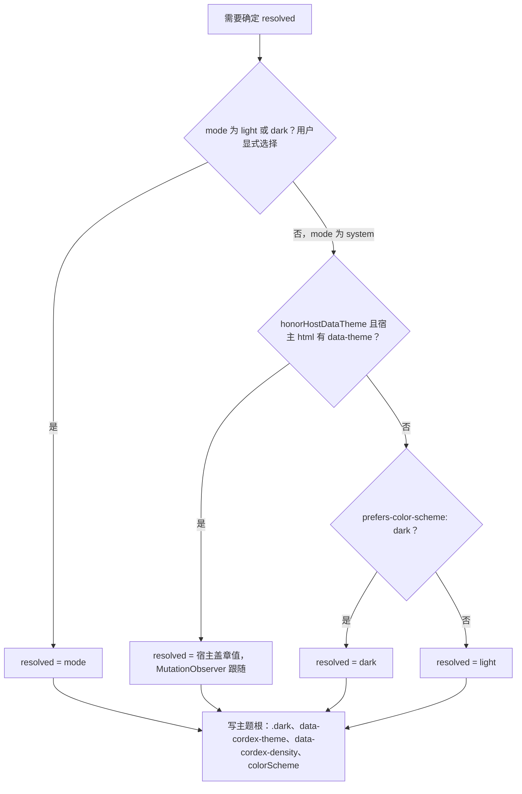
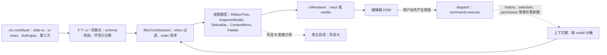
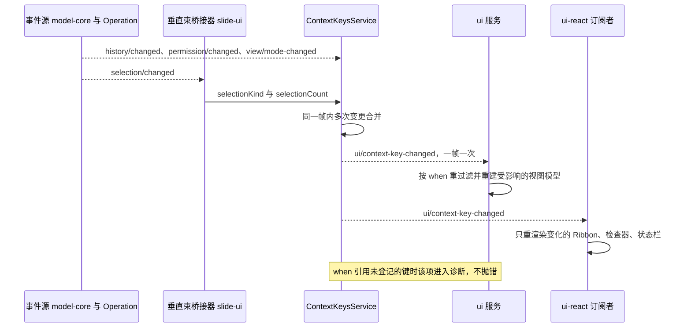
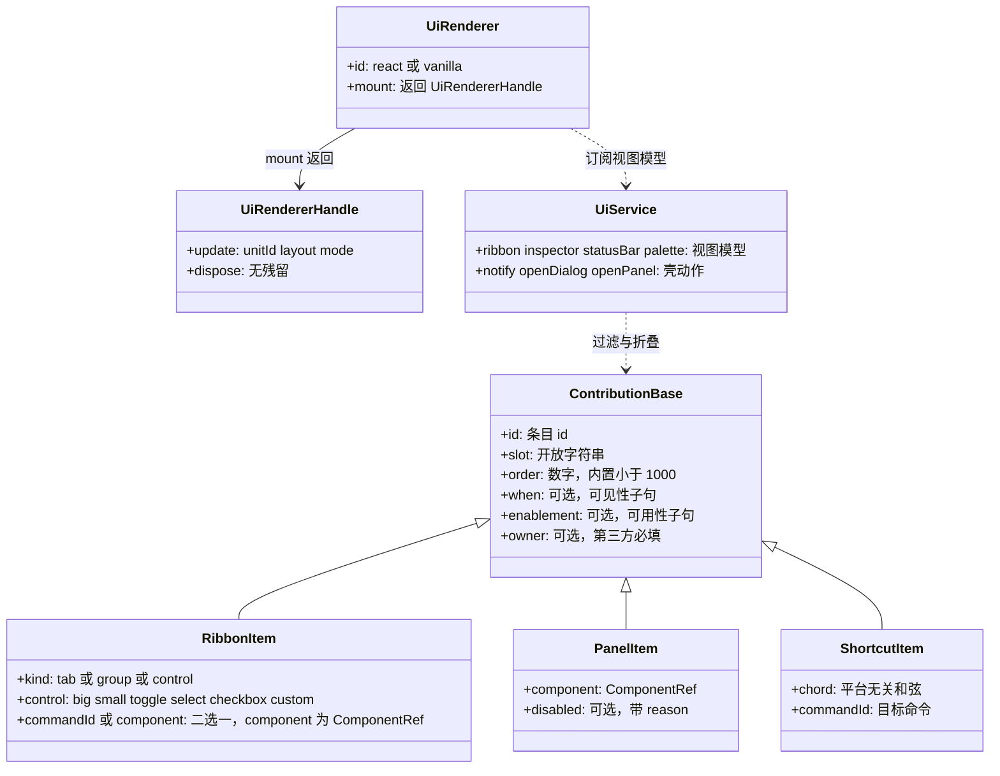

# 09 UI 组件体系与主题
> 状态：v0.1 | 负责：前端设计线 | 更新：2026-09-25；2026-09-25（§4.19）；2026-09-25（审稿）；2026-09-26（§4.20） | 依赖：[40/10](../40-modules/10-ui-shell-and-slide-ui.md) §0–§3a、§5、§10、§11、§13；[30/02](../30-architecture/02-layering-and-packages.md) §4.17–§4.20；[30/03](../30-architecture/03-kernel-and-plugin-model.md) §3.6；[ADR-0017](../30-architecture/adr/0017-ui-component-library-shadcn-copy-model.md)；[设计 04](../20-design/04-design-system.md) §2、§3、§5、§9；[设计 09](../20-design/09-design-specification.md) §0–§2、§5、§6；[设计 06](../20-design/06-extensibility-ux.md) §2；[PRD NF-01](../10-prd/04-non-functional-requirements.md) §1.5；[PRD EM-06](../10-prd/03-features/05-embedding-and-integration.md)；[rulings](../00-charter/rulings-2026-09-14.md) §4.7、§4.8、§4.10 Q19 / Q21、§4.11 C-21 / C-22、§4.12 U-08、§4.15 Q2、§4.19 D-COMMENTS-PKG、§4.20 FE-06 / FE-11 / FE-12 / FE-16 / FE-18

本文是**浏览器 UI 体系的运行侧设计**唯一事实源：四个 UI 包怎样分工、设计 token 怎样变成 CSS 与组件外观、主题 / 密度 / 材质怎样解析并写到根元素、shadcn 复制件怎样管理、`ui.*` 贡献与上下文键怎样驱动视图模型、输入怎样变成命令、`UiRenderer` 怎样挂载、样式怎样注入与隔离。

不在本文（只链接）：

| 主题 | 事实源 |
|---|---|
| 四包的目录树、逐文件职责、测试文件清单、`package.json#cordex` 字段 | [40/10](../40-modules/10-ui-shell-and-slide-ui.md) §4、§5、§9、§10 |
| 控件 → 命令 id 的绑定表本体 | [40/10](../40-modules/10-ui-shell-and-slide-ui.md) §2.6 |
| 贡献点项类型、键与 `conflict` 取值的总表 | [30/03](../30-architecture/03-kernel-and-plugin-model.md) §3.6（前端贡献方视角见 [03 §7](03-preset-assembly-and-plugins.md)） |
| 编辑器外壳区域、布局状态、断点三形态、模式矩阵、画布交互与反馈分层 | [10](10-editor-shell-and-interaction.md) |
| 母版视图的状态与流程 | [11](11-masters-layouts-and-themes.md) |
| token 取值、材质观感、组件视觉规格 | [设计 04](../20-design/04-design-system.md)、[设计 09](../20-design/09-design-specification.md) 与 playground `src/index.css` |
| CSP nonce 链、第三方运行时样式的 nonce 传递、Trusted Types | [14](14-client-security.md) §3–§4 |
| 材质的性能口径（帧时间、`contain: paint`） | [13](13-performance-and-bundling.md) §10 |
| 键盘区域、F6 循环、焦点管理、live region | [16](16-i18n-and-accessibility.md) §6–§8 |
| 组件测试、axe、视觉基线的执行方式 | [70/06](../70-testing/06-frontend-component-and-e2e.md) |

包名一律省略 `@cordexjs/` 前缀。

## 1. 四包分工与依赖边界

| 包 | 层 / iso / 形态 | 做 | 不做 |
|---|---|---|---|
| `design` | L7 / dom / library（无 `plugin.ts`） | token（shadcn 变量名 + Cordex 扩展裸名）、材质 `@utility glass*`、浮层与控件 `[data-slot]` 规则、两块退化、`body` 宿主防线的**唯一 CSS 事实源**；类型与常量（`ThemeVarName`、`TokenSet`、`FLOATING_SLOTS`、`LAYER`）；对比度核算 | 任何组件、图标、React / Radix / Tailwind 运行时 import（R18 `design-css-only`）；幻灯片纸面内的字号与颜色（那是文档数据） |
| `ui-core` | L7 / dom / definition + plugin | 十个 `ui.*` 贡献点、`when` 语法与上下文键、五条输入管线、`ui` / `shortcuts` / `theme` 三服务、视图模型纯函数、`UiRenderer` Definition、水平层 Operation `view.setMode` 与 `ui.*` 面板 Operation | import react / radix / tailwind / lucide（R14 `ui-core-no-framework`）；任何文档类型字面量（`no-doc-type-literals`）；渲染 |
| `ui-react` | L7 / dom / provider（`implements:['uiRenderer']`） | React 19 实现的 `UiRenderer('react')`：`<EditorHost>` 与壳组件、槽位宿主与原语、44 个 shadcn 复制件（`./ui` 子路径）、贡献渲染适配器与逐项错误边界、`ThemeBridge` | 任何 `slide.*` 命令绑定或幻灯片语义；手改复制件结构 |
| `slide-ui` | V-ui / dom / plugin（`bundle=slide`，只贡献不 provide） | 幻灯片专属的页签、缩略图栏与母版缩略图窗格、检查器分区、画布交互层、版式画廊、主题面板、放映舞台、母版视图编排、默认键位表与 `slide.ui.*` 语言包；评论的 slide 专属部分：锚点解析、检查器「评论」页签、画布评论钉气泡、缩略图角标、插入页签「评论」按钮与右键「添加批注」（rulings §4.19 D-COMMENTS-PKG，[08](08-comments-and-version-history.md) §2） | Store 写入（全部经 `commands.execute`）；重绘选区框与远端光标（那是 render-dom 的 `render.overlay`）；缩略图像素；评论线程事实源（归文档类型盲的 `comments` 包，[08](08-comments-and-version-history.md) §2） |

**框架可换的可验证范围**（rulings §4.15 Q2）：`ui-core` 全包与各 `*-ui` 的 `src/domain/**`、`src/application/**` 不含 React（depcruise `cordex-ui-bundle-core-framework-free`，TD-082）；React 只允许出现在 `*-ui` 的 `src/ui/**`。换框架须同时替换 `ui-react` 与全部 `*-ui` 的 `ui/` 层。SDK 对宿主 React 声明 peer `^19.0`。

**图 9-1 UI 四包分层与允许依赖**

怎么读：箭头是允许的 import 方向，全部向下（秩只向下，depcruise R2）；`design` 不依赖任何包；`ui-core` 对 `design` 只允许 CSS 与 `import type`（R14 子规则 `ui-core-design-css-only-import`）；复制件目录 `./ui` 只对 `ui-react` 自身、`V-ui` 包与 `apps/*` 开放（R17 `shadcn-ui-dir-private`）；`slide-ui` 对 `uiRenderer` 只是可选注入，`ui-react` 缺席时贡献照常注册但不渲染（headless）。
依据：ADR-0017 决策 3–5、7；40/10 §1.1、§10；rulings §4.15 Q2。

**可插拔证据**（charter §5.4 UI 行，由 [70/02](../70-testing/02-contract-suites-and-pluggability.md) 的 preset 可插拔用例覆盖）：移除 `ui-react` → 贡献照常注册、宿主 headless 运行；移除 `slide-ui` → 壳渲染空 Ribbon（位置显示「无可用页签」）、空侧栏与空检查器，画布仍可渲染与缩放；移除 `ui-core` → `ui-react` 与 `slide-ui` 同时 PENDING（诊断可见，不是失败）。

## 2. token 与 CSS 产物

**事实基线**是 playground `src/index.css`（ADR-0017 决策 6）；`design` 的 TS token 对象是生成源，`build-theme` 从它生成入库的五份 CSS，`build-theme --check` 逐字节比对（只允许注释与顺序差异），不一致即失败。

| token 族 | 变量名（裸名，`--cordex-*` 作废，C-22） | 来源 | 谁读 |
|---|---|---|---|
| shadcn 语义色 | `--background`、`--foreground`、`--card`、`--popover`、`--primary`、`--secondary`、`--muted`、`--accent`、`--destructive`、`--border`、`--input`、`--ring`、`--chart-1..5`、`--sidebar-*` | 设计 09 §1.1、04 §2.2 / §2.3 / §9 | 全部组件（经 Tailwind 颜色工具类） |
| 控件描边 | `--border-control`（亮 `#757F8F`，白底 ≥ 3:1，Q21） | rulings §4.10 Q21 | 输入框、开关、复选框描边 |
| Cordex 扩展色 | `--success` / `--warning` / `--info`（各带 `-foreground`、`-muted`）、`--canvas`、`--canvas-glow`、`--doc-paper`、`--doc-ink`、`--stage`、`--stage-chrome`、`--stage-foreground`、`--presence-1..12` | 设计 09 §1.2、04 §2.2a / §2.4 | 状态徽标、画布背景、纸面、放映舞台、协作者色 |
| 材质 | `--glass-bg`、`--glass-bg-strong`、`--glass-border-color`、`--glass-blur`、`--glass-shadow` | 设计 09 §6.2 | `@utility glass` / `glass-strong` 与浮层 `[data-slot]` 规则（§4） |
| 字阶与字族 | `--font-sans`（Geist Variable → 系统 → PingFang / 微软雅黑）、`--font-heading`、`--font-mono`、`--text-2xs`（11 px / 16 px） | 设计 09 §1.3 | 全部 UI 文字；画布内文字不受影响（EM-06） |
| 圆角 | `--radius`（0.5 rem）与派生刻度 `sm…4xl` | 设计 09 §1.4 | 「越浮越圆」的层级圆角 |
| 层级 | `--layer-canvas` 0 · `canvas-overlay` 10 · `chrome` 20 · `dropdown` 100 · `popover` 110 · `sticky` 120 · `toast` 300 · `modal-backdrop` 400 · `modal` 410 · `command-palette` 500 · `tooltip` 600 | 设计 01 §3、40/10 §12 G-10 | 全部浮层；集成方可在编辑器根上整体平移（EM-06） |
| 动效 | `--duration-instant` 80 · `fast` 120 · `base` 180 · `slow` 240 · `slower` 320；`--ease-standard / decelerate / accelerate / spring`；`prefers-reduced-motion` 时全部 1 ms | 设计 04 §2.12 | 过渡与动画 |
| 密度 | `--control-h-sm/md/lg`（28 / 32 / 40 ↔ 紧凑 24 / 28 / 32）、`--row-h`（36 ↔ 28） | 设计 04 §2.13 | 控件高度簇；只重映射高度，不产生组件变体 |

**五份 CSS 产物**（`theme.scoped.css` 为 2026-09-26 登记，rulings §4.20 FE-12）：

| 文件 | 内容 | 消费方 |
|---|---|---|
| `css/tokens.css` | 变量表：亮色默认 → `prefers-color-scheme` 兜底 → 三选择器暗色（§3）；`@theme inline` 注册颜色、圆角、`--text-2xs`、字族 | 经 `theme.css` |
| `css/slots.css` | `@utility glass` / `glass-strong`、14 个浮层 `[data-slot]` 玻璃化、遮罩与 tooltip 胶囊、控件 `[data-slot]` 规则、两块退化、`body` 宿主防线（必须位于文件末尾） | 经 `theme.css` |
| `css/theme.css` | `@import './tokens.css'` + `'./slots.css'` | `ui-react` 标准样式入口 `styles.css` 唯一 import 的 design 产物（§10「静态 · 应用」） |
| `css/tailwind-theme.css` | 只含 `@theme inline` 注册片段 | `*-ui` 的无 preflight 样式入口 |
| `css/theme.scoped.css` | 作用域变体：与 `theme.css` 同一 token 与 slot 规则，全部限定在 `[data-cordex-root]` 下，不写 `:root`、不触碰宿主 `body`（宿主防线改写到根） | `ui-react` 嵌入入口 `src/styles/embed.css`（产物 `./styles.embed.css`，§10「静态 · 嵌入」）；`injectCss:true` 的运行时注入源（§10；文件级见 40/10 §4.1、§4.2） |

- **组件不读裸色值**（设计 09 S-03）：组件只用语义 token 对应的工具类；画布内的文档内容（位置、尺寸、字号、颜色）是数据，允许内联样式（S-04）。
- **变量名即公共契约**：变量**名**自 M1 发布起视为 `stable`（`theme-vars-contract.test.ts` 依赖它们）；取值可随设计线微调（patch）。新增扩展变量须先在 `tokens.css` 声明，`ui-react`、`*-ui`、`apps/*` 里出现未声明的扩展变量或 `--cordex-*` 即失败（§12 V2）。

**图 9-2 token 到组件的样式数据流**

怎么读：左半是生成链，`build-theme --check` 保证入库 CSS 与 token 源一致；右半是两条互斥的投放路径——独立应用静态引入 `ui-react` 的样式入口，嵌入宿主由 `ui-core` 在运行时注入同一份 `theme.css`（§10）；复制件自带的 `data-slot` 属性让玻璃化与控件规则无须改组件源码即可生效。
依据：ADR-0017 决策 3、6、7；40/10 §4.1、§7；设计 09 §6.3。

## 3. 主题、密度与根元素属性

### 3.1 解析顺序与 `ThemeState`

`ThemeState = { mode: 'system' | 'light' | 'dark'; resolved: 'light' | 'dark'; density: 'comfortable' | 'compact'; hostMark?: 'light' | 'dark' }`（ui-core `domain/theme-state.ts`，纯函数 `resolveThemeState(stored, hostMark, prefersDark)`）。`resolved` 按固定顺序得出，前者覆盖后者：

1. **用户显式选择**：`mode` 为 `light` 或 `dark`（设置抽屉或主题分段写入；`apps/web` 随 `Preferences` 存入 `cordex.prefs`，并另写一份到 localStorage `cordex-theme` 供首屏脚本执行前读取、防闪烁，键空间见 [02 §10.1](02-app-shell-routing-and-session.md)）。
2. **宿主盖章**：`mode='system'` 且 `UiCoreConfig.theme.honorHostDataTheme` 为真时，读宿主 `<html data-theme="light|dark">`，并用 `MutationObserver` 跟随宿主切换（artifact 查看器、集成方页面常见）。
3. **系统偏好**：`prefers-color-scheme`，媒体查询变化时重算。

`initial`（默认 `system`）与 `density`（默认 `comfortable`）来自 `UiCoreConfig.theme`；主题切换在同一帧内完成根元素属性写入，运行时切换 ≤ 100 ms 且无闪烁（EM-06）。同页多个 host 各自持有 `ThemeState`，互不影响（§3.4）。

**图 9-3 主题解析顺序**

怎么读：菱形自上而下就是优先级，任何一条路径最后都落到同一组根元素属性写入；组件只读语义 token，不读这些属性做逻辑分支（设计 04 §3）。
依据：40/10 §2.1 `ThemeState` 行、§2.3 `resolveThemeState`；设计 04 §3；rulings §4.11 C-21。

### 3.2 三选择器契约（C-21，长期等价）

`tokens.css` 的暗色 token 同时挂在三种等价选择器上，另以媒体查询兜底；`ui-core` 同时写 `.dark` 与 `data-cordex-theme`，因此不论 shadcn 生态代码、SDK 自身还是嵌入宿主，读到的都是同一套值：

| 选择器 | 谁写 | 用途 |
|---|---|---|
| `.dark` | ui-core `ThemeService`（`resolved='dark'` 时加） | shadcn 生态默认的暗色变体（`@custom-variant dark (&:is(.dark *))`） |
| `[data-cordex-theme="dark"]` / `="light"` | ui-core `ThemeService`（始终写 `resolved` 值） | SDK 自有命名空间；显式 `light` 阻止媒体查询兜底 |
| 宿主 `[data-theme="dark"]` | 宿主页面 | 嵌入场景直接跟随宿主盖章（未启动 JS 时也生效） |
| `@media (prefers-color-scheme: dark)` + `:not([data-cordex-theme="light"])` | CSS 兜底 | 首屏脚本尚未执行时跟随系统 |

### 3.3 密度、高对比与 `ui.theme` 覆盖集

- **密度**：`comfortable | compact`，只重映射 `--control-h-*` 与 `--row-h`，不产生组件变体；紧凑档下 Ribbon 的高度取值在 M2 定稿（推荐：页签行 32 + 内容区单行 36、小控件 24、隐藏组标题，40/10 §13 Q-5）。
- **高对比**：M1–M2 只加 `@media (forced-colors: active)` 系统色兜底，不产生第三套 token；M3 P1 提供正式的第三套取值（rulings §4.12 U-08）；`prefers-contrast: more` 时描边改 `--border-strong`（M2）。
- **`ui.theme` 覆盖集**（Beta）：项类型 `ThemeContribution { id; tokens: Partial<TokenSet>; density? }`（30/03 §3.6）。生效顺序：`design` 默认值 < `ui.theme` 贡献（按注册顺序，同名键后者覆盖前者）< 运行时 `theme.setTokens(partial)`。覆盖值以 CSS 自定义属性写到主题根的 `style` 上（经 CSSOM，不受 `style-src` 限制）。
- **覆盖值校验**：键必须 ∈ `ThemeVarName`；值按族校验（颜色只收 hex / rgb / hsl / oklch，长度只收 px / rem，时长只收 ms）；**值中出现 `url(`、`expression(`、`;`、`}` 一律拒绝**，记诊断、该键不生效，主题其余部分照常。这样集成方无法借 token 覆盖引入外部资源或逃逸出声明。
- 集成方也可以直接在自己的 CSS 里覆盖变量：独立应用写在 `:root` 之后，嵌入场景写在 `[data-cordex-root]` 下（§10）。

### 3.4 根元素属性写入规则汇总

**主题根**：独立应用（`apps/web`，`injectCss:false`）为 `document.documentElement`；嵌入场景为编辑器容器 `[data-cordex-root]`，SDK **不写宿主的 `<html>`、`<body>`**，只读宿主的 `data-theme`。

| 属性 / 类 | 写在哪 | 谁写 | 取值与时机 | 读者 |
|---|---|---|---|---|
| `.dark` | 主题根 | ui-core `ThemeService`（`infrastructure/root-attributes.ts`） | `resolved='dark'` 时存在 | 暗色 token 选择器、shadcn `dark:` 变体 |
| `data-cordex-theme` | 主题根 | 同上 | `light` / `dark`，与 `resolved` 同步 | 暗色 token 选择器、宿主脚本 |
| `data-cordex-density` | 主题根 | 同上 | `comfortable` / `compact` | 密度覆盖块 |
| `style.colorScheme` | 主题根 | 同上 | 与 `resolved` 同步 | 原生滚动条与表单控件 |
| 覆盖集自定义属性 | 主题根 `style` | 同上 | `ui.theme` 与 `setTokens` 合并结果 | 全部组件 |
| `data-cordex-root` | 编辑器容器 | ui-react `EditorHost` | 挂载时加、`dispose` 时移除 | 嵌入 CSS 作用域（§10）、`--layer-*` 平移 |
| `data-interacting` | 壳根（`EditorShell`） | ui-react `EditorShell` | 分栏拖拽或画布缩放动画开始时加，结束 150 ms 后移除 | `[data-interacting] .glass*`（§4） |
| `data-cordex-region` | 各区域容器 | ui-react 区域容器 | 常驻 | F6 循环与 `focusRegion` 键（[16 §6.1](16-i18n-and-accessibility.md)） |
| 宿主 `data-theme` | 宿主 `<html>` | 宿主 | 宿主决定 | ui-core 只读（`honorHostDataTheme`） |

- `dispose()` 时还原本 host 写过的主题根属性；多 host 同页时以引用计数决定是否移除共享的注入样式（§10）。
- Portal 出去的浮层（选项 `portal:'body'`）由 ui-react 在 `body` 下建一个带 `data-cordex-root` 的容器，`ThemeBridge` 把主题根的四项属性同步过去，保证浮层与编辑器同主题；默认浮层渲染在编辑器容器内（EM-06）。

## 4. 材质层

材质只用于控件层与浮层，内容层永远不透明（设计 09 S-08、§6.1 四层层次模型）。本节是规则本体，取值与观感以设计 09 §6.2 与 playground 为准，性能口径见 [13 §10](13-performance-and-bundling.md)。

| 规则 | 内容 |
|---|---|
| 两档玻璃 | `glass`（亮 72% / 暗 62% 不透明度）与 `glass-strong`（84% / 78%），共用 `--glass-blur: blur(24px) saturate(150%)` 与 `--glass-shadow`（内高光 + rim + 投影） |
| 分层用法 | 浮层（菜单、弹层、对话框、命令面板、tooltip）用 strong；控件层的工具卡、侧栏卡、检查器卡、状态胶囊、横幅用 strong；画布上的缩放胶囊、迷你工具条、查找条用 `glass`，只放图标与短标签 |
| 玻璃不叠玻璃 | 控件层之上出现浮层时，浮层用 strong 且控件层不再额外模糊；strong 面板不得叠在纸面之上（对比会下降） |
| 同屏上限 | 同屏 `backdrop-filter` 元素 ≤ 4（壳 3 块 + 1 个浮层）；画布区不加玻璃（NF-01 §1.5） |
| 浮层自动玻璃化 | 由 `FLOATING_SLOTS` 清单（14 个 `data-slot`：`popover-content`、`dropdown-menu-content`、`dropdown-menu-sub-content`、`context-menu-content`、`context-menu-sub-content`、`select-content`、`dialog-content`、`alert-dialog-content`、`sheet-content`、`drawer-content`、`menubar-content`、`menubar-sub-content`、`hover-card-content`、`command`）命中，组件源码不写材质类；遮罩 `*-overlay` 为 `bg-black/20` + `blur(4px)`；`tooltip-content` 为深色玻璃胶囊 |
| 两种退化 | `prefers-reduced-transparency: reduce` 与 `@supports not (backdrop-filter: blur(1px))` 两块**内容相同**，都覆盖 `.glass`、`.glass-strong` 与全部浮层 slot：背景改不透明 `var(--card)`、描边 `var(--border)`、阴影换普通阴影、`backdrop-filter: none`；tooltip 保持不透明深色；遮罩加深为 `rgb(0 0 0 / .40)`。两块由同一函数 `degradationBlocks(slots)` 从同一清单生成 |
| 前缀顺序 | `-webkit-backdrop-filter` 必须写在 `backdrop-filter` 之前（Lightning CSS 对同一属性去重只留最后一条，写反会丢掉标准属性，Chrome 下「半透明但不模糊」）；编译产物必须同时含两者 |
| 交互期间不透明 | `data-interacting` 存在时玻璃面板临时切为不透明、`backdrop-filter: none`，结束后恢复（M2） |
| 重绘隔离 | 玻璃面板 `contain: paint`（M2） |
| 宿主防线 | 独立应用：`slots.css` 末尾的 `body` 规则设置颜色、背景、字族、行高与抗锯齿，**必须写在任何 `@layer` 之外**（嵌入宿主给 `body` 注入的未分层声明在层叠上总是胜过 `@layer base` 里的声明，暗色下继承色会变成近黑，设计 09 §5 第 3 条），且其后不得再有 `body` 选择器；嵌入场景：同一规则改写到 `[data-cordex-root]` 上，不触碰宿主 `body`（§10）；视觉基线须在宿主外壳版（`scripts/host-wrap.py`）上截图 |
| 不做 | SVG 折射（`feDisplacementMap`）、扫光动画；玻璃是静态材质 |

## 5. shadcn 复制件管理

- **来源与风格**：shadcn CLI `pnpm dlx shadcn@4.21.0 add -o -y` 生成，风格 `radix-rhea`（`components.json` 入库）；不手拷、不用 `npx`（仓库根 `devEngines onFail:error`，rulings §4.15 Q9）。
- **全仓一份**：复制件只存在于 `ui-react` 的 `src/ui/components/ui/`（44 个），经子路径 `@cordexjs/ui-react/ui` 供 `*-ui` 与 `apps/*` 使用（R17）；其余任何位置出现同名复制件即失败。`drawer`（vaul）不迁移，窄屏底部面板改用 `sheet` 的 `side="bottom"`（rulings §4.15 Q2）。
- **视觉定制走 CSS**：组件级视觉写 `design` 的 `[data-slot]` 规则，不改复制件结构。确需改源码时文件头标 `// Cordex override: <原因>`，并登记在 `shadcn-copy.test.ts` 的允许清单里；当前清单：`sonner.tsx`（去掉上游对 `next-themes` 的依赖、改读 ui-core `theme` 服务）、`scroll-area.tsx` 与 `select.tsx`（透传 CSP nonce，[14 §3](14-client-security.md)；其 Viewport 的固定样式文本由 Trusted Types `default` 策略精确放行，[14 §4](14-client-security.md)）。sonner 的 Toast 样式不走运行时注入：ui-react 静态引入 `sonner/dist/styles.css` 并入自身样式产物（§10 三种投放路径都覆盖），import 时的 `__insertCSS` 经 pnpm patch 删去（rulings §4.20 FE-18）。
- **升级流程**：`scanners/shadcn-diff` 步骤报告复制件与上游的差异（M2 稳定后转为阻断，rulings §4.18 GV-14）；升级 PR 依次执行：钉住新 CLI 版本 → `diff` 审阅 → 重新 `add` → 重新应用登记在册的 override → `shadcn-copy.test.ts`、axe 与视觉基线全部通过 → 合并。
- **第三方依赖单点**：react、radix-ui、tailwindcss、lucide-react、cva、clsx、tailwind-merge、cmdk、sonner、react-resizable-panels、Geist 等只允许 `ui-react` 与 `V-ui` 包引入（R5 `third-party-single-entry`，ADR-0017 清单），且 catalog 精确锁版本。

## 6. ui-core 契约：贡献点、槽位、`when` 与上下文键

### 6.1 十个 `ui.*` 贡献点

项类型、键与 `conflict` 以 [30/03 §3.6](../30-architecture/03-kernel-and-plugin-model.md) 为准（全部 `replace`）；本表写前端的使用语义。公共骨架 `ContributionBase = { id; slot; order; when?; enablement?; owner? }`（`enablement?` 已登记，rulings §4.20 FE-06）：

- `when` 只管**可见性**：为假时该项不渲染（例如母版页签 `when: viewMode == 'master'`、查看者变体里的创建类按钮）。
- `enablement`（语法同 `when`）只管**可用性**：为假时该项留在原位、`aria-disabled`，原因取 `explainWhen(enablement, keys)`（§6.2，对应 PRD ED-30「命令不可用时必须说明原因」），例如全文命令控件的 `enablement: unitLoaded`、「视图」页签「母版视图」按钮的 `enablement: editorMode == 'edit' && !isReadOnly && breakpoint == 'desktop'`（[11](11-masters-layouts-and-themes.md) §3）。`ui.shortcut` 与 `ui.command` 的项同样带可选 `enablement`（下表）。
- 条目最终可用 = 目标命令已注册（`commands.has`）∧ 命令声明的能力位已授予（`can.<capability>`，§6.3）∧ `enablement` 为真；三者任一为假都只禁用、不隐藏（[10](10-editor-shell-and-interaction.md) §4「只读是禁用而不是隐藏」）。原来把禁用条件写进 `when` 的条目（40/10 §2.6 全文命令的 `when: unitLoaded`、插入页签图表的 `when: hasChartEditor`）已改写为 `enablement`（rulings §4.20 FE-11）。

| 贡献点 | 项要点 | 典型 slot | 语义 |
|---|---|---|---|
| `ui.ribbon` | `kind: 'tab' \| 'group' \| 'control'`；control 的 `control` 取 `big` / `small` / `toggle` / `select` / `checkbox` / `custom`，带 `commandId` 与 `params` 或 `component` | `ribbon` | 页签 = `kind:'tab'`，不另设 `ui.ribbonTab`（C-05）；空组、空页签自动隐藏 |
| `ui.toolbar` | 条目列表 | `toolbar.text-editing`、`toolbar.<selectionKind>`、`appBar.badges`、`reviewBar` | 迷你工具条、应用栏徽标、评审工具条（[10 §3](10-editor-shell-and-interaction.md)） |
| `ui.panel` | `component`、`defaultOpen`、`disabled?` + `reason?` | `rail`、`inspector`、`inspector.tab`、`notes`、`canvas.top`、`floating` | 检查器分区 = `slot:'inspector'`（C-05）；`floating` 不受检查器互斥规则约束 |
| `ui.contextMenu` | 分组条目，危险项置末 | `canvas`、`thumbnail`、`masterThumbnail`、`layoutThumbnail`、`appBar.more`、`userMenu` | 右键菜单与「⋯」菜单 |
| `ui.statusBar` | 左 / 右两列条目 | `statusBar.left`、`statusBar.right` | 状态胶囊内容 |
| `ui.dialog` | 可被 `ui.openDialog(id)` 打开的对话框模板 | — | 壳级：`command-palette`、`shortcuts-panel`、`settings-drawer`（ui-react 贡献） |
| `ui.notification` | 通知**种类模板**，由 `ui.notify(id, params)` 调用 | — | 四种模板只由 ui-react 贡献：`command-failed`、`permission-denied`、`offline`、`undo-toast`；`slide-ui` 只调用不贡献（rulings §4.18 FE-11） |
| `ui.shortcut` | `{ id; chord; commandId; params?; when?; enablement? }` | — | 默认键位表由贡献方注册，服务只做规范化、匹配与冲突诊断（§8）；`when` 为假时和弦不匹配、交还浏览器，`enablement` 为假时和弦仍被消费并提示原因（例如渐进打开期间的 `Mod+A`） |
| `ui.command` | 命令呈现元数据 `{ commandId; title; icon?; category; when?; enablement?; keywords? }` | — | 命令面板与菜单的标题与图标；只列 `commands.has(id)` 且 `when` 为真的命令；`enablement` 为假或能力位未授予时置灰并附原因，不隐藏（§7，PRD ED-30） |
| `ui.theme` | `ThemeContribution`（Beta） | — | §3.3 |

- **槽位是开放字符串**，不枚举（doc / sheet 可新增 `canvas.ruler` 而不改 ui-core）；上表只列当前使用的值。
- **排序**：同一 slot 内按 `order` 升序，同序按贡献时间；内置页签 `order < 1000`，第三方页签 `order ≥ 1000` 且必带 `owner`（壳显示归属徽标）；母版页签 `order = -100` 置首（[11 §2](11-masters-layouts-and-themes.md)）。
- **坏贡献不抛**：item schema 校验失败、`when` / `enablement` 语法错误或引用未登记键 → 记诊断并丢弃或隐藏该项，插件其余贡献照常（30/03 §3.3）。

### 6.2 `when` 语法（`enablement` 同）

运算符只有 `==`、`!=`、`in`、`&&`、`||`、`!` 与括号；字面量为单引号字符串、数字与 `true` / `false`；键名必须已登记（标准键或经 `registerPrefixedKey` 登记的前缀键）。解析在注册时一次完成（`parseWhen`），求值是纯函数（`evaluateWhen`）。示例：`viewMode == 'master' && !isReadOnly`、`selectionKind in ('shapes', 'picture')`。

**不可用原因** `explainWhen(clause, keys): ReasonKey | null`（ui-core `domain/when-clause.ts`，纯函数）：子句为真时返回 `null`；为假时按求值顺序返回**首个为假的原子条件**对应的原因键，例如 `editorMode == 'edit'` 在 `editorMode='review'` 时给「评审模式下不可用」、`breakpoint == 'desktop'` 为假时给「需要 ≥ 1024 宽度」、`can.doc.write` 为假时给「需要编辑权限」。原因文案由登记该键的一方提供（标准键归 ui-core 语言包，前缀键归垂直束语言包），命令面板条目、按钮 tooltip 与快捷键触发的 Toast 共用同一组 i18n 键（[10](10-editor-shell-and-interaction.md) §4、§10.1，[11](11-masters-layouts-and-themes.md) §3）。

### 6.3 上下文键全集

上下文键是 `when` 与 `enablement` 的唯一输入（40/10 §2.1、30/03 §3.6）。标准键由 ui-core 维护，按 `unitId` 分桶，多 Unit 共存时切换不重建。

| 键 | 取值 | 来源（事件或 Operation） | 可在 `when` 中引用的一方 |
|---|---|---|---|
| `unitType` | documentType id | `unit/opened` | 全部 |
| `viewMode` | ∈ `DocumentType.viewModes`（slide：`normal` / `master` / `presenter`） | `view/mode-changed`（由 `view.setMode` 发出） | 全部 |
| `editorMode`（本文新增） | `edit` / `review` / `view` | `EditorHost` 的 `mode` 与 `UiRendererHandle.update({mode})`：打开或重开 Unit 时按角色映射（[02 §6](02-app-shell-routing-and-session.md)），会话内只随用户经模式下拉切换；会话内 `permission/changed` **不改**它（降权进入 `readonly-degraded`，[10 §3.1](10-editor-shell-and-interaction.md)，rulings §4.18 UX-20） | 全部 |
| `editTargetKind` | `slide` / `layout` / `master`（垂直束可扩） | `slide.selectMasterOrLayout` 经 slide-ui 桥接 | 全部 |
| `selectionKind` | 字符串，由垂直束桥接器给出（slide：`none`、`slide`、`shapes`、`text`、`picture`、`table-cell`、`group`、`connector`、`degraded`、`mixed`、`layout`、`master`、`layouts-multi`） | `selection/changed` → `deriveSelectionKind` | 全部 |
| `selectionCount` | 数字 | `selection/changed` | 全部 |
| `canUndo` / `canRedo` | 布尔 | `history/changed` | 全部 |
| `isCollab` | 布尔 | `presence` 服务是否存在（`ctx.get('presence', false)`） | 全部 |
| `isReadOnly` | 布尔（无 `doc.write` 即真，≡ `!can.doc.write`） | `permission/changed` | 全部 |
| `can.<capability>`（标准键族，rulings §4.20 FE-06） | 布尔族：`<capability>` 取 protocol `permissions/actions.ts` 的能力位全集（`Capability`），即 `can.doc.read`、`can.doc.comment`、`can.doc.write`、`can.doc.export`、`can.doc.manage`、`can.history.read`、`can.history.restore`；能力位增删时键族随之变化，不另维护清单 | 打开时的权限快照与之后的 `permission/changed`（按能力位逐个写，不随编辑器模式变化） | 全部；`can.` 为 ui-core 保留前缀，ui-core 以外的包（垂直束与第三方）经 `registerPrefixedKey` 登记 `can.` 前缀即违规（`scan-contributions` 规则 (e)） |
| `platform` | `desktop` / `mobile`（`pointer: coarse` 视为 mobile） | `matchMedia` | 全部 |
| `breakpoint` | `desktop`（≥ 1024）/ `compact`（640–1024）/ `narrow`（< 640） | 视口宽度（`detectBreakpoint`，rulings §4.10 Q19） | 全部 |
| `density` | `comfortable` / `compact` | `theme` 服务 | 全部 |
| `textEditing` | 布尔 | slide-ui `text-editing` 进入 / 退出（[06 §2](06-text-editing-and-ime.md)） | 全部 |
| `focusRegion` | `canvas` / `rail` / `inspector` / `ribbon`；其余区域为空 | 区域容器 `focusin`（[16 §6.1](16-i18n-and-accessibility.md)） | 全部；快捷键按它分派作用域 |
| `unitLoaded` | 布尔（渐进打开首批后为假，`unit/loaded` 后为真） | `unit/opened` / `unit/loaded`（rulings §4.18 CO-12） | 全部；全选、查找替换与全文命令入口据此禁用或等待 |
| `slide.editScope` | `layout` / `master` | 范围条本地状态（不入命令） | 仅 slide 束与其第三方插件 |
| `slide.hasNotes` | 布尔 | 当前页备注是否非空 | 同上 |
| `slide.multiSelectLayouts` | 布尔 | 母版窗格多选 | 同上 |
| `slide.hasChartEditor` | 布尔 | `slide-render-chart` 是否装载 | 同上 |
| `slide.placeholderSelected` | 布尔：选区含至少一个占位符形状 | `selection/changed` 经 slide-ui 桥接 | 同上；母版视图检查器「占位符类型」分区用它，取代设计 06 §2.10a 提议的 `selectionKind='placeholder'`（[11](11-masters-layouts-and-themes.md) §2、§6） |
| `slide.hasComments` | 布尔：`comments` 服务已装载（M3 随 `preset-slide-collab`，`ctx.get('comments', false)`；与文档里有没有评论无关） | slide-ui 在 `comments` 服务出现 / 消失时写入 | 同上；检查器「评论」页签、评审工具条、插入页签「评论」按钮与缩略图角标用它（[10](10-editor-shell-and-interaction.md) §3.2、§4、§5，[08](08-comments-and-version-history.md) §2） |
| `<vendor>:<名>` | 由第三方定义 | 第三方插件经 `registerPrefixedKey` 登记 | 登记方与其依赖方 |

- **本表是上下文键全集的唯一清单**（rulings §4.20 FE-06）：30/03 §3.6 的键清单改为引用本节，40/10 §2.1 `ContextKeyValues` 按本表登记；新增标准键先改本表再回写两处。
- `editorMode` 是本文为「查看者变体去掉创建类按钮」「评审工具条替换 Ribbon」新增的标准键：没有它，这两条只能写成壳内的 `if` 分支，违反「界面变化全部由上下文键经 `when` 驱动」。40/10 §2.1 与 30/03 §3.6 均已登记（`unitLoaded` 同）。
- `can.<capability>` 标准键族：[10](10-editor-shell-and-interaction.md) §4 的「控件可用性 = 命令已注册 ∧ 能力位已授予」与 §5「历史」页签的出现条件（`can.history.read`）都需要它；`isReadOnly` 保留为 `!can.doc.write` 的简写。已登记到 30/03 §3.6 与 40/10 §2.1、§6（rulings §4.20 FE-06）。
- **机械核对**（`scan-contributions` 规则 (e)，TD-089）：检查范围是 `when` 与 `enablement` 两种子句中的键；`can.<x>` 的 `<x>` 必须是 protocol 定义的能力位；ui-core 以外的包调用 `registerPrefixedKey('can.…')` 即违规（§12 V8）。
- `hasChartEditor` 按 30/03 §3.6 统一为带前缀的 `slide.hasChartEditor`（40/10 §2.1、§3 已改名；§2.6 插入页签图表按钮随 rulings §4.20 FE-11 改为 `enablement: slide.hasChartEditor`）。

## 7. 视图模型与一帧一次重过滤

五个视图模型都是纯函数，共同底座 `filterContributions(set, slot, keys)`：**过滤**（`when` 为真）→ **排序**（`order`，同序按贡献时间）→ **折叠**（按层级组装）→ **标注可用性**（每项带 `enabled` 与 `reason`，按 §6.1 的三项合取计算）。

| 视图模型 | 纯函数 | 折叠规则 | 呈现方（ui-react） |
|---|---|---|---|
| `RibbonTree` | `buildRibbonTree(items, keys)` | tab → group → control 三级；空组、空页签隐藏；第三方页签带 `owner` 归属 | `RibbonHost` |
| `InspectorModel` | `buildInspectorSections(items, keys)` | 四个页签（属性 / 评论 / 历史 / 插件）+ 分区；内置分区在前，插件分区以归属图标分隔；页签 `disabled` 带原因 | `InspectorDock` |
| `StatusBarModel` | `buildStatusBar(items, keys)` | 左 / 右两列 | `StatusBar` |
| `ContextMenuModel` | `buildContextMenu(items, keys, slot)` | 分组；危险项置末 | `ContextMenuHost`、`MoreMenu` |
| `CommandPaletteModel` | `buildPalette(commands, shortcuts, keys)` | 列出 `commands.has(id)`、有 `ui.command` 元数据且 `when` 为真的全部条目（含插件命令，PRD ED-30「全部已注册命令」）；`enablement` 为假或能力位未授予的条目置灰，`reason` 取 `explainWhen` 或权限门给出的原因（§6.2），选中后不执行；附和弦显示 | `CommandPalette` |

- **可见与可用分开**：`when` 决定**是否出现**，`enablement` 与能力位决定**是否可用**；不可用的控件、菜单项与命令面板条目都留在原位并带原因（[10](10-editor-shell-and-interaction.md) §4、§10.1），只有 `when` 为假才消失。
- **一帧一次**：`ContextKeysService` 把同一帧内的多次键变更合并，只发一次 `ui/context-key-changed(unitId, changed)`；`ui` 服务据此重建受影响的视图模型；ui-react 经 `useSyncExternalStore` 订阅，重渲染只波及变化的区域。键变更到视图更新 ≤ 1 帧（`runUiRendererConformance` 断言）。
- **命令当前不可用**（`enablement` 为假或能力位未授予，但仍可被命令面板或快捷键触及）时必须提示原因（权限不足、选区类型不支持），不能静默（PRD ED-30）；原因由 `explainWhen` 或权限门给出，快捷键触发时经 `ui.notify('permission-denied' | 'command-failed')` 给一次 Toast，同一原因不连续重复。
- 形态 B 的宿主直接订阅这些视图模型自行绘制（[12 §7](12-viewer-embedding-and-render-page.md)）。

**图 9-4 贡献到界面的数据流**

怎么读：实线是一次渲染的数据流，贡献与上下文键在 `filterContributions` 汇合成视图模型，再由 `UiRenderer` 画出来；虚线是闭环——用户动作一律经命令执行，产生的事件反过来改上下文键，触发下一次过滤。壳组件里没有「如果是母版视图就显示某页签」这样的分支，全部靠 `when`。
依据：40/10 §2.1、§2.3、§2.4 图 2-1；30/03 §3.6。

**图 9-5 上下文键驱动重过滤**

怎么读：上下文键先归并、再一帧一次广播；`selectionKind` 的具体取值由垂直束桥接器算出，ui-core 本身不认识幻灯片；未登记键在静态侧由 `scan-contributions` 规则 (e) 拦截，运行时只诊断不抛。
依据：40/10 §2.4 图 2-4；rulings §4.18 GV-15。

## 8. 输入管线与快捷键

五条管线都在 ui-core `application/input/`，**只产出意图，不改状态**；意图经 `dispatch(ctx, unitId, commandId, params)` 统一转 `commands.execute`，失败走 `ui.notify('command-failed', {code})` 而不抛异常，`permission.denied` 额外提示只读原因（错误码到文案见 [15 §4](15-events-errors-and-telemetry.md)）。

| 管线 | 原始事件 | 意图 | 要点 |
|---|---|---|---|
| 键盘 | `keydown`（按 `KeyboardEvent.code`） | 和弦 → `shortcuts.resolve(chord, keys)` → `{commandId, params}` | 作用域由 `focusRegion` 与 `textEditing` 决定；组合输入中一律放行（下文） |
| 指针 | `pointerdown/move/up`、`dblclick`、长按 | `PointerIntent{kind: press / drag-start / drag / drag-end / dblclick / longpress, point, modifiers, hit?}` | 拖拽阈值 4 px、双击 300 ms、长按 500 ms（`UiCoreConfig.input`）；画布上的选择与变换语义见 [10 §7](10-editor-shell-and-interaction.md) |
| 文本 / IME | render-dom 文本宿主回调 | `TextIntent`（插入、删除、组合、光标移动） | 事件分流与组合缓冲见 [06 §3–§5](06-text-editing-and-ime.md) |
| 剪贴板 | `copy` / `cut` / `paste` | `ClipboardIntent`，MIME 协商顺序 `application/x-cordex+json` > `image/*` > `text/html` > `text/plain` | 粘贴清洗、大小上限与回退见 [04 §9](04-document-commands-and-undo.md) |
| 拖放 | `dragover` / `drop` | `DragIntent{kind: file-import / reorder}` | 文件类型白名单；拖放的键盘等价见 [16 §6.3](16-i18n-and-accessibility.md) |

**和弦**：平台无关写法 `Mod+Alt+M`（`Mod` 在 macOS 展开为 `Meta`，其余为 `Control`），按 `code` 匹配、不受键盘布局影响；显示时 macOS 用 ⌘⌥⇧，其余用 Ctrl / Alt / Shift（`normalizeChord`、`chordFromEvent`、`formatChord`）。浏览器保留组合（`Mod+W` / `T` / `N`）不注册（PRD ED-16）。

**冲突诊断**：加载期检测到同一和弦在重叠 `when` 下绑定多条时发 `ui/shortcut-conflict`，快捷键面板显示「冲突」行、插件管理器显示归属；运行时按「后注册者生效」处理，不静默吞掉。`Mod+Shift+P`（命令面板）在部分浏览器与平台保留键冲突时自动追加 `F1` 备用和弦（40/10 §13 Q-13 推荐值）。

**组合输入**：`event.isComposing` 为真或 `keyCode === 229` 时，全局快捷键一律不处理，交还输入法（包括 `Enter` 与 `Esc`，设计 07 §1.3）。

**文本编辑态的放行白名单**（`textEditing` 为真时，[06 §3](06-text-editing-and-ime.md) 引用本表）：

| 类别 | 和弦 | 编辑态行为 |
|---|---|---|
| 撤销 / 重做 | `Mod+Z`、`Mod+Shift+Z`、`Mod+Y` | 放行，绑定 `core.undo` / `core.redo`（与 `beforeinput` 的 `historyUndo` / `historyRedo` 去重，同一次按键只执行一次） |
| 字符格式 | `Mod+B`、`Mod+I`、`Mod+U` | 放行，作用于文本选区（折叠光标时作用于后续输入） |
| 查找替换与壳级面板 | `Mod+F`、`Mod+H`、`Mod+Shift+P`、`Mod+/`、`Mod+,`、`Mod+E` | 放行，焦点移出前保存光标位置，面板关闭后恢复 |
| 视图切换 | `Mod+Alt+M`、`F5`、`Shift+F5` | 先提交并退出文本编辑，再执行 |
| 由文本宿主处理 | 方向键、`Home` / `End`、`PageUp` / `PageDown`、`Delete`、`Backspace`、`Tab`、`Enter`、`Mod+A` | 不交给快捷键表：`Mod+A` 在编辑态是「全选框内文字」而非「全选本页对象」（[06 §6](06-text-editing-and-ime.md)） |
| 其余 | 例如 `Mod+D`、`Mod+G`、`Mod+M`、对象对齐 | 编辑态不生效，不提示 |

`Esc` 的逐级退出链（文本编辑 → 选中子元素 → 选中整个组合 → 取消选择 → 仅母版视图中且无选区时退出母版视图）由键盘管线执行，画布部分的状态机见 [10 §7](10-editor-shell-and-interaction.md)（rulings §4.18 UX-06）。

## 9. `UiRenderer` 与 React Provider

`UiRenderer` 是 ui-core 定义的 Definition（单例可替换能力用服务座而非贡献点，30/03 §3.6 判据）；`uiRenderer` 服务座为空时 `ui` 服务照常可用、只是不渲染（headless）。

| 实现 | 包 | 挂载内容 | 用途 |
|---|---|---|---|
| `react` | ui-react `infrastructure/ui-renderer.provider.ts` | `<EditorHost>` 整壳：应用栏、Ribbon 或评审工具条、侧栏、画布宿主、检查器、备注、状态胶囊、全部浮层宿主 | 独立应用、形态 A |
| `vanilla` | `examples/embed-vanilla` | 只挂画布与宿主容器，不渲染 `ui.*` 贡献 | 形态 B（宿主自绘，[12 §7](12-viewer-embedding-and-render-page.md)） |

- **挂载与更新**：`mount(container, host, {unitId?, layout?, mode?})` 返回 `{update(opts), dispose()}`；`unitId` 切换或 `mode` 变化走 `update`，**不重建 React root**；`dispose()` 后无残留 effect、DOM 节点与监听。
- **贡献渲染适配器** `ContributionRenderer`：声明式条目按 `kind` 生成默认控件（`big` / `small` / `toggle` / `select` / `checkbox`），垂直束与第三方不写 React 也能贡献简单按钮；`custom` 条目经 `ComponentRef`（ui-react 以声明合并具体化为 `React.ComponentType<SlotProps>`）渲染。
- **逐项错误边界**：每个贡献条目包一层 `ContributionBoundary`，渲染抛错只把该项替换为占位并发 `plugin/failed`，不冒泡到壳（A11 失败隔离）；占位文案「该插件组件出错」+「查看详情」（设计 06 §3 降级表）。
- **第三方 `custom` 组件的门槛**：在 ui-react `testing` 的 `axeCheck` 夹具下零违规（插件作者模板自带该用例，rulings §4.15 Q2）。
- **契约套件** `runUiRendererConformance(factory)`：无 Unit 时挂载不抛并渲染空壳；`dispose` 后无残留；单个贡献抛错只隔离该项；`ui/context-key-changed` 后 ≤ 1 帧完成重过滤。`react` 与 `vanilla` 两个实现都必须实例化（`scan-manifest` 规则 (e)）。

**图 9-6 `ui.*` 贡献项类型与 `UiRenderer` 契约**

怎么读：左侧是贡献项的继承关系，全部共享 `ContributionBase` 的 `slot`、`order`、`when`（是否出现）与 `enablement`（是否可用）；`UiService` 把条目过滤折叠为视图模型，`UiRenderer` 只订阅视图模型、不直接查贡献表；换渲染框架只换 `UiRenderer` 的实现。
依据：40/10 §2.2 适配器契约、§2.5、§6 关键类型草案。

## 10. 样式注入与隔离

**三种投放路径**，由 `createEditorHost` 的 `ui.injectCss` 与宿主是否有 CSS 构建链决定，互斥：

| 路径 | 场景 | 引入方式 | 作用域 | preflight |
|---|---|---|---|---|
| 静态 · 应用 | `apps/web` 独立应用（`injectCss:false`） | 入口 `import '@cordexjs/ui-react/styles.css'` | `:root`；`body` 宿主防线生效 | 有，全仓只此一处（ADR-0017 决策 7） |
| 静态 · 嵌入 | 形态 A，宿主有 CSS 构建链（`injectCss:false`） | 宿主引入 `@cordexjs/ui-react/styles.embed.css` | 全部规则限定在 `[data-cordex-root]` 下，变量定义在编辑器根上 | 无；只带一段限定在根作用域内的最小重置 |
| 运行时注入 | 形态 A，宿主无构建链（`injectCss:true`） | ui-core `theme-style-injector` 创建唯一的 `<style data-cordex-tokens nonce>`，按顺序写入 `design` 的作用域变体、ui-react 与各 `*-ui` 经 `theme.registerStyleSheet(id, cssText)` 登记的嵌入样式 | 同上 | 无 |

- **单例与去重**：每个 document 至多一个 `<style data-cordex-tokens>`，按去重键判断，多个 host 共享；引用计数归零时（最后一个注入它的 host `dispose`）才移除。内容只经 `textContent` 写入，带 CSP nonce（nonce 的来源与第三方运行时样式见 [14 §3](14-client-security.md)）。
- **不外溢**：嵌入样式不设置 `:root` 变量、不含全局元素选择器、不触碰宿主 `body`；宿主防线改写到 `[data-cordex-root]`。嵌入后宿主页面元素的计算样式与挂载前逐项相同（§12 V13）。
- **不内渗**：嵌入样式在根作用域内做最小重置（盒模型、边距、字族、行高），属性选择器带来的特异度使组件不受宿主通用元素样式影响；宿主可有意在 `[data-cordex-root]` 下覆盖变量（§3.3）。
- **类名前缀**：Cordex 自有类名一律 `cordex-` 前缀（`.cordex-well`、`.cordex-group`、`.cordex-canvas-host`），自有 data 属性一律 `data-cordex-*`；复制件与垂直束使用的 Tailwind 工具类不加前缀——它们在嵌入样式里只存在于根作用域之内，不会影响宿主元素。PRD EM-06「所有类名带前缀」按本条改写为「Cordex 自有类名与 data 属性带 `cordex-` 前缀、嵌入样式作用域不外溢；shadcn 复制件的 Tailwind 工具类不加前缀」（总编排定稿，PRD EM-06 已回写，§13）。
- **画布隔离**：render-dom 内容层用自身的 `layers.css` 设定 svg / img / video 的显示与尺寸，不依赖也不受 preflight 与嵌入重置影响（`canvas-isolation.css`，ADR-0017 决策 7）。
- **层级平移**：全部浮层使用 `--layer-*`；集成方在 `[data-cordex-root]` 上整体覆盖这组变量即可与自家浮层对齐（EM-06）。
- **Shadow DOM 模式**（P1）：编辑器挂在 shadow root 内，嵌入样式经 `adoptedStyleSheets` 采用，不创建 `<style>` 元素；浮层 portal 目标在 shadow root 内。

## 11. playground 归位与 M2 迁移

M2 启动前 playground（`docs/20-design/playground/`）是 UI 的唯一可执行基准；M2 启动时一次性迁入，之后 `ui-react` 是唯一副本，playground 改为依赖 workspace 的 `ui-react`，`/styleguide` 与 `/editor` 路由继续作为视觉与 a11y 基准（ADR-0017 决策 6）。逐文件去向以 [40/10 §3a](../40-modules/10-ui-shell-and-slide-ui.md) 为准，迁移步骤：

1. 在 `ui-react` 以 CLI 重新生成 44 个复制件与 `components.json`（`drawer` 不迁移），`lib/utils.ts`、`hooks/use-mobile.ts` 迁入。
2. 拆分 `index.css`：token、材质、`@utility`、`[data-slot]`、退化与宿主防线进入 `design`（首次由 `build-theme` 反推生成并 `--check` 通过）；Tailwind 入口与 `@source` 留在 `ui-react`。
3. `lib/theme.ts` 拆成 ui-core 的 `theme-state.ts`、`theme.service.ts`、`root-attributes.ts`，模块级可变状态改为服务实例字段（lint `no-module-level-mutable-state`）。
4. 编辑器组合组件按「宿主与原语留 ui-react、幻灯片内容进 slide-ui」拆分；`mock-data`、`DesignBar`、路由与 `MiniSlide` 等演示件不迁移。
5. 删除 playground 内的复制件，`shadcn-copy.test.ts` 开始断言全仓单一副本；playground 截图基线在迁移前后逐图比对，差异须为零或经设计线签字。

## 12. 机械验证与里程碑

### 12.1 机械验证

本节只写断言与所在套件 / CI 步骤，执行方式归 [70/06](../70-testing/06-frontend-component-and-e2e.md) 与 [70/12](../70-testing/12-ci-gates-mapping.md)。

| # | 断言 | 套件 / 用例 | CI 步骤 |
|---|---|---|---|
| V1 | 入库 `css/*.css` 与 token 源生成结果逐字节一致 | `design/__tests__/build-theme-check.test.ts` | `test/unit` |
| V2 | `ui-react`、`*-ui`、`apps/*` 出现的每个扩展变量都在 `tokens.css` 声明；出现 `--cordex-*` 即失败；`body` 防线位于 `slots.css` 末尾 | `design/__tests__/theme-vars-contract.test.ts`（TD-092） | `test/unit` |
| V3 | 全部前景 / 背景配对达 WCAG AA：含 `glass-strong` 上的正文、`--border-control` ≥ 3:1、`presence-1..12` 在画布上亮暗 ≥ 3:1 | `design/__tests__/contrast.test.ts` | `test/unit` |
| V4 | 玻璃化清单 = 两块退化清单；`-webkit-backdrop-filter` 先于 `backdrop-filter` | `design/__tests__/slots-degradation.test.ts` | `test/unit` |
| V5 | 六种主题组合（亮、暗、`.dark`、`data-cordex-theme`、宿主 `data-theme`、`prefers-color-scheme`）解析结果一致；覆盖值含 `url(` 等被拒 | `design/__tests__/theme-selectors.test.ts`、`ui-core/__tests__/theme.service.test.ts` | `test/unit` |
| V6 | 复制件集合 = 桶文件导出 = `components.json` 记录；风格 `radix-rhea`；全仓单一副本；override 全部登记 | `ui-react/__tests__/shadcn-copy.test.ts`（TD-091）；上游差异报告 | `test/unit`；`scanners/shadcn-diff` |
| V7 | `ui-core` 与 `*-ui` 的 `domain` / `application` 层不 import React 系依赖 | depcruise R14、`cordex-ui-bundle-core-framework-free`；`ui-core/__tests__/no-framework.test.ts` | `depcruise`；`test/unit` |
| V8 | `when` 与 `enablement` 只引用已登记的键；`can.<x>` 的 `<x>` 属 protocol 能力位；ui-core 以外的包不得登记 `can.` 前缀。三条负向夹具都必须报违规：`enablement` 引用未登记的键、拼错的 `can.doc.writ`、第三方登记 `can.` 前缀（rulings §4.20 FE-06） | `scan-contributions` 规则 (e)（TD-089） | `scanners/scan-contributions` |
| V9 | `react` 与 `vanilla` 两个实现通过 `runUiRendererConformance` | `ui-react/__tests__/conformance-ui-renderer.test.ts`（原名 `ui-renderer.conformance.test.ts`，按 [70/01](../70-testing/01-strategy-and-layers.md) §4 的 `conformance*` 前缀规则改名，否则不被 `test/contract` 收集；[70/02](../70-testing/02-contract-suites-and-pluggability.md) kit 表第 12 行）、`examples/embed-vanilla` 的同名用例 | `test/contract` |
| V10 | 同一帧多次键变更只发一次 `ui/context-key-changed`；多 Unit 分桶；`permission/changed` 逐个更新 `can.<capability>` 与 `isReadOnly`，不改 `editorMode` | `ui-core/__tests__/context-keys.service.test.ts` | `test/unit` |
| V11 | 默认键位表无冲突；编辑态白名单与组合输入放行；`Mod+Alt+M` 三入口等价 | `ui-core/__tests__/shortcuts.service.test.ts`、`slide-ui/__tests__/shortcuts.test.ts` | `test/unit` |
| V12 | 同屏 `backdrop-filter` ≤ 4；编译 CSS 同时含标准与 `-webkit-` 两个声明；`data-interacting` 期间面板不透明；退化态面板为不透明 `--card` | `ui/perf.spec.ts`、`ui/editor.visual.spec.ts`（70/06 §11） | `e2e/full-compose` |
| V13 | 嵌入挂载前后宿主 `<html>`、`<body>` 与宿主示例元素的计算样式逐项相同；`:root` 上没有新增自定义属性 | 嵌入样式隔离用例（[70/06](../70-testing/06-frontend-component-and-e2e.md) §11，rulings §4.20 FE-16） | `e2e/full-compose` |
| V14 | `/styleguide` 全部组件状态 axe 零严重与重大违规；tooltip 在 `:focus-visible` 时立即出现 | `apps/web/e2e/a11y/styleguide.a11y.spec.ts`（由 40/10 §9 的 `ui-react/__tests__/e2e/` 迁入，[70/06](../70-testing/06-frontend-component-and-e2e.md) §3.1） | `e2e/a11y` |
| V15 | ui-core 发布的事件全部在 `ui.contribution.ts` 声明，事件域在白名单内 | lint `cordex/events-must-be-declared` | `lint` |
| V16 | `explainWhen` 对真子句返回 `null`、对假子句返回首个为假的原子条件的原因键；`when` 为假的条目不出现、`enablement` 为假或能力位未授予的条目仍然渲染、带 `aria-disabled` 与原因；命令面板选中不可用条目不执行 | `ui-core/__tests__/when-clause.test.ts`、`ui-core/__tests__/bar-and-menu-models.test.ts` | `test/unit` |

### 12.2 里程碑

| 里程碑 | 交付 |
|---|---|
| M0 | 四包骨架；`design` 从 playground 反推生成 CSS 并 `--check` 通过；三个插件在测试宿主下 ready 无 PENDING |
| M1 | `<EditorHost>` 挂载、开始页签、检查器「位置与大小」可编辑；上下文键、`when`、键盘与指针管线；对比度门禁 |
| M1–M2 | `forced-colors` 系统色兜底（U-08） |
| M2 | playground 迁移（§11）；材质完整规则（`data-interacting`、`contain: paint`）；三种样式投放路径与嵌入隔离；`ui.theme` 覆盖集（Beta）与 `setTokens`；紧凑密度取值；IME、剪贴板、拖放管线；命令面板、快捷键面板；`shadcn-diff` 转阻断；CSP nonce 透传 |
| M3 | 高对比第三套 token（P1）；Trusted Types 强制（[14 §4](14-client-security.md)） |
| P1 | Shadow DOM 模式；图标集作为 token 引用（EM-06） |

## 13. 未决与回写

| 项 | 状态 | 去向 |
|---|---|---|
| PRD EM-06「所有类名带前缀」与 shadcn 复制件（Tailwind 工具类不加前缀）的关系 | 已定：按「自有类名与 data 属性带 `cordex-` 前缀 + 嵌入样式作用域不外溢」（§10），PRD 已回写（2026-09-25） | PRD 03-features/05 EM-06 |
| 新增标准上下文键 `editorMode`（§6.3） | 已关闭（rulings §4.20 FE-06）：40/10 §2.1 已登记（2026-09-25）；30/03 §3.6 键清单改为引用本文 §6.3，并补 `editorMode`、`unitLoaded`、`can.*` | [30/03 §3.6](../30-architecture/03-kernel-and-plugin-model.md) |
| 新增标准键族 `can.<capability>`（§6.3；[10](10-editor-shell-and-interaction.md) §4、§5 引用） | 已关闭（rulings §4.20 FE-06）：取 protocol 能力位全集，`can.` 为 ui-core 保留前缀；30/03 §3.6、40/10 §2.1 与 §6 已登记 | 30/03 §3.6；[40/10 §2.1、§6](../40-modules/10-ui-shell-and-slide-ui.md) |
| 前缀键 `slide.placeholderSelected`、`slide.hasComments`（§6.3） | 已登记（40/10 §2.1、§3 slide-ui Manifest 与 `slide-ui.contribution.ts`） | — |
| 纯函数 `explainWhen(clause, keys)`（§6.2） | 已关闭（rulings §4.20 FE-12）：40/10 §2.3 纯函数表与 `when-clause.ts` 注释已登记 | 40/10 §2.3 纯函数表、§4.2 `when-clause.ts` 注释 |
| `hasChartEditor` 改为 `slide.hasChartEditor` | 已关闭（rulings §4.20 FE-11）：40/10 §2.1、§3 已改；§2.6 插入页签图表改为 `enablement: slide.hasChartEditor`（[10](10-editor-shell-and-interaction.md) §4） | 40/10 §2.6 |
| `ThemeService` 增 `setTokens(partial)` 与 `registerStyleSheet(id, cssText)`；`ui-react` 增导出 `./styles.embed.css`、`design` 增作用域变体产物 | 已关闭（rulings §4.20 FE-12）：40/10 §4.1、§4.3、§6 登记 `setTokens`、`registerStyleSheet`、`./styles.embed.css` 与 `design` 的作用域变体产物 | 40/10 §4.1、§4.3、§6；[40/11](../40-modules/11-preset-assembly-and-app-shell.md) 组合根参数说明 |
| `review` / `view` 的评审工具条条目用 `ui.toolbar{slot:'reviewBar'}` 承载 | 已关闭（rulings §4.20 FE-12）：40/10 §3 slide-ui 贡献清单登记评论、高亮、上一处、下一处四个条目（`when` 见 [10](10-editor-shell-and-interaction.md) §3.2），并写明条目为空时显示 `ReadonlyRibbonNotice` | 40/10 §3 |
| 嵌入样式隔离用例（§12 V13） | 已关闭（rulings §4.20 FE-16）：70/06 §11 登记（挂载前后宿主 `html`、`body` 计算样式逐项相同，`:root` 无新增自定义属性，步骤 `e2e/full-compose`） | [70/06](../70-testing/06-frontend-component-and-e2e.md) §11 |
| `ContributionBase` 增可选 `enablement`（§6.1：`when` 只管可见性、`enablement` 管可用性），`ui.shortcut` / `ui.command` 同样带该字段；40/10 §2.6 里用 `when` 表达禁用的条目（全文命令的 `when: unitLoaded`、视图页签「母版视图」按钮）改为 `enablement` | 已关闭（rulings §4.20 FE-06、FE-11）：30/03 §3.6 项类型加 `enablement?`；40/10 §2.5、§2.6、§6 同步；`scan-contributions` 规则 (e) 扩到 `enablement` 子句并校验 `can.<x>`（TD-089 同步，§12 V8） | 30/03 §3.6；40/10 §2.5–§2.6、§6；09-06 §3 规则 (e)、08 TD-089 |
| Trusted Types 与 shadcn 复制件、sonner 的运行时样式（§5） | 已定（rulings §4.20 FE-18）：Radix Viewport 固定样式由 `default` 策略精确放行；sonner 静态样式 + pnpm patch 删运行时注入；react-resizable-panels 用 `adoptedStyleSheets`，无需处理（[14](14-client-security.md) §3、§4） | [14](14-client-security.md) §3–§4 |
| `UiRenderer` 契约用例改名 `conformance-ui-renderer.test.ts`（§12 V9） | 已回写（40/10 §9、70/02 kit 表第 12 行） | — |
