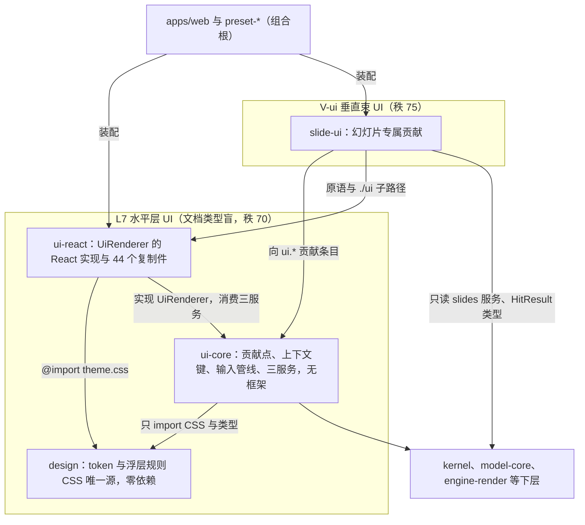
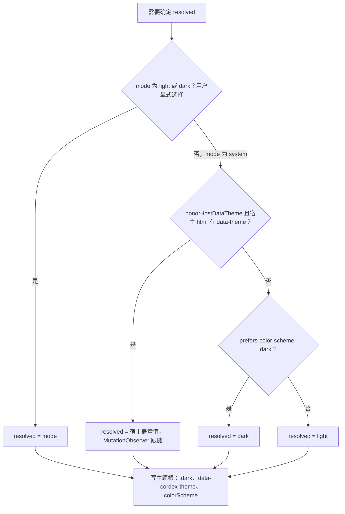
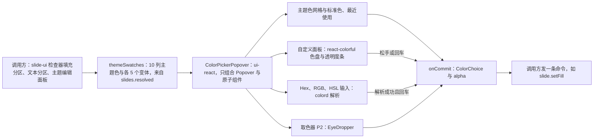
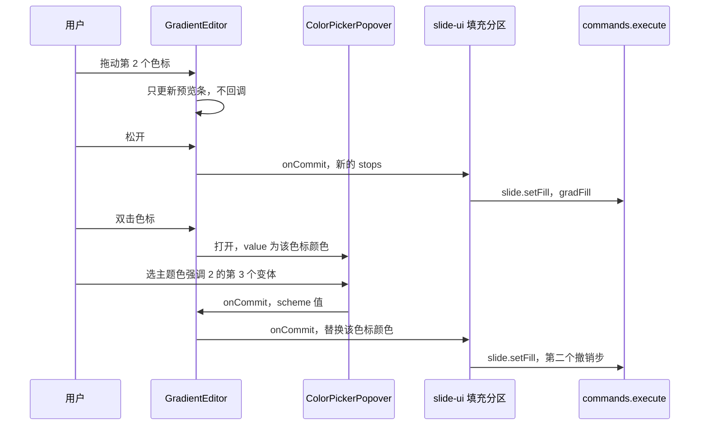
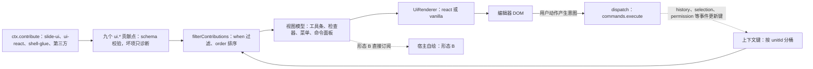
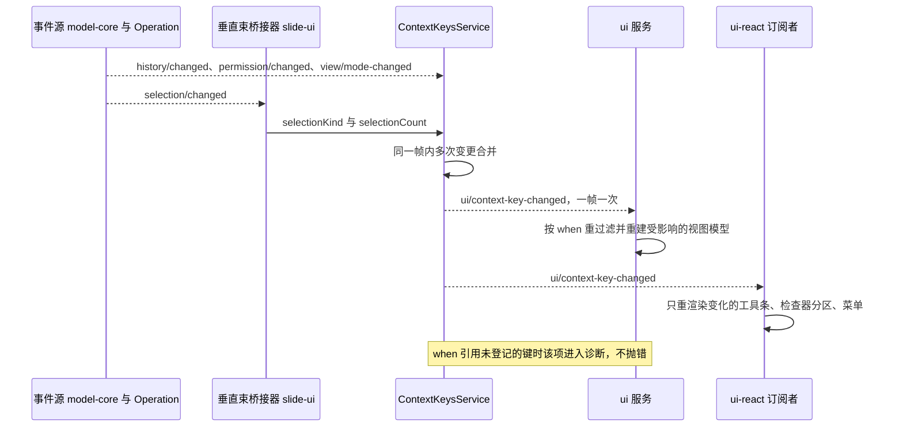
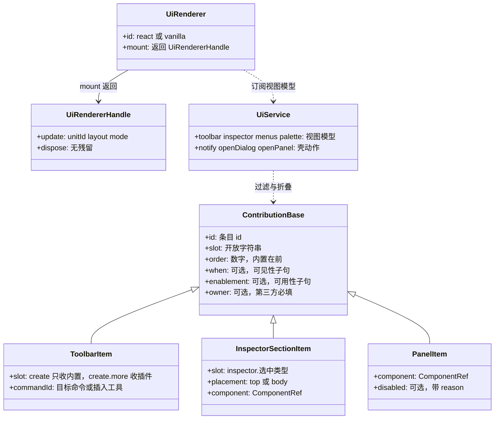

# 09 UI 组件体系与主题
> 状态：v0.1 | 负责：前端设计线 | 更新：2026-09-25；2026-09-25（§4.19）；2026-09-25（审稿）；2026-09-26（§4.20）；2026-09-26（§4.21：新增 §5a 复用件登记与颜色、渐变组件契约；cn 维持 clsx + tailwind-merge 并以 codemod 收口；react-colorful 改静态 CSS）；2026-09-26（§4.21 整合：§5a.1 登记 ui-react 通用 DataGrid；§6.1 toolbar 槽位补 table、table-cell、chart；§6.3 selectionKind 补四值；§8 文本编辑态白名单补段落对齐、字号与 Mod+K，导出键待 Mod+E 冲突裁决）；2026-09-30（§4.22：材质由两档改为三档，新增浮层档 `--glass-bg-float` / `glass-float`，迷你工具条与画布浮签改用浮层档；§2、§4、V3 同步）；2026-10-04（design-language-v3 第 0 批：token 与主题体系对齐 v3 中性平面（rulings §4.25 DS-1、DS-2、DS-5、DS-6）——§2 事实基线改为 playground `src/v3/v3.css` 与 `ui.tsx`，token 表改为样张名 → 契约名对照、暗亮两套；§4 材质层整节作废，改为平面层次与浮层规则；§3.3 密度改为 v3 单档；§5 注明复制件是否继续作种子由本线定（现定在 M2 playground 迁移时，§5）；§6.1 删 `ui.ribbon`、`ui.statusBar`，增 `ui.inspectorSection`，`ui.toolbar` 补 `create` / `create.more`，`ui.contextMenu` 以 `mainMenu.*` / `docMenu` 取代 `appBar.more`，十个改为九个；§6.3 增 `editorView`、`focusRegion` 按 v3 区域改写；§7 视图模型删 `RibbonTree` 与状态栏模型、增工具条模型；§8–§13 去掉 Ribbon、状态胶囊与玻璃相关条目）；2026-10-04（design-language-v3 第 0 批：术语残留清理：ribbon / 状态栏 / `ui.ribbon` / `ui.statusBar` 的历史陈述改用 check-terms 认可的标记措辞（废弃、作废、取代、原名））；2026-10-04（design-language-v3 第 0 批：复验修正——§6.1 `ui.inspectorSection` 条目字段定为唯一定义处（`placement` 只取 `top` / `body`，面板标题由选区桥接器给出）；工具条「更多」改为垂直束贡献的 `kind:'menu'` 条目；`ui.panel` 槽位补 `rail.header`、注明 `grid` / `floating` 统一；§2 状态色行改指设计 04 §2.5 已登记的 v3 取值；§11 与 V14 的 a11y 基准改为「组件状态基准路由」（旧版 `/styleguide` 随 DS-7 删除，接替路由随迁移定稿）；§12 V4、V16、V20 测试文件名对齐 40/10 §9；§13 七条已回写项改为已回写或已登记；对比度待复核由 4 项增为 5 项（设计 04 §2.6 新增待复核 5：状态色只在 panel 上达到文字线，随第 2 批））；2026-10-04（design-language-v3 第 0 批：复验第 2 轮修正——§7 工具条视图模型与 40/10 统一：创建工具条为 `CreationToolbarModel` / `buildCreationToolbar(items, keys)`，上下文工具条与评审条为 `ToolbarModel` / `buildToolbar(items, keys, slot)`，视图模型由四个改为五个，§13 对应行同步；§8 未登记和弦删去已与 ED-16 一致的缩放提示 ⇧1；§6.1 `ui.contextMenu` 行与 §6.3 `editorMode` 行注明主菜单子项与模式入口（「视图 › 模式」）样张已起草、当时未定稿（2026-10-07 定稿））；2026-10-05（design-language-v3 第 1 批 · DS-9 对比度达 WCAG AA：§2 token 表按设计 04 §2.2–§2.6 新取值改写——文字行写明 `text-2` / `text-3` 新值与用法（`text-3` 只给占位与不可用项）；新增「控件边界」行，`--border-control` 从「作废」行恢复为字段 1px 独立边界的契约名（`--v3-border-control`）；强调色行增 `--v3-accent-solid`（带文字的强调色实底，`--primary` 取它）；控件派生、协作者身份色、状态色行同步；原「待复核 1、2」已结案）；2026-10-07（design-language-v3 第 0 批余项：§2 事实基线补「全量迁移后 v3 token 并入 `src/index.css`」、旧版删除的是 `index.css` 里的旧 token（与 80-process/02 §2 一致），协作者身份色行改为按协作者 tone 取 `--v3-tone-*`（`--v3-collab` 只是未被引用的别名，设计 03-02 §3.2）；§6.1 `ui.toolbar` 槽位删去 `toolbar.text-editing`（rulings §4.25 DS-13）；§6.3 `editorView` 的「待登记」与 §13「已登记」按 40/10 实际登记统一为已登记；§8 快捷键按 PRD ED-16 定稿——命令面板 `Mod+K`（删去 `Mod+Shift+P` 与 `F1` 备用和弦的现行写法，留一句改键记录）、超链接 `Mod+Shift+K`、工具单键 V / T / S / C 已登记 ED-16、放映按 ED-16、替换 Windows / Linux `Ctrl+H` 与 macOS `Cmd+Shift+H`（DS-11、DS-16）；§11 第 4 步网格内容按 40/10 写作 `SlideGrid`（胶囊 `FloatingCapsules`），第 2 步「不迁移」限于 `index.css` 里的旧 token；§12 V3 对比度断言按设计 04 §2.6 新表（DS-9）改写）；2026-10-07（design-language-v3 第 1 批：按已拍板样张与 rulings §4.25 DS-21…DS-30、TB-1…TB-30 回写——§2 token 表「层级」行按 TB-2 新增 `--layer-panel` = 30、`--layer-toast` 由 300 调到 15（在 chrome 之下），「阴影」「动效」「控件尺寸」行按设计 04 §2.10、§2.12、§2.13 第 1 批口径改写，「待定」契约名改为随全量迁移定稿（设计 04 §8）；§4 浮层表补第 1 批浮层与层级；§5 补第 1 批 kit（`src/v3/kit/`）是 ui-react 对应组件的种子、通用行为契约以设计 04 §4.1b 为准；§5a.1 react-resizable-panels 按三条分隔条可拖改写；§5a.4 颜色弹层 v3 视觉改指 03-16 §4.5；§6.1 `ui.toolbar` 删除对象上下文槽位 `toolbar.<selectionKind>`（TB-29）、`reviewBar` 只承载评论、高亮与上一处 / 下一处（固定项外壳内置，TB-1），`create.more` 内置项按 03-04 §4.2 写全，`ui.contextMenu` 补顶层单项槽位 `mainMenu`（「插件…」）、「帮助」条目归属与母版视图「关于母版继承」（TB-15）、节标题右键不开放（TB-23），`ui.panel` 补横幅置顶位槽位 `banner`（母版横幅，TB-14）；§3.4 `data-cordex-region` 补紧凑与仅查看形态的取值；§6.3 `editorMode`、`editorView`（写进地址栏 `view`，TB-30）、`focusRegion`（紧凑与仅查看形态）同步；§7 `ToolbarModel` 只服务评审条；§8 白名单与样张提示补 DS-29 的删除线、上标、下标与粘贴为纯文本；§11 第 4 步补 kit，§11 引言与 §12 V14 按 TB-3 改为 a11y 与 csp-strict 门禁对象始终是产品 `/styleguide`（内容按 v3 kit，样张为 `_kit` 场景）；§12 V20 补 `mainMenu` 只收内置；§13 同步）；2026-10-08（design-language-v3 第 1 批收口：§2「层级」行样张近似改为 `z-[15]`（同设计 04 §2.11）；§6.1 `create` 槽位补「选择」由垂直束贡献（rulings §4.25 TB-38），`ui.contextMenu` 补 `mainMenu.file` 的「幻灯片大小…」（P2，DS-31）、帮助中心走壳意图 `help-center`（TB-39）、开发者面板只在开发构建出现（TB-40），母版视图项的 `enablement` 补 `platform != 'mobile'`（TB-44），排序补插件条目很多时的暂行收纳（TB-31）；§6.2 不可用原因示例按 TB-44 改为「在更大窗口中编辑」；§7 评审条的呈现方改为 ui-react `ReviewToolbar`（40/10 §4.3）；§8 链接键改用命令名「链接…」与对话框「插入链接」（TB-6）；§11 与 §12 V14 补 `/styleguide` 只在测试部署挂出（TB-50，50/02 §2）；§13 `reviewBar` 行改为五项、TB-29 行的 40/10 与 40/11 回写改为已回写，新增收口行）；2026-10-08（design-language-v3 第 1 批评审修改：安静控件定为缺省（rulings §4.25 DS-35…DS-37、TB-55、TB-57、TB-58）——§1 `design` 行注明控件 `[data-slot]` 规则为安静样式；§2 token 表「分隔与焦点」行 `--v3-border` 暗色改为 `#444444`（原 `#3D3D3D`），安静控件的细边与它同档；「控件边界」行 `--border-control` 收窄为复选框、单选圈、滑块与拖动把手、插入表格网格、自己头像外圈、分隔条悬停线、滚动条与虚线落区（原「字段与下拉的 1px 独立边界、选中块与按下态的内描边」作废）；新增「控件语义」行（`--v3-field-*`、`--v3-select-*`、`--v3-seg-*`、`--v3-toggle-on`、`--v3-on-*`、`--v3-btn-*`、`--v3-hover-line` 等，契约名随全量迁移定稿）与「控件画法」条；「强调色」行补按下的开关（DS-36）；「控件派生」行移出分段选中块、色块外圈补快速样式缩略（TB-56）；§4 新增「控件画法」规则；§5 样张封装补外框常量、样张删除 `controls` 参数；§9 插件分区同一画法；§12 V3 控件边界不再列入 3:1 配对；§13 新增评审修改行，待定契约名补控件语义 token；DS-34 的样式库原位展开不涉及本文贡献点与槽位）；2026-10-15（design-language-v3 第 2 批：§2「协作者身份色」行按 rulings §4.25 DS-42 定稿 12 色与哈希顺序，「状态色与遮罩」行按 DS-41 定稿——取值不变（方案 B），危险实心按钮、其悬停与遮罩的契约名为 `--destructive-solid`、`--destructive-solid-hover`、`--scrim`，浅底横幅上不可用或进行中的按钮文字用次级文字色，不阻断的插件横幅改中性底加状态色图标；新增 §5a.6 第 2 批共享件契约（整栏面板外框、列表折叠行 `FoldRow`、加载行、整块状态、说明行、`Select` 行内变体、开关、12px 归属标识、待处理圆点、降级占位与对象说明）与轻提示播报、焦点不经过 `body`、对话框高度三条（DS-38、DS-48、DS-52、DS-53、DS-56）；§6.1 `ui.panel{slot:'inspector'}` 的呈现定稿（内置条目为页签，第三方条目为 400 整栏面板，DS-38），插件收纳与归属标识按 DS-49、DS-56；§7 同步；§12 V3 补身份色 12 色与浅底上的次级文字；§13 状态色与插件收纳两行结案、新增第 2 批行）；2026-10-15（design-language-v3 第 2 批：§5a.6 `InspectorTakeover` 的宽度与分隔条按 rulings §4.25 TB-60；§6.1 `ui.inspectorSection` 条目新增可选字段 `expandPanel`（本节为字段定义处，TB-59），`ui.panel{slot:'inspector'}` 改为「页签只由内置包贡献、第三方条目只作整栏面板，不以 `order` 区分」，`ui.contextMenu` 写明评论钉的菜单不走贡献（TB-61），`ui.dialog` 增 ui-react 模板 `export-local-copy`（导出本地副本，[07](07-collaboration-client.md) §8.2）；§7 `InspectorModel` 同步；§13 新增 TB-59…TB-61 一行；同日再补：核对 §6.1 `ui.inspectorSection.expandPanel`、`ui.panel{slot:'inspector'}` 页签只由内置包贡献、`ui.contextMenu` 评论钉菜单不走贡献与 §5a.6 `InspectorTakeover` 两档宽度已按 TB-59…TB-61 写定；`ui.dialog` 行注明导出本地副本放在 SDK、ui-react 模板由 3 个变为 4 个（rulings §4.25 TB-85）；§13 TB-59…TB-61 一行的他线项按现状核对）；2026-10-15（design-language-v3 第 2 批：§13 TB-59…TB-61 一行原列「仍待」的 `ui.dialog` 模板 4 个与 `ExportLocalCopyDialog.tsx`（rulings §4.25 TB-85）核对为已登记；正文不变）；2026-10-22（design-language-v3 第 3 批：按已拍板样张回写（rulings §4.25 DS-74、DS-76、DS-78、DS-89、DS-100、DS-105…DS-108、DS-113、DS-115、DS-117、DS-123、DS-129、DS-132…DS-136、TB-104、TB-106…TB-108、TB-113、TB-117、TB-124、TB-128）——§2 放映舞台 token 与舞台暗色作用域、序号角标、把手取值、新增备注区 token 行、命令面板层级、动效例外、TB-58 四项结案与画布底的按钮画法；§3 删去密度；§5a.6 对话框高度补偏好设置与命令面板、新增 §5a.7 第 3 批共享件；§6.1 帮助中心按配置、`ui.dialog` 的 `settings` 改名与 `export-local-copy` 的 `reason`；§6.3 `density` 作废；§8 导出 `Mod+Shift+E`、放映中吞 `F5`；§11、§12、§13 同步）；2026-10-22（design-language-v3 第 3 批回写补充，rulings §4.25 DS-129、TB-132、TB-136、TB-139、TB-150：§6.1 登记 `ui.contextMenu` 条目与 `ui.command` 元数据的 `external?: true`（帮助中心与「关于母版继承」新标签页打开、带外链图标，DS-89、TB-132），`export-local-copy` 的 `reason` 取值与说明第二句的对照在本节登记、没有点名的原因用中性句（DS-129、TB-139），「母版视图」项 `enablement` 把触控条件排在前面（TB-136）；§6.2 `explainWhen` 补触控设备「在电脑上编辑」与嵌入「当前区域太窄，暂不可用」两种写法，嵌入标记经 `UiCoreConfig.host.embedded` 传入、不新增上下文键（TB-136、TB-150）；§13 新增一行）；2026-10-22（design-language-v3 第 3 批回写收口，rulings §4.25 TB-150、TB-159、TB-162：§6.1「母版视图」项与 `ui.command` 一行补注——嵌入又是触控设备时原因仍是「在电脑上编辑」（TB-159），壳意图经 shell-glue 的无参 Operation 进命令面板（TB-162）；§6.2 写明嵌入标记由 ui-react 在挂载时按 `EditorHost` 属性写入、不是上下文键，触控与嵌入同时成立时的先后（TB-150、TB-159），配置签名改指 40/10 §2.5；§13 新增一行；2026-10-22 复核修正：§6.1「母版视图」项的 `enablement` 与 §6.2 `explainWhen` 的形态子句改为先窗口窄、再触控、再桌面——手机不论是否触控按窗口窄写，只有平板写「在电脑上编辑」（TB-163）；§2 token 表第 3 批新增的备注区与舞台黑屏、白屏两行把「待定」改写为契约名随全量迁移定名（DS-7）；§13 同步；§5a.5 `GradientEditor` 的落点改为已登记（40/10 §4.3、§5.3），§13 一行去掉轮次字样；§6.2 `explainWhen` 写明只读浏览里 `editorMode == 'edit'` 与能力位为假都给「只有查看权限」，§8「导出」一条的原因按权限写——查看者「只有查看权限」、评审者与降权「需要编辑权限」（DS-105，设计 03-02 §2.3））；2026-10-23（design-language-v3 第 3 批评审修改：§2「控件边界」行补导入落区的例外——对话框里静止时与分隔线同档、拖入悬停强调色虚线加淡底（rulings §4.25 DS-141、TB-180），「圆角」行对话框改 12（DS-142）；§5a.1 登记 Tabler 文件类型图标（原件复制进 ui-react、不作依赖，DS-143、TB-182）；§5a.6 对话框标题栏改 40 后的高度与导入对话框 560 × 406（TB-179）；§5a.7 补导入对话框、拖入落区与文件类型图标三行，`BlockingPage` 不再承载导入（DS-140）；§13 同步；§5a.6「焦点不经过 `body`」补焦点已落好时不再移动（Dialog、Drawer、BottomSheet）；§5a.7 拖入落区的对比度按设计 04 §2.6 写作 4.24 / 4.57；§12 V3 补 04 §2.6「第 3 批评审修改的核算」的计入项（与 40/10 §9 `contrast.test.ts` 一致））；2026-11-04（design-language-v3 母版视图改版：§2 控件语义行删去母版视图范围单选的 token；§5a.6 `PanelState` 去掉母版视图加载失败的例外；§6.1 `enablement` 示例补版本历史一条、`ui.toolbar` 条目字段 `group` 与母版视图的主行、`ui.panel` 的 `canvas.top` 改说明与横幅置顶位的上下文条；§6.2 `explainWhen` 视图模式条件的原因句与次序；§6.3 删 `slide.editScope`、新增标准键 `inspectorTakeover`（没有整栏面板时为 `null`）；§8 工具单键补母版视图的 P、Esc 链补母版视图三级；§13 新增一行；需求编号、优先级与里程碑不变；rulings §4.25 DS-146、DS-152、DS-154、DS-157、TB-195、TB-196、TB-200、TB-203、TB-206、TB-207、TB-208、TB-209、TB-210） | 依赖：[40/10](../40-modules/10-ui-shell-and-slide-ui.md) §0–§3a、§5、§10、§11、§13；[30/02](../30-architecture/02-layering-and-packages.md) §4.17–§4.20；[30/03](../30-architecture/03-kernel-and-plugin-model.md) §3.6；[ADR-0017](../30-architecture/adr/0017-ui-component-library-shadcn-copy-model.md)；[设计 04](../20-design/04-design-system.md) §2、§3、§4、§8（v1.0）；[设计 09](../20-design/09-design-specification.md) §0–§3、§5、§6（v4.0）；[设计 06](../20-design/06-extensibility-ux.md) §2、§2.6、§2.12；playground `src/v3/`（`v3.css`、`ui.tsx`、`editor/*`）；[PRD NF-01](../10-prd/04-non-functional-requirements.md) §1.5；[PRD EM-06](../10-prd/03-features/05-embedding-and-integration.md)；[rulings](../00-charter/rulings-2026-09-14.md) §4.7、§4.8、§4.10 Q19 / Q21、§4.11 C-21 / C-22、§4.12 U-08、§4.15 Q2、§4.19 D-COMMENTS-PKG、§4.20 FE-06 / FE-11 / FE-12 / FE-16 / FE-18、§4.21（R-d-12…R-d-19）、§4.25 DS-1…DS-9、DS-13、DS-18、DS-21…DS-23、DS-29、DS-31、DS-34…DS-37、TB-1、TB-2、TB-3、TB-6、TB-14、TB-15、TB-23、TB-29、TB-30、TB-31、TB-38…TB-40、TB-44、TB-50、TB-55…TB-58、DS-38、DS-41、DS-42、DS-48、DS-49、DS-52、DS-53、DS-56；playground `src/v3/kit/`、`src/v3/scenarios/README.md` §3a、§3b；[设计 04](../20-design/04-design-system.md) §2.10–§2.13、§4.1a、§4.1b、§8；[设计 03-02](../20-design/03-screens/02-editor-main.md) §2.3、§6.2；[17 前端复用组件清单](17-reuse-and-dependency-catalog.md)；[PRD 02](../10-prd/03-features/02-editing.md) ED-03、ED-06；rulings §4.25 DS-74、DS-76、DS-78、DS-89、DS-100、DS-105…DS-108、DS-113、DS-115、DS-117、DS-123、DS-129、DS-132…DS-136、TB-104、TB-106…TB-108、TB-113、TB-117、TB-124、TB-128；playground `src/v3/v3.css`（`--v3-stage*`、`--v3-notes-*`、`--layer-command-palette`）、`src/v3/kit/{ShellLayout,DocumentCard,BlockingPage,Drawer,stage,Follow,PageJump}.tsx`、`kit/roving.ts`、`kit/chord.ts`、`src/v3/scenarios/README.md` §3e，第 3 批场景 `present`、`command-palette`、`settings`、`presence-scale`、`quiet-leftovers`；[设计 04](../20-design/04-design-system.md) §2.2a、§2.4、§2.6、§2.12、§4.1d；rulings §4.25 DS-129、TB-132、TB-136、TB-139、TB-150（第 3 批回写补充）；rulings §4.25 TB-159、TB-162（第 3 批回写收口）；rulings §4.25 TB-163；rulings §4.25 DS-140…DS-143、TB-179…TB-183（第 3 批评审修改）；playground `src/v3/kit/{importDialog,BottomSheet,FileTypeIcon,DropOverlay,Dialog,Drawer}.tsx`；rulings §4.25 DS-146、DS-152、DS-154、DS-157、TB-195、TB-196、TB-200、TB-203、TB-206…TB-210（母版视图改版）

本文是**浏览器 UI 体系的运行侧设计**唯一事实源：四个 UI 包怎样分工、设计 token 怎样变成 CSS 与组件外观、主题怎样解析并写到根元素、shadcn 复制件怎样管理、`ui.*` 贡献与上下文键怎样驱动视图模型、输入怎样变成命令、`UiRenderer` 怎样挂载、样式怎样注入与隔离。

> **2026-10-04 起现行设计语言为 v3 中性平面**（rulings §4.25 DS-1、DS-2，样张拍板）：灰阶分层级、品牌蓝只做强调；面板贴边、1px 分隔；去掉渐变背景、光晕与毛玻璃，只有浮层带阴影；编辑器去掉 Ribbon 与状态栏。本文据此改写：token 的事实基线换成 playground `src/v3/`（§2），原「材质层」作废（§4），`ui.ribbon` 与 `ui.statusBar` 两个贡献点删除、新增 `ui.inspectorSection`（§6.1，DS-5、DS-6）。

不在本文（只链接）：

| 主题 | 事实源 |
|---|---|
| 四包的目录树、逐文件职责、测试文件清单、`package.json#cordex` 字段 | [40/10](../40-modules/10-ui-shell-and-slide-ui.md) §4、§5、§9、§10 |
| 控件 → 命令 id 的绑定表本体 | [40/10](../40-modules/10-ui-shell-and-slide-ui.md) §2.6 |
| 贡献点项类型、键与 `conflict` 取值的总表 | [30/03](../30-architecture/03-kernel-and-plugin-model.md) §3.6（前端贡献方视角见 [03 §7](03-preset-assembly-and-plugins.md)） |
| 编辑器外壳区域（左栏、画布与备注、底部工具条、检查器、网格视图与浮动胶囊、主菜单）、视图状态、布局状态、断点、模式矩阵、画布交互与反馈分层 | [10](10-editor-shell-and-interaction.md) |
| 母版视图的状态与流程 | [11](11-masters-layouts-and-themes.md) |
| token 取值与解释、组件视觉规格、编辑器结构与层次 | [设计 04](../20-design/04-design-system.md) §2、§4，[设计 09](../20-design/09-design-specification.md) §1–§3、§6，与 playground `src/v3/v3.css`、`src/v3/ui.tsx` |
| CSP nonce 链、第三方运行时样式的 nonce 传递、Trusted Types | [14](14-client-security.md) §3–§4 |
| 第三方依赖的版本、许可、单点位置、替代与否决理由、CSP/TT 影响与体积去向 | [17](17-reuse-and-dependency-catalog.md) |
| 键盘区域、F6 循环、焦点环与网格焦点例外、焦点管理、live region | [16](16-i18n-and-accessibility.md) §6–§8 |
| 组件测试、axe、视觉基线的执行方式 | [70/06](../70-testing/06-frontend-component-and-e2e.md) |

包名一律省略 `@cordexjs/` 前缀。

## 1. 四包分工与依赖边界

| 包 | 层 / iso / 形态 | 做 | 不做 |
|---|---|---|---|
| `design` | L7 / dom / library（无 `plugin.ts`） | token（契约名：shadcn 变量名 + Cordex 扩展裸名，样张名对照见 §2）、浮层与控件 `[data-slot]` 规则（浮层为实色 + 1px 边 + 浮层阴影、无模糊；控件为安静样式、无阴影，§4，rulings §4.25 DS-35）、`body` 宿主防线的**唯一 CSS 事实源**；类型与常量（`ThemeVarName`、`TokenSet`、`FLOATING_SLOTS`、`LAYER`）；对比度核算 | 任何组件、图标、React / Radix / Tailwind 运行时 import（R18 `design-css-only`）；幻灯片纸面内的字号与颜色（那是文档数据） |
| `ui-core` | L7 / dom / definition + plugin | 九个 `ui.*` 贡献点（2026-10-04 作废 `ui.ribbon`、`ui.statusBar`，增 `ui.inspectorSection`，§6.1）、`when` 语法与上下文键、五条输入管线、`ui` / `shortcuts` / `theme` 三服务、视图模型纯函数、`UiRenderer` Definition、水平层 Operation `view.setMode`、`ui.setEditorView`（单页 / 网格，[10](10-editor-shell-and-interaction.md) §2.3）与 `ui.*` 面板 Operation | import react / radix / tailwind / lucide（R14 `ui-core-no-framework`）；任何文档类型字面量（`no-doc-type-literals`）；渲染 |
| `ui-react` | L7 / dom / provider（`implements:['uiRenderer']`） | React 19 实现的 `UiRenderer('react')`：`<EditorHost>` 与 v3 壳组件（左栏、底部工具条与评审条、检查器、网格视图与浮动胶囊、紧凑形态的抽屉与仅查看形态、主菜单与文档菜单、横幅通道，[10](10-editor-shell-and-interaction.md) §1、§2.2）、槽位宿主与原语、44 个 shadcn 复制件（`./ui` 子路径，去留见 §5）、贡献渲染适配器与逐项错误边界、`ThemeBridge` | 任何 `slide.*` 命令绑定或幻灯片语义；手改复制件结构 |
| `slide-ui` | V-ui / dom / plugin（`bundle=slide`，只贡献不 provide） | 幻灯片专属的创建工具（底部工具条的文本、形状、图片、表格、图表等，`ui.toolbar{slot:'create' \| 'create.more'}`）、缩略图列表、网格视图内容与母版缩略图窗格、检查器分区（`ui.inspectorSection`）与面板标题、画布交互层、版式画廊、主题面板、放映舞台、母版视图编排、默认键位表与 `slide.ui.*` 语言包；评论的 slide 专属部分：锚点解析、检查器「评论」页签、画布评论钉气泡、缩略图角标、工具条「评论」工具与右键「添加批注」（rulings §4.19 D-COMMENTS-PKG，[08](08-comments-and-version-history.md) §2） | Store 写入（全部经 `commands.execute`）；重绘选区框与远端光标（那是 render-dom 的 `render.overlay`）；缩略图像素；评论线程事实源（归文档类型盲的 `comments` 包，[08](08-comments-and-version-history.md) §2） |

**框架可换的可验证范围**（rulings §4.15 Q2）：`ui-core` 全包与各 `*-ui` 的 `src/domain/**`、`src/application/**` 不含 React（depcruise `cordex-ui-bundle-core-framework-free`，TD-082）；React 只允许出现在 `*-ui` 的 `src/ui/**`。换框架须同时替换 `ui-react` 与全部 `*-ui` 的 `ui/` 层。SDK 对宿主 React 声明 peer `^19.0`。

**图 9-1 UI 四包分层与允许依赖**



怎么读：箭头是允许的 import 方向，全部向下（秩只向下，depcruise R2）；`design` 不依赖任何包；`ui-core` 对 `design` 只允许 CSS 与 `import type`（R14 子规则 `ui-core-design-css-only-import`）；复制件目录 `./ui` 只对 `ui-react` 自身、`V-ui` 包与 `apps/*` 开放（R17 `shadcn-ui-dir-private`）；`slide-ui` 对 `uiRenderer` 只是可选注入，`ui-react` 缺席时贡献照常注册但不渲染（headless）。
依据：ADR-0017 决策 3–5、7；40/10 §1.1、§10；rulings §4.15 Q2。

**可插拔证据**（charter §5.4 UI 行，由 [70/02](../70-testing/02-contract-suites-and-pluggability.md) 的 preset 可插拔用例覆盖）：移除 `ui-react` → 贡献照常注册、宿主 headless 运行；移除 `slide-ui` → 壳渲染空左栏与空检查器，底部工具条没有条目、整条不渲染（§6.1「空槽位不渲染」），画布仍可渲染与缩放；移除 `ui-core` → `ui-react` 与 `slide-ui` 同时 PENDING（诊断可见，不是失败）。（取代 2026-10-04 前的「空 Ribbon，位置显示『无可用页签』」，DS-1。）

## 2. token 与 CSS 产物

**事实基线**是 playground `src/v3/v3.css`（颜色、阴影、焦点环，暗亮两套）与 `src/v3/ui.tsx`（控件尺寸、圆角、字号、图标规格）——2026-10-04 起取代 `src/index.css` 里的旧 token（rulings §4.25 DS-2；旧 token 只服务尚未迁移的 ribbon 版界面，随旧版删除，DS-7），全量迁移后 v3 token 并入 `src/index.css`（取值的唯一归属见 [80-process/02](../80-process/02-traceability-and-ownership.md) §2）；取值的展示与解释在设计 04 §2，本节只写名字、去向与读者。`design` 的 TS token 对象是生成源，`build-theme` 从它生成入库的五份 CSS，`build-theme --check` 逐字节比对（只允许注释与顺序差异），不一致即失败（ADR-0017 决策 6）。

样张的 `--v3-*` 只是与旧版并存期间的作用域名（token 只定义在 `.v3-root` 与 `.v3-slide` 上，主题与强调色走 `data-v3-theme`、`data-v3-accent`）；产品 CSS 一律输出契约名，不出现 `--v3-*`（设计 04 §8）。下表「待定」的契约名随全量迁移定稿（三批之后 v3 token 并入 `src/index.css`，DS-7；第 1 批样张没有定名，设计 04 待决事项）。第 1 批评审（2026-10-08）把检查器控件改为安静样式并定为缺省，样张为此新增一组控件语义 token（下表「控件语义」行，rulings §4.25 DS-35），同样只有样张名、契约名一并随全量迁移定稿。

| token 族 | 契约名（裸名，`--cordex-*` 作废，C-22） | v3 样张名 | 来源 | 谁读 |
|---|---|---|---|---|
| 表面 | `--canvas`（应用底）；`--background`、`--card`、`--popover`（面板与浮层底）；二级、三级表面待定 | `--v3-canvas`、`--v3-panel`、`--v3-panel-2`、`--v3-panel-3` | 设计 04 §2.2、§8 | 画布区与网格视图、左栏与检查器、浮层、字段与悬停底 |
| 文字 | `--foreground`、`--muted-foreground`；三级文字待定 | `--v3-text`、`--v3-text-2`（暗 `#B0B0B0` / 亮 `#666666`）、`--v3-text-3`（暗 `#858585` / 亮 `#8A8A8A`） | 04 §2.2、§2.6（DS-9：可读信息只用 `text` / `text-2`，均 ≥ 4.5:1；`text-3` 只给占位与不可用项，≥ 3:1） | 全部 UI 文字与图标；网格视图焦点框取 `--v3-text`（§4、[16](16-i18n-and-accessibility.md) §7） |
| 分隔与焦点 | `--border`、`--ring`（样张已桥接：`.v3-root` 内 `--border: var(--v3-border)`、`--ring: var(--v3-accent)`） | `--v3-border`（暗 `#444444`、亮 `#E5E5E5`；暗色原为 `#3D3D3D`，2026-10-08 调到 Figma 的档位，rulings §4.25 DS-35）、`--v3-accent` | 04 §2.1、§2.2、§2.11a | 1px 分隔线、面板贴边线与浮层描边、焦点环；安静控件的细边（下拉与选择的边、字段悬停边、分段选中块的边、次按钮的边）与分隔线同档，由下文「控件语义」行的 token 引用它，组件不直接写 `--v3-border`（DS-35、DS-37） |
| 控件边界 | `--border-control`（沿用旧版 Cordex 扩展名；rulings §4.10 Q21 的 ≥ 3:1 随 DS-9 重新生效，DS-35 起只约束本行所列的件） | `--v3-border-control`（暗 `#858585` / 亮 `#8A8A8A`，DS-9 新增） | 04 §2.2、§2.6 | 「边框就是控件本身」或身份标记的件：复选框与单选圈外框、滑块把手外框、插入表格网格未选格的 1px 内描边（TB-35）、自己头像的 1.5px 外圈、备注拖动把手与分隔条的悬停 / 拖动线、滚动条滑块、虚线落区（导入的落区除外，见本格末句）；对 canvas / panel / panel-2 ≥ 3:1。字段与下拉的 1px 独立边界（`FIELD_FRAME`）、选中块与按下态的 1px 内描边随 DS-35 作废，改由「控件语义」行的 token 画。导入对话框里的落区静止时与分隔线同档（`--border`，靠正中的字与按钮识别，理由同 DS-35），拖入悬停时与开始页、文档列表主区的拖入落区一样是强调色虚线加淡底（panel 上叠 `--v3-accent-soft`，§5a.7；2026-10-23，rulings §4.25 DS-141、TB-180） |
| 控件语义（2026-10-08 新增，DS-35…DS-37） | 待定（随全量迁移定稿，设计 04 §8；契约里可直接引用 `--border`、`--border-control` 与表面的契约名） | 数字与文本输入 `--v3-field-*`（`-fill`、`-fill-hover`、`-line`、`-line-hover`、`-line-off`、`-fill-off`、`-split`、`-split-h`、`-split-edge`）；下拉与选择 `--v3-select-*`（`-fill`、`-fill-hover`、`-line`、`-line-off`）；分段与切换条的槽与选中块 `--v3-seg-track`、`--v3-seg-track-line`、`--v3-seg-on`、`--v3-seg-on-line`、`--v3-seg-pad`、`--v3-seg-gap`、`--v3-seg-on-radius`；开关按下 `--v3-toggle-on`、`--v3-toggle-on-line`；按钮按下与页签选中 `--v3-on-fill`、`--v3-on-line`；次按钮 `--v3-btn-*`（`-fill`、`-fill-hover`、`-line`、`-line-off`）；网格项悬停环 `--v3-hover-line`；首页搜索框 `--v3-search-*`；快速样式缩略 `--v3-qs-*`。安静取值即缺省，名称不变 | 04 §2.2、§4.1 | 检查器与面板里的控件外框与按下态：`ui.tsx` 的 `FIELD_FRAME`、`SELECT_FRAME`、`SEG_TRACK_FRAME`、`SEG_ON`、`TOGGLE_ON`、`IconButton` 的 on 变体、`Button` 的 secondary 变体与 kit 检查器控件（`kit/controls.tsx`）；画法见表后「控件画法」 |
| 强调色 | `--primary`（主操作底，取 `--v3-accent-solid`）、`--primary-foreground`；当前工具与选中的强调色、悬停、淡底、选区待定 | `--v3-accent`（品牌蓝：亮 `#3A5CE6` / 暗 `#5B7CFF`，DS-2）、`--v3-accent-solid` / `--v3-accent-solid-hover`（带文字的强调色实底，两套主题 `#3A5CE6`，DS-9）、`--v3-accent-fg`（白）、`--v3-accent-hover`、`--v3-accent-soft`、`--v3-sel`（后三者以 `color-mix` 从强调色派生）；按下的开关取「控件语义」行的 `--v3-toggle-on`（强调色混入 panel-2：暗 40%、亮 22%，DS-36） | 04 §1 第 6 条、§2.3、§2.6 | 只给主操作、当前工具、选中与按下的开关（设计 09 S-06；「按下的开关」2026-10-08 按 DS-36 补入）；白字只放在 `accent-solid` 上（5.44:1），`accent` 底只放图标（暗 3.63:1） |
| 控件派生 | 待定 | `--v3-handle`、`--v3-card-hover`、`--v3-swatch-line`、`--v3-scroll`（`handle`、`scroll` 取 `--v3-border-control`，DS-9；拖动把手的取值 2026-10-22 复核后不变，与画布暗 4.52 / 亮 3.17，rulings §4.25 DS-135）；分段选中块 `--v3-seg-on` / `--v3-seg-on-line` 2026-10-08 移入「控件语义」行（DS-35：选中块改为面板色加细边，`seg-on-line` 不再取 `--v3-border-control`） | 04 §2.2 | 备注把手、首页卡片悬停、色块与快速样式缩略的 1px 外圈（快速样式缩略去白衬底后外圈用它，TB-56）、细滚动条 |
| 备注区（2026-10-22 新增，rulings §4.25 DS-134） | 契约名随全量迁移定名（DS-7，设计 04 §8） | `--v3-notes-fill`（凹陷底：暗 `#151515` / 亮 `#EBEBEB`，与画布都是 1.09:1）、`--v3-notes-placeholder`（占位字：暗取 `--v3-text-3`，亮取 `--v3-text-2`——亮色 `text-3` 在这块底上不足 3:1，沿用 DS-41 方案 B 的先例） | 04 §2.2、§2.6、§8 | 编辑器备注区（静止不描边，悬停出 `--v3-field-line-hover` 细边）与其中的占位字「添加演讲者备注…」；原 `panel` 底加 1px 边作废 |
| 阴影 | 待定 | `--v3-shadow`（只给浮层）、`--v3-slide-shadow`（单页纸面：暗色无、亮色极轻） | 04 §2.10 | 底部工具条与评审条 / 浏览条、网格与紧凑形态的浮动胶囊、菜单与子菜单、弹层、对话框、轻提示、画布浮动面板与提示条、画布提示签与角标、紧凑形态的抽屉（贴边但盖在画布上）、仅查看形态的底部浮动条与底部面板、图表数据 Sheet；单页纸面。横幅在文档流里、不带阴影 |
| 纸面 | `--doc-paper`、`--doc-ink`（白纸面；白纸面上的界面文字取亮色文字值，样张 `.v3-paper`） | `.v3-paper` | 04 §2.2a | 幻灯片纸面、空白模板卡；幻灯片内容色是文档数据，不属本包 |
| 协作者身份色 | `--presence-1..12`（12 色 2026-10-15 定稿，rulings §4.25 DS-42） | `--v3-tone-*` 12 色，哈希顺序即编号顺序：slate · sand · sage · clay · mist（第 0–1 批已定，DS-9 只压明度）· olive `#79774B` · iris `#796F97` · lake `#457E81` · rose `#956879` · denim `#4C7B91` · plum `#8A6B8C` · moss `#607C59`（DS-42 新增，与已定 5 色同一口径：白字 ≥ 4.60:1，对暗色画布 ≥ 3.59:1、亮色画布 ≥ 4.22:1、白纸面 ≥ 4.60:1；哈希顺序里相邻两色 OKLab ΔE ≥ 8）；头像底色、远端光标、名签、远端选区与评论钉都按该协作者的 tone 取同一色；导入的只读批注用中性钉（样张 `--v3-pin-neutral`，契约名随全量迁移）；`--v3-collab` 只是 sage 的别名、组件未引用，不是单一取色 token（设计 03-02 §3.2） | 04 §2.4 | 头像、远端光标与名签、远端选区、评论钉；分配规则见 [07](07-collaboration-client.md) §11（按用户哈希取色，同一场里撞色顺延到下一色，第 13 位起复用并在头像上挂序号角标；角标 2026-10-22 定稿（rulings §4.25 DS-132、TB-124）：同色第一位不画，头像组里挂在头像下沿中线、在线列表里在右下，24px 头像配 14、20px 配 12，底与边取 `panel` 与 `--v3-border`、不另设 token，画法见设计 04 §2.4「序号角标」行） |
| 状态色与遮罩 | `--destructive` / `--warning` / `--success`（浅底 `-muted`，设计 04 §8）；`--info` 在 v3 不单设；危险实心按钮 `--destructive-solid`、其悬停 `--destructive-solid-hover`、遮罩 `--scrim`（2026-10-15 定名，rulings §4.25 DS-41） | `--v3-danger`、`--v3-warning`、`--v3-success` 与各自 `-soft` 浅底、危险实底按钮 `--v3-danger-solid` / `--v3-danger-hover`、对话框遮罩 `--v3-scrim`；取值按方案 B 不改（暗 / 亮：危险 `#FF7A78` / `#CC2A30`、警告 `#F0B347` / `#A15F00`、成功 `#4CC38A` / `#1A7F45`，浅底不变，DS-41） | 04 §2.5（DS-41 定稿） | 横幅、通知、状态图标、危险操作确认；状态色只给图标与必要文字，浅底上的正文用主文字色，常态不着色（运行中、已同步、完全保真，设计质量门 Q3）；横幅浅底上不可用或进行中的按钮文字改用次级文字色（对比度 ≥ 4.5），由横幅组件统一处理，中性底横幅、对话框与检查器里的不可用项仍用三级文字色；缺少插件、插件启动失败与「已恢复」「已导出本地副本」用中性底加状态色图标，离线、降权、隔离、登录已过期等仍用浅底（[10](10-editor-shell-and-interaction.md) §11）；浅底横幅上可用次按钮的细边几乎看不出，维持现画法（DS-41 的代价，设计 04 §2.6） |
| 放映舞台（2026-10-22 定稿，rulings §4.25 DS-106…DS-109） | `--stage`（沿用旧版扩展名与现值）；黑屏、白屏两个的契约名随全量迁移定名（DS-7，设计 04 §8）；原 `--stage-chrome`、`--stage-foreground` 作废，由舞台暗色作用域里的界面 token 取代 | `--v3-stage`（`#0A0A0A`，舞台底与幻灯片四周的留边）、`--v3-stage-black`（`#000000`，黑屏与末页之后的结束页）、`--v3-stage-white`（`#FFFFFF`，白屏），暗亮两套同值，定义在 `v3.css` 的 `.v3-root`；舞台不随界面亮暗，kit `StageScope` 在舞台里另开 `data-v3-theme="dark"` 的作用域（强调色跟随界面） | 04 §2.2a、§8 | 放映舞台、黑屏、白屏与结束页；舞台上的控制条、「更多」菜单、跳页提示条与跟随条一律取暗色作用域的面板、文字与边框 token，与底部工具条同一外观（实色、1px 边、浮层阴影，不加模糊） |
| 字阶与字族 | `--font-sans`（Geist Variable → 系统 → PingFang / 微软雅黑）、`--font-heading`、`--font-mono`、`--text-2xs`（11 px，只给纯数字与西文） | 根字号 12 / 行高 18；字号四档 11 / 12 / 13 / 16；含中文 ≥ 12 | 04 §2.8 | 全部 UI 文字；画布内文字不受影响（EM-06） |
| 圆角 | `--radius` 与派生刻度（v3 只用 4 / 6 / 8 / 12 四档与圆形头像，契约刻度随全量迁移定稿） | 样张以 Tailwind 固定值实现 | 04 §2.9 | 字段与菜单项、按钮与页签、工具条按钮与菜单面板、工具条、胶囊、对话框（2026-10-23 由 8 改为 12，确认框变体同此，rulings §4.25 DS-142）与底部面板上沿 |
| 层级 | `--layer-canvas` 0 · `canvas-overlay` 10 · `toast` 15 · `chrome` 20 · `panel` 30 · `dropdown` 100 · `popover` 110 · `sticky` 120 · `modal-backdrop` 400 · `modal` 410 · `command-palette` 500 · `tooltip` 600（2026-10-07 按 rulings §4.25 TB-2：新增 `--layer-panel`，`--layer-toast` 由 300 调到 15） | 样张以 `z-10` / `z-[15]` / `z-20` / `z-30` / `z-50` 近似（同设计 04 §2.11）；命令面板为 `--layer-command-palette`（样张 60，盖过 kit 对话框的 50；不加遮罩，2026-10-22，rulings §4.25 DS-117） | 04 §2.11、40/10 §12 G-10 | 全部浮层；左栏、检查器、底部工具条与浮动胶囊属 `chrome`；`panel` 给紧凑形态的抽屉、画布浮动面板（查找替换）、仅查看形态的底部面板与图表数据 Sheet——盖住工具条与胶囊、低于菜单与弹层；轻提示在 `chrome` 之下，工具条弹出的弹层可以盖住它（03-02 §6.2）；横幅在画布列的文档流里、不占层级；集成方可在编辑器根上整体平移（EM-06） |
| 动效 | `--duration-instant` 80 · `fast` 120 · `base` 180 · `slow` 240 · `slower` 320；`--ease-standard / decelerate / accelerate / spring`；`prefers-reduced-motion` 时全部 1 ms | 样张组件只用颜色过渡（`transition-colors` 150 ms）；第 1 批的例外只有四类：描边与外圈 `transition-shadow`、折叠分区与节标题 ▾ 的 `transition-transform`、表格插入手柄的 `transition-opacity`、加载转圈 `motion-safe:animate-spin`；菜单、弹层、对话框、抽屉、底部面板与视图切换都不加进出、位移或缩放动画 | 04 §2.12（第 1 批样张没有用到上列时长，取值随实现复核；第 3 批补的例外：放映控制条与指针在鼠标静止 3 秒后一起 200ms 淡出、跟随条随控制条淡出、导出完成的轻提示约 5 秒后收起，减少动效时都直接切换，rulings §4.25 DS-100、DS-106、DS-107） | 过渡与动画 |
| 控件尺寸 | `--control-h-*`、`--row-h`（名称沿用，v3 单档取值随全量迁移写入：控件 28、小图标按钮 24、图标按钮 28、工具条按钮 36、形状弹层格子 36、触控按钮 44（仅查看形态）、浮动胶囊高 48） | `ui.tsx` 的 `BTN_SIZE` 与各组件类名 | 04 §2.13、§8 | 控件高度簇；插件贡献的控件不得自定高度 |
| 作废（DS-2） | `--glass-bg`、`--glass-bg-strong`、`--glass-bg-float`、`--glass-border-color`、`--glass-blur`、`--glass-shadow`、`--canvas-glow`（`--border-control` 曾随「v3 字段无独立描边」列在此处，DS-9 给字段加回 1px 独立边界后恢复；2026-10-08 DS-35 起字段与下拉又不再用它画边界，`--border-control` 仍保留、只给复选框等件，见上「控件边界」行） | — | 设计 09 §6「作废」 | 旧版路由在迁移完成前仍读，产品 CSS 不再输出 |

- **控件画法**（2026-10-08，rulings §4.25 DS-35…DS-37、TB-55，安静样式定为缺省；外观规格以设计 04 §4.1 与 `ui.tsx` 为准，本条只写运行侧取色）：控件靠底色、标签与当前值识别，边界与分隔线同档。数字与文本输入（X / Y / W / H、字号、段前与段后、不透明度、颜色值行等，`FIELD_FRAME`；行距是下拉）只铺 panel-2 底、不描边，悬停出一道细边，聚焦时为 1px 强调色内描边（[16](16-i18n-and-accessibility.md) §7，不变）、校验错误时为 `danger`，不可用时底色再降一档（`--v3-field-fill-off`，panel-2 与 panel 之间）、不描边；下拉与选择（版式、字体、主题卡、列表样式、切换、文本颜色触发器等，`SELECT_FRAME`）透明底加 1px 细边，悬停与打开铺 panel-2，不可用时细边降为 panel-2，首页搜索框同一画法（`--v3-search-*`）；分段控件的槽只铺 panel-2、不描边，选中块为面板色加细边、贴边（槽内边距与项间距 0，外框仍 28，TB-55），开关组（B / I / U / S）保留 2px 间距，免得相邻的按下项连成一块；开关按下（B / I / U / S、上下标、水平 / 垂直翻转、查找的 Aa 与 ab 等切换条项，`TOGGLE_ON`）为强调色淡底、不描边，整组不可用时按下项退回分段选中块的画法、不保留强调色（DS-36）；按钮按下（锁定比例等 `IconButton` on）与「设计 / 评论」页签选中只铺 panel-2、不描边；选中与按下另有非颜色线索——文字字重 500、图标描边 2，悬停只换底色或字色、不加粗，悬停与按下因此分得开；次按钮（对话框「取消」、横幅「查看详情」、左栏「+」等，`Button` secondary）全局为透明底加细边，主按钮仍是强调色实底（DS-37）。可以为空的字段本次不加框内标识（TB-57）；左栏视图切换、备注区底色、拖动把手、锁定比例未锁时的图标与暗色珊瑚强调色下当前工具图标的对比度不在本次范围，列入后续批次复核（TB-58）。2026-10-22 第 3 批逐项结案（rulings §4.25 DS-74、DS-133…DS-136）：珊瑚强调色一项结案（珊瑚未采用，DS-2）；左栏与网格胶囊的视图切换改为与检查器分段控件同一画法（槽加选中块，28 高，DS-133）；备注区改为凹陷底——静止不描边、铺 `--v3-notes-fill`、悬停出与字段同档的细边，占位字取 `--v3-notes-placeholder`（DS-134，见上表「备注区」行）；拖动把手维持 `--v3-handle`（DS-135）；锁定比例未锁时是断开的链 `Unlink2`、锁定时是相连的链 `Link2` 加按下态（DS-136）。画布底（开始页、文档列表、管理页、模板库与阻断页）上的次按钮一律 outline——面板色底加 1px 细边（TB-128）；画布底上主按钮的不可用与进行中用 kit 主按钮的不可用态（panel-2 底、三级文字色），不改画成 outline（DS-123）。
- 其余 shadcn 变量（`--secondary`、`--muted`、`--accent`、`--input`、`--chart-1..5`、`--sidebar-*`）的 v3 映射随全量迁移与复制件去留（§5）一并定稿。组件在运行时写入的变量（横幅高度、纸面作用域记下的界面强调色，样张 `--v3-banner-h`、`--paper-accent`）不是设计 token、不进契约（设计 04 §8）。
- **组件不读裸色值**（设计 09 S-03）：组件只用语义 token 对应的工具类；画布内的文档内容（位置、尺寸、字号、颜色）是数据，允许内联样式（S-04）。样张里唯一的界面色字面量是工具提示底 `#111111`（浮层挂在 `body` 上时拿不到作用域 token），迁移时改为 token（04 待决）。
- **变量名即公共契约**：变量**名**自 M1 发布起视为 `stable`（`theme-vars-contract.test.ts` 依赖它们）；取值可随设计线微调（patch），任何取值变更须附对比度核算（04 §2.6）。新增扩展变量须先在 `tokens.css` 声明，`ui-react`、`*-ui`、`apps/*` 里出现未声明的扩展变量、`--cordex-*` 或 `--v3-*` 即失败（§12 V2）。

**五份 CSS 产物**（`theme.scoped.css` 为 2026-09-26 登记，rulings §4.20 FE-12）：

| 文件 | 内容 | 消费方 |
|---|---|---|
| `css/tokens.css` | 变量表：亮色默认 → `prefers-color-scheme` 兜底 → 三选择器暗色（§3）；`@theme inline` 注册颜色、圆角、`--text-2xs`、字族 | 经 `theme.css` |
| `css/slots.css` | 浮层 `[data-slot]` 规则（`FLOATING_SLOTS` 14 项：`--popover` 实色底 + 1px `--border` + 浮层阴影，无 `backdrop-filter`）、遮罩（实色半透明，不模糊）与深色实底 tooltip、控件 `[data-slot]` 规则、`body` 宿主防线（必须位于文件末尾）；2026-10-04 起不再含 `@utility glass*` 与两块退化（§4） | 经 `theme.css` |
| `css/theme.css` | `@import './tokens.css'` + `'./slots.css'` | `ui-react` 标准样式入口 `styles.css` 唯一 import 的 design 产物（§10「静态 · 应用」） |
| `css/tailwind-theme.css` | 只含 `@theme inline` 注册片段 | `*-ui` 的无 preflight 样式入口 |
| `css/theme.scoped.css` | 作用域变体：与 `theme.css` 同一 token 与 slot 规则，全部限定在 `[data-cordex-root]` 下，不写 `:root`、不触碰宿主 `body`（宿主防线改写到根） | `ui-react` 嵌入入口 `src/styles/embed.css`（产物 `./styles.embed.css`，§10「静态 · 嵌入」）；`injectCss:true` 的运行时注入源（§10；文件级见 40/10 §4.1、§4.2） |

**图 9-2 token 到组件的样式数据流**


怎么读：左半是生成链——迁移时从 v3 样张反推一次（样张名换成契约名），之后以 `design` 的 token 源为准，`build-theme --check` 保证入库 CSS 与源一致；右半是两条互斥的投放路径——独立应用静态引入 `ui-react` 的样式入口，嵌入宿主由 `ui-core` 在运行时注入同一份 `theme.css`（§10）；复制件自带的 `data-slot` 属性让浮层与控件规则无须改组件源码即可生效。
依据：ADR-0017 决策 3、6、7；40/10 §4.1、§7；设计 04 §2.1、§8；rulings §4.25 DS-2、DS-7。

## 3. 主题与根元素属性

### 3.1 解析顺序与 `ThemeState`

`ThemeState = { mode: 'system' | 'light' | 'dark'; resolved: 'light' | 'dark'; hostMark?: 'light' | 'dark' }`（2026-10-22 删去 `density`，v3 只留单档尺寸，rulings §4.25 DS-76）（ui-core `domain/theme-state.ts`，纯函数 `resolveThemeState(stored, hostMark, prefersDark)`）。`resolved` 按固定顺序得出，前者覆盖后者：

1. **用户显式选择**：`mode` 为 `light` 或 `dark`（偏好设置的「主题」分段或账户菜单的主题三项写入，二者同一偏好，rulings §4.25 DS-90；`apps/web` 随 `Preferences` 存入 `cordex.prefs`，并另写一份到 localStorage `cordex-theme` 供首屏脚本执行前读取、防闪烁，键空间见 [02 §10.1](02-app-shell-routing-and-session.md)）。
2. **宿主盖章**：`mode='system'` 且 `UiCoreConfig.theme.honorHostDataTheme` 为真时，读宿主 `<html data-theme="light|dark">`，并用 `MutationObserver` 跟随宿主切换（artifact 查看器、集成方页面常见）。
3. **系统偏好**：`prefers-color-scheme`，媒体查询变化时重算。

`initial`（默认 `system`）来自 `UiCoreConfig.theme`（2026-10-22 起不再有 `density`，DS-76）；主题切换在同一帧内完成根元素属性写入，运行时切换 ≤ 100 ms 且无闪烁（EM-06）。同页多个 host 各自持有 `ThemeState`，互不影响（§3.4）。

v3 样张只读 URL 参数 `theme`（写成 `data-v3-theme`，缺省暗色只为评审），不经过这条链；全量迁移后 v3 token 进入下面的解析顺序与 §3.2 的三选择器契约，组件只读语义 token（设计 04 §3）。暗亮两套 token 都由 `tokens.css` 产出，取值见设计 04 §2.2–§2.5。

**图 9-3 主题解析顺序**



怎么读：菱形自上而下就是优先级，任何一条路径最后都落到同一组根元素属性写入；组件只读语义 token，不读这些属性做逻辑分支（设计 04 §3）。
依据：40/10 §2.1 `ThemeState` 行、§2.3 `resolveThemeState`；设计 04 §3；rulings §4.11 C-21。

### 3.2 三选择器契约（C-21，长期等价）

`tokens.css` 的暗色 token 同时挂在三种等价选择器上，另以媒体查询兜底；`ui-core` 同时写 `.dark` 与 `data-cordex-theme`，因此不论 shadcn 生态代码、SDK 自身还是嵌入宿主，读到的都是同一套值：

| 选择器 | 谁写 | 用途 |
|---|---|---|
| `.dark` | ui-core `ThemeService`（`resolved='dark'` 时加） | shadcn 生态默认的暗色变体（`@custom-variant dark (&:is(.dark *))`） |
| `[data-cordex-theme="dark"]` / `="light"` | ui-core `ThemeService`（始终写 `resolved` 值） | SDK 自有命名空间；显式 `light` 阻止媒体查询兜底 |
| 宿主 `[data-theme="dark"]` | 宿主页面 | 嵌入场景直接跟随宿主盖章（未启动 JS 时也生效） |
| `@media (prefers-color-scheme: dark)` + `:not([data-cordex-theme="light"])` | CSS 兜底 | 首屏脚本尚未执行时跟随系统 |

### 3.3 单档尺寸、高对比与 `ui.theme` 覆盖集

- **单档尺寸**：v3 只有一档紧凑尺寸（控件 28、工具条按钮 36 等，设计 04 §2.13，DS-2）。2026-10-22 定为只留单档（rulings §4.25 DS-76）：没有密度这一偏好，偏好设置里没有「密度」一行；要更大的界面用浏览器缩放（PRD NF-05 要求 200% 缩放不丢功能）。原两档方案的 `ThemeState.density`、`data-cordex-density`、上下文键 `density`、`ThemeService.setDensity` 与 `ui.theme` 的 `density?` 一并作废；尺寸 token（`--control-h-*`、`--row-h` 等）只有一组取值，集成方要改仍走下面的覆盖集。原「紧凑档下 Ribbon 高度」一项（40/10 §13 Q-5）随 Ribbon 作废。
- **高对比**：M1–M2 只加 `@media (forced-colors: active)` 系统色兜底，不产生第三套 token；M3 P1 提供正式的第三套取值（rulings §4.12 U-08）；`prefers-contrast: more` 时描边改 `--border-strong`（M2）。
- **`ui.theme` 覆盖集**（Beta）：项类型 `ThemeContribution { id; tokens: Partial<TokenSet> }`（30/03 §3.6；原 `density?` 字段随 DS-76 作废）；键只收契约名，契约名定稿前不得引用 `--v3-*` 样张名（设计 04 §8）。生效顺序：`design` 默认值 < `ui.theme` 贡献（按注册顺序，同名键后者覆盖前者）< 运行时 `theme.setTokens(partial)`。覆盖值以 CSS 自定义属性写到主题根的 `style` 上（经 CSSOM，不受 `style-src` 限制）。
- **覆盖值校验**：键必须 ∈ `ThemeVarName`；值按族校验（颜色只收 hex / rgb / hsl / oklch，长度只收 px / rem，时长只收 ms）；**值中出现 `url(`、`expression(`、`;`、`}` 一律拒绝**，记诊断、该键不生效，主题其余部分照常。这样集成方无法借 token 覆盖引入外部资源或逃逸出声明。
- 集成方也可以直接在自己的 CSS 里覆盖变量：独立应用写在 `:root` 之后，嵌入场景写在 `[data-cordex-root]` 下（§10）。

### 3.4 根元素属性写入规则汇总

**主题根**：独立应用（`apps/web`，`injectCss:false`）为 `document.documentElement`；嵌入场景为编辑器容器 `[data-cordex-root]`，SDK **不写宿主的 `<html>`、`<body>`**，只读宿主的 `data-theme`。

| 属性 / 类 | 写在哪 | 谁写 | 取值与时机 | 读者 |
|---|---|---|---|---|
| `.dark` | 主题根 | ui-core `ThemeService`（`infrastructure/root-attributes.ts`） | `resolved='dark'` 时存在 | 暗色 token 选择器、shadcn `dark:` 变体 |
| `data-cordex-theme` | 主题根 | 同上 | `light` / `dark`，与 `resolved` 同步 | 暗色 token 选择器、宿主脚本 |
| ~~`data-cordex-density`~~ | — | — | 作废（2026-10-22，rulings §4.25 DS-76）：v3 只留单档尺寸，不再写密度属性 | — |
| `style.colorScheme` | 主题根 | 同上 | 与 `resolved` 同步 | 原生滚动条与表单控件 |
| 覆盖集自定义属性 | 主题根 `style` | 同上 | `ui.theme` 与 `setTokens` 合并结果 | 全部组件 |
| `data-cordex-root` | 编辑器容器 | ui-react `EditorHost` | 挂载时加、`dispose` 时移除 | 嵌入 CSS 作用域（§10）、`--layer-*` 平移 |
| ~~`data-interacting`~~ | — | — | 作废（2026-10-04，DS-2）：它只为交互期间关掉玻璃模糊，v3 没有材质层（设计 09 §6「作废」） | — |
| `data-cordex-region` | 各区域容器 | ui-react 区域容器 | 随视图与形态挂载：单页 `rail` / `canvas` / `notes` / `toolbar` / `inspector`，网格 `capsule-doc` / `capsule-share` / `grid` / `toolbar`；紧凑形态为两个胶囊加画布、备注与工具条，展开的抽屉即 `rail` / `inspector`；仅查看形态 `topbar` / `canvas` / `toolbar` / `sheet`（2026-10-07，[10](10-editor-shell-and-interaction.md) §1.1） | F6 循环与 `focusRegion` 键（[16 §6.1](16-i18n-and-accessibility.md)） |
| 宿主 `data-theme` | 宿主 `<html>` | 宿主 | 宿主决定 | ui-core 只读（`honorHostDataTheme`） |

- `dispose()` 时还原本 host 写过的主题根属性；多 host 同页时以引用计数决定是否移除共享的注入样式（§10）。
- Portal 出去的浮层（选项 `portal:'body'`）由 ui-react 在 `body` 下建一个带 `data-cordex-root` 的容器，`ThemeBridge` 把主题根的三项属性（`.dark`、`data-cordex-theme`、`style.colorScheme`）同步过去（原四项里的 `data-cordex-density` 随 DS-76 作废），保证浮层与编辑器同主题；默认浮层渲染在编辑器容器内（EM-06）。

## 4. 平面层次与浮层（v3；原「材质层」作废）

2026-10-04 起 v3 不用材质（rulings §4.25 DS-2）：面板与应用底在同一平面上贴边并排、靠 1px 分隔区分，只有浮层带阴影，内容层永远不透明。本节是运行侧规则本体，层次图与观感以设计 09 §6、设计 04 §2.10 与 playground `src/v3/` 为准。

| 规则 | 内容 |
|---|---|
| 平面 | 无渐变背景、光晕、`backdrop-filter`（设计 09 S-08）；内容层（幻灯片纸面、缩略图、网格页、模板与文档封面）不透明，且都是真实渲染（S-13） |
| 面板贴边 | 左栏、检查器、首页导航贴应用边缘，靠 1px `--border` 与画布分开；面板内的分区之间 1px 分隔，不叠底色卡、不卡片套卡片（S-09） |
| 阴影只给浮层 | §2「阴影」行所列浮层（底部工具条与评审条、浮动胶囊、菜单、弹层、对话框、轻提示、画布浮动面板与提示条、紧凑形态的抽屉、仅查看形态的底部浮动条与底部面板等）带浮层阴影，并在两套主题下都同时带 1px `--border` 边（暗色下阴影几乎看不见时由描边表达边缘）；面板、卡片、字段、按钮与横幅无阴影；单页纸面暗色无阴影、亮色只有极轻边影（设计 04 §2.10） |
| 控件画法（2026-10-08，rulings §4.25 DS-35…DS-37） | 安静样式是唯一画法：控件外框与按下态只经 §2「控件语义」行的 token 取色，组件不直接写 `--border-control`、`--border` 或表面色（`--border-control` 只给复选框、单选圈、插入表格网格等「边框就是控件本身」的件，§2「控件边界」行）；复制件的控件 `[data-slot]` 规则（输入框、下拉触发器、切换按钮等）同此；控件无阴影；产品不提供画法切换（样张删除 URL 参数 `controls` 与原画法，DS-35） |
| 浮层层级 | 浮层按 §2「层级」行落层：抽屉、画布浮动面板、底部面板与图表数据 Sheet 在 `--layer-panel`，菜单与弹层在其上，轻提示在常驻外壳之下；组件不得硬编码 z-index 数字（设计 04 §2.11，rulings §4.25 TB-2） |
| 浮层 `[data-slot]` | `FLOATING_SLOTS` 清单不变（14 个 `data-slot`：`popover-content`、`dropdown-menu-content`、`dropdown-menu-sub-content`、`context-menu-content`、`context-menu-sub-content`、`select-content`、`dialog-content`、`alert-dialog-content`、`sheet-content`、`drawer-content`、`menubar-content`、`menubar-sub-content`、`hover-card-content`、`command`），命中规则从「玻璃化」改为 `--popover` 实色底 + 1px `--border` + 浮层阴影，组件源码不写外观类；遮罩 `*-overlay` 为实色半透明、不模糊；`tooltip-content` 为深色实底（样张 `#111111`、12px 白字，快捷键 11px），不加阴影 |
| 浮层挂载 | 菜单、子菜单与弹层渲染在编辑器根节点之内以继承 token（样张 `V3Root` 把 Radix Portal 的容器设为 v3 根；产品为 `[data-cordex-root]`，§3.4）；工具提示若挂在 `body` 上则只用不依赖作用域 token 的固定配色（同上） |
| 按钮自带弹层时压住工具提示 | 按钮自己的弹层打开时（如工具条「形状」），该按钮的工具提示不弹，避免两个浮层叠在同一位置；用受控 `open` 压住，不拆掉包裹（拆了会让按钮重新挂载、焦点掉到 `body`，样张 `Tip` 的 `hidden`） |
| 宿主防线 | 独立应用：`slots.css` 末尾的 `body` 规则设置颜色、背景、字族、行高与抗锯齿，**必须写在任何 `@layer` 之外**（嵌入宿主给 `body` 注入的未分层声明在层叠上总是胜过 `@layer base` 里的声明），且其后不得再有 `body` 选择器；嵌入场景：同一规则改写到 `[data-cordex-root]` 上，不触碰宿主 `body`（§10）。v3 根节点自己声明文字色、底色与字号，不依赖 `body` 继承（设计 09 §5 第 4 条）；视觉基线仍须在宿主外壳版（`scripts/host-wrap.py`）上截图 |
| 作废（DS-2） | 三档玻璃 `glass` / `glass-strong` / `glass-float` 与 `--glass-*` 变量、`--canvas-glow` 光斑、浮层自动玻璃化与遮罩模糊、`prefers-reduced-transparency` 与 `@supports not (backdrop-filter)` 两块退化及其生成函数 `degradationBlocks(slots)`、`-webkit-backdrop-filter` 前缀顺序规则、同屏 `backdrop-filter` ≤ 4、`data-interacting` 期间面板不透明、玻璃面板 `contain: paint`；rulings §4.22 SR-2（暗色 `glass-float` 不透明度）随材质层作废失去对象（设计 09 §6） |

## 5. shadcn 复制件管理

**v3 与复制件的关系**（设计 09 S-01，2026-10-04）：v3 样张在 `src/v3/ui.tsx` 自写一层薄封装——`IconButton`（24 / 28 / 36）、`Button`（28）、`Field`、`SelectTrigger` / `MenuField`、`Segmented`、`ToggleStrip`、`Swatch`、`Avatar`、`Section` / `PanelTitle`（控件外框常量 `FIELD_FRAME`、`SELECT_FRAME`、`SEG_TRACK_FRAME`、`SEG_ON`、`TOGGLE_ON` 与 `IconButton` 的 on 变体只引用控件语义 token，2026-10-08 起取安静样式的缺省值，§2，rulings §4.25 DS-35），菜单直接用 Radix `DropdownMenu`，工具提示复用 shadcn `Tooltip` 但把 `data-slot` 改为 `v3-tooltip` 以绕开旧版全局玻璃规则。产品是否继续以 44 个复制件为种子、哪些由 v3 组件取代、风格 `radix-rhea` 是否更换，由本线在 M2 的 playground 迁移（§11 第 1 步）时定（同时回写 ADR-0017 与 40/10 §3a、§5.3b）；在此之前本节规则不变，复制件的视觉一律走 §4 的平面规则，不得出现毛玻璃、渐变与药丸形（设计 09 §2「未覆盖」行）。

**第 1 批 kit**（`src/v3/kit/`，rulings §4.25 DS-21 拍板，设计 04 §4.1a）：弹层 `Popover`、菜单 `Menu` 与右键菜单 `ContextMenu`、对话框 `Dialog`、画布浮动面板 `FloatingPanel` 与画布提示条 `CanvasHint`、轻提示 `Toast`、横幅 `Banner`、占位符图标条 `PlaceholderIconBar`、表格网格 `TableGridPicker`、检查器控件（`kit/controls.tsx`，含只读行 `StaticRow` 与可折叠分区 `FoldSection`）、纸面作用域 `PaperScope`、分隔条 `PanelResizer` 与画布标记件（`kit/canvas.tsx`）是 ui-react / slide-ui 对应组件的种子（逐文件去向以 40/10 §3a 为准）。它们的外观只用 §2 的 token、走 §4 的平面规则；**通用行为契约以设计 04 §4.1b 为唯一来源**——焦点进入、焦点归还（永不掉到 `body`）、`Esc` 逐层不越级、不可用项不隐藏（一组共用原因时用面板顶部说明行）、漫游焦点网格、锚定与按下态、菜单触发器不带工具提示——键盘与读屏细节以 [16](16-i18n-and-accessibility.md) §6–§8 与设计 07 为准；产品组件不得各自另定一套。

- **来源与风格**：shadcn CLI `pnpm dlx shadcn@4.21.0 add -o -y` 生成，风格 `radix-rhea`（`components.json` 入库；v3 下是否更换见上段）；不手拷、不用 `npx`（仓库根 `devEngines onFail:error`，rulings §4.15 Q9）。
- **全仓一份**：复制件只存在于 `ui-react` 的 `src/ui/components/ui/`（44 个），经子路径 `@cordexjs/ui-react/ui` 供 `*-ui` 与 `apps/*` 使用（R17）；其余任何位置出现同名复制件即失败。`drawer`（vaul）不迁移，窄屏底部面板改用 `sheet` 的 `side="bottom"`（rulings §4.15 Q2）。
- **视觉定制走 CSS**：组件级视觉写 `design` 的 `[data-slot]` 规则，不改复制件结构。确需改源码时文件头标 `// Cordex override: <原因>`，并登记在 `shadcn-copy.test.ts` 的允许清单里；当前清单：`sonner.tsx`（去掉上游对 `next-themes` 的依赖、改读 ui-core `theme` 服务）、`scroll-area.tsx` 与 `select.tsx`（透传 CSP nonce，[14 §3](14-client-security.md)；其 Viewport 的固定样式文本由 Trusted Types `default` 策略精确放行，[14 §4](14-client-security.md)）。sonner 的 Toast 样式不走运行时注入：ui-react 静态引入 `sonner/dist/styles.css` 并入自身样式产物（§10 三种投放路径都覆盖），import 时的 `__insertCSS` 经 pnpm patch 删去（rulings §4.20 FE-18）。
- **升级流程**：`scanners/shadcn-diff` 步骤报告复制件与上游的差异（M2 稳定后转为阻断，rulings §4.18 GV-14）；升级 PR 依次执行：钉住新 CLI 版本 → `diff` 审阅 → 重新 `add` → 重新应用登记在册的 override → `shadcn-copy.test.ts`、axe 与视觉基线全部通过 → 合并。
- **第三方依赖单点**：react、radix-ui、tailwindcss、lucide-react、cva、clsx、tailwind-merge、cmdk、sonner、react-resizable-panels、Geist，以及 §4.21 新增的 react-colorful、colord、react-hook-form（含 @hookform/resolvers）、use-sync-external-store、@tanstack/react-virtual、@atlaskit/pragmatic-drag-and-drop 只允许 `ui-react` 与 `V-ui` 包引入（R5 `third-party-single-entry`，ADR-0017 清单），且 catalog 精确锁版本；各自的包装位置见 §5a 与 [17](17-reuse-and-dependency-catalog.md) §14。

## 5a. 复用件登记与组件契约

本节是 UI 层（`ui-react` 与 `slide-ui`）使用的第三方复用件的运行侧登记：每个复用件包在哪里、自有代码经什么接口使用它、CSP 上怎么处理。版本、许可、替代与否决理由的总表在 [17](17-reuse-and-dependency-catalog.md)，本节不重复。依据：rulings §4.21（R-d-12…R-d-19）。

### 5a.1 复用件登记

| 复用件 | 版本（锁） | 包装位置 | 自有代码的使用方式 | CSP / TT |
|---|---|---|---|---|
| react-colorful | 5.8.1 | ui-react `ui/shell/ColorPickerPopover.tsx`、`ui/shell/GradientEditor.tsx` | 只用 `RgbaColorPicker` 这类受控组件画色盘与透明度条；颜色值一律转成 §5a.4 的 `ColorChoice` 再交给调用方 | pnpm patch 删运行时注入，样式静态化（§5a.3） |
| colord | 2.10.0 | ui-react（上述两个组件与 `inspector-fields` 的颜色输入） | 解析与格式化 Hex、RGB、HSL 文本；不做 OOXML 颜色变换（那是 model-slide `resolve-color.ts`） | 无 |
| react-hook-form + @hookform/resolvers | 7.88.0 / 5.9.1 | ui-react 表单钩子 `ui/form/use-schema-form.ts`（新增） | `useSchemaForm(schema)` 包一层 `standardSchemaResolver`，直接使用 protocol 的 zod schema；字段用 shadcn `Field` 呈现错误 | 无 |
| use-sync-external-store | 1.7.0 | ui-react `hooks/*` | `with-selector` 做视图模型的选择器订阅（§7「一帧一次」） | 无 |
| @tanstack/react-virtual | 3.14.13 | slide-ui 缩略图栏与选择窗格 | 只虚拟化列表项的挂载；每项高度由测量回填，节标题作为可变高度项 | 只写 React `style`（CSSOM） |
| @tanstack/react-table + shadcn Table | 9.2.4 | ui-react 通用 `DataGrid`（`ui/shell/DataGrid.tsx`，2026-09-26 整合登记；react-table 单点引入 ui-react） | headless 表格逻辑 + shadcn Table 复制件呈现；无幻灯片语义，slide-ui 图表数据分区与抽屉使用（ADR-0036 决策 6、[24](24-elements-tables-and-charts.md) §3.6） | 无运行时样式注入 |
| @atlaskit/pragmatic-drag-and-drop | 4.0.0 | slide-ui `infrastructure/dnd` | 把原生拖放事件翻译成 ui-core 拖放管线的 `DragIntent{kind: file-import / reorder}`（§8）；让位动画自写 FLIP；只用核心包 | 无运行时样式注入 |
| react-resizable-panels | 4.13.3 | ui-react `EditorShell` | 桌面形态的三条分隔条：左栏宽 160–420、检查器宽 240–480、备注高 64–320，按像素 clamp、按文档记忆（[10](10-editor-shell-and-interaction.md) §2.1，rulings §4.25 TB-24、TB-25，2026-10-07 第 1 批定稿）；分隔条的外观、`role="separator"` 与键盘步长以设计 04 §2.13、[16](16-i18n-and-accessibility.md) §6.3 为准；紧凑形态的抽屉固定宽、不用本库；不再写 `data-interacting`（§4 作废项） | CSSOM，见 [14](14-client-security.md) §3 |
| Tabler Icons 文件类型图标（原件复制，不作依赖；2026-10-23，rulings §4.25 DS-143、TB-182） | 3.49.0（原件版本） | ui-react `src/infrastructure/file-type-icons.tsx`（40/10 §4.3、§5.3） | 只收 `file-type-ppt`、`file-type-png`、`file-type-svg`、`file-type-pdf` 与通用 `file` 五个 outline 字形的路径，按格式 id 或扩展名取（`pptx`、`png`、`svg`、`pdf`；其余类型——如插件贡献的格式——都画通用 `file` 字形，不回退 icon-registry 的 `Puzzle`：这一格表示文件类型，插件归属另由行右侧的说明表达）；缺省 20px、描边 1.5（与 lucide 界面图标同一参数）、`currentColor`，颜色由所在的行给（可用 `text-2`、不可用 `text-3`，选中不变色），`aria-hidden`；使用方：apps/web 导出对话框的格式行与导入对话框的上传行、ui-react `ExportLocalCopyDialog` 的 .pptx 一行（.json 一行用 lucide `FileBraces`） | 无（静态 SVG 元素，不经 `innerHTML`） |

### 5a.2 `cn()` 口径

- `cn()` 维持 **clsx + tailwind-merge**，定义在 ui-react `lib/utils.ts`，三个包在 catalog 精确锁版本（ADR-0017 决策 2）。shadcn 官方的 `cn` 包（0.4.0，2026-09-01 起 22 天发了 14 版）暂不采用，到 1.0 再评估（R-d-12）。
- shadcn CLI 4.21 生成的复制件会写 `import { cn } from "cn"`；playground 现有 43 个复制件都是这样，`lib/utils.ts` 也只是 `export { cn } from "cn"`。M2 迁移（§11）与之后每次 `pnpm dlx shadcn@4.21.0 add` 之后，生成脚本跑一次 codemod，把这句改写为从 ui-react 内部的 `lib/utils` 导入；codemod 属于升级流程的固定步骤（§5「升级流程」），不算手改复制件，不需要 `// Cordex override`。
- `shadcn-copy.test.ts` 断言：复制件中不出现 `from "cn"`，`package.json` 不依赖 `cn`（§12 V17）。

### 5a.3 react-colorful 的静态样式

react-colorful 5.8.1 没有独立的 CSS 文件：样式文本内嵌在 JS 里，组件挂载时 `createElement("style")` 并写 `innerHTML` 注入到文档头（或 shadow root）。`innerHTML` 是 TrustedHTML sink，M3 强制 Trusted Types 后会抛错；它也不带 nonce，M2 起违反 `style-src`。处理与 sonner 相同（rulings §4.20 FE-18 的做法，R-d-13）：

1. **pnpm patch**：删掉注入函数的调用，登记在 `pnpm-workspace.yaml#patchedDependencies`（与 sonner 并列，40/01 §5.1）。
2. **静态样式**：把原样式文本原样抽到 ui-react `src/styles/vendor/react-colorful.css`，由 `styles.css` 与 `styles.embed.css`（嵌入变体限定在 `[data-cordex-root]` 下）引入；三种投放路径（§10）都覆盖，Shadow DOM 模式经 `adoptedStyleSheets` 采用。
3. **一致性**：单测从 patch 前的 npm 包里取出内嵌样式文本，与 `react-colorful.css` 比对（允许作用域前缀差异），升级 react-colorful 时同一 PR 重做 patch 与样式文件（§12 V18）。
4. **门禁**：csp-strict e2e 打开颜色选择器与渐变编辑器，断言 `style-src` 与 TT 违规为 0、色盘计算样式与基线一致（[14](14-client-security.md) §13 V2）。

### 5a.4 `ColorPickerPopover` 组件契约

需求来源是 PRD 02 ED-03（文字颜色、高亮）与 ED-06（填充、线条）：主题色 10 列 × 6 行（基色加 5 个明暗变体）、标准色、最近使用、自定义 Hex / RGB / HSL、透明度，取色器 P2。组件在 ui-react（通用，不含幻灯片语义），主题色板由调用方传入（slide-ui 从 `slides.resolved` 取，40/10 §4）。v3 检查器里的触发点是颜色行 `ColorRow` / kit `ColorField`（色块 + 十六进制 + 色槽名 + 不透明度，一个 28px 字段）与背景的色块快捷项；弹层的 v3 视觉见设计 03-16 §4.5（文字颜色选择器，2026-10-07 第 1 批拍板；高亮的弹层与之同一组件，03-16 §4.1）与 04 §4.1a（`SwatchPicker`），本节契约不变。

```ts
// ui-react ui/shell/ColorPickerPopover.tsx（契约草案；类型最终登记在 40/10 §6）
type ColorChoice =
  | { kind: 'scheme'; slot: SchemeSlot; variant: 0 | 1 | 2 | 3 | 4 | 5 } // 主题色：列 = 槽位，行 = 变体（0 为基色）
  | { kind: 'srgb'; hex: string }                                      // 标准色、最近使用、自定义、取色器
  | { kind: 'none' }                                                    // 仅在 allowNone 时出现（「无填充」「无线条」）
  | { kind: 'auto' };                                                   // 仅在 allowAuto 时出现（文字「自动」）

interface ColorPickerPopoverProps {
  value: ColorChoice | 'mixed';                  // 多选且取值不一时为 mixed，色块显示斜线
  alpha?: number;                                 // 0–100；缺省时不显示透明度条
  themeSwatches: readonly ThemeSwatch[];          // 10 列：{ slot, name, hex, variants: 5 个已解析的 hex }
  recent: readonly string[];                      // 最近使用的 hex，调用方持有
  allowNone?: boolean;
  allowAuto?: boolean;
  onCommit(next: ColorChoice, alpha?: number): void; // 点选、松手、回车各一次
  onDismiss?(): void;
}
```

- **写回语义**：选主题色得到 `scheme` 值，调用方把它写成 `schemeClr`（变体映射为 `lumMod` / `lumOff`，映射函数与 `resolve-color.ts` 同在 model-slide），这样改主题色时引用它的元素会跟着变（PRD 07 ML-04）；标准色、最近使用、自定义与取色器得到 `srgb` 值，写成 `srgbClr`。组件自己不做 OOXML 颜色变换。
- **每列 5 个变体的取值**按 PowerPoint 的规则由基色亮度决定（深色基色给「浅」变体，浅色基色给「深」变体），由 model-slide 的纯函数计算后经 `themeSwatches.variants` 传入；组件只显示结果，不内置表格。
- **一次命令**：拖动色盘或透明度条期间只更新面板内的预览色块，松手、回车或点选色块时才调用 `onCommit`；调用方据此发一条命令（如 `slide.setFill`），得到一个撤销步。`Esc` 关闭面板，不提交。
- **自定义输入**：Hex、RGB、HSL 三种文本经 colord 解析；解析失败时字段显示错误、不提交。
- **取色器（P2）**：只在 `'EyeDropper' in window` 时显示按钮，取到的颜色作为 `srgb` 提交；不支持的浏览器不显示入口，不做降级模拟。
- **最近使用**：由调用方维护与持久化（长度与存储键登记归 [02](02-app-shell-routing-and-session.md) §10）；组件只在提交 `srgb` 值时回调，不自己写存储。
- **可访问性**：色块网格是一组单选按钮，方向键移动、`Enter` 或空格选择，`aria-label` 写「槽位名 + 变体名 + 当前值」；react-colorful 的色盘与透明度条自带 `role="slider"`、`tabIndex=0` 与方向键调节，`aria-valuetext` 改为本地化的颜色描述；弹层焦点管理沿用 Radix Popover（[16](16-i18n-and-accessibility.md) §7）。

**图 9-7 颜色选择器的组成与数据流**



怎么读：主题色板由调用方从已解析的主题取来传入，组件内四个入口最后都汇成同一个 `onCommit`；拖动色盘时不经过 `onCommit`，所以不会产生一串撤销步。组件只认 `ColorChoice`，写成 `schemeClr` 还是 `srgbClr` 由调用方决定。
依据：PRD 02 ED-03、ED-06；40/10 §4；R-d-13、R-d-14。

### 5a.5 `GradientEditor` 组件契约

需求来源是 PRD 02 ED-06：线性渐变 2–10 个色标、角度，预设 P1。组件放在 ui-react `ui/shell/GradientEditor.tsx`（已登记 40/10 §4.3、§5.3），由 slide-ui 的填充分区使用；它是 Radix Slider 多滑块与 `ColorPickerPopover` 的组合，不引渐变选择器库（R-d-15）。

```ts
// ui-react ui/shell/GradientEditor.tsx（契约草案）
interface GradientStop { pos: number; color: ColorChoice; alpha?: number } // pos：0–100 000，与 a:gs@pos 同单位
interface LinearGradient { kind: 'linear'; angle: number; stops: readonly GradientStop[] } // angle：度，写回时换成 a:lin@ang

interface GradientEditorProps {
  value: LinearGradient;
  themeSwatches: readonly ThemeSwatch[];
  recent: readonly string[];
  onCommit(next: LinearGradient): void;
}
```

- **色标**：色标轨道是一个多滑块 Slider，每个滑块是一个色标；点轨道空白处加色标（颜色取两侧插值），选中色标按 `Delete` 删除，数量保持在 2–10；拖过相邻色标时按位置重排。选中色标的颜色用 `ColorPickerPopover` 编辑，同样只在提交时回调。
- **角度**：数值框（0–359.9 度）与 8 个方向快捷按钮；写回 `a:lin@ang` 时换算为 1/60000 度。
- **一次命令**：拖动色标或角度期间只更新组件内的预览条，松手或回车才 `onCommit`；调用方发一条 `slide.setFill`，写 `a:gradFill`（`a:gsLst` 与 `a:lin`）。
- **导入的径向与路径渐变**：M2 只保证线性渐变完整可编辑；其它类型的可编辑范围待定（§13），在定之前组件只显示色标预览，类型切换置灰并说明原因。
- **可访问性**：每个色标滑块的 `aria-label` 写「色标 N，位置 X%，颜色名」；方向键移动 1%，`Shift` + 方向键移动 10%。

**图 9-8 渐变编辑的一次提交**



怎么读：拖动与选色各自只在结束时产生一次提交，因此一次拖动或一次选色各对应一个撤销步；`GradientEditor` 与 `ColorPickerPopover` 都不直接发命令，命令由持有选区语义的 slide-ui 发出。
依据：PRD 02 ED-06；R-d-15；[10](10-editor-shell-and-interaction.md) §7（拖动期间只预览、松手发一条命令）。

### 5a.6 列表与面板的共享件（2026-10-15，design-language-v3 第 2 批）

第 2 批六个场景各自做过的局部件已在样张里收进 kit（playground `src/v3/kit/`，场景 README §3b），产品里是 ui-react 的通用件（文件登记见 [40/10](../40-modules/10-ui-shell-and-slide-ui.md) §4.3、§5.3），slide-ui 与 apps/web 只用、不另起一种。外观规格以设计 04（§2.12、§2.14、§4.1）为准，本节写行为契约。依据：rulings §4.25 DS-38、DS-41、DS-48、DS-52、DS-53、DS-56。

| 件 | 用于 | 契约 |
|---|---|---|
| `InspectorTakeover`（检查器整栏面板外框） | 版本历史、保真报告、图表数据面板、插件整页面板 | 协作行原样不动，页签行换成标题行（标题 13px 600 · 可选一行说明 · 动作按钮 · 可选「收起到检查器」·「关闭」`Esc`）；宽度按用途两档（[10](10-editor-shell-and-interaction.md) §5「整栏面板」，DS-38、rulings §4.25 TB-60）：列表与报告类就是检查器当前宽度（缺省 280），开着时检查器左缘分隔条照常可拖、拖的就是检查器宽度；编辑与整页类取 max(400, 检查器当前宽度)，开着时分隔条不可拖，关闭后回到检查器原宽；`Esc` 在 document 捕获阶段处理，上面还有浮层开着时不响应；用户打开时焦点进内容区第一个可聚焦项，状态里一出现就开着的不抢焦点；关闭时先交出焦点、再卸载（本节末条） |
| `FoldRow`（列表折叠行） | 评论「已解决 N」、版本历史的月份行、自动版本组行与「最近删除」 | 高 32；12px `ChevronRight`（描边 1.5）在文字前，展开时转 90°，减少动态效果时不转场；文字 12px、次级文字色，悬停铺 panel-2、文字转主色；箭头左缘与列表正文左缘对齐（距面板内缘 16），版本列表这类左右内缩 8 的行另有内缩变体；整行一个按钮、带 `aria-expanded`；不可用（如版本历史的离线缓存）时文字退到三级色、不铺悬停底、`aria-disabled`；仅查看形态用触控尺寸（高 44、13px、箭头 16）。转向动画是设计 04 §2.12「不做位移动画」的例外（transform 旋转），登记为设计 04 §2.14 的小件 |
| 列表末尾的「再取一页」行 | 版本历史「加载更早版本」 | 不是折叠行（没有 `aria-expanded`），同一种安静行画法：左对齐、高 32、不满宽不描边，12px 图标与折叠行的箭头同一列，文字 12px 常规字重、次级文字色，悬停铺 panel-2 并转主色 |
| `LoadingRow`（加载行） | 列表与整栏的加载中：评论、版本历史、分享、插件面板 | 转圈 14 + 一句话（12px `text-2`），`role="status"`；列表里左对齐、行高 32，整栏还没有任何内容时居中；不画灰色骨架条（DS-53，设计质量门 Q8）；作为程序转交焦点的落点（如「重试」之后）时可聚焦（`tabIndex=-1`）并带读屏名（`role=status` 不从内容取名，焦点落下时才念得出「正在加载…」） |
| `PanelState`（整块状态） | 面板与对话框的整块出错、面板不可用、没有差异 | 居中：图标 20（危险 / 中性 / 成功）· 标题 13px 600 · 说明 12px `text-2` · 操作（次按钮「重试」）· 补充说明；错误态 `role="alert"`（DS-53）。只有一句话的空列表用 `EmptyNote`（居中 12px `text-2`，不用插画）。母版视图的加载失败同样用整块状态、次按钮「重试」（2026-11-04 按 rulings §4.25 DS-154 取消第 1 批的主按钮豁免） |
| `InspectorNotice`（说明行） | 面板与对话框顶部的只读、离线、权限、暂不可编辑说明 | 面板底、下方 1px 分隔、12px `text-2`、图标在前（状态色只给图标），`role="note"`；面板与对话框里的状态说明一律用它，横幅只在横幅通道、不放进面板或对话框 |
| `Select` 的列表行内变体 | 分享对话框成员行的角色下拉「可编辑 ⌄」 | 平时无框无底、右对齐到行尾；悬停、键盘聚焦、展开时铺 panel-2（`--v3-panel-2` 对应的契约名）；邀请行与访问申请行仍是带细边的 `Select`（§2「控件画法」，设计 04 §4.1） |
| `Switch`（开关） | 个人插件面板的个人启停 | `role="switch"`，安静样式：关 = 槽色淡底 + 细边，开 = 强调色底 + 白色圆钮，圆钮位置与颜色一起表达状态；不可用时 `aria-disabled`、仍可聚焦、工具提示写原因（DS-56） |
| 归属标识 `Attribution` | 插件分区标题、插件整页面板标题行、「更多」与菜单里的插件分组 | 统一 12px 插件图标 + 工具提示「由「〈插件名〉」（〈供应商〉）提供」（DS-56；原「16px 归属图标」作废） |
| 待处理圆点 | 「分享」按钮（检查器顶行与网格右上胶囊同一个） | 8px 强调色圆点在按钮右上角，2px 面板色外圈，`aria-hidden`；按钮读屏名与工具提示「分享（N 个待处理的访问申请）」，可见文字「分享」在读屏名开头（WCAG 2.5.3）；有无申请时按钮结构不变，数字变化不重新挂载、焦点不掉；不用红色（DS-48，设计质量门 Q3） |
| 降级占位与对象说明 | 画布上无法显示的对象与缺插件元素；检查器 `degraded` 分区最上的对象说明 | 画布占位：虚线框 + 类型图标 + 一行标题 + 一行原因（「内容已保留」并进原因行），保真占位与缺插件占位同一画法（DS-52，渲染见 [05](05-rendering-and-thumbnails.md) §9）；对象说明：中性信息图标 + 标题 + 一句原因 + 带外链图标的次按钮「保真详情」/「查看详情」，与第 1 批图表「此类型仅支持查看」同一颗按钮，不用警告色 |

- **轻提示与提示条的播报**（设计 07 §3，[16](16-i18n-and-accessibility.md) §8）：每条轻提示自己是一个播报区（一般 `role="status"`、polite，错误 `role="alert"`），内容在出现两帧后才放进无障碍树（样张 kit `useRevealAfterMount`），只播报一次；画布顶部的页级提示条同理（样张 `CanvasHint` 的 `announce="next-frame"`）。不再写「轻提示容器 `aria-live="polite"`」。
- **焦点不经过 `body`**（设计 07 §2，[16](16-i18n-and-accessibility.md) §7）：浮层关闭时在内容卸载的同一个任务里把焦点交回触发处；指针点外面关闭时，同一次按压里落在不可聚焦处的 `mousedown` 不再把焦点移到 `body`；会让触发元素卸载的操作（版本历史「返回当前版本」、命名表单的保存 / 取消、「重试」、纸面上的「加载」）先把焦点交给等效位置、再改状态；浮层库在下一个任务补做的那次交还，遇到焦点已落在页面里可用的元素上（不是 `body`，也不是画布、主区这类兜底落点）就不再移动（2026-10-23，设计 07 §2.4 第 1 条，[16](16-i18n-and-accessibility.md) §7；`Dialog`、`Drawer`、`BottomSheet` 都按此实现）。ui-react 的 `Dialog`、`ContextMenu`、`Menu`、`Popover`、主菜单、文档菜单与 `InspectorTakeover` 都按此实现。
- **对话框高度**：内容会增减的对话框顶部锚定（距顶 max(64px, 12vh)、只向下伸展），如分享对话框；个人插件面板为 640 宽、各状态固定 720 高（不超过视口高 − 64），列表在框内滚动，加载、出错与各状态同高，框体不跳（DS-38、DS-56，[03](03-preset-assembly-and-plugins.md) §10）。2026-10-22 第 3 批补：偏好设置对话框 480 宽、同样顶部锚定，最高到视口底留 32，超出时只有正文滚动、标题与说明固定（rulings §4.25 DS-113，[10](10-editor-shell-and-interaction.md) §10.3）；命令面板 480 宽、顶部锚定，结果列表在面板里滚动（DS-117，[10](10-editor-shell-and-interaction.md) §10.1）。2026-10-23 评审修改（rulings §4.25 DS-140、DS-142、TB-179）：全站对话框的标题栏由 48 改为 40、圆角由 8 改为 12（画法见设计 04 §4.1a Dialog 行），固定高的对话框外框不变、正文区随之多 8（个人插件面板各态），随内容定高的对话框整体矮 8；导入对话框宽 560（ui-react 对话框导入专用的一档）、固定高 406，各阶段同高、只换框里的内容，视口窄于 592 时宽度收到视口减 32、矮于 470 时高度收到视口减 64（[02](02-app-shell-routing-and-session.md) §9.3）。

### 5a.7 应用壳、放映与在场的共享件（2026-10-22，design-language-v3 第 3 批）

第 3 批样张新增的共享件：应用壳外壳、文档卡片、阻断页与模态抽屉随样张进 kit（`kit/ShellLayout.tsx`、`kit/DocumentCard.tsx`、`kit/BlockingPage.tsx`、`kit/Drawer.tsx`，场景 README §3e）；拍板后转正又并入卡片网格的键盘模型（`kit/roving.ts`，TB-107）、键位写法（`kit/chord.ts`，TB-106）、页导航提示条（`kit/PageJump.tsx`，TB-104）、舞台作用域（`kit/stage.tsx`）与跟随条（`kit/Follow.tsx`，DS-106）；序号角标、命令面板与放映控制条仍是场景目录里的局部件。2026-10-23 第 3 批评审修改（rulings §4.25 DS-140…DS-143、TB-179…TB-183）又并入导入对话框的登记与两个入口（`kit/importDialog.tsx`）、底部面板（`kit/BottomSheet.tsx`，由 `scenarios/settings/sheet.tsx` 并入）与文件类型图标（`kit/FileTypeIcon.tsx`），拖入落区（`kit/DropOverlay.tsx`）改为强调色、松开即打开导入对话框的上传态。外观以设计 04 §4.1d 为准，逐文件去向以 [40/10](../40-modules/10-ui-shell-and-slide-ui.md) §3a 为准；本节只写落点与运行侧契约。依据：rulings §4.25 DS-71、DS-79…DS-88、DS-94、DS-106、DS-107、DS-117、DS-123、DS-132、TB-106…TB-108、TB-113、TB-117、TB-124、TB-128。

| 件 | 产品落点 | 运行侧契约 |
|---|---|---|
| `ShellLayout`（应用壳外壳） | apps/web 页面宿主（[02](02-app-shell-routing-and-session.md) §2.1） | 只用本包 token 与 ui-react 通用件，不另起一套外观；横幅通道在顶栏之下、只横跨主区（DS-92）；紧凑形态左栏收成左侧抽屉，抽屉盖住顶栏开关时开关 `inert`（DS-87）；`Mod+K`、`Mod+,`、`Mod+/` 按 `KeyboardEvent.code` 接住（§8）；浮层关闭后焦点兜底落在主区，不掉到 `body`（§5a.6「焦点不经过 `body`」条） |
| `DocumentCard`（文档卡片） | apps/web（开始页「最近」、文档列表、回收站） | 卡片是链接 `<a href>`，浏览器的新标签页打开与复制链接地址照常（TB-108）；「⋯」与链接并列、不进 Tab 顺序；网格整组一个 Tab 停靠点、方向键漫游（TB-107，[16](16-i18n-and-accessibility.md) §6.2）；没有封面时画白纸面加图标，不画骨架（DS-86）；悬停底取 `--v3-card-hover` 对应的契约名 |
| `BlockingPage`（阻断页） | apps/web：编辑器打开失败、登录页、两个回调页、错误页与嵌入里的阻断页同一个件（DS-71、DS-118；原导入过渡页与失败页 2026-10-23 起由 DS-140 取代，导入的进度与失败在导入对话框里，见下方「「导入」对话框」行） | 不渲染残缺的左栏、检查器与工具条；由用户操作换到这一页时焦点落在按钮行第一颗，直接打开时不抢焦点；「复制诊断信息」点后原位变为「已复制」1.5 秒、按钮定宽，polite 播报一次（[15](15-events-errors-and-telemetry.md) §4.3、§10）；主按钮不可用与进行中用 kit 主按钮的不可用态（DS-123，§2「控件画法」） |
| 模态抽屉 | shadcn `sheet` 复制件（`side="right"`），由 apps/web 管理页组合 | 宽 480（最宽视口 − 32），模态、焦点圈定，`Esc` / × / 点遮罩关闭，焦点回打开它的那一行；遮罩取 `--scrim`（DS-94，[03](03-preset-assembly-and-plugins.md) §10） |
| 「导入」对话框 | apps/web `/import` 的对话框路由（[02](02-app-shell-routing-and-session.md) §9.3）；外框是 ui-react 对话框的导入专用一档（宽 560），手机为 ui-react `BottomSheet` 的模态一档 | 固定高 406、各阶段同高，换阶段只换正文（DS-140、TB-179）；模态、焦点圈定，上传与解析中 × 的读屏名为「取消导入」、点遮罩不关闭（TB-180）；对话框里常驻一个 polite 播报区，换阶段只改它的文字，失败由整块状态的 `role="alert"` 念出（[16](16-i18n-and-accessibility.md) §6.2）；开着时由它自己处理窗口上的拖放，只有选文件阶段接收；关闭后焦点回到顶栏「导入 .pptx」 |
| 拖入落区 `DropOverlay` | apps/web 开始页与文档列表的主区（[02](02-app-shell-routing-and-session.md) §9.1） | 拖入 .pptx 时顶栏以下整块换成落区：强调色 1px 虚线 + 淡底、圆角 8、`role="status"`；淡底是 panel 上叠 `--v3-accent-soft`（直接叠在画布底上时亮色说明行只有 4.24:1、不到 AA，叠在 panel 上 4.57:1，核算以设计 04 §2.6「第 3 批评审修改的核算」为准），与导入对话框里的拖入悬停同色（DS-141、TB-180）；松开即打开导入对话框的上传态（DS-140），对话框开着时不出现 |
| 文件类型图标 | ui-react `src/infrastructure/file-type-icons.tsx`（§5a.1；来源与许可见 [17](17-reuse-and-dependency-catalog.md) §3） | 只作装饰（`aria-hidden`），读屏名由旁边的文字给；导出格式行在单选圈与名称之间、导入上传行在文件名之前、「导出本地副本」的 .pptx 一行同此；设计 04 §2.14「单一图标家族」只为这一类开例外（DS-143、TB-182） |
| 搜索框下拉 | apps/web 左栏搜索框 | 弹层画法；按组合框处理键盘与读屏（[16](16-i18n-and-accessibility.md) §6.2）；前 5 条与「查看全部结果」，不写数量（DS-80，[02](02-app-shell-routing-and-session.md) §9.2） |
| `FollowBar`（跟随条） | ui-react `ui/shell/FollowBar.tsx`，编辑器与放映同一件 | `role="status"`；编辑器里画布顶部同一时刻只放一条提示，模式提示出现时让位；放映里随控制条显隐，自由浏览与失去连接时常驻；按钮统一「停止跟随」，停止后焦点交给画布（DS-106、TB-113，[07](07-collaboration-client.md) §11、[10](10-editor-shell-and-interaction.md) §9） |
| 序号角标 | ui-react `PresenceStack` 与在线列表（底座 `Avatar` 的 `badge` 与 `label`） | 角标 `aria-hidden`，序号写进头像的读屏名「〈姓名〉，同色第 N 位」；同一账号的会话数不上头像（DS-132、TB-124，[07](07-collaboration-client.md) §11） |
| `CommandPalette`（命令面板） | ui-react（`ui.dialog` 模板 `command-palette`，§6.1） | 不加遮罩、层级 `--layer-command-palette`；焦点圈定，打开时焦点在搜索框；`↵` 先关面板、交回焦点再执行（DS-117、TB-106、TB-117，[10](10-editor-shell-and-interaction.md) §10.1） |
| 放映控制条 | slide-ui `ui/present/PresenterStage.tsx` | `role="toolbar"`「放映控制」；取舞台暗色作用域的 token（§2「放映舞台」行）；指针在上面、「更多」展开或焦点在里面时不隐藏（DS-107，[10](10-editor-shell-and-interaction.md) §9） |
| 页导航提示条 | 编辑器的「数字 + `↵`」跳页与放映的跳页同一个件（落点以 40/10 §3a 为准） | `role="status"`、polite；敲数字时浮出「转到第 N 页 ┊ ↵ 跳转」，没有这一页时写「没有第 N 页 · 共 M 页」、`↵` 不动，约 3 秒无输入清空；放映里不写「Esc 取消」（放映中 `Esc` 是退出），「更多 › 跳至页码…」打开同一提示条的输入形态、焦点进输入（TB-104，[10](10-editor-shell-and-interaction.md) §9） |

## 6. ui-core 契约：贡献点、槽位、`when` 与上下文键

### 6.1 九个 `ui.*` 贡献点

项类型、键与 `conflict` 以 [30/03 §3.6](../30-architecture/03-kernel-and-plugin-model.md) 为准（全部 `replace`；该表已按 rulings §4.25 DS-5、DS-6 回写）；本表写前端的使用语义。公共骨架 `ContributionBase = { id; slot; order; when?; enablement?; owner? }`（`enablement?` 已登记，rulings §4.20 FE-06）：

- `when` 只管**可见性**：为假时该项不渲染（例如母版缩略图窗格 `when: viewMode == 'master'`、查看者变体里的创建工具）。
- `enablement`（语法同 `when`）只管**可用性**：为假时该项留在原位、`aria-disabled`，原因取 `explainWhen(enablement, keys)`（§6.2，对应 PRD ED-30「命令不可用时必须说明原因」），例如全文命令的 `enablement: unitLoaded`、主菜单「视图」里「母版视图」项的 `enablement: editorMode == 'edit' && !isReadOnly && breakpoint != 'narrow' && platform != 'mobile' && breakpoint == 'desktop' && inspectorTakeover != 'version-history'`（不是完整形态即不可进入，rulings §4.25 TB-44；形态子句按「先窗口窄、再触控、再桌面」的次序写（2026-10-22，TB-163）：手机（< 640）不论是否触控都得到「在更大窗口中编辑」（嵌入里为「当前区域太窄，暂不可用」），平板（触控、≥ 640）得到「在电脑上编辑」（嵌入里也是，TB-136、TB-159），桌面的紧凑形态得到「在更大窗口中编辑」（嵌入里为「当前区域太窄，暂不可用」），版本历史开着时得到「关闭版本历史后可用」（末一条 2026-11-04 按 rulings §4.25 TB-209 补），[11](11-masters-layouts-and-themes.md) §3）。`ui.shortcut` 与 `ui.command` 的项同样带可选 `enablement`（下表）。
- 条目最终可用 = 目标命令已注册（`commands.has`）∧ 命令声明的能力位已授予（`can.<capability>`，§6.3）∧ `enablement` 为真；三者任一为假都只禁用、不隐藏（[10](10-editor-shell-and-interaction.md) §4「只读是禁用而不是隐藏」）。原来把禁用条件写进 `when` 的条目已改写为 `enablement`（rulings §4.20 FE-11），工具条「图表」即 `enablement: slide.hasChartEditor`。

| 贡献点 | 项要点 | 典型 slot | 语义 |
|---|---|---|---|
| `ui.toolbar` | 条目列表：`commandId` 与 `params`（或切换到某个插入工具）、图标、标签、可选快捷键提示、可选分组 `group`（2026-11-04 登记，rulings §4.25 TB-210：只在 `create` 槽生效，相邻两组之间由创建工具条画竖分隔；母版视图里「选择」「占位符 ▾」一组、其余创建工具一组；第三方条目不用这个字段） | `create`（底部工具条主行，**仅内置**八项，由垂直束贡献——slide 为 slide-ui：选择、文本、形状、图片、表格、图表、评论、更多，母版视图里为 选择 · 占位符 ▾ ┊ 文本 · 形状 · 图片 · 表格 · 图表 · 更多、不显示「评论」（rulings §4.25 DS-152，[11](11-masters-layouts-and-themes.md) §6）；「选择」同样是垂直束贡献的内置条目、按 DocumentType 参数化，不由外壳渲染（rulings §4.25 TB-38）；「更多」是 `kind:'menu'` 条目，展开 `create.more`；换文档类型时「选择」与「更多」随该类型的 `*-ui` 一起提供）、`create.more`（工具条「更多」菜单：内置项在前——slide 为「文本」组 页眉和页脚… · 日期和时间… · 幻灯片编号 · 符号… · 公式（M4+）┊「插图」组 图标… · 视频 · 音频（P2）┊ 链接…，设计 03-04 §4.2；第三方创建类入口一律在此、分隔线后按插件分组并带归属，DS-5）、`reviewBar`（评审条 / 浏览条的条目，只承载评论、高亮与上一处 / 下一处评论，两枚箭头之间的计数「N 条评论」也是一个条目 `slide.review.commentCount`，slide 共五项；「浏览」、模式标识「评审模式」「返回编辑」与浏览条的「只读浏览中」由外壳内置、不走贡献，rulings §4.25 TB-1，[10](10-editor-shell-and-interaction.md) §3.2） | 创建入口（DS-1、DS-5，[10 §4](10-editor-shell-and-interaction.md)）；评审条（DS-23）。对象的上下文槽位 `toolbar.<selectionKind>`（含 2026-09-26 登记的 `toolbar.table`、`toolbar.table-cell`、`toolbar.chart`、`toolbar.degraded` 与已作废的 `toolbar.text-editing`）于 2026-10-07 删除：DS-13、DS-22 取消全部迷你工具条后它没有宿主，插件针对所选对象的命令改走 `ui.inspectorSection` 与画布右键 `ui.contextMenu{slot:'canvas'}`（rulings §4.25 TB-29；贡献点总数不变）。原 `appBar.badges` 随应用栏作废，母版视图徽标并入画布顶部的上下文条（母版视图的模式横幅，DS-21，[11](11-masters-layouts-and-themes.md) §4） |
| `ui.inspectorSection`（2026-10-04 新增，DS-5） | `{ title?; placement?: 'top' \| 'body'; component; expandPanel? }`（**条目字段的唯一定义**：设计 06 §2.12 草案、40/10 §3 与 §6 的类型、30/03 §3.6 的注均引用本行；面板标题不是分区条目，由垂直束的选区桥接器随 `selectionKind` 给出，§7）：`slot` 取 `inspector.<selectionKind>`；`placement:'top'` 画在面板标题上方（如形状的对齐行），缺省 `body`；内置分区 `order < 100`（按 10、20、30… 编号、留出插入空位），第三方 `order ≥ 100` 且必带 `owner`；同一组件用于多种选中类型时按类型各登记一条。`expandPanel?`（2026-10-15 新增，rulings §4.25 TB-59）：同一插件的 `ui.panel{slot:'inspector'}` 条目 id；有它时由宿主在该分区右下画次按钮「展开」（插件不自绘），点了打开这个整栏面板（宽 max(400, 检查器当前宽度)，TB-60）；面板跟着触发它的选中对象，选中别的对象即收起；命令或快捷键打开同一面板走 Operation `ui.openPanel{id}`；分区所属插件失败时「展开」随分区一起不显示；指向别的插件或不存在的条目时记诊断并忽略该字段（坏贡献不抛，本节末条） | `inspector.none`、`inspector.shapes`、`inspector.text`、`inspector.picture`、`inspector.table`、`inspector.mixed`…（取值即 §6.3 的 `selectionKind` 全集） | 检查器「设计」页签的格式分区：一个分区一个节，按选中对象类型取分区（[10 §5](10-editor-shell-and-interaction.md)）；插件针对所选对象的操作也挂在这里或画布右键（原拟的对象上下文工具条已删，TB-29）；取代 14 §1 C-05「检查器分区 = `ui.panel{slot:'inspector'}`」（设计 06 §2.12） |
| `ui.panel` | `component`、`defaultOpen`、`disabled?` + `reason?` | `rail`（左栏缩略图列表 / 母版缩略图窗格）、`rail.header`（左栏顶部的「新建幻灯片 ▾ / +」，网格视图由左上胶囊渲染同一贡献；含幻灯片语义，故由 slide-ui 贡献而不由外壳直接渲染，2026-10-04）、`grid`（网格视图的全部幻灯片，2026-10-04 新增）、`inspector`（检查器页签级的面板，原 `inspector.tab` 并入；呈现 2026-10-15 定稿，rulings §4.25 DS-38、TB-59：**检查器页签只由内置包贡献**——当前只有 slide-ui 的「评论」，与「设计」并列（P2 的选择窗格同此，[18](18-editor-capabilities.md) SEL-06）；**第三方插件的条目只作整栏面板**——不进页签行，入口是同一插件分区上由宿主画的「展开」（该分区的 `expandPanel` 指向本条目，见上一行）与经 Operation `ui.openPanel{id}` 的命令或快捷键，呈现为检查器整栏面板（宽 max(400, 检查器当前宽度)，§5a.6 `InspectorTakeover`，[10](10-editor-shell-and-interaction.md) §5「整栏面板」），跟着触发它的选中对象，选中别的对象即收起；页签还是整栏按贡献方是内置包还是第三方插件判定（ui-core 对照 `PresetReport.entries` 得出的 `origin`，[03](03-preset-assembly-and-plugins.md) §9 第 4 条），不以 `order` 区分；样张备选「插件面板作检查器第三个页签」未采纳）、`notes`、`canvas.top`（画布区的顶层：叠在画布之上、随画布区大小、只收内置，当前只有母版视图多选版式时的网格；2026-11-04 按 rulings §4.25 TB-206 改说明，槽位名不变，`ui.panel` 仍是 8 个条目）、`floating`（40/10 `slots.ts` 同名，原称 `canvas.grid`、`canvas.floating`，已统一为 `grid`、`floating`）、`banner`（横幅通道的置顶位，2026-10-07 新增：**只收内置**，当前只有 slide-ui 的上下文条 `slide.panel.masterBanner`，`when: viewMode == 'master'`；常驻在上、不参与 03-12 的让位，外壳渲染的其余横幅在它下方另占一条，rulings §4.25 TB-14，[10](10-editor-shell-and-interaction.md) §11 规则 1） | 检查器的节级内容改走 `ui.inspectorSection`；`floating` 不受检查器互斥规则约束 |
| `ui.contextMenu` | 分组条目，危险项置末；条目可带 `external?: true`（2026-10-22 登记，rulings §4.25 DS-89、TB-132）：执行后在新标签页打开外部页面的条目，宿主在条目右侧画 12px 外链图标、读屏名后加「（在新标签页打开）」；只是呈现标记，打开动作仍由条目的命令完成（帮助中心与「关于母版继承」走壳意图 `help-center`，[03](03-preset-assembly-and-plugins.md) §8） | `canvas`（画布上的对象与空白处，按 `selectionKind` 过滤，即对象菜单）、`thumbnail`（左栏与网格同一份）、`masterThumbnail`、`layoutThumbnail`、`mainMenu`（主菜单**顶层单项**，2026-10-07 新增）、`mainMenu.<顶层项>`（`file`、`edit`、`view`、`insert`、`arrange`、`help` 六个子菜单）、`docMenu`、`userMenu` | 右键菜单、主菜单、文档菜单与账户菜单（2026-10-04 起原 `appBar.more` 作废，拆入 `mainMenu.*` 与 `docMenu`，[03](03-preset-assembly-and-plugins.md) §8）。主菜单顶层固定为「返回首页 ┊ 文件 · 编辑 · 视图 · 插入 · 排列 ┊ 插件… ┊ 帮助」（2026-10-07 第 1 批定稿，03-02 §2.3）：「返回首页」与六个子菜单的触发项由外壳固定渲染；`mainMenu` 承载顶层单项，排在「排列 ▸」之后、「帮助 ▸」之前、上下各一条分隔线，**只收内置**（当前只有 shell-glue 的「插件…」，DS-18），第三方条目记诊断并丢弃、提示改投某个 `mainMenu.<顶层项>` 的「插件」分组。子菜单条目以 03-02 §2.3 为准：「视图」里的单页 / 网格、备注与「模式」组由外壳直接渲染、不走贡献（[10](10-editor-shell-and-interaction.md) §1.3）；`mainMenu.file` 为 导出… · 保真报告（shell-glue）· 幻灯片大小…（slide-ui，P2 前留在原位不可用并标 P2，rulings §4.25 DS-31）；`mainMenu.help` 为 命令面板… · 键盘快捷键（ui-react）┊ 帮助中心（shell-glue，走壳意图 `help-center`，TB-39；2026-10-22 起只在部署配置了帮助链接时出现、带外链图标、在新标签页打开，rulings §4.25 DS-89，[03](03-preset-assembly-and-plugins.md) §8）、母版视图中另有「关于母版继承」（shell-glue，同一意图，`when: viewMode == 'master'`，TB-15）、只在开发构建或 `features.developerMenu` 打开时出现的最后一组「开发者面板」（shell-glue，TB-40）。左栏节标题行的右键菜单由 slide-ui 直接渲染、不开放贡献（TB-23，M3 做节的增删改时再定是否开放槽位）；画布评论钉的右键菜单（解决 · 复制链接 ┊ 删除讨论串…）同样由 slide-ui `CommentPins` 直接渲染，不走 `ui.contextMenu`、不开放插件贡献，查看者没有这份菜单、在钉上右键不拦截浏览器默认菜单（rulings §4.25 TB-61，[08](08-comments-and-version-history.md) §5.3） |
| `ui.dialog` | 可被 `ui.openDialog(id, props?)` 打开的对话框模板 | — | 壳级：`command-palette`、`shortcuts-panel`、`settings`（ui-react 贡献）；`export-local-copy`（2026-10-15 新增，ui-react 贡献：「导出本地副本」对话框，横幅与应用内的离开 / 刷新确认框打开同一个，[07](07-collaboration-client.md) §8.2，rulings §4.25 DS-58）。放在 SDK 而不在 apps/web（TB-85）：嵌入形态同样有这条兜底（PRD CO-05），ui-react 的 `ui.dialog` 模板由 3 个变为 4 个。2026-10-22 第 3 批（rulings §4.25 DS-113、DS-115、DS-117、DS-129）：`command-palette` 不加遮罩、层级 `--layer-command-palette`（§2「层级」行）；`shortcuts-panel` 由 ui-react 呈现为非模态的画布浮动面板（与查找替换同一位置、互斥，[10](10-editor-shell-and-interaction.md) §10.2），贡献点不变；`settings` 由 `settings-drawer` 改名，偏好设置改为居中模态对话框（[10](10-editor-shell-and-interaction.md) §10.3）；`export-local-copy` 增参数 `reason`（本行为登记处，2026-10-22，rulings §4.25 DS-129、TB-139）：`ui.openDialog('export-local-copy', { reason? })`，`reason` 取被拒集合的六个原因（`'permission'`、`'identity-changed'`、`'locked'`、`'payload-too-large'`、`'quota-exceeded'`、`'epoch-changed'`，即 `RejectedEntry.reason`，[07](07-collaboration-client.md) §8.2），或打开它的一方按自己的原因传 `'document-deleted'`（4404）、`'offline'`、`'auth-expired'`、`'quarantined'`（协同已暂停）、`'server-unsaved'`（未保存到服务器）、`'version-drift'`（发现新版本）、`'sign-out'`（退出登录确认）；不传时取 `collab.rejectedChanges(unitId).reason`。说明的第二句按它换：`permission`、`identity-changed`「导出的副本不会自动合并回文档，获得编辑权限后可以对照重做。」，`document-deleted`「…可以另存为新文档。」，`offline`、`sign-out`「…恢复连接后可以对照重做。」，其余取值（含将来没有点名的原因）一律用中性句「导出的副本不会自动合并回文档，可以对照重做。」（TB-139）；逐句与导出后「已导出本地副本」的正文以设计 03-12 §7.2 表为准，40/10 `ExportLocalCopyDialog.tsx` 照此实现 |
| `ui.notification` | 通知**种类模板**，由 `ui.notify(id, params)` 调用 | — | 四种模板只由 ui-react 贡献：`command-failed`、`permission-denied`、`offline`、`undo-toast`；`slide-ui` 只调用不贡献（rulings §4.18 FE-11）；2026-10-04 起原状态栏（已废弃）承担的弱提示改走通知或文件名旁的同步状态（DS-6，[10](10-editor-shell-and-interaction.md) §11） |
| `ui.shortcut` | `{ id; chord; commandId; params?; when?; enablement? }` | — | 默认键位表由贡献方注册，服务只做规范化、匹配与冲突诊断（§8）；`when` 为假时和弦不匹配、交还浏览器，`enablement` 为假时和弦仍被消费并提示原因（例如渐进打开期间的 `Mod+A`） |
| `ui.command` | 命令呈现元数据 `{ commandId; title; icon?; category; when?; enablement?; keywords?; external? }`（`external` 同 `ui.contextMenu` 条目的同名字段，2026-10-22，TB-132） | — | 命令面板、主菜单、文档菜单与右键的标题与图标；`external: true` 的命令在命令面板里同样画外链图标、读屏名带「（在新标签页打开）」（命令面板的「帮助中心」，rulings §4.25 TB-132）；元数据以 `commandId` 为键、不带参数，所以带 `target` 参数的壳意图 `shell.intent` 要进命令面板，就由 shell-glue 各注册一个无参 Operation（`shell.openExport` 等五个）再各配一条（TB-162，同 TB-149 的 `slide.zoomToFit` / `slide.zoomTo100`，[03](03-preset-assembly-and-plugins.md) §8）；命令面板只列 `commands.has(id)` 且 `when` 为真的命令；`enablement` 为假或能力位未授予时置灰并附原因，不隐藏（§7，PRD ED-30）。DS-5「其余命令走 `ui.command`」即此点加上述菜单槽位 |
| `ui.theme` | `ThemeContribution`（Beta） | — | §3.3 |

**已删除**（2026-10-04，rulings §4.25；全仓贡献点 27 → 26，ui-core 由十个减为九个）：

- `ui.ribbon`（DS-5）：创建类控件 → `ui.toolbar{slot:'create' | 'create.more'}`；格式类分组 → `ui.inspectorSection`；其余命令 → `ui.command` 加 `mainMenu.*` / `docMenu` / 右键槽位与 `ui.shortcut`。C-05「页签 = `ui.ribbon{kind:'tab'}`」与 `kind: 'tab' | 'group' | 'control'`、`control: big / small / toggle / select / checkbox / custom` 随之作废。
- `ui.statusBar`（DS-6，作废）：状态只走 `ui.notification` 与横幅——同步状态在文件名下方、在线人数并入头像组、插件异常按需横幅（[10](10-editor-shell-and-interaction.md) §11）；用户未采用推荐的「更名为 `ui.statusIndicator`」。
- 槽位 `toolbar.<selectionKind>`（2026-10-07，rulings §4.25 TB-29，作废）：不是贡献点、只是 `ui.toolbar` 的一类槽位，删除后贡献点总数不变（26）；`ui.toolbar` 保留 `create`、`create.more`、`reviewBar` 三个槽位。

- **槽位是开放字符串**，不枚举（doc / sheet 可新增 `canvas.ruler` 而不改 ui-core）；上表只列当前使用的值。`create` 与 `inspector.<selectionKind>` 是设计 06 §2.6、§2.12 的签名级草案，本文定稿。
- **排序**：同一 slot 内按 `order` 升序，同序按贡献时间，再按 `id` 字典序；工具条「更多」与检查器分区的内置项 `order < 100`、第三方 `order ≥ 100` 且必带 `owner`（壳显示 12px 归属标识与「由「〈插件名〉」（〈供应商〉）提供」，设计 06 §4；归属标识统一 12px，rulings §4.25 DS-56）；主菜单与右键里第三方条目默认归入末尾「插件」分组（设计 06 §2.3）。**插件条目很多时的收纳**（2026-10-15，rulings §4.25 DS-49，取代 TB-31 的暂行规则）：「更多」与主菜单「插入」在插件不超过 3 个、且每个不超过 3 条时每个插件一组平铺；否则插件区改为「插件 · N」小标题、每个插件一行「〈插件名〉 ▸」，条目进子菜单、子菜单顶部仍是归属标题；检查器里同一选中对象的插件分区超过 2 个时全部默认折叠为一行，展开状态按分区记在本机（[02](02-app-shell-routing-and-session.md) §10.1）；内置条目的位置与长短不随插件数量变化。
- **第三方不进主行**：`ui.toolbar{slot:'create'}` 只收内置条目，第三方条目记诊断并丢弃，提示改用 `create.more`（设计 06 §2.6）；主菜单顶层单项 `ui.contextMenu{slot:'mainMenu'}` 与横幅置顶位 `ui.panel{slot:'banner'}` 同此（上表）。
- **空槽位不渲染**：过滤后没有可见条目的工具条、菜单分组、检查器节不留空位（取代原「空组、空页签自动隐藏」与「无可用页签」细条）。
- **坏贡献不抛**：item schema 校验失败、`when` / `enablement` 语法错误或引用未登记键 → 记诊断并丢弃或隐藏该项，插件其余贡献照常（30/03 §3.3）。

### 6.2 `when` 语法（`enablement` 同）

运算符只有 `==`、`!=`、`in`、`&&`、`||`、`!` 与括号；字面量为单引号字符串、数字与 `true` / `false`；键名必须已登记（标准键或经 `registerPrefixedKey` 登记的前缀键）。解析在注册时一次完成（`parseWhen`），求值是纯函数（`evaluateWhen`）。示例：`viewMode == 'master' && !isReadOnly`、`selectionKind in ('shapes', 'picture')`。

**不可用原因** `explainWhen(clause, keys): ReasonKey | null`（ui-core `domain/when-clause.ts`，纯函数）：子句为真时返回 `null`；为假时按求值顺序返回**首个为假的原子条件**对应的原因键，例如 `editorMode == 'edit'` 在 `editorMode='review'` 时给「评审模式下不可用」、`breakpoint != 'narrow'` 或 `breakpoint == 'desktop'` 为假时给「在更大窗口中编辑」、`platform != 'mobile'` 为假（触控设备）时给「在电脑上编辑」（与仅查看形态的状态行同一口径，rulings §4.25 TB-44、TB-125、TB-136）、`can.doc.write`、`can.doc.export` 这类能力位为假时给「需要编辑权限」——只读浏览（`editorMode == 'view'`，即查看者）里 `editorMode == 'edit'` 与能力位为假都给「只有查看权限」（原因按权限写、不按模式写：评审者与编辑中被降权写「需要编辑权限」，有编辑权限的人切到评审模式 `can.doc.export` 仍为真、照常可导出，2026-10-22，rulings §4.25 DS-105，设计 03-02 §2.3、03-22 §2.2）；按形态判断的子句按「先窗口窄、再触控、再桌面」的次序写成 `breakpoint != 'narrow' && platform != 'mobile' && breakpoint == 'desktop'`（2026-10-22，rulings §4.25 TB-163：「触控设备」只指平板——手机（< 640）不论是否触控都在第一条为假、按窗口窄写，平板在第二条为假、写「在电脑上编辑」，桌面的紧凑形态在第三条为假；原「`platform != 'mobile'` 写在前面、触控设备不论宽窄都写在电脑上编辑」作废）。编辑器嵌在宿主容器里时（ui-react 在挂载时按 `EditorHost` 的属性 `embedded` 写进 ui-core 的只读宿主配置 `UiCoreConfig.host.embedded`，`explainWhen` 读这份配置；它不是上下文键，`when` / `enablement` 子句里引用不到，rulings §4.25 TB-150），`breakpoint` 的两条给「当前区域太窄，暂不可用」（DS-112）；嵌入里的平板在 `platform != 'mobile'` 一条先为假，原因仍是「在电脑上编辑」——嵌入只改写「在更大窗口中编辑」那一句（rulings §4.25 TB-159、TB-163）；视图模式的原子条件（如 `viewMode != 'master'`）为假时给「〈当前视图模式名〉下不可用」（`viewMode` 是标准键，这一句在 ui-core 语言包，模式名取 `ui.viewMode.<mode>`，[16](16-i18n-and-accessibility.md) §1），母版视图里普通视图的入口即写「母版视图下不可用」；子句把视图模式条件写在能力位之前，所以母版视图里又被降权时这些入口仍写这一句（2026-11-04，rulings §4.25 DS-157、TB-200、TB-203，40/10 §2.3 的例子同此）；配置项的签名以 40/10 §2.5 为准，`explainWhen` 本身见 40/10 §2.3。原因文案由登记该键的一方提供（标准键归 ui-core 语言包，前缀键归垂直束语言包），命令面板条目、按钮 tooltip 与快捷键触发的 Toast 共用同一组 i18n 键（[10](10-editor-shell-and-interaction.md) §4、§10.1，[11](11-masters-layouts-and-themes.md) §3）。

### 6.3 上下文键全集

上下文键是 `when` 与 `enablement` 的唯一输入（40/10 §2.1、30/03 §3.6）。标准键由 ui-core 维护，按 `unitId` 分桶，多 Unit 共存时切换不重建。

| 键 | 取值 | 来源（事件或 Operation） | 可在 `when` 中引用的一方 |
|---|---|---|---|
| `unitType` | documentType id | `unit/opened` | 全部 |
| `viewMode` | ∈ `DocumentType.viewModes`（slide：`normal` / `master` / `presenter`） | `view/mode-changed`（由 `view.setMode` 发出） | 全部 |
| `editorMode`（本文新增） | `edit` / `review` / `view` | `EditorHost` 的 `mode` 与 `UiRendererHandle.update({mode})`：打开或重开 Unit 时按角色映射（[02 §6](02-app-shell-routing-and-session.md)），会话内只随用户经模式切换入口切换（主菜单「视图 › 模式」与评审条「返回编辑」，rulings §4.25 DS-23，[10 §3.3](10-editor-shell-and-interaction.md)；原应用栏模式下拉作废）；会话内 `permission/changed` **不改**它（降权进入 `readonly-degraded`，[10 §3.1](10-editor-shell-and-interaction.md)，rulings §4.18 UX-20） | 全部 |
| `editorView`（2026-10-04 新增） | `single` / `grid` | Operation `ui.setEditorView{view}`：左栏顶部与网格左上胶囊的「单页 / 网格」、主菜单「视图」、网格里打开某页或选创建工具都只调它（[10](10-editor-shell-and-interaction.md) §2.3，rulings §4.25 DS-3、DS-4）；与 `viewMode` 正交；参考应用把它同步到地址栏查询参数 `view`（TB-30，[02](02-app-shell-routing-and-session.md) §2） | 全部；壳据此收起左栏与检查器、换出网格，主菜单「备注」在 `grid` 下置灰 |
| `editTargetKind` | `slide` / `layout` / `master`（垂直束可扩） | `slide.selectMasterOrLayout` 经 slide-ui 桥接 | 全部 |
| `selectionKind` | 字符串，由垂直束桥接器给出（slide：`none`、`slide`、`shapes`、`text`、`picture`、`table`、`table-cell`、`chart`、`media`、`placeholder-empty`、`group`、`connector`、`degraded`、`mixed`、`layout`、`master`、`layouts-multi`；`table`、`chart`、`media`、`placeholder-empty` 为 2026-09-26 补登，R-d-72，定义见 [10 §5](10-editor-shell-and-interaction.md)） | `selection/changed` → `deriveSelectionKind` | 全部 |
| `selectionCount` | 数字 | `selection/changed` | 全部 |
| `canUndo` / `canRedo` | 布尔 | `history/changed` | 全部 |
| `isCollab` | 布尔 | `presence` 服务是否存在（`ctx.get('presence', false)`） | 全部 |
| `isReadOnly` | 布尔（无 `doc.write` 即真，≡ `!can.doc.write`） | `permission/changed` | 全部 |
| `can.<capability>`（标准键族，rulings §4.20 FE-06） | 布尔族：`<capability>` 取 protocol `permissions/actions.ts` 的能力位全集（`Capability`），即 `can.doc.read`、`can.doc.comment`、`can.doc.write`、`can.doc.export`、`can.doc.manage`、`can.history.read`、`can.history.restore`；能力位增删时键族随之变化，不另维护清单 | 打开时的权限快照与之后的 `permission/changed`（按能力位逐个写，不随编辑器模式变化） | 全部；`can.` 为 ui-core 保留前缀，ui-core 以外的包（垂直束与第三方）经 `registerPrefixedKey` 登记 `can.` 前缀即违规（`scan-contributions` 规则 (e)） |
| `platform` | `desktop` / `mobile`（`pointer: coarse` 视为 mobile） | `matchMedia` | 全部 |
| `breakpoint` | `desktop`（≥ 1024）/ `compact`（640–1024）/ `narrow`（< 640） | 视口宽度（`detectBreakpoint`，rulings §4.10 Q19） | 全部 |
| ~~`density`~~ | — | 作废（2026-10-22，rulings §4.25 DS-76）：v3 只留单档尺寸，不再有密度偏好 | — |
| `textEditing` | 布尔 | slide-ui `text-editing` 进入 / 退出（[06 §2](06-text-editing-and-ime.md)） | 全部 |
| `focusRegion` | `canvas` / `rail` / `inspector` / `toolbar` / `grid`；其余区域（备注、浮动胶囊，仅查看形态的顶部条与底部面板）为空（2026-10-04 按 v3 区域改写，原 `ribbon` 作废；2026-10-07 补：紧凑形态展开的抽屉就是左栏 / 检查器，取 `rail` / `inspector`；评审条 / 浏览条与仅查看形态的底部翻页条取 `toolbar`，[10](10-editor-shell-and-interaction.md) §1.1） | 区域容器 `focusin`（[16 §6.1](16-i18n-and-accessibility.md)） | 全部；快捷键按它分派作用域 |
| `unitLoaded` | 布尔（渐进打开首批后为假，`unit/loaded` 后为真） | `unit/opened` / `unit/loaded`（rulings §4.18 CO-12） | 全部；全选、查找替换与全文命令入口据此禁用或等待 |
| `inspectorTakeover`（2026-11-04 新增，rulings §4.25 TB-209） | 开着的整栏面板 id——版本历史 `version-history`、保真报告 `fidelity-report`（与壳意图同名），图表数据面板与插件整页面板取各自的面板 id；没有整栏面板时为 `null` | 外壳在整栏面板打开与关闭时写入（[10](10-editor-shell-and-interaction.md) §5「整栏面板」） | 全部；母版视图入口判定的「版本历史开着」（`inspectorTakeover == 'version-history'`，原因「关闭版本历史后可用」）与网格视图的同一类原因用它（[11](11-masters-layouts-and-themes.md) §3，[10](10-editor-shell-and-interaction.md) §2.2、§5）；30/03 §3.6 引用本表 |
| `slide.hasNotes` | 布尔 | 当前页备注是否非空 | 同上 |
| `slide.multiSelectLayouts` | 布尔 | 母版窗格多选 | 同上 |
| `slide.hasChartEditor` | 布尔 | `slide-render-chart` 是否装载 | 同上 |
| `slide.placeholderSelected` | 布尔：选区含至少一个占位符形状 | `selection/changed` 经 slide-ui 桥接 | 同上；母版视图检查器「占位符类型」分区用它，取代设计 06 §2.10a 提议的 `selectionKind='placeholder'`（[11](11-masters-layouts-and-themes.md) §2、§6） |
| `slide.hasComments` | 布尔：`comments` 服务已装载（M3 随 `preset-slide-collab`，`ctx.get('comments', false)`；与文档里有没有评论无关） | slide-ui 在 `comments` 服务出现 / 消失时写入 | 同上；检查器「评论」页签、评审条与浏览条的条目、工具条「评论」工具与缩略图角标用它（[10](10-editor-shell-and-interaction.md) §3.2、§4、§5，[08](08-comments-and-version-history.md) §2） |
| `<vendor>:<名>` | 由第三方定义 | 第三方插件经 `registerPrefixedKey` 登记 | 登记方与其依赖方 |

- **本表是上下文键全集的唯一清单**（rulings §4.20 FE-06）：30/03 §3.6 的键清单改为引用本节，40/10 §2.1 `ContextKeyValues` 按本表登记；新增标准键先改本表再回写两处。
- `editorMode` 是本文为「查看者变体去掉创建工具」「评审模式换为评审条目」新增的标准键：没有它，这两条只能写成壳内的 `if` 分支，违反「界面变化全部由上下文键经 `when` 驱动」。40/10 §2.1 与 30/03 §3.6 均已登记（`unitLoaded` 同）。
- `editorView` 是 2026-10-04 为「单页 / 网格只有一份视图状态」（DS-4）新增的标准键：三个入口都只发 `ui.setEditorView`，不各自持有状态；视图状态同步到 URL 已定（2026-10-07，rulings §4.25 TB-30）：参考应用同步查询参数 `view`（缺省单页不写、`replaceState` 不新增历史、刷新后保持），地址栏只是投影，`EditorHost` 经 `layout.view` 取初值、经 `onViewChange` 回报（[10](10-editor-shell-and-interaction.md) §2.3，路由表见 [02](02-app-shell-routing-and-session.md) §2）。已登记（§13）：40/10 §1.1 与 §1.2（`editorView`★、`ui.setEditorView`★）、§2.1（`EditorLayoutState.view` 由 `ui.setEditorView` 写、`editorView` 键读）、§2.6（主菜单「视图」的单页 / 网格绑定 `ui.setEditorView{view}`★）、§3 ui-core Manifest、§4.2 / §5.2（`context-keys.ts`、`panel-operations.ts`）与 §6（`ContextKeyValues.editorView`）；30/03 §3.6 的键清单以本节为准、不另列。
- `can.<capability>` 标准键族：[10](10-editor-shell-and-interaction.md) §4 的「控件可用性 = 命令已注册 ∧ 能力位已授予」与 §5「历史」页签的出现条件（`can.history.read`）都需要它；`isReadOnly` 保留为 `!can.doc.write` 的简写。已登记到 30/03 §3.6 与 40/10 §2.1、§6（rulings §4.20 FE-06）。
- **机械核对**（`scan-contributions` 规则 (e)，TD-089）：检查范围是 `when` 与 `enablement` 两种子句中的键；`can.<x>` 的 `<x>` 必须是 protocol 定义的能力位；ui-core 以外的包调用 `registerPrefixedKey('can.…')` 即违规（§12 V8）。
- `hasChartEditor` 按 30/03 §3.6 统一为带前缀的 `slide.hasChartEditor`（40/10 §2.1、§3 已改名；§2.6 插入页签图表按钮随 rulings §4.20 FE-11 改为 `enablement: slide.hasChartEditor`）。

## 7. 视图模型与一帧一次重过滤

五个视图模型都是纯函数，共同底座 `filterContributions(set, slot, keys)`：**过滤**（`when` 为真）→ **排序**（`order`，同序按贡献时间）→ **折叠**（按层级组装）→ **标注可用性**（每项带 `enabled` 与 `reason`，按 §6.1 的三项合取计算）。2026-10-04 起作废 `RibbonTree`（`buildRibbonTree`）与 `StatusBarModel`（`buildStatusBar`），增两个工具条模型：创建工具条的 `CreationToolbarModel` 与评审条的 `ToolbarModel`（DS-5、DS-6；名称与 40/10 §2.3、§4.2 `toolbar-model.ts` 一致；2026-10-07 起上下文工具条随 TB-29 删除，`ToolbarModel` 只服务评审条）。

| 视图模型 | 纯函数 | 折叠规则 | 呈现方（ui-react） |
|---|---|---|---|
| `CreationToolbarModel`（2026-10-04 新增） | `buildCreationToolbar(items, keys)` | 两段：主行取 `create`（只收内置，第三方条目丢弃并诊断；「更多」是主行里 `kind:'menu'` 的条目，由垂直束贡献）、「更多」菜单取 `create.more`（内置在前，第三方在分隔线后并带 `owner`；插件区按 §6.1 的收纳规则平铺或折成「插件 · N」与每个插件一行子菜单，DS-49）；每项带按下态所需的工具 id（评论工具发表后保持按下，[10](10-editor-shell-and-interaction.md) §4）；没有可见条目时整条不渲染 | `CreationToolbar` |
| `ToolbarModel`（2026-10-04 新增） | `buildToolbar(items, keys, slot)` | 单段：取 `reviewBar` 的条目（评论、高亮与上一处 / 下一处评论），按 `order` 排序；条目全部不可见时模型为空，外壳改放只读提示（[10](10-editor-shell-and-interaction.md) §3.2）。原上下文工具条槽位 `toolbar.<selectionKind>` 随 TB-29 删除，签名里的 `slot` 参数保留给其它文档类型的工具条 | 评审条 / 浏览条：ui-react `ReviewToolbar`（外观与位置同 `CreationToolbar`，评审与只读浏览时替换它，DS-23，[40/10](../40-modules/10-ui-shell-and-slide-ui.md) §4.3）；固定项「浏览」「评审模式」「返回编辑」「只读浏览中」由外壳内置渲染、不进模型（TB-1） |
| `InspectorModel` | `buildInspectorSections(items, keys)` | 「设计 / 评论」两个页签；「设计」页签按当前 `selectionKind` 取 `inspector.<selectionKind>` 的分区、按 `placement` 分成面板标题上方与下方两段、各按 `order` 排序；面板标题（选中对象名，如「幻灯片 2」「矩形」「文本」）由垂直束桥接器随 `selectionKind` 一并给出；`ui.panel{slot:'inspector'}` 只有内置包贡献的条目进页签行、第三方插件的条目只作整栏面板，按来源判定、不以 `order` 区分（§6.1，rulings §4.25 TB-59）；带 `expandPanel` 的分区由模型标出「展开」入口与它指向的面板（TB-59）；同一选中对象的插件分区超过 2 个时模型给出「默认折叠」标记（DS-49） | `Inspector`（原称 `InspectorDock`，40/10 §4.3）；整栏面板 `InspectorTakeover`（§5a.6） |
| `ContextMenuModel` | `buildContextMenu(items, keys, slot)` | 分组；危险项置末；第三方默认归入末尾「插件」分组 | `ContextMenuHost`、`MainMenu`、`DocMenu`（原 `MoreMenu`） |
| `CommandPaletteModel` | `buildPalette(commands, shortcuts, keys)` | 列出 `commands.has(id)`、有 `ui.command` 元数据且 `when` 为真的全部条目（含插件命令，PRD ED-30「全部已注册命令」）；`enablement` 为假或能力位未授予的条目置灰，`reason` 取 `explainWhen` 或权限门给出的原因（§6.2），选中后不执行；附和弦显示 | `CommandPalette` |

- **可见与可用分开**：`when` 决定**是否出现**，`enablement` 与能力位决定**是否可用**；不可用的控件、菜单项与命令面板条目都留在原位并带原因（[10](10-editor-shell-and-interaction.md) §4、§10.1），只有 `when` 为假才消失。
- **一帧一次**：`ContextKeysService` 把同一帧内的多次键变更合并，只发一次 `ui/context-key-changed(unitId, changed)`；`ui` 服务据此重建受影响的视图模型；ui-react 经 `useSyncExternalStore` 订阅，重渲染只波及变化的区域。键变更到视图更新 ≤ 1 帧（`runUiRendererConformance` 断言）。
- **命令当前不可用**（`enablement` 为假或能力位未授予，但仍可被命令面板或快捷键触及）时必须提示原因（权限不足、选区类型不支持），不能静默（PRD ED-30）；原因由 `explainWhen` 或权限门给出，快捷键触发时经 `ui.notify('permission-denied' | 'command-failed')` 给一次 Toast，同一原因不连续重复。
- 形态 B 的宿主直接订阅这些视图模型自行绘制（[12 §7](12-viewer-embedding-and-render-page.md)）。

**图 9-4 贡献到界面的数据流**



怎么读：实线是一次渲染的数据流，贡献与上下文键在 `filterContributions` 汇合成视图模型，再由 `UiRenderer` 画出来；虚线是闭环——用户动作一律经命令执行，产生的事件反过来改上下文键，触发下一次过滤。壳组件里没有「如果是母版视图就换左栏窗格」「如果选中了形状就显示某分区」这样的分支，全部靠 `when` 与 `inspector.<selectionKind>` 槽位。
依据：40/10 §2.1、§2.3、§2.4 图 2-1；30/03 §3.6。

**图 9-5 上下文键驱动重过滤**



怎么读：上下文键先归并、再一帧一次广播；`selectionKind` 的具体取值由垂直束桥接器算出，ui-core 本身不认识幻灯片；未登记键在静态侧由 `scan-contributions` 规则 (e) 拦截，运行时只诊断不抛。
依据：40/10 §2.4 图 2-4；rulings §4.18 GV-15。

## 8. 输入管线与快捷键

五条管线都在 ui-core `application/input/`，**只产出意图，不改状态**；意图经 `dispatch(ctx, unitId, commandId, params)` 统一转 `commands.execute`，失败走 `ui.notify('command-failed', {code})` 而不抛异常，`permission.denied` 额外提示只读原因（错误码到文案见 [15 §4](15-events-errors-and-telemetry.md)）。

| 管线 | 原始事件 | 意图 | 要点 |
|---|---|---|---|
| 键盘 | `keydown`（按 `KeyboardEvent.code`） | 和弦 → `shortcuts.resolve(chord, keys)` → `{commandId, params}` | 作用域由 `focusRegion` 与 `textEditing` 决定；组合输入中一律放行（下文） |
| 指针 | `pointerdown/move/up`、`dblclick`、长按 | `PointerIntent{kind: press / drag-start / drag / drag-end / dblclick / longpress, point, modifiers, hit?}` | 拖拽阈值 4 px、双击 300 ms、长按 500 ms（`UiCoreConfig.input`）；画布上的选择与变换语义见 [10 §7](10-editor-shell-and-interaction.md) |
| 文本 / IME | render-dom 文本宿主回调 | `TextIntent`（插入、删除、组合、光标移动） | 事件分流与组合缓冲见 [06 §3–§5](06-text-editing-and-ime.md) |
| 剪贴板 | `copy` / `cut` / `paste` | `ClipboardIntent`，MIME 协商顺序 `application/x-cordex+json` > `image/*` > `text/html` > `text/plain` | 粘贴清洗、大小上限与回退见 [04 §9](04-document-commands-and-undo.md) |
| 拖放 | `dragover` / `drop` | `DragIntent{kind: file-import / reorder}` | 文件类型白名单；拖放的键盘等价见 [16 §6.3](16-i18n-and-accessibility.md) |

**和弦**：平台无关写法 `Mod+Alt+M`（`Mod` 在 macOS 展开为 `Meta`，其余为 `Control`），按 `code` 匹配、不受键盘布局影响；显示时 macOS 用 ⌘⌥⇧，其余用 Ctrl / Alt / Shift（`normalizeChord`、`chordFromEvent`、`formatChord`）。浏览器保留组合（`Mod+W` / `T` / `N`）不注册（PRD ED-16）。

**冲突诊断**：加载期检测到同一和弦在重叠 `when` 下绑定多条时发 `ui/shortcut-conflict`，快捷键面板显示「冲突」行、插件管理器显示归属；运行时按「后注册者生效」处理，不静默吞掉。命令面板为 `Mod+K`（PRD ED-30），不设备用和弦。（改键记录：原快捷键 `Mod+Shift+P` 在部分浏览器与平台是保留键，曾按 40/10 §13 Q-13 的推荐在冲突平台追加 `F1` 备用和弦；2026-10-05 按 rulings §4.25 DS-11 改为 `Mod+K` 后这条降级作废，Q-13 已结案。）

**组合输入**：`event.isComposing` 为真或 `keyCode === 229` 时，全局快捷键一律不处理，交还输入法（包括 `Enter` 与 `Esc`，设计 07 §1.3）。

**v3 样张提示与 PRD ED-16**（2026-10-05 按 rulings §4.25 DS-11、DS-16 定稿；2026-10-07 补 DS-29）：默认键位表以 ED-16 与 [10](10-editor-shell-and-interaction.md) §10.4 为准，样张工具提示与之一致（设计 09 §3.1；03-02 §10 第 1–3 条均已关闭）：

- **工具单键**：选择 V、文本 T、形状 S、评论 C 已登记 ED-16（[10](10-editor-shell-and-interaction.md) §10.4 第 25 行），图片、表格、图表与「更多」不设单键；条目写 `when: focusRegion in ('canvas', 'toolbar') && !textEditing`，组合输入中交还输入法，任何输入框、备注与评论撰写框内都交给文字输入（设计 07 §1.3）；「只在相关区域获得焦点时生效」即满足 WCAG 2.1.4 字符键快捷键（PRD NF-05）。工具不出现或不可用时按键无效（如未装评论包时的 C）。母版视图另有 P 占位符（2026-11-04 登记 ED-16，rulings §4.25 DS-152、TB-196）：条目另加 `viewMode == 'master'`，打开工具条的「占位符 ▾」菜单，绑 slide-ui 的无参 Operation `slide.openPlaceholderMenu`（TB-207，[10](10-editor-shell-and-interaction.md) §10.4 第 25 行与表后「母版视图的三个键」）。
- **命令面板**：`Mod+K`（ED-30）；DS-1、DS-5 写的「⌘K」即命令面板。开始页的 `Mod+K` 聚焦搜索框（PRD AS-01），属另一作用域、不在编辑器生效（[10](10-editor-shell-and-interaction.md) §10.1）。
- **链接**：`Mod+Shift+K`（ED-19；2026-10-05 由 `Mod+K` 改，`Mod+K` 归命令面板）；命令名「链接…」、对话框标题「插入链接」（rulings §4.25 TB-6，原「超链接…」改名）。
- **替换**：Windows / Linux `Ctrl+H`，macOS `Cmd+Shift+H`（⇧⌘H；macOS 的 ⌘H 是系统「隐藏应用」，DS-16），查找仍为 `Mod+F`。
- **放映与缩放**：放映从头 / 当前页为 `F5` / `Shift+F5`（样张原写的 ⌘↵ 作废），缩放适应 / 100% 为 `Mod+0` / `Mod+1`。放映中 `F5` / `Shift+F5` 由放映作用域消费、不交给浏览器刷新（2026-10-22，rulings §4.25 DS-108，[10](10-editor-shell-and-interaction.md) §9）。
- **导出**：主菜单「文件 › 导出…」为 `Mod+Shift+E`（macOS 显示 ⇧⌘E），`Mod+E` 留给居中对齐（ED-16；2026-10-22，rulings §4.25 DS-78，[10](10-editor-shell-and-interaction.md) §10.4 第 9、28 行）；条目带 `enablement: can.doc.export`，评审、查看与降权时留在原位不可用，原因按权限写——评审者与降权写「需要编辑权限」，查看者写「只有查看权限」（有编辑权限的人切到评审模式照常可导出；DS-105，设计 03-02 §2.3、03-22 §2.2，原因的取法见 §6.2，[03](03-preset-assembly-and-plugins.md) §8）。
- **文本格式**（2026-10-07 登记 ED-16，rulings §4.25 DS-29）：删除线 `Mod+Shift+X`、上标 `Mod+Shift+=`、下标 `Mod+=`，三者只在文本编辑时生效（条目写 `when: textEditing`）；文本编辑态的 `Mod+=` 执行下标，画布上的 `Mod+=` 仍为放大（`when: !textEditing`，两条 `when` 互斥，不报冲突；[10](10-editor-shell-and-interaction.md) §10.4 第 26、31 行）。检查器「文本 › 字体」切换条的提示 ⇧⌘X / ⇧⌘= / ⌘= 与之一致（03-16 §4.1）。
- **粘贴为纯文本**：`Mod+Shift+V` 登记为 P2、随「粘贴选项」上线（DS-29）；由剪贴板管线在 `keydown` 记下 Shift、对随后的 `paste` 事件按「仅文本」处理（[04](04-document-commands-and-undo.md) §9），不登记 `ui.shortcut`，上线前不生效。

**文本编辑态的放行白名单**（`textEditing` 为真时，[06 §3](06-text-editing-and-ime.md) 引用本表）：

| 类别 | 和弦 | 编辑态行为 |
|---|---|---|
| 撤销 / 重做 | `Mod+Z`、`Mod+Shift+Z`、`Mod+Y` | 放行，绑定 `core.undo` / `core.redo`（与 `beforeinput` 的 `historyUndo` / `historyRedo` 去重，同一次按键只执行一次） |
| 字符与段落格式 | `Mod+B`、`Mod+I`、`Mod+U`；2026-09-26 补段落对齐 `Mod+L` / `Mod+E` / `Mod+R` / `Mod+J`、字号 `Mod+Shift+>` / `Mod+Shift+<`、链接 `Mod+Shift+K`（2026-10-05 由 `Mod+K` 改，rulings §4.25 DS-11）；2026-10-07 补删除线 `Mod+Shift+X`、上标 `Mod+Shift+=`、下标 `Mod+=`（DS-29，只在文本编辑态生效；PRD ED-16、ED-19 与 50/18 KEY-01，50/10 §10.4） | 放行，作用于文本选区或光标所在段落（折叠光标时字符格式作用于后续输入）；`Mod+Shift+K` 打开「插入链接」对话框（TB-6），焦点回还后恢复光标；`Mod+=` 在编辑态是下标、不放大画布 |
| 剪贴板 | `Mod+C`、`Mod+X`、`Mod+V`；`Mod+Shift+V`（粘贴为纯文本，P2，DS-29） | 不经快捷键表：由剪贴板管线处理浏览器 `copy` / `cut` / `paste` 事件（[04](04-document-commands-and-undo.md) §9），编辑态在光标处插入 |
| 查找替换与壳级面板 | 查找 `Mod+F`；替换 Windows / Linux `Ctrl+H`、macOS `Cmd+Shift+H`（DS-16）；命令面板 `Mod+K`（DS-11）；`Mod+/`、`Mod+,`；导出 `Mod+Shift+E`（2026-10-22，rulings §4.25 DS-78；原「`Mod+E` 或 `Mod+Shift+E`，待冲突裁决」结案） | 放行，焦点移出前保存光标位置，面板关闭后恢复；文本编辑态的 `Mod+E` 只是「居中对齐」（ED-16，见上面「字符与段落格式」行），与导出不再冲突 |
| 视图切换 | `Mod+Alt+M`、`F5`、`Shift+F5` | 先提交并退出文本编辑，再执行 |
| 由文本宿主处理 | 方向键、`Home` / `End`、`PageUp` / `PageDown`、`Delete`、`Backspace`、`Tab`、`Enter`、`Mod+A` | 不交给快捷键表：`Mod+A` 在编辑态是「全选框内文字」而非「全选本页对象」（[06 §6](06-text-editing-and-ime.md)） |
| 其余 | 例如 `Mod+D`、`Mod+G`、`Mod+M`、对象对齐、缩放步进 `Mod+-` | 编辑态不生效，不提示 |

`Esc` 的逐级退出链（文本编辑 → 选中子元素 → 选中整个组合 → 取消选择 → 仅母版视图中且无选区时退出母版视图）由键盘管线执行；母版视图在这条链上另有三级——拖动中先取消并回弹、创建工具或占位符的绘制态先回到「选择」、焦点在母版窗格时先把焦点交给画布——每按一次只退一级（2026-11-04，rulings §4.25 TB-195；完整七级见 [11](11-masters-layouts-and-themes.md) §2），画布部分的状态机见 [10 §7](10-editor-shell-and-interaction.md)（rulings §4.18 UX-06）。

## 9. `UiRenderer` 与 React Provider

`UiRenderer` 是 ui-core 定义的 Definition（单例可替换能力用服务座而非贡献点，30/03 §3.6 判据）；`uiRenderer` 服务座为空时 `ui` 服务照常可用、只是不渲染（headless）。

| 实现 | 包 | 挂载内容 | 用途 |
|---|---|---|---|
| `react` | ui-react `infrastructure/ui-renderer.provider.ts` | `<EditorHost>` 整壳（v3，[10](10-editor-shell-and-interaction.md) §1）：左栏、画布宿主与备注、底部工具条、检查器、网格视图与两个浮动胶囊、主菜单与文档菜单、横幅通道、全部浮层宿主 | 独立应用、形态 A |
| `vanilla` | `examples/embed-vanilla` | 只挂画布与宿主容器，不渲染 `ui.*` 贡献 | 形态 B（宿主自绘，[12 §7](12-viewer-embedding-and-render-page.md)） |

- **挂载与更新**：`mount(container, host, {unitId?, layout?, mode?})` 返回 `{update(opts), dispose()}`；`unitId` 切换或 `mode` 变化走 `update`，**不重建 React root**；`dispose()` 后无残留 effect、DOM 节点与监听。
- **贡献渲染适配器** `ContributionRenderer`：声明式条目按所在槽位生成默认控件——工具条主行为 36px 工具按钮（20px 图标、工具提示带快捷键）、「更多」与各菜单为 28px 菜单项（16px 图标），垂直束与第三方不写 React 也能贡献简单按钮；检查器分区与组件式条目经 `ComponentRef`（ui-react 以声明合并具体化为 `React.ComponentType<SlotProps>`）渲染，分区内只用检查器控件（28px 字段、下拉、分段、切换条、颜色行，设计 06 §2.12），插件分区因此与内置分区同一画法（§2「控件画法」，DS-35）。原 Ribbon 的 `big` / `small` / `toggle` / `select` / `checkbox` 控件种类随 `ui.ribbon` 作废。
- **逐项错误边界**：每个贡献条目包一层 `ContributionBoundary`，渲染抛错只把该项按设计 06 §3 降级并发 `plugin/failed`，不冒泡到壳（A11 失败隔离）：工具条「更多」条目与检查器分区直接不显示（不留空位），已打开的整页面板内容区换成整块状态（`PanelState`：「该面板不可用」+ 错误摘要 +「重试」，内容级插件另写「如持续失败，请联系管理员」，§5a.6），覆盖层停止渲染；失败汇总走按需横幅（一个失败时「插件「〈插件名〉」未能启动」，多个时「N 个插件启动失败」，[10](10-editor-shell-and-interaction.md) §11 规则 10，rulings §4.25 DS-55）。
- **第三方 `custom` 组件的门槛**：在 ui-react `testing` 的 `axeCheck` 夹具下零违规（插件作者模板自带该用例，rulings §4.15 Q2）。
- **契约套件** `runUiRendererConformance(factory)`：无 Unit 时挂载不抛并渲染空壳；`dispose` 后无残留；单个贡献抛错只隔离该项；`ui/context-key-changed` 后 ≤ 1 帧完成重过滤。`react` 与 `vanilla` 两个实现都必须实例化（`scan-manifest` 规则 (e)）。

**图 9-6 `ui.*` 贡献项类型与 `UiRenderer` 契约**



怎么读：左侧是贡献项的继承关系，全部共享 `ContributionBase` 的 `slot`、`order`、`when`（是否出现）与 `enablement`（是否可用）；图中只画 2026-10-04 起结构变化最大的三种项类型（工具条、检查器分区、面板），`ui.shortcut`、`ui.contextMenu` 等其余项类型见 §6.1；`UiService` 把条目过滤折叠为视图模型，`UiRenderer` 只订阅视图模型、不直接查贡献表；换渲染框架只换 `UiRenderer` 的实现。
依据：40/10 §2.2 适配器契约、§2.5、§6 关键类型草案；rulings §4.25 DS-5、DS-6；设计 06 §2.6、§2.12。

## 10. 样式注入与隔离

**三种投放路径**，由 `createEditorHost` 的 `ui.injectCss` 与宿主是否有 CSS 构建链决定，互斥：

| 路径 | 场景 | 引入方式 | 作用域 | preflight |
|---|---|---|---|---|
| 静态 · 应用 | `apps/web` 独立应用（`injectCss:false`） | 入口 `import '@cordexjs/ui-react/styles.css'` | `:root`；`body` 宿主防线生效 | 有，全仓只此一处（ADR-0017 决策 7） |
| 静态 · 嵌入 | 形态 A，宿主有 CSS 构建链（`injectCss:false`） | 宿主引入 `@cordexjs/ui-react/styles.embed.css` | 全部规则限定在 `[data-cordex-root]` 下，变量定义在编辑器根上 | 无；只带一段限定在根作用域内的最小重置 |
| 运行时注入 | 形态 A，宿主无构建链（`injectCss:true`） | ui-core `theme-style-injector` 创建唯一的 `<style data-cordex-tokens nonce>`，按顺序写入 `design` 的作用域变体、ui-react 与各 `*-ui` 经 `theme.registerStyleSheet(id, cssText)` 登记的嵌入样式 | 同上 | 无 |

- **单例与去重**：每个 document 至多一个 `<style data-cordex-tokens>`，按去重键判断，多个 host 共享；引用计数归零时（最后一个注入它的 host `dispose`）才移除。内容只经 `textContent` 写入，带 CSP nonce（nonce 的来源与第三方运行时样式见 [14 §3](14-client-security.md)）。
- **不外溢**：嵌入样式不设置 `:root` 变量、不含全局元素选择器、不触碰宿主 `body`；宿主防线改写到 `[data-cordex-root]`。嵌入后宿主页面元素的计算样式与挂载前逐项相同（§12 V13）。
- **不内渗**：嵌入样式在根作用域内做最小重置（盒模型、边距、字族、行高），属性选择器带来的特异度使组件不受宿主通用元素样式影响；宿主可有意在 `[data-cordex-root]` 下覆盖变量（§3.3）。
- **类名前缀**：Cordex 自有类名一律 `cordex-` 前缀（如 `.cordex-canvas-host`；原检查器分组卡 `.cordex-well`、`.cordex-group` 随 v3 作废，设计 04 §9），自有 data 属性一律 `data-cordex-*`；复制件与垂直束使用的 Tailwind 工具类不加前缀——它们在嵌入样式里只存在于根作用域之内，不会影响宿主元素。PRD EM-06「所有类名带前缀」按本条改写为「Cordex 自有类名与 data 属性带 `cordex-` 前缀、嵌入样式作用域不外溢；shadcn 复制件的 Tailwind 工具类不加前缀」（总编排定稿，PRD EM-06 已回写，§13）。
- **画布隔离**：render-dom 内容层用自身的 `layers.css` 设定 svg / img / video 的显示与尺寸，不依赖也不受 preflight 与嵌入重置影响（`canvas-isolation.css`，ADR-0017 决策 7）。
- **层级平移**：全部浮层使用 `--layer-*`；集成方在 `[data-cordex-root]` 上整体覆盖这组变量即可与自家浮层对齐（EM-06）。
- **Shadow DOM 模式**（P1）：编辑器挂在 shadow root 内，嵌入样式经 `adoptedStyleSheets` 采用，不创建 `<style>` 元素；浮层 portal 目标在 shadow root 内。

## 11. playground 归位与 M2 迁移

M2 启动前 playground（`docs/20-design/playground/`）是 UI 的唯一可执行基准；2026-10-04 起其中的 **v3 样张 `src/v3/`** 是新界面的唯一基准与 `ui-react` / `design` 的种子（设计 09 §5 第 1、6 条），旧版（ribbon 版，已被 DS-1 取代）路由只作对比，按 DS-8 三批迁移完成后删除（DS-7）。M2 启动时一次性迁入，之后 `ui-react` 是唯一副本，playground 改为依赖 workspace 的 `ui-react`，组件状态基准与 v3 编辑器、首页路由继续作为视觉与 a11y 基准（ADR-0017 决策 6，2026-10-04 修订）：a11y 与 csp-strict 门禁的对象始终是产品的 `/styleguide`（组件全状态页），内容按 v3 kit（设计 04 §4.1、§4.1a 的原子组件与第 1 批共享件逐个状态），playground 的 `_kit` 场景（`#/v3/editor?state=_kit.<状态>`）是它的样张；页面由 ui-react 提供，apps/web 只在测试部署（`CORDEX_WEB_ENV=test`，即 `RuntimeConfig.env === 'test'`）注册这条路由，所以门禁跑在同一份生产包与生产 CSP 上（2026-10-08，rulings §4.25 TB-50，路由登记见 [02](02-app-shell-routing-and-session.md) §2）；playground 旧版 `/styleguide` 样张随 DS-7 在 v3 全量迁移后删除，与产品路由无关（2026-10-07 rulings §4.25 TB-3 定稿，取代原「接替路由随迁移定稿」的过渡写法；设计 README §2.3、[70/06](../70-testing/06-frontend-component-and-e2e.md) §7.2）。逐文件去向以 [40/10 §3a](../40-modules/10-ui-shell-and-slide-ui.md) 为准（已按 v3 回写），迁移步骤：

1. 本步先定 §5 的复制件去留（本线在此时定，第 1 批 kit 一并作为种子），再处理复制件：继续作种子时在 `ui-react` 以 CLI 重新生成 44 个复制件与 `components.json`（`drawer` 不迁移）；`lib/utils.ts`、`hooks/use-mobile.ts` 迁入。
2. 拆分 v3 token：`src/v3/v3.css` 的界面 token、浮层与控件规则、宿主防线进入 `design`（首次由 `build-theme` 反推生成并 `--check` 通过），`--v3-*` 一律改为契约名（§2）；`.v3-slide` 的 `--s-*` 是样张示例文稿的配色，不迁移（产品的幻灯片内容色来自文档主题）；Tailwind 入口与 `@source` 留在 `ui-react`；旧版 `src/index.css` 里的旧 token 不迁移（DS-7）。
3. `lib/theme.ts` 拆成 ui-core 的 `theme-state.ts`、`theme.service.ts`、`root-attributes.ts`，模块级可变状态改为服务实例字段（lint `no-module-level-mutable-state`）；v3 样张的 `V3Root`（读 URL 参数 `theme` / `accent`）只服务评审，不迁移。
4. v3 编辑器组合组件（样张 `src/v3/editor/*`，逐文件去向以 40/10 §3a 为准）按「宿主与原语留 ui-react、幻灯片内容进 slide-ui」拆分：外壳 `EditorShell`、左栏 `LeftRail`、工具条框架 `CreationToolbar`、检查器骨架 `Inspector`、浮动胶囊 `FloatingCapsules`、槽位宿主 `PanelHost`、主菜单与文档菜单 `MainMenu` / `DocMenu` 进 ui-react，缩略图 `ThumbnailRail` 与网格内容 `SlideGrid`（`ui.panel{slot:'grid'}`）、各幻灯片工具、内置检查器分区（样张 `editor/inspector/builtin.tsx`）进 slide-ui；样张的检查器分区注册表（`editor/inspector/registry.ts`）对应 `ui.inspectorSection` 与 `InspectorModel`（§6.1、§7）。第 1 批 kit（`src/v3/kit/`，§5）同样按这条线拆：通用件（弹层、菜单、右键菜单、对话框、画布浮动面板与提示条、轻提示、横幅、检查器控件、分隔条，以及第 2 批的整栏面板外框、列表折叠行、加载行、整块状态与开关，§5a.6）进 ui-react，带幻灯片语义的件（占位符图标条、表格网格、纸面作用域与画布标记件的幻灯片部分）进 slide-ui 或 render-dom 覆盖层，第 3 批的应用壳外壳、文档卡片与阻断页进 apps/web、模态抽屉为 shadcn `sheet` 复制件、跟随条与命令面板进 ui-react、放映控制条与舞台作用域进 slide-ui（§5a.7，2026-10-22），逐文件去向以 40/10 §3a 为准；`kit/mainMenu.tsx` 的条目表是 `mainMenu.*` 贡献的样张，不迁移为组件。`SlideArt`、`CoverArt`、`data.ts`、场景件（`scenarios/*`）、`params.ts` 与路由等演示件不迁移。
5. 删除 playground 内的复制件，`shadcn-copy.test.ts` 开始断言全仓单一副本；playground 截图基线在迁移前后逐图比对，差异须为零或经设计线签字。

## 12. 机械验证与里程碑

### 12.1 机械验证

本节只写断言与所在套件 / CI 步骤，执行方式归 [70/06](../70-testing/06-frontend-component-and-e2e.md) 与 [70/12](../70-testing/12-ci-gates-mapping.md)。

| # | 断言 | 套件 / 用例 | CI 步骤 |
|---|---|---|---|
| V1 | 入库 `css/*.css` 与 token 源生成结果逐字节一致 | `design/__tests__/build-theme-check.test.ts` | `test/unit` |
| V2 | `ui-react`、`*-ui`、`apps/*` 出现的每个扩展变量都在 `tokens.css` 声明；出现 `--cordex-*` 或 `--v3-*`（样张作用域名，2026-10-04）即失败；`body` 防线位于 `slots.css` 末尾 | `design/__tests__/theme-vars-contract.test.ts`（TD-092） | `test/unit` |
| V3 | 暗亮两套 token 按设计 04 §2.6 新表（rulings §4.25 DS-9；控件边界按 DS-35 修订）逐个配对断言，算法同 04 §2.6（WCAG 2.2 相对亮度公式，比值向下截断到两位小数，`color-mix` 与半透明的派生色先在所在表面上合成）；配对清单与 04 §2.6 各表逐行一致（「安静样式的核算」表只取标「计入」的行，2026-10-08 起），新增或改动配对先改 04 §2.6 再改用例。① **可读文字 ≥ 4.5:1**（v3 没有可按大字放宽到 3:1 的文字）：`text` 对 canvas / panel / panel-2 / panel-3，`text-2` 对 canvas / panel / panel-2 / panel-3 / `accent-soft`，白字对 `accent-solid` 及其悬停、身份色（`presence-*`）、`danger-solid` 及其悬停与工具提示底，`accent` 文字对 canvas（网格当前页页码），`danger` / `warning` / `success` 对 canvas / panel / panel-2，`text` 对状态浅底，`.v3-paper` 的 `text-2` 对白纸面；② **识别控件与状态所需的图形 ≥ 3:1**（WCAG 1.4.11）：`border-control`（复选框与单选圈外框、滑块把手、插入表格网格未选格、自己头像外圈、备注把手、滚动条）对 canvas / panel / panel-2，`accent` 对 canvas / panel / panel-2 与白纸面，`accent` 内描边对输入底 panel-2（聚焦的输入），白图标对 `accent` 及其悬停，`accent` 图标对 `accent-soft`，`text` 图标对开关淡底 `toggle-on`（DS-36）与按下态的 panel-2，网格焦点框（`--v3-text` 对应的契约名）对 canvas，身份色对两套 canvas 与白纸面，`danger` 对 panel（字段错误内描边），状态色图标对各自浅底；04 §2.6「安静样式的核算」里标「参考」的配对——输入淡底、悬停细边、下拉与次按钮的细边、分段选中块与槽、开关淡底与槽、按下与选中的底、网格项悬停环——不断言 3:1（DS-35 修订 DS-9：控件边界本身不再要求 3:1，靠底色、标签与当前值识别，选中与按下另有字重 500、图标描边 2 的非颜色线索，§2「控件画法」）；③ **占位与不可用项 ≥ 3:1**（设计 07 §8 底线）：`text-3` 对 canvas / panel / panel-2、对不可用输入底 `field-fill-off`，`.v3-paper` 的 `text-3` 对白纸面，整组不可用的分段与切换条选中块（panel）上的 `text-2`。04 §2.6 列明的例外 2–4（色块轮廓（含去衬底后的快速样式缩略，TB-56）、白纸面对亮色画布、不可用项；例外 1 随 DS-35 失去对象）登记为显式豁免清单，此外不得以放宽阈值或删去配对的方式通过；2026-10-15 起身份色按 12 色配对（rulings §4.25 DS-42：白字对 `presence-1…12` ≥ 4.5:1，身份色对两套 canvas 与白纸面 ≥ 3:1），并补「横幅状态浅底上不可用或进行中按钮的 `text-2`」≥ 4.5:1 一组（DS-41；状态色本身取值不变）；2026-10-22 起按 04 §2.6「第 3 批的核算」补四组计入项（rulings §4.25 DS-106、DS-132、DS-134、DS-135）：备注区占位字 `--v3-notes-placeholder` 对 `--v3-notes-fill` ≥ 3:1（暗 `text-3`、亮 `text-2`），备注把手 `--v3-handle` 对 canvas ≥ 3:1，序号角标数字 `text` 对 panel ≥ 4.5:1，跟随中头像的身份色外圈对 panel ≥ 3:1；备注区凹陷底对 canvas 与画布底上不可用主按钮的 `panel-2` 底只作参考、不断言（DS-123）；2026-10-23 起按 04 §2.6「第 3 批评审修改的核算」补计入项（rulings §4.25 DS-142、TB-180）：拖入悬停淡底（panel 上叠 `--v3-accent-soft`）上的说明行 `text-2` 与「松开以导入」的 `text` ≥ 4.5:1，对话框与模态抽屉标题行的关闭 × 用 `text`、对 panel 与悬停 panel-2 ≥ 3:1；导入落区的静止虚线、拖入悬停的强调色虚线与文件类型图标只作参考、不断言（DS-141、DS-143） | `design/__tests__/contrast.test.ts` | `test/unit` |
| V4 | v3 平面（2026-10-04 取代原「玻璃化清单 = 退化清单」断言）：编译后的 CSS 不含 `backdrop-filter`、渐变背景与 `--glass-*`、`--v3-*`；浮层 `[data-slot]` 规则命中 `FLOATING_SLOTS` 全部 14 项、都带 1px 边与浮层阴影 | `design/__tests__/slots-flat.test.ts`（原 `slots-degradation.test.ts`，40/10 §9 已改名） | `test/unit` |
| V5 | 六种主题组合（亮、暗、`.dark`、`data-cordex-theme`、宿主 `data-theme`、`prefers-color-scheme`）解析结果一致；覆盖值含 `url(` 等被拒 | `design/__tests__/theme-selectors.test.ts`、`ui-core/__tests__/theme.service.test.ts` | `test/unit` |
| V6 | 复制件集合 = 桶文件导出 = `components.json` 记录；风格与 §5 的复制件去留结论一致（§11 第 1 步定，现为 `radix-rhea`）；全仓单一副本；override 全部登记 | `ui-react/__tests__/shadcn-copy.test.ts`（TD-091）；上游差异报告 | `test/unit`；`scanners/shadcn-diff` |
| V7 | `ui-core` 与 `*-ui` 的 `domain` / `application` 层不 import React 系依赖 | depcruise R14、`cordex-ui-bundle-core-framework-free`；`ui-core/__tests__/no-framework.test.ts` | `depcruise`；`test/unit` |
| V8 | `when` 与 `enablement` 只引用已登记的键；`can.<x>` 的 `<x>` 属 protocol 能力位；ui-core 以外的包不得登记 `can.` 前缀。三条负向夹具都必须报违规：`enablement` 引用未登记的键、拼错的 `can.doc.writ`、第三方登记 `can.` 前缀（rulings §4.20 FE-06） | `scan-contributions` 规则 (e)（TD-089） | `scanners/scan-contributions` |
| V9 | `react` 与 `vanilla` 两个实现通过 `runUiRendererConformance` | `ui-react/__tests__/conformance-ui-renderer.test.ts`（原名 `ui-renderer.conformance.test.ts`，按 [70/01](../70-testing/01-strategy-and-layers.md) §4 的 `conformance*` 前缀规则改名，否则不被 `test/contract` 收集；[70/02](../70-testing/02-contract-suites-and-pluggability.md) kit 表第 12 行）、`examples/embed-vanilla` 的同名用例 | `test/contract` |
| V10 | 同一帧多次键变更只发一次 `ui/context-key-changed`；多 Unit 分桶；`permission/changed` 逐个更新 `can.<capability>` 与 `isReadOnly`，不改 `editorMode` | `ui-core/__tests__/context-keys.service.test.ts` | `test/unit` |
| V11 | 默认键位表无冲突；编辑态白名单与组合输入放行；`Mod+Alt+M` 三入口等价 | `ui-core/__tests__/shortcuts.service.test.ts`、`slide-ui/__tests__/shortcuts.test.ts` | `test/unit` |
| V12 | v3 平面（2026-10-04 取代原「同屏 `backdrop-filter` ≤ 4、`data-interacting`、退化态」断言）：编辑器与首页各状态下元素计算样式的 `backdrop-filter` 全为 `none`、无渐变背景；带阴影的只有浮层（底部工具条、浮动胶囊、菜单、弹层）；按钮、分段、输入框无 `rounded-full`（头像与色点除外）；含中文的文本节点最小 12px（设计 09 S-08、S-10、S-11，与 design-language-v3 docs-sync 的机械扫描同口径） | `ui/editor.visual.spec.ts`（70/06 §11） | `e2e/full-compose` |
| V13 | 嵌入挂载前后宿主 `<html>`、`<body>` 与宿主示例元素的计算样式逐项相同；`:root` 上没有新增自定义属性 | 嵌入样式隔离用例（[70/06](../70-testing/06-frontend-component-and-e2e.md) §11，rulings §4.20 FE-16） | `e2e/full-compose` |
| V14 | 产品 `/styleguide`（组件全状态页，内容按 v3 kit，样张为 playground `_kit` 场景；rulings §4.25 TB-3，§11；apps/web 只在测试部署注册，e2e 在生产包与生产 CSP 下访问它，TB-50，[02](02-app-shell-routing-and-session.md) §2）的全部组件状态 axe 零严重与重大违规；tooltip 在 `:focus-visible` 时立即出现 | `apps/web/e2e/a11y/styleguide.a11y.spec.ts`（由 40/10 §9 的 `ui-react/__tests__/e2e/` 迁入，[70/06](../70-testing/06-frontend-component-and-e2e.md) §3.1） | `e2e/a11y` |
| V15 | ui-core 发布的事件全部在 `ui.contribution.ts` 声明，事件域在白名单内 | lint `cordex/events-must-be-declared` | `lint` |
| V16 | `explainWhen` 对真子句返回 `null`、对假子句返回首个为假的原子条件的原因键；`when` 为假的条目不出现、`enablement` 为假或能力位未授予的条目仍然渲染、带 `aria-disabled` 与原因；命令面板选中不可用条目不执行 | `ui-core/__tests__/when-clause.test.ts`、`ui-core/__tests__/menu-models.test.ts`（原 `bar-and-menu-models.test.ts`，40/10 §9 已改名） | `test/unit` |
| V17 | 复制件中不出现 `from "cn"`；ui-react 的 `package.json` 不依赖 `cn`；`cn()` 由 `lib/utils.ts` 以 clsx + tailwind-merge 实现（§5a.2，rulings §4.21 R-d-12） | `ui-react/__tests__/shadcn-copy.test.ts`（TD-091） | `test/unit` |
| V18 | react-colorful 的 patch 已登记在 `patchedDependencies`；`src/styles/vendor/react-colorful.css` 与 patch 前 npm 包内嵌的样式文本一致（允许作用域前缀差异）；颜色选择器与渐变编辑器在 csp-strict 下 `style-src` 与 TT 违规为 0（§5a.3） | `ui-react/__tests__/vendor-styles.test.ts`；csp-strict（[14](14-client-security.md) §13 V2） | `test/unit`；`e2e/smoke` |
| V19 | `ColorPickerPopover` 与 `GradientEditor` 拖动期间不回调 `onCommit`，松手、回车或点选各回调一次；`Esc` 不提交；Hex、RGB、HSL 解析失败不提交（§5a.4、§5a.5） | `ui-react/__tests__/color-picker.test.tsx`、`ui-react/__tests__/gradient-editor.test.tsx` | `test/unit` |
| V20 | 工具条与检查器分区（2026-10-04，§6.1、§7）：`create` 槽位的第三方条目被丢弃并诊断，`create.more` 里第三方排在内置项之后且带 `owner`；检查器只渲染 `inspector.<当前 selectionKind>` 的分区、`placement:'top'` 在面板标题上方、内置 `order < 100` 在第三方之前；没有可见条目的工具条不渲染；`ui.ribbon`、`ui.statusBar` 不再是已登记贡献点，向它们贡献按未登记点诊断；主菜单顶层单项 `mainMenu` 只收内置，第三方条目被丢弃并诊断（2026-10-07，§6.1） | `ui-core/__tests__/toolbar-model.test.ts`、`ui-core/__tests__/inspector-model.test.ts`（40/10 §9 已登记） | `test/unit` |

### 12.2 里程碑

| 里程碑 | 交付 |
|---|---|
| M0 | 四包骨架；`design` 从 playground v3 样张反推生成 CSS（输出契约名）并 `--check` 通过；三个插件在测试宿主下 ready 无 PENDING |
| M1 | `<EditorHost>` 挂载 v3 外壳（左栏、画布、底部工具条、检查器）、检查器形状分区「位置」「尺寸」可编辑；上下文键（含 `editorView`）、`when`、键盘与指针管线；对比度门禁 |
| M1–M2 | `forced-colors` 系统色兜底（U-08） |
| M2 | playground 迁移（§11），迁移时跑 `cn` codemod（§5a.2）；react-colorful 的 patch 与静态样式（§5a.3）；`ColorPickerPopover` 与 `GradientEditor`（线性渐变）契约落地（§5a.4、§5a.5）；v3 平面规则与浮层 `[data-slot]`（§4）；工具条模型与检查器分区（`ui.inspectorSection`）；三种样式投放路径与嵌入隔离；`ui.theme` 覆盖集（Beta）与 `setTokens`；单档尺寸（无密度，DS-76）；IME、剪贴板、拖放管线；命令面板、快捷键面板与第 3 批共享件（§5a.7）；放映舞台 token 与舞台暗色作用域（§2）；`shadcn-diff` 转阻断；CSP nonce 透传 |
| M3 | 高对比第三套 token（P1）；Trusted Types 强制（[14 §4](14-client-security.md)） |
| P1 | Shadow DOM 模式；图标集作为 token 引用（EM-06） |

## 13. 未决与回写

| 项 | 状态 | 去向 |
|---|---|---|
| PRD EM-06「所有类名带前缀」与 shadcn 复制件（Tailwind 工具类不加前缀）的关系 | 已定：按「自有类名与 data 属性带 `cordex-` 前缀 + 嵌入样式作用域不外溢」（§10），PRD 已回写（2026-09-25） | PRD 03-features/05 EM-06 |
| 新增标准上下文键 `editorMode`（§6.3） | 已关闭（rulings §4.20 FE-06）：40/10 §2.1 已登记（2026-09-25）；30/03 §3.6 键清单改为引用本文 §6.3，并补 `editorMode`、`unitLoaded`、`can.*` | [30/03 §3.6](../30-architecture/03-kernel-and-plugin-model.md) |
| 新增标准键族 `can.<capability>`（§6.3；[10](10-editor-shell-and-interaction.md) §4、§5 引用） | 已关闭（rulings §4.20 FE-06）：取 protocol 能力位全集，`can.` 为 ui-core 保留前缀；30/03 §3.6、40/10 §2.1 与 §6 已登记 | 30/03 §3.6；[40/10 §2.1、§6](../40-modules/10-ui-shell-and-slide-ui.md) |
| 前缀键 `slide.placeholderSelected`、`slide.hasComments`（§6.3） | 已登记（40/10 §2.1、§3 slide-ui Manifest 与 `slide-ui.contribution.ts`） | — |
| 纯函数 `explainWhen(clause, keys)`（§6.2） | 已关闭（rulings §4.20 FE-12）：40/10 §2.3 纯函数表与 `when-clause.ts` 注释已登记 | 40/10 §2.3 纯函数表、§4.2 `when-clause.ts` 注释 |
| `hasChartEditor` 改为 `slide.hasChartEditor` | 已关闭（rulings §4.20 FE-11）：40/10 §2.1、§3 已改；§2.6 插入页签图表改为 `enablement: slide.hasChartEditor`（[10](10-editor-shell-and-interaction.md) §4） | 40/10 §2.6 |
| `ThemeService` 增 `setTokens(partial)` 与 `registerStyleSheet(id, cssText)`；`ui-react` 增导出 `./styles.embed.css`、`design` 增作用域变体产物 | 已关闭（rulings §4.20 FE-12）：40/10 §4.1、§4.3、§6 登记 `setTokens`、`registerStyleSheet`、`./styles.embed.css` 与 `design` 的作用域变体产物 | 40/10 §4.1、§4.3、§6；[40/11](../40-modules/11-preset-assembly-and-app-shell.md) 组合根参数说明 |
| `review` / `view` 的评审工具条条目用 `ui.toolbar{slot:'reviewBar'}` 承载 | 已关闭（rulings §4.20 FE-12）：40/10 §3 slide-ui 贡献清单登记评论、高亮、上一处、下一处四个条目（`when` 见 [10](10-editor-shell-and-interaction.md) §3.2），并写明条目为空时显示 `ReadonlyRibbonNotice`；2026-10-04 起 `ReadonlyRibbonNotice` 随 Ribbon 作废；2026-10-07 定稿：评审条 / 浏览条替换底部创建工具条（DS-23），`reviewBar` 只承载评论、高亮与上一处 / 下一处，「浏览」「评审模式」「返回编辑」「只读浏览中」由外壳内置（TB-1），条目为空时为 `ReadonlyToolbarNotice`（40/10 §4.3）；2026-10-07 同批 40/10 §3 增计数项，`reviewBar` 由四项改为五项（2026-10-08 核对） | 40/10 §3：slide-ui 贡献清单的 `reviewBar` 共五项——评论、高亮、上一处、`slide.review.commentCount`（`kind:'custom'`，组件 `CommentCount`，两枚箭头之间的「N 条评论」）、下一处 |
| 嵌入样式隔离用例（§12 V13） | 已关闭（rulings §4.20 FE-16）：70/06 §11 登记（挂载前后宿主 `html`、`body` 计算样式逐项相同，`:root` 无新增自定义属性，步骤 `e2e/full-compose`） | [70/06](../70-testing/06-frontend-component-and-e2e.md) §11 |
| `ContributionBase` 增可选 `enablement`（§6.1：`when` 只管可见性、`enablement` 管可用性），`ui.shortcut` / `ui.command` 同样带该字段；40/10 §2.6 里用 `when` 表达禁用的条目（全文命令的 `when: unitLoaded`、视图页签「母版视图」按钮）改为 `enablement` | 已关闭（rulings §4.20 FE-06、FE-11）：30/03 §3.6 项类型加 `enablement?`；40/10 §2.5、§2.6、§6 同步；`scan-contributions` 规则 (e) 扩到 `enablement` 子句并校验 `can.<x>`（TD-089 同步，§12 V8） | 30/03 §3.6；40/10 §2.5–§2.6、§6；09-06 §3 规则 (e)、08 TD-089 |
| Trusted Types 与 shadcn 复制件、sonner 的运行时样式（§5） | 已定（rulings §4.20 FE-18）：Radix Viewport 固定样式由 `default` 策略精确放行；sonner 静态样式 + pnpm patch 删运行时注入；react-resizable-panels 用 `adoptedStyleSheets`，无需处理（[14](14-client-security.md) §3、§4） | [14](14-client-security.md) §3–§4 |
| `UiRenderer` 契约用例改名 `conformance-ui-renderer.test.ts`（§12 V9） | 已回写（40/10 §9、70/02 kit 表第 12 行） | — |
| `ui-react` 新增 `ui/shell/GradientEditor.tsx`、`ui/form/use-schema-form.ts`、`src/styles/vendor/react-colorful.css` 与三个测试文件（§5a、§12 V17–V19） | 回写（rulings §4.21） | [40/10](../40-modules/10-ui-shell-and-slide-ui.md) §4.3、§5.3 |
| `ColorChoice`、`ThemeSwatch`、`GradientStop`、`LinearGradient` 类型与主题色变体计算纯函数（model-slide，与 `resolve-color.ts` 同处） | 回写（rulings §4.21） | 40/10 §6；[40/03](../40-modules/03-slide-domain-model.md) |
| `pnpm-workspace.yaml#patchedDependencies` 增 react-colorful | 回写（rulings §4.21） | [40/01](../40-modules/01-tooling-and-governance.md) §5.1 |
| 导入的径向与路径渐变的可编辑范围（§5a.5） | 待定（R 证据风险项） | [50/22](22-elements-shapes-and-lines.md)、40/10 |
| 颜色选择器「最近使用」的长度与存储键 | 待登记 | [02](02-app-shell-routing-and-session.md) §10 |
| `ui.ribbon`、`ui.statusBar` 作废，`ui.inspectorSection` 新增，贡献点 27 → 26（§6.1，rulings §4.25 DS-5、DS-6） | 已回写（2026-10-04）：30/03 §3.6、40/16 §2–§4、40/10 §2.1、§2.3、§3、§4.2 均已改，`plugin-counts.json` 已重新生成 | [30/03 §3.6](../30-architecture/03-kernel-and-plugin-model.md)（表行与 C-05 注）；[40/16](../40-modules/16-plugin-catalog.md) §2–§4（总数、ui-core 与 slide-ui 行；`plugin-counts.json` 用 `check-plugin-counts.py --emit` 重新生成）；40/10 §2.1、§2.3、§3、§4.2（`ribbon-model.ts`、状态栏模型与组件） |
| `ui.toolbar` 槽位 `create` / `create.more`、`ui.inspectorSection` 槽位 `inspector.<selectionKind>`、`ui.contextMenu` 槽位 `mainMenu.*` / `docMenu`、`ui.panel` 槽位 `rail.header`、`grid`、`inspector`、`floating`（§6.1，定稿设计 06 §2.6、§2.12 的草案） | 已登记（40/10 §1.2、§3、§4.2 `slots.ts`；2026-10-04 复验统一 `inspector`、`grid`、`floating` 三个槽位名，「更多」由 slide-ui 贡献，`placement` 只取 `top` / `body`） | 40/10 §2.6、§3（slide-ui 贡献清单）；设计 06 §2.6、§2.12 的「签名级草案」注记可改为引用本节 |
| 上下文键 `editorView` 与 Operation `ui.setEditorView`；`focusRegion` 取值改为 `canvas` / `rail` / `inspector` / `toolbar` / `grid`（§6.3） | 已登记（2026-10-07 与 §6.3 统一口径）：40/10 §1.1、§1.2、§2.1（`EditorLayoutState.view`）、§2.6（主菜单「视图」绑定）、§3 ui-core Manifest、§4.2 / §5.2 与 §6 `ContextKeyValues`；30/03 §3.6 键清单以本节为准、不另列；2026-10-07 视图写进 URL 已定（TB-30），`focusRegion` 补紧凑与仅查看形态的取值（§6.3） | 40/10 §1.1、§2.1、§2.6、§3、§6；30/03 §3.6 键清单引用本节；`view` 查询参数见 [02](02-app-shell-routing-and-session.md) §2 |
| 视图模型作废 `RibbonTree`、`StatusBarModel`，增 `CreationToolbarModel`（`buildCreationToolbar`）与 `ToolbarModel`（`buildToolbar(slot)`）；`InspectorModel` 按 `inspector.<selectionKind>` 取分区（§7；2026-10-04 把本文原写的单一 `ToolbarModel` 拆成两个，名称对齐 40/10） | 已登记（40/10 §2.3 纯函数表、§4.2 `toolbar-model.ts`、`menu-models.ts`） | 40/10 §2.1、§2.3 纯函数表、§4.2 |
| 材质层作废：`--glass-*`、`@utility glass*`、`degradationBlocks`、两块退化、`data-interacting`、`contain: paint`（§2、§3.4、§4） | 已回写（2026-10-04 复验：40/10 §4.1、§5.1、§5.3 与放映控制条；[13](13-performance-and-bundling.md) §10、§12；[01](01-overview-and-runtime-map.md) V20；[02](02-app-shell-routing-and-session.md) §2 `ShellLayout` 改为 v3 贴边导航） | 40/10 §4.1、§5.1（design 文件）、§5.3（`EditorShell`）；[13](13-performance-and-bundling.md) §10 材质性能口径与预算总表对应行；[01](01-overview-and-runtime-map.md) 能力地图「主题、token 与材质」行与机械验证总表 V20 的「同屏 `backdrop-filter` ≤4」；[02](02-app-shell-routing-and-session.md) §2 `ShellLayout` 的「玻璃导航卡」（首页 v3 为贴边导航，第 3 批） |
| v3 样张名 → 契约名中的「待定」项（二级与三级表面、三级文字、强调色派生、控件派生、控件语义（2026-10-08 新增，DS-35）、阴影、圆角刻度，§2；控件尺寸名称沿用 `--control-h-*` / `--row-h`） | 随全量迁移（三批之后 v3 token 并入 `src/index.css`，DS-7）定稿（2026-10-07 改：第 1 批样张没有定名，设计 04 待决事项同此；2026-10-08 第 1 批评审新增的控件语义 token 同此） | [设计 04](../20-design/04-design-system.md) §8 |
| 复制件是否继续作种子、风格 `radix-rhea` 是否更换（§5） | M2 playground 迁移（§11 第 1 步）时由本线定（设计 09 S-01）；第 1 批 kit 已拍板为 ui-react / slide-ui 对应组件的种子（§5，设计 04 §4.1a） | ADR-0017；40/10 §3a、§5.3b |
| 层级刻度新增 `--layer-panel` = 30，`--layer-toast` 由 300 调到 15（§2「层级」行，rulings §4.25 TB-2） | 已写（2026-10-07）；同批他线已同步 | 设计 04 §2.11；设计 01 §3 区域到层级变量的映射；40/10 design `src/tokens/layer.ts`（`LAYER` 增 `panel`、`toast` 改 15，§12 G-10） |
| `ui.toolbar` 删除对象上下文槽位 `toolbar.<selectionKind>`（TB-29）；`ui.contextMenu` 新增顶层单项槽位 `mainMenu`（DS-18）与「帮助」条目归属（TB-15）；`ui.panel` 新增横幅置顶位槽位 `banner`（TB-14，40/10 G-24）；`reviewBar` 固定项外壳内置（TB-1） | 已写（2026-10-07，§6.1、§7）；同批他线已同步 40/10 的槽位表、slide-ui 贡献与 Manifest（`slide.toolbar.imageSelected` 等作废）、`slots.ts` 作废 `'toolbar.<kind>'`、删 `ToolbarHost.tsx` / `MiniToolbar.tsx` / `SlideUiConfig.miniToolbar`，设计 06 §2.6 与 30/03 §3.6 | 已回写（2026-10-08 核对）：40/10 §4.2 / §5.2 `slots.ts` 已含 `'mainMenu'` 与 `'banner'`，§3 slide-ui 贡献、§4.3 `MainMenu.tsx`、§4.4 `MasterViewBanner.tsx` 已按本节槽位名写，§12 G-24 已结案；40/11 `shell-glue`（「插件…」改投 `mainMenu`、开发者面板改投 `mainMenu.help`、新增帮助中心与关于母版继承，[03](03-preset-assembly-and-plugins.md) §8）已同步 |
| `create` 的「选择」由垂直束贡献（TB-38）；`mainMenu.file` 的「幻灯片大小…」（DS-31）、`mainMenu.help` 的帮助中心与开发者面板（TB-39、TB-40）；母版视图项 `enablement` 补 `platform != 'mobile'`、原因「在更大窗口中编辑」（TB-44）；插件条目很多时的暂行收纳（TB-31）；`/styleguide` 只在测试部署注册（TB-50） | 已写（2026-10-08，§6.1、§6.2、§11、§12 V14） | 路由登记在 [02](02-app-shell-routing-and-session.md) §2、§3（`RuntimeConfig.env`）；母版视图入口的判定本体见 [11](11-masters-layouts-and-themes.md) §3；插件收纳 2026-10-15 按 DS-49 定稿（§6.1） |
| 密度两档与 `data-cordex-density` 的去留（§3.3）；40/10 §13 Q-5「紧凑档 Ribbon 高度」作废 | 已关闭（2026-10-22，rulings §4.25 DS-76，按推荐只留单档）：§3.1 `ThemeState` 删 `density`、§3.3 改为单档尺寸、§3.4 `data-cordex-density` 作废、§6.3 上下文键 `density` 作废、`ui.theme` 删 `density?` | 设计 04 §2.13；40/10 §2.1、§13；30/03 §3.6（`ThemeContribution`）；PRD EM-06 的密度一条（产品线） |
| design-language-v3 第 2 批（rulings §4.25 DS-38、DS-41、DS-42、DS-48、DS-49、DS-52、DS-53、DS-56，2026-10-15） | 已写：§2 身份色 12 色与状态色契约名、§5a.6 共享件契约与三条行为规则、§6.1 `ui.panel{slot:'inspector'}` 的呈现与插件收纳、§7、§9、§12 V3 | 他线待登记：40/10 §4.3 / §5.3 ui-react 增整栏面板外框 `InspectorTakeover` 与 `FoldRow`、`LoadingRow`、`PanelState`、`Switch` 等共享件（或并入 `inspector-fields.tsx` 导出），`Inspector.tsx` 注释改为「`ui.panel{slot:'inspector'}` 内置条目进页签行、第三方条目只作整栏面板」，`ShareButton` 的待处理圆点；design `src/tokens/*` 增身份色 7 色与 `--destructive-solid` / `--destructive-solid-hover` / `--scrim`；设计 04 §2.4、§2.5、§2.14、§4.1、§8（设计线同批） |
| design-language-v3 第 2 批（rulings §4.25 TB-59…TB-61，2026-10-15） | 已写：§5a.6 整栏面板的宽度与分隔条（TB-60）；§6.1 `ui.inspectorSection.expandPanel` 字段定义、`ui.panel{slot:'inspector'}` 页签只由内置包贡献（TB-59）、评论钉菜单不走 `ui.contextMenu`（TB-61）、`ui.dialog` 增 `export-local-copy`；§7 `InspectorModel` | 已登记（2026-10-15 核对）：30/03 §3.6 注引用本文 §6.1 的 `expandPanel`；40/10 §3 与 ui-core `contribution-items.ts` 的 `InspectorSectionItem.expandPanel`、`inspector-model.ts` 的「展开」入口、`Inspector.tsx` 注释「页签只由内置包贡献、不以 `order` 区分」与整栏宽度 max(400, 检查器宽)，slide-ui `CommentPins.tsx` 注明钉菜单自绘。原列「仍待」的 rulings §4.25 TB-85 几项已登记（2026-10-15 再次核对）：40/10 §3 ui-react Manifest 与「贡献点：提供」行的 `ui.dialog` 模板为 4 个（含 `export-local-copy`），§4.3 / §5.3 `ui/shell/ExportLocalCopyDialog.tsx`；40/16 §4 `ui.dialog` 行为「ui-react（4 个：…）」、§2 ui-react 行为「`ui.dialog`×4」 |
| Operation `ui.toggleRibbonTab` 作废（Ribbon 页签切换随 DS-1 取消） | 已回写（40/10 §1.1、§3 Manifest、§5.2 `panel-operations.ts`） | 40/10 §2.6 |
| 样张 `v3.css` 的状态色、浅底、危险实底与遮罩 token（`--v3-danger` / `-warning` / `-success`、`-soft`、`--v3-danger-solid`、`--v3-scrim`，§2） | 已定（2026-10-15，rulings §4.25 DS-41）：取值按方案 B 不改；契约名 `--destructive-solid`、`--destructive-solid-hover`、`--scrim`；浅底横幅上不可用或进行中按钮的文字用次级文字色 | [设计 04](../20-design/04-design-system.md) §2.5、§2.6、§8（设计线同批） |
| design-language-v3 第 1 批评审修改（rulings §4.25 DS-34…DS-37、TB-55…TB-58，2026-10-08） | 已写（2026-10-08）：安静样式定为缺省——§2「分隔与焦点」行（`--v3-border` 暗色 `#444444`，细边与它同档）、「控件边界」行收窄（`--border-control` 只给复选框、单选圈、插入表格网格、头像外圈、把手、滚动条与虚线落区）、新增「控件语义」行与「控件画法」条（DS-35、DS-37、TB-55、TB-57、TB-58）、「强调色」行补按下的开关（DS-36）、「控件派生」行补快速样式缩略外圈（TB-56）；§4「控件画法」规则；§5 外框常量；§9 插件分区同一画法；§12 V3 控件边界不再列入 3:1 配对。DS-34（快速样式库在节内原位展开）不涉及本文的贡献点、槽位与浮层清单，落点在 [22](22-elements-shapes-and-lines.md) §2.5 | 设计 04 §1 第 6 条、§2.2、§2.6、§2.11a、§4.1、§8 与设计 07 §8（设计线同批）；[16](16-i18n-and-accessibility.md) §10、§11.2 V10（已同步）；40/10 §1.1 BC-13、§4.1 / §5.1 design `src/tokens/semantic.ts` 与 `src/slots/controls.ts`、§5.3b 复制件画法、§9 `contrast.test.ts` 与 §10 对比度门禁行（模块线同批已按 DS-35 改，2026-10-08 核对）；控件语义 token 的契约名随上行定稿 |
| design-language-v3 第 3 批（rulings §4.25 DS-74、DS-76、DS-78、DS-89、DS-100、DS-105…DS-108、DS-113、DS-115、DS-117、DS-123、DS-129、DS-132…DS-136、TB-104、TB-106…TB-108、TB-113、TB-117、TB-124、TB-128，2026-10-22） | 已写（2026-10-22）：§2 放映舞台行（`--v3-stage` 三个 token、舞台暗色作用域，原 `--stage-chrome` / `--stage-foreground` 作废）、身份色行的序号角标、控件派生行的把手取值、新增「备注区」行（`--v3-notes-fill` / `--v3-notes-placeholder`）、层级行的命令面板、动效行的第 3 批例外、「控件画法」条的 TB-58 四项结案与画布底的次按钮 / 主按钮不可用态（TB-128、DS-123）；§3 删去密度（DS-76）；§5a.6 对话框高度补偏好设置与命令面板；新增 §5a.7 第 3 批共享件；§6.1 帮助中心按配置、`ui.dialog` 四个模板的第 3 批口径（`settings` 改名、`export-local-copy` 的 `reason`）；§6.3 `density` 作废；§8 导出 `Mod+Shift+E` 与放映中吞 `F5`；§11 第 4 步；§12 V3 第 3 批配对、§12.2 M2 | 他线同批回写（各线并行，以各文档为准）：设计 04 §2.2、§2.2a、§2.4、§2.6、§2.12、§4.1d、§8（设计线）；40/10 design `tokens/extended.ts` 备注区与舞台 token、ui-core `theme-state.ts` / `theme.service.ts` 删 `density` 与 `setDensity`、上下文键表删 `density`、`ui.dialog` 模板 `settings` 与 `export-local-copy` 的 `reason`、`contrast.test.ts` 新配对（模块线）；40/16 `ui.dialog` 行；30/03 §3.6 `ThemeContribution` 删 `density?`（架构线）；PRD EM-06 密度一条（产品线） |
| design-language-v3 第 3 批回写补充（rulings §4.25 DS-129、TB-132、TB-136、TB-139、TB-150，2026-10-22） | 已写：§6.1 `ui.contextMenu` 条目与 `ui.command` 元数据的 `external?: true`（帮助中心、「关于母版继承」，DS-89、TB-132）；`ui.dialog` 模板 `export-local-copy` 的 `reason` 取值与第二句对照在本表登记（DS-129、TB-139）；「母版视图」项 `enablement` 的条件次序（TB-136）；§6.2 `explainWhen` 的触控与嵌入两种写法、嵌入标记经 `UiCoreConfig.host.embedded` 传入（TB-136、TB-150） | 他线同批回写（各线并行，以各文档为准）：40/10 §3 与 ui-core `contribution-items.ts` 的 `ContextMenuItem.external?` / `CommandItem.external?`、40/11 `shell-glue` 的帮助中心条目带 `external`；40/10 §2.3 `explainWhen` 与 `UiCoreConfig.host.embedded`、`ExportLocalCopyDialog.tsx` 的 `reason` 取值改指本文（模块线）；30/03 §3.6 `ui.command` 项类型补 `external?`（架构线） |
| design-language-v3 第 3 批回写收口（rulings §4.25 TB-150、TB-159、TB-162，2026-10-22） | 已写：§6.1「母版视图」项的原因在嵌入加触控时仍为「在电脑上编辑」（TB-159），`ui.command` 一行注明壳意图经无参 Operation 进命令面板（TB-162）；§6.2 嵌入标记由 ui-react 在挂载时写入 `UiCoreConfig.host.embedded`、不是上下文键，触控与嵌入同时成立时以触控为准（TB-150、TB-159） | 已登记（2026-10-22 核对，模块线）：40/10 §2.5 `UiCoreConfig.host: { embedded }`、§2.3 与 `when-clause.ts` 的三种形态原因、`EditorHost.tsx` 挂载时写入（TB-150）。已登记（2026-10-22 核对，模块线同批）：40/10 `when-clause.ts` 与 `when-clause.test.ts` 的嵌入加触控（TB-159）；30/05 §7 五个 `shell.open*` Operation（TB-162）。他线同批回写（以各文档为准）：40/11 `shell-glue` 的注册（模块线）。2026-10-22 复核修正（rulings §4.25 TB-163）：§6.1「母版视图」项与 §6.2 `explainWhen` 的形态子句改为先窗口窄、再触控、再桌面（`breakpoint != 'narrow' && platform != 'mobile' && breakpoint == 'desktop'`），手机按窗口窄写、只有平板写「在电脑上编辑」；他线（以各文档为准）：40/10 §2.3 与 `when-clause.ts`、§3 母版视图项的子句次序及其单测（模块线）；同日再补（rulings §4.25 DS-105）：§6.2 `explainWhen` 写明只读浏览（`editorMode == 'view'`，查看者）里 `editorMode == 'edit'` 与 `can.<capability>` 为假都给「只有查看权限」，评审者与编辑中被降权的能力位为假仍给「需要编辑权限」；§8「导出」一条按此写（设计 03-02 §2.3、03-22 §2.2）；他线（以各文档为准）：40/10 §2.3 `explainWhen` 一行与 `when-clause.test.ts` 补查看者的这一条（模块线） |
| design-language-v3 第 3 批评审修改（rulings §4.25 DS-140…DS-143、TB-179…TB-183，2026-10-23） | 已写（2026-10-23）：§2「控件边界」行注明导入落区的例外（DS-141、TB-180）、「圆角」行对话框改 12（DS-142）；§5a.1 登记 Tabler 文件类型图标（原件复制、不作依赖，DS-143、TB-182）；§5a.6 对话框标题栏 40 与导入对话框的尺寸（TB-179）；§5a.7 导入对话框、拖入落区与文件类型图标三行，`BlockingPage` 不再承载导入 | 他线同批回写（各线并行，以各文档为准）：设计 04 §2「控件边界色」的落区例外、§2.9、§2.14、§4.1a Dialog 行与尺寸表、§4.1d Drawer 行（设计线）；40/10 §3a、§4.3、§5.3 的 `kit/importDialog.tsx`、`kit/BottomSheet.tsx`、`kit/FileTypeIcon.tsx` 去向，ui-react `infrastructure/file-type-icons.tsx` 与 `OverlayHosts.tsx` 宽度档补导入专用一档；ADR-0049 `vendored` 一项（模块线） |
| design-language-v3 母版视图改版（rulings §4.25 DS-146、DS-152、DS-154、DS-157、TB-195、TB-196、TB-200、TB-203、TB-206…TB-210，2026-11-04） | 已写（2026-11-04）：§2 控件语义行删去母版视图范围单选的 token（DS-146 停用，作废）；§5a.6 `PanelState` 不再给母版视图的加载失败开例外（DS-154）；§6.1 `ui.toolbar` 条目字段 `group`（TB-210）与母版视图的主行（DS-152），`ui.panel` 的 `canvas.top` 改为画布区的顶层、只收内置、当前只有多选版式的网格（TB-206），横幅置顶位的贡献称上下文条（TB-208），「母版视图」项 `enablement` 补 `inspectorTakeover != 'version-history'`（TB-209）；§6.2 视图模式条件为假时的原因句「〈模式名〉下不可用」，写在能力位之前（DS-157、TB-200、TB-203）；§6.3 删前缀键 `slide.editScope`（作废），新增标准键 `inspectorTakeover`（TB-209，没有整栏面板时为 `null`）；§8 工具单键补母版视图的 P 与 `slide.openPlaceholderMenu`（TB-196、TB-207），Esc 链补母版视图三级（TB-195） | 他线同批回写（各线并行，以各文档为准）：30/03 §3.6 键清单引用 `inspectorTakeover`（架构线）；40/10 §2.1 `ContextKeyValues`、§2.3 `explainWhen` 的视图模式原因、§3 `ToolbarItem` 四处定义与 Manifest 删 `slide.editScope`、§6 `inspectorTakeover` 取 `null`，40/16 §4 `ui.toolbar` 行（模块线）；设计 04 §2.2 删同一 token、06 §2 `canvas.top` 说明（设计线） |
