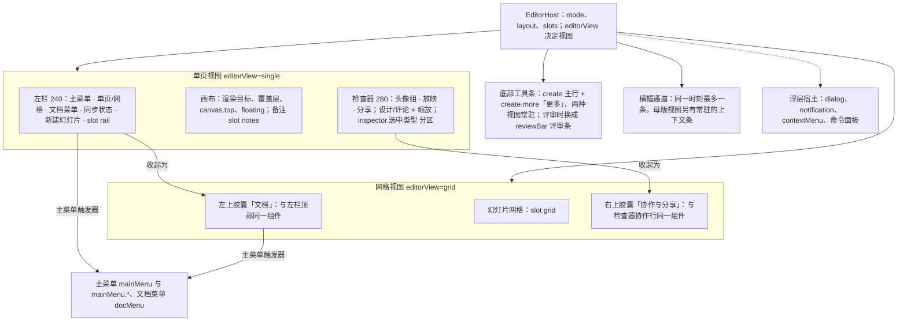
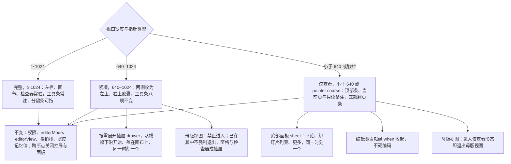
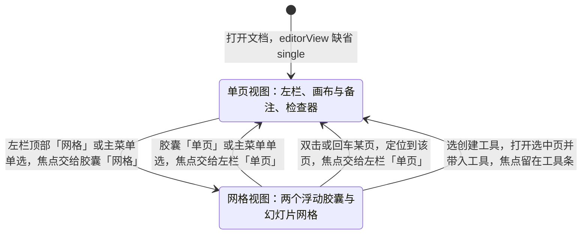
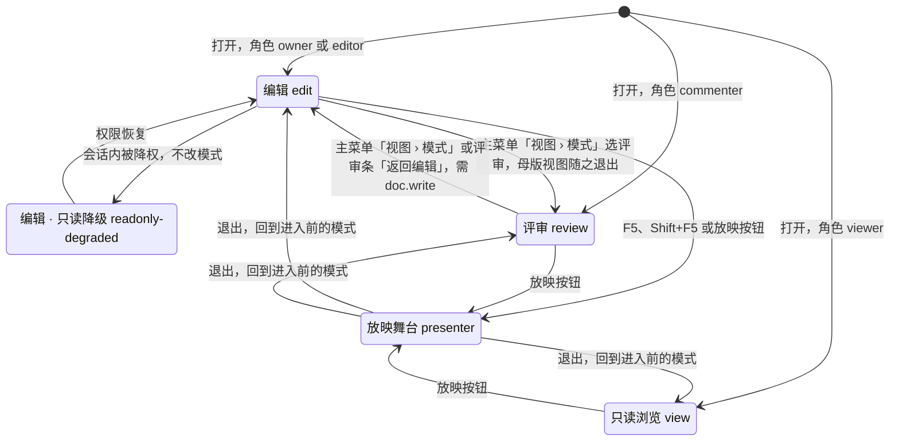
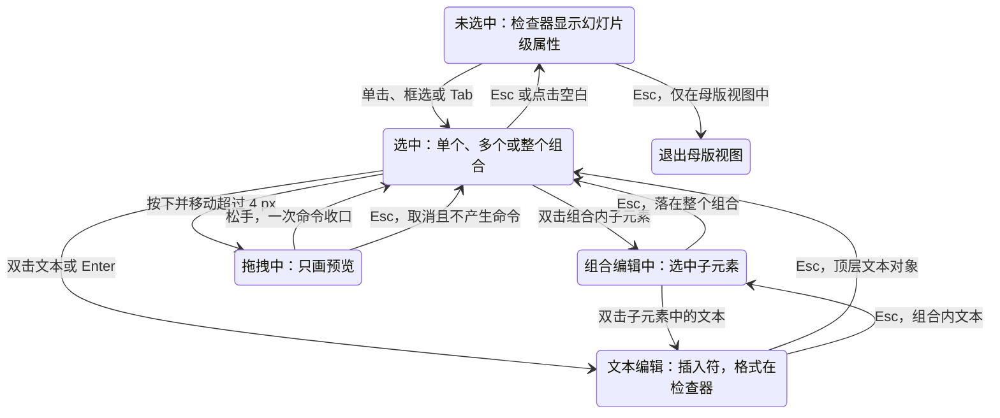
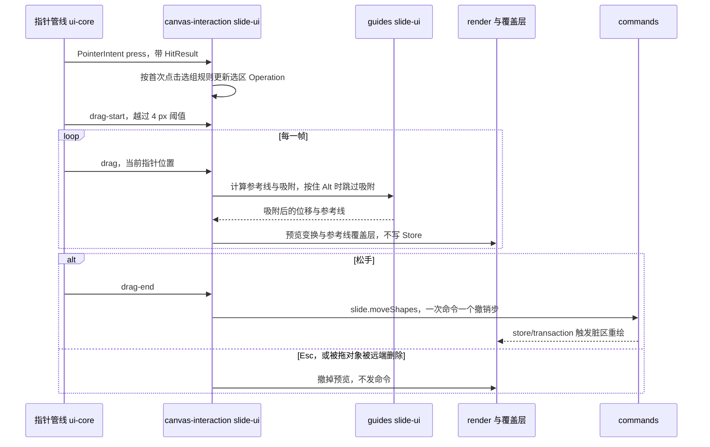
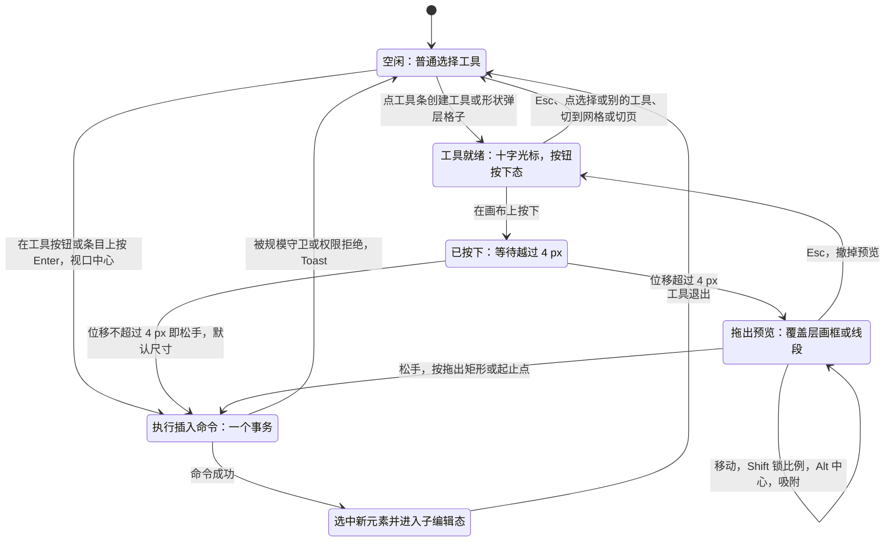
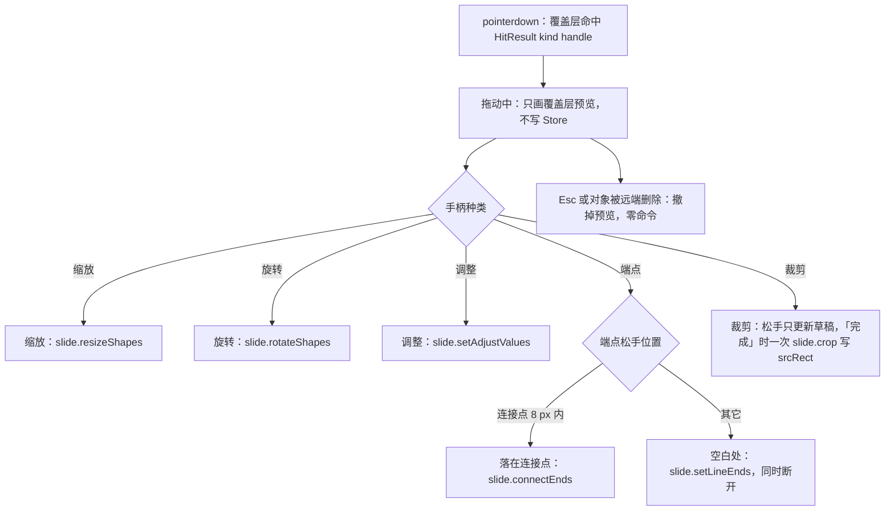
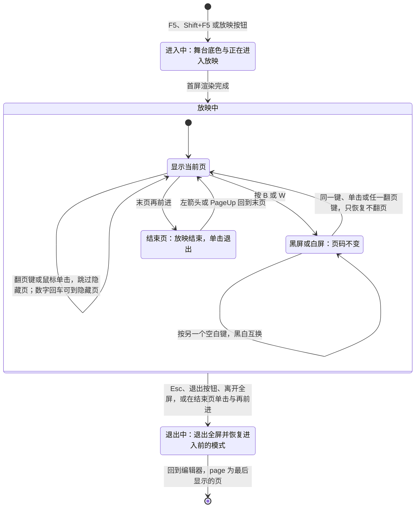
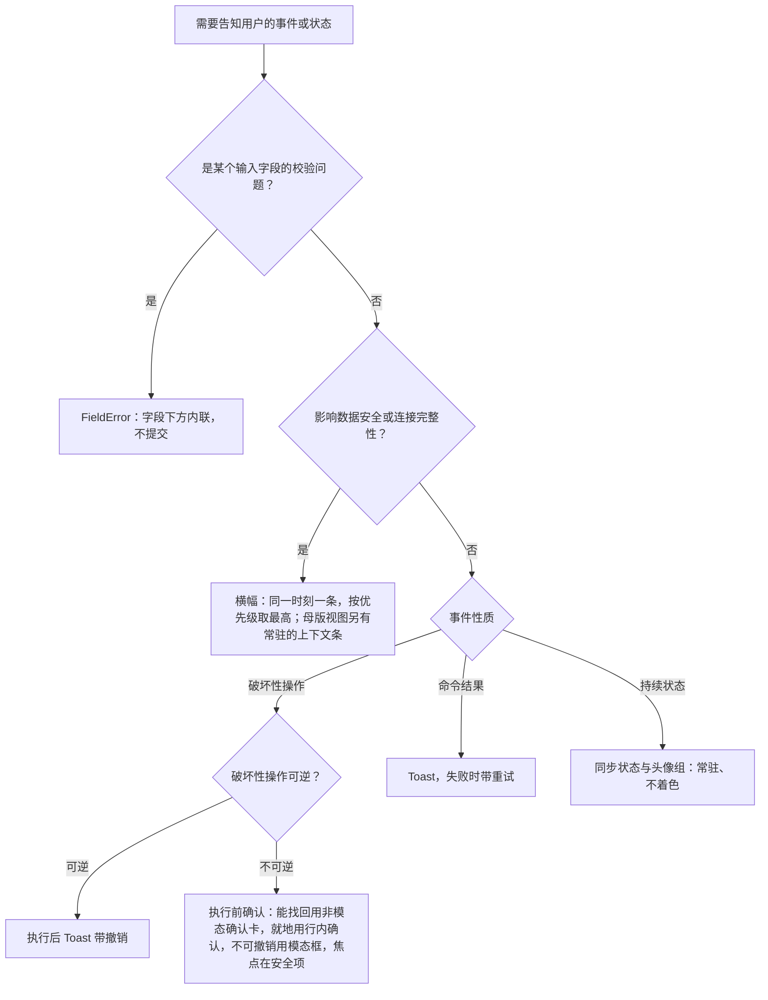

# 10 编辑器外壳与画布交互
> 状态：v0.1 | 负责：前端设计线 | 更新：2026-09-25（§4.19）；2026-09-25（审稿）；2026-09-26（§4.20）；2026-09-26（§4.20 FE-08）；2026-09-26（§4.21：插入页签分组统一、超链接改 M2 P1、表格 M2 可插入；selectionKind 补四类；新增插入工具态与元素手柄；快捷键逐条对齐 ED-16）；2026-09-26（§4.21 整合：§5 文本分区补链接、自动调整与渐变描边字，degraded 分区扩为对象说明、替代文本与后续动作，迷你工具条补 table-cell、chart 与 degraded 口径，内容占位符补「重置为占位符框」；§7.1 组合编辑的键盘等价；§7.4 插入工具态视觉按设计样张、浮层不退出文本编辑）；2026-09-30（§4.21 剩余缺口样张回写 · 复核修正：§5 的 `table` / `table-cell` 两行按 50/24 §2.7 与设计 03-30 §6 重写（边框、行高列宽归 `table-cell`）；§7.5 表格的 8 个缩放手柄改为 M3 起，M2 只有选中框与移动）；2026-09-30（§4.22 设计待决收口：§4 表格网格悬停范围 8 行 × 10 列、对话框上限待性能评估，公式按钮样式定稿；§5 `placeholder-empty` 改为占位符 / 位置与大小 / 插入到占位符三组，M2 单元格选区出文本条；§7.3 迷你工具条画在屏幕坐标浮层；§7.4 表格、图表、图片先填空内容占位符）；2026-09-30（§4.22 复核修正：§5「只读」补表格、图表分区锁定形态例外（FE-06）；§7.4 图表插入后改为展开检查器「数据」分区；§12.1 新增 V21 插入落点 Q1 用例）；2026-10-03（§4.24 设计线对齐审计：§1 账户菜单按 `platformRole='admin'` 增「管理」入口（AS-06）；§10.2 快捷键冲突条目跳个人插件面板冲突态 `?state=conflict`、高亮相关插件并给「为我关闭」（PM-11）；§11 横幅清单补缺少插件与插件设置已更新两类插件横幅（排在「其他」档、与版本漂移合并、两类并存先缺插件）、状态栏插件入口三种文字与缩略图警示计数；§12 同步）；2026-10-04（design-language-v3 第 0 批：编辑器外壳改为 v3 结构（rulings §4.25 DS-1…DS-6）——§1 区域改为左栏 / 画布与备注 / 底部工具条 / 检查器 / 网格视图两胶囊 / 主菜单与文档菜单 / 横幅通道，补原应用栏、Ribbon、状态栏的去向；§2 新增 §2.3 单页 / 网格视图（唯一视图状态 `editorView` 与焦点转移），`EditorLayoutState` 按 v3 改默认值、`sectionsCollapsed` 作废；§3 矩阵去掉 Ribbon 位与状态胶囊；§4 由 Ribbon 改为底部工具条（创建），原插入页签七组逐项给出 v3 入口；§5 由检查器坞改为检查器，分区改走 `ui.inspectorSection`；§6–§10 去掉 Ribbon、应用栏、状态栏与缩放胶囊的入口；§11 反馈分层去掉状态胶囊一层，插件横幅补「N 个插件启动失败」；§12 同步）；2026-10-04（design-language-v3 第 0 批：术语残留清理：ribbon / 状态栏 / `ui.ribbon` / `ui.statusBar` 的历史陈述改用 check-terms 认可的标记措辞（废弃、作废、取代、原名））；2026-10-04（design-language-v3 第 0 批：复验修正——§1.1 新建幻灯片改为 slide-ui 的 `rail.header` 贡献、工具条主行含 slide-ui 贡献的「更多」、网格视图组件名对齐 40/10（`FloatingCapsules`、`PanelHost`，不另设 `GridView`）、横幅通道为 `Banner` / `BannerLane`；§1.2 头像折叠改指 03-02 §3.5、「分享」措辞改为唯一实心强调色主操作按钮；§2.3 注明「进网格先提交文本编辑」样张未实现；§4 去掉「待按 v3 回写」；§12.1 V2、V3、V4、V22、V23 测试文件名对齐 40/10 §9 与 70/06 §5 第 41 行；§12.3 外壳回写行与设计线批次口径行改为已关闭；§8 缩放读数按样张改为单页与网格同一实测口径（1600 × 1000 约 77%），注明第 0 批两种口径并存与第 1 批确认；原「状态胶囊」改称文件名旁的同步状态行（rulings §4.25 DS-6），带作废标记的历史陈述统一措辞）；2026-10-04（design-language-v3 第 0 批：复验第 2 轮修正——§1.3 主菜单按样张写全「返回首页 ┊ 文件 · 编辑 · 视图 · 插入 · 排列 ┊ 帮助」各项条目（第 0 批拍板与当时的样张草稿分开，删去「除视图外都是占位」），「视图」子菜单补网格与参考线、缩放、母版视图、模式；§1.4、§3.1、§3.3 返回首页与模式切换注明样张已起草的落位（主菜单首项、「视图 › 模式」、评审工具条「返回编辑」）；§3.2 删去「设计 09 T-01 记为第 2 批」的过时括注；§1.1、§11 横幅改为网格视图里同样占文档流（当时未拍板，2026-10-07 定稿），§1.2、§11 网格胶囊同步状态补紧凑形态规则；§8 缩放菜单改为样张命令清单（放大 / 缩小 / 适应窗口 ⌘0 / 适应宽度 / 50%–200%，100% ⌘1），§10.4、§12.3 删去已与 ED-16 一致的 ⇧1；§5「只读」拆成评审 / 只读浏览的只读展示与编辑模式降权的 `aria-disabled` 两种形态，查看者提示文案按样张改为「只读 · 你只有查看权限」；§4 视图模型改为 `buildCreationToolbar`，形状库入口补「全部形状 72 ›」，页眉页脚、图标、公式三行注明样张主菜单「插入」已列；§2.1 `inspectorWidth` 范围对齐 PRD ED-12 为 240–480；§12.3 插入入口回写行改为部分回写（50/23–25 已改））；2026-10-04（design-language-v3 第 0 批：复验第 2 轮补充——§3.1 会话内降权的检查器形态写明控件留在原位、`aria-disabled`、仍可聚焦，面板顶部一行「只读 · 需要编辑权限」，与 §5、03-02 §6.2 一致；§3.2 矩阵后注明样张已起草的评审条与浏览条（当时为样张草稿，2026-10-07 随 DS-23 定稿，03-02 §6.2、§10 第 9 条））；2026-10-05（design-language-v3 第 0 批修正：§4 工具提示按样张改为「除『更多』外每个工具带工具提示」，「更多」是菜单触发器、不带提示，只在不可用时以提示说明原因；§4「更多」内置项去掉「组件」，原插入页签去向表的「更多 › 组件」行改为按 rulings §4.25 DS-19 从样张删除、不实现；§5 `shapes` 行「操作」由默认展开改为常显（分区不折叠）；§11 头像组读屏名按样张补在线人数「正在协作的人：N 人」（N 含自己与折叠的 +N），补头像与「+N」按钮读屏名，自己的头像为账户菜单按钮「账户：姓名（你）」；§12.3 插入入口回写行补注 20 / 22 / 23 第 ⑦ 栏已按 v3 改写）；2026-10-05（design-language-v3 第 0 批修正：按 rulings §4.25 写入外壳类裁决——§1.1–§1.4 编辑器账户菜单由检查器协作行（网格：右上胶囊）里自己的头像打开、条目为个人资料 / 亮暗主题 / 偏好设置 / 退出，主菜单放「插件…」与「返回首页」，主题切换进账户菜单，§3.2、§10.2、§10.3、§11 规则 10、§12.1 V11、§12.3 同步（DS-18）；§1.3 文档菜单删「移动到…」、§4「更多」删「组件」、§12.1 V18 同步（DS-19）；§5 `text` 分区为文字格式唯一入口、M2 单元格文本条取消，§7.1 图 10-4、§7.2、§7.3 去掉文字迷你工具条、`toolbar.text-editing` 作废（DS-13）；§5 `placeholder-empty` 去掉「插入到占位符」组（DS-14）；§3.1、§3.2、§5「只读」改为评审 / 只读浏览 / 降权统一只读展示当前值、取消表格与图表的禁用例外，§12.1 V4 同步（DS-15）；§5 `none` 的「背景」「页面颜色」合并为「背景」（DS-20）；§1.1、§2.2 紧凑与仅查看形态补进第 1 批样张（DS-17）；§10.3 首页左栏无「设置」（DS-10）；§12.3 新增外壳类细化裁决行与待回写项）；2026-10-05（design-language-v3 第 0 批修正：快捷键值按 rulings §4.25 DS-11、DS-16 同步——§10.1、§10.4 第 18 行命令面板由 `Mod+Shift+P` 改为 `Mod+K`（`F1` 备用和弦作废），第 24 行与 §4 原插入页签去向表的超链接改为 `Mod+Shift+K`，第 14 行替换改为 Windows / Linux `Ctrl+H`、macOS `Cmd+Shift+H`；§10.4 新增第 25 行工具单键 V / T / S / C（原第 25–33 行顺延为 26–34），前 25 行对应 ED-16，slide-ui 和弦数 63 → 67；§4 工具表「单键」列去掉「未登记」；§3.3、§9.1「放映」提示改为 `F5`（⌘↵ 作废）；§12.3 关闭未登记和弦一行、白名单待回写项与 `Mod+E` 行号同步）；2026-10-05（design-language-v3 第 0 批修正：§1.3 账户菜单改为条目以 PRD AS-06 为唯一归属（与开始页、文档列表同一个组件、同一份条目，删去「是否同列」的待定注，「个人资料…」的 M2 行为按 AS-06 待决），§3.2 尾部区去向与 §10.2 三个等价入口同步；§1.3 主菜单注明承载「插件…」的顶层单项槽位待 09 §6.1 回写；§10.1 开始页 `Mod+K` 改指 02 §2.1 与 40/11 的落点；§12.3「外壳类细化裁决」行把本轮已改的 40/10、40/11、07、11、19、21、24 记为已回写，待回写只剩 09 §6.1（`toolbar.text-editing`、顶层单项槽位）与 06 §5.3）；2026-10-07（design-language-v3 第 0 批修正收尾：§1.3 账户菜单四项次序与 DS-18、AS-06 一致）；2026-10-07（design-language-v3 第 0 批余项：§1.3 主菜单顶层项补「插件…」的位置（「排列 ▸」之后、「帮助 ▸」之前，当时为样张草稿，2026-10-07 随 DS-21 定稿，03-02 §2.3），§11 规则 10 同步，删去「样张底座尚未列出」；09 §8 已按 ED-16 回写，§10.4「与现状的差异」与 §12.3 文本编辑态白名单行改为已回写；§12.3「外壳类细化裁决」行把 09 §6.1 删 `toolbar.text-editing` 与 06 §5.3 记为已回写，待回写只剩 09 §6.1 顶层单项槽位）；2026-10-07（design-language-v3 第 1 批：按已拍板样张与 rulings §4.25 DS-21…DS-30、TB-1…TB-30 定稿——开头说明改为第 1 批已定稿；§1.1 区域表去掉 `ToolbarHost` 与 `toolbar.*`（TB-29），横幅通道定稿并补母版视图两条横幅的例外与置顶位槽位 `ui.panel{slot:'banner'}`（TB-14），补左栏 / 检查器 / 备注可拖与紧凑、仅查看形态的去向；§1.2 新建幻灯片版式库、头像组「+N」与自己的头像、胶囊同步状态定稿；§1.3 主菜单各项定稿（顶层单项「插件…」走 `mainMenu` 槽位、「帮助」条目与母版视图「关于母版继承」TB-15、开发者项落位），文档菜单随角色与降权；§1.4 补对象上下文工具条全部取消一行；§2.1 三条分隔条可拖（160–420 / 240–480 TB-25 / 64–320）、按文档记在本机（TB-24，新增 `rememberKey`、`drawer`、`sheet`，`railCollapsed`、`inspectorOpen` 作废）；§2.2 与图 10-2 紧凑形态改为左上 / 右上胶囊 + 整高抽屉、仅查看形态改为顶部条 + 翻页条 + 底部面板（M3 起评论可发表与回复，DS-28），在母版视图中进入仅查看形态即退出母版视图（TB-16）；§2.3 视图写进地址栏 `view`（TB-30，§12.3 待定行结案）、网格键盘与母版视图；§3 评审条 / 浏览条与模式切换定稿（DS-23，固定项由外壳内置 TB-1），降权下的菜单与文档菜单；§4 工具条各项弹层、「更多」条目、原插入页签去向与里程碑可见性按 03-04 定稿，母版视图「占位符」工具（DS-30）；§5 各选中态节划分按 03-02 §4、03-16…03-18、03-30、03-31 定稿（对齐行 TB-20、图表 TB-13 与 400 宽数据面板 DS-26、连接符起止点下拉 TB-21、可折叠分区）；§6 缩略图右键、隐藏页（DS-25）、节标题右键（TB-23）、删除与只读（TB-22）；§7.2 吸附提示签；§7.3 对齐与分布、网格间距 6 / 12 / 18 pt（DS-27）、对象不设上下文工具条（DS-13、DS-22、TB-29）、画布右键；§7.4 提示条与尺寸角标按 03-15；§7.5 强调色手柄（DS-24）、裁剪「取消」回到进入前的状态（TB-4，取代原口径）；§8 缩放 100% 基准、比例输入框与档位定稿；§10.4 补登 DS-29 两行（第 26、27 行，原第 26–34 行顺延为 28–36），slide-ui 和弦 67 → 70，第 14 行补评审、只读浏览与降权下替换键只打开查找（TB-28）；§11 横幅与轻提示位置、层级定稿（TB-2、TB-14；母版视图中被降权时降权横幅在母版横幅下方另占一条，按 03-26 §6.3）；§12 同步）；2026-10-08（design-language-v3 第 1 批收口：开头说明补 DS-31…DS-33、TB-31…TB-52；§1.1 区域表补 `ReviewToolbar`、紧凑形态 `ShellDrawer`、仅查看形态 `NarrowShell` 与 `BottomSheet`（40/10 §4.3）；§1.3「文件」补「幻灯片大小…」（P2，rulings §4.25 DS-31），「帮助」的帮助中心走壳意图 `help-center`（TB-39）、开发者面板只在开发构建出现（TB-40）；§2.1 记忆键补 TB-41；§2.2 紧凑形态母版视图入口的原因改为「在更大窗口中编辑」（TB-44），仅查看形态的评论发表只在手机（< 640），平板仍只读评审（TB-49）；§3.2、§4「选择」由 slide-ui 贡献（TB-38）；§4、§10.1 不可用原因示例同步 TB-44；§5 无选中「主题」补五套内置主题与三个色板变体（DS-32、DS-33），形状补快速样式（DS-31）、替代文本节（TB-32）、不透明度写填充与描边 alpha（TB-47）与 P2 项（TB-43），单位换算补段落间距恒为 pt（TB-33）与 OOXML 默认值保留原单位（TB-37），链接改用命令名「链接…」（TB-6）；§6 评审时缩略图右键说明行改为「评审模式下不可用」（TB-51）；§7.4 文本编辑中日期、符号弹层关闭后焦点回插入符（TB-52）；§10.3 度量单位行补 TB-33；§10.4 第 21 行按 TB-44 写进入条件、第 24 行改为「链接…」；§11 规则 3 的重置确认按 DS-32 改为确认对话框；§12.1 V18、§12.2 链接名称同步；§12.3 第 1 批与视图行的 40/10、40/11、11 回写改为已回写，其余元素文档的入口列改写已核对，新增收口行）；2026-10-08（design-language-v3 第 1 批评审修改：§5 `shapes` 行的快速样式改为 42 格样式库在「快速样式」节里、缩略行下方原位展开，下方各节下移、不遮挡画布，节标题右侧「收起样式库」，收起按钮 / 再点缩略行 / Esc 收起并回缩略行，缩略去白衬底（rulings §4.25 DS-34、TB-56；原「42 格样式库弹层」作废）；§5「分区机制」补检查器控件取安静样式（DS-35…DS-37、TB-55）；§11 横幅右侧按钮改为透明底加细边的次按钮（DS-37，原 outline 写法修订）；§12.3 新增评审修改行；TB-57、TB-58 不涉及本文行为）；2026-10-15（design-language-v3 第 2 批：按已拍板的协作族样张回写（rulings §4.25 DS-38…DS-63）——开头说明改为第 2 批已定稿；§1.1、§5 新增「整栏面板」：列表与报告类沿用 280（版本历史、保真报告），编辑与整页类 400（图表数据面板、插件整页面板），个人插件面板为 640 对话框，原检查器页签式插件面板与 `historyWidth` 560 作废（DS-38、DS-56）；§1.1、§11 规则 1 横幅叠放例外扩到版本预览（DS-39）；§1.2 同步状态行补第 2 批各态与着色规则（DS-61），「分享」所有角色可点、有待处理访问申请时带强调色小圆点、文档已删除时不可用（DS-48、DS-62）；§2.1 `historyWidth` 作废；§2.2 仅查看形态顶部条在同步异常时换成同步状态、窄屏横幅换行（DS-60），手机评论按第 2 批样张（DS-46）；§3.1 降权无未同步更改时只给轻提示（DS-58）；§4「评论」工具发表后保持按下（DS-44、DS-45）、「更多」插件收纳（DS-49）；§5 评论页签、整栏面板、插件分区折叠与 12px 归属标识、`degraded` 分区（DS-49、DS-52、DS-56）；§6 缩略图警示角标按最严重一条着色、评论角标只计未解决（DS-51、DS-62）；§7.3 画布空白处右键加「添加评论 C」、降级对象右键按「能摆放」口径（DS-44、DS-52）；§7.4 评论工具是「用后回到选择」的例外；§7.5 缺插件占位不画缩放手柄（DS-52）；§11 横幅中性底与浅底的分工（DS-41）、轻提示的播报方式、三档确认（DS-40）、插件横幅三类的画法、先后与重现（DS-41、DS-54、DS-55）、占位两行（DS-52）；§12 V13、V22 同步，新增 V24、V25）；2026-10-15（design-language-v3 第 2 批：§1.1、§2.1、§5 整栏面板宽度改为「列表与报告类沿用检查器宽度（缺省 280）、分隔条照常可拖；编辑与整页类 max(400, 检查器当前宽度)、开着时分隔条不可拖」（rulings §4.25 TB-60），插件整页面板的「展开」由宿主按分区的 `expandPanel` 画、页签只由内置包贡献（TB-59）；§1.2、§2.3 登记 `EditorHost` 属性 `pendingAccessRequests`（TB-68）；§4「评论」与 §10.4 第 19 行写明 ↵ 落钉的前提（TB-62）；§5 `degraded` 三个分区的 order（10 / 20 / 30）；§7.3 降级对象在评审、只读浏览与降权下照常出菜单（DS-64）；§11 未画横幅的档位、「部分更改未保存」走轻提示、「文档正忙」中性锁形（TB-66）；§12 V24、M3 行与 §12.3 同步；同日再补：§2.1 `inspectorWidth` 行与 §5「整栏面板」写明编辑与整页类面板开着时不可拖的分隔条按「不可用项不隐藏」留在 `Tab` 顺序里、`aria-disabled`、键盘也不改宽度（TB-60，设计 07 §1.2）；§2.3「进入网格」、§3.3「编辑 ⇄ 评审」与 §4「评论」行补写了内容的评论撰写框按页留草稿、回到那一页的单页画布时原样恢复、不抢焦点、不改评论工具是否按下（rulings §4.25 TB-79、TB-84）；§12.1 V24 补分隔条的键盘断言；§12.3 DS-64、DS-65 那一行的他线项核对为已登记、新增 TB-79、TB-84 一行）；2026-10-15（design-language-v3 第 2 批：§2.2 仅查看形态底部翻页条「评论」的数字取本页未解决的条数、与评论面板标题和缩略图角标同一口径，没有未解决的不带数字（rulings §4.25 TB-89）；§3.3「编辑 ⇄ 评审」写明草稿按页存、不按模式存，切换后仍停在同一页的单页画布时撰写框当场原样恢复、不抢焦点、不改评论工具，从评审返回编辑同样处理（TB-87）；§4「评论」行补有恢复的撰写框时再发起新评论不另开、焦点进它（TB-88）；§12.3 TB-79、TB-84 一行的他线项核对为已登记、新增 TB-87…TB-89 一行）；同日再补：§12.3 TB-87…TB-89 一行的他线登记核对为已登记；2026-10-22（design-language-v3 第 3 批：按已拍板的应用壳族样张回写（rulings §4.25 DS-71…DS-136、TB-101…TB-129）——开头说明改为第 3 批已定稿；§1.1、§1.2、§2.3 左栏与网格胶囊的「单页 / 网格」改为分段画法（DS-133），评审者与查看者的文件名不再是菜单触发器（DS-82），他人头像是「跟随」按钮、同色第 13 位起的序号角标、在线列表按内容加宽与「N 个窗口」（DS-106、DS-132、TB-124），「放映」的工具提示与不可用条件（TB-103、TB-111、TB-112）；§1.3「帮助 › 帮助中心」按配置出现（DS-89），评审、查看与降权下「文件 › 导出…」不可用（DS-105），文档菜单随角色（DS-82），账户菜单条目（DS-89…DS-91、DS-112、TB-123）；§2.2 紧凑形态的非模态抽屉从横幅下沿开始、整栏面板的落位（DS-130），平板与嵌入的仅查看状态行、平板评论面板按方向落位、嵌入里不渲染「返回首页」（DS-112、DS-131、TB-125）；§3 降权与评审的导出、放映入口；§5 锁定比例未锁时为断开的链（DS-136）；§9 放映按样张定稿：指针与触控、隐藏页跳页、结束页、吞 F5、窗口内「更多 › 全屏」、跳页提示条、跟随条、放映中的权限与版本变化、不做键盘提示浮层与光标开关（DS-106…DS-109、TB-102、TB-104、TB-111…TB-113）；§10 命令面板（不加遮罩、固定常用清单、阅读顺序、DS-116、DS-117、TB-106、TB-116、TB-117）、快捷键面板（画布浮动面板与分组条目，DS-115、TB-105、TB-116）、偏好设置（居中对话框 480、分组、通知只留一项、无障碍组、集成方锁定、手机底部面板，DS-76、DS-113、DS-114、DS-116、TB-118）；§10.4 导出 `Mod+Shift+E`、`Mod+E` 归居中对齐（DS-78），放映中吞 F5（DS-108）；§11 横幅高 40、三条文档横幅定稿、查看器缺插件说明进 ⓘ 卡（DS-75、DS-110、DS-126…DS-128）；§12 同步）；2026-10-22（design-language-v3 第 3 批回写补充，rulings §4.25 DS-137、DS-138、TB-132、TB-134…TB-138、TB-149、TB-151：§1.2 检查器协作行「分享」在 M2 留在原位不可用、工具提示「分享 · 后续版本提供」（DS-137）；§1.3 降权时文档菜单三项同「文件 › 导出…」一条规则（TB-138），个人资料对话框只改显示名（TB-137），「关于母版继承」按配置出现（TB-132）；§2.2 仅查看形态备注空态改为「这一页没有演讲者备注」（DS-138），母版视图入口在触控设备上写「在电脑上编辑」（TB-136）；§3.1 同 TB-138；§6 缩略图虚拟化挂载数以本文为准（TB-135）；§8、§10.1、§10.4 第 16 行改绑 `slide.zoomToFit` / `slide.zoomTo100`（TB-149），第 3 行补左栏与网格的「复制幻灯片 ⌘D」，第 21 行按 TB-136 写原因；§9.1、§9.2 不允许全屏时「更多」不出「全屏」（TB-134）；§9.3 页级占位在渲染层画（TB-151）；§12 V2、V8、V11、V20、V26、M3 行与 §12.3 名称对齐 40/10，新增一行）；2026-10-22（design-language-v3 第 3 批回写收口，rulings §4.25 TB-151、TB-154、TB-159、TB-161、TB-162：§1.2「分享」在 M2 由宿主属性 `shareUnavailable: 'later'` 驱动、两者都不传时不渲染（TB-161）；§1.3 触控形态的账户菜单不写键位提示（TB-154）；§2.2 嵌入又是触控设备时状态行与母版视图入口以「在电脑上编辑」为准（TB-159），通则补仅查看形态里 `Mod+/` 与 `Mod+,` 不出面板；§2.3 宿主属性补 `shareUnavailable` 与 `embedded`；§9.3 页级占位落在 slide-render 的页级回退（40/07 §1.1、§5.1）；§10.1「常用」里的导出、版本历史与帮助中心等壳意图经 shell-glue 的无参 Operation 进命令面板（TB-162）；§10.2 开始页与文档列表上快捷键面板在手机为底部面板、平板为浮动面板，编辑器的仅查看形态里不出面板（TB-154）；§10.4 第 21 行原因的先后（TB-159）、第 22、23 行的仅查看形态、第 28 行改绑 `shell.openExport`（TB-162）；§12 V2、V11、V20、V26、V27 与 §12.3 同步；2026-10-22 复核修正：§1.3、§3.1 文档菜单降权一句改引 DS-139（第 1 批 `main-states.degraded-menu` 随之改）、账户菜单的键位提示按 TB-164；§2.2、§10.1、§10.4 第 21 行「触控设备」只指平板、手机按窗口窄写（TB-163）；§10.2 手机底部面板的几何、关闭与焦点去向补齐（设计 03-24 §1.5），触控菜单项不写键位（TB-164）；开头说明去掉回写轮次字样；§12 V2、V27 与 §12.3 同步；开头说明分清样张阶段的 TB-101…TB-129 与回写中定的 DS-137…DS-139、TB-130…TB-169；§6 缩略图列表在协同快照打开时不画版式骨架（DS-99）；§12.3 一行去掉轮次字样；§1.3、§3.2 查看者的「文件 › 导出…」原因改为「只有查看权限」，评审者与降权仍写「需要编辑权限」（DS-105）；§1.1、§2.2 仅查看形态的横幅在最顶上对手机与平板都成立、按钮只在一行放不下时才换行（TB-172）；§9.2 触控形态「更多」条目不写键位提示（TB-164）；§12 V2、V8 与 §12.3 同步；§1.1、§2.2 与 §11 横幅一行写明触控形态的按钮照常 44 高、横幅随之撑高，「高 40」指非触控形态，§11 原「宽度 < 640 时」一句改为仅查看形态（手机与平板）的写法（TB-172），V2 与 §12.3 同步；§2.2 仅查看形态的横幅与 §11 横幅一行补一行放得下时上下内边距 5、共 55，应用壳页面的横幅在触控形态同此（TB-172）；§10.3「关于 › 复制」经宿主 `CordexHost.dumpDiagnostics()` 取 SDK 的同一份诊断包、开始页没有 host 时只有共同的开头（TB-177）；§12.3 同步）；2026-11-04（design-language-v3 母版视图改版：§1.1 画布区的 `canvas.top` 与横幅通道的上下文条；§1.2 协作行的「跟随」在母版视图里不可用（不可用与原因由 slide-ui 给出，`PresenceStack` 不写视图模式条件）；§1.3 母版视图里「单页视图」不置灰，「保真报告」「插件…」「重置页…」与文档菜单「版本历史」不可用；§1.4 去向表一行；§2.2 抽屉从上下文条下沿开始、系统收起时的焦点（含在紧凑形态里退出母版视图）、紧凑形态的母版视图与跨断点先交焦点；§4 工具条「占位符 ▾」与原母版页签一条；§5 整栏面板进出母版视图、`none` 行的「编辑版式」、`placeholder-empty` 行与新增一条的「转到版式」、只读的例外、母版视图一行；§6 母版窗格一条；§7.1 Esc 的母版三级、§7.3 占位符标注；§10.1 命令面板（开着时 `Mod+Alt+M` 不响应、「母版」一类、执行「母版视图」后的焦点）；§10.2、§10.4 母版视图的 `P`、`Mod+M`、`Mod+D`（和弦 70 → 71）与 `Mod+Alt+M` 的轻提示，§10.4 开头一段与第 21、25 行；§11 横幅一行、去向段、规则 1 与图 10-7；§12.1 V4、V6；§12.3 新增一行；需求编号、优先级与里程碑不变；rulings §4.25 DS-145…DS-177、TB-186…TB-210） | 依赖：[40/10](../40-modules/10-ui-shell-and-slide-ui.md) §2.1、§2.5、§2.6、§5.3、§5.4、§11、§13；[50/19](19-insertable-elements-overview.md)、[50/22](22-elements-shapes-and-lines.md)；[设计 01](../20-design/01-information-architecture.md) §2、§3、§5–§7；[设计 09](../20-design/09-design-specification.md) §3、§3.1–§3.3、§4（v4.0）；[设计 04](../20-design/04-design-system.md) §2.11a、§2.13；[设计 06](../20-design/06-extensibility-ux.md) §2.6、§2.12、§3；[设计 07](../20-design/07-accessibility-and-i18n.md) §1.1、§2.2；playground `#/v3/editor`（`src/v3/Editor.tsx`、`editor/*`）；[设计 02](../20-design/02-user-flows.md) F2；设计 03-screens [02](../20-design/03-screens/02-editor-main.md)、[03](../20-design/03-screens/03-properties-panel.md)、[11](../20-design/03-screens/11-present-mode.md)、[17](../20-design/03-screens/17-selection-alignment-and-snapping.md)、[20](../20-design/03-screens/20-view-zoom-and-navigation.md)、[23](../20-design/03-screens/23-settings-panel.md)、[24](../20-design/03-screens/24-keyboard-shortcuts-panel.md)、[04](../20-design/03-screens/04-insert-menu.md)、[15](../20-design/03-screens/15-insert-menu-and-shape-library.md)、[18](../20-design/03-screens/18-image-editing.md)；[30/07](../30-architecture/07-rendering.md) §7、§8；[PRD 02](../10-prd/03-features/02-editing.md) ED-01、ED-05、ED-08、ED-09、ED-10、ED-11、ED-12、ED-16、ED-18、ED-19、ED-21、ED-22、ED-27、ED-28、ED-29、ED-30；[PRD 08](../10-prd/03-features/08-app-shell.md) AS-06；[rulings](../00-charter/rulings-2026-09-14.md) §4.10 Q14 / Q15 / Q19 / Q20、§4.18 UX-06 / UX-07 / UX-19 / UX-20、§4.19、§4.20 FE-02 / FE-06 / FE-08 / FE-10 / FE-12 / FE-15、§4.21（R-d-61、R-d-62、R-d-67、R-d-72、q-table-depth、q-media-insert、q-extra-inserts）、§4.25 DS-1…DS-8、DS-10、DS-11、DS-13…DS-37、TB-1…TB-33、TB-37、TB-38…TB-44、TB-47、TB-49、TB-51、TB-52、TB-55、TB-56、DS-38…DS-65、TB-59、TB-60、TB-62、TB-66、TB-68、TB-79、TB-84；playground `src/v3/scenarios/`（第 2 批：comments、version-history、share、plugins、fidelity、offline-conflict）；设计 03-screens [05](../20-design/03-screens/05-context-menu.md)、[14](../20-design/03-screens/14-slide-management-and-layouts.md)、[16](../20-design/03-screens/16-text-editing-and-formatting.md)、[19](../20-design/03-screens/19-undo-redo-clipboard-and-save-state.md)、[21](../20-design/03-screens/21-find-and-replace.md)、[26](../20-design/03-screens/26-master-view-and-editing.md)、[30](../20-design/03-screens/30-table-editing.md)、[31](../20-design/03-screens/31-chart-editing.md)；设计 04 §2.10、§2.11、§4.1a–§4.2、§5；设计 07 §1.2、§2.3；rulings §4.25 DS-71…DS-136、TB-101…TB-129（第 3 批）；playground `src/v3/scenarios/`（第 3 批：present、settings、shortcuts、command-palette、account-menu、embed、doc-banners、narrow-review、presence-scale、quiet-leftovers）；设计 03-screens [22](../20-design/03-screens/22-export-dialog.md)、[25](../20-design/03-screens/25-viewer-preset-shell.md)、[12](../20-design/03-screens/12-offline-conflict-banner.md)；rulings §4.25 DS-137、DS-138、TB-130…TB-151（第 3 批回写补充）；rulings §4.25 TB-154、TB-159、TB-161、TB-162（第 3 批回写收口）；rulings §4.25 DS-139、TB-163、TB-164；设计 03-24 §1.5；rulings §4.25 DS-105、TB-170、TB-172、TB-177；设计 03-11 §1.5、03-22 §2.2、03-12 §1.2；rulings §4.25 DS-145…DS-177、TB-186…TB-210（母版视图改版）

本文是**编辑器外壳与画布交互的行为语义**唯一事实源：`<EditorHost>` 由哪些区域组成、单页 / 网格视图怎样切换、布局状态怎样记忆并随断点变化、模式 × 角色 × 断点下界面怎样变化，以及底部工具条、检查器、左栏缩略图、画布选择与拖拽、缩放导航、放映舞台、命令面板、快捷键面板与偏好设置的交互规则和反馈分层。尺寸与线框以 [设计 09](../20-design/09-design-specification.md) §3–§4、[03-screens/02](../20-design/03-screens/02-editor-main.md) 与 playground `#/v3/editor` 为准；本文写状态机与规则。

> **2026-10-04 起按设计语言 v3 改写**（rulings §4.25 DS-1…DS-6）：编辑器废弃应用栏、Ribbon 与状态栏，改为 Figma 式结构——底部浮动工具条只管创建，右侧检查器只管当前选中对象的属性，其余命令进主菜单、右键、命令面板与快捷键；网格视图把两侧面板收为两个浮动胶囊。第 0 批定编辑器整体结构；第 1 批（编辑器族 + 窄屏）样张于 2026-10-07 拍板（DS-21…DS-26），同日回写中的产品口径与技术口径见 DS-27…DS-30、TB-1…TB-30，2026-10-08 回写再补 DS-31…DS-33 与 TB-31…TB-52——插入、文本、图片、表格、图表、母版、版式、设计主题、右键、查找、视图缩放、撤销剪贴板与紧凑 / 仅查看两种窗口形态在本文按样张定稿；第 2 批（协作族：评论、版本历史、分享、插件、保真报告、离线与冲突）样张于 2026-10-15 拍板（DS-38…DS-63），本文相关入口与外壳规则按样张定稿；第 3 批（应用壳族：放映、设置、快捷键面板、命令面板、账户菜单、嵌入与窄屏复核、在场规模与安静控件遗留四项等）样张于 2026-10-22 拍板（DS-79…DS-136；样张阶段定的技术口径 TB-101…TB-129，回写中又定 DS-137…DS-139 与 TB-130…TB-169），放映舞台、命令面板、快捷键面板与偏好设置在本文按样张定稿（DS-8 的三批到此全部定稿）。

不在本文（只链接）：

| 主题 | 事实源 |
|---|---|
| UI 四包、token、主题、平面层次与浮层、`ui.*` 贡献点、上下文键全集、视图模型、输入管线 | [09](09-ui-system-and-theming.md) |
| 控件 → 命令 id 的绑定表本体 | [40/10](../40-modules/10-ui-shell-and-slide-ui.md) §2.6 |
| 母版视图、版式画廊、主题编辑 | [11](11-masters-layouts-and-themes.md) |
| 文本编辑态、IME、光标与选区 | [06](06-text-editing-and-ime.md) |
| 命中链、覆盖层绘制、视口、缩略图像素、放映渲染 | [05](05-rendering-and-thumbnails.md) §4、§5、§10、§12 |
| 命令结果分流、撤销跳过提示条、剪贴板 | [04](04-document-commands-and-undo.md) §4、§6、§9 |
| 协同 UI 六态与横幅出现条件、「未保存到服务器」判据、在场 | [07](07-collaboration-client.md) §3.3、§6.1、§10–§11 |
| 评论面板与画布评论钉 | [08](08-comments-and-version-history.md) §5 |
| 路由、`EditorPageState`、`HostRegistry`、设置页路由 | [02](02-app-shell-routing-and-session.md) §2、§6、§9.4 |
| F6 循环、焦点管理、live region、拖拽的键盘等价 | [16](16-i18n-and-accessibility.md) §6–§8 |
| 错误码 → 文案与建议动作、错误属性 → 呈现层级 | [15](15-events-errors-and-telemetry.md) §4 |
| 交互预算数值 | [13](13-performance-and-bundling.md) §3 |
| 可追加元素的逐项设计（作用、OOXML、模型、渲染、交互、命令、协同、保真） | [19](19-insertable-elements-overview.md) 总览与通用设计；[20](20-elements-text.md)–[25](25-elements-readonly-and-opaque.md) 各元素族 |

包名一律省略 `@cordexjs/` 前缀。

## 1. `EditorHost` 与 `EditorShell` 的结构

`<EditorHost host unitId mode layout slots … />`（ui-react，props 草案见 40/10 §6）是编辑器唯一的挂载点。2026-10-04 起 `EditorShell` 按 v3 结构排布（rulings §4.25 DS-1…DS-6，设计 09 §3、T-01，03-screens/02）：根为 `--canvas` 底色，**左栏与检查器贴边、靠 1px 分隔，底部浮动工具条只管创建，检查器只管当前选中对象的属性，其余命令进主菜单、右键、命令面板与快捷键**；应用栏、Ribbon 与状态栏均已废弃。编辑器有单页与网格两种视图，由唯一的视图状态 `editorView` 决定（§2.3）；窗口窄于 1024 时另有紧凑与仅查看两种形态（§2.2）；评审与只读浏览时底部换成评审条 / 浏览条（§3.2）。外观与尺寸以设计 09 §3、03-screens/02 与 playground `#/v3/editor`（`src/v3/Editor.tsx`、`editor/*`、`kit/*`）为准，本节写区域、贡献槽位与归属。

### 1.1 区域与贡献槽位

| 区域 | 组件（ui-react） | 内容来源（贡献槽位） | 出现条件 | `data-cordex-region` |
|---|---|---|---|---|
| 左栏（缺省宽 240、可拖 160–420，§2.1；贴左、右侧 1px 分隔） | `LeftRail`：主菜单触发器、`ViewToggle`、`DocMenu`、`SyncStatus`、`PanelHost`（`rail.header` 与 `rail`） | 主菜单触发器、视图切换、文档菜单与同步状态行由外壳直接渲染（§1.2）；「新建幻灯片 ▾ / +」为 slide-ui 贡献的 `ui.panel{slot:'rail.header'}`（带幻灯片语义，不由外壳渲染；母版视图换成「新建版式 ▾ / +」）；缩略图列表为 `ui.panel{slot:'rail'}`：普通视图 slide-ui `ThumbnailRail`，母版视图 `MasterThumbnails` | `editorView == 'single'`；紧凑形态收为左上「文档」胶囊、按需展开为左侧抽屉（就是本栏，宽固定 240，由 `ShellDrawer` 承载，40/10 §4.3；从横幅下沿开始，有横幅时不盖横幅，rulings §4.25 DS-130），仅查看形态不渲染（§2.2）；放映无 | `rail` |
| 画布区 | `CanvasHost` | 渲染目标（render-dom）、覆盖层（`render.overlay`：选中框与手柄、参考线、提示签与提示条、尺寸与数值角标、占位符图标条、裁剪框与其出口浮条、远端光标与选区、评论钉）、`ui.panel{slot:'canvas.top'}`（画布区的顶层：叠在画布之上、只收内置，当前只有母版视图多选版式时的网格，2026-11-04，rulings §4.25 TB-206，[11](11-masters-layouts-and-themes.md) §5）、`ui.panel{slot:'floating'}`（画布浮动面板，如查找替换）；对象不设上下文工具条，原 `ToolbarHost` 与 `ui.toolbar{slot:'toolbar.*'}` 删除（DS-13、DS-22、TB-29，§7.3） | 单页视图：当前页居中、尽可能大（四周留白左右 ≥ 48、上 40、下 24，底部再留 72 给工具条；紧凑形态左右 24、上方给胶囊让 72）；网格视图换为幻灯片网格（下行）；仅查看形态换为当前页全宽 + 只读备注卡（`NarrowShell`，§2.2） | `canvas` |
| 备注 | `NotesBar`（备注框 2026-10-22 起为凹陷底：去掉描边，铺一块比画布深一档的底，悬停出与分隔线同档的细边，亮色占位字取 `text-2`，rulings §4.25 DS-134；把手取值不变，DS-135；取色见 [09](09-ui-system-and-theming.md) §2） | `ui.panel{slot:'notes'}` | 单页视图且主菜单「视图 › 备注」开启（样张默认开）；高度可拖 64–320（缺省 120，§2.1；紧凑形态固定 120）；网格视图与母版视图不显示；仅查看形态为只读备注卡，开关是「更多 › 显示演讲者备注」（同一个 `notesOpen`）；放映隐藏 | `notes` |
| 底部工具条 | `CreationToolbar`；评审与只读浏览时为 `ReviewToolbar`（40/10 §4.3） | 主行 `ui.toolbar{slot:'create'}`（只收内置八项，由垂直束贡献，含 `kind:'menu'` 的「更多」与「选择」，rulings §4.25 TB-38），「更多」菜单 `slot:'create.more'`；评审条 / 浏览条的条目 `slot:'reviewBar'`，其固定项由外壳内置（TB-1，§3.2）（[09](09-ui-system-and-theming.md) §6.1） | 两种视图常驻，距画布底 16、水平居中；评审与只读浏览时整条换成评审条 / 浏览条（DS-23，§3.2）；图片裁剪模式下临时收起（§7.5）；紧凑形态八项不变，仅查看形态换成底部翻页条（`NarrowShell`；底部面板为 `BottomSheet`，§2.2）；放映无 | `toolbar` |
| 检查器（缺省宽 280、可拖 240–480，TB-25，§2.1；贴右、左侧 1px 分隔） | `Inspector`（40/10 §4.3，原称 `InspectorDock`）：协作行（`PresenceStack`——其中自己的头像是账户入口、打开 `UserMenu`，DS-18；放映、分享）、页签行（设计 / 评论 + `ZoomMenu`）、面板标题与分区 | 分区 `ui.inspectorSection{slot:'inspector.<selectionKind>'}`（§5）；整栏面板（§5「整栏面板」，rulings §4.25 DS-38、TB-60）：版本历史、保真报告沿用检查器宽度（缺省 280），图表数据面板与插件整页面板（第三方 `ui.panel{slot:'inspector'}`）宽 max(400, 检查器当前宽度)，协作行不动；`slot:'floating'` 次级浮动面板不受互斥约束 | `editorView == 'single'`；紧凑形态收为右上「协作与分享」胶囊、按需展开为右侧抽屉（就是本栏，宽固定 280，同由 `ShellDrawer` 承载；从横幅下沿开始，DS-130；版本历史与保真报告在这个抽屉的整栏里，插件整页面板改为画布底部 Sheet，§2.2），仅查看形态不渲染（§2.2） | `inspector` |
| 网格视图 | `EditorShell` 的网格布局：`FloatingCapsules`（左上「文档」与右上「协作与分享」）、`PanelHost`（`grid`）（40/10 §4.3；样张对应 `editor/GridView.tsx`） | 网格为 `ui.panel{slot:'grid'}`（slide-ui `SlideGrid`，复用缩略图像素）；胶囊内容由外壳直接渲染，与左栏顶部、检查器协作行是同一组组件，其中「+ 新建幻灯片」渲染同一个 `rail.header` 贡献；紧凑形态的单页视图用同一对胶囊（§2.2） | `editorView == 'grid'`（§2.3） | `capsule-doc`、`capsule-share`、`grid` |
| 主菜单与文档菜单 | `MainMenu`、`DocMenu` | 子菜单 `ui.contextMenu{slot:'mainMenu.<顶层项>'}`、顶层单项 `slot:'mainMenu'`（「插件…」）与 `slot:'docMenu'`，标题与图标取 `ui.command`；「返回首页」与「视图」子菜单的单页 / 网格、备注由外壳直接渲染（§1.3） | 按需展开 | — |
| 横幅通道 | `Banner` / `BannerLane`（40/10 §4.3 `Banner.tsx`） | 外壳内置（§11）；置顶位 `ui.panel{slot:'banner'}` 只收内置，当前只有 slide-ui 的上下文条（母版视图的模式横幅，`slide.panel.masterBanner`，TB-14、TB-208） | 按需；画布列顶部（单页在左右栏之间）、占文档流——画布与备注、网格视图的两个胶囊与网格、紧凑形态的胶囊都排在横幅下面，横幅把自身高度告诉画布顶部的浮动件（胶囊、查找面板、提示条）让开（03-02 §6.2）；同一时刻最多一条，两个例外：母版视图的上下文条、版本预览的预览横幅常驻在上，其余横幅在它下方另占一条（TB-14、DS-39，§11 规则 1）；仅查看形态（手机与平板）里横幅在最顶上、顶部条排在它下面（DS-60；2026-10-22 按 rulings §4.25 TB-172 扩到整个仅查看形态，原「< 640」的限定作废），按钮只在一行放不下时才换到文案下方；触控形态的按钮照常 44 高、横幅随之撑高（TB-172，§2.2、§11） | — |
| 浮层宿主 | `DialogHost`、`NotificationHost`、`ContextMenuHost`、`CommandPalette` | `ui.dialog`、`ui.notification`、`ui.contextMenu` | 按需 | — |

- **区域 DOM 顺序即 F6 顺序**：单页为 左栏 → 画布 → 备注 → 底部工具条 → 检查器，网格为 文档胶囊 → 协作与分享胶囊 → 网格 → 底部工具条；紧凑形态为 左上胶囊（左侧抽屉展开时即 `rail`）→ 画布 → 备注 → 底部工具条 → 右上胶囊（右侧抽屉展开时即 `inspector`）；仅查看形态为 顶部条（`topbar`）→ 当前页与只读备注（`canvas`）→ 底部翻页条（`toolbar`）→ 打开中的底部面板（`sheet`）（[16](16-i18n-and-accessibility.md) §6.1，设计 07 §1.1）；区域容器随视图与形态挂载、卸载，`data-cordex-region` 只出现在已挂载的区域上。
- **只有浮层带阴影**：底部工具条、浮动胶囊、菜单与弹层是浮层（实色面板底 + 1px 边 + 阴影，圆角 12 / 8），左栏与检查器是贴边面板、不悬浮；紧凑形态的抽屉贴边但盖在画布上、带浮层阴影，仅查看形态的底部翻页条与底部面板是浮层；横幅在文档流里、不带阴影（[09](09-ui-system-and-theming.md) §4，设计 04 §2.10）。

### 1.2 左栏顶部、检查器协作行与浮动胶囊

| 位置 | 内容（自左至右或自上而下） | 说明 |
|---|---|---|
| 左栏顶部 | 主菜单触发器（20px 方标 + ▾，高 28）与「单页 / 网格」视图切换同一行（2026-10-22 按 rulings §4.25 DS-133 改为与检查器分段控件同一画法：28 高的槽铺 panel-2、不描边，选中块面板色 + 细边、贴边、圆角 4，两项各 28 × 28；按钮、读屏名、工具提示与切换后的焦点交接不变；顶行因此多占 4 宽，52 → 56）· 文档标题 ▾（13px 600，超长截断，点开文档菜单；评审者与查看者没有文档菜单条目，只显示文件名——没有 ▾、不响应悬停与点按、不进 `Tab` 顺序、读屏照常读到，DS-82；编辑者切到评审时不变）· 同步状态行 · 「新建幻灯片 ▾」与「+」 | 同步状态行取代原应用栏保存态与状态栏同步项（DS-6）：12px 次要文字 + 12px 图标，`role="status"` 播报变化（[16](16-i18n-and-accessibility.md) §8）；各态以 03-02 §3.1 为准——已同步 · 正在打开… · 其余页面加载中 N/M · 同步中 N% · 重连中… · 离线 · N 项待同步 · 只读 · 权限已变更（第 1 批），未保存到服务器 N 项（发起方）· 服务器保存延迟（其余协作者，悬停或聚焦看说明）· 登录已过期 · N 项待同步 · 协同已暂停 · N 项未同步 · 只读 · 名额已满 · 只读 · 登录账号已变更 · 文档已被删除（第 2 批，rulings §4.25 DS-61）· 需要刷新 · N 项未同步（没有未同步项时只写「需要刷新」）· 只读 · 文档已达元素上限（第 3 批，DS-126、DS-128）；还带着待同步计数的态（离线、未保存到服务器、登录已过期、协同已暂停、需要刷新）用警告色图标，转为只读、文档已不存在、只写「需要刷新」与「服务器保存延迟」用中性图标；判据见 §11 与 [07](07-collaboration-client.md) §3.3、§6.1。「新建幻灯片 ▾」贴左栏右缘展开版式库（与检查器「版式」、右键「更换版式…」同一个画廊组件，默认高亮「与当前页相同」，当前页是标题幻灯片时第一张为「建议：标题和内容」，03-14 §3.1）；「+」按当前页版式在其后新建（当前页是标题幻灯片时改用「标题和内容」，同 `Mod+M`，§10.4 第 11 行）。评审与只读浏览不渲染这一行；打开中与降权时留在原位不可用并写原因（「文档打开后可用」/「需要编辑权限」）；母版视图换成「新建版式 ▾ / +」、没有「单页 / 网格」（03-02 §2.4） |
| 检查器协作行（高 48） | 协作者头像组（`PresenceStack`，在线人数并入，DS-6）· 放映（`Play` 图标按钮，从当前页，工具提示「从当前页放映 ⇧F5」，rulings §4.25 TB-103；全部页都设为放映时跳过时不可用、原因「所有幻灯片都已设为放映时跳过」，版本预览期间不可用、原因「返回当前版本后可用」，TB-111、TB-112，§9.1）· 分享（主操作按钮，打开 `/documents/:id/share`，M3；M2 留在原位、不可用（`aria-disabled`、仍可聚焦），工具提示「分享 · 后续版本提供」，2026-10-22，rulings §4.25 DS-137，同 §4.20 FE-06——由宿主属性 `shareUnavailable: 'later'` 驱动，宿主既不传它也不传 `onShare` 时不渲染「分享」（TB-161，§2.3）；M3 起所有角色都可点，所有者打开分享对话框，非所有者打开只读的「谁能访问…」，rulings §4.25 DS-48；有待处理的访问申请时右上角带 8px 强调色小圆点（2px 面板色外圈、`aria-hidden`），读屏名与工具提示「分享（N 个待处理的访问申请）」，只有所有者看得到；N 由宿主经 `EditorHost` 属性 `pendingAccessRequests` 传入（§2.3，rulings §4.25 TB-68），外壳不取数；文档已被删除时不可用并写原因，DS-62） | 头像组里自己的头像是编辑器的账户入口，点开 `UserMenu`（rulings §4.25 DS-18，§1.3），所以没有 `presence` 服务时（M2）也渲染自己的头像；他人头像与在线人数在有 `presence` 服务时出现（M3）。自己的头像排第一位（离线或重连中只剩自己时也是它），与他人头像之间留 4px、不叠放，常驻 1.5px `border-control` 外圈，悬停与菜单展开时加深为 2px `text-2`；超过 5 人时第 6 位起折叠为「+N」，点开在线列表（最窄 256、按内容加宽，放不下时按视口边距往左让、不盖幻灯片：「N 人在线」· 自己在最上、不可点，开着多个窗口时这一行写「N 个窗口」· 其余按最近编辑排序、点某人进入跟随；关闭后焦点回「+N」，03-02 §3.5，PRD CO-03；最窄 256 与加宽 2026-10-22 按 rulings §4.25 DS-132）；打开中头像组不出现（占位保留，右侧按钮不移位）。**他人头像是「跟随」按钮**（2026-10-22，rulings §4.25 DS-106，M3）：读屏名与工具提示「跟随 〈姓名〉」，`aria-pressed`，再点停止；跟随中这枚头像外圈 2px 换成对方身份色（外圈与头像之间留 1px 面板色），跟随的规则与跟随条见 [07](07-collaboration-client.md) §11、本文 §9.3。母版视图里他人头像与「+N」在线列表各行的「跟随」留在原位、不可用（2026-11-04，rulings §4.25 DS-157、TB-203）：头像外观不变——身份色不变灰，只去掉悬停外圈；不可用由读屏名「跟随 〈姓名〉（母版视图下不可用）」、工具提示里的原因与 `aria-disabled` 表达，点了不跟随（DS-177）；进入母版视图时停止跟随（DS-167，[11](11-masters-layouts-and-themes.md) §2）。`PresenceStack` 是 ui-react 的文档类型盲件，不写 `viewMode` 条件：「跟随」不可用、原因与在线列表底部的说明由外壳 slide-ui 按视图模式给出（[07](07-collaboration-client.md) §11），头像组与在线列表只照着画 `aria-disabled`、读屏名与工具提示，并去掉悬停外圈（在线列表各行去掉悬停底色）。**序号角标**（DS-132、TB-124）：身份色第 13 位起复用（DS-42），同色里的第 2 位起在头像上叠数字角标（第一位不画）——头像组里挂在这枚头像看得见的那一段的下沿中线（24px 头像配 14px 角标），在线列表里在头像右下（20px 配 12px）；读屏名「〈姓名〉，同色第 N 位」；会话数不上头像（同一账号多个窗口仍是一个头像、一个名额），写在在线列表那一行。「分享」是编辑器内唯一的实心强调色主操作按钮（工具条当前工具的强调色底是按下态，不计；设计 09 S-06） |
| 检查器页签行（高 44） | 「设计 / 评论」页签 · 缩放读数（§8） | 页签见 §5；打开中两个页签与缩放不可用（「文档打开后可用」） |
| 网格左上「文档」胶囊 | 主菜单触发器 · 文档标题 ▾（评审者与查看者只显示文件名，DS-82）·（非缺省同步状态）· 竖分隔 · 「+ 新建幻灯片」（`rail.header` 贡献）· 「单页 / 网格」（与左栏同一个分段件，两项 28 × 28，DS-133） | 胶囊高 48、圆角 12、距画布上与左 12；接替左栏顶部；同步状态缺省「已同步」不显示，非缺省状态（同步中、重连中、离线 N 项待同步、只读原因等）以同一行的图标与文字跟在文档标题后（03-02 §5.1）；评审与只读浏览没有「+ 新建幻灯片」，打开中与降权时它留在原位不可用 |
| 网格右上「协作与分享」胶囊 | 头像组（含「+N」与在线列表）· 缩放读数（实测比例）· 竖分隔 · 放映 · 分享 | 距画布上与右 12；接替检查器协作行与缩放读数，头像组里自己的头像同样打开 `UserMenu`（DS-18） |

两处切换按钮、两处主菜单、两处文档标题都是同一组件、读写同一份状态（样张 `editor/chrome.tsx`），切换视图时控件长相不变（DS-4）；紧凑形态的两个胶囊也是同一组件，只在两个外角各多一枚面板开关（§2.2）。

### 1.3 主菜单与文档菜单

- **主菜单**顶层固定为：返回首页 ┊ 文件 ▸ · 编辑 ▸ · 视图 ▸ · 插入 ▸ · 排列 ▸ ┊ 插件… ┊ 帮助 ▸（┊ 为分隔线；2026-10-07 第 1 批拍板，DS-21；样张 `kit/mainMenu.tsx`，逐项条目以 03-02 §2.3 为准）。「返回首页」是第一项，由外壳固定渲染、走 `onNavigateBack`（§1.4）；「插件…」是顶层单项、打开个人插件面板（DS-18），排在「排列 ▸」之后、「帮助 ▸」之前，上下各一条分隔线，由 `preset-slide#shell-glue` 贡献到顶层单项槽位 `ui.contextMenu{slot:'mainMenu'}`（只收内置，[09](09-ui-system-and-theming.md) §6.1；发 `shell.intent{target:'plugin-manager'}`，[03](03-preset-assembly-and-plugins.md) §8）；六个子菜单的条目走 `slot:'mainMenu.file' | 'mainMenu.edit' | 'mainMenu.view' | 'mainMenu.insert' | 'mainMenu.arrange' | 'mainMenu.help'`；账户类条目不进主菜单（见下「账户菜单」）。
- **子菜单条目**（03-02 §2.3 定稿，命令绑定见 40/10 §2.6）：文件 = 导出… · 保真报告（shell-glue）· 幻灯片大小…（slide-ui；P2，P2 前留在原位、不可用并标 P2，rulings §4.25 DS-31，[18](18-editor-capabilities.md) SLD-07）；编辑 = 撤销 ⌘Z · 重做 ⇧⌘Z（带步骤名，无步骤时置灰并写「没有可撤销的操作」/「没有可重做的操作」）┊ 剪切 · 复制 · 粘贴 · 粘贴选项 ▸（P2，M2 整项置灰「后续版本提供」：保留源格式 / 仅文本 ⇧⌘V / 作为图片）· 原位复制 · 删除（未选中对象时剪切、复制、原位复制、删除置灰「未选中对象」）┊ 全选 ┊ 查找… · 替换…（Windows / Linux `Ctrl+H`、macOS ⇧⌘H）┊ 重置页…（03-19 §1.2）；视图见下条；插入 = 与工具条同序的全部插入命令（文本框 T · 形状库… · 图片 ▸ · 表格… · 图表… ┊ 图标… · 符号… · 公式 M4+ · 视频、音频 P2 ┊ 页眉和页脚… · 日期和时间… · 幻灯片编号… ┊ 链接… ⇧⌘K · 评论 C ┊ 插件分组，03-04 §6）；排列 = 置于顶层 · 上移一层 · 下移一层 · 置于底层 ┊ 组合 · 取消组合（与右键「排列」一致，不放对齐，对齐在检查器对齐行与多选右键，§7.3）；帮助 = 命令面板… ⌘K · 键盘快捷键 ⌘/（ui-react 贡献，打开 `command-palette` / `shortcuts-panel`，§10.1、§10.2）┊ 帮助中心（shell-glue，走壳意图 `shell.intent{target:'help-center'}`、开关 `moreMenu.helpCenter`，与其余应用级条目同一管线，rulings §4.25 TB-39；2026-10-22 起只在集成方配置了帮助中心链接时出现，在新标签页打开、右侧 12px 外链图标、读屏名带「在新标签页打开」，没配置时这一组只剩命令面板与键盘快捷键，rulings §4.25 DS-89，[03](03-preset-assembly-and-plugins.md) §8）；母版视图中「帮助」另多一项「关于母版继承」（shell-glue，`when: viewMode == 'master'`，rulings §4.25 TB-15，[03](03-preset-assembly-and-plugins.md) §8；同样只在集成方配置了对应链接时出现、新标签页打开、带外链图标，TB-132）；「帮助」最后一组（分隔线之后）的「开发者面板」只在开发构建或 `features.developerMenu` 打开时出现（shell-glue，rulings §4.12 U-16、§4.25 TB-40；样张不画此项，生产缺省不出现）。命令面板不常驻界面，在「帮助」里写出它与快捷键是它的可见入口（第二入口，设计质量门 Q2 不算重复）。
- **不可用规则**（03-02 §2.3；与文档菜单、缩略图右键同一规则，DS-15）：评审模式与只读浏览下「编辑」里改文档的命令置灰并在右侧写原因（评审「评审模式下不可用」、查看者「只有查看权限」），复制、全选、查找照常；「插入」「排列」整组与「视图 › 母版视图」置灰写同一原因；「模式」组里评审者的「编辑」置灰写「需要编辑权限」，查看者没有这一组；「文件 › 导出…」留在原位、不可用，原因按权限写——评审者「需要编辑权限」、查看者「只有查看权限」（与同一菜单「插入」「排列」同一句），`Mod+Shift+E` 无效（导出要 `doc.export`，只给编辑者及以上；按权限写、不按模式写：有编辑权限的人切到评审模式照常可导出，rulings §4.12 U-09、§4.25 DS-105，设计 03-02 §2.3、03-22 §2.2；样张 `export.no-permission`、`export.no-permission-reviewer`），「文件 › 保真报告」「插件…」「帮助」照常。编辑模式已降权（`readonly-degraded`）时同样留在原位、`aria-disabled` 并写「需要编辑权限」——「文件 › 导出…」也在其中（DS-105；第 1 批 `main-states.degraded-menu` 随之改，原「导出照常」作废；降权后带走未保存的更改走横幅「导出为本地副本」，CO-05），复制、全选、查找、视图、保真报告、插件、帮助照常。母版视图中「母版视图」项在同一位置变为「关闭母版视图 ⌥⌘M」，「网格视图」与「备注」置灰写「母版视图下不可用」「母版视图下不显示」，单选里的「单页视图」不置灰（§2.3，rulings §4.25 DS-172）；「文件 › 保真报告」「插件…」「编辑 › 重置页…」留在原位、不可用，写「母版视图下不可用」，母版视图里又被降权时也写这句（2026-11-04，rulings §4.25 DS-157、TB-203，[11](11-masters-layouts-and-themes.md) §2）。不可用项的外观与读屏见 [09](09-ui-system-and-theming.md) §6.1「可见与可用」与设计 04 §4.1b。
- **「视图」子菜单**（2026-10-07 定稿）：单选「单页视图 / 网格视图」（与左栏顶部、网格胶囊读写同一个 `editorView`，§2.3）┊ 勾选「备注」——网格视图下置灰、不打勾，右侧写「网格视图下不显示」，单页里的开关值不变（DS-3）┊ 网格与参考线 ▸（与画布空白处右键同一张清单，§7.3）· 缩放 ▸（与缩放读数同一份命令、不含输入框，§8）┊ 母版视图 ⌥⌘M（[11](11-masters-layouts-and-themes.md) §3）┊ 模式：编辑 / 评审（单选，§3.3）。单页 / 网格、备注与「模式」组由外壳直接渲染、不走贡献（模式切换经 `UiRendererHandle.update({mode})`，§3.3）；网格与参考线、缩放与母版视图由 slide-ui 经 `mainMenu.view` 贡献。
- **文档菜单**（文件名 ▾）：条目随角色（03-02 §2.3，`chrome.tsx` `docMenuEntries`）——编辑模式与有编辑权限的人切到评审时为 重命名 · 创建副本 ┊ 版本历史；评审者与查看者一项都没有（改名要编辑权限，副本要 `doc.export`，版本历史要 `can.history.read`，rulings U-09、§4.18 UX-17），所以他们的文件名不是菜单触发器、只显示文件名（2026-10-22，rulings §4.25 DS-82，§1.2；第 1 批 `main-states.viewer`、`commenter` 等随之去掉 ▾）；编辑模式已降权时条目留在原位，「重命名」「创建副本」「版本历史」不可用并写「需要编辑权限」（与 DS-105 的「文件 › 导出…」同一规则，rulings §4.25 DS-139、TB-138；「创建副本」一项取代第 1 批拍板时「降权时创建副本照常」的样张修正，第 1 批 `main-states.degraded-menu` 随之改，[03](03-preset-assembly-and-plugins.md) §8）。母版视图里「版本历史」留在原位、不可用，写「母版视图下不可用」，母版视图里又被降权时也写这句（2026-11-04，rulings §4.25 DS-157、TB-203）；反过来，版本历史开着时不能进入母版视图（DS-162，[11](11-masters-layouts-and-themes.md) §3）。槽位 `ui.contextMenu{slot:'docMenu'}`，三项由 shell-glue 贡献并发 `shell.intent`（[03](03-preset-assembly-and-plugins.md) §8）。样张原有的「移动到…」没有对应能力（PRD 没有文件夹或位置概念），按 rulings §4.25 DS-19 删除、不实现，以后需要再走新增需求的变更（03-02 §10 第 4 条）。
- **账户菜单** `UserMenu`（条目与次序以 PRD AS-06 为唯一归属；编辑器内的触发按 rulings §4.25 DS-18）：编辑器里由右上角自己的头像打开——单页在检查器协作行的头像组里，网格在右上胶囊里（§1.2），取代原应用栏最右头像；与开始页、文档列表打开的是**同一个组件、同一份条目**（PRD AS-06）。2026-10-22 按已拍板样张 `account-menu` 定稿（rulings §4.25 DS-89…DS-91、DS-112、TB-123）：头部（24px 头像 · 姓名 · 邮箱，只是标识、不可聚焦；头像一律身份色底 + 首字，`avatarUrl` 只存不显示，TB-123）┊ 个人资料…（M2 不显示它与其下的分隔线，M3 起出现、打开个人资料对话框：显示名可改（1–128 字）、邮箱只读、头像是身份色首字且只读，`PATCH /users/me/profile` 只改显示名，DS-91、TB-137、TB-142）┊ 主题（小标题）浅色 / 深色 / 跟随系统（单选三项，与偏好设置「外观 › 主题」同一偏好、同一组取值与顺序，出厂缺省跟随系统；选了不关菜单、立即换肤，DS-90；原「亮暗主题」两项作废）┊ 偏好设置… ⌘, · 键盘快捷键 ⌘/（触控形态（手机与平板）的菜单项一律不写键位提示，这两项的 ⌘, 与 ⌘/ 都不写，快捷键面板里的键位照常列出，同触控形态（手机与平板）的搜索框不写 ⌘K，rulings §4.25 TB-154、TB-164、TB-170；这只出现在开始页与文档列表的手机、平板形态，编辑器的仅查看形态没有账户入口）·（仅平台管理员）管理 · 帮助中心 ↗（只在集成方配置了帮助中心链接时出现，规则同主菜单，DS-89）┊ 退出登录。编辑器里键盘快捷键与帮助中心另有主菜单「帮助」（§10.2），不因此从账户菜单移除——账户菜单的「帮助中心」与主菜单「帮助 › 帮助中心」是同一意图（shell-glue 贡献到 `userMenu`，[03](03-preset-assembly-and-plugins.md) §8）。向下、与头像左缘对齐，落在检查器一侧不盖画布，最小宽 220（03-02 §6.2）。实现要点：主题三项写 `theme` 服务，与偏好设置「外观 › 主题」同一状态（§10.3）；集成方锁定了主题时三项留在原位、不可用，勾着宿主定的那一套，组顶一行锁形 +「由宿主应用设置」（三项共用一句原因，不能在菜单里绕过锁定，TB-118）；偏好设置（`Mod+,`）是设置的**唯一入口**（§10.3）；「管理」仅 `Session.principal.platformRole === 'admin'` 时渲染，位于「键盘快捷键」与「帮助中心」之间，盾牌图标、右侧弱化小字「插件」，点击进 `/admin/plugins`；`member` 不显示、不占位，嵌入场景宿主未提供平台角色时不显示（PRD AS-06、PM-01，设计 03-32 §1，守卫见 [02](02-app-shell-routing-and-session.md) §2.1；2026-10-03，rulings §4.24）；退出登录 `onSignOut` → apps/web 登出流程（[02](02-app-shell-routing-and-session.md) §10.2：先同步、仍有未同步项才确认）；嵌入场景没有配置登出回调时「退出登录」留在原位、不可用，右侧写「由宿主应用管理登录」（FE-06，rulings §4.25 DS-112；原「提示由宿主应用管理登录」改为禁用并写原因）。「插件…」与「返回首页」在主菜单、不在账户菜单（DS-18；03-02 §2.3、§7、§7.1）。

### 1.4 已废弃的应用栏、Ribbon 与状态栏的去向

逐项去向以设计 09 §3.1「旧入口（ribbon 版，已被 DS-1 取代）的去向」与 03-02 §7.1 为准；本表只写对前端实现的影响。

| 原区域 / 组件 | v3 去向 | 前端影响 |
|---|---|---|
| 应用栏 `AppBar`：返回首页、文档名、撤销 / 重做、保存态 | 文档名与重命名进左栏文档菜单；保存态进同步状态行；撤销 / 重做进主菜单「编辑」与快捷键；返回首页进主菜单（DS-18） | `AppBar` 删除；`onNavigateBack` 回调保留，挂载点为主菜单首项「返回首页」（DS-18、DS-21 定稿） |
| 应用栏右侧：在场头像、分享、模式下拉、「⋯」、账户头像 | 头像与分享进检查器协作行（网格与紧凑形态：右上胶囊）；「⋯」拆进文档菜单与主菜单（§1.3）；模式切换在主菜单「视图 › 模式」，评审时评审条另有「返回编辑」（DS-23，§3.3）；账户头像改为协作行头像组里自己的头像，打开 `UserMenu`（DS-18，§1.2、§1.3） | `MoreMenu` 删除，`appBar.more` 槽位作废、改为 `mainMenu.*` / `docMenu`；`appBar.badges` 取消：母版视图的「母版视图」「改动将影响 N 页」两枚徽标合成画布顶部的上下文条（DS-21、DS-145，03-02 §2.4，[11](11-masters-layouts-and-themes.md) §4） |
| Ribbon 页签与分组 | 创建类进底部工具条（§4），格式类进检查器分区（§5），其余进主菜单、右键、命令面板与快捷键 | `RibbonHost`、`buildRibbonTree`、Operation `ui.toggleRibbonTab` 删除；`ui.ribbon` 贡献点作废（DS-5，[09](09-ui-system-and-theming.md) §6.1） |
| Ribbon 区域位的尾部区 `RibbonTrailing`（「普通｜母版」· 主题 · 「?」，rulings §4.20 FE-08） | 母版视图入口改为主菜单「视图」、`Mod+Alt+M` 与命令面板（[11](11-masters-layouts-and-themes.md) §3）；「?」进主菜单「帮助」；界面主题切换进账户菜单的主题三项（DS-18；2026-10-22 起为浅色 / 深色 / 跟随系统三项，DS-90，§1.3） | `RibbonTrailing`、`ViewModeSwitch` 删除；FE-08 的「同组件同容器」口径作废 |
| 评审工具条 `ReviewToolbar` 与只读细条 `ReadonlyRibbonNotice` | 评审条 / 浏览条替换底部创建工具条（DS-23）：条目仍是 `ui.toolbar{slot:'reviewBar'}`，固定项「浏览」「评审模式」「返回编辑」「只读浏览中」由外壳内置（TB-1）；无条目时工具条位置只放一句只读提示（§3.2） | `ReadonlyRibbonNotice` 随 Ribbon 作废，取代为 ui-react `ReadonlyToolbarNotice`（40/10 §4.3 `toolbar-primitives.tsx`） |
| 对象的上下文工具条（原称「迷你工具条」：文字、图片、表格、图表等） | 全部取消（文字 DS-13，表格、图表 DS-22，图片与其余对象第 1 批样张同样没有）：格式只在检查器，其余命令在右键、主菜单、命令面板与快捷键（命令去处见设计 04 §4.2） | `ToolbarHost`、`MiniToolbar` 删除；`ui.toolbar` 的 `toolbar.<selectionKind>` 槽位作废（rulings §4.25 TB-29，[09](09-ui-system-and-theming.md) §6.1），插件针对所选对象的命令改走 `ui.inspectorSection` 与画布右键 `ui.contextMenu{slot:'canvas'}`；画布屏幕坐标浮层保留（§7.3） |
| 状态栏 `StatusBar`（原称「状态胶囊」，已作废） | 同步状态在文件名下方、在线人数并入头像组、插件异常按需横幅；页码与选区不再常驻（左栏当前页高亮、检查器面板标题即选中对象名）；缩放读数在检查器页签行与网格右上胶囊 | `StatusBar`、`buildStatusBar` 删除；`ui.statusBar` 贡献点作废（DS-6）；弱提示的新落点见 §11 |
| 画布底部缩放胶囊 | 检查器页签行的缩放读数（网格：右上胶囊）（§8） | `ZoomBar` 删除，改为 `ZoomMenu` |

**图 10-1 EditorHost 区域与贡献槽位（v3）**

怎么读：两个分组是同一编辑器的两种视图，由 `editorView` 唯一决定，同一时刻只挂载其中一组；切到网格时左栏与检查器收起为两个浮动胶囊（「收起为」两条边），画布换成全部幻灯片的网格；底部工具条与横幅通道两种视图都在；虚线是按需出现的浮层宿主。壳只提供槽位与布局，内容来自贡献，换文档类型或移除 slide-ui 不需要改壳；左栏顶部的主菜单触发器、视图切换、文档菜单与同步状态行，胶囊里的同一组件，以及主菜单「视图」子菜单由外壳直接渲染，不走贡献；「新建幻灯片」（`rail.header`）与工具条主行（含「更多」）来自垂直束贡献。紧凑与仅查看两种窗口形态不另画一组：它们是这两组区域按断点换的呈现（§2.2）。
依据：rulings §4.25 DS-1、DS-3、DS-4、DS-6、DS-21、DS-23、TB-14、TB-29；设计 09 §3、T-01；03-screens/02 §1–§6；样张 `src/v3/Editor.tsx`、`editor/GridView.tsx`。

## 2. 布局状态、视图与断点

### 2.1 `EditorLayoutState`

`EditorLayoutState` 是 ui-react `EditorShell` 内的 React state（个人偏好，不进文档、不同步）。单页 / 网格的 `view` 字段只由 `ui.setEditorView` 写、经上下文键 `editorView` 读，语义见 §2.3。

| 字段 | 默认 | 范围 / 取值 | 说明 |
|---|---|---|---|
| `railWidth` | 240 | 160–420 | 像素，不用百分比；桌面形态可拖（2026-10-07 第 1 批定稿，03-20 §6）；紧凑形态的抽屉固定 240、不读本字段 |
| `inspectorWidth` | 280（2026-10-04 由 300 改） | 240–480（PRD ED-12；样张上限 720 按 rulings §4.25 TB-25 改为 480） | 同上；紧凑形态的抽屉固定 280；整栏面板的宽度不另写字段（DS-26、DS-38、rulings §4.25 TB-60，§5「整栏面板」）——版本历史、保真报告就是本字段（缺省 280），开着时分隔条照常可拖、改的就是它；图表数据面板与插件整页面板临时取 max(400, 本字段)，开着时分隔条不可拖、也不能用键盘调（仍留在 `Tab` 顺序里、`aria-disabled`，设计 07 §1.2，[16](16-i18n-and-accessibility.md) §7），本字段不变，关闭后回到原宽 |
| `notesOpen` / `notesHeight` | `true` / 120 | 布尔 / 64–320 | 主菜单「视图 › 备注」开关（样张默认显示，2026-10-04 由默认折叠改），仅查看形态「更多 › 显示演讲者备注」写同一个值；网格视图与母版视图只是不显示、不改此值；高度由备注上方的把手拖动（桌面形态，03-20 §6），紧凑形态固定缺省 120 |
| `view` | `'single'` | `'single'` / `'grid'` | 唯一视图状态（§2.3） |
| `drawer`（2026-10-07 本文新增） | `null` | `null` / `'rail'` / `'inspector'` | 紧凑形态里展开的抽屉，同一时刻只开一个（§2.2）；不记忆，跨断点、切到网格视图时复位为 `null` |
| `sheet`（2026-10-07 本文新增） | `null` | `null` / `'comments'` / `'slides'` / `'more'` | 仅查看形态里打开的底部面板，同一时刻只开一个（§2.2）；不记忆，跨断点时复位为 `null` |
| ~~`historyWidth`~~ | — | — | 作废（2026-10-15，rulings §4.25 DS-38）：原版本历史抽屉页打开时检查器临时加宽到 560；v3 版本历史是检查器整栏面板、宽度沿用检查器（[08](08-comments-and-version-history.md) §9） |
| ~~`railCollapsed`~~ | — | — | 作废（2026-10-07）：v3 没有桌面图标条，左栏不能整栏隐藏（原「缩略图侧栏」开关取消，要更大的画布用网格视图或把左栏拖窄到 160，03-20 §1）；紧凑形态的收起由 `drawer` 表达 |
| ~~`inspectorOpen`~~ | — | — | 作废（2026-10-07）：桌面形态的检查器常驻、没有开合开关；网格视图收起检查器由 `editorView` 决定，紧凑形态由 `drawer` 表达 |
| ~~`sectionsCollapsed`~~ | — | — | 作废（2026-10-04）：v3 检查器分区缺省不折叠；少数可折叠分区（表格样式、行高与列宽等，§5）的展开状态是分区组件的本地状态，换选中重新挂载即回到缺省，不记忆 |
| `breakpoint` | 由视口得出 | `desktop` / `compact` / `narrow` | 与上下文键 `breakpoint` 同源（`detectBreakpoint`，[09](09-ui-system-and-theming.md) §6.3）；不记忆 |

- **记忆**（rulings §4.25 TB-24，03-20 §6）：面板尺寸（`railWidth`、`inspectorWidth`、`notesHeight`）与 `notesOpen` **按文档记在本机**——拖拽结束、开合切换时写 localStorage `cordex.layout.{rememberKey}`（键名按 rulings §4.25 TB-41，登出与换人时清除，与分享令牌、离线数据的登出清理同一流程；键空间与清理矩阵见 [02](02-app-shell-routing-and-session.md) §10.1），`rememberKey` 由宿主经 `EditorHost` 的 `layout.rememberKey` 传入（apps/web 传 `documentId`；2026-10-07 本文新增字段，§12.3）；拖动过程中不写；读取时按上表范围 clamp，损坏回缺省；换一个文档用该文档记住的值，没有记录时用缺省值。没传 `rememberKey`、`layout.remember:false`（PRD ED-22「可禁用」）或本机存储不可用（隐私窗口、被禁用）时只在本次会话里生效。原「按文档类型记忆、同类文档共享一份」（键 `cordex.layout.{unitType}`）作废。集成方可经 `layout` 传入初值（`remember`、`notesHeight` 为本文 2026-09-26 新增字段）。
- **分隔条**（只在桌面形态，03-20 §6、设计 04 §2.13）：左栏右缘、检查器左缘各一条竖分隔条——7 宽的命中区跨在 1px 分隔线上，静止时就是那条分隔线，悬停或拖动时显出 2px `border-control` 中性线（不用强调色），指针为左右箭头；备注上方的把手是横分隔条（可见 40 × 4，命中区 64 × 16）。`role="separator"`、可聚焦，键盘每次 8（`Shift` 32）、`Home` / `End` 到最小 / 最大、`Enter` 或双击回到缺省值（[16](16-i18n-and-accessibility.md) §6.3）；拖动期间只更新布局状态，画布在剩余宽度里适应（缩放读数随之更新），松手才写记忆；不再写 `data-interacting`（v3 无材质层，[09](09-ui-system-and-theming.md) §4）。网格视图里左栏、检查器与备注都不渲染，分隔条随之不出现，回单页原样恢复。
- **与模式无关**：切评审、进母版视图、进放映都不改写记忆值；母版视图的窗格与普通视图是同一个左栏、同一份宽度（设计 03-26 §1）。

### 2.2 断点三形态（rulings §4.10 Q19）

| 形态 | 条件 | v3 口径 |
|---|---|---|
| 完整 | `breakpoint == 'desktop'`（≥ 1024） | §1 结构：左栏 · 画布 · 检查器贴边常驻（三条分隔条可拖，§2.1），底部工具条常驻；网格视图列数随画布宽 1–3 列（§2.3） |
| 紧凑 | `breakpoint == 'compact'`（640–1024，不含 1024） | 编辑能力不减，两侧收为左上「文档」、右上「协作与分享」两个胶囊，按需展开为整高抽屉（下文「紧凑形态」）；底部工具条八项不变；母版视图入口禁用（[11](11-masters-layouts-and-themes.md) §3） |
| 仅查看 | `breakpoint == 'narrow'`（< 640）或 `platform == 'mobile'`（`pointer: coarse`） | 只承诺查看与评论（PRD NF-07）：编辑类入口全部收起，换成顶部条 · 当前页与只读备注 · 底部翻页条，两侧内容改为底部面板（下文「仅查看形态」）；主要控件 ≥ 44 × 44、间距 ≥ 8 |

两种窄屏形态的线框、尺寸与 13 个样张状态以 03-02 §5a 为准（rulings §4.25 DS-17、DS-21，场景 `narrow`），本节写状态、焦点与收纳规则。

**紧凑形态**（03-02 §5a.1，设计 04 §5）：

- **胶囊与开关**：单页视图的左栏与检查器不渲染，收为与网格视图同一组件的两个胶囊（左上：显示幻灯片列表 · 主菜单 · 文件名 ▾ ┊ 单页 / 网格；右上：协作者 · 缩放读数 ▾ ┊ 放映 · 分享 · 显示检查器），切到网格时位置不跳；左上胶囊的同步状态同网格胶囊规则（缺省不显示，非缺省状态跟在文件名后）。两枚面板开关在窗口两个外角（28px 图标按钮，`aria-expanded`）。
- **抽屉**：开关把 `drawer` 设为 `'rail'` 或 `'inspector'`；抽屉就是桌面的左栏 / 检查器本身（不另做组件变体），贴边、宽度固定 240 / 280、没有分隔条，盖在画布上、带浮层阴影，层级 `--layer-panel`（rulings §4.25 TB-2，[09](09-ui-system-and-theming.md) §2）；**从横幅下沿开始**（2026-10-22，rulings §4.25 DS-130）——没有横幅时就是整高，有横幅（母版视图的上下文条、版本预览横幅与其下的另一条）时抽屉顶端取横幅总高、不盖横幅，横幅里唯一的出口（如「返回当前版本」「恢复此版本」「关闭母版视图」）始终点得到；这条只管编辑器紧凑形态的非模态抽屉，带遮罩的模态抽屉（如管理员插件详情）照旧整高，开始页的导航抽屉不改；展开时同侧胶囊让位，抽屉同一角放按下态的「收起…」（开与关在同一处）；同一时刻只开一个。抽屉盖住的部分不算可用区：幻灯片、备注与底部工具条在未遮挡的区域里居中与适应窗口，选中对象不被挡住；画布左右留白 24、上方给胶囊让 72。
- **关闭与焦点**：`Esc` 或同一角的「收起…」收起抽屉；`Esc` 逐层——别的浮层（菜单、下拉、弹层、对话框）开着时先交给它们，轮到抽屉时收起它，同一下按键不再传给下一级（母版视图的取消选中与退出、画布），输入法组合中不处理。用户点开关后原开关随所在区域卸载，焦点交给另一处的同名开关；状态初始就展开的抽屉不抢焦点；不是用户点开关收起的（切到网格视图、跨断点、在紧凑形态里退出母版视图），焦点不交给开关，按那一处的规则交——多半是画布，全程不经过 `body`（2026-11-04，rulings §4.25 DS-168、DS-170；[16](16-i18n-and-accessibility.md) §7）。
- **整栏面板**（2026-10-22，rulings §4.25 DS-130，样张 `narrow-review.compact-*`）：版本历史、保真报告进右侧检查器抽屉的整栏（宽 280 不变，DS-38「沿用检查器宽度」）：协作行不动、右上胶囊让位，幻灯片、备注与底部工具条在未遮挡区里适应；两个出口各管各的——面板的「关闭」（`Esc` 先关面板）回到常规检查器、抽屉还开着，抽屉的「收起检查器」收起抽屉、面板仍开着，再点右上胶囊的「显示检查器」回到面板；打开左上「显示幻灯片列表」时右抽屉（连同面板）收起；保真报告「定位」的高亮落在未遮挡区。面板开着时左上胶囊与左抽屉的「单页 / 网格」、主菜单「视图 › 网格视图」都不可用，原因「关闭版本历史后可用」（保真报告同理，同桌面 §5「整栏面板」）。插件整页面板放不下加宽到 400 的检查器栏，与图表数据面板一样改为画布底部 Sheet（同下一条，标题行与内容同桌面）；个人插件面板是对话框，宽取 min(640, 视口 − 32)、高取 min(720, 视口高 − 64)，不另定（[03](03-preset-assembly-and-plugins.md) §10）。
- **其余件**：图表数据面板与插件整页面板放不下加宽到 400 的检查器栏，改为画布底部 Sheet（高 46vh、整宽、上圆角 12、顶部把手、不加遮罩，工具条让位，层级 `--layer-panel`；从抽屉「数据」分区或插件分区的「展开」打开时抽屉收起，「收起到检查器」重新打开检查器抽屉、焦点回「展开」，「关闭」/ `Esc` 后焦点交给右上胶囊的「显示检查器」，03-31、DS-130）；查找面板收窄为 320、替换与选项收进「⋯ 更多」（03-21）；网格视图与桌面相同（两胶囊 + 1–3 列网格），没有抽屉。
- **母版视图**：不是完整形态即不可进入（`breakpoint != 'desktop'` 或 `platform == 'mobile'`），入口置灰并写原因，与仅查看形态的状态行同一口径——窗口窄写「在更大窗口中编辑」（rulings §4.25 TB-44；原「需要 ≥ 1024 宽度」改为此文案；手机（< 640）不论是否触控都按窗口窄写，TB-163），触控设备（只指平板：触控、≥ 640，TB-163）一律写「在电脑上编辑」（含外接键盘按 ⌥⌘M 时的提示，TB-125、TB-136）；嵌入（`/embed`）里容器尺寸由宿主定、「更大窗口」用户可能照做不了，原因改写「当前区域太窄，暂不可用」（rulings §4.25 DS-112，apps/web 自身不变，[12](12-viewer-embedding-and-render-page.md) §9）；嵌入里的平板仍以「在电脑上编辑」为准，嵌入只改写「在更大窗口中编辑」那一句（TB-159）；判断次序为先窗口窄、再触控、再桌面（TB-163，[09](09-ui-system-and-theming.md) §6.2）；已在母版视图中缩窄到 640–1024 不强制退出（rulings §4.10 Q12、§4.18 UX-11、TB-16）——母版窗格与检查器同样收成抽屉、从上下文条下沿开始（DS-130；第 1 批 `narrow.compact-master`、`compact-master-pane` 随之不再盖它），上下文条与「关闭母版视图」照常、说明段放不下时整段换到第二行，两个胶囊排在上下文条下面，左上胶囊没有「单页 / 网格」，工具条同桌面（「占位符 ▾」在第 2 位，rulings §4.25 DS-152；03-26 §6.6）。

**仅查看形态**（03-02 §5a.2）：

- **同一个编辑器**：权限与模式不变，编辑类贡献经 `when` 全部收起（减少控件而不是缩小控件）：左栏、检查器、底部创建工具条与网格视图都不渲染，单页与网格两种视图在这一形态呈现相同。
- **三块**：顶部条（高 56：返回首页 `onNavigateBack` · 文档标题与一行状态（`role="status"`）· 更多；状态行在线时按原因写——窗口窄的（含手机：< 640 不论是否触控都按窗口窄写，2026-10-22，rulings §4.25 TB-163）「仅查看 · 在更大窗口中编辑」，触控设备（只指平板：触控、≥ 640，TB-163；因为是触控才只读，NF-07、TB-49）「仅查看 · 在电脑上编辑」（2026-10-22，rulings §4.25 TB-125），嵌入里窗口窄时只写「仅查看」（容器尺寸由宿主定，DS-112），嵌入里的平板仍写「仅查看 · 在电脑上编辑」（触控优先，嵌入只改写「窗口窄」那一句，2026-10-22，rulings §4.25 TB-159）——离线等同步异常时换成与左栏同一个同步状态，如警告色图标的「离线 · 3 项待同步」，rulings §4.25 DS-60，原「始终写仅查看」作废；嵌入里不渲染「‹ 返回首页」、文档标题左缘让到 16，父页经 `cordex:init` 声明能处理返回时才出现，DS-112，[12](12-viewer-embedding-and-render-page.md) §9）；当前页全宽（左右 16，横屏或矮窗口按可用高度收窄）与只读备注卡（没有备注时写「这一页没有演讲者备注」，与桌面只读态、查看器同一句，2026-10-22，rulings §4.25 DS-138，第 1 批 `narrow.narrow` 随之改、原「这一页没有备注」作废；开关是「更多 › 显示演讲者备注」，同 `notesOpen`）；底部翻页条（与创建工具条同一外观，`role="toolbar"`「翻页与评论」：上一页 · 页码 N / M（打开幻灯片列表）· 下一页 ┊ 评论，44 × 44、间距 8，第一页 / 最后一页时对应按钮不可用并写「已是第一页」/「已是最后一页」；「评论」旁的数字是本页未解决的条数，与评论面板标题「第 N 页 · M 条未解决」、缩略图角标同一口径，没有未解决的不带数字，读屏名见 [16](16-i18n-and-accessibility.md) §8，rulings §4.25 TB-89）。
- **翻页**：左右轻扫（单指、水平位移 ≥ 48 且明显大于竖直位移；页面被双指放大时不翻页，让给平移）与按钮等价；外接键盘 `←` / `PageUp`、`→` / `PageDown`、`Home` / `End`（幻灯片列表与「更多」打开时不翻页，焦点在输入框里或带修饰键时不处理）；都落到 §8 页导航的 `slide.setCurrentSlide`。
- **底部面板**（`sheet`，同一时刻一个，层级 `--layer-panel`，不加遮罩，大窗口里最宽 560、水平居中，底部翻页条在面板打开时让位；平板的评论面板例外，见下）：评论（标题写本页未解决数，未解决在前、已解决收在「已解决 N」一行；幻灯片上同时标出评论钉、点按区扩到 44，面板外点按不收起；评论包为 M3——手机（< 640）M3 起有撰写区、可发表与回复（`↵` 换行、只用「发送」提交），解决仍在更大窗口中进行（嵌入里撰写区上方那句改为「当前区域太窄，暂不能解决评论」，rulings §4.25 DS-112），rulings §4.25 DS-28、DS-46；`pointer: coarse` 的平板落在本形态时仍按 PRD NF-07 只读评审（TB-49），**评论面板按方向落位**（2026-10-22，rulings §4.25 DS-131）：竖屏与当前页上下排开——当前页照常全宽、下面照常是只读备注卡，面板与当前页同宽、贴底补满其余高度（≥ 40dvh），面板不足 40dvh 时备注卡才让位；横屏改为右侧整高侧栏（宽 360，左侧 1px 分隔），当前页与备注卡在左侧适应；两向都去掉浮层阴影与把手（高度由版面排出、不能拖），`×` 收起后翻页条回来、焦点回「评论」；第 2 批 `comments.tablet` 随之改；细节见 [08](08-comments-and-version-history.md) §5.5）· 幻灯片列表（两列真实缩略图，点一页跳过去并收起）· 更多（只放查看类命令：从当前页放映 · 从头放映 ┊ 适应窗口 · 显示演讲者备注，行高 48）。用户点开时焦点进面板本身（读屏先读面板名），`Esc` 或「关闭…」收起并把焦点还给打开它的按钮；幻灯片列表与「更多」点面板外即收起；状态初始就打开的面板不抢焦点。
- **横幅**（rulings §4.25 DS-60；2026-10-22 按 TB-172 写定）：横幅放在最顶上、顶部条排在它下面，对整个仅查看形态（手机与平板）都成立——原「宽度 < 640 时」的限定作废，平板落在这一形态时同样如此（03-02 §5a.2、03-12 §11）；按钮只在文案与按钮一行放不下时才换到文案下方独占一行（按钮一行左右各留 16），放得下就与文案同一行；这一形态是触控形态，横幅按钮照常 44 高，横幅随之撑高——一行放得下时上下内边距沿用带按钮横幅的 5，共 55（44 + 10 + 1px 底边，设计 03-12 §1.2），§11 的「高 40」指非触控形态（rulings §4.25 TB-172，DS-75）；应用壳页面的横幅在触控形态同此（[02](02-app-shell-routing-and-session.md) §2.1）。
- **母版视图**：仅查看形态没有左栏与检查器、无从承载母版视图——在母版视图中进入仅查看形态（窗口缩窄到 < 640 或触控）即退出母版视图，回到普通视图（与「切到评审即退出」同理，rulings §4.25 TB-16）。

**通则**：

- **布局形态与内容显隐分开**：常驻栏、胶囊 + 抽屉还是仅查看布局由 `EditorShell` 按 `breakpoint` 切换；工具条创建项与检查器分区在仅查看形态经 `when: breakpoint != 'narrow' && platform != 'mobile'` 收起（设计 04 §5），不在组件里写断点分支。权限、`editorMode`、`editorView` 与撤销栈不因断点改变，外接键盘的快捷键照常（`Mod+/` 与 `Mod+,` 除外：仅查看形态没有快捷键面板与偏好设置的入口，按了也不出，§10.2、§10.3）。
- **跨断点切换**：打开中的抽屉与底部面板关闭（`drawer`、`sheet` 复位）；宽度记忆值保留，回到 `desktop` 时恢复；焦点若在被收起的区域内，先把焦点交给画布再收起，全程不经过 `body`（2026-11-04，rulings §4.25 DS-168；[16](16-i18n-and-accessibility.md) §7）。
- **触控**：平板、手机上的查看与评论为 M3 P1，触控编辑（手柄 ≥ 44 px、长按菜单）为 M4+ P2（PRD NF-07、ED-27）；屏幕矩阵（≥ 1024 完整、640–1024 紧凑、< 640 仅查看）为 M2。

**图 10-2 断点三形态下的布局变化**

怎么读：顶部菱形按视口宽度与指针类型分到三种形态；紧凑形态把两侧收成胶囊、需要时展开成抽屉，仅查看形态把编辑类入口经 `when` 收起、两侧改为底部面板；三种形态都指向「不变」节点，说明断点只改变呈现、不改变权限、视图与文档状态；母版视图在紧凑形态只拦进入，在仅查看形态无从承载而退出。
依据：rulings §4.10 Q19、§4.25 DS-17、DS-21、DS-28、TB-2、TB-16、DS-112、DS-130、DS-131、TB-125；设计 01 §6；设计 04 §5；03-screens/02 §5a；样张 `narrow-review`、`embed`。

### 2.3 单页 / 网格视图（rulings §4.25 DS-3、DS-4）

- **唯一状态**：上下文键 `editorView`（`single` 为缺省 / `grid`，[09](09-ui-system-and-theming.md) §6.3），只经 Operation `ui.setEditorView{view}` 改写（水平层 UI Operation：不入历史、不广播、不进 awareness）；所有入口都调它，不各自持有状态。**写进地址栏**（rulings §4.25 TB-30，2026-10-07 定稿，路由表见 [02](02-app-shell-routing-and-session.md) §2）：参考应用 `apps/web` 把 `editorView` 同步到地址栏查询参数 `view`——缺省的单页不写、网格写 `view=grid`；切换用 `history.replaceState`、不新增浏览历史、其余参数原样保留（同样张 `params.ts`）；刷新后保持视图。地址栏只是 `editorView` 的投影：`EditorHost` 不读地址栏，初值经 `layout.view` 传入、每次变化经 `onViewChange(view)` 回调交给宿主（2026-10-07 本文新增，§12.3）；嵌入场景由宿主决定是否同步。
- **入口**：每种视图只有一个常驻入口——单页时左栏顶部的「单页 / 网格」，网格时左上胶囊的同一组件（2026-10-22 起两处都是分段画法、两项各 28 × 28，rulings §4.25 DS-133，§1.2）；主菜单「视图」子菜单是不常驻的第二入口（单选）。另有两种触发：网格里双击或在某页上按 `Enter`（回单页并定位到该页，`slide.setCurrentSlide`），网格里选创建工具（见下）。底部工具条不放视图开关（DS-3，设计质量门 Q2「入口唯一」）。单页 / 网格没有默认快捷键（PRD ED-16 未列）。
- **进入网格**：左栏与检查器卸载，换成两个浮动胶囊与幻灯片网格（DS-4）；形状弹层收起、`activeTool` 回到选择（§7.4），紧凑形态打开中的抽屉收起（`drawer` 复位）；正在文本编辑时先提交并退出（同 [09](09-ui-system-and-theming.md) §8「视图切换」类；产品规则，样张未实现：样张 `changeView` 只重置工具与形状弹层、不清空选中，从文本编辑态进网格再回单页仍在编辑态）；备注不显示，`notesOpen` 不变，回单页原样恢复。写了内容的评论撰写框随单页收起、草稿按页留着，回到那一页的单页画布时原样恢复、不抢焦点（rulings §4.25 TB-84，[08](08-comments-and-version-history.md) §5.4）。
- **网格**：全部幻灯片按画布可用宽度（画布宽减左右各 48）排列——≥ 1180 三列、≥ 760 两列、其余一列（1440 与 1600 视口均为三列）；网格最宽 1440、水平居中，列距 32、行距 40，幻灯片保持页面比例；上内边距 88 避开浮动胶囊、下内边距 112 避开工具条，同值设为 `scroll-padding`。每页是一个按钮：页码（12px，当前页用强调色）+ 幻灯片框（静止 1px 边、悬停加深、当前页 2px 强调色描边）+ 右上评论计数角标；单击只选中（`slide.setCurrentSlide`），双击或 `Enter` 打开。像素来自 `ctx.thumbnails`（[05](05-rendering-and-thumbnails.md) §10），只渲染视口附近的真实缩略图，其余显示占位与页码（03-02 §8）。键盘（03-02 §5.3）：`←` / `→` 前后一页、`↑` / `↓` 上下一行（按网格实际列数）、`Home` / `End` 第一页 / 最后一页——只移动焦点、不改当前页；空格选中、`Enter` 打开；`Shift+F10` / 菜单键打开缩略图菜单。多选、拖拽排序（插入线画在列距正中）与右键菜单同左栏缩略图（§6，03-14 §3.8）；隐藏页沿用左栏的同一组标记（03-14 §3.5）。
- **网格里的键盘焦点**：焦点框画在幻灯片框上，为 2px 中性色（`--v3-text`）、偏移 4px，页码区不画框——这是「焦点环用强调色」的唯一例外，避免焦点页被误读为第二个选中页（设计 04 §2.11a，[16](16-i18n-and-accessibility.md) §7）。
- **网格里选创建工具**：网格里的幻灯片放不了对象，选创建工具 = 打开选中页并带着这个工具回到单页；工具提示改为「在第 N 页添加…」；选择工具不切换视图。
- **焦点转移**：入口所在的区域会随视图卸载时（左栏顶部、胶囊、两处的主菜单、网格里的某一页），切换后焦点交给新视图里当前视图的切换按钮——进网格 → 胶囊「网格」，回单页 → 左栏「单页」；底部工具条两种视图常驻，从它触发的切换（网格里选创建工具）焦点留在原按钮。焦点由程序转交且最近一次操作是鼠标时不显示焦点环、不弹工具提示，键盘操作照常（`:focus-visible` 语义，[16](16-i18n-and-accessibility.md) §7，设计 07 §2.2）。
- **与其它维度**：`editorView` 与 `viewMode`（普通 / 母版 / 放映）、`editorMode` 正交；断点变化不改 `editorView`。母版视图没有网格形态（03-02 §2.4、03-26 §6.8）：左栏顶部没有「单页 / 网格」，主菜单「网格视图」置灰「母版视图下不可用」；从网格视图进入母版视图时按单页结构显示，退出时按会话记忆回到网格视图（[11](11-masters-layouts-and-themes.md) §2）。评审与只读浏览下网格照常：没有「+ 新建幻灯片」，底部是评审条 / 浏览条（§3.2），拖拽排序与写类右键项不可用（§6）。
- **`EditorHost` 的宿主属性**（本文登记，类型随之登记进 40/10 §6）：本节的 `layout.view`（初值）与 `onViewChange(view)`（回报，2026-10-07）；2026-10-15 另增 `pendingAccessRequests?: number`——当前用户作为所有者时待处理的访问申请数，`ShareButton`（检查器协作行与网格右上胶囊同一个）据此画待处理圆点与读屏名（§1.2）；缺省或为 0 时不画，非所有者不传。外壳只显示，不取数也不改写：宿主（apps/web）取自 `DocumentDetail.pendingAccessRequests`，打开分享对话框时以访问申请列表回写，本端批准或拒绝后减一，不做实时推送（rulings §4.25 TB-68，[02](02-app-shell-routing-and-session.md) §8）；数值变化时按钮不重新挂载、焦点不掉（[09](09-ui-system-and-theming.md) §5a.6）。2026-10-22 另增 `shareUnavailable?: 'later'`（rulings §4.25 TB-161，DS-137）：给出时检查器协作行与网格右上胶囊的「分享」留在原位、`aria-disabled`、仍可聚焦，工具提示「分享 · 后续版本提供」、原因经 `aria-describedby` 读出（[16](16-i18n-and-accessibility.md) §8），点按不打开任何界面；apps/web 在 M2 传它，M3 起改传 `onShare`（打开 `/documents/:id/share`，[02](02-app-shell-routing-and-session.md) §8）；两者都不传时不渲染「分享」（集成方不做分享就不出这颗按钮）。同日登记的还有嵌入属性 `embedded`（DS-112，写进 ui-core 只读宿主配置 `UiCoreConfig.host.embedded`、不新增上下文键，TB-150，[12](12-viewer-embedding-and-render-page.md) §9）。

**图 10-2a 单页 / 网格视图切换与焦点去向**

怎么读：两个状态就是 `editorView` 的两个取值；每条转移都只发一次 `ui.setEditorView`，标签后半句写切换后焦点落在哪里——入口会随视图卸载时交给新视图的切换按钮，从常驻的工具条触发时留在原处。
依据：rulings §4.25 DS-3、DS-4；03-screens/02 §2.2、§5.3；设计 07 §2.2；样张 `Editor.tsx` 的 `changeView`。

## 3. 模式 × 角色 × 断点

### 3.1 三个正交维度

| 维度 | 取值 | 由谁决定 | 上下文键 |
|---|---|---|---|
| 编辑器模式 | `edit` / `review` / `view`（只读浏览） | 打开时按角色映射：owner、editor → `edit`，commenter → `review`，viewer → `view`（[02](02-app-shell-routing-and-session.md) §6）；编辑者可经模式切换入口切到评审再切回（主菜单「视图 › 模式」与评审条「返回编辑」，rulings §4.25 DS-23；原应用栏模式下拉作废） | `editorMode` |
| 视图模式 | `normal` / `master` / `presenter` | Operation `view.setMode`；放映经 `/documents/:id/present` 路由进入（§9），母版见 [11](11-masters-layouts-and-themes.md) | `viewMode` |
| 断点 | `desktop` / `compact` / `narrow` | 视口（§2.2） | `breakpoint`、`platform` |

单页 / 网格（`editorView`，§2.3）是与上表三者都正交的第四个维度，只改变区域排布。设计 01 §5 把放映与编辑、评审并列为「三种模式」；实现上放映是路由加 `viewMode='presenter'`，`EditorHost` 以 `mode='view'`、`layout.chrome:'none'` 呈现舞台（[02](02-app-shell-routing-and-session.md) §2.2），不是第四个 `editorMode`。

**会话内权限变化不改 `editorMode`**（依据：rulings §4.18 UX-20；与 [07](07-collaboration-client.md) §8.1 的「当前手势结束后画布转只读、同步状态显示锁形」一致）：被降权时仍停在编辑模式、进入 `readonly-degraded`——工具条与检查器保留，创建工具与「更多」禁用（留在原位、`aria-disabled`、仍可聚焦）并提示「需要编辑权限」（不隐藏；「选择」照常，降为「可评审」时「评论」仍可用）；左栏与网格胶囊的「新建幻灯片」同样不可用；检查器按 rulings §4.25 DS-15 与评审、只读浏览统一为只读展示当前值、不显示禁用控件，面板顶部一行「只读 · 需要编辑权限」（§5）；主菜单、文档菜单与缩略图右键里改文档的命令留在原位、`aria-disabled` 并写「需要编辑权限」（§1.3、§6），「文件 › 导出…」与文档菜单「重命名」「创建副本」「版本历史」同样留在原位不可用、写「需要编辑权限」（rulings §4.25 DS-105、DS-139、TB-138）；同步状态行「只读 · 权限已变更」（锁形），有被拒更改时横幅为危险色锁形的权限降级横幅（导出前不可关闭，03-12，[07](07-collaboration-client.md) §8.2），本端没有未同步更改时不出横幅、只给轻提示「你的权限已变更为「〈角色〉」」（rulings §4.25 DS-58，[07](07-collaboration-client.md) §8.1）；被提升时不自动切模式，只按新角色更新模式切换入口的可选项（例如评审者升为编辑者时「编辑」项解禁、查看者升为评审者时出现「评审」），升到可编辑时 Toast「你现在可以编辑此文档」。角色映射只在打开与重新打开时使用（[02](02-app-shell-routing-and-session.md) §6 已同此口径，rulings §4.20 FE-10）。

### 3.2 界面差异总矩阵

| 区域 | 编辑（owner / editor） | 评审（commenter，或编辑者主动切换） | 只读浏览（viewer，UX-19） | 放映 |
|---|---|---|---|---|
| 模式切换（主菜单「视图 › 模式」） | 编辑 · 评审；放映另有检查器协作行 / 网格右上胶囊的「放映」与 `F5` | 评审 · 放映；「编辑」按权限可选或置灰并写「需要编辑权限」；有编辑权限时评审条另有「返回编辑」 | 只读浏览 · 放映；没有「模式」这一组 | — |
| 主菜单 | 完整 | 改文档的命令置灰写「评审模式下不可用」，「插入」「排列」整组与「母版视图」置灰；评审者的「文件 › 导出…」置灰写「需要编辑权限」（有编辑权限的人切到评审时照常可导出，rulings §4.25 DS-105）；复制、全选、查找、「文件 › 保真报告」「插件…」「帮助」照常（§1.3） | 同评审，原因写「只有查看权限」，「文件 › 导出…」也置灰写这一句（按权限写，DS-105，设计 03-02 §2.3） | — |
| 左栏与网格 | 增删、拖拽排序、新建幻灯片 | 不渲染「新建幻灯片」一行（网格胶囊没有「+ 新建幻灯片」）；仅浏览与跳转，拖拽排序与删除不可用；缩略图右键改文档的条目留在原位不可用，同一原因写在菜单顶部说明行（rulings §4.25 TB-22，§6） | 同评审 | 无 |
| 文档菜单 | 重命名 · 创建副本 ┊ 版本历史 | 有编辑权限的人切到评审时照常；评审者没有文档菜单，文件名只显示、不是菜单触发器（改名、副本与版本历史的能力位都没有，UX-17、U-09，rulings §4.25 DS-82） | 同评审者，没有文档菜单（DS-82） | — |
| 底部工具条 | 全部创建工具 | 评审条替换创建工具条（DS-23）：浏览 · 评论 · 高亮 ┊ 上一处 / 下一处评论 ┊「评审模式」标识，有编辑权限时另有「返回编辑」；没有评审条目（M2 未装 `comments` 包）时只放一句只读提示「评审模式 · 只读」 | 浏览条：上一处 / 下一处评论 ┊「只读浏览中」，没有评论条目时只剩这一标识 | 无 |
| 画布 | 选中框、手柄、插入符（对象不设上下文工具条，DS-13、DS-22） | 只读：无手柄与插入符；评论钉可点；点文本时检查器切到「评论」并提示「当前为只读，去评论？」 | 只读；评论钉可点、线程只读 | 全屏只读 |
| 检查器 | 设计（默认）· 评论 | 默认「评论」；「设计」只读展示当前值、不显示禁用控件（DS-15），顶部注「只读 · 评审模式下不可编辑」；未装 `comments` 包（M2）时没有「评论」页签，默认「设计」 | 「设计」同样只读展示当前值（DS-15），顶部注「只读 · 你只有查看权限」；评论只读（无撰写、回复、解决） | 无 |
| 备注 | 可编辑（PRD ED-18，M3 起；M1–M2 只读） | 只读 | 只读 | 隐藏 |
| 同步状态与头像组 | 常驻 | 常驻 | 常驻 | 无（控制条自带页码） |
| 覆盖层 | 远端光标、远端选区、评论钉、手柄；跟随中画布列四周 2px 对方身份色外框与顶部跟随条（M3，§9.3） | 远端光标、远端选区、评论钉；跟随同编辑 | 同评审 | 只有舞台顶部的跟随条（M3，§9.3，rulings §4.25 DS-106） |
| 名额 | editor 计入编辑者（owner 不占名额） | 按角色计：commenter 计入查看者；编辑者主动切到评审仍按编辑者计 | 计入查看者（UX-19） | 不变 |

- 每一列在紧凑与仅查看形态下再按 §2.2 收纳（仅查看形态没有评审条与浏览条，底部是翻页条）。
- 名额按角色而不是编辑器模式计（[60/05](../60-backend/05-modules-collab-and-snapshots.md) §4.2，rulings §4.15 Q5）：切换模式不会释放或重占名额。
- **评审条与浏览条**（rulings §4.25 DS-23，2026-10-07 定稿；03-02 §6.2，样张 `editor/Toolbar.tsx` `ReviewToolbar` / `ViewerToolbar`）：评审与只读浏览时 `CreationToolbar` 整条换成评审条（`role="toolbar"`、`aria-label="评审工具"`）或浏览条（「浏览工具」），同一位置、同一外观，F6 位置不变。条目归属按 TB-1：
  - **外壳内置**（固定渲染，不随贡献增减；创建工具条的条目则由 slide-ui 贡献，TB-38）：评审条的「浏览」（单键 V；按下态 = 没有评审工具条目处于 `checked`，点它退出当前的评论或高亮工具，等同再点一次该工具）、模式标识「评审模式」（12px `text-2`）与「返回编辑」（次级按钮，只在有编辑权限 `can.doc.write` 时出现，执行与主菜单「视图 › 模式 › 编辑」相同的切换，评审者没有）；浏览条的「只读浏览中」标识（眼睛图标 + 文字）。只有评审条 / 浏览条的固定项由外壳渲染；创建工具条的「选择」仍是 slide-ui 贡献的内置条目（按 DocumentType 参数化，rulings §4.25 TB-38）。
  - **贡献**：`ui.toolbar{slot:'reviewBar'}` 只承载评论（单键 C）、高亮与上一处 / 下一处评论，由 slide-ui 贡献（评论数据与命令在 `comments` 包，slide 专属入口由 slide-ui 贡献，rulings §4.19 D-COMMENTS-PKG）：创建类条目（评论、高亮）带 `when: editorMode == 'review' && slide.hasComments`，跳转类只要求 `slide.hasComments`，所以浏览条不需要另写一套条目；上一处 / 下一处两枚 36px 箭头夹着 12px「N 条评论」计数，计数本身也是一个条目 `slide.review.commentCount`（`kind:'custom'`，组件 `CommentCount`），`reviewBar` 共五项，与 40/10 §3 一致。
  - **固定项只和条目一起出现**：评审条目全部不可见时（M2 未装 `comments` 包，`slide.hasComments` 为假），工具条位置只放一句只读提示「评审模式 · 只读」（ui-react `ReadonlyToolbarNotice`：眼睛图标 + 文字，`role="status"`，不是工具条，没有可聚焦项），此时没有「浏览」与「返回编辑」，切回编辑经主菜单「视图 › 模式」；浏览条没有评论条目时只剩「只读浏览中」标识。原 `ReadonlyRibbonNotice` 细条（40 px）随 Ribbon 作废，由此取代。
- 原尾部区「主题 · ?」随 Ribbon 废弃（rulings §4.20 FE-08 失去对象）：快捷键面板经主菜单「帮助」、账户菜单「键盘快捷键」与 `Mod+/` 打开（§10.2，PRD AS-06）；界面主题切换进账户菜单的主题三项（rulings §4.25 DS-18、DS-90，§1.3）。

### 3.3 模式切换

- **编辑 ⇄ 评审**：同一路由、同一 host，经 `UiRendererHandle.update({mode})` 生效，不重建 React root、不重开 Unit、撤销栈保留；进入评审前若在文本编辑则先提交并退出，若在母版视图则退出母版视图并恢复进入前的位置（rulings §4.18 UX-20，[11](11-masters-layouts-and-themes.md) §3）；写了内容的评论撰写框随原模式收起、草稿按页留着（按页存、不按模式存，评审条也有「评论」工具），切换后的单页画布仍停在这一页时撰写框当场原样恢复、不抢焦点、不改评论工具是否按下，从评审返回编辑同样处理，只有关闭文档才丢弃（rulings §4.25 TB-84、TB-87，[08](08-comments-and-version-history.md) §5.4）。入口（rulings §4.25 DS-23，2026-10-07 定稿；原应用栏模式下拉作废）：主菜单「视图 › 模式」——编辑 / 评审单选，没有编辑权限时「编辑」置灰并写「需要编辑权限」，查看者没有这一组；评审条在有编辑权限时另有「返回编辑」，是切回编辑的常驻入口；进入评审没有常驻按钮（用户未采用「保留创建工具条 + 右上角模式开关」，03-02 §6.2）。
- **进入放映**：`F5` 从第一页、`Shift+F5` 从当前页、检查器协作行或网格右上胶囊的「放映」按钮（从当前页）→ 导航到 `/documents/:id/present?page=<slideId>`（§9）。三处「放映」按钮（检查器协作行、网格与紧凑形态右上胶囊）的工具提示为「从当前页放映 ⇧F5」（2026-10-22，rulings §4.25 TB-103：按钮行为不变，与 PRD ED-16 的 F5 从头、⇧F5 从当前页一致；从头放映仍是 `F5` 与命令面板，不加控件；样张原写的 ⌘↵ 于 2026-10-05 按 rulings §4.25 DS-11 作废，03-02 §10 第 1 条）。全部页都设为放映时跳过时三处「放映」不可用，原因「所有幻灯片都已设为放映时跳过」（TB-111，PRD ED-30）；版本预览期间不可用，原因「返回当前版本后可用」（TB-112、DS-39）。从母版视图按 `F5` 时先退出母版视图、从恢复后的当前页开始（本文补足）。正在跟随协作者时进入放映即从对方当前页开始并保持跟随（DS-106，§9.3）。
- **退出放映**：回到进入前的 `editorMode`（由导航状态携带）与普通视图，`?page=` 取放映中最后显示的页——讲到哪就停在哪（2026-10-22，rulings §4.25 DS-109：PowerPoint、Slides、Keynote 同；TB-102 与 PRD 07 D16 的措辞随之改为「回到进入前的模式，停在最后显示的页」）；`editorView` 回到进入放映前的值；焦点回到「放映」按钮。
- **深链**：`?page=`、`?comment=`、`?view=` 的语义与 URL 同步规则在 [02](02-app-shell-routing-and-session.md) §2；UI 侧的定位动作走 `slide.setCurrentSlide` 与「打开评论页签并定位线程」（[08](08-comments-and-version-history.md) §5）。
- 壳与贡献只经 `when` 读取 `editorMode`，不在组件里判断角色。

**图 10-3 编辑器模式与只读浏览变体**

怎么读：初始箭头是打开时的角色映射；编辑与评审之间只由用户经模式切换入口切换；会话内的权限变化只在「编辑」与「只读降级」之间移动，不会把用户推到评审；放映是一个外置状态，退出时回到进入它之前的那个模式。
依据：设计 01 §5；rulings §4.18 UX-19、UX-20、§4.25 DS-23；[02](02-app-shell-routing-and-session.md) §2.2、§6；03-screens/02 §6.2。

## 4. 底部工具条（创建）

2026-10-04 起取代 Ribbon（rulings §4.25 DS-1、DS-5）：底部浮动工具条**只管创建**，格式在检查器（§5），其余命令进主菜单、右键、命令面板与快捷键（§1.3、§10）。条目与命令 id 的绑定见 40/10 §2.6（已按 v3 回写），视图模型 `buildCreationToolbar`（`CreationToolbarModel`）见 [09](09-ui-system-and-theming.md) §7。

- **形态**（设计 09 §3、04 §2.13）：`CreationToolbar` 在画布区底部居中、距底 16；实色面板底 + 1px 边 + 浮层阴影、圆角 12、内边距与按钮间距 4；按钮 36 × 36、圆角 8、图标 20；当前工具为强调色底白图标（`aria-pressed="true"`），其余悬停 `panel-2` 底；除「更多」外每个工具带工具提示（名称 + 快捷键提示；网格视图里改为「在第 N 页添加…」；形状弹层开着时形状按钮的提示压住不弹）。「更多」是菜单触发器（`aria-haspopup="menu"`），按样张不带工具提示（`ui.tsx` `IconButton` 的 `noTip`，菜单触发器同一口径），只在不可用时与其它工具一样以工具提示说明原因（`Toolbar.tsx` `MoreTool`）。`role="toolbar"`、`aria-label="创建工具"`（[16](16-i18n-and-accessibility.md) §8）。两种视图常驻；不放视图开关（DS-3）。「形状」「图片」「表格」「图表」「更多」点开各自向上的弹层或菜单（03-02 §3.4），开着时按钮显示按下态；选定、`Esc` 或点外部关闭后回到「选择」（`Esc` 时焦点回到按钮）。评审与只读浏览下整条换成评审条 / 浏览条（§3.2）；图片裁剪模式下临时收起、位置保留（§7.5）；紧凑形态八项不变（约 338 宽，640 宽也放得下），抽屉打开时在未遮挡区居中，弹层放不下时按 8px 边距平移（03-04 §7.8）；仅查看形态换成底部翻页条（§2.2）；母版视图里「占位符 ▾」排在「选择」之后第 2 位、后接竖分隔，不显示「评论」（rulings §4.25 DS-152、TB-210；下文「原『母版』页签」）。
- **主行八项**（`slot:'create'`，只收内置，由 slide-ui 贡献——「选择」同样是 slide-ui 贡献的内置条目、按 DocumentType 参数化，不由外壳渲染（rulings §4.25 TB-38）；「更多」也是其中一项 `kind:'menu'` 条目，展开 `create.more`；第三方不进主行；逐项以 03-02 §3.4、03-04 §3 为准）：

| 工具 | 单键（ED-16，§10.4 第 25 行） | 行为 | 里程碑与可用性 | 元素设计 |
|---|---|---|---|---|
| 选择 | V（2026-10-05 登记 ED-16，rulings §4.25 DS-11） | 回到普通选择（`activeTool = 'select'`，§7.1）；不带 ▾（PRD 没有第二种选择类工具，平移是空格 + 拖动、滚轮与触控板，03-02 §3.4） | — | §7 |
| 文本 | T | 文本框插入工具态（§7.4） | 文本框 M2 P0；竖排 P2 | [50/20](20-elements-text.md) |
| 形状 | S（等同点击，打开形状弹层） | 点开向上弹出的形状弹层（4 × 3：矩形、圆角矩形、圆、三角形、菱形、星形、十字、六边形、左右箭头、对话气泡、直线、箭头线；底边距工具条外沿 8），选中格子进入插入工具态；完整形状库（10 类、首批 72 项）从弹层底部「全部形状 72 ›」进入、在同一弹层原位切换，收起后下次从常用形状开始（03-15 §1–§2 定稿）；键盘打开时焦点进第一格、整组一个 Tab 位、方向键漫游，形状库同样整库一个 Tab 停靠点（rulings §4.25 TB-5，[16](16-i18n-and-accessibility.md) §6.2） | 形状 M2 P0；曲线类绘制 P2 | [50/22](22-elements-shapes-and-lines.md) |
| 图片 | — | 点开「插入图片」菜单（向上）：此设备…（可多选）· 来自 URL…（只接受 https，下载后内嵌、不保留外链，rulings §4.25 TB-7；部署 `externalResources` 为 `never` 或集成方禁用时不可用并给原因，[14](14-client-security.md) §5）┊ 屏幕截图、相册（M4+，置灰「后续版本提供」）┊ 说明行「也可以把图片拖到画布上，或直接粘贴。」（03-04 §5、03-18 §3） | 图片 M2 P0；截图与相册 M4+ P2 | [50/23](23-elements-media.md) |
| 表格 | — | 向上弹出表格网格选择器 `TableGridPicker`（8 行 × 10 列，读数「R 行 × C 列」）与「插入表格…」对话框入口（宽 360，只写「行数、列数各 1–75」，主按钮「插入」；上限待性能评估是工程备注，rulings §4.25 TB-8，03-30 §2.1–§2.2） | M2 插入并编辑单元格文字；行列插删、合并拆分、样式 M3（q-table-depth） | [50/24](24-elements-tables-and-charts.md) |
| 图表 | — | 向上弹出图表类型菜单 `ChartTypeMenu`：五类与子类型（`→` 打开子类型 flyout；与检查器「类型」字段、占位符图表图标同一个菜单，03-31） | M3 P1，`enablement: slide.hasChartEditor`（未装载时禁用并给原因，提示按句分三行，03-04 §7.3）；设计 03-04 的「M1/M2 可插入静态图表」作废（R-d-74） | [50/24](24-elements-tables-and-charts.md) |
| 评论 | C（工具不出现时按键无效） | 评论工具（rulings §4.25 DS-44、DS-45）：画布顶部提示条「点选对象或空白处添加评论 · Esc 退出」，点对象落元素锚点、点空白处落页级锚点，落点旁出浮动撰写框，不切检查器页签；发表后工具保持按下（插入工具「用后回到选择」的例外，§7.4），没有撰写框时 `Esc` 或 `V` 回到「选择」；焦点在按钮上按 `↵` 打开评论工具并落钉（有选中对象时为元素锚点，否则为页级临时钉），工具开着时画布上按 `↵` 同此；`↵` 只在评论工具开着或焦点在「评论」上时落钉，没开评论工具时选中对象按 `↵` 仍是进入文字编辑（rulings §4.25 TB-62，§10.4 第 19 行）；写了内容的撰写框换页、进入网格视图或切到评审模式时草稿按页留着，回到那一页的单页画布原样恢复、不抢焦点，也不改变评论工具是否按下（DS-65、TB-79、TB-84、TB-87）；当前页有恢复的撰写框时，在按钮上按 `↵`、按 `C`、右键「添加评论」或开着工具点画布别处都不另开撰写框，焦点进那个撰写框（TB-88）；新评论唯一的常驻入口，右键「添加评论 C」是第二入口（[08](08-comments-and-version-history.md) §5.4） | M3，`when: slide.hasComments`（未装 `comments` 包时不出现、主行只剩 7 项，与评审条目同一口径，§3.2） | [08](08-comments-and-version-history.md) §5 |
| 更多 | — | 向上弹出的菜单（03-04 §4 定稿）：「文本」组 页眉和页脚… · 日期和时间… · 幻灯片编号 · 符号… · 公式（M4+）┊「插图」组 图标… · 视频 · 音频（P2）┊ 链接… ⇧⌘K ┊ 插件分组（`slot:'create.more'`，`order ≥ 100`、带归属，排在内置项之后；收纳规则按 rulings §4.25 DS-49：插件不超过 3 个、且每个不超过 3 条时每个插件一组平铺，分组标题「〈插件名〉 · 第三方」；否则改为「插件 · N」小标题、每个插件一行「〈插件名〉 ▸」（行首插件图标），条目进子菜单、子菜单顶部仍是归属标题，内置项的位置不随插件数量变化；主菜单「插入」末尾的插件分组同一规则；取代 TB-31 的暂行规则）；文本组随插入符是否在文本里切换——不在文本编辑态时「日期和时间…」「幻灯片编号…」打开页眉和页脚对话框、「符号…」置灰「先在文本框中放置光标」，文本编辑态时「日期和时间…」打开格式选择器、「幻灯片编号」直接在插入符处插入页码字段（03-04 §4.2、§7.4）；样张原列的「组件」按 rulings §4.25 DS-19 删除 | 见下表 | — |

- **原插入页签各项的去向**（R-d-61 的七组；各元素的逐项设计见 [50/19](19-insertable-elements-overview.md) 与各元素族文档；2026-10-07 起全部定稿，03-02 §10 第 5 条已关闭；主菜单「插入」是全部条目的第二入口，03-04 §6）：

| 原组 · 控件 | v3 入口 | 里程碑 | 元素设计 |
|---|---|---|---|
| 文本 · 文本框 | 工具条「文本」 | M2 P0 | [50/20](20-elements-text.md) |
| 文本 · 页眉和页脚… / 幻灯片编号 / 日期和时间 | 「更多 › 文本」组（页眉和页脚… · 日期和时间… · 幻灯片编号，随文本编辑态切换，见上表「更多」行）与主菜单「插入」 | M2 P2 | [50/21](21-elements-structure.md)、[50/20](20-elements-text.md) |
| 文本 · 符号… | 「更多 › 文本 › 符号…」与主菜单「插入」（不在文本编辑态时置灰「先在文本框中放置光标」） | M3 P2（q-extra-inserts） | [50/20](20-elements-text.md) |
| 文本 · 公式 | 「更多 › 文本 › 公式」与主菜单「插入」：留在原位禁用、标 M4+（q-equation，右侧短原因与 tooltip 全文见 03-04 §7.3、[50/25](25-elements-readonly-and-opaque.md) §4） | M4+ | [50/25](25-elements-readonly-and-opaque.md) |
| 形状 · 形状 ▾ | 工具条「形状」（常用 4 × 3 +「全部形状」）与主菜单「插入 › 形状库…」 | M2 P0 | [50/22](22-elements-shapes-and-lines.md) |
| 形状 · 图标… | 「更多 › 插图 › 图标…」与主菜单「插入」（打开插入图标对话框，03-15 §7） | M3 P2（q-extra-inserts） | [50/23](23-elements-media.md) |
| 图像 · 图片 ▾ | 工具条「图片 ▾」（此设备… · 来自 URL… ┊ 屏幕截图、相册 M4+）与主菜单「插入 › 图片 ▸」 | M2 P0；截图与相册 M4+ P2 | [50/23](23-elements-media.md) |
| 图像 · 视频 / 音频 | 「更多 › 插图 › 视频 / 音频」与主菜单「插入」（P2 前留在原位禁用、标 P2，右侧「后续版本提供」） | P2（q-media-insert，插入时不写 `p:timing`） | [50/23](23-elements-media.md) |
| 表格 · 表格 ▾ | 工具条「表格」 | M2 / M3（q-table-depth） | [50/24](24-elements-tables-and-charts.md) |
| 图表 · 图表 ▾ | 工具条「图表」 | M3 P1 | [50/24](24-elements-tables-and-charts.md) |
| 链接与批注 · 超链接…（原 `Mod+K`） | 「更多 › 链接…」、主菜单「插入 › 链接…」、右键「链接…」与 `Mod+Shift+K`（2026-10-05 由 `Mod+K` 改，`Mod+K` 归命令面板，rulings §4.25 DS-11；命令名统一为「链接…」、对话框标题「插入链接」，TB-6） | M2 P1（PRD ED-19，R-d-67） | [50/20](20-elements-text.md) |
| 链接与批注 · 批注 | 工具条「评论」 | M3 | [08](08-comments-and-version-history.md) §5 |
| 插件 | 「更多」分隔线后（`create.more`） | 由插件决定 | [50/22](22-elements-shapes-and-lines.md)、[03](03-preset-assembly-and-plugins.md) §9 |
| （样张曾列）「更多 › 组件」 | 没有对应能力，按 rulings §4.25 DS-19 从样张删除，不实现；以后需要再走新增需求的变更 | — | — |

- **里程碑可见性**（03-04 §7.3）：本里程碑范围内的 P2 条目留在原位、禁用（「禁用而不隐藏」，下文）：菜单项名称后挂中性的里程碑标记（P2 / M4+，不随条目变淡），右侧写短原因「后续版本提供」，完整原因放在悬停或聚焦时的工具提示里（如视频、音频「视频、音频插入排在后续版本（P2）。文稿里已有的音视频照常查看、放映、移动和缩放。」）；排在 M4+ 的条目同样禁用而不隐藏并标「M4+」（屏幕截图、相册、艺术字同口径）；公式同样禁用并标「M4+」，tooltip 文案见 [50/25](25-elements-readonly-and-opaque.md) §4。SmartArt、OLE、3D 模型、墨迹、缩放定位、录屏不提供插入入口（非目标，R-d-75）。
- **新建幻灯片不在工具条**：入口为左栏「新建幻灯片 ▾」与「+」、网格左上胶囊「+ 新建幻灯片」、`Mod+M` 与缩略图右键（§1.2、§6）。
- 每个创建工具都进入同一个插入工具态或打开对应选择器，行为见 §7.4；网格视图里选创建工具先打开选中页再带入（§2.3）。
- **工具状态不是 Operation**：`activeTool` 是 slide-ui 的本地 UI 状态（§7.4），工具条的按下态只读它；原「切换页签是视图态」（Operation `ui.toggleRibbonTab`）随 Ribbon 作废。

- **只读是禁用而不是隐藏**：条目的可见性只看 `when`；可用性 = 目标命令已注册（`commands.has`）∧ 命令声明的能力位已授予（`isReadOnly`、`can.<capability>`，[09](09-ui-system-and-theming.md) §6.3）∧ 条目的 `enablement` 为真（[09](09-ui-system-and-theming.md) §6.1；契约与键族已登记，rulings §4.20 FE-06）。不可用的工具留在原位、`aria-disabled`，文字与图标退到弱化色（不用半透明），tooltip 写「名称 · 原因」（「需要编辑权限」「后续版本提供」「文档打开后可用」「在更大窗口中编辑」「在电脑上编辑」等，原因由 `explainWhen` 或权限门给出，[09](09-ui-system-and-theming.md) §6.2）；打开中整条不可用（「文档打开后可用」），降权时创建工具与「更多」不可用（「选择」照常，降为「可评审」时「评论」仍可用，§3.1）。评审与只读浏览下工具条换为评审条 / 浏览条（§3.2）。
- **溢出**：主行条目固定，不随窗口宽度增减；紧凑形态八项不变（03-04 §7.8），仅查看形态整条不渲染（§2.2）。
- **渐进打开期间**：全选、查找替换等全文命令的入口（主菜单「编辑」、命令面板与快捷键）带 `enablement: unitLoaded`（不是 `when`，否则条目会消失），未到齐时禁用并提示「正在载入其余页面…」（rulings §4.18 CO-12，[04](04-document-commands-and-undo.md) §2）。
- **评审条 / 浏览条**不是创建工具，而是占同一区域位的整条替换（F6 位置不变，[16](16-i18n-and-accessibility.md) §6.1）：固定项由外壳内置、条目来自 `ui.toolbar{slot:'reviewBar'}`（TB-1），见 §3.2。
- **原「母版」页签**的五组命令按 DS-1 拆分（2026-10-07 第 1 批定稿，03-02 §2.4、03-26 §1）：插入类走工具条——母版视图里「占位符 ▾」排在「选择」之后第 2 位（母版视图专属的创建工具，单键 `P`，§10.4 第 25 行，rulings §4.25 DS-152；菜单类型为 内容 / 文本 / 图片 / 表格 / 图表 / 媒体（P2）┊ 标题 / 页脚 / 日期 / 页码，「文本」取代「正文」、不提供 SmartArt 占位符，rulings §4.25 DS-30；同类上限已到的项预先置灰写「已包含」）；新建母版、插入版式走左栏「新建版式 ▾ / +」（插入版式 ⌘M · 复制所选版式 ⌘D ┊ 新建母版 · 从模板导入母版…；`Mod+M`、`Mod+D` 见 §10.4 第 11、3 行，TB-196）；重命名走母版窗格的就地改名（双击名称或右键「重命名」，DS-150），删除、复制等走母版窗格右键；格式类（主题、背景、占位符属性）走检查器分区；关闭母版视图走上下文条的「关闭母版视图」（唯一常驻退出入口，DS-21）、主菜单「视图」同一位置、`Mod+Alt+M` 与无选区时 `Esc`（[11](11-masters-layouts-and-themes.md) §2、§3）。

## 5. 检查器

2026-10-04 起取代「检查器坞」（rulings §4.25 DS-1、DS-5）：检查器**只管当前选中对象的属性**，随选中对象切换；命令不在这里。外观与尺寸见设计 09 §3、03-02 §3.5、§4。

- **结构**（缺省宽 280，可拖 240–480，§2.1）：协作行（高 48，§1.2）→ 页签行（高 44：「设计 / 评论」+ 缩放读数，下方分隔线）→ 面板标题（高 40，13px 600，选中对象名，下方分隔线）→ 分区（可纵向滚动）。评审、只读浏览与降权时面板顶部多一行权限说明（下文「只读」）；打开中整栏暂不可用：字段留在原位、`aria-disabled`、工具提示「文档打开后可用」（与只读展示不同：结构照常，只是现在不能用，03-02 §4.5）。紧凑形态里检查器是右侧抽屉（§2.2）。
- **页签**（同一时刻只渲染一个）：

| 页签 | 贡献方 | 出现与可用条件 |
|---|---|---|
| 设计（原「属性」） | 外壳骨架 + `ui.inspectorSection` 分区 | 恒有；评审、只读浏览与降权时只读展示当前值（DS-15，下文「只读」） |
| 评论 | slide-ui（评论数据与命令在 `comments` 包，页签由 slide-ui 贡献，rulings §4.19 D-COMMENTS-PKG） | `when: slide.hasComments`（M3 起随 preset-slide-collab 装入）；`enablement: viewMode != 'master'`，母版视图禁用，原因「母版与版式不支持评论」（设计 03-26 §1；[08](08-comments-and-version-history.md) §5 图已统一为同一 i18n 文案，rulings §4.20 FE-14）；内容为分段筛选（缺省「当前页」）、排序与线程列表，面板里不常驻撰写框；空态「第 N 页还没有评论」+「用工具条的「评论」（C）点选对象或空白处添加评论」（rulings §4.25 DS-43、DS-45）；面板行为见 [08](08-comments-and-version-history.md) §5 |
| 原「历史」 | — | 改由文档菜单「版本历史」打开（`when: can.history.read`，`preset-slide#shell-glue` 发 `shell.intent{target:'version-history'}`，[03](03-preset-assembly-and-plugins.md) §8）；评论者与查看者不出现（rulings §4.18 UX-17，[08](08-comments-and-version-history.md) §9）；打开后是沿用检查器宽度（缺省 280）的整栏面板（下文「整栏面板」，DS-38、rulings §4.25 TB-60） |
| 原「插件」 | — | 不设页签：检查器页签只由内置包贡献（当前只有「评论」），第三方插件的 `ui.panel{slot:'inspector'}` 条目只作整栏面板、不以 `order` 区分（rulings §4.25 TB-59）；插件整页面板缺省以插件分区的形式留在「设计」页签，点分区右下由宿主画的「展开」（分区条目带 `expandPanel`，[09](09-ui-system-and-theming.md) §6.1）才进 max(400, 检查器当前宽度) 的整栏面板，命令或快捷键经 `ui.openPanel{id}` 打开同一面板（下文「整栏面板」，DS-38；「检查器第三个页签」未采纳，DS-63） |

- **互斥与自动切换**（设计 01 §2.3）：打开时默认「设计」。**唯一**的自动切换是点击画布评论钉与深链 `?comment=`（切到「评论」并定位线程）；检查器正被整栏面板占着时，点钉先收起面板再切页签，焦点留在钉上。评论工具按下不切页签（rulings §4.25 DS-44）；选区变化、属性被远端更新都不打断用户当前所在的页签。`floating` 槽位的次级面板不受互斥约束。
- **整栏面板**（rulings §4.25 DS-38，先例为 DS-26 的图表数据面板）：检查器整栏换成一个面板，协作行（协作者 · 放映 · 分享）原样不动，「设计 / 评论」页签行换成面板标题行（标题 · 可选说明 · 动作按钮 ·「收起到检查器」（可选）·「关闭」`Esc`）；同一时刻只开一个。宽度按用途分两档（rulings §4.25 TB-60：DS-38「沿用 280、不加宽」按「沿用检查器当前宽度」执行）：列表与报告类就是检查器当前宽度（缺省 280、不另加宽，画布不跳动），开着时检查器左缘分隔条照常可拖、拖的就是检查器宽度——版本历史（[08](08-comments-and-version-history.md) §9）、保真报告（[18](18-editor-capabilities.md) UI-04 与设计 03-10）；编辑与整页类宽 max(400, 检查器当前宽度)、画布相应收窄，开着时分隔条不可拖——按「不可用项不隐藏」留在 `Tab` 顺序里、`aria-disabled`，方向键、`Home` / `End` 与 `Enter` 都不改宽度（设计 07 §1.2，[16](16-i18n-and-accessibility.md) §7）——关闭后回到检查器原宽：图表数据面板（DS-26）与插件里真正需要宽度的整页内容（数据网格、长表单）。设置型插件（如「现场投票」）缺省留在检查器的插件分区，点分区右下的「展开」才进整栏——「展开」由宿主按分区条目的 `expandPanel` 画，插件不自绘；命令或快捷键经 Operation `ui.openPanel{id}` 打开同一面板（rulings §4.25 TB-59，[09](09-ui-system-and-theming.md) §6.1）；插件整页面板标题行写「〈插件名〉」+ 归属说明「第三方插件 · 〈供应商〉」，面板跟着触发它的元素走，选中别的对象即收起（样张 `plugins.panel`；标题行写法按 DS-56）。用户打开时焦点进内容区第一个可聚焦项（版本历史落在「当前版本」一行），从一出现就开着的状态不抢焦点；「关闭」/ `Esc` 先把焦点交回打开它的入口（文件名、主菜单按钮、检查器里的按钮、画布上的对象）再收起，焦点不经过 `body`（[16](16-i18n-and-accessibility.md) §7）。面板开着时左栏「单页 / 网格」不可用（网格视图没有检查器栏）。个人插件面板不是整栏面板，是 640 的居中对话框（[03](03-preset-assembly-and-plugins.md) §10）。紧凑形态里版本历史、保真报告进右侧检查器抽屉的整栏（宽 280），图表数据面板与插件整页面板改为画布底部 Sheet（2026-10-22，rulings §4.25 DS-130，§2.2）。进入母版视图时，不依附选中对象的整栏面板（如保真报告）只隐藏、不卸载，退出后照原样显示、不抢焦点；依附选中对象的（如图表数据面板）随选区清空收起、退出后不恢复；版本历史开着时不能进入母版视图（2026-11-04，rulings §4.25 DS-162，[11](11-masters-layouts-and-themes.md) §2、§3）。
- **插件整页面板的只读与失败**（DS-56；设计 06 §2.2 按「只读就地展示」改写）：评审、只读浏览与降权下面板顶部一行权限说明（如「只读 · 评审模式下不可编辑」），只列当前值，写操作（如「结束投票」）不出现，不加禁用蒙版；画布上对应元素的选中只画 1px 强调色框，不画手柄与尺寸角标。宿主插件在面板开着时 `FAILED`：内容区换成整块状态「该面板不可用」+ 错误摘要 +「重试」，内容级插件另写「如持续失败，请联系管理员」，不整段消失（[03](03-preset-assembly-and-plugins.md) §9 第 3 条）。
- **分区机制**（`ui.inspectorSection`，DS-5；项类型与排序见 [09](09-ui-system-and-theming.md) §6.1）：「设计」页签按当前 `selectionKind` 取 `inspector.<selectionKind>` 槽位的分区，`placement:'top'` 的画在面板标题上方（如形状的对齐行），其余在下方，各按 `order` 排序；一个分区一个节（左右 16、上下 12、节标题 12px 600、节与节之间 1px 分隔），节内只用检查器控件（28px 字段、下拉、分段、切换条、颜色行，设计 04 §4.1a「检查器控件」），插件不得自绘节外框或改控件尺寸（设计 06 §2.12）；控件一律取安静样式（2026-10-08，rulings §4.25 DS-35…DS-37、TB-55：输入只铺淡底、悬停出细边，下拉与次按钮透明底加细边，分段选中块贴边，开关按下为强调色淡底，选中与按下另有字重与图标描边线索，[09](09-ui-system-and-theming.md) §2「控件画法」）。分区缺省不折叠（节标题是 `h3`）；少数默认收起的分区可折叠——表格的「表格样式」「行高与列宽」、图表的「数据」「替代文本」等，标题行整行可点、右侧 ▾，标题是 `h3` 里带 `aria-expanded` 的按钮（kit `FoldSection`，设计 07 §1.2）；展开状态是分区组件的本地状态、不记忆（§2.1）。面板标题（「幻灯片 2」「矩形」「文本」「N 个对象」）由 slide-ui 的选区桥接器随 `selectionKind` 一并给出。换页或换选中种类时整组分区重新挂载，字段初值跟着当前对象走。
- **分区选择**（2026-10-07 第 1 批定稿：各选中态的节划分、分区 id 与次序以 03-02 §4、03-16 §4、§6.7、03-17 §3、§8、03-18 §5、§9、03-30 §6、03-31「检查器」为准，母版视图以 03-26 §5 与 [11](11-masters-layouts-and-themes.md) §6 为准；分区 id 是样张登记，产品 id 以 40/10 为准；下表写节划分与功能落点）：

| `selectionKind` | 面板标题 | 分区 |
|---|---|---|
| `none` | 幻灯片 N | 版式（下拉 + 32 × 18 版式缩略，点开版式画廊，03-27；版式缩略与母版窗格同一缩略渲染，[11](11-masters-layouts-and-themes.md) §5；节标题右侧 24px 动作「编辑版式」——母版视图图标、工具提示「编辑版式 ⌥⌘M」，进入母版视图并选中本页的版式，可用性与原因同主菜单「母版视图」，只读展示时也留在原位、不可用，rulings §4.25 DS-147、TB-186，[11](11-masters-layouts-and-themes.md) §2、§3）· 主题（主题卡：缩略 + 名称与字体 +「调整主题」，点卡片展开主题画廊，03-28；画廊的内置主题与开始页模板同为 简约 / 商务 / 暗色 / 学术 / 活力 5 套，每个主题 3 个色板变体，rulings §4.25 DS-33、DS-32，[11](11-masters-layouts-and-themes.md) §9）· 背景（先选填充方式 纯色 / 渐变 / 图片，再选颜色；颜色行写色块 + 色值 + 色槽名 + 不透明度；常用主题色快捷项为 背景 1 / 背景 2 / 文字 1 / 文字 2 / 强调色 1 / 强调色 3；渐变时色块换成渐变预览、快捷项选起始色，图片时换成「选择图片…」；rulings §4.25 DS-20，命令 `slide.setSlideBackground`，[18](18-editor-capabilities.md) ML-09）· 放映（「切换」只读字段：显示文件带来的切换效果、原样保留、不可编辑，章程非目标；勾选「放映时跳过此页」是隐藏此页的常驻入口，DS-25，§6）。分区 id 与次序 `slide.layout` 10 · `slide.theme` 20 · `slide.background` 30 · `slide.playback` 40（03-02 §4.1）；样张未列「备注字数」，不设 |
| `shapes` | 选中对象名（如「矩形」）；多选为「N 个对象」 | 标题上方对齐行（无节标题，`placement:'top'`：左对齐 / 水平居中 / 右对齐 / 顶对齐 / 垂直居中 / 底对齐 ┊ 横向分布 · 纵向分布；单选时分布不可用并写「需选中 3 个以上对象」，与多选、右键同一组命令，rulings §4.25 TB-20；多选时下一行「对齐参照」所选对象 / 页面，单选固定相对页面；它是命令，只读时不出现）· 位置与大小（X、Y ┊ W、H + 锁定比例 ┊ 旋转 + 水平 / 垂直翻转；所有对象共用这一节；锁定比例按钮未锁时为断开的链 `Unlink2`、锁定时为相连的链 `Link2` + 按下态，图形本身说明状态，读屏名「锁定比例」+ `aria-pressed` 不变，2026-10-22，rulings §4.25 DS-136）· 快速样式（「填充」节上方一行主题样式缩略图，整行是一个按钮，点按或 `Enter` / `Space` / `↓` 后 42 格样式库在本节缩略行下方原位展开，下方各节下移、不遮挡画布，节标题右侧出现「收起样式库」；收起按钮、再点缩略行或 `Esc` 收起、焦点回缩略行；点一格即 `slide.setShapeStyle`、样式库保持展开；缩略图去白衬底、外圈 `--v3-swatch-line`；PRD ED-06 M2 P1，rulings §4.25 DS-31、DS-34（修订 DS-31 的「42 格样式库弹层」）、TB-56，[22](22-elements-shapes-and-lines.md) §2.5；样张 `main-states.quick-styles`、`main-states.quick-styles-gallery`）· 填充（无 / 纯色 / 渐变 / 图片 + 颜色行）· 描边（无 / 实线 / 虚线）· 阴影（无 / 外阴影 / 内阴影）· 不透明度（滑块 + 数值；OOXML 形状没有整体不透明度，同时写填充与描边颜色的 alpha，`slide.setShapeOpacity{shapeIds; alpha}`、一步撤销，TB-47）· 操作（一行「单击时 · 无动作 ›」，打开操作设置对话框，与右键「操作设置…」同一对话框，[22](22-elements-shapes-and-lines.md) §6）· 替代文本（与图片同一组件：描述框、标记为装饰性、缺失警示，承接右键「编辑替代文本…」与 PRD ED-26，TB-32；样张未画，随实现）。图片填充与内阴影按 PRD ED-06 为 P2：留在原位、标 P2、不可用（TB-43，§4.20 FE-06）。分区 id 与次序 `shape.align` 0 · `shape.geometry` 10 · `shape.fill` 30 · `shape.stroke` 40 · `shape.shadow` 50 · `shape.opacity` 60 · `shape.action` 70（03-02 §4.2；快速样式与替代文本两节的 id 随样张补登，产品 id 以 40/10 为准）。调整值的数值输入（调整手柄的键盘等价）样张未画，随实现、与调整手柄同批（[22](22-elements-shapes-and-lines.md) §2）；更改形状与链接走右键（TB-18），右键「编辑替代文本…」打开本节；锁定对象的「位置与大小」留在原位不可用并写「已锁定移动」、对齐行整行不可用（03-17 §6.2） |
| `text`（文本编辑态与选中文本框） | 文本（多选为「N 个文本框」） | 五个分区（03-16 §4.1）：字体（西文、中文字体分开；字号 + 增大 / 减小；粗体 / 斜体 / 下划线 / 删除线；上标 / 下标与大小写；节标题右侧「清除格式」）· 段落（左对齐 / 居中 / 右对齐 / 两端对齐 / 分散对齐；行距 + 减少 / 增加缩进；段前、段后）· 颜色（文字颜色、高亮）· 列表（项目符号、编号；列表段落时标题右侧写「第 N 级」）· 文本框（垂直对齐、自动换行、自动调整三选一；文字方向 P2 置灰）。分区 id 与次序 `text.font` 10 · `text.paragraph` 20 · `text.color` 30 · `text.list` 40 · `text.box` 50。这里是文字格式的唯一入口：不设画布文字迷你工具条，表格单元格与图表里的文字同样在检查器改，粗体、斜体等保留快捷键，删除线、上标、下标另有文本编辑态的快捷键（rulings §4.25 DS-13、DS-29，§10.4 第 7–9、26 行）；插入链接走右键「链接…」、主菜单「插入 › 链接…」与 `Mod+Shift+K`，对话框标题「插入链接」（rulings §4.25 TB-6，[20](20-elements-text.md)） |
| `picture` | 图片（图标为「图标」） | 图片（预览 + 文件名 + 格式 · 像素尺寸 · 大小；替换… · 裁剪 · 重置 · 压缩…）· 不透明度 · 位置与大小（默认锁定比例）· 替代文本（描述 + 标记为装饰性，缺失时节末警告并在画布出角标）；图标另有「图形填充」节在最前。分区 id 与次序 `picture.graphic-fill` 5（仅图标）· `picture.image` 10 · `picture.opacity` 15 · `picture.layout` 20 · `picture.alt` 30（03-18 §5）；裁剪模式下检查器只留「裁剪」一节（§7.5） |
| `table`（§4.21 新增） | 表格 · R 行 × C 列 | 整个表格被选中、未进入单元格：位置与大小（X、Y 可改；W、H 与锁定比例 M3，改尺寸即按比例缩放行列；没有旋转与翻转）· 表格样式与 6 个标志（M2 标题带 M3、缩略图可见只读；M3 可改，q-table-depth）· 文本（全部单元格，收起）· 替代文本（收起）（[24](24-elements-tables-and-charts.md) §2.7；设计 [03-30](../20-design/03-screens/30-table-editing.md) §6.1） |
| `table-cell` | 单元格 · 第 R 行第 C 列 / R 行 × C 列 | 格内编辑或多格选区：表格样式（收起，排第一）· 单元格（填充、边框 10 个预设、边距、垂直对齐、文字方向，M3）· 文本（所选单元格，M2）· 行高与列宽（收起，M3）；M3 项在 M2 留在原位、分区标题带 M3 标记，控件 `aria-disabled`、可聚焦，tooltip「名称 · M3 提供」；插删行列、合并拆分与删除表格不在检查器，走右键与命令面板（M2 时留在原位不可用、同一原因写在说明行，DS-22，03-30 §5.3），M3 起画布另有悬停「+」插入手柄；无编辑权限时按下文「只读」只读展示当前值、检查器固定为 `table`（rulings §4.25 DS-15，取代 [24](24-elements-tables-and-charts.md) §2.7 的锁定形态；设计 03-30 §6、§9） |
| `chart`（§4.21 新增） | 图表 + 摘要（「N 类别 × M 系列」/「〈类型名〉 · 仅支持查看」/「导入的〈子类型名〉」） | M3 起六节：类型（下拉字段，点开 `ChartTypeMenu`，更改类型的确认合为下拉底部一种，TB-11）· 图表元素（标题、图例 + 位置、数据标签）· 数据（可折叠：紧凑数据网格只显示前 8 × 4 +「展开」——点「展开」后检查器栏加宽到 max(400, 检查器当前宽度)（缺省 280 时即加宽到 400，rulings §4.25 TB-60）、整栏换成完整数据网格，画布相应收窄、图表始终可见，标题行有「收起到检查器」与「关闭」，DS-26；紧凑形态改为画布底部 Sheet，§2.2）· 位置与大小（没有旋转与翻转）· 替代文本（可折叠）· 坐标轴与格式（P2 标题行）。分区 id 与次序 `chart.type` 10 … `chart.axes` 60（03-31）。M2 只有 类型（标 M3，只读显示类型与系列数）· 位置与大小 · 替代文本；非五类图表在 M2 起显示「此类型仅支持查看」说明卡（rulings §4.25 TB-13，[24](24-elements-tables-and-charts.md) §3.7） |
| `media`（§4.21 新增） | 视频 / 音频 | 视频（海报缩略、文件名与「MP4 · 1:30 · 1920 × 1080」；换海报… M2 P1；裁剪 P2 置灰；说明行写临时播放的方式，检查器不放播放按钮）· 位置与大小（没有翻转）· 替代文本（分区 id `media.video` 10，与图片共用 `picture.layout`、`picture.alt`；03-18 §9，[23](23-elements-media.md)） |
| `placeholder-empty`（§4.21 新增） | 内容占位符 / 图片占位符… | 页上空的内容族占位符，只放占位符属性两组（03-16 §6.7），面板顶行另有「继承自版式「〈名〉」」+「转到版式 ›」（进入母版视图并选中这个版式与版式上对应的占位符，焦点落在画布上那个占位符；可用性与原因同主菜单「母版视图」，评审与只读展示时照画、动作不可用并写原因；文档里找不到这个版式时整行不画；2026-11-04，rulings §4.25 DS-147、DS-174、TB-205，[11](11-masters-layouts-and-themes.md) §2）：占位符（类型写产品化名称「内容」「图片」，索引，来自「版式「…」」，三行只读）· 位置与大小（所有对象共用的几何分区；在本页改过的字段框内右端多一个「重置为版式值 〈值〉」↺，只恢复该字段、一个撤销步；节末一行说明继承关系）。原「插入到占位符」按钮组按 rulings §4.25 DS-14 取消，往占位符里插入内容走画布上占位符的图标条（键盘与读屏可操作，设计 07 §1.2；按钮与禁用原因不变：图片 M2 P1、表格按 q-table-depth、图表 M3、视频 P2）与底部工具条（§7.4 插入落点）；只读与评审模式下画布不画图标条（[21](21-elements-structure.md) §3；设计 03-16 §6.7，rulings §4.22） |
| `group` | 组合 | 对齐行 · 位置与大小 ·「组合」节（「包含 N 个对象」+「取消组合」）· 不透明度（03-17 §3）；组合编辑中检查器显示被选子对象自己的分区，顶部一行说明「在组合「〈组合名〉」内编辑」「按 Esc 返回整个组合」（03-17 §6.1） |
| `connector` | 连接符名（如「箭头连接符」） | 线条与连接符（`p:cxnSp`，03-17 §8）：连接（起点 / 终点「〈形状名〉 · 〈哪一侧〉连接点」，说明「把端点拖离形状即可断开」；起点、终点做成下拉（形状 · 连接点），是拖动端点的键盘等价，样张未画、随实现，rulings §4.25 TB-21）· 线条（实线 / 虚线、颜色、粗细、终点箭头）· 类型（直线 / 肘形 / 曲线）· 位置与大小（X、Y、W、H，由两端的连接点决定；没有旋转、翻转与锁定比例；未连接的线条，x / y / 宽 / 高与翻转即端点的数值等价，[22](22-elements-shapes-and-lines.md) §4） |
| `degraded`（保真降级的对象与缺插件元素共用，rulings §4.25 DS-52） | 对象类型名 +「（占位）」，如「新式图表（占位）」；缺插件元素为插件贡献的类型名 | 自上而下（分区 order：对象说明 10 · 位置与大小 20 · 对象自己的节 30，与 40/10 §4.4 `inspector-spec.ts` 一致）：对象说明（与第 1 批图表「此类型仅支持查看」同一画法：中性信息图标、标题如「此元素当前无法显示」「插件「二维码形状」不可用」、一句原因，次按钮「保真详情」/「查看详情」带外链图标，分别打开定位到该对象的保真报告与个人插件面板；不用警告色）· 位置与大小（不旋转、不翻转；保真占位可以改大小，缺插件占位 W / H 留在原位不可用、节末写原因）· 对象自己的节（替代文本：graphicFrame 系如 SmartArt、OLE 可编辑，AlternateContent 系如公式、墨迹、3D、缩放定位只读并注明「需在 PowerPoint 中修改」；缺插件元素的「缺少的插件」节写 id、原因与所需版本；后续动作如 SmartArt「转换为形状」M4+ 灰显）（[25](25-elements-readonly-and-opaque.md) §2.5）；选中缺插件元素时横幅与对象说明各有一个「查看详情」、去处相同，两处都留；没有上下文工具条（DS-22 同一取舍） |
| `mixed` | N 个对象 | 多个异类对象（如标题 + 列表 + 形状）只显示交集分区（贡献在 `inspector.mixed`）：对齐行（多选带对齐参照）· 位置与大小 · 不透明度；排列不在检查器（主菜单「排列」与右键，03-17 §3）；类型专属分区隐藏 |
| 母版视图（`editTargetKind` 为 `layout` / `master`） | 只写类型：版式 / 母版 / 〈类型〉占位符 / N 个版式（rulings §4.25 DS-151） | 「设计」页签按选中对象显示版式、母版或占位符属性，另加占位符、文本样式与容器属性分区，节序同普通视图（对象 → 占位符 → 主题 → 背景），「背景」多一项「跟随母版」；三种不可编辑的原因写在面板顶行（03-26 §5，见 [11](11-masters-layouts-and-themes.md) §6） |

- **「转到版式」顶行**（2026-11-04，rulings §4.25 DS-174）：只出现在选中对象本身是占位符形状时——`placeholder-empty` 与来自版式占位符的标题、文本框（`text`，含正在编辑文字）；填进占位符的表格、图表、图片与媒体按各自对象的分区，不出这一行。
- **四个新增取值**（R-d-72）：`table`、`chart`、`media`、`placeholder-empty` 由 slide-ui `deriveSelectionKind` 给出，取值全集登记在 [09](09-ui-system-and-theming.md) §6.3；`placeholder-empty` 只指页上**空的**内容族占位符（尚无文字与内容、画布显示内容图标条），有内容的占位符仍按承载的内容类型走对应分区——与 [11](11-masters-layouts-and-themes.md) §2 不采纳泛化 `placeholder` 取值的口径一致，占位符身份另由前缀键 `slide.placeholderSelected` 表达。2026-09-26 随这四个取值登记的上下文工具条槽位 `toolbar.table`、`toolbar.table-cell`、`toolbar.chart`、`toolbar.degraded` 已作废：迷你工具条全部取消（文字 DS-13，表格、图表 DS-22），`toolbar.<selectionKind>` 槽位随之删除（rulings §4.25 TB-29，[09](09-ui-system-and-theming.md) §6.1）——表格的插删行列、合并拆分与删除表格走右键与命令面板，单元格的填充、边框、边距与对齐在「单元格」分区；图表的「编辑数据」并入「数据」分区的「展开」，「更改类型」是「类型」字段的下拉；降级元素的「查看保真详情」在 `degraded` 分区。M2 单元格选区原有的文本条与条尾禁用入口「表格结构 M3」（rulings §4.22 D-06）随之作废：单元格文字的格式在 `table-cell` 的「文本」分区，结构项在右键里留在原位不可用（03-30 §4、§5.3）。承载内容的内容族占位符（图片、表格、图表、媒体填入后）在对应分区另有一行「重置为占位符框」：删除内容并补回空占位，一步撤销（[21](21-elements-structure.md) §3，ADR-0018 决策 10）。
- **多个值**：多选时不一致的字段显示「多个值」（`MixedValueField`，是当前值、用 `text-2`，rulings §4.18 UX-10）；在该字段输入新值即对全部选中对象生效，一次命令、一个撤销步。同类多选（如两个矩形）显示公共分区，异类多选只显示交集分区（上表 `mixed`）。
- **单位换算归属**（40/10 §13 Q-10 推荐值；rulings §4.25 DS-27，§4.22 SR-4 结案）：文档与样张的数值按 pt 书写，产品按设置的度量单位显示——内部单位 EMU；显示单位取 `Preferences` 的度量单位（zh-CN 默认 cm，en-US 默认 in，可选 cm / in / pt / px，设计 03-23），字号与段前、段后、固定行距恒为 pt、不随度量单位换算（同 PowerPoint，rulings §4.25 TB-33）；DS-27 只管界面显示值，引用 OOXML / PowerPoint 默认值的数字（如形状 1 in、错位 0.2 in、行高 0.41 in）保留原单位（TB-37）；换算与带后缀输入（如 `2.5cm`）的解析在 slide-ui 分区内完成，ui-react `NumberField` 只接收 `{value, unit, onCommit}`，不认识 EMU。v3 字段把单位写进值里（`0°`、`100%`）。
- **输入与校验**：非法值（负宽度、超范围字号）使字段进入 `aria-invalid` 并显示 `FieldError`，失焦前不提交；数值字段支持按住标签左右拖动微调与 `↑`/`↓`（`Shift` 加速），拖动微调松手时一次命令。
- **只读**（rulings §4.25 DS-15，2026-10-05 取代原「只读展示 / 禁用」两种形态与表格、图表的禁用例外）：评审模式、只读浏览与编辑模式被降权（`readonly-degraded`，§3.1）时，「设计」页签的全部分区——含 `table`、`table-cell`、`chart` 与插件分区——由外壳统一转为只读展示：不渲染禁用的表单控件，只列属性与当前值（不画可操作的字段外形、不可编辑），面板顶部一行说明权限（12px `text-2`、锁形图标、`role="note"`：评审「只读 · 评审模式下不可编辑」只在「设计」页签，只读浏览「只读 · 你只有查看权限」两个页签都有，降权「只读 · 需要编辑权限」，03-02 §3.5、§6.2）；插件分区不自行处理只读逻辑（设计 06 §2.12）。排版与读屏（2026-10-07 第 1 批定稿）：每行是只读行 `StaticRow`——64px 标签列（`text-2`）+ 值左对齐，不画字段外形，读屏按阅读顺序读出纯文本「标签 当前值」；对齐行这类命令不出现（设计 04 §4.1a、07 §1.2，03-02 §4.5）。例外（2026-11-04，rulings §4.25 DS-147）：「版式」节标题右侧的「编辑版式」与占位符顶行的「转到版式」在只读展示里也留在原位、不可用，写与主菜单「母版视图」同一条原因（DS-15 管值字段与版式画廊入口，这两个是进入另一个模式的动作）。
- **不可用**（编辑模式下，与权限无关）：本里程碑未开放的项（如 M2 的 `table-cell`「M3 提供」项）仍按 rulings §4.20 FE-06「禁用而不隐藏」留在原位、`aria-disabled`、仍可聚焦，tooltip 说明原因，与上表 `table-cell` 行一致；色块等触发型控件不弹出选择器，只以 tooltip 说明原因。
- **插件分区**排在同一选中类型的内置分区之后（`order ≥ 100`），节标题后带 12px 归属标识，悬停显示「由「〈插件名〉」（〈供应商〉）提供」（设计 06 §4；归属标识统一 12px，rulings §4.25 DS-56）；所属插件失败时该分区不显示、不留空节，渲染抛错只替换该分区（[09](09-ui-system-and-theming.md) §9）。**收纳**（rulings §4.25 DS-49，取代 TB-31 的「检查器内容区纵向滚动」暂行规则）：同一选中对象的插件分区不超过 2 个时照常展开；超过 2 个时全部默认折叠为一行（标题 + 归属 + ▸），点标题行展开，展开状态按分区记在本机（本机键见 [02](02-app-shell-routing-and-session.md) §10.1）；内置分区的位置与长短不随插件数量变化。设置型插件的分区只放少量属性与一行状态汇总（结果只在画布元素里画一份），需要宽度的内容经右下「展开」进整栏面板（上文）；「展开」只出现在条目带 `expandPanel` 的分区上，由宿主画、插件不自绘，分区折叠为一行时随分区收起（rulings §4.25 TB-59，[09](09-ui-system-and-theming.md) §6.1）。
- **远端改写正在编辑的字段**：字段级「应用远端值 / 保留我的输入」内联提示优先于其它反馈（[07](07-collaboration-client.md) §12）：字段外圈换成该协作者的身份色（2px，隔 1px 面板底），节末一行「已更新」+「〈姓名〉 把 X 改成了 …」；我有未提交的输入时补「你还有未提交的输入 …」与两个按钮，没有时只短暂高亮、直接显示新值（03-02 §4.5，样张 `main-states.remote-overwrite`）。两人同时更换同一页的版式同一画法：「版式」字段外圈换成对方身份色，节末写「〈姓名〉同时把这一页改成了「〈版式〉」，你选的「〈版式〉」没有生效」+「恢复我的值」，不弹轻提示（rulings §4.25 DS-60，[07](07-collaboration-client.md) §12）。

## 6. 左栏缩略图列表

左栏下半部分的缩略图列表（`ui.panel{slot:'rail'}`，slide-ui `ThumbnailRail`；2026-10-04 前称「缩略图栏」）。网格视图的幻灯片网格复用同一列表模型与缩略图像素（§2.3）。

- **外观**（03-02 §3.1、03-14 §2，样张 `LeftRail.tsx`）：每页一行原生按钮——左侧页码列（宽 20、11px tabular）+ 真实渲染的缩略图（圆角 4、1px 边）；当前页与多选中的页整行强调色淡底、缩略图 1px 强调色边 + 0.5px 外环，页码转主文字色，只有当前页带 `aria-current`；悬停 `panel-2` 底；行间距 4，列表在左栏内独立纵向滚动。
- **数据与像素**：列表模型 `buildThumbnailList`（slide-ui），像素来自 `ctx.thumbnails`（[05](05-rendering-and-thumbnails.md) §10）；虚拟化（`SlideUiConfig.thumbnails.overscan` 默认 6，同时挂载 ≤ 12 项；本行是缩略图虚拟化挂载数的唯一口径，PRD OF-15 与设计 03-13 按本行表述，rulings §4.25 TB-135），200 页滚动 ≥ 55 fps（[13](13-performance-and-bundling.md) §3）；加载超过 300 ms 才显示骨架；本地字节与 SDK 的渐进打开中、首屏后未解析完的页显示版式骨架与「共 N 页（正在载入）」（[04](04-document-commands-and-undo.md) §2，03-02 §6.2「加载中」）；服务端文档以协同快照一次装载时，快照到达前左栏没有缩略图、不画版式骨架（画布中央转圈 +「正在打开…」+「取消」，[02](02-app-shell-routing-and-session.md) §6，rulings §4.25 DS-99，设计 03-13），快照到达后按本条的虚拟化照常生成缩略图。
- **选择与导航**：单击 → `slide.setCurrentSlide`（Operation，不入历史）并清空选区；`Shift` / `Mod` 单击加选或减选；`↑`/`↓` 移动并同步画布；`Enter` 在当前页之后新建一页（版式同当前页，当前页是标题幻灯片时改用「标题和内容」，03-14 §3.1；`slide.addSlide{layoutId}`）；`Delete` / `Backspace` 删除所选页；`Shift+F10` / 菜单键在焦点页上打开右键菜单。
- **拖拽排序**（03-14 §3.2）：`DragIntent{kind:'reorder'}`；拖动源整条 40% 不透明，指针所在的间隙放大到 16 并画 2px 强调色插入指示线（左端 8px 空心圆），其余缩略图让位（150–200 ms）；多选时影子叠两张并带数量角标，整组移动、保持组内先后；跨节时插入线右端写「移到「〈节名〉」」；松手一次 `slide.reorderSlides`（一个事务、一步撤销）；键盘等价 `Mod+Shift+↑` / `↓`（每次一位）与右键「移动 ▸」，移动后播报「已移到第 N 页」（[16](16-i18n-and-accessibility.md) §6.3、§8）；跨页重排属于全文命令，`unitLoaded` 之前禁用（CO-12）。
- **删除**（03-14 §3.3）：立即删除、不弹确认，画布底部轻提示「已删除 N 页」+「撤销」（5 s，§11）；删除后选中相邻页；只剩 1 页时右键「删除幻灯片」留在原位不可用并写「文档至少保留 1 页」（不用危险色），「移动 ▸」同样不可用（「只有 1 页」），`Delete` 无效；命令 `slide.deleteSlides{slideIds}`，落为软删除墓碑（[04](04-document-commands-and-undo.md) §7）。
- **右键菜单**（`ui.contextMenu{slot:'thumbnail'}`，左栏与网格同一份，03-05 §3、03-14 §3.7；绑定见 40/10 §2.6「其它绑定」）：新建幻灯片 ⌘M · 复制幻灯片 ⌘D ┊ 更换版式… · 隐藏幻灯片（已隐藏的页为「取消隐藏」）· 移动 ▸（上移一页 ⇧⌘↑ · 下移一页 ⇧⌘↓ ┊ 移到开头 · 移到末尾）┊ 删除幻灯片 ⌫（危险色，单独一组置末）；原「重置页」不在缩略图菜单（在主菜单「编辑」与画布空白处右键，03-27）。右键时先切到被点的那一页，关闭后焦点回到那一页的缩略图。
- **隐藏页**（rulings §4.25 DS-25，03-14 §3.5）：常驻入口是无选中时检查器「放映」节的「放映时跳过此页」（§5 `none`），缩略图右键「隐藏幻灯片 / 取消隐藏」是第二入口，两处都执行 `slide.setSlideHidden{slideId, hidden}`（一个事务、一步撤销）；隐藏页的页码加一道斜线、下方 12px 斜线眼睛图标（`EyeOff`）、幻灯片渲染 60% 不透明，工具提示「已隐藏，放映时跳过」，读屏名「第 N 页，已隐藏，放映时跳过」（[16](16-i18n-and-accessibility.md) §8）；几种标记同时出现时的视觉优先级：当前页描边 > 警示角标 > 评论角标 > 隐藏态的不透明度；放映顺序翻页时跳过（§9），编辑照常。
- **节**（03-14 §3.4）：M2 显示节标题行（高 28，▾ 节名 · N 页，整行是 `aria-expanded` 按钮）且可折叠，折叠状态是本人在本机的偏好、不同步、不写进文件；M3 起增删改（PRD ED-11）。节标题右键：「展开此节」或「折叠此节」（按当前状态二选一）┊「全部折叠」·「全部展开」┊ 一行说明「节的新增、重命名与排序将在后续版本提供」；这个菜单由 slide-ui 直接渲染、不开放贡献，M3 做节的增删改时再定是否开放槽位（rulings §4.25 TB-23）。
- **角标**：每页未解决评论数（`slide.hasComments`，已解决不计；工具提示「N 条未解决 · 另有 M 条已解决」，读屏名带计数，rulings §4.25 DS-62，[08](08-comments-and-version-history.md) §5.3；高 16、11px、10px 评论图标）；以占位显示的页右上角显示警示计数（同位同尺寸，与评论角标并排、警示在左），按这一页最严重一条的级别着色——有整页无法解析的内容时为危险浅底 + 危险色图标、读屏「N 处内容无法解析」，其余为 `warning-soft` 底 + 警告色图标、读屏「N 处内容以占位显示」（rulings §4.25 DS-51，§11 规则 10）；协作者当前所在页的头像（M3，[07](07-collaboration-client.md) §11）。
- **只读**（评审、只读浏览、降权）：可浏览与跳转；评审与只读浏览不渲染「新建幻灯片」一行，降权时它留在原位不可用；拖拽排序与删除不可用；右键菜单的条目与编辑模式相同、改文档的条目全部留在原位不可用（不隐藏，rulings §4.22 D-10），同一原因写在菜单顶部一行说明（评审「评审模式下不可用」，与主菜单同一口径，rulings §4.25 TB-51；只读浏览「只有查看权限」；降权「需要编辑权限」），各项 `aria-describedby` 指向它，删除不再用危险色（rulings §4.25 TB-22，03-05 §4，样张 `main-states.degraded-thumb-menu`）；评审时「更换版式…」同样留在原位不可用（TB-17）。
- **母版视图**：同一左栏换为母版窗格（03-26 §3，[11](11-masters-layouts-and-themes.md) §5）：母版为整宽大缩略图（标题行「母版 名称 · N 版式 · M 页」，导入的母版带「导入」标记），其版式缩进、带左侧连接线，每行缩略图 + 名称 / 引用页数（名称换行显示、不截断；缩略图与画布同一份内容渲染加一种细线框，rulings §4.25 DS-175、DS-149），引用 0 灰字「未使用」；「新建幻灯片 ▾ / +」换成「新建版式 ▾ / +」。

## 7. 画布交互

画布上的全部交互在 slide-ui `application/canvas-interaction.ts`：指针管线只产出 `PointerIntent`（[09](09-ui-system-and-theming.md) §8），这里把意图变成选择 Operation 或一次编辑命令；选区框、手柄与参考线由 render-dom 的覆盖层绘制（[05](05-rendering-and-thumbnails.md) §5.2），slide-ui 不重绘它们。

### 7.1 选择模型

- **命中**：指针经 `render/hit-test` 的 bail 链（覆盖层手柄 > 评论钉 > 远端光标标签，无人接管再做内容命中，[05](05-rendering-and-thumbnails.md) §5.1）；内容命中取 z 序最高、且命中其填充 / 描边 / 文本的元素，`fill="none"` 的形状内部穿透（PRD ED-01）。
- **组合**：首次点击组合内元素选中整个组合；双击进入组合编辑态并选中该子元素（组合外围浅色边框提示「组合编辑中」）；在子元素上再双击文本进入文本编辑。键盘等价（2026-09-26 整合，[21](21-elements-structure.md)）：选中组合后按 `Enter` 进入组合编辑并选中 z 序最低的子元素；组合编辑态下 `Tab` / `Shift+Tab` 只在该组合的子元素间循环，`Esc` 退回选中整个组合。
- **加选与框选**：`Shift`+点击切换单个元素；空白处拖出框选，默认「完全包含」，按住 `Alt` 为「相交即选」，拖动期间框选矩形右下方的画布提示签写「按住 Alt 相交即选」；多选显示统一虚线包围盒（外扩 3px）与 8 个缩放手柄、每个所选对象另描 1px 框，不提供整体旋转（画法见 03-17 §2，DS-24）。
- **键盘**：`Tab` / `Shift+Tab` 按 z 序循环选中并滚入视口；`Mod+A` 全选当前页（`enablement: unitLoaded`，未到齐时和弦仍被消费并提示等待，不落到浏览器的全选页面文字）；`Enter` 对文本对象进入文本编辑（[06](06-text-editing-and-ime.md) §2）。
- **锁定**（`spLocks`）：可选中，对应手柄显示锁形、拖动无效，tooltip「该形状已锁定移动」。
- 选择是 Operation `slide.setSelection`，不入历史；协同下经 awareness 广播（M3，[07](07-collaboration-client.md) §10）。
- **Esc 逐级**（rulings §4.18 UX-06）：文本编辑 → 选中子元素 → 选中整个组合 → 取消选择 → 仅在母版视图且已无选区时退出母版视图；每按一次只退一级，组合内文本编辑要按三次 Esc 才到未选中；母版视图在这条链上另有三级——拖动中先取消并回弹、创建工具或占位符的绘制态先回到「选择」、焦点在母版窗格时先把焦点交给画布——UX-06 原有各级与次序不变（2026-11-04，rulings §4.25 TB-195；完整七级见 [11](11-masters-layouts-and-themes.md) §2）；IME 组合中的 Esc 先交给输入法（[09](09-ui-system-and-theming.md) §8、[06](06-text-editing-and-ime.md) §5）。

**图 10-4 画布选择状态机（Esc 逐级）**

怎么读：每条 Esc 箭头只退一级；拖拽是选中之后的一个短暂子过程，松手与取消都回到选中态（从组合编辑中发起的拖拽回到组合编辑中，图中省略）；退出母版视图只挂在「未选中」之后，正在编辑的文本或选区不会误触发它。
依据：rulings §4.18 UX-06；设计 03-17「画布选择状态」；PRD ED-01、ED-05。

### 7.2 拖拽：从指针意图到一次命令

- 位移不超过 4 px（`UiCoreConfig.input.dragThresholdPx`）视为点击。
- 拖动中每帧只更新覆盖层与被拖元素的预览变换，不写 Store、不入历史、不广播内容；同时由 slide-ui `guides.ts` 计算智能参考线与吸附（派生值，不入 Store）：与页面中心 / 边缘、与其它元素的边 / 中心对齐，等间距标注；吸附阈值 4 CSS px（屏幕空间，随缩放不变）；计算 p95 ≤ 4 ms（[13](13-performance-and-bundling.md) §3）。
- 松手 → 一次 `slide.moveShapes` / `resizeShapes` / `rotateShapes`，一个事务、一个撤销步（PRD ED-05；「一次拖拽一个命令」，[04](04-document-commands-and-undo.md) §5）；多个元素一起拖动时一个命令携带全部 id；`Esc` 取消当前拖动，不产生命令。
- 修饰键：`Shift` 缩放时锁比例、旋转按 15° 步进；`Alt` 缩放时以中心为锚（ED-05），拖动与缩放时同时临时关闭吸附（ED-09）：参考线消失、不吸附，被拖对象上方出现画布提示签「吸附已临时关闭 · 松开 Alt 恢复」，松开即恢复（03-17 §4；原写在已作废的状态胶囊）；`Mod`+拖动复制，松手时以一次 `slide.duplicateShapes{shapeIds, dx, dy}` 收口（一个事务、一个撤销步，新 id；40/10 §2.6 与 40/03 §2.6 已登记）。
- 拖动中被拖对象被远端删除：撤掉预览、不发命令，按软冲突分流提示（[07](07-collaboration-client.md) §12）。
- 连接符端点拖到形状连接点时高亮并吸附（M2 直线跟随，M3 肘形与曲线重算，PRD ED-28），同样一次拖拽一个命令；移动、缩放、旋转带连接的形状时，受影响连接符的新几何由本层经 `layout` 服务求出、作为 `reroute` 随同一条命令写回（30/05 §14.5，[22](22-elements-shapes-and-lines.md) §4.3）；调整、端点、连接点与裁剪手柄的命中与命令见 §7.5。
- 拖动中选中框不画手柄，尺寸角标改写当前位置（「X 352 · Y 182」），检查器「位置与大小」实时跟随；预览不写文档，缩略图在松手后才更新（03-17 §4）；帧率 ≥ 55 fps（[13](13-performance-and-bundling.md) §3）。

**图 10-5 拖拽移动：指针意图 → 连续帧 → 一次命令**

怎么读：竖向是时间；`loop` 段是拖动期间的每一帧，只有预览与参考线，不产生任何事务；`alt` 的两个分支分别是正常松手（恰好一次命令）与取消（零次命令）。缩放、旋转同样走这条路径，只是松手时的命令换成 `resizeShapes` / `rotateShapes`。
依据：PRD ED-05 图 2-1；40/10 §2.6「画布拖拽」绑定；30/05 §8。

### 7.3 键盘微移与其它画布交互

- **微移**：方向键 1 px、`Shift`+方向键 10 px（屏幕像素，按当前缩放换算为 EMU）；每次按键一个 `slide.moveShapes`（微移不合并撤销步，合并规则见 [04](04-document-commands-and-undo.md) §5）。
- **对齐与分布**（03-17 §5）：`slide.alignShapes` / `distributeShapes{relativeTo}`，每次一个事务、一步撤销，不论涉及多少对象；入口为检查器顶部的对齐行（单选与多选同一组：六向对齐 + 横向分布 · 纵向分布，分布在不足 3 个对象时留在原位不可用并写「需选中 3 个以上对象」，rulings §4.25 TB-20；多选时下一行「对齐参照」所选对象 / 页面、缺省所选对象，单选固定相对页面，PRD ED-09）、多选右键「对齐与分布 ▸」（同一组命令 ┊「对齐参照」单选，单选时「所选对象」不可用、写「单选时固定为页面」，03-05 §3）与命令面板；主菜单「排列」只管层级与组合、不放对齐。选中锁定的对象时对齐行整行不可用（「已锁定移动」）；评审、只读浏览与降权下对齐行是命令、不出现（§5「只读」）。不要求先框选再点按钮的固定顺序。
- **网格与参考线**（03-20 §5、03-17 §7）：主菜单「视图 › 网格与参考线 ▸」与画布空白处右键「网格与参考线 ▸」是同一张清单、读写同一份偏好——显示网格（缺省关）· 显示参考线（开）┊ 吸附到网格（关）· 智能参考线（开，右侧注「吸附到对象」）┊ 网格间距三档 6 / 12 / 18 pt、缺省 12 pt（rulings §4.25 DS-27：文档与样张按 pt 书写，产品按设置的度量单位显示；PRD ED-09 原缺省 0.2 in 随之改为 12 pt，§4.22 SR-4 结案）┊ 标尺、添加参考线（P2，留在原位不可用、标 P2、写「后续版本提供」）。全部是个人呈现偏好（`ui.setPreference`，不入历史、不同步）。网格画在纸面上、中性细线、每 4 格加深一档，只在编辑时显示、不进缩略图、网格视图与放映；文件里存的参考线（`p:guideLst`）画成 1px 强调色虚线、贯穿整页，新增、拖出与持久化为 P2。
- **对象不设上下文工具条**（原称「迷你工具条」；rulings §4.25 DS-13、DS-22，2026-10-07 第 1 批定稿）：文字、表格、图表、图片与其余对象在画布上都没有快速操作条——格式只在检查器（§5），其余命令在右键、主菜单、命令面板与快捷键（原条上的命令去处见设计 04 §4.2），粗体、斜体等保留快捷键（§10.4 第 7–9 行），满足「入口唯一」。原宿主 `ToolbarHost` 与 `ui.toolbar` 的 `toolbar.<selectionKind>` 槽位（含已作废的 `toolbar.text-editing`）删除（TB-29，[09](09-ui-system-and-theming.md) §6.1）；插件针对所选对象的命令改走 `ui.inspectorSection{slot:'inspector.<selectionKind>'}` 与画布右键 `ui.contextMenu{slot:'canvas'}`（设计 06 §2.6、§2.12）。**屏幕坐标的画布浮层保留**（rulings §4.22 SF-01 修订）：选中框与手柄、尺寸与数值角标、画布提示条（插入工具态、数字跳页）与提示签（「吸附已临时关闭」「组合编辑中」等）、一次性内联提示、拖入说明、空内容占位符图标条与裁剪模式的出口浮条（§7.5）同在这一层（`render.overlay`，`--layer-canvas-overlay`）——`panel` 实底 + 1px 边 + 浮层阴影、12px，按屏幕尺寸绘制、不随画布缩放变小，有横幅时让开横幅；评审、只读浏览与放映不出现可操作的浮条。[06](06-text-editing-and-ime.md) §5.3 的组合期间格式入口已改为对检查器文本分区的控件生效（2026-10-07）。
- **画布右键**（`ui.contextMenu{slot:'canvas'}`，按 `selectionKind` 过滤，即对象菜单；条目与分组以 03-05 §2.2、§3 为准）：剪贴板一组 ┊ 对象专属命令（裁剪、播放、取消组合等）┊ 排列 ▸ · 旋转 ▸ · 组合（多选时「对齐与分布 ▸」排在最前）┊ 替代文本 · 添加评论 ┊ 删除（危险色，单独一组）┊ 插件分组（小标题「插件」，条目右侧注明来源）；画布空白处为 粘贴 ·（粘贴选项 ▸，P2）· 全选 ┊ 网格与参考线 ▸ · 更换版式… · 重置页… ┊ 添加评论 C ┊ 插件分组（「添加评论」一组 2026-10-15 补，rulings §4.25 DS-44：与按 `C` 相同，进入评论工具并在当前页放页级临时钉，[08](08-comments-and-version-history.md) §5.4）；降级对象（保真占位与缺插件元素）按「能摆放」口径：剪切 · 复制 · 粘贴 · 原位复制 ┊ 排列 ▸ · 组合 ┊ 编辑替代文本… · 添加评论 C ┊ 查看保真详情（缺插件元素为「查看详情」，打开个人插件面板）┊ 删除，没有格式类命令与旋转，改不了的「编辑替代文本…」留在原位不可用并写原因（「需在 PowerPoint 中修改」「插件不可用时不能修改」，DS-52，[25](25-elements-readonly-and-opaque.md) §2.5），评审、只读浏览与降权下这份菜单照常出现——编辑类命令留在原位不可用、同一原因写在顶部一行，「复制」、有评论权限时的「添加评论」与「查看保真详情 / 查看详情」照常可用（rulings §4.25 DS-64、§4.22 D-10）；形状另有「链接…」「操作设置…」「编辑替代文本…」一组与「旋转」之后的「更改形状 ▸」（P1，未开放前不可用，rulings §4.25 TB-18），文本的「粘贴为纯文本」与「粘贴选项」同为 P2（留在原位不可用、标 P2，TB-19）。只读时条目留在原位不可用、同一原因写在菜单顶部说明行（TB-22，03-05 §4）；右键目标没有任何匹配贡献时不拦截浏览器默认菜单（03-05 §2.5）。焦点对象上按 `Shift+F10` / 菜单键在原位打开；触控长按 500 ms 等价右键。
- **评审模式点击文本**：画布不进入编辑态；对能评论的角色，检查器切到「评论」并提示「当前为只读，去评论？」（设计 02 F2）。
- **母版视图**：命中只作用于目标容器的形状，占位符标注与占位符规则见 [11](11-masters-layouts-and-themes.md) §6；放映舞台不走本节交互（§9）。

### 7.4 插入工具态

「插入工具态」是从选中一个插入工具到新元素落在画布上的这段交互（R-d-62）。它覆盖需要在画布上落点的工具：文本框、形状库全部条目（形状、线条、连接符、曲线类、动作按钮）以及声明需要落点的插件元素；图片、图标、表格、图表、音视频不经工具态，直接按默认落点插入，插入后同样选中：表格、图表、图片先看页上有无空内容占位符（`obj` 或同类 `tbl` / `chart` / `pic`），有就填入阅读序第一个（已选中的空占位符优先），走 `slide.fillPlaceholder`、保留 `p:ph`；没有才按默认落点与尺寸插入（rulings §4.22；[19](19-insertable-elements-overview.md) §3.1–§3.2）；图标与音视频仍按原规则（视口中心或所选空占位符）。

- **进入**：点工具条的创建工具或形状弹层 / 形状库的格子（§4）。`activeTool` 是 slide-ui 的本地 UI 状态，不是 Operation：不入历史、不广播、不进 awareness。工具按钮显示按下态（`aria-pressed="true"`），画布光标变为十字（`cursor: crosshair`），画布顶部居中、距画布顶 12 出现提示条（03-15 §3.1 定稿；有横幅时排在横幅下）：16px 强调色缩略图 ·「插入 · 〈名称〉」·「单击插入 72 × 72 pt，或拖出大小」│ 键帽 Shift「锁定比例」· Alt「从中心」· Esc「取消」；文本框工具为「插入 · 文本框 · 单击插入自动增长文本框，或拖出固定宽度 │ Esc 取消」。提示条是画布浮签：`panel` 实底 + 1px 边 + 浮层阴影、高 36、圆角 12、12px `text-2`、不换行，`role="status"`、`aria-live="polite"`，读屏名「插入工具：〈名称〉」。原状态栏「插入工具：〈名称〉」随状态栏废弃（DS-6），由它与工具条按下态取代。
- **单击**：按下后位移 ≤ 4 px（`UiCoreConfig.input.dragThresholdPx`，与 §7.2 同一阈值）即松手，按该工具的默认尺寸插入（形状 72 × 72 pt，PRD ED-05），左上角落在点击处（线条为起点在点击处的 72 pt 水平线）。
- **拖出**：位移超过 4 px 进入拖出预览：起点 6px 强调色圆点（2px 白色外圈）、1.5px 强调色虚线包围框（线条不画框、只画强调色线段）、按真实预设几何画的幽灵预览（强调色 10% 填充、45% 描边），框下居中 8 处的尺寸角标为强调色实底「W × H」（`accent-solid` 底白字、11px 等宽，与选中框的尺寸标签同一组件，03-15 §3.1）；`Shift` 锁比例（线条约束到 0° / 45° / 90°）、`Alt` 以按下点为中心（线条无此项）；拖出期间智能参考线与吸附照常（§7.2），线条与连接符的端点靠近形状时显示连接点（§7.5）；松手时执行恰好一个插入命令。
- **键盘**：焦点在工具条按钮或形状弹层 / 形状库格子上按 `Enter`（`Space` 同）直接插到视口中心，默认尺寸，弹层收起；连续插入同一工具时依次错位 14.4 pt（0.2 in）；焦点在「文本」上按 `Enter` 同样在视口中心插入文本框并进入编辑；不需要指针，满足 WCAG 2.5.7 对「放置」的等价要求（03-15 §3.4）。
- **取消**：`Esc`、再点同一工具按钮（「文本」；再点「形状」是重新打开形状弹层、当前工具格高亮，不退出工具态，03-15 §3.1）、点「选择」或别的创建工具、切到网格视图（§2.3）、在左栏或检查器按下指针、切换当前页，都退出工具态且不产生命令；形状弹层开着时第一下 `Esc` 先收起弹层；拖出预览中按 `Esc` 撤掉预览、回到工具就绪。
- **插入之后**：命令成功后执行 `slide.setSelection` 选中新元素，按类型进入子编辑态——文本框进入文本编辑（[06](06-text-editing-and-ime.md) §2），表格进入第一个单元格的文字编辑、图表（M3）展开检查器「数据」分区、焦点在首个数值格（不进加宽到 400 的数据面板，DS-26；轻提示与菜单首行写「已展开数据」「插入后展开数据」，rulings §4.25 TB-12，细节以 [24](24-elements-tables-and-charts.md) §3.3 为准），动作按钮插入后立即弹出「操作设置」（插入与设置合为一个撤销步，[22](22-elements-shapes-and-lines.md) §6.2），其余只选中（形状自动进入文本编辑为 P1，默认关）；形状插入后画布轻提示「已插入 · 〈名称〉」带「撤销」（中性，工具条上方 12，§11；撤销即去掉新形状、回到无选中，03-15 §3.3）；工具随即退出（一次一个，锁定连续绘制 P2；评论工具不在此列——发表后保持按下，没有撰写框时 `Esc` 或 `V` 才回到「选择」，rulings §4.25 DS-44）；live region 播报「已插入〈名称〉」（[16](16-i18n-and-accessibility.md) §8）。空文本框在退出编辑时自动删除，并与插入合为同一撤销步（R-d-65，[20](20-elements-text.md)）。
- **浮层与文本编辑**（2026-09-26 整合，[20](20-elements-text.md) §6）：符号面板、日期和时间格式选择器这类 UI 浮层在文本编辑态打开时，焦点进入浮层不退出文本编辑，关闭后焦点与光标回到原位置——从「更多」打开的日期和时间、符号弹层关闭后焦点回到文本插入符（rulings §4.25 TB-52；样张未画，随实现）。
- **失败与不可用**：命令被规模守卫拒绝（`document.quota_exceeded`）或权限不足时按 §11 分流给 Toast，工具退出，不留预览；降权时插入工具留在原位禁用而不隐藏（§4）；评审与只读浏览下底部是评审条 / 浏览条、没有插入工具（§3.2）；仅查看形态不渲染创建工具条（§2.2）。
- **协同**：工具态期间当前页被远端删除，工具退出并按 [07](07-collaboration-client.md) §12 的软冲突提示；插入的新元素是 shapes 表的新键，与他人的并发插入不冲突。

**图 10-8 插入工具态状态机**

怎么读：只有「执行插入命令」写 Store，其余都是本地 UI 状态；单击与拖出的分界就是 §7.2 的 4 px 阈值；键盘从空闲直达执行，不经过指针状态；「文本」工具再点一次同样回到空闲，「形状」再点是重开弹层、仍在工具就绪（图中省略）；曲线类绘制工具（P2）在「工具就绪」之后另有自己的多点状态机，见 [22](22-elements-shapes-and-lines.md) §5.1。
依据：R-d-62；设计 03-15 §3（插入工具态，2026-10-07 第 1 批定稿）；PRD ED-05、ED-29。

### 7.5 元素手柄

选中框与手柄由 render-dom 选择覆盖层绘制（[05](05-rendering-and-thumbnails.md) §5.2，40/06 §4.3 `selection-overlay.ts`），命中结果为 `HitResult{kind:'handle'}`（40/06 §2.2）；slide-ui `application/handles.ts` 把手柄拖动变成命令，仍是一次拖拽一个命令、拖动中只画预览（裁剪手柄例外，见下）。画法（03-15 §4、03-17 §2、设计 04 §2.3a）：1px 强调色选中框、8 个 8px 方块缩放手柄（四角 + 四边中点，白底 1px 强调色边、圆角 1）、上沿正中上方的旋转手柄（直径 10 的圆，以 12 长的 1px 强调色细线相连）、框下 8 处的尺寸标签（`accent-solid` 底白字「W × H」）；选中框、手柄与参考线统一用强调色，以线型、手柄形状与数值角标区分（rulings §4.25 DS-24）；手柄视觉 8px、命中区扩到 24px（样张未实现，设计 07 §2）。

| 手柄 | 谁显示 | 拖动 → 命令（松手时一次） | 数值或键盘等价（WCAG 2.5.7） | 里程碑 |
|---|---|---|---|---|
| 8 个缩放手柄 | 形状、图片、组合、表格（M3 起；M2 只有选中框与移动，[24](24-elements-tables-and-charts.md) §2.6）、图表、媒体、保真占位；多选的统一包围盒。缺插件占位不能改大小：只画 1px 选中框与尺寸角标、不画缩放手柄（rulings §4.25 DS-52） | `slide.resizeShapes`；`Shift` 锁比例、`Alt` 中心 | 检查器「位置与大小」的 W / H；`Shift+Alt+方向键`（P1） | M2 P0 |
| 旋转手柄 | 同上，线条与连接符除外，`graphicFrame`（表格、图表）不可旋转 | `slide.rotateShapes`；`Shift` 15° 步进 | 检查器「位置与大小」的旋转 | M2 P0 |
| 调整手柄（强调色菱形：8 × 8、1px 白边；原黄色作废，DS-24） | 带 `avLst` 的预设形状，每个调整值一个（圆角矩形在上沿、距左等于圆角半径）；M3 起肘形连接符中段一个 | `slide.setAdjustValues{shapeId, adjust}`（新增，§4.21） | 检查器的调整值数值输入（样张未画，随实现，与手柄同批，[22](22-elements-shapes-and-lines.md) §2.3） | M2 P1 |
| 端点手柄 | 线条与连接符两端（直径 10 的圆）；已连接为强调色实心 + 2px 白边、未连接空心 | 落在连接点 → `slide.connectEnds`，否则 `slide.setLineEnds`（均为新增，§4.21）；`Shift` 约束到 0° / 45° / 90° | 线条：「位置与大小」的四个数值与翻转；连接符：检查器「连接」节的起点、终点下拉（形状 · 连接点，rulings §4.25 TB-21，样张未画，随实现） | M2 P0（连接 P1） |
| 连接点标记 | 拖线条或连接符端点、或连接符工具悬停时，目标形状上显示 4 个（8px 白底 1px 强调色边的圆点；吸附目标为强调色实心 + 2px 外圈） | 本身不可拖，只作吸附目标（≤ 8 px），下方提示签「连接到「〈形状名〉」」 | 「连接」节的起点、终点下拉列出目标形状与连接点（TB-21） | M2 P1 |
| 裁剪手柄 | 图片裁剪模式：裁剪框 8 个手柄（四角 L 形、四边短条，强调色 3px 外描 2px 白边）、三分线，原图范围画白色 70% 虚线框，框外盖 `scrim` 遮罩（03-18 §6） | 拖手柄改范围、在框内拖动图片平移可见区，只更新裁剪草稿、不写 Store；「完成」时一次 `slide.crop{shapeId, rect}` 写 `srcRect`（TB-4） | 裁剪模式下检查器「裁剪」节的上 / 下 / 左 / 右四个百分比（输入即更新草稿，ED-29） | M2 P1 |

- **命中优先级**（同一位置多个手柄重叠时）：端点 > 调整 > 旋转 > 缩放 > 形状本体；连接点标记只在端点拖动中参与命中。缩到很小的对象手柄命中区仍 ≥ 24 px（设计 03-15），触控 ≥ 44 px（M4+）。
- **锁定**：`spLocks` 各锁位对应的手柄隐藏或显示锁形并 tooltip 说明（§7.1），多选中只要有一个对象锁定该操作，对应手柄即对整体禁用。
- **多选**：只显示统一包围盒与 8 个缩放手柄；调整、端点、裁剪手柄只在单选时出现；类型混杂的多选禁用端点与连接操作。
- **裁剪模式**（03-18 §6；rulings §4.25 TB-4，取代原「每次松手一次 `slide.crop`、退出不另发命令、不回滚已提交的裁剪」口径）：检查器「图片 › 裁剪」、右键「裁剪」或双击图片进入（原迷你工具条入口随 DS-13、DS-22 作废）。裁剪是临时模式，拖手柄、拖图片或改四个百分比都只改同一份草稿；出口只有框下浮条的「取消 Esc」（ghost）┊「完成 ↵」（主按钮）——`Esc` 等同取消、`Enter` 等同完成（焦点在检查器数值框里时 `Enter` 只提交数值、不完成裁剪）。**完成**：一次 `slide.crop{shapeId, rect}` 只写 `srcRect`、不改源图片字节，一个撤销步，轻提示「已裁剪图片」带「撤销」；**取消**：回到进入裁剪前的状态，不发命令。裁剪期间底部创建工具条临时收起（位置保留，画布不跳动），检查器面板标题「裁剪图片」、顶部说明「正在裁剪 · 其余属性暂不可改」、只剩「裁剪」节，点画布上的其它对象不切换选区（避免误丢草稿）。EMF / WMF、未加载的外链图片与视频（P2 前）不能裁剪，入口不可用并给原因（PRD ED-07 边界）；裁剪为形状 P2。完整设计见 [23](23-elements-media.md)。

**图 10-9 手柄拖动到命令的分派**

怎么读：所有手柄共用「预览 → 松手一次命令」的骨架，只有松手时分派到的命令不同；端点是唯一需要再看松手位置的手柄；裁剪是例外——松手只更新裁剪模式的草稿，命令在点「完成」时才发，「取消」回到进入前的状态（TB-4）；取消拖动的路径对所有手柄一致。
依据：PRD ED-05、ED-07、ED-28、ED-29；R-d-29；rulings §4.25 DS-24、TB-4、TB-21；[22](22-elements-shapes-and-lines.md) §1.5；03-18 §6。

## 8. 缩放、平移与导航

- **缩放**：产品范围 10–400%（preset 默认 `zoom:{min:0.1, max:4}`，引擎 clamp 见 [05](05-rendering-and-thumbnails.md) §4）；`ZoomValue = number | 'fit' | 'fit-width'`，打开时为 `fit`（单页视图的幻灯片四周留白见 §1.1；1600 × 1000 视口约 77%）。入口（2026-10-04 起，DS-6；原画布底部缩放胶囊作废）：单页视图在检查器页签行右端，网格视图与紧凑形态在右上胶囊，几处同一口径；仅查看形态没有读数，「更多」里有「适应窗口」，幻灯片可双指缩放（03-02 §3.5、§5a，03-20 §4，2026-10-07 第 1 批定稿）。
  - **100% 与读数**：100% 是页面按 96 DPI 的实际尺寸（1 pt = 4/3 CSS 像素，16:9 缺省页 960 × 540 pt 即 1280 × 720 CSS 像素；超宽等自定义页按当前页尺寸计算）；读数是量出来的实际比例 = 当前页的显示宽 ÷ 该页 100% 时的宽（网格视图取第一页），读数不带选中态，所以菜单里的档位不打勾。第 0 批拍板时单页为固定档位单选、与实测不符，第 1 批已统一并结案（03-02 §10 第 8 条）。读数按钮的可访问名称含可见读数（「缩放 77%」，WCAG 2.5.3）；文档打开中读数置灰、菜单打不开，读屏名带原因（「缩放 77%（文档打开后可用）」）。
  - **菜单**（宽 200，右对齐展开在读数下方 4）：顶部比例输入框（28 高、与检查器字段同一外观：「缩放」标签 · 数字 · %；只收数字，`↵` 确认并夹到 10–400，按键不交给菜单的首字母检索；读屏名「缩放比例（10%–400%）」）┊ 放大 ⌘+ · 缩小 ⌘−（按 10 / 25 / 50 / 75 / 100 / 125 / 150 / 200 / 300 / 400 档位步进）┊ 适应窗口 ⌘0 · 适应宽度 ┊ 50% · 75% · 100% ⌘1 · 150% · 200%。主菜单「视图 › 缩放 ▸」是同一份命令、不含输入框（样张 `kit/mainMenu.tsx` `ZOOM_COMMANDS`）；网格胶囊与紧凑胶囊里的读数菜单与单页同一份（样张底座 `ZoomMenu` 尚未加输入框，随 playground 迁移补齐）。
  - **适应宽度**：幻灯片宽撑满画布可用宽（左右各留 48），高度超出时纵向滚动；16:9 页在常见视口里与适应窗口相同。
  - **快捷键**：`Mod+滚轮`与触控板捏合以指针位置为锚点；`Mod+=` / `Mod+-` 按档位步进（提示写 ⌘+ / ⌘−；文本编辑态的 `Mod+=` 执行下标、不放大，rulings §4.25 DS-29，§10.4 第 26、31 行）；`Mod+0` 适应窗口、`Mod+1` 100%（PRD ED-16）。
  - 缩放经 `slide.setZoom`（Operation，不入历史，40/10 §2.6）交给 `render.setView`，「适应窗口」「100%」另有无参的 `slide.zoomToFit`、`slide.zoomTo100`（只转调 `slide.setZoom`，供快捷键与命令面板用，2026-10-22，rulings §4.25 TB-149）；单页视图的缩放比例切到网格再切回时保持。
- **平移**：`空格`+拖拽、滚轮、触控板双指；缩放大于适应窗口时视口出现原生滚动条（不自定义样式），四周留白与适应窗口相同、备注框位置不变；「适应窗口」（`Mod+0`）一键归位；超宽页面按当前页尺寸计算 100%。
- **流畅**：缩放 / 平移 ≥ 55 fps（[13](13-performance-and-bundling.md) §3）；远端光标在缩放中临时降低更新频率（原「缩放动画期间壳根带 `data-interacting`」随材质层作废，[09](09-ui-system-and-theming.md) §4）。
- **页导航**：非文本编辑态、焦点不在输入框时 `PageUp` / `PageDown` 上一页 / 下一页、`Home` / `End` 首页 / 末页，直接翻页、不出提示；画布获得焦点时敲数字跳页——画布顶部居中出现提示条「转到第 N 页 · ↵ 跳转 · Esc 取消」，没有该页时「没有第 N 页 · 共 M 页 · Esc 取消」、`↵` 不动；最多 3 位、去掉前导 0，`Backspace` 删一位，`Esc` 清空，带修饰键或焦点在输入框里时不响应（提示条同 §7.4 的画布浮签外观，`role="status"`、`aria-live="polite"`，03-20 §7）；命令面板「跳转到第 N 页」；左栏缩略图或网格中单击；仅查看形态的翻页条与轻扫（§2.2）。全部落到 `slide.setCurrentSlide`。
- **视图事件**（依据：VIEW-EVENTS，authority：30/07 §2.3）：`view/page-changed`、`view/zoom-changed` 由 engine-render 的 `Viewport` 发布，编辑器与查看器共用（载荷见 [05](05-rendering-and-thumbnails.md) §4.3）。UI 从不自己发这两个事件，只调命令并订阅：缩放读数、左栏与网格的当前页、URL `?page=`（`history.replaceState`，[02](02-app-shell-routing-and-session.md) §2）与 EM-05 公开事件（[15](15-events-errors-and-telemetry.md)）都以它们为准，保证每次实际变化恰好反映一次。`?view=` 不走视图事件，由 `editorView` 的变化经 `onViewChange` 交给宿主（§2.3）。

## 9. 放映舞台

放映编排在 slide-ui `application/present.ts`，舞台组件为 `PresenterStage`；渲染（`Viewport.mode='show'`、同一 DOM/SVG Surface fit 到全屏、结束态可见性）在 [05](05-rendering-and-thumbnails.md) §12。放映是纯 Operation，不产生任何 Mutation（PRD ED-21）。2026-10-22 起按已拍板样张 `present` 定稿（rulings §4.25 DS-106…DS-109、TB-102…TB-104、TB-111…TB-113）；舞台底色、控制条、结束页、跳页提示条与跟随条的外观以设计 03-11 为准——舞台与界面主题无关，控制条与菜单一律取暗色 token。

### 9.1 进入与退出

- **进入**：`F5` 从第一页、`Shift+F5` 从当前页、检查器协作行或网格右上胶囊的「放映」按钮（从当前页；工具提示「从当前页放映 ⇧F5」，rulings §4.25 TB-103，§3.3），仅查看形态另有「更多 › 从当前页放映 / 从头放映」。全部页都设为放映时跳过、或正在预览历史版本时「放映」不可用并写原因（TB-111、TB-112，§3.3）。在触发手势的同步回调里先调用 `requestFullscreen()`（用户激活在 `await` 之后会失效），再导航到 `/documents/:id/present?page=<slideId>`；`HostRegistry` 复用同一 host（[02](02-app-shell-routing-and-session.md) §2.2），执行 `view.setMode{mode:'presenter'}`，slide-ui 发布 `slide/show-changed{mode:'entering'}`。全屏的目标元素必须是**跨路由常驻**的容器（`apps/web` 为应用根元素，嵌入宿主为编辑器容器 `[data-cordex-root]`）：此刻舞台尚未挂载，而全屏元素一旦随路由切换被移出文档，浏览器会立即退出全屏；`PresenterStage` 渲染在该容器之内。首屏渲染完成前，舞台底色上居中一行加载行「正在进入放映…」（DS-53），控制条不出现，避免白屏闪烁。
- **全屏降级与窗口内舞台**（rulings §4.25 DS-108）：Fullscreen API 不可用或被拒（iframe 未授权 `allowfullscreen`、部分移动浏览器），或刷新、直接打开 `/present` 时没有用户手势、不能自动全屏，舞台最大化到容器（`SlideUiConfig.present.fullscreen`，PRD ED-21），不报错；这时控制条「更多」多出一项「全屏」（只在非全屏、且浏览器或容器允许全屏——`document.fullscreenEnabled` 为真——时出现，rulings §4.25 TB-134，与查看器的全屏按钮同一规则，[12](12-viewer-embedding-and-render-page.md) §3），点它在这次点击手势里调用 `requestFullscreen()`；全屏下与不允许全屏时「更多」都不出现这一项。不支持元素全屏的移动浏览器（如 iOS Safari）舞台铺满窗口。
- **吞掉 F5**（DS-108）：放映中按 `F5` / `Shift+F5` 由放映作用域消费（`preventDefault`），不刷新页面、不重新开始放映——误按 F5 不该把演示刷掉。
- **退出**：`Esc`、控制条「退出放映」、结束页上单击或再前进，或 `fullscreenchange` 表明已离开全屏（浏览器全屏下第一次 `Esc` 被浏览器消费，页面只能从该事件得知）→ 若仍在全屏则退出全屏 → `view.setMode` 回到 `normal` → 发布 `slide/show-changed{mode:'exiting'}` → 导航回 `/documents/:id?page=<最后显示的页>`，恢复进入前的 `editorMode`，焦点回到「放映」按钮（§3.3，DS-109：停在放映里最后显示的那一页）。进入与退出各恰好发布一次 `slide/show-changed`。
- **放映中的权限与版本变化**（TB-112）：访问被撤销时立即退出放映、整个工作区换成阻断页（DS-50，画布不能再显示内容）；文档被删除、被降权时照常放映，退出后按常规出横幅与提示；放映里翻过的页不算「本会话第一次进入」，回到编辑器后页级提示条照常出现（DS-51）。
- 切走标签页再回来：保持当前页与控制条隐藏态。

### 9.2 翻页、黑屏 / 白屏与控制条（rulings §4.18 UX-07）

| 输入 | 显示当前页时 | 黑屏或白屏时 |
|---|---|---|
| `→`、`Space`、`PageDown`、鼠标单击画面 | 下一页，顺序翻页跳过隐藏页；末页再前进进入结束页 | 恢复到当前页，不翻页 |
| `←`、`PageUp` | 上一页，跳过隐藏页；在结束页上回到末页 | 恢复到当前页，不翻页 |
| `Home` / `End` | 首页 / 末页 | 恢复到当前页，不翻页 |
| 数字 + `Enter` | 跳到该页：按实际页号，可以跳到隐藏页并显示它（TB-111） | 恢复到当前页，不翻页（本文补足，与翻页键同理） |
| 触控单击 / 左右轻扫（按 `pointerType` 区分，TB-111） | 单击只显隐控制条、不翻页；左右轻扫上一页 / 下一页 | 轻扫只恢复当前页、不翻页；单击照常显隐控制条 |
| `B` / `W` | 进入黑屏 / 白屏 | 同一键恢复；按另一键切到另一种空白（本文补足） |
| `F5` / `Shift+F5` | 吞掉，不刷新（DS-108） | 同左 |
| `Esc` | 退出放映 | 直接退出放映 |

- **结束页**（rulings §4.25 TB-102，按 PRD 07 §4 D16、G-36）：末页再前进（`→` / 空格 / `PageDown` / 鼠标单击）进入黑底结束页，居中一行「放映结束，单击退出」；在结束页单击、再前进或按 `Esc` 都退出（回到进入前的模式、停在最后显示的页，DS-109），`←` / `PageUp` 回到末页；结束页上控制条照常可浮现，页码仍是「N / N」，「下一页」留在原位、不可用并写「放映已结束」（不改名为「退出放映」，免得与右侧的「退出放映」重名）。原「末页之后停在末页、不自动退出」作废。
- **页码与隐藏页**（TB-111）：页码按文档的实际页号，「共 N 页」是全部页数；隐藏页（DS-25）在顺序翻页时跳过，但数字 + `Enter` 可以跳到隐藏页并显示它，从隐藏页开始放映也照样显示。
- **跳页提示条**（TB-104）：画布获得焦点时敲数字，舞台顶部居中出现与编辑器跳页同一个件的提示条（03-20 §7，取舞台的暗色 token）：「转到第 N 页 · ↵ 跳转」，没有该页时写「没有第 N 页 · 共 M 页」、`↵` 不动；`Backspace` 删一位，约 3 秒无输入自动清空；`Esc` 照常退出放映（全屏下第一次 `Esc` 由浏览器消费，提示条不写「Esc 取消」）；敲数字时控制条不随之浮现。「更多 › 跳至页码…」打开同一提示条，「第 __ 页」处是 28 高的数字输入、打开时焦点在输入里，`↵` 跳转并收起，点别处收起。
- **控制条**（DS-107）：鼠标移动或触控时在底部居中浮现，鼠标静止 3 秒后控制条与指针一起隐藏（200 ms 淡出，减少动态效果时直接切换）；指针停在控制条上、「更多」展开或键盘焦点在控制条里时不隐藏，`Tab` 进入控制条时照常浮现；黑屏 / 白屏与结束页期间照常可浮现。按钮为 上一页 ← · 页码 n / N · 下一页 → ┊ 黑屏 B（`aria-pressed`，按下态为强调色淡底，工具提示在黑屏时改为「恢复当前页 B」）· 更多 ┊ 退出放映 Esc；第 1 页时「上一页」不可用并写「已是第一页」。「更多」向上展开，只有「白屏 W」（勾选项）·「跳至页码… 数字 ↵」，窗口内舞台且允许全屏时另有「全屏」（DS-108、TB-134）；不设「显示 / 隐藏光标」，进入放映时不弹键盘提示浮层（DS-107：指针随控制条显隐已覆盖隐藏光标的用途，键位在快捷键面板「放映」组与按钮的工具提示里，§10.2；PRD 07 G-36 的两项附加随之删去）。演讲者视图不在 M2–M3（PRD ED-21 P2 排 M4+），菜单中不显示入口，也不做灰显占位。
- **触控**：手机与平板上控制条按钮 44 × 44、间距 8，菜单条目高 44；「更多」条目不写键位提示（「白屏」的 W、「跳至页码…」的数字 ↵ 都不出现；触控形态的菜单项一律不写键位，键位照常列在快捷键面板「放映」组，rulings §4.25 TB-164，设计 03-11 §1.5）；竖屏按宽、横屏按高适应，不裁切。

### 9.3 内容与协同

- 渲染每页结束态，不播放动画与切换（章程 §2.3；主序列可见性终态 M2 P1，rulings §4.15 Q7，[05](05-rendering-and-thumbnails.md) §12）；超链接与动作按钮可点（单击它们不算「下一页」，ED-19）：http(s) 在新窗口打开，mailto / tel 只显示目标、可复制，悬停先显示目标小卡（[14](14-client-security.md) §5）；视频点击播放、播放中控制条隐藏、翻页即停（G-06）。
- 单页渲染失败只把这一页换成页级占位（与保真报告「整页无法解析」同一画法，DS-52）：「此页内容暂时无法显示」·「渲染这一页时出错，原内容已保留」，可继续翻页；页级占位在渲染层的纸面内画——slide-render 的页级回退：合成这一页抛错时由 `slide-scene-provider.service.ts` 捕获，把页层换成一个覆盖纸面的 `unknown` 节点、母版与版式层照常，由 `fallback.renderer.ts` 与元素级占位同一组画笔画（40/07 §1.1、§5.1），与元素级占位、服务端缩略图一致，舞台与 slide-ui 都不在画布上另叠一层（2026-10-22，rulings §4.25 TB-151，[05](05-rendering-and-thumbnails.md) §9）；页内个别对象画不出来时（保真降级、缺插件）只显示元素级占位，与编辑器同一画法。放映里不出页级提示条与保真提示，退出后在编辑器按常规出现（设计 03-11，TB-112）。
- 远端协同更新照常应用（经脏区重绘）；当前页被远端删除时跳到其后一页（没有则前一页），不加提示；放映中不显示远端光标、评论钉、软冲突提示与保真提示，不弹横幅与轻提示，这些在退出放映后按常规出现（§11 规则 9）。M2–M3 放映始终实时应用远端更新，不提供关闭开关、不新增渲染暂停接口；主讲人要屏蔽他人改动时先「创建副本」再放映，随演讲者视图（M4+ P2）再议（rulings §4.20 FE-02，PRD ED-21 删去「（可关闭）」）。
- **观众跟随主讲人**（M3 多人协同体验层，rulings §4.19 D-M2-CONTENT；2026-10-22 按 rulings §4.25 DS-106、TB-113 定稿）：沿用编辑器的跟随，不改协议——观众先在编辑器里点主讲人头像进入跟随（[07](07-collaboration-client.md) §11），再进入放映（`F5`、`Shift+F5` 或「放映」都一样），从对方当前页开始并保持跟随，主讲人一侧没有任何变化（被跟随者不感知）。舞台顶部居中跟随条「（头像）正在跟随 〈姓名〉 ┊ 停止跟随」（与编辑器跟随条同一个件，按钮两处统一「停止跟随」，TB-113），随主讲人翻页；跟随中跟随条与控制条一起显隐（鼠标静止时一起淡出）。观众自己翻页或点「停止跟随」即转为自由浏览，跟随条换成「已停止跟随 〈姓名〉 ┊ 返回同步」并常驻，「返回同步」跳到主讲人当前页并重新跟随；跟随中断线（主讲人离开或本端断网）时换成中性信息图标 +「与主讲人失去连接，正在显示最后同步的页面」，常驻、没有按钮，本地翻页照常，连接恢复后回到「正在跟随」并跳到主讲人当前页（编辑器里的跟随在对方离开时直接退出，放映保留这一态是放映的特例）。在场数据见 [07](07-collaboration-client.md) §10–§11，设计 03-11、05 §4。

**图 10-6 放映舞台状态机（含黑屏 / 白屏与结束页）**

怎么读：外层是进入、放映、退出三段；「放映中」内部有三种画面子态，黑屏或白屏时任何翻页输入都先恢复当前页、不翻页，末页之后是结束页、在那里再前进即退出；`Esc` 与浏览器退出全屏在任何子态下都直接走到退出。控制条与跟随条的显隐与画面子态无关，未画出；放映中的 `F5` 被吞掉，不出现在图里。
依据：rulings §4.18 UX-07、§4.25 DS-106…DS-109、TB-102、TB-104、TB-111…TB-113；设计 03-11「放映模式状态」；PRD ED-21；[02](02-app-shell-routing-and-session.md) §2.2；样张 `present`。

## 10. 命令面板、快捷键面板与偏好设置

2026-10-22 起三者都按已拍板的第 3 批样张定稿（`command-palette`、`shortcuts`、`settings`；rulings §4.25 DS-113…DS-117、TB-105、TB-106、TB-116…TB-118）；外观以设计 03-23、03-24 与设计 04 §4.2 为准，本节写行为、数据与焦点。原「设置抽屉」改称偏好设置（对话框）。

### 10.1 命令面板

- **打开**：`Mod+K`（PRD ED-30；2026-10-05 由 `Mod+Shift+P` 改，rulings §4.25 DS-11，DS-1、DS-5 写的「⌘K」即命令面板；「链接…」随之改为 `Mod+Shift+K`，ED-19、TB-6）→ `ui.openDialog('command-palette')`；打开时焦点在搜索框；文本编辑态照常放行（焦点移出前保存光标，关闭后恢复，[09](09-ui-system-and-theming.md) §8）。原「与浏览器保留键冲突的平台自动追加 `F1`」是针对 `Mod+Shift+P` 的降级，随改键作废（40/10 §13 Q-13 结案）。v3 下命令面板是主菜单、右键与快捷键之外「其余命令」的统一入口；它不常驻界面，可见入口是主菜单「帮助 › 命令面板… ⌘K」（§1.3，第二入口不算重复）。开始页的 `Mod+K` 是另一个作用域（聚焦左侧导航搜索框，PRD AS-01），编辑器内不生效；开始页没有 host、不走 `ui.shortcut`，不在 §10.4 表内，处理方式见 [02](02-app-shell-routing-and-session.md) §2.1 `ShellLayout` 与 40/11 `ShellLayout.tsx`。
- **外观**（rulings §4.25 DS-117、TB-106）：按菜单的规则、**不加遮罩**（临时的选择层，背后照常可见）；宽 480、水平居中、顶部锚定（距顶 max(64px, 12vh)，同顶部锚定的对话框），panel 底 + 1px 边 + 圆角 8 + 浮层阴影，层级 `--layer-command-palette`（盖过对话框，[09](09-ui-system-and-theming.md) §2）；焦点圈定在面板里（与模态对话框同一类：面板开着时按 `Mod+Alt+M` 不响应，rulings §4.25 DS-165，[11](11-masters-layouts-and-themes.md) §3）；`Esc` / 点外面 / 再按 `Mod+K` 关闭（`Esc` 直接关，同菜单）。顶部搜索框是 kit 的淡底字段（28 高、放大镜 · 占位「搜索命令」、下方 1px 分隔，与快捷键面板的搜索框同一画法），不加清除按钮（TB-117）。亮色下面板压在白色幻灯片上，只靠 1px 边与阴影区分。
- **常用**（TB-117）：还没输入时列「常用」一组，是产品固定的一份清单、不记录个人使用（ED-30 只要求模糊搜索）：新建幻灯片 ⌘M · 从当前页放映 ⇧F5 · 查找… ⌘F · 导出… ⇧⌘E · 版本历史 · 母版视图 ⌥⌘M · 键盘快捷键 ⌘/ · 偏好设置… ⌘,（本行即这份清单的登记点；条目在当前状态下不可用时同样留在原位置灰并写原因）。其中「导出…」「版本历史」是 shell-glue 为壳意图注册的无参 Operation `shell.openExport`、`shell.openVersionHistory`（各配一条 `ui.command`，只转调 `shell.intent`；`Mod+Shift+E` 绑的就是 `shell.openExport`，所以这一行能显示 ⇧⌘E），同样进命令面板的还有「保真报告」`shell.openFidelityReport`、「插件…」`shell.openPluginManager` 与「帮助中心」`shell.openHelpCenter`（后者按 TB-132 只在配置了链接时注册），出现与可用条件同主菜单、文档菜单里的同名条目（2026-10-22，rulings §4.25 TB-162，[03](03-preset-assembly-and-plugins.md) §8）。
- **内容**：`CommandPaletteModel`（[09](09-ui-system-and-theming.md) §7）列出全部已注册、有 `ui.command` 呈现元数据且 `when` 为真的命令，含插件命令与内置导航命令（「跳转到第 N 页」「母版视图」）；每行 28：图标 16 · 标题 12px · 分类（左缘对齐成一列）· 快捷键（11px，写法与菜单、快捷键面板同一种，修饰键按 ⌃⌥⇧⌘ 连写）；第三方插件的命令在标题下另起一行 12px「来自「〈插件名〉」」（行高随之 44，同设计 06 §4）；当前项铺 panel-2（同菜单的键盘高亮，不用强调色）。命令标题与主菜单、快捷键面板、放映「更多」同一份（TB-116）：缩放写「适应窗口 ⌘0」「100% ⌘1」，命令面板补上「100%」一条（这两条是无参 Operation `slide.zoomToFit`、`slide.zoomTo100`，只转调 `slide.setZoom`，rulings §4.25 TB-149，§10.4 第 16 行）。母版视图里另有「母版」一类（2026-11-04，rulings §4.25 DS-150、DS-152、TB-207；条目与次序以设计 03-24 §8.3 为准）：插入版式 ⌘M · 复制所选版式 ⌘D · 新建母版 · 从模板导入母版… · 插入占位符… P · 在普通视图查看引用页——后两条是 slide-ui 的无参 Operation `slide.openPlaceholderMenu`、`slide.viewLayoutPages`，照上面两个缩放 Operation 的做法登记（TB-207）；只在母版视图里列，普通视图里一条都不出现，可用性与原因同「新建版式 ▾」菜单、工具条「占位符 ▾」与窗格右键（TB-200）；同时「单页视图」与「幻灯片」一组（新建、复制、更换版式、隐藏、上移、下移）以及「版本历史」「保真报告」「插件…」「重置页…」留在原位置灰、写「母版视图下不可用」（DS-172、TB-203），「母版视图」一条在母版视图里叫「关闭母版视图」（DS-161）。「帮助中心」只在集成方配置了帮助中心链接时出现，选它在新标签页打开（与主菜单同一规则，rulings §4.25 TB-132）。
- **搜索**：输入即时搜索标题与 `keywords`，不区分大小写；标题以查询词开头的排前，其次标题包含，再次只有关键词命中，同档按清单顺序；分类不参与匹配；结果变化时当前项回到第一条；IME 组合中的 `Enter` 不确认（[16](16-i18n-and-accessibility.md) §6.4）。没有命中时列表区只有一句「没有与「X」相关的命令」。输入停顿 300 ms 后，框内的 polite 区写一次「找到 N 条命令」或那句无结果（先清空、下一帧再写，同一句也会再念）。
- **阅读顺序…**（rulings §4.25 DS-116）：搜「顺序」等时出现「阅读顺序…（无障碍）」，是阅读顺序的第二入口——执行即打开偏好设置并把焦点放在「无障碍 › 阅读顺序」那个控件上（常驻入口是偏好设置，§10.3）；不另设直接切换的两条命令，检查器也不设入口。TB-42「M2 只经命令面板」随之改写（命令面板只是第二入口）。
- **不可用命令**（`enablement` 为假或能力位未授予）：条目保留并置灰，右侧写原因、代替分类与快捷键（`explainWhen` 给出首个不满足的条件，[09](09-ui-system-and-theming.md) §6.2，例如「评审模式下不可用」「需要编辑权限」「在更大窗口中编辑」与平板上的「在电脑上编辑」（母版视图在非完整形态下；手机按窗口窄写，rulings §4.25 TB-44、TB-136、TB-163）「未选中对象」「需选中投票」）；仍可停上去（`aria-disabled`，原因经 `aria-describedby` 读出），`↵` 或点按不执行、只播报一次「〈命令〉：〈原因〉」、面板不关（PRD ED-30）。
- **执行**：`↑` / `↓` 换当前项、`↵` 执行——先关闭面板并把焦点归还给打开前的元素，再 `dispatch`；打开别的界面的命令（偏好设置、快捷键面板、版本历史等）由那个界面接走焦点；执行「母版视图」时先关闭面板（连同其下开着的对话框）再进入，进入后焦点按 [11](11-masters-layouts-and-themes.md) §2 落在窗格选中行，不交回打开前的元素（rulings §4.25 DS-161、DS-165、DS-166）；失败按 §11 分流。搜索框是组合框（`aria-activedescendant` 指向当前项），列表 `listbox`、每行 `option`（[16](16-i18n-and-accessibility.md) §8）。

### 10.2 快捷键面板

- **三个等价入口**（rulings §4.10）：主菜单「帮助 › 键盘快捷键 ⌘/」（取代原 Ribbon 尾部区的「?」，2026-10-07 第 1 批定稿，§1.3）、账户菜单「键盘快捷键」（PRD AS-06；编辑器里账户菜单由自己的头像打开，DS-18，§1.3）、`Mod+/`；开始页上另有左栏「帮助」菜单的「键盘快捷键 ⌘/」，`Mod+/` 由 `ShellLayout` 接住（[02](02-app-shell-routing-and-session.md) §2.1）。
- **形态**（2026-10-22，rulings §4.25 DS-115；原 `Sheet side="right"` 作废）：画布浮动面板（kit `FloatingPanel`，非模态、不困住焦点）——画布列右上、与查找和替换同一位置、同一时刻只开一个（打开一个即收起另一个），宽 360；上沿让开横幅（12），网格视图与紧凑形态让到右上胶囊下方（48 + 12），紧凑形态展开右侧检查器抽屉时随画布的未遮挡区让到抽屉左侧；下沿与备注框底边对齐（离画布列底 72），高随窗口、列表在面板里滚动；层级 `--layer-panel`；开着时画布照常可点、可试键（03-24「不遮挡画布、可对照操作」）。开始页上同一个面板浮在主区右上（顶栏之下 12、右缘对齐顶栏内容边、离底 24）。手机与触控形态里入口照常保留（2026-10-22，rulings §4.25 TB-154；规格以设计 03-24 §1.5 为准）：手机（< 640）为贴底的底部面板，几何同偏好设置的手机形态（§10.3，设计 03-23 §7：上沿离视口顶 24、上圆角 12、把手 40 × 4、标题行 48 + 关闭 44、最宽 560、水平居中，搜索框高 44，标题与搜索框固定、列表在面板里滚动），带遮罩、焦点圈定，`Esc`、关闭或点遮罩都关闭；平板（触控、≥ 640）用这块浮动面板，位置同开始页（主区右上、宽 360），关闭按钮与搜索框按触控命中区 44；两种触控形态打开时焦点落在面板本身、不自动聚焦搜索框，免得一打开就弹出屏幕键盘；触控形态的菜单项一律不写键位提示（「⌘/」「⌘,」都不写，面板里的键位照常列出，TB-164，§1.3）。这两种形态只在开始页与文档列表上出现：编辑器的仅查看形态（< 640 或触控）没有主菜单与账户入口，外接键盘按 `Mod+/` 也不出面板（设计 03-24 §1.5，同偏好设置在这一形态只能从开始页打开，§10.3）。贡献仍是 `ui.dialog` 模板 `shortcuts-panel`，由 ui-react 以非模态浮动面板呈现（[09](09-ui-system-and-theming.md) §6.1）。
- **分组**（TB-105、TB-116）：全局 · 工具（组标题下一行「焦点在画布或工具条、不在输入时生效」：选择 V · 文本 T · 形状 S · 评论 C，名字取工具条的工具提示）· 画布 · 文本编辑 · 左栏缩略图与网格（原「左栏缩略图」改名，补「打开（网格）↵」「选中（网格）空格」；同一个 `↵` 在左栏写「新建同版式幻灯片（左栏）」，两处各自标出作用域）· 视图 · 放映，末尾插件每个一组（12px 归属图标 + 插件名 · 来源）；组标题滚动时吸顶，组内按 §10.4 的行序。母版视图的三个键放进现有分组、作用域写在名称的括号里（2026-11-04，rulings §4.25 TB-196；写法以设计 03-24 §4 为准）：「全局」组「新建幻灯片 ⌘M」之后「插入版式（母版视图）⌘M」，「工具」组末尾「占位符（母版视图）P」，「左栏缩略图与网格」组「复制幻灯片 ⌘D」之后「复制版式（母版窗格）⌘D」；普通视图里同样列出，三行的搜索关键词都带「母版」「版式」（「占位符」一行另带「占位符」）；注册条件与冲突检查见 §10.4 表后「母版视图的三个键」。从开始页打开时（没有 host，是静态表，没有插件组与冲突）最上一组「开始页」列三条：聚焦搜索框 ⌘K · 偏好设置… ⌘, · 键盘快捷键 ⌘/，其下一行「以下快捷键在编辑器中生效」再接编辑器各组；编辑器里不列「开始页」组。
- **条目**（TB-116）：内容是 §10.4 全表；不登记 `ui.shortcut` 的剪贴板三键、粘贴为纯文本（带 P2 标记）、`Esc`、`F6`（写出备用键「F6 或 ⌃F6」「⇧F6 或 ⌃⇧F6」）、数字 + 回车跳页与文本里的 `Tab` 缩进作为静态条目一并列出。功能名与主菜单、命令面板、放映「更多」同一份（「适应窗口 ⌘0」「100% ⌘1」「跳至页码… 数字 ↵」）；键位写法与菜单、工具提示同一种：macOS 修饰键按 ⌃⌥⇧⌘ 连写，Windows / Linux 写 Ctrl / Alt / Shift 并用「+」连接（替换 Ctrl+H、导出 Ctrl+Shift+E），可互换的写「或」，三个以上「、」分隔，键位一侧不折行。导出写 ⇧⌘E、居中对齐写 ⌘E（DS-78）。`⌘S`：参考应用（协同）不列——协同文档随时保存、按键只消费不下载；SDK 单人 preset 在「全局」组「100% ⌘1」之后列「保存 ⌘S」，出现条件同偏好设置「编辑 › 自动保存间隔」（§10.4 第 17 行）。评审与只读浏览中打开时，搜索框下一行锁形「评审模式：编辑类快捷键不可用」（只读浏览写「只有查看权限：编辑类快捷键不可用」），改文档的条目留在原位、文字退到三级色并附原因（FE-06、TB-22）。
- **数据与搜索**：`shortcuts.table(keys)`（`ui.shortcut` 注册结果，含插件）加上面的静态条目；搜索框是 kit 的淡底字段、占位「搜索快捷键」，不加清除按钮（TB-117）；输入即时过滤功能名与关键词，空组连标题一起隐藏，插件组同样参与过滤；没有命中时只有一句「没有与「X」相关的快捷键」；列表高度不随结果变；输入停顿 300 ms 后搜索框下的 polite 区写一次「找到 N 个快捷键」（先清空、下一帧再写）。和弦按 `KeyboardEvent.code` 匹配，只是文案按平台不同。
- **焦点**：用户打开时焦点进搜索框（状态里一出现就开着的不抢焦点；开始页与文档列表的触控形态例外，焦点落在面板本身，见上「形态」）；面板里任意位置按 `Esc` 都响应——焦点在搜索框且有搜索词时先清空、再按一次关闭，焦点在 × 或「在插件中查看」上一下就关，输入法组合中不响应；关闭后焦点回到打开它的地方（主菜单按钮、画布，开始页上是打开它的菜单触发处；那里已不在时——如手机上打开它的导航抽屉已收起——回到顶栏「显示导航」，不掉到 `body`，设计 03-24 §1.5）；再按 `Mod+/` 收起。
- **冲突**：加载期 `ui/shortcut-conflict` 检出的条目下追加一行警告色图标 +「与插件「〈插件名〉」冲突，当前由「〈生效方〉」生效」与文字按钮「在插件中查看」（原文案「查看插件管理器」随面板改名为「插件」作废），插件组里未生效的一侧同样标出「未生效」，不隐藏冲突。「在插件中查看」打开个人插件面板的冲突态 `/documents/:id/plugins?state=conflict`（对话框路由，[02](02-app-shell-routing-and-session.md) §2，盖在快捷键面板上、面板留着）：面板顶部说明冲突键、双方与当前生效方，相关插件行高亮；冲突一方是允许用户选择的界面级插件时，高亮行给「为我关闭」，关闭即热卸载该插件（[03](03-preset-assembly-and-plugins.md) §5.1），它的快捷键随之注销、快捷键面板即时刷新；双方都不可由用户关闭时写「请联系管理员」（设计 03-24「冲突标记」、03-09 §4.4，PRD PM-11；2026-10-03，rulings §4.24）；关闭对话框后焦点回到「在插件中查看」，冲突已解决时交给原来那一条。不提供改键。
- **只读速查**：不提供自定义快捷键入口（重映射是集成方能力，PRD ED-16）；与命令面板职责不同，不合并。

### 10.3 偏好设置

- **唯一入口**：账户菜单「偏好设置…」或 `Mod+,`（PRD AS-06），其它位置不放设置按钮——编辑器里的账户菜单由检查器协作行（网格：右上胶囊）里自己的头像打开（rulings §4.25 DS-18，§1.2、§1.3），首页左栏不设「设置」项（DS-10，设计 03-29 §2.1、09 T-07）；路由 `/settings` 叠在来路之上（[02](02-app-shell-routing-and-session.md) §9.4）。
- **形态**（2026-10-22，rulings §4.25 DS-113；原「右侧设置抽屉」作废）：居中模态对话框（kit Dialog md 480），标题「偏好设置」+ 一句说明「改动立即生效，只保存在这台设备上，不影响协作者。」（SDK 单人 preset 没有协作者，写「改动立即生效，只保存在这台设备上。」）；水平居中、顶部锚定在 max(64px, 12vh)、只向下伸展，最高到视口底留 32，超出时正文滚动、标题与说明固定（内容会增减的对话框，[09](09-ui-system-and-theming.md) §5a.6）；改了即生效、没有保存按钮；× / `Esc` / 点遮罩关闭，焦点回到打开前的元素（头像或开始页的用户行）；打开时焦点落在对话框本身（读屏念标题与说明，不自动聚焦第一个分段，避免方向键误改主题）。正文是一条分组列表：节标题 12px 600 + 1px 分隔（不套卡片）；分段、下拉与按钮行是左边名称（下一行说明）、右边 200 宽的控件列；复选框行占整行，说明经 `aria-describedby` 读出；控件全按安静样式（DS-35…DS-37）。紧凑窗口里同一个对话框、宽 480 不变；手机（< 640）为贴底的底部面板（上沿离视口顶 24、最宽 560、标题与说明固定、正文滚动，名称与控件上下排、控件触控 44；编辑器的仅查看形态没有账户入口，手机上只能从开始页打开，TB-118）。
- 全部是个人本地偏好（`Preferences`，存 `cordex.prefs`，[02](02-app-shell-routing-and-session.md) §10.1），不同步给协作者，修改即时生效；`diagnostics.*` 两项是例外，按账户记（下表、[02](02-app-shell-routing-and-session.md) §10.1，TB-118）。

| 组 | 项 | 行为 |
|---|---|---|
| 外观 | 主题：浅色 / 深色 / 跟随系统（分段单选，出厂缺省跟随系统） | 写 `theme` 服务，切换 ≤ 100 ms 无闪烁（[09](09-ui-system-and-theming.md) §3）；与账户菜单的主题三项同一偏好、同一组取值与顺序（rulings §4.25 DS-90，§1.3）；原「密度（舒适 / 紧凑）」一行随 DS-76 删除，v3 只有单档尺寸，要更大的界面用浏览器缩放（PRD NF-05） |
| 语言与单位 | 界面语言；度量单位 cm / in / pt / px（zh-CN 缺省 cm、en-US 缺省 in，03-23） | 语言：选了之后下拉不可用、当前值后转圈，≤ 200 ms 完成，文案即时换成新语言、不刷新页面，框外的 polite 区播报一次，焦点留在下拉上；语言包加载失败时下拉回到原值，语言行下一行危险色图标 +「语言包加载失败，已保留当前语言」（写在框里：模态遮罩会盖住画布轻提示，DS-56 先例；这一行自己播报一次，原「失败时 Toast」作废，[16](16-i18n-and-accessibility.md) §2）。度量单位只影响显示与输入解析，说明「字号、段距与固定行距始终以磅显示」（rulings §4.25 TB-33）；文档与样张的数值一律按 pt 书写（DS-27，§5）。原「语言」「度量单位」两组合成一组 |
| 编辑（只在单人 preset） | 自动保存间隔：15 秒 / 30 秒 / 1 分钟 / 关闭（PRD ED-23「可配置或关闭」） | 只在单人 preset（`store-memory` 回调式保存，[04](04-document-commands-and-undo.md) §8.1）出现；apps/web 的服务端文档自 M2 起以协同快照为唯一事实源（rulings §4.19 D-M2-CONTENT），不显示这一组。原「智能参考线默认开启」「粘贴默认」不在偏好设置里（前者与主菜单「视图 › 网格与参考线」是同一份本机偏好，ED-09，[18](18-editor-capabilities.md) ALN-03；后者没有 PRD 出处） |
| 无障碍 | 阅读顺序：按叠放次序（从底层到顶层）/ 按占位符次序（标题 → 副标题 → 正文 → 其余） | 存 `Preferences.a11y.readingOrder`（[16](16-i18n-and-accessibility.md) §9.3）；这一组是阅读顺序的常驻入口，命令面板「阅读顺序…」是第二入口——打开本对话框并聚焦这个控件（rulings §4.25 DS-116，§10.1）；检查器不设入口 |
| 通知 | ☐ 协作者加入时提示（缺省关，PRD 07 D8） | 原「评论 @ 我时提示」「导入完成后高亮详情」两项删去（rulings §4.25 DS-114：DS-51 之后导入详情不再有高亮，评论 @ 我没有应用内提示，开关没有对象）；保真差异那一次轻提示由 DS-51 自己管已读，不设全局开关；单人 preset 没有这一组 |
| 隐私与诊断 | ☑ 发送错误报告（`diagnostics.errorReports`，默认开）；☐ 发送使用统计（`diagnostics.productTelemetry`，默认关） | 依据：TELEMETRY-DEFAULT（30/10 §5 + PRD NF-11）；RuntimeConfig `telemetry.otlp` 为假时不显示第二项（M2 部署即如此）；关闭即清空对应队列（[15](15-events-errors-and-telemetry.md) §9）；这一组按账户记、换人时回到部署默认——同意须由本人作出（TB-118，[02](02-app-shell-routing-and-session.md) §10.1）；SDK 出厂不发数据，SDK 里没有这一组 |
| 关于 | 版本 · 诊断信息「复制」· 插件「本会话有 N 个插件在运行」「查看」 | 「复制」复制诊断包 `diagnostics.dump()`（内容与「不含文档内容与令牌」见 [15](15-events-errors-and-telemetry.md) §10）：有 host 时经宿主方法 `CordexHost.dumpDiagnostics()` 取 SDK 的同一份（SDK 能力，形态 A 同样可用，2026-10-22，rulings §4.25 TB-177；40/02 §5.2 `diagnostics/bundle.ts`），没有 host 的独立态（开始页与文档列表打开的 `/settings`）由 apps/web 经可选属性 `getDiagnostics` 传 `application/host/diagnostics.ts` 的 `diagnostics.dump`，只有共同的开头（同 15 §10 没有 host 的情形；40/10 §5.3 `SettingsDialog.tsx`）；复制后说明行原位换成成功色对勾 +「已复制诊断信息」约 4 秒（写在框里、自己播报一次；剪贴板未授权时写「复制失败，请检查浏览器的剪贴板权限」）；插件数与个人插件面板的计数同一份，「查看」打开个人插件面板；开始页没有 host 与本会话插件集，不显示插件一行；开发构建或 `features.developerMenu` 时追加「开发者面板 · 打开」（[15](15-events-errors-and-telemetry.md) §10） |

- **出现的组**：apps/web 为 外观 · 语言与单位 · 无障碍 · 通知 · 隐私与诊断 · 关于；SDK 为 外观 · 语言与单位 · 编辑（仅单人 preset）· 无障碍 · 关于（TB-118）。
- **集成方锁定**（TB-118）：preset 选项 `preferences: { locked?, values? }`（[03](03-preset-assembly-and-plugins.md) §5，类型登记在 40/10 §2.5）锁定的项各自画成只读行——当前值 + 12px 锁形 +「由宿主应用设置」，不画禁用控件（DS-15「只读展示当前值」的类比），多项锁定时各自说明；账户菜单的主题三项随之留在原位不可用（§1.3）。
- 设计 03-23 按已拍板样张 `settings` 改写（设计线同批）；原「隐私与诊断」组的登记沿用 rulings §4.20 FE-15。

### 10.4 默认快捷键表（逐条对齐 PRD ED-16）

本表是编辑器默认和弦的唯一清单：前 27 行与 PRD ED-16 表逐条对应（次序相同；2026-10-05 起 ED-16 表含超链接与工具单键两项，rulings §4.25 DS-11，原为前 23 行；2026-10-07 按 DS-29 补登文本格式与粘贴为纯文本两项，排在 ED-16 表末，即第 26、27 行，原第 26–34 行顺延为 28–36），其后是 ED-16 之外、由其它需求引入的和弦；ED-16 的「插入版式（母版视图）」「复制所选版式（母版视图的窗格）」是第 11、3 行同一和弦在母版视图里的作用域，不另起行（2026-11-04，rulings §4.25 TB-196；注册条件见表后「母版视图的三个键」）。和弦按 `KeyboardEvent.code` 匹配（`Mod` 在 macOS 为 ⌘，其余为 Ctrl），作用域与文本编辑态的放行规则见 [09](09-ui-system-and-theming.md) §8；slide-ui 的条目由 `shortcut-table.ts` 声明（40/10 §4.4），面板分组与冲突展示见 §10.2。

| # | 功能（ED-16） | 和弦 | 作用域 | 目标命令或行为 | 注册方 |
|---|---|---|---|---|---|
| 1 | 撤销 / 重做 | `Mod+Z` / `Mod+Shift+Z`、`Mod+Y` | 全局，文本编辑态放行 | `core.undo` / `core.redo` | ui-react |
| 2 | 复制 / 剪切 / 粘贴 | `Mod+C` / `Mod+X` / `Mod+V` | 画布、文本编辑 | 剪贴板管线处理浏览器 `copy` / `cut` / `paste` 事件，不登记 `ui.shortcut`；剪切 = 序列化 + `slide.deleteShapes`，粘贴 = `slide.pasteShapes`（[04](04-document-commands-and-undo.md) §9） | ui-core 剪贴板管线 |
| 3 | 复制对象 | `Mod+D` | 画布；左栏缩略图与网格；母版窗格（母版视图） | `slide.duplicateShapes{shapeIds, dx, dy}`，偏移 14.4 pt（0.2 in）；新副本成为选区，所以连按时逐次等距错位（PRD ED-08）；焦点在左栏缩略图或网格里时为「复制幻灯片」`slide.duplicateSlide{slideId}`（与缩略图右键「复制幻灯片 ⌘D」同一命令，设计 03-14 §3.7、03-24「左栏缩略图与网格」组；同一和弦的两个作用域，计数同第 6 行）；母版视图里焦点在母版窗格时为「复制版式」`slide.duplicateLayout{layoutId}`（即 ED-16 的「复制所选版式（母版视图的窗格）」：与「新建版式 ▾ › 复制所选版式」、窗格右键「复制版式」同一命令、同一可用性，M3；窗格右键「复制母版」不写键位；2026-11-04，rulings §4.25 DS-150、TB-196；注册条件见表后「母版视图的三个键」，计数不变） | slide-ui |
| 4 | 全选 | `Mod+A` | 画布（文本编辑态由文本宿主处理为全选框内文字） | `slide.setSelection` 当前页全部对象，`enablement: unitLoaded` | slide-ui |
| 5 | 组合 / 取消组合 | `Mod+G` / `Mod+Shift+G` | 画布 | `slide.group` / `slide.ungroup` | slide-ui |
| 6 | 删除 | `Delete` / `Backspace` | 画布；左栏缩略图 | `slide.deleteShapes`；左栏缩略图为 `slide.deleteSlides`（只剩 1 页时禁用） | slide-ui |
| 7 | 粗 / 斜 / 下划线 | `Mod+B` / `Mod+I` / `Mod+U` | 文本编辑；画布（选中含文字的对象时作用于其全部文字） | `slide.toggleBold` / `toggleItalic` / `toggleUnderline` | slide-ui |
| 8 | 字号增 / 减 | `Mod+Shift+>` / `Mod+Shift+<`（`code` 为 `Shift+Period` / `Shift+Comma`） | 同上 | `slide.setFontSize`，取字号阶梯的上 / 下一档 | slide-ui |
| 9 | 左 / 中 / 右 / 两端对齐 | `Mod+L` / `Mod+E` / `Mod+R` / `Mod+J` | 同上 | `slide.setAlignment` | slide-ui；`Mod+E` 保留给居中对齐（PowerPoint 习惯，与 `Mod+L` / `Mod+R` / `Mod+J` 成组），2026-10-22 按 rulings §4.25 DS-78 结案，导出改为第 28 行的 `Mod+Shift+E` |
| 10 | 微移 / 大幅微移 | 方向键 / `Shift+方向键` | 画布 | `slide.moveShapes`，1 px / 10 px 屏幕像素按缩放换算为 EMU（§7.3） | slide-ui |
| 11 | 新建幻灯片 | `Mod+M` | 全局（文本编辑态不生效）；母版视图里同一和弦另有一条 | `slide.addSlide{layoutId}`，在当前页之后新建，版式同当前页（当前页是标题幻灯片时改用「标题和内容」，03-14 §3.1）；母版视图里为「插入版式」`slide.insertLayout`（即 ED-16 的「插入版式（母版视图）」：与左栏「新建版式 ▾ › 插入版式」和「+」同一命令、同一插入位置与可用性，设计 03-26 §3，M3；2026-11-04，rulings §4.25 DS-150、TB-196；注册条件见表后「母版视图的三个键」，计数不变） | slide-ui |
| 12 | 上移一层 / 下移一层 | `Mod+]` / `Mod+[` | 画布 | `slide.bringForward` / `slide.sendBackward` | slide-ui |
| 13 | 置顶 / 置底 | `Mod+Shift+]` / `Mod+Shift+[` | 画布 | `slide.bringToFront` / `slide.sendToBack`（新增（§4.21），`shape.setOrder` 的薄命令） | slide-ui |
| 14 | 查找 / 替换 | `Mod+F` / 替换：Windows / Linux `Ctrl+H`，macOS `Cmd+Shift+H`（⇧⌘H；2026-10-05 由 `Mod+H` 改，⌘H 是 macOS 系统的「隐藏应用」，rulings §4.25 DS-16） | 全局，文本编辑态放行 | 打开查找面板（替换键同时展开替换区；评审、只读浏览与降权下面板不显示替换行与展开按钮，替换键只打开查找，rulings §4.25 TB-28），`enablement: unitLoaded` | slide-ui |
| 15 | 放映（从头 / 当前页） | `F5` / `Shift+F5` | 全局；放映作用域内同一组键被吞掉、不刷新（rulings §4.25 DS-108） | §9.1 | slide-ui |
| 16 | 缩放适应 / 100% | `Mod+0` / `Mod+1` | 全局 | `slide.zoomToFit` / `slide.zoomTo100`（两个无参 Operation，只转调 `slide.setZoom('fit' \| 1)`；命令面板的「适应窗口」「100%」就是这两条，2026-10-22，rulings §4.25 TB-149，命令登记在 30/05 与 40/10） | slide-ui |
| 17 | 保存 | `Mod+S` | 全局 | 单人模式触发回调式保存（[04](04-document-commands-and-undo.md) §8.1）；协同模式保存态以同步状态呈现（PRD ED-23），按键只消费、不下载 | 见 [04](04-document-commands-and-undo.md) §8.1 |
| 18 | 命令面板 | `Mod+K`（2026-10-05 由 `Mod+Shift+P` 改，rulings §4.25 DS-11；原冲突平台追加的 `F1` 随之作废） | 全局，文本编辑态放行 | `ui.openDialog('command-palette')`（§10.1） | ui-react |
| 19 | 进入 / 退出文本编辑 | `Enter` / `Esc` | 画布 / 文本编辑 | 进入文本编辑（[06](06-text-editing-and-ime.md) §2）；`Esc` 逐级（§7.1）；评论工具开着时画布上的 `Enter` 改为落评论钉，没开评论工具时选中对象按 `Enter` 仍是进入文本编辑（rulings §4.25 TB-62，§4、[08](08-comments-and-version-history.md) §5.4） | slide-ui（`Enter`）；ui-core 键盘管线（`Esc` 链） |
| 20 | 退出组合编辑 | `Esc` | 画布 | `Esc` 逐级（§7.1） | ui-core 键盘管线 |
| 21 | 母版视图（进入 / 退出） | `Mod+Alt+M` | 视图（放映中不响应——放映没有编辑器外壳，不参与入口判定，见 [11](11-masters-layouts-and-themes.md) §3；评审、不是完整形态等不能进入时不切换，给一次轻提示「母版视图：〈原因〉」，同一原因还在显示时不另出一条，进入母版视图时清掉这条（2026-11-04，rulings §4.25 DS-163；条件与原因的先后见 [11](11-masters-layouts-and-themes.md) §3）；不是完整形态（`breakpoint != 'desktop'` 或 `platform == 'mobile'`）时的原因——窗口窄「在更大窗口中编辑」（手机不论是否触控同此，TB-163）、平板（触控、≥ 640，外接键盘）「在电脑上编辑」（TB-136）、嵌入「当前区域太窄，暂不可用」（DS-112），嵌入里的平板仍写「在电脑上编辑」（TB-159）；模态对话框或命令面板开着时不响应，菜单或弹层开着时先逐层收起再切换（DS-165）；已在母版视图中缩到紧凑形态时仍可用它退出，rulings §4.25 TB-44、TB-16；文本编辑中按下先提交并退出文本编辑） | `view.setMode{mode:'master'}` ⇄ `'normal'`（[11](11-masters-layouts-and-themes.md) §3）；退出另有上下文条的「关闭母版视图」（唯一常驻退出入口，DS-21）、主菜单「视图」同一位置与无选区时 `Esc` | slide-ui |
| 22 | 设置（偏好设置…） | `Mod+,` | 全局；`when: breakpoint != 'narrow' && platform != 'mobile'`——编辑器的仅查看形态里不打开（§10.3） | `ui.openDialog('settings')`：打开偏好设置对话框（§10.3；2026-10-22 起为居中对话框，模板 id 由 `settings-drawer` 改为 `settings`，DS-113） | ui-react |
| 23 | 快捷键面板 | `Mod+/` | 全局；`when` 同第 22 行——编辑器的仅查看形态里不打开（§10.2，设计 03-24 §1.5） | `ui.openDialog('shortcuts-panel')`：打开或收起快捷键浮动面板（§10.2；2026-10-22 起为非模态画布浮动面板，DS-115） | ui-react |
| 24 | 链接…（ED-19；命令名按 rulings §4.25 TB-6，原称「超链接…」） | `Mod+Shift+K`（2026-10-05 由 `Mod+K` 改，`Mod+K` 归命令面板，rulings §4.25 DS-11） | 文本编辑；画布（选中形状） | 打开「插入链接」对话框 → `slide.setHyperlink`（新增（§4.21），[20](20-elements-text.md)） | slide-ui |
| 25 | 工具（单键） | `V` 选择 / `T` 文本 / `S` 形状 / `C` 评论（2026-10-05 登记 ED-16，DS-11；图片、表格、图表、「更多」不设单键）；母版视图另有 `P` 占位符（2026-11-04 登记 ED-16，rulings §4.25 DS-152、TB-196） | 画布、底部工具条（`when: focusRegion in ('canvas', 'toolbar') && !textEditing`，`P` 另加 `viewMode == 'master'`，见表后「母版视图的三个键」；IME 组合中交还输入法，任何输入框、备注与评论撰写框内交给文字输入，设计 07 §1.3） | 等同点击底部工具条上的对应工具（§4；`S` 打开形状弹层，`P` 绑 slide-ui 的无参 Operation `slide.openPlaceholderMenu`、打开「占位符 ▾」菜单，rulings §4.25 TB-207，[11](11-masters-layouts-and-themes.md) §6）；工具不出现或不可用时按键无效（如未装 `comments` 包时的 `C`；母版视图里 M2、会话内降权、加载中 / 加载失败与多选版式时创建工具不可用，`T`、`S`、`P` 按键无效，原因句见 TB-200） | slide-ui |
| 26 | 删除线 / 上标 / 下标（2026-10-07 登记 ED-16，rulings §4.25 DS-29） | `Mod+Shift+X` / `Mod+Shift+=` / `Mod+=`（`code` 为 `KeyX` / `Shift+Equal` / `Equal`） | 只在文本编辑态（`when: textEditing`）；文本编辑态的 `Mod+=` 执行下标、画布上仍为放大（第 31 行） | `slide.toggleStrikethrough` / 上标、下标切换（同 `run.setProperties` 族，命令 id 以 40/10 §2.6 为准）；检查器「文本 › 字体」的切换条工具提示与之一致（03-16 §4.1） | slide-ui |
| 27 | 粘贴为纯文本（2026-10-07 登记 ED-16，DS-29，P2） | `Mod+Shift+V` | 画布、文本编辑 | 剪贴板管线在 `keydown` 记下 Shift，随后的 `paste` 事件按「仅文本」处理（[04](04-document-commands-and-undo.md) §9）；随「粘贴选项」上线（P2），上线前不生效；主菜单「编辑 › 粘贴选项 ▸ 仅文本」与文本右键「粘贴为纯文本」的提示与之一致（03-19、03-05） | ui-core 剪贴板管线（不登记 `ui.shortcut`） |
| 28 | 导出（D27） | `Mod+Shift+E`（macOS ⇧⌘E；2026-10-22 按 rulings §4.25 DS-78 由 `Mod+E` 改，同 Figma「文件 › 导出」） | 全局；`enablement: can.doc.export`，评审者、查看者与降权后无效（DS-105） | `shell.openExport`（无参 Operation，转调 `shell.intent{target:'export'}`；命令面板「导出…」就是这一条，2026-10-22，rulings §4.25 TB-162，[03](03-preset-assembly-and-plugins.md) §8） | shell-glue |
| 29 | 键盘缩放（ED-29，P1） | `Shift+Alt+方向键` | 画布 | `slide.resizeShapes` | slide-ui |
| 30 | 重排页（ED-29） | `Mod+Shift+↑` / `↓` | 左栏缩略图与网格 | `slide.reorderSlides`（§6） | slide-ui |
| 31 | 缩放步进（ED-22） | `Mod+=` / `Mod+-` | 全局（文本编辑态不生效，文本编辑态的 `Mod+=` 是第 26 行的下标） | `slide.setZoom` 按档位步进（§8） | slide-ui |
| 32 | 翻页（ED-22） | `PageUp` / `PageDown` / `Home` / `End` | 画布（非文本编辑） | `slide.setCurrentSlide`（§8） | slide-ui |
| 33 | 对象循环（ED-01） | `Tab` / `Shift+Tab` | 画布 | 按阅读顺序 `slide.setSelection`（[16](16-i18n-and-accessibility.md) §9.2） | slide-ui |
| 34 | 区域循环（ED-29） | `F6` / `Shift+F6`（备用 `Ctrl+F6` / `Ctrl+Shift+F6`） | 全局 | 焦点区域循环（[16](16-i18n-and-accessibility.md) §6.1） | ui-core 键盘管线 |
| 35 | 新建同版式页（ED-11） | `Enter` | 左栏缩略图 | `slide.addSlide{layoutId}`（§6） | slide-ui |
| 36 | 放映控制（ED-21） | `→` `Space` `PageDown` / `←` `PageUp` / `Home` `End` / `B` `W` / `Esc` | 放映 | §9.2 | slide-ui（`present.ts`） |

- **计数**：slide-ui 登记 71 个和弦（放映作用域 10 个；2026-10-05 补登第 25 行的 4 个工具单键，由 63 改为 67；2026-10-07 补登第 26 行的 3 个文本格式和弦，由 67 改为 70；2026-11-04 补登第 25 行母版视图的 `P`，由 70 改为 71，母版视图的 `Mod+M`、`Mod+D` 是第 11、3 行同一和弦的另一作用域，计法同第 3 行、不加数，rulings §4.25 TB-196），ui-react 登记 `Mod+K`、`Mod+/`、`Mod+,` 与撤销重做三条，shell-glue 登记 `Mod+Shift+E`（导出，2026-10-22 由 `Mod+E` 改，rulings §4.25 DS-78；绑 `shell.openExport`，TB-162）；放映作用域另把 `F5` / `Shift+F5` 吞掉（DS-108，不另登记和弦，由放映的键盘处理消费）；`Esc` 逐级链与 `F6` 循环在 ui-core 键盘管线内处理，第 2、27 行由剪贴板管线处理，均不作为贡献条目；数字 + `Enter` 跳页由画布与放映的输入缓冲处理，不登记和弦。
- **插入工具的单键**：只有第 25 行的五个工具单键（四个通用，母版视图另有 `P`；其中文本 `T`、形状 `S` 进入插入工具，`P` 打开「占位符 ▾」菜单），图片、表格、图表与「更多」没有默认和弦；键盘用户在工具条按钮或形状弹层格子上按 `Enter` 插到视口中心（§7.4）。v3 样张的提示与本表一致（2026-10-05，rulings §4.25 DS-11；2026-10-07 补 DS-29）：工具单键按第 25 行，「放映」按钮的提示为「从当前页放映 ⇧F5」（2026-10-22 按 rulings §4.25 TB-103 由 `F5` 改；样张原有的 ⌘↵ 作废），缩放菜单为 ⌘0 / ⌘1（第 16 行），删除线、上标、下标的提示为 ⇧⌘X / ⇧⌘= / ⌘=（第 26 行），「仅文本」为 ⇧⌘V（第 27 行）；03-02 §10 第 1、2、3 条已关闭，03-16 §10 第 21 条随 DS-29 结案。评审条只响应 `V`（浏览）与 `C`（评论），查看者没有工具键（§3.2）。单页 / 网格视图切换没有默认和弦。
- **母版视图的三个键**（2026-11-04，rulings §4.25 DS-150、DS-152、TB-196）：`P`（第 25 行）、`Mod+M`（第 11 行）、`Mod+D`（第 3 行）都按「在母版视图中」的条件注册——`P` 为 `when: viewMode == 'master' && focusRegion in ('canvas', 'toolbar') && !textEditing`，`Mod+M` 为 `viewMode == 'master' && !textEditing`，`Mod+D` 为 `viewMode == 'master' && focusRegion == 'rail'`（母版窗格在左栏，紧凑形态的抽屉同此）；普通视图里同一和弦的两条（第 11 行的新建幻灯片、第 3 行左栏缩略图与网格的复制幻灯片）带 `viewMode != 'master'`，两边的 `when` 不重叠，按设计 06 §2.4 的判定与普通视图同键不算冲突。三条登记前先过 `ShortcutsService.conflicts()`。快捷键面板里的写法见 §10.2。
- **与现状的差异**（§12.3）：40/10 旧表 26 条以省略号结尾，现按本表逐条登记；[09](09-ui-system-and-theming.md) §8 文本编辑态放行白名单已含 ED-16 的段落对齐 `Mod+L` / `Mod+E` / `Mod+R` / `Mod+J`、字号 `Mod+Shift+>` / `<`、链接 `Mod+Shift+K` 与第 26 行的三个文本格式和弦，命令面板 `Mod+K`、替换 `Ctrl+H` / `Cmd+Shift+H` 已同步、`F1` 备用和弦已删（2026-10-07 回写，DS-11、DS-16、DS-29）；原「`Mod+E` 同时被 ED-16（居中对齐）与 D27（导出）占用」已于 2026-10-22 按 rulings §4.25 DS-78 结案：居中对齐保留 `Mod+E`，导出改 `Mod+Shift+E`（[09](09-ui-system-and-theming.md) §8 白名单的导出项同步）。

## 11. 反馈分层

四层自上而下由强到弱（设计 09 §3.3「反馈分层（v3）」）；**同一事件只用一层**。2026-10-04 起原「状态胶囊」一层随状态栏作废（DS-6），其常驻状态并入文件名下方的同步状态行与头像组，一次性的弱提示改走通知。

| 层 | 组件与位置 | 用于 | 不用于 | 读屏 |
|---|---|---|---|---|
| 横幅 | `Banner` / `BannerLane`（横幅通道，40/10 §4.3），2026-10-07 第 1 批定稿（03-02 §6.2「横幅通道」，DS-21）：画布列顶部、左右栏之间的一条，占文档流——画布与备注整体下移，网格视图里两个浮动胶囊与网格整体下移，紧凑形态里两个胶囊排在横幅下面；横幅把自身高度告诉画布顶部的浮动件（胶囊、查找面板、提示条）让开，紧凑形态的非模态抽屉从它下沿开始（rulings §4.25 DS-130）。高 40（非触控形态；含 1px 底边；带按钮的横幅上下内边距 5、按钮 28 垂直居中，文案多行时照常撑高，2026-10-22 按 rulings §4.25 DS-75 统一）、左 16 右 12、12px / 18px；信息为 `panel` 底，警告 / 错误为对应浅底、状态色只给图标——不阻断的缺少插件、插件启动失败横幅与「已恢复」「已导出本地副本」用中性底加状态色图标，离线、降权、隔离、登录已过期、文档已被删除、有更改过大等仍用浅底（rulings §4.25 DS-41）；浅底上不可用或进行中的按钮文字用次级文字色（对比度 ≥ 4.5），由横幅组件统一处理；仅查看形态（手机与平板）里横幅放在最顶上，按钮只在一行放不下时才换到文案下方独占一行（DS-60）；触控形态（手机与平板）的按钮照常 44 高、横幅随之撑高，上面的「高 40」不适用——一行放得下时上下内边距仍是 5，共 55（44 + 10 + 1px 底边，03-12 §1.2）；应用壳页面的横幅在触控形态同此（2026-10-22，rulings §4.25 TB-172，§2.2、[02](02-app-shell-routing-and-session.md) §2.1；原「宽度 < 640 时按钮换到文案下方独占一行」作废）；左侧 16px 图标 · 粗体短标题 + 说明（不截断，放不下时换行）· 右侧次按钮（透明底加 1px 细边、与分隔线同档，警告 / 错误横幅上透出横幅底色；2026-10-08 rulings §4.25 DS-37 修订原 outline 写法）· 可关闭的另有 24px ×（可读名称按横幅定，如「关闭提示」「稍后再说」），× 收起后焦点交给画布；实色、不加模糊、不带阴影（设计 09 §3.3、04 §4.1a） | 影响数据安全或连接完整性的状态：同步中（信息横幅「正在同步 N 项更改…」带确定态进度）、重连中（「正在恢复连接…」）、离线、已恢复（长时间离线后追加检查提示的那一条不自动滑出，DS-59）、登录已过期、权限降级与登录账号已变更（有被拒更改时）、名额已满（中性）、会话隔离、文档已被删除、有更改过大无法同步、「已导出本地副本」、「发现新版本，刷新后继续」（警告浅底、不可关闭、只有「刷新」，DS-126）、CSRF 被拒、发起方「未保存到服务器 N 项」、锁定期间有更改被拒（文案「文档正忙」）、换纪元后的「文档已替换为导入的文件」/「文档已由管理员重建」（没有未提交更改时中性底、可关闭、不自动消失；有未提交更改时同「有更改过大无法同步」、正文追加「N 项更改未提交」，DS-127）、「文档已达元素上限，只读打开」（中性底锁形、可关闭、无按钮，DS-128）（访问权限被收回不是横幅，整个工作区换成阻断页，DS-50）（覆盖导入即换纪元，rulings §4.19 N1；文案与导出流程见 [07](07-collaboration-client.md) §8.2、§9）；以及「其他」档的三类插件横幅：缺少插件（[04](04-document-commands-and-undo.md) §1.1）、插件设置已更新（[02](02-app-shell-routing-and-session.md) §12）、插件启动失败，见下方规则 10；版本预览中常驻的预览横幅（DS-39，[08](08-comments-and-version-history.md) §9）；母版视图中常驻的上下文条（图标 +「母版视图」┊ 对象段 ┊ 说明段 + 右端「关闭母版视图」，DS-21、DS-145；说明段放不下时整段换到第二行、各段不截断，画法以设计 03-26 §6.3 为准，[11](11-masters-layouts-and-themes.md) §4），见规则 1 的例外 | 软冲突、面板加载失败、一般命令失败 | 需要立即注意者 `role="alert"`，其余 `status`；插件横幅为 `status`、polite、不抢焦点；页面一打开就成立的状态横幅用 `status`，会话中发生的错误才用 `alert`（rulings §4.25 TB-119，设计 09 §3.3）；上下文条出现时以 `status` 念一次，之后用户操作改了内容不整条重读，段间分隔对读屏隐藏（rulings §4.25 TB-199，[16](16-i18n-and-accessibility.md) §8） |
| 通知（Toast，界面称「轻提示」） | `ui.notification` 模板，ui-react `NotificationHost`（kit `Toast`）；2026-10-07 第 1 批定稿（03-02 §6.2「性能弱提示与轻提示的位置」）：画布列底部居中、底部工具条上方 12（距画布底 74），多条自下而上叠放、新的在下；层级 `--layer-toast` 在常驻外壳之下，工具条弹出的形状弹层等可以盖住它（rulings §4.25 TB-2，[09](09-ui-system-and-theming.md) §2）；高 40（带第二行说明时随内容）、`panel` 底 + 1px 边 + 浮层阴影、圆角 8、12px；左侧图标按语气（中性无图标，成功 / 警告 / 错误用对应状态色），动作是文字按钮（如「撤销」「重试」），可选 ×；不抢焦点、不遮挡焦点与表单，点动作或 × 后焦点交给画布（[16](16-i18n-and-accessibility.md) §7）；对话框形态的个人插件面板开着时遮罩会盖住轻提示，其反馈写在对话框底栏（DS-56） | 命令结果与可撤销操作：失败带「重试」、可逆操作带「撤销」（如「已删除 N 页」、插入形状后「已插入 · 〈名称〉」、「已裁剪图片」）、版式不匹配（警告色，带「撤销」）、配额被拒、从快捷键或命令面板触发的权限不足、撤销被跳过（左侧对方头像，[04](04-document-commands-and-undo.md) §6.3）；2026-10-04 起另承接原状态胶囊（已作废）里一次性的弱提示：配额软警告与性能弱提示「本页对象较多（N 个），编辑可能变慢」（[04](04-document-commands-and-undo.md) §10，DS-6）；第 2 批另有：被提权「你现在可以编辑此文档」与没有未同步更改的降权「你的权限已变更为「〈角色〉」」（DS-58）、打开文档后有保真差异的一次提示（中性图标，带「查看」，DS-51）、命名版本达上限（DS-57）、他人恢复了版本（左侧恢复者头像，[08](08-comments-and-version-history.md) §10）、连接污染重建后的「部分更改未保存」（不占横幅，rulings §4.25 TB-66，[07](07-collaboration-client.md) §9） | 需要持续可见的状态 | 每条轻提示自己是一个播报区（一般 `role="status"`、polite，错误 `role="alert"`），内容在出现两帧后才放进无障碍树、只播报一次；不再写「容器 `aria-live="polite"`」（[16](16-i18n-and-accessibility.md) §8） |
| FieldError | 字段下方内联 | 检查器与对话框字段的校验错误 | 命令级失败 | 经 `aria-describedby` 关联字段 |
| 同步状态与头像组 | 左栏文件名下方的同步状态行（网格视图与紧凑形态：缺省「已同步」不显示，非缺省状态以同一行的图标与文字跟在左上胶囊的文件名后，03-02 §5.1、§5a；仅查看形态为顶部条的状态行）与检查器协作行的头像组（网格与紧凑形态：右上胶囊）；常驻；还带着待同步计数的态（离线、未保存到服务器、登录已过期、协同已暂停）用警告色图标，其余中性（rulings §4.25 DS-61） | 常驻状态：保存 / 同步六态与离线待同步数（[07](07-collaboration-client.md) §3.3；各态文字见 03-02 §3.1 与 §1.2）、打开中「正在打开…」与首屏后「其余页面加载中 N/M」、降权「只读 · 权限已变更」、名额已满「只读 · 名额已满」、换账号「只读 · 登录账号已变更」、「文档已被删除」、发起方「未保存到服务器 N 项」（横幅关闭后保留）、其余协作者的「服务器保存延迟」弱提示（悬停或聚焦看说明）、文档锁定时的「文档正忙」+ 中性锁形图标（导入或迁移，[07](07-collaboration-client.md) §8.1，rulings §4.25 TB-66）、会话因版本漂移关闭后的「需要刷新 · N 项未同步」（警告色图标；没有未同步项时只写「需要刷新」、中性图标，DS-126）、超天花板只读打开的「只读 · 文档已达元素上限」（中性锁形，可聚焦看说明，DS-128）；在线人数并入头像组 | 需要用户动作的事件 | 同步状态 `role="status"`，polite；头像组容器 `role="group"`、`aria-label="正在协作的人：N 人"`（N 为在线总数，含自己与折叠进「+N」的人；在线人数并入头像组后，读屏只能从这个名字听到人数），他人头像是「跟随 〈姓名〉」按钮（`aria-pressed`，跟随中工具提示「停止跟随 〈姓名〉」，rulings §4.25 DS-106），同色第 2 位起读屏名带「，同色第 N 位」（DS-132），自己的头像是打开账户菜单的按钮、读屏名「账户：姓名（你）」（DS-18，§1.2），「+N」按钮为「还有 N 人，展开在线列表」（样张 `chrome.tsx` `Collaborators`、`presence-scale`） |

原状态胶囊（已作废）其余项的去向（DS-6，设计 09 §3.1，2026-10-07 第 1 批定稿）：页码与选区不再常驻（左栏与网格的当前页高亮、检查器面板标题即选中对象名）；插件健康改为按需横幅（规则 10）；配额与性能软警告改走通知；「吸附已临时关闭」改为被拖对象上方的画布提示签「吸附已临时关闭 · 松开 Alt 恢复」（§7.2，03-17 §4）；母版编辑提交后的「已更新 N 页」改为轻提示，未提交时的「未保存改动 · 影响 N 页」写在上下文条的说明段里（03-26，[11](11-masters-layouts-and-themes.md) §4）；插入工具与数字跳页这类模式提示改为画布顶部的提示条（§7.4、§8）。画布提示条与提示签属于画布浮层（§7.3），不是本表的反馈层。

选用规则：

1. **横幅稀缺**：同一时刻最多一条，按「连接问题 > 权限 / 文档状态问题 > 服务器保存 > 其他」取最高者（03-12）；出现与消失条件以 [07](07-collaboration-client.md) §3.3、[02](02-app-shell-routing-and-session.md) §5 与 §12 为准；处理前不可关闭的六类见 [07](07-collaboration-client.md) §3.3（rulings §4.25 DS-58）。第 2 批没有单独画的几条按档位归入（rulings §4.25 TB-66）：「发现新版本」、换纪元后的「文档已替换为导入的文件」/「文档已由管理员重建」、「文档已达元素上限，只读打开」、「文档正忙」都归「权限 / 文档状态」档，前三条的底色、图标与能否关闭 2026-10-22 随第 3 批样张 `doc-banners` 定稿（DS-126…DS-128，见上表与 [07](07-collaboration-client.md) §3.3）；「发现新版本」与「插件设置已更新」同时成立时按 PRD 07 G-87 合并为一条（规则 10）。**版本预览例外**（DS-39，同母版视图的规则）：预览横幅承载唯一的「恢复此版本 / 返回当前版本」、不让位，常驻在上；离线等其余横幅在它下方另占一条，最多两条（[08](08-comments-and-version-history.md) §9）。**母版视图例外**（rulings §4.25 TB-14，作为 03-12「同一时刻最多一条」的例外）：上下文条承载唯一的常驻退出入口、不让位，常驻在上；其余横幅按上述优先级在它下方另占一条，母版视图中最多两条。会话内被降权时，第二条一般就是 03-12 的降权横幅（权限变更的原因与补救动作在那一条），上下文条只换锁形图标与说明「只能查看母版与版式」（03-26 §6.3）。上下文条由 slide-ui 以 `ui.panel{slot:'banner'}`（横幅通道置顶位，只收内置，[09](09-ui-system-and-theming.md) §6.1）贡献 `slide.panel.masterBanner`，其余横幅由外壳按本规则渲染。
2. **「未保存到服务器」分级受众**（依据：rulings §4.19 INC-09）：本端有未获 db 确认项的**发起方**显示横幅「未保存到服务器 N 项」；其余协作者只在文件名下方的同步状态行显示弱提示「服务器保存延迟」（原在已作废的状态胶囊，DS-6）；判据（`CONTROL.room.persist`、仅获 spill 确认的在途项、`unsavedWarnAfterMs` 默认 15000）与消失条件见 [07](07-collaboration-client.md) §6.1。此条覆盖设计 03-12「使用准则」中「不用横幅、只用状态栏色点」一行（已作废；03-12 已按此回写，§12.3）；协同后端提前到 M2（rulings §4.19 D-M2-CONTENT），本条自 M2 起生效。
3. **可逆用 Toast、要确认的分三档**（产品默认答案 D9；rulings §4.25 DS-40）：可逆的破坏性操作（删除未被引用的版式、删除自己的评论回复）执行后给带「撤销」的 Toast。需要确认的按能否找回分三档——能找回的用锚在按钮下的非模态确认卡：恢复版本（恢复前服务端先存标「恢复前」的自动版本，找回走版本历史，[08](08-comments-and-version-history.md) §10）；在对象上就地确认用行内确认，不另开模态：移除成员（入口在角色下拉里）、把链接收紧到「仅邀请」（[02](02-app-shell-routing-and-session.md) §11、设计 03-08）；不可撤销的销毁用模态确认框，初始焦点在安全项：彻底删除元素（[04](04-document-commands-and-undo.md) §7.1）、删除整条讨论串（[08](08-comments-and-version-history.md) §5.2）、应用内离开或刷新会丢失未同步更改（[07](07-collaboration-client.md) §4）。会波及其他页、确认后仍可撤销的操作（删除被引用的版式或母版、重置页）维持已拍板的模态确认对话框，初始焦点在「取消」（设计 03-05 §6 第二类，[16](16-i18n-and-accessibility.md) §7）。显式例外：「重置为版式默认」确认对话框与可撤销 Toast 两层并存（rulings §4.10 Q16；PRD ML-02 原「内嵌确认卡」按已拍板样张改为确认对话框，§4.25 DS-32；[11](11-masters-layouts-and-themes.md) §7）。
4. **Toast 上的「撤销」**只撤该次操作产生的事务：这些事务仍在本地撤销栈顶时可用（等价于连按相应次数的 `core.undo`），否则按钮失效、Toast 只保留说明；评论「删除回复」的撤销是取消尚未执行的命令，不经撤销栈（[08](08-comments-and-version-history.md) §5）。
5. **权限不足**：从禁用控件触发不会发生（控件本身不可用）；从快捷键或命令面板触发时给 ui-react `permission-denied` 模板 Toast「需要编辑权限」（PRD ED-30：不可静默）。[04](04-document-commands-and-undo.md) §4 的「静默 + 控件只读提示」只指前一种情形。
6. **软冲突与撤销跳过**不用横幅：画布内联提示或 Toast（[07](07-collaboration-client.md) §12）；撤销跳过用提示条（[04](04-document-commands-and-undo.md) §6.3）。
7. **错误码 → 层**的映射在 [15](15-events-errors-and-telemetry.md) §4.3，文案取 `errors.<code>.{title, action}`。
8. **时长**：Toast 默认 3.5 s，带操作 5 s（`UiReactConfig.toastDurationMs`）；横幅在条件消失后滑出，「已恢复」3 s 后自动滑出。
9. **放映中**不弹出横幅与 Toast，状态照常由会话维护，退出放映后在编辑器按上述规则出现（设计 03-11）。
10. **插件横幅**（2026-10-03，rulings §4.24；2026-10-04 按 DS-6 改：状态栏插件入口废弃，插件异常一律走按需横幅；2026-10-15 按 DS-41、DS-54、DS-55 定稿画法、先后与重现；设计 03-02 §6.2「插件横幅」、03-09 §6，PRD PM-08、PM-12）：与其它横幅同一通道，非阻断、`role=status`、不抢焦点，画布、工具条与检查器照常可用。
   - **三类**（都是中性底；缺少插件与启动失败的图标用状态色，插件设置已更新本来就是中性，rulings §4.25 DS-41）：缺少插件（警告色拼图图标；打开文档时足迹比对发现插件已停用、本部署没有或版本过旧，每个文档每会话一次；缺一个时按 [04](04-document-commands-and-undo.md) §1.1 的原因文案，缺多个时标题「本文档用到了 N 个当前不可用的插件」、说明「M 处内容以占位显示，内容已保留；可选中、移动或删除，暂不能编辑内部」；按钮「查看详情」·（管理员）「去管理 › 插件」· ×「关闭提示」）；插件设置已更新（刷新图标；管理员保存策略后在线会话 ≤ 60 s 内收到控制消息；按钮「重新加载」（先 flush 再刷新，保存期间转圈「正在保存更改…」、× 收起）· ×「稍后再说」）；插件启动失败（危险色图标，有插件进入 `FAILED` 时出现；一个失败时标题「插件「〈插件名〉」未能启动」、说明只写「暂时不可用，其余功能照常」，多个时标题「N 个插件启动失败」、说明行列出插件名，rulings §4.25 DS-55；按钮「查看详情」· ×；取代原状态栏插件入口）。「查看详情」打开个人插件面板，失败行排在各组最前、从缺插件横幅进入时「本文档缺少的插件」分组置顶（[03](03-preset-assembly-and-plugins.md) §9 第 3 条、§10）。
   - **排序**：归入规则 1 的末档「其他」，排在连接、权限 / 文档状态、服务器保存之后；更高档的横幅在场时插件横幅让位，等它消失再出现，缺插件横幅让位期间不算已展示（本会话仍出现一次）。多类插件横幅同时成立时同一时刻只放一条，按「缺少插件 > 启动失败 > 设置已更新」取第一条本会话里没关过的，关掉一条才轮到下一条，本会话里关过的不再出现（rulings §4.25 DS-54）；启动失败横幅关掉后，只在本会话有新插件进入 `FAILED` 时再出现一次、只写新失败的插件，之前的失败仍在个人插件面板里（「查看详情」）。
   - **与版本漂移合并**：「插件设置已更新」与「发现新版本」同时成立时合并为一条，以版本漂移的文案与动作为准（[02](02-app-shell-routing-and-session.md) §12，PRD 07 G-87）。
   - **没有失败、没有缺插件时界面上不显示任何插件状态**：原状态栏常驻的「插件正常」随状态栏废弃（设计 06 §3）；个人插件面板的入口为横幅「查看详情」、主菜单「插件…」（rulings §4.25 DS-18；顶层「排列 ▸」之后、「帮助 ▸」之前，2026-10-07 第 1 批定稿，§1.3）与快捷键面板冲突条目（§10.2）。
   - **画布与缩略图**：缺插件负责的元素以占位显示，与保真占位同一画法——虚线框 + 图标 + 一行插件名 + 一行「〈原因〉，内容已保留」（rulings §4.25 DS-52，原「插件名 / 原因 / 内容已保留」三行作废）；左栏缩略图对应页显示警示计数（取足迹比对结果中该页受影响的元素数，[04](04-document-commands-and-undo.md) §1.1 的 `affectedSlideIds`）。
   - 评审模式与只读浏览同样显示这些横幅；查看器 preset 只显示占位与一行说明，这一行放进 ⓘ 保真摘要卡的最前（警告色拼图图标 +「N 处内容需要插件「X」，以占位显示」），不加横幅、不占画布（rulings §4.25 DS-110，[12](12-viewer-embedding-and-render-page.md) §3）；仅查看形态没有个人插件面板，缺插件横幅不放「查看详情」与「去管理 › 插件」、只留 ×，正文只写「N 处内容以占位显示，内容已保留」（样张 `narrow-review.narrow-plugin-banner`）。评论数据缺 `comments` 插件不算缺插件（rulings §4.24 AL-6，[04](04-document-commands-and-undo.md) §1.1）。

**图 10-7 反馈通道的选用**

怎么读：自上而下依次判断，命中即停，因此一个事件只落到一层；横幅只留给影响数据安全或连接完整性的状态（插件异常按需归入其末档）；破坏性操作按可逆与否分到可撤销 Toast 与三档确认（规则 3；「重置为版式默认」是两层并存的显式例外，图中未画）；持续状态落在文件名下方的同步状态行与头像组，原状态胶囊已作废。
依据：设计 09 §3.3「反馈分层（v3）」；设计 03-12「使用准则」；03-02 §6.2；产品默认答案 D9；rulings §4.10 Q16、§4.19 INC-09、§4.25 DS-6、DS-21、DS-39…DS-41、DS-54、DS-55、DS-58…DS-61、TB-2、TB-14、DS-75、DS-110、DS-126…DS-128、TB-119、TB-172；样张 `doc-banners`。

## 12. 机械验证与里程碑

### 12.1 机械验证

本节只写断言与所在套件 / CI 步骤，执行方式归 [70/06](../70-testing/06-frontend-component-and-e2e.md) 与 [70/12](../70-testing/12-ci-gates-mapping.md)。

| # | 断言 | 套件 / 用例 | CI 步骤 |
|---|---|---|---|
| V1 | `mode='view'` 时无任何创建工具，模式切换只有「只读浏览」与放映；`update({mode})` 不重建 React root；会话内降权不改 `editorMode` | `ui-react/__tests__/editor-host.test.tsx` | `test/unit` |
| V2 | 1280 / 800 / 480 三断点对应三形态（§2.2，2026-10-07 按第 1 批改写）：紧凑形态两侧收为胶囊、抽屉同一时刻只开一个、抽屉的 `Esc` 逐层；仅查看形态显示顶部条状态行（在线时「仅查看 · 在更大窗口中编辑」，离线等同步异常时为同步状态，rulings §4.25 DS-60）、底部翻页条与互斥的底部面板，横幅在顶部条之上（手机与平板都是，TB-172）、按钮只在一行放不下时换到文案下方、按钮 44 高且横幅随之高于 40（TB-172），左栏、检查器与创建工具条不渲染；在母版视图中进入仅查看形态即退出母版视图、640–1024 之间不退出（TB-16）；三条分隔条拖动与键盘调整 clamp 到 160–420 / 240–480 / 64–320，记忆按 `rememberKey` 分文档（TB-24、TB-25）；断点切换关闭抽屉与底部面板并保留宽度记忆；2026-10-22 补：触控设备（平板）的状态行为「仅查看 · 在电脑上编辑」、嵌入里窗口窄时只写「仅查看」且不渲染「返回首页」（TB-125、DS-112）；紧凑形态的非模态抽屉顶端等于横幅总高、不盖横幅，版本历史与保真报告在检查器抽屉的整栏、插件整页面板为底部 Sheet（DS-130）；平板评论面板竖屏贴底、与当前页同宽，横屏为右侧侧栏 360，都没有浮层阴影与把手（DS-131）；同日补：触控设备上因形态不可用的原因写「在电脑上编辑」、含外接键盘按 ⌥⌘M 的提示（TB-136），仅查看形态的只读备注卡为空时写「这一页没有演讲者备注」（DS-138）；同日另补：嵌入里的平板状态行为「仅查看 · 在电脑上编辑」、母版视图入口的原因为「在电脑上编辑」（TB-159）；手机视口（< 640）即使 `pointer: coarse` 也是「仅查看 · 在更大窗口中编辑」、原因「在更大窗口中编辑」（嵌入里为「仅查看」与「当前区域太窄，暂不可用」），只有平板（触控、≥ 640）写「在电脑上编辑」（TB-163） | `ui-react/__tests__/editor-shell.test.tsx`（原 `editor-shell.breakpoints.test.tsx`，40/10 §9 已改名） | `test/unit` |
| V3 | 底部工具条（§4，2026-10-04 取代原 Ribbon 断言）：主行恰为内置八项、次序为 选择 · 文本 · 形状 · 图片 · 表格 · 图表 · 评论 · 更多（未装 `comments` 包时无「评论」），第三方条目只出现在「更多」分隔线之后且带归属；只读或 `enablement` 为假时工具 `aria-disabled` 而非消失；评审与只读浏览下整条换成评审条 / 浏览条，「浏览」「评审模式」「返回编辑」「只读浏览中」由外壳内置、`reviewBar` 只出评论、高亮与上一处 / 下一处（含两枚箭头之间的计数，共五项，TB-1），评审者没有「返回编辑」，条目为空时只显示 `ReadonlyToolbarNotice`；工具条两种视图都在且不含视图开关；裁剪模式下临时收起 | `ui-react/__tests__/creation-toolbar.test.tsx`、`slide-ui/__tests__/toolbar-spec.test.ts`（原 `ribbon-host.test.tsx`、`ribbon-spec.test.ts`，40/10 §9 已改名）；`enablement` 与 `can.*` 的禁用断言见 [70/06](../70-testing/06-frontend-component-and-e2e.md) §2.2「禁用而不隐藏」（rulings §4.20 FE-06） | `test/unit` |
| V4 | 检查器只在点评论钉与 `?comment=` 时自动切页签；只有「设计 / 评论」两个页签；「设计」页签只渲染 `inspector.<当前 selectionKind>` 的分区、`placement:'top'` 在面板标题上方；母版视图「评论」禁用带原因；`mixed` 只显示交集分区；`placeholder-empty` 分区内没有插入按钮（DS-14）；评审、只读浏览与降权时各分区（含表格、图表与插件分区）不渲染表单控件、只列属性与当前值，面板顶部有一行权限说明（DS-15），「编辑版式」与「转到版式」例外、留在原位不可用（DS-147） | `ui-react/__tests__/inspector.test.tsx`（原 `inspector-dock.test.tsx`，40/10 §9 已改名）、`slide-ui/__tests__/inspector-spec.test.ts` | `test/unit` |
| V5 | 拖拽 N 帧只产生一次 `slide.moveShapes`；拖动中 Esc 不产生命令；首次点击选组、双击进组 | `slide-ui/__tests__/canvas-interaction.test.ts` | `test/unit` |
| V6 | Esc 逐级：组合内文本编辑按三次 Esc 才到未选中；母版视图中无选区再按一次退出母版视图；焦点在母版窗格时第一下 Esc 只把焦点交给画布，拖动中的 Esc 先取消并回弹（rulings §4.25 TB-195） | `ui-core/__tests__/shortcuts.service.test.ts` | `test/unit` |
| V7 | 缩略图虚拟化；一次拖放一次 `slide.reorderSlides`；`Mod+Shift+↑/↓` 等价；`unitLoaded` 前重排禁用 | `slide-ui/__tests__/thumbnails.test.tsx` | `test/unit` |
| V8 | 黑屏 / 白屏时同键、点击或翻页键只恢复不翻页，`Esc` 直接退出；`fullscreenchange` 离开全屏即退出；`requestFullscreen()` 的目标是注入的常驻容器而不是舞台元素；隐藏页被跳过；`slide/show-changed` 进入、退出各一次；放映期间他人的编辑实时出现、无暂停远端更新的开关（rulings §4.20 FE-02）；2026-10-22 补（rulings §4.25 DS-106…DS-109、TB-102、TB-104、TB-111…TB-113）：末页再前进进入结束页，结束页上单击、再前进或 `Esc` 退出、`←` 回末页，「下一页」不可用并写「放映已结束」；退出后 `?page=` 为最后显示的页、焦点回「放映」；放映中 `F5` / `Shift+F5` 不刷新；窗口内舞台时「更多」有「全屏」、全屏时与 `document.fullscreenEnabled` 为假时没有（TB-134）；鼠标单击是下一页、触控单击只显隐控制条；数字 + `Enter` 可跳到隐藏页；控制条与指针静止 3 秒后一起隐藏，指针在控制条上、「更多」展开或焦点在其中时不隐藏；没有「显示 / 隐藏光标」与进入时的键盘提示浮层；跳页提示条「没有第 N 页 · 共 M 页」时 `↵` 不动、约 3 秒清空；访问被撤销时立即退出放映换成阻断页；跟随中进入放映从对方当前页开始、跟随条随控制条显隐，自由浏览与失去连接时常驻；同日另补（TB-164）：触控形态里控制条「更多」的条目不带键位提示（「白屏」后没有 W、「跳至页码…」后没有「数字 ↵」） | `slide-ui/__tests__/present.test.ts`；远端更新一条见 [70/06](../70-testing/06-frontend-component-and-e2e.md) §5 第 12 行（双浏览器协同） | `test/unit`；`e2e/full-compose` |
| V9 | 每条 P0 / P1 的 ED 需求至少有一个带 `@req PRD:ED-xx` 的用例（含 ED-16、ED-21、ED-22） | `apps/web/e2e/editing/ed-*.spec.ts`（[70/06](../70-testing/06-frontend-component-and-e2e.md) §5 第 2 行） | `test/requirement-matrix`；`e2e/full-compose`（核心路径在 `e2e/smoke` 条目 #3） |
| V10 | 翻页时 `?page=` 以 `replaceState` 更新，每次实际变化恰一次；深链定位到页与线程；切到网格视图时地址栏为 `view=grid`、回单页时去掉该参数，都用 `replaceState`、不新增历史，刷新后保持视图（TB-30） | `shell/deep-link.spec.ts` | `e2e/full-compose` |
| V11 | 偏好设置只有账户菜单「偏好设置…」与 `Mod+,` 两个入口（首页左栏无「设置」，DS-10）；编辑器里账户菜单由检查器协作行（网格：右上胶囊）里自己的头像打开，条目与开始页同一份（2026-10-22，rulings §4.25 DS-89…DS-91、DS-112）：主题三项（浅色 / 深色 / 跟随系统，选了不关菜单、与偏好设置同一偏好）、M2 没有「个人资料…」与它下面的分隔线、偏好设置、键盘快捷键、管理（仅平台管理员）、帮助中心（只在配置了链接时出现、带外链图标）、退出登录（嵌入且没有登出回调时 `aria-disabled` 并写「由宿主应用管理登录」）；集成方锁定主题时三项不可用；「插件…」与「返回首页」在主菜单（DS-18）；快捷键面板三个入口（主菜单「帮助」、账户菜单、`Mod+/`）可达；`telemetry.otlp` 为假时无「发送使用统计」；M2 检查器协作行与网格胶囊的「分享」`aria-disabled`、工具提示「分享 · 后续版本提供」（DS-137）；宿主传 `shareUnavailable: 'later'` 时如此、`onShare` 与它都不传时没有「分享」（TB-161） | `shell/account-menu.spec.ts` | `e2e/full-compose` |
| V12 | 底部工具条与形状弹层、检查器页签与分区、网格视图与两个胶囊、主菜单与文档菜单、对话框与命令面板、快捷键浮动面板、偏好设置对话框、放映舞台与控制条（2026-10-22 补）在 a11y 矩阵内，axe 零严重与重大违规 | `a11y/matrix.completeness.spec.ts`（[70/06](../70-testing/06-frontend-component-and-e2e.md) §7） | `e2e/a11y` |
| V13 | 发起方出现「未保存到服务器 N 项」横幅（关闭后状态行保留警告指示）、另一方只在同步状态行见中性弱提示，PG 恢复后二者消失；同一时刻至多一条横幅（母版视图与版本预览中常驻横幅之外至多再一条，TB-14、DS-39） | M2：`collab/single-user-persist.spec.ts`（同一用户两个标签页，[70/06](../70-testing/06-frontend-component-and-e2e.md) §5 第 22 行）；M3：`collab/collab-two-browsers.spec.ts`（两个用户，同表第 12 行） | `e2e/full-compose` |
| V14 | 缩放与平移 ≥ 55 fps、命中 p95 ≤ 2 ms、吸附 p95 ≤ 4 ms（300 元素页） | [70/09](../70-testing/09-performance-and-capacity.md) 客户端场景 | `perf/perf-client` |
| V15 | v3 平面（2026-10-04 取代原「同屏 `backdrop-filter` ≤ 4、`data-interacting`」断言）：编辑器各状态下无 `backdrop-filter` 与渐变背景，带阴影的只有浮层（[09](09-ui-system-and-theming.md) §12 V12） | `ui/editor.visual.spec.ts`（[70/06](../70-testing/06-frontend-component-and-e2e.md) §11） | `e2e/full-compose` |
| V16 | 插入工具态（§7.4）：位移 ≤ 4 px 为单击、按默认尺寸且左上角在点击处；拖出按矩形，`Shift` / `Alt` 生效；`Esc` 与切到网格视图零命令；工具条按钮上 `Enter` 插到视口中心、连续插入错位 14.4 pt（0.2 in）；再点「形状」重开弹层、不退出工具态；插入后选中并进入对应子编辑态，一次插入一个撤销步 | `slide-ui/__tests__/insert-tool.test.ts`；`editing/insert-tools.spec.ts`（[70/06](../70-testing/06-frontend-component-and-e2e.md) §5 第 26 行） | `test/unit`；`e2e/full-compose` |
| V17 | 元素手柄（§7.5）：调整、端点手柄拖动 N 帧只发一次对应命令；裁剪模式里拖动只改草稿，「完成」发一次 `slide.crop`、「取消」不发命令并回到进入前的状态（TB-4）；端点落在连接点发 `slide.connectEnds`、否则 `slide.setLineEnds`；命中优先级端点 > 调整 > 旋转 > 缩放；锁定时手柄隐藏或显示锁形；每种手柄都有数值或键盘等价 | `slide-ui/__tests__/handles.test.ts`；`editing/element-handles.spec.ts` | `test/unit`；`e2e/full-compose` |
| V18 | 原插入页签七组的每一项都有 §4 表中的 v3 入口（2026-10-07 起全部定稿）；工具条与「更多」里没有「新建幻灯片」，「更多」里没有「组件」（DS-19）；「链接…」M2 可用（命令名与对话框标题按 TB-6）；图表按 `slide.hasChartEditor` 禁用而不隐藏；本里程碑内 P2 条目与 M4+ 条目均禁用并标注里程碑 | `slide-ui/__tests__/toolbar-spec.test.ts` | `test/unit` |
| V19 | `selectionKind` 新增 `table`、`chart`、`media`、`placeholder-empty` 各自出现 §5 所列分区；有内容的占位符不得派生为 `placeholder-empty` | `slide-ui/__tests__/selection-kind.test.ts`、`inspector-spec.test.ts` | `test/unit` |
| V20 | 默认快捷键与 §10.4 逐条一致：ED-16 每一行都有登记条目，和弦与作用域相符（第 26 行三个文本格式和弦只在文本编辑态生效，文本编辑态的 `Mod+=` 是下标、画布上是放大，DS-29）；导出为 `Mod+Shift+E`、`Mod+E` 只给居中对齐，二者不再冲突（2026-10-22，rulings §4.25 DS-78；原「冲突行在裁决前由 `ui/shortcut-conflict` 报出」结案）；放映作用域里 `F5` / `Shift+F5` 被消费（DS-108）；`Mod+0` / `Mod+1` 执行 `slide.zoomToFit` / `slide.zoomTo100`（TB-149）；焦点在左栏缩略图或网格里时 `Mod+D` 复制幻灯片；`Mod+Shift+E` 执行 `shell.openExport`（TB-162） | `slide-ui/__tests__/shortcuts.test.ts` | `test/unit` |
| V21 | 插入落点（§7.4，rulings §4.22 Q1）：工具条（原插入页签）、命令面板插入表格、图表、图片时，页上有空内容占位符（`obj` 或同类 `tbl` / `chart` / `pic`）→ 发 `slide.fillPlaceholder`、保留 `p:ph`，已选中的空占位符优先于阅读序第一个；没有空占位符才按默认落点发 `slide.insertTable` / `insertChart` / `insertPicture`；图标、音视频不按阅读序自动填入，只在选中了空内容占位符时填入它（§7.4 原口径，与 [19](19-insertable-elements-overview.md) §3.2 一致）；一次插入一个撤销步，撤销后占位符恢复为空 | `slide-ui/__tests__/insert-tool.test.ts`；`editing/insert-tools.spec.ts`（[70/06](../70-testing/06-frontend-component-and-e2e.md) §5 第 26 行） | `test/unit`；`e2e/full-compose` |
| V22 | 插件横幅（规则 10，2026-10-03；2026-10-04 按 DS-6 改）：更高档横幅在场时插件横幅让位、消失后再出现且缺插件横幅仍出一次；多类插件横幅并存时先缺插件；「插件设置已更新」与版本漂移并存时只出版本漂移一条；多类插件横幅同时成立时同一时刻只有一条，按缺少插件 > 启动失败 > 设置已更新取第一条没关过的、关过的本会话不再出现，启动失败横幅关掉后只在有新失败时再出一次且只写新失败的插件（DS-54）；一个失败时标题写插件名、多个时写数量（DS-55）；插件横幅为中性底加状态色图标（DS-41）；无失败无缺插件时界面上没有任何插件状态；左栏缩略图警示计数与足迹比对一致；`platformRole='admin'` 时账户菜单有「管理」、`member` 无；快捷键面板冲突条目跳 `?state=conflict` 并高亮相关插件 | `ui-react/__tests__/banner-priority.test.tsx`（40/10 §9 已登记）；`shell/account-menu.spec.ts`；个人插件面板 e2e（[70/06](../70-testing/06-frontend-component-and-e2e.md)） | `test/unit`；`e2e/full-compose` |
| V24 | 整栏面板（§5，rulings §4.25 DS-38、DS-56、TB-59、TB-60）：版本历史与保真报告打开后检查器宽度不变、画布不跳动，开着时分隔条照常可拖；图表数据面板与插件整页面板打开后栏宽 max(400, 检查器当前宽度)（检查器拖到 480 时仍是 480），开着时分隔条不可拖，仍可聚焦、`aria-disabled="true"`，方向键与 `Home` / `End` / `Enter` 都不改宽度，关闭后回到原宽；插件分区只有带 `expandPanel` 时才出现宿主画的「展开」，第三方 `ui.panel{slot:'inspector'}` 条目不进页签行；协作行不变；同一时刻只开一个；关闭与 `Esc` 后焦点回到入口、不经过 `body`；面板开着时点评论钉先收起面板再切到「评论」；评审与只读下插件整页面板没有写操作、没有禁用蒙版，画布选中不画手柄 | `ui-react/__tests__/inspector.test.tsx`；版本历史、保真报告与插件 e2e（[70/06](../70-testing/06-frontend-component-and-e2e.md) §5） | `test/unit`；`e2e/full-compose` |
| V25 | 插件收纳（DS-49）：「更多」与主菜单「插入」在插件 ≤ 3 个且每个 ≤ 3 条时平铺、否则为「插件 · N」小标题 + 每个插件一行子菜单；检查器插件分区超过 2 个时全部默认折叠、展开状态按分区记在本机；内置项位置不变 | `ui-core/__tests__/toolbar-model.test.ts`、`ui-core/__tests__/inspector-model.test.ts` | `test/unit` |
| V23 | 单页 / 网格视图（§2.3，2026-10-04）：三个入口与网格内打开某页、选创建工具都只发 `ui.setEditorView`，`editorView` 只有一份；进网格时左栏与检查器卸载、两个胶囊挂载、形状弹层收起且工具回到选择、备注开关值不变；焦点去向——进网格落在胶囊「网格」、回单页落在左栏「单页」、从工具条触发留在原按钮，焦点从不落到 `body`；网格列数按画布可用宽度 3 / 2 / 1 列，`scroll-padding` 使键盘移动的焦点页不被胶囊与工具条遮挡；网格焦点框为中性色、偏移 4px | `ui-react/__tests__/editor-shell.test.tsx`（40/10 §9：单页 / 网格两种布局与焦点移交，原拟名 `editor-view.test.tsx` 并入）、`slide-ui/__tests__/slide-grid.test.tsx`；`editing/ed-22-grid-view.spec.ts`（[70/06](../70-testing/06-frontend-component-and-e2e.md) §5 第 41 行） | `test/unit`；`e2e/full-compose` |
| V26 | 命令面板（§10.1，2026-10-22，rulings §4.25 DS-116、DS-117、TB-106、TB-116、TB-117）：打开时没有遮罩元素、层级高于对话框、焦点圈定在面板里；没有输入时只列固定的「常用」八条；搜索的排序为标题前缀 > 标题包含 > 只有关键词；不可用的命令可停上去、`↵` 不执行、面板不关并播报原因；第三方命令带「来自「〈插件〉」」一行；「阅读顺序…」打开偏好设置且焦点落在阅读顺序控件上；`Esc` / 点外面 / 再按 `Mod+K` 关闭，执行前焦点先交回打开前的元素；「适应窗口」「100%」各一条（TB-149）；没配置帮助中心链接时没有「帮助中心」（TB-132）；「导出…」「版本历史」「保真报告」「插件…」各有一条，执行即发对应 `target` 的 `shell.intent`，「导出…」旁显示 ⇧⌘E（TB-162） | `ui-react/__tests__/command-palette.test.tsx`；命令面板 e2e | `test/unit`；`e2e/full-compose` |
| V27 | 快捷键面板（§10.2，DS-115、TB-105、TB-116）：是非模态浮动面板，开着时画布可点、可试键，与查找面板同一位置、互斥；分组含「工具」与「左栏缩略图与网格」，从开始页打开时最上一组「开始页」三条；参考应用不列 `⌘S`、单人 preset 列「保存 ⌘S」；导出写 ⇧⌘E、居中对齐写 ⌘E；有搜索词时 `Esc` 先清空再关闭；评审模式下编辑类条目留在原位并附原因；开始页与文档列表上手机（< 640）为贴底底部面板、平板（触控、≥ 640）为浮动面板，编辑器的仅查看形态里 `Mod+/` 不出面板（TB-154）；触控形态的菜单项不带「⌘/」「⌘,」、面板里的键位照常列出（TB-164）；手机底部面板关闭后焦点回到打开前的元素，那里已不在时回到「显示导航」（设计 03-24 §1.5） | `ui-react/__tests__/shortcuts-panel.test.tsx`；快捷键面板 e2e | `test/unit`；`e2e/full-compose` |
| V28 | 偏好设置（§10.3，DS-76、DS-113、DS-114、DS-116、TB-118）：居中模态对话框 480、顶部锚定、超高时只有正文滚动；没有「密度」；通知组只有「协作者加入时提示」；「无障碍」组有阅读顺序；apps/web 不出现「编辑」组，单人 preset 出现且自动保存可选「关闭」；SDK 不出现通知与隐私与诊断；`preferences.locked` 里的项为只读行「由宿主应用设置」；语言包加载失败写在框里、不出轻提示；手机为底部面板；诊断开关按账户读写 | `ui-react/__tests__/settings-dialog.test.tsx`；设置 e2e | `test/unit`；`e2e/full-compose` |
| V29 | 在场与跟随（DS-106、DS-132、TB-113、TB-124）：他人头像是 `aria-pressed` 的「跟随」按钮，跟随中外圈为对方身份色、画布列四周身份色外框与跟随条「停止跟随」；自己翻页 / 滚动 / 缩放即退出；同色第 13 位起的序号角标在头像组里挂下沿中线、在线列表里在右下，第一位不画；同一账号多个窗口只占一个头像，列表那一行写「N 个窗口」、名签写「（你 · 窗口 N）」；在线列表最窄 256、按内容加宽 | `ui-react/__tests__/presence-stack.test.tsx`；双浏览器在场 e2e | `test/unit`；`e2e/full-compose` |

### 12.2 里程碑

| 里程碑 | 交付 |
|---|---|
| M1 | `<EditorHost>` 挂载 v3 外壳（左栏、画布、底部工具条、检查器）；检查器形状分区「位置与大小」可编辑；指针与键盘管线；点选与一次拖拽一次命令；基础缩放（40/10 §11 的 M1 切片） |
| M2 | 底部工具条全部内置工具与「更多」、检查器分区机制（`ui.inspectorSection`）与各选中态的分区（§5）；单页 / 网格视图与焦点转移（§2.3）、视图写进地址栏 `view`（TB-30）；三条分隔条与按文档记忆（§2.1）；主菜单与文档菜单（§1.3）；评审模式与模式切换、评审条 / 浏览条与只读提示（§3.2）；左栏缩略图拖拽与键盘等价、隐藏页、节标题与节标题右键；紧凑形态（胶囊 + 抽屉）与仅查看形态（顶部条 + 翻页条 + 底部面板，评论面板随评论包 M3）；智能参考线、吸附、对齐分布（PRD ED-09）；原插入页签各项在 §4 的 v3 入口、插入工具态与形状库 72 项（§4、§7.4）、元素手柄（缩放 / 旋转 / 端点 P0，调整 / 连接点 / 裁剪 P1，§7.5）、链接（P1，「链接…」）、表格插入与单元格文字、`selectionKind` 四个新增取值的分区（§5）、默认快捷键逐条登记（§10.4）；缩放导航与视图事件；放映舞台含黑屏 / 白屏、结束页、跳页提示条、放映中吞 `F5` 与窗口内舞台的「更多 › 全屏」（PRD ED-21，rulings §4.25 DS-107、DS-108、TB-102、TB-104）；命令面板（不加遮罩、固定常用清单，DS-117、TB-117）、快捷键面板（画布浮动面板，DS-115）、偏好设置（居中对话框，DS-113）；反馈分层与「未保存到服务器」分级提示（协同后端提前到 M2，rulings §4.19 D-M2-CONTENT）；缺插件横幅、「N 个插件启动失败」横幅与缩略图警示计数（§11 规则 10，PRD PM-12 M2） |
| M3 | 只读浏览变体（UX-19）；多人协同体验层：在场头像（他人头像即「跟随」按钮、同色序号角标、在线列表「N 个窗口」，rulings §4.25 DS-106、DS-132）、缩略图协作者标记、编辑器跟随与放映跟随条（rulings §4.19、§4.25 DS-106）；账户菜单「个人资料…」与个人资料对话框（显示名可改、邮箱与头像只读，DS-91、TB-137）；检查器协作行与网格胶囊的「分享」可用（M2 留在原位不可用，DS-137）；检查器「评论」页签、工具条「评论」工具、评审条的评论与高亮条目与评论钉（`comments` 包，rulings §4.19 D-COMMENTS-PKG）；仅查看形态的评论面板在手机（< 640）上可发表与回复（解决在更大窗口中进行，rulings §4.25 DS-28、DS-46；平板仍只读评审，TB-49，面板按方向落位，DS-131）；文档菜单「版本历史」与检查器整栏面板（沿用检查器宽度、缺省 280，DS-38、TB-60）；保真报告整栏面板（DS-38）与插件整页面板（400，DS-56）；备注编辑（PRD ED-18）；表格结构与样式分区、画布悬停「+」插入手柄、图表插入与 `chart` 分区、400 宽数据面板（§4.21、DS-26）；肘形与曲线连接符重算（ED-28 M3）；图标与符号插入（P2）；「插件设置已更新」横幅及其与版本漂移的合并、账户菜单「管理」入口、快捷键冲突跳面板冲突态并「为我关闭」（§1、§10.2、§11 规则 10，rulings §4.23、§4.24） |
| M4+ | 触控编辑（ED-27）；演讲者视图（ED-21 P2）；切换效果的编辑与播放 |

### 12.3 待确认与回写

| 项 | 状态 | 去向 |
|---|---|---|
| 会话内权限变化不改 `editorMode`（§3.1，依据 rulings §4.18 UX-20） | 已关闭（rulings §4.20 FE-10）：[02](02-app-shell-routing-and-session.md) §6 改为「角色映射只在打开与重新打开时使用，会话内 `permission/changed` 不改 mode」，状态图自环同步 | [02](02-app-shell-routing-and-session.md) §6 |
| INC-09 已由 rulings §4.19 裁定：发起方横幅、其余协作者同步状态行弱提示（原称状态胶囊；§11 规则 2） | 已回写（设计 03-12「服务器保存延迟」节与使用准则）；2026-10-04 起弱提示随状态栏废弃改在文件名下方的同步状态行（DS-6），03-12 的位置描述随第 2 批改写（设计线同批，2026-10-15） | 设计 03-12「使用准则」PG 降级行（[07](07-collaboration-client.md) §6.1 与 §17 已定稿） |
| 上下文键 `can.<capability>`、`slide.hasComments` | 已关闭（rulings §4.20 FE-06）：键清单以 [09](09-ui-system-and-theming.md) §6.3 为源，30/03 §3.6 引用之并补 `editorMode`、`unitLoaded`、`can.*`；40/10 §2.1 补 `can.*`；`slide.hasComments` 已登记（40/10 §2.1、§3） | 30/03 §3.6；40/10 §2.1 |
| 条目可用性子句 `enablement`（§4「渐进打开期间」、§7.1 `Mod+A`；[09](09-ui-system-and-theming.md) §6.1） | 已关闭（rulings §4.20 FE-06、FE-11）：`ContributionBase`、`ui.shortcut`、`ui.command` 带可选 `enablement`；40/10 §2.6 全文命令与「母版视图」按钮改用 `enablement` | 30/03 §3.6；40/10 §2.5、§2.6、§6 |
| `EditorLayoutOptions.remember`；`EditorLayoutState` 增 `notesHeight`、`sectionsCollapsed` | 已关闭（rulings §4.20 FE-12）：40/10 §2.1 已登记，§2.5 `EditorLayoutOptions` 补 `remember`（默认 true）与 `notesHeight` | 40/10 §2.5 |
| `Mod`+拖动复制的命令 id | 已登记：`slide.duplicateShapes{shapeIds, dx, dy}`★（40/10 §2.6、40/03 §2.6） | — |
| 评审工具条为空时显示 `ReadonlyRibbonNotice`（§3.2，审稿补入，依据设计 09 T-01） | 已关闭（rulings §4.20 FE-12）：40/10 §3 slide-ui 贡献清单登记 `ui.toolbar{slot:'reviewBar'}` 条目（评论、高亮、上一处、下一处）与条目为空时的 `ReadonlyRibbonNotice`；2026-10-04 起 `ReadonlyRibbonNotice` 随 Ribbon 作废（rulings §4.25 DS-1）；2026-10-07 定稿：无条目时工具条位置只放一句只读提示，由 ui-react `ReadonlyToolbarNotice`（40/10 §4.3）承载，评审条 / 浏览条的固定项由外壳内置（TB-1，§3.2） | 40/10 §3、§4.3 |
| 放映全屏目标为跨路由常驻容器（§9.1，审稿补入） | 已关闭（rulings §4.20 FE-12）：40/10 `present.ts` 职责注明常驻容器（apps/web 用应用根，嵌入用 `[data-cordex-root]`），在用户手势的同步回调里调用 `requestFullscreen` | 40/10 §5.4 `present.ts` 职责说明 |
| 智能参考线（`guides.ts`）、放映黑白屏在 40/10 §11 排在 M3；本文按 PRD ED-09、ED-21 取 M2（备注编辑按 PRD ED-18 为 M3，与 40/10 一致） | 已回写（40/10 §11 M2 段） | 40/10 §11 |
| 放映中「远端更新可关闭」（PRD ED-21） | 已关闭（rulings §4.20 FE-02）：M2–M3 放映始终实时应用远端更新，不新增渲染暂停接口；PRD ED-21 删去「（可关闭）」；屏蔽他人改动用「创建副本」后放映，随演讲者视图（M4+ P2）再议（§9.3） | PRD 02-editing ED-21 |
| 评审与只读浏览下「主题 · ?」的位置 | 已关闭（rulings §4.20 FE-08，用户 2026-09-26 确认 playground 亮 / 暗 × 有 / 无条目样张）：尾部区随区域位走——页签行右侧、评审工具条右端、无条目时 `ReadonlyRibbonNotice` 右端，同组件同容器、外壳直接渲染；已回写 §1（表、尾部区段、图 10-1）、§3.2、§4、§5「只读」文案、§10.2、§12.1 V3；2026-10-04 起尾部区随 Ribbon 废弃（DS-1），本行失去对象：「?」进主菜单「帮助」，主题切换进账户菜单「亮暗主题」（2026-10-05，rulings §4.25 DS-18；§1.4、§3.2） | 40/10 §3、§3a、§4.3、§5.3、§9；设计 01 §2.2；设计 03-02「评审模式」 |
| 设置抽屉「隐私与诊断」组 | 已关闭（rulings §4.20 FE-15）：设计 03-23 线框与控件说明补该组（错误报告默认开、使用统计默认关，`telemetry.otlp` 为假时隐藏后一项），playground `Settings.tsx` 同步 | 设计 03-23 |
| 命令面板列出不可用命令并附原因（`explainWhen`） | 已关闭（rulings §4.20 FE-12）：40/10 §2.3 纯函数表登记 `explainWhen(clause, keys): ReasonKey \| null`（ui-core `domain/when-clause.ts`） | 40/10 §2.3 纯函数表 |
| `Mod+E` 双重占用：PRD ED-16 为居中对齐，D27 与 [03](03-preset-assembly-and-plugins.md) §8、[09](09-ui-system-and-theming.md) §8 为「导出…」（§10.4 第 9、28 行；2026-10-05 插入工具单键一行后由第 25 行顺延为第 26 行，2026-10-07 补登 DS-29 两行后顺延为第 28 行） | 已关闭（2026-10-22，rulings §4.25 DS-78，按推荐）：`Mod+E` 保留给居中对齐，「导出…」改为 `Mod+Shift+E`（macOS ⇧⌘E）；本文 §10.4 第 9、28 行，[03](03-preset-assembly-and-plugins.md) §3、§7、§8 与 [09](09-ui-system-and-theming.md) §8 同步改写 | PRD 02 ED-16、PRD 07 D27、[03](03-preset-assembly-and-plugins.md) §8、[09](09-ui-system-and-theming.md) §8、40/11 `shell-glue` |
| 文本编辑态放行白名单缺 ED-16 的段落对齐、字号增减与超链接键 | 已回写（2026-10-07，design-language-v3 第 0 批余项；原列为 §4.21 待回写）：「字符格式」类补 `Mod+L` / `Mod+E` / `Mod+R` / `Mod+J`、`Mod+Shift+>` / `<` 与超链接 `Mod+Shift+K`（2026-10-05 由 `Mod+K` 改）；「查找替换与壳级面板」类的命令面板改为 `Mod+K`、替换改为 `Ctrl+H` / macOS `Cmd+Shift+H`，删去 `F1` 备用和弦（rulings §4.25 DS-11、DS-16） | [09](09-ui-system-and-theming.md) §8 |
| `selectionKind` 新增 `table`、`chart`、`media`、`placeholder-empty`（R-d-72） | 已回写：本文 §5 已写，[09](09-ui-system-and-theming.md) §6.3 取值全集已含四值（2026-09-26 补登）；各取值的节划分 2026-10-07 定稿（§5，DS-21） | [09](09-ui-system-and-theming.md) §6.3；40/10 §2.3、§4.4 已同步 |
| 置顶 / 置底命令 `slide.bringToFront` / `slide.sendToBack`（ED-16 `Mod+Shift+]` / `[` 原无目标命令） | 新增（§4.21），`shape.setOrder` 的薄命令 | 40/03 §2.6、ADR-0018 |
| 拖拽的键盘等价补调整手柄、端点、连接、插入工具（`Enter` 插到视口中心）与曲线绘制例外 | 已回写：[16](16-i18n-and-accessibility.md) §6.3 与设计 07 §1.2a 已有这些行，2026-10-07 按第 1 批分区名与 TB-21（连接符起止点下拉）改写 | [16](16-i18n-and-accessibility.md) §6.3、设计 07 §1.2a |
| 插入页签分组以设计 03-04 与 playground 为准（R-d-61）；超链接改 M2 P1（R-d-67）；图表插入定 M3（R-d-74） | 已回写 §4；40/10 §2.6 同步；2026-10-04 起插入页签随 Ribbon 取消，七组各项的 v3 入口见 §4「原插入页签各项的去向」（DS-1、DS-5） | 设计 03-04「交互说明」图表一条作废 |
| 编辑器外壳改为 v3 结构（§1–§5，rulings §4.25 DS-1…DS-6） | 已回写（2026-10-04；同日复验收口）：40/10 §2.1（`EditorLayoutState`、`sectionsCollapsed` 作废）、§2.6（入口 → 命令；`ui.toggleRibbonTab` 作废、`ui.setEditorView` 新增）、§3（slide-ui 贡献清单）、§3a（归位表改指 `src/v3/`）、§4.3 / §5.3（ui-react 删 `AppBar`、`RibbonHost`、`RibbonTrailing`、`ReadonlyRibbonNotice`、`StatusBar`、`ZoomBar`、`MoreMenu`，增 `LeftRail`、`CreationToolbar`、`MainMenu`、`DocMenu`、`SyncStatus`、`FloatingCapsules`、`Banner`，`InspectorDock` 改名 `Inspector`，原名作废）、§9（V3、V4、V22、V23 的测试文件）均已改；网格视图不另设 `GridView` 组件，由 `EditorShell` 的网格布局 + `FloatingCapsules` + `PanelHost`（`grid`）承担（§1.1） | 40/10 §2.1、§2.6、§3、§3a、§4.3、§5.3、§9 |
| 外壳类细化裁决（rulings §4.25 DS-13…DS-15、DS-17…DS-20，2026-10-05） | 本文已写：不设文字迷你工具条、`toolbar.text-editing` 作废、M2 单元格文本条取消（§5、§7.3，DS-13）；`placeholder-empty` 只放占位符属性（§5，DS-14）；评审、只读浏览与降权下检查器只读展示当前值、取消表格与图表的禁用例外（§3.1、§3.2、§5，DS-15）；紧凑与仅查看形态（§2.2，DS-17；2026-10-07 随 DS-21 拍板并按样张写定）；账户菜单由自己的头像打开、主菜单放「插件…」与「返回首页」（§1.2–§1.4、§10.3、§11 规则 10，DS-18）；「更多」删「组件」、文档菜单删「移动到…」（§1.3、§4，DS-19）；无选中态「背景」「页面颜色」合并（§5，DS-20）。已回写（2026-10-05 第 0 批修正）：40/10 槽位示例、slide-ui 贡献清单与 Manifest、`ui/canvas-overlays/MiniToolbar.tsx`（删 `TextEditingToolbar` 与 M2 单元格文本条，DS-13）、`PlaceholderContentBar.tsx`（DS-14）、`Inspector.tsx` 与 `inspector.test.tsx`（DS-15）、`MainMenu.tsx`（顶层「插件…」，DS-18）；[24](24-elements-tables-and-charts.md) §2.6「迷你工具条」一条与 §2.14 第 8 条 (e)（DS-13）、§2.7 无编辑权限时改为只读展示（DS-15）；[19](19-insertable-elements-overview.md) §4.11 与 [21](21-elements-structure.md) §3 ⑦ 去掉「插入到占位符」组（DS-14）；[11](11-masters-layouts-and-themes.md) §3 降权一行改为只读展示（DS-15）；[07](07-collaboration-client.md) §11 自己的头像打开账户菜单、不进入跟随（DS-18）；40/11 `shell-glue` 的「插件…」改投主菜单顶层项（DS-18）；[09](09-ui-system-and-theming.md) §6.1 `ui.toolbar` 槽位删 `toolbar.text-editing`（2026-10-07，DS-13）；[06](06-text-editing-and-ime.md) §5.3 组合期间的格式入口改指检查器文本分区控件（2026-10-07，DS-13）；[09](09-ui-system-and-theming.md) §6.1 `ui.contextMenu` 登记顶层单项槽位 `mainMenu`（承载「插件…」，只收内置，2026-10-07，DS-18） | [09](09-ui-system-and-theming.md) §6.1；[06](06-text-editing-and-ime.md) §5.3 |
| 单页 / 网格视图的唯一状态 `editorView` 与焦点转移（§2.3） | 本文新增；视图写进地址栏已定（2026-10-07，rulings §4.25 TB-30）：apps/web 同步查询参数 `view`（缺省单页不写、`replaceState`、刷新后保持），`EditorHost` 经 `layout.view` 取初值、经 `onViewChange` 回报；已回写（2026-10-08 核对：40/10 §2.5 `EditorLayoutOptions.view`、§6 `EditorHostProps.onViewChange`，40/11 `EditorPage.tsx` 的接线均已登记） | [09](09-ui-system-and-theming.md) §6.3 已登记键；[02](02-app-shell-routing-and-session.md) §2 路由表已写；40/10 §2.5、§6；40/11；[70/06](../70-testing/06-frontend-component-and-e2e.md) §5 登记网格视图 e2e |
| PRD ED-29 的焦点顺序「ribbon → 缩略图栏 → 画布 → 属性面板 → 备注 → 状态栏」（已作废） | 已回写（产品线，2026-10-04）：按 v3 区域 DOM 顺序改为 单页「左栏 → 画布 → 备注 → 底部工具条 → 检查器」、网格「文档胶囊 → 协作与分享胶囊 → 网格 → 底部工具条」（[16](16-i18n-and-accessibility.md) §6.1、设计 07 §1.1） | PRD 02 ED-29 |
| 设计线内部批次口径不一致：评审 / 只读浏览下的工具条形态、模式切换入口、编辑器内账户入口与「返回首页」——设计 01 §2.2、03-02 §6.2 / §7.1 写第 1 批，设计 09 §3.1 / T-01 原写第 2、3 批 | 已关闭（2026-10-04 复验）：设计 09 §3.1、§3.3、§4 T-01 / T-02 / T-07 改为引用 03-02 §2.4、§6.2、§7.1，不再另给批次；本文与 03-02 一致 | 设计 09 §3.1、§4 T-01 |
| ~~v3 样张提示里未登记 ED-16 的和弦：工具键 V / T / S / C、放映 ⌘↵（§4、§10.4）~~；原列的网格「适应屏幕」⇧1 已随样张改为与 ED-16 一致的 适应窗口 ⌘0、100% ⌘1（§8，2026-10-04 复验关闭） | 已关闭（2026-10-05，rulings §4.25 DS-11）：工具单键 V / T / S / C 登记 ED-16（§10.4 第 25 行，其余工具不设单键）；放映按 ED-16 为 `F5` / `Shift+F5`，「放映」提示改为 `F5`，⌘↵ 作废 | PRD 02 ED-16；03-02 §10 第 1、3 条；[09](09-ui-system-and-theming.md) §8 |
| 原插入页签各项在其它前端文档里的入口表述（「插入页签」「Ribbon」「开始 › 绘图」等旧名） | 部分回写（含 Ribbon 字样的行已于 2026-10-04 第 0 批术语清理改写；同日把 [23](23-elements-media.md)、[24](24-elements-tables-and-charts.md)、[25](25-elements-readonly-and-opaque.md) 的「插入入口」栏按 §4 表改写）：其余能从 §4 表直接推出的改为工具条对应工具或「更多」；能从 v3 结构直接推出的检查器写法已于 2026-10-05 第 0 批修正改写——[20](20-elements-text.md)、[22](22-elements-shapes-and-lines.md)、[23](23-elements-media.md) 的第 ⑦ 栏按 §5 的形状 / 文本两种选中态改为 v3 节名、插件分区改走 `ui.inspectorSection`，翻转入口与 50/18 SEL-11 一致。2026-10-07 第 1 批定稿后 §4 表与 §5 各选中态的节划分已全部定稿：[18](18-editor-capabilities.md)「入口」列、[19](19-insertable-elements-overview.md) 总表与 [20](20-elements-text.md)–[25](25-elements-readonly-and-opaque.md) 中原先把入口与节划分写成待定的行，以及迷你工具条槽位（`toolbar.chart`、`toolbar.table-cell`、`toolbar.degraded` 等，TB-29 删除），已按 §4、§5、§7.3 改写（2026-10-08 核对：这些文档里不再有待定入口的写法，只留「已随样张拍板」的陈述） | [18](18-editor-capabilities.md)「入口」列；[19](19-insertable-elements-overview.md)–[25](25-elements-readonly-and-opaque.md) 各元素的「插入入口」栏；[11](11-masters-layouts-and-themes.md) 母版页签与视图分段（2026-10-04 复验已按设计 03-02 §2.4 改写） |
| design-language-v3 第 1 批（rulings §4.25 DS-21…DS-30、TB-1…TB-30，2026-10-07） | 本文已写：外壳各区与紧凑、仅查看形态（§1、§2.2，DS-17、DS-28、TB-16）；面板拖宽与按文档记忆，新增 `EditorLayoutState.drawer` / `sheet` 与 `EditorLayoutOptions.rememberKey`、`view` 初值与 `onViewChange` 回调，`railCollapsed`、`inspectorOpen` 作废（§2.1、§2.3，TB-24、TB-25、TB-30）；评审条 / 浏览条与模式切换（§3.2、§3.3，DS-23、TB-1）；工具条与插入入口（§4，DS-30、TB-5…TB-8）；检查器各选中态（§5，DS-22、DS-25、DS-26、TB-11…TB-13、TB-20、TB-21）；缩略图右键、隐藏页与节标题右键（§6，DS-25、TB-22、TB-23）；对象不设上下文工具条与画布右键（§7.3，DS-13、DS-22、TB-18、TB-19、TB-29）；插入工具态、手柄与裁剪（§7.4、§7.5，DS-24、TB-4）；缩放（§8）；快捷键第 26、27 行（§10.4，DS-29）；横幅与轻提示（§11，TB-2、TB-14；母版横幅走 `ui.panel{slot:'banner'}`）。已回写（2026-10-08 核对）：40/10 §2.1 `EditorLayoutState` 已登记 `drawer` / `sheet`，§2.5 `EditorLayoutOptions.rememberKey` 与 `view`，§6 `EditorHostProps.onViewChange`，§4.2 / §5.2 `slots.ts` 已含顶层单项 `'mainMenu'` 与横幅置顶位 `'banner'`（G-24 已结案）；40/11 `shell-glue` 与 `config/shell.ts`（见 [03](03-preset-assembly-and-plugins.md) §13.3）、`EditorPage.tsx` 已写明传 `layout.rememberKey`（`documentId`）与 `layout.view`、接 `onViewChange`；[11](11-masters-layouts-and-themes.md) §3 的窄屏两行与 §4 母版范围文案已按本文 §2.2、§1.3、§11 规则 1 改写（TB-14…TB-16）。同批他线另已回写：40/10 删 `ToolbarHost.tsx`、`MiniToolbar.tsx` 与 `SlideUiConfig.miniToolbar`、`slots.ts` 作废 `toolbar.<kind>`（TB-29），`inspectorRange` 240–480 与 `notesRange` 64–320，slide-ui 和弦 67 → 70，`ChartDataDrawer.tsx` 改为 400（DS-26），`LAYER` 增 `panel`、`toast` 改 15（TB-2），紧凑与仅查看形态的组件与文件；40/16 和弦计数；PRD 02 ED-09（DS-27）、ED-12（TB-25）、ED-16（DS-29 两项）、ED-22（TB-24）；本线 [02](02-app-shell-routing-and-session.md)、[09](09-ui-system-and-theming.md)、[16](16-i18n-and-accessibility.md) 本轮同步 | 40/10；40/11；[11](11-masters-layouts-and-themes.md)；本线 02、09、16 |
| design-language-v3 第 1 批收口（rulings §4.25 DS-31…DS-33、TB-31…TB-52，2026-10-08） | 本文已写：主菜单「文件 › 幻灯片大小…」P2 不可用（§1.3，DS-31）、「帮助」帮助中心走壳意图 `help-center`（TB-39）与开发者面板（TB-40）；布局键与登出清除（§2.1，TB-41）；母版视图入口在非完整形态下写「在更大窗口中编辑」（§2.2、§4、§10.1、§10.4 第 21 行，TB-44）；仅查看形态的评论发表只在手机、平板仍只读评审（§2.2、§12.2，TB-49）；「选择」由 slide-ui 贡献（§1.1、§3.2、§4，TB-38）；「更多」的插件暂行收纳（§4，TB-31）；检查器无选中「主题」五套与三个变体（§5，DS-32、DS-33）、形状快速样式（DS-31）、替代文本节（TB-32）、不透明度写填充与描边 alpha（TB-47）、P2 项（TB-43）、段落间距单位与 OOXML 默认值（§5、§10.3，TB-33、TB-37）、链接名称（§5、§10.4、§12，TB-6）；缩略图右键评审说明行（§6，TB-51）；文本编辑中日期、符号弹层关闭后的焦点（§7.4，TB-52）；重置版式的确认对话框（§11 规则 3，DS-32） | 同批他线已回写（2026-10-08 核对）：40/10 §2.6、§3、§4.4 / §5.4 的快速样式行（`ShapeStyleSection.tsx`）、「幻灯片大小…」的 `mainMenu.file` 条目与 `slide.setShapeOpacity` 绑定，§13 Q-15…Q-17 结案；[11](11-masters-layouts-and-themes.md) §3 母版视图入口按 TB-44；[18](18-editor-capabilities.md) FMT-07、SLD-07 的「入口」列按 DS-31；40/03 §2.6 命令表已登记 `slide.setShapeOpacity{shapeIds; alpha}`（TB-47） |
| design-language-v3 第 1 批评审修改（rulings §4.25 DS-34…DS-37、TB-55…TB-58，2026-10-08） | 本文已写：形状快速样式的 42 格样式库改为在「快速样式」节里、缩略行下方原位展开，下方各节下移、不遮挡画布，节标题右侧「收起样式库」，收起按钮、再点缩略行或 `Esc` 收起、焦点回缩略行，缩略图去白衬底（§5 `shapes` 行，DS-34、TB-56）；检查器控件取安静样式（§5「分区机制」，DS-35…DS-37、TB-55；取色与对比度规则见 [09](09-ui-system-and-theming.md) §2、[16](16-i18n-and-accessibility.md) §10）；TB-57、TB-58 不涉及本文行为 | 同批他线回写：40/10 §2.6「检查器 · 形状」行与 §4.4 / §5.4 `ShapeStyleSection.tsx`（已改为节内原位展开、去掉 `ToolPopover` 与 popover 依赖，2026-10-08 核对）；设计 03-02 §4.2、03-03、03-15 §4、04 §4.1a、07 §1.2b、09 §3；PRD 02 ED-06；70/06 §2.2、§7.2、§7.3 |
| design-language-v3 第 2 批（rulings §4.25 DS-38…DS-63，2026-10-15） | 本文已写：开头说明；§1.1 检查器与横幅通道（整栏面板两档宽度、版本预览叠放）；§1.2 同步状态行第 2 批各态与着色、「分享」待处理圆点与不可用；§2.1 `historyWidth` 作废；§2.2 仅查看形态顶部条同步状态、窄屏横幅换行、手机评论；§3.1 降权轻提示；§4「评论」工具与「更多」插件收纳；§5 评论页签、整栏面板、插件整页面板的只读与失败、插件分区折叠与 12px 归属标识、`degraded` 分区、同时更换版式；§6 角标；§7.3 画布空白处「添加评论 C」与降级对象右键；§7.4 评论工具例外；§7.5 缺插件占位不画缩放手柄；§11 横幅画法、轻提示播报、三档确认、插件横幅三类与先后；§12 V2、V13、V22、V24、V25 | 他线待登记：40/10 §4.3 / §5.3（整栏面板外框与第 2 批共享件、`Inspector.tsx` 的 `ui.panel{slot:'inspector'}` 呈现、`Banner.tsx` 的版本预览叠放与浅底按钮文字、`SyncStatus.tsx` 新态、`NarrowShell.tsx` 顶部条状态行、`OverlayHosts.tsx` 轻提示播报、`ShareButton` 待处理圆点）、§4.4 / §5.4（`CommentsTab.tsx`、`CommentPins.tsx`、评论工具浮动撰写框、`toolbar-spec.ts` 评论工具保持按下、`degraded` 分区与缺插件元素）、ui-core `toolbar-model.ts` 与 `inspector-model.ts` 的插件收纳；70/06 V24、V25 用例；设计 03-02、03-05、03-12、03-13 与 06 §2.2（设计线同批）。2026-10-15 核对：40/10 §4.4 `inspector-spec.ts` 已按 order 10 / 20 / 30 登记 `degraded` 的三个分区，本文 §5 同此 |
| design-language-v3 第 2 批（rulings §4.25 DS-64、DS-65、TB-59、TB-60、TB-62、TB-66、TB-68，2026-10-15） | 本文已写：§1.1、§2.1、§5 整栏面板两档宽度与分隔条（TB-60）、插件整页面板的「展开」与页签来源（TB-59）；§1.2、§2.3 `EditorHost` 属性 `pendingAccessRequests`（TB-68）；§4、§10.4 第 19 行 ↵ 的前提（TB-62）与换页留草稿（DS-65）；§5 `degraded` 分区 order；§7.3 降级对象在只读下照常出菜单（DS-64）；§11 未画横幅的档位与轻提示（TB-66）；§12 V24、M3 行 | 已登记（2026-10-15 核对）：40/10 §6 `EditorHostProps.pendingAccessRequests?: number`、§4.3 / §5.3 `Inspector.tsx` / `InspectorTakeover` 的两档宽度与分隔条、§3 与 `contribution-items.ts` 的 `InspectorSectionItem.expandPanel` 与宿主画的「展开」；40/11 `EditorPage.tsx` 传入并更新 `pendingAccessRequests`；70/06 §2.2 整栏面板一行的宽度与分隔条断言（归测试线） |
| design-language-v3 第 2 批（rulings §4.25 TB-60、TB-79、TB-84，2026-10-15） | 本文已写：§2.1、§5 整栏面板开着时不可拖的分隔条留在 `Tab` 顺序里、`aria-disabled`、键盘也不改宽度（TB-60，设计 07 §1.2）；§2.3「进入网格」、§3.3「编辑 ⇄ 评审」与 §4「评论」行写明写了内容的撰写框按页留草稿、回来恢复不抢焦点、不改工具状态（TB-79、TB-84）；§12.1 V24 分隔条的键盘断言 | 已登记（2026-10-15 核对）：40/10 `CommentComposer.tsx` 与 `comment-tool.test.ts` 已写进网格、切评审同样留草稿与恢复不抢焦点（TB-79、TB-84）；70/06 对应用例 |
| design-language-v3 第 2 批（rulings §4.25 TB-87、TB-88、TB-89，2026-10-15） | 本文已写：§2.2 仅查看形态翻页条「评论」旁的数字取本页未解决数、没有未解决的不带数字（TB-89，读屏名见 [16](16-i18n-and-accessibility.md) §8）；§3.3「编辑 ⇄ 评审」写明草稿按页存、不按模式存，切换后仍在同一页时撰写框当场恢复、从评审返回编辑同样处理（TB-87）；§4「评论」行写明有恢复的撰写框时再发起新评论不另开、焦点进它（TB-88，行为见 [08](08-comments-and-version-history.md) §5.4） | 已登记（2026-10-15 核对）：40/10 `NarrowShell.tsx` 翻页条「评论」计数取本页未解决数、`CommentComposer.tsx` 补 TB-87、TB-88；70/06 对应用例 |
| design-language-v3 第 3 批（rulings §4.25 DS-71…DS-136、TB-101…TB-129，2026-10-22） | 本文已写：开头说明；§1.1、§1.2、§2.3 视图切换的分段画法（DS-133）、评审者与查看者的文件名（DS-82）、他人头像即「跟随」按钮与序号角标、在线列表加宽（DS-106、DS-132、TB-124）、「放映」的提示与不可用条件（TB-103、TB-111、TB-112）；§1.3 帮助中心按配置（DS-89）、导出在评审 / 查看 / 降权下不可用（DS-105）、文档菜单随角色（DS-82）、账户菜单条目（DS-89…DS-91、DS-112、TB-118、TB-123）；§2.2 紧凑抽屉从横幅下沿开始与整栏面板落位（DS-130）、触控与嵌入的状态行、嵌入不渲染「返回首页」、平板评论面板按方向（DS-112、DS-131、TB-125）；§3 降权与评审下的导出与创建副本、放映的进入与退出（DS-105、DS-109）；§5 锁定比例图标（DS-136）；§9 放映舞台整节（DS-106…DS-109、TB-102…TB-104、TB-111…TB-113）；§10 命令面板、快捷键面板、偏好设置整节（DS-76、DS-113…DS-117、TB-105、TB-106、TB-116…TB-118）；§10.4 第 9、15、22、23、28 行与计数（DS-78、DS-108）；§11 横幅高度与三条文档横幅、查看器缺插件说明、仅查看形态的缺插件横幅（DS-75、DS-110、DS-126…DS-128）；§12 V2、V8、V11、V20 与新增 V26…V29 | 他线同批回写（各线并行，以各文档为准）：40/10 ui-react `ViewToggle.tsx` 分段画法、`PresenceStack.tsx` 跟随按钮与同色序号角标、在线列表加宽、`UserMenu.tsx` 条目（主题三项、M2 无个人资料、帮助中心按配置、嵌入时退出登录不可用）、`ShellDrawer.tsx` 顶端取横幅总高（只管编辑器紧凑形态的非模态抽屉）、`NarrowShell.tsx` 平板与嵌入的状态行、`BottomSheet` 的 `layout`（sheet / stacked / sidebar；平板按方向落位由 `NarrowShell` / `BottomSheet` 承担）、`CommandPalette.tsx`（不加遮罩、`--layer-command-palette`、常用清单、阅读顺序打开偏好设置）、`ShortcutsPanel.tsx` 改为非模态浮动面板（贡献仍是 `ui.dialog` 模板 `shortcuts-panel`）、`SettingsDrawer.tsx` 改名 `SettingsDialog.tsx` 并改为居中对话框（模板 id `settings`，40/16 同改）、slide-ui `PresenterStage.tsx` / `present.ts`（结束页、吞 F5、窗口内全屏、跳页提示条、`pointerType`、跟随条）、`PositionSizeSection.tsx` 锁定比例图标；40/11 `shell-glue` 导出键、导出与帮助中心的 `enablement`（「文件 › 导出…」「帮助 › 帮助中心」由 shell-glue 贡献）与 `help-center` 逐项开关；PRD 02 ED-16 第 9 行备注与 PRD 07 D27（导出键，产品线）、PRD 07 G-36 删两项附加与 §4 D16 措辞（DS-107、DS-109）；设计 03-02 §2.3 / §5a / §7、03-11、03-23、03-24、05 §4、04 §4.2（设计线同批）；70/06 对应用例（测试线） |
| design-language-v3 第 3 批回写补充（rulings §4.25 DS-137、DS-138、TB-132、TB-134…TB-138、TB-149、TB-151，2026-10-22） | 本文已写：§1.2「分享」在 M2 的画法（DS-137）；§1.3 文档菜单降权（TB-138）、个人资料对话框（TB-137）、「关于母版继承」按配置（TB-132）；§2.2 仅查看形态备注空态（DS-138）、母版视图入口在触控设备上的原因（TB-136）；§3.1 降权时文档菜单三项（TB-138）；§6 缩略图虚拟化以本文为准（TB-135）；§8、§10.1、§10.4 第 3、16、21 行（左栏与网格的 `Mod+D`、`slide.zoomToFit` / `slide.zoomTo100`、触控与嵌入的原因，TB-136、TB-149）；§9.1、§9.2 不允许全屏时「更多」不出「全屏」（TB-134）；§9.3 页级占位在渲染层画（TB-151）；§12 V2、V8、V11、V20、V26 与 M3 行 | 他线同批回写（各线并行，以各文档为准）：30/05 与 40/10 登记 `slide.zoomToFit`、`slide.zoomTo100` 并改绑 `Mod+0` / `Mod+1`（TB-149）；40/10 主菜单「母版视图」项与 `Mod+Alt+M` 的 `enablement` 把 `platform != 'mobile'` 排在 `breakpoint == 'desktop'` 之前、原因补「在电脑上编辑」（TB-136；次序其后按 TB-163 改为先窗口窄、再触控、再桌面，见本表末行；[09](09-ui-system-and-theming.md) §6.2、[11](11-masters-layouts-and-themes.md) §3）；40/10 `shortcut-table.ts` 左栏与网格作用域的 `Mod+D`；40/06 或 40/07 的页级回退（TB-151）；设计 03-02、03-11、03-20、03-24（设计线）；70/06 对应用例（测试线） |
| design-language-v3 第 3 批回写收口（rulings §4.25 TB-151、TB-154、TB-159、TB-161、TB-162，2026-10-22） | 本文已写：§1.2「分享」由 `shareUnavailable` 驱动（TB-161）；§1.3 触控形态的账户菜单不写键位提示、§10.2 开始页与文档列表上的手机底部面板与平板浮动面板、编辑器仅查看形态里不出面板（TB-154，§2.2 通则与 §10.4 第 22、23 行同步）；§2.2 与 §10.4 第 21 行嵌入又是触控设备时的原因（TB-159）；§2.3 登记宿主属性 `shareUnavailable?: 'later'`、补记 `embedded`；§9.3 页级占位的落点改指 slide-render 的页级回退（40/07 §1.1、§5.1，TB-151）；§10.1「常用」与命令面板的壳意图条目、§10.4 第 28 行改绑 `shell.openExport`（TB-162）；§12 V2、V11、V20、V26、V27 | 已登记（2026-10-22 核对，架构与模块线同批）：40/10 §6 `EditorHostProps.shareUnavailable`、`EditorHost.tsx` 与 `Inspector.tsx` 的 `ShareButton`（TB-161）、`ShortcutsPanel.tsx` 的手机底部面板与平板浮动面板（TB-154）、`when-clause.ts` 与 `when-clause.test.ts`、`master-view.test.ts` 的嵌入加触控（TB-159）、TB-162 落点表的「`Mod+Shift+E` 改绑 `shell.openExport`」；30/05 §7 五个 `shell.open*` Operation（TB-162）；40/07 §1.1、§5.1 的页级回退（TB-151）；40/10 §2.5 `UiCoreConfig.host.embedded`（TB-150）；设计 03-02 §2.4、§5a、03-20、03-24 §1.5、03-26（设计线）。他线同批回写（各线并行，以各文档为准）：40/11 `shell-glue` 的五个 Operation、`ui.command` 与 `Mod+Shift+E` 的 `ui.shortcut`（模块线）；70/06 对应用例（测试线）。2026-10-22 复核修正（rulings §4.25 DS-139、TB-163、TB-164）：本文 §1.3、§3.1 文档菜单「创建副本」改引 DS-139、第 1 批 `main-states.degraded-menu` 随之改，账户菜单键位提示按 TB-164；§2.2 状态行与母版视图入口、§10.1、§10.4 第 21 行的「触控设备」只指平板、手机按窗口窄写，判断次序先窗口窄、再触控、再桌面（TB-163）；§10.2 手机底部面板的几何、关闭方式与焦点去向按设计 03-24 §1.5 补齐；§12 V2、V27；同日再补（rulings §4.25 DS-105、TB-164、TB-170、TB-172）：§1.3 与 §3.2 查看者的「文件 › 导出…」原因改为「只有查看权限」，评审者与降权仍写「需要编辑权限」（DS-105，设计 03-02 §2.3、03-22 §2.2）；§1.1 横幅通道与 §2.2 仅查看形态的横幅在最顶上对手机与平板都成立、按钮只在一行放不下时才换行（TB-172）；§9.2 触控形态「更多」的条目不写键位提示（TB-164）；§1.3 账户菜单引的搜索框说法改为触控形态（TB-170）；§12 V2、V8；同日另补（rulings §4.25 TB-172 补句）：§1.1 横幅通道、§2.2 仅查看形态的横幅与 §11 横幅一行写明触控形态的按钮照常 44 高、横幅随之撑高，§11 的「高 40」指非触控形态，§11 原「宽度 < 640 时按钮换到文案下方独占一行」作废，V2 同步；同日补齐（rulings §4.25 TB-172 补句、TB-177）：§2.2 仅查看形态的横幅与 §11 横幅一行补一行放得下时上下内边距 5、共 55（44 + 10 + 1px 底边，设计 03-12 §1.2），应用壳页面的横幅在触控形态同此（[02](02-app-shell-routing-and-session.md) §2.1）；§10.3「关于 › 复制」经宿主 `CordexHost.dumpDiagnostics()` 取 SDK 的同一份诊断包、开始页没有 host 时只有共同的开头（[15](15-events-errors-and-telemetry.md) §10）。他线（以各文档为准）：40/10 `when-clause.ts` 的 `explainWhen` 与 §3 母版视图项的子句次序（模块线）；70/06 对应用例（测试线）；同日再补的他线项：设计 03-02 §5a.2、§6.2 与 03-12 §11 的横幅位置（设计线），70/06 仅查看形态横幅与放映触控断言（测试线）；同日补齐的他线项：设计 03-12 §1.2、§2.1 触控横幅的 55 与应用壳页面同此（设计线），已登记（2026-10-22 核对，模块线同批）：40/02 §4.2 / §5.2 宿主方法 `CordexHost.dumpDiagnostics()`，40/10 §5.3 `SettingsDialog.tsx`「关于 › 复制」有 host 时经宿主取、没有 host 时经可选属性 `getDiagnostics` |
| design-language-v3 母版视图改版（rulings §4.25 DS-145…DS-177、TB-186…TB-210，2026-11-04） | 本文已写：§1.1 `canvas.top` 的新说明（TB-206）与横幅通道里的上下文条（TB-208）；§1.2 母版视图里头像的「跟随」不可用、外观不变（DS-157、DS-177、TB-203）与进入时停止跟随（DS-167）；§1.3 「单页视图」不置灰（DS-172），「保真报告」「插件…」「重置页…」与文档菜单「版本历史」不可用（DS-157、TB-203）；§2.2 系统收起抽屉时的焦点与跨断点先交画布（DS-168、DS-170）、紧凑形态的母版视图；§4 工具条「占位符 ▾」（DS-152、TB-210）；§5 整栏面板进出母版视图（DS-162）、「编辑版式」与「转到版式」（DS-147、DS-174、TB-205）与只读的例外；§7.1 Esc 的母版三级（TB-195）；§7.3 占位符标注（DS-148）；§10.1 命令面板开着时 `Mod+Alt+M` 不响应（DS-165）、「母版」一类与两条无参 Operation（TB-207）、执行「母版视图」后的焦点（DS-166）；§10.2、§10.4 母版视图的 `P`、`Mod+M`、`Mod+D`（DS-150、DS-152、TB-196，和弦 70 → 71）与 `Mod+Alt+M` 的轻提示（DS-163、DS-165），放映中不响应；§11 上下文条与播报（DS-145、TB-199）；§12.1 V4、V6 | 他线同批回写（各线并行，以各文档为准）：PRD 02 ED-16；设计 03-24 §4、§8.3，03-26；40/10 §2.6、§3、§4.4（和弦 71）、§9；40/16 §4；30/05 §7（两条无参 Operation） |
