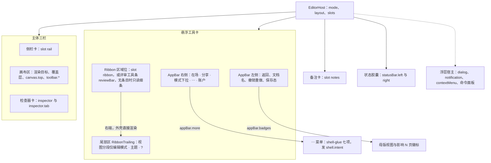
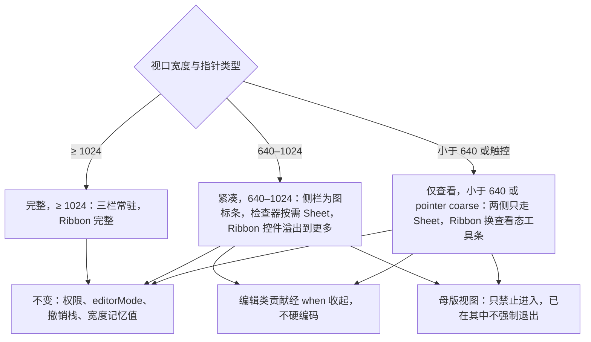
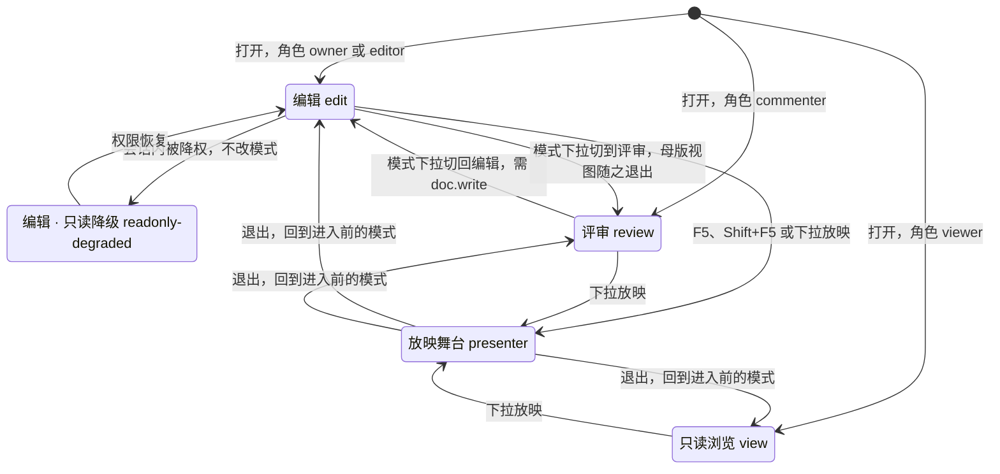
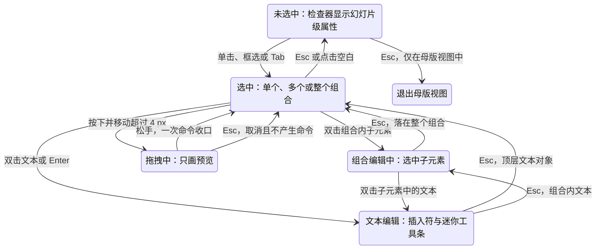
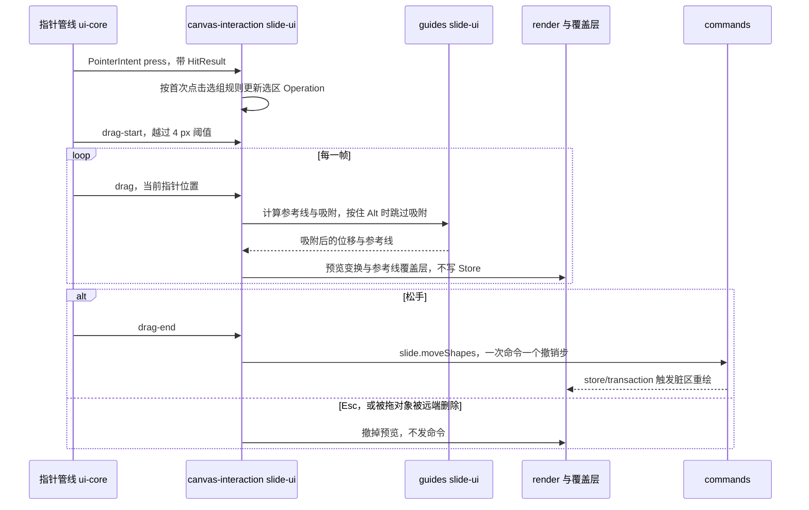
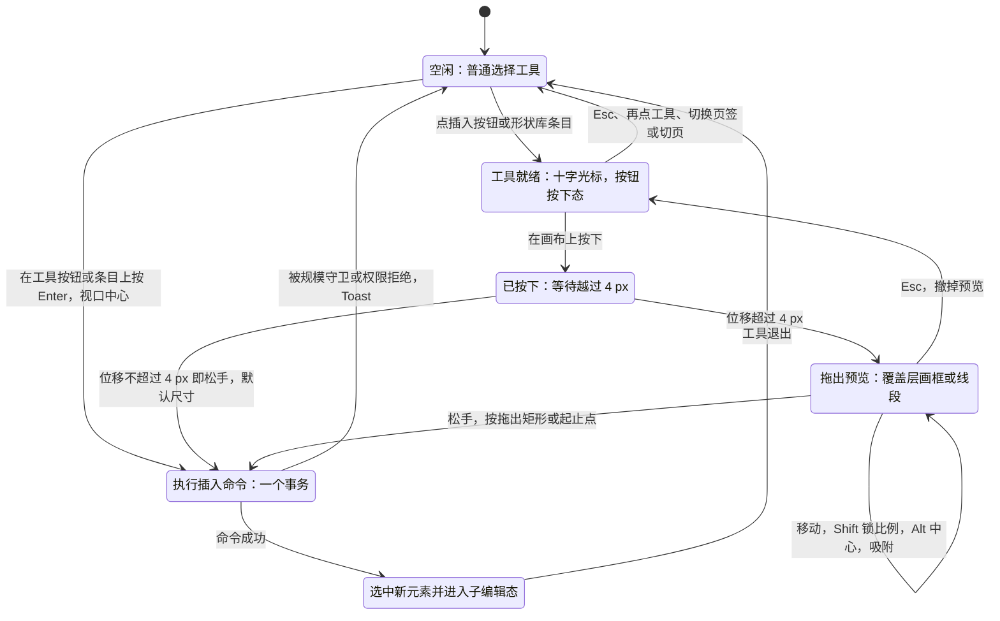
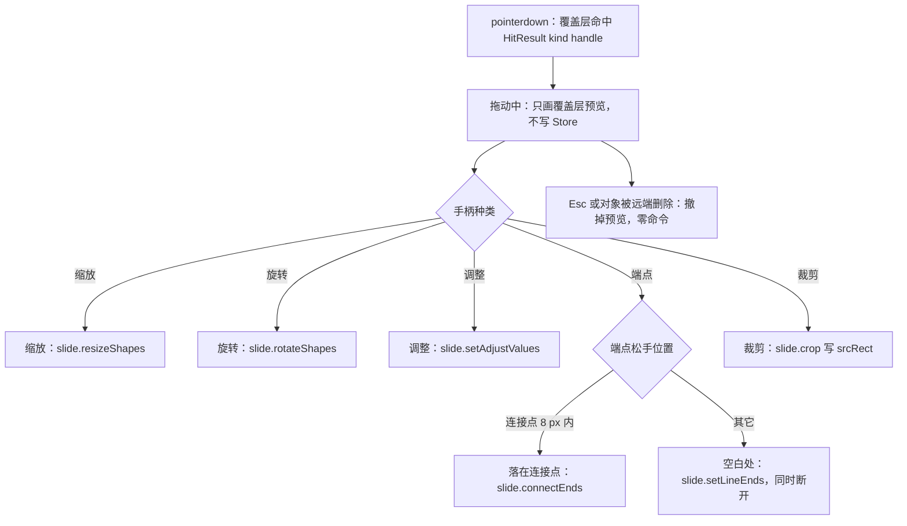
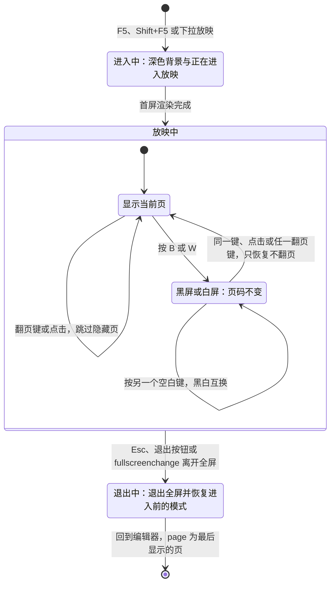
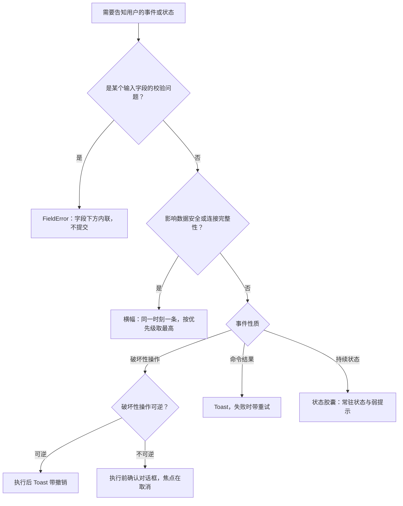

# 10 编辑器外壳与画布交互
> 状态：v0.1 | 负责：前端设计线 | 更新：2026-09-25（§4.19）；2026-09-25（审稿）；2026-09-26（§4.20）；2026-09-26（§4.20 FE-08）；2026-09-26（§4.21：插入页签分组统一、超链接改 M2 P1、表格 M2 可插入；selectionKind 补四类；新增插入工具态与元素手柄；快捷键逐条对齐 ED-16）；2026-09-26（§4.21 整合：§5 文本分区补链接、自动调整与渐变描边字，degraded 分区扩为对象说明、替代文本与后续动作，迷你工具条补 table-cell、chart 与 degraded 口径，内容占位符补「重置为占位符框」；§7.1 组合编辑的键盘等价；§7.4 插入工具态视觉按设计样张、浮层不退出文本编辑） | 依赖：[40/10](../40-modules/10-ui-shell-and-slide-ui.md) §2.1、§2.5、§2.6、§5.3、§5.4、§11、§13；[50/19](19-insertable-elements-overview.md)、[50/22](22-elements-shapes-and-lines.md)；[设计 01](../20-design/01-information-architecture.md) §2、§3、§5–§7；[设计 09](../20-design/09-design-specification.md) §3、§4；[设计 02](../20-design/02-user-flows.md) F2；设计 03-screens [02](../20-design/03-screens/02-editor-main.md)、[03](../20-design/03-screens/03-properties-panel.md)、[11](../20-design/03-screens/11-present-mode.md)、[17](../20-design/03-screens/17-selection-alignment-and-snapping.md)、[20](../20-design/03-screens/20-view-zoom-and-navigation.md)、[23](../20-design/03-screens/23-settings-panel.md)、[24](../20-design/03-screens/24-keyboard-shortcuts-panel.md)、[04](../20-design/03-screens/04-insert-menu.md)、[15](../20-design/03-screens/15-insert-menu-and-shape-library.md)、[18](../20-design/03-screens/18-image-editing.md)；[30/07](../30-architecture/07-rendering.md) §7、§8；[PRD 02](../10-prd/03-features/02-editing.md) ED-01、ED-05、ED-08、ED-09、ED-10、ED-11、ED-12、ED-16、ED-18、ED-19、ED-21、ED-22、ED-27、ED-28、ED-29、ED-30；[PRD 08](../10-prd/03-features/08-app-shell.md) AS-06；[rulings](../00-charter/rulings-2026-09-14.md) §4.10 Q14 / Q15 / Q19 / Q20、§4.18 UX-06 / UX-07 / UX-19 / UX-20、§4.19、§4.20 FE-02 / FE-06 / FE-08 / FE-10 / FE-12 / FE-15、§4.21（R-d-61、R-d-62、R-d-67、R-d-72、q-table-depth、q-media-insert、q-extra-inserts）

本文是**编辑器外壳与画布交互的行为语义**唯一事实源：`<EditorHost>` 由哪些区域组成、布局状态怎样记忆并随断点变化、模式 × 角色 × 断点下界面怎样变化，以及 Ribbon、检查器、缩略图栏、画布选择与拖拽、缩放导航、放映舞台、命令面板与设置抽屉的交互规则和反馈分层。尺寸、材质与线框以 [设计 09](../20-design/09-design-specification.md) §3–§4、03-screens 与 playground `#/editor` 为准；本文写状态机与规则。

不在本文（只链接）：

| 主题 | 事实源 |
|---|---|
| UI 四包、token、主题、材质、`ui.*` 贡献点、上下文键全集、视图模型、输入管线 | [09](09-ui-system-and-theming.md) |
| 控件 → 命令 id 的绑定表本体 | [40/10](../40-modules/10-ui-shell-and-slide-ui.md) §2.6 |
| 母版视图、版式画廊、主题编辑 | [11](11-masters-layouts-and-themes.md) |
| 文本编辑态、IME、光标与选区 | [06](06-text-editing-and-ime.md) |
| 命中链、覆盖层绘制、视口、缩略图像素、放映渲染 | [05](05-rendering-and-thumbnails.md) §4、§5、§10、§12 |
| 命令结果分流、撤销跳过提示条、剪贴板 | [04](04-document-commands-and-undo.md) §4、§6、§9 |
| 协同 UI 六态与横幅出现条件、「未保存到服务器」判据、在场 | [07](07-collaboration-client.md) §3.3、§6.1、§10–§11 |
| 评论面板与画布评论钉 | [08](08-comments-and-version-history.md) §5 |
| 路由、`EditorPageState`、`HostRegistry`、设置页路由 | [02](02-app-shell-routing-and-session.md) §2、§6、§9.4 |
| F6 循环、焦点管理、live region、拖拽的键盘等价 | [16](16-i18n-and-accessibility.md) §6–§8 |
| 错误码 → 文案与建议动作、错误属性 → 呈现层级 | [15](15-events-errors-and-telemetry.md) §4 |
| 交互预算数值 | [13](13-performance-and-bundling.md) §3 |
| 可追加元素的逐项设计（作用、OOXML、模型、渲染、交互、命令、协同、保真） | [19](19-insertable-elements-overview.md) 总览与通用设计；[20](20-elements-text.md)–[25](25-elements-readonly-and-opaque.md) 各元素族 |

包名一律省略 `@cordexjs/` 前缀。

## 1. `EditorHost` 与 `EditorShell` 的结构

`<EditorHost host unitId mode layout slots … />`（ui-react，props 草案见 40/10 §6）是编辑器唯一的挂载点。内部由 `EditorShell` 按设计 09 T-01 的「悬浮卡片」模板排布：根为 `bg-canvas`，全部 chrome 都是浮在画布光斑上的玻璃卡片，画布区本身不加玻璃（[09](09-ui-system-and-theming.md) §4）。

| 区域 | 组件（ui-react） | 内容来源（贡献槽位） | 常驻 / 可隐藏 | `data-cordex-region` |
|---|---|---|---|---|
| 悬浮工具卡 · 应用栏（48） | `AppBar`、`MoreMenu`、`UserMenu`、`PresenceStack` | 固定项；`ui.toolbar{slot:'appBar.badges'}`；`ui.contextMenu{slot:'appBar.more'}` 与 `slot:'userMenu'`；宿主插槽 `slots['appBar.left' \| 'appBar.right']` | 编辑、评审、只读浏览常驻；放映隐藏 | 无（在 F6 循环之外，[16](16-i18n-and-accessibility.md) §6.1） |
| 悬浮工具卡 · Ribbon 区域位（编辑：页签行 36 + 内容区 91；评审与只读浏览：评审工具条 40） | `RibbonHost`、`ReviewToolbar`、`ReadonlyRibbonNotice`；右端尾部区 `RibbonTrailing`（`ViewModeSwitch`、`ThemeToggle`、「?」） | `ui.ribbon{slot:'ribbon'}`；评审与只读浏览时换为 `ui.toolbar{slot:'reviewBar'}`；尾部区由外壳直接渲染，不走贡献（rulings §4.20 FE-08） | 编辑、评审、只读浏览常驻（后两者为评审工具条或只读细条）；放映无 | `ribbon` |
| 侧栏卡（240） | `PanelHost` | `ui.panel{slot:'rail'}`：普通视图为 slide-ui `ThumbnailRail`，母版视图为 `MasterThumbnails` | 可折叠为图标条；紧凑与窄屏为 Sheet | `rail` |
| 画布区 | `CanvasHost`、`ZoomBar`、`ToolbarHost` | 渲染目标（render-dom）、覆盖层（`render.overlay`）、`ui.panel{slot:'canvas.top'}`（范围条）、`ui.toolbar{slot:'toolbar.*'}`（迷你工具条） | 常驻 | `canvas` |
| 检查器卡（300） | `InspectorDock` | `ui.panel{slot:'inspector'}` 分区与 `slot:'inspector.tab'` 页签；`slot:'floating'` 次级浮动面板不受互斥约束 | 可收起；紧凑与窄屏为 Sheet | `inspector` |
| 备注卡 | `NotesBar` | `ui.panel{slot:'notes'}` | 默认折叠（32），展开默认 120、可拖高；放映隐藏 | `notes` |
| 状态胶囊（32） | `StatusBar` | 固定的保存 / 同步项 + `ui.statusBar{slot:'statusBar.left' \| 'statusBar.right'}` | 常驻；放映隐藏 | `status` |
| 浮层宿主 | `DialogHost`、`NotificationHost`、`ContextMenuHost`、`CommandPalette` | `ui.dialog`、`ui.notification`、`ui.contextMenu` | 按需 | — |

**应用栏**：

- 左侧：「← 返回首页」（`onNavigateBack` → `/home`）· 文档名（点击内联重命名，提交走 `onRename`，与「⋯ → 重命名」同一路径）· 撤销 / 重做（仅编辑模式，绑定 `core.undo` / `core.redo`，tooltip 带下一步名称，[04](04-document-commands-and-undo.md) §5）· 保存 / 同步态（与状态胶囊同一数据源，[07](07-collaboration-client.md) §3）。
- 右侧顺序固定（rulings §4.10 Q14）：在场头像堆叠（有 `presence` 服务时，M3）· 竖分隔 · 「分享」（`doc.manage`，打开 `/documents/:id/share`，M3）· 模式下拉（§3）· 「⋯」更多 · 账户头像。
- 「⋯」（rulings §4.10 Q20）自上而下：导出…（`Mod+E`）/ 保真报告 / 版本历史 / 插件管理器 / 分隔 / 重命名 / 创建副本 /（开发者，仅开发构建或 `features.developerMenu`）；全部由 `preset-slide#shell-glue` 以 `appBar.more` 贡献、点击发 Operation `shell.intent`，宿主处理见 [03](03-preset-assembly-and-plugins.md) §8。
- 账户头像 `UserMenu`（28 px，无在场环，PRD AS-06）：姓名与邮箱、设置（`Mod+,`，**唯一入口**，§10.3）、键盘快捷键（`Mod+/`）、帮助中心、退出登录（`onSignOut` → apps/web 登出流程，[02](02-app-shell-routing-and-session.md) §10.2；嵌入场景无回调时提示「由宿主应用管理登录」）。
- 母版视图追加 `appBar.badges`：「母版视图」与「改动将影响 N 页」两个徽标（[11](11-masters-layouts-and-themes.md) §4）。侧栏或检查器收起时应用栏补 `PanelLeft` / `PanelRight` 打开按钮。

**Ribbon 区域位的尾部区**（`RibbonTrailing`，rulings §4.20 FE-08）自左至右：`ViewModeSwitch`「普通 | 母版」（只在编辑模式且母版入口可用时渲染，不可用时不留空位，[11](11-masters-layouts-and-themes.md) §3）· `ThemeToggle`（界面亮 / 暗，个人偏好，[09](09-ui-system-and-theming.md) §3）· 「?」（`CircleHelp`，tooltip「帮助与快捷键（⌘/）」，打开快捷键面板，§10.2）。

- **位置随区域位的形态走**：编辑模式在页签行右侧；评审与只读浏览在评审工具条右端；评审工具条没有条目时（M2 未装 `comments` 包时的常态，§3.2）在 `ReadonlyRibbonNotice` 细条右端；没有页签时的「无可用页签」细条（§4）同样带尾部区。
- **同一组件、同一容器**：三处都是 `RibbonTrailing` 放在 `RibbonTrailingSlot` 里（右内边距 8、控件间距 4），编辑 ⇄ 评审切换时「主题 · ?」不横向跳动；细条左侧的锁图标与评审工具条首个按钮的图标对齐，有无条目切换时左侧也不跳。
- **由外壳直接渲染**：尾部区属于 ui-react 外壳，不是 `ui.toolbar{slot:'reviewBar'}` 的条目，第三方既不能向其中贡献，也不能移除；「?」在三种形态下行为相同。
- **评审与只读浏览不显示「普通 | 母版」**：分段不渲染、不留空位（rulings §4.10 Q12 不变），尾部区只剩「主题 · ?」。

**图 10-1 EditorHost 区域网格与贡献槽位**

怎么读：实线是 `EditorShell` 的常驻区域，分组框对应设计 09 T-01 的两张卡片与主体三栏；节点里写的是该区域接收的贡献槽位；虚线是按需出现的浮层宿主。壳只提供槽位与布局，内容来自贡献，因此换文档类型或移除 slide-ui 不需要改壳；唯一的例外是 Ribbon 区域位右端的尾部区，它由外壳直接渲染，页签行、评审工具条与只读细条三种形态共用（FE-08）。
依据：40/10 §2.1、§5.3；设计 01 §2.1–§2.2；设计 09 §3、T-01；rulings §4.10 Q14、Q20，§4.20 FE-08。

## 2. 布局状态与断点三形态

### 2.1 `EditorLayoutState`

`EditorLayoutState` 是 ui-react `EditorShell` 内的 React state（个人偏好，不进文档、不同步）：

| 字段 | 默认 | 范围 / 取值 | 说明 |
|---|---|---|---|
| `railWidth` | 240 | 160–420 | 像素，不用百分比（设计 09 T-01） |
| `inspectorWidth` | 300 | 240–720 | 同上 |
| `historyWidth` | 560 | — | 版本历史抽屉页打开时检查器临时加宽到此值，关闭后回到 `inspectorWidth`（[08](08-comments-and-version-history.md) §9） |
| `railCollapsed` | `false` | 布尔 | 桌面形态下折叠为 44 px 图标条 |
| `inspectorOpen` | `true` | 布尔 | 收起后画布占满 |
| `notesOpen` / `notesHeight` | `false` / 120 | 布尔 / ≥ 32 | 备注默认折叠；展开高度可拖动 |
| `sectionsCollapsed` | `{}` | 分区 id → 布尔 | 检查器分区折叠态（§5） |
| `breakpoint` | 由视口得出 | `desktop` / `compact` / `narrow` | 与上下文键 `breakpoint` 同源（`detectBreakpoint`，[09](09-ui-system-and-theming.md) §6.3）；不记忆 |

- **记忆**：拖拽结束、开合切换时写 localStorage `cordex.layout.{unitType}`（键空间见 [02](02-app-shell-routing-and-session.md) §10.1），按文档类型而不是文档 id 记忆（同类文档共享一份，设计 03-20）；拖动过程中不写；读取时按上表范围 clamp，损坏回默认。集成方可经 `EditorHost` 的 `layout` 传入初值，并以 `layout.remember:false` 关闭记忆（PRD ED-22「可禁用」；`remember`、`notesHeight`、`sectionsCollapsed` 为本文新增字段，§12.3）。
- **拖拽**：分隔条（`ResizablePanel` 手柄，静止透明、悬停显形）拖动期间壳根加 `data-interacting`，玻璃面板临时不透明（[09](09-ui-system-and-theming.md) §3.4）；分隔条可聚焦、方向键调整（[16](16-i18n-and-accessibility.md) §6.3）。
- **与模式无关**：切评审、进母版视图、进放映都不改写记忆值；母版视图的窗格与普通视图是同一个 240 px 面板（设计 03-26 §7）。

### 2.2 断点三形态（rulings §4.10 Q19）

| 形态 | 条件 | 侧栏 | 检查器 | Ribbon | 其它 |
|---|---|---|---|---|---|
| 完整 | `breakpoint == 'desktop'`（≥ 1024） | 左侧常驻列，可折叠为 44 px 图标条 | 右侧常驻列 | 完整多页签 | — |
| 紧凑 | `breakpoint == 'compact'`（640–1024） | 默认收为图标条；点 `PanelLeft` 展开为 `Sheet side="left"` | 默认收起；应用栏 `PanelRight` 打开 `Sheet side="right"`，不挤压画布 | 组内放不下的控件按 `order` 逆序收入该组的「更多 ▾」；页签过多时收入页签级「更多 ▾」，不换行 | 母版视图入口禁用（[11](11-masters-layouts-and-themes.md) §3） |
| 仅查看 | `breakpoint == 'narrow'`（< 640）或 `platform == 'mobile'`（`pointer: coarse`） | 只以 Sheet 打开 | 只以底部 Sheet 打开，默认「评论」页签 | 收为 48 px 查看态工具条：翻页 · 缩放 · 评论 · 更多（按钮 44 × 44，间距 ≥ 8） | 顶部 `role="status"` 提示条「仅查看：窄屏下不提供完整编辑 UI」；< 400 px 时两个 Sheet 互斥 |

- **布局形态与内容显隐分开**：列还是 Sheet 由 `EditorShell` 按 `breakpoint` 切换；Ribbon 编辑类分组、迷你工具条、插入入口在仅查看形态经 `when: breakpoint != 'narrow' && platform != 'mobile'` 收起（减少控件而不是缩小控件，设计 01 §6），不在组件里写断点分支。权限、`editorMode` 与撤销栈不因断点改变，外接键盘的快捷键照常。
- **跨断点切换**：打开中的 Sheet 在断点变化时关闭；宽度记忆值保留，回到 `desktop` 时恢复；焦点若在被收起的区域内，移到画布（[16](16-i18n-and-accessibility.md) §7）。
- **触控**：平板上的查看与评论为 M3 P1，触控编辑（手柄 ≥ 44 px、长按菜单）为 M4+ P2（PRD ED-27）。
- playground 尚未做 Ribbon 溢出与查看态工具条（设计 09 T-01 注），M2 实现。

**图 10-2 断点三形态下的布局变化**

怎么读：顶部菱形按视口宽度与指针类型分到三种形态；三种形态都指向「不变」节点，说明断点只改变呈现、不改变权限与文档状态；紧凑与仅查看两种形态的内容收纳一律经 `when` 实现，并且只限制进入母版视图。
依据：rulings §4.10 Q19；设计 01 §6–§7；设计 09 T-01。

## 3. 模式 × 角色 × 断点

### 3.1 三个正交维度

| 维度 | 取值 | 由谁决定 | 上下文键 |
|---|---|---|---|
| 编辑器模式 | `edit` / `review` / `view`（只读浏览） | 打开时按角色映射：owner、editor → `edit`，commenter → `review`，viewer → `view`（[02](02-app-shell-routing-and-session.md) §6）；编辑者可在模式下拉中切到评审再切回 | `editorMode` |
| 视图模式 | `normal` / `master` / `presenter` | Operation `view.setMode`；放映经 `/documents/:id/present` 路由进入（§9），母版见 [11](11-masters-layouts-and-themes.md) | `viewMode` |
| 断点 | `desktop` / `compact` / `narrow` | 视口（§2.2） | `breakpoint`、`platform` |

设计 01 §5 把放映与编辑、评审并列为「三种模式」；实现上放映是路由加 `viewMode='presenter'`，`EditorHost` 以 `mode='view'`、`layout.chrome:'none'` 呈现舞台（[02](02-app-shell-routing-and-session.md) §2.2），不是第四个 `editorMode`。

**会话内权限变化不改 `editorMode`**（依据：rulings §4.18 UX-20；与 [07](07-collaboration-client.md) §8.1 的「当前手势结束后画布转只读、状态胶囊锁形」一致）：被降权时仍停在编辑模式、进入 `readonly-degraded`——Ribbon 保留，写控件禁用并提示「需要编辑权限」；被提升时不自动切模式，只按新角色更新模式下拉的可选项（例如评审者升为编辑者时「编辑」项解禁、查看者升为评审者时出现「评审」），升到可编辑时 Toast「你现在可以编辑此文档」。角色映射只在打开与重新打开时使用（[02](02-app-shell-routing-and-session.md) §6 已同此口径，rulings §4.20 FE-10）。

### 3.2 界面差异总矩阵

| 区域 | 编辑（owner / editor） | 评审（commenter，或编辑者主动切换） | 只读浏览（viewer，UX-19） | 放映 |
|---|---|---|---|---|
| 应用栏 | 完整，含撤销 / 重做 | 无撤销 / 重做；徽标「评审模式」 | 同评审；徽标「只读浏览中」 | 隐藏 |
| 模式下拉 | 编辑 · 评审 · 放映 | 评审 · 放映；「编辑」按权限可选或禁用并提示所需权限 | 只读浏览 · 放映 | — |
| Ribbon 位 | 完整多页签；降权时写控件禁用 | 评审工具条：评论 · 高亮 · 上一处评论 · 下一处评论；没有条目时为细条「评审模式 · 只读」 | 评审工具条去掉评论、高亮，只留跳转；没有条目时为细条「只读浏览中」 | 无 |
| 尾部区（Ribbon 位右端，§1） | 页签行右侧：视图分段（条件见 [11](11-masters-layouts-and-themes.md) §3）· 主题 · ? | 评审工具条右端，没有条目时在细条右端：主题 · ?；不显示视图分段（Q12） | 同评审 | — |
| 缩略图栏 | 增删、拖拽排序 | 仅浏览与跳转 | 同评审 | 无 |
| 画布 | 选中框、手柄、插入符、迷你工具条 | 只读：无手柄与插入符；评论钉可点；点文本时检查器切到「评论」并提示「当前为只读，去评论？」 | 只读；评论钉可点、线程只读 | 全屏只读 |
| 检查器 | 属性（默认）· 评论 · 历史 · 插件 | 默认「评论」；「属性」只读，顶部注「只读 · 评审模式下不可编辑」；「历史」按 `can.history.read` 出现；未装 `comments` 包（M2）时没有「评论」页签，默认「属性」 | 「属性」只读，顶部注「只读 · 仅有查看权限」；评论只读（无撰写、回复、解决）；无「历史」 | 无 |
| 备注 | 可编辑（PRD ED-18，M3 起；M1–M2 只读） | 只读 | 只读 | 隐藏 |
| 状态胶囊 | 完整 | 隐藏字数统计等编辑专属项 | 同评审 | 无（控制条自带页码） |
| 覆盖层 | 远端光标、远端选区、评论钉、手柄 | 远端光标、远端选区、评论钉 | 同评审 | 只有跟随提示条（M3） |
| 名额 | editor 计入编辑者（owner 不占名额） | 按角色计：commenter 计入查看者；编辑者主动切到评审仍按编辑者计 | 计入查看者（UX-19） | 不变 |

- 每一列在紧凑与仅查看形态下再按 §2.2 收纳。
- 名额按角色而不是编辑器模式计（[60/05](../60-backend/05-modules-collab-and-snapshots.md) §4.2，rulings §4.15 Q5）：切换模式不会释放或重占名额。
- 评审工具条条目由 slide-ui 以 `ui.toolbar{slot:'reviewBar'}` 贡献：创建类按钮（评论、高亮）带 `when: editorMode == 'review' && slide.hasComments`，跳转类只要求 `slide.hasComments`，所以只读浏览变体不需要另写一套条目（评论数据与命令在 `comments` 包，slide 专属入口由 slide-ui 贡献，rulings §4.19 D-COMMENTS-PKG）。
- 评审工具条没有任何可见条目时（M2 未装 `comments` 包，`slide.hasComments` 为假），该区域位显示 `ReadonlyRibbonNotice` 细条（40 px）：评审模式为「评审模式 · 只读」，只读浏览为「只读浏览中」，不留空卡（设计 09 T-01）；细条右端仍是尾部区「主题 · ?」。
- 评审工具条右端与细条右端的「主题 · ?」是外壳的尾部区（§1），不是 `reviewBar` 条目：条目的 `when` 全部为假时它照常显示；工具条与细条同为 40 px 行高，条目与尾部控件同为 28 px、同一基线（rulings §4.20 FE-08，用户已确认 playground 样张）。

### 3.3 模式切换

- **编辑 ⇄ 评审**：同一路由、同一 host，经 `UiRendererHandle.update({mode})` 生效，不重建 React root、不重开 Unit、撤销栈保留；进入评审前若在文本编辑则先提交并退出，若在母版视图则退出母版视图并恢复进入前的位置（rulings §4.18 UX-20，[11](11-masters-layouts-and-themes.md) §3）。
- **进入放映**：`F5` 从第一页、`Shift+F5` 从当前页、模式下拉「放映」或查看态工具条的放映按钮（从当前页）→ 导航到 `/documents/:id/present?page=<slideId>`（§9）。从母版视图按 `F5` 时先退出母版视图、从恢复后的当前页开始（本文补足）。
- **退出放映**：回到进入前的 `editorMode`（由导航状态携带）与普通视图，`?page=` 取放映中最后显示的页。
- **深链**：`?page=`、`?comment=` 的语义与 URL 同步规则在 [02](02-app-shell-routing-and-session.md) §2；UI 侧的定位动作走 `slide.setCurrentSlide` 与「打开评论页签并定位线程」（[08](08-comments-and-version-history.md) §5）。
- 壳与贡献只经 `when` 读取 `editorMode`，不在组件里判断角色。

**图 10-3 编辑器模式与只读浏览变体**

怎么读：初始箭头是打开时的角色映射；编辑与评审之间只由用户经模式下拉切换；会话内的权限变化只在「编辑」与「只读降级」之间移动，不会把用户推到评审；放映是一个外置状态，退出时回到进入它之前的那个模式。
依据：设计 01 §5；rulings §4.18 UX-19、UX-20；[02](02-app-shell-routing-and-session.md) §2.2、§6。

## 4. Ribbon

- **三级结构**：页签 → 组 → 控件，由 `buildRibbonTree` 从 `ui.ribbon` 贡献折叠（[09](09-ui-system-and-theming.md) §7）；空组、空页签自动隐藏；内容区高度恒定（91），切换页签不改变壳高度。
- **内置页签**（组、控件与命令 id 见 40/10 §2.6，本文不复写）：

| 页签 | 次序与条件 | 行为要点 |
|---|---|---|
| 母版 | `order:-100` 置首、强调色；`when: viewMode == 'master'` | 五组，「关闭」独立最右（[11](11-masters-layouts-and-themes.md) §2） |
| 开始 | 恒显 | 剪贴板 · 幻灯片 · 字体 · 段落 · 绘图 · 编辑；打开文档时默认选中 |
| 插入 | 恒显 | 七组：文本 · 形状 · 图像 · 表格 · 图表 · 链接与批注 · 插件，以设计 03-04 与 playground `InsertTab.tsx` 为准（R-d-61，分组表见下）；超链接 M2 P1 可用（PRD ED-19，R-d-67）；表格 M2 可插入并编辑单元格文字，结构与样式 M3（q-table-depth）；图表 `enablement: slide.hasChartEditor`（M3 装载 `slide-render-chart` 后可用，未装载时禁用并给原因）；音频与视频 P2 禁用（q-media-insert）；批注 `when: slide.hasComments`（未装 `comments` 包时不出现，与评审工具条同一口径，§3.2） |
| 设计 | `when: viewMode != 'master'` | 主题相关行为见 [11](11-masters-layouts-and-themes.md) §9 |
| 切换 | 恒显，**只读展示**（rulings §4.10 Q15） | 控件全部 `disabled`，显示当前页保留的效果名与时长，说明「已保留原文件的切换效果，M1–M3 暂不可编辑」；不提供「应用到全部」「自动换片」；无命令 |
| 视图 | 恒显 | 显示（网格、参考线、智能参考线）· 缩放 · 窗口（缩略图侧栏、备注、母版视图） |
| 第三方 | `order ≥ 1000`、必带 `owner` | 排在全部内置页签之后，页签带归属徽标（[03](03-preset-assembly-and-plugins.md) §9） |

内置页签之间的相对次序由 slide-ui `ribbonSpec()` 决定，只要求都 `< 1000`。

**插入页签的分组**（R-d-61；控件到命令 id 的绑定见 40/10 §2.6；各元素的逐项设计见 [50/19](19-insertable-elements-overview.md) 与各元素族文档）：

| 组（自左至右） | 控件 | 里程碑与可用性 | 元素设计 |
|---|---|---|---|
| 文本 | 文本框（竖排 P2）· 页眉和页脚… · 幻灯片编号 · 日期和时间 · 符号… · 公式 | 文本框 M2 P0；页眉页脚、编号、日期 M2 P2；符号 M3 P2（q-extra-inserts）；公式灰显「暂不支持」（M4+，q-equation） | [50/20](20-elements-text.md)、[50/21](21-elements-structure.md)、[50/25](25-elements-readonly-and-opaque.md) |
| 形状 | 形状 ▾（10 类、首批 72 项的 flyout，与 开始 › 绘图 › 形状 ▾ 是同一组件）· 图标…（2026-09-30 样张确认从图像组移入） | 形状 M2 P0；曲线类绘制 P2；图标 M3 P2（q-extra-inserts） | [50/22](22-elements-shapes-and-lines.md) |
| 图像 | 图片 ▾（此设备… / 来自 URL… / 屏幕截图 / 相册，URL 可被集成方禁用）· 视频 · 音频 | 图片 M2 P0；屏幕截图与相册 M4+ P2（菜单内禁用并标 M4+）；视频与音频 P2（q-media-insert，插入时不写 `p:timing`） | [50/23](23-elements-media.md) |
| 表格 | 表格 ▾（8 × 8 悬停网格 + 「插入表格…」输入行列，上限 10 × 8） | M2 插入并编辑单元格文字；行列插删、合并拆分、样式 M3（q-table-depth） | [50/24](24-elements-tables-and-charts.md) |
| 图表 | 图表 ▾（柱形 / 条形、折线、饼、面积、散点） | M3 P1，`enablement: slide.hasChartEditor`；设计 03-04 的「M1/M2 可插入静态图表」作废（R-d-74） | [50/24](24-elements-tables-and-charts.md) |
| 链接与批注 | 超链接…（`Mod+K`）· 批注 | 超链接 M2 P1；批注 M3（`when: slide.hasComments`） | [50/20](20-elements-text.md)、[08](08-comments-and-version-history.md) §5 |
| 插件 | 第三方贡献的分组（`order ≥ 1000`、带归属徽标） | 由插件决定 | [50/22](22-elements-shapes-and-lines.md)、[03](03-preset-assembly-and-plugins.md) §9 |

- **里程碑可见性**：本里程碑范围内的 P2 条目留在原位、禁用，tooltip「当前版本暂未开放」（「禁用而不隐藏」，下文）；排在 M4+ 的条目同样禁用而不隐藏并标「M4+」（2026-09-30 样张确认：屏幕截图、相册在图片 ▾ 菜单内禁用显示；艺术字同口径）；公式按 50/25 灰显「暂不支持」。SmartArt、OLE、3D 模型、墨迹、缩放定位、录屏不提供插入入口（非目标，R-d-75）。
- **新建幻灯片不在插入页签**：设计 03-04 与 playground 均无此组，入口为 开始 › 幻灯片 › 新建、`Mod+M` 与缩略图栏（§6）。
- 插入页签的每个控件都进入同一个插入工具态或打开对应选择器，行为见 §7.4。

- **只读是禁用而不是隐藏**：控件的可见性只看 `when`；可用性 = 目标命令已注册（`commands.has`）∧ 命令声明的能力位已授予（`isReadOnly`、`can.<capability>`，[09](09-ui-system-and-theming.md) §6.3）∧ 条目的 `enablement` 为真（[09](09-ui-system-and-theming.md) §6.1；契约与键族已登记，rulings §4.20 FE-06）。不可用的控件留在原位、`aria-disabled`，tooltip 说明原因（「需要编辑权限」「当前版本暂未开放」「需要 ≥ 1024 宽度」等，原因由 `explainWhen` 或权限门给出，[09](09-ui-system-and-theming.md) §6.2）。`ReadonlyRibbonNotice`（40 px 细条）只在 Ribbon 区域位没有任何可显示内容时出现：没有页签（例如 slide-ui 缺席：「无可用页签」），或评审工具条没有条目（§3.2）；细条右端仍带尾部区「主题 · ?」（§1，rulings §4.20 FE-08）。
- **切换页签是视图态**：Operation `ui.toggleRibbonTab`，不入历史、不广播；当前页签在会话内记忆；进入母版视图时选中「母版」，退出时恢复进入前的页签（[11](11-masters-layouts-and-themes.md) §2）；页签的键盘模型见 [16](16-i18n-and-accessibility.md) §6.2。
- **溢出**：页签总宽超出时整体收入页签级「更多 ▾」，Ribbon 高度不变（设计 01 §7）；紧凑形态的组内溢出见 §2.2。
- **渐进打开期间**：全选、查找替换等全文命令的控件带 `enablement: unitLoaded`（不是 `when`，否则控件会消失），未到齐时禁用并提示「正在载入其余页面…」（rulings §4.18 CO-12，[04](04-document-commands-and-undo.md) §2）。
- **评审工具条**不是 Ribbon 的一个页签，而是占同一区域位的 `ui.toolbar{slot:'reviewBar'}` 条目（F6 位置不变，[16](16-i18n-and-accessibility.md) §6.1），条目见 §3.2；右端是与页签行右侧同一个尾部区（§1）。

## 5. 检查器坞

**页签**（`InspectorDock` 固定四个，可经 `ui.panel{slot:'inspector.tab'}` 增删）：

| 页签 | 贡献方 | 出现与可用条件 |
|---|---|---|
| 属性 | slide-ui 分区（`slot:'inspector'`） | 恒有；只读时字段转为只读展示 |
| 评论 | slide-ui（评论数据与命令在 `comments` 包，页签由 slide-ui 贡献，rulings §4.19 D-COMMENTS-PKG） | `when: slide.hasComments`（M3 起随 preset-slide-collab 装入）；`enablement: viewMode != 'master'`，母版视图禁用，原因「母版与版式不支持评论」（设计 03-26 §1；[08](08-comments-and-version-history.md) §5 图已统一为同一 i18n 文案，rulings §4.20 FE-14）；面板行为见 08 §5 |
| 历史 | `preset-slide#shell-glue`（激活即发 `shell.intent{target:'version-history'}`，[03](03-preset-assembly-and-plugins.md) §8） | `when: can.history.read`；评论者与查看者不出现（rulings §4.18 UX-17，[08](08-comments-and-version-history.md) §9） |
| 插件 | ui-react 壳级 | 存在第三方分区或面板时出现 |

- **互斥与自动切换**（设计 01 §2.3）：同一时刻只渲染一个页签；打开时默认「属性」。**唯一**的自动切换是点击画布评论钉与深链 `?comment=`（切到「评论」并定位线程）；选区变化、属性被远端更新都不打断用户当前所在的页签。`floating` 槽位的次级面板不受互斥约束。
- **分区选择**（`buildInspectorSections` 按 `selectionKind` × `editTargetKind` 过滤，矩阵以设计 03-03 G-19 为准）：

| `selectionKind` | 分区 |
|---|---|
| `none` | 幻灯片级：版式、背景、切换效果（只读）、隐藏此页、备注字数 |
| `shapes` / `text` | 位置与大小（含翻转）· 填充 · 边框 · 阴影 / 效果 · 文本 · 对齐与分布 · 形状（更改形状、调整值，[22](22-elements-shapes-and-lines.md) §2）· 操作（动作按钮默认展开，[22](22-elements-shapes-and-lines.md) §6）· 替代文本；进入文本编辑时自动展开「文本」。「文本」分区另有「链接」行（超链接的查看、编辑与移除）、自动调整三选一（不自动调整 / 溢出时缩排文字 / 根据文字调整形状大小）与渐变字、描边字（P2），见 [20](20-elements-text.md)（2026-09-26 整合） |
| `picture` | 设计 03-18 的图片分区（替换、裁剪、透明度、替代文本）；裁剪模式见 §7.5 |
| `table`（§4.21 新增） | 整个表格被选中、未进入单元格：位置与大小 · 表格（M2 只读显示行列数与表格样式名；M3 起表格样式、标志、边框、行高列宽，q-table-depth）· 替代文本（[24](24-elements-tables-and-charts.md)） |
| `table-cell` | 文本 + 单元格填充 / 边框（M3），M3 前非文本字段灰显并注明里程碑 |
| `chart`（§4.21 新增） | 位置与大小 · 图表（M1–M2 只读：类型与系列数，注「数据编辑 M3 提供」；M3 起数据、类型、标题、图例、数据标签）· 替代文本（[24](24-elements-tables-and-charts.md)） |
| `media`（§4.21 新增） | 视频与音频：位置与大小 · 媒体（替换海报帧 M2 P1、编辑态临时播放）· 替代文本（[23](23-elements-media.md)） |
| `placeholder-empty`（§4.21 新增） | 页上空的内容族占位符：占位符（类型、继承自版式、重置）· 快速插入（与画布图标条同一组按钮：图片 M2 P1、表格按 q-table-depth、图表 M3、视频 P2）· 位置与大小（[21](21-elements-structure.md)） |
| `group` | 位置与大小 +「取消组合」+ 子元素计数 |
| `connector` | 线条与连接符（`p:cxnSp`）：线条（含首尾箭头）· 连接符（「已连接到：矩形 3（连接点 2）」、断开、「连接到…」选择器、类型切换，[22](22-elements-shapes-and-lines.md) §4）· 位置与大小（线条的 x / y / 宽 / 高与翻转即端点的数值等价）· 替代文本 |
| `degraded` | 位置与大小 · 对象说明（类型名与降级原因）· 替代文本（graphicFrame 系如 SmartArt、OLE 可编辑，AlternateContent 系如公式、墨迹、3D、缩放定位只读）· 后续动作（如 SmartArt「转换为形状」，M4+ 灰显）+「查看保真详情」（2026-09-26 整合，[25](25-elements-readonly-and-opaque.md) §2.5） |
| `mixed` | 交集分区：位置与大小、排列、透明度 |
| 母版视图（`editTargetKind` 为 `layout` / `master`） | 另加占位符、文本样式与容器属性分区，见 [11](11-masters-layouts-and-themes.md) §6 |

- **四个新增取值**（R-d-72）：`table`、`chart`、`media`、`placeholder-empty` 由 slide-ui `deriveSelectionKind` 给出，取值全集登记在 [09](09-ui-system-and-theming.md) §6.3；`placeholder-empty` 只指页上**空的**内容族占位符（尚无文字与内容、画布显示内容图标条），有内容的占位符仍按承载的内容类型走对应分区——与 [11](11-masters-layouts-and-themes.md) §2 不采纳泛化 `placeholder` 取值的口径一致，占位符身份另由前缀键 `slide.placeholderSelected` 表达。迷你工具条槽位随之有 `toolbar.table`、`toolbar.table-cell`（M3：插入行列、合并、拆分、填充、边框）与 `toolbar.chart`（M3：编辑数据、更改类型），命名一律 `toolbar.<selectionKind>`；`toolbar.degraded` 只放「查看保真详情」（2026-09-26 整合，50/24、50/25）。承载内容的内容族占位符（图片、表格、图表、媒体填入后）在对应分区另有一行「重置为占位符框」：删除内容并补回空占位，一步撤销（[21](21-elements-structure.md) §3，ADR-0018 决策 10）。
- **多个值**：多选时不一致的字段显示「多个值」（`MixedValueField`，Ribbon 字体 / 字号控件同样式，rulings §4.18 UX-10）；在该字段输入新值即对全部选中对象生效，一次命令、一个撤销步。
- **单位换算归属**（40/10 §13 Q-10 推荐值）：内部单位 EMU；显示单位取 `Preferences` 的度量单位（zh-CN 默认 cm，en-US 默认 in，可选 cm / in / pt / px），字号恒为 pt；换算与带后缀输入（如 `2.5cm`）的解析在 slide-ui 分区内完成，ui-react `NumberField` 只接收 `{value, unit, onCommit}`，不认识 EMU。
- **输入与校验**：非法值（负宽度、超范围字号）使字段进入 `aria-invalid` 并显示 `FieldError`，失焦前不提交；数值字段支持按住标签左右拖动微调与 `↑`/`↓`（`Shift` 加速），拖动微调松手时一次命令。
- **只读**：字段转为只读展示（无描边、不可聚焦），面板顶部一行说明原因（评审「只读 · 评审模式下不可编辑」、只读浏览「只读 · 仅有查看权限」、编辑模式降权「需要编辑权限」）；色块等触发型控件不弹出选择器，只以 tooltip 说明原因。
- **插件分区**排在内置分区之后，以分隔线与归属图标区分；渲染抛错只替换该分区（[09](09-ui-system-and-theming.md) §9）。
- **远端改写正在编辑的字段**：字段级「应用远端值 / 保留我的输入」内联提示优先于其它反馈（[07](07-collaboration-client.md) §12）。
- 分区折叠态存入 `sectionsCollapsed`（§2.1），不同步给协作者。

## 6. 缩略图栏

- **数据与像素**：列表模型 `buildThumbnailList`（slide-ui），像素来自 `ctx.thumbnails`（[05](05-rendering-and-thumbnails.md) §10）；虚拟化（`SlideUiConfig.thumbnails.overscan` 默认 6，同时挂载 ≤ 12 项），200 页滚动 ≥ 55 fps（[13](13-performance-and-bundling.md) §3）；加载超过 300 ms 才显示骨架；渐进打开未到齐的页显示骨架与「共 N 页（正在载入）」（[04](04-document-commands-and-undo.md) §2）。
- **选择与导航**：单击 → `slide.setCurrentSlide`（Operation，不入历史）；`Shift` / `Mod` 多选；`↑`/`↓` 移动并同步画布；`Enter` 在当前页之后新建同版式页（`slide.addSlide{layoutId}`）；`Delete` 删除所选页（只剩 1 页时禁用）。
- **拖拽排序**：`DragIntent{kind:'reorder'}`；拖动中其余缩略图让位（150–200 ms），松手一次 `slide.reorderSlides`（多选整体移动、可跨节）；键盘等价 `Mod+Shift+↑` / `↓`，移动后播报「已移到第 N 页」（[16](16-i18n-and-accessibility.md) §6.3、§8）；跨页重排属于全文命令，`unitLoaded` 之前禁用（CO-12）。
- **右键菜单**（`ui.contextMenu{slot:'thumbnail'}`，绑定见 40/10 §2.6「其它绑定」）：新建 · 复制 · 删除 · 隐藏 / 取消隐藏 · 版式 ▸ · 重置页 · 上移 / 下移；危险项置末。
- **隐藏页**：卡片降低不透明度并带「隐藏」图标，读屏名称附「（隐藏）」；放映顺序翻页时跳过（§9）。
- **节**：M2 显示节标题且可折叠，M3 起增删改（PRD ED-11）。
- **角标**：每页未解决评论数（`slide.hasComments`，[08](08-comments-and-version-history.md) §5）；协作者当前所在页的头像（M3，[07](07-collaboration-client.md) §11）。
- **只读**（评审、只读浏览、降权）：可浏览与跳转；拖拽、增删与写类右键项禁用或不出现。
- **母版视图**：同一侧栏换为母版缩略图窗格（[11](11-masters-layouts-and-themes.md) §5）。

## 7. 画布交互

画布上的全部交互在 slide-ui `application/canvas-interaction.ts`：指针管线只产出 `PointerIntent`（[09](09-ui-system-and-theming.md) §8），这里把意图变成选择 Operation 或一次编辑命令；选区框、手柄与参考线由 render-dom 的覆盖层绘制（[05](05-rendering-and-thumbnails.md) §5.2），slide-ui 不重绘它们。

### 7.1 选择模型

- **命中**：指针经 `render/hit-test` 的 bail 链（覆盖层手柄 > 评论钉 > 远端光标标签，无人接管再做内容命中，[05](05-rendering-and-thumbnails.md) §5.1）；内容命中取 z 序最高、且命中其填充 / 描边 / 文本的元素，`fill="none"` 的形状内部穿透（PRD ED-01）。
- **组合**：首次点击组合内元素选中整个组合；双击进入组合编辑态并选中该子元素（组合外围浅色边框提示「组合编辑中」）；在子元素上再双击文本进入文本编辑。键盘等价（2026-09-26 整合，[21](21-elements-structure.md)）：选中组合后按 `Enter` 进入组合编辑并选中 z 序最低的子元素；组合编辑态下 `Tab` / `Shift+Tab` 只在该组合的子元素间循环，`Esc` 退回选中整个组合。
- **加选与框选**：`Shift`+点击切换单个元素；空白处拖出框选，默认「完全包含」，按住 `Alt` 为「相交即选」；多选显示统一虚线包围盒与 8 个缩放手柄，不提供整体旋转。
- **键盘**：`Tab` / `Shift+Tab` 按 z 序循环选中并滚入视口；`Mod+A` 全选当前页（`enablement: unitLoaded`，未到齐时和弦仍被消费并提示等待，不落到浏览器的全选页面文字）；`Enter` 对文本对象进入文本编辑（[06](06-text-editing-and-ime.md) §2）。
- **锁定**（`spLocks`）：可选中，对应手柄显示锁形、拖动无效，tooltip「该形状已锁定移动」。
- 选择是 Operation `slide.setSelection`，不入历史；协同下经 awareness 广播（M3，[07](07-collaboration-client.md) §10）。
- **Esc 逐级**（rulings §4.18 UX-06）：文本编辑 → 选中子元素 → 选中整个组合 → 取消选择 → 仅在母版视图且已无选区时退出母版视图；每按一次只退一级，组合内文本编辑要按三次 Esc 才到未选中；IME 组合中的 Esc 先交给输入法（[09](09-ui-system-and-theming.md) §8、[06](06-text-editing-and-ime.md) §5）。

**图 10-4 画布选择状态机（Esc 逐级）**

怎么读：每条 Esc 箭头只退一级；拖拽是选中之后的一个短暂子过程，松手与取消都回到选中态（从组合编辑中发起的拖拽回到组合编辑中，图中省略）；退出母版视图只挂在「未选中」之后，正在编辑的文本或选区不会误触发它。
依据：rulings §4.18 UX-06；设计 03-17「画布选择状态」；PRD ED-01、ED-05。

### 7.2 拖拽：从指针意图到一次命令

- 位移不超过 4 px（`UiCoreConfig.input.dragThresholdPx`）视为点击。
- 拖动中每帧只更新覆盖层与被拖元素的预览变换，不写 Store、不入历史、不广播内容；同时由 slide-ui `guides.ts` 计算智能参考线与吸附（派生值，不入 Store）：与页面中心 / 边缘、与其它元素的边 / 中心对齐，等间距标注；吸附阈值 4 CSS px（屏幕空间，随缩放不变）；计算 p95 ≤ 4 ms（[13](13-performance-and-bundling.md) §3）。
- 松手 → 一次 `slide.moveShapes` / `resizeShapes` / `rotateShapes`，一个事务、一个撤销步（PRD ED-05；「一次拖拽一个命令」，[04](04-document-commands-and-undo.md) §5）；多个元素一起拖动时一个命令携带全部 id；`Esc` 取消当前拖动，不产生命令。
- 修饰键：`Shift` 缩放时锁比例、旋转按 15° 步进；`Alt` 缩放时以中心为锚（ED-05），拖动与缩放时同时临时关闭吸附（ED-09），状态胶囊短暂显示「吸附已临时关闭」；`Mod`+拖动复制，松手时以一次 `slide.duplicateShapes{shapeIds, dx, dy}` 收口（一个事务、一个撤销步，新 id；40/10 §2.6 与 40/03 §2.6 已登记）。
- 拖动中被拖对象被远端删除：撤掉预览、不发命令，按软冲突分流提示（[07](07-collaboration-client.md) §12）。
- 连接符端点拖到形状连接点时高亮并吸附（M2 直线跟随，M3 肘形与曲线重算，PRD ED-28），同样一次拖拽一个命令；移动、缩放、旋转带连接的形状时，受影响连接符的新几何由本层经 `layout` 服务求出、作为 `reroute` 随同一条命令写回（30/05 §14.5，[22](22-elements-shapes-and-lines.md) §4.3）；调整、端点、连接点与裁剪手柄的命中与命令见 §7.5。
- 拖拽与缩放动画期间迷你工具条隐藏；帧率 ≥ 55 fps（[13](13-performance-and-bundling.md) §3）。

**图 10-5 拖拽移动：指针意图 → 连续帧 → 一次命令**

怎么读：竖向是时间；`loop` 段是拖动期间的每一帧，只有预览与参考线，不产生任何事务；`alt` 的两个分支分别是正常松手（恰好一次命令）与取消（零次命令）。缩放、旋转同样走这条路径，只是松手时的命令换成 `resizeShapes` / `rotateShapes`。
依据：PRD ED-05 图 2-1；40/10 §2.6「画布拖拽」绑定；30/05 §8。

### 7.3 键盘微移与其它画布交互

- **微移**：方向键 1 px、`Shift`+方向键 10 px（屏幕像素，按当前缩放换算为 EMU）；每次按键一个 `slide.moveShapes`（微移不合并撤销步，合并规则见 [04](04-document-commands-and-undo.md) §5）。
- **对齐与分布**：`slide.alignShapes` / `distributeShapes`，一个事务；参照「所选对象 / 页面」，单选时自动为页面（PRD ED-09）；Ribbon、右键与命令面板都可执行，不要求先框选再点按钮的固定顺序。
- **网格与参考线**：网格显示、吸附到网格、智能参考线三个开关是个人偏好（`ui.setPreference`，不入历史、不同步，设计 03-20）；网格默认间距 0.2 in；标尺与可拖出的自定义参考线为 P2，菜单项灰显占位。
- **迷你工具条**（`ToolbarHost`，`ui.toolbar{slot:'toolbar.text-editing' \| 'toolbar.<selectionKind>'}`）：锚在选区包围盒上方，避开被选对象与视口边缘；评审、只读浏览与放映不出现；文本编辑态的条目见 [06](06-text-editing-and-ime.md) §2（P1）。
- **画布右键**（`ui.contextMenu{slot:'canvas'}`）：按 `selectionKind` 过滤，危险项置末；触控长按 500 ms 等价右键。
- **评审模式点击文本**：画布不进入编辑态；对能评论的角色，检查器切到「评论」并提示「当前为只读，去评论？」（设计 02 F2）。
- **母版视图**：命中只作用于目标容器的形状，继承描边与占位符规则见 [11](11-masters-layouts-and-themes.md) §6；放映舞台不走本节交互（§9）。

### 7.4 插入工具态

「插入工具态」是从选中一个插入工具到新元素落在画布上的这段交互（R-d-62）。它覆盖需要在画布上落点的工具：文本框、形状库全部条目（形状、线条、连接符、曲线类、动作按钮）以及声明需要落点的插件元素；图片、图标、表格、图表、音视频不经工具态，直接按默认落点插入（视口中心或所选空占位符，[19](19-insertable-elements-overview.md)），插入后同样选中。

- **进入**：点 Ribbon 按钮或形状库条目。`activeTool` 是 slide-ui 的本地 UI 状态，不是 Operation：不入历史、不广播、不进 awareness。工具按钮显示按下态（`aria-pressed="true"`），画布光标变为十字，画布顶部出现 glass 提示条「单击插入 1 in × 1 in，或拖出大小 · Shift 锁定比例 · Alt 从中心 · Esc 取消」（2026-09-30 样张确认文案），状态栏显示「插入工具：〈名称〉」（视觉口径以设计 03-15 的样张为准，2026-09-26 整合）。
- **单击**：按下后位移 ≤ 4 px（`UiCoreConfig.input.dragThresholdPx`，与 §7.2 同一阈值）即松手，按该工具的默认尺寸插入，左上角落在点击处（线条为起点在点击处的 1 in 水平线）。
- **拖出**：位移超过 4 px 进入拖出预览，覆盖层画出虚线框（线条为线段）、形状的幽灵预览与「宽 W 高 H」尺寸角标；`Shift` 锁比例（线条约束到 45° 倍数）、`Alt` 以按下点为中心（线条无此项）；拖出期间智能参考线与吸附照常（§7.2），线条与连接符的端点靠近形状时显示连接点（§7.5）；松手时执行恰好一个插入命令。
- **键盘**：焦点在工具按钮或形状库条目上按 `Enter` 直接插到视口中心，默认尺寸；连续插入同一工具时依次错位 0.2 in；不需要指针，满足 WCAG 2.5.7 对「放置」的等价要求。
- **取消**：`Esc`、再次点击同一工具按钮、切换 Ribbon 页签、在缩略图栏或检查器按下指针、切换当前页，都退出工具态且不产生命令；拖出预览中按 `Esc` 撤掉预览。
- **插入之后**：命令成功后执行 `slide.setSelection` 选中新元素，按类型进入子编辑态——文本框进入文本编辑（[06](06-text-editing-and-ime.md) §2），表格进入第一个单元格的文字编辑、图表（M3）打开数据面板（细节以 [24](24-elements-tables-and-charts.md) 为准），动作按钮插入后立即弹出「操作设置」（[22](22-elements-shapes-and-lines.md) §6.2），其余只选中（形状自动进入文本编辑为 P1，默认关）；工具随即退出（一次一个，锁定连续绘制 P2）；live region 播报「已插入〈名称〉」（[16](16-i18n-and-accessibility.md) §8）。空文本框在退出编辑时自动删除，并与插入合为同一撤销步（R-d-65，[20](20-elements-text.md)）。
- **浮层与文本编辑**（2026-09-26 整合，[20](20-elements-text.md) §6）：符号面板、日期和时间格式选择器这类 UI 浮层在文本编辑态打开时，焦点进入浮层不退出文本编辑，关闭后焦点与光标回到原位置。
- **失败**：命令被规模守卫拒绝（`document.quota_exceeded`）或权限不足时按 §11 分流给 Toast，工具退出，不留预览；只读、评审、降权与仅查看断点下插入工具禁用而不隐藏（§4）。
- **协同**：工具态期间当前页被远端删除，工具退出并按 [07](07-collaboration-client.md) §12 的软冲突提示；插入的新元素是 shapes 表的新键，与他人的并发插入不冲突。

**图 10-8 插入工具态状态机**

怎么读：只有「执行插入命令」写 Store，其余都是本地 UI 状态；单击与拖出的分界就是 §7.2 的 4 px 阈值；键盘从空闲直达执行，不经过指针状态；曲线类绘制工具（P2）在「工具就绪」之后另有自己的多点状态机，见 [22](22-elements-shapes-and-lines.md) §5.1。
依据：R-d-62；设计 03-15「插入交互：单击 vs 拖出」；PRD ED-05、ED-29。

### 7.5 元素手柄

选中框与手柄由 render-dom 选择覆盖层绘制（[05](05-rendering-and-thumbnails.md) §5.2，40/06 §4.3 `selection-overlay.ts`），命中结果为 `HitResult{kind:'handle'}`（40/06 §2.2）；slide-ui `application/handles.ts` 把手柄拖动变成命令，仍是一次拖拽一个命令、拖动中只画预览。

| 手柄 | 谁显示 | 拖动 → 命令（松手时一次） | 数值或键盘等价（WCAG 2.5.7） | 里程碑 |
|---|---|---|---|---|
| 8 个缩放手柄 | 形状、图片、组合、表格、图表、媒体；多选的统一包围盒 | `slide.resizeShapes`；`Shift` 锁比例、`Alt` 中心 | 检查器「位置与大小」；`Shift+Alt+方向键`（P1） | M2 P0 |
| 旋转手柄 | 同上，线条与连接符除外，`graphicFrame` 不可旋转 | `slide.rotateShapes`；`Shift` 15° 步进 | 检查器「旋转」 | M2 P0 |
| 调整手柄（黄色菱形） | 带 `avLst` 的预设形状，每个调整值一个；M3 起肘形连接符中段一个 | `slide.setAdjustValues{shapeId, adjust}`（新增，§4.21） | 检查器「形状」分区的调整值，与手柄同批 | M2 P1 |
| 端点手柄 | 线条与连接符两端；已连接实心、未连接空心 | 落在连接点 → `slide.connectEnds`，否则 `slide.setLineEnds`（均为新增，§4.21）；`Shift` 45° | 「位置与大小」与翻转；连接符的「连接到…」选择器 | M2 P0（连接 P1） |
| 连接点标记 | 拖线条或连接符端点、或连接符工具悬停时，目标形状上显示 | 本身不可拖，只作吸附目标（≤ 8 px） | 「连接到…」选择器列出目标与连接点序号 | M2 P1 |
| 裁剪手柄 | 图片裁剪模式：裁剪框四角与四边的黑色短条，框外原图变暗 | `slide.crop{shapeId, rect}` 写 `srcRect`；拖动框内图片改变取景 | 检查器裁剪数值（ED-29） | M2 P1 |

- **命中优先级**（同一位置多个手柄重叠时）：端点 > 调整 > 旋转 > 缩放 > 形状本体；连接点标记只在端点拖动中参与命中。缩到很小的对象手柄命中区仍 ≥ 24 px（设计 03-15），触控 ≥ 44 px（M4+）。
- **锁定**：`spLocks` 各锁位对应的手柄隐藏或显示锁形并 tooltip 说明（§7.1），多选中只要有一个对象锁定该操作，对应手柄即对整体禁用。
- **多选**：只显示统一包围盒与 8 个缩放手柄；调整、端点、裁剪手柄只在单选时出现；类型混杂的多选禁用端点与连接操作。
- **裁剪模式**：双击图片或迷你工具条「裁剪」进入，`Esc`、`Enter` 或点击画布空白退出；裁剪模式中每次松手一次 `slide.crop`，退出时不另发命令、不回滚已提交的裁剪，撤销逐步回退；EMF / WMF 图片不可裁剪（PRD ED-07 边界）；裁剪为形状 P2。完整设计见 [23](23-elements-media.md)。

**图 10-9 手柄拖动到命令的分派**

怎么读：所有手柄共用「预览 → 松手一次命令」的骨架，只有松手时分派到的命令不同；端点是唯一需要再看松手位置的手柄；取消路径对所有手柄一致。
依据：PRD ED-05、ED-07、ED-28、ED-29；R-d-29；[22](22-elements-shapes-and-lines.md) §1.5。

## 8. 缩放、平移与导航

- **缩放**：产品范围 10–400%（preset 默认 `zoom:{min:0.1, max:4}`，引擎 clamp 见 [05](05-rendering-and-thumbnails.md) §4）；`ZoomValue = number | 'fit' | 'fit-width'`，打开时为 `fit`（四周留 16 px）。入口：画布底部居中的缩放胶囊（− · 滑块 · + · 百分比可点击输入 10–400 后回车 · 模式下拉「适应窗口 / 适应宽度 / 50% / 75% / 100% / 150% / 200%」，不在状态栏）；`Mod+滚轮`与触控板捏合以指针位置为锚点；`Mod+=` / `Mod+-` 步进；`Mod+0` 适应窗口、`Mod+1` 100%（PRD ED-16）；「视图」页签缩放组。缩放经 `slide.setZoom`（Operation，不入历史，40/10 §2.6）交给 `render.setView`。
- **平移**：`空格`+拖拽、滚轮、触控板双指；缩放大于适应窗口时视口出现原生滚动条（不自定义样式）；「适应窗口」一键归位；超宽页面按当前页尺寸计算 100%。
- **流畅**：缩放 / 平移 ≥ 55 fps（[13](13-performance-and-bundling.md) §3）；缩放动画期间壳根带 `data-interacting`；远端光标在缩放中临时降低更新频率。
- **页导航**：非文本编辑态下 `PageUp` / `PageDown` 上一页 / 下一页、`Home` / `End` 首页 / 末页；画布获得焦点时数字 + `Enter` 跳页；命令面板「跳转到第 N 页」；缩略图栏点击。全部落到 `slide.setCurrentSlide`。
- **视图事件**（依据：VIEW-EVENTS，authority：30/07 §2.3）：`view/page-changed`、`view/zoom-changed` 由 engine-render 的 `Viewport` 发布，编辑器与查看器共用（载荷见 [05](05-rendering-and-thumbnails.md) §4.3）。UI 从不自己发这两个事件，只调命令并订阅：状态胶囊「第 n / N 页」、缩放胶囊百分比、缩略图栏当前项、URL `?page=`（`history.replaceState`，[02](02-app-shell-routing-and-session.md) §2）与 EM-05 公开事件（[15](15-events-errors-and-telemetry.md)）都以它们为准，保证每次实际变化恰好反映一次。

## 9. 放映舞台

放映编排在 slide-ui `application/present.ts`，舞台组件为 `PresenterStage`；渲染（`Viewport.mode='show'`、同一 DOM/SVG Surface fit 到全屏、结束态可见性）在 [05](05-rendering-and-thumbnails.md) §12。放映是纯 Operation，不产生任何 Mutation（PRD ED-21）。

### 9.1 进入与退出

- **进入**：`F5` 从第一页、`Shift+F5` 从当前页、模式下拉「放映」或查看态工具条的放映按钮（从当前页）。在触发手势的同步回调里先调用 `requestFullscreen()`（用户激活在 `await` 之后会失效），再导航到 `/documents/:id/present?page=<slideId>`；`HostRegistry` 复用同一 host（[02](02-app-shell-routing-and-session.md) §2.2），执行 `view.setMode{mode:'presenter'}`，slide-ui 发布 `slide/show-changed{mode:'entering'}`。全屏的目标元素必须是**跨路由常驻**的容器（`apps/web` 为应用根元素，嵌入宿主为编辑器容器 `[data-cordex-root]`）：此刻舞台尚未挂载，而全屏元素一旦随路由切换被移出文档，浏览器会立即退出全屏；`PresenterStage` 渲染在该容器之内。
- **全屏降级**：Fullscreen API 不可用或被拒（iframe 未授权 `allowfullscreen`、部分移动浏览器）时舞台最大化到容器（`SlideUiConfig.present.fullscreen`，PRD ED-21），不报错。
- **退出**：`Esc`、控制条「退出」，或 `fullscreenchange` 表明已离开全屏（浏览器全屏下第一次 `Esc` 被浏览器消费，页面只能从该事件得知）→ 若仍在全屏则退出全屏 → `view.setMode` 回到 `normal` → 发布 `slide/show-changed{mode:'exiting'}` → 导航回 `/documents/:id?page=<最后显示的页>`，恢复进入前的 `editorMode`（§3.3）。进入与退出各恰好发布一次 `slide/show-changed`。
- 切走标签页再回来：保持当前页与控制条隐藏态。

### 9.2 翻页与黑屏 / 白屏（rulings §4.18 UX-07）

| 输入 | 显示当前页时 | 黑屏或白屏时 |
|---|---|---|
| `→`、`Space`、`PageDown`、点击画面 | 下一页，顺序翻页跳过隐藏页 | 恢复到当前页，不翻页 |
| `←`、`PageUp` | 上一页，跳过隐藏页 | 恢复到当前页，不翻页 |
| `Home` / `End` | 首页 / 末页 | 恢复到当前页，不翻页 |
| 数字 + `Enter` | 跳到该页 | 恢复到当前页，不翻页（本文补足，与翻页键同理） |
| `B` / `W` | 进入黑屏 / 白屏 | 同一键恢复；按另一键切到另一种空白（本文补足） |
| `Esc` | 退出放映 | 直接退出放映 |

- 末页之后不再前进，停在末页，不自动退出（本文取值）。
- **控制条**：鼠标移动或触控时浮现，静止 3 s 后隐藏（本文取值）；按钮为上一页 · 页码 n / N · 下一页 · 黑屏（`aria-pressed`）· 更多（白屏、跳至页码）· 退出；黑屏 / 白屏期间照常可浮现。演讲者视图不在 M2–M3（PRD ED-21 P2 排 M4+），菜单中不显示入口，也不做灰显占位。
- 触控：左右滑动翻页。

### 9.3 内容与协同

- 渲染每页结束态，不播放动画与切换（章程 §2.3；主序列可见性终态 M2 P1，rulings §4.15 Q7，[05](05-rendering-and-thumbnails.md) §12）；超链接与动作、音视频可点击。
- 单页渲染失败只把该页换成「此页内容暂时无法显示」，可继续翻页。
- 远端协同更新照常应用（经脏区重绘）；当前页被远端删除时跳到其后一页（没有则前一页），不加提示；放映中不显示远端光标、软冲突提示与保真提示，这些在退出放映后按常规出现。M2–M3 放映始终实时应用远端更新，不提供关闭开关、不新增渲染暂停接口；主讲人要屏蔽他人改动时先「创建副本」再放映，随演讲者视图（M4+ P2）再议（rulings §4.20 FE-02，PRD ED-21 删去「（可关闭）」）。
- **观众跟随主讲人**属于 M3 多人协同体验层（rulings §4.19 D-M2-CONTENT）：提示条「正在跟随 {姓名}」，观众手动翻页即退出跟随并浮现「返回同步」；与主讲人失联时显示最后同步的页（设计 03-11；在场数据见 [07](07-collaboration-client.md) §11）。

**图 10-6 放映舞台状态机（含黑屏 / 白屏子态）**

怎么读：外层是进入、放映、退出三段；「放映中」内部只有画面内容的两种子态，黑屏或白屏时任何翻页输入都先恢复当前页、不翻页；`Esc` 与浏览器退出全屏在任何子态下都直接走到退出。控制条的显隐与画面子态无关，未画出。
依据：rulings §4.18 UX-07；设计 03-11「放映模式状态」；PRD ED-21；[02](02-app-shell-routing-and-session.md) §2.2。

## 10. 命令面板、快捷键面板与设置抽屉

### 10.1 命令面板

- **打开**：`Mod+Shift+P`（不是 `Mod+K`；与浏览器保留键冲突的平台自动追加 `F1`，[09](09-ui-system-and-theming.md) §8）→ `ui.openDialog('command-palette')`；打开时焦点在搜索框。
- **内容**：`CommandPaletteModel`（[09](09-ui-system-and-theming.md) §7）列出全部已注册、有 `ui.command` 呈现元数据且 `when` 为真的命令，含插件命令与内置导航命令（「跳转到第 N 页」「母版视图」）；每项显示分类、标题与和弦；按标题与 `keywords` 模糊搜索；IME 组合中的 `Enter` 不确认（[16](16-i18n-and-accessibility.md) §6.4）。
- **不可用命令**（`enablement` 为假或能力位未授予）：条目保留并置灰，附原因（`explainWhen` 给出首个不满足的条件，[09](09-ui-system-and-theming.md) §6.2，例如「评审模式下不可用」「需要编辑权限」「需要 ≥ 1024 宽度」「当前选区不支持」），选中后不执行（PRD ED-30）。
- **执行**：先关闭面板并把焦点归还给打开前的元素，再 `dispatch`；失败按 §11 分流。

### 10.2 快捷键面板

- **三个等价入口**（rulings §4.10）：Ribbon 区域位尾部区的「?」（编辑模式在页签行右侧，评审与只读浏览在评审工具条或只读细条右端，§1）、账户菜单「键盘快捷键」、`Mod+/`；`Sheet side="right"`，关闭即返回打开它的页面，不遮挡画布，可以对照面板在画布上操作。
- **数据**：`shortcuts.table(keys)`（`ui.shortcut` 注册结果，含插件）；按作用域分组：全局 · 画布 · 文本编辑 · 缩略图栏 · 视图 · 放映，插件分组在末尾并带归属；搜索即时过滤，空分组隐藏；和弦按平台显示（⌘ ⌥ ⇧ 或 Ctrl Alt Shift）。
- **冲突**：加载期 `ui/shortcut-conflict` 检出的条目下追加「与〈插件〉冲突」与「查看插件管理器」，不隐藏冲突。
- **只读速查**：不提供自定义快捷键入口（重映射是集成方能力，PRD ED-16）；与命令面板职责不同，不合并。

### 10.3 设置抽屉

- **唯一入口**：账户菜单「设置」或 `Mod+,`（PRD AS-06），其它位置不放设置按钮；路由 `/settings` 叠在来路之上，关闭（× / Esc / 点遮罩）即保存并返回来路（[02](02-app-shell-routing-and-session.md) §9.4）。
- 全部是个人本地偏好（`Preferences`，存 `cordex.prefs`，[02](02-app-shell-routing-and-session.md) §10.1），不同步给协作者，修改即时生效。

| 组 | 项 | 行为 |
|---|---|---|
| 外观 | 主题（系统 / 亮 / 暗）、密度（舒适 / 紧凑） | 分段控件；写 `theme` 服务，切换 ≤ 100 ms 无闪烁（[09](09-ui-system-and-theming.md) §3） |
| 语言 | 界面语言 | ≤ 200 ms 刷新文案，无需刷新页面；失败时 Toast「语言包加载失败，已保留当前语言」并回退选择（[16](16-i18n-and-accessibility.md) §2） |
| 度量单位 | cm / in / pt / px | 只影响显示与输入解析（§5） |
| 编辑 | 自动保存间隔、智能参考线默认开启、粘贴默认 | 「自动保存间隔」只在单人 preset（`store-memory` 回调式保存，[04](04-document-commands-and-undo.md) §8.1）显示；apps/web 的服务端文档自 M2 起以协同快照为唯一事实源（rulings §4.19 D-M2-CONTENT），不显示该项 |
| 通知 | 协作者加入时提示、评论 @ 我时提示、导入完成后高亮详情 | — |
| 隐私与诊断 | 发送错误报告（`diagnostics.errorReports`，默认开）、发送使用统计（`diagnostics.productTelemetry`，默认关） | 依据：TELEMETRY-DEFAULT（30/10 §5 + PRD NF-11）；RuntimeConfig `telemetry.otlp` 为假时不显示第二项；关闭即清空对应队列（[15](15-events-errors-and-telemetry.md) §9） |
| 关于 | 版本、复制诊断信息、已加载插件 N 个 → 管理 | 开发构建或 `features.developerMenu` 时追加「打开开发者面板」（[15](15-events-errors-and-telemetry.md) §10） |

- **集成方锁定**：被锁定的项只读展示并附「由宿主应用设置」，多项锁定时各自说明。
- 设计 03-23 线框与控件说明已补「隐私与诊断」组，playground `Settings.tsx` 同步（rulings §4.20 FE-15）。

### 10.4 默认快捷键表（逐条对齐 PRD ED-16）

本表是编辑器默认和弦的唯一清单：前 23 行与 PRD ED-16 表逐条对应（次序相同），其后是 ED-16 之外、由其它需求引入的和弦。和弦按 `KeyboardEvent.code` 匹配（`Mod` 在 macOS 为 ⌘，其余为 Ctrl），作用域与文本编辑态的放行规则见 [09](09-ui-system-and-theming.md) §8；slide-ui 的条目由 `shortcut-table.ts` 声明（40/10 §4.4），面板分组与冲突展示见 §10.2。

| # | 功能（ED-16） | 和弦 | 作用域 | 目标命令或行为 | 注册方 |
|---|---|---|---|---|---|
| 1 | 撤销 / 重做 | `Mod+Z` / `Mod+Shift+Z`、`Mod+Y` | 全局，文本编辑态放行 | `core.undo` / `core.redo` | ui-react |
| 2 | 复制 / 剪切 / 粘贴 | `Mod+C` / `Mod+X` / `Mod+V` | 画布、文本编辑 | 剪贴板管线处理浏览器 `copy` / `cut` / `paste` 事件，不登记 `ui.shortcut`；剪切 = 序列化 + `slide.deleteShapes`，粘贴 = `slide.pasteShapes`（[04](04-document-commands-and-undo.md) §9） | ui-core 剪贴板管线 |
| 3 | 复制对象 | `Mod+D` | 画布 | `slide.duplicateShapes{shapeIds, dx, dy}`，偏移 0.2 in；新副本成为选区，所以连按时逐次等距错位（PRD ED-08） | slide-ui |
| 4 | 全选 | `Mod+A` | 画布（文本编辑态由文本宿主处理为全选框内文字） | `slide.setSelection` 当前页全部对象，`enablement: unitLoaded` | slide-ui |
| 5 | 组合 / 取消组合 | `Mod+G` / `Mod+Shift+G` | 画布 | `slide.group` / `slide.ungroup` | slide-ui |
| 6 | 删除 | `Delete` / `Backspace` | 画布；缩略图栏 | `slide.deleteShapes`；缩略图栏为 `slide.deleteSlides`（只剩 1 页时禁用） | slide-ui |
| 7 | 粗 / 斜 / 下划线 | `Mod+B` / `Mod+I` / `Mod+U` | 文本编辑；画布（选中含文字的对象时作用于其全部文字） | `slide.toggleBold` / `toggleItalic` / `toggleUnderline` | slide-ui |
| 8 | 字号增 / 减 | `Mod+Shift+>` / `Mod+Shift+<`（`code` 为 `Shift+Period` / `Shift+Comma`） | 同上 | `slide.setFontSize`，取字号阶梯的上 / 下一档 | slide-ui |
| 9 | 左 / 中 / 右 / 两端对齐 | `Mod+L` / `Mod+E` / `Mod+R` / `Mod+J` | 同上 | `slide.setAlignment` | slide-ui；`Mod+E` 与「导出」冲突，待裁（§12.3） |
| 10 | 微移 / 大幅微移 | 方向键 / `Shift+方向键` | 画布 | `slide.moveShapes`，1 px / 10 px 屏幕像素按缩放换算为 EMU（§7.3） | slide-ui |
| 11 | 新建幻灯片 | `Mod+M` | 全局（文本编辑态不生效） | `slide.addSlide{layoutId}`，版式同当前页 | slide-ui |
| 12 | 上移一层 / 下移一层 | `Mod+]` / `Mod+[` | 画布 | `slide.bringForward` / `slide.sendBackward` | slide-ui |
| 13 | 置顶 / 置底 | `Mod+Shift+]` / `Mod+Shift+[` | 画布 | `slide.bringToFront` / `slide.sendToBack`（新增（§4.21），`shape.setOrder` 的薄命令） | slide-ui |
| 14 | 查找 / 替换 | `Mod+F` / `Mod+H` | 全局，文本编辑态放行 | 打开查找面板，`enablement: unitLoaded` | slide-ui |
| 15 | 放映（从头 / 当前页） | `F5` / `Shift+F5` | 全局 | §9.1 | slide-ui |
| 16 | 缩放适应 / 100% | `Mod+0` / `Mod+1` | 全局 | `slide.setZoom('fit' \| 1)` | slide-ui |
| 17 | 保存 | `Mod+S` | 全局 | 单人模式触发回调式保存（[04](04-document-commands-and-undo.md) §8.1）；协同模式保存态以同步状态呈现（PRD ED-23），按键只消费、不下载 | 见 [04](04-document-commands-and-undo.md) §8.1 |
| 18 | 命令面板 | `Mod+Shift+P`（冲突平台追加 `F1`） | 全局 | `ui.openDialog('command-palette')`（§10.1） | ui-react |
| 19 | 进入 / 退出文本编辑 | `Enter` / `Esc` | 画布 / 文本编辑 | 进入文本编辑（[06](06-text-editing-and-ime.md) §2）；`Esc` 逐级（§7.1） | slide-ui（`Enter`）；ui-core 键盘管线（`Esc` 链） |
| 20 | 退出组合编辑 | `Esc` | 画布 | `Esc` 逐级（§7.1） | ui-core 键盘管线 |
| 21 | 母版视图（进入 / 退出） | `Mod+Alt+M` | 视图（评审、放映、窄屏无效） | `view.setMode{mode:'master'}` ⇄ `'normal'`（[11](11-masters-layouts-and-themes.md) §3） | slide-ui |
| 22 | 设置 | `Mod+,` | 全局 | `ui.openDialog('settings-drawer')`（§10.3） | ui-react |
| 23 | 快捷键面板 | `Mod+/` | 全局 | `ui.openDialog('shortcuts-panel')`（§10.2） | ui-react |
| 24 | 超链接（ED-19） | `Mod+K` | 文本编辑；画布（选中形状） | 打开超链接对话框 → `slide.setHyperlink`（新增（§4.21），[20](20-elements-text.md)） | slide-ui |
| 25 | 导出（D27） | `Mod+E` | 全局 | `shell.intent{target:'export'}`（[03](03-preset-assembly-and-plugins.md) §8） | shell-glue；与第 9 行冲突，待裁 |
| 26 | 键盘缩放（ED-29，P1） | `Shift+Alt+方向键` | 画布 | `slide.resizeShapes` | slide-ui |
| 27 | 重排页（ED-29） | `Mod+Shift+↑` / `↓` | 缩略图栏 | `slide.reorderSlides`（§6） | slide-ui |
| 28 | 缩放步进（ED-22） | `Mod+=` / `Mod+-` | 全局 | `slide.setZoom` 步进（§8） | slide-ui |
| 29 | 翻页（ED-22） | `PageUp` / `PageDown` / `Home` / `End` | 画布（非文本编辑） | `slide.setCurrentSlide`（§8） | slide-ui |
| 30 | 对象循环（ED-01） | `Tab` / `Shift+Tab` | 画布 | 按阅读顺序 `slide.setSelection`（[16](16-i18n-and-accessibility.md) §9.2） | slide-ui |
| 31 | 区域循环（ED-29） | `F6` / `Shift+F6`（备用 `Ctrl+F6` / `Ctrl+Shift+F6`） | 全局 | 焦点区域循环（[16](16-i18n-and-accessibility.md) §6.1） | ui-core 键盘管线 |
| 32 | 新建同版式页（ED-11） | `Enter` | 缩略图栏 | `slide.addSlide{layoutId}`（§6） | slide-ui |
| 33 | 放映控制（ED-21） | `→` `Space` `PageDown` / `←` `PageUp` / `Home` `End` / `B` `W` / `Esc` | 放映 | §9.2 | slide-ui（`present.ts`） |

- **计数**：slide-ui 登记 63 个和弦（放映作用域 10 个），ui-react 登记 `Mod+Shift+P`、`Mod+/`、`Mod+,` 与撤销重做三条，shell-glue 登记 `Mod+E`；`Esc` 逐级链与 `F6` 循环在 ui-core 键盘管线内处理，不作为贡献条目；数字 + `Enter` 跳页由画布与放映的输入缓冲处理，不登记和弦。
- **插入工具没有默认和弦**（与 PowerPoint 相同）；键盘用户在工具按钮或形状库条目上按 `Enter` 插到视口中心（§7.4）。
- **与现状的差异**（§12.3）：40/10 旧表 26 条以省略号结尾，现按本表逐条登记；[09](09-ui-system-and-theming.md) §8 文本编辑态放行白名单缺 `Mod+L` / `Mod+E` / `Mod+R` / `Mod+J`、`Mod+Shift+>` / `<` 与 `Mod+K`，ED-16 的段落对齐与字号键在文本编辑态必须生效，需补入「字符格式」类；`Mod+E` 同时被 ED-16（居中对齐）与 D27（导出）占用。

## 11. 反馈分层

四层自上而下由强到弱（设计 09 §3「反馈分层」）；**同一事件只用一层**。

| 层 | 组件与位置 | 用于 | 不用于 | 读屏 |
|---|---|---|---|---|
| 横幅 | `Alert` 玻璃横幅，应用栏下方（`--layer-sticky`），占文档流 | 影响数据安全或连接完整性的状态：重连中、离线、已恢复、登录已过期、访问权限被收回、名额已满、会话隔离、「发现新版本」、CSRF 被拒、发起方「未保存到服务器 N 项」、锁定期间有更改被拒（文案「文档正忙」）、换纪元后「N 项更改未提交」（覆盖导入即换纪元，rulings §4.19 N1；文案与导出流程见 [07](07-collaboration-client.md) §8.2、§9） | 插件失败、软冲突、面板加载失败、一般命令失败 | 需要立即注意者 `role="alert"`，其余 `status` |
| Toast | sonner（`--layer-toast`），固定在不承载表单的角落 | 命令结果与可撤销操作：失败带「重试」、可逆操作带「撤销」、版式不匹配、配额被拒、从快捷键或命令面板触发的权限不足 | 需要持续可见的状态 | 一般 `status`，错误 `alert` |
| FieldError | 字段下方内联 | 检查器与对话框字段的校验错误 | 命令级失败 | 经 `aria-describedby` 关联字段 |
| 状态胶囊 | 底部 `StatusBar` | 常驻状态与弱提示：保存 / 同步、页码与选区、配额软警告、插件健康、「吸附已临时关闭」、「已更新 N 页」、其余协作者的「服务器保存延迟」、文档锁定时的「文档正忙」+ 锁形（导入或迁移，[07](07-collaboration-client.md) §8.1） | 需要用户动作的事件 | `role="status"`，polite |

选用规则：

1. **横幅稀缺**：同一时刻最多一条，按「连接问题 > 权限 / 文档状态问题 > 其他」取最高者；出现与消失条件以 [07](07-collaboration-client.md) §3.3、[02](02-app-shell-routing-and-session.md) §5 与 §12 为准。
2. **「未保存到服务器」分级受众**（依据：rulings §4.19 INC-09）：本端有未获 db 确认项的**发起方**显示横幅「未保存到服务器 N 项」；其余协作者只在状态胶囊显示弱提示「服务器保存延迟」；判据（`CONTROL.room.persist`、仅获 spill 确认的在途项、`unsavedWarnAfterMs` 默认 15000）与消失条件见 [07](07-collaboration-client.md) §6.1。此条覆盖设计 03-12「使用准则」中「不用横幅、只用状态栏色点」一行（03-12 已按此回写，§12.3）；协同后端提前到 M2（rulings §4.19 D-M2-CONTENT），本条自 M2 起生效。
3. **可逆用 Toast、不可逆用确认**（产品默认答案 D9）：可逆的破坏性操作（删除未被引用的版式、删除自己的评论回复）执行后给带「撤销」的 Toast；不可逆操作（删除被引用的版式、删除他人的整条讨论串、恢复版本）先弹确认对话框，初始焦点在「取消」（[16](16-i18n-and-accessibility.md) §7）。显式例外：「重置为版式默认」确认卡与可撤销 Toast 两层并存（rulings §4.10 Q16，[11](11-masters-layouts-and-themes.md) §7）。
4. **Toast 上的「撤销」**只撤该次操作产生的事务：这些事务仍在本地撤销栈顶时可用（等价于连按相应次数的 `core.undo`），否则按钮失效、Toast 只保留说明；评论「删除回复」的撤销是取消尚未执行的命令，不经撤销栈（[08](08-comments-and-version-history.md) §5）。
5. **权限不足**：从禁用控件触发不会发生（控件本身不可用）；从快捷键或命令面板触发时给 ui-react `permission-denied` 模板 Toast「需要编辑权限」（PRD ED-30：不可静默）。[04](04-document-commands-and-undo.md) §4 的「静默 + 控件只读提示」只指前一种情形。
6. **软冲突与撤销跳过**不用横幅：画布内联提示或 Toast（[07](07-collaboration-client.md) §12）；撤销跳过用提示条（[04](04-document-commands-and-undo.md) §6.3）。
7. **错误码 → 层**的映射在 [15](15-events-errors-and-telemetry.md) §4.3，文案取 `errors.<code>.{title, action}`。
8. **时长**：Toast 默认 3.5 s，带操作 5 s（`UiReactConfig.toastDurationMs`）；横幅在条件消失后滑出，「已恢复」3 s 后自动滑出。
9. **放映中**不弹出横幅与 Toast，状态照常由会话维护，退出放映后在编辑器按上述规则出现（设计 03-11）。

**图 10-7 反馈通道的选用**

怎么读：自上而下依次判断，命中即停，因此一个事件只落到一层；横幅只留给影响数据安全或连接完整性的状态；破坏性操作按可逆与否分到可撤销 Toast 与确认对话框（「重置为版式默认」是两层并存的显式例外，图中未画）。
依据：设计 09 §3「反馈分层」；设计 03-12「使用准则」；产品默认答案 D9；rulings §4.10 Q16、§4.19 INC-09。

## 12. 机械验证与里程碑

### 12.1 机械验证

本节只写断言与所在套件 / CI 步骤，执行方式归 [70/06](../70-testing/06-frontend-component-and-e2e.md) 与 [70/12](../70-testing/12-ci-gates-mapping.md)。

| # | 断言 | 套件 / 用例 | CI 步骤 |
|---|---|---|---|
| V1 | `mode='view'` 时无任何创建类控件，模式下拉只有「只读浏览」与放映；`update({mode})` 不重建 React root；会话内降权不改 `editorMode` | `ui-react/__tests__/editor-host.test.tsx` | `test/unit` |
| V2 | 1280 / 800 / 480 三断点对应三形态；< 640 显示仅查看提示；拖拽宽度 clamp；断点切换关闭 Sheet 并保留宽度记忆 | `ui-react/__tests__/editor-shell.breakpoints.test.tsx` | `test/unit` |
| V3 | 内置页签 `order < 1000`、第三方 `≥ 1000` 且带归属；只读或 `enablement` 为假时控件 `aria-disabled` 而非消失；切换页签控件全部禁用；页签溢出不换行；评审工具条无条目时显示 `ReadonlyRibbonNotice`；edit、review、view 三种模式下（含工具条无条目）主题切换与「?」恰好各一个、都在 `[data-slot=ribbon-trailing]` 内，review 与 view 下无视图分段（rulings §4.20 FE-08） | `ui-react/__tests__/ribbon-host.test.tsx`、`slide-ui/__tests__/ribbon-spec.test.ts`；`enablement` 与 `can.*` 的禁用断言见 [70/06](../70-testing/06-frontend-component-and-e2e.md) §2.2「禁用而不隐藏」（rulings §4.20 FE-06） | `test/unit` |
| V4 | 检查器只在点评论钉与 `?comment=` 时自动切页签；无 `history.read` 时无「历史」页签；母版视图「评论」禁用带原因；`mixed` 只显示交集分区 | `ui-react/__tests__/inspector-dock.test.tsx`、`slide-ui/__tests__/inspector-spec.test.ts` | `test/unit` |
| V5 | 拖拽 N 帧只产生一次 `slide.moveShapes`；拖动中 Esc 不产生命令；首次点击选组、双击进组 | `slide-ui/__tests__/canvas-interaction.test.ts` | `test/unit` |
| V6 | Esc 逐级：组合内文本编辑按三次 Esc 才到未选中；母版视图中无选区再按一次退出母版视图 | `ui-core/__tests__/shortcuts.service.test.ts` | `test/unit` |
| V7 | 缩略图虚拟化；一次拖放一次 `slide.reorderSlides`；`Mod+Shift+↑/↓` 等价；`unitLoaded` 前重排禁用 | `slide-ui/__tests__/thumbnails.test.tsx` | `test/unit` |
| V8 | 黑屏 / 白屏时同键、点击或翻页键只恢复不翻页，`Esc` 直接退出；`fullscreenchange` 离开全屏即退出；`requestFullscreen()` 的目标是注入的常驻容器而不是舞台元素；隐藏页被跳过；`slide/show-changed` 进入、退出各一次；放映期间他人的编辑实时出现、无暂停远端更新的开关（rulings §4.20 FE-02） | `slide-ui/__tests__/present.test.ts`；远端更新一条见 [70/06](../70-testing/06-frontend-component-and-e2e.md) §5 第 12 行（双浏览器协同） | `test/unit`；`e2e/full-compose` |
| V9 | 每条 P0 / P1 的 ED 需求至少有一个带 `@req PRD:ED-xx` 的用例（含 ED-16、ED-21、ED-22） | `apps/web/e2e/editing/ed-*.spec.ts`（[70/06](../70-testing/06-frontend-component-and-e2e.md) §5 第 2 行） | `test/requirement-matrix`；`e2e/full-compose`（核心路径在 `e2e/smoke` 条目 #3） |
| V10 | 翻页时 `?page=` 以 `replaceState` 更新，每次实际变化恰一次；深链定位到页与线程 | `shell/deep-link.spec.ts` | `e2e/full-compose` |
| V11 | 设置抽屉只有账户菜单一个入口；快捷键面板三个入口可达；`telemetry.otlp` 为假时无「发送使用统计」 | `shell/account-menu.spec.ts` | `e2e/full-compose` |
| V12 | 全部 Ribbon 页签、检查器页签、对话框与命令面板在 a11y 矩阵内，axe 零严重与重大违规 | `a11y/matrix.completeness.spec.ts`（[70/06](../70-testing/06-frontend-component-and-e2e.md) §7） | `e2e/a11y` |
| V13 | 发起方出现「未保存到服务器 N 项」横幅、另一方只见状态胶囊弱提示，PG 恢复后二者消失；同一时刻至多一条横幅 | M2：`collab/single-user-persist.spec.ts`（同一用户两个标签页，[70/06](../70-testing/06-frontend-component-and-e2e.md) §5 第 22 行）；M3：`collab/collab-two-browsers.spec.ts`（两个用户，同表第 12 行） | `e2e/full-compose` |
| V14 | 缩放与平移 ≥ 55 fps、命中 p95 ≤ 2 ms、吸附 p95 ≤ 4 ms（300 元素页） | [70/09](../70-testing/09-performance-and-capacity.md) 客户端场景 | `perf/perf-client` |
| V15 | 同屏 `backdrop-filter` ≤ 4；分栏拖拽与缩放期间 `data-interacting` 生效 | `ui/perf.spec.ts`（[70/06](../70-testing/06-frontend-component-and-e2e.md) §11） | `e2e/full-compose` |
| V16 | 插入工具态（§7.4）：位移 ≤ 4 px 为单击、按默认尺寸且左上角在点击处；拖出按矩形，`Shift` / `Alt` 生效；`Esc` 与切换页签零命令；工具按钮上 `Enter` 插到视口中心、连续插入错位 0.2 in；插入后选中并进入对应子编辑态，一次插入一个撤销步 | `slide-ui/__tests__/insert-tool.test.ts`；`editing/insert-tools.spec.ts`（[70/06](../70-testing/06-frontend-component-and-e2e.md) §5 第 26 行） | `test/unit`；`e2e/full-compose` |
| V17 | 元素手柄（§7.5）：调整、端点、裁剪手柄拖动 N 帧只发一次对应命令；端点落在连接点发 `slide.connectEnds`、否则 `slide.setLineEnds`；命中优先级端点 > 调整 > 旋转 > 缩放；锁定时手柄隐藏或显示锁形；每种手柄都有数值或键盘等价 | `slide-ui/__tests__/handles.test.ts`；`editing/element-handles.spec.ts` | `test/unit`；`e2e/full-compose` |
| V18 | 插入页签七组的次序与设计 03-04 一致，无「新建幻灯片」组；超链接 M2 可用；图表按 `slide.hasChartEditor` 禁用而不隐藏；本里程碑内 P2 条目与 M4+ 条目均禁用并标注里程碑 | `slide-ui/__tests__/ribbon-spec.test.ts` | `test/unit` |
| V19 | `selectionKind` 新增 `table`、`chart`、`media`、`placeholder-empty` 各自出现 §5 所列分区；有内容的占位符不得派生为 `placeholder-empty` | `slide-ui/__tests__/selection-kind.test.ts`、`inspector-spec.test.ts` | `test/unit` |
| V20 | 默认快捷键与 §10.4 逐条一致：ED-16 每一行都有登记条目，和弦与作用域相符；冲突行（`Mod+E`）在裁决前由 `ui/shortcut-conflict` 报出而不静默 | `slide-ui/__tests__/shortcuts.test.ts` | `test/unit` |

### 12.2 里程碑

| 里程碑 | 交付 |
|---|---|
| M1 | `<EditorHost>` 挂载与三栏壳；开始页签；检查器「位置与大小」可编辑；指针与键盘管线；点选与一次拖拽一次命令；基础缩放（40/10 §11 的 M1 切片） |
| M2 | 全部内置页签（切换页签只读）；评审模式与模式下拉；缩略图栏拖拽与键盘等价、隐藏页、节标题；紧凑与仅查看断点；智能参考线、吸附、对齐分布（PRD ED-09）；迷你工具条；插入页签七组、插入工具态与形状库 72 项（§4、§7.4）、元素手柄（缩放 / 旋转 / 端点 P0，调整 / 连接点 / 裁剪 P1，§7.5）、超链接（P1）、表格插入与单元格文字、`selectionKind` 四个新增取值的分区（§5）、默认快捷键逐条登记（§10.4）；缩放导航与视图事件；放映舞台含黑屏 / 白屏（PRD ED-21）；命令面板、快捷键面板、设置抽屉；反馈分层与「未保存到服务器」分级提示（协同后端提前到 M2，rulings §4.19 D-M2-CONTENT） |
| M3 | 只读浏览变体（UX-19）；多人协同体验层：在场头像、缩略图协作者标记、放映跟随（rulings §4.19）；检查器「评论」页签与评论钉（`comments` 包，rulings §4.19 D-COMMENTS-PKG）；「历史」页签；备注编辑（PRD ED-18）；表格结构与样式分区、图表插入与 `chart` 分区及其工具条（§4.21）；肘形与曲线连接符重算（ED-28 M3）；图标与符号插入（P2） |
| M4+ | 触控编辑（ED-27）；演讲者视图（ED-21 P2）；切换效果的编辑与播放 |

### 12.3 待确认与回写

| 项 | 状态 | 去向 |
|---|---|---|
| 会话内权限变化不改 `editorMode`（§3.1，依据 rulings §4.18 UX-20） | 已关闭（rulings §4.20 FE-10）：[02](02-app-shell-routing-and-session.md) §6 改为「角色映射只在打开与重新打开时使用，会话内 `permission/changed` 不改 mode」，状态图自环同步 | [02](02-app-shell-routing-and-session.md) §6 |
| INC-09 已由 rulings §4.19 裁定：发起方横幅、其余协作者状态胶囊弱提示（§11 规则 2） | 已回写（设计 03-12「服务器保存延迟」节与使用准则） | 设计 03-12「使用准则」PG 降级行（[07](07-collaboration-client.md) §6.1 与 §17 已定稿） |
| 上下文键 `can.<capability>`、`slide.hasComments` | 已关闭（rulings §4.20 FE-06）：键清单以 [09](09-ui-system-and-theming.md) §6.3 为源，30/03 §3.6 引用之并补 `editorMode`、`unitLoaded`、`can.*`；40/10 §2.1 补 `can.*`；`slide.hasComments` 已登记（40/10 §2.1、§3） | 30/03 §3.6；40/10 §2.1 |
| 条目可用性子句 `enablement`（§4「渐进打开期间」、§7.1 `Mod+A`；[09](09-ui-system-and-theming.md) §6.1） | 已关闭（rulings §4.20 FE-06、FE-11）：`ContributionBase`、`ui.shortcut`、`ui.command` 带可选 `enablement`；40/10 §2.6 全文命令与「母版视图」按钮改用 `enablement` | 30/03 §3.6；40/10 §2.5、§2.6、§6 |
| `EditorLayoutOptions.remember`；`EditorLayoutState` 增 `notesHeight`、`sectionsCollapsed` | 已关闭（rulings §4.20 FE-12）：40/10 §2.1 已登记，§2.5 `EditorLayoutOptions` 补 `remember`（默认 true）与 `notesHeight` | 40/10 §2.5 |
| `Mod`+拖动复制的命令 id | 已登记：`slide.duplicateShapes{shapeIds, dx, dy}`★（40/10 §2.6、40/03 §2.6） | — |
| 评审工具条为空时显示 `ReadonlyRibbonNotice`（§3.2，审稿补入，依据设计 09 T-01） | 已关闭（rulings §4.20 FE-12）：40/10 §3 slide-ui 贡献清单登记 `ui.toolbar{slot:'reviewBar'}` 条目（评论、高亮、上一处、下一处）与条目为空时的 `ReadonlyRibbonNotice` | 40/10 §3 |
| 放映全屏目标为跨路由常驻容器（§9.1，审稿补入） | 已关闭（rulings §4.20 FE-12）：40/10 `present.ts` 职责注明常驻容器（apps/web 用应用根，嵌入用 `[data-cordex-root]`），在用户手势的同步回调里调用 `requestFullscreen` | 40/10 §5.4 `present.ts` 职责说明 |
| 智能参考线（`guides.ts`）、放映黑白屏在 40/10 §11 排在 M3；本文按 PRD ED-09、ED-21 取 M2（备注编辑按 PRD ED-18 为 M3，与 40/10 一致） | 已回写（40/10 §11 M2 段） | 40/10 §11 |
| 放映中「远端更新可关闭」（PRD ED-21） | 已关闭（rulings §4.20 FE-02）：M2–M3 放映始终实时应用远端更新，不新增渲染暂停接口；PRD ED-21 删去「（可关闭）」；屏蔽他人改动用「创建副本」后放映，随演讲者视图（M4+ P2）再议（§9.3） | PRD 02-editing ED-21 |
| 评审与只读浏览下「主题 · ?」的位置 | 已关闭（rulings §4.20 FE-08，用户 2026-09-26 确认 playground 亮 / 暗 × 有 / 无条目样张）：尾部区随区域位走——页签行右侧、评审工具条右端、无条目时 `ReadonlyRibbonNotice` 右端，同组件同容器、外壳直接渲染；已回写 §1（表、尾部区段、图 10-1）、§3.2、§4、§5「只读」文案、§10.2、§12.1 V3 | 40/10 §3、§3a、§4.3、§5.3、§9；设计 01 §2.2；设计 03-02「评审模式」 |
| 设置抽屉「隐私与诊断」组 | 已关闭（rulings §4.20 FE-15）：设计 03-23 线框与控件说明补该组（错误报告默认开、使用统计默认关，`telemetry.otlp` 为假时隐藏后一项），playground `Settings.tsx` 同步 | 设计 03-23 |
| 命令面板列出不可用命令并附原因（`explainWhen`） | 已关闭（rulings §4.20 FE-12）：40/10 §2.3 纯函数表登记 `explainWhen(clause, keys): ReasonKey \| null`（ui-core `domain/when-clause.ts`） | 40/10 §2.3 纯函数表 |
| `Mod+E` 双重占用：PRD ED-16 为居中对齐，D27 与 [03](03-preset-assembly-and-plugins.md) §8、[09](09-ui-system-and-theming.md) §8 为「导出…」（§10.4 第 9、25 行） | 待裁（§4.21 回写发现）。推荐：保留 ED-16 的 `Mod+E` 居中对齐（PowerPoint 习惯），「导出…」改为 `Mod+Shift+E`；裁决前两条都登记，由 `ui/shortcut-conflict` 报出 | PRD 02 ED-16、PRD 07 D27、[03](03-preset-assembly-and-plugins.md) §8、[09](09-ui-system-and-theming.md) §8、40/11 `shell-glue` |
| 文本编辑态放行白名单缺 ED-16 的段落对齐、字号增减与 `Mod+K` | 待回写（§4.21）：「字符格式」类补 `Mod+L` / `Mod+E` / `Mod+R` / `Mod+J`、`Mod+Shift+>` / `<`、`Mod+K` | [09](09-ui-system-and-theming.md) §8 |
| `selectionKind` 新增 `table`、`chart`、`media`、`placeholder-empty`（R-d-72） | 本文 §5 已写；取值全集待回写 | [09](09-ui-system-and-theming.md) §6.3；40/10 §2.3、§4.4 已同步 |
| 置顶 / 置底命令 `slide.bringToFront` / `slide.sendToBack`（ED-16 `Mod+Shift+]` / `[` 原无目标命令） | 新增（§4.21），`shape.setOrder` 的薄命令 | 40/03 §2.6、ADR-0018 |
| 拖拽的键盘等价补调整手柄、端点、连接、插入工具（`Enter` 插到视口中心）与曲线绘制例外 | 待回写（§4.21） | [16](16-i18n-and-accessibility.md) §6.3、设计 07 §1.2a |
| 插入页签分组以设计 03-04 与 playground 为准（R-d-61）；超链接改 M2 P1（R-d-67）；图表插入定 M3（R-d-74） | 已回写 §4；40/10 §2.6 同步 | 设计 03-04「交互说明」图表一条作废 |
