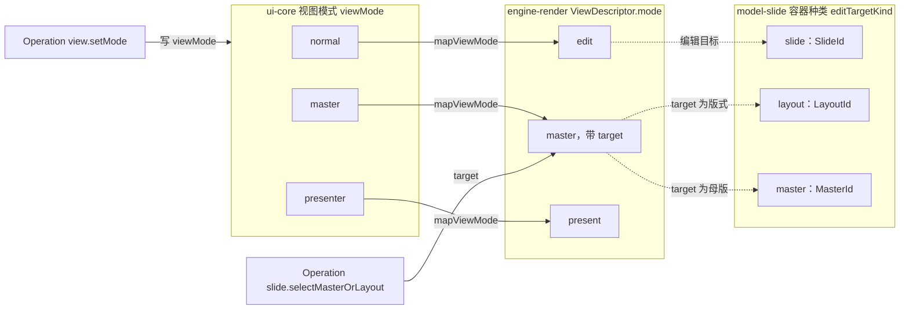
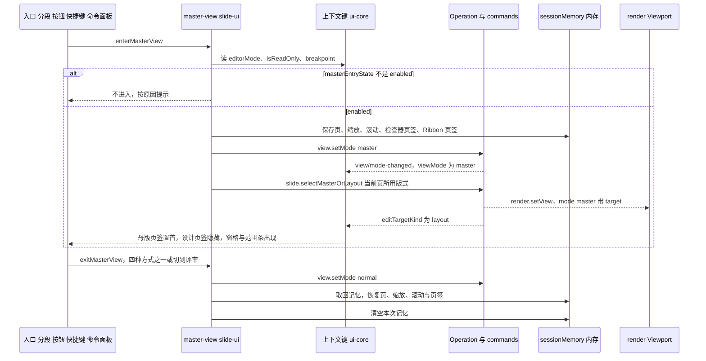
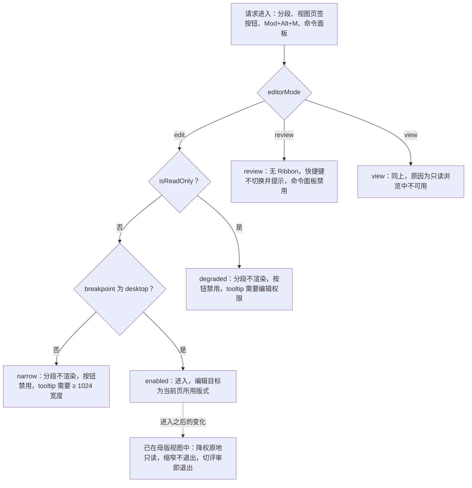
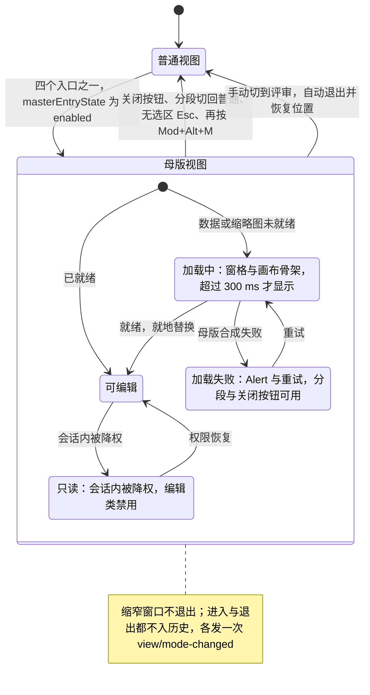
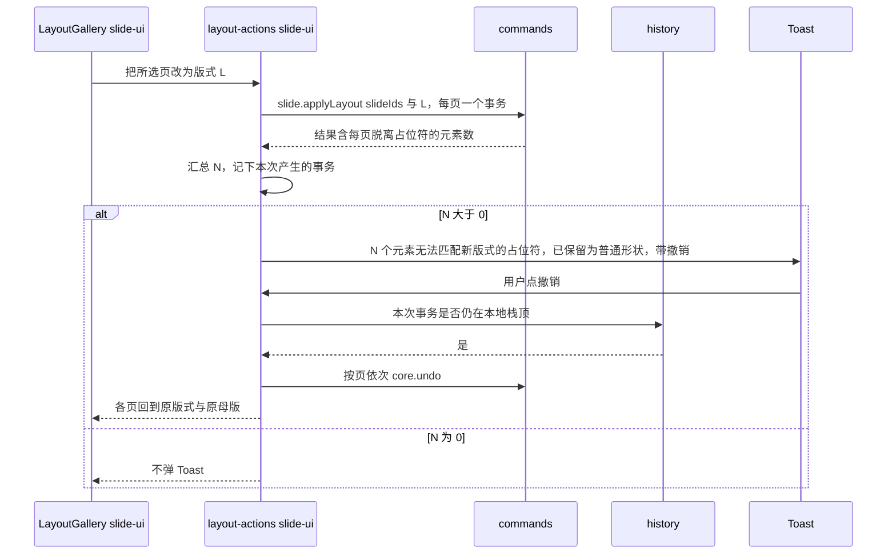
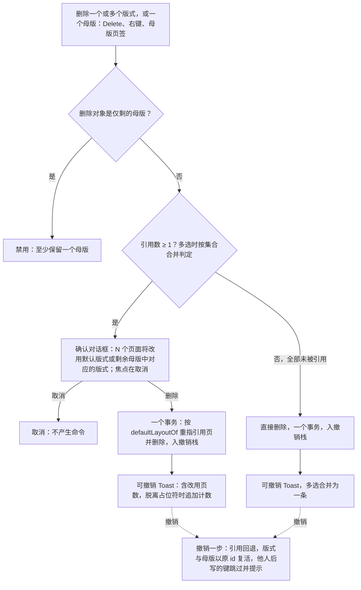

# 11 母版、版式与主题
> 状态：v0.1 | 负责：前端设计线 | 更新：2026-09-25（§4.19）；2026-09-25（审稿）；2026-09-26（§4.20） | 依赖：[PRD 07](../10-prd/03-features/07-masters-layouts-and-themes.md) §0–§3；[设计 01](../20-design/01-information-architecture.md) §2.4、§5a；[设计 06](../20-design/06-extensibility-ux.md) §2.10a；设计 03-screens [26](../20-design/03-screens/26-master-view-and-editing.md)、[27](../20-design/03-screens/27-layout-picker-and-reset.md)、[28](../20-design/03-screens/28-design-tab-and-themes.md)；[设计 02](../20-design/02-user-flows.md) F10；[40/10](../40-modules/10-ui-shell-and-slide-ui.md) §1.2、§2.1、§2.3、§2.5、§2.6；[40/03](../40-modules/03-slide-domain-model.md) §2.6；[40/07](../40-modules/07-slide-rendering.md) §2.1、§13 Q-3；[30/04](../30-architecture/04-document-model.md) §12；[30/05](../30-architecture/05-command-and-history.md) §13；[rulings](../00-charter/rulings-2026-09-14.md) §4.9 Q9 / Q10、§4.10 Q11–Q13 / Q16 / Q17、§4.11 C-13、§4.18 UX-20、§4.19、§4.20 FE-03 / FE-04 / FE-05 / FE-07 / FE-23 / FE-24

本文是母版视图、版式应用与删除、主题编辑的**前端行为语义**唯一事实源：视图模式的三层词汇怎样对应，母版视图怎样进入与退出、何时可用，`MasterViewState` 与范围条、「影响 N 页」怎样计算，版式画廊、删除版式与主题面板的流程与反馈，以及协同下的母版编辑在本端怎样表现。模型字段、纯函数与命令族的定义在 30/04 §12 与 30/05 §13，本文只写 UI 在什么时机、以什么参数调用它们；外观以设计 03-26 / 27 / 28 与 playground `#/editor/masters`、`#/editor/layouts`、`#/editor/design` 为准。

不在本文（只链接）：

| 主题 | 事实源 |
|---|---|
| 实体、不变量 I-ML2…I-ML8、`planLayoutChange` / `planReset` / `dependentsOf` 等纯函数 | [30/04](../30-architecture/04-document-model.md) §12 |
| Mutation 与 Command 族、事务边界、协同冲突面 | [30/05](../30-architecture/05-command-and-history.md) §13；命令 id 登记在 [40/03](../40-modules/03-slide-domain-model.md) §2.6 |
| 控件 → 命令 id 的绑定表（母版页签五组、设计页签、右键） | [40/10](../40-modules/10-ui-shell-and-slide-ui.md) §2.6 |
| 母版视图的合成、`master-inheritance` 覆盖层的绘制 | [05](05-rendering-and-thumbnails.md) §3、§5.2；[40/07](../40-modules/07-slide-rendering.md) §2.1、§13 Q-3 |
| Ribbon、检查器、缩略图栏、反馈分层的通用规则 | [10](10-editor-shell-and-interaction.md) |
| 上下文键全集与 `when` 语法 | [09](09-ui-system-and-theming.md) §6 |
| 软冲突信号的通用分流、撤销跳过与「恢复我的值」 | [07](07-collaboration-client.md) §12；[04](04-document-commands-and-undo.md) §6 |

包名一律省略 `@cordexjs/` 前缀。

## 1. 概念与视图模式三层词汇

**概念**（PRD 07 §1，沿用 30/04 实体命名）：页引用版式（`Slide.layoutId`），版式属于母版（`SlideLayout.masterId`），母版引用主题（`SlideMaster.themeId`）；形状按 `containerId ∈ SlideId | LayoutId | MasterId` 挂在三层之一；占位符按 `(type, index)` 逐层向上匹配，形成继承链「元素 → 占位符 → 版式 → 母版 → 主题」。本文用到的术语：

- **引用数**：使用某版式的页数；母版的引用数 = 其全部版式引用数之和。引用数为 0 的版式 / 母版称孤儿。
- **默认版式**：删除版式或母版、修复悬空 `layoutId` 时受影响页改用的版式，一律按 30/04 §12.3 I-ML2 链选取：原母版下同 `type` 的首个版式 → 该母版首个版式 → 首个母版的首个版式，跳过墓碑与 `exclude` 中的版式（rulings §4.20 FE-03）。选取函数只有一个：model-slide `domain/invariants/reassign.ts` 导出的 `defaultLayoutOf(body, {masterId, type?, exclude?})`，命令层的 `reassignTo`、I-ML2 修复与 ADR-0034「`layoutId` 不存在」修复共用同一符号；UI 只调用它，不自行选取。删除母版时 `masterId` 取目标母版、`type` 取原版式的 `type`（§8，rulings §4.20 FE-23）。
- **范围条**：母版视图画布上方常驻的「编辑版式 | 母版」双态单选，加当前对象名称、继承来源与图例（§4）。

**视图模式的三层词汇**（从 40/06 与 30/03 迁来的前端落点；映射函数归属依据 rulings §4.11 C-13）：

| 层 | 词汇与上下文键 | slide 取值 | 定义方 | 写入方 | 读者 |
|---|---|---|---|---|---|
| UI 视图模式 | `ViewMode`，键 `viewMode` | `normal` / `master` / `presenter` | `DocumentType.viewModes`（slide 由 model-slide 声明）；类型在 ui-core `domain/view-mode.ts` | Operation `view.setMode`（ui-core 水平层，不入历史，`broadcast:true`） | `when`、slide-ui、awareness |
| 渲染视图 | `ViewDescriptor.mode` | `edit` / `master` / `present`（缩略图另有 `thumbnail`） | engine-render；`mapViewMode()` 只在 engine-render 实现，ui-core 只 re-export | `render.setView`（由 `view.setMode` 与 `slide.selectMasterOrLayout` 调用） | Viewport、SceneProvider、slide-render `ComposedSlide.viewMode`（只透传） |
| 编辑目标 | 容器种类，键 `editTargetKind` | `slide` / `layout` / `master` | model-slide（`containerId` 的取值域） | Operation `slide.selectMasterOrLayout{targetId}`；目标同时写进 `ViewDescriptor{mode:'master', target}`（30/04 §12.4） | 检查器分区、命中范围（只命中目标容器的形状） |

对应关系固定为 `normal ↔ edit`、`master ↔ master`、`presenter ↔ present`。编辑器模式 `editorMode`（`edit` / `review` / `view`，[10](10-editor-shell-and-interaction.md) §3）与上表正交，不是视图模式。

**图 11-1 视图模式三层词汇的映射**



怎么读：左栏是 UI 层的视图模式，由 `view.setMode` 写入；实线箭头是 engine-render 里唯一的 `mapViewMode()` 映射；母版视图的渲染目标另由 `slide.selectMasterOrLayout` 给出；虚线表示每种渲染视图下编辑目标落在哪一类容器上。slide-render 只透传 `ViewDescriptor.mode`，不重新实现映射。
依据：40/10 §1.2、§2.3；rulings §4.11 C-13；30/04 §12.4；30/05 §13.3。

## 2. 母版视图是同一个编辑器

母版视图不替换编辑器：同一个 host、UnitScope、协同会话与撤销栈都不重建，只改变「正在编辑的对象」（rulings §4.8、PRD ML-01 §0 第 5–6 条）。进入与退出是 Operation，不入历史，各发一次 `view/mode-changed`；awareness 可据此显示「正在编辑母版」（M3，[07](07-collaboration-client.md) §10）。

与普通视图的差异只有四处，全部由 `viewMode` / `editTargetKind` 经 `when` 驱动（设计 06 §2.10a），壳里没有「如果是母版视图」的分支：

| 差异 | 机制 |
|---|---|
| Ribbon 最左插入「母版」页签（强调色，进入时选中）并隐藏「设计」页签；开始 / 插入 / 切换 / 视图 / 插件照常 | 母版页签 `when: viewMode == 'master'`、`order:-100`；设计页签 `when: viewMode != 'master'`；主题控件在母版页签「主题」组（rulings §4.9 Q10） |
| 侧栏换为母版缩略图窗格（§5） | `slide.panel.thumbnails` 与 `slide.panel.masterThumbnails` 按 `viewMode` 互斥 |
| 画布渲染所选母版或版式，上方常驻范围条，叠加继承描边（§6） | `ViewDescriptor{mode:'master', target}`；范围条 `ui.panel{slot:'canvas.top'}` |
| 检查器只禁用「评论」（原因「母版与版式不支持评论」），属性 / 历史 / 插件照常 | 评论页签带 `enablement: viewMode != 'master'`（禁用不隐藏，[10](10-editor-shell-and-interaction.md) §5、[09](09-ui-system-and-theming.md) §6.1） |

- 未声明 `viewMode` 条件的第三方贡献在两种视图下都生效；只对「页」有意义的贡献须显式声明 `when: viewMode == 'normal'`（设计 06 §2.10a）。母版视图中页级评论钉与他人的页级光标不显示（对象不是页，PRD ML-01）。
- `selectionKind` 在母版视图下不收窄（母版、版式上也能插入并选中普通形状与图片）。设计 06 §2.10a 提议的 `selectionKind='placeholder'` 不采纳：普通视图里占位符按承载的内容类型走对应分区（设计 03-03），加一个取值会破坏这条规则；改由前缀键 `slide.placeholderSelected` 区分（[09](09-ui-system-and-theming.md) §6.3）。

**入口**（四个等价）：页签行右侧视图分段切到「母版」（主入口）；「视图」页签「窗口」组「母版视图」按钮；`Mod+Alt+M`（rulings §4.9 Q9，显示 ⌘⌥M；文本编辑中按下时先提交并退出文本编辑，[09](09-ui-system-and-theming.md) §8）；命令面板「母版视图」。进入时编辑目标默认是当前页所用的版式，窗格把它滚入视口。

**退出**（四种等价，外加一种自动）：母版页签最右「关闭」组的「关闭母版视图」大按钮；分段切回「普通」；画布无选区时按 `Esc`（Esc 逐级链的最后一级，[10](10-editor-shell-and-interaction.md) §7.1）；再按 `Mod+Alt+M`；手动切到评审时自动退出（rulings §4.18 UX-20，§3）。退出后回到进入前的页、缩放、滚动位置与检查器页签，选区清空。

**会话记忆** `sessionMemory{slideId, zoom, scroll, inspectorTab, ribbonTab}`：进入时保存、退出时恢复并清空；只存在于 slide-ui 按 `unitId` 分桶的内存里，随 host 生命周期（`HostRegistry` 保活期间有效，[02](02-app-shell-routing-and-session.md) §2.2），不写 localStorage、不写文档、不同步（40/10 §4.4、§5.4 `session-memory.ts` 已按此更正）。`SlideUiConfig.masterView.rememberSession:false` 时退出只切回普通视图、不恢复位置。记忆中的页已被他人删除时回到首页。Unit 因换纪元（4428，含覆盖导入，rulings §4.19 N1）重开后 `unitId` 改变，本次记忆随之失效，编辑器回到普通视图（[07](07-collaboration-client.md) §9）。

**图 11-2 进入与退出母版视图、会话记忆**



怎么读：进入分三步——可用性判定、切视图模式、选定编辑目标——之前先把位置写进内存里的会话记忆；界面变化全部来自 `viewMode` 与 `editTargetKind` 两个键的变化；退出走同一条路径的反向，手动切到评审与四种退出方式等价。进入与退出都不产生历史项。
依据：40/10 §2.5 图 2-5；设计 03-26 §1；rulings §4.18 UX-20。

## 3. 入口可用性

`masterEntryState(keys): MasterEntryState`（slide-ui `domain/edit-target.ts`，纯函数）按固定优先级判定，前者命中即返回：

1. `editorMode == 'review'` → `review`；`editorMode == 'view'` → `view`（这两种模式没有 Ribbon，「视图」页签不存在）。
2. `isReadOnly` 为真（编辑模式但已无 `doc.write`，即 `readonly-degraded`）→ `degraded`。
3. `breakpoint != 'desktop'`（视口 < 1024）→ `narrow`。
4. 否则 `enabled`。

`MasterEntryState = 'enabled' | 'review' | 'view' | 'degraded' | 'narrow'`（40/10 §2.3 原为三值，按设计 03-20 状态矩阵与 playground `masterEntry` 补 `degraded` 与 `view`；40/10 §2.1 已登记，§2.3 签名 `masterEntryState(keys): MasterEntryState` 与 §9 测试注释随 rulings §4.20 FE-11 改为五值）。放映舞台没有编辑器外壳，不参与判定；查看器 preset 没有此入口。

| 状态 | 视图分段 | 「视图」页签「母版视图」按钮 | `Mod+Alt+M` | 命令面板「母版视图」 |
|---|---|---|---|---|
| `enabled` | 渲染 | 可用 | 进入 / 退出 | 可用 |
| `review` | 不渲染 | 页签不存在 | 不切换，提示「评审模式下不可用」 | 禁用：「评审模式下不可用」 |
| `view` | 不渲染 | 页签不存在 | 不切换，提示「只读浏览中不可用」 | 禁用：「只读浏览中不可用」 |
| `degraded` | 不渲染 | 禁用，tooltip「需要编辑权限」 | 不切换，提示「需要编辑权限」 | 禁用：「需要编辑权限」 |
| `narrow` | 不渲染 | 紧凑形态下禁用，tooltip「需要 ≥ 1024 宽度」；仅查看形态下页签不存在 | 不切换，提示「需要 ≥ 1024 宽度」 | 禁用：「需要 ≥ 1024 宽度」 |

- 分段不可用时**不渲染而不是置灰**，页签行右侧不留空位（rulings §4.10 Q12，设计 03-02 §2.4）。快捷键「无效」指不切换视图；按 [16](16-i18n-and-accessibility.md) §6.4「被触发的不可用命令必须说明原因」给一次 Toast，同一原因不连续重复。
- 实现上两种子句取同一组键、同一优先级（[09](09-ui-system-and-theming.md) §6.1）：「视图」页签按钮与命令面板条目的 `enablement` 为 `editorMode == 'edit' && !isReadOnly && breakpoint == 'desktop'`，`explainWhen` 按从左到右返回首个为假的条件，恰好给出上表四种原因；视图分段用 `when`，取 `viewMode == 'master' || (editorMode == 'edit' && !isReadOnly && breakpoint == 'desktop')`——不可用即不渲染，但已在母版视图中时始终渲染，作为退出方式之一；`Mod+Alt+M` 的 `enablement` 取同一表达式，因此降权或缩窄后仍能用它退出（「视图」页签按钮与命令面板条目在降权或缩窄后置灰，此时由「关闭」组、分段、`Esc` 与该快捷键承担退出）。表中文案由 `explainWhen` 与权限门给出（[09](09-ui-system-and-theming.md) §6.2），命令面板、按钮 tooltip 与 Toast 共用同一组 i18n 键。

**限制只针对进入**。已在母版视图中时（rulings §4.10 Q12、§4.18 UX-20）：

| 事件 | 结果 |
|---|---|
| 手动切到评审（模式下拉） | 自动退出母版视图，恢复进入前的页、缩放与滚动——评审模式没有母版页签与「关闭」按钮，无从承载只读母版态；评审工具条不变 |
| 会话内被降权（仍在编辑模式，`readonly-degraded`，Ribbon 还在；[10](10-editor-shell-and-interaction.md) §3.1） | 原地只读：窗格与画布可浏览，范围条可切换（只看不改）；母版页签编辑类按钮禁用（40% 不透明，tooltip「需要编辑权限」）；检查器字段只读；不显示「改动将影响 N 页」；四种退出方式照常 |
| 权限恢复 | 解除只读，留在母版视图 |
| 窗口缩窄到 < 1024 | 不退出：窗格按紧凑规则收为图标条或 Sheet，检查器改 Sheet（[10](10-editor-shell-and-interaction.md) §2.2）；分段随 Ribbon 收入「更多」时，其余三种退出方式仍可达 |
| 按 `F5` 进入放映 | 先退出母版视图并恢复位置，再从恢复后的当前页开始放映；退出放映回到普通视图（[10](10-editor-shell-and-interaction.md) §3.3） |
| 所选版式或母版被他人删除 | 见 §10 |

**图 11-3 母版视图入口可用性判定**



怎么读：自上而下是 `masterEntryState` 的判定顺序，模式优先于权限，权限优先于视口；四个不可用出口只拦「进入」，虚线指向的节点说明进入之后同样的条件变化不会把用户强制推出母版视图（切到评审是唯一的自动退出）。
依据：rulings §4.10 Q12、§4.18 UX-11 / UX-20；设计 03-20 状态矩阵与判定图；设计 03-26 §1、§6。

## 4. `MasterViewState`、编辑目标与影响范围

```ts
// slide-ui domain/edit-target.ts 与 application/master-view.ts；每个 unitId 一份，只在内存
interface MasterViewState {
  paneSelection: MasterId | LayoutId            // 窗格选中项（纯 UI 状态，不入命令）
  editScope: 'layout' | 'master'                // 范围条；同步到前缀键 slide.editScope
  target: MasterId | LayoutId                   // 实际编辑目标，见下文
  impact: number                                // impactCount(body, target)
  multiSelect: readonly LayoutId[]              // M3，只限同一母版
  entry: MasterEntryState                       // §3
  status: 'loading' | 'ready' | 'failed'        // 只读态不在此，由 isReadOnly 派生
  sessionMemory?: { slideId: SlideId; zoom: ZoomValue; scroll: Point; inspectorTab: string; ribbonTab: string }
}
```

40/10 §2.1 原只有一个 `targetId`；本文把「窗格选中」与「实际编辑目标」拆开，以便表达设计 03-26 §4 的「选中某版式但编辑其母版」（40/10 §2.1 已按此登记）。

- **编辑目标**：`target = editScope == 'master' ? masterOf(paneSelection) : paneSelection`。窗格选中版式时范围条默认「编辑版式」；切到「母版」时目标换成该版式的母版，窗格选中项不变；窗格选中母版时范围条固定为「母版」（「编辑版式」项禁用）。每当 `target` 变化调用一次 `slide.selectMasterOrLayout{targetId: target}`（Operation：写 `editTargetKind`、`render.setView({mode:'master', target})`、选区切到该容器，30/05 §13.3）；范围条本身只写前缀键 `slide.editScope`，不入命令（40/10 §2.6）。切换 ≤ 100 ms（[13](13-performance-and-bundling.md) §3）。
- **影响页数** `impact`：目标为版式时是使用该版式的页数，为母版时是其全部版式引用页数之和（PRD ML-01）；由 `dependentsOf`（30/04 §12.2）计算，订阅 `store/transaction`（含远端事务）实时更新。
- **应用栏徽标**「改动将影响 N 页」（`appBar.badges`）：随窗格选中与范围切换即时更新；`N = 0` 或只读时不显示；与「母版视图」徽标并列。
- **状态栏文案**（左列 `slide.status.masterScope`）：常态「编辑版式 · 〈名称〉」或「编辑母版 · 〈名称〉」；有**未提交改动**时追加「 · 未保存改动 · 影响 N 页」（`N = 0` 时只追加「未保存改动」）；命令提交后弱提示「已更新 N 页」3 s，再回到常态。右列「关于母版继承 ⓘ」（`slide.status.inheritanceHelp`）。徽标与状态栏的 N 始终相同。
- **「未提交改动」的定义**：目标容器上存在尚未收口为命令的本地交互——拖拽预览、检查器字段已输入未提交、母版 / 版式上的文本编辑态未退出。命令执行、本地事务写入 Store 即为「提交」，不等服务器确认；落库确认由状态胶囊的同步项表达（[07](07-collaboration-client.md) §6）。这样在实时保存的系统里，「未保存改动」只指尚未提交的那一小段交互，不与同步状态重复。

**图 11-4 MasterViewState**



怎么读：外层两态是视图模式切换，两条退出箭头都回到进入前的位置；内层是母版视图自身的加载、编辑与只读态，只读只由会话内降权触发、权限恢复即回到可编辑。`entry` 的判定只守在「普通 → 母版」这条箭头上。
依据：40/10 §2.1 `MasterViewState` 行；PRD ML-01 图 2-1；设计 03-26 §1、§6；rulings §4.18 UX-20。

## 5. 母版缩略图窗格

- **结构**（设计 03-26 §3，PRD 07 §3）：`role="listbox"`（`aria-label="母版与版式"`），每张卡 `role="option"` + `aria-selected`。母版为大缩略图，标签「编号 · 母版 · 名称」、右侧「N 版式 · M 页」，导入的母版带「导入」徽标；其版式为缩进 16 px、左侧连接线的小缩略图，标签为名称 + 引用页数（0 显示灰字「未使用」，不隐藏、不用警示色；名称为空显示「未命名版式 n」）；无折叠（母版分组折叠为 P2）；底部「新建母版」虚线按钮（M3）。数据由 `buildThumbnailList(body, thumbs, selection, 'master')` 给出，像素来自 `ctx.thumbnails`（[05](05-rendering-and-thumbnails.md) §10）。
- **键盘**：`↑` / `↓` 按视觉顺序遍历母版与版式，`Home` / `End` 到首末，`Enter` 把焦点送到画布上的目标，`Esc` 回到画布（画布无选区时再按 `Esc` 退出母版视图）；不使用树形键盘（无 `←` / `→` 展开）。M3 起：`Shift+↑` / `↓` 扩展多选，`Delete` 删除（§8），`Mod+Shift+↑` / `↓` 为拖拽重排的键盘等价。
- **选择**：单击改变 `paneSelection`，按 §4 重算目标；悬停版式卡时 tooltip 列出引用页；右键（M3，`ui.contextMenu{slot:'masterThumbnail' | 'layoutThumbnail'}`）——母版：重命名、复制、插入母版、删除、保留母版开关；版式：重命名、复制、插入版式、删除、在普通视图查看引用页（退出母版视图并选中这些页）。
- **多选**（M3，`Shift` / `Mod`，只限同一母版）：前缀键 `slide.multiSelectLayouts` 为真；画布显示「已选中 N 个版式」占位提示；重命名、插入占位符等单对象操作禁用，「删除版式」可用。
- **拖拽重排**（M3）：版式只能在所属母版内重排，母版之间可调整顺序；拖向另一个母版时显示禁止光标并回弹（版式的占位符继承自所属母版）；一次拖放一个 `slide.reorderLayouts`，可撤销。
- **加载与失败**：母版 / 版式实体或其缩略图描述符超过 300 ms 未就绪时显示骨架（1 大 + 4 小，与真实内容同高），范围条与母版页签编辑类控件同时禁用；母版合成失败时窗格与画布主体换成 `Alert variant="destructive"`「母版信息加载失败」+「重试」，视图分段与「关闭母版视图」保持可用；重试成功后恢复失败前的选中项（PRD ML-01）。
- **规模**：≥ 3 个母版或 ≥ 30 个版式时虚拟化，挂载上限同缩略图栏（[10](10-editor-shell-and-interaction.md) §6）；窗格滚动位置随会话记忆保存在内存（滚动位置随文档而异，按 `unitType` 分键的本地偏好无从区分文档，故只存内存；设计 03-26 §3、§8 原写「记忆到客户端本地偏好」，已随 rulings §4.20 FE-15 改为「随会话记忆保存在内存」）。
- **协同**：他人正在编辑的版式卡显示其 presence 标签（M3，[07](07-collaboration-client.md) §11）。

## 6. 画布：继承描边、占位符与检查器

- **渲染**：`ViewDescriptor{mode:'master', target}` 下由 slide-render 的母版视图合成单独渲染，不走页模板共享（[05](05-rendering-and-thumbnails.md) §3）；占位符渲染为提示框（自带提示文字，否则按 `type` 用 i18n 默认文案）；命中与选择只作用于目标容器的形状（30/04 §12.4）。
- **继承描边**：「编辑版式」范围下，母版继承来的非版式专属占位符（页脚、日期、页码）由 `render.overlay('master-inheritance')`（slide-render 贡献；覆盖层以闭包持有最近一次合成结果，40/07 §13 Q-3）画成虚线描边与顶部小徽标「母版 · 〈类型〉」。它们可以被选中查看只读属性，但改值要切到「母版」范围：检查器对这类选中显示「这些属性继承自母版，切换到『母版』后编辑」与一个切换按钮。「编辑母版」范围下没有继承区分（母版是链的顶端）。范围条右侧图例为「实线 = 此版式定义 / 虚线 = 继承自母版」。
- **里程碑限制**（PRD ML-01）：M2 内占位符可选中（检查器显示类型、索引与继承说明）但不能移动或编辑，手柄显示锁形，tooltip 取 i18n 键 `slide.ui.master.editLocked`（文案「版式编辑将在后续版本提供」，PRD ML-01 与设计 03-26 已改写，§11.4）；这是里程碑限制而不是权限态。M3（ML-03）起可移动、缩放、旋转，设填充、线条与文本样式，编辑提示文本，在同族内改类型；母版与版式上也可以插入并选中普通形状与图片。
- **插入占位符**（M3）：母版页签「插入占位符 ▾」选类型 → 点击插入默认尺寸或在画布上拖出 → `slide.addPlaceholder{containerId, type, box}`。同类上限（标题 / 居中标题、日期、页脚、页码各 1 个；内容族以模型约束为准）：菜单项按当前版式已有的占位符预先禁用并 tooltip；竞态下命令返回 `PLACEHOLDER_LIMIT_EXCEEDED` 时 Toast「该版式已包含〈类型〉占位符」（rulings §4.10 Q16，[04](04-document-commands-and-undo.md) §4）。「母版版式」组的「标题」「页脚」复选框对应 `slide.addPlaceholder` / `removePlaceholder`。
- **删除版式上的占位符**（M3）：引用该版式的页上，对应占位符形状脱离为普通形状、内容保留，Toast「已影响 N 页，其中的占位符已保留为普通形状 [撤销]」（PRD ML-03）。

**检查器分区**（`editTargetKind` 为 `layout` 或 `master` 时，在 [10](10-editor-shell-and-interaction.md) §5 的分区之外追加）：

| 分区 | 出现条件 | 内容 |
|---|---|---|
| 占位符类型 | `slide.placeholderSelected` | 只读的类型与索引（产品化名称，如「标题占位符 · 索引 0」） |
| 文本样式（大纲级别） | 选中正文 / 大纲类占位符，或母版的文本样式占位符 | 级别 1–9 选择器，字体、字号、颜色、项目符号、缩进、行距随级别切换；母版写 `slide.setMasterTextStyle{masterId, kind, level, patch}`，版式占位符经 `slide.updatePlaceholder` 的 `lstStyle` 参数写该形状的级别样式覆盖（不新增命令 id，rulings §4.20 FE-24，§11.1） |
| 版式 / 母版属性 | 无形状选中 | 名称、背景、显示母版形状（`slide.setLayoutProperties{showMasterSp}`，40/10 §2.6 ★）、保留母版（仅母版） |
| 继承说明 | 选中继承项或占位符 | 「继承自 …」与「转到版式 / 母版」 |

- **覆盖徽标与重置**：「编辑版式」范围下某属性值与母版不同时，字段区显示「已在此版式覆盖」徽标与「重置为母版值」按钮；重置是一次可撤销命令，删除该字段的显式覆盖、恢复继承。它与「重置页」共用 Mutation `slide.shape.clearOverrides{shapeId, fields}`（30/05 §13.1），只是命令入口与作用粒度不同（设计 03-27 §3），字段级命令 `slide.resetPlaceholderFields{shapeId, fields}`（rulings §4.20 FE-24 登记于 40/03 §2.6，§11.1）。「编辑母版」范围下没有覆盖概念，不显示徽标。
- **背景**：母版页签「背景」组按范围调用 `slide.setMasterBackground` 或 `slide.setLayoutBackground`；「隐藏背景图形」对应 `showMasterSp`；「背景格式…」定位到检查器的属性分区（40/10 §2.6）。

## 7. 版式画廊与应用（ML-02，M2）

- **入口**：开始页签「新建 ▾」（基于版式新建）与「版式 ▾」、缩略图右键「版式 ▸」，打开 slide-ui `LayoutGallery`（设计 03-27；playground 为宽 672 的对话框）。评审与只读浏览没有 Ribbon，因此没有入口；会话内降权时这些控件按 [10](10-editor-shell-and-interaction.md) §4 禁用而不隐藏。
- **分组**：按母版分组，当前页所属母版置顶并标「当前页所用母版」，其余按文档内母版顺序；「与当前页相同」只出现在当前母版组；其它母版组的标题下说明「选择其它母版下的版式会同时把本页所属母版切换为『X』」；只有一个母版时退化为扁平网格、不显示分组标题。
- **搜索与键盘**（rulings §4.10 Q16）：顶部搜索框按名称不区分大小写模糊过滤全部分组，0 命中的分组连同标题隐藏，全部无匹配时显示「未找到匹配的版式」；`Esc` 先清空搜索、再按一次关闭；方向键在网格内移动、`Enter` 选中卡片，底部 [取消][应用版式] 执行（设计 03-27 §1、§5）。
- **应用**：`slide.applyLayout{slideIds, layoutId}`，每页一个事务（30/05 §13.2「一页一事务」）；跨母版时该页的 `layoutId`、所属母版与主题解析链在同一个事务里切换，页面级显式覆盖（含背景覆盖）保留、只是继承基准改变（PRD ML-02）；占位符按 `planLayoutChange` 的四级规则重匹配（30/04 §12.2）。
- **不匹配提示**（rulings §4.10 Q13）：有形状脱离占位符时 Toast「N 个元素无法匹配新版式的占位符，已保留为普通形状 [撤销]」（5 s），N 为各页 `materialize` 项之和（命令结果须带该计数，§11.1）；版式选择器、缩略图右键与 playground 三处统一为这一形态，不用内联条或对话框。
- **撤销粒度**：`Mod+Z` 按页回退（一页一事务）；Toast 的「撤销」一次回退本次应用产生的全部事务，前提是它们仍在本地撤销栈顶（[10](10-editor-shell-and-interaction.md) §11 规则 4）。
- **重置为版式默认**（rulings §4.10 Q16，D9 的显式例外）：画廊左下角与缩略图右键「重置页」→ 确认卡「重置『〈版式名〉』占位符？已对占位符做的位置、样式改动将恢复为版式定义；你新增的形状、图片不受影响」[取消][确认重置]（带版式预览，初始焦点在「取消」）→ `slide.resetSlide{slideIds}`（`planReset` → `slide.shape.clearOverrides`，只作用于占位符形状，文本内容不变）→ 可撤销 Toast「已重置占位符属性 [撤销]」。页上没有任何覆盖时该命令禁用。背景覆盖不在此重置范围内（「重置为版式背景」是检查器幻灯片分区的独立动作）。
- **基于版式新建**：`slide.addSlide{layoutId}`，插入到当前页之后并选中；新页带该版式全部占位符的空实例（提示文字不导出）。
- **离线与并发**：画廊不依赖网络；对话框打开期间某版式被他人删除时该卡置灰并标「已被删除」，点击无效，下次打开时消失；`layoutId` 被并发改写时后写者胜，提示与「恢复我的值」见 [07](07-collaboration-client.md) §12。

**图 11-5 更换版式与「无法匹配占位符」Toast 撤销**



怎么读：竖向是时间；一次应用按页产生若干事务，Toast 的「撤销」把它们作为一组回退，但只在它们仍位于本地撤销栈顶时才可用，之后有别的本地编辑就只能用 `Mod+Z` 逐页回退。跨母版的应用走同一路径。
依据：PRD ML-02；rulings §4.10 Q13；30/05 §13.2；设计 03-27 §2、§4。

## 8. 删除版式与母版（ML-03，M3）

- **引用数 = 0**：直接 `slide.deleteLayout{layoutId}`，Toast「已删除版式『X』[撤销]」（5 s），撤销恢复版式与其形状。
- **引用数 ≥ 1**（rulings §4.10 Q11，§4.20 FE-05 修订）：`AlertDialog`「该版式仍被 N 个页面使用，删除后这些页面将改用『与当前页相同』的默认版式」[删除][取消]，初始焦点在「取消」（[16](16-i18n-and-accessibility.md) §7）。确认对话框保留，是因为撤销栈只在会话内有效、墓碑 24 h 后硬删，关掉页面或墓碑到期后就撤不回了。确认后 `slide.deleteLayout{layoutId, reassignTo}`，`reassignTo = defaultLayoutOf(body, {masterId, type: 被删版式的 type, exclude: [layoutId]})`（§1）：一个事务内先重指引用页（占位符按 ML-02 规则重匹配）再删除（版式成墓碑），**入撤销栈**，执行后给带「撤销」的 Toast「已删除版式『X』，N 个页面已改用默认版式」（同 Q16 先例）；有元素脱离占位符时同一条 Toast 追加 Q13 文案「M 个元素无法匹配新版式的占位符，已保留为普通形状」，不另弹第二条。`core.undo` 一步撤销：各页引用回退、版式以原 id 复活；协同下他人在此后写过的键按 rulings §4.15 Q3 跳过并提示（[04](04-document-commands-and-undo.md) §6）。Toast 的「撤销」与 §7 相同，只在该事务仍位于本地撤销栈顶时可用。
- **多选批量删除**（rulings §4.10 Q16）：对选中集合合并判定——任一被引用即走一次确认对话框（列出版式数与合计受影响页数），全部未被引用则直接删除；整批用 `slide.deleteLayout` 的批量形式 `{layoutIds, reassignTo?}`，一个事务、入撤销栈、只给一条可撤销 Toast（rulings §4.20 FE-24，40/03 §2.6）。批量的 `reassignTo = defaultLayoutOf(body, {masterId, type?, exclude: layoutIds})`：整批同 `type` 时带该 `type`，否则省略（多选只限同一母版，§5）。
- **母版**：只剩一个母版时「删除」禁用（至少保留一个）；未被引用的母版直接 `slide.deleteMaster{masterId}` 并给可撤销 Toast。删除被引用的母版同样先确认，对话框「删除母版『X』？N 个页面将改用剩余母版中对应的版式」[删除][取消]；确认后 `slide.deleteMaster{masterId, reassignTo}`，`reassignTo` 是**目标母版**（rulings §4.20 FE-23）：UI 不加母版选择器，取按 `order` 排序的首个剩余母版；每个受影响页取 `defaultLayoutOf(body, {masterId: reassignTo, type: 原版式的 type})`（目标母版下同 `type` 的首个 → 目标母版首个），重指与删除母版及其版式是一个事务，入撤销栈并给带「撤销」的 Toast（与删除被引用的版式相同，rulings §4.20 FE-05）。
- **竞态**：UI 在确认前按当时的引用数选分支；若命令返回 `LAYOUT_IN_USE` / `MASTER_IN_USE`（期间有人引用了它），按新的引用数重新走确认，不开事务（[04](04-document-commands-and-undo.md) §4）。

**删除流程与相邻流程的可撤销性**：

| 流程 | 前置交互 | 命令 | 撤销栈 | 反馈 |
|---|---|---|---|---|
| 删除未被引用的版式 | 无 | `slide.deleteLayout{layoutId}` | 入栈 | 可撤销 Toast |
| 删除被引用的版式 | 确认对话框 | `slide.deleteLayout{layoutId, reassignTo}`，一个事务 | 入栈 | 可撤销 Toast（含改用默认版式的页数；脱离占位符时追加计数） |
| 多选，全部未被引用 | 无 | `slide.deleteLayout{layoutIds}`，一个事务 | 入栈 | 一条可撤销 Toast |
| 多选，任一被引用 | 一次确认对话框 | `slide.deleteLayout{layoutIds, reassignTo}`，一个事务 | 入栈 | 同「删除被引用的版式」 |
| 删除未被引用的母版 | 无 | `slide.deleteMaster{masterId}` | 入栈 | 可撤销 Toast |
| 删除被引用的母版 | 确认对话框 | `slide.deleteMaster{masterId, reassignTo}`（目标母版），一个事务 | 入栈 | 可撤销 Toast |
| 更换版式（§7） | 无 | `slide.applyLayout` | 入栈，按页 | 不匹配 Toast 带「撤销」 |
| 重置页（§7） | 确认卡 | `slide.resetSlide` | 入栈 | 可撤销 Toast（Q16 例外） |

**图 11-6 删除版式与母版的分支**



怎么读：先挡住删除最后一个母版，再按引用数分流：被引用的删除先确认（撤销栈只在会话内有效、墓碑 24 h 后硬删，关掉页面后撤不回），执行后与未被引用的删除一样入撤销栈并给可撤销 Toast；虚线是一步撤销的结果。单选与多选、版式与母版走同一张图，多选只是把引用数按集合合并。
依据：rulings §4.10 Q11（§4.20 FE-05 修订：确认后可撤销）、Q13、Q16；§4.15 Q3（墓碑与中性撤销）；§4.20 FE-03、FE-23；PRD ML-03 图 2-3；设计 03-26 §8；30/05 §13.2 fail-closed 判定。

## 9. 主题（ML-04，M3 P1）

- **两个入口，一个面板**（rulings §4.9 Q10）：普通视图「设计」页签（主题 · 变体 · 自定义三组）与母版视图「母版」页签的「主题」组（编辑主题… + 颜色 / 字体小按钮）打开同一个 `ThemeEditorPanel`。playground 用 `Popover`（宽 288）承载，设计 03-28 §2 画在检查器位置，以 playground 为准。两处只差预览对象：设计页签预览当前页，母版页签预览当前母版。
- **作用对象**：设计页签作用于当前页所属母版的主题；母版视图作用于当前编辑目标所属母版的主题；多主题文档按母版分别展示与编辑（PRD ML-04）。
- **主题库与变体**：主题卡横向滚动，当前主题带 ✓；点卡即 `slide.applyTheme{masterId, theme}`，一个事务、不弹确认，执行后给可撤销 Toast「已应用主题『X』，影响 N 页 [撤销]」（N 为该母版的引用页数；主题与 12 个色槽能经撤销完整回退，rulings §4.20 FE-07 依 PRD D9 与 ML-04 定为「直接执行 + 可撤销 Toast」，设计 03-28 §6 同步标已定）；变体（每主题 3 个）等于批量替换 12 色，`slide.setThemeColors` 一个事务，同样直接执行并给同一条可撤销 Toast。
- **编辑面板**：「颜色」页 12 个槽位用产品化名称（背景·浅 1、文字·深 1、强调色 1–6、超链接、已访问链接等），色块打开颜色选择器；「字体」页设置标题与正文字体（latin / ea 分列为 M3 待出稿项），预览「AaBb 标题示例 123」，并注明「仅影响文档内容字体，不影响编辑器界面」；效果方案名只读。
- **预览不写文档**：编辑中的取值只作为本地渲染覆盖交给渲染层：slide-ui 经 `render.setView` 写 `ViewDescriptor.themePreview?: {masterId; colors?; fonts?}`（rulings §4.20 FE-24；渲染侧行为见 [05](05-rendering-and-thumbnails.md) §3，包级登记在 40/07），只影响渲染、不入 Store、不产生事务、不广播；「应用」→ 一个事务（`slide.setThemeColors` / `slide.setThemeFonts`）、一个撤销步，直接执行并给同上的可撤销 Toast（FE-07）；「取消」或关闭面板即把 `themePreview` 清空。全文重算 ≤ 300 ms（[13](13-performance-and-bundling.md) §3）。
- **已删除**：「设置为默认主题」「另存为新主题」（rulings §4.10 Q17）；面板底部只有 [取消][应用]。
- **待出稿**（设计 03-28 §6，M3 P1）：「重置为原主题」、效果方案名展示、主题字体 latin / ea 分列。
- **只读与里程碑**：会话内降权时主题卡、变体与自定义按钮禁用（tooltip「需要编辑权限」），面板不打开；评审与只读浏览没有 Ribbon。M2 的设计页签显示当前主题与变体，控件禁用并 tooltip「当前版本暂未开放」，与「需要编辑权限」区分（设计 02 F10）。
- **与界面主题正交**：编辑器 chrome 的亮 / 暗（[09](09-ui-system-and-theming.md) §3）与文档主题的明暗互不影响（设计 03-28 §5）；显式 `srgbClr` 的元素不随主题变化。
- **协同**：主题色与字体逐槽位 LWW（30/05 §13.4）；他人修改后本地重算，状态胶囊弱提示「主题已被 {姓名} 更新」；同一槽位后写覆盖时的 `prop-lww` 提示见 [07](07-collaboration-client.md) §12。

## 10. 协同下的母版编辑

- **影响范围可见**：母版视图是视图态，不锁内容（PRD PD-19 的可选软锁不在 M3 范围，待 07 定）；在场数据带 `viewMode`，其他人看到「正在编辑母版」与窗格卡片上的 presence 标签（M3，[07](07-collaboration-client.md) §10–§11）。母版 / 版式的修改经 `dependentsOf` 使全部引用页与缩略图重绘（≤ 500 ms，[13](13-performance-and-bundling.md) §3）。
- **冲突在本端的表现**（语义见 PRD ML-03 冲突表与 30/05 §13.4，信号分流见 [07](07-collaboration-client.md) §12）：

| 场景 | 收敛结果 | 本端表现 |
|---|---|---|
| A 删除版式 L，B 同时把页 P 改为 L | 删除胜，L 成墓碑。墓碑期内 P 的 `layoutId` 仍为 L，读路径以 `defaultLayoutOf` 的结果替代渲染（读时容错，不写修复），并发客户端信号 `collab/soft-conflict{type:'delete-vs-reference'}`；墓碑硬删时由硬删作业在同一事务内把 P 修复为默认版式，此时才有 `collab/repair{rule:'dangling-layout'}`（30/04 §12.3 I-ML2，rulings §4.20 FE-04） | B：Toast「版式『L』已被 A 删除，第 P 页已改用『〈默认版式名〉』」；A：无提示。A 在墓碑期内撤销删除后 P 重新显示 L，不提示 |
| A 撤销自己对一个未被引用版式的删除（清除墓碑），B 期间引用了它 | B 的引用重新有效 | 无提示 |
| A 改版式占位符的文本样式，B 同时在页上显式覆盖同一属性 | 共存：页上显式覆盖优先，其余页跟随 A | 无 |
| A 删除版式上的占位符，B 同时编辑该占位符的文本 | 删除胜；B 的形状脱离为普通形状，文本保留 | 客户端信号 `collab/soft-conflict{type:'delete-vs-reference'}`，目标为该占位符（`paths` 指向版式上被删的占位符，[07](07-collaboration-client.md) §12），只发给 B；B：Toast「占位符已被 A 删除，你的文本已保留为普通形状」 |
| 同时重命名同一版式，或同时移动同一占位符 | 键级 LWW | 后写被覆盖的一方：`prop-lww` 内联提示与「恢复我的值」（[04](04-document-commands-and-undo.md) §6） |
| 我在窗格中选中的版式或母版被他人删除 | — | 窗格选中移到其母版（母版被删时移到首个母版），范围条随之重算，Toast「〈名称〉已被 {姓名} 删除」 |
| 他人恢复历史版本（rulings §4.19 N1：不加锁，在持有 Room 的 collab 进程内单事务经 CRDT 合并） | 与一次普通远端事务相同 | 按上面各行处理（选中项被删则移到其母版，依赖页重绘）；恢复本身的提示见 [08](08-comments-and-version-history.md) §10 |
| 覆盖导入（N1：导入期间文档锁定，完成后以 4428 换纪元） | 锁定期间只读，之后重新 bootstrap | 锁定期间会话按 [07](07-collaboration-client.md) §8.1 转只读（`readonlyReason='locked'`，状态胶囊「文档正忙」），母版视图不退出；4428 后 Unit 重开，会话记忆失效，回到普通视图（§2） |

- **撤销**：母版编辑与其它编辑一样只撤本地、同一键已被他人后写则跳过并提示（[04](04-document-commands-and-undo.md) §6）；撤销一步母版修改会重绘全部依赖页。被引用版式与母版的删除同样入撤销栈，一步撤销恢复各页引用与原 id 的版式、母版（§8，rulings §4.20 FE-05）。

## 11. 命令绑定、机械验证与里程碑

### 11.1 命令绑定

控件 → 命令 id 的绑定表本体在 40/10 §2.6（母版页签五组、设计页签、缩略图与母版窗格右键、「转到版式」；范围条不入命令）。本文新增或收紧的调用约定：

| 调用 | 约定 | 去向 |
|---|---|---|
| `slide.selectMasterOrLayout{targetId}` | `targetId` 取 §4 的实际编辑目标（范围条为「母版」时传母版 id），窗格选中项不入命令 | 40/10 §2.6 注释 |
| `slide.applyLayout` | 结果带每页脱离占位符的元素数（Q13 Toast 计数用） | 已登记：40/03 §2.6、30/05 §13.2（rulings §4.20 FE-24） |
| `slide.deleteLayout{layoutId \| layoutIds; reassignTo?}` | 被引用时必带 `reassignTo`，取 §1 `defaultLayoutOf`（§8）；多选用 `layoutIds`，一个事务；入撤销栈（rulings §4.20 FE-05，`CommandDef.undoable` 不改） | 已登记：40/03 §2.6、30/05 §13.2（FE-24） |
| `slide.deleteMaster{masterId, reassignTo?: MasterId}` | `reassignTo` 是目标母版，UI 取按 `order` 的首个剩余母版；逐页 `defaultLayoutOf(body, {masterId: reassignTo, type: 原版式的 type})`；一个事务，入撤销栈 | 已登记：40/03 §2.6 与 §2.1 CRDT 表、30/05 §13.2（rulings §4.20 FE-23） |
| `slide.resetPlaceholderFields{shapeId, fields}` | 字段级「重置为母版值」，与 `slide.resetSlide` 共用 `slide.shape.clearOverrides`，一步撤销且只清所列字段 | 已登记：40/03 §2.6（FE-24） |
| 版式占位符按大纲级别的文本样式 | `slide.updatePlaceholder` 参数加 `lstStyle`，不新增命令 id | 已定：40/03 §2.6、30/05 §13.2（FE-24） |

### 11.2 机械验证

本节只写断言与所在套件 / CI 步骤，执行方式归 [70/06](../70-testing/06-frontend-component-and-e2e.md) 与 [70/12](../70-testing/12-ci-gates-mapping.md)。

| # | 断言 | 套件 / 用例 | CI 步骤 |
|---|---|---|---|
| V1 | 手动切到评审即退出母版视图并恢复页、缩放、滚动与页签；会话内降权不退出、保持只读母版态；缩窄不退出；进入与退出不产生历史项、各发一次 `view/mode-changed` | `slide-ui/__tests__/master-view.test.ts` | `test/unit` |
| V2 | `masterEntryState` 五个取值与优先级（review / view 先于 degraded 先于 narrow）；按钮 `enablement` 的 `explainWhen` 结果与之逐一对应，分段与 `Mod+Alt+M` 在母版视图中始终可用；`impactCount` 的版式与母版口径（不计墓碑目标）；UI 用的 `defaultLayoutOf` 与 I-ML2 修复是 model-slide 导出的同一符号（三级回退、墓碑跳过、`exclude` 与同 `type` 保持的用例在 model-slide 单测，rulings §4.20 FE-03、FE-23） | `slide-ui/__tests__/edit-target.test.ts` | `test/unit` |
| V3 | 母版页签 `order:-100` 且只在 `viewMode == 'master'` 出现；设计页签在母版视图隐藏；评论页签在母版视图禁用并带原因 | `slide-ui/__tests__/ribbon-spec.test.ts`、`slide-ui/__tests__/inspector-spec.test.ts` | `test/unit` |
| V4 | Q11 引用 0 与引用 N 两路：被引用路径先出确认对话框（文案不含「不可撤销」），执行后撤销栈深度 +1，`core.undo` 一步恢复各页引用与原 id 的版式；删除被引用母版取首个剩余母版为目标、各页 `type` 不变（无同 `type` 时落目标母版首个）；多选合并判定与单事务；Q13 Toast 文案与计数；应用主题不出确认框、Toast 含 N、撤销后主题与 12 个色槽恢复原值；重置确认卡与可撤销 Toast；占位符上限 Toast | `slide-ui/__tests__/layout-actions.test.ts`、slide-ui 主题单测；命令层（撤销栈深度、原 id 复活、目标母版同 `type` 选取、单事务）见 [70/05](../70-testing/05-collab-simulation-and-property-tests.md) §7.1 `ml/*`（`model-slide/src/__tests__/master-layout-delete.test.ts`、`src/domain/invariants/__tests__/reassign.test.ts`，不调用 kit，归 `test/unit`）；浏览器端对话框文案与带「撤销」的 Toast 见 [70/06](../70-testing/06-frontend-component-and-e2e.md) §5 第 25 行（`editing/master-layout-delete.spec.ts`、`editing/theme-apply.spec.ts`，rulings §4.20 FE-05、FE-07、FE-23） | `test/unit`；`e2e/full-compose` |
| V5 | 母版窗格 listbox 键盘、多选只限同一母版、骨架超过 300 ms 才显示、失败重试后恢复选中项、「未使用」标记 | `slide-ui/__tests__/thumbnails.test.tsx` | `test/unit` |
| V6 | 评审与放映无「视图」页签、`Mod+Alt+M` 不切换；无 `doc.write` 或视口 < 1024 时按钮禁用带 tooltip；进入后切评审即退出并回到原页、原缩放、原滚动；降权不退出、编辑类禁用；换版式为一个事务，Toast 撤销一步回到原版式 | `editing/master-view.spec.ts`、`editing/layout-apply.spec.ts`（[70/06](../70-testing/06-frontend-component-and-e2e.md) §5 第 6 行） | `e2e/full-compose` |
| V7 | 进入母版视图 ≤ 300 ms p75、窗格与范围切换 ≤ 100 ms、依赖页更新 ≤ 500 ms、主题重算 ≤ 300 ms（D50） | [70/09](../70-testing/09-performance-and-capacity.md) 客户端场景 | `perf/perf-client` |
| V8 | 更换版式的占位符重匹配与规则表 100% 一致，PowerPoint 365 打开无修复（≥ 30 个「页 × 目标版式」组合） | [70/03](../70-testing/03-fidelity-roundtrip-and-corpus.md) | `test/fidelity-roundtrip` |
| V9 | 母版 / 版式编辑导出后与 PowerPoint 365 母版视图一致（≥ 20 个编辑脚本，SSIM ≥ 0.90）；基线由一台 Windows + PowerPoint 365 维护机生成，不进 CI（rulings §4.19 D-TEST-INFRA） | [70/04](../70-testing/04-visual-oracle.md) | `e2e/oracle-gated`（M3） |
| V10 | 母版视图各状态（窗格、范围条、只读、失败、删除确认对话框）axe 零严重与重大违规 | a11y 矩阵（[70/06](../70-testing/06-frontend-component-and-e2e.md) §7） | `e2e/a11y` |
| V11 | 「A 删 L、B 同时对 P 应用 L」两端收敛：墓碑期内 P 的 `layoutId` 仍为 L 且渲染用替代版式，B 恰收到一次 `delete-vs-reference`；A 撤销后 P 显示 L；硬删后 P 的 `layoutId` 等于 `defaultLayoutOf` 结果且修复只写一次；撤销被引用版式的删除时，他人此后改过的页只跳过该键并提示（rulings §4.20 FE-04、FE-05） | `test/collab-sim` 场景（[70/05](../70-testing/05-collab-simulation-and-property-tests.md) §6 `sc-20` 及变体 a / b；§7.1 `undo/delete-layout-revert-skips-later-writes`） | `test/collab-sim` |

### 11.3 里程碑

| 里程碑 | 交付 |
|---|---|
| M2 | ML-01 母版视图：浏览、范围条可切换、占位符可选中但只读、骨架与失败态、入口规则、四种退出与切评审退出、会话记忆；ML-02 版式画廊（搜索、跨母版）、不匹配 Toast、重置页；设计页签只读展示 |
| M3 | ML-03 母版与版式编辑：占位符增删改与同类上限、母版文本样式、背景、版式与母版的新建 / 复制 / 重命名 / 重排、Q11 删除（确认后可撤销，rulings §4.20 FE-05）与多选批量删除、右键菜单、presence 标签与冲突表现；ML-04 主题（P1） |
| M4 | ML-05 备注母版与讲义母版的只读预览 |

### 11.4 未决与回写

| 项 | 状态 | 去向 |
|---|---|---|
| `MasterEntryState` 补 `degraded`、`view`；`MasterViewState.targetId` 拆为 `paneSelection` 与 `target` | 已关闭（rulings §4.20 FE-11）：40/10 §2.1 已登记；§2.3 `masterEntryState(keys): MasterEntryState` 与 §9 `edit-target.test.ts` 注释改为五值与优先级 | 40/10 §2.1、§2.3、§9 |
| 会话记忆只在内存，不写 localStorage | 已回写（40/10 §4.4、§5.4 `session-memory.ts`） | — |
| 母版窗格滚动位置只在内存（§5，设计 03-26 §3、§8 原写「记忆到客户端本地偏好」） | 已关闭（rulings §4.20 FE-15）：设计 03-26 改为「随会话记忆保存在内存」 | 设计 03-26 §3、§8 |
| 被引用版式与母版的删除能否撤销；`deleteLayout` 批量形式；`applyLayout` 结果计数 | 已关闭：rulings §4.20 FE-05 修订 Q11 为「确认后可撤销」（入撤销栈 + 带「撤销」的 Toast，`CommandDef.undoable` 不改，30/05 与 40/03 的「撤销一次恢复」写法保留，40/03 Q7 结案）；批量形式 `{layoutId \| layoutIds; reassignTo?}` 与计数随 FE-24 登记（§8、§11.1） | 30/05 §13.2；40/03 §2.6、§10；PRD 07 ML-03 与 D9 行；设计 26 对话框文案 |
| 前缀键 `slide.placeholderSelected`、`slide.hasComments`（[09](09-ui-system-and-theming.md) §6.3）；设计 06 §2.10a 的 `selectionKind='placeholder'` 不采纳 | 已关闭（rulings §4.20 FE-15）：40/10 §2.1、§3 已登记；设计 06 删「另增 `'placeholder'`」，改指前缀键 `slide.placeholderSelected` | 设计 06 §2.10a |
| 默认版式的选取 | 已关闭（rulings §4.20 FE-03）：统一为 30/04 §12.3 I-ML2 链，单一纯函数 `defaultLayoutOf(body, {masterId, type?, exclude?})`（model-slide `domain/invariants/reassign.ts`），PRD 07 §1、40/03 §1.2 与 ADR-0034 改为引用 I-ML2（§1） | 30/04 §12.3、40/03 §1.2、PRD 07 §1、ADR-0034 |
| 应用主题后给可撤销 Toast（§9） | 已关闭（rulings §4.20 FE-07）：主题卡、变体与面板「应用」都直接执行并给可撤销 Toast；设计 03-28 §3「保存」、§6 同步标已定 | 设计 03-28 §3、§6 |
| 主题预览覆盖的渲染接口 | 已关闭（rulings §4.20 FE-24）：`ViewDescriptor.themePreview?: {masterId; colors?; fonts?}`，只影响渲染、不入 Store、不广播、取消即清空 | [05](05-rendering-and-thumbnails.md) §3、40/07 |
| `slide.resetPlaceholderFields` 与版式占位符级别样式的命令 id | 已关闭（rulings §4.20 FE-24）：新增 `slide.resetPlaceholderFields{shapeId, fields}`；级别样式走 `slide.updatePlaceholder` 的 `lstStyle` 参数，不新增命令 id | 40/03 §2.6 |
| M2 占位符锁定的 tooltip「版式编辑将在协同版本提供」：协同后端已提前到 M2（rulings §4.19 D-M2-CONTENT）而 ML-03 仍在 M3，文案需改为不提「协同版本」 | 已关闭：改为「版式编辑将在后续版本提供」（PRD ML-01、PRD 07、设计 02 与 03-26 已同步） | PRD 07 ML-01；设计 03-26 §4 |
| 悬空版式的修复规则名：30/04 §12.3 写 `dangling-layout`，PRD 07 ML-03 写 `layout-missing` | 已关闭（rulings §4.20 FE-14，与 FE-04 合改）：一律 `dangling-layout`；PRD 07 的 Toast 触发信号改为墓碑期的 `collab/soft-conflict{type:'delete-vs-reference'}`，硬删时才有 `collab/repair{rule:'dangling-layout'}`（§10） | PRD 07 ML-03；07-design-coverage |
| 删除被引用母版时的目标版式选取细则 | 已关闭（rulings §4.20 FE-23）：`reassignTo` 为目标母版（默认按 `order` 的首个剩余母版，UI 不加选择器），逐页取目标母版同 `type` 首个 → 目标母版首个，一个事务（§8）；PRD G-73、40/03 G-9 / Q6、40/14 N-21 结案 | PRD 07 ML-03；40/03 §2.6；设计 26 对话框文案 |
