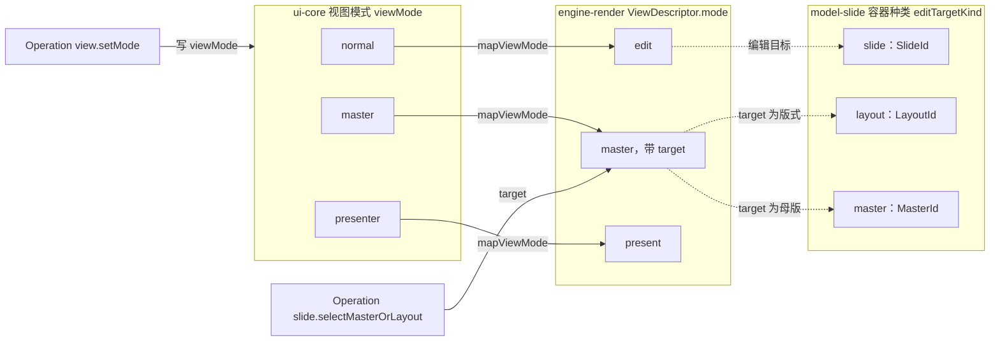
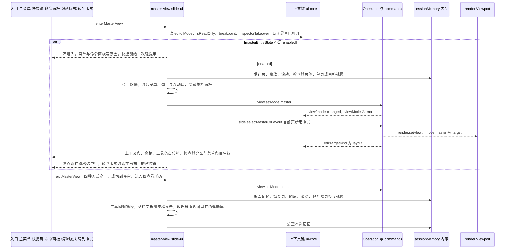
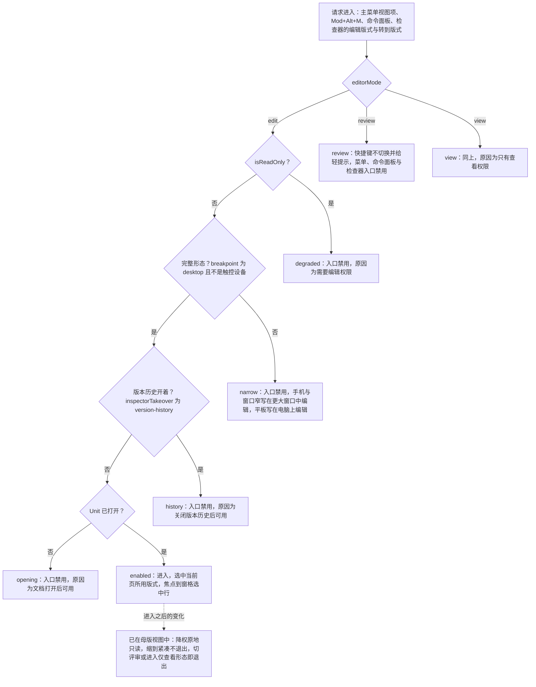
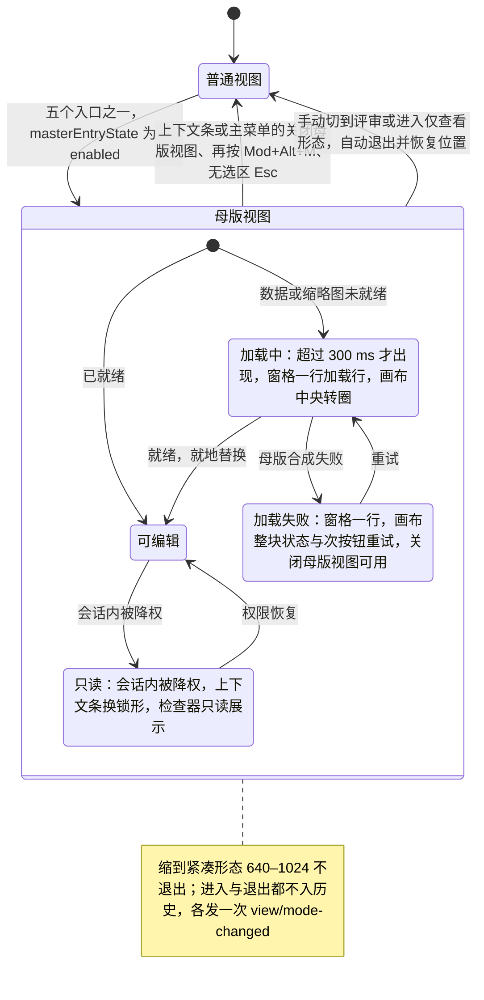
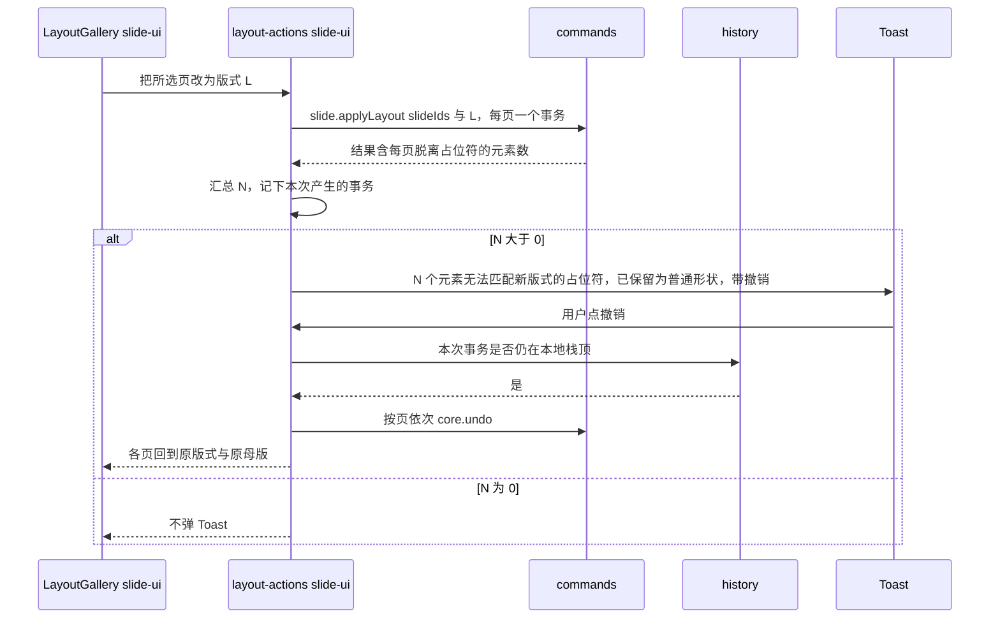
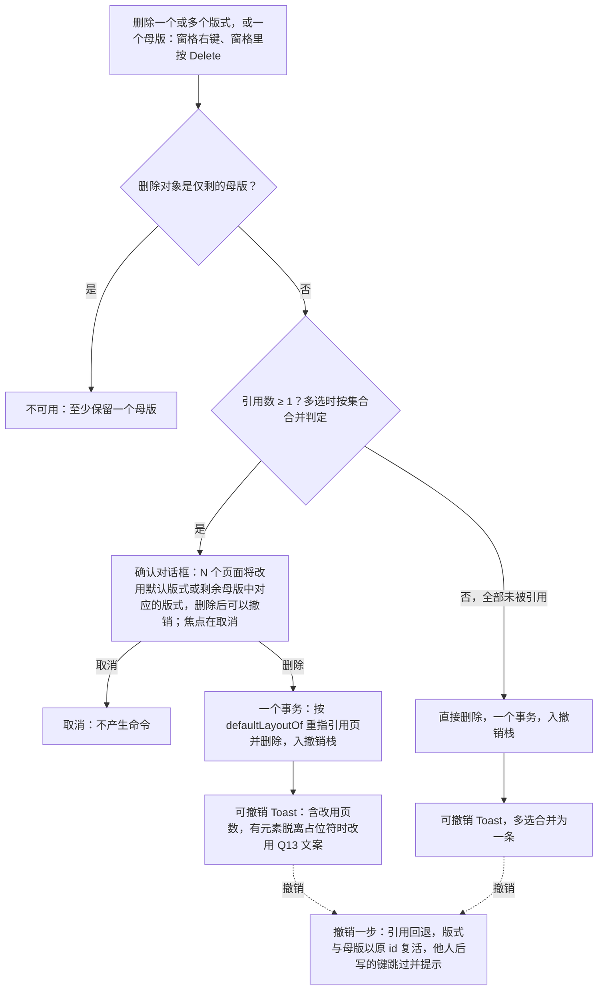

# 11 母版、版式与主题
> 状态：v0.1 | 负责：前端设计线 | 更新：2026-09-25（§4.19）；2026-09-25（审稿）；2026-09-26（§4.20）；2026-10-04（design-language-v3 第 0 批：开头关联表一行、§2 母版视图差异表与进入时序、§3 可用性列表、降权与窄屏两行与评审节点、§4 母版范围文案、§7 版式选择器入口、§9 主题只读说明与 §11.2 V3 按 v3 结构改写（原 Ribbon 母版页签、设计页签与状态栏随 rulings §4.25 DS-1、DS-6 废弃，落位随第 1 批定稿））；2026-10-04（design-language-v3 第 0 批：复验修正——会话记忆 `ribbonTab` 改为 `editorView`（§2、§4 两处与图 11-2 一致）；§2 母版视图入口与退出、§3 可用性表与图 11-3、图 11-4 按设计 03-02 §2.4 改为主菜单「视图」/ `Mod+Alt+M` / 命令面板与「关闭母版视图」命令，视图分段与母版页签作废；§4 应用栏徽标（`appBar.badges`）改为「改动将影响 N 页」提示、落位随第 1 批；§5 插入占位符与背景、§9 主题入口改为工具条 / 检查器分区；三处「状态胶囊」改为同步状态行或通知）；2026-10-04（design-language-v3 第 0 批：复验第 2 轮修正——母版视图退出表里「手动切到评审」的模式切换入口注明样张为主菜单「视图 › 模式」（第 1 批起草，03-02 §6.2））；2026-10-04（design-language-v3 第 0 批：复验第 2 轮补充——§3 母版视图中被降权一行：编辑类命令的禁用外观由「40% 不透明」改为 `aria-disabled` + 弱化色、不用半透明（DS-2，设计 04 §4.1），检查器由「字段只读」改为控件留在原位不可用并加顶部说明，与 50/10 §5 的降权形态一致）；2026-10-05（design-language-v3 第 0 批修正：§3 母版视图中被降权一行的检查器按 rulings §4.25 DS-15 改为只读展示当前值、不渲染禁用控件（50/10 §5「只读」），取代上一条的「控件留在原位不可用」）；2026-10-07（design-language-v3 第 1 批：按已拍板的 `master-view`、`layout-picker`、`design-themes` 场景与设计 03-26…03-28 定稿——开头外观依据改指 v3 场景；§1 范围条定义；§2 差异表按 v3 五处改写（左栏「新建版式 ▾ / +」、画布列顶部母版横幅、工具条「占位符」、检查器分区）与命令去向一段，入口不设常驻按钮、退出以横幅「关闭母版视图」为唯一常驻入口，补进入仅查看形态即退出与从网格进入；图 11-2 标签；§3 查看者原因改「只有查看权限」、窄屏两行定稿（紧凑不退出、进入仅查看形态即退出）、降权行补母版横幅与 03-12 降权横幅、切评审一行定稿，图 11-3 节点；§4 范围条措辞改「版式 | 母版」，「改动将影响 N 页」与母版范围文案并入母版横幅（说明文字条件表、与其他横幅的关系），「关于母版继承」进主菜单「帮助」；图 11-4 标签与自动退出；§5 窗格去编号、缩进 18、「新建版式 ▾ / +」取代底部「新建母版」按钮，右键条目、多选与加载失败按样张；§6 继承虚线、选中不画尺寸角标、M2 锁形标签、工具条「占位符」与类型清单、检查器五种分区与三种不可编辑、覆盖标记、背景「跟随母版」；§7 版式画廊两种模式与 472 宽弹层、评审与降权下的入口、重置页三个入口与确认对话框；§8 删除对话框文案、删除后 Toast 与图 11-6 入口；§9 主题卡 + 320 宽主题画廊 + 300 宽主题颜色与字体、只读按 DS-15、M2「当前版本暂未开放」；§11 V1 / V3 / V4 / V5、里程碑与 §11.4 一行（rulings §4.25 DS-15、DS-20、DS-21、DS-23、DS-30、TB-14…TB-17、TB-22））；2026-10-08（design-language-v3 第 1 批收口：§3 进入判定改为看完整形态（`breakpoint != 'desktop'` 或 `platform == 'mobile'` 即 `narrow`），非完整形态的原因统一为「在更大窗口中编辑」（rulings §4.25 TB-44，原「需要 ≥ 1024 宽度」作废），`enablement` 与图 11-3 同步；§4「关于母版继承」走壳意图 `help-center`（TB-39）；§5 母版改名命令 `slide.renameMaster`（TB-46）；§6 母版检查器占位符勾选项「正文」改为「文本」（TB-34）；§9 内置主题 5 套（简约 / 商务 / 暗色 / 学术 / 活力，与开始页模板同一套，DS-33）与每主题 3 个变体（DS-32）；§11.1、§11.2、§11.4 同步）；2026-10-08（design-language-v3 第 1 批收口：§9 主题画廊补「当前」卡规则，rulings §4.25 TB-53）；2026-10-08（design-language-v3 第 1 批评审修改：§4 母版横幅的「关闭母版视图」由 outline 按钮改为透明底加细边的次按钮，画法同横幅按钮（rulings §4.25 DS-37，设计 03-26 §6.3））；2026-10-22（design-language-v3 第 3 批（rulings §4.25 DS-109、DS-130）：§3 退出表的紧凑形态一行写明抽屉从母版横幅下沿开始、不盖横幅；放映一行写明退出后停在最后显示的页）；2026-10-22（design-language-v3 第 3 批回写补充，rulings §4.25 TB-132、TB-136：§3 母版视图入口的原因按状态行同一口径分开写——触控设备一律「在电脑上编辑」、嵌入「当前区域太窄，暂不可用」，`enablement` 把 `platform != 'mobile'` 排在 `breakpoint == 'desktop'` 之前，图 11-3 同步；§4「关于母版继承」只在配置了链接时出现；§11.2 V2、§11.4 同步）；2026-10-22（design-language-v3 第 3 批回写收口，rulings §4.25 TB-159：§3 说明段与 `enablement` 一段补嵌入又是触控设备时的原因——以「在电脑上编辑」为准，嵌入只改写「在更大窗口中编辑」那一句，与设计 03-02 §2.4 一致；§11.2 V2、§11.4 同步；2026-10-22 复核修正：§3 原因表、说明段、两处 `enablement` 与图 11-3 按 TB-163 改——形态子句先窗口窄、再触控、再桌面，手机不论是否触控按窗口窄写，只有平板写「在电脑上编辑」；§11.2 V2、§11.4 同步）；2026-11-04（design-language-v3 母版视图改版：开头与关联表；§1 叫法；§2 差异表、入口（「编辑版式」「转到版式」）、进入时一并做的事、母版视图里普通视图的入口、退出与 Esc 逐级、会话记忆与图 11-2；§3 判定增 `history`、`opening`，可用性表、轻提示、浮层开着时、已在其中时的降权与紧凑两行与图 11-3；§4 `MasterViewState`（`paneSelection` 与 `target` 合回 `target`，`editScope` 作废）、编辑对象、上下文条、播报与图 11-4；§5 窗格（名称折行与未命名编号、缩略渲染、「新建版式 ▾」、键盘、右键键位与多选、右键「保留母版」与检查器同一个值、就地改名（提交或取消后焦点回到该行，出现行内提示时 `Enter` 与失焦都不提交）、多选网格、拖拽、加载与失败、在场头像）；§6 占位符标注（类型名与锁签的文案由 slide-ui 作为启用入参 `MasterAnnotationsOptions` 给出，字段 `labels`、`m2Locked`）、选中与尺寸角标、Enter 进入提示文本编辑、M2 锁签与一组画面、「占位符 ▾」与键盘等价、检查器标题、节序、分区表的面板顶行与普通视图「转到版式」顶行（挂 `placeholder-empty` 与 `text`，选中与编辑文字都按 `text`）、占位符节与继承项顶行（母版上找不到对应占位符时只选中母版行）、三种不可编辑、覆盖标记、背景；§7 缩略渲染、重置页在母版视图里不可用；§8 多选删除文案、导出前提示未使用的母版；§9 主题颜色与字体盖检查器栏；§10 在场头像与冲突表现；§11.1 调用约定、§11.2 V1–V3、V5、V7、V10 与新增 V12、§11.3 里程碑、§11.4 回写与未决；需求编号、优先级与里程碑不变；rulings §4.25 DS-144…DS-177、TB-186…TB-210） | 依赖：[PRD 07](../10-prd/03-features/07-masters-layouts-and-themes.md) §0–§3；[设计 01](../20-design/01-information-architecture.md) §2.4、§5a；[设计 06](../20-design/06-extensibility-ux.md) §2.10a；设计 03-screens [26](../20-design/03-screens/26-master-view-and-editing.md)、[27](../20-design/03-screens/27-layout-picker-and-reset.md)、[28](../20-design/03-screens/28-design-tab-and-themes.md)；[设计 02](../20-design/02-user-flows.md) F10；[40/10](../40-modules/10-ui-shell-and-slide-ui.md) §1.2、§2.1、§2.3、§2.5、§2.6；[40/03](../40-modules/03-slide-domain-model.md) §2.6；[40/07](../40-modules/07-slide-rendering.md) §2.1、§2.5、§13 Q-3；[30/04](../30-architecture/04-document-model.md) §12；[30/05](../30-architecture/05-command-and-history.md) §13；[rulings](../00-charter/rulings-2026-09-14.md) §4.9 Q9 / Q10、§4.10 Q11–Q13 / Q16 / Q17、§4.11 C-13、§4.18 UX-20、§4.19、§4.20 FE-03 / FE-04 / FE-05 / FE-07 / FE-23 / FE-24、§4.25 DS-1 / DS-15 / DS-20 / DS-21 / DS-30 / TB-14…TB-17；rulings §4.25 DS-109、DS-130；rulings §4.25 TB-132、TB-136（第 3 批回写补充）；rulings §4.25 TB-159（第 3 批回写收口）；rulings §4.25 TB-163；rulings §4.25 DS-53、DS-58、DS-144…DS-177、TB-186…TB-210（母版视图改版）；[30/05](../30-architecture/05-command-and-history.md) §7

本文是母版视图、版式应用与删除、主题编辑的**前端行为语义**唯一事实源：视图模式的三层词汇怎样对应，母版视图怎样进入与退出、何时可用，`MasterViewState`、上下文条（母版视图的模式横幅）的对象段与「影响 N 页」怎样计算，版式画廊、删除版式与主题面板的流程与反馈，以及协同下的母版编辑在本端怎样表现。模型字段、纯函数与命令族的定义在 30/04 §12 与 30/05 §13，本文只写 UI 在什么时机、以什么参数调用它们；外观以设计 03-26 / 27 / 28 与 playground 第 1 批场景 `master-view`、`layout-picker`、`design-themes`（路由 `#/v3/editor?state=…`）为准（旧版路由 `#/editor/masters`、`#/editor/layouts`、`#/editor/design` 已被 v3 取代）。

不在本文（只链接）：

| 主题 | 事实源 |
|---|---|
| 实体、不变量 I-ML2…I-ML8、`planLayoutChange` / `planReset` / `dependentsOf` 等纯函数 | [30/04](../30-architecture/04-document-model.md) §12 |
| Mutation 与 Command 族、事务边界、协同冲突面 | [30/05](../30-architecture/05-command-and-history.md) §13；命令 id 登记在 [40/03](../40-modules/03-slide-domain-model.md) §2.6 |
| 控件 → 命令 id 的绑定表（母版视图的工具条、检查器分区与菜单条目，检查器「主题」分区，右键；原母版页签五组与设计页签随 rulings §4.25 DS-1 作废） | [40/10](../40-modules/10-ui-shell-and-slide-ui.md) §2.6 |
| 母版视图的合成、占位符标注覆盖层 `master-annotations` 的绘制（原名 `master-inheritance`，2026-11-04 按 rulings §4.25 TB-188 改名，覆盖全部占位符） | [05](05-rendering-and-thumbnails.md) §3、§5.2；[40/07](../40-modules/07-slide-rendering.md) §2.1、§13 Q-3 |
| 占位符类型名与 M2 锁签的落位规则、上下文条的段落与画法、母版视图入口的不可用原因文案、母版窗格的键位与读屏名 | 设计 [03-26](../20-design/03-screens/26-master-view-and-editing.md) §4.2、§6.3、§1.1、§3 与 §9（本文只写实现要点与调用约定） |
| 底部工具条、检查器、左栏缩略图、反馈分层的通用规则 | [10](10-editor-shell-and-interaction.md) |
| 上下文键全集与 `when` 语法 | [09](09-ui-system-and-theming.md) §6 |
| 软冲突信号的通用分流、撤销跳过与「恢复我的值」 | [07](07-collaboration-client.md) §12；[04](04-document-commands-and-undo.md) §6 |

包名一律省略 `@cordexjs/` 前缀。

## 1. 概念与视图模式三层词汇

**概念**（PRD 07 §1，沿用 30/04 实体命名）：页引用版式（`Slide.layoutId`），版式属于母版（`SlideLayout.masterId`），母版引用主题（`SlideMaster.themeId`）；形状按 `containerId ∈ SlideId | LayoutId | MasterId` 挂在三层之一；占位符按 `(type, index)` 逐层向上匹配，形成继承链「元素 → 占位符 → 版式 → 母版 → 主题」。本文用到的术语：

- **引用数**：使用某版式的页数；母版的引用数 = 其全部版式引用数之和。引用数为 0 的版式 / 母版称孤儿。
- **默认版式**：删除版式或母版、修复悬空 `layoutId` 时受影响页改用的版式，一律按 30/04 §12.3 I-ML2 链选取：原母版下同 `type` 的首个版式 → 该母版首个版式 → 首个母版的首个版式，跳过墓碑与 `exclude` 中的版式（rulings §4.20 FE-03）。选取函数只有一个：model-slide `domain/invariants/reassign.ts` 导出的 `defaultLayoutOf(body, {masterId, type?, exclude?})`，命令层的 `reassignTo`、I-ML2 修复与 ADR-0034「`layoutId` 不存在」修复共用同一符号；UI 只调用它，不自行选取。删除母版时 `masterId` 取目标母版、`type` 取原版式的 `type`（§8，rulings §4.20 FE-23）。
- **上下文条与占位符标注**（2026-11-04，rulings §4.25 TB-208、DS-148）：母版视图画布列顶部的模式横幅称上下文条（§4），母版视图画布上给每个占位符画的线与类型名称占位符标注（§6）；两个叫法的定义以设计 [README](../20-design/README.md) §6 为准，贡献 id `slide.panel.masterBanner` 与件名 `MasterViewBanner` 不随叫法改。原称范围条的编辑范围单选「版式 | 母版」随 DS-146 作废：窗格选中即编辑对象（§4）。

**视图模式的三层词汇**（从 40/06 与 30/03 迁来的前端落点；映射函数归属依据 rulings §4.11 C-13）：

| 层 | 词汇与上下文键 | slide 取值 | 定义方 | 写入方 | 读者 |
|---|---|---|---|---|---|
| UI 视图模式 | `ViewMode`，键 `viewMode` | `normal` / `master` / `presenter` | `DocumentType.viewModes`（slide 由 model-slide 声明）；类型在 ui-core `domain/view-mode.ts` | Operation `view.setMode`（ui-core 水平层，不入历史，`broadcast:true`） | `when`、slide-ui、awareness |
| 渲染视图 | `ViewDescriptor.mode` | `edit` / `master` / `present`（缩略图另有 `thumbnail`） | engine-render；`mapViewMode()` 只在 engine-render 实现，ui-core 只 re-export | `render.setView`（由 `view.setMode` 与 `slide.selectMasterOrLayout` 调用） | Viewport、SceneProvider、slide-render `ComposedSlide.viewMode`（只透传） |
| 编辑目标 | 容器种类，键 `editTargetKind` | `slide` / `layout` / `master` | model-slide（`containerId` 的取值域） | Operation `slide.selectMasterOrLayout{targetId}`；目标同时写进 `ViewDescriptor{mode:'master', target}`（30/04 §12.4） | 检查器分区、命中范围（只命中目标容器的形状） |

对应关系固定为 `normal ↔ edit`、`master ↔ master`、`presenter ↔ present`。编辑器模式 `editorMode`（`edit` / `review` / `view`，[10](10-editor-shell-and-interaction.md) §3）与上表正交，不是视图模式。

**图 11-1 视图模式三层词汇的映射**



怎么读：左栏是 UI 层的视图模式，由 `view.setMode` 写入；实线箭头是 engine-render 里唯一的 `mapViewMode()` 映射；母版视图的渲染目标另由 `slide.selectMasterOrLayout` 给出；虚线表示每种渲染视图下编辑目标落在哪一类容器上。slide-render 只透传 `ViewDescriptor.mode`，不重新实现映射。
依据：40/10 §1.2、§2.3；rulings §4.11 C-13；30/04 §12.4；30/05 §13.3。

## 2. 母版视图是同一个编辑器

母版视图不替换编辑器：同一个 host、UnitScope、协同会话与撤销栈都不重建，只改变「正在编辑的对象」（rulings §4.8、PRD ML-01 §0 第 5–6 条）。进入与退出是 Operation，不入历史，各发一次 `view/mode-changed`；awareness 可据此显示「正在编辑母版」（M3，[07](07-collaboration-client.md) §10）。

与普通视图的差异只有五处（设计 03-26 §1 表），全部由 `viewMode` / `editTargetKind` 经 `when` 驱动（设计 06 §2.10a），壳里没有「如果是母版视图」的分支：

| 差异 | 机制 |
|---|---|
| 左栏：同一个 240 左栏，顶部的主菜单、文档菜单与同步状态行不变；「新建幻灯片 ▾ / +」换成「新建版式 ▾ / +」，没有「单页 / 网格」；缩略图列表换成母版窗格（§5） | `rail.header` 由 `slide.panel.newLayout` 承担（`when: viewMode == 'master'`）；`slide.panel.thumbnails` 与 `slide.panel.masterThumbnails` 按 `viewMode` 互斥 |
| 画布列顶部常驻上下文条：图标 +「母版视图」┊ 对象段 ┊ 说明段 + 右端「关闭母版视图」（§4；组成与画法以设计 03-26 §6.3 为准，rulings §4.25 DS-145）；其余横幅在它下方另占一条（rulings §4.25 TB-14） | 横幅通道置顶位 `ui.panel{slot:'banner'}`，slide-ui 贡献 `slide.panel.masterBanner`（`when: viewMode == 'master'`，只收内置，[09](09-ui-system-and-theming.md) §6.1、[10](10-editor-shell-and-interaction.md) §11 规则 1；贡献 id 不随叫法改，TB-208） |
| 画布渲染所选母版或版式，没有备注区；幻灯片的大小与上沿按普通视图的缺省几何算、只整体下移横幅通道的高度，不因没有备注区而垂直居中（rulings §4.25 TB-187）；全部占位符画占位符标注，不设图例（§6，DS-148）；多选版式时换成所选版式的网格（§5，DS-153） | `ViewDescriptor{mode:'master', target}`；标注是 slide-render 的覆盖层 `render.overlay('master-annotations')`（§6）；多选网格挂 `ui.panel{slot:'canvas.top'}`——画布区的顶层、只收内置（rulings §4.25 TB-206；贡献 id 与 `when` 由 40/10 §3 登记） |
| 底部工具条：「占位符 ▾」排在「选择」之后第 2 位，后接竖分隔，其余创建工具次序同普通视图；母版视图不显示「评论」（§6，rulings §4.25 DS-152） | `slide.toolbar.placeholder`（`when: viewMode == 'master'`）与 `slide.toolbar.comment`（`when` 含 `viewMode != 'master'`）；竖分隔由条目的可选字段 `group` 表达——「选择」「占位符 ▾」一组、其余创建工具一组，相邻两组之间由创建工具条画分隔（TB-210，[09](09-ui-system-and-theming.md) §6.1；40/10 §3） |
| 检查器外框不变：页签「设计 / 评论」中「评论」留在原位不可用（原因「母版与版式不支持评论」），「设计」页签按选中对象显示版式 / 母版 / 占位符分区（§6） | 评论页签带 `enablement: viewMode != 'master'`（禁用不隐藏，[10](10-editor-shell-and-interaction.md) §5、[09](09-ui-system-and-theming.md) §6.1）；分区按 `editTargetKind`（`layout` / `master`）与前缀键 `slide.placeholderSelected`、`slide.multiSelectLayouts` 挂载（`ui.inspectorSection`）；主题控件在检查器「主题」节（rulings §4.9 Q10 的「主题组留在母版页签」随之失去对象） |

母版编辑命令的去向以设计 03-26 §1.2 为准（原母版页签五组与隐藏「设计」页签随 rulings §4.25 DS-1 作废，命令集合不变，PRD ML-03）：插入类在左栏「新建版式 ▾ / +」与工具条「占位符 ▾」，格式类在检查器版式 / 母版 / 占位符 / 背景 / 主题各节，其余在母版窗格右键、主菜单、命令面板与快捷键；控件 → 命令 id 的绑定见 40/10 §2.6。

- 未声明 `viewMode` 条件的第三方贡献在两种视图下都生效；只对「页」有意义的贡献须显式声明 `when: viewMode == 'normal'`（设计 06 §2.10a）。母版视图中页级评论钉与他人的页级光标不显示（对象不是页，PRD ML-01）。
- `selectionKind` 在母版视图下不收窄（母版、版式上也能插入并选中普通形状与图片）。设计 06 §2.10a 提议的 `selectionKind='placeholder'` 不采纳：普通视图里占位符按承载的内容类型走对应分区（设计 03-03），加一个取值会破坏这条规则；改由前缀键 `slide.placeholderSelected` 区分（[09](09-ui-system-and-theming.md) §6.3）。

**入口**（设计 03-02 §2.4、03-26 §1.1）：三个不常驻的入口——主菜单「视图 › 母版视图 ⌥⌘M」（`ui.contextMenu{slot:'mainMenu.view'}`，排在「网格与参考线 ▸ · 缩放 ▸」之后、「模式」之前；网格视图里是左上胶囊的主菜单）、`Mod+Alt+M`（rulings §4.9 Q9，显示 ⌥⌘M；文本编辑中按下时先提交并退出文本编辑，[09](09-ui-system-and-theming.md) §8）与命令面板（`Mod+K`）「母版视图」；另有普通视图检查器里的两个上下文入口（2026-11-04，rulings §4.25 DS-147）：画布无选中时「版式」节标题右侧的 24px 动作「编辑版式」（工具提示「编辑版式 ⌥⌘M」，图标同上下文条，TB-186）是普通视图里唯一的常驻进入入口（修订 DS-21「不设常驻按钮」的入口半句），只读展示时也留在原位、不可用并写原因（DS-15 的例外，[10](10-editor-shell-and-interaction.md) §5「只读」）；选中对象本身是占位符形状时——空占位符，或来自版式占位符的标题、文本框（含正在编辑文字）——检查器顶行「继承自版式「〈名〉」」+「转到版式 ›」，填进占位符的表格、图表、图片与媒体按各自对象的分区、不出这一行（DS-174）。五个入口同一可用性、同一原因（§3）；左栏、工具条与胶囊上仍没有母版视图开关（原主入口「页签行右侧视图分段」与「视图」页签「窗口」组按钮随 DS-1 作废）。进入时选中当前页所用的版式（含刚在版式画廊里换过的），窗格把它滚入视口；从「转到版式」进入时同时选中版式上对应的占位符——按继承链匹配（30/04 §12 的占位符匹配：同类型、同索引），文档里找不到这个版式时「转到版式」整行不画，找不到对应占位符时只选中版式（rulings §4.25 TB-205）。进入后焦点落在窗格里选中的那一行，不经过 `body`；窗格没有内容（加载中、加载失败）时交给画布；从「转到版式」进入时落在画布上那个占位符（DS-166）。从网格视图进入时按单页结构显示（母版视图没有网格形态），退出时按会话记忆回到网格视图（设计 03-26 §6.8）。

**进入时一并做的事**（2026-11-04，rulings §4.25 DS-158、DS-162、DS-163、DS-167、TB-204）：① 关闭打开中的菜单与弹层；② 停止跟随（DS-167，[07](07-collaboration-client.md) §11）；③ 普通视图开着的浮动层——轻提示（含带「撤销」的）、键盘快捷键面板、查找面板、跳页提示条与页级提示条——各自收起、组件不卸下，母版视图里不画，也点不到普通视图的「撤销」；母版视图里再打开的（`Mod+F` 查找、快捷键面板、敲数字的跳页提示条）属于母版视图，Esc 逐层照旧，退出母版视图时一并收起，退出后普通视图不再弹出进入前开着的这些浮动层（TB-204，同 DS-169 往返后不还原的口径）；离开确认、导出等对话框的宿主不受影响，母版视图里照常可用；④ 清掉还在显示的「母版视图：〈原因〉」轻提示（DS-163，§3）；⑤ 不依附选中对象的整栏面板（如保真报告）只隐藏、不卸载，当前条目、滚动与高亮随之保留，退出后照原样显示、不抢焦点；依附选中对象的整栏面板（如图表数据面板）随选区清空照常收起，退出后不恢复（DS-162）；版本历史开着时不能进入（§3）。

**母版视图里普通视图的入口**（2026-11-04，rulings §4.25 DS-157、TB-203、DS-177）：文档菜单「版本历史」、主菜单「文件 › 保真报告」「插件…」、「编辑 › 重置页…」与命令面板里的同名命令（「版本历史」「保真报告」「插件…」「重置页…」）留在原位、不可用，写「母版视图下不可用」——同一命令同一可用性，母版视图里又被降权时也写这句（TB-200）；检查器协作行他人头像与「+N」在线列表各行的「跟随」同样留在原位、不可用，头像外观不变（身份色不变灰，只去掉悬停外圈），不可用由读屏名「跟随 〈姓名〉（母版视图下不可用）」、工具提示里的原因与 `aria-disabled` 表达，点了不跟随（DS-177）。母版检查器不设历史与插件页签。这几项的 `enablement` 都带 `viewMode != 'master'`，且排在权限子句之前（shell-glue 的三项见 [03](03-preset-assembly-and-plugins.md) §8，跟随见 [07](07-collaboration-client.md) §11，菜单见 [10](10-editor-shell-and-interaction.md) §1.3）。

**退出**（四种等价，外加两种自动；设计 03-26 §1.1）：① 上下文条右端「关闭母版视图」——**唯一的常驻退出入口**（rulings §4.25 DS-21），加载中、加载失败、只读与紧凑形态下都可用（§4）；② 主菜单「视图」同一位置的「关闭母版视图 ⌥⌘M」（此时该子菜单的「网格视图」写「母版视图下不可用」、「备注」写「母版视图下不显示」，单选里的「单页视图」不置灰），命令面板「关闭母版视图」是同一条命令（命令面板里「单页视图」与「幻灯片」一组——新建、复制、更换版式、隐藏、上移、下移——置灰写「母版视图下不可用」，rulings §4.25 DS-172）；③ 再按 `Mod+Alt+M`；④ 画布无选区时按 `Esc`——Esc 逐级链的最后一级。母版视图里 Esc 每按一次只退一级、不越级（rulings §4.25 TB-195）：收起菜单、弹层、对话框（含主题画廊与主题颜色）与紧凑形态的抽屉 → 进行中的拖动取消并回弹 → 创建工具或占位符的绘制态回到「选择」→ 退出提示文本编辑 → 焦点在母版窗格时把焦点交给画布 → 取消画布上的占位符选中 → 画布无选区时退出母版视图；其中拖动、绘制态与窗格三级是母版视图在 rulings §4.18 UX-06 逐级链上补的，UX-06 原有各级与次序不变（[10](10-editor-shell-and-interaction.md) §7.1）；焦点在输入框、可编辑文本、菜单或对话框里时由它们先接 `Esc`（[10](10-editor-shell-and-interaction.md) §2.2）。自动退出两种：手动切到评审（主菜单「视图 › 模式」，rulings §4.18 UX-20）与进入仅查看形态（rulings §4.25 TB-16），见 §3。退出后回到进入前的页、缩放、滚动位置、检查器页签与视图（单页或网格），工具回到「选择」，选区清空，焦点交给画布（不掉到 `body`）；进入时收起的整栏面板恢复到进入前的样子（同一当前条目与画布定位、不抢焦点），依附选中对象的不恢复（DS-162）；经「在普通视图查看」退出时当前页取第一个引用页，左栏或网格画出这些页的多选，换页即清（DS-150 ③）。

**会话记忆** `sessionMemory{slideId, zoom, scroll, listScroll, inspectorTab, editorView}`（`scroll` 是画布的滚动，放大后能滚动的画布同此；`listScroll` 是左栏缩略图列表或网格的滚动位置；`editorView` 为单页或网格视图；原 `ribbonTab` 随 rulings §4.25 DS-1 作废）：进入时保存、退出时恢复并清空；进入时收起的整栏面板不进会话记忆——它只隐藏、不卸载，退出时照原样显示（上文，DS-162）；只存在于 slide-ui 按 `unitId` 分桶的内存里，随 host 生命周期（`HostRegistry` 保活期间有效，[02](02-app-shell-routing-and-session.md) §2.2），不写 localStorage、不写文档、不同步（40/10 §4.4、§5.4 `session-memory.ts` 已按此更正）。`SlideUiConfig.masterView.rememberSession:false` 时退出只切回普通视图、不恢复位置。记忆中的页已被他人删除时回到首页。Unit 因换纪元（4428，含覆盖导入，rulings §4.19 N1）重开后 `unitId` 改变，本次记忆随之失效，编辑器回到普通视图（[07](07-collaboration-client.md) §9）。

**图 11-2 进入与退出母版视图、会话记忆**



怎么读：进入分四步——可用性判定、停止跟随与收起浮动层、切视图模式、选定编辑对象——之前先把位置写进内存里的会话记忆；界面变化全部来自 `viewMode` 与 `editTargetKind` 两个键的变化，焦点最后落在窗格选中行；退出走同一条路径的反向，手动切到评审、进入仅查看形态两种自动退出与四种退出方式走同一条路径。进入与退出都不产生历史项。
依据：40/10 §2.5 图 2-5；设计 03-26 §1.1；rulings §4.18 UX-20、§4.25 DS-21、TB-16、DS-147、DS-158、DS-162、DS-166、DS-167、TB-204。

## 3. 入口可用性

`masterEntryState(keys): MasterEntryState`（slide-ui `domain/edit-target.ts`，纯函数）按固定优先级判定，前者命中即返回：

1. `editorMode == 'review'` → `review`；`editorMode == 'view'` → `view`（这两种模式下主菜单「视图」与命令面板的「母版视图」项禁用并注明原因，PRD ML-01；原写「没有 Ribbon、『视图』页签不存在」，已随 rulings §4.25 DS-1 作废）。
2. `isReadOnly` 为真（编辑模式但已无 `doc.write`，即 `readonly-degraded`）→ `degraded`。
3. 不是完整形态——`breakpoint != 'desktop'`（视口 < 1024）或 `platform == 'mobile'`（`pointer: coarse` 的触控设备，视口再宽也处于仅查看形态，[10](10-editor-shell-and-interaction.md) §2.2）→ `narrow`（rulings §4.25 TB-44；原只看视口作废）。
4. 版本历史开着——标准上下文键 `inspectorTakeover == 'version-history'`（[09](09-ui-system-and-theming.md) §6.3）→ `history`，原因「关闭版本历史后可用」，与此时「网格视图」同一句（2026-11-04，rulings §4.25 DS-162、TB-209）。
5. 文档还在打开——Unit 尚未打开（[02](02-app-shell-routing-and-session.md) §6 的 `creatingHost`、`opening`，`unit/opened` 之前；按此判，不另登记键）→ `opening`，原因「文档打开后可用」（DS-164、TB-209）。
6. 否则 `enabled`。

`MasterEntryState = 'enabled' | 'review' | 'view' | 'degraded' | 'narrow' | 'history' | 'opening'`（40/10 §2.3 原为三值，按设计 03-20 状态矩阵与 playground `masterEntry` 补 `degraded` 与 `view`；40/10 §2.1 已登记，§2.3 签名 `masterEntryState(keys): MasterEntryState` 与 §9 测试注释随 rulings §4.20 FE-11 改为五值；2026-11-04 按 rulings §4.25 TB-209 再增 `history`、`opening` 两值，40/10 §2.1、§2.3 与 §9 同改）。放映舞台没有编辑器外壳，不参与判定；查看器 preset 没有此入口。主菜单、命令面板与检查器两个入口都由这一判定写出原因。

| 状态 | 主菜单「视图 › 母版视图」 | `Mod+Alt+M` | 命令面板「母版视图」 |
|---|---|---|---|
| `enabled` | 可用 | 进入 / 退出 | 可用 |
| `review` | 禁用：「评审模式下不可用」 | 不切换，轻提示「母版视图：评审模式下不可用」 | 禁用：「评审模式下不可用」 |
| `view` | 禁用：「只有查看权限」 | 不切换，轻提示「母版视图：只有查看权限」 | 禁用：「只有查看权限」 |
| `degraded` | 禁用：「需要编辑权限」 | 不切换，轻提示「母版视图：需要编辑权限」 | 禁用：「需要编辑权限」 |
| `narrow` | 禁用：「在更大窗口中编辑」（紧凑形态；仅查看形态没有主菜单） | 不切换，轻提示「母版视图：〈原因〉」：窗口窄（含手机，不论是否触控，TB-163）「在更大窗口中编辑」，平板（触控、≥ 640，仅查看形态，指外接键盘按下时）「在电脑上编辑」（TB-136） | 禁用：窗口窄「在更大窗口中编辑」，平板「在电脑上编辑」（TB-136、TB-163） |
| `history` | 禁用：「关闭版本历史后可用」 | 不切换，轻提示「母版视图：关闭版本历史后可用」 | 禁用：「关闭版本历史后可用」 |
| `opening` | 禁用：「文档打开后可用」 | 不切换，轻提示「母版视图：文档打开后可用」 | 禁用：「文档打开后可用」 |

检查器的「编辑版式」「转到版式」与上表三处同一可用性、同一原因：不可用时留在原位、`aria-disabled`、工具提示写原因（写法以设计 03-26 §1.1 为准）；评审、只读浏览与降权的只读展示里这两个动作同样留在原位、不可用（rulings §4.25 DS-147，DS-15 的例外）。

原因文案以设计 03-26 §1.1 为准（样张 `main-states.commenter`、`main-states.viewer`、`main-states.degraded-menu`、`narrow.compact`）；查看者的原因与主菜单其余项同一口径（设计 03-02 §2.3）；不是完整形态时（紧凑形态与仅查看形态）的原因按 rulings §4.25 TB-44 写「在更大窗口中编辑」，与仅查看形态顶部状态行「仅查看 · 在更大窗口中编辑」同一口径（TB-16，[09](09-ui-system-and-theming.md) §6.2、[10](10-editor-shell-and-interaction.md) §2.2），原「需要 ≥ 1024 宽度」作废；2026-10-22 起按状态行的同一口径分开写（rulings §4.25 TB-125、TB-136）：触控设备（只指平板：触控、≥ 640，TB-163）一律写「在电脑上编辑」（含外接键盘按 ⌥⌘M 时的提示），手机（< 640）不论是否触控都按窗口窄写「在更大窗口中编辑」（TB-163），嵌入（ui-core 读宿主配置 `UiCoreConfig.host.embedded`，TB-150）写「当前区域太窄，暂不可用」（DS-112）；嵌入里的平板按原因定先后，以触控为准、仍写「在电脑上编辑」，嵌入只改写「在更大窗口中编辑」那一句（2026-10-22，rulings §4.25 TB-159，设计 03-02 §2.4）；样张 `narrow.compact` 跟改，仅查看形态的提示样张未画，随实现。

- 菜单项与命令面板条目不可用时**禁用并注明原因、不隐藏**（PRD ED-30，设计 03-02 §2.4；原「视图分段不可用时不渲染」随分段一并作废，rulings §4.10 Q12 的可用性条件不变）。按下 `Mod+Alt+M` 而不能进入时不切换视图，按 [16](16-i18n-and-accessibility.md) §6.4「被触发的不可用命令必须说明原因」给一次轻提示「母版视图：〈原因〉」：停留 3.5 秒（[10](10-editor-shell-and-interaction.md) §11 的缺省），与已在显示的轻提示叠放、新的在下，同一原因还在显示时不另出一条；进入母版视图时清掉还在显示的这一条（2026-11-04，rulings §4.25 DS-163）。放映中不响应、也不提示——放映没有编辑器外壳，不参与入口判定（上文）。
- 实现上取同一组键、同一优先级（[09](09-ui-system-and-theming.md) §6.1）：主菜单「母版视图」项、命令面板条目与检查器两个入口的 `enablement` 为 `editorMode == 'edit' && !isReadOnly && breakpoint != 'narrow' && platform != 'mobile' && breakpoint == 'desktop' && inspectorTakeover != 'version-history'`（末一条 2026-11-04 按 rulings §4.25 TB-209 补，为假时给「关闭版本历史后可用」；文档打开中由外壳在 Unit 打开前把条目整体置为不可用、写「文档打开后可用」，[02](02-app-shell-routing-and-session.md) §6，不另写进 `enablement`），`explainWhen` 按从左到右返回首个为假的条件，恰好给出上表的原因（形态三条按「先窗口窄、再触控、再桌面」排，2026-10-22，rulings §4.25 TB-163：`breakpoint != 'narrow'` 为假（手机，不论是否触控）给「在更大窗口中编辑」、嵌入时给「当前区域太窄，暂不可用」；`platform != 'mobile'` 为假（平板）给「在电脑上编辑」，嵌入里也是（TB-136、TB-159）；`breakpoint == 'desktop'` 为假（紧凑形态）给「在更大窗口中编辑」、嵌入时给「当前区域太窄，暂不可用」；原「两者都给在更大窗口中编辑」（TB-44）与「触控条件排在视口条件之前、触控设备不论宽窄都写在电脑上编辑」作废，[09](09-ui-system-and-theming.md) §6.2）；已在母版视图中时，主菜单「视图」同一位置显示「关闭母版视图 ⌥⌘M」，它与上下文条、命令面板的「关闭母版视图」是同一条命令，`enablement` 取 `viewMode == 'master'`；`Mod+Alt+M` 的 `enablement` 取 `viewMode == 'master' || (editorMode == 'edit' && !isReadOnly && breakpoint != 'narrow' && platform != 'mobile' && breakpoint == 'desktop' && inspectorTakeover != 'version-history')`，因此降权或缩到紧凑形态后仍能退出（由上下文条与主菜单的「关闭母版视图」、`Esc` 与该快捷键承担）；进入仅查看形态时已自动退出（下表）。表中文案由 `explainWhen` 与权限门给出（[09](09-ui-system-and-theming.md) §6.2），命令面板、检查器两个入口的工具提示与轻提示共用同一组 i18n 键。
- **浮层开着时**（2026-11-04，rulings §4.25 DS-165）：模态对话框或命令面板开着时按 `Mod+Alt+M` 不响应（命令面板是焦点圈定的对话框，与模态对话框同一类，面板里本有「母版视图 / 关闭母版视图」，[10](10-editor-shell-and-interaction.md) §10.1）；菜单或弹层开着时先逐层收起再切换；对话框开着时经命令面板明确选了「母版视图」，先关闭命令面板并逐层收起对话框再进入（与盲按的快捷键不同）。

**限制只针对进入**。已在母版视图中时（rulings §4.10 Q12、§4.18 UX-20、§4.25 TB-16；设计 03-26 §6.5、§6.6）：

| 事件 | 结果 |
|---|---|
| 手动切到评审（主菜单「视图 › 模式」，设计 03-02 §6.2，rulings §4.25 DS-23） | 自动退出母版视图，恢复进入前的页、缩放与滚动——评审模式的评审条替换底部工具条、没有母版编辑条目，无从承载只读母版态；评审条照常 |
| 会话内被降权（仍在编辑模式，`readonly-degraded`，工具条与检查器仍在；[10](10-editor-shell-and-interaction.md) §3.1） | 原地只读、不强制退出：上下文条换锁形图标、说明「只能查看母版与版式」、不提示影响页数（2026-11-04 按 rulings §4.25 DS-146 去掉原说明的后半句），设计 03-12 的降权横幅在它下方另占一条（§4，rulings §4.25 TB-14）；窗格与画布可浏览（窗格照常换选中，只看不改）；「新建版式 ▾ / +」、创建工具、「占位符 ▾」与「更多」留在原位不可用（`aria-disabled`，文字与图标退到弱化色、不用半透明，tooltip「需要编辑权限」，设计 04 §4.1），「选择」照常；主菜单与右键里改文档的命令同样不可用并写同一原因，窗格右键「在普通视图查看引用页」照常可用（只是导航、不改文档）；检查器按 rulings §4.25 DS-15 只读展示当前值：不渲染禁用控件、只列属性与当前值，面板顶部一行「只读 · 需要编辑权限」（与普通视图降权同一形态，[10](10-editor-shell-and-interaction.md) §5「只读」），版式节的「在普通视图查看」照画、可用（DS-150 ③）；四种退出方式照常 |
| 权限恢复 | 解除只读，留在母版视图 |
| 窗口缩到紧凑形态（640–1024） | 不退出（rulings §4.10 Q12）：母版窗格与检查器同普通紧凑形态收成左上、右上两个胶囊，按需展开为抽屉（母版窗格抽屉有「新建版式」、没有网格切换，检查器抽屉里「评论」不可用）；抽屉从上下文条下沿开始、不盖它（2026-10-22，rulings §4.25 DS-130；第 1 批两个样张随之改）；上下文条与「关闭母版视图」照常在画布列顶部，说明段放不下时整段换到第二行（画法以设计 03-26 §6.3 为准），两个胶囊排在上下文条下方；工具条同桌面（「占位符 ▾」在第 2 位，DS-152）；四种退出方式照常（[10](10-editor-shell-and-interaction.md) §2.2；设计 03-26 §6.6，样张 `narrow.compact-master`、`narrow.compact-master-pane`） |
| 进入仅查看形态（`breakpoint == 'narrow'` 或 `platform == 'mobile'`） | 自动退出母版视图，回到进入前的页、缩放与滚动，与手动切到评审同理——仅查看形态没有左栏、检查器与创建工具条，无从承载母版视图；窗口再变宽时停在普通视图，不自动回到母版视图（rulings §4.25 TB-16；样张未画） |
| 按 `F5` 或点检查器顶行「放映」 | 先退出母版视图并恢复位置，再从恢复后的当前页开始放映；退出放映回到普通视图，停在放映中最后显示的页（rulings §4.25 DS-109，[10](10-editor-shell-and-interaction.md) §3.3） |
| 所选版式或母版被他人删除 | 见 §10 |

**图 11-3 母版视图入口可用性判定**



怎么读：自上而下是 `masterEntryState` 的判定顺序，模式优先于权限，权限优先于形态（视口宽度与是否触控设备，TB-44），形态优先于版本历史开着与文档打开中（TB-209）；六个不可用出口只拦「进入」，五个入口（含检查器的「编辑版式」「转到版式」）走同一判定；虚线指向的节点说明进入之后同样的条件变化大多不会把用户强制推出母版视图——自动退出只有切到评审与进入仅查看形态两种（TB-16），缩到紧凑形态与被降权都不退出。
依据：rulings §4.10 Q12、§4.18 UX-11 / UX-20、§4.25 TB-16、TB-44、DS-147、DS-162、DS-163、DS-164、TB-209；设计 03-20 状态矩阵与判定图；设计 03-26 §1.1、§6。

## 4. `MasterViewState`、编辑对象与影响范围

```ts
// slide-ui domain/edit-target.ts 与 application/master-view.ts；每个 unitId 一份，只在内存
interface MasterViewState {
  target: MasterId | LayoutId                   // 编辑对象 = 窗格的单选项，见下文
  impact: number                                // impactCount(body, target)
  multiSelect: readonly LayoutId[]              // M3，只限同一母版
  entry: MasterEntryState                       // §3
  status: 'loading' | 'ready' | 'failed'        // 只读态不在此，由 isReadOnly 派生
  sessionMemory?: { slideId: SlideId; zoom: ZoomValue; scroll: Point; listScroll: number; inspectorTab: string; editorView: 'single' | 'grid' }
}
```

2026-11-04 起窗格选中即编辑对象（rulings §4.25 DS-146）：rulings §4.20 FE-11 为表达「选中某版式但编辑其母版」拆出的「窗格选中 `paneSelection`」与「实际编辑目标 `target`」合回一个字段 `target`，范围单选与它的字段 `editScope`、前缀键 `slide.editScope` 作废；40/10 §2.1、[01](01-overview-and-runtime-map.md) §6 同改。

- **编辑对象**（2026-11-04，rulings §4.25 DS-146）：窗格选中母版就编辑母版，选中版式就编辑版式（同 PowerPoint、Google Slides、Keynote），`target` 即窗格的单选项。每次换选中调一次 `slide.selectMasterOrLayout{targetId: target}`（Operation：写 `editTargetKind`、`render.setView({mode:'master', target})`、选区切到该容器，30/05 §13.3）并清掉画布上的占位符选中；选中版式时的继承项（页脚、日期、页码）经检查器顶行「在母版中编辑」去改（§6）；加载中与加载失败时窗格没有可选的行（§5）。窗格切换 ≤ 100 ms（[13](13-performance-and-bundling.md) §3）。
- **影响页数** `impact`：编辑对象为版式时是使用该版式的页数，为母版时是其全部版式引用页数之和（PRD ML-01；按窗格选中项计、随窗格选中更新，DS-146）；由 `dependentsOf`（30/04 §12.2）计算，订阅 `store/transaction`（含远端事务）实时更新。
- **上下文条**（2026-11-04 起的叫法，rulings §4.25 DS-145、TB-208；slide-ui `MasterViewBanner`，经横幅通道置顶位 `ui.panel{slot:'banner'}` 贡献 `slide.panel.masterBanner`，标识符不随叫法改，[09](09-ui-system-and-theming.md) §6.1）：画布列顶部、左右栏之间的一条，写清在哪、改谁、影响多少、怎么出去——图标（`PanelsTopLeft`，会话内降权时换锁形，TB-186）+「母版视图」┊ 对象段 ┊ 说明段 + 右端「关闭母版视图」（次按钮：透明底加 1px 细边，画法同横幅按钮，2026-10-08 rulings §4.25 DS-37 修订原 outline 写法；工具提示带 ⌥⌘M；设计 03-26 §6.3）。对象段是纯文字、不可点：选中版式「版式「〈名〉」· 继承自母版「〈名〉」」，选中母版「母版「〈名〉」· N 个版式继承此母版」（N 不计已删除的版式），多选、加载中与加载失败时省去；只有「关闭母版视图」可点；放不下时说明段整段换到第二行、它前面的分隔不画，各段不截断、名称不从中间断开（段落、字重与换行以设计 03-26 §6.3 为准）。说明段随窗格选中与状态即时更新，按下表从上往下取第一条（设计 03-26 §6.3，PRD ML-01 / ML-03 措辞）；页码列表把连续页合成区间（「第 1、3–6 页」）。原应用栏「母版视图」「改动将影响 N 页」两枚徽标（`appBar.badges`）与状态栏「编辑版式 · 〈名称〉 · 未保存改动 · 影响 N 页」文案（`slide.status.masterScope`）并入这一条，随 rulings §4.25 DS-1、DS-6 作废（DS-21）；画布上方原有的范围行与图例随 DS-146、DS-148 作废，画布上方的元界面只剩这一条。

| 条件（自上而下取第一条） | 说明段 |
|---|---|
| `status == 'loading'` | 正在加载母版与版式… |
| `status == 'failed'` | 母版信息未能加载 |
| 会话内被降权（`isReadOnly`） | 只能查看母版与版式（权限变更的原因与补救动作在下方 03-12 的降权横幅，权限说明在检查器顶部一行，上下文条不重复） |
| M2（母版编辑未开放，§6「里程碑限制」） | 可以查看并选中占位符，版式编辑将在后续版本提供 |
| 多选版式（`multiSelect` 多于 1 项，M3） | 已选中 N 个版式 |
| 有未提交改动（见下文） | 未保存改动 · 影响 N 页（第 x 页）；`N = 0` 时只写「未保存改动」 |
| `impact ≥ 1` | 改动将影响 N 页（第 x–y 页） |
| `impact == 0` | 此版式还没有页面使用 / 此母版还没有页面使用（按当前编辑对象取） |

- 命令提交后轻提示「已更新 N 页」（3 s）并回到「改动将影响 N 页」；上下文条里的 N 始终取 `impact`。
- **与其他横幅**（rulings §4.25 TB-14）：上下文条常驻在上、不让位，加载中、加载失败、只读与紧凑形态下都在；其余横幅按设计 03-12 的优先级取最高的一条，在它下方另占一条，母版视图中最多两条（[10](10-editor-shell-and-interaction.md) §11 规则 1）。
- **播报**（2026-11-04，rulings §4.25 TB-199；规则本体见 [16](16-i18n-and-accessibility.md) §8）：上下文条出现时以 `status` 念一次；用户操作改了内容后，在同一次提交里换成不播报，不整条重读；重新进入母版视图再从 `status` 开始；远端删除、降权等不是用户引起的变化走各自的轻提示或横幅；段与段之间的竖分隔对读屏隐藏，读屏分句念。
- **「关于母版继承」**（PRD ML-01，rulings §4.25 TB-15）：母版视图中主菜单「帮助」多一项，打开帮助中心的母版与版式指南（shell-glue 壳意图 `help-center`，`payload:{topic:'master-inheritance'}`，`when: viewMode == 'master'`；与「帮助 › 帮助中心」同一管线，开关 `ShellOptions.moreMenu.helpCenter`，rulings §4.25 TB-39，[03](03-preset-assembly-and-plugins.md) §8）；只在集成方配置了对应链接时出现（`help.guides` 里的「母版与版式」指南或 `help.centerUrl`，两者都没配置时不出现），在新标签页打开、带外链图标（2026-10-22，rulings §4.25 DS-89、TB-132，[03](03-preset-assembly-and-plugins.md) §8）；普通视图没有这一项，上下文条上不另放链接。原状态栏右列入口 `slide.status.inheritanceHelp` 随 DS-6 作废。
- **「未提交改动」的定义**：目标容器上存在尚未收口为命令的本地交互——拖拽预览、检查器字段已输入未提交、母版 / 版式上的文本编辑态未退出。命令执行、本地事务写入 Store 即为「提交」，不等服务器确认；落库确认由文件名旁的同步状态行表达（[07](07-collaboration-client.md) §6；原「状态胶囊」随 rulings §4.25 DS-6 作废）。这样在实时保存的系统里，「未保存改动」只指尚未提交的那一小段交互，不与同步状态重复。

**图 11-4 MasterViewState**



怎么读：外层两态是视图模式切换，两条退出箭头都回到进入前的位置，第二条是两种自动退出（TB-16）；内层是母版视图自身的加载、编辑与只读态，只读只由会话内降权触发、权限恢复即回到可编辑，上下文条与「关闭母版视图」在内层每个状态里都可用。`entry` 的判定只守在「普通 → 母版」这条箭头上。
依据：40/10 §2.1 `MasterViewState` 行；PRD ML-01 图 2-1；设计 03-26 §1.1 图 1-1、§6；rulings §4.18 UX-20、§4.25 DS-21、TB-16、DS-147、DS-154。

## 5. 母版缩略图窗格

- **结构**（设计 03-26 §3，PRD 07 §3）：`role="listbox"`（`aria-label="母版与版式"`），每行 `role="option"` + `aria-selected`，整个窗格只占一个 Tab 停靠点。母版 → 版式两级平铺、不折叠（母版分组折叠为 P2），只有一个母版时照样显示母版行。母版行：标签「母版 〈名称〉」（导入的母版带「导入」标记）+ 右侧「N 版式 · M 页」（没有页面使用时「N 版式 · 未使用」），其下整宽缩略图；其版式缩进 18、左侧 1 px 连接线，每行「92 宽缩略图 + 名称 / 引用页数」（0 显示「未使用」，不隐藏、不用警示色）。版式名在行里换行显示，不截断、不加省略号、不限行数，计数在名称下一行，按均衡折行排、末行不只剩一个字（2026-11-04，rulings §4.25 DS-175、TB-192，只用于母版窗格）；名称为空显示「未命名版式 n」，n 取同一母版里空名版式的序号、从 1 起，名称一改就固定，在已有的空名版式之前再插入一个空名版式时原来的编号顺延（DS-160）。缩略图都是母版 / 版式的真实渲染，与画布、版式画廊、检查器「版式」字段的小缩略与重置确认里的预览同一份内容渲染，外加一种细线框：不分本版式与继承、不写类型名，提示字按缩略尺寸排、放不下的行整行省去、不裁半字（DS-149、TB-191，画法以设计 03-26 §3、§7 为准；占位符标注只画在画布上，§6）。原母版标签前的编号与窗格底部「新建母版」虚线按钮已取消，新建入口见下条。数据由 `buildThumbnailList(body, thumbs, selection, 'master')` 给出，像素来自 `ctx.thumbnails`（[05](05-rendering-and-thumbnails.md) §10）。
- **「新建版式 ▾」与「+」**（M3；左栏顶部取代「新建幻灯片 ▾ / +」，同一行、同一尺寸，`slide.panel.newLayout`）：「▾」是普通菜单——插入版式 ⌘M · 复制所选版式 ⌘D ┊ 新建母版 · 从模板导入母版…（导入的对话框流程随 M3 出稿，设计 03-28 §6，rulings §4.25 TB-201）；「+」= 插入版式。插入版式（「+」、菜单、`Mod+M` 与窗格右键同一条命令）插到所选版式之后，选中母版时插到该母版末尾，空版式只含标题与页脚三件套（PRD ML-03），插入后选中它；复制所选版式（菜单、焦点在窗格时的 `Mod+D` 与窗格右键「复制版式」同一条命令）的副本名为「〈名〉 副本」、同一母版里重名时加序号，插在原版式之后并选中，选中母版时不可用、写「未选中版式」（TB-196、TB-200；文案以设计 03-26 §3 为准）；从这两个按钮执行后焦点回到按钮（TB-197）。M2、会话内降权、加载中或加载失败时两者留在原位不可用，原因依次为「版式编辑将在后续版本提供」「需要编辑权限」「母版信息加载后可用」（几条同时成立时按 TB-200 的先后取第一条），多选版式时写「多选版式时不能插入」。命令绑定见 40/10 §2.6「左栏顶部」行。
- **键盘**（键位与读屏名以设计 03-26 §3、§9 为准）：`↑` / `↓` 按视觉顺序遍历母版与版式，`Home` / `End` 到首末，`Enter` 把焦点交给画布外框；`Esc` 第一下只把焦点交给画布外框（Esc 逐级链的一级，§2，rulings §4.25 TB-195），画布无选区时再按 `Esc` 退出母版视图（这两处落点不画焦点环，DS-159）；`Shift+F10` 或菜单键打开所在行的右键菜单；不使用树形键盘（无 `←` / `→` 展开）。M3 起：`Shift+↑` / `↓` 扩展多选，`Delete` 删除（§8），焦点在窗格时 `Mod+D` 复制所选版式（TB-196），`Mod+Shift+↑` / `↓` 为拖拽重排的键盘等价——只在所属母版内移动、到边不动，移动后播报新位置（[16](16-i18n-and-accessibility.md) §6.3）；M2 与会话内降权时 `Delete`、`Mod+M`、`Mod+D` 不响应（rulings §4.25 DS-150、DS-156、TB-196；设计 03-26 §4.4）。
- **选择与右键**：单击母版或版式即单选，`target` 随之改变并清掉画布上的占位符选中——选中即编辑对象（§4；选中行与缩略图的画法见设计 03-26 §3、§7）。工具提示列出引用页（母版「此母版的版式被第 1–6 页使用」，版式「使用此版式：第 3–6 页」；没有引用时「此母版的版式还没有页面使用」/「没有页面使用此版式」）。右键（M3，`ui.contextMenu{slot:'masterThumbnail' | 'layoutThumbnail'}`；指针右键、`Shift+F10` 与菜单键打开的是同一份菜单）——版式：重命名 · 复制版式 ⌘D · 插入版式 ⌘M ┊ 在普通视图查看引用页（右侧写页码；退出母版视图并在普通视图选中这些页；没有页面使用时不可用「没有页面使用此版式」）┊ 删除版式 ⌫（危险色）；母版：重命名 · 复制母版（含全部版式，不写键位）· 插入母版 ┊ 保留母版（勾选，「没有页面使用时也不删除」；与检查器「母版」节的「保留母版」是同一个值、同一条命令 `slide.setMasterProperties{preserve}`，§6；勾选项的读屏语义以设计 03-26 §3 为准）┊ 删除母版 ⌫（危险色；只剩一个母版时不可用，写「至少保留一个母版」）。多选版式时菜单作用于整个集合：重命名、复制、插入留在原位不可用（「多选版式时不能重命名」「多选版式时不能复制」「多选版式时不能插入」），「在普通视图查看引用页」取所选版式引用页的并集、并集为空时不可用「没有页面使用所选版式」，删除按集合判定（§8，rulings §4.25 TB-200）。M2 不开右键菜单（DS-156）；会话内降权时改文档的条目按设计 03-05 的只读规则留在原位、不可用，菜单顶部一行「需要编辑权限」，「在普通视图查看引用页」照常可用（只是导航、不改文档）。删除在常驻界面上不另设按钮。
- **就地改名**（M3，rulings §4.25 DS-150 ①）：双击名称或右键「重命名」在行内出输入框（进入时全选，读屏名「版式名称」/「母版名称」），`Enter` 提交、`Esc` 取消，之后焦点都回到该行；失焦即提交；超过 64 字写「名称最多 64 个字」，同一母版里重名写「同一母版里已有「X」」，提示在行内、经 `aria-describedby` 关联；出现行内提示时 `Enter` 不提交、焦点留在输入框里，失焦也不提交、还原原名；清空后提交还原原名（键位、读屏名与焦点以设计 03-26 §3 为准）；M2 与会话内降权时不进入改名。检查器「名称」字段保留，两处写同一条命令：版式 `slide.renameLayout`，母版 `slide.renameMaster{masterId, name}`（`master.setProperties` 的薄命令，与改版式名对称，M3，rulings §4.25 TB-46；入口另有窗格就地改名，命令不变）。
- **多选**（M3，`Shift` / `Mod` 单击，只限同一母版：点到另一个母版的版式时只保留同一母版的项）：前缀键 `slide.multiSelectLayouts` 为真；每个选中行与单选同一画法，母版行不高亮；画布按网格视图的画法排出所选版式的真实渲染，名称与页数写在每张下面（2026-11-04，rulings §4.25 DS-153；挂 `ui.panel{slot:'canvas.top'}`，TB-206，§2）；「已选中 N 个版式」只写在上下文条（§4），检查器为「N 个版式」，操作说明「按 Delete 或右键删除；单击任一版式回到单选」写在检查器节末（§6）；「占位符 ▾」写「多选版式时不能插入占位符」，其余创建工具与「新建版式 ▾ / +」写「多选版式时不能插入」（TB-200），重命名等单对象操作不可用，「删除版式」可用（§8 合并判定；所选都未使用时按 `Delete` 直接删并给「已删除 N 个版式 [撤销]」）；在画布的卡片上点按或按 `Enter` 回到单选，焦点交给画布外框，全程不经过 `body`（TB-198）。
- **拖拽重排**（M3）：版式只能在所属母版内重排，母版之间可调整顺序；拖动时显示 2 px 强调色插入线；拖向另一个母版时显示禁止光标并回弹（版式的占位符继承自所属母版）；拖动中按 `Esc` 取消并回弹（rulings §4.25 TB-195）；一次拖放一个 `slide.reorderLayouts`，可撤销（画面见设计 03-26 §3，样张 `master-view.reorder`、`master-view.reorder-blocked`）。
- **加载与失败**（设计 03-26 §6.1、§6.2；2026-11-04 按 rulings §4.25 DS-154 改用 DS-53 的统一画法，第 1 批对母版视图的豁免取消）：母版 / 版式实体或其缩略图描述符超过 300 ms 未就绪时才出现加载态——上下文条写「正在加载母版与版式…」，窗格一行加载行（转圈 + 同一句），画布中央只画转圈，检查器一行「正在加载母版信息…」；工具条整条不可用（连「选择」也不可用，原因「母版信息加载后可用」），就绪后就地替换、不闪回普通视图。母版合成失败时窗格只写一行「母版与版式未能加载」，画布是整块状态（标题「母版信息加载失败」+ 说明 + 次按钮「重试」，`role="alert"`，只此一处），检查器一行「母版信息未能加载，属性暂不可用」；两种状态下上下文条与「关闭母版视图」照常可用；重试成功后恢复失败前的选中项（PRD ML-01）。原画法（窗格 1 张母版大卡 + 4 行版式的占位块、画布空白页框、主按钮「重试」）作废。
- **规模**：≥ 3 个母版或 ≥ 30 个版式时虚拟化，挂载上限同缩略图栏（[10](10-editor-shell-and-interaction.md) §6）；窗格滚动位置随会话记忆保存在内存（滚动位置随文档而异，按 `unitType` 分键的本地偏好无从区分文档，故只存内存；设计 03-26 §3、§8 原写「记忆到客户端本地偏好」，已随 rulings §4.20 FE-15 改为「随会话记忆保存在内存」）。
- **协同**：他人正在编辑的版式行右端一枚身份色头像（首字），工具提示「〈姓名〉正在编辑此版式」，行的读屏名末尾加「，〈姓名〉正在编辑」（M3，[07](07-collaboration-client.md) §11；画法与读屏名以设计 03-26 §3、§9 为准）。

## 6. 画布：占位符标注、占位符与检查器

- **渲染**：`ViewDescriptor{mode:'master', target}` 下由 slide-render 的母版视图合成单独渲染，不走页模板共享（[05](05-rendering-and-thumbnails.md) §3）；占位符渲染为提示框（自带提示文字，否则按 `type` 用 i18n 默认文案；文本类占位符的提示样例画第 1–5 级，DS-148）；提示框本身不画框线，线与类型名由下一条的占位符标注层画（缩略图的画法见 §5）；命中与选择只作用于目标容器的形状（30/04 §12.4）。
- **占位符标注**（2026-11-04 取代原继承虚线与图例，rulings §4.25 DS-148、TB-188；画法以设计 03-26 §4.2 为准）：母版视图画布上全部占位符都画标注——本版式的占位符一种 1px 虚线、继承来的页脚 / 日期 / 页码一种 1px 点线，每个占位符写类型名（继承项写「母版 · 〈类型〉」），线型与文字双编码，不设图例；按屏幕像素画、不随缩放变粗细，只画在编辑界面的画布上，不进缩略图、放映与导出；窗口或画布很小时放不下的类型名不写，点线与虚线照样区分继承项与本版式（DS-148 子题）。由 slide-render 的覆盖层 `render.overlay('master-annotations')` 画（覆盖全部占位符，不只继承项；原 id `master-inheritance` 作废，TB-188；[05](05-rendering-and-thumbnails.md) §5.2，40/07），M2 锁签也画在这一层（下文「里程碑限制」）。类型名（本版式写类型，继承项写「母版 · 〈类型〉」）与锁签的文案都由 slide-ui 按当前语言给出（键见 [16](16-i18n-and-accessibility.md) §1 的母版视图文案键表；锁签与 M2 原因同一个键 `slide.ui.master.editLocked`）：slide-ui 在母版视图里启用这一覆盖层时，把这些文案与「是否 M2」一并作为启用入参 `MasterAnnotationsOptions` 交给它——字段 `labels` 放类型名、「母版 · 〈类型〉」与锁签的文案，`m2Locked` 表示是否处于 M2（布尔，为真时画锁签）；不扩展 `OverlayContext`，类型与字段由 40/07 §2.5 登记；slide-render 不登记 i18n 命名空间，只负责落位与绘制。实现要点（落位规则以设计 03-26 §4.2 为准，rulings §4.25 TB-189、TB-190）：类型名与锁签按数据里的占位符几何、在同一遍里定落位（落位纯函数单独成件，40/07 登记），不量 DOM、不等过渡。继承项仍可选中：选中框是强调色虚线、没有手柄，检查器给继承项分区（下表）与顶行「在母版中编辑」；选中母版时没有继承区分（母版是链的顶端）。
- **选中**：单击占位符选中；点画布空白处或按 `Esc` 取消（Esc 逐级见 §2）。可编辑时选中框同普通对象（1 px 强调色线 + 8 个手柄，rulings §4.25 DS-24），并画尺寸角标 W × H，拖动中换成位置 X · Y（2026-11-04 按 DS-148 恢复，原「不画尺寸角标」作废；角标压到相邻内容是已知限制，见 §11.4）。单选一个可编辑占位符、焦点在画布时按 `Enter` 进入提示文本编辑，插入符落在文本末尾，级别跟随照常（画布上插入符所在的级别同步到检查器「级别」，DS-150 ④）；文本编辑里 `Enter` 照常分段、`Esc` 回到选中；M2、只读与继承项不进入，`Enter` 与双击给同一条原因，写进画布的读屏播报区（rulings §4.25 TB-194）。拖动中框画在新位置、不画手柄，上下文条说明写「未保存改动 · 影响 N 页」（§4）。
- **里程碑限制**（PRD ML-01；rulings §4.25 DS-156）：M2 内占位符可选中但不能移动或编辑——选中框没有手柄，旁边画锁形标签「版式编辑将在后续版本提供」（画布浮签，文案与 M2 原因同一个键 `slide.ui.master.editLocked`，由 slide-ui 经标注层的启用入参给出——文案在 `labels` 里，画不画看 `m2Locked`，见上文「占位符标注」；与类型名同一遍定落位、画在占位符标注层，放不下时不画，落位规则以设计 03-26 §4.2 为准，TB-190）；原因统一写在检查器顶行，字段（含填充与描边）留在原位不可用，上下文条写 M2 说明（§4）；「新建版式 ▾ / +」、「占位符 ▾」与创建工具同样不可用（同一原因）；窗格不开右键菜单、不能就地改名与拖拽重排（§5）；「调整主题」写「当前版本暂未开放」（§9）。M2 另有一组画面：浏览版式、浏览母版、选中继承项、主题只展示，与原有「占位符只能查看」共 5 态（样张 `master-view.m2-default`、`m2-edit-master`、`m2-inherited`、`m2-theme`、`m2-locked`）。这是里程碑限制而不是权限态。M3（ML-03）起可移动、缩放、旋转，设填充、描边与文本样式，编辑提示文本，在同族内改类型；母版与版式上也可以插入并选中普通形状与图片。
- **插入占位符**（M3；设计 03-26 §4.3；rulings §4.25 DS-152）：底部工具条「占位符 ▾」（`slide.toolbar.placeholder`，排在「选择」之后第 2 位，后接竖分隔，与插普通对象的工具分开；工具提示「插入占位符 P」，单键 `P` 打开菜单，[10](10-editor-shell-and-interaction.md) §10.4 第 25 行；原母版页签「插入占位符 ▾」与「占普通视图『评论』的位置」的写法作废）向上弹出菜单，菜单项图标为虚线框变体（把「图片占位符」与静态图片分开）：内容（右侧写「文字、表格、图表、图片」）· 文本 · 图片 · 表格 · 图表 · 媒体（P2，不可用，写「后续版本提供」）┊ 标题 · 页脚 · 日期 · 页码 ┊ 底部一行「选好类型后在画布上拖出占位符」（rulings §4.25 DS-30：「文本」取代 PRD ML-03 原清单的「正文」，不提供 SmartArt 占位符）。选类型 → 在画布上拖出或点击插入默认尺寸 → `slide.addPlaceholder{containerId, type, box}`；键盘等价（TB-202）：焦点在菜单的某一类型上按 `Enter`（`Space` 同），按该类型的默认尺寸插到视口中心并选中、焦点交给画布，连续插入依次错位——与插入工具在按钮上按 `Enter` 的规则相同（[10](10-editor-shell-and-interaction.md) §7.4、[16](16-i18n-and-accessibility.md) §6.3）。同类上限（标题 / 居中标题、日期、页脚、页码各 1 个；内容族以模型约束为准）：按当前版式已有的占位符把对应项预先置为不可用并写「已包含」；竞态下命令返回 `PLACEHOLDER_LIMIT_EXCEEDED` 时 Toast「该版式已包含〈类型〉占位符」（rulings §4.10 Q16，[04](04-document-commands-and-undo.md) §4）。「占位符 ▾」在 M2、会话内降权、加载中 / 加载失败时留在原位不可用（原因同 §5「新建版式 ▾」），多选版式时写「多选版式时不能插入占位符」。检查器「占位符」节的勾选（版式：标题、页脚——「页脚」一项管页脚、日期、页码三件；母版：标题、文本、页脚、页码、日期，「文本」与工具条「占位符 ▾」菜单同名，原「正文」作废，rulings §4.25 TB-34）对应 `slide.addPlaceholder` / `removePlaceholder`（原母版页签「母版版式」组随 DS-1 作废）。
- **删除版式上的占位符**（M3）：引用该版式的页上，对应占位符形状脱离为普通形状、内容保留，Toast「已影响 N 页，其中的占位符已保留为普通形状 [撤销]」（PRD ML-03）。

**检查器分区**（设计 03-26 §5；`ui.inspectorSection`，绑定见 40/10 §2.6「母版视图」行）：外框同普通视图（协作行、页签行「设计 / 评论」、缩放读数；多选、加载中与加载失败时缩放写「—」）；面板标题只写类型：「版式」「母版」「〈类型〉占位符」（如「内容占位符」「页脚占位符」）或「N 个版式」，第一节不写节标题，名称在上下文条与「名称」字段里；三种不可编辑的原因都写在面板顶行（2026-11-04，rulings §4.25 DS-151）。画布无选中时按 `editTargetKind` 取版式或母版分区，取代普通视图无选中的「幻灯片 N」分区；选中母版 / 版式上的普通形状或图片（M3）时与普通视图同一组分区（[10](10-editor-shell-and-interaction.md) §5）。分区 id 与次序是样张登记（`master-sections.tsx`），产品 id 以 40/10 为准；面板顶行（M2 的原因、继承来源与「在母版中编辑」）在样张里由检查器外框画（`MasterChrome.tsx`），产品登记为次序 0 的 top 分区（40/10 §4.4），表里记作「顶行 0」；顶行与外壳权限行（会话内降权时的只读说明）怎样组合以设计 03-26 §5 为准：

| 选中 | 分区（自上而下，样张 id · 次序） | 内容 |
|---|---|---|
| 版式（窗格选中版式、画布无选中） | 顶行 0（placement top，M2 时写原因）· 版式 `master-view.layout` 10 · 占位符 `master-view.layout-placeholders` 20 · 主题 `master-view.theme` 30 · 背景 `master-view.background` 40（2026-11-04 起与普通视图「版式 → 主题 → 背景」同序，DS-151） | 版式（第一节，不写节标题）：名称字段 · 使用此版式（「N 页 · 第 x 页」或「未使用」；有用量时下方右对齐「在普通视图查看 ›」，与右键「在普通视图查看引用页」同一条命令，M3，会话内降权的只读展示里照画、可用，M2 不画，DS-150 ③）· 所属母版；占位符：标题、页脚两项勾选（「页脚」管页脚、日期、页码三件）；主题（节标题右侧写「随母版」）见 §9；背景见下文 |
| 母版（窗格选中母版） | 顶行 0（placement top，同版式）· 母版 `master-view.master` 10 · 占位符 `master-view.master-placeholders` 20 · 主题 30 · 背景 40 | 母版（第一节，不写节标题）：名称 · 版式「N 个」· 使用此母版（「N 页」或「未使用」）· 保留母版（勾选，「没有页面使用时也不删除」，`slide.setMasterProperties{preserve}`）；占位符：标题、文本、页脚、页码、日期两列勾选（「文本」与「占位符 ▾」菜单同名，原「正文」作废，TB-34） |
| 占位符（`slide.placeholderSelected`，M3 起可编辑） | 顶行 0（placement top，M2 时写原因）· 占位符 `master-view.ph-info` 10 · 位置与大小 `master-view.ph-geometry` 20 · 文本样式 `master-view.ph-text` 30 · 填充与描边 `master-view.ph-fill` 40 | 占位符：M3 且不是继承项时「类型」下拉（同族内改，媒体 P2 不可用、写「后续版本提供」，页脚族只读；选项以设计 03-26 §5 为准）、「方向」横排 / 竖排、「大小」全尺寸 / 半尺寸 / 四分之一，三项都写 `slide.updatePlaceholder`（§11.1），其下只读「索引」「来自」（「版式「标题和内容」」或「母版「Office」」；产品化名称，不露 OOXML 标识）；其余情况类型 · 索引 · 来自三行只读；位置与大小与普通对象同一几何分区（pt）；文本样式：内容与文本占位符为「文本样式（大纲级别）」，多一个「级别」下拉（第 1–9 级，其下字体、字号、颜色、项目符号、缩进、行距、段距随级别切换；编辑提示文本时画布上插入符所在的级别同步到「级别」，DS-150 ④），母版写 `slide.setMasterTextStyle{masterId, kind, level, patch}`，版式占位符经 `slide.updatePlaceholder` 的 `lstStyle` 参数写该形状的级别样式覆盖（不新增命令 id，rulings §4.20 FE-24，§11.1）；填充与描边折叠、默认收起，M2 时留在原位不可用（DS-156） |
| 继承项（选中版式时选中页脚、日期或页码） | 顶行 0（placement top，继承来源与「在母版中编辑」）· 占位符 `master-view.ph-info` 10 · 位置与大小 `master-view.ph-geometry` 20 · 文本样式 `master-view.ph-text` 30，没有填充与描边 | 顶行「〈类型〉继承自母版「X」」+「在母版中编辑 ›」（2026-11-04，rulings §4.25 DS-146）：选中母版行与母版上对应的占位符（按继承链匹配，同类型、同索引，TB-205），焦点交给画布上那个占位符，母版上找不到对应占位符时只选中母版行（TB-205），M2 下也可用（只是换查看对象）；字段留在原位不可用、写「继承自母版，在母版中编辑」（TB-200） |
| 多选版式（`slide.multiSelectLayouts`，M3） | 所选版式 `master-view.multi` 10 · 背景 `master-view.background` 40 · 节末说明 `master-view.multi-note` 50 | 所选版式逐行名称 +「N 页」/「未使用」；背景改动作用于全部所选；节末一行无标题的说明「按 Delete 或右键删除；单击任一版式回到单选」（DS-153） |
| 普通视图 · 选中对象本身是占位符形状（2026-11-04，rulings §4.25 DS-147、DS-174） | 「转到版式」顶行 `master-view.inheritance-notice` 0（placement top，排在同种类其余分区之前；挂 `placeholder-empty` 与 `text`，选中与编辑文字都按 `text`（[10](10-editor-shell-and-interaction.md) §5）；样张登记在 `slide-sections.tsx`，产品 id 以 40/10 §4.4 为准） | 「继承自版式「〈名〉」」+「转到版式 ›」：出现条件见 §2「入口」——空占位符，或来自版式占位符的标题、文本框（含正在编辑文字），填进占位符的表格、图表、图片与媒体不出（DS-174）；按继承链找版式上对应的占位符，文档里找不到这个版式时整行不画（TB-205）；可用性与原因同主菜单「母版视图」（§3），只读展示时照画、动作不可用（[10](10-editor-shell-and-interaction.md) §5「只读」）；顶行画法以设计 03-03 为准 |

- **三种不可编辑**（设计 03-26 §5；原因都写在面板顶行，rulings §4.25 DS-151，DS-58 的位置）：① 会话内被降权——按 rulings §4.25 DS-15 只读展示（顶行锁形「只读 · 需要编辑权限」，各节只列属性与当前值、不画禁用控件，主题只写名称与字体；§3），版式节的「在普通视图查看」照画、可用；② M2——顶行「版式编辑将在后续版本提供」（信息图标、没有动作），字段（含填充与描边）留在原位不可用、写同一原因（DS-156）；③ 继承项——顶行「〈类型〉继承自母版「X」」+「在母版中编辑 ›」，字段留在原位不可用、写「继承自母版，在母版中编辑」。几条同时成立时顶行怎样组合以设计 03-26 §5 为准，字段原因按 TB-200 的先后取第一条（M2 加继承项时取 M2 那句）。②③ 是暂时不能改、控件留在原位，① 是权限、只读展示。加载中 / 加载失败时内容区只有一行说明（§5）。
- **覆盖标记与重置**（M3）：选中版式时某属性与母版不同时，该分区底部一行显示不带边框的次级文字「〈属性〉已在此版式覆盖」（如「字号已在此版式覆盖」，不用 Tag，rulings §4.25 DS-151）与右侧 ghost 按钮「↺ 重置为母版值」；重置是一次可撤销命令，删除该字段的显式覆盖、恢复继承。它与「重置页」共用 Mutation `slide.shape.clearOverrides{shapeId, fields}`（30/05 §13.1），只是命令入口与作用粒度不同（设计 03-27 §3），字段级命令 `slide.resetPlaceholderFields{shapeId, fields}`（rulings §4.20 FE-24 登记于 40/03 §2.6，§11.1）。选中母版时没有覆盖概念，不显示标记。
- **背景**（rulings §4.25 DS-20；设计 03-26 §5、03-28 §3.6）：与普通页同一个「背景」节（取代原母版页签「背景」组与「背景格式…」入口）——先选填充方式（纯色 / 渐变 / 图片），再选颜色，常用主题色做成色块快捷项，取该母版关联的主题；填充方式的分段与普通页同一组图标分段（文字进工具提示与读屏名，DS-151），版式的分段多一个首项「跟随母版」（用母版视图图标，TB-186；缺省选中：颜色字段留在原位不可改，下方一行「与母版「X」相同：纯色 · 背景 1」），节末「隐藏背景图形」（`slide.setLayoutProperties{showMasterSp}`）；母版没有「跟随母版」。按编辑对象调用 `slide.setMasterBackground` 或 `slide.setLayoutBackground`（绑定见 40/10 §2.6）。

## 7. 版式画廊与应用（ML-02，M2）

- **入口与两种模式**（设计 03-27 §0，PRD ML-02）：更换模式——无选中时检查器「幻灯片 N › 版式」字段（常驻入口）、缩略图右键与画布空白处右键「更换版式…」；新建模式——左栏「新建幻灯片 ▾」（「+」直接按缺省版式新建、不开画廊，设计 03-14）。两者是同一个 slide-ui `LayoutGallery`（`mode:'change'` / `mode:'new'`），只是标题（「更换版式 · 第 N 页」/「新建幻灯片 · 插入到第 N 页之后」）、第一张卡、主按钮（「应用版式」/「新建幻灯片」）与选择后的动作不同；弹层宽 472，更换模式贴检查器左缘向左展开、顶端与「版式」字段对齐，新建模式贴左栏右缘向右展开（从右键打开时的位置样张未画，随实现）；关闭后焦点回到触发处（原 playground 宽 672 的对话框与开始页签「新建 ▾」「版式 ▾」随 ribbon 废弃）。
- **评审、只读浏览与降权**（设计 03-27 §4.3、§4.4）：评审与只读浏览时检查器「版式」只读展示当前版式（缩略 + 名称），没有画廊入口，左栏不提供「新建幻灯片」；缩略图与画布空白处右键的「更换版式…」「重置页…」留在原位不可用、原因写在菜单顶部说明行（rulings §4.25 TB-17、TB-22），主菜单「编辑 › 重置页…」同样不可用，所以评审时没有任何能打开画廊或重置确认的入口。会话内降权时「新建幻灯片 ▾ / +」留在原位不可用（「需要编辑权限」），右键与主菜单条目同上。文档打开、首屏可交互之前「版式」字段与「新建幻灯片 ▾」不可用（「文档打开后可用」），画廊只在版式数据就绪后才能打开，不设画廊骨架态。
- **分组**（设计 03-27 §1、§4.2）：按母版分组，当前页所属母版置顶，组标题写「· 当前页所用母版」，其余按文档内母版顺序，导入的母版带「导入」标记；「与当前页相同」只出现在当前母版组、排第一张并缺省选中（第二行写出实际版式名；新建模式下当前页是标题幻灯片时换成「建议」，03-14）；更换模式下当前版式名称后有「当前」标记；其它母版组的标题下说明——更换模式「选择这里的版式会同时把本页所属母版切换为『X』」，新建模式「用这里的版式新建的页属于母版『X』」；只有一个母版时退化为扁平网格、不显示分组标题与说明。卡片里的版式缩略用 §5 同一缩略渲染（一种细线框、放不下的提示字整行省去，rulings §4.25 DS-149）。
- **搜索与键盘**（rulings §4.10 Q16；设计 03-27 §1）：顶部搜索框按名称不区分大小写模糊过滤全部分组，0 命中的分组连同标题隐藏，全部无匹配时正文「未找到匹配『〈搜索词〉』的版式」；`Esc` 先清空搜索、再按一次关闭；卡片网格里只有选中的卡是 Tab 停靠点，方向键按卡片的实际位置移动（跨组也行），选中跟随焦点，`Enter` 或双击执行主按钮，已被删除的卡片跳过。底栏：更换模式左「↺ 重置为版式默认…」、右 [取消][应用版式]；新建模式右 [取消][新建幻灯片]。
- **应用**：`slide.applyLayout{slideIds, layoutId}`，每页一个事务（30/05 §13.2「一页一事务」）；跨母版时该页的 `layoutId`、所属母版与主题解析链在同一个事务里切换，页面级显式覆盖（含背景覆盖）保留、只是继承基准改变（PRD ML-02）；占位符按 `planLayoutChange` 的四级规则重匹配（30/04 §12.2）。
- **不匹配提示**（rulings §4.10 Q13）：有形状脱离占位符时 Toast「N 个元素无法匹配新版式的占位符，已保留为普通形状 [撤销]」（警告档，5 s），N 为各页 `materialize` 项之和（命令结果须带该计数，§11.1）；版式画廊、缩略图右键与幻灯片管理（设计 03-14）三处统一为这一形态，不用内联条或对话框（设计 03-27 §4.1）。
- **撤销粒度**：`Mod+Z` 按页回退（一页一事务）；Toast 的「撤销」一次回退本次应用产生的全部事务，前提是它们仍在本地撤销栈顶（[10](10-editor-shell-and-interaction.md) §11 规则 4）。
- **重置页**（rulings §4.10 Q16，D9 的显式例外；设计 03-27 §3）：入口为画廊左下「↺ 重置为版式默认…」（仅更换模式）、主菜单「编辑 › 重置页…」与画布空白处右键「重置页…」，后两个不经过画廊；母版视图里「编辑 › 重置页…」（主菜单与命令面板）留在原位不可用、写「母版视图下不可用」（2026-11-04，rulings §4.25 DS-157、TB-203，§2）；点后关闭画廊，弹出确认对话框（confirm 形态，宽 360）「重置『〈版式名〉』占位符？」+「已对占位符做的位置、样式改动将恢复为版式定义；你新增的形状、图片不受影响。」+ 220 宽当前版式预览（与 §5 同一缩略渲染，DS-149），[取消][确认重置]（主按钮强调色，初始焦点在「取消」，[16](16-i18n-and-accessibility.md) §7；关闭后焦点回到检查器「版式」字段）→ `slide.resetSlide{slideIds}`（`planReset` → `slide.shape.clearOverrides`，只作用于占位符形状，文本内容不变）→ 可撤销 Toast「已重置占位符属性 [撤销]」（5 s）。页上没有任何覆盖时命令不可用：三个入口留在原位、不可用并写原因（文案随实现）。背景覆盖不在此重置范围内（「重置为版式背景」是检查器背景节的独立动作，设计 03-03）。
- **基于版式新建**：`slide.addSlide{layoutId}`，插入到当前页之后并选中；新页带该版式全部占位符的空实例（提示文字不导出）。
- **离线与并发**：画廊不依赖网络；画廊打开期间某版式被他人删除时该卡置灰并标「已被删除」，点击无效、方向键跳过，下次打开时消失；`layoutId` 被并发改写时后写者胜，提示与「恢复我的值」见 [07](07-collaboration-client.md) §12。

**图 11-5 更换版式与「无法匹配占位符」Toast 撤销**



怎么读：竖向是时间；一次应用按页产生若干事务，Toast 的「撤销」把它们作为一组回退，但只在它们仍位于本地撤销栈顶时才可用，之后有别的本地编辑就只能用 `Mod+Z` 逐页回退。跨母版的应用走同一路径。
依据：PRD ML-02；rulings §4.10 Q13；30/05 §13.2；设计 03-27 §2、§4。

## 8. 删除版式与母版（ML-03，M3）

- **引用数 = 0**：直接 `slide.deleteLayout{layoutId}`，Toast「已删除版式『X』[撤销]」（5 s），窗格里该版式消失、选中移到前一个版式（样张 `master-view.delete-undo`）；撤销恢复版式与其形状。
- **引用数 ≥ 1**（rulings §4.10 Q11，§4.20 FE-05 修订）：`AlertDialog`（confirm 形态，宽 360、无分隔线与关闭钮，主按钮危险色）「删除版式『X』？」+「该版式仍被 N 个页面使用（第 x 页），删除后这些页面将改用默认版式，占位符里的内容会保留。删除后可以撤销。」[取消][删除]，初始焦点在「取消」（[16](16-i18n-and-accessibility.md) §7），从右键打开时关闭后焦点回到该版式缩略图（设计 03-26 §8，PRD ML-03；原文案「与当前页相同的默认版式」改为「默认版式」）。确认对话框保留，是因为撤销栈只在会话内有效、墓碑 24 h 后硬删，关掉页面或墓碑到期后就撤不回了。确认后 `slide.deleteLayout{layoutId, reassignTo}`，`reassignTo = defaultLayoutOf(body, {masterId, type: 被删版式的 type, exclude: [layoutId]})`（§1）：一个事务内先重指引用页（占位符按 ML-02 规则重匹配）再删除（版式成墓碑），**入撤销栈**，执行后给带「撤销」的 Toast「已删除版式，N 页已改用默认版式 [撤销]」（5 s，同 Q16 先例）；有元素脱离占位符时这一条改用 Q13 统一文案「N 个元素无法匹配新版式的占位符，已保留为普通形状 [撤销]」，不另弹第二条（PRD ML-03、设计 03-26 §8）。`core.undo` 一步撤销：各页引用回退、版式以原 id 复活；协同下他人在此后写过的键按 rulings §4.15 Q3 跳过并提示（[04](04-document-commands-and-undo.md) §6）。Toast 的「撤销」与 §7 相同，只在该事务仍位于本地撤销栈顶时可用。
- **多选批量删除**（rulings §4.10 Q16）：对选中集合合并判定——任一被引用即走一次确认对话框（标题「删除 N 个版式？」，说明写其中仍被使用的版式数与受影响的页、删除后可以撤销，文案以设计 03-26 §8 为准），全部未被引用则直接删除、给可撤销轻提示「已删除 N 个版式 [撤销]」；按「撤销」后恢复选中的同时焦点交给画布（rulings §4.25 DS-153、TB-197）；整批用 `slide.deleteLayout` 的批量形式 `{layoutIds, reassignTo?}`，一个事务、入撤销栈、只给一条可撤销 Toast（rulings §4.20 FE-24，40/03 §2.6）。批量的 `reassignTo = defaultLayoutOf(body, {masterId, type?, exclude: layoutIds})`：整批同 `type` 时带该 `type`，否则省略（多选只限同一母版，§5）。
- **母版**：只剩一个母版时右键「删除母版」不可用并写「至少保留一个母版」；未被引用的母版直接 `slide.deleteMaster{masterId}` 并给可撤销 Toast。删除被引用的母版同样先确认，对话框「删除母版『X』？」+「N 个页面将改用剩余母版『Y』中对应的版式，母版下的 K 个版式会一起删除。删除后可以撤销。」[取消][删除]；确认后 `slide.deleteMaster{masterId, reassignTo}`，`reassignTo` 是**目标母版**（rulings §4.20 FE-23）：UI 不加母版选择器，取按 `order` 排序的首个剩余母版；每个受影响页取 `defaultLayoutOf(body, {masterId: reassignTo, type: 原版式的 type})`（目标母版下同 `type` 的首个 → 目标母版首个），重指与删除母版及其版式是一个事务，入撤销栈并给带「撤销」的 Toast（与删除被引用的版式相同，rulings §4.20 FE-05）。
- **竞态**：UI 在确认前按当时的引用数选分支；若命令返回 `LAYOUT_IN_USE` / `MASTER_IN_USE`（期间有人引用了它），按新的引用数重新走确认，不开事务（[04](04-document-commands-and-undo.md) §4）。
- **导出前提示未使用的母版**（PRD ML-03；设计 03-26 §8）：「保留母版」没勾且没有页面使用的母版，导出前弹确认「未使用的母版「X」将被移除」[保留][移除]——「移除」只从导出文件里去掉这些母版、不改文档；「保留」即勾上它们的「保留母版」（`slide.setMasterProperties{preserve}`）后照常导出；一个都没有就不弹；焦点按 [16](16-i18n-and-accessibility.md) §7（样张 `master-view.export-unused`）。

**删除流程与相邻流程的可撤销性**：

| 流程 | 前置交互 | 命令 | 撤销栈 | 反馈 |
|---|---|---|---|---|
| 删除未被引用的版式 | 无 | `slide.deleteLayout{layoutId}` | 入栈 | 可撤销 Toast |
| 删除被引用的版式 | 确认对话框 | `slide.deleteLayout{layoutId, reassignTo}`，一个事务 | 入栈 | 可撤销 Toast（含改用默认版式的页数；有元素脱离占位符时改用 Q13 文案） |
| 多选，全部未被引用 | 无 | `slide.deleteLayout{layoutIds}`，一个事务 | 入栈 | 一条可撤销 Toast |
| 多选，任一被引用 | 一次确认对话框 | `slide.deleteLayout{layoutIds, reassignTo}`，一个事务 | 入栈 | 同「删除被引用的版式」 |
| 删除未被引用的母版 | 无 | `slide.deleteMaster{masterId}` | 入栈 | 可撤销 Toast |
| 删除被引用的母版 | 确认对话框 | `slide.deleteMaster{masterId, reassignTo}`（目标母版），一个事务 | 入栈 | 可撤销 Toast |
| 更换版式（§7） | 无 | `slide.applyLayout` | 入栈，按页 | 不匹配 Toast 带「撤销」 |
| 重置页（§7） | 确认对话框 | `slide.resetSlide` | 入栈 | 可撤销 Toast（Q16 例外） |

**图 11-6 删除版式与母版的分支**



怎么读：先挡住删除最后一个母版，再按引用数分流：被引用的删除先确认（撤销栈只在会话内有效、墓碑 24 h 后硬删，关掉页面后撤不回），执行后与未被引用的删除一样入撤销栈并给可撤销 Toast；虚线是一步撤销的结果。单选与多选、版式与母版走同一张图，多选只是把引用数按集合合并。
依据：rulings §4.10 Q11（§4.20 FE-05 修订：确认后可撤销）、Q13、Q16；§4.15 Q3（墓碑与中性撤销）；§4.20 FE-03、FE-23；PRD ML-03 图 2-3；设计 03-26 §8 图 8-1；30/05 §13.2 fail-closed 判定。

## 9. 主题（ML-04，M3 P1）

- **两个入口，同一对弹层**（rulings §4.9 Q10；设计 03-28 §0–§2）：普通视图无选中时检查器的「主题」节（设计 03-02 §4.1；取代原「设计」页签的主题 · 变体 · 自定义三组）与母版视图检查器的「主题」节（取代原「母版」页签的「主题」组，rulings §4.25 DS-1）是同一张主题卡（28 × 28 主题缩略 + 主题名与字体 + 右侧「调整主题」）：卡片左半整块点开**主题画廊** `ThemeGallery`（弹层宽 320，贴检查器左缘向左展开、顶端与卡片对齐；内置主题 5 套——简约 / 商务 / 暗色 / 学术 / 活力，与开始页模板同一套（模板 = 主题 + 母版 + 版式包，PRD AS-03），2 列真实预览，分隔线下「变体 · 〈主题名〉」3 个变体色条；rulings §4.25 DS-33，原 Office / 极简灰 / 暖色商务 / 深色科技 4 套作废），「调整主题」打开**主题颜色与字体** `ThemeEditorPanel`（「颜色 / 字体」两页）——2026-11-04 按 rulings §4.25 DS-155、TB-193 改为盖在检查器栏上：右缘贴窗口、顶端在页签行下沿、宽同检查器（240–480）、下沿铺到视口下沿，高度不随内容缩短，页头与底栏固定、中间内容区在弹层里滚动，检查器原有内容在弹层外一处都不露；不做碰撞避让，画布整页可见、不动不跳；仍是弹层（浮层层级、带阴影、有「取消 / 应用」）；紧凑形态的检查器抽屉同一规则，普通视图同改（原「弹层宽 300」作废；设计 03-28 §2）。两个弹层同一时刻只开一个，`Esc`、关闭或点外部收起；主题画廊收起后焦点回到卡片，主题颜色与字体收起后焦点回到「调整主题」、画布不动（旧版 playground 宽 288 的 `Popover` 与横向滚动的主题卡库已被取代）。两处只差预览对象：普通视图预览当前页，母版视图预览当前母版。
- **作用对象**：普通视图的「主题」分区作用于当前页所属母版的主题；母版视图作用于当前编辑对象所属母版的主题；多主题文档按母版分别展示与编辑（PRD ML-04）。
- **主题画廊与变体**（设计 03-28 §1）：当前主题选中（`role="radiogroup"`；文档主题不在 5 套内置清单里时——导入文件自带的主题、空白演示文稿的默认主题——画廊首位另放一张选中的「当前」卡，画廊打开期间不变、可点它回到原主题，当前主题是内置主题时不另放，rulings §4.25 TB-53；画法以设计 03-28 §1 为准）；点主题卡即 `slide.applyTheme{masterId, theme}`，一个事务、不弹确认，执行后给可撤销 Toast「已应用主题『X』，影响 N 页 [撤销]」（5 s；N 为该母版的引用页数；主题与 12 个色槽能经撤销完整回退，rulings §4.20 FE-07 依 PRD D9 与 ML-04 定为「直接执行 + 可撤销 Toast」）；变体（每主题 3 个，PRD ML-04 按 rulings §4.25 DS-32 定为 3 个，原「4 个色板变体」作废）等于批量替换 12 色，`slide.setThemeColors` 一个事务，同样直接执行并给同一条可撤销 Toast；应用后左栏缩略图与画布一起换色，画廊保持打开，便于连续比较。
- **主题颜色与字体**（设计 03-28 §2）：「颜色」页 12 个色槽 2 列（`role="radiogroup"`「主题色槽」），产品化名称为背景 1、文字 1、背景 2、文字 2、强调色 1–6、超链接、已访问链接（不露 `lt1` / `dk1` / `accent1` 这类标识，设计 07 §7）；选中色槽后下方编辑区写色槽名（改过时右侧「原为 #xxxxxx」）、一个颜色字段（色块 + 十六进制 + 不透明度）与「标准色」「最近使用」两组色块（编辑主题色时不列「主题色」组）。「字体」页「标题字体」「正文字体」两个下拉，各带一行 20px 示例「AaBb 标题示例 123」「AaBb 正文示例 123」，底部说明「只影响文档内容的字体，不影响编辑器界面」（latin / ea 分列为 M3 待出稿项）。底栏左侧一行状态（没改动时「改动会实时预览当前页」，有改动时「正在预览当前页」；母版视图写「当前母版」），右侧 [取消][应用]。
- **预览不写文档**：编辑中的取值只作为本地渲染覆盖交给渲染层：slide-ui 经 `render.setView` 写 `ViewDescriptor.themePreview?: {masterId; colors?; fonts?}`（rulings §4.20 FE-24；渲染侧行为见 [05](05-rendering-and-thumbnails.md) §3，包级登记在 40/07），只影响画布渲染（左栏缩略图不变）、不入 Store、不产生事务、不广播；「应用」→ 一个事务（`slide.setThemeColors` / `slide.setThemeFonts`）、一个撤销步，直接执行并给同上的可撤销 Toast（FE-07）；「取消」、关闭或 `Esc` 即把 `themePreview` 清空。全文重算 ≤ 300 ms（[13](13-performance-and-bundling.md) §3）。
- **已删除**：「设置为默认主题」「另存为新主题」（rulings §4.10 Q17）；面板底部只有 [取消][应用]。
- **待出稿**（设计 03-28 §6，M3 P1）：「重置为原主题」、效果方案名只读展示、主题字体 latin / ea 分列；从模板应用主题（PRD ML-04 模式 A / B）的入口与预览样张未画，母版视图里模式 B 的入口为「新建版式 ▾ › 从模板导入母版…」（§5）。
- **只读与里程碑**：评审模式、只读浏览与会话内降权（rulings §4.25 DS-15；设计 03-28 §3.7）：「主题」节只写当前主题缩略、名称与字体，不画卡片外框，不能展开画廊、没有「调整主题」；「背景」节只写当前值；检查器顶部一行说明权限（评审「只读 · 评审模式下不可编辑」、查看者「只读 · 你只有查看权限」、降权「只读 · 需要编辑权限」，与设计 03-02 §6.2 一致）。M2（ML-04 在 M3）：主题卡照常显示，「调整主题」留在原位不可用、写「当前版本暂未开放」，卡片不展开画廊，与「需要编辑权限」区分（设计 03-28 §3.8、02 F10）。
- **与界面主题正交**：编辑器 chrome 的亮 / 暗（[09](09-ui-system-and-theming.md) §3）与文档主题的明暗互不影响（设计 03-28 §5）；显式 `srgbClr` 的元素不随主题变化。
- **协同**：主题色与字体逐槽位 LWW（30/05 §13.4）；他人修改后本地重算，以通知弱提示「主题已被 {姓名} 更新」（原「状态胶囊」随 rulings §4.25 DS-6 作废）；同一槽位后写覆盖时的 `prop-lww` 提示见 [07](07-collaboration-client.md) §12。

## 10. 协同下的母版编辑

- **影响范围可见**：母版视图是视图态，不锁内容（PRD PD-19 的可选软锁不在 M3 范围，待 07 定）；在场数据带 `viewMode`，其他人看到「正在编辑母版」与窗格里那一行右端的身份色头像（M3，§5，[07](07-collaboration-client.md) §10–§11）。母版 / 版式的修改经 `dependentsOf` 使全部引用页与缩略图重绘（≤ 500 ms，[13](13-performance-and-bundling.md) §3）。
- **冲突在本端的表现**（语义见 PRD ML-03 冲突表与 30/05 §13.4，信号分流见 [07](07-collaboration-client.md) §12）：

| 场景 | 收敛结果 | 本端表现 |
|---|---|---|
| A 删除版式 L，B 同时把页 P 改为 L | 删除胜，L 成墓碑。墓碑期内 P 的 `layoutId` 仍为 L，读路径以 `defaultLayoutOf` 的结果替代渲染（读时容错，不写修复），并发客户端信号 `collab/soft-conflict{type:'delete-vs-reference'}`；墓碑硬删时由硬删作业在同一事务内把 P 修复为默认版式，此时才有 `collab/repair{rule:'dangling-layout'}`（30/04 §12.3 I-ML2，rulings §4.20 FE-04） | B：Toast「版式『L』已被 A 删除，第 P 页已改用『〈默认版式名〉』」；A：无提示。A 在墓碑期内撤销删除后 P 重新显示 L，不提示 |
| A 撤销自己对一个未被引用版式的删除（清除墓碑），B 期间引用了它 | B 的引用重新有效 | 无提示 |
| A 改版式占位符的文本样式，B 同时在页上显式覆盖同一属性 | 共存：页上显式覆盖优先，其余页跟随 A | 无 |
| A 删除版式上的占位符，B 同时编辑该占位符的文本 | 删除胜；B 的形状脱离为普通形状，文本保留 | 客户端信号 `collab/soft-conflict{type:'delete-vs-reference'}`，目标为该占位符（`paths` 指向版式上被删的占位符，[07](07-collaboration-client.md) §12），只发给 B；B：Toast「占位符已被 A 删除，你的文本已保留为普通形状」 |
| 同时重命名同一版式，或同时移动同一占位符 | 键级 LWW | 后写被覆盖的一方：`prop-lww` 内联提示与「恢复我的值」（[04](04-document-commands-and-undo.md) §6） |
| 我在窗格中选中的版式或母版被他人删除 | — | 窗格选中移到其母版（母版被删时移到首个母版），上下文条与检查器随之换成该母版，Toast「〈名称〉已被 {姓名} 删除」 |
| 他人恢复历史版本（rulings §4.19 N1：不加锁，在持有 Room 的 collab 进程内单事务经 CRDT 合并） | 与一次普通远端事务相同 | 按上面各行处理（选中项被删则移到其母版，依赖页重绘）；恢复本身的提示见 [08](08-comments-and-version-history.md) §10 |
| 覆盖导入（N1：导入期间文档锁定，完成后以 4428 换纪元） | 锁定期间只读，之后重新 bootstrap | 锁定期间会话按 [07](07-collaboration-client.md) §8.1 转只读（`readonlyReason='locked'`，文件名旁同步状态行「文档正忙」），母版视图不退出；4428 后 Unit 重开，会话记忆失效，回到普通视图（§2） |

- **撤销**：母版编辑与其它编辑一样只撤本地、同一键已被他人后写则跳过并提示（[04](04-document-commands-and-undo.md) §6）；撤销一步母版修改会重绘全部依赖页。被引用版式与母版的删除同样入撤销栈，一步撤销恢复各页引用与原 id 的版式、母版（§8，rulings §4.20 FE-05）。

## 11. 命令绑定、机械验证与里程碑

### 11.1 命令绑定

控件 → 命令 id 的绑定表本体在 40/10 §2.6（母版视图的工具条、检查器分区与菜单条目，检查器「主题」分区，缩略图与母版窗格右键，「编辑版式」「转到版式」「在母版中编辑」「在普通视图查看」，窗格就地改名，`Mod+M`、`Mod+D` 与 `P`；原母版页签五组与设计页签随 rulings §4.25 DS-1 作废）。本文新增或收紧的调用约定：

| 调用 | 约定 | 去向 |
|---|---|---|
| `slide.selectMasterOrLayout{targetId}` | `targetId` 取窗格选中项，即编辑对象（§4；2026-11-04 起窗格选中与编辑对象合一，rulings §4.25 DS-146） | 40/10 §2.6 注释 |
| `slide.applyLayout` | 结果带每页脱离占位符的元素数（Q13 Toast 计数用） | 已登记：40/03 §2.6、30/05 §13.2（rulings §4.20 FE-24） |
| `slide.deleteLayout{layoutId \| layoutIds; reassignTo?}` | 被引用时必带 `reassignTo`，取 §1 `defaultLayoutOf`（§8）；多选用 `layoutIds`，一个事务；入撤销栈（rulings §4.20 FE-05，`CommandDef.undoable` 不改） | 已登记：40/03 §2.6、30/05 §13.2（FE-24） |
| `slide.deleteMaster{masterId, reassignTo?: MasterId}` | `reassignTo` 是目标母版，UI 取按 `order` 的首个剩余母版；逐页 `defaultLayoutOf(body, {masterId: reassignTo, type: 原版式的 type})`；一个事务，入撤销栈 | 已登记：40/03 §2.6 与 §2.1 CRDT 表、30/05 §13.2（rulings §4.20 FE-23） |
| `slide.resetPlaceholderFields{shapeId, fields}` | 字段级「重置为母版值」，与 `slide.resetSlide` 共用 `slide.shape.clearOverrides`，一步撤销且只清所列字段 | 已登记：40/03 §2.6（FE-24） |
| 版式占位符按大纲级别的文本样式 | `slide.updatePlaceholder` 参数加 `lstStyle`，不新增命令 id | 已定：40/03 §2.6、30/05 §13.2（FE-24） |
| `slide.renameMaster{masterId, name}` | 母版改名：窗格就地改名（双击名称或右键「重命名」）与检查器「母版」节「名称」字段两处写同一条命令（2026-11-04 按 rulings §4.25 DS-150 ① 修订 TB-46 的入口说法，命令不变）；`master.setProperties` 的薄命令，与 `slide.renameLayout` 对称，一个事务、一步撤销，M3（rulings §4.25 TB-46） | 已登记：40/03 §2.6、30/05 §14.4（第三批，2026-10-08） |
| 「编辑版式」（普通视图检查器） | `view.setMode{mode:'master'}` + `slide.selectMasterOrLayout{targetId: 本页所用版式}`；可用性同主菜单「母版视图」（§3，rulings §4.25 DS-147） | 40/10 §2.6 |
| 「转到版式」（普通视图检查器顶行） | 同「编辑版式」，再选中版式上对应的占位符（按继承链匹配，TB-205），焦点交给画布上那个占位符 | 40/10 §2.6 |
| 「在母版中编辑」（继承项顶行） | `slide.selectMasterOrLayout{targetId: 所属母版}` + 选中母版上对应的占位符（TB-205），焦点交给画布上那个占位符；M2 下也可用 | 40/10 §2.6 |
| 「在普通视图查看」（检查器）与「在普通视图查看引用页」（窗格右键、命令面板） | 同一条命令：slide-ui 的无参 Operation `slide.viewLayoutPages`——退出母版视图并在普通视图选中所选版式的引用页（rulings §4.25 DS-150 ③、TB-207） | 30/05 §7、40/10 §2.6 |
| `P` 与命令面板「插入占位符… P」 | slide-ui 的无参 Operation `slide.openPlaceholderMenu`：打开工具条的「占位符 ▾」（TB-207）；可用性与原因同工具条 | 30/05 §7、40/10 §2.6 |
| 占位符节的「类型」「方向」「大小」（M3） | `slide.updatePlaceholder`（同族内改类型；参数与 40/03 §2.6 对齐） | 40/03 §2.6 |
| 母版视图的 `Mod+M` / `Mod+D` | `slide.insertLayout` / `slide.duplicateLayout{layoutId}`，与「新建版式 ▾」菜单、窗格右键同一条命令（[10](10-editor-shell-and-interaction.md) §10.4 第 11、3 行，TB-196） | 40/10 §2.6 |

### 11.2 机械验证

本节只写断言与所在套件 / CI 步骤，执行方式归 [70/06](../70-testing/06-frontend-component-and-e2e.md) 与 [70/12](../70-testing/12-ci-gates-mapping.md)。

| # | 断言 | 套件 / 用例 | CI 步骤 |
|---|---|---|---|
| V1 | 手动切到评审即退出母版视图并恢复页、缩放、滚动与检查器页签；会话内降权不退出、保持只读母版态；缩到紧凑形态不退出、进入仅查看形态即退出（TB-16）；上下文条的说明段按 §4 的条件次序取第一条、对象段随窗格选中更新，「关闭母版视图」在加载中、加载失败与只读下可用；进入与退出不产生历史项、各发一次 `view/mode-changed` | `slide-ui/__tests__/master-view.test.ts` | `test/unit` |
| V2 | `masterEntryState` 七个取值与优先级（review / view 先于 degraded 先于 narrow 先于 history 先于 opening，rulings §4.25 TB-209；视口 < 1024 与触控设备都归 `narrow`，原因窗口窄（含手机，不论是否触控）为「在更大窗口中编辑」、平板为「在电脑上编辑」、嵌入为「当前区域太窄，暂不可用」、嵌入里的平板为「在电脑上编辑」，rulings §4.25 TB-44、TB-136、DS-112、TB-159、TB-163）；主菜单「母版视图」项与命令面板条目 `enablement` 的 `explainWhen` 结果与之逐一对应，「关闭母版视图」与 `Mod+Alt+M` 在母版视图中始终可用；`impactCount` 的版式与母版口径（不计墓碑目标）；UI 用的 `defaultLayoutOf` 与 I-ML2 修复是 model-slide 导出的同一符号（三级回退、墓碑跳过、`exclude` 与同 `type` 保持的用例在 model-slide 单测，rulings §4.20 FE-03、FE-23） | `slide-ui/__tests__/edit-target.test.ts` | `test/unit` |
| V3 | 母版编辑类工具条与菜单条目只在 `viewMode == 'master'` 出现，工具条「占位符 ▾」在「选择」之后第 2 位、与其余创建工具之间有分组分隔（`group`，TB-210），母版视图不显示「评论」；检查器按 `editTargetKind` 与选中种类取版式 / 母版 / 占位符 / 继承项 / 多选版式分区，面板标题只写类型、节序为 对象 → 占位符 → 主题 → 背景（§6，DS-151）；评论页签在母版视图禁用并带原因（原「母版页签 `order:-100`、设计页签隐藏」随 rulings §4.25 DS-1 作废） | `slide-ui/__tests__/toolbar-spec.test.ts`、`slide-ui/__tests__/inspector-spec.test.ts` | `test/unit` |
| V4 | Q11 引用 0 与引用 N 两路：被引用路径先出确认对话框（文案不含「不可撤销」），执行后撤销栈深度 +1，`core.undo` 一步恢复各页引用与原 id 的版式；删除被引用母版取首个剩余母版为目标、各页 `type` 不变（无同 `type` 时落目标母版首个）；多选合并判定与单事务；Q13 Toast 文案与计数；应用主题不出确认框、Toast 含 N、撤销后主题与 12 个色槽恢复原值；重置确认对话框与可撤销 Toast；占位符上限 Toast | `slide-ui/__tests__/layout-actions.test.ts`、slide-ui 主题单测；命令层（撤销栈深度、原 id 复活、目标母版同 `type` 选取、单事务）见 [70/05](../70-testing/05-collab-simulation-and-property-tests.md) §7.1 `ml/*`（`model-slide/src/__tests__/master-layout-delete.test.ts`、`src/domain/invariants/__tests__/reassign.test.ts`，不调用 kit，归 `test/unit`）；浏览器端对话框文案与带「撤销」的 Toast 见 [70/06](../70-testing/06-frontend-component-and-e2e.md) §5 第 25 行（`editing/master-layout-delete.spec.ts`、`editing/theme-apply.spec.ts`，rulings §4.20 FE-05、FE-07、FE-23） | `test/unit`；`e2e/full-compose` |
| V5 | 母版窗格 listbox 键盘（只占一个 Tab 停靠点、`Shift+F10`、焦点在窗格时 `Mod+D`）、多选只限同一母版、加载行与画布转圈超过 300 ms 才出现、失败重试后恢复选中项、「未使用」标记、母版行无编号、名称换行不截断与「未命名版式 n」的编号；就地改名（64 字与同一母版重名的行内提示、`Enter` 不提交、清空还原、M2 与降权不进入） | `slide-ui/__tests__/thumbnails.test.tsx` | `test/unit` |
| V6 | 评审模式下主菜单「母版视图」项禁用带原因、`Mod+Alt+M` 不切换（放映中没有该项，`Mod+Alt+M` 不响应、不提示，§3）；无 `doc.write`、视口 < 1024 或触控设备时菜单项与命令面板条目禁用带原因（TB-44）；进入后切评审即退出并回到原页、原缩放、原滚动；降权不退出、编辑类禁用；换版式为一个事务，Toast 撤销一步回到原版式 | `editing/master-view.spec.ts`、`editing/layout-apply.spec.ts`（[70/06](../70-testing/06-frontend-component-and-e2e.md) §5 第 6 行） | `e2e/full-compose` |
| V7 | 进入母版视图 ≤ 300 ms p75、窗格切换 ≤ 100 ms、依赖页更新 ≤ 500 ms、主题重算 ≤ 300 ms（D50） | [70/09](../70-testing/09-performance-and-capacity.md) 客户端场景 | `perf/perf-client` |
| V8 | 更换版式的占位符重匹配与规则表 100% 一致，PowerPoint 365 打开无修复（≥ 30 个「页 × 目标版式」组合） | [70/03](../70-testing/03-fidelity-roundtrip-and-corpus.md) | `test/fidelity-roundtrip` |
| V9 | 母版 / 版式编辑导出后与 PowerPoint 365 母版视图一致（≥ 20 个编辑脚本，SSIM ≥ 0.90）；基线由一台 Windows + PowerPoint 365 维护机生成，不进 CI（rulings §4.19 D-TEST-INFRA） | [70/04](../70-testing/04-visual-oracle.md) | `e2e/oracle-gated`（M3） |
| V10 | 母版视图各状态（窗格、上下文条、占位符标注、多选网格、只读、失败、删除确认对话框）axe 零严重与重大违规 | a11y 矩阵（[70/06](../70-testing/06-frontend-component-and-e2e.md) §7） | `e2e/a11y` |
| V11 | 「A 删 L、B 同时对 P 应用 L」两端收敛：墓碑期内 P 的 `layoutId` 仍为 L 且渲染用替代版式，B 恰收到一次 `delete-vs-reference`；A 撤销后 P 显示 L；硬删后 P 的 `layoutId` 等于 `defaultLayoutOf` 结果且修复只写一次；撤销被引用版式的删除时，他人此后改过的页只跳过该键并提示（rulings §4.20 FE-04、FE-05） | `test/collab-sim` 场景（[70/05](../70-testing/05-collab-simulation-and-property-tests.md) §6 `sc-20` 及变体 a / b；§7.1 `undo/delete-layout-revert-skips-later-writes`） | `test/collab-sim` |
| V12 | 母版视图改版（2026-11-04，rulings §4.25 DS-158、DS-162、DS-163、DS-165、DS-166、DS-167、TB-189、TB-190、TB-195、TB-199、TB-204）：进入后焦点在窗格选中行（加载中、失败时在画布，「转到版式」进入时在画布上对应的占位符），不经过 `body`；进入时停止跟随，收起菜单、弹层、普通视图带进来的浮动层与不依附选中对象的整栏面板，退出时整栏面板照原样显示、母版视图里开的浮动层一并收起；模态对话框与命令面板开着时 `Mod+Alt+M` 不响应，不能进入时给一次「母版视图：〈原因〉」轻提示、同一原因不重复、进入时清掉；Esc 七级逐级、每次只退一级；上下文条 `status` 只念一次、用户操作后不整条重读；类型名与锁签按数据里的几何同一遍定落位（同一画面一种类型名落位、选中项不画自己的类型名、锁签放不下不画）；经「在普通视图查看」退出后选中引用页 | `slide-ui/__tests__/master-view.test.ts`；落位纯函数的单测随 40/07 登记；浏览器端见 [70/06](../70-testing/06-frontend-component-and-e2e.md) | `test/unit`；`e2e/full-compose` |

### 11.3 里程碑

| 里程碑 | 交付 |
|---|---|
| M2 | ML-01 母版视图：浏览、上下文条、普通视图的「编辑版式」「转到版式」两个入口、占位符标注、占位符可选中但只读（锁签与 M2 一组画面）、加载与失败态、入口规则（七种判定）、四种退出与两种自动退出（切评审、进入仅查看形态）、会话记忆、进出时收起浮动层与整栏面板、停止跟随；ML-02 版式画廊（搜索、跨母版）、不匹配 Toast、重置页；检查器「主题」节展示当前主题，「调整主题」不可用（原设计页签作废，DS-1） |
| M3 | ML-03 母版与版式编辑：工具条「占位符 ▾」（单键 P）与同类上限、占位符改值（类型 / 方向 / 大小）与覆盖重置、母版文本样式（级别跟随插入符）、背景、左栏「新建版式 ▾ / +」与版式、母版的复制 / 重命名（窗格就地改名）/ 重排、`Mod+M` / `Mod+D`、「在普通视图查看」、多选网格、Q11 删除（确认后可撤销，rulings §4.20 FE-05）与多选批量删除、导出前提示未使用的母版、右键菜单、窗格里的在场头像与冲突表现；ML-04 主题（P1：主题画廊、变体、主题颜色与字体） |
| M4 | ML-05 备注母版与讲义母版的只读预览 |

### 11.4 未决与回写

| 项 | 状态 | 去向 |
|---|---|---|
| design-language-v3 第 1 批：母版视图、版式画廊与主题的 v3 落位（母版横幅、入口与退出、工具条「占位符」、左栏「新建版式 ▾ / +」、检查器分区、472 宽版式画廊、320 / 300 宽主题弹层） | 已关闭（2026-10-07，rulings §4.25 DS-15、DS-20、DS-21、DS-30、TB-14…TB-17）：§2–§9 按设计 03-26…03-28 定稿；查看者的不可用原因改为「只有查看权限」（设计 03-26 §1.1） | 40/10 §2.6 已同步；横幅置顶位槽位 `banner` 已由 [09](09-ui-system-and-theming.md) §6.1 登记，40/10 G-24 已结案；「关于母版继承」归 shell-glue（[03](03-preset-assembly-and-plugins.md) §8） |
| design-language-v3 第 1 批收口（2026-10-08）：进入判定看完整形态（TB-44）、母版改名命令（TB-46）、母版检查器勾选项「文本」（TB-34）、内置主题 5 套与 3 个变体（DS-32、DS-33）、「关于母版继承」走壳意图 `help-center`（TB-39） | 已写：§3（判定、原因表、`enablement`、图 11-3）、§5、§6、§9、§11.1、§11.2 | 40/10 §2.3 与 §5.4 `edit-target.ts` 的 `narrow` 判定加 `platform == 'mobile'`、原因改「在更大窗口中编辑」（40/10 §2.3、[09](09-ui-system-and-theming.md) §6.1、§6.2 已同步）；`slide.renameMaster` 已登记在 40/03 §2.6 与 30/05 §14.4 |
| `MasterEntryState` 补 `degraded`、`view`；`MasterViewState.targetId` 拆为 `paneSelection` 与 `target` | 已关闭（rulings §4.20 FE-11）：40/10 §2.1 已登记；§2.3 `masterEntryState(keys): MasterEntryState` 与 §9 `edit-target.test.ts` 注释改为五值与优先级 | 40/10 §2.1、§2.3、§9 |
| 会话记忆只在内存，不写 localStorage | 已回写（40/10 §4.4、§5.4 `session-memory.ts`） | — |
| 母版窗格滚动位置只在内存（§5，设计 03-26 §3、§8 原写「记忆到客户端本地偏好」） | 已关闭（rulings §4.20 FE-15）：设计 03-26 改为「随会话记忆保存在内存」 | 设计 03-26 §3、§8 |
| 被引用版式与母版的删除能否撤销；`deleteLayout` 批量形式；`applyLayout` 结果计数 | 已关闭：rulings §4.20 FE-05 修订 Q11 为「确认后可撤销」（入撤销栈 + 带「撤销」的 Toast，`CommandDef.undoable` 不改，30/05 与 40/03 的「撤销一次恢复」写法保留，40/03 Q7 结案）；批量形式 `{layoutId \| layoutIds; reassignTo?}` 与计数随 FE-24 登记（§8、§11.1） | 30/05 §13.2；40/03 §2.6、§10；PRD 07 ML-03 与 D9 行；设计 26 对话框文案 |
| 前缀键 `slide.placeholderSelected`、`slide.hasComments`（[09](09-ui-system-and-theming.md) §6.3）；设计 06 §2.10a 的 `selectionKind='placeholder'` 不采纳 | 已关闭（rulings §4.20 FE-15）：40/10 §2.1、§3 已登记；设计 06 删「另增 `'placeholder'`」，改指前缀键 `slide.placeholderSelected` | 设计 06 §2.10a |
| 默认版式的选取 | 已关闭（rulings §4.20 FE-03）：统一为 30/04 §12.3 I-ML2 链，单一纯函数 `defaultLayoutOf(body, {masterId, type?, exclude?})`（model-slide `domain/invariants/reassign.ts`），PRD 07 §1、40/03 §1.2 与 ADR-0034 改为引用 I-ML2（§1） | 30/04 §12.3、40/03 §1.2、PRD 07 §1、ADR-0034 |
| 应用主题后给可撤销 Toast（§9） | 已关闭（rulings §4.20 FE-07）：主题卡、变体与面板「应用」都直接执行并给可撤销 Toast；设计 03-28 §3「保存」、§6 同步标已定 | 设计 03-28 §3、§6 |
| 主题预览覆盖的渲染接口 | 已关闭（rulings §4.20 FE-24）：`ViewDescriptor.themePreview?: {masterId; colors?; fonts?}`，只影响渲染、不入 Store、不广播、取消即清空 | [05](05-rendering-and-thumbnails.md) §3、40/07 |
| `slide.resetPlaceholderFields` 与版式占位符级别样式的命令 id | 已关闭（rulings §4.20 FE-24）：新增 `slide.resetPlaceholderFields{shapeId, fields}`；级别样式走 `slide.updatePlaceholder` 的 `lstStyle` 参数，不新增命令 id | 40/03 §2.6 |
| M2 占位符锁定的 tooltip「版式编辑将在协同版本提供」：协同后端已提前到 M2（rulings §4.19 D-M2-CONTENT）而 ML-03 仍在 M3，文案需改为不提「协同版本」 | 已关闭：改为「版式编辑将在后续版本提供」（PRD ML-01、PRD 07、设计 02 与 03-26 已同步） | PRD 07 ML-01；设计 03-26 §4 |
| 悬空版式的修复规则名：30/04 §12.3 写 `dangling-layout`，PRD 07 ML-03 写 `layout-missing` | 已关闭（rulings §4.20 FE-14，与 FE-04 合改）：一律 `dangling-layout`；PRD 07 的 Toast 触发信号改为墓碑期的 `collab/soft-conflict{type:'delete-vs-reference'}`，硬删时才有 `collab/repair{rule:'dangling-layout'}`（§10） | PRD 07 ML-03；07-design-coverage |
| 删除被引用母版时的目标版式选取细则 | 已关闭（rulings §4.20 FE-23）：`reassignTo` 为目标母版（默认按 `order` 的首个剩余母版，UI 不加选择器），逐页取目标母版同 `type` 首个 → 目标母版首个，一个事务（§8）；PRD G-73、40/03 G-9 / Q6、40/14 N-21 结案 | PRD 07 ML-03；40/03 §2.6；设计 26 对话框文案 |
| design-language-v3 第 3 批回写补充：触控设备上母版视图入口的原因、「关于母版继承」的出现条件（rulings §4.25 TB-132、TB-136，2026-10-22） | 已写：§3 原因表 `narrow` 行、说明段与 `enablement` 次序（`platform != 'mobile'` 排在 `breakpoint == 'desktop'` 之前，触控设备一律「在电脑上编辑」，嵌入「当前区域太窄，暂不可用」；次序其后按 TB-163 改为先窗口窄、再触控、再桌面，见本表末行）、图 11-3；§4「关于母版继承」只在配置了链接时出现；§11.2 V2 | 已登记（2026-10-22 核对）：40/10 §3 主菜单 · 视图「母版视图」行的 `enablement` 已把 `platform != 'mobile'` 排在前面（模块线）。他线同批回写（以各文档为准）：设计 03-26 §1.1 原因表（设计线） |
| design-language-v3 第 3 批回写收口：嵌入又是触控设备时母版视图入口的原因（rulings §4.25 TB-159，2026-10-22） | 已写：§3 说明段与 `enablement` 一段（以「在电脑上编辑」为准，嵌入只改写「在更大窗口中编辑」）；§11.2 V2 | 已登记（2026-10-22 核对）：40/10 `when-clause.test.ts` 与 `master-view.test.ts` 的嵌入加触控一例（模块线）；设计 03-02 §2.4、03-20、03-26 §1.1（设计线）。2026-10-22 复核修正（rulings §4.25 TB-163）：§3 原因表 `narrow` 行、说明段、两处 `enablement`（加 `breakpoint != 'narrow'`、排在触控条件之前）、图 11-3 与 §11.2 V2 改为「触控设备」只指平板、手机按窗口窄写；他线（以各文档为准）：40/10 §3 母版视图项与 `Mod+Alt+M` 的子句、`edit-target.ts` 的注释与两份单测（模块线） |
| design-language-v3 母版视图改版（rulings §4.25 DS-144…DS-177、TB-186…TB-210，2026-11-04） | 已写：§1 叫法；§2 差异表、入口、进入时一并做的事、母版视图里普通视图的入口、退出与 Esc 逐级、会话记忆与图 11-2；§3 判定增 `history`、`opening`，轻提示、浮层开着时与图 11-3；§4 `MasterViewState`、编辑对象、上下文条与播报、图 11-4；§5 窗格各条（右键「保留母版」与检查器同一个值）；§6 占位符标注（类型名与锁签的文案由 slide-ui 作为启用入参 `MasterAnnotationsOptions` 给出）、选中与尺寸角标、Enter 进入提示文本编辑、M2 锁签、「占位符 ▾」、检查器各节与分区表的面板顶行、普通视图「转到版式」顶行、继承项顶行找不到对应占位符时只选中母版行；§7–§10；§11.1–§11.3 | 他线同批回写（各线并行，以各文档为准）：设计 03-26（§1.1 入口原因与次序、§3 与 §9 窗格键位与读屏名、§4.2 类型名与锁签落位、§6.3 上下文条画法）；40/10 §2.1、§2.3、§2.6、§3、§9；40/07（标注层、落位纯函数与启用入参 `MasterAnnotationsOptions`，§2.5）；30/05 §7（两条无参 Operation）；[09](09-ui-system-and-theming.md) §6.1、§6.3；[10](10-editor-shell-and-interaction.md)；[16](16-i18n-and-accessibility.md) §1、§6–§8 |
| rulings §4.20 FE-11 把 `MasterViewState.targetId` 拆成 `paneSelection` 与 `target` | 已合回（2026-11-04，rulings §4.25 DS-146）：窗格选中即编辑对象，两个字段合回 `target`，`editScope` 作废（§4） | 40/10 §2.1；[01](01-overview-and-runtime-map.md) §6 |
| 尺寸角标压住相邻内容：母版视图恢复尺寸角标后，占位符紧挨页脚一行时角标会压住相邻的类型名或内容 | 未决（M3）：本轮不改 kit 的尺寸角标（普通视图是同一个件），类型名让位的规则见设计 03-26 §4.2（TB-189）；角标自身怎样避让随 M3 再定 | 设计 03-26 §10；kit 尺寸角标 |
