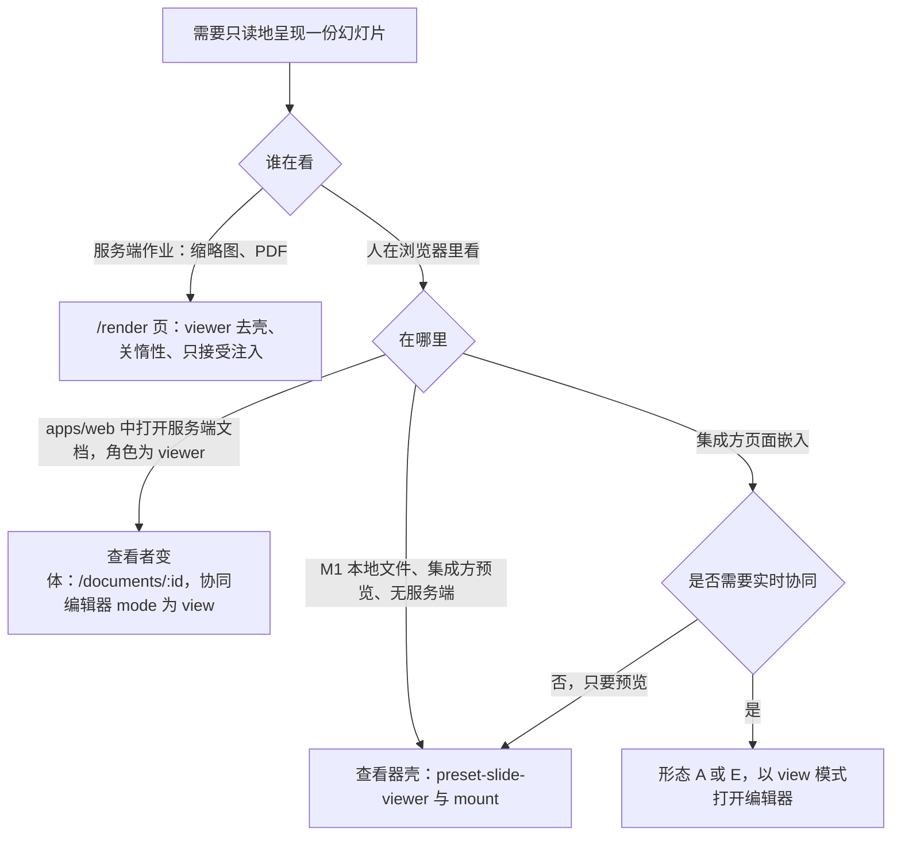
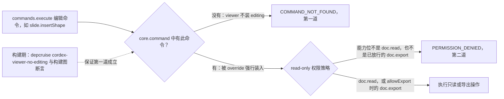
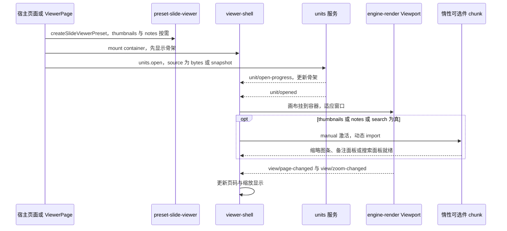
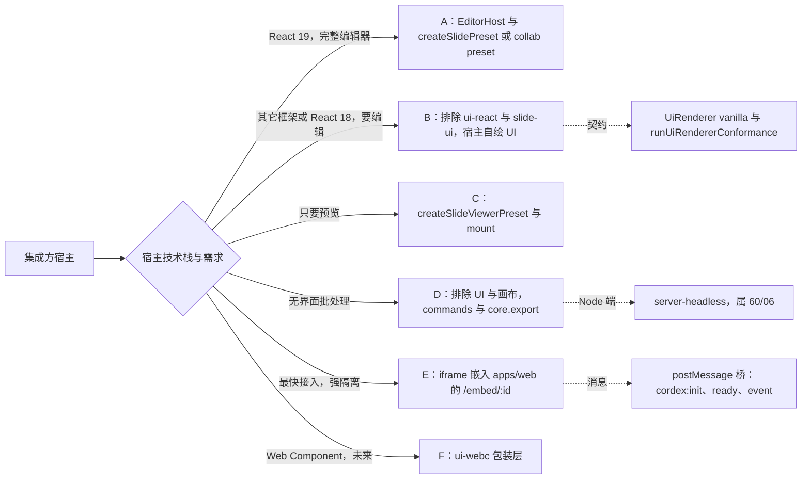
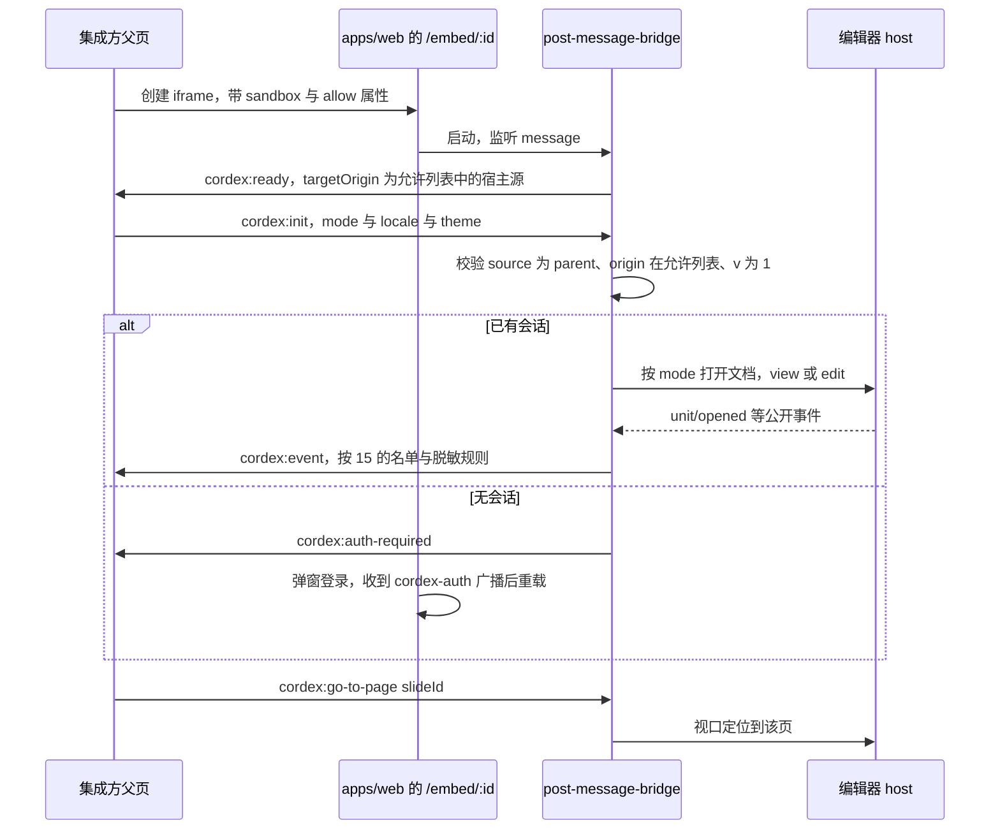
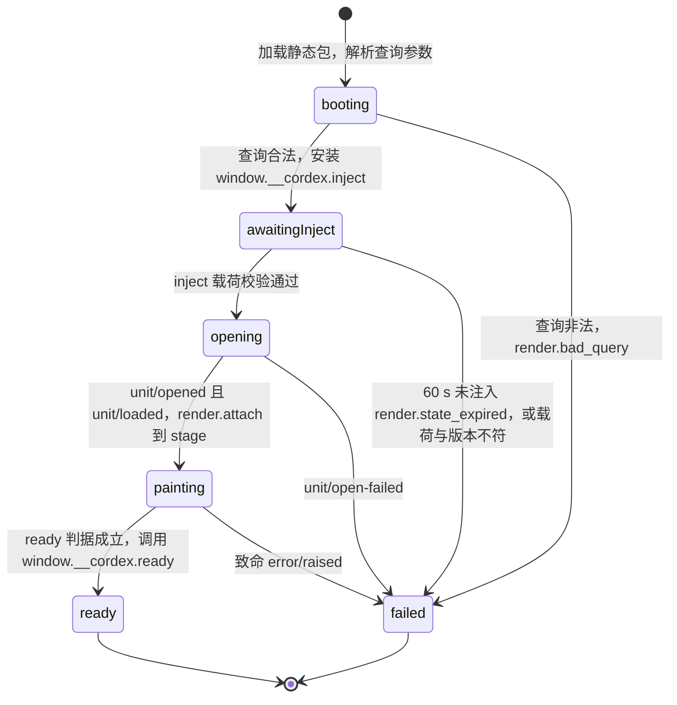
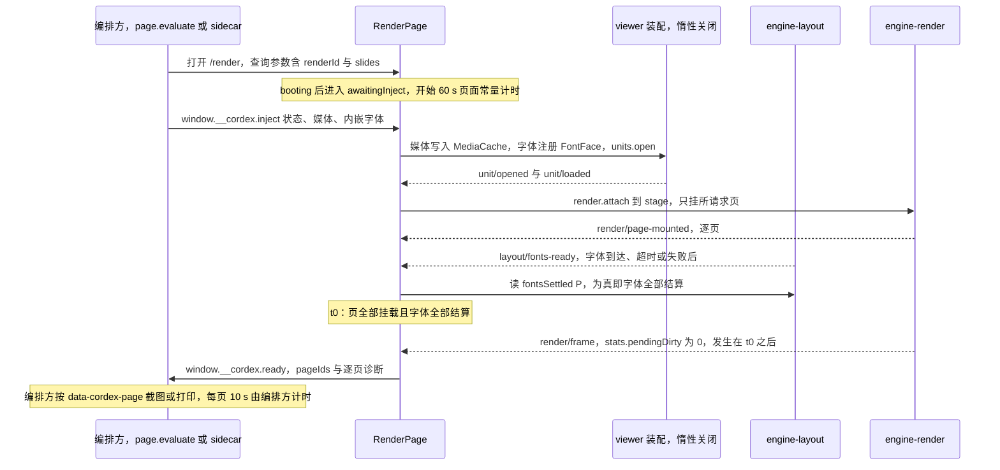

# 12 查看器、嵌入形态与 /render 页
> 状态：v0.1 | 负责：前端设计线 | 更新：2026-09-25；2026-09-25（§4.19）；2026-09-26（§4.20）；2026-10-04（design-language-v3 第 0 批：§7 宿主自绘的视图模型清单按 v3 改写（rulings §4.25 DS-1、DS-6））；2026-10-04（design-language-v3 第 0 批：复验修正——§7 形态 B「十个 `ui.*` 贡献点」改为九个）；2026-10-08（design-language-v3 第 1 批收口：开头查看者变体改为浏览条（外壳内置「只读浏览中」与上一处 / 下一处评论，rulings §4.25 DS-23、TB-1），原「模式下拉只列只读浏览与放映」随应用栏作废）；2026-10-08（design-language-v3 第 1 批收口：§「尺寸」按三种形态改写断点，原「更小进入紧凑态」作废，rulings §4.25 DS-17、DS-21）；2026-10-15（design-language-v3 第 2 批：§3「保真摘要」按已拍板样张 `fidelity.viewer-shell` 改为 ⓘ 弹出极简摘要卡，只给影响「看」的计数与可选的「查看详情」外链，不内嵌完整报告（rulings §4.25 DS-51）；查看器壳本身的 v3 呈现仍随第 3 批）；2026-10-22（design-language-v3 第 3 批：按已拍板样张 `viewer`、`embed` 回写（rulings §4.25 DS-73、DS-110…DS-112、DS-123、TB-114、TB-115）——§3 查看器壳的 v3 顶部条、只有全屏、键盘不占 `Mod+F` 与全屏下 `Esc`、`mailto` / `tel` 只显示、保真摘要的缺插件一行与「未发现影响查看的差异」、打开中与只留「下载原文件」的打开失败、窄屏向仅查看形态靠齐；§4 可选件落位与备注空态改为「这一页没有演讲者备注」；§6 宿主不处理的意图不贡献；§9 登录三态、嵌入里的打开失败与出口，`cordex:init` 增 `intents`；§12 断言与未决）；2026-10-22（design-language-v3 第 3 批回写补充，rulings §4.25 DS-138、TB-134、TB-145、TB-150：§3 全屏按钮注明与放映「更多 › 全屏」同一规则（TB-134）；§4 备注空态与编辑器桌面只读态、仅查看形态同一句（DS-138），图 3「备注抽屉」改为「备注面板」；§9 嵌入属性写明 `embedded` 与 ui-core 宿主配置 `UiCoreConfig.host.embedded`（TB-150），`EmbedPage` 按 `cordex:init.intents` 传 `onNavigateBack` / `onSignOut`（TB-145），消息表注明依据；§12.3 `intents` 一行改为已定，新增一行）；2026-10-22（design-language-v3 第 3 批回写收口，rulings §4.25 TB-151、TB-157、TB-159、TB-161：§6 挂载补 `onShare` 与 `shareUnavailable`（TB-161）；§9 嵌入又是触控设备时以「在电脑上编辑」为准（TB-159）；§11.3 `ready` 的 `diagnostics` 按页另带 `failed{ code: 'render.page_failed' }`——渲染层走了运行时页级回退的页由 renderer 记为失败、不回传字节，保真占位「此页内容无法解析」不算失败（TB-151、TB-157），`render.bad_payload`、`render.version_mismatch` 改为已登记，注入载荷一格注明 60/06 §10.3 已同为 `snapshot-json`；§11.5 页级回退不阻塞 ready；§12 断言与未决同步；2026-10-22 复核修正：§9 嵌入里的「触控设备」只指平板、手机按窗口窄写（rulings §4.25 TB-163）；§12.3 措辞去掉回写轮次字样；§4 可选件「备注抽屉」改称「备注面板」（与正文、图 3 与设计 03-25 一致）；§12.3「回写 30/07 §10 与 ADR-0026 决策 6」一行按现状改为部分回写；§11.1 写明 `/render` 不设故障注入点、生产与测试部署行为相同（TB-174），§12.3 页级失败一行同步；§12.3「回写 30/07 §10 与 ADR-0026 决策 6」一行核对为已回写——两处与 40/11 的 `render-page-state.ts`、`render-page.usecase.ts` 都只引本文 §11.5（rulings §4.18 FE-09）；§12.3 页级失败一行的组件级用例改指 40/11 §9 `application/render-page.usecase.test.ts`（TB-174）） | 依赖：[02 应用壳](02-app-shell-routing-and-session.md)、[03 预设装配](03-preset-assembly-and-plugins.md)、[05 渲染](05-rendering-and-thumbnails.md)、[15 事件与遥测](15-events-errors-and-telemetry.md)、[30/02 §4.21b](../30-architecture/02-layering-and-packages.md)、[30/07 §10、§14.5](../30-architecture/07-rendering.md)、[ADR-0010](../30-architecture/adr/0010-preset-vs-loader-composition.md)、[ADR-0015](../30-architecture/adr/0015-single-execution-entry-and-non-executable-mutations.md)、[ADR-0026](../30-architecture/adr/0026-headless-rendering-and-thumbnails.md)、[40/11](../40-modules/11-preset-assembly-and-app-shell.md) §3.3–§3.5、§6、§7、[设计 25 查看器壳](../20-design/03-screens/25-viewer-preset-shell.md)、[PRD 05 嵌入与集成](../10-prd/03-features/05-embedding-and-integration.md) EM-01/02/03/06/08/17、PRD OF-14、[rulings](../00-charter/rulings-2026-09-14.md) §4.10 Q18、§4.12 U-03、§4.15 Q2/Q8、§4.18 BE-04/FE-08/FE-09/UX-19；rulings §4.25 DS-73、DS-110…DS-112、DS-123、TB-114、TB-115；第 3 批 playground `src/v3/scenarios/viewer/`、`embed/`；[设计 03-25](../20-design/03-screens/25-viewer-preset-shell.md)；[设计 03-33](../20-design/03-screens/33-login-session-and-error-pages.md) §9；rulings §4.25 DS-138、TB-134、TB-145、TB-150（第 3 批回写补充）；rulings §4.25 TB-157、TB-159、TB-161（第 3 批回写收口）；rulings §4.25 TB-163；[60/06](../60-backend/06-modules-jobs-import-export-thumbnails.md) §10.4、§10.5、§11.3；[40/07](../40-modules/07-slide-rendering.md) §1.1；rulings §4.25 TB-174

本文是三类只读形态、嵌入形态 A–F 与 `/render` 页前端职责的唯一事实源；**`/render` 的 ready 判据只在本文 §11 定义**，其它文档一律链接。嵌入 `postMessage` 的消息语义也归本文（文件路径登记在 protocol `embed/messages.ts`，由 M-02 登记）。

**本文不写**（只链接）：renderer sidecar 进程、信任区、内部 RPC、注入编排、池与背压、超时与重试（[60/06](../60-backend/06-modules-jobs-import-export-thumbnails.md) §9–§10）；查看器与编辑器共用的渲染管线（[05](05-rendering-and-thumbnails.md)）；事件名、载荷与合并规则（[15](15-events-errors-and-telemetry.md)）；CSP 正文（[14](14-client-security.md) §2）；体积数值与 chunk 地图（[13](13-performance-and-bundling.md) §6）；preset 清单本体（[40/11](../40-modules/11-preset-assembly-and-app-shell.md) §3）。

## 1. 三种只读形态与选择规则

| 形态 | 装配 | 入口 | 在协同房间内 | 实时看到修改 | React | 体积 | 里程碑 |
|---|---|---|---|---|---|---|---|
| **查看器壳** | `preset-slide-viewer` + 框架无关壳 | `apps/web` `/documents/:id/view`（只留给 M1 查看器与嵌入）、嵌入形态 C | 否 | 否（打开时的快照或字节） | 无 | ≤ 350 KB | M1 |
| **查看者变体** | `preset-slide-collab`，`EditorHost mode='view'` | `apps/web` `/documents/:id`（viewer 角色） | 是，计入 50 个查看者名额，只上报视图 | 是，含在场 | 有 | 编辑器 + 协同 | M3 |
| **`/render` 页** | `preset-slide-viewer`，去壳、关惰性 | renderer sidecar 中的 headless Chromium | 否 | 否（注入的状态） | 不渲染 UI | 同查看器基线 | M3 |

查看者变体是编辑器的只读呈现：底部是浏览条（外壳内置的「只读浏览中」标识 + 上一处 / 下一处评论，没有「评论 / 高亮」等创建类条目，rulings §4.25 DS-23、TB-1），只保留跳转与阅读评论；主菜单「视图」没有「模式」这一组，放映照常（rulings §4.18 UX-19；原「模式下拉只列只读浏览与放映」随应用栏作废，界面差异见 [10](10-editor-shell-and-interaction.md) §3）。评审模式（commenter）不是只读形态，不在本表。

**图 1 三种只读形态的选择**



怎么读：自上而下是判断顺序；菱形是分支问题，边上文字是回答；叶子节点是应选用的形态。唯一会进入协同房间的只读形态是查看者变体（及以 view 模式嵌入的编辑器）。

依据：rulings §4.18 UX-19；[30/02](../30-architecture/02-layering-and-packages.md) §4.21b；ADR-0026 决策 1。

## 2. `preset-slide-viewer`

- **两道只读保证**（ADR-0015 决策 4）：① 清单**不含** `@cordexjs/model-slide/editing`，编辑命令与变更贡献不存在 → `COMMAND_NOT_FOUND`（depcruise `cordex-viewer-no-editing` 与 `no-editing-graph.test.ts` 双查依赖图与构建图）；② `read-only` 权限策略为 `required` 条目、不可 `exclude`，即使被 `override` 强行装入 editing，执行编辑命令也得到 `PERMISSION_DENIED`。
- **能力位**：策略只放行 `doc.read`；`allowExport` 为真时另放行 `doc.export`；`allowExport` 默认关，集成方显式开启（rulings §4.12 U-03）。
- **无 React**：不装 `ui-core` / `ui-react` / `slide-ui` / `collab-*` / `local-presence`；壳是框架无关 TS + CSS（§3）。manifest 的 `forbids` 列表含 `react`、`react-dom`。
- **历史**：`model-core.historyLimit: 0`（不建撤销栈）。
- **体积**：基线 ≤ 350 KB gzip（PRD OF-14 / EM-07），分解表在 [40/11](../40-modules/11-preset-assembly-and-app-shell.md) §3.4，门禁与 chunk 规则见 [13](13-performance-and-bundling.md) §6；惰性件不计基线。

**图 2 查看器只读的两道保证**



怎么读：从左到右是一次命令执行经过的两道检查；虚线表示第一道在构建期就被依赖规则与构建图断言锁住，第二道在运行期由不可排除的权限策略兜底。

依据：ADR-0015 决策 4；[40/11](../40-modules/11-preset-assembly-and-app-shell.md) §3.3 `read-only` 列、§3.4。

## 3. 查看器壳 `viewer-shell`

`preset-slide-viewer/src/shell/**` 是框架无关的 TS + CSS（基础控件用 `[data-slot]` 类，复用 `@cordexjs/design` token，不复用 ui-react 的 React 复制件；壳本身 ≤ 15 KB）。外观以 [设计 03-25](../20-design/03-screens/25-viewer-preset-shell.md) 与已拍板的第 3 批样张 `viewer` 为准（2026-10-22，rulings §4.25 DS-110、DS-111、TB-114；原玻璃工具条作废，DS-2），本节定行为。

**句柄**：`createSlideViewerPreset(options)` 返回 `Preset & { mount(container: HTMLElement): ViewerHandle }`，

```ts
interface ViewerHandle {
  goToPage(slideId: string): void              // 等价于工具条跳页
  setZoom(zoom: number | 'fit-contain' | 'fit-width'): void
  dispose(): void                              // 卸载 DOM、ResizeObserver 与订阅；不销毁 host
}
```

- **挂载时序**：`mount()` 可早于 `units.open`，先显示打开中（见下「加载与失败」）；`unit/opened` 后把当前 Unit 的 `render` 挂到画布容器；host 内有多个 Unit 时显示最近打开的一个（查看器按单 Unit 使用）。
- **页码与缩放**：订阅 engine-render `Viewport` 发布的 `view/page-changed`、`view/zoom-changed`（依据：VIEW-EVENTS，authority：Viewport 归 engine-render，30/07 §2.3）；查看器壳不自行维护第二份页码。
- **工具条**（贴边顶部条，高 48）：上一页 / 下一页 · 页码输入 ┊ 缩小 · 缩放读数（点开与编辑器同一份缩放菜单：比例输入、放大 / 缩小、适应窗口 / 适应宽度、五个档位，范围 10–400%）· 放大 ┊ 全屏 · 搜索（仅 `search:true`，M2 P1）· ⓘ 保真摘要 · 备注（仅 `notes:true`）。首末页时上一页 / 下一页、到上下限时缩小 / 放大留在原位不可用并写原因（rulings §4.20 FE-06）。「全屏」是整个查看器容器进浏览器全屏、工具条照常，只在 `document.fullscreenEnabled` 为真时渲染（与窗口内放映「更多 › 全屏」同一规则，rulings §4.25 TB-134）；查看器没有放映舞台（原「全屏 / 放映」改为只有全屏，[设计 03-25](../20-design/03-screens/25-viewer-preset-shell.md) §4.1）。
- **键盘**：←/→、PageUp/PageDown 翻页，Home/End 首末页，`+` / `-` 与 `Mod+滚轮` 缩放，`F` 全屏，`Esc` 关闭打开中的菜单、卡片与面板；全屏下第一次 `Esc` 由浏览器消费、直接退出全屏，备注面板保持（原「备注抽屉打开时先关抽屉」做不到，2026-10-22 作废）；查看器嵌在宿主页里，不占 `Mod+F` 与 `Mod+=` / `Mod+-`，交还浏览器；焦点在输入框、菜单、面板或缩略图条里时这些键交给它们；工具条按钮全部 `Tab` 可达。
- **超链接**：`hyperlinks:'new-tab'`（默认）时 http(s) 外链在新窗口打开（`noopener,noreferrer`），`mailto:` / `tel:` 只显示目标、可复制、不激活（与编辑器同一口径，[14](14-client-security.md) §5、PRD ED-19；原「只放行 http(s) 与 mailto」2026-10-22 改正），页内跳转链接调用 `goToPage`；`'ignore'` 时不响应。不劫持宿主页面导航。
- **保真摘要**（rulings §4.25 DS-51，样张 `fidelity.viewer-shell`）：工具条 ⓘ 弹出一张极简摘要卡，只给影响「看」的计数（如「1 处暂不支持显示 · 6 处动画与切换以静态画面显示 · 1 种替代字体」），不内嵌完整报告，编辑类差异不列；计数来自 `unit/opened` 的导入诊断与 `render/element-degraded`；「查看详情」外链只在宿主提供 `callbacks.onOpenDetails` 时出现，未配置时不显示、不留占位。2026-10-22 补（rulings §4.25 DS-110、TB-114）：文档里有缺插件元素时，卡片最前多一行「N 处内容需要插件「〈插件名〉」，以占位显示」（警告色拼图，PRD PM-12「只显示占位与一行说明」），不加横幅、没有插件面板入口；没有影响查看的差异时 ⓘ 留在原位，卡片只写「未发现影响查看的差异」（中性对勾），宿主配了「查看详情」时照常出现。
- **加载与失败**：`unit/open-progress` → 容器内的打开中（不跳转）：与编辑器打开中同一画法——这一页的版式骨架加一行阶段文字与确定态进度，停在第 1 页、页码照常可读；没有「取消」（来源在宿主手里，宿主自己卸载即可）；工具条照常画出、全部不可用并写「文档打开后可用」。`unit/open-failed` → 容器里只剩阻断页（与编辑器打开失败同一画法，不画残缺的工具条），文案按错误码取 `errors.<code>`（[15](15-events-errors-and-telemetry.md) §4，查看器里写「后再打开」）；按钮只有宿主提供 `callbacks.onDownloadOriginal` 时的「下载原文件」（画布底上的次按钮，outline），否则不出按钮、不留占位；不给「重试」「返回文档列表」与「复制诊断信息」——来源在宿主手里，诊断由集成方经 `error/raised` 事件取（2026-10-22，rulings §4.25 TB-114，[设计 03-25](../20-design/03-screens/25-viewer-preset-shell.md) §4.7）。
- **窄屏**（< 640 px，2026-10-22 定稿，rulings §4.25 DS-111；原「工具条收敛为翻页、缩放、⋯」与「< 320 px 折两行」作废）：向编辑器仅查看形态靠齐——不画顶部条，当前页全宽（左右 16）、整体垂直居中；底部浮动条（按钮 44、间距 8）上一页 · 页码 · 下一页 ┊ 更多，`thumbnails:true` 时页码是按钮、点开两列缩略图的「幻灯片」底部面板；「更多」底部面板只放查看类命令：适应窗口 · 全屏（不允许全屏时不出）· 搜索（`search:true`，打开顶部查找条）· 保真摘要（换成「保真摘要」底部面板，条目与桌面卡同一份）┊ 显示演讲者备注（`notes:true`，勾选后备注是当前页下方的只读卡）；同一时刻只开一个底部面板，用户点开时焦点进面板、关闭后回到打开它的按钮；左右轻扫翻页（页面被双指放大时让给平移），双指缩放是浏览器原生的。查看器只按容器宽度分两种形态（< 640 与其余），没有紧凑形态；容器 < 320 时浮动条照样一行；容器窄于 960 时画布四周留白收到 16（[设计 03-25](../20-design/03-screens/25-viewer-preset-shell.md) §4.2、§5）。

**图 3 查看器壳挂载与惰性可选件激活**



怎么读：自上而下是时间顺序；`opt` 段只在宿主打开对应选项时发生，选项为假时不发请求、不留占位；页码显示只跟随 `Viewport` 事件。

依据：[设计 03-25](../20-design/03-screens/25-viewer-preset-shell.md)（2026-10-22 定稿）；[40/11](../40-modules/11-preset-assembly-and-app-shell.md) §3.3 `viewer-shell` 列；VIEW-EVENTS；rulings §4.25 DS-110、DS-111、TB-114。

## 4. 惰性可选件

| 可选件 | 选项（默认） | 激活 | 行为要点 | chunk 上限 |
|---|---|---|---|---|
| 缩略图条 `viewer-thumbnails` | `thumbnails: false` | `'manual'`，由壳在选项为真时触发 | 画布下方贴边横向条；点击跳页，条内 ←/→/Home/End 移焦（只有当前页在 Tab 顺序里）、Enter 跳转；视口附近懒渲染，≥ 50 页虚拟化；生成超过 300 ms 的页先显示版式骨架，单页失败显示页码灰块；文档只有 1 页时不显示；< 640 px 改为底部浮动条的页码按钮打开两列缩略图的「幻灯片」底部面板（2026-10-22，DS-111；原「⋯ 内开关、顶部抽屉」作废） | 20 KB |
| 备注面板 `viewer-notes` | `notes: false` | 同上 | 桌面右侧贴边的非模态面板（宽 320，从工具条下沿到底，不加遮罩、点画布不关），工具条「备注」是开关（`aria-pressed`）；窄屏是「更多 › 显示演讲者备注」打开的当前页下方只读卡（DS-111，原 40vh 底部抽屉作废）；只读纯文本、保留换行；翻页时保持打开并切换内容；没有备注时写「这一页没有演讲者备注」（与编辑器桌面只读态、仅查看形态的备注卡同一句，2026-10-22，rulings §4.25 DS-138；原「本页没有备注」作废） | 10 KB |
| 搜索 `viewer-search` | `search: false` | 同上 | 与编辑器查找面板同一交互，不含替换区（M2 P1）；挂在画布右上、工具条下方 12，入口只有工具条「搜索」（不占 `Mod+F`），窄屏在「更多」里、打开顶部查找条 | 15 KB |

三者都**不计入 350 KB 基线**；选项为假时不渲染入口、不留占位、不发请求（rulings §4.10 Q18）。`allowExport` 默认关（U-03）；开启后集成方可经 `commands.execute(unitId, 'core.export', { format:'pptx' })` 在浏览器内导出，壳本身不增加导出入口（设计 03-25 未设该控件）。

## 5. 嵌入形态 A–F 决策表

集成方先按宿主技术栈选形态，再取对应入口与排除集。SDK 对宿主 React 声明 peer `^19.0`（rulings §4.15 Q2），**React 18 宿主走形态 B 或 E**。

| 宿主情况 | 形态 | 入口 | options 要点 | 排除集 | 体积口径（[13](13-performance-and-bundling.md) §6） | 里程碑 |
|---|---|---|---|---|---|---|
| React 19 应用，要完整编辑器 | A | `@cordexjs/ui-react` `<EditorHost>` + `createSlidePreset` / `createSlideCollabPreset` | `theme.injectCss:true` + `cssNonce`；`shell.onIntent`；`i18n.bundles`；协同时 `collab.getToken` | 无 | 编辑器 ≤ 900 KB，协同增量 ≤ 200 KB | M2 |
| Vue、Angular、Svelte、原生或 React 18，要编辑 | B | `createSlidePreset({ exclude: FRAMEWORK_FREE_EXCLUDES })` + `render.attach` + 宿主自绘 UI | 同 A，去掉 React 相关项 | `FRAMEWORK_FREE_EXCLUDES = { ui-react, slide-ui }` | 产物不含 react / radix 模块 | M2 |
| 只要预览 | C | `createSlideViewerPreset(options)` → `preset.mount(el)` | `thumbnails`、`notes`、`search`、`fit`、`allowExport`、`hyperlinks`、`callbacks` | viewer 本身不含编辑与 UI 包 | ≤ 350 KB | M1 |
| 批处理、校验、模板填充（浏览器内） | D | `createSlidePreset({ exclude: HEADLESS_EXCLUDES, permissions: { capabilities } })` | 无 UI、无画布 | `HEADLESS_EXCLUDES`（清单本体在 preset-slide `config/headless.ts`，[40/11](../40-modules/11-preset-assembly-and-app-shell.md) §5.1） | — | M1（浏览器）；Node 端为 `server-headless`（[60/06](../60-backend/06-modules-jobs-import-export-thumbnails.md) §8），M3 |
| 最快接入、强隔离 | E | `apps/web` `/embed/:id?mode=view\|edit` 的 iframe + `postMessage` 桥 | `cordex:init` 消息（§9） | — | 同 `apps/web` | M3 P2 |
| 要 Web Component | F | `@cordexjs/ui-webc`（未来包装层） | preset API 不变 | — | — | M4+ |

**图 4 嵌入形态 A–F 与各自入口**



怎么读：左侧菱形按宿主情况分流到六种形态；虚线指向该形态额外需要满足的契约或所在的另一条设计线。

依据：PRD EM-01 §1 嵌入形态一览；rulings §4.15 Q2；[40/11](../40-modules/11-preset-assembly-and-app-shell.md) §6 嵌入形态表。

## 6. 形态 A 集成要点

- **挂载**：`<EditorHost host unitId mode layout slots documentTitle onNavigateBack onRename onShare onSignOut />`（props 以 ui-react 为准，[40/10](../40-modules/10-ui-shell-and-slide-ui.md) §6）；`mode` 由集成方按角色给出（`edit` / `review` / `view`）。「分享」只在传了 `onShare` 时可用；传 `shareUnavailable: 'later'` 时留在原位不可用、写「后续版本提供」，两者都不传时不渲染（2026-10-22，rulings §4.25 TB-161，[10](10-editor-shell-and-interaction.md) §2.3）。
- **样式与 CSP**：宿主页没有静态引入主题 CSS 时取 `theme.injectCss:true`；宿主启用严格 CSP 时必须把本次响应的 nonce 传给 `theme.cssNonce`，并在页面输出同值的 `<meta name="cordex-nonce">` 供第三方运行时样式读取（nonce 链见 [14](14-client-security.md) §3）。
- **壳意图**：实现 `shell.onIntent`，把导出、版本历史、插件管理器等意图映射到宿主自己的导航或对话框（[03](03-preset-assembly-and-plugins.md) §8）；宿主不处理的意图不贡献条目（2026-10-22，rulings §4.25 DS-112；原「不实现时菜单项点击无效果」作废）。「返回首页」只在传了 `onNavigateBack` 时渲染，「退出登录」没传 `onSignOut` 时留在原位不可用、写「由宿主应用管理登录」（FE-06，PRD AS-06）。
- **文案**：`i18n.bundles` 传宿主文案（`app` 命名空间）；内置文案可按 key 覆盖（EM-08）。
- **层级与浮层**：编辑器浮层使用 `--layer-*` token，宿主可在编辑器根节点上整体平移层级以适配自家浮层；浮层默认渲染在编辑器容器内，可选 portal 到 `body`（EM-06）。
- **样式隔离**：类名前缀与根节点作用域（[09](09-ui-system-and-theming.md) §10），Shadow DOM 模式为 P1。
- **多实例**：同页 ≥ 4 个编辑器各用一个 host（[03](03-preset-assembly-and-plugins.md) §6.1）；快捷键只分派给焦点所在实例；`dispose()` 后无残留 DOM、计时器、WS 与 blob URL，20 次创建 / 销毁内存增长 ≤ 5%（EM-01）。
- **尺寸**：`ResizeObserver` 驱动重排；按宿主容器的宽度取形态：≥ 1024 为完整形态，640–1024 为紧凑形态，< 640 或触控设备为仅查看形态（设计 03-02 §5a、[10](10-editor-shell-and-interaction.md) §2.2，rulings §4.25 DS-17、DS-21；原「更小进入紧凑态」作废）；紧凑形态的最小可用高度仍为 400 px。
- **保存策略**（EM-02）：回调式——订阅 `unit/dirty-changed`，在 `Mod+S` / 自动保存 / 主动调用时 `core.export` 得到字节或导出 Snapshot，交给集成方存储；协同式——服务端快照负责，集成方不处理字节。

## 7. 形态 B：宿主自绘 UI

- 装配：`createSlidePreset({ exclude: FRAMEWORK_FREE_EXCLUDES })`，同时排除 `ui-react` 与 `slide-ui`，bundle 内零 React / Radix；`ui-core` 照常装载，九个 `ui.*` 贡献点照常注册（2026-10-04 起 `ui.ribbon`、`ui.statusBar` 作废，rulings §4.25 DS-5、DS-6）。
- 宿主读取 ui-core 的视图模型（创建工具条、检查器分区、主菜单与右键菜单、命令面板，[09](09-ui-system-and-theming.md) §7）自行绘制，所有动作一律 `commands.execute`；画布用 `render.attach(container)`。
- `examples/embed-vanilla` 提供最小 `UiRenderer('vanilla')`：只挂画布与宿主容器、不渲染 `ui.*` 贡献，并实例化 `runUiRendererConformance`（[40/10](../40-modules/10-ui-shell-and-slide-ui.md) §2.5），结果计入可插拔证据（[70/02](../70-testing/02-contract-suites-and-pluggability.md) §7、§10）。
- 验收：`ui-core` 与各 `*-ui` 的 `domain` / `application` 层不 import React（depcruise `cordex-ui-bundle-core-framework-free`）；形态 B 构建产物中无 react / radix 模块（bundle 断言）。

## 8. 形态 D：浏览器 headless

- 装配：`createSlidePreset({ exclude: HEADLESS_EXCLUDES, permissions: { capabilities } })`，去掉 UI 与画布渲染，保留模型、编解码与命令；因缺少画布而缺席的能力以诊断出现，不影响导入与导出。
- 用法：`units.open({ source:{ kind:'bytes', bytes } })` → 若干 `commands.execute(unitId, …)` → `commands.execute(unitId, 'core.export', { format:'pptx' })` 得到字节；权限由集成方直接传能力位，客户端管线 fail-closed（EM-03 单人模式）。
- 约束：不访问 DOM（`headless.test.ts` 在 happy-dom 下断言无 DOM 调用）；Node 端批处理不用本形态，而用 `server-headless`。

## 9. 形态 E：`/embed/:id` 与 `postMessage` 桥

依据：MECH-INC 中的 INC-36（authority：已接受 ADR、rulings、30 正文优先于 40）——`embed/messages.ts` 进 M-02 目录树（M3 P2）；M3 的 `/embed` 只接受会话登录，`cordex:token` 握手标注 M4。

**登录与站点约束**

- M3 只认 `apps/web` 自己的 cookie 会话。会话 cookie 为 `SameSite=Lax`（[60/02](../60-backend/02-auth-chain.md) §4），**跨站 iframe 中不会被携带**，因此 M3 的形态 E 只支持与部署同站（same-site，例如同一注册域下的内网子域）的宿主；跨站宿主等 M4 的 `cordex:token` 握手（集成方签名 JWT，EM-03）。
- iframe 内没有会话时不做顶层 OIDC 跳转（IdP 通常禁止被嵌入）：页面显示「请在新窗口登录」，按 [02](02-app-shell-routing-and-session.md) §5 的弹窗流程登录，收到 `cordex-auth` 广播后重新加载 iframe 内容；同时向父页发 `cordex:auth-required`。页面是阻断页画法，三态（2026-10-22，rulings §4.25 DS-73、TB-115，画法与文案以设计 03-33 §9.1 为准）：未登录（主按钮「使用组织账号登录」，与登录页同一句、同一宽度规则）、登录窗口已打开（同一颗按钮转圈、不可用，用 kit 主按钮的不可用态，DS-123）、弹窗被拦截（换成「在新标签页中登录」外链按钮）；不加登录页的弱提示「没有账号？请联系管理员开通」。
- **嵌入里的打开失败**（TB-115，设计 03-33 §9.2）：与编辑器打开失败同一布局，按钮只留「重试」与「复制诊断信息」（点后原位「已复制」1.5 秒），同时向父页发 `cordex:error{code}`；没有「返回文档列表」，离开交给宿主；没有访问权限（「申请访问」照常）与查看人数已满的阻断页同样去掉「返回文档列表」。
- **嵌入里的出口**（2026-10-22，rulings §4.25 DS-112；设计 03-33 §9.3、03-02 §5a.4）：apps/web 以 `EditorHost` 的嵌入属性 `embedded` 渲染编辑器（[40/10](../40-modules/10-ui-shell-and-slide-ui.md) §6 `EditorHostProps.embedded`；ui-react 把它写进 ui-core 的只读宿主配置 `UiCoreConfig.host.embedded`，`explainWhen` 读这份配置换写法、不新增上下文键，rulings §4.25 TB-150，[09](09-ui-system-and-theming.md) §6.2）——「返回首页」（主菜单首项与其后的分隔线、仅查看形态顶部的「‹」）只在 `cordex:init.intents` 含 `navigate-back` 时渲染（`EmbedPage` 这时才给 `EditorHost` 传 `onNavigateBack`，rulings §4.25 TB-145），点了发 `cordex:intent{target:'navigate-back'}`；仅查看形态的状态行只写「仅查看」，紧凑形态「视图 › 母版视图」的不可用原因写「当前区域太窄，暂不可用」，手机评论面板那一句写「当前区域太窄，暂不能解决评论」（[10](10-editor-shell-and-interaction.md) §2.2、[08](08-comments-and-version-history.md) §5.5）；嵌入又是触控设备（只指平板：触控、≥ 640；手机不论是否触控都按窗口窄写，rulings §4.25 TB-163）时以触控为准——状态行「仅查看 · 在电脑上编辑」、形态类不可用原因「在电脑上编辑」，嵌入只改写「在更大窗口中编辑」那一句（2026-10-22，rulings §4.25 TB-159）；「退出登录」只在 `intents` 含 `sign-out` 时可用——`EmbedPage` 这时才传 `onSignOut`，点了发 `cordex:intent{target:'sign-out'}`、由宿主处理登出（TB-145）；没声明时不传 `onSignOut`，这一项留在原位不可用、写「由宿主应用管理登录」（FE-06，PRD AS-06）；导出、保真报告、版本历史、插件等应用级条目由 apps/web 在 iframe 里照常处理。
- `/embed` 响应的 `frame-ancestors` 取部署配置 `web.embed.allowedHostOrigins`（[60/17](../60-backend/17-deployment-and-config.md) §5，环境变量 `CORDEX_WEB_EMBED_ALLOWED_ORIGINS`，默认空即 `'none'`），其余路由保持 `frame-ancestors 'none'`（[14](14-client-security.md) §2、§11）；同一份值渲染进 RuntimeConfig `embed.allowedHostOrigins`（[02](02-app-shell-routing-and-session.md) §3），作为下文 postMessage 桥的 origin 允许列表。

**消息表**（字段语义归本文；schema 文件为 protocol `embed/messages.ts`；所有消息带 `v: 1`）

| 方向 | 类型 | 字段 | 时机与处理 |
|---|---|---|---|
| 父 → iframe | `cordex:init` | `mode?: 'view' \| 'edit'`、`locale?`、`theme?: 'light' \| 'dark' \| 'system'`、`intents?: ('navigate-back' \| 'sign-out')[]`（2026-10-22 新增：宿主能处理的壳意图，缺省为空，rulings §4.25 DS-112、TB-145） | 父页收到 `cordex:ready` 后发送；iframe 只接受一次，之后以它的 `origin` 作为唯一对端；`intents` 决定「返回首页」是否渲染、「退出登录」是否可用（上文「嵌入里的出口」） |
| 父 → iframe | `cordex:set-theme` | `theme` | 随时；等价于用户切换主题 |
| 父 → iframe | `cordex:go-to-page` | `slideId` | 随时；不存在的页忽略 |
| 父 → iframe | `cordex:token`（M4） | `token` | 集成方签名 JWT，M3 收到即回 `cordex:error` |
| iframe → 父 | `cordex:ready` | `appVersion`、`documentId` | iframe 脚本就绪、桥已监听；发往允许列表中与 `document.referrer` 同源的那一项，找不到则不发 |
| iframe → 父 | `cordex:event` | `name`、`payload` | 宿主事件桥转发的公开事件（§10），名单与脱敏规则见 [15](15-events-errors-and-telemetry.md) §3 |
| iframe → 父 | `cordex:intent` | `target: 'navigate-back' \| 'sign-out'` | 需要宿主处理的壳意图；只发 `cordex:init.intents` 里声明过的（2026-10-22，DS-112） |
| iframe → 父 | `cordex:auth-required` | — | iframe 内无会话 |
| iframe → 父 | `cordex:error` | `code`、`detail?` | 打开失败、协议版本不符等；`code` 为 protocol 已登记错误码 |

**安全规则**：iframe 只处理 `event.source === window.parent` 且 `event.origin` 在允许列表内的消息，`init` 之后只认同一 `origin`；发送一律写明 `targetOrigin`，**从不使用 `'*'`**；消息体只含可结构化克隆的 JSON（不含函数、DOM、令牌以外的凭据），未知 `type` 与 `v` 不符的消息丢弃并计数。

**集成方 iframe 属性要求**：`sandbox="allow-scripts allow-same-origin allow-popups allow-popups-to-escape-sandbox allow-downloads"`（会话 cookie 与存储需要 `allow-same-origin`，登录弹窗与外链需要 `allow-popups`，导出需要 `allow-downloads`）；`allow="fullscreen; clipboard-read; clipboard-write"`；`referrerpolicy="strict-origin-when-cross-origin"`。

**图 5 形态 E 的握手与事件转发**



怎么读：自上而下是时间顺序；`cordex:init` 之后桥只认该消息的来源；`alt` 两支对应 iframe 内是否已有同站会话。

依据：INC-36；PRD EM-01 形态 E、EM-03；[40/11](../40-modules/11-preset-assembly-and-app-shell.md) §13 Q-1、Q-10。

## 10. 宿主事件桥与 15 的分工

`apps/web/src/application/host/host-event-bridge.ts` 在 `createEditorHost` 返回后对公开事件逐个 `ctx.on`（只读订阅、不 `emit`，disposer 交 `dispose()`），转发给 `apps/web` 自身与形态 E 的父页；形态 A–D 不经过 `apps/web`，集成方在自己的组合根直接订阅。**事件名、载荷、合并（≥ 50 ms）与脱敏规则归 [15](15-events-errors-and-telemetry.md) §1–§3**；本文只定通道。

| 接收方 | 适用形态 | 通道 | 过滤与顺序 |
|---|---|---|---|
| 应用状态 | `apps/web` 自身 | `EditorPageState` reducer、保存态、toast，应用私有 `app/*` 事件（typed `EventTarget`） | 全量；同一 Unit 内保持事件发生顺序 |
| 集成方 | A、B、C、D | 不经本桥：集成方在自己的组合根对 host 直接 `ctx.on`（公开事件名单同 15 §3） | 集成方自选；回调抛错被捕获并上报，不影响其它订阅者 |
| iframe 父页 | E | `cordex:event` 消息（§9） | 只转发 15 登记的公开事件；评论正文等按 15 的脱敏开关处理；合并后的帧按原顺序发送 |

## 11. `/render` 页前端职责（ready 判据唯一源）

`/render` 是 `apps/web` 的一个路由，静态包内置在 renderer 镜像中，由 headless Chromium 加载（ADR-0026 决策 1）。页面**只接受注入、零外呼、无任何拉取端点**（rulings §4.18 BE-04）：`local`（worker 内 Playwright）与 `remote`（renderer sidecar）两种模式都由编排方调用 `window.__cordex.inject`，页面只有这一条路径。sidecar 进程、内部 RPC、注入编排、池与背压、每页 10 s 超时与重试见 [60/06](../60-backend/06-modules-jobs-import-export-thumbnails.md) §9–§10。

### 11.1 查询参数与启动

`RenderPageQuery`（schema 在 protocol `render/page.ts`）：

| 参数 | 取值 | 说明 |
|---|---|---|
| `renderId` | string | **只作日志关联**，不是凭据（`RenderStateToken` 已取消） |
| `documentType` | string | 只透传给 `resolveDocumentType`，页面不含文档类型分支 |
| `mode` | `thumbnail` \| `image` \| `print` | 缩略图截图、按页位图导出（页面行为同 `thumbnail`，尺寸由编排方的视口与 `deviceScaleFactor` 决定）或 PDF 打印；与 [60/06](../60-backend/06-modules-jobs-import-export-thumbnails.md) §10.3 的 `mode` 同一取值集 |
| `slides` | 逗号分隔的 slideId，可省 | 所请求页集合 P；省略即全部页 |
| `deviceScaleFactor` | `1` \| `2` \| `3` | 与编排方的视口设置一致 |
| `fontProfile` | string | 字体档 id，须与镜像预装的一致 |
| `layoutAlgoVersion` | number | 断行算法版本，须与本包一致，否则失败 |

- `main.tsx` 识别 `/render` 后走独立启动路径：**不读取 `RuntimeConfig`**（renderer 镜像内没有部署配置），`appVersion` 取构建期常量；不初始化 REST 客户端、遥测网络 sink、应用 i18n 与 UI 样式；错误只经 `window.__cordex.error` 与控制台（由编排方采集）。因为不读 `RuntimeConfig`，`/render` 也**不设故障注入点**——测试部署的渲染故障注入点只在 apps/web 的页面里（[15](15-events-errors-and-telemetry.md) §10），生产与测试部署的 `/render` 行为相同；服务端集成测试的页级失败用 renderer 桩回这一页 `failed` 与 `render.page_failed`，真实合成一侧由组件级用例覆盖（2026-10-22，rulings §4.25 TB-174）。
- `RenderQuery` 守卫校验失败 → `window.__cordex.error({ code:'render.bad_query' })`，状态 `failed`。

### 11.2 `RenderPageState`

**图 6 RenderPageState**



怎么读：方框是页面状态，箭头上是触发条件与错误码；`ready` 与 `failed` 都是终态，进入后页面忽略此后的一切事件与注入；注入等待 60 s 是页面常量，每页 10 s 渲染超时由编排方在注入之后计时，两者分开计（rulings §4.18 FE-09）。

依据：[40/11](../40-modules/11-preset-assembly-and-app-shell.md) §2.1；ADR-0026 决策 1、6；rulings §4.18 BE-04、FE-09。

### 11.3 `window.__cordex` 接口

| 成员 | 方向 | 语义 |
|---|---|---|
| `inject(payload)` | 编排方 → 页面 | 只在 `awaitingInject` 接受一次，重复调用忽略并记日志；`payload` 类型为 protocol `RenderStateResponse`：`state`（`encoding: 'snapshot-json'` + 字节，即 `snapshot/envelope.ts` 的 JSON，页面以 `units.open({ source:{ kind:'state', encoding:'snapshot-json', bytes } })` 打开；viewer 装配的 `store-memory` 只接受 `snapshot-json`（[30/03](../30-architecture/03-kernel-and-plugin-model.md) §5.3），`apps/web` 按 R9 也不能引入 `store-yjs`，因此 Y 状态到快照的转换由编排方完成，[60/06](../60-backend/06-modules-jobs-import-export-thumbnails.md) §10.3 的 `state.encoding` 已同为 `snapshot-json`，§12.3）、`media[]`（`sha256`、`mime`、字节）、`fonts[]`（文档内嵌字体：`family`、`weight`、`style`、字节）、`appVersion`；字节以 base64 字符串传入（`page.evaluate` 参数只保证 JSON 可序列化）；`fontProfile` 本体预装在镜像中，不经注入 |
| `ready(result)` | 页面 → 编排方 | 恰好调用一次：`{ pageIds, layoutAlgoVersion, fontProfile, diagnostics }`，`diagnostics` 按页给出降级元素数、失败元素数、字体回退、`missing`（请求了但不存在的页），以及页级失败标记 `failed?: { code }`（2026-10-22，rulings §4.25 TB-151、TB-157）：这一页在渲染层走了运行时页级回退（合成时抛错，纸面上画的是「此页内容暂时无法显示」，[40/07](../40-modules/07-slide-rendering.md) §1.1）时为 `{ code: 'render.page_failed' }`——页面按 slide-render 页级回退发出的 `render/element-failed{ pageId, kind: 'page' }` 记下这一页（这一条不计入失败元素数）；renderer 据此把该页记为 `failed`、不回传字节，重试 1 次后缩略图用占位、导出作业失败（[60/06](../60-backend/06-modules-jobs-import-export-thumbnails.md) §10.4、§10.5、§11.3）。整页解析失败的保真占位「此页内容无法解析」是这一页的确定内容，不算失败、不带 `failed`、照常回传 |
| `error(result)` | 页面 → 编排方 | 恰好调用一次：`{ code, traceId? }`，`code` 为 protocol 已登记的错误码 |
| `state` | 只读 | 当前 `RenderPageState`，供编排方轮询兜底 |

`ready` / `error` 由编排方在导航前以 `exposeBinding` 或初始化脚本预置；页面只调用、不定义它们。载荷校验失败与 `appVersion` 不一致用 `render.bad_payload`、`render.version_mismatch`（已登记在 [30/10](../30-architecture/10-observability-and-errors.md) §1.1a 的 `render` 域，2026-10-22 核对）；页级失败标记的 `render.page_failed` 同样登记在该域（§12.3）。

### 11.4 装配与舞台

- 装配：`createEditorHost({ preset:'view', documentType, source, viewer:{ exclude:['viewer-shell','design-css'], lazy:{ charts:false, locales:false }, allowExport:false } })`（`preset` 取文档类型无关的键，[02](02-app-shell-routing-and-session.md) §6、[03](03-preset-assembly-and-plugins.md) §5）；不挂 `<EditorHost>`，UI 包与协同包不进入 `/render` 的 chunk（[03](03-preset-assembly-and-plugins.md) §4）。
- 资源：注入的媒体按 `sha256` 写入 `MediaCache`（blob URL），本页的媒体解析器**禁止网络回退**，缺失即元素占位并计入诊断；注入的内嵌字体以 `FontFace` 注册到 `document.fonts`；外链资源一律占位（服务端永不加载外链）。
- 舞台：`#stage` 下每个所请求页一个 `[data-cordex-page="<slideId>"]` 容器，按页序排列；`thumbnail` 模式下编排方按该选择器截图，`print` 模式下各页之间分页、由编排方以幻灯片尺寸调用打印（尺寸与像素规则见 [05](05-rendering-and-thumbnails.md) §10 与 [60/06](../60-backend/06-modules-jobs-import-export-thumbnails.md) §11）。
- 所请求页不存在：不计入 P，在 `diagnostics` 中标 `missing`；P 为空时 `error({ code:'render.bad_query' })`。

### 11.5 ready 判据（唯一定义）

依据：rulings §4.18 FE-09（规格空白默认值，用户确认）；INC-08（authority：rulings §4.11 C-25 + §4.18 FE-09 + 30/10 §11.1）——`render/frame(unitId, stats{ pages, elementsUpdated, ms, overrun, pendingDirty })` 是进程内事件，ready 判据读 `pendingDirty`；遥测事件 `perf/frame` 与之并存，不是改名。

记所请求页集合为 P（§11.4 去掉不存在的页之后），`isRenderReady` 在以下四条**同时**成立时为真：

1. **装载完成**：已收到 `unit/opened` 与 `unit/loaded`（快照与状态源下二者几乎同时发生；分批装载只出现在字节源，rulings §4.18 CO-12）。
2. **页全部挂载**：对 P 中每一页都收到过 `render/page-mounted{ pageId }`。
3. **字体全部结算**：engine-layout 的只读查询 `fontsSettled(P)` 为真——P 中每一页记录的每个字体请求都已到达、超时或失败，某页没有需要加载的字体即视为已结算（接口与结算口径见 [05](05-rendering-and-thumbnails.md) §7.3 第 6 条）。页面在每次 `layout/fonts-ready` 与 `render/frame` 之后重读该状态；判据**不依赖**每页各出现一次 `render/font-fallback`（该事件在同一 Unit 内按 `(requested, reason)` 去重上报，后面的页可能不再出现，05 §7.2）。
4. **此后一帧无待绘**：记 t0 为条件 2 与 3 首次同时成立的时刻，t0 之后出现一次 `render/frame` 且 `stats.pendingDirty === 0`；render 服务提供只读 `hasPendingWork()` 时，也可在 t0 之后的下一个动画帧检查其为 `false`，两种方式等价。

判定为真时调用一次 `window.__cordex.ready(...)`，状态进入 `ready`。元素级降级与失败（`render/element-degraded`、`render/element-failed`）**不阻塞** ready，只计入 `diagnostics`；页级回退同样不阻塞：画了页级占位的页照常 `render/page-mounted`、照常计入条件 2，运行时回退的页在 `diagnostics` 里带 `failed`（§11.3，TB-157）；`lazy.charts:false` 保证图表渲染器随首屏装载，不会在 ready 之后出现惰性重绘。判定逻辑是 `domain/render-page-state.ts` 中的纯函数 `isRenderReady(events, P)`，输入为按时间排序的事件序列，便于用固定事件序列做单元测试。

### 11.6 零外呼的口径

- **计数区间**：自进入 `awaitingInject` 起到 `ready` 或 `failed` 止，页面发起的网络请求数必须为 **0**——包括 `fetch`、XHR、WebSocket、EventSource、`sendBeacon`、图片与字体请求。`booting` 阶段只允许加载本页静态包（HTML、JS、CSS），来源限于镜像内置的同一静态源，测试同时断言没有其它源。
- **实现手段**：`/render` 启动路径不创建 REST 客户端与遥测网络 sink；媒体解析器禁网络回退；字体只来自预装的 `fontProfile` 与注入的 `FontFace`；外链资源一律占位；`lazy` 全部关闭使首屏之后不再加载 chunk。
- **第二道防线**：[14](14-client-security.md) §2.3 的 `/render` CSP 变体（`connect-src 'none'`）；网络层零出站由 sidecar 的信任区保证（[60/06](../60-backend/06-modules-jobs-import-export-thumbnails.md) §9）。
- **零外呼的两处断言**：`local` 模式由 `render/render-page.spec.ts` 断言上述请求数为 0；两种模式的零外呼冒烟都由服务端 `e2e/smoke` 第 12 条 renderer-egress 承担（§12.1，40/11 §10，70/06 §6.1，rulings §4.18 BE-04）。

**图 7 /render 从注入到 ready（前端侧）**



怎么读：自上而下是时间顺序；字体晚到时会触发重排与新的脏区，因此必须等到 t0 之后出现一帧 `pendingDirty` 为 0 才算就绪；整个过程页面不向任何地址发请求。

依据：rulings §4.18 FE-09、BE-04；INC-08；[30/07](../30-architecture/07-rendering.md) §10；ADR-0026 决策 6。

## 12. 机械验证与里程碑

### 12.1 机械验证

本节只写断言；执行方式归 [70/06](../70-testing/06-frontend-component-and-e2e.md)、[70/02](../70-testing/02-contract-suites-and-pluggability.md)、[70/10](../70-testing/10-security-testing.md)，CI 步骤名以 [70/12](../70-testing/12-ci-gates-mapping.md) 为准。

| 断言 | 落点 | 执行点 |
|---|---|---|
| viewer 执行 `slide.insertShape` → `COMMAND_NOT_FOUND`；`override` 装入 editing 后 → `PERMISSION_DENIED`；`core.command` 中无 `slide.*`；`exclude:['read-only']` 抛 `PRESET_REQUIRED_ENTRY` | `preset-slide-viewer` `readonly.test.ts`、`pluggable.test.ts` | `test/unit`、`test/contract` |
| viewer 源码依赖图与构建图不含 editing、`ui-*`、`slide-ui`、`collab-*`、`react` | depcruise `cordex-viewer-no-editing`、`no-editing-graph.test.ts` | `depcruise` job、`test/unit` |
| viewer 基线 ≤ 350 KB，惰性件各自不超上限 | `config/bundle-budget.json` | `scanners/scan-bundle-budget` |
| `thumbnails:false` 时无 `viewer-thumbnails` 请求；为真时挂载后加载一次 | `lazy.test.ts` | `test/unit` |
| 查看器壳工具条 ARIA、翻页 / 缩放 / 全屏键、< 640 px 换成底部浮动条与「更多」底部面板（DS-111）、失败态按钮随回调存在性出现；2026-10-22 补（DS-110、DS-111、TB-114）：`document.fullscreenEnabled` 为假时不渲染「全屏」；`Mod+F` 与 `Mod+=` / `Mod+-` 不被拦截；失败页没有「重试」「复制诊断信息」，只有配了 `onDownloadOriginal` 才有「下载原文件」；有缺插件元素时 ⓘ 卡首行是缺插件说明、没有横幅；没有差异时 ⓘ 仍在原位、卡片写「未发现影响查看的差异」；`mailto:` / `tel:` 链接不激活 | `shell.test.ts`（happy-dom） | `test/unit` |
| `preset-slide-viewer` 打开成功、无编辑命令；M3 起查看者变体为编辑器只读变体（viewer 角色进 `/documents/:id` 为 `mode='view'`，无创建类按钮） | e2e `viewer-readonly`（[70/12](../70-testing/12-ci-gates-mapping.md) §4 第 2 条） | `e2e/smoke` |
| 查看器翻页、缩放、全屏；可选件开关 | e2e 查看器 | `e2e/full-compose` |
| 查看器与查看者变体页 axe 零严重违规 | e2e a11y | `e2e/a11y` |
| 查看者变体计入查看者名额（查看者名额也满时按 [07](07-collaboration-client.md) §9 的 4503 行处理） | e2e 查看者名额 | `e2e/full-compose` |
| 形态 B 产物不含 react / radix；`UiRenderer('vanilla')` 通过 `runUiRendererConformance` | bundle 断言、`examples/embed-vanilla` 测试 | `test/contract` |
| 形态 D 不访问 DOM，`core.export` 可用 | `preset-slide` `headless.test.ts` | `test/unit` |
| 嵌入桥：非允许源与非父窗口的消息被丢弃；发送从不使用 `'*'`；`init` 之后只认同一源；2026-10-22 补（DS-112、TB-115）：`init.intents` 不含 `navigate-back` 时不渲染「返回首页」，含时点了发 `cordex:intent{target:'navigate-back'}`；不含 `sign-out` 时「退出登录」不可用并写「由宿主应用管理登录」；打开失败发 `cordex:error` 且页面只有「重试」「复制诊断信息」 | `post-message-bridge.test.ts`；嵌入 e2e | `test/unit`；`e2e/full-compose` |
| `isRenderReady`：字体晚到时，重排帧 `pendingDirty` 为 0 之前不 ready；元素失败不阻塞；缺页标 `missing`；2026-10-22 补（TB-157）：有 `render/element-failed{ kind: 'page' }` 的页照常 ready、`diagnostics` 里这一页带 `failed{ code: 'render.page_failed' }`，整页解析失败的保真占位页不带 `failed` | `domain/render-page-state.test.ts`（固定事件序列） | `test/unit` |
| `/render` 在 `local` 与 `remote` 两种模式下自 `awaitingInject` 起请求数为 0 | renderer 零出站用例 | `e2e/smoke` 第 12 条 renderer-egress（[70/12](../70-testing/12-ci-gates-mapping.md) §4） |
| `/render` 在 ready 判据成立后才截图；注入超时与每页超时分别计数 | e2e `render-page.spec` | `e2e/full-compose`；视觉比对见 [70/04](../70-testing/04-visual-oracle.md) |

### 12.2 里程碑

| 里程碑 | 本文范围 |
|---|---|
| M1 | `preset-slide-viewer` 与查看器壳（形态 C）、`/documents/:id/view`、形态 D（浏览器）、两道只读保证与 350 KB 门禁 |
| M2 | 形态 A、形态 B（`embed-vanilla`）、查看器搜索（P1）、`examples/embed-react` / `embed-vanilla` / `headless-node`（EM-17，各 ≤ 200 行） |
| M3 | 查看者只读变体（UX-19）、`/render`（随服务端缩略图前半段）、形态 E（P2，仅同站会话） |
| M4 | `cordex:token` 握手与跨站形态 E；形态 F 起步 |

### 12.3 未决与回写

| 项 | 状态 | 处理 |
|---|---|---|
| 新错误码 `render.bad_payload`、`render.version_mismatch` | 已关闭（2026-10-22 核对）：已登记在 [30/10](../30-architecture/10-observability-and-errors.md) §1.1a 的 `render` 域 | §11.3 改为直接使用，原「登记前暂用 `render.bad_query`」作废 |
| 注入载荷与 RPC 的对齐 | 已关闭 | [60/06](../60-backend/06-modules-jobs-import-export-thumbnails.md) §10.3 已改为 `snapshot-json`，字体资源带 `family` / `weight` / `style`，与 §11.3 一致 |
| `/embed` 允许宿主源的配置键 | 已关闭 | `web.embed.allowedHostOrigins`（[60/17](../60-backend/17-deployment-and-config.md) §5），同值进 RuntimeConfig `embed.allowedHostOrigins`（§9） |
| 回写 40/11（由总编排执行） | 已回写（[40/11](../40-modules/11-preset-assembly-and-app-shell.md) §12「2026-09-25 回写」，rulings §4.20 FE-17） | §2.1 `RenderPageState` 与 §2.4 render / layout 行、§6 嵌入形态表、§7「`/render` 页与 M-09 / M-12 的契约」改为「摘要 + 链接本文 §11」（含 `mode` 增 `image`、注入 `state` 只收 `snapshot-json`）；§2.4「集成方回调（形态 A/E）」改为本文 §10 的分工；§13 Q-10 结案（消息语义见本文 §9） |
| 回写 30/07 §10 与 ADR-0026 决策 6 | 已回写（2026-10-22 核对）：[30/07](../30-architecture/07-rendering.md) §10 的「ready 判据」与 [ADR-0026](../30-architecture/adr/0026-headless-rendering-and-thumbnails.md) 决策 6、「如何被机械验证」现在只引本文 §11.5，不再复述判据；[40/11](../40-modules/11-preset-assembly-and-app-shell.md) §4.4 / §5.4 `domain/render-page-state.ts` 与 §5.4 `application/render/render-page.usecase.ts` 同样去掉了复述（原写的「`fonts-ready` 或 `font-fallback`」与 §11.5 的 `fontsSettled(P)` 不符） | ready 判据只在本文 §11.5 定义（rulings §4.18 FE-09），他处一律引用 |
| 「返回首页」在嵌入里的出现条件与 `cordex:init` 的壳意图字段（DS-112） | 已定（2026-10-22，rulings §4.25 TB-145）：`cordex:init.intents?: ('navigate-back' \| 'sign-out')[]`，`cordex:intent.target` 取同一组值；`sign-out` 一项是按 PRD AS-06「嵌入场景调用集成方回调」补的形态 E 通道；声明了才渲染「返回首页」、「退出登录」才可用（`EmbedPage` 按声明传 `onNavigateBack` / `onSignOut`） | [40/02](../40-modules/02-kernel-protocol-and-document-core.md) §5.3 `embed/messages.ts`（已注明字段以本节为准）；40/11 `EmbedPage.tsx`、`post-message-bridge.ts`；设计 03-33 §9.3 |
| design-language-v3 第 3 批（rulings §4.25 DS-73、DS-110…DS-112、DS-123、TB-114、TB-115，2026-10-22） | 已写（2026-10-22）：§3 查看器壳的 v3 工具条、全屏、键盘（不占 `Mod+F`、全屏下 `Esc`）、超链接、保真摘要两态、打开中与打开失败、窄屏；§4 三个可选件的落位与备注空态文案；§6 壳意图不处理即不贡献；§9 登录三态、打开失败、嵌入里的出口与 `intents`；§12.1 两行断言 | 他线同批回写（各线并行，以各文档为准）：设计 03-25、03-33 §9、03-02 §5a.4、01 §8.1（设计线）；40/11 §3.3 `viewer-shell`、`EmbedPage.tsx`、`post-message-bridge.ts`，40/02 `embed/messages.ts`（模块线）；70/06 查看器与嵌入用例（测试线） |
| design-language-v3 第 3 批回写补充（rulings §4.25 DS-138、TB-134、TB-145、TB-150，2026-10-22） | 已写（2026-10-22）：§3 全屏按钮与放映「更多 › 全屏」同一规则（TB-134）；§4 备注空态与编辑器三处同一句（DS-138）、图 3 的备注面板；§9 嵌入属性 `embedded` 与 `UiCoreConfig.host.embedded`（TB-150），`EmbedPage` 按 `intents` 传 `onNavigateBack` / `onSignOut`（TB-145）；本表上一行改为已定 | 他线同批回写（各线并行，以各文档为准）：40/10 §2.3 `UiCoreConfig.host.embedded` 与 `explainWhen`、40/11 `EmbedPage.tsx` 按 `intents` 传两个回调、40/02 `embed/messages.ts`（模块线）；设计 03-25、03-33 §9.3（设计线） |
| 运行时单页渲染出错的页怎样报给 renderer（rulings §4.25 TB-151、TB-157，2026-10-22） | 已写（2026-10-22）：§11.3 `diagnostics` 按页带 `failed?: { code }`，运行时页级回退的页为 `render.page_failed`、保真占位页不带；§11.5 页级回退不阻塞 ready；§12.1 一行；§6、§9 另补 `onShare` / `shareUnavailable`（TB-161）与嵌入加触控（TB-159） | 已登记（后端线）：[60/06](../60-backend/06-modules-jobs-import-export-thumbnails.md) §10.4 页级 `errorCode` 取页面上报的 `render.*` 码与「页级占位」一段，§10.5、§11.3 重试 1 次后占位、导出失败。已登记（2026-10-22 核对，架构与模块线同批）：[30/10](../30-architecture/10-observability-and-errors.md) §1.1a `render` 域的 `page_failed` 与 §11.1 `render/element-failed` 的 `kind: 'page'`；[40/07](../40-modules/07-slide-rendering.md) §1.1、§2.4 与 `slide-scene-provider.service.ts` 合成某页抛错时 `errors.report('render.page_failed', { pageId, cause })` 并发 `render/element-failed{ kind: 'page', pageId, code }`；40/02 protocol `render/page.ts` 的逐页 `failed?: { code }`；40/12 两个处理器对 `failed` 页的处理。他线同批回写（以各文档为准）：70/04、70/07 renderer 页级占位用例（测试线）。2026-10-22 复核修正（rulings §4.25 TB-174）：§11.1 写明 `/render` 不设故障注入点，服务端集成测试的页级失败用 renderer 桩（70/07 §11.3），真实合成一侧用组件级用例（70/06 §6.3 R8、40/11 §9 `application/render-page.usecase.test.ts`，测试线与模块线；`render/render-page.spec.ts` 只测整页无法解析的一半） |
