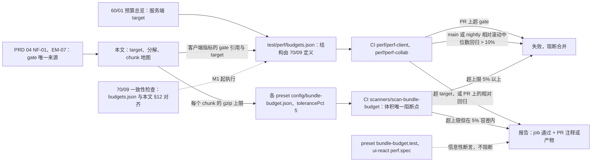
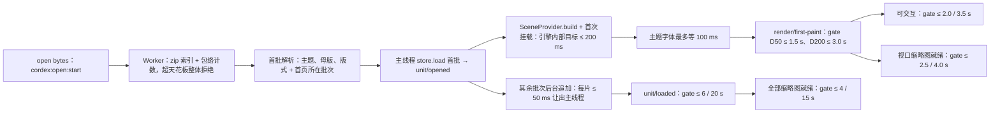
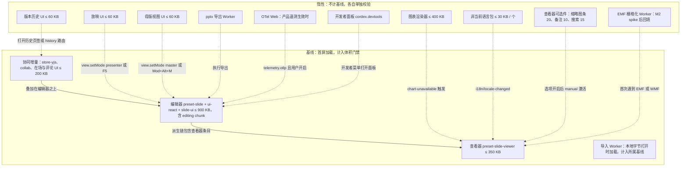
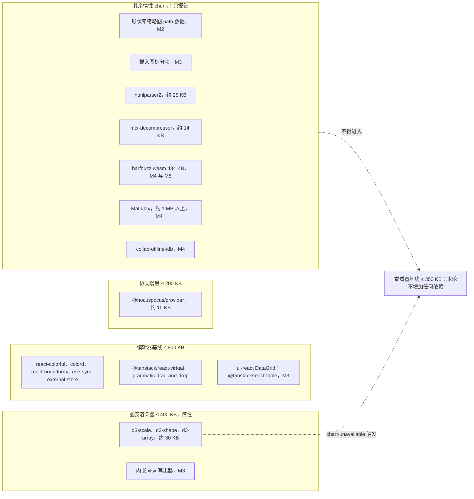
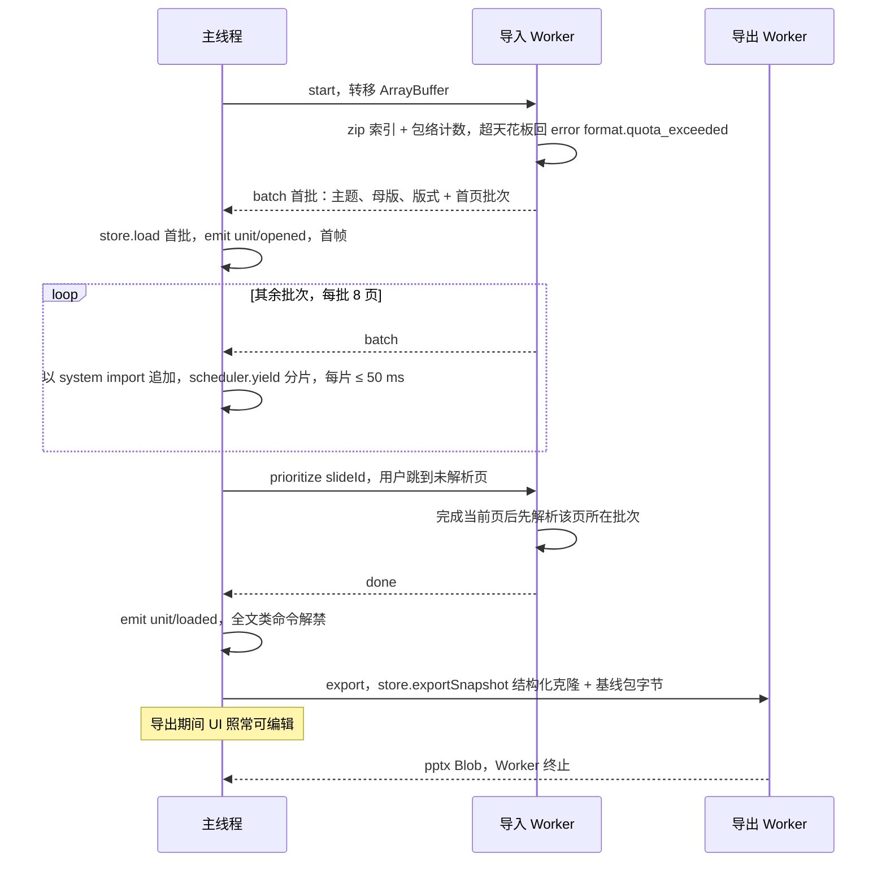
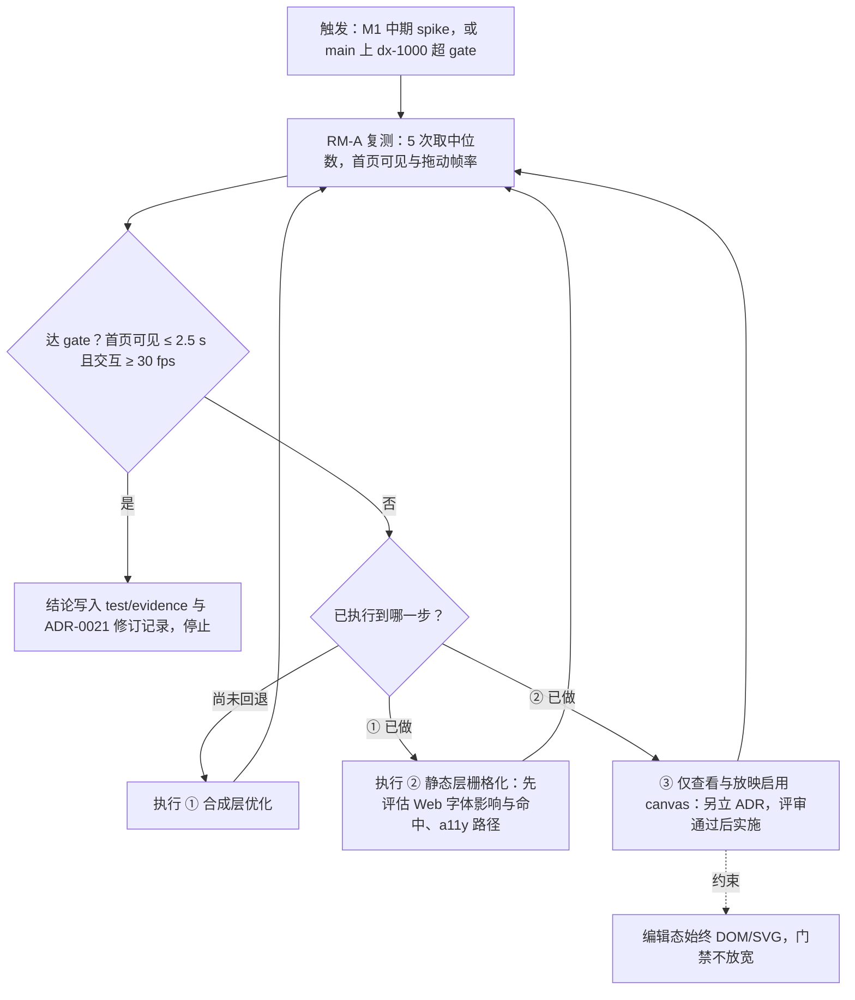

# 13 性能预算与分包
> 状态：v0.1 | 负责：前端设计线 | 更新：2026-09-25；2026-09-25（§4.19）；2026-09-26（§4.21：§6 chunk 地图补登新依赖——形状库 sprite、插入图标、图表底层 d3 与数据网格、htmlparser2、内嵌字体解压、harfbuzz wasm、MathJax、离线库；编辑器基线与协同增量估算更新；新增图 6-2；§4 的 update 大小与键入合并两行随 Hocuspocus 帧与 provider 合并改写）；2026-09-26（§4.21 整合：§6 查看器基线计入 @cordexjs/xml；形状库缩略图改为 path 数据模块（与 40/10、50/22 一致）；harfbuzz 区分 shaping 与 subset wasm；新增 opentype.js 惰性行；§8 主线程解析经 drive 分片）；2026-09-26（§4.21 Remap：原 30/07 迁出节的引用改指 50/01 §4a、50/19、50-frontend/04、50-frontend/13 等新位置）；2026-10-03（§4.24 TA-8：图表渲染器惰性 chunk 不再计入 @tanstack/react-table，数据网格归 ui-react `DataGrid`） | 依赖：PRD [04 非功能需求](../10-prd/04-non-functional-requirements.md) §0 / NF-01 §1.1–§1.6 / §1.5 材质层、PRD [05-embedding](../10-prd/03-features/05-embedding-and-integration.md) EM-07、PRD 03 OF-15 / ML-01 / ML-03 / ML-04、[30/07](../30-architecture/07-rendering.md) §1 / §9 / §14.2 / §14.6、[30/06](../30-architecture/06-collaboration.md) §9 / §14、[40/11](../40-modules/11-preset-assembly-and-app-shell.md) §2.3 / §3.4 / §10、设计 [09](../20-design/09-design-specification.md) §6.4、[09-06 扫描器](../30-architecture/09-type-discipline/06-scanners.md) §14、rulings §4.3 / §4.15 Q4 / Q5 / §4.18 CO-01 / CO-02 / CO-11 / CO-12 / §4.19 D-M2-CONTENT / D-COMMENTS-PKG / D-TEST-INFRA、§4.21（q-chart-route、q-extra-inserts、q-license-tiers、H:q-hp-provider）；[17 前端复用组件清单](17-reuse-and-dependency-catalog.md)

本文是前端性能 **target** 与分解、chunk 地图与惰性边界的唯一事实源。**gate**（门禁值）只来自 PRD NF-01 与 EM-07，本文表格里出现的 gate 数字只是引用，冲突时以 PRD 为准；怎么测、怎么判、在哪个 CI 步骤跑归 [70/09](../70-testing/09-performance-and-capacity.md)；服务端 target 归 [60/01](../60-backend/01-service-overview-and-roles.md) 的预算总览；体积扫描器的实现归 40/01。

## 0. 定位与边界

| 本文拥有 | 本文引用（事实源） |
|---|---|
| 客户端各指标的 target 与分解（§2–§5） | gate：PRD NF-01（§1.1–§1.6、材质层）、EM-07 |
| `performance.mark` 命名规范（§2.2） | `test/perf/budgets.json` 的结构、测量方法、噪声控制、判定规则：[70/09](../70-testing/09-performance-and-capacity.md) |
| chunk 地图、惰性边界与触发条件、分包规则（§6–§7） | 预算文件 `config/bundle-budget.json` 的 schema 与 `computeBudget`：40/11 §2.2–§2.3；`scan-bundle-budget` 实现：40/01 |
| Worker 清单与降级（§8） | Worker 入口文件与批次协议：40/04；打开管线语义：[04](./04-document-commands-and-undo.md) §2 |
| DX-1000 回退的决策流程（§11） | 每一步的渲染技术内容：[05](./05-rendering-and-thumbnails.md) §13.3 |
| 预算总表与 budgets.json 键名登记（§12） | 服务端 target：60/01；协同客户端行为：[07](./07-collaboration-client.md)；材质规则本体：[09](./09-ui-system-and-theming.md) §4 |

## 1. 预算两口径与事实源

- **gate**：PRD NF-01 与 EM-07 的数值，CI 超出即失败；只在**性能保证包络**内成立（D50 / D200 / DX-1000 / DX-MEDIA / 20 编辑者 + 50 查看者，rulings §4.15 Q5），只收紧不放宽（ratchet；例外须 `cordex-allow` 标注 + issue）。
- **target**：本文给出的内部目标与分解，比 gate 更严或把 gate 拆成可分别测量的段；超出只「报告」（job 通过 + PR 注释或产物），用于提前发现回归。
- **参考环境**：RM-A p75（全部客户端预算的口径）；RM-B 要求「预算 × 2 仍须满足」；客户端预算默认**文件字节已在内存**（不含下载）；协同预算按同区域 RTT ≤ 50 ms（PRD §0.1）。
- **天花板**：DX-20K（200 页 × 100 元素 = 20,000 元素）只验证可导入、可打开、可编辑、可协同、不崩溃；不设帧率 gate，内存按 PRD NF-01 §1.3「不越界即通过」判定（不承诺包络内的堆预算）；DX-DEEP 无额外预算，走同一虚拟化与时间切片。
- **门禁行为**（依据：T-PERF-GATE）：PR 上 D50 关键指标超 gate 即失败，相对 main 基线的回归只作 PR 注释；main 与 nightly 上相对滚动中位数回归 > 10% 失败并自动建 issue；5 次取中位数、预热、专用 runner。
- **runner**（依据：rulings §4.19 D-TEST-INFRA；runner 安排以 [70/09](../70-testing/09-performance-and-capacity.md) §9 为准）：性能 M1 用 GitHub larger runner（4 核）；自托管专用 runner 在 M2 前落地（承载 gated 的协同与服务端压测，随协同后端提前到 M2）；RM-B 以 CDP CPU 4× 节流近似。
- **体积**：唯一阻断点是 `scanners/scan-bundle-budget`，读各 preset 的 `config/bundle-budget.json`（值 = PRD 预算，`tolerancePct: 5` 显式登记，只收紧）；preset 的 `bundle-budget.test` 与 ui-react 的 `perf.spec` 降为信息性断言（依据：T-BUNDLE）。

**图 1-1 预算数据的来源与门禁流向**

怎么读：左侧是数值的来源（PRD 给 gate，本文与 60/01 给 target），中间两份机器副本分别喂给性能 job 与体积扫描器，右侧是三种判定结果；虚线是不阻断的辅助检查。
依据：PRD NF-01 / NF-09、EM-07；T-PERF-GATE、T-BUNDLE；30/11 §9。

## 2. 打开与首屏关键路径

### 2.1 路径与分解

本地字节打开走「Worker 解析、首批装载、后台追加」（rulings §4.18 CO-12，语义见 [04](./04-document-commands-and-undo.md) §2），本节只覆盖本地文件、M1 查看器与集成方的字节打开。**M2 起 apps/web 的服务端文档一律走快照 bootstrap 路径**（`GET snapshots/latest` + 票据 + WS，不走 Worker；rulings §4.19 D-M2-CONTENT），其打开预算见 §4「首页可见（协同打开）」与「初始同步」两行及 §12 的 `client.collab.firstPaint.*`、`client.collab.sync.*`。

**图 2-1 首屏关键路径与预算节点**

怎么读：从左到右是一次本地打开的时间线；上面一条是首屏主干，每个节点后的数字是该里程碑的 gate；`unit/opened` 之后分出两条并行支线——首屏继续渲染，其余批次在后台追加。
依据：50-frontend/04 §2；30/01 §4.1；PRD NF-01 §1.1；rulings §4.18 CO-02 / CO-12。

**首屏分解 target**（RM-A p75；初始值，M1 实测后只收紧）

| 段 | 起止 mark | D50 target | D200 target |
|---|---|---|---|
| Worker 启动 + zip 索引 + 包络计数 | `open:start` → `open:counted` | ≤ 350 ms | ≤ 1,000 ms |
| 首批解析与回传（主题、母版、版式 + 首页批次，每批 8 页） | `open:counted` → `open:first-batch` | ≤ 450 ms | ≤ 700 ms |
| 结构化克隆接收 + `store.load` 首批 | `open:first-batch` → `unit:opened` | ≤ 150 ms | ≤ 200 ms |
| 场景构建 + 首次挂载（CO-02 的引擎内部目标，不作门禁） | `unit:opened` → `render:mounted` | ≤ 200 ms | ≤ 200 ms |
| 主题字体等待（[05](./05-rendering-and-thumbnails.md) §7.3） | 与上段并行（字体在 `unit:opened` 时预发起），合计按最坏情况串行计入 | ≤ 100 ms | ≤ 100 ms |
| 浏览器样式、布局与绘制 | `render:mounted` → `render:first-paint` | ≤ 100 ms | ≤ 100 ms |
| **首页可见合计** | `open:start` → `render:first-paint` | **≤ 1,350 ms**（gate 1.5 s） | **≤ 2,300 ms**（gate 3.0 s） |
| 可交互（编辑插件就绪、主线程无待执行长任务） | `render:first-paint` → `open:interactive` | ≤ 300 ms | ≤ 300 ms |
| 视口缩略图就绪（每项 ≤ 40 ms p75，OF-15，最多 12 项） | `render:first-paint` → `thumbs:viewport-ready` | ≤ 600 ms | ≤ 600 ms |
| 后台全部解析（批次追加，每片 ≤ 50 ms） | `open:start` → `unit:loaded` | = gate 6 s | = gate 20 s |
| 全部缩略图就绪 | `unit:loaded` → `thumbs:all-ready` | = gate 4 s（自 open 起） | = gate 15 s（自 open 起） |
| 跳转到已解析页可见 | `nav:request` → `nav:visible` | ≤ 50 ms（gate 100 ms，模板已缓存） | 同左 |
| 跳转到未解析页可见（`prioritize` 抢占，CO-11） | 同上 | = gate 300 ms | = gate 300 ms |
| DX-1000 首页可见 / DX-MEDIA 首页可见 | `open:start` → `render:first-paint` | = gate 2.5 s / 3.0 s | — |

「全部缩略图就绪」在 `dom-scaled` 方案下的定义：全部页已装载，且 ThumbnailService 已在空闲切片内对每页完成一次预合成（场景构建与文本布局预热、不挂 DOM，可被导航抢占），此后缩略图栏滚动到任何位置，进入视口的项都在 40 ms 内出图。

### 2.2 `performance.mark` 命名规范

- 名称：`cordex:<area>:<point>`，`area ∈ open | unit | render | thumbs | nav | input | ime | cmd | undo | export | collab | master | theme | a11y`，`point` 用 kebab-case；需要区分实例时在 `detail` 里带 `{ unitId, seq }`，不把 id 拼进名称。
- measure：`cordex:m:<from>--<to>`（如 `cordex:m:open-start--render-first-paint`），由 perf harness 统一生成，业务代码只写 mark。
- 写入方：各 mark 由对应事件的发布者在 telemetry Provider 的 perf 模式下写入（测试与开发者面板开启时），生产默认不写；事件与 mark 一一对应：

| mark | 对应事件或位置 | 写入方 |
|---|---|---|
| `cordex:open:start` / `open:counted` / `open:first-batch` | `units.open` 调用、Worker 包络计数完成时的 `unit/open-progress` 上报（阶段名以 40/04 批次协议为准）、首个 `batch` 到达 | model-core 打开管线 |
| `cordex:unit:opened` / `unit:loaded` | `unit/opened` / `unit/loaded` | model-core |
| `cordex:render:mounted` / `render:first-paint` | 首次 `paint` 完成 / `render/first-paint` | engine-render |
| `cordex:open:interactive` | 编辑器：editing 条目就绪且之后首个空闲回调；查看器 = first-paint | preset 装配 |
| `cordex:thumbs:viewport-ready` / `thumbs:all-ready` | 缩略图栏视口内全部项首次 `slide/thumbnail-updated` / 预合成完成 | slide-ui 缩略图栏 / slide-render ThumbnailService |
| `cordex:nav:request` / `nav:visible` | 导航命令受理 / 目标页首次 paint 完成 | slide-ui / engine-render |
| `cordex:input:start` / `input:painted` | `beforeinput`（组合为 `compositionupdate`，area 用 `ime`）的 `timeStamp` / 包含该节点的 `render/frame` 结束 | render-dom text-host / engine-render |
| `cordex:cmd:start` / `cmd:end` | `commands.execute` 进入 / `CommandResult` 返回 | model-core commands |

其余 area（`master:enter`、`theme:edit`、`export:start` / `export:end`、`collab:*`）按同一规则由对应命令或事件的发布者写入，起止点见 §3–§4 与 §12 的测量列。

## 3. 交互预算

gate 列只是 PRD 的引用（NF-01 §1.2 / §1.4、PRD 07 ML-01 / ML-03 / ML-04、OF-15）；target 列为本文内部目标，「=」表示与 gate 相同。

| 指标 | gate | target | 测量 | 负责包 |
|---|---|---|---|---|
| 拖动 / 缩放 / 平移（≤ 300 元素页） | ≥ 55 fps，p95 帧 ≤ 33 ms | 帧脚本 ≤ 8 ms | 交互期间 trace 帧统计 | engine-render、render-dom、slide-ui |
| 同上（DX-1000） | ≥ 30 fps | = | 同上 | 同上 |
| 键入延迟（keydown → paint，拉丁） | p95 ≤ 50 ms | p50 ≤ 16 ms，p95 ≤ 33 ms | `input:start` → `input:painted` | render-dom、engine-layout、slide-ui |
| IME 组合更新（CJK） | p95 ≤ 80 ms | = | `ime:start` → `ime:painted` | render-dom |
| 命令执行（常见单元素，不含渲染） | p95 ≤ 10 ms | = | `cmd:start` → `cmd:end` | model-core、model-slide |
| 批量命令（对齐 100 元素） | ≤ 100 ms | = | 同上 | 同上 |
| 撤销 / 重做 | p95 ≤ 50 ms | = | 同上（`core.undo` / `core.redo`） | model-core |
| 命中测试（300 元素页） | p95 ≤ 2 ms | = | `hitTest` 调用耗时 | engine-render |
| 吸附与参考线计算（300 元素页） | p95 ≤ 4 ms | = | 拖拽帧内吸附计算耗时 | slide-ui |
| 局部变更重绘范围 | 仅受影响元素 + 覆盖层 | 单属性变更恰 1 次 `update`、≤ 5 ms | A28 单测 + trace | engine-render、slide-render |
| 版式变更页级重合成（30 元素） | — | ≤ 30 ms | bench | slide-render |
| 缩略图更新（编辑后） | ≤ 500 ms | 去抖 300 ms + 渲染 ≤ 100 ms | 事务提交 → `slide/thumbnail-updated` | slide-render |
| 单个缩略图挂载 | ≤ 40 ms p75（OF-15） | = | 挂载 → 该项首次 paint | slide-render |
| 缩略图栏滚动（200 页） | ≥ 55 fps | 同时挂载 ≤ 12 项 | trace 帧统计 | slide-ui、slide-render |
| 文本搜索（D200 全文） | ≤ 200 ms | = | 模型索引查询，不走 DOM | model-slide |
| 全部替换（D200） | ≤ 500 ms，一个事务 | = | `cmd:start` → `cmd:end` | model-slide |
| 界面主题切换（亮 / 暗） | ≤ 100 ms，无闪烁 | = | 切换 → 下一帧 | design、ui-react |
| 进入母版视图（D50） | ≤ 300 ms p75 | = | `master:enter` → 画布与窗格首帧 | slide-ui、slide-render |
| 母版窗格切换节点、范围条切换 | ≤ 100 ms | = | 同上 | 同上 |
| 母版 / 版式属性修改 → 全部引用页与缩略图更新（D50） | ≤ 500 ms | = | 事务提交 → 最后一个受影响缩略图更新 | slide-render |
| 主题色与主题字体编辑后全文重算（D50） | ≤ 300 ms | = | `theme:edit` → 可见页重绘完成 | model-slide、slide-render |
| 导出 pptx（D50 / D200，客户端） | ≤ 3 s / ≤ 12 s，期间 UI 可编辑 | = | `export:start` → Blob | ooxml-pptx（Worker） |
| 导出单页 PNG | @1920 ≤ 300 ms（NF-01 §1.4）；@1280 ≤ 150 ms（OF-15，M2） | = | `export:start` → Blob | render-dom（主线程） |
| 导出全部 PNG @1280（D50 / D200） | ≤ 15 s / ≤ 60 s | M3 起由 `server-png` 承担，客户端不再对批量门禁 | — | 见注 |
| 主线程最长阻塞任务 | ≤ 50 ms | = | Long Tasks 观察 | 全部 |
| 可访问树：可见页列表项 | — | 与首帧同批就绪，不另加延迟（计入首页可见） | `render:first-paint` 时可见页列表项已存在 | render-dom、slide-render |
| 可访问树：其余已装载页 | 主线程最长任务 ≤ 50 ms | 空闲时间分片，每片 ≤ 2 ms（[16](./16-i18n-and-accessibility.md) §9）；D50 / D200 在 `unit:loaded` 后 ≤ 1 s / ≤ 3 s 建完（初始值，M2 实测后只收紧） | `unit:loaded` → `a11y:tree-ready` | render-dom、slide-render |
| 可访问树：增量更新 | — | 单次事务 p95 ≤ 2 ms（只改受影响列表项，[05](./05-rendering-and-thumbnails.md) §11） | 事务提交 → 列表项更新完成 | render-dom |

注：客户端 PNG 在 SVG 路线下只能在主线程完成（[05](./05-rendering-and-thumbnails.md) §10.3），M2 位图 spike 结论前只对「单页、无 Web 字体依赖」门禁；批量 PNG 从 M3 起走服务端（30/07 §14.6 对 PRD NF-01 §1.4「客户端 Worker 导出 PNG」的修正，PRD 04 NF-01 §1.4 已回写）。

## 4. 协同客户端预算

只列客户端可观测的部分；服务端处理、落库与扇出的 target 归 [60/01](../60-backend/01-service-overview-and-roles.md)，会话与队列行为归 [07](./07-collaboration-client.md)。M2 起 apps/web 服务端文档的打开就是本节的快照 bootstrap 路径（rulings §4.19 D-M2-CONTENT）：本地回显、A → B 可见、初始同步、首页可见、重连重同步与 update 大小自 M2 起进入门禁；presence、权限变更与远端覆盖层三行属 M3 多人协同体验层。

| 指标 | gate（PRD NF-01 §1.6） | target | 测量 |
|---|---|---|---|
| 本地回显 | ≤ 16 ms | `observe` 在 `transact` 返回前同步触发，回显与本地编辑同帧（30/06 §14） | 单测 + trace |
| A 提交 → B 可见 | p50 ≤ 150 ms，p95 ≤ 400 ms | 端到端 ≤ RTT + 100 ms（p95） | 双浏览器时间戳差 |
| presence 传播 | p95 ≤ 200 ms | awareness 节流 ≥ 50 ms（≤ 20 帧/s） | 双浏览器 |
| 初始同步（加入房间到 `collab/synced`） | D50 ≤ 2 s，D200 ≤ 5 s（p75） | D200 在 10 Mbps 下 ≤ 3 s（span `collab.bootstrap`，含 HTTP 快照与 step2） | span |
| 首页可见（协同打开，M2 起服务端文档的打开路径） | 同 §2 gate（D50 ≤ 1.5 s、D200 ≤ 3.0 s） | HTTP 快照 `applyUpdate` 后不等 `live`，`syncing` 即可渲染；初始值 = gate，M2 实测后只收紧 | `cordex:collab:bootstrap-start` → `render:first-paint` |
| 重连重同步（≤ 5,000 待同步 update） | ≤ 3 s | = | 断网模拟 |
| 权限变更生效 | ≤ 2 s | p95 ≤ 1 s | 审计时间戳 vs 客户端事件 |
| 20 个远端选区覆盖层 | ≥ 55 fps | 覆盖层不进脏区（[05](./05-rendering-and-thumbnails.md) §5.2） | trace |
| 单个 update 大小 | ≤ 1 MB | 以 `auth.ok.limits.maxUpdateBytes`（默认 1 MiB，按 Hocuspocus 帧内的 update 字节计，ADR-0039；原「不含 1 字节 FrameType」随 1 字节信封作废）为准，收到 `auth.ok` 前用客户端兜底配置（依据：INC-07）；超限按命令分批或走导入；长离线重连的 step2 单设 16 MiB 上限，超限收到 4413 后导出重载（rulings §4.21 H:q-hp-step2-cap） | 单测 |
| 键入 update 大小（合并后） | — | ≤ 200 B（p50），由 @hocuspocus/provider 的 `flushDelay=50` 合并（H-d-28，原 collab-yjs 自有 50 ms 合并作废） | 单测统计 |

## 5. 内存预算

gate（PRD NF-01 §1.3，Chrome JS heap + 可回收资源）：编辑器稳态 D50 ≤ 250 MB、D200 ≤ 700 MB；打开峰值 ≤ 350 MB / ≤ 1.0 GB；查看器稳态 ≤ 150 MB / ≤ 450 MB；20 次打开 / 关闭循环 heap 增长 ≤ 5%（依据：T-PERF-GATE）；关闭后 `fiber.getEffects()` 为空；blob URL 泄漏 0。

**D200 编辑器（协同）稳态的 target 分解**（初始估计，M1 以 T3 实测回填，只收紧）

| 组成 | target | 说明 |
|---|---|---|
| 文档状态（store-yjs 的 Y.Doc） | ≈ 85 MB | 实测约 13.8 KB 堆 / 元素 × 约 6,000 元素（30/06 §9.1）；单人模式 store-memory 更小 |
| 派生缓存（StyleCache、样式链缓存、MeasureCache、布局结果缓存、HitTestIndex） | ≤ 60 MB | 各自 LRU 上限见 [05](./05-rendering-and-thumbnails.md) §13.1 |
| UI（React 树、ui-core 视图模型、命令与贡献表） | ≤ 60 MB | — |
| **JS 堆合计** | **≤ 300 MB** | 30/07 §9 的客户端堆 target |
| MediaCache | ≤ 256 MiB（≈ 268 MB） | 按字节 LRU，引用中条目不淘汰 |
| DOM（≤ 3 个挂载页 + ≤ 12 个缩略图 + 32 个模板 + 可访问树） | ≤ 100 MB | 可访问树（D200 约 6,000 个纯文本列表项，不随虚拟化裁剪）target ≤ 10 MB，计入本行 |
| **合计** | **≤ 670 MB**（300 + 268 + 100 取整；gate 700 MB） | — |

- D50 编辑器：JS 堆 target ≤ 150 MB（Y.Doc 约 17.8 MB）+ 媒体（D50 图片约 12 MB）+ DOM ≤ 60 MB，合计 ≤ 230 MB（gate 250 MB）。
- 查看器：store-memory、`historyLimit: 0`、无 React、无协同，稳态 target = gate。
- 打开峰值：导入 Worker 在全部批次回传后释放 zip 索引与已回传批次；媒体懒解压，首次渲染时才取字节；峰值 target = gate。
- DX-20K：仅 Y 状态约 276 MB，加渲染缓存会超出 300 MB 堆 target——天花板内只保证能打开、能编辑、不崩，不承诺包络内的帧率与堆预算（rulings §4.15 Q5）；`ceiling` 档按 PRD NF-01 §1.3「不越界即通过」判定，M1 回填实测值。

## 6. 体积预算与 chunk 地图

gzip，初始加载，不含字体与 peer 依赖（React 本体）。gate 来自 PRD NF-01 §1.5 与 EM-07；「估算」列来自 40/11 §3.4 的分解，M2 按实测校准。

| chunk | 内容 | 上限（gzip） | 估算 | 计入 | 触发条件 | 里程碑 |
|---|---|---|---|---|---|---|
| 查看器基线 | `preset-slide-viewer`：kernel、protocol + i18n 服务、model、`@cordexjs/xml`（2026-09-26 新增，原型 gzip 约 4.4 KB，完整版体积待 M1 spike 回填；它取代的是 ooxml-core 内原有的解析器，不另增一份）、ooxml、layout、render、slide-render、design 主题 CSS、查看器壳 | ≤ 350 KB | 345 KB | 基线 | 首屏 | M1 |
| 编辑器基线 | `preset-slide` + ui-core + ui-react（含 shadcn 复制件）+ slide-ui + `model-slide/editing` chunk + 图标子集 | ≤ 900 KB | ≈ 774 KB；§4.21 新增 react-colorful、colord、@tanstack/react-virtual、pragmatic-drag-and-drop、react-hook-form 与 use-sync-external-store 约 31–36 KB 后 ≈ 810 KB（M2 实测回填） | 基线 | 首屏（`editing` 为独立 chunk 但随编辑器加载，不惰性） | M2 |
| 协同增量 | store-yjs + yjs、collab 三包、lib0 / y-protocols、@hocuspocus/provider、在场 UI 与评论（`comments` 包及 slide-ui 的评论贡献，M3 装入，rulings §4.19 D-COMMENTS-PKG） | ≤ 200 KB | ≈ 150 KB；@hocuspocus/provider 4.7.0 连同 common 与 @lifeomic/attempt 约 10 KB（gzip -9 实测，未最小化），自研传输代码相应减少（M2 实测回填） | 叠加在编辑器之上 | 打开服务端文档（M2 起一律协同快照，rulings §4.19 D-M2-CONTENT） | M2（在场 UI 与 `comments` 部分 M3） |
| 导入 Worker | ooxml-core + ooxml-pptx 导入管线 | 计入所属 preset 基线（40/11 §3.4 的 ooxml 行） | — | 基线 | 本地字节打开时创建；协同打开不加载 | M1 |
| 当前语言包 | `options.locale` 对应的语言包 | ≤ 30 KB | — | 单独校验，不计基线 | 与首屏并行加载 | M1 |
| 图表渲染器 | M1–M2 `@cordexjs/slide-render/chart`，M3 起 `slide-render-chart`：d3-scale、d3-shape、d3-array（约 30 KB）+ 自研 OOXML 布局 + numfmt；M3 另含内嵌 xlsx 写出器（ADR-0036）。数据网格（@tanstack/react-table 9 + shadcn Table）只在 ui-react 通用 `DataGrid`，随 ui-react 计入编辑器侧，不算进本 chunk（[01](01-overview-and-runtime-map.md) §1a，rulings §4.21、§4.24 TA-8；slide-render-chart 不 import react，ADR-0036 决策 6） | ≤ 400 KB | — | 惰性 | 首个 `render/element-degraded{reason:'chart-unavailable'}`；`charts.enabled: false` 时永不加载 | M1 |
| 其他语言包 | 每个 | ≤ 30 KB | — | 惰性 | `i18n/locale-changed` | M1 |
| 查看器可选件 | 缩略图条 / 备注抽屉 / 搜索 | ≤ 20 / 10 / 15 KB | — | 惰性 | 对应选项为 true 时 `manual` 激活 | M1 / M2 |
| 放映 UI | slide-ui 放映舞台与控制条 | ≤ 60 KB | — | 惰性 | `view.setMode{mode:'presenter'}`、F5、`/documents/:id/present` | M2 |
| 母版视图 UI | slide-ui 母版窗格、范围条、版式画廊 | ≤ 60 KB | — | 惰性 | `view.setMode{mode:'master'}`、Mod+Alt+M | M2 |
| 版本历史 UI | 历史页签与 `/documents/:id/history` | ≤ 60 KB | — | 惰性 | 打开历史页签或路由（需 `history.read`） | M3 |
| EMF / WMF 栅格化 Worker | emf-converter 4.0.x 封装（4.0.0 的 dist 未最小化 gzip -9 约 205 KB，2026-09-26 实测） | M2 spike 按最小化产物回填，只收紧 | — | 惰性，不计 350 KB 基线 | 首次遇到 EMF / WMF | M2 |
| pptx 导出 Worker | ooxml-pptx 导出路径 | 目标从基线移出（40/11 G-14，可省约 25 KB） | ≈ 25 KB | 惰性（目标） | 执行导出 | M2 |
| apps/web 路由 chunk | 每个页面 `React.lazy` 一个 chunk | 首屏路由 chunk ≤ 250 KB（不含 preset） | — | 单独校验 | 路由切换 | M2 |
| `/render` 页 | 查看器 preset + 渲染页，惰性全部关闭 | 不设 gate，只报告 | — | — | renderer 内加载 | M3 |
| OTel Web | apps/web 的 OTel Web SDK 与 OTLP 导出器（[15](./15-events-errors-and-telemetry.md) §7） | 不设 gate，只报告 | 约 40–60 KB | 惰性，不计基线 | 产品遥测生效（RuntimeConfig `telemetry.otlp` ∧ 用户开关，15 §9）时加载；否则永不加载 | M3（随 `/telemetry/otlp`） |
| 开发者面板 `cordex.devtools` | ui-react 承载的诊断面板各页（15 §10） | 不设 gate，只报告 | — | 惰性，不计基线 | 开发者菜单可见（DEV 或 `features.developerMenu`）且打开面板 | M2 |
| 形状库缩略图 path 数据 | 构建期由 `tooling/scripts/gen-shape-gallery-thumbs.ts` 调 engine-layout `presetGeometryPath` 生成的 slide-ui `domain/shape-gallery-thumbs.ts`（首批 72 项 10 类，R-d-66；2026-09-26 整合时由原「SVG sprite」方案改为与 40/10、50/22 一致的 path 数据模块） | 不设 gate，只报告 | M2 实测回填 | 惰性 chunk，不计基线 | 首次打开形状库 flyout | M2 |
| 插入图标库 | lucide-static 1.48.0 的 SVG 字符串按分类分块（包解包 51 MB，只取图标数据） | 不设 gate，只报告；每块上限 M3 实测后定 | — | 惰性，不计基线 | 打开「图标」面板或切换分类 | M3（P2） |
| 剪贴板 HTML 解析 | htmlparser2 12（含 entities 解码表） | 不设 gate，只报告 | 约 25 KB | 惰性，不计基线 | 粘贴项只有 `text/html`、没有 `text/plain` 时（[14](14-client-security.md) §5） | M2 |
| 内嵌字体解压 | mtx-decompressor 1.6.0（EOT 容器里的 MicroType Express 解压） | 不设 gate，只报告 | dist 未最小化 gzip -9 约 14 KB | 惰性；**不得进查看器基线**（基线估算 345 KB，余量约 5 KB） | 包内出现 `p:embeddedFontLst`，在导入 Worker 内动态 import | M2（OF-17） |
| 复杂文种 shaping | harfbuzzjs 1.6.2 的 shaping wasm（`harfbuzz.wasm`）+ bidi-js 1.1.0；`harfbuzz-subset.wasm`（651 KB）只在 tooling 做字体子集，不进浏览器 | 不设 gate，只报告 | wasm 434 KB（未压缩）；bidi-js 解包 171 KB | 惰性，不计基线；需要 CSP `'wasm-unsafe-eval'`（[14](14-client-security.md) §2.7） | 启用 RTL / 复杂文种 Provider 且文档含相应文种 | M4 / M5 |
| 艺术字字形轮廓 | opentype.js 2.0.0（取字形轮廓做艺术字变形，2026-09-26 整合登记，[50/20](20-elements-text.md) §5） | 不设 gate，只报告 | — | 惰性，不计基线 | 首个需要可编辑渲染的艺术字变形 | M4+ |
| 公式渲染 | MathJax 4 SVG 输出与 OMML ↔ MathML 转换 | 不设 gate，只报告 | 按需约 1 MB 以上 | 惰性，不计基线 | 首个需要可编辑渲染的公式；M1–M3 公式走 `mc:Fallback` 图片，不加载 | M4+ |
| 离线持久化 | collab-offline-idb（idb 8.0.3 约 1.2 KB gzip + 自写适配） | 不设 gate，只报告 | — | 惰性，叠加在协同增量之上 | `offline.enabled` 为真 | M4 |

**图 6-1 chunk 地图：基线与惰性**

怎么读：上框是首屏必加载的三档基线（实线表示 viewer ← slide ← collab 的派生叠加关系），下框每个惰性 chunk 用虚线指向它挂靠的基线，线上文字是触发条件；惰性 chunk 不计入所挂基线的门禁，各自按上限单独校验。
依据：PRD NF-01 §1.5、EM-07；40/11 §3.1 / §3.4；rulings §4.18 FE-06 / FE-08。

**图 6-2 §4.21 新依赖落到哪一档 chunk**

怎么读：左上两块是会进首屏的新依赖（编辑器基线估算 ≈ 810 KB、协同增量加约 10 KB），其余新依赖全部惰性；数据网格只在 ui-react 的 `DataGrid`（M3 起随编辑器侧计量），不进图表渲染器 chunk（rulings §4.24 TA-8）；查看器基线本轮一项不加——内嵌字体解压虽然属于 ooxml-core，也必须在导入 Worker 内动态加载，否则就会越过 350 KB。
依据：[17](17-reuse-and-dependency-catalog.md) §2–§13；ADR-0036；rulings §4.21 q-chart-route、q-extra-inserts、q-license-tiers。

**门禁机制**（依据：T-BUNDLE）

- 事实源：各 preset 的 `src/config/bundle-budget.json`（`{ preset, gzipKb, chunks, lazy, tolerancePct: 5 }`，schema 与 `computeBudget` 见 40/11 §2.2–§2.3）；apps/web 的路由 chunk 预算同形态，文件落点待 40/11 登记。
- 唯一阻断点：`scanners/scan-bundle-budget`（在 build 之后运行）读构建 stats，按 chunk 名归组计算 gzip 字节：超上限 5% 以上失败，超上限但在 5% 内只报告；惰性 chunk 单独校验；每个 PR 报告体积变化。
- 其余断言（preset `bundle-budget.test`、ui-react `perf.spec`）为信息性，不阻断。
- 口径冲突：[09-06](../30-architecture/09-type-discipline/06-scanners.md) §14 仍写「读 `tooling/policy/budgets.json` 的 `<package>:bundle-size-bytes`、按 `dist/**` 原始字节」，与 T-BUNDLE 不一致，待回写为「读 `config/bundle-budget.json`、按 chunk gzip」。

## 7. 分包规则

1. **惰性边界只有两种来源**：preset 惰性条目的 `lazy: () => import(…)`（触发见 §6 表）与 apps/web 路由的 `React.lazy`；不用构建配置手工拆惰性块。
2. **基线内按包分组**：基线 chunk 按包分组（kernel / shared / protocol、model、ooxml、render、ui），提高跨版本发布的缓存命中；分组规则只写在 `apps/web/vite.config.ts`（Vite 8）。
3. **惰性模块不得被基线静态 import**：`lazy.test.ts` 断言无图表文档的图表 chunk import 计数为 0；`scan-bundle-budget` 读 chunk 图，惰性模块出现在基线 chunk 即失败。
4. **`sideEffects` 与 `exports`**：包 `package.json#sideEffects: false`（CSS 文件除外）；惰性入口以 `exports` 子路径声明（`./chart`、`./editing`、`./entries`）；`./testing` 由 depcruise `no-testing-in-prod` 挡在生产图之外。
5. **预加载**：首屏路由 chunk 用 `modulepreload`；编辑器在 `unit/loaded` 后的空闲时间 `prefetch` 放映与母版视图 chunk（查看器不预取）；图表、语言包、EMF Worker、导出 Worker，以及 §4.21 新增的形状库缩略图 path 数据、插入图标、剪贴板 HTML 解析、内嵌字体解压、复杂文种 shaping、公式渲染与离线持久化都不预取，触发即加载。
6. **Worker 入口**：一律 `new Worker(new URL('./x.worker.ts', import.meta.url), { type: 'module' })`，产物在同源 `/assets/` 下，受 Trusted Types `createScriptURL` 策略与 `worker-src 'self'` 约束，不使用 `blob:` Worker（策略正文见 [14](./14-client-security.md) §2–§4）。
7. **版本漂移**：带哈希的资源 `immutable`，`index.html` 为 `no-store`；惰性 chunk 加载失败或收到关闭码 4426 / 4427 → 横幅「发现新版本」，协同中先 flush 再刷新；M1–M4 不引入 Service Worker（依据：VERSION-DRIFT-SW，事实源 [02](./02-app-shell-routing-and-session.md) §12；横幅见 [10](./10-editor-shell-and-interaction.md) §11，协同 flush 见 [07](./07-collaboration-client.md)）。

## 8. Worker 清单与降级

| Worker | 入口 | 何时创建 | 输入 → 输出 | 生命周期 | 无 Worker 环境 |
|---|---|---|---|---|---|
| 导入解析 | ooxml-pptx `infrastructure/import/import.worker.ts` | `units.open` 本地字节 | 转移的 `ArrayBuffer` → 批次（结构化克隆，媒体字节按需 Transferable）；消息 `start / batch / prioritize / cancel / done / error` | 全部批次到齐或取消后终止 | 同一代码在主线程分片执行，每片 ≤ 50 ms 让出（XML 解析经 `@cordexjs/xml` 的 `drive` 按 64 KiB 分片、注入 kernel 调度器的 `shouldYield`，ADR-0019 决策 2），行为等价只是更慢 |
| pptx 导出 | 待 40/04 登记（建议 ooxml-pptx `infrastructure/export/export.worker.ts`） | 执行导出 | `store.exportSnapshot()` 的结构化克隆 + 基线包字节 → pptx `Blob` | 导出完成后终止，基线包字节只在此期间常驻 | 主线程分片 |
| EMF / WMF 栅格化 | slide-render `infrastructure/media/emf-rasterizer.worker.ts` | 首次遇到 EMF / WMF | 图元字节 → 位图 | 空闲 60 s 回收；超时终止任务 | 保持占位，不在主线程栅格化 |

不进 Worker 的工作：PNG / JPEG 导出（`toImage` 需要 DOM 布局与序列化，主线程分片）；文本度量与布局（需要 canvas 与已加载字体）；媒体 sha256（SubtleCrypto 异步）。Worker 只做纯计算、不持有可写模型（A31 / D5）。

**主线程让出**：所有可能超过 50 ms 的主线程批处理（批次追加、缩略图预合成、多页导出、D200 全文替换的应用阶段）按片执行，片间用 `scheduler.yield()`（不可用时退回 `MessageChannel`）；Long Tasks 观察在 perf 场景断言无 > 50 ms 任务。

**图 8-1 主线程与 Worker 分工**

怎么读：纵向是时间；上半段是一次渐进打开（包络计数在首批回传之前完成，超天花板整体拒绝），`loop` 是后台追加，`prioritize` 是主线程发给 Worker 的抢占消息；下半段是导出——Worker 只拿快照副本，主线程继续编辑不受影响。
依据：50-frontend/04 §2；rulings §4.18 CO-11 / CO-12；PRD NF-01 §1.4「导出期间 UI 可编辑」。

## 9. 渲染侧手段

技术细节在 [05](./05-rendering-and-thumbnails.md)，这里只列手段与它服务的预算：

| 手段 | 服务的预算 | 细节 |
|---|---|---|
| 可见优先 + 时间切片（帧脚本 8 ms，剩余脏页顺延） | 帧率、主线程最长任务 | 05 §2 |
| 只重绘受影响元素、只写变化的 attribute、`DocumentFragment` 批量提交 | 单属性变更、键入延迟 | 05 §3 |
| 模板层克隆（LRU 32） | 跳转到已解析页 ≤ 50 ms、版式变更 ≤ 30 ms | 05 §1 |
| 虚拟化（挂载 ≤ 3 / 6 页、缩略图 ≤ 12 项）+ 屏外 `content-visibility` | 首屏、缩略图栏滚动、内存 | 05 §4 |
| 四处 LRU（样式、媒体、度量、模板） | 内存、命中率 | 05 §13.1 |
| 覆盖层独立刷新 | 20 个远端覆盖层 ≥ 55 fps | 05 §5.2 |
| 交互期间才加 `will-change: transform`、`pixelRatioCap: 3`、SVG 数值 2 位小数 | 拖动帧率、属性写入量 | 05 §1、§13.3 |
| 同一帧内先读几何再写 DOM，`ResizeObserver` 回调合并到下一帧 | 避免强制同步布局 | 05 §2 |

## 10. 材质性能

材质的视觉与 token 规则在 [09](./09-ui-system-and-theming.md) §4；本节只列性能口径（gate 来自 PRD NF-01 §1.5「材质层」）：

- 同屏 `backdrop-filter` 元素 ≤ 4（壳 3 块 + 1 个浮层）；画布区不加玻璃。
- 拖拽分栏与画布缩放动画期间帧时间 p95 ≤ 16.7 ms：交互开始时在壳根元素加 `data-interacting`，玻璃面板临时切为不透明，结束后恢复（设计 09 §6.4，M2）。
- 玻璃面板 `contain: paint`（M2），避免面板内重绘波及画布。
- `prefers-reduced-transparency: reduce` 或不支持 `backdrop-filter` 时退化为不透明 `--card`，文字对比不变。
- 不使用 SVG 折射（`feDisplacementMap`）与扫光动画。

## 11. DX-1000 回退决策流程

对外门禁只有 DX-1000「首页可见 ≤ 2.5 s、交互 ≥ 30 fps」；「场景构建 + 首次挂载 ≤ 200 ms」只是引擎内部分解目标（rulings §4.18 CO-02）。回退按 ① 合成层优化 → ② 静态层栅格化 → ③ 仅查看与放映启用 canvas 的顺序执行（CO-01），每一步做什么见 [05](./05-rendering-and-thumbnails.md) §13.3；本节定义何时触发、谁决定、如何复测与留证。

- **触发**：M1 中期 spike（perf 场景 `dx-1000`，RM-A runner）；或 main / nightly 上 `dx-1000` 超 gate。
- **决定人**：前端设计线负责人提出，架构-运行时评审；①、② 的结论写入 ADR-0021 修订记录；③ 须另立 ADR 评审后才实施（40/06 §1.1）。
- **复测**：每一步完成后按 70/09 的口径（5 次取中位数、预热、RM-A p75；RM-B 按预算 × 2 仍须满足）复测首页可见与拖动帧率。
- **留证**：每次复测的数据与结论写 `test/evidence/M1/dx-1000.md`（格式见 70 线）。
- **不变量**：任何一步都不放宽门禁；编辑态始终 DOM/SVG。

**图 11-1 DX-1000 回退决策**

怎么读：这是一个「复测 → 判定 → 下一步」的循环，每一轮只前进一步；只有达 gate 才能退出循环；③ 之前多了一道 ADR 评审。
依据：ADR-0021 修订 2；rulings §4.18 CO-01 / CO-02；40/06 §1.1。

## 12. 预算总表（供 70/09 汇编 `test/perf/budgets.json`）

键名规则：`client.<area>.<metric>[.<doc>]`（lowerCamel；`doc ∈ d50 | d200 | dx1000 | dxMedia | dx20k`）；结构、统计量与判定由 [70/09](../70-testing/09-performance-and-capacity.md) §2 定义，本表登记键名与数值来源；target 列一律写成可与 gate 直接比较的绝对值（70/09 §2.2 C2、C3 按「budgets.json 键名」列逐键比对），「=」表示与 gate 相同。体积预算不在此表，见 §6 与 `config/bundle-budget.json`。

| budgets.json 键名 | 指标 | gate（PRD） | target | 测量起止 | 负责包 |
|---|---|---|---|---|---|
| `client.open.firstPaint.{d50,d200}` | 首页可见 | ≤ 1.5 / 3.0 s | ≤ 1.35 / 2.3 s | `open:start` → `render:first-paint` | model-core、engine-render |
| `client.open.firstPaint.{dx1000,dxMedia}` | 极端文稿首页可见 | ≤ 2.5 / 3.0 s | = | 同上 | 同上 |
| `client.open.interactive.{d50,d200}` | 首页可交互 | ≤ 2.0 / 3.5 s | ≤ 1.65 / 2.6 s（首页可见 target + 300 ms） | `open:start` → `open:interactive` | preset |
| `client.thumbs.viewportReady.{d50,d200}` | 视口缩略图就绪 | ≤ 2.5 / 4.0 s | ≤ 1.95 / 2.9 s（首页可见 target + 600 ms） | `open:start` → `thumbs:viewport-ready` | slide-ui、slide-render |
| `client.open.loaded.{d50,d200}` | 后台全部解析 | ≤ 6 / 20 s | = | `open:start` → `unit:loaded` | ooxml-pptx、model-core |
| `client.thumbs.allReady.{d50,d200}` | 全部缩略图就绪 | ≤ 4 / 15 s | = | `open:start` → `thumbs:all-ready` | slide-render |
| `client.nav.parsed` / `client.nav.unparsed` | 跳转到已解析 / 未解析页 | ≤ 100 / 300 ms | ≤ 50 ms / = | `nav:request` → `nav:visible` | engine-render、ooxml-pptx |
| `client.main.longTask` | 主线程最长阻塞任务 | ≤ 50 ms | = | Long Tasks 观察 | 全部 |
| `client.interact.fps` / `client.interact.frameP95` / `client.interact.fps.dx1000` | 拖动、缩放、平移 | ≥ 55 fps、p95 ≤ 33 ms / DX-1000 ≥ 30 fps | = / = / = | 交互期间帧统计 | engine-render、render-dom |
| `client.render.frameScript` | 每帧 flush 脚本耗时（交互期间 p95） | — | ≤ 8 ms | `render/frame` 的 `ms` | engine-render |
| `client.input.typing` | 键入延迟 | p95 ≤ 50 ms | p50 ≤ 16、p95 ≤ 33 ms | `input:start` → `input:painted` | render-dom、engine-layout |
| `client.ime.update` | IME 组合更新 | p95 ≤ 80 ms | = | `ime:start` → `ime:painted` | render-dom |
| `client.cmd.single` / `client.cmd.batch100` / `client.undo` | 命令、批量、撤销 | p95 ≤ 10 / ≤ 100 / p95 ≤ 50 ms | = | `cmd:start` → `cmd:end` | model-core、model-slide |
| `client.hit` / `client.snap` | 命中、吸附 | p95 ≤ 2 / 4 ms | = | 函数耗时 | engine-render、slide-ui |
| `client.render.singleProp` / `client.render.layoutChange` | 单属性变更、版式变更 | 仅受影响元素 / — | ≤ 5 ms / ≤ 30 ms | 单测与 bench | engine-render、slide-render |
| `client.thumbs.update` / `client.thumbs.mount` / `client.thumbs.scrollFps` | 缩略图更新、单项挂载、栏滚动 | ≤ 500 ms / ≤ 40 ms / ≥ 55 fps | ≤ 400 ms（去抖 300 + 渲染 ≤ 100）/ = / = | 见 §3 | slide-render、slide-ui |
| `client.search.d200` / `client.replaceAll.d200` | 搜索、全部替换 | ≤ 200 / 500 ms | = | `cmd:start` → `cmd:end` | model-slide |
| `client.uiTheme.switch` | 界面主题切换 | ≤ 100 ms | = | 切换 → 下一帧 | design、ui-react |
| `client.master.enter.d50` / `client.master.switch` | 进入母版视图、节点与范围切换 | ≤ 300 / 100 ms | = | `master:enter` → 首帧 | slide-ui、slide-render |
| `client.master.propagate.d50` / `client.theme.edit.d50` | 母版改动传播、主题编辑重算 | ≤ 500 / 300 ms | = | 事务提交 → 最后一个受影响页或缩略图 | slide-render、model-slide |
| `client.export.pptx.{d50,d200}` / `client.export.png1920` / `client.export.png1280` | 导出 | ≤ 3 / 12 s；≤ 300 ms；≤ 150 ms | = | `export:start` → `export:end` | ooxml-pptx、render-dom |
| `client.mem.editor.{d50,d200}` / `client.mem.viewer.{d50,d200}` / `client.mem.peak.{d50,d200}` | 内存稳态与峰值 | 见 §5（PRD NF-01 §1.3） | 编辑器 ≤ 230 / 670 MB（§5 分解）；查看器与峰值 = | CDP 堆快照 | 全部 |
| `client.mem.cycleGrowth` / `client.mem.blobLeak` | 20 次开关增长、blob URL 泄漏 | ≤ 5% / 0 | = | CDP、URL 计数 | 全部 |
| `client.mem.dx20k` | 天花板堆（`ceiling` 档） | 不越界即通过（PRD NF-01 §1.3） | = | CDP | 全部 |
| `client.mem.a11yTree.d200` | 可访问树 DOM 内存 | — | ≤ 10 MB | CDP 堆快照 | render-dom |
| `client.a11y.treeSlice` / `client.a11y.treeReady.{d50,d200}` / `client.a11y.update` | 可访问树分片、全树就绪、增量更新 | —（受 `client.main.longTask` 约束） | ≤ 2 ms / `unit:loaded` 后 ≤ 1 s、≤ 3 s / p95 ≤ 2 ms | 见 §3 | render-dom、slide-render |
| `client.collab.echo` / `client.collab.propagation` / `client.collab.presence` | 回显、A → B、presence | ≤ 16 ms / p50 150、p95 400 ms / p95 200 ms | = / p95 ≤ 150 ms（RTT 50 + 100 ms）/ = | 双浏览器时间戳 | collab-yjs |
| `client.collab.firstPaint.{d50,d200}` | 协同打开首页可见（M2 起服务端文档的打开路径） | ≤ 1.5 / 3.0 s | = | `collab:bootstrap-start` → `render:first-paint` | collab-yjs、engine-render |
| `client.collab.sync.{d50,d200}` / `client.collab.resync` / `client.collab.permission` | 初始同步、重连、权限生效 | ≤ 2 / 5 s；≤ 3 s；≤ 2 s | = / ≤ 3 s（D200，10 Mbps）；=；p95 ≤ 1 s | span `collab.bootstrap` 等 | collab-yjs、collab-transport-ws |
| `client.collab.remoteOverlaysFps` | 20 个远端覆盖层 | ≥ 55 fps | = | 帧统计 | render-dom |
| `client.material.frameP95` | 分栏拖拽与缩放动画 | p95 ≤ 16.7 ms | = | 帧统计 | ui-react、design |

## 13. 里程碑与待回写

| 里程碑 | 本文交付 |
|---|---|
| M1 | 查看器基线 ≤ 350 KB 门禁；打开场景（D50 / D200 / DX-1000 / DX-MEDIA）、主线程长任务、查看器内存进入 perf 门禁；mark 规范落地；DX-1000 spike（M1 中期）；`test/perf/budgets.json` 建立并与 §12 做一致性检查；DX-20K 堆回填 |
| M2 | 编辑器 ≤ 900 KB 与协同增量 ≤ 200 KB 门禁（三档体积门禁上线；服务端文档自 M2 起实际加载协同增量）；交互、键入、IME、母版视图、材质帧时间、可访问树进入门禁或报告；**服务端文档的打开预算按快照 bootstrap 路径**（`client.collab.firstPaint.*`、`client.collab.sync.*`）与协同客户端预算中的本地回显进入 perf-collab 门禁，A → B 可见、重连重同步自 M2 起报告、M3 门禁（PRD 04 NF-01 §1.6；rulings §4.19 D-M2-CONTENT）；自托管专用 runner 在 M2 前落地（rulings §4.19 D-TEST-INFRA）；EMF Worker chunk 预算回填；§4.21 新依赖进入编辑器基线后的实测回填、形状库 sprite 与剪贴板 HTML 解析、内嵌字体解压三个惰性 chunk 首次报告；位图 spike 结论；导出 Worker 惰性化；开发者面板惰性 chunk |
| M3 | 多人协同体验层的预算：presence 传播、权限变更生效、20 个远端覆盖层；版本历史 UI chunk；批量 PNG 转 `server-png`；图表拆包 `slide-render-chart`（含数据网格与 xlsx 写出器）；插入图标分块上限定值；OTel Web 惰性 chunk（随 `/telemetry/otlp`） |
| M4 | 各预算按实测收紧一轮；RM-B 近似口径复核；离线持久化 chunk；复杂文种 shaping 与公式渲染（M4+）的 chunk 首次报告 |

| 待回写项 | 去向 |
|---|---|
| 扫描器输入与计量改为 `config/bundle-budget.json` + chunk gzip（T-BUNDLE） | 09-06 §14、§15 |
| PRD NF-01 §1.4 标题「客户端，Worker」与「全部 PNG」行：PNG 只能主线程、批量 M3 起走服务端 | PRD 04（按 30/07 §14.6）——已回写 |
| 30/11 §0 门禁表与 §9 的「PR 上仅告警 / 告警（PR）」、§17 的「target 超出仅告警」改为「报告」（job 通过 + 注释或产物，T-PERF-GATE） | 30/11 §0、§9、§17 |
| 30/10 §3 的 `perf/frame` 字段按 INC-08 改为 `{ frameMs, interaction, pages, elementsUpdated, overrun }` | 30/10——已回写（§3.4），PRD 06 事件表同步 |
| pptx 导出 Worker 入口文件与惰性子路径（40/11 G-14） | 40/04、40/11 |
| apps/web 路由 chunk 预算文件 | 40/11 §10 |
| OTel Web 与 `cordex.devtools` 两个惰性 chunk 的构建入口与预算文件条目（§6） | 40/11——已登记（§5 apps/web `bundle-budget.json` 行） |
| 可访问树的 mark `cordex:a11y:tree-ready` 与 §12 三个 `client.a11y.*` 键 | [70/09](../70-testing/09-performance-and-capacity.md) §2 budgets.json 汇编 |
| §6 新增的七个惰性 chunk（形状库缩略图 path 数据、插入图标、剪贴板 HTML 解析、内嵌字体解压、复杂文种 shaping、公式渲染、离线持久化）的构建入口与 `bundle-budget.json` 条目（rulings §4.21） | 40/11；内嵌字体解压的动态 import 点归 [40/04](../40-modules/04-ooxml-format-and-pptx-codec.md) |

## 14. 机械验证

本节只写断言；层级、工具、阈值判定与 CI 步骤归 70 线。

| 断言 | 70 线套件 / CI 步骤 |
|---|---|
| 各 chunk gzip 不超上限（基线超 5% 失败），惰性 chunk 单独校验，惰性模块不出现在基线 chunk | scanners/scan-bundle-budget（[70/12](../70-testing/12-ci-gates-mapping.md)） |
| 无图表文档不加载图表 chunk；可选件未开启时无对应请求 | test/unit（preset `lazy.test.ts`） |
| §12 各键的 gate 达标；target 与相对回归按 T-PERF-GATE 报告或失败 | perf/perf-client、perf/perf-collab（[70/09](../70-testing/09-performance-and-capacity.md)） |
| 打开管线：`unit/opened` 早于 `unit/loaded`、`prioritize` 生效、无 > 50 ms 长任务 | perf/perf-client（70/09 §4） |
| 20 次打开 / 关闭 heap 增长 ≤ 5%、`getEffects()` 为空、blob URL 泄漏 0 | e2e 资源断言（[70/06](../70-testing/06-frontend-component-and-e2e.md) §11） |
| 同屏 `backdrop-filter` ≤ 4；交互期间 `data-interacting` 生效；降级为不透明 | e2e（70/06 §11） |
| `budgets.json` 与本文 §12 键名、数值一致 | 70/09 §2 的一致性检查 |
| mark 名称全部匹配 `cordex:<area>:<point>` 规则 | test/unit（telemetry Provider 用例） |
| 页面未注册任何 Service Worker；惰性 chunk 加载失败时出现「发现新版本」横幅 | e2e（70/06） |
