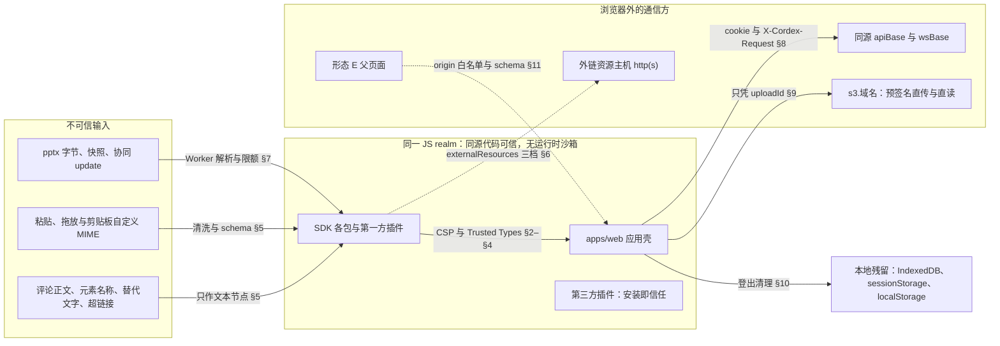
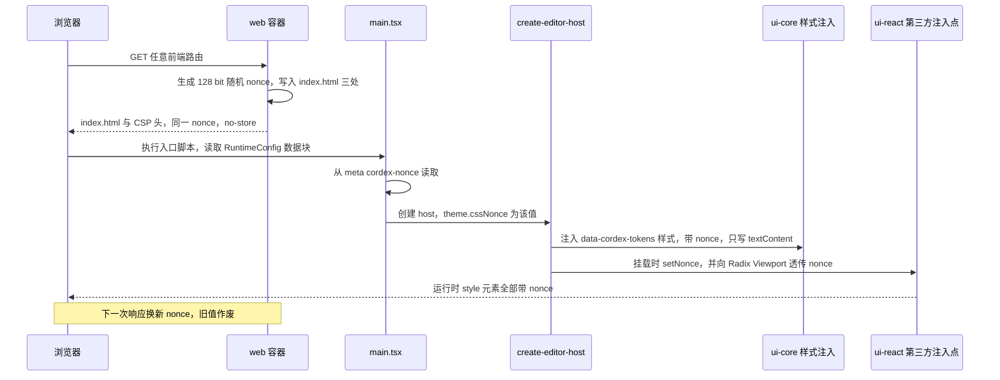
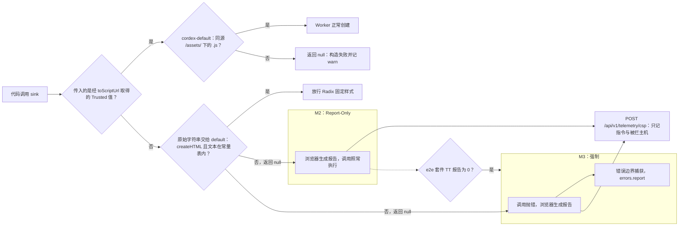
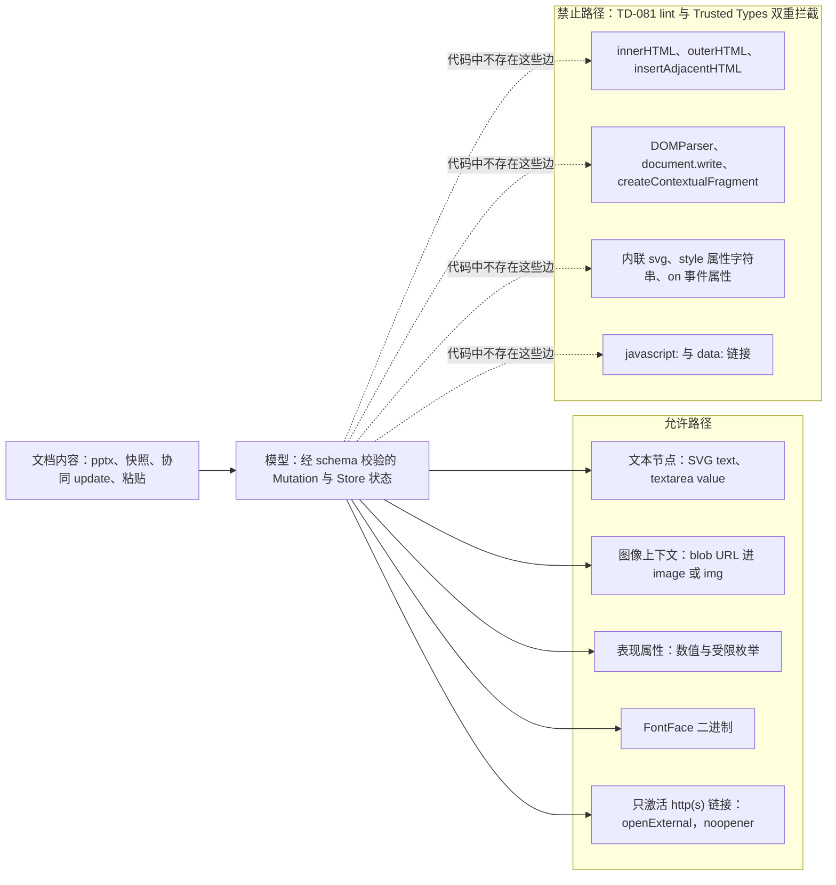
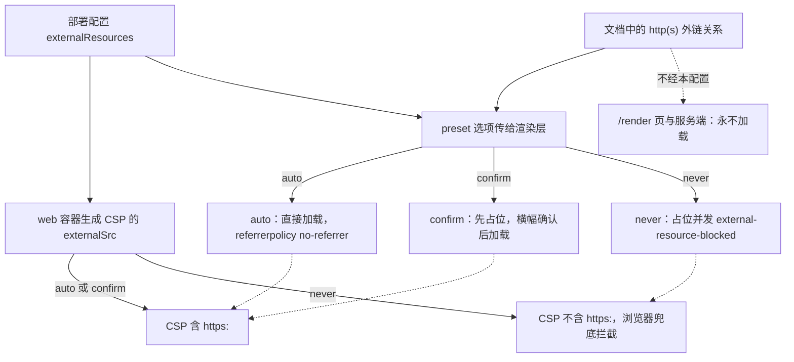
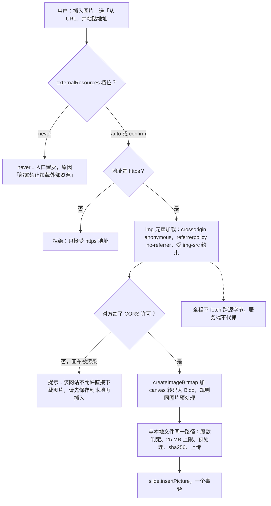

# 14 客户端安全

> 状态：v0.1 | 负责：前端设计线 | 更新：2026-09-25；2026-09-25（§4.19）；2026-09-26（§4.20）；2026-09-26（§4.21：§3 注入点表补 react-colorful、pragmatic-drag-and-drop、react-virtual 并把 react-resizable-panels 升到 4.13.3；新增 §2.7 WebAssembly 例外（M4+）；§4.3 补 zod `jitless` 与 fflate 异步入口；§5 写明从 URL 插入图片的取数路径（默认不经服务端代抓）；§7 XML 限额改为引用 ADR-0019 的 `XmlLimits` 表）；2026-09-26（§4.21 整合：§11.2 登记 display-capture（M4+ 屏幕截图）；§7 登记主线程只读解析经 drive 分片的例外；§13 待回写清单标为已回写）；2026-09-26（§4.21 Remap：原 30/08 引用按 60-backend/README §6.1 改指新位置，30/08 已删除）；2026-10-03（§4.24：§7 输入限制补旧二进制 `.ppt` 拒绝 `format.unsupported_binary`（PRD OF-02）） | 依赖：rulings §4.15 Q2/Q4/Q6/Q7、§4.18 BE-01/BE-04/BE-09/BE-10/UX-02、§4.20 FE-18；PRD 05 EM-14/EM-18、PRD 04 NF-04/NF-11；ADR-0021、ADR-0029、ADR-0033、ADR-0019（`XmlLimits`）、ADR-0049；rulings §4.21（R-d-11、R-d-13、R-d-17、R-d-28，q-license-tiers）；[17 前端复用组件清单](17-reuse-and-dependency-catalog.md)；30-architecture/07 §1、30-architecture/06 §12、30-architecture/10 §2.3；60-backend/02、60-backend/17

本文是浏览器侧安全设计的唯一事实源：信任模型、CSP 策略正文（逐指令）、nonce 消费链、Trusted Types、文档内容进入 DOM 的规则、外链资源、输入限制、会话与请求的浏览器侧规则、上传、本地数据、嵌入与跨源、前端代码规则。服务端鉴权链（OIDC、会话、CSRF 校验、票据、分享链接解析、RLS）以 [60/02](../60-backend/02-auth-chain.md) 为准；web 容器如何每响应生成 nonce、下发 CSP 头与缓存头以 [60/17](../60-backend/17-deployment-and-config.md) 为准，其中 CSP 策略正文只引用本文 §2。测试如何执行以 [70/06](../70-testing/06-frontend-component-and-e2e.md) §10 与 [70/10](../70-testing/10-security-testing.md) 为准。

## 0. 分工速查

| 主题 | 本文 | 引用 |
|---|---|---|
| CSP 策略正文、形态 A–E 对宿主 CSP 的要求 | §2 | 下发方式：60/17 §3 |
| nonce 在浏览器内的消费链 | §3 | 每响应生成：60/17 §3 |
| Trusted Types 策略与 sink 清单 | §4 | 违规上报端点：[60/18](../60-backend/18-observability-and-ops-endpoints.md) §9 |
| 会话 cookie、CSRF 请求头、分享令牌头的浏览器侧用法 | §8 | 定义与服务端校验：60/02 §4、§5、§7 |
| 浏览器存储键空间与登出清理矩阵 | §10（安全属性） | 键空间总表：[50/02](./02-app-shell-routing-and-session.md) §10 |
| postMessage 通道 | §11（安全规则） | 消息与桥：[50/12](./12-viewer-embedding-and-render-page.md) §9 |
| 遥测与错误上报的脱敏 | — | [50/15](./15-events-errors-and-telemetry.md) §6、§8 |

## 1. 信任模型与威胁面

**信任假设**（章程 §2.3、PRD NF-04「沙箱」行、EM-14）：

1. **同源代码可信**：`apps/web`、SDK 各包、第一方与第三方插件运行在同一个 JS realm，不做插件运行时沙箱；插件信任 = 安装即信任，由集成方审查（M4 文档写明信任模型）。本文的防线针对「不可信数据」，不针对「不可信代码」。
2. **文档内容一律不可信**：pptx 字节、快照、协同 update、评论正文、元素名称与替代文字、超链接、粘贴与拖放内容、剪贴板里的自定义 MIME，都视为攻击者可控。
3. **服务端响应先校验后使用**：REST 响应经 `@cordexjs/protocol` 的 schema `parse` 后才进入用例（parse, don't validate，见 50/02 §7）；WS 帧按 30/06 §6 的判别联合解析。
4. **嵌入宿主分两类**：形态 A/B/C/D 与宿主同 realm，宿主就是集成方、完全可信；形态 E 的父页面只经 `postMessage` 通信，必须过 origin 白名单与 schema（§11）。
5. **外链资源主机是第三方**：加载即向其暴露查看者 IP 与打开时间（EM-14）。
6. **本地残留**：IndexedDB 离线库不加密（ADR-0033、30/06 §12），共享设备上的风险靠登出清理与部署开关控制（§10）。

**图 1 前端信任边界与威胁面**



怎么读：左侧子图是可信代码所在的同一个 realm，中间子图是必须当作攻击者可控的数据，右侧是浏览器之外的通信方；每条边标出跨越边界时的防线与本文小节，虚线表示按配置或按形态才存在的通道。
依据：章程 §2.3；PRD 04 NF-04；PRD 05 EM-14；ADR-0029、ADR-0033。

**威胁 → 防线 → 验证总表**

| # | 威胁 | 入口 | 防线（本文小节） | 验证（见 §13） |
|---|---|---|---|---|
| T1 | 文档内容造成脚本执行（SVG、文本、超链接） | pptx、协同 update、粘贴 | 只经文本节点与图像上下文、禁 HTML sink（§5）；`javascript:` 拒绝；TT 兜底（§4） | lint TD-081；链接协议性质测试；TT 报告为 0 |
| T2 | 注入内联脚本或加载非同源脚本 | 任意 XSS 落点 | `script-src 'self' 'nonce-…'`，无 `unsafe-inline`/`unsafe-eval`（§2） | csp-strict e2e |
| T3 | 注入样式外泄数据或伪装界面 | 同上 | `style-src 'self' 'nonce-…'`；渲染层不写 `style` 属性字符串（§2、§5） | csp-strict e2e |
| T4 | 解析炸弹：zip 炸弹、XML 实体、EMF 记录 | 导入、插入图片 | Worker 内限额、可中止（§7） | 70/10 §3 |
| T5 | CSRF | 第三方站点表单或脚本 | SameSite=Lax cookie + `X-Cordex-Request` + 服务端 Origin 校验（§8，60/02 §5） | 跨源 POST 403 |
| T6 | 开放重定向与登录钓鱼 | `?next=` | `nextAfterLogin` 白名单（§8） | 性质测试 |
| T7 | 令牌泄漏（分享令牌、协同票据、会话） | URL、Referer、日志、存储 | 片段令牌 + sessionStorage + 只走请求头；票据只在内存；HttpOnly cookie（§8） | 分享落地 e2e |
| T8 | 外链追踪与「不许外呼」要求 | 文档外链图片 / 媒体 | `externalResources` 三档与 CSP 联动（§6） | 三档网络断言 |
| T9 | 上传越权与对象键篡改 | 预签名直传 | 客户端从不提交对象键，只凭 `uploadId`（§9） | 他人 uploadId 403 |
| T10 | 共享设备上的本地残留 | IndexedDB、sessionStorage | 按用户分库、登出清理、部署可关离线（§10） | 登出清理 e2e |
| T11 | 跨源消息伪造 | 形态 E | origin 白名单、`source` 校验、显式 targetOrigin（§11） | 单测 + embed e2e |
| T12 | 点击劫持 | 任意站点 iframe | `frame-ancestors`（§2） | 响应头断言 |
| T13 | 供应链 | npm 依赖 | 许可证白名单、漏洞门禁、单点引入、lockfile-guard、SBOM（§12） | `scanners`（70/10 SEC-SC-*） |
| T14 | 遥测与错误上报携带内容或身份 | 上报管线 | 脱敏与去标识（50/15 §6、§8） | 脱敏单测 |

## 2. CSP 模板（唯一正文）

`apps/web` 生产策略由 web 容器随每个 HTML 响应下发（60/17 §3）；静态资源响应不带 CSP（CSP 只对文档响应生效）。`index.html` 内不放 `<meta http-equiv>` 形式的生产 CSP（meta 形式不支持 `frame-ancestors` 与 `report-to`）。

### 2.1 指令表

| 指令 | 取值 | 理由 | 里程碑 |
|---|---|---|---|
| `default-src` | `'self'` | 未单列的资源类型一律同源 | M2 |
| `script-src` | `'self' 'nonce-{nonce}'` | 入口与惰性 chunk 同源；页面没有可执行的内联脚本：RuntimeConfig 是不执行的 JSON 数据块 `<script type="application/json" id="cordex-runtime-config">`，不需要 nonce（60/17 §3.3）；入口 `<script type="module">` 带 nonce 只为与模板一致；不放 `'unsafe-inline'`、`'unsafe-eval'`、`'strict-dynamic'`；唯一的追加项是 M4+ 启用复杂文种 shaping 时的 `'wasm-unsafe-eval'`（§2.7） | M2 |
| `style-src` | `'self' 'nonce-{nonce}'` | 静态 `styles.css` 同源；运行时 `<style>` 只允许带 nonce 的注入点（§3）；React 经 CSSOM 写 `element.style` 不受限，但禁止 `setAttribute('style', …)` | M2 |
| `img-src` | `'self' blob: data: {externalSrc}` | `blob:` 为文档页内媒体与缩略图的 blob URL（二者都经 `http.ts` / `fetch` 取回 Blob，50/05 §8.1、§10.2；文档页内元素不直接引用存储源或 API 端点，§9）；列表页封面直接引用同源端点，由 `'self'` 覆盖；`data:` 为 toImage 内联与小图标 | M2 |
| `media-src` | `'self' blob: {externalSrc}` | 同上，音视频 | M2 |
| `font-src` | `'self' blob:` | 字体同源自托管于 `/fonts/`；内嵌字体经 `FontFace` 注入；不访问第三方字体源（FONTS） | M2 |
| `connect-src` | `'self' {wsOrigin} {storageOrigin}` | REST、遥测、`/fonts/` 同源；协同 WS 显式列出 `wss://` 源；存储源承接预签名 PUT / GET（导入原件与媒体直传；媒体与导出下载先经 API 取 `{url}` 再直取，BE-01、INC-21） | M2 |
| `worker-src` | `'self'` | Worker 只从同源 `/assets/` 加载；`blob:` 不作脚本源（TT-CSP-REPORT） | M2 |
| `frame-src` | `'none'` | 文档内对象（OLE 等）只显示预览图，不嵌 iframe | M2 |
| `object-src` | `'none'` | 不使用插件对象 | M2 |
| `base-uri` | `'none'` | 防 `<base>` 劫持相对 URL | M2 |
| `form-action` | `'self'` | 登录是顶层 GET 导航（INC-18），不提交跨源表单 | M2 |
| `frame-ancestors` | `{frameAncestors}` | 默认 `'none'`；只有 `/embed/*` 的响应取允许嵌入的宿主源列表：部署键 `web.embed.allowedHostOrigins`（60/17 §5，环境变量 `CORDEX_WEB_EMBED_ALLOWED_ORIGINS`，默认空即 `'none'`），同一份值进 RuntimeConfig `embed.allowedHostOrigins`（50/02 §3）作 §11 的 postMessage 允许列表（50/12 §9） | M2 / 形态 E M3 |
| `require-trusted-types-for` | `'script'` | M2 在 Report-Only 头，M3 进入强制头（§4） | M2 → M3 |
| `trusted-types` | `cordex-default default` | 只允许本文 §4.1 的两个策略名：`cordex-default`（Worker 脚本 URL）与 `default`（只对登记的两段 Radix 固定样式文本精确放行 `createHTML`）；不加 `'allow-duplicates'`。TT-CSP-REPORT 修订（rulings §4.20 FE-18）：原「不创建名为 `default` 的策略」作废 | M2 → M3 |
| `report-to` / `report-uri` | `cordex-csp` / `/api/v1/telemetry/csp` | `report-to` 配 `Reporting-Endpoints`；`report-uri` 兼容不支持 Reporting API 的浏览器 | M2 |

依据：TT-CSP-REPORT（rulings §4.15 Q2 + §4.18 BE-30，§4.20 FE-18 修订 `trusted-types` 取值）；FONTS（ADR-0027 + PRD OF-25 + 零外呼）；CSP-NONCE（rulings §4.15 Q2 + §4.18 BE-11）；BE-01（存储经 `s3.<域名>` 反代子域）；INC-18（登录为 GET 302）。

### 2.2 策略模板

```text
Content-Security-Policy:
  default-src 'self';
  script-src 'self' 'nonce-{nonce}';
  style-src 'self' 'nonce-{nonce}';
  img-src 'self' blob: data: {externalSrc};
  media-src 'self' blob: {externalSrc};
  font-src 'self' blob:;
  connect-src 'self' {wsOrigin} {storageOrigin};
  worker-src 'self';
  frame-src 'none';
  object-src 'none';
  base-uri 'none';
  form-action 'self';
  frame-ancestors {frameAncestors};
  report-to cordex-csp;
  report-uri /api/v1/telemetry/csp

Content-Security-Policy-Report-Only:          # 仅 M2；M3 起两条 TT 指令并入上方强制头、删除本头
  require-trusted-types-for 'script';
  trusted-types cordex-default default;
  report-to cordex-csp;
  report-uri /api/v1/telemetry/csp

Reporting-Endpoints: cordex-csp="https://{publicHost}/api/v1/telemetry/csp"
```

| 占位符 | 取值 | 来源 |
|---|---|---|
| `{nonce}` | 每个 HTML 响应一个新值（128 bit），与 `index.html` 内 `nonce` 属性和 `<meta name="cordex-nonce">` 同值 | web 容器（60/17 §3） |
| `{storageOrigin}` | `storage.s3.publicEndpoint` 的 origin（如 `https://s3.example.com`） | 部署配置（60/17 §5）；浏览器侧同值见 RuntimeConfig（50/02 §3） |
| `{wsOrigin}` | `wsBase` 的 origin（`wss://{publicHost}`）；与页面同主机时也显式列出 | 同上 |
| `{externalSrc}` | `externalResources` 为 `auto` 或 `confirm` 时为 `https:`；为 `never` 时为空 | 部署配置 `externalResources`（§6） |
| `{frameAncestors}` | 默认 `'none'`；启用形态 E 时 `/embed/*` 响应为允许的宿主源列表，其余路由仍为 `'none'` | 部署键 `web.embed.allowedHostOrigins`（60/17 §5）；浏览器侧同值见 RuntimeConfig `embed.allowedHostOrigins`（50/02 §3） |
| `{publicHost}` | 对外主机名 | 部署配置 `publicUrl` |

部署开关（60/17 §3.2 的 `CORDEX_WEB_CSP_MODE`）只能决定两条 TT 指令放在 Report-Only 头还是强制头；其余指令自 M2 起始终在强制头，不随开关整体降为 Report-Only（rulings §4.15 Q2「CSP nonce M2、TT M2 report-only → M3 强制」；PRD 05 M2 验收 8）。

`http:` 外链在 HTTPS 页面上属于混合内容，浏览器会自动升级或拦截；CSP 只放行 `https:`，因此 `http:` 外链按「无法加载」占位，关系原样保留、不改写。

### 2.3 `/render` 页变体（renderer 内）

`/render` 页只在 renderer sidecar 的无头 Chromium 内打开，state、字体与媒体全部由编排方注入（BE-04，50/12 §11）。它使用更严的变体，把「零外呼」在 CSP 层再落一次，与网络隔离构成两道防线：

| 指令 | `/render` 变体取值 | 与 §2.2 的差异 |
|---|---|---|
| `connect-src` | `'none'` | 不允许任何 fetch / XHR / WS |
| `img-src` | `'self' blob: data:` | 去掉外链 |
| `media-src` | `'self' blob:` | 去掉外链 |
| `font-src` | `'self' blob:` | 不变 |
| `script-src` / `style-src` | 同 §2.2（nonce 由提供页面的一方生成） | 不变 |
| TT | 与 `apps/web` 同一里程碑 | 不变 |

该变体由谁随页面下发见 [60/06](../60-backend/06-modules-jobs-import-export-thumbnails.md)；断言「两种注入模式下网络请求数为 0」见 70/06 §6。

### 2.4 各嵌入形态对宿主 CSP 的要求

形态 A–D 运行在集成方页面里，CSP 由集成方下发；SDK 只声明它需要什么（写进 EM-18 集成检查清单）：

| 形态 | 宿主 CSP 至少放行 | 样式注入 | Trusted Types |
|---|---|---|---|
| A React 组件 | `script-src` 覆盖宿主 bundle；`worker-src` 覆盖 SDK Worker chunk 所在源；`img-src`/`media-src` 含 `blob:`；`connect-src` 含集成方 API 与 WS 端点（协同时再加存储源） | 推荐 `injectCss:false` 并静态引入 `@cordexjs/ui-react/styles.css`；若 `injectCss:true`，须传 `theme.cssNonce`，SDK 把同一值交给全部运行时样式注入点（§3） | 若宿主强制 TT，须把 `cordex-default` 或宿主自己的策略经 `createHost({ scriptUrlPolicy })` 交给 SDK（§4.2）；Radix ScrollArea / Select 的固定样式需经名为 `default` 的策略放行：SDK 不自建策略，宿主须在自己的 `default` 策略中按 ui-react 导出的固定样式常量表精确放行 `createHTML`（已有 `default` 时并入其白名单），并在 `trusted-types` 中允许 `default`（§4.1） |
| B 框架无关 | 同 A，但不含 React / Radix 的运行时样式 | `UiRenderer('vanilla')` 只用静态 CSS | 同 A |
| C 只读查看器 | 同 A 去掉 `connect-src` 的 WS | 查看器壳只用静态 CSS | 同 A |
| D 浏览器 headless | `worker-src`、`connect-src`（若取 URL） | 无 UI | 同 A |
| E iframe | 由 `apps/web` 自身的 §2.2 策略负责；宿主只需在 iframe 上给出 §11.2 的 `sandbox` 与 `allow` | — | — |

### 2.5 开发与生产的差异

| 项 | 开发（Vite dev server） | 生产 |
|---|---|---|
| 下发方式 | `index.html` 内 `<meta http-equiv>`，仅作自检 | web 容器响应头 |
| nonce | Vite `html.cspNonce` 固定占位值 | 每响应新值 |
| `connect-src` | 追加 HMR 的 `ws://localhost:*` | 按 §2.2 |
| TT | 始终 Report-Only，违规打印到 `ctx.logger('security:csp')` | M2 Report-Only，M3 强制 |
| `frame-ancestors` / `report-to` | 不生效（meta 不支持） | 生效 |

### 2.6 其它安全响应头：浏览器侧依赖

除 CSP 外的安全响应头（HSTS、`nosniff`、`Referrer-Policy`、COOP、`Permissions-Policy`、缓存头）取值只在 [60/17](../60-backend/17-deployment-and-config.md) §3.4。浏览器侧代码依赖其中四点，改动这些头时须同时核对本表：

| 头 | 浏览器侧依赖 | 依据 |
|---|---|---|
| `Referrer-Policy` | 外链与外站跳转不带路径；分享令牌本就在片段里，不依赖此头兜底（§8） | INC-25 |
| `Cross-Origin-Opener-Policy` | 重新登录弹窗与原页只经 `BroadcastChannel('cordex-auth')` 通信，不读 `window.opener`，所以 `same-origin` 不影响 UX-02 流程（50/02 §5） | UX-02 |
| `Permissions-Policy` | 不得禁用 `clipboard-read`、`clipboard-write`、`fullscreen`（剪贴板与放映）；形态 E 由父页面 `allow` 再授予（§11.2） | NF-07 可选能力 |
| `Cache-Control`（`index.html`） | `no-store`：nonce 每响应不同；版本漂移见 50/02 §12 | CSP-NONCE |

### 2.7 WebAssembly 例外（M4+）

依据：rulings §4.21（R-d-28）；ADR-0027；[17](17-reuse-and-dependency-catalog.md) §5。

M4 / M5 的 RTL 与复杂文种 shaping 用 harfbuzzjs（wasm，shaping 部分 434 KB 未压缩）。浏览器编译 WebAssembly 需要 `script-src` 带 `'wasm-unsafe-eval'`；它只放行 wasm 编译，不放行 `eval` 与 `new Function`，后两者仍因缺 `'unsafe-eval'` 被拦。这是 §2.1「无 `'unsafe-eval'`」之外唯一的追加项：

| 项 | 规则 |
|---|---|
| 何时下发 | 只有部署启用了复杂文种 shaping Provider 时，web 容器才在 `script-src` 追加 `'wasm-unsafe-eval'`；未启用的部署（默认）策略与 §2.2 完全相同 |
| 开关 | 与 Provider 的启用共用同一个部署配置（键名随 M4 RTL 立项登记于 [60/17](../60-backend/17-deployment-and-config.md)，本文不预先命名）；前端按 RuntimeConfig 里的同一值决定是否加载 harfbuzz 测量器，二者不一致时不加载并出诊断 |
| wasm 来源 | wasm 与 JS 胶水同源放在 `/assets/`（带哈希、`immutable`），经 `fetch` + `WebAssembly.instantiateStreaming` 加载，`connect-src 'self'` 已覆盖；不从 CDN 取，不用 `data:` 或 `blob:` 形式的 wasm |
| 所在位置 | render-dom `harfbuzz-measurer.ts`，与现有 canvas 度量同处主线程，惰性加载（[13](13-performance-and-bundling.md) §6） |
| `/render` 变体 | 与 apps/web 同一开关：renderer 要用同样的 shaping 才能与客户端像素一致，开关打开时 §2.3 变体同样追加 |
| 形态 A–D | 集成方要启用 shaping，宿主 CSP 须自行放行 `'wasm-unsafe-eval'`（写进 EM-18 集成检查清单）；未放行时 SDK 回落到默认度量 Provider 并出诊断 |
| 仍然禁止 | `'unsafe-eval'`；除 harfbuzzjs 外任何运行时 wasm（emf-converter 4.x 不含 wasm，本轮核实） |
| 门禁 | csp-strict 在「启用 shaping」变体下断言策略含 `'wasm-unsafe-eval'` 且不含 `'unsafe-eval'`、`script-src` 违规为 0；默认变体下策略不含 `'wasm-unsafe-eval'`（§13 V15） |

## 3. nonce 链

依据：CSP-NONCE（rulings §4.15 Q2 + §4.18 BE-11 + 60-backend/17 §3.2）；40/11 §12 G-11（`theme.cssNonce` 透传）。

1. **生成**（实现方式以 60/17 §3 为准，本文只写要求）：web 容器对每个 `index.html` 响应生成一个新的 ≥ 128 bit 随机 nonce，写入入口 `<script type="module">` 的 `nonce` 属性（无害，保持一致）与 `<meta name="cordex-nonce" content="…">`，同时写进 CSP 响应头；`index.html` 为 `no-store`。
2. **读取**：浏览器会对 `nonce` 属性做隐藏（`getAttribute('nonce')` 返回空串），因此 `apps/web` 的 `main.tsx` 从 `<meta name="cordex-nonce">` 读取。nonce **不进入 RuntimeConfig**：RuntimeConfig 是容器启动时渲染的静态部署项（RUNTIME-CONFIG），nonce 是每响应值。
3. **交给 SDK**：`create-editor-host.ts` 把 nonce 作为 `theme.cssNonce` 传入 preset 选项；SDK 内**只认这一个入口**（形态 A 的宿主同样只传这一项）。
4. **自有注入点**：ui-core `theme-style-injector.ts` 创建唯一的 `<style data-cordex-tokens nonce>`，内容只用 `textContent` 写入，按 document 去重。
5. **第三方运行时样式**：ui-react 挂载时把同一 nonce 交给下列注入点。清单登记在 ui-react（`src/infrastructure/csp/runtime-style-sinks.ts`），每次升级依赖时按实际版本复核；下表各依赖的处理已按 playground 锁定版本的源码实测定稿（rulings §4.20 FE-18，不等 M2 报告），§4.21 新增与升级的依赖按 npm 发布包源码扫描核实（扫描口径见 [17](17-reuse-and-dependency-catalog.md) §0.1）：

| 注入点 | 所在依赖（实测版本） | nonce 传递方式 | 不支持 nonce 或触及 Trusted Types 时 |
|---|---|---|---|
| 滚动锁定样式（Dialog、Popover、Select 等） | `react-remove-scroll` → `react-style-singleton` | 在首次渲染前调用 `get-nonce` 的 `setNonce(nonce)`；`get-nonce` 须与 `react-style-singleton` 解析到同一实例（R5 单点引入 + 单一版本） | — |
| 隐藏滚动条的固定样式 | Radix ScrollArea 1.2.18 / Select 2.3.7 的 Viewport（`<style dangerouslySetInnerHTML nonce>` 写一段固定常量） | shadcn 复制件 `scroll-area.tsx`、`select.tsx` 以 `// Cordex override` 透传 `nonce` 属性 | CSP 不受影响；React 写 innerHTML 是 TT sink，由 `default` 策略按常量表精确白名单放行（§4.1、§4.4） |
| Toast 样式 | `sonner` 2.0.8（模块加载时即以不带 nonce 的 `<style>` 注入，`__insertCSS`） | 不支持 nonce | 静态引入 `sonner/dist/styles.css` 并入 ui-react 样式产物；以 pnpm patch 删去 import 时的 `__insertCSS` 调用（`pnpm-workspace.yaml` 登记 `patchedDependencies`），运行时零注入、零违规 |
| 拖拽期间的全局光标样式 | `react-resizable-panels` 4.13.3（由 4.12.4 升级，rulings §4.21 R-d-11） | 不需要：只用 `adoptedStyleSheets` / CSSOM（`replaceSync`、`insertRule`），不创建 `<style>`、不写 innerHTML，不经 `style-src` 的元素校验（4.13.3 复核结论不变） | 无需处理 |
| 颜色选择器的色盘样式 | `react-colorful` 5.8.1（挂载时 `createElement("style")` 并写 `innerHTML`，不带 nonce；样式文本内嵌在 JS 里） | 不支持 nonce | 以 pnpm patch 删去注入（与 sonner 并列登记在 `patchedDependencies`），原样式文本抽到 ui-react `src/styles/vendor/react-colorful.css` 静态引入（[09](09-ui-system-and-theming.md) §5a.3，R-d-13）；运行时零注入、零违规 |
| 缩略图栏与选择窗格的虚拟列表 | `@tanstack/react-virtual` 3.14.13 | 不需要：只经 React `style` 属性写 CSSOM | 无需处理 |
| 拖拽重排与外部文件拖入 | `@atlaskit/pragmatic-drag-and-drop` 4.0.0（只用核心包） | 不需要：发布包无运行时样式注入 | 无需处理；不引 `*-react-drop-indicator` 等附加包（其样式方案未核实，引入前须按本表复核） |

6. **兜底判据**：§13 的 csp-strict e2e 在 `/styleguide`、`/documents/:id`（编辑与查看者变体）上断言 `style-src` 与 Trusted Types 违规数都为 0，且 Toast、ScrollArea 与颜色选择器色盘的计算样式与基线一致；任何遗漏的注入点、失效的 patch 或过期的常量表都会在这里暴露。没有「运行时注入被拦只产生报告、外观不变」这类退路：`style-src` 自 M2 起强制，零违规是门禁。

**图 2 nonce 从 web 容器响应到样式注入**



怎么读：前三步在服务端侧完成，nonce 同时出现在响应头与页面里；此后浏览器内只有一条传递路径（meta → `theme.cssNonce` → 各注入点），SDK 不从别处取 nonce。
依据：CSP-NONCE；40/11 §12 G-11；60/17 §3。

## 4. Trusted Types

依据：TT-CSP-REPORT（rulings §4.15 Q2：M2 report-only → M3 强制；§4.18 BE-30：浏览器遥测端点归 ClientTelemetryModule；§4.20 FE-18：增 `default` 策略，记为 TT-CSP-REPORT 修订）。

### 4.1 两个策略：`cordex-default` 与 `default`

两个策略都由 `apps/web` 在任何 Worker 创建、任何组件挂载之前建立（`apps/web/src/infrastructure/security/trusted-types.ts`，由 `main.tsx` 调用；已登记 40/11 §4.4，`default` 策略的职责随 rulings §4.20 FE-18 补登）。浏览器不支持 TT 时都不创建，调用方直接使用 URL 与字符串。

**`cordex-default`**（Worker 脚本 URL，经 `toScriptUrl` 显式使用，§4.2）：

| 工厂 | 是否提供 | 规则 |
|---|---|---|
| `createScriptURL` | 提供 | 以页面 origin 解析输入；仅当 origin 同源、路径以 `/assets/` 开头、以 `.js` 结尾、无 query 与 fragment 时原样返回 `href`；其余一律返回 `null`（得到空 URL，Worker 构造失败），并经 `ctx.logger('security:tt')` 记 `warn`；`blob:`、`data:` 永不放行 |
| `createHTML` | 不提供 | — |
| `createScript` | 不提供 | 不允许字符串求值 |

**`default`**（浏览器对未经策略的原始字符串赋值自动调用；只为 Radix 的两段固定样式存在，§4.4）：

| 工厂 | 是否提供 | 规则 |
|---|---|---|
| `createHTML` | 提供 | 输入与常量表中登记的文本**逐字符精确比对**（不裁剪、不规范化、不做前缀或包含匹配），命中则原样返回；其余一律返回 `null`，强制后该赋值照常抛错并生成报告，经 `ctx.logger('security:tt')` 记 `warn` |
| `createScriptURL` | 不提供 | 未经 `cordex-default` 的脚本 URL 仍失败 |
| `createScript` | 不提供 | 不允许字符串求值 |

- **常量表**：ui-react `src/infrastructure/csp/trusted-style-constants.ts`（与 `runtime-style-sinks.ts` 同目录），只收 Radix ScrollArea 1.2.18 与 Select 2.3.7 Viewport 的两段固定样式文本，每条注明来源包、版本与源码位置；ui-react 公开导出这张表供组合根与形态 A 宿主使用。升级任一 Radix 包时同一 PR 更新常量表，并过 §13 的 csp-strict 与负向用例。
- **严格程度不变**：常量表之外的一切 HTML 赋值仍然失败，不被兜底放行；原决策「不创建名为 `default` 的策略」的目的（未经策略的赋值必须失败）由「只放行两段常量、其余返回 `null`」保持。TT-CSP-REPORT 修订（rulings §4.20 FE-18，2026-09-26）：`trusted-types` 取值由 `cordex-default` 改为 `cordex-default default`（§2.1）。

### 4.2 SDK 如何取得策略

SDK 各包不自建策略（策略名由组合根决定）。`createHost` 增加可选项 `scriptUrlPolicy`（`HostOptions`，已登记 40/02），kernel 只保存该策略并提供 `toScriptUrl(ctx, url)`：有策略时返回 `policy.createScriptURL(url.href)`，无策略时返回 `url.href`。kernel 是 iso 包，这个函数只接收结构化的策略对象，不引用 `Worker`、`trustedTypes` 等浏览器全局（章程 §5.3 规则 5）；`new Worker(…)` 只写在 dom 包的 Worker 创建点（导入解析、pptx 导出、EMF / WMF 栅格化）。lint `no-restricted-syntax` 要求 `new Worker(` / `new SharedWorker(` 的第一个实参必须是 `toScriptUrl(…)` 调用（既有 lint 规则的一行配置，不新增扫描器）。形态 A 的宿主若强制 TT，把自己的策略传入同一选项即可。

### 4.3 sink 清单

| sink 类别（TT 类型） | 本项目用法 | 处理 |
|---|---|---|
| `new Worker` / `new SharedWorker`（TrustedScriptURL） | 导入解析、pptx 导出、EMF 栅格化；第三方：fflate 的异步入口（`zip()`、`unzip()`、`inflate()`、`deflate()` 等）会用 `URL.createObjectURL` 起内联 `blob:` Worker（rulings §4.21 核实） | 首参经 `toScriptUrl` + `cordex-default`；fflate 只用同步与流式 API（`unzipSync`、`zipSync`、`Unzip`、`Zip` 类），由 ooxml-core `opc/zip.ts` 上的 `no-restricted-imports` 配置行禁止导入异步入口 |
| `HTMLScriptElement.src` / `.text`（TrustedScriptURL / TrustedScript） | 不使用；惰性 chunk 走 `import()` | — |
| `innerHTML`、`outerHTML`、`insertAdjacentHTML`、`DOMParser.parseFromString`、`document.write`、`Range.createContextualFragment`、`iframe.srcdoc`（TrustedHTML） | 自有代码不使用：TD-081 lint（渲染包与 `*-ui`）+ ui-core / ui-react / slide-ui 禁 `dangerouslySetInnerHTML`（40/10 §10）；ui-core 剪贴板清洗同样不得使用 `DOMParser`（§5）。第三方唯一用法：Radix ScrollArea / Select Viewport 的固定 `<style>`（§4.4）；react-colorful 原有的 `innerHTML` 样式注入已经 patch 删除（§3）；lib0 的 `dom`、`component` 子模块含 `DOMParser` 与 `innerHTML`，自有代码不得 import（yjs 经 `lib0/logging` 带入 `lib0/dom` 时只创建 `DOMParser` 实例、不调用解析，不触发 TT） | `cordex-default` 无 `createHTML`；`default` 只放行常量表里的两段文本，其余强制后抛错 |
| `eval`、`new Function`、字符串形式的 `setTimeout`（TrustedScript） | 不使用：CSP 无 `unsafe-eval` + ESLint 核心规则 `no-eval` / `no-implied-eval` / `no-new-func`。第三方：zod 4 默认以 `new Function` 探测能否 JIT，严格 CSP 下即使异常被捕获也会产生 `script-src` 违规报告（zod `v4/core/util.js:218-220`，rulings §4.21 核实） | 无 `createScript`；浏览器侧组合根（apps/web `main.tsx` 与 SDK 的 dom 组合根）在任何 schema 解析之前调用 `z.config({ jitless: true })`，服务端保留 JIT；csp-strict 的 `script-src` 零违规覆盖（§13 V15） |
| `javascript:` URL 导航 | 超链接协议白名单已拒绝（§5） | 强制后浏览器再拦一次 |

### 4.4 Radix 的固定样式注入（已定）

Radix ScrollArea 1.2.18 与 Select 2.3.7 的 Viewport 以 `<style dangerouslySetInnerHTML nonce>` 写一段固定常量（分别见两包 `dist/index.mjs` 第 136、735 行，playground 锁定版本实测）：nonce 已由复制件透传，CSP `style-src` 不受影响；但 React 写 innerHTML 属于 TT sink，M3 强制后必抛。rulings §4.20 FE-18 现在就定为**方案乙**，不等 M2 报告：名为 `default` 的策略只对常量表里的这两段文本精确放行（§4.1）。原方案甲（复制件改原生滚动）只能解决 ScrollArea，Select 没有简单绕法，不采用。

- 保留 Radix 组件与自定义滚动条外观；其余 HTML sink 的严格程度不变。
- 升级任一 Radix 包时，常量不再匹配只会表现为 TT 报告（M2）或抛错（M3），不会被静默放行；由 §13 V2 的 csp-strict（TT 与 `style-src` 违规为 0、ScrollArea 计算样式与基线一致）在合入前拦下。

### 4.5 违规处理与里程碑

- **上报**：浏览器按 `report-to` / `report-uri` 把 CSP 与 TT 报告发往 `POST /api/v1/telemetry/csp`（`@Public`，因 Reporting API 不保证携带 cookie；严格令牌桶、16 KiB 上限、只记录指令名与被拦主机名，60/18 §9）。生产环境前端**不**再用 `securitypolicyviolation` 事件重复上报；开发环境把该事件写进 `ctx.logger('security:csp')`。
- **M2**：CSP 其余指令强制，TT 在 Report-Only 头；e2e 套件在测试夹具里监听 `securitypolicyviolation` 并统计 TT 报告。M2 只报告期只用来验证 TT 报告为 0，不再承担选方案的职责（§4.4 已定）。
- **M3 切换条件**：e2e 全部路由 × 面板 × 状态下 TT 报告数为 0；然后把两条 TT 指令并入强制头。
- **M3 之后**：任何新增 sink 调用在开发期就会抛错；线上报告进入 60/18 的计数与告警。

**图 3 Trusted Types 里程碑与违规处理**



怎么读：Worker URL 走 `cordex-default` 的显式路径；其余原始字符串一律先交给 `default`，只有常量表里的两段 Radix 样式能通过。`default` 返回 `null` 的调用在 M2 只产生报告、照常执行，在 M3 直接抛错并被错误边界接住；两条路径的报告都进同一个端点。M2 → M3 的切换只看 e2e 报告数。
依据：TT-CSP-REPORT（rulings §4.20 FE-18 修订）；rulings §4.15 Q2；60/18 §9。

## 5. 文档内容安全

依据：rulings §4.15 Q4（文档内 SVG 只以图像上下文渲染、禁 innerHTML 注入）；30/07 §1；TD-081；PRD 02 ED-17、ED-19；PRD 05 EM-14。

原则：文档内容**永远不以标记形式进入 DOM**。渲染层只经下表的允许路径写 DOM；这一约束与 TT 相互独立，TT 失效时也成立。

| 内容 | 允许的进入方式 | 禁止 |
|---|---|---|
| 文本（段落、表格、备注、占位符） | 自绘文本行的 SVG `<text>` / `<tspan>` 的 `textContent`；文本编辑态只经隐藏 textarea 的 `value`（ADR-0028，50/06） | 任何把文本当标记解析的 API |
| 位图媒体 | `Blob` → blob URL → SVG `<image href>` / `` | — |
| 文档内 SVG（`asvg:svgBlip`、SVG 媒体） | `Blob(type image/svg+xml)` → blob URL → `<image href>`：图像上下文不执行脚本、不加载外部资源 | 内联 `<svg>`、`<object>`、`<iframe>`、`<use href>` 指向文档内容 |
| EMF / WMF | Worker 内栅格化为 PNG → blob URL | 在主线程解码 |
| 内嵌字体 | `new FontFace(family, ArrayBuffer)` | 以 URL 加载文档字体 |
| 颜色、几何、变换 | 先解析为数值与受限枚举，再经 `setAttribute` 写表现属性，或经 `element.style.setProperty` | 把文档字符串拼进 `style` 属性或 `transform` 字符串；`setAttribute('style', …)`；`on*` 属性 |
| 元素名称、替代文字、评论正文、作者名 | `textContent` / React 文本子节点 | Markdown 或 HTML 渲染 |
| 超链接 | **写入**（命令层）：协议白名单 `http`、`https`、`mailto`、`tel` 与页内跳转 `ppaction://hlinksldjump`（ED-19）。**激活**：只有 `http(s)` 外部目标经 `openExternal(url)` 以 `noopener,noreferrer` 打开，页内跳转在编辑器内导航；需用户手势（编辑态 Ctrl/Cmd+点击、放映态点击），悬停先显示目标。`mailto:`、`tel:` 按 ADR-0008 决策 5 与 30/04「仅 `http(s)` 可激活」只显示、可复制，不激活 | `javascript:`、`data:`、`vbscript:`、`file:` 等：命令层拒绝写入；导入带来的非 `http(s)` 关系一律只显示、不激活，关系原样保留 |
| 粘贴 | 优先级：自定义 MIME（模型片段 JSON，经 schema 校验、重生成 id、≤ 25 MB）→ 图片（按魔数判定类型，走插入图片同一路径）→ HTML（M2 取同一剪贴板项的 `text/plain`；没有时用不经 DOM 的文本提取器剥离标签得到纯文本；P2 富格式同样用不经 DOM 的白名单片段解析器转为 Mutation）→ 纯文本。管线行为见 [50/04](./04-document-commands-and-undo.md) §9 | 把剪贴板 HTML 插入 DOM；交给 `DOMParser.parseFromString`（它是 TrustedHTML sink，M3 强制 TT 后在没有 `createHTML` 的策略下会抛错） |
| 从 URL 插入图片（集成方可禁用） | **默认不经服务端代抓，下载后内嵌**（取数路径见图 6）：只接受 `https:` 地址；浏览器以 `` 按图像上下文加载（`auto` / `confirm` 档下 `img-src` 已含 `https:`，§2.2），加载成功后经 `createImageBitmap` + canvas 转码为 `Blob`（格式与质量沿用 render-dom `media/image-preprocess.ts` 的规则），再走与本地文件相同的插入路径（魔数判定、25 MB 上限、预处理、上传）；对方不给 CORS 许可（画布被污染）时提示「该网站不允许直接下载图片，请先保存到本地再插入」，不回退为外链关系；`never` 档下入口置灰并说明原因 | 跨源 `fetch` 取字节（要把 `connect-src` 放宽到 `https:`，任何注入脚本都能借此把数据发往任意主机）；插入外链关系（[50/23](23-elements-media.md) 非目标）；服务端代抓（未另行裁决前不提供） |

**图 4 文档内容进入 DOM 的允许路径与禁止路径**



怎么读：文档内容先落成经校验的模型，再只经左侧五条路径进入 DOM；右侧四类 API 在渲染包与 `*-ui` 中被 lint 禁止，M3 起 TT 在运行时再拦一次。
依据：rulings §4.15 Q4；30/07 §1；09-type-discipline/08 TD-081。

补充规则：

- 渲染包内 `href` / `xlink:href` 只能写入 `blob:` URL、同源 URL 或已通过 §6 判定的外链 URL；外链 `<image>` 一律带 `referrerpolicy="no-referrer"`。
- `openExternal(url)` 是唯一打开外部 URL 的入口（ui-core 提供，apps/web 复用）；lint `no-restricted-properties` 禁止在其余位置调用 `window.open`（既有规则的配置行）。React 中的 `target="_blank"` 链接必须带 `rel="noopener noreferrer"`（`react/jsx-no-target-blank`）。
- TD-081 的作用范围（`engine-render`、`render-dom`、`*-render`、`*-ui`）建议扩展到 `ui-core`（剪贴板管线）与 `apps/web`（lint override，待回写 09-type-discipline/02）。

## 6. 外链资源

依据：rulings §4.15 Q7（外链资源自动加载为用户选择，偏离推荐；`externalResources` 可收紧为 `confirm` / `never`；服务端永不加载）；PRD 05 EM-14；PRD 04 NF-04。

`externalResources` 是部署配置（RuntimeConfig 静态项，50/02 §3），经 preset 选项传给渲染层（字段登记见 [50/03](./03-preset-assembly-and-plugins.md)）；形态 A–D 由集成方在 preset 选项中给出，默认 `auto`。它同时决定 CSP 的 `{externalSrc}`（§2.2）。

| 取值 | 渲染层行为 | CSP `img-src` / `media-src` | 用户可见 |
|---|---|---|---|
| `auto`（默认） | 文档内 `http(s)` 外链图片与媒体直接由浏览器加载，`<image>` 带 `referrerpolicy="no-referrer"` | 含 `https:` | 无提示；集成检查清单（EM-18）须提示「会向外链域名暴露查看者 IP 与打开时间」 |
| `confirm` | 首次渲染时不发出任何外链请求，外链位置显示占位「外部图片（未加载）· 域名」；文档顶部横幅「此文档引用了 N 个外部资源（域名列表），加载会向这些站点暴露你的 IP 与打开时间」＋「加载」「不加载」；选择在当前页面会话内对该文档有效（不写持久存储） | 含 `https:`（门控在渲染层） | 横幅与占位 |
| `never` | 不加载，占位并发 `render/element-degraded{reason:'external-resource-blocked'}` | 不含 `https:`：即使渲染层出错，浏览器也会拦截 | 占位与保真摘要计数 |

适用范围：图片（`a:blip r:link`）、音视频外链、OLE 链接对象的预览图。超链接属于导航，不在此列（§5）。字体永远不从外链加载（`font-src 'self' blob:`）。`/render` 页、服务端导入导出与缩略图永不加载外链（§2.3、60/06）。导出 pptx 时外部关系原样保留，与本配置无关。主线程 `toImage` 栅格化时，外链图片在 SVG 图像上下文里不会被加载，统一以占位绘制（30/07 §8）。

**用户头像**同样受本配置约束：`avatarUrl` 可以是任意 `https://` 地址（来自 IdP `picture` 或用户自改，60/03 `UpdateOwnProfileUseCase`），加载即向该主机暴露查看者 IP。`auto` 下以 `` 加载；`confirm` 与 `never` 下一律不加载，显示姓名首字母头像（不为头像单独弹确认）。

**图 5 externalResources 三档与 CSP 联动**



怎么读：同一个部署配置分两路生效——渲染层决定是否发请求，CSP 决定浏览器是否允许；`never` 下两层都拦，`confirm` 下门控只在渲染层。服务端与 `/render` 页不受此配置影响，始终不加载。
依据：rulings §4.15 Q7；PRD 05 EM-14；本文 §2.2、§2.3。

**图 6 从 URL 插入图片的取数路径**



怎么读：取数只走图像上下文，所以 `connect-src` 不必放宽，也不需要服务端代抓；代价是必须由对方站点给 CORS 许可才能转码，失败时直接提示用户先保存到本地，不退回为外链关系（外链插入是 [50/23](23-elements-media.md) 的非目标）。转码会丢失 SVG 的矢量与 GIF 的动画，需要原样保留时同样请先保存到本地再插入。
依据：本文 §2.2、§5、§6；rulings §4.21（R 证据 elementDesign「URL 插图片默认不经服务端代抓」）；ADR-0021（canvas 的「媒体与图标预处理」用途）。

## 7. 输入限制

依据：PRD 01 OF-24（默认限额，集成方可收紧、不可放宽超过 2 倍）；rulings §4.15 Q5 / §4.18 CO-12（先完成包络计数再分批装载）；rulings §4.16 Q15（加密与宏包拒绝）；PRD 02 ED-17。

| 输入 | 在哪里检查 | 限额（默认） | 超限结果 |
|---|---|---|---|
| 本地 pptx 文件大小 | 读取字节之前（主线程，只看 `File.size`） | 200 MB（`fileSize`） | `format.quota_exceeded{dimension:'fileSize'}`，不读取 |
| 旧二进制格式（`.ppt` 等 CFB 容器，非 OOXML） | Worker 内只读文件头魔数，先于 zip 与 OPC 解析 | ≤ 100 ms 判定（PRD OF-02） | `format.unsupported_binary`（文案见 50/15 §4），不解析内容 |
| 加密包、宏包 | Worker 内魔数 / 容器判定，先于 OPC 解析 | — | `format.encrypted`、`format.macro_rejected`（文案见 50/15 §4） |
| zip 条目数 / 单条目解压 / 总解压 / 媒体总量 | Worker 内 OPC 解析 | 4,000 / 64 MiB / 512 MiB / 256 MiB | `format.limit_exceeded{limit, actual}` |
| XML 结构限额（嵌套深度、属性数、文本长度、属性值长度等）与 DOCTYPE | Worker 内 XML 词法层计数（`@cordexjs/xml` 的 `scan` 与 `parseDocument`） | 键、默认值与可调范围只在 [ADR-0019](../30-architecture/adr/0019-xml-lexer-and-fidelity-tree.md) 决策 6 的 `XmlLimits` 表定义，本文不重述数值；DOCTYPE 一律拒绝，不可配置 | `format.limit_exceeded{limit, actual}`（DOCTYPE 为 `limit: 'xml.doctype'`） |
| 图表点数、位图预览像素 | Worker 内 | 每序列 10,000；16,777,216 像素 | 同上或占位 |
| 文档规模天花板（页 / 单页元素 / 总元素） | Worker 先做包络计数，超限整体拒绝，不装到一半才失败 | 200 / 1,000 / 20,000 | `format.quota_exceeded{dimension}` |
| EMF / WMF 栅格化 | Worker，可中止 | 记录数、输出像素、耗时（M2 spike 定值后回填 OF-24） | 回到占位 |
| 插入图片 | 主线程：先按魔数判定类型（png / jpg / gif / svg / webp / bmp），不信任文件扩展名与 MIME | 单张 ≤ 25 MB | 拒绝并 toast；SVG 只按图像上下文处理（§5） |
| 粘贴 | 剪贴板管线 | ≤ 25 MB；自定义 MIME 经 schema 校验 | 拒绝并 toast |

解析一律在 Worker 中进行，主线程从不解压 zip；唯一例外（2026-09-26 整合，ADR-0019 决策 2）：slide-render 在主线程只读解析图表部件、`dsp:drawing` 与 `tableStyles.xml` 时，经 `@cordexjs/xml` 的 `drive` 按 64 KiB 分片并注入 kernel 调度器的 `shouldYield`，限额与 DOCTYPE 拒绝和 Worker 内同一口径，出错只降级该元素；Worker 超时由调用方 `terminate()`，错误以 `Result` 回到 `unit/open-failed{code, stage}`。协同帧的单帧上限与客户端兜底值见 [50/07](./07-collaboration-client.md)（INC-07）。表单字段（标题、名称）在客户端复用 protocol 的同一 schema 做即时提示，服务端仍会再次校验。

## 8. 会话与请求

依据：SESSION、INC-18、INC-24、INC-25、INC-20、INC-27（均 needsUser=false，权威分别为 60 事实源 + PRD SV-06/SV-12、ADR-0029、rulings §4.18 UX-02 / UX-19 / BE-02）；BE-09（OIDC 换码在服务端完成，ADR-0029）。

| 项 | 浏览器侧规则 | 服务端定义 |
|---|---|---|
| 会话 cookie | `cordex_session`（线上名 `__Host-cordex_session`；HttpOnly、Secure、SameSite=Lax、Path=/）与 `cordex_refresh`（线上名 `__Secure-cordex_refresh`；HttpOnly、Secure、SameSite=Strict、Path=/api/v1/auth）；JS 读不到，前端只通过 `GET /auth/me` 探测会话 | 60/02 §4.1 |
| IdP 令牌与 PKCE | 浏览器不持有：登录是顶层导航 `GET /api/v1/auth/oidc/login?next=&mode=redirect\|popup`，换码与设 cookie 在服务端完成 | 60/02 §2 |
| 协同票据 | 60 s、单次；只保存在 `session-client` 的闭包内存里，不进任何存储、URL、日志或错误上报；`auth.refresh` 时重新申请 | 60/02 §8、§9 |
| CSRF | `infrastructure/api/http.ts` 对全部非安全方法（POST、PUT、PATCH、DELETE）附 `X-Cordex-Request: 1`；请求只发往同源 `apiBase`，`credentials:'same-origin'`；页面卸载前的遥测补发用 `fetch(..., { keepalive: true })` 携带同一请求头，**不用** `navigator.sendBeacon`（它无法附加自定义请求头，会被 CSRF 守卫拒绝） | 60/02 §5：缺头或 Origin 不在白名单 → 403 `server.auth.csrf_rejected` |
| 开放重定向 | `nextAfterLogin(search)` 只接受以单个 `/` 开头的站内路径（拒 `//`、`/\`、协议与主机），须命中 50/02 §2 路由表且不得为 `/login`、`/auth/*`、`/render`、`/embed/*`；先解码一次再判定；其余一律回落 `/home`（规则全文以 50/02 §4 为准）。`mode` 只接受 `redirect` / `popup` | 服务端对 `next` 同样校验（60/02 §2） |
| 分享令牌 | URL 形如 `/documents/{docId}#share={token}`：应用启动时**先于**遥测与路由读取片段，写入 sessionStorage `cordex.share.{docId}`，随即 `history.replaceState` 去掉片段；只经请求头 `X-Cordex-Share-Token` 随该文档的 REST 请求与 collab-ticket 请求发送，从不进 query；被错误上报、breadcrumbs 与日志脱敏；收到 403 且 `details.reason` 为 `share_link.expired` / `share_link.revoked` 时删除该键并提示「链接已失效」 | 60/02 §7 |
| 重新登录与跨标签页通知 | `BroadcastChannel('cordex-auth')` 的消息只有 `refreshed` / `reauth-done` / `logged-out` 三种类型（50/02 §10.1），不携带任何令牌或身份；收到后各页自行 `GET /auth/me` 并比对主体（`isSameReauthPrincipal`） | 50/02 §4–§5 |
| 登出 | `POST /auth/logout` 成功后执行 §10 清理矩阵 | 60/02 §4 |

`Referrer-Policy` 见 §2.6；URL 片段本就不会进入 Referer 与访问日志。401 与网络错误的分流、会话状态机与重新登录流程归 50/02 §4–§5。

## 9. 上传与存储

依据：rulings §4.18 BE-10（两步上传、一次性 `uploadId`、客户端不提交对象键）与 BE-01（`storage.s3.publicEndpoint`）；INC-21（媒体端点带文档作用域）；MEDIA-CLIENT（apps/web 默认上传实现）。路由与错误码以 [60/15](../60-backend/15-rest-api-catalog.md) 为准，服务端用例见 [60/04](../60-backend/04-modules-documents-storage-media.md)。

- **只凭 `uploadId`**：导入走 `POST /imports/uploads` → 预签名 PUT → `POST /imports`（请求体 `{ uploadId }`）；媒体走 `POST /documents/:id/media/presign` → 预签名 PUT → `POST /documents/:id/media/commit`。客户端 DTO 在类型层就没有对象键字段；提交他人 `uploadId` 由服务端返回 403。
- **直传请求不带凭据**：对存储源的 PUT 使用 `credentials:'omit'`，不附 `Authorization`、cookie 与 `X-Cordex-*` 头，只带签名要求的 `Content-Type`；≥ 10 MB 分片上传（MEDIA-CLIENT）。
- **预签名 URL 不留存**：用后即弃，不写存储、日志、遥测与错误上报；导出下载 URL（1 h）只用于一次导航或 `<a download>`。
- **读取经文档作用域**：媒体只经 `GET /documents/:id/media/:sha256`（返回 `{url}`，1 h 预签名 GET；前端以 `credentials:'omit'`、无自定义头直取，不跟随跨源 302，分享令牌头不会被带到存储源），缩略图经 `GET /documents/:id/thumbnails/:slideId`（同源，经 `http.ts` 取 Blob）；不存在跨文档按哈希取媒体的端点。浏览器侧 `MediaCache` 负责 blob URL 生命周期（50/05 §8）。
- **文档页内的读取一律经 `http.ts`**：编辑器与查看器里的媒体、缩略图都由 `infrastructure/api/http.ts` 的 `fetch` 取回 Blob，再以 `blob:` URL 交给元素；元素的 `src` / `href` 不直接指向 `/api/v1/documents/*`。原因：元素发起的请求无法附 `X-Cordex-Share-Token`，凭分享链接进入的用户会得到 403（§8）。`/home` 等列表页的封面图不在文档页内，可以直接用 ``。
- **CSP 联动**：存储源只出现在 `connect-src`（预签名 PUT / GET）；`img-src` / `media-src` 只放行 `blob:`，不含存储源，见 §2.2。
- **前置校验只为体验**：类型（魔数）与大小在客户端先判一次，服务端仍以 `server.media.unsupported_type`、`storage.quota_exceeded` 等为准。

## 10. 本地数据

依据：ADR-0033（离线持久化，不加密、登出清空）；30/06 §12；OFFLINE-TABS（多标签页由 50/07 处理）。浏览器存储键空间的完整列表只在 [50/02](./02-app-shell-routing-and-session.md) §10，本节只规定安全属性与清理时机。

| 存储 | 是否含文档内容或身份 | 隔离方式 | 登出 | 切换账号（重新登录为另一主体） |
|---|---|---|---|---|
| IndexedDB `cordex-collab/{userId}/{documentId}`（离线库，M4 P2 前默认关） | 含文档内容（不加密，P4） | 按用户分库 | 清空该用户全部库 | 先提示导出未同步更改，再清空前一用户的库 |
| IndexedDB `cordex.recent` | 含文档标题 | 键含 `userId` | 清空该用户条目 | 同左 |
| sessionStorage `cordex.share.{docId}` | 含分享令牌 | 标签页会话 | 清空全部 `cordex.share.*` | 同左 |
| localStorage `cordex.prefs`、`cordex-theme`、布局记忆 | 不含 | 设备级 | 保留 | 保留 |
| 内存：协同票据、host 状态 | 票据 | 进程 | 随页面卸载 | 随 host 销毁 |

- 登出时若离线库中有未同步更改：先提示「有 N 项更改尚未同步到服务器，退出将删除」，给出「导出本地副本 / 仍然退出 / 取消」。
- 不使用 `Clear-Site-Data` 响应头：它会一并删除其它账号在本设备上尚未同步的离线更改，且不经上面的导出提示。
- 不使用 Cache Storage 与 Service Worker（VERSION-DRIFT-SW）。
- 共享设备上离线库不加密的风险写入 EM-18 集成检查清单；禁止本地持久化的部署保持 `offline.enabled:false`（M1–M3 默认即关）。

## 11. 嵌入与跨源

依据：PRD 05 EM-14（可在 `sandbox="allow-scripts allow-same-origin"` 内运行）；MECH-INC 中 INC-36（`embed/messages.ts` 进 M-02，M3 的 `/embed` 只接受会话登录，`cordex:token` 标 M4）。消息定义与桥的装配见 50/12 §9，本节只写安全规则。

### 11.1 postMessage

- **收**：只处理 `event.source === window.parent` 且 `event.origin` 属于允许的宿主源列表（RuntimeConfig `embed.allowedHostOrigins`，与 `frame-ancestors` 同一份配置）的消息；`cordex:init` 之后只认该消息的 origin；按 protocol `embed/messages.ts` 的 schema 解析，未知类型、版本不符或解析失败即丢弃并计数。
- **发**：`window.parent.postMessage(msg, targetOrigin)` 的 `targetOrigin` 必须是已校验的宿主源，**永不为 `'*'`**；对端的确定方式（`cordex:ready` 发往允许列表中与 `document.referrer` 同源的一项、`init` 后锁定）以 50/12 §9 为准。
- **载荷**：只转发 50/15 §3 列出的事件摘要；不含文档内容、令牌与预签名 URL；评论正文默认不跨 iframe 转发。

### 11.2 iframe 属性要求（写入 EM-18 清单）

推荐给集成方的完整属性以 50/12 §9 为准；下表区分「最小可运行集」与「缺少时如何降级」。

| 属性 | 要求 | 缺失时的降级 |
|---|---|---|
| `sandbox` 的 `allow-scripts`、`allow-same-origin` | 必需 | 无法运行 |
| `allow-popups`、`allow-popups-to-escape-sandbox` | 推荐 | 超链接改为显示可复制地址；iframe 内无法弹窗登录，只能提示用户在独立窗口登录后刷新 |
| `allow-downloads` | 推荐 | 导出对话框提示「请在独立窗口中打开后导出」 |
| `allow-top-navigation*`、`allow-forms` | 不需要，不应授予 | — |
| `allow="fullscreen; clipboard-read; clipboard-write"` | 推荐 | 无剪贴板 API 时用编辑器内部剪贴板（NF-07 可选能力）；无全屏时放映在页面内铺满 |
| `allow="display-capture"`（M4+，2026-09-26 整合登记） | 只在启用「屏幕截图」（PRD ED-34，M4+ P2）时需要 | 缺失时「屏幕截图」入口禁用并说明原因；不影响其它插入（[50/23](23-elements-media.md)） |

### 11.3 形态 E 的站点约束

会话 cookie 为 `SameSite=Lax`：当父页面与 `apps/web` **跨站**（可注册域不同）时，iframe 内发往 `apps/web` 的请求不带 cookie，存储也会被浏览器按顶层站点分区。因此 M3 的形态 E 只支持**同站**部署（例如 `slides.example.com` 嵌入 `app.example.com`）；跨站嵌入依赖 M4 的 `cordex:token` 握手（Bearer 模式，豁免 CSRF 头，60/02 §14）。不采用放宽 cookie 为 `SameSite=None` 的做法（会重新打开 CSRF 面）。

## 12. 前端代码规则与供应链

依据：PRD 04 NF-04「供应链」「依赖单点」行；PRD 05 EM-14；章程 §5.3；09-type-discipline/08 TD-079、TD-080、TD-081。

| 规则 | 机制 | 作用范围 |
|---|---|---|
| 文档内容不经 HTML sink | lint `no-restricted-properties` + `no-restricted-syntax`（TD-081） | 渲染包、`*-ui`；建议扩展到 `ui-core` 与 `apps/web` |
| 不用 `dangerouslySetInnerHTML` | lint（40/10 §10） | ui-core、ui-react、slide-ui |
| 不做字符串求值 | ESLint 核心 `no-eval`、`no-implied-eval`、`no-new-func` + CSP 无 `unsafe-eval` | 全仓 |
| `new Worker(` 首参只能是 `toScriptUrl(…)` | lint `no-restricted-syntax` 配置行（§4.2） | 全部 dom 包 |
| 外部 URL 只经 `openExternal` 打开 | lint `no-restricted-properties` 配置行（§5） | ui-core、ui-react、`*-ui`、apps/web |
| 无 `console.*`、无裸 `Error` | `no-console`、`no-restricted-syntax`（50/15 §11） | 全仓 |
| 第三方单点引入 | 章程 §5.3 规则（`cordis`、`yjs`、`react`、`radix-ui` 等）；`get-nonce` 随 ui-react 单点引入（§3） | 全仓 |
| 第三方包补丁 | 只经 `pnpm patch`，登记在 `pnpm-workspace.yaml` 的 `patchedDependencies`，补丁文件入库随评审；当前有 `sonner`（删 import 时的运行时样式注入，§3，rulings §4.20 FE-18）与 `react-colorful`（删挂载时的 `innerHTML` 样式注入，§3，rulings §4.21 R-d-13）；MPL-2.0 许可的包不得打补丁（ADR-0049）；升级被补丁的包时同一 PR 重做补丁并过 §13 V2 | 全仓 |
| 不从 CDN 加载任何资源 | CSP `'self'` + 网络白名单 e2e；字体同源自托管 `/fonts/` | apps/web 与 SDK |
| 生产 source map 不对外提供 | Vite `build.sourcemap: 'hidden'`；`.map` 作为 CI 产物上传供服务端反解（60/18），web 容器不提供 | apps/web |
| 依赖许可按 ADR-0049 分级（D13 口径，rulings §4.21）、高危漏洞阻断、lockfile 与 `workspace:` 协议、npm provenance、SBOM（P1） | `scanners` job 的既有步骤（TD-050、TD-079、TD-080；执行见 70/10 §13 SEC-SC-01…07） | 全仓（含 devDependency 与传递依赖） |

## 13. 机械验证与里程碑

本节只写断言；测试层级、夹具与阈值判定归 70，CI 步骤名以 [70/12](../70-testing/12-ci-gates-mapping.md) 为准。

| # | 断言 | 执行（70 文件 · CI 步骤） |
|---|---|---|
| V1 | 渲染包与 `*-ui` 中不出现 `innerHTML`、`outerHTML`、`insertAdjacentHTML`、`DOMParser`、`document.write`（TD-081 负向夹具：`el.innerHTML = svgText`、`new DOMParser()`） | 09-type-discipline/08 TD-081 · `lint` |
| V2 | csp-strict：以 §2.2 生产策略起 `apps/web`，在 `/home`、`/documents`、`/documents/:id`（编辑、评审、查看者变体）、`/documents/:id/view`、`/styleguide` 的全部面板与状态下，`script-src` / `style-src` / `img-src` / `connect-src` / `worker-src` 违规数与 Trusted Types 报告数都为 0；Toast（sonner）与 ScrollArea 的计算样式与基线一致（rulings §4.20 FE-18）；§4.21 新依赖同样覆盖：颜色选择器与渐变编辑器打开时色盘计算样式与基线一致，缩略图栏滚动与拖拽重排、表单对话框、首次粘贴 HTML（htmlparser2 惰性 chunk）、插入图标面板（预览只经 ``）全程零违规 | 70/10 SEC-CL-01、70/06 §10.1 · `e2e/smoke`（csp-strict）；其余 e2e 步骤由 csp-recorder 同时断言 |
| V3 | nonce 每个 HTML 响应不同；CSP 头中的 nonce 与页面 `<meta name="cordex-nonce">` 同值；`index.html` 为 `no-store` | 70/10 SEC-CL-01、[70/08](../70-testing/08-deployment-and-environment-e2e.md) §4 · `e2e/full-compose` |
| V4 | TT：M2 期间 e2e 套件统计到的 TT 报告数为 0（§4.5 切换条件）；M3 起强制头存在，且 `cordex-default` 的 `createScriptURL` 对 `blob:`、跨源、非 `/assets/` 路径返回 `null`；`default` 的 `createHTML` 对两段登记常量原样放行，对常量表外的文本（含登记文本改动一个字符）返回 `null`（负向用例，rulings §4.20 FE-18） | 70/10 SEC-CL-02、70/06 §10.1（未登记文本、登记常量多一个空格两个负向例；sonner、Radix、react-resizable-panels、react-colorful 零违规且计算样式与基线 `apps/web/e2e/security/fixtures/third-party-styles.json` 一致）· 全部浏览器 e2e 步骤；策略函数单测 ui-react `src/infrastructure/csp/__tests__/trusted-style-constants.test.ts` · `test/unit` |
| V5 | `externalResources`：`auto` 下外链 `<image>` 带 `referrerpolicy="no-referrer"`；`confirm` 下确认前外链请求数为 0；`never` 下外链请求数为 0 且 CSP 不含 `https:`；`confirm` / `never` 下头像不发请求 | 70/10 SEC-CT-05 · `e2e/full-compose`（`never` 档另进 `e2e/smoke`） |
| V6 | 网络白名单：编辑器与查看器 e2e 的全部请求只指向同源、`wsBase`、存储源与 `/fonts/`；`/render` 两种注入模式下请求数为 0 | 70/10 SEC-CL-03 · 全部浏览器 e2e 步骤；`/render` 零请求 · `e2e/smoke` |
| V7 | CSRF：`http.ts` 对每个非安全方法附 `X-Cordex-Request: 1`（单测遍历方法表）；跨源 POST 与缺头 POST 返回 403 | `test/unit`；70/10 SEC-XS-01 · `test/server-integration`、`e2e/smoke`（70/06 §10.3） |
| V8 | 开放重定向：`nextAfterLogin` 对任意输入（fast-check 生成含 `//`、`/\`、编码变体、绝对 URL 的字符串）只返回路由表内的站内路径 | 70/10 SEC-XS-04 · `test/unit` |
| V9 | 分享令牌：落地后地址栏无片段；任何请求的 URL 中不含令牌；令牌只出现在 `X-Cordex-Share-Token` 头；错误上报与 breadcrumbs 中不含令牌 | 70/10 SEC-XS-03、70/06 §5 第 11 行 · `e2e/smoke` |
| V10 | 上传：客户端从不发送对象键（DTO 类型测试 + 单测）；直传 PUT 为 `credentials:'omit'` 且无 `X-Cordex-*` 头 | 70/10 SEC-AZ-10、SEC-CL-07 · `test/unit`、`test-typecheck`；他人 `uploadId` 403 见 [70/07](../70-testing/07-backend-integration-and-api-e2e.md) · `test/server-integration` |
| V11 | 超链接协议：命令层对白名单外协议返回拒绝；渲染与点击只激活 `http(s)` 目标，导入带来的其它协议关系（含 `mailto:`、`javascript:`、`data:`）只显示、不激活 | 70/10 SEC-CT-03 · `test/unit`（性质测试）、`test/fidelity-roundtrip` |
| V12 | 登出清理：登出后 IndexedDB 中不存在该用户的库与条目，sessionStorage 无 `cordex.share.*`；有未同步更改时先出现导出提示 | 70/10 SEC-CL-07、70/06 §5 第 9 行 · `e2e/smoke` |
| V13 | postMessage：非白名单 origin 或非父窗口来源的消息被丢弃；发送时 `targetOrigin` 从不为 `'*'` | 70/10 SEC-CL-07 · `test/unit`、`e2e/full-compose` |
| V14 | 供应链：许可按 ADR-0049 分级（含 devDependency 与传递依赖）、高危漏洞、lockfile-guard、`workspace:` 协议 | 70/10 SEC-SC-01…05 · `scanners`（`license-allowlist`、`vuln-audit`、`lockfile-guard`、`check-workspace-protocol`） |
| V15 | 字符串求值与 wasm：zod 首次解析不产生 `script-src` 违规（`jitless` 已在组合根设置）；ooxml-core 不导入 fflate 的异步入口；默认部署的策略不含 `'wasm-unsafe-eval'`，启用复杂文种 shaping 的变体含 `'wasm-unsafe-eval'` 且不含 `'unsafe-eval'`（§2.7、§4.3，rulings §4.21） | csp-strict（70/06 §10.1）· `e2e/smoke`；fflate 入口 · `lint`；策略模板单测 · `test/unit` |

**里程碑**

| 里程碑 | 交付 |
|---|---|
| M1 | 查看器：文档内容安全规则（§5）与输入限制（§7）全部生效；TD-081 lint 阻断；外链资源三档在查看器生效；供应链门禁 |
| M2 | apps/web：§2.2 CSP 强制（script / style / img / media / font / connect / worker 等）、nonce 链（§3）、TT Report-Only 与上报端点对接；CSRF 请求头、`nextAfterLogin`、上传规则；V1–V11 阻断 |
| M3 | TT 强制（§4.5 条件满足后）；分享令牌落地（V9）；形态 E 同站嵌入与 postMessage 规则（§11）；OWASP ASVS L2 自评与第三方渗透测试作为出口（NF-04） |
| M4 | 离线库启用前复核 §10；形态 E 跨站嵌入随 `cordex:token`；插件信任模型文档；启用复杂文种 shaping 时按 §2.7 下发 `'wasm-unsafe-eval'` 并过 V15 |

**回写状态（由总编排执行）**：已回写——40/11 §4.4 `infrastructure/security/trusted-types.ts`；40/02 `HostOptions.scriptUrlPolicy` 与 kernel `toScriptUrl`；40/10 `runtime-style-sinks.ts` 与 `openExternal`；09-type-discipline/02 TD-081 作用范围扩到 `ui-core` 与 `apps/web`；30/10 §5 与 PRD 06 §5 改为「`fetch` keepalive 兜底」；09-type-discipline/02 §3 登记 `new Worker(`、`window.open` 两条配置行（2026-09-26）。rulings §4.20 FE-18 新增项也已回写（2026-09-26）——40/10 登记 ui-react `src/infrastructure/csp/trusted-style-constants.ts` 及其公开导出与单测；40/11 §4.4 `trusted-types.ts` 职责补 `default` 策略；`pnpm-workspace.yaml` 的 `patchedDependencies`（sonner）在 40/01 登记；70/06 §10.1 与 70/10 SEC-CL-02 补 V2、V4 的新断言。（50/04 §9 不经 `DOMParser` 的清洗、50/05 §8.1 / §10.2 媒体与缩略图经 `http.ts` 取 Blob 两项已在本线落实。）

**§4.21 待回写（由总编排执行；2026-09-26 整合阶段已全部回写到所列文件）**：40/10 登记 ui-react `src/styles/vendor/react-colorful.css`（§3）；40/01 `pnpm-workspace.yaml#patchedDependencies` 增 react-colorful；40/04 在 `opc/zip.ts` 登记禁止 fflate 异步入口的 lint 配置行；40/02 与 40/11 登记 `z.config({ jitless: true })` 的调用点（§4.3）；60/17 在 M4 RTL 立项时登记 shaping 开关与 `'wasm-unsafe-eval'` 的下发（§2.7）；70/06 §10.1 与 70/10 SEC-CL-01 补 V2、V15 的新断言；[50/23](23-elements-media.md) 的 URL 插图片按图 6 的取数路径与失败提示对齐。
