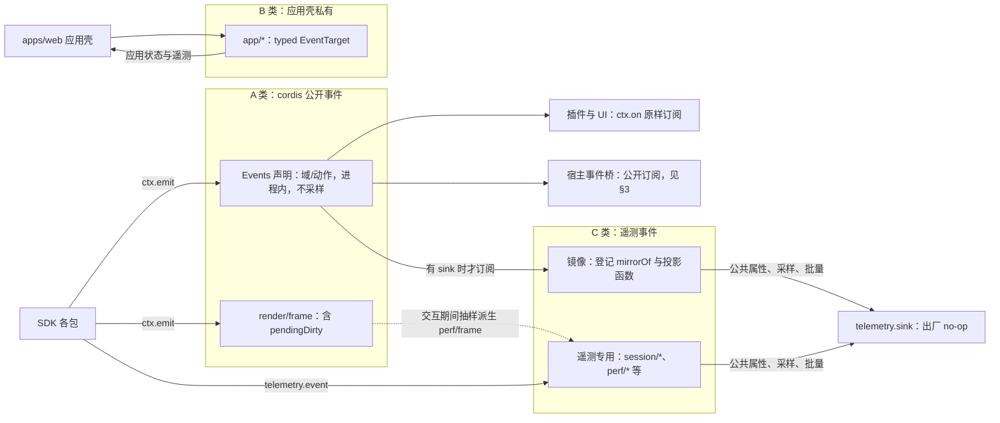
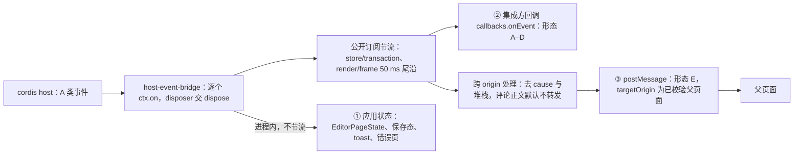
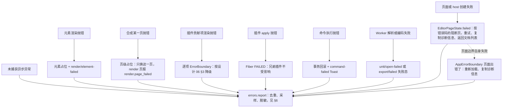
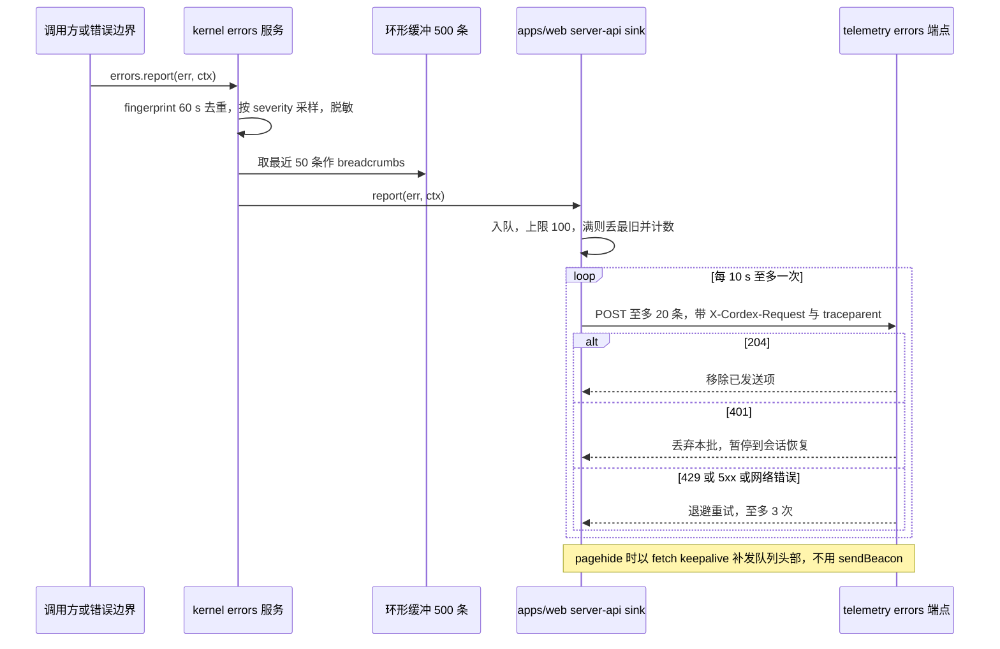
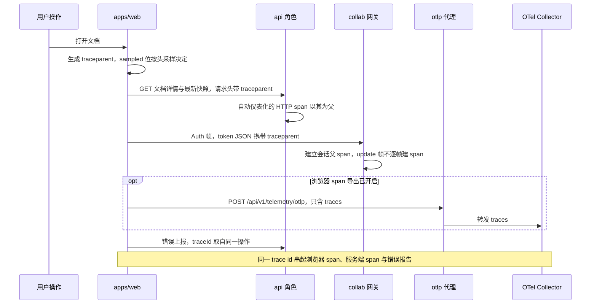

# 15 客户端事件、错误与遥测

> 状态：v0.1 | 负责：前端设计线 | 更新：2026-09-25；2026-09-25（§4.19）；2026-09-26（§4.20）；2026-09-26（§4.21 整合：traceparent 的载体由 CONTROL.auth 改为 Auth 帧 token JSON（§6.2、图、V13、里程碑行））；2026-09-26（§4.21 Remap：原 30/08 引用按 60-backend/README §6.1 改指新位置，30/08 已删除）；2026-10-01（§4.23 插件管理：§2 plugin 行增 `plugin/policy-changed`、`plugin/user-toggled`、`plugin/missing-in-document` 与诊断事件 `plugin/scope-violation`；§6 错误上报附插件集指纹；§8 镜像表与 §11 V14、里程碑同步）；2026-10-03（§4.24：§4 错误码去向补 `format.unsupported_binary`（OF-02））；2026-10-04（design-language-v3 第 0 批：§2 command 事件订阅方去掉状态栏、§5 贡献项级降级按设计 06 §3 v3 表改写、§8 `ui/ribbon-tab-changed` 标作废（rulings §4.25 DS-1、DS-6））；2026-10-04（design-language-v3 第 0 批：复验修正——原「状态胶囊」改称文件名旁的同步状态行（rulings §4.25 DS-6），带作废标记的历史陈述统一措辞）；2026-10-07（design-language-v3 第 1 批：§8 `ui/panel-toggled` 行去掉「工具条与视图切换的使用度量随第 1 批定稿」，改为第 1 批未涉及、与 PRD 06 §3.2 同一待决项）；2026-10-08（design-language-v3 第 1 批收口：§2 permission 行「模式下拉」改为主菜单「视图 › 模式」（DS-23）；§8 视图与检查器页签切换 M2 不另设遥测事件、只用 `command/executed{source}` 与 `ui/panel-toggled`（rulings §4.25 TB-36）；§10 开发者面板入口在主菜单「帮助」最后一组（TB-40））；2026-10-15（design-language-v3 第 2 批：§4.3 页面级失败补没有访问权限的阻断页（rulings §4.25 DS-48、DS-50），`collab.room_full` 改为查看人数已满的阻断页（DS-60），补 `server.snapshots.named_limit_reached` 与 `collab.payload_too_large` 的去向（DS-57、DS-58）；本批不新增事件名与配置键）；2026-10-15（design-language-v3 第 2 批：§4.3 常见码去向表补 30/10 §1.1a 同日新登记的 `server.share_links.conflict` / `not_found` 与 `server.access_requests.*` 四个码的处理与文案（rulings §4.25 DS-47、DS-48、DS-66、TB-72），`named_limit_reached` 的上限取 `details.limit`；同日再补：§5 错误边界的贡献项级与 Fiber 级两行写明插件失败的错误码 `kernel.plugin_failed` 与 `details.phase`（`contribution` / `activate`，rulings §4.25 TB-77），贡献项级的降级表达按 03 §9 第 3 条改写（整页面板为整块状态、未打开的随分区不显示「展开」、单个失败写名字，DS-53、DS-55、TB-59），Fiber 级的「插件管理器页」改称个人插件面板；本轮不新增事件名与配置键）；2026-10-22（design-language-v3 第 3 批（rulings §4.25 DS-85、DS-120…DS-122、DS-124、DS-125、TB-118）：§0 诊断开关一行；§4.3 页面级失败改为按错误码的阻断页（通用兜底「重试 · 复制诊断信息 · 返回文档列表」，404「找不到该文档」，回收站「恢复」，原「只读打开」作废）、`AppErrorBoundary` 为「页面出错了」，登录三个码与 `server.documents.not_found` 的去向；§5 边界表与图 3 同步；§9 诊断开关按账户记在 `cordex.diagnostics.{userId}`；§10 诊断包「已复制」1.5 秒；§11 V15）；2026-10-22（design-language-v3 第 3 批回写补充，rulings §4.25 DS-76、TB-119：§2 ui 行写明 `ui/theme-changed` 的载荷是 `ThemeState`、不含 `density`；§6 第 5 条带插件 id 的 `kernel.plugin_failed` 上报另带 `phase`，供服务端写 `lastErrorPhase`；§10 诊断包写明共同的开头（应用版本、路径、时间、错误、`traceId`），与设计 03-33 §7.4 样张一致，有 host 时再带 Fiber 树等；§11 V15、待回写第 8 条）；2026-10-22（design-language-v3 第 3 批回写收口，rulings §4.25 TB-151、TB-155、TB-156、TB-157：§4.3 页面级失败一行补回收站阻断页「恢复」失败的内联错误（TB-155）与 M2「申请访问」留在原位不可用（TB-156）；§5 边界表与图 3 新增「页级」一层——slide-render 合成某一页抛错时只把这一页换成页级占位、其余页照常，`/render` 里报 `render.page_failed`（TB-151、TB-157）；待回写第 9 条；2026-10-22 复核修正：§2 render 行补发布文件的完整路径与载荷的可选 `pageId`；§5「页级」一行补浏览器图片导出遇到这一层即失败（TB-166）；§10 新增测试部署的渲染故障注入点（TB-169）；待回写第 9 条同步；§10 写明 `throwOnNextRender()` 由 §5「应用级」一层接住（70/06 §5 第 66 行的用法）；§8 `noteInteraction` 一句与待回写第 4 条改为已登记（50/05 §2、40/06 §2.4）；§4.3 常见码表登记 `render.page_failed` 在导出失败态的原因句「有一页暂时无法生成，请重试；文档本身不受影响」，服务端与浏览器同一句（TB-173）；§10 写明 `/render` 不设故障注入点，服务端集成测试的页级失败用 renderer 桩、真实合成一侧用组件级用例（TB-174），诊断接口的落点写为 40/11 已登记的 `application/host/diagnostics.ts`（总编排定），§11 V15 与待回写第 9 条同步、该条结案；§4.2、§4.3 `render.page_failed` 标为面向用户、带 zh-CN / en-US 的 `.title` / `.action`（TB-173），新增 `headless.render_timeout` 的原因句与「render-export 作业的其余失败码」按属性取原因（TB-175），§10 补诊断接口的导出名、配置点与 e2e 用的页面全局 `window.__cordex.diagnostics`，§11 V15 与待回写第 9 条同步；§4.2、§4.3 写明 `headless.render_timeout` 为 `user:true`、键随 `@cordexjs/i18n` 的协议码文案（40/02，TB-175），「render-export 作业的其余失败码」一行定为通用文案 `errors.generic`（TB-176），`render.page_failed` 一行注明 protocol 另把它登记为线上引用码、运行时声明与文案仍在 engine-render（TB-178），§10 诊断包归 SDK（宿主方法 `CordexHost.dumpDiagnostics()`，40/02）、apps/web 的 `application/host/diagnostics.ts` 转调并补共同的开头与无 host 的情形（TB-177），渲染故障注入点一行的组件级用例改指 `application/render-page.usecase.test.ts`（TB-174），§11 V15、M1 / M2 里程碑（`diagnostics.dump()` 改为 M1）与待回写第 9 条同步）；2026-10-23（design-language-v3 第 3 批评审修改：§4.3 导入几个码的去向改为「导入」对话框的失败态；§10 诊断包一行把导入失败页改为导入对话框的失败态，「复制诊断信息」的反馈写在对话框底栏（rulings §4.25 DS-140、TB-179）；§4.3 `format.unsupported_binary`、`format.encrypted` / `format.macro_rejected` 的文案按设计 03-13「打开失败态」表对齐，`storage.quota_exceeded` 补导入时的去向；§10 诊断包补导入对话框失败态另带首个失败部件、文件名与大小） | 依赖：30-architecture/10 §1–§5、§11；PRD 05 EM-05/EM-12/EM-13；PRD 06；PRD 04 NF-11；ADR-0011、ADR-0030；rulings §5、§4.11 C-24/C-25、§4.17 D5、§4.18 BE-30/UX-02、§4.20 FE-10/FE-16、§4.25 TB-77；60-backend/18；rulings §4.25 DS-85、DS-120…DS-122、DS-124、DS-125、TB-118；[设计 03-33](../20-design/03-screens/33-login-session-and-error-pages.md) §4.3、§7；rulings §4.25 DS-76、TB-119（第 3 批回写补充）；rulings §4.25 TB-151、TB-155、TB-156、TB-157（第 3 批回写收口）；rulings §4.25 TB-166、TB-169、TB-173、TB-174、TB-175、TB-176…TB-178；rulings §4.25 DS-140、TB-179（第 3 批评审修改）

本文是浏览器侧事件、错误与遥测的唯一事实源：三类事件的边界、前端发布者与订阅者、宿主事件桥、浏览器中的错误模型与错误边界、客户端错误上报管线、OTel Web、产品事件的前端发布方、同意与默认、诊断。命名规则、日志字段与脱敏规则、错误码格式与 HTTP / WS 映射、公开事件定稿表留在 [30/10](../30-architecture/10-observability-and-errors.md)（§1–§3、§11.1）；`/telemetry/*` 控制器、限流、Collector 路由、服务端 span 与指标统一名表归 [60/18](../60-backend/18-observability-and-ops-endpoints.md)；产品事件清单的权威是 [PRD 06](../10-prd/06-metrics-and-analytics.md) §3.2，本文只登记前端发布方。

## 0. 分工速查

| 主题 | 本文 | 引用 |
|---|---|---|
| 事件命名规则、公开事件定稿表与载荷 | §1 摘要 | 30/10 §11.1；载荷形状以 40/02 §2.4、40/05 §2.4、40/06 §2.4 为准 |
| 错误码格式、域清单、HTTP / WS 映射 | — | 30/10 §1.1、§1.4 |
| 错误码 → 用户文案与建议动作 | §4 | 文案本身在各包 locales（50/16 §1） |
| 上报端点、限流、体积上限、Collector | §6、§7 只写浏览器侧 | 60/18 §9；路由表 60/15 §3.14 |
| 嵌入通道（postMessage 消息与桥的装配） | §3 只写事件语义 | [50/12](./12-viewer-embedding-and-render-page.md) §9–§10、[50/14](./14-client-security.md) §11 |
| 偏好设置里的两个诊断开关（按账户记，2026-10-22 起） | §9 语义 | 界面位置 [50/10](./10-editor-shell-and-interaction.md) §10.3；存储键 [50/02](./02-app-shell-routing-and-session.md) §10.1 |

## 1. 事件三类

| 类 | 载体 | 命名 | 语义 | 登记与校验 |
|---|---|---|---|---|
| A cordis 公开事件 | `ctx.emit` / `ctx.on`（`Events` 接口声明合并） | `<域>/<动作>`，域在章程 §5.5 保留域或带 `<vendor>:` 前缀 | 进程内、同步、不采样；订阅返回 disposer；载荷不含文档文本（评论正文除外，可配置脱敏） | lint `cordex/events-must-be-declared`（含域白名单规则 3） |
| B 应用壳私有事件 | `apps/web/src/domain/app-events.ts` 的 typed `EventTarget` | `app/<动作>` | 只在 `apps/web` 内使用；章程 §5.5 把 `app` 单列为应用壳私有域，禁止 `packages/*` 使用 | 不经上述 lint；`packages/*` 本就不能 import `apps/*`（depcruise） |
| C 遥测事件 | `ctx.telemetry.event(name, props)`，经 `defineTelemetryEvents` 登记 | 沿用 PRD 06 的 `<域>/<动作>`；分「镜像 A 类事件」与「遥测专用」两种 | 可采样、附公共属性、经 `telemetry.sink` 出口；出厂 no-op | lint `cordex/telemetry-events-must-be-declared` + 扫描器 `scan-telemetry-events` |

- **A 类定稿集合**：以 30/10 §11.1 为准；PRD EM-05 表补 `store/undo-skipped`（M3，载荷 `{ skipped: UndoSkip[]; wholeStep: boolean }`）。依据：MECH-INC 中 INC-32（rulings §4.17 D5；30/10 §11.1）。
- **B 类集合**：`app/navigated{from,to}`、`app/session-changed{state}`、`app/online-changed{online}`、`app/document-opened{documentId,documentType}`、`app/document-closed{documentId,dirtyDiscarded}`、`app/preferences-changed{keys}`、`app/intent{target}`（40/11 §2.4；定义在 50/02 的应用壳内，本文只列出供遥测与桥引用）。
- **C 类以 PRD 06 为权威**：30/10 §3.4 中 `doc_opened` 一类 snake_case 旧名作废，PRD 06 §3.2 按 INC-33 应逐行标「镜像」或「遥测专用」；PRD 当前只标了部分行，完整分类以本文 §8 为准，待回写 PRD 06。遥测专用名（如 `session/*`、`search/*`、`clipboard/*`）不受章程 §5.5 保留域约束，由遥测登记表扫描。依据：MECH-INC 中 INC-33（PRD 06 为遥测清单权威，30/10 §3.4 自述）。
- **`render/frame` 与 `perf/frame` 并存，不是改名**：`render/frame(unitId, stats{ pages, elementsUpdated, ms, overrun, pendingDirty })` 是 A 类进程内事件（`/render` 页 ready 判据读 `pendingDirty`，50/12 §11）；`perf/frame{ frameMs, interaction, pages, elementsUpdated, overrun }` 是由它抽样派生的遥测专用事件。rulings §5 表中「`render/frame` vs `perf/frame`」一行已被 §4.11 C-25 覆盖。依据：INC-08（rulings §4.11 C-25 + §4.18 FE-09 + 30/10 §11.1）。

**图 1 事件三类与流向**

怎么读：SDK 只发 A 类事件与遥测专用事件，应用壳只发 B 类事件；A 类事件被插件与宿主事件桥原样订阅，只有登记了镜像的事件才会被遥测服务投影成 C 类，并且只在存在 sink 时订阅（无 sink 时零开销）。
依据：ADR-0011 决策 5–6；30/10 §3.1、§11.1；PRD 06 §5 图 5-1。

**镜像实现**：遥测登记表（kernel `defineTelemetryEvents`，40/02 §4）的条目为 `{ name, version, mirrorOf?, project?, sample, privacy, schema }`，字段与 PRD 06 §5「事件 schema 注册表」一致（名称、版本、属性 schema、隐私级、采样率）。kernel 的 `telemetry` 服务在至少挂有一个 `telemetry.sink` 时，按 `mirrorOf` 订阅对应的 A 类事件，用 `project(payload)` 取出度量属性（如 `durationMs`、`pagesParsed`），再附公共属性、采样、交给 sink；各包不手写镜像代码。

## 2. 前端发布者与订阅者总表

载荷字段以 30/10 §11.1 与 40 各模块 §2.4 为准，本表只登记浏览器内谁发、谁收。

| 域 | 事件 | 发布方（包 · 文件） | 主要前端订阅方 | 里程碑 |
|---|---|---|---|---|
| unit | `unit/opened`、`unit/loaded`、`unit/open-progress`、`unit/open-failed`、`unit/closed`、`unit/dirty-changed`、`unit/saved`、`unit/migrated` | model-core · `unit/unit-plugin.ts`、`unit/units.service.ts`、`migration/migrations.service.ts` | 应用壳 `EditorPageState` 与最近文档（经桥）；ui-core `unitLoaded` 键；打开进度 UI | M1 / M2 |
| command | `command/executed`、`command/rejected`、`command/failed`、`command/audited` | model-core · `command/pipeline.ts`、`command/audit.ts` | ui-core 上下文键；ui-react 通知模板 `command-failed` / `permission-denied` | M2 |
| store | `store/transaction`（公开订阅节流 50 ms）、`store/loaded`、`store/undo-skipped` | store-memory / store-yjs Provider | `SceneProvider.diff`（进程内原样）；应用壳回调式保存（经桥，节流）；撤销跳过提示条（[50/04](./04-document-commands-and-undo.md)） | M2 / M3 |
| history | `history/changed` | model-core · `history/history.service.ts` | ui-core `canUndo` / `canRedo` | M2 |
| selection | `selection/changed` | model-core · `selection/selection.service.ts` | ui-core 上下文键；presence 广播 | M2 |
| view | `view/page-changed`、`view/zoom-changed` | engine-render · Viewport 服务（唯一发布者，编辑器与查看器共用） | 查看器壳页码、放映 `?page=` 同步、桥（EM-05） | M1 / M2 |
| view | `view/mode-changed` | ui-core · `application/operations/view-set-mode.ts` | `viewMode` 键、母版视图会话记忆、presence 广播 | M2 |
| render | `render/first-paint`、`render/frame`、`render/element-failed`、`render/element-degraded`、`render/font-fallback`、`render/page-mounted`、`render/page-unmounted` | engine-render · `render.service.ts`；render-dom · `paint/painter.ts`、`fonts/font-face-loader.ts`、`target/dom-render-target.ts`；slide-render · `application/services/slide-scene-provider.service.ts`（只发 `render/element-failed` 的页级一种：`kind: 'page'`，带 `pageId` 与 `code: 'render.page_failed'`；`render/element-failed` 的载荷因此增可选的 `pageId`，`kind: 'page'` 时必带，载荷形状以 30/10 §11.1 与 40/06 §2.4 为准；2026-10-22，rulings §4.25 TB-151、TB-157，40/07 §2.4） | `/render` 页 ready 判定（全量）；保真摘要；`render/element-failed` → `errors.report`；`perf/frame` 派生 | M1 |
| layout | `layout/fonts-ready`、`layout/measurer-changed` | render-dom / engine-layout | `/render` 页字体结算；度量缓存失效 | M1 |
| export | `export/started`、`export/completed`、`export/failed` | model-core · `format/formats.service.ts` | 导出对话框进度与重试 | M2 |
| collab | `collab/state-changed`、`collab/synced`、`collab/soft-conflict`、`collab/auth-failed`、`collab/reconnect`、`collab/update-rejected`、`collab/repair`（`collab/backpressure` 按 30/10 §11.1 降为客户端指标 `cordex_collab_outbound_queued`，`collab/latency` 为遥测专用事件，二者都不是 cordis 事件、不提请章程 §5.5，§7.2、§8） | collab-yjs · `session-driver.ts`、`sync/yjs-sync-engine.ts`、`permission/permission-gate.ts`；collab-transport-ws · `handshake.ts`（经 SessionDriver 转发） | 同步状态行与横幅（[50/07](./07-collaboration-client.md)）；`collab/auth-failed{code:'collab.unauthenticated'}` 与换票 401 一样进入「登录已过期」流程，不走重连（50/07 §8、50/02 §5） | M2（`collab/soft-conflict` 随多人协同体验层 M3；rulings §4.19 D-M2-CONTENT） |
| presence | `presence/joined`、`presence/left`、`presence/changed` | collab-yjs · `awareness/presence.service.ts` | 在场头像、远端光标覆盖层、在场播报（50/16 §8） | M3 |
| permission | `permission/changed`、`permission/denied` | model-core · `permission/permissions.service.ts`（唯一发布者） | ui-core `isReadOnly` 与 `can.<capability>`；应用壳更新角色与主菜单「视图 › 模式」的可选项（原应用栏模式下拉作废，rulings §4.25 DS-23），不改 `EditorHost mode`（[50/10](./10-editor-shell-and-interaction.md) §3.1，rulings §4.20 FE-10） | M2 / M3 |
| comment | `comment/added`、`comment/replied`、`comment/resolved`、`comment/reopened`、`comment/deleted`、`comment/mentioned`；载荷 `{threadId, replyId?, authorId, mentioned?, anchorSummary, origin:'local'\|'remote', body?}` | `comments` 包（iso，文档类型盲；rulings §4.19 D-COMMENTS-PKG） | 评论面板、画布评论钉、通知偏好（[50/08](./08-comments-and-version-history.md) §8） | M3 |
| plugin | `plugin/loaded`、`plugin/failed`、`plugin/incompatible` | kernel · `failure-isolation.ts`、`manifest/verify.ts` | 个人插件面板（原插件管理器页，[03](./03-preset-assembly-and-plugins.md) §10）；ui-react 贡献错误边界文案 | M2 |
| plugin（2026-10-01，rulings §4.23） | `plugin/missing-in-document{pluginId, reason, count}`（`reason` ∈ `disabled` \| `absent` \| `outdated` \| `failed`；每文档每会话每插件一次，横幅出现时发）；`plugin/scope-violation{pluginId, commandId}`（诊断事件：界面级插件执行写命令被命令管线按未授权拒绝，PRD PM-13 第 3 条） | kernel · `plugin-footprint.ts`（比对，[04](./04-document-commands-and-undo.md) §1.1）、`command/pipeline.ts`（作用域检查） | 缺插件横幅与个人插件面板「本文档缺少的插件」分组；`plugin/scope-violation` 进开发者面板与诊断转储（命令本身按未授权返回 `Result` 错误，不另设错误码） | M2（`missing-in-document`）/ M3（`scope-violation`；`reason:'disabled'` 自 M3 起区分） |
| plugin（2026-10-01，rulings §4.23） | `plugin/user-toggled{pluginId, enabled}`（个人启停可选界面级插件成功后）；`plugin/policy-changed{count, pluginIds[]}`（管理员保存插件策略成功后） | `apps/web` · `application/plugins/toggle.usecase.ts`、`application/plugins/save-policies.usecase.ts`，经 `host.events.emit` 在已挂载的 host 上发出；管理员页无 host 时只走遥测（§8 遥测专用） | 个人插件面板刷新分组；遥测 | M3 |
| error | `error/raised` | kernel · `services/errors.service.ts` | 应用壳 `AppErrorBoundary`（`severity:'fatal'`）；遥测镜像 | M1 |
| i18n | `i18n/locale-changed` | i18n · `services/i18n.service.ts` | ui-react 重渲染；ui-core 标题缓存 | M2 |
| ui | `ui/context-key-changed`、`ui/panel-opened`、`ui/panel-closed`、`ui/shortcut-conflict`、`ui/theme-changed`（载荷为 `ThemeState`：`mode`、`resolved`、`hostMark?`，2026-10-22 起不含 `density`，rulings §4.25 DS-76；PRD 06 的分析属性只有 `theme`） | ui-core · `context-keys.service.ts`、`panel-operations.ts`、`shortcuts.service.ts`、`theme.service.ts` | ui-react；集成方宿主同步主题 | M2 |
| slide | `slide/thumbnail-updated` | slide-render · `application/services/thumbnail.service.ts` | slide-ui 缩略图侧栏、母版缩略图窗格 | M1 / M2 |
| slide | `slide/show-changed` | slide-ui · `application/present.ts` | 应用壳全屏控制、放映舞台 | M2 |
| contribution | `contribution/changed` | kernel · `contribution/set.ts` | ui-react 贡献渲染器刷新与诊断 | M1 |

`comment/*` 的发布方为 iso 包 `@cordexjs/comments`（ResourceHook `comments.threads`，文档类型盲），slide 专属锚点、检查器评论页签与画布评论钉由 slide-ui 贡献。依据：rulings §4.19 D-COMMENTS-PKG；INC-39（命名空间 `comments.*`，rulings §4.18 FE-01）。

`comment/*` 的**正文默认脱敏**（rulings §4.20 FE-16，登记同步 30/10 §11.1）：载荷省略 `body`、只给正文长度；集成方显式开启 `comments` 包选项 `comments.events.includeBody` 才带正文；跨 origin 的 postMessage 另按 §3 ③ 规则默认不转发正文。`origin` 区分本地与远端变更，建议集成方只对 `origin:'local'` 发通知（每条评论只在作者端触发一次，50/08 §8）。

`view/page-changed` 与 `view/zoom-changed` 的发布方依据：VIEW-EVENTS（Viewport 归 engine-render，30/07 §2.3；40/11 §12 G-9 结案）。

**顺序与合并**

1. 同一 Unit 内的事件按发生顺序同步分发；`store/transaction` 先于对应的 `command/executed`（EM-05）。
2. 进程内订阅（`ctx.on`，插件与 UI）收到的是逐条原始事件，不合并。
3. 公开订阅面（§3 的集成方回调与 postMessage）对 `store/transaction` 与 `render/frame` 做 **50 ms 尾沿节流**：窗口内只投递最后一条，载荷形状不变、不增字段；需要逐条数据的集成方应写插件用 `ctx.on`，或读遥测。
4. 跨 Unit 不保证顺序；`app/*` 与 A 类事件之间不保证顺序（应用壳只依赖自己收到的顺序）。

## 3. 宿主事件桥

`apps/web/src/application/host/host-event-bridge.ts` 在 `createEditorHost` 返回后逐个 `ctx.on` 订阅下表事件，disposer 交给 host 的 `dispose()`；事件名与载荷完全沿用 A 类定稿，不改名、不增字段（40/11 §2.4）。集成方在形态 A–D 使用同一个公开订阅面（`CreateEditorHostParams.callbacks.onEvent` 或直接 `ctx.on`，通道见 50/12 §10）。

| 接收方 | 形态 | 收到什么 | 节流 | 跨边界处理 |
|---|---|---|---|---|
| ① 应用状态 | apps/web | `unit/*`、`export/*`、`collab/state-changed`、`permission/changed`、`plugin/*`、`error/raised` | 否 | 同 realm，原样 |
| ② 集成方回调 `callbacks.onEvent` | A–D（50/12 §10） | 下表「公开」列 | §2 第 3 条 | 同 realm，原样（载荷本就不含文档文本） |
| ③ `postMessage` 到父页面 | E | 与 ② 相同（下表「公开」列），封装为 `cordex:event` 消息（消息形状在 protocol `embed/messages.ts`，50/12 §9） | 同上 | 去掉 `cause` 与堆栈；评论正文默认不转发；不含令牌与预签名 URL（50/14 §11.1） |

| 域 | 编辑器页 | `/render` 页 | 公开（② / ③） |
|---|---|---|---|
| unit | 全量 | `unit/opened`、`unit/open-failed` | 全量 |
| command / history / selection | 全量 | 不订阅 | 全量；`selection/changed` 由集成方选择是否订阅 |
| store | `store/transaction`（节流）、`store/undo-skipped` | 不订阅 | 同左 |
| view | 全量 | 不订阅 | 全量 |
| render / layout | 只转发 `render/element-degraded`、`render/element-failed`、`render/font-fallback` | 全量（ready 判定，50/12 §11） | `render/first-paint`、`render/frame`（节流）、降级三件 |
| export | 全量 | 不订阅 | 全量 |
| collab / presence | 全量（M3） | 不订阅 | 全量 |
| comment / permission | 全量 | 不订阅 | 全量；`comment/*` 正文按 ③ 规则 |
| plugin / error | 全量 | `error/raised` | 全量 |

**图 2 宿主事件桥转发**

怎么读：桥只有一个订阅入口，按接收方分三路；应用状态走不节流的直连路径，两条公开路径先过同一个节流器，其中跨 origin 的一路再做脱敏，发送目标永远是已校验的父页面源。
依据：40/11 §2.4；PRD 05 EM-05；50/14 §11.1。

## 4. 浏览器中的错误模型

### 4.1 类型与边界

- **`CordexError`**（30/10 §1.2）：`code`、`details`、`severity`（`fatal` / `error` / `warning`）、`retryable`、`user`（能否向用户展示）、`cause`、`fingerprint`、`context{ unitId?, traceId? }`。子类只有校验、聚合、不变量三种，分类靠 `code` 与属性而不是 `instanceof`。
- **`Result` 与 `throw` 的边界**以 30/10 §1.3 为准：纯函数与 iso 库返回 `Result`；浏览器 API 与网络失败返回 `Promise<Result>`；只有插件 `apply`、命令执行、Worker 消息处理这类边界把 `Result` 转成异常。
- **REST 错误**：服务端返回 problem+json，`infrastructure/api/http.ts` 解析为 `ErrorEnvelope`（`code`、`detail`、`traceId`、`retryable`、`details?`）。码联合在 protocol `errors/codes.ts`，HTTP / WS 映射在 `errors/http-map.ts`，信封在 `rest/problem.ts`。依据：INC-11/INC-13（60-backend/15 §1、30/10 正文 > 40）。
- **网络不可达与超时**映射为 protocol 已登记的 `transport` 域码（码名由 M-02 `errors/codes.ts` 登记，`apps/**` 不新造码：`apps/**` 不得声明合并 `ErrorCodes`，40/11 §10）。
- **WS 关闭码**的定义在 30/06 §6.5，客户端据此的行为在 50/07。

### 4.2 错误码 → 文案与建议动作

依据：ERR-COPY（PRD 05 EM-12 + rulings §4.18 GV-15：对不上的名字落为既有扫描器子规则）。

- 文案键为 `errors.<code>.title` 与 `errors.<code>.action`（如 `errors.format.quota_exceeded.title`）。文案遵循设计 07 §7「发生了什么 + 能做什么」两段式，不把错误码当标题给最终用户；码与 `traceId` 放在可展开的「查看详情」里。
- `details` 的字段按 ICU 占位符插值（如 `{limit}`、`{actual}`、`{dimension, select, slides {页数} elementsPerSlide {单页元素数} other {元素总数}}`）。
- **谁提供文案**：声明错误码的包在自己的 `locales/*.json` 中以命名空间 `errors.<domain>` 贡献对应键（`i18n.bundle` 的键为 `${namespace}:${locale}`，按域分命名空间可避免多个包互相 `replace`）；protocol 登记的码（`server.*`、`transport.*`、`collab` 线上码，以及经作业 `error.code` 到达浏览器、面向用户的 `headless.*` 码，§4.3）由 `@cordexjs/i18n` 自带的语言包提供，这样无 host 页面（登录、列表、设置）也能显示（50/16 §3）；其中 `headless.render_timeout` 面向用户（`user:true`，rulings §4.25 TB-175），zh-CN / en-US 键 `errors.headless.render_timeout.{title, action}` 随 `@cordexjs/i18n` 的协议码文案提供（模块 40/02 §4.4 / §5.4 `locales/*.json`）；导出作业里其余的 `headless.*` 失败（renderer 忙、注入超时、浏览器崩溃）不面向用户、显示通用文案（TB-176，§4.3）。集成方可按键覆盖（EM-08）。
- **机械约束**：`defineErrors` 表与 protocol `errors/codes.ts` 中 `user:true` 的每个码，都必须在 zh-CN 与 en-US 中同时有 `.title` 与 `.action`——作为扫描器 `scan-contributions` 规则 (f) 的子规则执行（不新增扫描器）。
- `user:false` 的码一律显示通用文案 `errors.generic.{title, action}`，并附「查看详情」。

### 4.3 属性 → 呈现层级

呈现层级（横幅 > Toast > FieldError > 同步状态行）与各组件的外观以 50/10 §11 为准，本表只给出错误属性到层级的映射：

| 条件 | 呈现 | 上报 |
|---|---|---|
| `severity:'fatal'` 或未被任何边界接住 | `AppErrorBoundary` 错误页「页面出错了」：说明、「重新加载」、「复制诊断信息」（§10；画面见设计 03-33 §7.4） | 是 |
| 页面级失败（打开失败、host 创建失败） | 编辑器页 `failed{code}` 态，按错误码的阻断页（50/02 §6）：通用兜底「无法打开该文档」+「重试」·「复制诊断信息」·「返回文档列表」；文档不存在（404）为单独的「找不到该文档」、只有「返回文档列表」（rulings §4.25 DS-122）；所有者打开回收站里的文档为「此文档在回收站中」+「恢复」（DS-85；恢复失败时主按钮上方一行 `role=alert` 的「无法恢复「〈名〉」，请稍后重试」、按钮恢复可用，同登录页内联错误，TB-155）；没有访问权限（打开时 403，或会话中访问被撤销）为阻断页「申请访问」·「返回文档列表」（DS-48、DS-50；M2 的「申请访问」留在原位不可用、写「后续版本提供」，TB-156）；分享链接失效为「链接已失效」（50/02 §11）。原「重试 / 返回首页」与「只读打开」作废（2026-10-22；画面以设计 03-02 §6.2、03-33 §7 为准） | 是（访问被撤销不上报为错误） |
| `user:true` 且 `retryable:true` | Toast 带「重试」；表单字段错误用 FieldError | `error` 及以上 |
| `user:true` 且 `retryable:false` | 横幅或对话框，给出 `action` 文案对应的动作 | `error` 及以上 |
| `severity:'warning'` | Toast 3.5 s | 按 §6 采样 |
| `user:false` | 通用文案 Toast +「查看详情」 | 是 |

几个常见码的去向（文案以语言包为准）：

| 码 | 去向 |
|---|---|
| `server.auth.expired` | 「登录已过期」流程，不走重连（UX-02，50/02 §4） |
| `server.auth.invalid_token` / `server.auth.account_disabled` / `server.auth.idp_unavailable`（回调与发起登录的 `?error=`） | 登录页主按钮上方一行内联错误，三个码各一句，再点主按钮即重试；`account_disabled` 上重新发起时带 `prompt=login`；新窗口重新登录时为新窗口失败页（2026-10-22，rulings §4.25 DS-120、DS-121、DS-124、DS-125，50/02 §4.4、§5） |
| `server.documents.not_found` | 打开文档时的单独阻断页「找不到该文档」，只有「返回文档列表」、不写文档名（DS-122，50/02 §6） |
| `server.auth.csrf_rejected` | 横幅「请求被拒绝，请刷新页面后重试」 |
| `permission.denied` | Toast「需要编辑权限」（ui-react `permission-denied` 模板） |
| `document.quota_exceeded` | Toast，带 `dimension` 与上限，命令被拒、连接保持 |
| `format.quota_exceeded` / `format.limit_exceeded` | 「导入」对话框的失败态（[02](02-app-shell-routing-and-session.md) §9.3），带上限与实际值 |
| `format.unsupported_binary` | 「导入」对话框的失败态：「不支持的文件格式」+「请在 PowerPoint 中另存为 .pptx 后重试」，不用「已损坏」措辞；.ppt 在申请上传时就被拒（415），拖进对话框的不是 .pptx 时同此（PRD OF-02；文案以设计 03-13「打开失败态」表为准，2026-10-23 与它对齐，原写「不支持旧版 .ppt 二进制格式…后再导入」作废） |
| `format.encrypted` / `format.macro_rejected` | 「导入」对话框的失败态：「此文件已加密，当前版本无法打开」+「请先在 PowerPoint 中去除密码后再导入」/「不支持包含宏的演示文稿」+「请另存为 .pptx 后再导入」，都不给重试（文案以设计 03-13「打开失败态」表为准） |
| `storage.quota_exceeded` | 上传或新建失败对话框；导入时是「导入」对话框的失败态「存储空间不足，无法导入」（M3，PRD SV-08；2026-10-23 起，rulings §4.25 DS-140，设计 03-13） |
| `render.page_failed` | 导出失败态的原因句「有一页暂时无法生成，请重试；文档本身不受影响」（2026-10-22，rulings §4.25 TB-173）：服务端生成（M3 起 PNG「全部页」与 PDF；作业以这一页诊断里的 `render.*` 码失败，`GET /jobs/:id` 的 `error.code` 即这个码，后端 60/06 §5.2、§11.3，TB-157）与浏览器生成的 PNG / SVG（所导页里有一页走了运行时页级回退，[18](./18-editor-capabilities.md) EXP-03，TB-166）是同一句；导出对话框「导出没有完成」+ 这一句 +「重试」（设计 03-22 §6 引用本行）。这个码因此按 §4.2 面向用户（`user:true`，TB-173）：zh-CN 与 en-US 都有 `errors.render.page_failed.title`（「有一页暂时无法生成」）与 `.action`（「请重试；文档本身不受影响」），失败态的原因一行就是两段以「，」连成的这一句；键由声明这个码的 engine-render 在自己的 `locales/*.json` 以命名空间 `errors.render` 贡献（§4.2；声明处 40/06 §5 `errors.ts`，V5 覆盖；protocol `errors/codes.ts` 另把它登记为线上引用码，登记方式同 `collab.*`，运行时声明与文案仍在 engine-render，rulings §4.25 TB-178，40/02 §5.3）。编辑、查看与放映里只把这一页换成页级占位「此页内容暂时无法显示」，不另出提示（§5「页级」） |
| `headless.render_timeout` | 导出失败态的原因句「生成文件时超时，请重试；文档本身不受影响」（2026-10-22，rulings §4.25 TB-175，与上一行并列）：M3 起服务端 render-export 作业里有一页渲染超过 10 s、在新请求里重试 1 次仍超时，作业以这个码失败（后端 60/06 §5.2、§10.5、§11.3），经 `GET /jobs/:id` 的 `error.code` 到达导出对话框，「导出没有完成」+ 这一句 +「重试」（设计 03-22 §6 的示例句即此）。与 `render.page_failed` 同样按 §4.2 面向用户（`user:true`）：zh-CN 与 en-US 都有 `errors.headless.render_timeout.title`（「生成文件时超时」）与 `.action`（「请重试；文档本身不受影响」），这是 protocol 登记的码，两个键随 `@cordexjs/i18n` 的协议码文案提供（§4.2，模块 40/02 §4.4 / §5.4 `locales/*.json`） |
| render-export 作业的其余失败码 | 通用文案 `errors.generic`（2026-10-22，rulings §4.25 TB-176）：renderer 忙、注入超时、浏览器崩溃与网络、存储等基础设施失败都不另标面向用户（`user:false`），重试用尽时作业 `error_code` 取最后一次错误的码（后端 60/06 §5.2「重试用尽」一行，如 `headless.renderer_busy`、`headless.inject_timeout`、`headless.browser_crashed`），失败态的原因一行按 §4.2 显示 `errors.generic.{title, action}`；不逐码登记句子，原因只有上两行两句与这条通用文案（设计 03-22 §6 同此）；失败态的「导出没有完成」与「重试」不变，导出对话框的失败态只换原因一行、不附「查看详情」（码与 traceId 走客户端错误上报，§6；「查看详情」只在 Toast 呈现时附） |
| `collab.room_full` | 查看者名额也满（握手被拒、4503）：阻断页「文档当前查看人数已达上限」+「有名额空出时会自动打开，保持此页即可」+「返回文档列表」，会话在后台按退避重试，进入后直接显示编辑器（50/07 §9，rulings §4.25 DS-60）；编辑者名额已满不是错误码（`auth.ok.reason='capacity'`），以只读身份加入、出中性横幅（50/07 §8.1，DS-58） |
| `server.snapshots.named_limit_reached` | 轻提示「命名版本已达上限（每份文档 {limit} 个）」（`{limit}` 取 `details.limit`，缺省部署为 200），命名表单与名称保留（50/08 §9，rulings §4.25 DS-57） |
| `server.share_links.conflict` | 一般不面向用户：放宽链接时 `POST` 得 409（该文档已有仍有效的链接），客户端重新取链接设置后改用 `PATCH …/share-links/:linkId`（50/02 §8，rulings §4.25 TB-72）；改用 `PATCH` 仍失败时才在链接一节显示内联错误行 |
| `server.share_links.not_found` | 改角色、有效期或收紧时链接已被撤销或已到期：不出提示，重新取链接设置并按当前状态显示——已到期的写「原链接已于〈日期〉到期」（50/02 §8，DS-66） |
| `server.access_requests.not_pending` | 批准或拒绝时该申请已被处理：轻提示「该申请已被处理」，刷新「访问申请 N」一节与「分享」上的计数（50/02 §8） |
| `server.access_requests.not_found` | 申请不存在或不属于该文档：不另提示，刷新「访问申请 N」一节与计数 |
| `server.access_requests.already_granted` | 申请人对该文档已有访问权限（含仍有效的链接角色）：留言弹层收起，阻断页一行「你已有访问权限」并重新打开文档（50/02 §6、§8） |
| `server.access_requests.validation_failed` | 留言超过 200 字或批准角色非法：留言框下方 `FieldError`「留言不能超过 200 字」，弹层与已写内容保留（留言框计数「N/200」常显，客户端先挡住超长，正常不会出现） |
| `collab.payload_too_large` | 横幅「有更改过大无法同步」+「导出为本地副本」，导出前不可关闭（50/07 §8.2、§9，rulings §4.25 DS-58） |
| 403 且 `details.reason` 为 `share_link.expired` / `share_link.revoked` | 「链接已失效」页（INC-20，50/02 §11） |

## 5. 错误边界拓扑

一个错误只在最近的边界被接住，不向兄弟单元扩散（章程 A11；30/10 §1.3）。

| 边界 | 位置 | 接住什么 | 用户看到 | 上报 |
|---|---|---|---|---|
| 元素级 | render-dom `paint/painter.ts` 的 try/catch | 单个元素渲染抛错 | 该元素位置显示占位；发 `render/element-failed` | `errors.report` |
| 页级（2026-10-22，rulings §4.25 TB-151、TB-157） | slide-render `slide-scene-provider.service.ts` 的 try/catch（页级回退，40/07 §1.1） | 合成某一页时抛错 | 只把这一页的页层换成页级占位「此页内容暂时无法显示」（纸面内画，母版与版式层照常），其余页不受影响；发 `render/element-failed{ kind: 'page', pageId, code }`，`/render` 的 `ready` 诊断里这一页带 `failed{ code: 'render.page_failed' }`，renderer 不回传字节（[12](./12-viewer-embedding-and-render-page.md) §11.3）；浏览器生成的 PNG / SVG 导出遇到这一层即本次导出失败、进导出对话框的失败态，不把占位写进文件（2026-10-22，rulings §4.25 TB-166，[18](./18-editor-capabilities.md) EXP-03）。整页解析失败的保真占位「此页内容无法解析」是确定内容，不经这一层 | `errors.report('render.page_failed')`（30/10 §1.1a） |
| 贡献项级 | ui-react `ContributionRenderer` 逐项 ErrorBoundary | 插件贡献的工具条「更多」条目、检查器分区、面板、覆盖层渲染抛错 | 按设计 06 §3 与 [03](./03-preset-assembly-and-plugins.md) §9 第 3 条降级：「更多」条目与检查器分区不显示（不留空位）、已打开的整页面板内容区换成整块状态（`PanelState`）、未打开的整页面板随分区不显示「展开」、覆盖层停止渲染；插件失败另出按需横幅（一个失败写「插件「X」未能启动」、多个写「N 个插件启动失败」，rulings §4.25 DS-55；原状态栏项淡出与「插件」图标计数随 DS-6 废弃） | 是，带 `pluginId`；错误码 `kernel.plugin_failed`，`details.phase: 'contribution'`（TB-77） |
| Fiber 级 | kernel `failure-isolation.ts` | 插件 `apply` 抛错 | 该插件 `FAILED`，其余照常；个人插件面板显示（失败详情写错误码与「阶段 · 启动」，[03](./03-preset-assembly-and-plugins.md) §10）；`PresetReport` 记录 | 是，`plugin/failed`；错误码 `kernel.plugin_failed`，`details.phase: 'activate'`（rulings §4.25 TB-77） |
| 命令级 | model-core 命令管线 | 命令执行抛错 | 事务回滚；ui-react `command-failed` Toast | 是，`command/failed` |
| Worker 级 | 导入解析、导出、EMF Worker 的消息处理 | 解析或编码失败 | `unit/open-failed{code, stage}` 或 `export/failed` 对应的失败态 | 是 |
| 页面级 | apps/web `EditorPage` 等页面边界 | host 创建失败、页面渲染抛错 | `EditorPageState.failed{code}`：按错误码的阻断页，通用兜底为重试 / 复制诊断信息 / 返回文档列表（§4.3；原「重试 / 只读打开 / 返回首页」作废） | 是 |
| 应用级 | apps/web `AppErrorBoundary` + 路由 `errorElement` | 以上都未接住的渲染错误、`error/raised{severity:'fatal'}` | 错误页「页面出错了」：「重新加载」「复制诊断信息」（设计 03-33 §7.4） | 是 |
| 全局兜底 | apps/web 注册 `window` 的 `error` 与 `unhandledrejection` | 异步回调中的未捕获异常 | 不打断界面；必要时 Toast | 是，包装为 kernel 已登记的未知错误码（30/10 §1.4 末行） |

协同会话的连接失败、降权、离线不是「错误边界」问题，由 50/07 的会话状态机处理并以横幅表达；鉴权过期由 50/02 的会话状态机处理。

**图 3 错误边界拓扑与降级**

怎么读：上排是八类错误源，中间是各自最近的边界及其降级表现，只有页面边界自身失败时才上升到应用级错误页；所有边界最终都汇入同一个 `errors.report`。页级一层（2026-10-22，TB-151）只接住某一页的合成错误，其余页与界面不受影响。
依据：30/10 §0、§1.3；设计 06 §3；40/11 §4.4（`AppErrorBoundary`）。

## 6. 客户端错误上报管线

依据：30/10 §1.5、§2.3、§2.4、§5；rulings §4.18 BE-30（端点要求登录、errors ≤ 64 KiB）；TELEMETRY-DEFAULT（apps/web 错误上报默认开）。端点语义与限流见 60/18 §9，路由见 60/15 §3.14。

**管线组成**

1. **kernel `errors` 服务**：`fingerprint = hash(code + 归一化 message + 顶层栈帧)`；同一 fingerprint 60 s 内只交给 sink 一次并累加计数；采样 `severity` 为 `error` 及以上 100%、`warning` 10%；脱敏按 30/10 §2.3（内容字段拒绝、邮箱与姓名哈希、令牌类字段 `[redacted]`）。
2. **环形缓冲**：生产环境 logger sink 为 `ring-buffer`，保留最近 500 条 `debug` 及以上的结构化日志；上报时取最近 50 条、再次脱敏后作为 breadcrumbs。
3. **sink 选择**：`apps/web/src/application/host/sinks.ts` 按 §9 的开关选择 `errors.sink`：开发为 `console`；生产且会话已登录且 `diagnostics.errorReports` 生效时为 `server-api`；否则 `no-op`。登录前的页面（登录页、配置错误页）只写控制台（ADR-0030 决策 1）。
4. **`server-api` sink 的发送队列**：

| 规则 | 取值 |
|---|---|
| 批量 | 每请求 ≤ 20 条；序列化后 ≤ 60 KiB（留出头部余量，服务端上限 64 KiB） |
| 节流 | 每 10 s 至多 1 次请求 |
| 队列上限 | 100 条；满时丢最旧并累计 `dropped`，下一批带上 |
| 单条上限 | ≤ 16 KiB：`stack` 截断到 8 KiB，breadcrumbs 从最旧开始删直到放得下 |
| 请求头 | `X-Cordex-Request: 1`（CSRF，50/14 §8）、`traceparent`（§7） |
| 页面隐藏 | `pagehide` 或 `visibilitychange` 为 `hidden` 时用 `fetch(..., { keepalive: true })` 补发队列头部（keepalive 请求体总量受浏览器 64 KiB 限制）；不使用 `navigator.sendBeacon`，因其不能附带 CSRF 请求头 |
| 204 | 移除已发送项 |
| 401 | 丢弃本批、不重试；sink 暂停直到收到 `app/session-changed{state:'authenticated'}` |
| 413 | 本批对半拆分重发一次，仍失败则丢弃 |
| 429 | 按 `Retry-After` 退避，保留队列 |
| 5xx 或网络错误 | 指数退避重试，至多 3 次后丢弃 |

5. **载荷**：`ClientErrorReport`（protocol `rest/telemetry.ts`；字段为 `code`、脱敏后的 `message`、`fingerprint`、源映射前的 `stack`、`appVersion`、`pluginManifestHash`、`pluginSet?`（本会话插件集指纹 `{ catalog, policy }`，[03](./03-preset-assembly-and-plugins.md) §5.1；2026-10-01 §4.23，PRD PM-15：插件 `FAILED` 与 `plugin/incompatible` 的上报另带插件 `id`、版本、错误码，服务端据此聚合近 24 h 失败会话数；带插件 id 的 `kernel.plugin_failed` 条目另带 `phase`，取 `details.phase`（`activate` / `contribution`，TB-77），服务端据此写 `plugins:lasterr` 的 `{code, phase?}` 与管理员清单行的 `lastErrorPhase`，2026-10-22，rulings §4.25 TB-119，[60/15](../60-backend/15-rest-api-catalog.md) §3.14、§3.15）、`unitId?`、`sessionId?`、`traceId?`、`breadcrumbs`、`env{ ua, viewport, memory? }`），字段定义以 protocol 文件为准，本文不复写。
6. **URL 脱敏**：载荷与 breadcrumbs 中出现的任何 URL 只保留 origin 与路径模板（`/documents/:id`），去掉 query 与 fragment（分享令牌在 fragment 里，50/14 §8）；`X-Cordex-Share-Token` 永不出现。
7. **源映射**：生产构建产出 hidden source map，由 CI 上传供服务端反解（60/18），浏览器不加载 `.map`。

**图 4 客户端错误上报（环形缓冲 → 批量 → keepalive 兜底）**

怎么读：去重、采样与脱敏在 kernel 内完成，sink 只负责排队与发送；401 表示会话已失效，丢弃且不重试，其余失败按退避重试；页面隐藏时用 keepalive 请求把队列头部补发出去。
依据：30/10 §1.5、§2.4、§5；ADR-0030 决策 1；50/14 §8。

## 7. OTel Web

依据：ADR-0030 决策 1、5、6（浏览器 `sdk-trace-web` 经 OTLP/HTTP 代理；登记制；traces 头采样 10%）；rulings §4.18 BE-30（otlp 代理 ≤ 512 KiB 且只转发 traces）；30/10 §3.2 传播规则；INC-03/04/05（`traceparent` 是 Auth 帧 token JSON 的可选字段）。

- **只在 apps/web 装配**：SDK 包只依赖 kernel 的 no-op 契约；OTel Web SDK（约 40–60 KB gzip）是 `apps/web` 的惰性 chunk，只有 §9 的开关允许导出浏览器 span 时才加载（chunk 登记见 [50/13](./13-performance-and-bundling.md)）。
- **`traceparent` 始终生成**：即使不导出浏览器 span，`apps/web` 也为每个用户操作（打开文档、导出、保存等）生成 W3C `traceparent`（生成器极小，不需要 OTel SDK），用于把错误报告与服务端 trace 串起来。它不含任何身份或内容，数据只进部署方自己的服务端。
- **传播**：
  - HTTP：发往同源 `apiBase` 的请求带 `traceparent` 头；发往存储源的预签名请求**不带**（避免改变签名与触发跨源预检）。
  - WS：Auth 帧 token JSON 的可选字段 `traceparent` 建立会话父 span；update 帧不携带、不逐帧建 span（服务端用指标 + 1% 抽样 span，30/10 §3.2）。
  - 错误报告：`ClientErrorReport.traceId` 取当前操作的 trace id。
- **采样**：头采样比例 10%（ADR-0030 决策 6，与服务端 `telemetry.traces.sampleRatio` 默认值一致，60/18 §3），`traceparent` 的 sampled 位按此决定；浏览器侧不另设部署项。
- **导出**：`BatchSpanProcessor` → `POST /api/v1/telemetry/otlp`，单次导出体积控制在 512 KiB 以内，带 `X-Cordex-Request: 1`；401 时停止导出直到会话恢复；413 / 429 按 §6 同样规则处理。浏览器只导出 traces，不导出 metrics 与 logs（代理只转发 traces）。
- **浏览器指标不出网络**：§7.2 的指标只在进程内聚合，消费者是开发者面板、性能测试与 `perf/*` 遥测事件；运维看板上的量由服务端指标（60/18）或产品事件表达。

**图 5 traceparent 从浏览器到服务端**

怎么读：浏览器为一次用户操作生成一个 `traceparent`，经 HTTP 头与 WS 首帧传给服务端；浏览器自己的 span 只有在导出开关打开时才经代理进入 Collector，但错误报告始终带同一个 trace id，因此即使不导出浏览器 span 也能在服务端 trace 中定位。
依据：30/10 §3.2；ADR-0030；60/18 §3、§9。

### 7.1 浏览器 span 清单（迁自 30/10 §3.2 的客户端条目）

名称经 `SpanName` 声明合并登记，由扫描器 `scan-observability-identifiers` 核对登记与消费者。服务端 span 见 60/18 §3。

| span | 关键属性 | 所在包 | 采样 |
|---|---|---|---|
| `unit.open` | `doc_type`、`source_kind`、`bytes` | model-core | 头采样 |
| `format.import` / `format.export` | `codec`、`bytes`、`parts`、`warnings` | ooxml-pptx（Worker 内计时，主线程建 span） | 头采样 |
| `command.execute` | `command_id`、`mutations`、`undoable` | model-core | 头采样 |
| `store.transaction` | `origin_kind`、`paths` | store-memory / store-yjs | 1%（热路径） |
| `render.frame` | `pages`、`elements_updated`、`overrun` | engine-render | 1% |
| `render.page_compose` | `page_id`、`elements` | slide-render | 头采样 |
| `layout.text_body` | `chars`、`lines`、`autofit_iterations` | engine-layout | 1% |
| `collab.bootstrap` | `http_ms`、`step2_bytes` | collab-yjs | 头采样 |
| `collab.sync_roundtrip` | `bytes` | collab-yjs | 1% |

### 7.2 浏览器指标（迁自 30/10 §3.3 的客户端条目）

名称经 `MetricName` 登记，命名规则见 30/10 §3.3；服务端指标统一名表在 60/18 §4，二者不重名。

| 指标 | 类型 | 标签 | 消费者 |
|---|---|---|---|
| `cordex_render_frame_ms` | histogram | `mode` | 开发者面板「渲染」页；性能测试（[70/09](../70-testing/09-performance-and-capacity.md)）；`perf/frame` |
| `cordex_render_elements_updated_total` | counter | `kind` | 开发者面板；A28 反制测试 |
| `cordex_command_latency_ms` | histogram | `command_id` | 开发者面板；性能测试 |
| `cordex_collab_roundtrip_ms` | histogram | — | 开发者面板「协同」页；`collab/latency` |
| `cordex_collab_session_transitions_total` | counter | `from`、`to` | 开发者面板；`collab/state-changed` 遥测 |
| `cordex_collab_pending_updates` | gauge | — | 同步状态行的「未同步」判定输入（50/07） |
| `cordex_collab_outbound_queued` | gauge | — | 开发者面板「协同」页、诊断包；出站背压（原 `collab/backpressure` 事件降为本指标，30/10 §11.1，50/07 §5） |
| `cordex_collab_soft_conflicts_total` | counter | `type` | 开发者面板；`collab/soft-conflict` 遥测（MT-15）。服务端 `/metrics` 不含此项（60/18 §4.3） |
| `cordex_store_undo_skipped_total` | counter | `whole_step` | 开发者面板；`store/undo-skipped` 遥测（与软冲突率分开，rulings §4.17 D5；服务端 `/metrics` 不含此项，60/18 §4.3） |
| `cordex_fiber_state` | gauge | `plugin`、`state` | 开发者面板 PENDING / FAILED 检视 |
| `cordex_effects_live` | gauge | `plugin` | 生命周期测试 `assertNoLiveEffects`；开发者面板 |
| `cordex_cache_events_total` | counter | `cache`、`event` | 开发者面板「渲染」页缓存命中率 |
| `cordex_errors_total` | counter | `code`、`severity` | 开发者面板；`error/raised` 遥测 |

## 8. 产品事件与指标

依据：MECH-INC 中 INC-33（PRD 06 §3.2 为权威清单，逐行标「镜像」或「遥测专用」）；rulings §4.17 D5（`store/undo-skipped` 单独统计、不计入软冲突率 MT-15）；PRD 06 §0、§3.1、§5。

**公共属性**（PRD 06 §3.1）由 kernel `telemetry` 服务统一附加；`unitId`、`userId` 以 sha256 取前 12 位哈希（30/10 §2.3），可整体关闭；隐私级只允许 P0 / P1，P2（内容）禁止。

**镜像 A 类事件**（登记表条目带 `mirrorOf`，属性由 `project` 投影）：

| 域 | 镜像的事件 | 采样 | 里程碑 |
|---|---|---|---|
| unit | `unit/opened`、`unit/loaded`、`unit/open-failed`、`unit/closed`、`unit/dirty-changed`、`unit/saved`、`unit/migrated`；`unit/open-progress` | 不采样；`open-progress` 10% | M1 / M2 |
| render | `render/first-paint`、`render/element-degraded`、`render/element-failed`、`render/font-fallback` | 不采样 | M1 |
| command / store | `command/executed`、`command/rejected`、`command/failed`；`store/transaction`（合并 ≥ 50 ms）；`store/undo-skipped` | 不采样 | M2 / M3 |
| selection / view | `selection/changed`；`view/page-changed`、`view/zoom-changed`、`view/mode-changed` | `selection/changed` 10%，其余不采样 | M1 / M2 |
| export | `export/started`、`export/completed`、`export/failed` | 不采样 | M2 |
| collab / presence | `collab/state-changed`、`collab/synced`、`collab/soft-conflict`、`collab/reconnect`、`collab/auth-failed`、`collab/update-rejected`、`collab/repair`；`presence/joined`、`presence/left` | 不采样 | M2（`collab/soft-conflict`、`presence/*` M3） |
| comment / permission | `comment/added`、`comment/replied`、`comment/resolved`、`comment/reopened`、`comment/deleted`；`permission/changed`、`permission/denied` | 不采样；评论不含正文 | M3 |
| plugin / error / ui | `plugin/loaded`、`plugin/failed`、`plugin/incompatible`；`plugin/missing-in-document`、`plugin/user-toggled`、`plugin/scope-violation`（2026-10-01，§4.23）；`error/raised`；`ui/theme-changed` | 不采样 | M1 / M2（`plugin/user-toggled`、`plugin/scope-violation` M3） |

**遥测专用**（没有对应的 A 类事件，由发布方直接 `telemetry.event`）：

| 事件 | 前端发布方 | 采样 | 里程碑 |
|---|---|---|---|
| `session/started`、`session/ended` | kernel `host.ts`（宿主创建；宿主销毁或页面隐藏 ≥ 30 s） | 不采样 | M1 |
| `render/page-rendered` | engine-render `render.service.ts` | 10% | M1 |
| `perf/frame` | engine-render `render.service.ts`，由 `render/frame` 派生（见下） | 1%，只取交互期间的帧 | M2 |
| `perf/input-latency` | render-dom 文本输入宿主（按键到绘制） | 5% | M2 |
| `perf/memory`、`perf/long-task` | render-dom 性能观察器（API 不可用时不发） | 会话结束与每 5 min；long-task 受事件量预算约束 | M1 |
| `history/undo`、`history/redo` | model-core `history.service.ts` | 不采样 | M2 |
| `search/performed` | slide-ui 查找替换（不含查询词） | 不采样 | M2 |
| `clipboard/pasted` | ui-core 剪贴板管线 | 不采样 | M2 |
| `collab/latency{rttMs, applyMs}` | collab-yjs（50/07 §14） | 1%（PRD 06 高频事件默认，可配置） | M2 |
| `presence/follow` | ui-react 在场跟随 | 不采样 | M3 |
| `comment/orphaned` | `comments` 包 | 不采样 | M3 |
| `history/version-created`、`history/version-restored`、`history/version-previewed` | 版本历史 UI（50/08） | 不采样 | M3 |
| `plugin/pending` | kernel 诊断（PENDING 超过 5 s） | 不采样 | M2 |
| `plugin/policy-changed{count, pluginIds[]}` | `apps/web` 管理员插件页（保存成功；页面无 host，直接经应用壳的 `telemetry` 出口）；编辑器内有 host 时同时作为 A 类事件发出（§2） | 不采样 | M3 |
| `ui/panel-toggled`、`ui/shortcut-used`（`ui/ribbon-tab-changed` 已作废，rulings §4.25 DS-1；工具条、菜单与右键触发的命令由 `command/executed{source}` 覆盖；单页 / 网格视图切换与检查器「设计 / 评论」页签切换是 Operation、不发 `command/executed`，M2 不另设遥测事件，只用 `command/executed{source}` 与已有的 `ui/panel-toggled`，需要时再走新增事件的变更（TB-36，PRD 06 §3.2 同此）） | ui-core | 不采样 | M2 |
| `i18n/missing-key` | i18n 服务（每个 key 每会话一次） | 不采样 | M2 |
| `unit/save-failed` | model-core `units.service.ts` | 不采样 | M2 |
| `a11y/screen-reader-detected` | ui-react（启发式，可关闭） | 不采样 | M2 |
| `quota/exceeded` | kernel `telemetry` 服务，由 `error/raised` 的四个配额码（三个 `quota_exceeded` 与 `collab.room_full`）派生 | 不采样 | M3 |

- **`perf/frame` 的 `interaction`**：engine-render 不认识 UI 交互。ui-core 的拖拽与键入管线在交互开始与持续期间调用 render 服务的 `noteInteraction(kind)`，Viewport 在缩放与滚动时自行标记；只有距最近一次标记 ≤ 250 ms 的帧才进入 1% 抽样，`interaction` 取该标记（`drag` / `zoom` / `scroll` / `type`）。该方法已登记在 [50/05](./05-rendering-and-thumbnails.md) §2 的 RenderService 契约（40/06 §2.4 同步）。
- **批量与预算**：客户端缓冲 ≤ 5 s 或 ≤ 50 条批量交给 sink；页面隐藏时用 `fetch` keepalive 补发；采样后每会话·小时 ≤ 500 条，超出时先丢采样类事件并计数（PRD 06 §5）。
- **隐私初筛**：登记表的属性名不得出现 `text`、`title`、`name`、`content`、`url`、`email`（PRD 06 §5），作为扫描器 `scan-telemetry-events` 的新增子规则（不新增扫描器，待回写 09-type-discipline/06 §10）。
- **apps/web 的产品事件出口**：产品遥测开启时，apps/web 的 sink 把每个事件编码为 OTLP traces 中的零时长 span（span 名为 `product.<事件名>`，带标记属性 `cordex.product_event = true`，其余属性为载荷与公共属性，60/18 §9.2），经同一个 otlp 代理进入 Collector；不新增端点。Collector 按标记属性经 spanmetrics connector 把这类 span 转为 Prometheus 计数与时延直方图，不进入 trace 存储，路由以 [60/18](../60-backend/18-observability-and-ops-endpoints.md) §9.2 为准。集成方使用自己的 `telemetry.sink` 时不受此约束（PRD 06 §5「与 telemetry.sink 契约」）。
- **指标口径**：WSES、MT-01…MT-24 的计算以 PRD 06 为准；本文只保证上表事件按其属性与采样发出。

## 9. 同意与默认

依据：TELEMETRY-DEFAULT（30/10 §5 错误上报默认开；PRD NF-11 / PD-10 产品遥测默认关；二者分属两类，不冲突）；rulings §4.12 U-16（开发者菜单 gating）。

| 数据 | SDK 出厂 | apps/web 默认 | 用户开关 | 去向 |
|---|---|---|---|---|
| 客户端错误上报（`errors.report` → `server-api` sink） | 不出网络：`createHost` 默认自带 console `errors.sink`，`defaultSinks:false` 时为 no-op（40/02 §4） | **开**（需已登录） | `diagnostics.errorReports` | 部署方自己的服务端（60/18）；不含文档内容、身份去标识 |
| 产品遥测（`telemetry.event`，含 `perf/*`） | no-op | **关** | `diagnostics.productTelemetry`（用户主动开启） | 部署方自己的服务端 |
| 浏览器 span 导出 | no-op | 随 `diagnostics.productTelemetry` | 同上 | 同上 |
| `traceparent` 生成与传播 | 由集成方决定 | 始终 | 无（不含身份与内容，只进部署方服务端） | 部署方服务端 |
| 控制台日志 | 仅开发构建 | 仅开发构建 | 无 | 本机 |

- **两级开关**：部署级是 RuntimeConfig 静态项 `telemetry`（字段表在 50/02 §3）：`errorReportsDefault`、`productTelemetryDefault` 是两个用户开关在用户未作选择时的默认值，`otlp` 决定是否启用 `/telemetry/otlp` 出口（该端点 M3）。用户级是 `diagnostics.errorReports` 与 `diagnostics.productTelemetry` 两个开关，按账户记在 localStorage `cordex.diagnostics.{userId}`（2026-10-22，rulings §4.25 TB-118：是「偏好按设备记」的例外——同意须由本人作出，换人时不沿用同一台设备上一个人的选择，新用户没有记录时取部署默认；不再放在 `cordex.prefs` 里，键空间见 50/02 §10.1）。生效值：错误上报 = 当前用户的开关；产品遥测与浏览器 span 导出 = `otlp` ∧ 当前用户的开关；`otlp:false` 时偏好设置不显示产品遥测开关（界面见 50/10 §10.3；SDK 里没有「隐私与诊断」组，开关由集成方决定）。
- **即时生效**：关闭任一开关后立即清空对应队列、卸载对应 sink；开启只影响此后产生的数据。
- **集成方**（形态 A–E）：SDK 出厂不向任何网络端点发送数据（`telemetry.sink` 为 no-op，`errors.sink` 只写控制台），集成方经 `telemetry.sink` / `errors.sink` 贡献自己的出口并负责用户告知（PRD NF-11）。

## 10. 诊断

依据：30/10 §4；PRD 05 EM-12（`diagnostics.dump()`）；rulings §4.12 U-16；rulings §4.25 TB-177（诊断包归 SDK）。服务端诊断端点（`/internal/diagnostics/*`，内部端口、运维令牌）归 60/18 §8，浏览器不访问。

| 能力 | 入口 | 数据来源 | 备注 |
|---|---|---|---|
| 开发者面板 | `ui.panel` 贡献 `cordex.devtools`，由 ui-react 承载；惰性 chunk，不进首屏预算（50/13）；入口在主菜单「帮助」最后一组（分隔线之后，rulings §4.25 TB-40） | 下列各页 | 显示条件（入口与面板相同）：`import.meta.env.DEV` 或 `RuntimeConfig.features.developerMenu`（二者取或，U-16），否则「帮助」里不出现这一组；`?cordex-devtools=1` 只在开发构建生效 |
| Fiber 页 | 面板 | `dumpFiberTree(ctx)` | 名称、uid、状态、子树 |
| effects 页 | 面板 | `fiber.getEffects()` 聚合 | 卸载后应为空（`assertNoLiveEffects`） |
| PENDING 检视 | 面板；进入 PENDING 500 ms 后提示 | `listPending(ctx)` | 缺失的服务名 |
| 贡献页 | 面板 | `listContributionPoints(ctx)` 与 Manifest 对比 | 差异高亮 |
| 协同页 | 面板 | 会话 `stats`、`yjsBackend.stats()` | 状态、pending、state vector 摘要、最近帧类型与大小（不含内容） |
| 渲染页 | 面板 | `ctx.render.stats()` | 帧时长直方、脏区计数、缓存命中、已挂载页 |
| 诊断包（2026-10-22 起归 SDK，rulings §4.25 TB-177） | SDK：`diagnostics.dump()`（PRD EM-12，M1 P0）由宿主方法 `CordexHost.dumpDiagnostics()` 对外提供（kernel `diagnostics/bundle.ts`，[40/02](../40-modules/02-kernel-protocol-and-document-core.md) §4.2 / §5.2），没有 apps/web 的嵌入形态 A 同样可用；偏好设置「关于 › 复制」有 host 时经宿主取同一份（[10](./10-editor-shell-and-interaction.md) §10.3，40/10 §5.3 `SettingsDialog.tsx`）。apps/web：`AppErrorBoundary`、各阻断页（编辑器打开失败、嵌入里的打开失败）与「导入」对话框的失败态（`format.pptx.invalid_package`，2026-10-23 起在对话框里，rulings §4.25 DS-140）的「复制诊断信息」调 `application/host/diagnostics.ts` 的 `diagnostics.dump()`，它转调 `CordexHost.dumpDiagnostics()`，补共同的开头与没有 host 的情形（[40/11](../40-modules/11-preset-assembly-and-app-shell.md) §3.5、§5.4）；测试部署另挂 `faults`（下文「渲染故障注入点」）与页面全局 `window.__cordex.diagnostics`（下文「e2e 诊断通道」） | SDK 的诊断包（`DiagnosticsBundle`）由 kernel 的诊断 API 组成（30/10 §4，如 `dumpFiberTree`），内容按 EM-12：Fiber 树、插件清单与版本、最近 200 条事件的名称与非内容属性、性能标记。apps/web 在它前面加共同的开头：应用版本 `appVersion`、当前路径（去掉查询与片段，§6 第 6 条同一脱敏）、时间、错误码或错误名与脱敏后的消息、`traceId`——设计 03-33 §7.4 样张示例的就是这一段（2026-10-22 对齐样张 `shell-pages.app-error`）；没有 host（应用级错误页在 host 建起前出错、导入对话框的失败态、开始页与文档列表打开的 `/settings` 里偏好设置的「关于 › 复制」——后者由 apps/web 经 `SettingsDialog` 的可选属性 `getDiagnostics` 传入，40/10 §5.3）时只有开头这一段；导入对话框的失败态在开头之后另带这次导入的首个失败部件路径、文件名与大小（设计 03-13「打开失败态」表 `format.pptx.invalid_package` 一行，2026-10-23） | 不含文档内容与令牌；以 JSON 复制到剪贴板，超过 256 KiB 时截断最旧事件；复制成功后按钮原位变为「已复制」1.5 秒、按钮定宽不跳，polite 播报一次「已复制诊断信息」，不出轻提示（2026-10-22，设计 03-33 §7.4）；导入对话框例外：结果写在底栏左侧「已复制诊断信息」（成功色对勾 + 主文字色）、关闭对话框前一直留着，经对话框里的常驻播报区念一次（2026-10-23，rulings §4.25 TB-179、DS-56，[02](02-app-shell-routing-and-session.md) §9.3） |
| e2e 诊断通道 | RuntimeConfig 开关 `diagnostics.e2eTrace`（字段表在 50/02 §3，默认 `false`） | 为真时 telemetry Provider 写 `performance.mark` 事件轨迹（命名见 50/13 §2.2），`diagnostics.dump()` 在无开发者菜单时也可调用：e2e 经页面全局 `window.__cordex.diagnostics` 调用（`page.evaluate`，如 `window.__cordex.diagnostics.dump()`、`window.__cordex.diagnostics.faults.throwOnPageCompose(id)`），开关为真时由 `configureDiagnostics` 挂上，为假时页面上没有这个全局（生产部署即如此，诊断包只经界面上的「复制诊断信息」取得）；与 `/render` 页的 `window.__cordex`（`inject` / `ready` / `error` / `state`，[12](./12-viewer-embedding-and-render-page.md) §11.3）同一命名空间，`/render` 的启动路径不经 `configureDiagnostics`，那里没有 `diagnostics`（2026-10-22 登记） | 只读；只在 dev 构建与测试部署（e2e 预览服务器、测试 compose 栈）生效，生产部署配置的 schema 拒绝其为真（与 `auth.mode:'none'` 同类约束，部署侧登记在 60/17 §5）；供 70/06 §3.5 的内部状态断言使用 |
| 渲染故障注入点（2026-10-22，rulings §4.25 TB-169、TB-174） | 同一个诊断接口上的两个方法：`diagnostics.faults.throwOnNextRender()`、`diagnostics.faults.throwOnPageCompose(pageId)`；只在测试部署（`RuntimeConfig.env === 'test'`，与 `/styleguide` 同一条件，TB-50）且 `diagnostics.e2eTrace` 为真时提供，随 e2e 诊断通道一同打开；apps/web 的诊断接口（`diagnostics.dump()` 与 `diagnostics.faults`；`dump` 转调 SDK 的 `CordexHost.dumpDiagnostics()`，见上「诊断包」，TB-177）在单独一个源文件 `src/application/host/diagnostics.ts`——导出 `configureDiagnostics(cfg)` 与 `diagnostics`（`dump(error?)`、`faults?`），由 `app/App.tsx` 按 RuntimeConfig 调 `configureDiagnostics`；单测 `src/__tests__/application/host/diagnostics.test.ts`；不挂在既有文件上（[40/11](../40-modules/11-preset-assembly-and-app-shell.md) §3.5、§4.4 / §5.4、§9） | 前者让应用壳根部（`AppErrorBoundary` 之内、各页面边界之外，抛错点在 `app/App.tsx`）的下一次渲染抛错一次，由 §5「应用级」那一层接住、出「页面出错了」（[70/06](../70-testing/06-frontend-component-and-e2e.md) §5 第 66 行）；后者让指定页在合成时抛错一次——抛错点在 slide-render 合成这一页的位置（`slide-scene-provider.service.ts`，[40/07](../40-modules/07-slide-rendering.md) §4.1 / §5.1），所以走的是 §5「页级」那一层（页级占位「此页内容暂时无法显示」、`render/element-failed{ kind: 'page' }`、`errors.report('render.page_failed')`），供浏览器 e2e 在 apps/web 的页面里制造运行时渲染出错（放映单页渲染失败、浏览器图片导出失败，[18](./18-editor-capabilities.md) EXP-03）。**`/render` 不设故障注入点**（rulings §4.25 TB-174）：它不读 RuntimeConfig（[12](./12-viewer-embedding-and-render-page.md) §11.1），生产与测试部署的 `/render` 行为相同；服务端集成测试的页级失败一律用 renderer 桩回这一页 `failed` 与 `render.page_failed`（[70/07](../70-testing/07-backend-integration-and-api-e2e.md) §11.3），真实合成一侧由组件级用例覆盖——scene provider 桩在指定页抛错，断言 `ready` 诊断带 `render.page_failed`、其余页照常（单测 `application/render-page.usecase.test.ts`，40/11 §9，[70/06](../70-testing/06-frontend-component-and-e2e.md) §6.3 R8；`render/render-page.spec.ts` 跑生产构建，只测整页无法解析的一半） | 每次调用只生效一次、不持久、不进诊断包；生产部署不含这一项（`env` 不是 `test` 或 `e2eTrace` 为假时 `diagnostics.faults` 不存在）；`/render` 页上任何部署都没有 `diagnostics.faults` |

## 11. 机械验证与里程碑

本节只写断言；测试层级、夹具与阈值判定归 70，CI 步骤名以 [70/12](../70-testing/12-ci-gates-mapping.md) 为准。

| # | 断言 | 执行（70 文件 · CI 步骤） |
|---|---|---|
| V1 | 每个 `ctx.emit` / `ctx.on` 的事件名都在 `Events` 中声明，域在保留域清单内或带 `<vendor>:` 前缀 | lint `cordex/events-must-be-declared` · `lint` |
| V2 | 每个 `telemetry.event` 的事件名在登记表中，且登记的事件至少有一个发出点；属性名不含黑名单词 | lint `cordex/telemetry-events-must-be-declared` + 扫描器 `scan-telemetry-events` · `scanners` |
| V3 | 错误码、span、指标名都已登记且有消费者 | 扫描器 `scan-observability-identifiers` · `scanners` |
| V4 | 包内无 `console.*`、无裸 `Error` | `no-console`、`no-restricted-syntax` · `lint` |
| V5 | `user:true` 的错误码在 zh-CN 与 en-US 中都有 `errors.<code>.title` 与 `.action` | 扫描器 `scan-contributions` 规则 (f) 子规则 · `scanners` |
| V6 | 无 sink 时 `telemetry` / `errors` 为 no-op 且不订阅镜像事件；sink 抛错不传播；两个 sink 都收到 | kernel `sinks.test.ts` · `test/unit` |
| V7 | 去重与采样：同 fingerprint 60 s 内只交给 sink 一次；`warning` 采样 10%（FixedClock、SeededRandom，[70/11](../70-testing/11-test-data-fixtures-and-determinism.md)） | `test/unit` |
| V8 | 顺序：同一 Unit 内 `store/transaction` 先于 `command/executed`；公开订阅对 `store/transaction`、`render/frame` 的 50 ms 尾沿节流只投递最后一条且载荷不变 | `test/unit`、`test/contract` |
| V9 | 上报管线：401 丢弃且不重试、会话恢复后继续；413 拆半一次；页面隐藏时发出 keepalive 请求且带 `X-Cordex-Request`；单条与单批体积上限 | `test/unit`（msw） |
| V10 | 脱敏：上报载荷与 breadcrumbs 不含文档内容字段、邮箱明文、分享令牌、query 与 fragment | `test/unit`；70/10 SEC-CL-04 · `e2e/full-compose` |
| V11 | 默认值：apps/web 登录后产生错误时只有 `/api/v1/telemetry/errors` 请求；产品遥测关闭时对 `/api/v1/telemetry/otlp` 的请求数为 0；登录前不发任何上报请求 | 70/10 SEC-CL-06、70/06 §10.3 · `e2e/full-compose` |
| V12 | 错误边界隔离：注入抛错插件、抛错贡献项、抛错元素渲染器后，其余功能可用，UI 按设计 06 §3 降级 | 70/06 §2 · `test/unit`、`e2e/full-compose` |
| V13 | trace 贯穿：一次「打开 → 加入房间 → 编辑」中，HTTP 头与 Auth 帧 token 的 `traceparent` 属于同一 trace；错误报告带该 trace id | 70/07 · `test/server-integration` |
| V14 | 插件管理事件（2026-10-01，§4.23）：`plugin/missing-in-document` 每文档每会话每插件只发一次且 `reason` 与横幅一致；界面级插件执行带写能力位的命令被拒并发 `plugin/scope-violation`、文档无变更；个人启停发 `plugin/user-toggled`；错误上报带 `pluginSet` | kernel `plugin-footprint.test.ts`、`command/pipeline.test.ts`；70/06 缺插件与个人面板 e2e · `test/unit`、`e2e/full-compose` |
| V15 | 第 3 批（2026-10-22，rulings §4.25 DS-122、TB-118）：诊断开关读写 `cordex.diagnostics.{userId}`，换人后取新用户自己的键或部署默认、不沿用上一个人的选择，`cordex.prefs` 里没有 `diagnostics.*`；编辑器打开 404 显示「找不到该文档」、只有「返回文档列表」，没有「只读打开」；「复制诊断信息」点后原位变为「已复制」1.5 秒、不出轻提示、复制内容不含文档内容，以应用版本、路径（无查询与片段）、时间、错误与 `traceId` 开头；同日补（TB-119）：带插件 id 的 `kernel.plugin_failed` 上报带 `phase`；同日另补（TB-169）：`env` 不是 `test` 或 `diagnostics.e2eTrace` 为假时 `diagnostics.faults` 不存在，测试部署里 `throwOnPageCompose(pageId)` 只让那一页的下一次合成换成页级占位一次、其余页照常；`/render` 页在测试部署里同样没有 `diagnostics.faults`（TB-174）；同日再补（TB-173、TB-175）：`render.page_failed` 与 `headless.render_timeout` 都是 `user:true`、zh-CN 与 en-US 的 `.title` / `.action` 齐全（V5 的扫描同样覆盖），导出失败态的原因一行分别是「有一页暂时无法生成，请重试；文档本身不受影响」与「生成文件时超时，请重试；文档本身不受影响」，其余失败码（renderer 忙、注入超时、浏览器崩溃与网络、存储错误）显示通用文案 `errors.generic`（TB-176）；`diagnostics.e2eTrace` 为假时页面上没有 `window.__cordex.diagnostics` | `test/unit`；e2e 打开失败与登出换人（[70/06](../70-testing/06-frontend-component-and-e2e.md) §5） · `e2e/full-compose` |

**里程碑**

| 里程碑 | 交付 |
|---|---|
| M1 | kernel `errors` / `telemetry` / `logger` 三服务与 no-op sink；A 类事件 unit / render / layout / plugin / error 域；错误码目录生成；元素级与 Fiber 级错误边界；SDK 诊断包 `diagnostics.dump()`（kernel `diagnostics/bundle.ts` 由诊断 API 组成、经宿主 `CordexHost.dumpDiagnostics()` 提供，形态 A 可用；PRD EM-12，2026-10-22 由 M2 改，rulings §4.25 TB-177，§10）；V1–V8 阻断 |
| M2 | apps/web：宿主事件桥与节流、`AppErrorBoundary` 与页面边界、贡献项逐项边界；错误码文案与 V5；客户端错误上报管线对接 `POST /telemetry/errors`（该端点 M2，60/15 §3.14）；`traceparent` 生成与 HTTP 传播；CSP 报告端点对接（50/14 §4.5）；开发者面板、apps/web 的诊断接口（`application/host/diagnostics.ts` 转调 SDK 的诊断包，「复制诊断信息」）与 e2e 诊断开关 `diagnostics.e2eTrace`（§10）；协同会话域事件（§2 collab 行）、`collab/latency` 遥测与 `cordex_collab_outbound_queued` 指标，Auth 帧 token 携带 `traceparent`（服务端文档自 M2 起经协同网关持久化，rulings §4.19 D-M2-CONTENT）；产品事件登记表覆盖 PRD 06 的 M1–M2 行；`plugin/missing-in-document` 与错误上报的 `pluginSet` 字段（§4.23）；V9–V13 阻断 |
| M3 | `POST /telemetry/otlp` 上线（60/15 §3.14）后开放可选的浏览器 span 导出与产品事件出口；多人协同体验层的事件与遥测（`collab/soft-conflict`、`presence/*`）；评论、权限域事件与遥测；`plugin/user-toggled`、`plugin/policy-changed`、`plugin/scope-violation`（§4.23，V14） |
| M4 | 插件事件与遥测的第三方前缀规则进入插件模板；形态 E 跨站场景的事件转发随 `cordex:token` |

**待回写（由总编排执行）**

1. 30/10 §3.2、§3.3 的客户端条目改为引用本文 §7.1、§7.2；§3.4 改为引用本文 §8 与 PRD 06；§5 管线部分改为引用本文 §6（端点部分引用 60/18）。
2. 30/10 §5 与 PRD 06 §5 的「sendBeacon」改为「`fetch` keepalive」（CSRF 请求头，50/14 §8）。
3. 09-type-discipline/02 §4.15 与 06 §10 规则 (c) 仍写遥测事件名为 snake_case `<域>_<动作>`，与 PRD 06、ADR-0011 决策 6、INC-33 的 `<域>/<动作>` 冲突，需改为 `<域>/<动作>`；同处调用写法 `ctx.telemetry.track` 统一为 30/10 §3.1 的 `telemetry.event`。
4. 50/05 登记 `RenderService.noteInteraction(kind)`；40/06 §2.4 `perf/frame` 行的派生说明改引本文 §8。（已回写：50/05 §2、40/06 §2.4）
5. 09-type-discipline/06 §10 登记属性名黑名单子规则（产品事件的 Collector 路由已以 60/18 §9.2 为准，§8）。
6. 40/02 §4.4 登记 `@cordexjs/i18n` 自带 protocol 错误码文案（`errors.server.*`、`errors.transport.*` 等命名空间）；i18n 的依赖上限只有 kernel（章程 §5.2），文案以 JSON 按码名键入、不 import protocol，码表一致性由 `scan-contributions` 规则 (f) 的子规则核对。
7. design-language-v3 第 3 批（2026-10-22，rulings §4.25 DS-120…DS-122、DS-124、DS-125、TB-118）：本文已写 §0 诊断开关一行、§4.3 页面级失败与 `AppErrorBoundary` 两行、登录三个码与 `server.documents.not_found` 的去向、§5 页面级与应用级边界和图 3、§9 诊断开关按账户记、§10 诊断包与「已复制」、§11 V15；他线同批回写（各线并行，以各文档为准）：设计 03-33 §7（设计线）；40/11 `AppErrorBoundary`、`EditorPage.tsx` 的失败页（模块线）；70/06 打开失败与登出换人用例（测试线）。
8. design-language-v3 第 3 批回写补充（2026-10-22，rulings §4.25 DS-76、TB-119）：本文已写 §2 ui 行 `ui/theme-changed` 的载荷不含 `density`、§6 第 5 条 `kernel.plugin_failed` 的 `phase`、§10 诊断包的共同开头与设计 03-33 §7.4 样张一致、§11 V15；他线同批回写（以各文档为准）：40/02 `rest/telemetry.ts` 的 `phase?`（模块线），60/15 §3.14 已登记（后端线）。
9. design-language-v3 第 3 批回写收口（2026-10-22，rulings §4.25 TB-151、TB-155、TB-156、TB-157）：本文已写 §4.3 页面级失败一行的「恢复」失败与 M2「申请访问」、§5 边界表与图 3 的「页级」一层；已登记（2026-10-22 核对，架构与模块线同批）：30/10 §1.1a `render` 域的 `page_failed` 与 §11.1 的 `kind: 'page'`，40/07 §1.1、§2.4 页级回退发 `render/element-failed{ kind: 'page', pageId, code }`；他线同批回写（以各文档为准）：设计 03-33、03-02 §6.2（设计线）。2026-10-22 复核修正（rulings §4.25 TB-166、TB-169）：§2 render 行写明发布文件的完整路径与 `render/element-failed` 载荷的可选 `pageId`；§5「页级」一行补浏览器图片导出遇到这一层即失败（TB-166）；§10 登记测试部署的两个渲染故障注入点（TB-169）。他线：模块线已写——40/07 §4.1 / §5.1 `slide-scene-provider.service.ts`（注入在合成处生效），40/11 §2.2 `RuntimeConfig`、§5.4 `app/config.ts`（开启条件）与 §9 e2e；apps/web 诊断接口（`diagnostics.dump()`、`diagnostics.faults`）由总编排定为单独一个源文件与它的单测，已登记（2026-10-22 核对，模块线同批）：40/11 §3.5、§4.4 / §5.4 `src/application/host/diagnostics.ts`，§9 `application/host/diagnostics.test.ts`。测试线（以各文档为准）：70/06 §5 第 59、66 行与 70/11 §9 改用本文 §10 的名字，70/06 §6.3 R8 改为组件级用例、70/07 §11.3 只用 renderer 桩（TB-174）。同日再补（rulings §4.25 TB-173、TB-174）：§4.3 常见码表登记 `render.page_failed` 在导出失败态的原因句（TB-173）；§10 写明 `/render` 不设故障注入点——服务端集成测试的页级失败用 renderer 桩、真实合成一侧用组件级用例（TB-174），§11 V15 同步；本条随之结案。同日另补（rulings §4.25 TB-173 补句、TB-175）：§4.2 写明面向用户的 `headless.*` 码由 `@cordexjs/i18n` 自带文案；§4.3 `render.page_failed` 一行补 `user:true` 与 `errors.render.page_failed.title` / `.action`（由 engine-render 的 `locales/*.json` 贡献），新增 `headless.render_timeout`（TB-175）与「render-export 作业的其余失败码」两行；§10 写明诊断接口的导出名、`app/App.tsx` 的配置点与单测全路径，e2e 经页面全局 `window.__cordex.diagnostics` 调用；§11 V15 同步。他线（以各文档为准）：40/06 §4 / §5 `errors.ts` 的 `render.page_failed` 标 `user:true` 与 engine-render 语言包文件的登记，30/10 §1.1a `render.page_failed`、`headless.render_timeout` 的 `user:true`，40/02 §4.4 `@cordexjs/i18n` 自带 `errors.headless.render_timeout.*`，40/11 `src/env.d.ts` 的 `Window.__cordex.diagnostics`（模块线）。同日补齐（rulings §4.25 TB-174 括注、TB-175 补句、TB-176…TB-178）：§4.2、§4.3 写明 `headless.render_timeout` 为 `user:true`、两个键随 `@cordexjs/i18n` 的协议码文案（40/02 §4.4 / §5.4）；§4.3「render-export 作业的其余失败码」定为通用文案 `errors.generic`，`render.page_failed` 一行注明 protocol 另登记为线上引用码、文案仍在 engine-render（TB-178）；§10 诊断包归 SDK（经 SDK 宿主提供、形态 A 可用），apps/web 的 `application/host/diagnostics.ts` 转调它并补共同的开头与无 host 的情形，渲染故障注入点一行的组件级用例改指 `application/render-page.usecase.test.ts`；§11 V15 与 M1 / M2 里程碑同步。他线（以各文档为准）：已登记（2026-10-22 核对，模块线同批）——40/02 §4.2 / §5.2 kernel `diagnostics/bundle.ts` 与宿主方法 `CordexHost.dumpDiagnostics()`、§9 `diagnostics-bundle.test.ts`，30/03 §1.2 与 30/10 §4 的同一接口，40/10 §5.3 `SettingsDialog.tsx`「关于 › 复制」有 host 时经宿主取、没有 host 时经可选属性 `getDiagnostics`，40/11 §3.5、§5.4 `application/host/diagnostics.ts` 改为转调，40/02 §5.3 与 30/10 §1.1a 的 `render.page_failed` 线上引用码（模块线）；70/06 SDK 级诊断包用例（测试线）；设计 03-22 §6 其余失败的通用文案（设计线，已写）。
