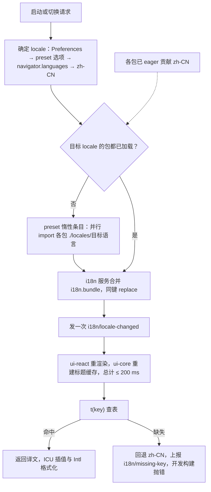
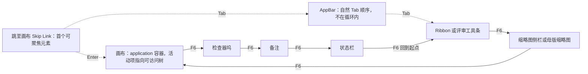
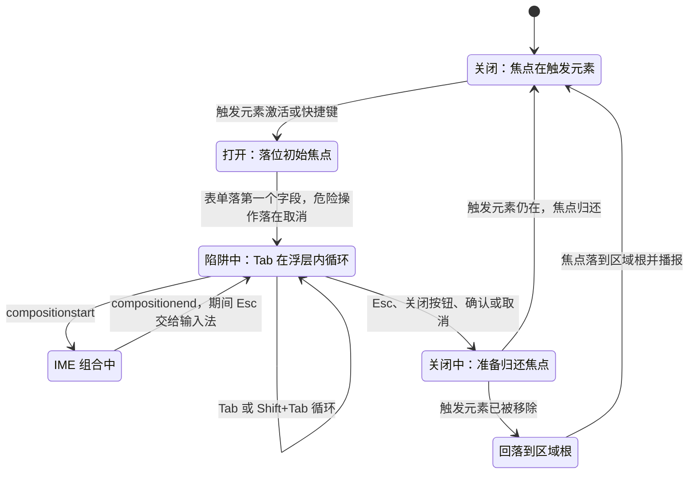
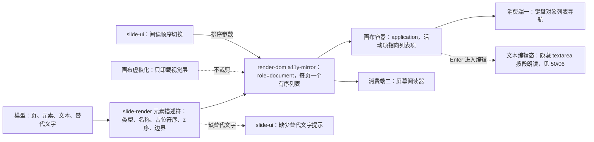
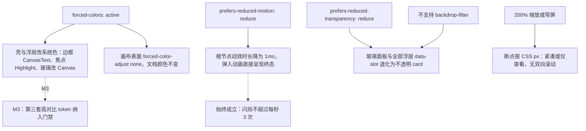

# 16 国际化与可访问性

> 状态：v0.1 | 负责：前端设计线 | 更新：2026-09-25；2026-09-25（§4.19）；2026-09-26（§4.21 整合：§1 登记 slide.ui.opaque 命名空间（不透明对象的双击提示与类型名）；§6.3 键盘等价补插入工具、调整手柄、线条端点、连接符连接四行，曲线绘制登记为 2.5.7 例外）；2026-09-30（§4.22：§6.2 登记空内容占位符图标条（WAI-ARIA Toolbar 模式）与 `TableGridPicker`（`role="grid"` + roving tabindex）两行）；2026-09-30（§4.22 复核修正：§6.2 空内容占位符图标条的 toolbar 名称更正为「插入内容到占位符」）；2026-10-01（§4.23 插件管理：§8 增个人插件面板、管理员插件页、三态控件、缺插件横幅的语义行与 §8.1 键盘与播报（PRD PM-16）；§11 V15、里程碑同步）；2026-10-01（§4.23 插件管理样张回写：设计承接 03-09 个人插件面板、03-32 管理员插件管理样张已确认，去掉「待样张」）；2026-10-03（§4.24 TA-2：§8.1 管理员确认卡关闭后焦点改为回到触发它的三态胶囊） | 依赖：设计 07 §1–§9；PRD 04 NF-05/NF-06/NF-07；PRD 02 ED-16/ED-29；PRD 05 EM-11；PRD 04-plugin-sdk PS-12；40-modules/10 §2.1、§11；40-modules/11 §13 Q-9；40-modules/02 §4.4；30-architecture/02 §4.4、30-architecture/07 §6.1；设计 04 §2.6/§3、设计 09 §6.3/§6.5；rulings §4.4、§4.12 U-08、§4.16 Q20

本文是浏览器侧国际化与可访问性行为的唯一事实源：i18n 服务与命名空间、语言包加载与切换、无 host 页面的 i18n、伪本地化与 RTL、a11y 目标分阶段、键盘模型、焦点管理、ARIA 语义与 live region、画布可访问树、视觉适配。交互外观与视觉 token 以 [设计 07](../20-design/07-accessibility-and-i18n.md)、[设计 04](../20-design/04-design-system.md)、[设计 09](../20-design/09-design-specification.md) 与 playground 为准；验收阈值以 PRD NF-05 / NF-06 为准；测试如何执行以 [70/06](../70-testing/06-frontend-component-and-e2e.md) §7–§8 为准。

## 0. 分工速查

| 主题 | 本文 | 引用 |
|---|---|---|
| 快捷键默认表、chord 规范化与冲突诊断 | §6 只写焦点区域与 IME 规避 | 默认表 PRD ED-16；服务 [50/09](./09-ui-system-and-theming.md) §8 |
| Esc 逐级与文本编辑态的可访问性镜像（隐藏 textarea） | §9 写分工 | [50/06](./06-text-editing-and-ime.md) §2、§8 |
| 画布可访问树的数据源（render-dom 宿主、slide-render 描述符） | §9 写行为与键盘 | [50/05](./05-rendering-and-thumbnails.md) §11 |
| 主题、密度、材质层的 token 与写入规则 | §10 只写退化行为 | 50/09 §3–§4 |
| 错误码文案命名空间 `errors.*` | §1 登记 | [50/15](./15-events-errors-and-telemetry.md) §4.2 |
| 语言包体积与惰性 chunk | §2 规则 | 预算与 chunk 地图 [50/13](./13-performance-and-bundling.md) §6 |

## 1. i18n 架构

`@cordexjs/i18n`（L0 · iso · plugin，30/02 §4.4、40/02 §4.4）提供：

- **服务** `ctx.i18n`：`t(key, params)`、`locale`、`setLocale(locale)`；缺 key 走回退并计数（§2）。
- **贡献点** `i18n.bundle`：条目 `{ namespace, locale, messages }`，键为 `` `${namespace}:${locale}` ``，冲突策略 `replace`（后注册者覆盖，集成方覆盖文案即靠此，EM-08）。命名空间本身含冒号（第三方前缀）时按**最后一个**冒号拆分 locale。
- **事件** `i18n/locale-changed(locale)`。
- **编译期 key 类型**：各包从自己的 `locales/zh-CN.json` 推导键路径，经声明合并增强 `I18nKeys`；`t('不存在的键')` 编译失败（K8）。

**命名空间登记表**

| 命名空间 | 贡献方 | 内容 | 里程碑 |
|---|---|---|---|
| `ui` | ui-core 声明键，ui-react 贡献语言包 | 壳与通用控件；文档类型盲的 `ui.viewMode.<mode>` | M2 |
| `slide.ui` | slide-ui | Ribbon、检查器、缩略图栏、母版视图、放映 | M2 |
| `slide.ui.opaque`（2026-09-26 整合登记，[25](./25-elements-readonly-and-opaque.md) §2.2、§2.5） | slide-ui | 只读与不透明对象族的双击提示、占位说明与对象类型名：OLE 按 `progId` 查表（未收录显示原文），AlternateContent 系按 `UnknownShape.source` 查表；文案草稿见 50/25 | M1 查看 / M2 |
| `viewer`（建议名） | preset-slide-viewer 查看器壳 | 查看器工具条、保真摘要、加载与失败态 | M1 |
| `app` | apps/web：有 host 时经 preset `shell-glue` 贡献 `app:*`；无 host 页面经 `createI18n`（§3） | 开始页、文档列表、登录、设置、错误页 | M2 |
| `errors.<domain>` | 声明该域错误码的包；protocol 登记的码（`server.*`、`transport.*`、协同线上码）由 `@cordexjs/i18n` 自带 | 错误标题与建议动作（50/15 §4.2） | M1 / M2 |
| `<vendor>:<name>` | 第三方插件 | 插件文案；随宿主语言切换（PS-12） | M4 |

`viewer` 命名空间与 `@cordexjs/i18n` 自带的错误文案属新增登记，待回写 40/02 §4.4 与 40/11。

## 2. 语言包

依据：PRD 04 NF-06；PRD 05 EM-07（单个语言包 ≤ 30 KB、惰性）、EM-11（切换 ≤ 200 ms、缺 key 回退 zh-CN 并上报）；40/11 §12 G-15（各包只 eager 贡献默认语言）。

| 规则 | 口径 |
|---|---|
| 源语言 | zh-CN，是 key 的权威来源（M1） |
| 首批语言 | zh-CN、en-US（M2） |
| 打包 | 各包只 eager 贡献 zh-CN；其余语言经各包 `./locales/<locale>` 子路径导出，由 preset 的惰性条目 `plugins/locales/*` 聚合成每语言一个 chunk（每个 ≤ 30 KB gzip，由 `scan-bundle-budget` 校验 `locale-*` chunk） |
| 初始语言 | `Preferences.locale`（用户显式选择）→ preset 选项 `locale`（集成方）→ `navigator.languages` 中第一个受支持的语言 → zh-CN |
| 切换 | ≤ 200 ms：并行加载缺失语言包 → 合并 → 只发一次 `i18n/locale-changed` → ui-react 重渲染、ui-core 重建标题缓存 |
| 缺 key | 源语言缺 key：编译失败；运行时其它语言缺 key：回退 zh-CN，每个 key 每会话上报一次 `i18n/missing-key`；开发构建直接抛错 |
| 消息格式 | ICU MessageFormat 子集：`plural`、`select`、数字与日期参数；不支持嵌套 `selectordinal` |
| 数字、日期、列表、排序 | 一律 `Intl`：`NumberFormat`、`DateTimeFormat`、`RelativeTimeFormat`（「3 分钟前」）、`ListFormat`、`Collator`（文档列表按标题排序）；格式器按 locale 缓存在 i18n 服务实例内（不用模块级可变状态） |
| 度量单位 | cm / in / pt / px 的数值用 `Intl.NumberFormat`，单位名来自 `ui` 命名空间 |
| UI 字体 | `'Geist Variable'` 优先，其后系统字体与 PingFang SC / Microsoft YaHei 回退（设计 04 §2.8，rulings §4.8 Q6 保留 Geist）；Geist 同源自托管，不外链；SDK 不内置 CJK 字体（PD-12）；文档内容字体与 UI 字体无关，见 50/05 §7 |
| 覆盖 | 集成方以同命名空间贡献 `i18n.bundle` 覆盖任意 key（EM-08） |

**图 1 语言包加载与切换**

怎么读：上半部分是一次切换的主干——先定语言、按需并行加载、合并后只广播一次事件；下半部分是每次取词的两种结果，缺失时回退源语言并上报，不会出现空白文案。
依据：PRD 04 NF-06；PRD 05 EM-11；40/11 §12 G-15。

## 3. 无 host 页面的 i18n

依据：NOHOST-I18N（40/11 §13 Q-9 推荐）。

- `@cordexjs/i18n` 导出纯函数 `createI18n({ locale, fallback: 'zh-CN', bundles })`，返回与 host `i18n` 服务同一类型的实例（`t`、`locale`、`setLocale`、`onChange`）；host 的 `i18n` 服务内部包装的就是这个实例类型，二者行为一致。
- `apps/web/src/infrastructure/i18n/app-i18n.ts` 在 `main.tsx` 启动时创建一个实例，装入 `app`、`ui`（供 host-optional 的壳组件如 `UserMenu`、`ThemeToggle` 使用，40/11 §12 G-10）与 `@cordexjs/i18n` 自带的 protocol 错误码文案，服务开始页、文档列表、登录、设置与错误页。
- **进入编辑器**：`create-editor-host.ts` 把当前 `locale` 与已加载的语言包交给 host 的 `i18n` 配置，host 不重复拉取；离开编辑器时 host 销毁，`app-i18n` 保留。
- **单一事实源**：语言选择只存在 `Preferences.locale`。设置页改语言 → `app/preferences-changed` → `app-i18n.setLocale`，若编辑器 host 存活再调用 host 的 `setLocale`；host 发出的 `i18n/locale-changed` 不回写偏好，避免回环。

## 4. 伪本地化、RTL 与文案规范

**伪本地化**（NF-06，M2）：开发与测试构建额外提供两个伪语言，不随生产发布。

| 伪语言 | 生成方式 | 用来发现 |
|---|---|---|
| `en-XA` | 构建期以 en-US 为底生成，拉丁字母替换为带附加符号的同形字母，长度扩展到 ×1.5，首尾加 `［ ］` | 截断、硬编码字符串（未走 `t()` 的文字不会被加括号）、字符串拼接 |
| `ar-XB` | 在 `en-XA` 基础上加双向控制符，并把 EditorHost 根元素 `dir` 设为 `rtl` | 重叠、溢出与缺键（阻断）；镜像是否正确 M4 前不断言 |

布局规则：标签不写死宽度（用 `min-width`）；放不下的标题、文件名、评论摘要一律省略号截断并把全文放进 `title` / tooltip（设计 07 §7）；贡献点文案长度限制（如「≤ 8 个中文字符」，设计 06）按 ×1.5 预留。

**RTL**（NF-06：UI 镜像与内容 bidi 均为 M4 P2）：

- 从 M2 起样式一律使用 CSS 逻辑属性（Tailwind 的 `ms-` / `me-` / `ps-` / `pe-` / `start-` / `end-`），避免 M4 大面积返工；以 lint 规则提示物理方向类名，M3 报告、M4 阻断（规则登记待回写 09-type-discipline/02）。
- EditorHost 根元素的 `dir` 取自语言元数据；画布容器固定 `dir="ltr"`，文档内容**不随** UI 镜像，每个文本对象的方向由其自身属性决定（设计 07 §6）。
- 方向性图标（箭头、缩进、翻页）按 `dir` 镜像；状态栏项目顺序与抽屉滑入方向随之镜像。

**文案规范**：以设计 07 §7 为准（动宾结构、错误提示「发生了什么 + 能做什么」、不用感叹号与拟人化语气、截断用省略号 + tooltip、术语严格遵循章程 §4 词表）。

## 5. a11y 目标与分阶段

依据：PRD 04 NF-05（WCAG 2.2 AA）；rulings §4.16 Q20（M2 必达「键盘可达 + 基本朗读」，其余条款分阶段）；rulings §4.12 U-08（高对比）。适用范围：编辑器 UI 为 P0；画布内容可访问为 P1；放映模式为 P1。

| 要求（WCAG 2.2） | 本文落点 | 里程碑 |
|---|---|---|
| 全键盘操作、无键盘陷阱（2.1.1 / 2.1.2） | §6 | M2 |
| 拖拽的键盘等价（2.5.7） | §6 | M2 |
| 目标尺寸 ≥ 24 px，触控 ≥ 44 px（2.5.8） | §10 | M2 |
| 焦点可见、不被遮挡（2.4.7 / 2.4.11） | §7 | M2 |
| 对比度：文本 ≥ 4.5:1、UI 组件 ≥ 3:1（1.4.3 / 1.4.11） | §10 | M2 |
| 名称 / 角色 / 值（4.1.2） | §8 | M2 |
| 状态消息（4.1.3） | §8 | M2 / M3 |
| 画布内容可访问（1.1.1 / 1.3.1 / 1.3.2） | §9 | M2（P1） |
| 动效与闪烁（2.3.3） | §10 | M2 |
| 缩放与重排（1.4.4 / 1.4.10） | §10 | M2 |
| 高对比 `forced-colors` | §10 | M1–M2 系统色兜底；M3 门禁 |
| IME：组合态可见、候选不被遮挡、Esc 先交给输入法 | §6；细节 50/06 §5 | M2 |
| 一致帮助、冗余输入、可访问认证（3.2.6 / 3.3.7 / 3.3.8） | apps/web 页面 | M3 |
| 屏幕阅读器矩阵 | §11 | M2 / M3 |
| VPAT / ACR 声明 | — | M4（P2） |

移动端（NF-07）：桌面优先；平板只读评审、手机查看与评论为 M3 P1，触控目标按 44 px；编辑为 M4+。

## 6. 键盘模型

依据：PRD 02 ED-29（F6 循环、全部拖拽有键盘或表单等价）、ED-16（快捷键表、`KeyboardEvent.code`）；设计 07 §1。

### 6.1 区域与 F6 循环

- **循环顺序**：Ribbon → 缩略图侧栏 → 画布 → 检查器坞 → 备注 → 状态栏 → 回到 Ribbon；`Shift+F6` 反向。部分浏览器会截获 F6（聚焦地址栏），因此同时注册 `Ctrl+F6` / `Ctrl+Shift+F6` 作为备用键（与 Office 网页版一致）。
- **不在循环内**：AppBar 位于循环起点之前的自然 Tab 顺序；页面第一个可聚焦元素是「跳至画布」Skip Link（仅获得焦点时可见），`Enter` 直接把焦点送到画布。
- **按模式替换，不增删位置**：母版视图下缩略图侧栏换为母版缩略图、评审模式下 Ribbon 换为评审工具条，仍占同一区域位；查看者变体与窄屏下不存在的区域直接跳过。
- **实现**：每个区域由 ui-react 的区域容器声明（`data-cordex-region` + landmark）；F6 处理在 ui-core 键盘管线的全局作用域；进入区域时焦点落到该区域上次的焦点元素，没有则落到区域内第一个可聚焦元素；ui-core 上下文键 `focusRegion`（`canvas` / `rail` / `inspector` / `ribbon`）随之更新，供快捷键按作用域分派。

**图 2 F6 区域循环与 Skip Link**

怎么读：实线是 F6 的前进顺序（`Shift+F6` 反向，浏览器截获 F6 时用 `Ctrl+F6`），末尾回到 Ribbon；虚线是自然 Tab 顺序与跳转链接。缺席的区域（查看者变体、窄屏）直接被跳过。
依据：PRD 02 ED-29；设计 07 §1.1。

### 6.2 区域 × landmark × 键盘

| 区域 | landmark / role | 进入 | 区域内导航 | Esc |
|---|---|---|---|---|
| AppBar | `banner` | Tab | 自然 Tab 顺序 | 关闭展开的菜单 |
| Ribbon | `region`（「功能区」）内含 `tablist` 与各页签的 `toolbar` | F6 | 页签 `←` / `→` / `Home` / `End`；进入工具栏后方向键在控件间移动（roving tabindex，单一 Tab 停靠点）；`↓` / `Enter` 展开子级 | 收起下拉，焦点回到控件 |
| 缩略图侧栏 | `navigation`（「幻灯片」） | F6 | `↑` / `↓` 移动并同步画布；`Mod+Shift+↑` / `↓` 调整顺序；`Home` / `End` | — |
| 画布 | `main` 内的画布容器（§9） | F6、Skip Link | Tab / Shift+Tab 按阅读顺序切换选中对象；方向键微移 1 px、`Shift+方向键` 10 px；`Enter` 进入文本编辑 | 逐级退出（UX-06，50/06 §2） |
| 检查器坞 | `complementary`（「属性」） | F6 | 页签 `←` / `→`；Tab 遍历字段；分区标题 `Enter` / `Space` 折叠 | 焦点回到区域根 |
| 备注 | `region`（「备注」） | F6 | 标准文本区域 | 离开编辑，回到区域级焦点 |
| 状态栏 | `contentinfo`，内含 `status` | F6 | Tab | — |
| 对话框、菜单、命令面板 | `dialog` / `alertdialog`、`menu`、`dialog` + `combobox` + `listbox` | 触发元素或快捷键 | 见 §7 | 关闭并归还焦点 |
| 空内容占位符图标条（画布覆盖层，[21](./21-elements-structure.md) §3 ⑥，2026-09-30 §4.22 登记） | `toolbar`（「插入内容到占位符」，与设计 03-16 一致） | 画布内 Tab 选中空内容占位符后再按 Tab；整条只占一个 Tab 停靠点，首次落在第一个图标、之后回到上次停留的图标（roving tabindex） | `←` / `→` 在图标间移动并循环，`Home` / `End` 到首尾；禁用项可聚焦并以 tooltip 说明原因；`Enter` / `Space` 触发；`Tab` 离开整条选中下一个对象；折叠为「插入 ▾」时 `Enter` / `Space` / `↓` 打开菜单，菜单内方向键移动（设计 03-16「键盘聚焦顺序」） | 焦点回到占位符（仍选中），再按按画布 Esc 链退出 |
| 表格网格选择器 `TableGridPicker`（插入 › 表格 ▾ 与占位符表格图标共用，[24](./24-elements-tables-and-charts.md) §2.3，2026-09-30 §4.22 登记） | `grid`，单一 Tab 停靠点（roving tabindex） | 弹层打开时不抢焦点；Tab 进入网格落在当前高亮角（未悬停时第 1 行第 1 列） | 方向键移动高亮角（悬停范围 8 行 × 10 列），`Home` / `End` 到行首行尾；`Enter` / `Space` 插入；读数「R 行 × C 列 表格」经 `aria-live` 播报，每格读屏名「R 行 C 列」（设计 03-30 §2.1） | 关闭弹层，焦点回到「表格 ▾」或占位符的表格图标 |

### 6.3 拖拽的键盘等价（WCAG 2.5.7）

任一拖拽交互缺少等价路径即视为 ED-29 未通过（设计 07 §1.2a）：

**例外**（2026-09-26 整合登记）：曲线类绘制工具（曲线、任意多边形、自由曲线，P2）本质是路径描绘，按 WCAG 2.5.7「拖动对功能必不可少」登记为例外，替代路径是「从预设形状开始」再用调整值与数值输入修改（[22](./22-elements-shapes-and-lines.md) §5）；设计 07 §1.2a 的例外表同步此行。

| 拖拽交互 | 等价路径 | 里程碑 |
|---|---|---|
| 移动对象 | 方向键 1 px、`Shift+方向键` 10 px | M2 |
| 缩放对象 | 检查器「位置与大小」数值输入；`Shift+Alt+方向键`（P1） | M2 / P1 |
| 裁剪图片、调整表格行高列宽 | 检查器数值输入 | M2 |
| 缩略图拖拽排序 | `Mod+Shift+↑` / `↓`，移动后播报新位置（§8） | M2 |
| 拖放文件插入 | 「插入」菜单的文件选择对话框（独立完整路径） | M2 |
| 分栏拖拽（侧栏、检查器宽度） | 分隔条可聚焦（`role="separator"` + `aria-valuenow`），方向键调整 | M2 |
| 插入工具（2026-09-26 整合，[10](./10-editor-shell-and-interaction.md) §7.4） | 焦点在工具按钮或形状库条目上按 `Enter`，按默认尺寸插到视口中心，连续插入依次错位 | M2 |
| 调整手柄（黄色菱形） | 检查器「形状」分区的调整值输入，与手柄同批上线（[22](./22-elements-shapes-and-lines.md) §2） | M2 P1 |
| 线条端点 | 检查器「位置与大小」的四个数值加翻转（线条的 x / y / 宽 / 高即端点的数值等价） | M2 |
| 连接符连接 | 检查器「连接到…」选择器（目标形状与连接点编号） | M2 P1 |

### 6.4 快捷键与 IME 冲突规避

- 快捷键以 `KeyboardEvent.code` 匹配，按 `focusRegion` 与 `textEditing` 键分派作用域；浏览器保留组合（`Mod+W` / `T` / `N`）不注册（ED-16）。
- `event.isComposing` 为真或 `keyCode === 229` 时，全局快捷键、命令面板的 `Enter` 确认、`@` 提及候选的过滤刷新一律不处理，交还输入法（设计 07 §1.3、§4）。
- `Esc` 在组合输入中先交给输入法取消候选；不在组合中时才按区域语义逐级退出（完整分流见设计 07 §4 图与 50/06 §2）。
- 当前不可用的命令被触发时必须提示原因（权限不足、选区类型不支持），不能静默（ED-30）。
- 屏幕阅读器的浏览模式会截获单字母键；默认快捷键以 `Mod` 组合为主，画布容器声明为 `application`（§9.2）使方向键微移在读屏开启时仍可用。

## 7. 焦点管理

依据：设计 07 §2；PRD 04 NF-05（2.4.7 / 2.4.11）；设计 04 §2.6（`border-focus` ≥ 3:1）。

- **焦点环**：所有可交互元素在 `:focus-visible` 时显示 `outline: 2px solid var(--ring)` + `outline-offset: 2px`；鼠标点击不触发；与相邻背景对比 ≥ 3:1；`forced-colors` 下改用系统色 `Highlight`（§10）。tooltip 在 `:focus-visible` 时同样出现，且不替代 `aria-label`。
- **不被遮挡**（2.4.11）：悬浮的玻璃工具卡、侧栏卡与 Toast 不得盖住当前焦点。滚动容器设置 `scroll-padding` 等于浮动卡片占位（token 化），获得焦点时 `scrollIntoView({ block: 'nearest' })`；Toast 区域固定在不承载表单的角落。
- **对话框、命令面板、菜单**：打开时建立焦点陷阱，关闭时精确归还到触发元素（状态见图 3）。初始焦点：表单对话框落在第一个字段；确认类对话框落在主操作；**危险操作对话框落在「取消」**。
- **路由切换**：新页面的主标题（`tabIndex=-1`）获得焦点并更新 `document.title`；不把焦点留在已卸载的元素上。
- **异步替换**：骨架屏变为真实内容时，以稳定的 `data-focus-key` 把焦点移到替换后的等效元素；原焦点元素被移除时（例如当前选中对象被协作者删除），焦点落到所在区域根，并经 polite live region 播报原因（「所选对象已被 {姓名} 删除」）。
- **协同不抢焦点**：远端事务、在场变化、评论到达都不移动本地焦点。

**图 3 对话框焦点陷阱与归还**

怎么读：浮层打开后焦点只在「陷阱中」循环，IME 组合期间 Esc 不会关闭浮层；关闭时优先归还触发元素，触发元素已不在时退到所在区域根，焦点永远不会落到 `body`。
依据：设计 07 §2、§4；rulings §4.4（live region 与对话框焦点问题的评审修订）。

## 8. 语义与 live region

依据：设计 07 §3；PRD 04 NF-05（4.1.2、4.1.3）；rulings §4.4。

| 组件 | 语义 |
|---|---|
| Ribbon | 页签条 `tablist` / `tab`（`aria-selected`、`aria-controls`，页签必须是 `button`）；页签面板为 `toolbar`；分组 `role="group"` + `aria-label`；切换按钮 `aria-pressed`，下拉 `aria-expanded`；仅图标按钮必须有 `aria-label` |
| 检查器坞 | 页签同上；禁用页签 `aria-disabled` + `aria-describedby` 指向原因文案；分区为 disclosure（`aria-expanded`、`aria-controls`） |
| 缩略图侧栏 | 列表内每页一个 `button`，当前页 `aria-current="page"`；名称含页码与标题；隐藏页附「（隐藏）」；调整顺序后播报「已移到第 N 页」 |
| 画布 | 见 §9 |
| 状态胶囊（保存、同步） | `role="status"`；保存与同步状态变化 polite 播报；「未保存到服务器」类提示的判定见 50/07 |
| Toast | 一般提示 `role="status"`（polite）；错误与需要立即注意的提示 `role="alert"`（assertive） |
| 横幅 | 权限变更、登录已过期等需要立即注意者为 `role="alert"`；其余 `role="status"` |
| 在场 | polite 隐藏队列；2 s 内的多次加入与离开合并为一句（「张三、李四加入了协作」），避免频繁打断 |
| 评论线程 | `list` / `listitem`；回复以 `aria-level` 或嵌套列表表达层级；锚点失效的线程附「（原对象已删除）」 |
| 版本历史 | 列表，当前选中版本 `aria-current="true"` |
| 命令面板 | `dialog` + `combobox` + `listbox`；结果数量变化 polite 播报 |
| 对话框 | `dialog` / `alertdialog`，`aria-labelledby` 与 `aria-describedby` 指向标题与说明 |
| 分隔条 | `separator` + `aria-orientation`、`aria-valuenow` / `min` / `max` |
| 个人插件面板、管理员插件清单（2026-10-01，§4.23） | 分组标题为标题元素（`h2` / `h3`）；清单为 `table`（管理员页，列头 `th scope="col"`）或 `list`（个人面板）；每行可展开详情为 disclosure（`aria-expanded`、`aria-controls`） |
| 三态控件（管理员页） | `radiogroup`，`aria-label` 为「<插件名> 的部署策略」，三个 `radio`：强制启用 / 允许用户选择 / 禁用；内容级插件的「允许用户选择」为 `aria-disabled="true"` 且可聚焦，`aria-describedby` 指向「会影响文档内容或渲染的插件按部署统一」；锁定项（必需、`lockPolicy`、被拒）整组 `aria-disabled` 并读出锁定原因 |
| 个人启停开关 | `switch`（`aria-checked`），可访问名称「<插件名>」，描述「个人设置，只影响你」 |
| 缺插件横幅、插件设置已更新横幅 | `role="status"`，不抢焦点（不属于 §8 横幅行的「需要立即注意」） |

**播报通道**：ui-react 在 `NotificationHost` 旁挂一个 `LiveAnnouncer`（一个 polite、一个 assertive 区域），组件经 `useAnnounce(message, politeness)` 播报。polite 队列每秒至多播报一句（同类合并），assertive 只用于错误与权限变化。播报文案一律取自 i18n 键；除元素名称与替代文字外不播报文档内容。

### 8.1 插件管理界面的键盘与播报（2026-10-01，rulings §4.23；PRD PM-16）

- **键盘可完成全部操作**（PM-03、PM-07、PM-10）：清单行之间 `Tab` 进入行内首个控件；三态 `radiogroup` 内方向键切换并立即选中（WAI-ARIA radio 模式），`aria-disabled` 的选项方向键可停留、`Space` 无效果并播报原因；开关 `Space` 切换；`Enter` 展开 / 收起详情。管理员页的「保存」在有未保存变更时可用，`Mod+S` 不劫持（浏览器与编辑器已占用），只经按钮。
- **确认卡**（依赖冲突、启用第三方、禁用可选·降级插件）为 `alertdialog`：打开时焦点落在首个操作（「取消」），`Esc` 等同取消，关闭后焦点回到触发它的三态胶囊（设计 03-32 §7.2；2026-10-03 按 rulings §4.24 TA-2 改正，原写「回到『保存』按钮」作废）；底部保存条打开的变更确认卡关闭后回到「检查并保存…」按钮（§7 规则）。
- **播报**：重试成功、依赖恢复、保存成功、个人开关切换结果经 `useAnnounce(…, 'polite')`；保存失败（412、422、409）与「需要管理员权限」经 assertive。缺插件横幅每文档每会话只出现一次，出现时 polite 播报一次横幅标题。
- **状态不只靠颜色**：失败、被拒、锁定、等待依赖各有图标与文字（设计承接 03-09 重写稿、03-32 新稿，2026-10-01 样张已确认）。
- **验收**：管理员页、个人插件面板、确认卡与两类横幅纳入 §11.2 V6 的 axe 矩阵与 V7 的键盘矩阵（V15）。

## 9. 画布可访问树

依据：A11Y-TREE（30/07 §6.1 a11y 镜像 + 设计 07 §3；归属：render-dom 提供通用宿主、slide-render 提供描述符、slide-ui 只负责阅读顺序切换与缺失替代文字提示）；PRD 04 NF-05「画布内容可访问」行（M2，P1）。数据源的实现细节见 50/05 §11。

### 9.1 结构与内容

- **一份与视觉渲染并列的语义表达**：render-dom 的 `a11y-mirror` 宿主维护一个视觉隐藏（裁剪而非 `display:none`）的 `role="document"` 子树，每页一个带标签的分组、组内一个有序列表、每个元素一项。宿主结构、`A11yDescriptor` 字段（`role`、`name`、`position`、`order`、`missingAlt`）与名称的取值规则以 50/05 §11 为准，本节不复写。
- **每项朗读的内容**：「{类型}：{名称}，{九宫格位置}」，随后是该元素的纯文本段落；只含文本与替代文字，不含颜色、字体、几何数值；组合元素以嵌套列表表达；元素自身隐藏时不入列表；隐藏页的分组标签附「（隐藏）」。
- **视觉层 `aria-hidden`**：SVG 渲染层整体 `aria-hidden="true"`，避免与可访问树重复朗读；浏览器原生查找（Ctrl+F）不受影响，仍只覆盖已挂载页（设计 07 前言）。
- **位置**：可访问树与文本编辑用的隐藏 textarea 都位于画布容器之内（render-dom 的 text-host），使 `aria-activedescendant` 指向的列表项是容器的 DOM 后代。

### 9.2 画布焦点与两个消费端

- **画布容器**：可聚焦元素 `role="application"`、`aria-roledescription="幻灯片画布"`；选区变化时 `aria-activedescendant` 指向当前选中元素的列表项 `a11y-<ShapeId>`，读屏朗读其名称与位置。`application` 使方向键微移在读屏开启时仍送达编辑器。
- **消费端一：键盘「对象列表」导航**：画布内 Tab / Shift+Tab 按可访问树的阅读顺序选中对象（经 `commands.execute` 设置选区），与鼠标点选等价。
- **消费端二：屏幕阅读器**：在浏览模式下可逐页、逐项阅读 `role="document"` 子树。具体 role 组合在 M2 屏幕阅读器矩阵（§11）实测后微调，调整只改本节，不改 50/05 的数据源契约。
- **与文本编辑镜像的分工**：进入文本编辑后焦点移到隐藏 textarea（ADR-0028），按段朗读，其属性与局限见 50/06 §8；退出编辑后焦点回到画布容器、活动项回到该元素。

### 9.3 阅读顺序、构建与缺失替代文字

- **阅读顺序**：默认按 z 序；可切换为占位符顺序（标题 → 副标题 → 正文 → 其余，按 `idx`；排序键来自 `A11yDescriptor.order`）。切换入口在 slide-ui（检查器「幻灯片」分区与命令面板），取值存 `Preferences.a11y.readingOrder`（`'z' | 'placeholder'`，个人偏好）；查看器没有 slide-ui，固定为 z 序。
- **不随虚拟化裁剪**：画布虚拟化只卸载视觉层，可访问树覆盖全部已装载页；`unit/loaded` 之前尚未装载的页以 `aria-busy="true"` 占位。构建顺序为可见页优先、其余页在空闲时间分片（每片 ≤ 2 ms）；此后按 DirtySet 只更新受影响的列表项（50/05 §11）。时间与内存预算见 50/13 §3、§5 与 §12 的 `client.a11y.*`、`client.mem.a11yTree.d200`。
- **缺少替代文字**：`missingAlt` 为真的元素，列表项名称为「{类型}（无替代文字）」；编辑态由 slide-ui 在检查器「文本」分区旁显示警示与「添加替代文字」操作。标记为装饰性的图片（OOXML `adec:decorative`）不应提示也不应入树——`A11yDescriptor.decorative` 为真的元素据此排除（50/05 §11）。
- **`/render` 页不构建**：`/render` 装配时关闭可访问树，节省渲染时间。

**图 4 画布可访问树的数据源与两个消费端**

怎么读：可访问树由 slide-render 的描述符喂给 render-dom 的通用宿主，slide-ui 只提供排序参数与提示 UI；虚拟化不影响这棵树。同一棵树同时服务键盘导航（经画布容器的活动项）与屏幕阅读器；进入文本编辑后由 50/06 的 textarea 镜像接手。
依据：A11Y-TREE；30/07 §6.1；设计 07 §3。

## 10. 视觉适配

依据：设计 04 §2.6（对比度基线）与 §3（高对比主题时机）；设计 09 §6.3（两种退化）与 §6.5（玻璃面板对比核算）；设计 07 §2、§5、§8；PRD 04 NF-01 §1.5、NF-05；rulings §4.12 U-08。

| 条件 | 检测 | 变化 | 范围 | 里程碑 |
|---|---|---|---|---|
| 对比度 | 构建期 | 对比度基线以设计 04 §2.6 为准（正文 ≥ 7:1、次要与语义色文字 ≥ 4.5:1、控件边框与焦点环 ≥ 3:1、协作者色对亮暗两套画布 ≥ 3:1）；玻璃材质上的文字按设计 09 §6.5 | 两套主题全部 token 配对 | M2 |
| 目标尺寸 | 布局 | 可点击目标 ≥ 24 × 24 CSS px（紧凑密度亦然）；`pointer: coarse` 或宽度 < 640 px 时主要控件 ≥ 44 × 44 且间距 ≥ 8 px；画布选中手柄视觉 8 px、命中区 24 px | 全部控件 | M2 |
| 200% 缩放与重排 | 断点按 CSS px 响应 | 1280 px 屏在 200% 下即 640 CSS px，进入紧凑或仅查看形态；除画布（二维内容，属 1.4.10 例外）外不出现双向滚动 | 壳与面板 | M2 |
| `prefers-reduced-motion: reduce` | 媒体查询 | 根节点把全部 `--duration-*` 降为 `1ms`；弹入类动画直接呈现终态 | 全局 | M2 |
| 闪烁 | 设计约束 | 任何情况下闪烁不超过每秒 3 次（与上一行无关，是硬红线） | 全局 | M2 |
| `prefers-reduced-transparency: reduce` 或不支持 `backdrop-filter` | 媒体查询与 `@supports` | 玻璃面板与全部浮层 `data-slot` 退化为不透明 `--card` + `--border`，阴影换为普通阴影，文字对比不变 | 壳与浮层 | M2 |
| `forced-colors: active` | 媒体查询 | M1–M2：系统色兜底（边框 `CanvasText`、焦点 `Highlight`、玻璃改 `Canvas`），不产第三套 token；M3：第三套高对比 token 并纳入门禁 | 壳与浮层 | M1–M2 兜底；M3 门禁 |
| 画布内容 | — | 画布表面设置 `forced-color-adjust: none`，文档颜色保持原样（内容保真优先）；选区、光标等覆盖层使用系统色 | 画布 | M2 |

**图 5 视觉适配退化**

怎么读：五个触发条件各自对应一种退化，其中两种透明度相关的条件共用同一套不透明退化；`forced-colors` 同时作用于壳与画布，但画布刻意保留文档颜色。闪烁限制与是否开启减少动效无关，始终成立。
依据：设计 09 §6.3；设计 07 §5；rulings §4.12 U-08。

## 11. 机械验证：屏幕阅读器矩阵、自动验证与里程碑

### 11.1 屏幕阅读器矩阵（人工）

| 组合 | 里程碑 | 覆盖场景 |
|---|---|---|
| NVDA + Chrome | M2 | F6 循环、Ribbon 与检查器导航、缩略图重排播报、画布对象列表与活动项朗读、文本编辑按段朗读、对话框焦点归还、Toast 与状态播报 |
| VoiceOver + Safari | M2 | 同上 |
| JAWS + Edge | M3（P1） | 同上 + 协同在场播报、评论线程、版本历史 |

执行记录按 `test/evidence/<里程碑>/<检查名>.md` 归档（结论、日期、执行人、产物链接），在需求矩阵中标 `manual`（T-COVERAGE-EVIDENCE，70/13）。

### 11.2 机械验证

本节只写断言；测试层级、夹具与阈值判定归 70，CI 步骤名以 [70/12](../70-testing/12-ci-gates-mapping.md) 为准。

| # | 断言 | 执行（70 文件 · CI 步骤） |
|---|---|---|
| V1 | 每个贡献 `i18n.bundle` 的包，各语言键集合两两相等且等于其 `I18nKeys` 声明；`errors.*` 覆盖 `user:true` 的错误码 | 扫描器 `scan-contributions` 规则 (f) · `scanners` |
| V2 | `t('不存在的键')` 编译失败 | 类型测试 `*.type-test.ts` · `test-typecheck` |
| V3 | 每个 `locale-*` chunk ≤ 30 KB gzip | 扫描器 `scan-bundle-budget` · `scanners` |
| V4 | 语言切换 ≤ 200 ms；缺 key 时回退 zh-CN 并只上报一次 `i18n/missing-key` | 切换时长：70/06 §8、70/09 场景 `locale-switch` · `perf/perf-client`；回退与上报 · `test/unit` |
| V5 | 伪本地化 `en-XA`（×1.5）下各路由无溢出与截断丢字，未走 `t()` 的硬编码文字被识别；`ar-XB` 下无重叠、无溢出、无缺键（镜像正确性 M4 前不断言） | 70/06 §8 · `e2e/full-compose`（project `chromium-pseudo`） |
| V6 | axe-core 零严重、零重大违规：路由 × 面板 × 状态矩阵，含亮暗主题、紧凑密度、查看者变体、母版视图 | 70/06 §7 · `e2e/a11y` |
| V7 | 键盘：F6 / Shift+F6 与 Ctrl+F6 备用键按 §6.1 顺序循环且跳过缺席区域；Skip Link 送达画布；每个页面与面板无键盘陷阱；§6.3 每条拖拽都有等价路径 | 70/06 §7 · `e2e/a11y` |
| V8 | 焦点：对话框初始焦点与归还（含触发元素被移除的回落）；焦点可见且不被浮动卡片遮挡；路由切换后焦点在主标题 | 70/06 §7 · `e2e/a11y`；ui-react `hosts.test.tsx` · `test/unit` |
| V9 | 目标尺寸：可点击元素命中区 ≥ 24 px（`pointer: coarse` 下主要控件 ≥ 44 px） | 70/06 §7 · `e2e/a11y` |
| V10 | 对比度：两套主题全部 token 配对与玻璃材质配对达标 | design `__tests__` 对比度门禁 · `test/unit` |
| V11 | `forced-colors`、`prefers-reduced-motion`、`prefers-reduced-transparency` 与不支持 `backdrop-filter` 四种条件下的截图断言；`forced-colors` 自 M3 起阻断 | 70/06 §7 · `e2e/a11y` |
| V12 | 可访问树：每页列表项数 = 非装饰元素数；视觉层 `aria-hidden`；虚拟化卸载某页后该页列表项仍在；选区变化时 `aria-activedescendant` 指向对应项；阅读顺序切换后顺序改变 | render-dom `a11y-mirror` 单测 · `test/unit`；70/06 §7.6 · `e2e/a11y` |
| V13 | live region：保存、同步、在场、软冲突、权限变化各有播报；polite 队列每秒至多一句 | 70/06 §7.6 · `e2e/a11y` |
| V14 | IME：组合期间全局快捷键与命令面板 `Enter` 不触发；Esc 先交给输入法 | 70/06 §9.1 · `test/unit`（browser mode `ime-composition.test.ts`）、`e2e/full-compose`（`ime/*.spec.ts`） |
| V15 | 插件管理界面（2026-10-01，§4.23）：个人插件面板（M2 只读）、管理员插件页与确认卡（M3）axe 零严重 / 重大违规；键盘完成三态设置、个人启停、依赖确认与取消；锁定选项可聚焦并读出原因；缺插件横幅 `role=status` 不抢焦点 | 70/06 §7 · `e2e/a11y` |

### 11.3 里程碑

| 里程碑 | 交付 |
|---|---|
| M1 | `@cordexjs/i18n` 服务、`i18n.bundle`、编译期 key 类型、zh-CN 源语言；查看器的 `viewer` 命名空间；`forced-colors` 系统色兜底；V1–V2 阻断 |
| M2 | en-US 首批语言与惰性语言包；`createI18n` 与无 host 页面；伪本地化；键盘模型（§6）、焦点管理（§7）、语义与 live region（§8）、画布可访问树（§9，P1）、视觉适配（§10 除高对比 token）；NVDA + Chrome、VoiceOver + Safari 人工矩阵；V3–V14 阻断（V11 的 `forced-colors` 部分只报告） |
| M3 | 高对比第三套 token 与 `forced-colors` 门禁（U-08）；JAWS + Edge；管理员插件页与个人启停的键盘与播报（§8.1，V15 的 M3 部分）；apps/web 的 3.2.6 / 3.3.7 / 3.3.8；移动端查看与评论的触控目标；RTL 物理方向类名 lint 报告 |
| M4 | UI RTL 镜像与内容 bidi（P2）；插件文案随宿主切换（PS-12）；VPAT / ACR（P2）；RTL lint 阻断 |

**待回写（由总编排执行）**：40/02 §4.4 登记 `createI18n` 与 `@cordexjs/i18n` 自带的 protocol 错误码文案；40/11 登记 `viewer` 命名空间（preset-slide-viewer）与 `Preferences.a11y.readingOrder`；40/10 登记 ui-react `LiveAnnouncer` / `useAnnounce` 与 F6 备用键 `Ctrl+F6`；09-type-discipline/02 登记 RTL 物理方向类名 lint 规则（M3 报告、M4 阻断）；设计 07 §1.1 补充「浏览器截获 F6 时用 `Ctrl+F6`」与「视觉层 `aria-hidden`、语义由可访问树承载」两点；50/13 登记可访问树构建的时间与内存预算（§9.3，每片 ≤ 2 ms）；70/06 §7.3 的 F6 用例补 `Ctrl+F6` 备用键。
