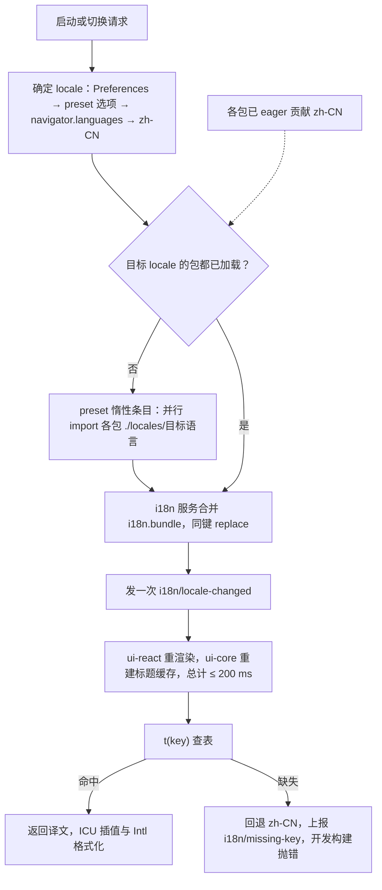
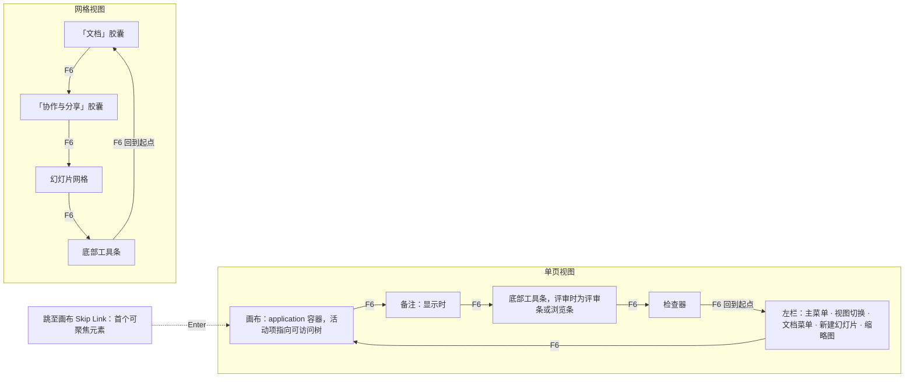
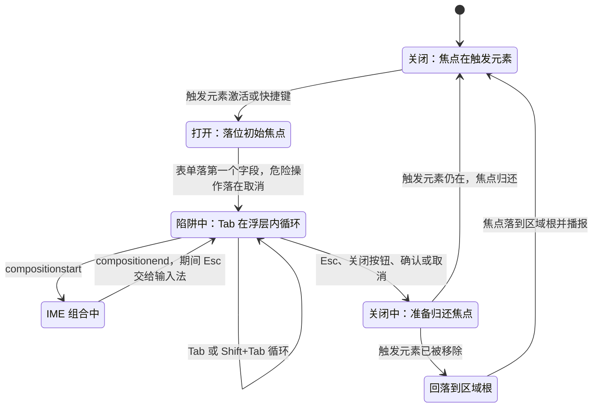
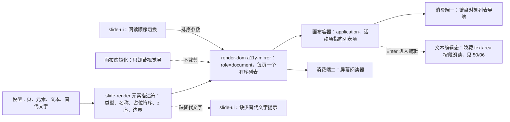
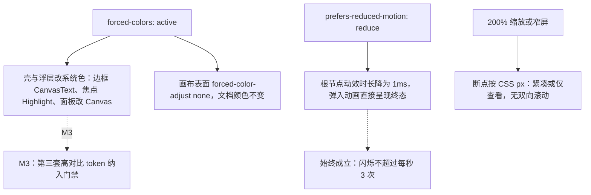

# 16 国际化与可访问性

> 状态：v0.1 | 负责：前端设计线 | 更新：2026-09-25；2026-09-25（§4.19）；2026-09-26（§4.21 整合：§1 登记 slide.ui.opaque 命名空间（不透明对象的双击提示与类型名）；§6.3 键盘等价补插入工具、调整手柄、线条端点、连接符连接四行，曲线绘制登记为 2.5.7 例外）；2026-09-30（§4.22：§6.2 登记空内容占位符图标条（WAI-ARIA Toolbar 模式）与 `TableGridPicker`（`role="grid"` + roving tabindex）两行）；2026-09-30（§4.22 复核修正：§6.2 空内容占位符图标条的 toolbar 名称更正为「插入内容到占位符」）；2026-10-01（§4.23 插件管理：§8 增个人插件面板、管理员插件页、三态控件、缺插件横幅的语义行与 §8.1 键盘与播报（PRD PM-16）；§11 V15、里程碑同步）；2026-10-01（§4.23 插件管理样张回写：设计承接 03-09 个人插件面板、03-32 管理员插件管理样张已确认，去掉「待样张」）；2026-10-03（§4.24 TA-2：§8.1 管理员确认卡关闭后焦点改为回到触发它的三态胶囊）；2026-10-04（design-language-v3 第 0 批：按 rulings §4.25 DS-1…DS-6 与设计 07 v3 改写——§6.1 F6 循环改为单页「左栏 → 画布 → 备注 → 底部工具条 → 检查器」、网格「文档胶囊 → 协作与分享胶囊 → 网格 → 底部工具条」，去掉 AppBar、Ribbon 与状态栏；§6.2 区域表补左栏、底部工具条、浮动胶囊、幻灯片网格；§6.3 键盘等价的「属性面板」改为检查器对应分区；§7 焦点环改为 v3（2px 强调色、偏移 1px，字段内描边）并补网格视图焦点例外（中性色、偏移 4px）与视图切换的焦点转移；§8 语义表 Ribbon 行改为底部工具条，补视图切换、胶囊、网格、检查器、缩放读数、同步状态；§4 RTL、§10 视觉适配去掉状态栏与玻璃退化；§11 同步）；2026-10-04（design-language-v3 第 0 批：术语残留清理：ribbon / 状态栏 / `ui.ribbon` / `ui.statusBar` 的历史陈述改用 check-terms 认可的标记措辞（废弃、作废、取代、原名））；2026-10-04（design-language-v3 第 0 批：复验修正——缩放读数示例改为实测口径「缩放 77%」（03-02 §3.5）；原「状态胶囊」改称文件名旁的同步状态行（rulings §4.25 DS-6），带作废标记的历史陈述统一措辞；对比度待复核由 4 项增为 5 项（设计 04 §2.6 新增待复核 5：状态色只在 panel 上达到文字线，随第 2 批）；§11.3 PRD ED-29 焦点顺序改为已回写）；2026-10-05（design-language-v3 第 0 批修正：§8 头像组读屏名按样张补在线人数「正在协作的人：N 人」（N 含自己与折叠的 +N），补「+N」按钮读屏名；自己的头像按样张为打开账户菜单的按钮、读屏名「账户：姓名（你）」（DS-18））；2026-10-05（design-language-v3 第 0 批修正：§6 快捷键值按 rulings §4.25 DS-11、DS-16 同步——工具单键 V / T / S / C 由「若采纳」改为已登记 ED-16 的生效条件（注明满足 WCAG 2.1.4），命令面板由 `Mod+Shift+P` 改为 `Mod+K`，补超链接 `Mod+Shift+K` 与替换 `Ctrl+H` / `Cmd+Shift+H`）；2026-10-05（design-language-v3 第 0 批修正：§10 对比度行、§10 依据与 §11.2 V10 按 rulings §4.25 DS-9 改为只引用设计 04 §2.6 的配对与基线，删去复述的旧阈值与按批次排的待复核旧注（04 §2.6 已结案））；2026-10-07（design-language-v3 第 0 批余项：对比度按设计 04 §2.6 新表（rulings §4.25 DS-9）同步——§10 对比度行写全三条基线（可读文字 ≥ 4.5:1、控件边界与状态与图形 ≥ 3:1、占位与不可用项 ≥ 3:1）、使用规则与例外，token 取值来源改为迁移期 `src/v3/v3.css`、全量迁移后并入 `src/index.css`（80-process/02 §2），§10 依据补 80-process/02 §2；§11.2 V10 同步三条基线与例外豁免、断言本体指 50/09 §12 V3；§7 焦点环强调色对比的区间更正为 3.22–5.44:1、网格焦点框为 ≥ 14.89:1）；2026-10-07（design-language-v3 第 1 批：按已拍板样张与设计 07 第 1 批回写同步键盘与读屏约定（rulings §4.25 DS-13、DS-17、DS-21…DS-29、TB-1、TB-2、TB-4、TB-5、TB-8、TB-21）——§5 手机评论 M3 起可发表与回复（DS-28）；§6.1 补紧凑与仅查看形态的区域顺序、横幅归画布区、「跳至画布」样张已实现，图 2 工具条节点改为评审条 / 浏览条；§6.2 区域表的底部工具条（形状弹层已接方向键与焦点归还、整组一个 Tab 位）、幻灯片网格（方向键 / Home / End / 空格 / Enter / ⇧F10）、检查器（可折叠分区与只读行）、左栏（版式画廊与 ⇧F10）、表格网格读数改为「R 行 × C 列」，新增评审条 / 浏览条、紧凑抽屉、仅查看形态、图表数据网格、分隔条五行；§6.3 分栏拖拽改为三条分隔条可拖（每次 8、⇧ 32、Home / End、Enter 回缺省），「尺寸」改「位置与大小」，裁剪改为「裁剪」节四个百分比与取消 / 完成（TB-4），调整手柄改为强调色菱形（DS-24），连接符改为「连接」节起止点下拉（TB-21）；§6.4 补 DS-29 文本格式键只在文本编辑时生效；§7 焦点环补纸面件、分隔条、不可用项与仅查看幻灯片列表，形状弹层归还改为已实现、轻提示位置与层级已定（TB-2），补紧凑抽屉与跨断点的焦点去向、浮层焦点规则引用设计 07 §2.3，对话框初始焦点改为正文第一个控件 / 底栏第一个按钮；§8 语义表补工具条弹出类型与评审条、胶囊开关与抽屉、检查器可折叠分区与只读行、隐藏页读屏名「第 N 页，已隐藏，放映时跳过」（DS-25）、缩放输入框、画布提示条、画布标记、仅查看形态；§9.3 阅读顺序入口与缺替代文本提示按第 1 批分区改写；§10 目标尺寸补评论钉、表格插入手柄与分隔条；§11 同步）；2026-10-08（design-language-v3 第 1 批收口：§5 平板仍只读评审、手机 M3 起可发表评论（rulings §4.25 TB-49）；§6.2「底部工具条」行改正键盘在形状格子上按 `Enter` 的行为（不经插入工具态，插到视口中心并选中，焦点交给画布，设计 07 §1.2、03-15 §3.4；指针点格子才进入插入工具态），新增「查找和替换面板」行（非模态 `dialog`、Tab 顺序，评审、只读浏览与降权下没有替换行与展开按钮，TB-28；M2 只查幻灯片内容，TB-27）；§6.4 链接键改用命令名「链接…」（TB-6）；§7 焦点去向表改正形状弹层一行、补查找面板关闭与文本编辑中日期、符号弹层关闭（TB-52）；§8 新增查找和替换面板语义（计数 `aria-live`、状态行 `role="status"`、缩略图命中标记读屏名），同步状态行补回调式保存的「有未保存的更改」（03-19 §6.1），仅查看形态补手机评论撰写（DS-28，M3）；§9.3 阅读顺序入口按 TB-42（M2 只经命令面板），缺替代文本提示补形状的「替代文本」节（TB-32）；§11.3 末段第 1 批新增项改为已回写）；2026-10-08（design-language-v3 第 1 批收口：§9 画布标记的缺替代文本角标补不含文字的形状，rulings §4.25 TB-54）；2026-10-08（design-language-v3 第 1 批评审修改：对比度与非颜色线索按 rulings §4.25 DS-35、DS-36 与设计 07 §8 同步——§5 对比度行改为「识别控件与状态所需的图形 ≥ 3:1」、控件边界本身不强制，新增「颜色不是唯一线索（1.4.1）」行；§10 对比度行的使用规则改写（原「字段、下拉与选中块另有 1px `border-control` 控件边界」作废：`border-control` 只给复选框、单选圈、插入表格网格、头像外圈、把手与滚动条，开关按下为强调色淡底），新增「颜色不是唯一线索」行（选中与按下的字重 500、图标描边 2），依据补 DS-35、DS-36；§6.2、§7、§8 补快速样式样式库在节内原位展开的键盘、焦点与语义（DS-34）及选中与按下的非颜色线索；§7 焦点环「字段」行补安静样式下的静止画法与下拉触发器按通则画 2px 外环（聚焦画法不变，设计 04 §2.11a）；§11.2 V7 漫游焦点组补样式库、V10 三条基线同步）；2026-10-15（design-language-v3 第 2 批：按已拍板的协作族样张与回写说明回写——§5 手机评论撰写区的键盘与读屏定稿（rulings §4.25 DS-44、DS-46）；§6.2 新增「浮动撰写框（评论）」「检查器整栏面板」「个人插件面板」三行；§7 新增「焦点不经过 `body`」的实现要点，焦点去向表补评论工具、整栏面板、版本历史、申请访问弹层与阻断页；§8 轻提示改为每条自己是播报区、内容两帧后放进无障碍树（不再写容器 `aria-live`），横幅进行中只播一次，页级提示条、仅查看形态状态行（DS-60）、评论线程与钉、版本列表、分享按钮待处理圆点（DS-48）、缩略图角标读屏名（DS-51、DS-62）、整栏面板与阻断页的语义；§11 V8、V13 同步，新增 V16）；2026-10-15（design-language-v3 第 2 批：§7 焦点去向表补「换页后回到有草稿的页」（rulings §4.25 DS-65）与「版本历史面板打开期间失去 `history.read`」（TB-63）两行；§8 页级提示条注明样张 `CanvasHint` 的 `announce="next-frame"`；同日再补：§7 焦点去向表的评论草稿一行扩到换页、进入网格视图与切到评审模式（rulings §4.25 TB-84），写明收起时焦点在框里的先交给画布、恢复时不抢焦点、经临时钉或 `Tab` 进入、不改评论工具是否按下，是设计 07 §2 浮层规则的例外（TB-79 修订）；§7 焦点环表与 §8 语义表的分隔条两行补整栏面板开着时的可调与不可调（TB-60，设计 07 §1.2）；§8.1 补个人插件面板行换位时的焦点（TB-78）与管理员深链打开的抽屉（TB-76）；§11.2 V16 同步）；2026-10-15（design-language-v3 第 2 批：§7 焦点去向表评论草稿一行补切到评审模式或从评审返回编辑后仍在同一页时当场恢复（rulings §4.25 TB-87）、在临时钉上按 `Tab` 或 `↵` 进撰写框及原因（撰写框挂在浮层平面，`Tab` 不会自然走到）、锚点不在了时的退化与整页已删时不播报（TB-92），新增「有恢复的撰写框时又发起新评论」一行（TB-88）；§8 仅查看形态翻页条「评论」的计数取本页未解决数、没有时读「评论（本页没有未解决的评论）」，幻灯片列表每页读出未解决数（TB-89），左栏缩略图与缩略图角标两行的读屏名按设计 07 §3 改为未解决与已解决两个计数（DS-62，与 TB-89 同一口径），版本历史一行补版本行读屏名与「导入版本」/「初始版本」类别名（TB-90）；§11.2 V16 同步）；2026-10-22（design-language-v3 第 3 批：按已拍板的应用壳族样张回写（rulings §4.25 DS-71、DS-76、DS-79…DS-88、DS-106、DS-112、DS-113、DS-115…DS-122、DS-126…DS-128、DS-132、DS-134、TB-106、TB-107、TB-119、TB-120、TB-122、TB-124、TB-125）——§0 去掉密度；§6.2 新增应用壳页面、文档卡片网格、快捷键面板、偏好设置、放映舞台、登录与阻断页六行；§8 头像与跟随、横幅分档、仅查看状态行、命令面板、阻断页；§8.1 当下确认卡；§9.3 阅读顺序入口定为偏好设置「无障碍」组；§10 亮色备注占位字例外；§11.2 V6、V17）；2026-10-22（design-language-v3 第 3 批回写补充，rulings §4.25 DS-76、DS-137、DS-138、TB-130、TB-132：§6.2 应用壳页面一行补搜索下拉的组合框键盘、`Esc` 先收起再清空；§8 仅查看形态备注空态读「这一页没有演讲者备注」、「分享」在 M2 的不可用、新增外链条目一行；§11.2 V6 改为紧凑形态；文末说明同步）；2026-10-22（design-language-v3 第 3 批回写收口，rulings §4.25 TB-154…TB-156：§6.2 快捷键面板一行补手机底部面板与平板浮动面板、触控形态的菜单项不写「⌘/」（TB-154）；§8 阻断页一行补「恢复」失败行的 `role=alert`（TB-155）与 M2「申请访问」的 `aria-disabled` 与原因（TB-156）；文末说明同步；2026-10-22 复核修正：§6.2 快捷键面板一行的菜单项一律不写键位提示（TB-164）；§8 仅查看形态状态行按 TB-163 写——手机按窗口窄写、只有平板写「在电脑上编辑」；文末说明同步；§7 网格视图焦点框一行去掉评审轮次字样；§1 命名空间表 `errors.<domain>` 一行补 engine-render 贡献 `errors.render`、面向用户的 `headless.*` 作业码由 `@cordexjs/i18n` 自带（TB-173、TB-175，50/15 §4.3））；2026-10-23（design-language-v3 第 3 批评审修改：§6.2 新增「导入」对话框一行——模态 `dialog`、× 在上传与解析中读作「取消导入」、常驻 polite 播报区与失败的 `role=alert`（rulings §4.25 DS-140、TB-179…TB-181）；§7 焦点表补导入对话框的打开、换阶段与关闭两行；§8 阻断页一行去掉导入失败（整屏失败页由 DS-140 取代）；文末说明同步；§7「焦点不经过 `body`」补焦点已落在页面里可用的元素上就不再移动（设计 07 §2.4 第 1 条，Dialog、Drawer、BottomSheet））；2026-11-04（design-language-v3 母版视图改版：§1 命名空间表 `slide.ui` 一行与新增母版视图文案键表（标注文案经启用入参 `MasterAnnotationsOptions` 的 `labels` 交给 slide-render；含窗格重排后的播报「已移到第 N 个版式」）；§6.3 新增母版窗格重排（移动后的播报以设计 03-26 §9 为准）与插入占位符两行；§6.4 母版视图的 `P`；§7 焦点环表新增「画布容器」一行，焦点表紧凑形态（含在紧凑形态里退出母版视图）与跨断点两行改写、新增母版视图各落点；§8 底部工具条的「占位符 ▾」、检查器面板标题、同步状态与协作者一行的母版视图「跟随」与在线列表、横幅一行的上下文条播报、新增「母版窗格」一行（「保留母版」的 `menuitemcheckbox` 以设计 03-26 §3 为准，重排后的播报以设计 03-26 §9 为准）、画布标记的占位符标注与锁签；§11.3 M2、M3 两行；文末说明一段；需求编号、优先级与里程碑不变；rulings §4.25 DS-145…DS-153、DS-155…DS-157、DS-159、DS-163、DS-166、DS-168、DS-170、DS-172、DS-174、DS-175、DS-177、TB-188、TB-190、TB-193…TB-200、TB-202、TB-203、TB-205、TB-207、TB-209） | 依赖：设计 07 §1–§9；PRD 04 NF-05/NF-06/NF-07；PRD 02 ED-16/ED-29；PRD 05 EM-11；PRD 04-plugin-sdk PS-12；40-modules/10 §2.1、§11；40-modules/11 §13 Q-9；40-modules/02 §4.4；30-architecture/02 §4.4、30-architecture/07 §6.1；设计 04 §2.6/§2.11a/§3、设计 09 §3.2/§6（v4.0）、设计 07 §1.1/§1.2/§2.1/§2.2/§3（v3）；rulings §4.4、§4.12 U-08、§4.16 Q20、§4.25 DS-1…DS-6、DS-11、DS-16、DS-17、DS-21…DS-29、DS-34…DS-36、TB-2、TB-4、TB-5、TB-6、TB-8、TB-21、TB-27、TB-28、TB-32、TB-42、TB-49、TB-52、TB-55；设计 03-screens 15 §3.4、19 §6.1、21 §2；设计 07 §1.2b、§2.3、§4（第 1 批）；设计 04 §4.1b；设计 03-02 §5a；playground `src/v3/`；rulings §4.25 DS-38、DS-43…DS-46、DS-48、DS-50、DS-51、DS-53、DS-56、DS-59、DS-60、DS-62、DS-65、TB-60、TB-63、TB-76、TB-78、TB-79、TB-84、TB-87…TB-90、TB-92；playground `src/v3/scenarios/README.md` §3b（「关闭时焦点不在 body 停一帧」）、§3d；rulings §4.25 DS-71、DS-76、DS-79…DS-88、DS-106、DS-112、DS-113、DS-115…DS-122、DS-126…DS-128、DS-132、DS-134、TB-106、TB-107、TB-119、TB-120、TB-122、TB-124、TB-125；[设计 03-33](../20-design/03-screens/33-login-session-and-error-pages.md) §10、§11；设计 07 §1.2、§1.2b；rulings §4.25 DS-137、DS-138、TB-130、TB-132（第 3 批回写补充）；rulings §4.25 TB-154、TB-155、TB-156（第 3 批回写收口）；rulings §4.25 TB-163、TB-164、TB-173、TB-175；rulings §4.25 DS-140、TB-179…TB-182（第 3 批评审修改）；rulings §4.25 DS-145…DS-153、DS-155…DS-157、DS-159、DS-163、DS-166、DS-168、DS-170、DS-172、DS-174、DS-175、DS-177、TB-188、TB-190、TB-193…TB-200、TB-202、TB-203、TB-205、TB-207、TB-209（母版视图改版）；设计 03-26 §1.1、§3–§6、§8、§9，03-28 §3.8；30/04 §12（`PlaceholderType`）

本文是浏览器侧国际化与可访问性行为的唯一事实源：i18n 服务与命名空间、语言包加载与切换、无 host 页面的 i18n、伪本地化与 RTL、a11y 目标分阶段、键盘模型、焦点管理、ARIA 语义与 live region、画布可访问树、视觉适配。交互外观与视觉 token 以 [设计 07](../20-design/07-accessibility-and-i18n.md)、[设计 04](../20-design/04-design-system.md)、[设计 09](../20-design/09-design-specification.md) 与 playground 为准；验收阈值以 PRD NF-05 / NF-06 为准；测试如何执行以 [70/06](../70-testing/06-frontend-component-and-e2e.md) §7–§8 为准。

## 0. 分工速查

| 主题 | 本文 | 引用 |
|---|---|---|
| 快捷键默认表、chord 规范化与冲突诊断 | §6 只写焦点区域与 IME 规避 | 默认表 PRD ED-16；服务 [50/09](./09-ui-system-and-theming.md) §8 |
| Esc 逐级与文本编辑态的可访问性镜像（隐藏 textarea） | §9 写分工 | [50/06](./06-text-editing-and-ime.md) §2、§8 |
| 画布可访问树的数据源（render-dom 宿主、slide-render 描述符） | §9 写行为与键盘 | [50/05](./05-rendering-and-thumbnails.md) §11 |
| 主题、平面层次的 token 与写入规则（v3 只留单档尺寸、没有密度，rulings §4.25 DS-76）；焦点环取值 | §7 写焦点行为、§10 写退化行为 | 50/09 §2–§4；设计 04 §2.11a |
| 错误码文案命名空间 `errors.*` | §1 登记 | [50/15](./15-events-errors-and-telemetry.md) §4.2 |
| 语言包体积与惰性 chunk | §2 规则 | 预算与 chunk 地图 [50/13](./13-performance-and-bundling.md) §6 |

## 1. i18n 架构

`@cordexjs/i18n`（L0 · iso · plugin，30/02 §4.4、40/02 §4.4）提供：

- **服务** `ctx.i18n`：`t(key, params)`、`locale`、`setLocale(locale)`；缺 key 走回退并计数（§2）。
- **贡献点** `i18n.bundle`：条目 `{ namespace, locale, messages }`，键为 `` `${namespace}:${locale}` ``，冲突策略 `replace`（后注册者覆盖，集成方覆盖文案即靠此，EM-08）。命名空间本身含冒号（第三方前缀）时按**最后一个**冒号拆分 locale。
- **事件** `i18n/locale-changed(locale)`。
- **编译期 key 类型**：各包从自己的 `locales/zh-CN.json` 推导键路径，经声明合并增强 `I18nKeys`；`t('不存在的键')` 编译失败（K8）。

**命名空间登记表**

| 命名空间 | 贡献方 | 内容 | 里程碑 |
|---|---|---|---|
| `ui` | ui-core 声明键，ui-react 贡献语言包 | 壳与通用控件；文档类型盲的 `ui.viewMode.<mode>` | M2 |
| `slide.ui` | slide-ui | 底部工具条的幻灯片工具、检查器分区与面板标题、左栏缩略图与网格视图、母版视图（键见下文「母版视图文案键表」）、放映（取代 2026-10-04 前的 Ribbon 与缩略图栏） | M2 |
| `slide.ui.opaque`（2026-09-26 整合登记，[25](./25-elements-readonly-and-opaque.md) §2.2、§2.5） | slide-ui | 只读与不透明对象族的双击提示、占位说明与对象类型名：OLE 按 `progId` 查表（未收录显示原文），AlternateContent 系按 `UnknownShape.source` 查表；文案草稿见 50/25 | M1 查看 / M2 |
| `viewer`（建议名） | preset-slide-viewer 查看器壳 | 查看器工具条、保真摘要、加载与失败态 | M1 |
| `app` | apps/web：有 host 时经 preset `shell-glue` 贡献 `app:*`；无 host 页面经 `createI18n`（§3） | 开始页、文档列表、登录、设置、错误页 | M2 |
| `errors.<domain>` | 声明该域错误码的包（如 engine-render 贡献 `errors.render`，含 `render.page_failed`）；protocol 登记的码（`server.*`、`transport.*`、协同线上码，以及面向用户的 `headless.*` 作业码，如 `headless.render_timeout`）由 `@cordexjs/i18n` 自带（2026-10-22，rulings §4.25 TB-173、TB-175） | 错误标题与建议动作（50/15 §4.2、§4.3） | M1 / M2 |
| `<vendor>:<name>` | 第三方插件 | 插件文案；随宿主语言切换（PS-12） | M4 |

`viewer` 命名空间与 `@cordexjs/i18n` 自带的错误文案属新增登记，待回写 40/02 §4.4 与 40/11。

**母版视图文案键表**（2026-11-04，design-language-v3 母版视图改版，rulings §4.25 DS-145、TB-188、TB-199、TB-200、TB-203、TB-207）：上下文条（母版视图的模式横幅）、入口、窗格、画布、检查器与删除、导出、跟随各处的新句子在这里登记键；句子本体以设计 [03-26](../20-design/03-screens/26-master-view-and-editing.md) 为准（「用处」一列注节号），本表只定键与参数。写法照上表：命名空间 `slide.ui` + 键 `master.<条目>`，全称写作 `slide.ui.master.<条目>`（同 `ui.viewMode.<mode>`），条目用小驼峰；参数按 §2 的 ICU 子集写，数量一律用 `plural`，`pages` 是排好的页码区间（「第 3–6 页」）。键由 slide-ui 的 `locales/*.json` 贡献。占位符标注的类型名、「母版 · 〈类型〉」与锁签也由 slide-ui 按当前语言给出，作为 `master-annotations` 覆盖层启用入参 `MasterAnnotationsOptions` 的 `labels` 交给 slide-render（[11](./11-masters-layouts-and-themes.md) §6），slide-render 不登记命名空间。工具提示「名称 ⌥⌘M」「名称 · 原因」与读屏名「名称（原因）」按其余控件的通用写法拼出；上下文条的读屏分句（「母版视图，版式「X」，继承自母版「Y」，改动将影响 1 页」，TB-199）由下表各段以逗号拼出——都不另起键。

| 键 | 句子（zh-CN） | 参数 | 用处（设计 03-26） |
|---|---|---|---|
| `ui.viewMode.master`（已有，沿用） | 母版视图 | — | 上下文条首段（§6.3）；主菜单与命令面板「母版视图」的标题 |
| `slide.ui.master.barLayout` | 版式「〈名〉」 | `name` | 上下文条对象段，选中版式（§6.3；500、主文字色） |
| `slide.ui.master.barFromMaster` | 继承自母版「〈名〉」 | `name` | 同上，其后的来源（400、次级文字色） |
| `slide.ui.master.barMaster` | 母版「〈名〉」 | `name` | 上下文条对象段，选中母版（§6.3） |
| `slide.ui.master.barInheritedBy` | N 个版式继承此母版 | `count` | 同上，其后的来源 |
| `slide.ui.master.barLoading` | 正在加载母版与版式… | — | 说明段，加载中（§6.3）；窗格加载行与画布转圈的读屏名同一句（§6.1、§9） |
| `slide.ui.master.barLoadFailed` | 母版信息未能加载 | — | 说明段，加载失败（§6.3） |
| `slide.ui.master.barReadOnly` | 只能查看母版与版式 | — | 说明段，会话内降权（§6.3） |
| `slide.ui.master.barM2` | 可以查看并选中占位符，版式编辑将在后续版本提供 | — | 说明段，M2（§6.3、§4.4） |
| `slide.ui.master.barMulti` | 已选中 N 个版式 | `count` | 说明段，多选版式（§6.3、§6.4） |
| `slide.ui.master.barUnsaved` | 未保存改动 · 影响 N 页（第 x 页）；N = 0 时只写「未保存改动」 | `count`、`pages` | 说明段，有未提交改动（§6.3） |
| `slide.ui.master.barImpact` | 改动将影响 N 页（第 x–y 页） | `count`、`pages` | 说明段，引用数 ≥ 1（§6.3） |
| `slide.ui.master.barLayoutUnused` / `barMasterUnused` | 此版式还没有页面使用 / 此母版还没有页面使用 | — | 说明段，引用数 0（§6.3） |
| `slide.ui.master.close` | 关闭母版视图 | — | 上下文条右端的按钮；母版视图里主菜单「视图」与命令面板同一条命令的标题（§1.1、§6.3） |
| `slide.ui.master.editLayout` | 编辑版式 | — | 普通视图检查器「版式」节标题右侧的动作名与读屏名，工具提示「编辑版式 ⌥⌘M」，不可用时「编辑版式 · 〈原因〉」（§1.1，DS-147） |
| `slide.ui.master.fromLayout` | 继承自版式「〈名〉」 | `name` | 普通视图检查器的「转到版式」顶行（§1.1，DS-174） |
| `slide.ui.master.gotoLayout` | 转到版式 | — | 同一顶行的动作，后接 ›（§1.1） |
| `slide.ui.master.fromMaster` | 〈类型〉继承自母版「〈名〉」 | `type`、`name` | 继承项的面板顶行（§5；`type` 取下文的类型名） |
| `slide.ui.master.editInMaster` | 在母版中编辑 | — | 继承项顶行的动作，后接 ›（§5，DS-146） |
| `slide.ui.master.viewInNormal` | 在普通视图查看 | — | 检查器「使用此版式」下的动作，后接 ›（§5，DS-150 ③） |
| `slide.ui.master.viewLayoutPages` | 在普通视图查看引用页 | — | 窗格右键与命令面板「母版」一类的命令标题（§3，`slide.viewLayoutPages`，TB-207） |
| `slide.ui.master.entryBlocked` | 母版视图：〈原因〉 | `reason` | `Mod+Alt+M` 不能进入时的轻提示（§1.1，DS-163）；〈原因〉取下面第二张表的那一句 |
| `slide.ui.master.panelLayout` / `panelMaster` | 版式 / 母版 | — | 检查器面板标题（§5，DS-151） |
| `slide.ui.master.panelPlaceholder` | 〈类型〉占位符 | `type` | 同上，选中占位符（如「内容占位符」） |
| `slide.ui.master.panelLayouts` | N 个版式 | `count` | 同上，多选版式 |
| `slide.ui.master.followsMaster` | 随母版 | — | 版式「主题」节标题右侧的说明（§5） |
| `slide.ui.master.phOrient`、`phOrientHorz`、`phOrientVert` | 方向；横排 / 竖排 | — | 占位符节「方向」字段与选项（§5，M3） |
| `slide.ui.master.phSize`、`phSizeFull`、`phSizeHalf`、`phSizeQuarter` | 大小；全尺寸 / 半尺寸 / 四分之一 | — | 占位符节「大小」字段与选项（§5，M3） |
| `slide.ui.master.copyName` | 〈名〉 副本 | `name` | 复制所选版式的默认名称；同一母版里重名时加序号（§3） |
| `slide.ui.master.nameInputLayout` / `nameInputMaster` | 版式名称 / 母版名称 | — | 窗格就地改名的输入框与检查器「名称」字段的读屏名（§3、§9） |
| `slide.ui.master.presenceTip` | 〈姓名〉正在编辑此版式 | `name` | 窗格行在场头像的工具提示（§3） |
| `slide.ui.master.presenceSuffix` | ，〈姓名〉正在编辑 | `name` | 窗格行读屏名的后缀（§3、§9） |
| `slide.ui.master.layoutMovedTo` | 已移到第 N 个版式 | `position` | 窗格里用 `Mod+Shift+↑` / `↓` 重排版式后的读屏播报，N 是它在所属母版里的新次序（§3、§9；M3） |
| `slide.ui.placeholderType.<type>` | 标题 · 居中标题 · 副标题 · 文本 · 内容 · 图片 · 表格 · 图表 · 媒体 · 页脚 · 日期 · 页码 | — | 占位符的类型名：本版式占位符的标注、面板标题与各句里的〈类型〉、「占位符 ▾」菜单项（§4.2、§4.3、§5）；`<type>` 取 `PlaceholderType`（30/04 §12）——`title`、`ctrTitle`、`subTitle`、`body`（文本）、`obj`（内容）、`pic`、`tbl`、`chart`、`media`、`ftr`、`dt`、`sldNum`；普通视图空占位符分区的「类型」同用 |
| `slide.ui.master.inheritedType` | 母版 · 〈类型〉 | `type` | 继承项（页脚、日期、页码）的标注（§4.2，DS-148） |
| `slide.ui.master.editLocked`（[11](./11-masters-layouts-and-themes.md) §6 已用） | 版式编辑将在后续版本提供 | — | M2 锁签与 M2 的原因同一个键：检查器顶行、不可用的字段、「新建版式 ▾ / +」、「占位符 ▾」与创建工具（§4.2、§4.4，DS-156、TB-190、TB-200） |
| `slide.ui.master.phHit` | 选择〈类型〉占位符 | `type` | 画布上每个占位符点选区的读屏名（§9） |
| `slide.ui.master.insertPlaceholder` | 插入占位符 | — | 工具条「占位符 ▾」的名称与工具提示「插入占位符 P」（§4.3，DS-152） |
| `slide.ui.master.openPlaceholderMenu` | 插入占位符… | — | 命令面板「母版」一类的命令标题「插入占位符… P」（§4.3，`slide.openPlaceholderMenu`，TB-207） |
| `slide.ui.master.reasonLoading` | 母版信息加载后可用 | — | 加载中与加载失败时的工具条与「新建版式 ▾ / +」（§3、§4.3、§6.1，TB-200 第 1 位） |
| `slide.ui.master.reasonInherited` | 继承自母版，在母版中编辑 | — | 继承项的字段（§5，TB-200 第 4 位） |
| `slide.ui.master.reasonMultiPlaceholder` | 多选版式时不能插入占位符 | — | 多选版式时的「占位符 ▾」（§4.3、§6.4） |
| `slide.ui.master.reasonMultiInsert` | 多选版式时不能插入 | — | 多选版式时的其余创建工具、「新建版式 ▾ / +」与右键「插入版式」（§3、§4.3） |
| `slide.ui.master.reasonMultiRename` / `reasonMultiDuplicate` | 多选版式时不能重命名 / 多选版式时不能复制 | — | 多选时右键「重命名」「复制版式」（§3） |
| `slide.ui.master.reasonNoPagesSelected` | 没有页面使用所选版式 | — | 多选时「在普通视图查看引用页」并集为空（§3） |
| `slide.ui.master.reasonNoPages` | 没有页面使用此版式 | — | 单选时「在普通视图查看引用页」不可用（§3；同一句也是窗格版式行的工具提示） |
| `slide.ui.master.reasonNoLayout` | 未选中版式 | — | 选中母版时「复制所选版式」（§3） |
| `slide.ui.master.reasonNameTooLong` | 名称最多 64 个字 | — | 就地改名与检查器「名称」的行内提示（§3、§5，DS-150 ①） |
| `slide.ui.master.reasonNameTaken` | 同一母版里已有「〈名〉」 | `name` | 同上 |
| `slide.ui.theme.adjustLater` | 当前版本暂未开放 | — | M2 的「调整主题」（§4.4、§5；普通视图与母版视图同一张主题卡，设计 03-28 §3.8） |
| `slide.ui.master.multiCard` | 〈名〉 · N 页；没有页面使用时「〈名〉 · 未使用」 | `name`、`count` | 多选网格每张卡下的一行（§6.4，DS-153） |
| `slide.ui.master.multiNote` | 按 Delete 或右键删除；单击任一版式回到单选 | — | 多选时检查器节末的说明（§5、§6.4） |
| `slide.ui.master.deleteLayoutsTitle` | 删除 N 个版式？ | `count` | 多选批量删除的确认框标题（§8） |
| `slide.ui.master.deleteLayoutsBody` | 其中 K 个版式仍被 M 个页面使用（第 x 页），删除后这些页面将改用默认版式，占位符里的内容会保留。删除后可以撤销。 | `used`、`count`、`pages` | 同一确认框的说明（§8） |
| `slide.ui.master.deletedLayouts` | 已删除 N 个版式 | `count` | 多选全未引用时的轻提示，后接通用的「撤销」（§8） |
| `slide.ui.master.exportUnused` | 未使用的母版「〈名〉」将被移除 | `name` | 导出前提示（§8，[11](./11-masters-layouts-and-themes.md) §8） |
| `slide.ui.master.exportKeep` / `exportRemove` | 保留 / 移除 | — | 同一提示的两个按钮（「移除」的按钮样式见设计 03-26 §10） |
| `slide.ui.master.followListNote` | 母版视图下不能跟随协作者 | — | 母版视图里「+N」在线列表底部的说明（§1.1；普通视图是 ui-react 的「点按协作者即可跟随其视图」）；由 slide-ui 连同「跟随」不可用与原因交给 ui-react（[07](./07-collaboration-client.md) §11） |

母版视图用到的通用原因（ui-core 语言包，`ui` 命名空间；由 `explainWhen` 按为假的原子条件给出，[09](./09-ui-system-and-theming.md) §6.2，本表不另起键）：

| 句子 | 母版视图里用在哪 |
|---|---|
| 评审模式下不可用 · 只有查看权限 · 需要编辑权限 | 入口不能进入（模式、权限，03-26 §1.1）；「需要编辑权限」也是会话内降权时编辑类控件的原因（TB-200 第 2 位） |
| 在更大窗口中编辑 · 在电脑上编辑 · 当前区域太窄，暂不可用 | 入口不能进入（形态，[11](./11-masters-layouts-and-themes.md) §3） |
| 关闭版本历史后可用 · 文档打开后可用 | 入口不能进入（版本历史开着、文档打开中，TB-209） |
| 〈模式名〉下不可用（母版视图里为「母版视图下不可用」，模式名取 `ui.viewMode.master`） | 母版视图里普通视图的入口（版本历史、保真报告、插件…、重置页…、头像与在线列表的「跟随」）与命令面板「单页视图」「幻灯片」一组（DS-157、DS-172、TB-203）；「跟随」的读屏名在原来的后面加「（母版视图下不可用）」，工具提示「跟随 〈姓名〉 · 母版视图下不可用」（DS-177，§8） |

母版视图在改版前就有的其余文案（窗格的工具提示与引用数、单个版式与母版的删除对话框、「已删除版式「X」」与「已更新 N 页」等轻提示、「占位符 ▾」菜单的说明行与「已包含」）键名照同一写法取 `slide.ui.master.<条目>`，不在本表逐条列出；句子本体同样以设计 03-26 为准。

## 2. 语言包

依据：PRD 04 NF-06；PRD 05 EM-07（单个语言包 ≤ 30 KB、惰性）、EM-11（切换 ≤ 200 ms、缺 key 回退 zh-CN 并上报）；40/11 §12 G-15（各包只 eager 贡献默认语言）。

| 规则 | 口径 |
|---|---|
| 源语言 | zh-CN，是 key 的权威来源（M1） |
| 首批语言 | zh-CN、en-US（M2） |
| 打包 | 各包只 eager 贡献 zh-CN；其余语言经各包 `./locales/<locale>` 子路径导出，由 preset 的惰性条目 `plugins/locales/*` 聚合成每语言一个 chunk（每个 ≤ 30 KB gzip，由 `scan-bundle-budget` 校验 `locale-*` chunk） |
| 初始语言 | `Preferences.locale`（用户显式选择）→ preset 选项 `locale`（集成方）→ `navigator.languages` 中第一个受支持的语言 → zh-CN |
| 切换 | ≤ 200 ms：并行加载缺失语言包 → 合并 → 只发一次 `i18n/locale-changed` → ui-react 重渲染、ui-core 重建标题缓存 |
| 缺 key | 源语言缺 key：编译失败；运行时其它语言缺 key：回退 zh-CN，每个 key 每会话上报一次 `i18n/missing-key`；开发构建直接抛错 |
| 消息格式 | ICU MessageFormat 子集：`plural`、`select`、数字与日期参数；不支持嵌套 `selectordinal` |
| 数字、日期、列表、排序 | 一律 `Intl`：`NumberFormat`、`DateTimeFormat`、`RelativeTimeFormat`（「3 分钟前」）、`ListFormat`、`Collator`（文档列表按标题排序）；格式器按 locale 缓存在 i18n 服务实例内（不用模块级可变状态） |
| 度量单位 | cm / in / pt / px 的数值用 `Intl.NumberFormat`，单位名来自 `ui` 命名空间 |
| UI 字体 | `'Geist Variable'` 优先，其后系统字体与 PingFang SC / Microsoft YaHei 回退（设计 04 §2.8，rulings §4.8 Q6 保留 Geist）；Geist 同源自托管，不外链；SDK 不内置 CJK 字体（PD-12）；文档内容字体与 UI 字体无关，见 50/05 §7 |
| 覆盖 | 集成方以同命名空间贡献 `i18n.bundle` 覆盖任意 key（EM-08） |

**图 1 语言包加载与切换**

怎么读：上半部分是一次切换的主干——先定语言、按需并行加载、合并后只广播一次事件；下半部分是每次取词的两种结果，缺失时回退源语言并上报，不会出现空白文案。
依据：PRD 04 NF-06；PRD 05 EM-11；40/11 §12 G-15。

## 3. 无 host 页面的 i18n

依据：NOHOST-I18N（40/11 §13 Q-9 推荐）。

- `@cordexjs/i18n` 导出纯函数 `createI18n({ locale, fallback: 'zh-CN', bundles })`，返回与 host `i18n` 服务同一类型的实例（`t`、`locale`、`setLocale`、`onChange`）；host 的 `i18n` 服务内部包装的就是这个实例类型，二者行为一致。
- `apps/web/src/infrastructure/i18n/app-i18n.ts` 在 `main.tsx` 启动时创建一个实例，装入 `app`、`ui`（供 host-optional 的壳组件如 `UserMenu`、`ThemeToggle` 使用，40/11 §12 G-10）与 `@cordexjs/i18n` 自带的 protocol 错误码文案，服务开始页、文档列表、登录、设置与错误页。
- **进入编辑器**：`create-editor-host.ts` 把当前 `locale` 与已加载的语言包交给 host 的 `i18n` 配置，host 不重复拉取；离开编辑器时 host 销毁，`app-i18n` 保留。
- **单一事实源**：语言选择只存在 `Preferences.locale`。设置页改语言 → `app/preferences-changed` → `app-i18n.setLocale`，若编辑器 host 存活再调用 host 的 `setLocale`；host 发出的 `i18n/locale-changed` 不回写偏好，避免回环。

## 4. 伪本地化、RTL 与文案规范

**伪本地化**（NF-06，M2）：开发与测试构建额外提供两个伪语言，不随生产发布。

| 伪语言 | 生成方式 | 用来发现 |
|---|---|---|
| `en-XA` | 构建期以 en-US 为底生成，拉丁字母替换为带附加符号的同形字母，长度扩展到 ×1.5，首尾加 `［ ］` | 截断、硬编码字符串（未走 `t()` 的文字不会被加括号）、字符串拼接 |
| `ar-XB` | 在 `en-XA` 基础上加双向控制符，并把 EditorHost 根元素 `dir` 设为 `rtl` | 重叠、溢出与缺键（阻断）；镜像是否正确 M4 前不断言 |

布局规则：标签不写死宽度（用 `min-width`）；放不下的标题、文件名、评论摘要一律省略号截断并把全文放进 `title` / tooltip（设计 07 §7）；贡献点文案长度限制（如「≤ 8 个中文字符」，设计 06）按 ×1.5 预留。

**RTL**（NF-06：UI 镜像与内容 bidi 均为 M4 P2）：

- 从 M2 起样式一律使用 CSS 逻辑属性（Tailwind 的 `ms-` / `me-` / `ps-` / `pe-` / `start-` / `end-`），避免 M4 大面积返工；以 lint 规则提示物理方向类名，M3 报告、M4 阻断（规则登记待回写 09-type-discipline/02）。
- EditorHost 根元素的 `dir` 取自语言元数据；画布容器固定 `dir="ltr"`，文档内容**不随** UI 镜像，每个文本对象的方向由其自身属性决定（设计 07 §6）。
- 方向性图标（箭头、缩进、翻页）按 `dir` 镜像；左栏与检查器左右互换、网格与紧凑形态的「文档」与「协作与分享」胶囊左右互换（紧凑形态的两个抽屉与外角开关随之互换），底部工具条位置居中不变、工具顺序镜像，检查器协作行与胶囊内的项目顺序、横幅与抽屉的滑入方向随之镜像（设计 07 §6）。

**文案规范**：以设计 07 §7 为准（动宾结构、错误提示「发生了什么 + 能做什么」、不用感叹号与拟人化语气、截断用省略号 + tooltip、术语严格遵循章程 §4 词表）。

## 5. a11y 目标与分阶段

依据：PRD 04 NF-05（WCAG 2.2 AA）；rulings §4.16 Q20（M2 必达「键盘可达 + 基本朗读」，其余条款分阶段）；rulings §4.12 U-08（高对比）。适用范围：编辑器 UI 为 P0；画布内容可访问为 P1；放映模式为 P1。

| 要求（WCAG 2.2） | 本文落点 | 里程碑 |
|---|---|---|
| 全键盘操作、无键盘陷阱（2.1.1 / 2.1.2） | §6 | M2 |
| 拖拽的键盘等价（2.5.7） | §6 | M2 |
| 目标尺寸 ≥ 24 px，触控 ≥ 44 px（2.5.8） | §10 | M2 |
| 焦点可见、不被遮挡（2.4.7 / 2.4.11） | §7 | M2 |
| 对比度：文本 ≥ 4.5:1（1.4.3）；识别控件与状态所需的图形 ≥ 3:1（1.4.11；控件边界本身不强制，靠底色、标签与当前值识别，rulings §4.25 DS-35） | §10 | M2 |
| 颜色不是唯一线索（1.4.1） | §10 | M2 |
| 名称 / 角色 / 值（4.1.2） | §8 | M2 |
| 状态消息（4.1.3） | §8 | M2 / M3 |
| 画布内容可访问（1.1.1 / 1.3.1 / 1.3.2） | §9 | M2（P1） |
| 动效与闪烁（2.3.3） | §10 | M2 |
| 缩放与重排（1.4.4 / 1.4.10） | §10 | M2 |
| 高对比 `forced-colors` | §10 | M1–M2 系统色兜底；M3 门禁 |
| IME：组合态可见、候选不被遮挡、Esc 先交给输入法 | §6；细节 50/06 §5 | M2 |
| 一致帮助、冗余输入、可访问认证（3.2.6 / 3.3.7 / 3.3.8） | apps/web 页面 | M3 |
| 屏幕阅读器矩阵 | §11 | M2 / M3 |
| VPAT / ACR 声明 | — | M4（P2） |

移动端（NF-07）：桌面优先；平板只读评审、手机查看与评论为 M3 P1，触控目标按 44 px；编辑为 M4+。手机上的「评论」包括发表：M3 起仅查看形态（< 640）的评论面板可发表与回复，解决仍在更大窗口中进行（rulings §4.25 DS-28）；`pointer: coarse` 的平板即使落在仅查看形态，评论仍为只读评审（TB-49）。手机评论的撰写区（2026-10-15 定稿，rulings §4.25 DS-44、DS-46，[08](./08-comments-and-version-history.md) §5.5）：44px 文本框与 44px「发送」，`↵` 换行、只用「发送」提交（IME 组合中的 `↵` 一律交给输入法）；文本框读屏名「添加评论」，回复时「回复〈姓名〉」；没写内容时「发送」不可用并在读屏名后写原因；发送后焦点留在面板里，polite 播报「已发表评论」或「已回复〈姓名〉」；平板与查看者没有撰写区，底部一行说明原因。

## 6. 键盘模型

依据：PRD 02 ED-29（F6 循环、全部拖拽有键盘或表单等价）、ED-16（快捷键表、`KeyboardEvent.code`）；设计 07 §1。

### 6.1 区域与 F6 循环

- **循环顺序**（2026-10-04 按 v3 改写，设计 07 §1.1，rulings §4.25 DS-1、DS-4、DS-6）：循环顺序 = 各区域在 DOM 中的顺序，使 `F6` 与 `Tab` 的先后一致（WCAG 2.4.3）。单页视图：左栏 → 画布 → 备注（显示时）→ 底部工具条 → 检查器 → 回到左栏；网格视图：「文档」胶囊 → 「协作与分享」胶囊 → 幻灯片网格 → 底部工具条 → 回到「文档」胶囊；`Shift+F6` 反向。部分浏览器会截获 F6（聚焦地址栏），因此同时注册 `Ctrl+F6` / `Ctrl+Shift+F6` 作为备用键（与 Office 网页版一致）。PRD ED-29 原文列举的 ribbon 与状态栏随 DS-1、DS-6 废弃，ED-29 的焦点顺序已按此回写（2026-10-04，[10](./10-editor-shell-and-interaction.md) §12.3）。
- **窄屏两种形态**（2026-10-07，rulings §4.25 DS-17、DS-21，设计 07 §1.1，[10](./10-editor-shell-and-interaction.md) §1.1、§2.2）：紧凑形态沿用桌面的 DOM 顺序——左上「文档」胶囊（左侧抽屉展开时换成抽屉 `region`「幻灯片列表」）→ 画布 → 备注 → 底部工具条 → 右上「协作与分享」胶囊（右侧抽屉展开时换成抽屉 `region`「检查器」），`F6` 按这一顺序循环；仅查看形态只有三块：顶部条 → 当前页与只读备注 → 底部浮动条（`toolbar`「翻页与评论」），打开中的底部面板（非模态 `dialog`）排在最后。
- **不在循环内**：页面第一个可聚焦元素是「跳至画布」Skip Link（只在聚焦时出现在左上角，`Enter` 直接把焦点送到画布；2026-10-07 样张已实现，03-02 §7；`F6` / `Ctrl+F6` 的区域循环样张未实现，随实现）；原 AppBar 随 v3 取消，主菜单、文档菜单与视图切换都在左栏（网格与紧凑形态在「文档」胶囊）之内，随所在区域进入循环；横幅属于画布区（`main`）的开头、不单独占 F6 位置，`Tab` 先经过横幅上的按钮再到画布。
- **按模式替换，不增删位置**：母版视图下左栏缩略图换为母版窗格、评审模式与只读浏览下底部工具条换为评审条 / 浏览条（只有只读提示时没有可聚焦项），仍占同一区域位；查看者变体与窄屏下不存在的区域、隐藏时的备注直接跳过；单页 / 网格切换与紧凑抽屉开合整组替换（[10](./10-editor-shell-and-interaction.md) §2.2、§2.3），当前所在区域被卸载时焦点按 §7「视图切换」转移。
- **实现**：每个区域由 ui-react 的区域容器声明（`data-cordex-region` + landmark：左栏与检查器为 `complementary`，各有可读名称以便区分；画布区为 `main`；工具条为 `toolbar`；胶囊为带名称的 `group`；紧凑抽屉为 `region`；仅查看形态为 `topbar` · `canvas` · `toolbar` · `sheet`，取值见 [10](./10-editor-shell-and-interaction.md) §1.1）；F6 处理在 ui-core 键盘管线的全局作用域；进入区域时焦点落到该区域上次的焦点元素，没有则落到区域内第一个可聚焦元素；ui-core 上下文键 `focusRegion`（`canvas` / `rail` / `inspector` / `toolbar` / `grid`，[09](./09-ui-system-and-theming.md) §6.3）随之更新，供快捷键按作用域分派。

**图 2 F6 区域循环与 Skip Link（v3）**

怎么读：两个分组是同一编辑器的两种视图，同一时刻只有一组挂载；实线是各自 F6 的前进顺序（`Shift+F6` 反向，浏览器截获 F6 时用 `Ctrl+F6`），末尾回到起点；虚线是跳转链接。缺席的区域（查看者变体、窄屏、隐藏的备注）直接被跳过；紧凑与仅查看形态的顺序见上文「窄屏两种形态」，不另画。
依据：PRD ED-29；设计 07 §1.1；rulings §4.25 DS-1、DS-4、DS-6、DS-17；样张 `src/v3/Editor.tsx`、`editor/GridView.tsx` 的区域 DOM 顺序。

### 6.2 区域 × landmark × 键盘

| 区域 | landmark / role | 进入 | 区域内导航 | Esc |
|---|---|---|---|---|
| 左栏 | `complementary`（带可读名称，与检查器区分），内含 `navigation`（「幻灯片」） | F6 | 顶部按 DOM 顺序 `Tab`（主菜单、视图切换、文档菜单、新建幻灯片）；视图切换两个按钮 `Enter` / `Space` 激活，切换后的焦点去向见 §7；「新建幻灯片 ▾」打开版式画廊（`listbox`：方向键按卡片的实际位置移动、可跨母版分组，选中跟随焦点，`Enter` 或双击新建，`Esc` 先清空搜索、再按才关闭，焦点回按钮），旁边的「+」按当前页版式直接新建；缩略图 `↑` / `↓` 移动并同步画布，`Mod+Shift+↑` / `↓` 调整顺序，`Home` / `End`，`Shift+F10` / 菜单键在焦点页上打开缩略图菜单（样张已接；样张每页各占一个 `Tab` 位、未接 `↑` / `↓`，随实现按本行，设计 07 §1.2） | 关闭展开的菜单，焦点回到触发按钮 |
| 画布 | `main` 内的画布容器（§9） | F6、Skip Link | Tab / Shift+Tab 按阅读顺序切换选中对象；方向键微移 1 px、`Shift+方向键` 10 px；`Enter` 进入文本编辑 | 逐级退出（UX-06，50/06 §2） |
| 备注 | `region`（「备注」） | F6 | 标准文本区域 | 离开编辑，回到区域级焦点 |
| 底部工具条 | `toolbar`（「创建工具」） | F6 | 方向键在工具间移动（roving tabindex，单一 Tab 停靠点），`Enter` / `Space` 激活（样张未接，每个按钮各占一个 `Tab` 位，随实现按本行）。「形状」用 `Enter` / `Space` 打开时焦点进 4 × 3 的第一格（鼠标打开时焦点留在按钮上），格子整组一个 Tab 位、方向键漫游（`←` / `→` 逐格首尾回绕，`↑` / `↓` 跨行回绕到同列另一端，`Home` / `End` 第一 / 最后一格，`Tab` 移到「全部形状」）；格子上按 `Enter` / `Space` 不经插入工具态，按默认尺寸插到视口中心并选中新对象、弹层收起、焦点交给画布（插入工具态的键盘等价，设计 03-15 §3.4、07 §1.2；样张里键盘激活格子与指针点按一样只选定工具，产品按本行），指针点格子才是弹层收起、「形状」保持按下进入插入工具态、焦点回「形状」；「全部形状」把弹层原位换成形状库并把焦点移进去，形状库整库同样只占一个 Tab 位、方向键漫游（rulings §4.25 TB-5，样张每格仍各占一个 Tab 位，随实现）（样张 2026-10-07 已接形状弹层的键位与焦点归还）。「图片 ▾」「更多」是菜单（`Enter` / `Space` / `↓` 打开，焦点到第一项），「图表」是类型菜单（`→` 打开子类型），「表格」是网格弹层（下文 `TableGridPicker`）；都向上弹出（设计 07 §1.2、§1.2b） | 关闭弹层，焦点回到触发按钮 |
| 评审条 / 浏览条（评审与只读浏览时替换底部工具条，rulings §4.25 DS-23） | `toolbar`（「评审工具」/「浏览工具」）；只有只读提示时是 `role="status"` 的文字 | F6（同底部工具条的区域位） | 与创建工具条同一套键位：浏览（`V`）· 评论（`C`）· 高亮 ┊ 上一处 / 下一处评论 ┊「返回编辑」（有编辑权限时）；浏览条只有上一处 / 下一处评论；一个条目都没有时只剩一句只读提示，没有可聚焦项 | — |
| 检查器 | `complementary`（带可读名称），内含 `tablist`（「检查器」） | F6 | 页签 `←` / `→` / `Home` / `End`（roving tabindex；样张页签已是 `role="tab"` 的按钮、未接方向键，随实现）；Tab 遍历字段；分区缺省不折叠（节标题为 `h3`），少数默认收起的分区（表格样式、行高与列宽、图表的「数据」「替代文本」等）的标题是 `h3` 里带 `aria-expanded` 的按钮；分段控件与切换条的每一项是带 `aria-pressed` 的按钮（单选组为 `radio`），选中与按下的项另有字重 500、图标描边 2 的非颜色线索（§10，rulings §4.25 DS-35）；形状「快速样式」的缩略行是一个 Tab 位，`Enter` / `Space` / `↓` 后 42 格样式库在本节缩略行下方原位展开（不是浮层，下方各节下移，DS-34）：样式库整组一个 Tab 位、方向键漫游（设计 07 §1.2b），`Enter` / `Space` 应用且样式库保持展开、焦点留在该格，节标题右侧「收起样式库」或再点缩略行收起、焦点回缩略行（[22](./22-elements-shapes-and-lines.md) §2.5）；不可用字段仍可聚焦、读屏名后附原因；评审、只读浏览与降权时只读展示——每行是纯文本「标签 当前值」（`StaticRow`），按阅读顺序读出，面板顶部说明行 `role="note"`（DS-15） | 焦点回到区域根；快速样式的样式库展开且焦点在其中时，先收起样式库、焦点回缩略行（DS-34） |
| 浮动胶囊（网格视图、紧凑形态） | `group`（「文档」「协作与分享」） | F6 | 组内按 DOM 顺序 `Tab`；紧凑形态外角的「显示幻灯片列表」「显示检查器」开关带 `aria-expanded` | 关闭展开的菜单，焦点回到触发按钮 |
| 抽屉（紧凑形态，[10](./10-editor-shell-and-interaction.md) §2.2） | `region`（「幻灯片列表」「检查器」），里面就是桌面的左栏 / 检查器 | F6（占同侧胶囊的位置） | 按上面左栏、检查器两行导航；用户展开时焦点交给抽屉同一角的「收起…」开关，收起后交回胶囊上的「显示…」开关；同一时刻只开一个 | 收起抽屉（上面还有菜单、弹层等打开时 `Esc` 先关它们，设计 07 §4）；跨断点时自动关闭 |
| 仅查看形态（[10](./10-editor-shell-and-interaction.md) §2.2） | 顶部条；当前页与只读备注（`main`，备注为带名称的 `section`）；底部浮动条 `toolbar`（「翻页与评论」）；底部面板为非模态 `dialog`（「评论」「幻灯片」「更多」） | F6 | 顶部条：返回首页（嵌入里不渲染，rulings §4.25 DS-112）· 文档标题与状态行 · 更多；底部浮动条里的 44px 按钮按 DOM 顺序 `Tab`；外接键盘 `←` / `PageUp` 上一页、`→` / `PageDown` 下一页、`Home` / `End` 首末页（幻灯片列表或「更多」打开时不翻页，焦点在输入框里或带修饰键时不处理）；左右轻扫与「上一页 / 下一页」按钮等价，页面被双指放大时轻扫不翻页；页码按钮打开幻灯片列表；用户打开底部面板时焦点落在面板本身 | 收起底部面板并把焦点还给打开它的按钮；幻灯片列表与「更多」点面板外即收起，评论面板不收 |
| 幻灯片网格（网格视图） | 有序列表（「幻灯片」），每页一个按钮 | F6 | `←` / `→` 前后一页、`↑` / `↓` 上下一行（按网格实际列数）、`Home` / `End` 第一页 / 最后一页——只移动焦点、不改当前页；空格选中，`Enter` 或双击打开该页（回单页并定位）；`Shift+F10` / 菜单键打开缩略图菜单；焦点页自动滚到胶囊下方、工具条上方（§7）。样张已接这些键，`Tab` / `Shift+Tab` 仍逐页移动（每页一个 Tab 位），随实现改为整组一个 | — |
| 查找和替换面板（画布浮动面板，设计 03-21） | 非模态 `dialog`（「查找和替换」），不困住焦点 | `Mod+F`；替换键（Windows / Linux `Ctrl+H`、macOS `Cmd+Shift+H`）同时展开替换行；主菜单「编辑 › 查找… / 替换…」；由按键或菜单打开时焦点进查找框并全选原查询词，面板已开着时再按也回到查找框 | `Tab` 顺序：展开替换 `›` → 查找框 → 区分大小写 → 全字匹配 → 上一个 → 下一个 → 关闭 →（展开时）替换框 →「替换」→「全部替换」；`Enter` / `Shift+Enter` 下一个 / 上一个；评审、只读浏览与降权下没有 `›` 与替换行，替换键只打开查找（rulings §4.25 TB-28）；紧凑形态里选项与「替换…」收进「⋯」菜单（03-21 §1.3）；M2 只查幻灯片内容、不含备注（TB-27） | 焦点在面板内、或焦点不在其他输入框时关闭面板，焦点交回画布，不连带清空画布选区；焦点在检查器字段等其他输入框里时不关（03-21 §2） |
| 对话框、菜单、右键菜单、命令面板 | `dialog` / `alertdialog`、`menu`、`dialog` + `combobox` + `listbox`（命令面板不加遮罩、焦点圈定在面板里，打开时焦点在搜索框，2026-10-22，rulings §4.25 DS-117） | 触发元素或快捷键；右键菜单另可在焦点对象上按 `Shift+F10` / 菜单键打开（缩略图、图表数据网格的类别格与系列表头） | 标准 Menu 模式（`↑` / `↓`、`→` 进子菜单、`←` 返回）；不可用项留在原位、方向键可达，读屏经 `aria-describedby` 读出原因（一组共用原因时指向面板顶部的说明行，rulings §4.25 TB-22）；勾选与单选项为 `menuitemcheckbox` / `menuitemradio`；其余见 §7 | 关闭并归还焦点（§7） |
| 空内容占位符图标条（画布覆盖层，[21](./21-elements-structure.md) §3 ⑥，2026-09-30 §4.22 登记） | `toolbar`（「插入内容到占位符」，与设计 03-16 一致） | 画布内 Tab 选中空内容占位符后再按 Tab；整条只占一个 Tab 停靠点，首次落在第一个图标、之后回到上次停留的图标（roving tabindex） | `←` / `→` 在图标间移动并循环，`Home` / `End` 到首尾；禁用项可聚焦，读屏名附里程碑（「插入图表到占位符（M3 提供）」），焦点停上去时原因提示自动展开；`Enter` / `Space` 触发；聚焦时占位符下方的画布提示签写「← → 在图标间移动 · Enter 插入 · Esc 回到占位符」；`Tab` 离开整条选中下一个对象；折叠为「插入 ▾」时 `Enter` / `Space` / `↓` 打开菜单，菜单内方向键移动（设计 03-16「键盘聚焦顺序」、07 §1.2；样张已接图标条内的键位，画布内的到达路径随实现） | 焦点回到占位符（仍选中），再按按画布 Esc 链退出 |
| 表格网格选择器 `TableGridPicker`（工具条「表格」与占位符表格图标共用，[24](./24-elements-tables-and-charts.md) §2.3，2026-09-30 §4.22 登记） | `grid`，单一 Tab 停靠点（roving tabindex） | 键盘打开时焦点落在当前高亮角（未悬停时第 1 行第 1 列），鼠标打开时焦点留在触发按钮、`Tab` 进入网格（设计 07 §1.2b） | 方向键移动高亮角（8 行 × 10 列），`Home` / `End` 到本行第 1 / 第 10 列；`Enter` / `Space` 插入；读数「R 行 × C 列」经 `aria-live` 播报（rulings §4.25 TB-8），每格读屏名「R 行 C 列」（设计 03-30 §2.1） | 关闭弹层，焦点回到工具条「表格」或占位符的表格图标 |
| 图表数据网格（检查器「数据」分区与 400 宽数据面板，DS-26） | `grid`（「图表数据」）；数据面板展开后是 `section`「编辑图表数据」 | `Tab` 进入网格；数据面板打开时焦点落在首个数值格 | 每格是真实输入框：`Enter` 提交并下移、`Tab` 提交并右移；非法输入 `aria-invalid`、不提交，错误行在网格下方；类别格与系列表头的行列菜单用右键或 `Shift+F10`；只读时是普通表格（03-31） | 先放弃本格未提交的输入（焦点留在格内）；格里没有未提交输入时再按 `Esc` 关闭数据面板，焦点回「数据」分区的「展开」 |
| 浮动撰写框（评论，画布覆盖层，[08](./08-comments-and-version-history.md) §5.4） | 非模态 `dialog`（「新评论」），@ 候选为 `listbox`（「提及协作者」） | 评论工具点在画布上；焦点在工具条「评论」上按 `↵`、工具已开且焦点在画布上按 `↵`，或有选中对象时按 `C` / `↵`；右键或 `Shift+F10` 菜单「添加评论 C」 | 打开时焦点进文本框；桌面 `↵` 发送、`⇧↵` 换行；`@` 弹出候选时焦点留在文本框，`↑` / `↓` 移动（`aria-activedescendant`）、`↵` 插入；没写内容时「发送」不可用并写原因 | 先取消 @ 候选；没写内容时关闭撰写框（工具仍按下），焦点回到来源（「评论」按钮、画布或被右键的对象）；写了内容时不关；没有撰写框时再按 `Esc` 退出评论工具 |
| 检查器整栏面板（版本历史、保真报告、图表数据面板、插件整页面板，[10](./10-editor-shell-and-interaction.md) §5「整栏面板」） | `complementary` 内的 `region`（读屏名取面板标题），协作行不变 | 入口（文档菜单「版本历史」、主菜单「文件 › 保真报告」、分区的「展开」、检查器「保真详情」等）；F6 落在检查器区域位 | 标题行动作 → 内容区按 DOM 顺序 `Tab`；版本列表、报告条目为列表，当前项 `aria-current` | 面板里有自己的 `Esc` 规则时先处理（如版本预览先回到当前版本）；再按关闭面板，焦点回到打开它的入口 |
| 个人插件面板（对话框 640，[03](./03-preset-assembly-and-plugins.md) §10） | 模态 `dialog`（「插件」） | 主菜单「插件…」、插件横幅「查看详情」、快捷键面板冲突条目、缺插件元素的「查看详情」 | 打开时焦点落在对话框本身（不自动聚焦第一个开关）；分组标题为标题元素，行可展开详情（disclosure）；开关 `Space` 切换；冲突态时自动滚到冲突那一行 | 关闭，焦点回到打开它的控件（触发处已卸载时回到主菜单按钮或打开它的占位） |
| 分隔条（桌面形态，[10](./10-editor-shell-and-interaction.md) §2.1） | `separator`（「幻灯片列表宽度」「检查器宽度」「备注高度」） | `Tab` 可达 | 左栏与检查器 `←` / `→`、备注 `↑` / `↓`，每次 8（`Shift` 32），`Home` / `End` 到最小 / 最大，`Enter` 回到缺省（双击同） | — |
| 应用壳页面的左栏与顶栏（开始页、文档列表、模板库、管理页，[02](./02-app-shell-routing-and-session.md) §2.1；2026-10-22，rulings §4.25 DS-79、DS-80、DS-87） | 左栏 `navigation`（主导航，当前项 `aria-current`）；主区 `main`；紧凑形态的导航抽屉 `region`（「导航」） | `Tab`；开始页作用域 `Mod+K` 聚焦搜索框（`aria-keyshortcuts`），`Mod+,`、`Mod+/` 同样可用 | 按 DOM 顺序：品牌 → 搜索框 → 主导航 →「帮助」→ 用户行 → 顶栏动作 → 内容；搜索框是组合框，即时结果为 `listbox`（前 5 条 +「查看全部结果」、不写数量）：焦点留在搜索框，`↓` / `↑` 移动当前项（`aria-activedescendant`），`↵` 打开当前项、还没移动时等于「查看全部结果」，点外面收起，手机与触控同用下拉、行高 44（2026-10-22，rulings §4.25 TB-130）；「显示导航」开关带 `aria-expanded`，展开后焦点交给同一位置的「收起导航」，被抽屉盖住的顶栏开关 `inert`（设计 07 §1.2） | 搜索框里第一次收起下拉、第二次清空搜索框（TB-130）；关闭导航抽屉时焦点回「显示导航」；拖入 .pptx 时取消落区 |
| 文档卡片网格（开始页「最近」、文档列表、回收站、模板库；TB-107、TB-108） | 列表里的链接：卡片是 `<a href>`；回收站卡片不是链接，是可聚焦的 `group`；「⋯」是与链接并列的按钮（`aria-haspopup="menu"`） | `Tab`（整个网格一个停靠点，落在上次停的那张，第一次是第一张） | `←` / `→` 前后一张、`↑` / `↓` 上下一行（按实际列数），`Home` / `End` 第一张 / 最后一张；`Enter` 打开（回收站卡片不打开）；`Shift+F10` / 菜单键开「⋯」菜单；「⋯」与回收站的「恢复」不进 `Tab` 顺序；内联重命名时方向键在输入框里、不漫游（设计 07 §1.2b） | 关闭菜单，焦点回卡片（不落在「⋯」上） |
| 快捷键面板（画布浮动面板，[10](./10-editor-shell-and-interaction.md) §10.2；2026-10-22，DS-115） | 非模态 `dialog`（「键盘快捷键」），不困住焦点 | `Mod+/`、主菜单「帮助 › 键盘快捷键」、账户菜单（触控形态（手机与平板）的菜单项一律不写键位提示，「⌘/」「⌘,」都不写，TB-154、TB-164） | 打开时焦点进搜索框；分组标题为标题元素、组内条目为列表；开着时画布照常可点、可试键；与查找和替换面板同一位置、同一时刻只开一个；开始页与文档列表上（2026-10-22，rulings §4.25 TB-154，设计 03-24 §1.5）：手机（< 640）为贴底的底部面板，同偏好设置的手机形态带遮罩、焦点圈定，`Esc` / 关闭 / 点遮罩关闭，焦点回到打开前的元素（那里已不在时回到「显示导航」，不掉到 `body`）；平板（触控、≥ 640）用这块浮动面板；两种触控形态打开时焦点落在面板本身、不自动聚焦搜索框（免得弹出屏幕键盘）；编辑器的仅查看形态里没有这个面板 | 有搜索词时先清空，再按才关闭，焦点回打开它的控件 |
| 偏好设置（[10](./10-editor-shell-and-interaction.md) §10.3；2026-10-22，DS-113、DS-116） | 模态 `dialog`（「偏好设置」）；手机（< 640）为底部面板 | 账户菜单「偏好设置…」、`Mod+,`、命令面板「阅读顺序…」 | 分组为 `section` + 标题；主题等分段为单选组；集成方锁定的项是只读行「由宿主应用设置」；从「阅读顺序…」打开时焦点落在「无障碍 › 阅读顺序」 | 关闭，焦点回打开它的控件 |
| 「导入」对话框（[02](./02-app-shell-routing-and-session.md) §9.3；2026-10-23，rulings §4.25 DS-140、TB-179…TB-181） | 模态 `dialog`（`aria-modal`，`aria-labelledby` 指向标题「导入」）；手机（< 640）为底部面板，同为模态 `dialog` | 开始页与文档列表顶栏的「导入 .pptx」（`aria-haspopup="dialog"`）、主区拖入落区松开、直接打开 `/import` | 焦点圈定，`Tab` / `⇧Tab` 只在框内循环：选文件阶段只有 × 与「从电脑选择文件…」（它的 `aria-describedby` 带上落区正中的两行——对话框没有可见的说明，打开时读屏只念「导入 对话框」），上传与解析阶段是 ×（读屏名与工具提示「取消导入」）与底栏「取消」，失败阶段是正文里的「重试」或「技术详情」与底栏的「复制诊断信息」「关闭」；进度条名称「上传进度」、带 `aria-valuenow`，百分比不逐条播报；对话框里常驻一个 polite 播报区（从选文件起就挂着、初始为空，换阶段只改它的文字：拖入悬停「松开以导入」、上传「正在上传「〈文件名〉」」、解析的阶段文案、「已复制诊断信息」——新挂上就带着字的播报区 NVDA、JAWS 常常不念），失败由整块状态的 `role="alert"` 念出；文件类型图标 `aria-hidden` | 选文件与失败阶段关闭对话框；上传与解析中等同「取消」——中止并关闭；关闭后焦点回到「导入 .pptx」（没有这颗按钮时见 §7） |
| 放映舞台（[10](./10-editor-shell-and-interaction.md) §9；2026-10-22，DS-106…DS-109） | 舞台；控制条 `toolbar`（「放映控制」）；跳页提示条与跟随条 `role="status"` | `F5` / `Shift+F5`、「放映」 | 翻页键与鼠标单击翻页；`Tab` 进入控制条时控制条照常浮现、焦点在里面时不隐藏；数字 + `Enter` 跳页；「更多」是菜单；放映中 `F5` / `Shift+F5` 不刷新 | 退出放映（全屏下第一次 `Esc` 由浏览器消费，页面从 `fullscreenchange` 得知），焦点回「放映」 |
| 登录页、回调页与阻断页（设计 [03-33](../20-design/03-screens/33-login-session-and-error-pages.md)；2026-10-22，DS-71、DS-118…DS-122） | 每页一个 `h1`（标题），整页区域以它为读屏名；品牌标与阻断页图标 `aria-hidden` | 页面加载 | 登录页不自动聚焦，第一个可聚焦项是主按钮；阻断页按钮组可 `Tab`、不困住焦点；进行中或不可用的主按钮 `aria-disabled` + `aria-busy`、仍可聚焦 | 「申请访问」留言弹层 `Esc` 关闭、焦点回按钮；退出登录确认 `Esc` 与「取消」关闭、焦点回自己的头像 |

原 AppBar（`banner`）、Ribbon（`region`「功能区」+ `tablist`）与状态栏（`contentinfo`）三行随 v3 废弃（2026-10-04，DS-1、DS-6）。

### 6.3 拖拽的键盘等价（WCAG 2.5.7）

任一拖拽交互缺少等价路径即视为 ED-29 未通过（设计 07 §1.2a）。2026-10-04 起「属性面板」一律指检查器的对应分区，分区名以 2026-10-07 第 1 批定稿的节划分为准（[10](./10-editor-shell-and-interaction.md) §5）。

**例外**（2026-09-26 整合登记）：曲线类绘制工具（曲线、任意多边形、自由曲线，P2）本质是路径描绘，按 WCAG 2.5.7「拖动对功能必不可少」登记为例外，替代路径是「从预设形状开始」再用调整值与数值输入修改（[22](./22-elements-shapes-and-lines.md) §5）；设计 07 §1.2a 的例外表同步此行。

| 拖拽交互 | 等价路径 | 里程碑 |
|---|---|---|
| 移动对象 | 方向键 1 px、`Shift+方向键` 10 px | M2 |
| 缩放对象 | 检查器「位置与大小」一节的 W / H 数值输入；`Shift+Alt+方向键`（P1） | M2 / P1 |
| 裁剪图片 | 裁剪模式下检查器只留「裁剪」一节的上 / 下 / 左 / 右四个百分比（输入即更新草稿）；`Esc` 等同「取消」、回到进入裁剪前的状态，`Enter` 等同「完成」、一次 `slide.crop`（框下浮条「取消 Esc / 完成 ↵」的键盘等价，rulings §4.25 TB-4，[10](./10-editor-shell-and-interaction.md) §7.5） | M2，无独立快捷键，表单输入即等价 |
| 调整表格行高列宽 | 选中单元格时检查器的「行高与列宽」一节（03-30 §6.6） | M3（q-table-depth，M2 下控件 `aria-disabled`、tooltip「M3 提供」） |
| 缩略图拖拽排序 | `Mod+Shift+↑` / `↓`（左栏与网格），或缩略图右键「移动 ▸」（上移一页 · 下移一页 ┊ 移到开头 · 移到末尾），移动后播报新位置（§8） | M2 |
| 母版窗格版式重排（2026-11-04 补登；设计 03-26 §3） | `Mod+Shift+↑` / `↓`：只在所属母版内移动、到边不动，键位以设计 03-26 §3、§9 为准（[11](./11-masters-layouts-and-themes.md) §5）；移动后播报新位置，同上一行缩略图排序与设计 07 §1.2a 幻灯片重排的规则（以设计 03-26 §9 为准，§8） | M3 |
| 拖放文件插入 | 工具条「图片 ▾ › 此设备…」打开的文件选择对话框（独立完整路径） | M2 |
| 分栏拖拽（左栏宽、检查器宽、备注高） | 三条分隔条可聚焦（`role="separator"`，带 `aria-orientation` 与 `aria-valuenow` / `min` / `max` 与名称「幻灯片列表宽度」「检查器宽度」「备注高度」）：左栏与检查器 `←` / `→`、备注 `↑` / `↓`，每次 8（`Shift` 32），`Home` / `End` 到最小 / 最大，`Enter` 或双击回到缺省值；只在桌面形态出现（03-20 §6，[10](./10-editor-shell-and-interaction.md) §2.1） | M2 |
| 插入工具（2026-09-26 整合，[10](./10-editor-shell-and-interaction.md) §7.4） | 焦点在工具条按钮或形状弹层 / 形状库格子上按 `Enter`（`Space` 同），按默认尺寸插到视口中心，连续插入依次错位 | M2 |
| 插入占位符（母版视图，2026-11-04，rulings §4.25 TB-202） | 焦点在「占位符 ▾」菜单的某一类型上按 `Enter`（`Space` 同），按该类型的默认尺寸插到视口中心并选中、焦点交给画布，连续插入依次错位——同上一行插入工具的规则；用指针时仍是选好类型后在画布上拖出，或点击插入默认尺寸（[11](./11-masters-layouts-and-themes.md) §6；交互以设计 03-26 §4.3、§9 为准） | M3 |
| 调整手柄（强调色菱形；原黄色作废，rulings §4.25 DS-24） | 检查器的调整值数值输入（样张未画，随实现），与手柄同批上线（[22](./22-elements-shapes-and-lines.md) §2） | M2 P1 |
| 线条端点 | 检查器「位置与大小」一节的四个数值加翻转（线条的 x / y / 宽 / 高即端点的数值等价） | M2 |
| 连接符连接 | 检查器「连接」节的起点、终点下拉（形状 · 连接点，rulings §4.25 TB-21；样张只画了只读的连接状态，下拉随实现，缺了它即 ED-29 不通过） | M2 P1 |

### 6.4 快捷键与 IME 冲突规避

- 快捷键以 `KeyboardEvent.code` 匹配，按 `focusRegion` 与 `textEditing` 键分派作用域；浏览器保留组合（`Mod+W` / `T` / `N`）不注册（ED-16）。
- `event.isComposing` 为真或 `keyCode === 229` 时，全局快捷键、命令面板的 `Enter` 确认、`@` 提及候选的过滤刷新一律不处理，交还输入法（设计 07 §1.3、§4）。
- `Esc` 在组合输入中先交给输入法取消候选；不在组合中时才按区域语义逐级退出（完整分流见设计 07 §4 图与 50/06 §2）。
- 当前不可用的命令被触发时必须提示原因（权限不足、选区类型不支持），不能静默（ED-30）。
- 屏幕阅读器的浏览模式会截获单字母键；默认快捷键以 `Mod` 组合为主，画布容器声明为 `application`（§9.2）使方向键微移在读屏开启时仍可用，也使下一条的工具单键在读屏开启时可用。
- 工具单键（选择 V、文本 T、形状 S、评论 C，2026-10-05 登记 ED-16，rulings §4.25 DS-11；其余工具不设单键）只在焦点位于画布或底部工具条、且不在文本编辑态与 IME 组合态时生效，任何输入框、备注与评论撰写框内一律放行给文字输入（设计 07 §1.3，[50/09](./09-ui-system-and-theming.md) §8，[10](./10-editor-shell-and-interaction.md) §10.4 第 25 行）；母版视图另有 `P`（占位符，打开工具条的「占位符 ▾」菜单；2026-11-04 登记 ED-16，rulings §4.25 DS-152、TB-196），只在母版视图里、同一生效条件下生效；「只在相关区域获得焦点时生效」满足 WCAG 2.1.4 字符键快捷键（PRD NF-05）。命令面板为 `Mod+K`（2026-10-05 由 `Mod+Shift+P` 改，DS-11；DS-1、DS-5 写的「⌘K」即命令面板），链接（命令「链接…」、对话框「插入链接」，TB-6）为 `Mod+Shift+K`，替换为 Windows / Linux `Ctrl+H`、macOS `Cmd+Shift+H`（DS-16）。评审条只响应 `V`（浏览）与 `C`（评论），查看者没有工具键；单页里按 `S` 展开常用形状弹层，它是键盘打开的，焦点同样进第一格（样张目前焦点留在原处，随实现，设计 07 §1.3）。
- 文本格式的删除线 `Mod+Shift+X`、上标 `Mod+Shift+=`、下标 `Mod+=` 只在文本编辑时生效（2026-10-07 登记 ED-16，rulings §4.25 DS-29）：文本编辑态的 `Mod+=` 执行下标、画布上的 `Mod+=` 仍为放大，两条 `when` 互斥；组合输入中同样一律交还输入法。粘贴为纯文本 `Mod+Shift+V` 为 P2，随「粘贴选项」上线（[10](./10-editor-shell-and-interaction.md) §10.4 第 26、27 行）。

## 7. 焦点管理

依据：设计 07 §2、§2.1、§2.2；PRD 04 NF-05（2.4.7 / 2.4.11）；设计 04 §2.6、§2.11a（焦点环取值与对比）。

**焦点环**（2026-10-04 按 v3 改写；取值以设计 04 §2.11a 与 playground `src/v3/v3.css` 为准）：

| 场景 | 规则 |
|---|---|
| 通则 | 所有可交互元素在 `:focus-visible` 时显示 `outline: 2px solid var(--ring)`、`outline-offset: 1px`（`--ring` 即强调色；原偏移 2px 随 v3 改为 1px）；鼠标点击不触发；强调色对相邻底色 ≥ 3:1（对 canvas / panel / panel-2 为 3.22–5.44:1，设计 04 §2.6）。tooltip 在 `:focus-visible` 时同样出现，且不替代 `aria-label` |
| 字段 | 输入框、颜色行、首页搜索框在容器上显示 1px 强调色内描边（`focus-within` + 内嵌 ring），不再叠外环；静止时输入不描边、首页搜索框为细边（2026-10-08 安静样式，rulings §4.25 DS-35），聚焦画法不变；下拉触发器是按钮，聚焦按上面「通则」画 2px 强调色外环（设计 04 §2.11a） |
| **例外：网格视图里的幻灯片** | 2px **中性色**（样张 `--v3-text`，暗近白、亮近黑）、偏移 4px，画在幻灯片框上、跟随 4px 圆角，页码区不画框；对比 ≥ 14.89:1（暗 14.89 / 亮 15.96，设计 04 §2.6）。原因：当前页已占用 2px 强调色描边，焦点框再用强调色时，亮色下焦点页会被误读为第二个选中页（v3 视觉评审时发现）；改用中性色、外偏 4px 后两者一眼可分 |
| 程序转交的焦点 | 照常转交；最近一次操作是鼠标时不显示焦点环、不弹工具提示，最近一次操作是键盘时两者照常出现（`:focus-visible` 语义；样张 `Tip` 在获得焦点时检查 `:focus-visible`，不匹配就不弹） |
| 画布容器（2026-11-04，rulings §4.25 DS-159、DS-168） | 「跳至画布」、母版窗格的 `Enter` / `Esc`、关浮层与退出母版视图、跨断点收起前把焦点交给画布容器（画布列）时，不画焦点环；放大后能滚动的画布同此；当前对象由选中框、检查器面板标题与读屏名表达，画布容器是可程序聚焦的兜底落点；普通视图同此 |
| 纸面上的界面件 | 占位符图标条的按钮：2px 强调色、偏移 2px，颜色取**界面**当前主题的强调色（纸面上的界面件换成亮色 token，强调色不随之变；设计 04 §2.11a） |
| 分隔条 | 竖分隔条聚焦时那条 2px 线换成强调色；备注把手为 2px 强调色外环。检查器整栏面板开着时（2026-10-15，rulings §4.25 TB-60，设计 07 §1.2）：版本历史、保真报告开着时检查器分隔条照常可聚焦、可调，调的就是检查器宽度；图表数据面板与插件整页面板开着时按「不可用项不隐藏」留在 `Tab` 顺序里、`aria-disabled`，聚焦照常画焦点环，方向键、`Home` / `End` 与 `Enter` 都不改宽度，关闭面板后回到原宽、恢复可调（[10](./10-editor-shell-and-interaction.md) §5「整栏面板」） |
| 不可用项 | 仍可聚焦，聚焦时照常画焦点环或字段的强调色内描边，不因不可用而省略 |
| 仅查看形态的幻灯片列表 | 与网格视图同一例外：2px 中性色、偏移 4px，当前页另有 2px 强调色环 |
| `forced-colors` | 改用系统色 `Highlight`（§10） |

「焦点环用强调色」是通则，与画布上的选中框、手柄、参考线同一种颜色（rulings §4.25 DS-24：v3 界面只有这一种彩色，靠线型区分）；网格视图（含仅查看形态的幻灯片列表）是唯一例外，用的是中性色；新增例外须过设计质量门（80-process/01 §4）。

- **不被遮挡**（2.4.11）：底部工具条、网格浮动胶囊、横幅与 Toast 不得盖住当前焦点。单页视图画布区底部留 72 给工具条；网格视图的滚动容器设 `scroll-padding` 上 88 / 下 112（与内边距同值），键盘移动焦点时浏览器把焦点页滚到胶囊下方、工具条上方；其余滚动容器获得焦点时 `scrollIntoView({ block: 'nearest' })`；轻提示（Toast）在画布列底部居中、底部工具条上方 12，层级在常驻外壳之下（工具条弹出的弹层可盖住它，rulings §4.25 TB-2，[10](./10-editor-shell-and-interaction.md) §11），不放在承载表单的位置；横幅占文档流，画布顶部的浮动件（胶囊、查找面板、提示条）据其高度让开；紧凑形态的抽屉与仅查看形态的底部面板盖住的区域不算可用区，幻灯片与工具条在未遮挡区居中，选中对象不被挡住（[10](./10-editor-shell-and-interaction.md) §2.2）。
- **视图切换**（2026-10-04，设计 07 §2.2，[10](./10-editor-shell-and-interaction.md) §2.3）：入口所在的区域会随视图卸载时，焦点不能掉到 `body`，一律交给新视图里同一组「单页 / 网格」切换按钮上的当前视图按钮，再按一次即可切回：

| 触发 | 焦点去向 |
|---|---|
| 左栏顶部「网格」、单页里主菜单「视图 › 网格视图」 | 网格左上「文档」胶囊里的「网格」按钮 |
| 胶囊「单页」、网格里主菜单「视图 › 单页视图」、在某页上按 `Enter` 或双击 | 左栏顶部的「单页」按钮（`Enter` / 双击同时定位到该页） |
| 网格里在底部工具条选创建工具 | 留在工具条该按钮上（工具条两种视图常驻、不卸载；同时打开选中页并带入该工具） |
| 菜单（主菜单、文档菜单、缩放、账户菜单、新建幻灯片版式画廊、工具条「图片 ▾」与「更多」）关闭 | 回到触发按钮（`Esc` 关闭；锚定打开的菜单回锚点） |
| 形状弹层（工具条「形状」）关闭 | `Esc` 关闭或用指针选定一个形状后，焦点回到「形状」按钮；点外部关闭时焦点留在点的地方（样张 2026-10-07 已补）；键盘在格子上按 `Enter` 插到视口中心后，新对象在画布上选中、焦点交给画布（设计 07 §2.3、03-15 §3.4，[10](./10-editor-shell-and-interaction.md) §7.4） |
| 快速样式的样式库收起（`Esc`、节标题右侧「收起样式库」或再点缩略行） | 焦点回到缩略行；样式库在检查器「快速样式」节里原位展开、不是浮层，应用一格后保持展开、焦点留在该格（rulings §4.25 DS-34，[22](./22-elements-shapes-and-lines.md) §2.5） |
| 查找和替换面板关闭（`Esc` 或 ×） | 焦点交回画布，命中高亮与缩略图命中标记随之消失，画布选区保留（设计 03-21 §2） |
| 文本编辑中从「更多」打开的日期和时间、符号弹层关闭 | 焦点回到文本插入符，不退出文本编辑（rulings §4.25 TB-52，[10](./10-editor-shell-and-interaction.md) §7.4；样张未画，随实现） |
| 紧凑形态：胶囊上的「显示幻灯片列表」「显示检查器」 | 抽屉同一角的「收起…」开关；收起后回到胶囊上的「显示…」开关（开与关在同一处）；不是用户点开关收起的（切到网格视图、跨断点、在紧凑形态里退出母版视图），焦点不交给开关，按那一处的规则交——多半是画布，全程不经过 `body`（2026-11-04，rulings §4.25 DS-168、DS-170） |
| 仅查看形态：底部翻页条的页码、评论按钮与顶部条「更多」 | 打开的底部面板本身（读屏先读面板名）；关闭后回到打开它的按钮 |
| 跨断点切换（窗口缩窄或放宽） | 打开中的抽屉与底部面板关闭；焦点若在被收起的区域内，先把焦点交给画布再收起，全程不经过 `body`（2026-11-04，rulings §4.25 DS-168；普通视图同此） |
| 评论：浮动撰写框发送 / 取消（2026-10-15，[08](./08-comments-and-version-history.md) §5.4） | 发送后交给画布；`Esc` /「取消」关闭时回到来源（「评论」按钮、画布或被右键的对象）；文字编辑中对选中文字发起的评论结束后回到文字编辑 |
| 评论：写了内容的撰写框遇到换页、进入网格视图或切到评审模式，以及回到有草稿的页（2026-10-15，rulings §4.25 DS-65、TB-79、TB-84、TB-87、TB-92，[08](./08-comments-and-version-history.md) §5.4） | 收起时焦点若在撰写框里，先交给画布再收起（不经过 `body`），焦点已在用户点的缩略图等处时不动；回到那一页的单页画布时临时钉与撰写框原样恢复、不抢焦点（切到评审模式或从评审返回编辑后仍在同一页时当场恢复，同样不动焦点，TB-87）：焦点留在这次操作落下的地方（左栏缩略图、翻页键所在的画布、评审条「上一处 / 下一处」；从网格回单页时是本表前几行交到的位置，如左栏顶部的「单页」或工具条按钮），点临时钉或撰写框、或焦点到临时钉上按 `Tab` 或 `↵`，焦点进文本框、光标在末尾——撰写框挂在画布的浮层平面、不紧跟钉的 DOM 位置，`Tab` 不会自然走到它，由临时钉把焦点交过去，`⇧Tab` 照常往回；评论工具是否按下不因恢复而改变。这是设计 07 §2「用户打开的浮层焦点进内容」的例外：这个撰写框不是用户此刻打开的（TB-79）。锚点在此期间不在了的，按 08 §5.4 退为页级或元素锚点、焦点规则不变；整页已删的草稿随页丢弃，不播报（TB-92） |
| 评论：有恢复的撰写框时又发起新评论（2026-10-15，rulings §4.25 TB-88，[08](./08-comments-and-version-history.md) §5.4） | 工具条「评论」上按 `↵`、有选中对象时按 `C`、右键「添加评论」、开着评论工具点画布别处，都不另开撰写框：焦点直接进恢复的那个撰写框、光标在末尾，临时钉脉冲一次（减少动态效果时不播）。这一次是用户自己要写评论，设计 07 §2.3「打开时焦点进文本框」照常适用 |
| 评论：点钉、删除、编辑（[08](./08-comments-and-version-history.md) §5.2、§5.3） | 点钉切到「评论」页签时焦点留在钉上（整栏面板开着时先收起面板）；删除讨论串确认框初始焦点在「取消」，取消后回「⋯」或钉，删除后交给相邻线程的作者行；删除自己的回复后交给作者行；编辑保存或取消后回「⋯」 |
| 检查器整栏面板关闭（`×` 或 `Esc`） | 回到打开它的入口：版本历史回文件名，保真报告回主菜单按钮或「保真详情」，插件整页面板回分区的「展开」；入口随面板一起换掉时在布局阶段交过去，焦点不经过 `body`（[10](./10-editor-shell-and-interaction.md) §5「整栏面板」） |
| 版本历史面板打开期间失去 `history.read`（2026-10-15，rulings §4.25 TB-63，[08](./08-comments-and-version-history.md) §9） | 面板关闭、回到当前版本，焦点先交给文件名、再卸载面板（同设计 03-21 查找面板在降权时收起替换行的口径） |
| 版本历史：返回当前版本、命名、重试（[08](./08-comments-and-version-history.md) §9） | 「返回当前版本」先交给「当前版本」一行；命名表单保存或取消先交给「命名当前版本」；「重试」先交给「当前版本」一行再回到加载中；「加载更早版本」点后交给加载行、加载完交给新出现的月份行 |
| 申请访问弹层与阻断页（[02](./02-app-shell-routing-and-session.md) §6） | 打开时焦点进留言框；`Esc` /「取消」关闭回到「申请访问」；发送后焦点留在「申请访问」（按钮留在原位不可用、仍可聚焦），页上已发送一行 polite 播报一次 |
| 「导入」对话框打开（2026-10-23，rulings §4.25 DS-140、TB-179、TB-180，[02](./02-app-shell-routing-and-session.md) §9.3） | 点「导入 .pptx」打开：「从电脑选择文件…」；拖入落区松开打开：底栏「取消」；直接打开 `/import`（含手机的底部面板）：对话框本身，读屏先念标题「导入」、不画焦点环 |
| 「导入」对话框换阶段与关闭 | 选好文件或拖入松开进上传中、「重试」回到上传中：「取消」；上传、解析换到失败：底栏「取消」原位换成「关闭」（同一颗按钮换字），焦点在它上面时留在原位；拖入悬停时「从电脑选择文件…」先收起，焦点若在它上面先交给对话框本身、拖出后交回；关闭后回到顶栏「导入 .pptx」，页面上没有这颗按钮时（手机与平板）回到「显示导航」，左栏常驻的平板落在主区，不掉到 `body` |
| 母版视图：进入（2026-11-04，rulings §4.25 DS-166） | 窗格里选中的那一行并滚入视口；窗格没有内容（加载中、加载失败）时交给画布；从「转到版式」进入时落在画布上对应的占位符；全程不经过 `body`（[11](./11-masters-layouts-and-themes.md) §2） |
| 母版视图：「在母版中编辑」（DS-146、TB-205） | 画布上母版的对应占位符 |
| 母版视图：退出（四种方式与两种自动退出） | 画布（[11](./11-masters-layouts-and-themes.md) §2） |
| 母版窗格：`Enter`、第一下 `Esc`（TB-195） | 画布外框，不画焦点环（DS-159） |
| 母版窗格：就地改名提交或取消（DS-150） | 回到该行 |
| 母版窗格：行的右键菜单执行插入版式、复制版式（TB-197） | 跟新的选中行——listbox 里焦点、选中与 Tab 停靠点不分家；锚点行被删掉时按删除后的选中规则（本地删除选前一个版式、没有就选母版；他人删除选它的母版）；产品实现按视图实例保持焦点 |
| 「新建版式 ▾」菜单与「+」（TB-197） | 回到按钮 |
| 删除版式后按轻提示「撤销」（TB-197） | 恢复选中的同时焦点交给画布；删除后 1 秒内与 1 秒后按，结果相同 |
| 多选版式时在画布的卡片上点按或按 `Enter` 回到单选（TB-198） | 画布外框，全程不经过 `body` |
| 「主题颜色与字体」关闭（`Esc`，DS-155、TB-193） | 回到「调整主题」，画布不动 |

- **浮层的焦点**（规则本体见设计 07 §2.3 与设计 04 §4.1b，第 1 批 kit 统一实现）：对话框与命令面板是模态的，建立焦点陷阱（图 3）；弹层里 `Tab` 在层内循环，点外面即关闭；菜单内用方向键；画布浮动面板（查找替换）、紧凑形态的抽屉、仅查看形态的底部面板与图表数据面板是非模态的、不陷阱；轻提示与横幅不抢焦点，其动作与 × 可 `Tab` 到达。每类浮层打开时焦点落在哪里、关闭后归还到哪里以设计 07 §2.3 的表为准；同一下 `Esc` 只关一层（焦点停在带工具提示的控件上时，同一下 `Esc` 收起提示并关闭所在浮层）；焦点永远不掉到 `body`——触发处不可聚焦时交给其中第一个可操作的控件，已卸载时交给画布容器（可程序聚焦、不进 `Tab` 顺序）。
- **焦点不经过 `body`**（2026-10-15，第 2 批回写说明，设计 07 §2 已有规则的实现要点，[09](./09-ui-system-and-theming.md) §5a.6）：浮层关闭时在内容卸载的同一个任务里把焦点交回触发处（不等浮层库在下一个任务里归还）；指针点外面关闭时，同一次按压里落在不可聚焦处的 `mousedown` 不再把焦点移到 `body`；会让触发元素卸载的操作——版本历史「返回当前版本」、命名表单的保存 / 取消、「重试」、纸面上的「加载」——先把焦点交给等效位置（「当前版本」一行、「命名当前版本」、加载行本身、画布）再改状态；从菜单打开面板时，菜单条目卸载的那一刻焦点交给面板里的落点，菜单收起时不再把焦点抢回触发按钮。浮层库在下一个任务补做的那次交还，遇到焦点已落在页面里可用的元素上（不是 `body`，也不是画布、主区这类兜底落点）就不再移动：对话框、抽屉或底部面板随整页卸载、新页面已落好焦点时，不把焦点抢到画布；落在兜底落点上的照旧交还（2026-10-23，设计 07 §2.4 第 1 条，样张 kit `focusSettledElsewhere`；ui-react 的 `Dialog`、`Drawer`、`BottomSheet` 都按此实现，[09](./09-ui-system-and-theming.md) §5a.6）。
- **对话框、命令面板、菜单**：打开时建立焦点陷阱，关闭时精确归还到触发元素（状态见图 3）。初始焦点：对话框落在正文第一个可操作的控件（表单对话框即第一个字段）；没有正文时落在底栏第一个按钮——次按钮「取消」排在主按钮之前，所以确认与**危险操作对话框都先落在「取消」**（设计 07 §2.3、04 §4.1b）。
- **路由切换**：新页面的主标题（`tabIndex=-1`）获得焦点并更新 `document.title`；不把焦点留在已卸载的元素上。
- **异步替换**：骨架屏变为真实内容时，以稳定的 `data-focus-key` 把焦点移到替换后的等效元素；原焦点元素被移除时（例如当前选中对象被协作者删除），焦点落到所在区域根，并经 polite live region 播报原因（「所选对象已被 {姓名} 删除」）。
- **协同不抢焦点**：远端事务、在场变化、评论到达都不移动本地焦点。

**图 3 对话框焦点陷阱与归还**

怎么读：浮层打开后焦点只在「陷阱中」循环，IME 组合期间 Esc 不会关闭浮层；关闭时优先归还触发元素，触发元素已不在时退到所在区域根，焦点永远不会落到 `body`。
依据：设计 07 §2、§4；rulings §4.4（live region 与对话框焦点问题的评审修订）。

## 8. 语义与 live region

依据：设计 07 §3；PRD 04 NF-05（4.1.2、4.1.3）；rulings §4.4。

| 组件 | 语义 |
|---|---|
| 底部工具条 | `role="toolbar"` + `aria-label="创建工具"`；工具按钮用 `aria-pressed` 表示当前工具；会弹出东西的工具带 `aria-haspopup` 与 `aria-expanded`——「形状」「图片」「图表」「更多」与母版视图的「占位符 ▾」（2026-11-04，rulings §4.25 DS-152）弹出菜单（形状弹层 `role="menu"`、格子 `role="menuitem"` 且各有 `aria-label`），「表格」弹出网格（`aria-haspopup="dialog"`）；不可用的工具读作「名称（原因）」；网格视图里工具提示改为「在第 N 页添加…」；仅图标按钮必须有 `aria-label`，不能只靠 tooltip（2026-10-04 取代原 Ribbon 行：页签条 `tablist`、页签面板 `toolbar`、分组 `group`） |
| 评审条 / 浏览条 | `role="toolbar"`，`aria-label` 为「评审工具」/「浏览工具」；只有一句只读提示时是 `role="status"` 的文字（不是工具条）；上一处 / 下一处评论按钮夹着的「N 条评论」计数可读 |
| 视图切换 / 浮动胶囊 / 抽屉 | 视图切换 `role="group"` + `aria-label="视图"`，两个按钮 `aria-pressed`；网格视图与紧凑形态的两个胶囊 `role="group"`，`aria-label` 分别为「文档」「协作与分享」；紧凑形态外角的开关读作「显示幻灯片列表」「显示检查器」（抽屉里同一处为「收起…」），带 `aria-expanded`；抽屉为 `region`（「幻灯片列表」「检查器」） |
| 检查器 | 外层 `complementary` 带可读名称；页签 `role="tablist"`（`aria-label="检查器"`）/ `tab`（`aria-selected`、`aria-controls`，页签必须是 `button`）；禁用页签 `aria-disabled` + `aria-describedby` 指向原因文案；面板标题 `h2` 即选中对象名（「幻灯片 2」「矩形」「文本」「2 个对象」），母版视图里只写类型（「版式」「母版」「内容占位符」「N 个版式」），名称在上下文条与「名称」字段里（2026-11-04，rulings §4.25 DS-151）；分区为 `section` + `h3`、缺省不折叠，可折叠分区的标题按钮带 `aria-expanded`（原手风琴写法随 v3 作废）；只读展示时每行是纯文本「标签 当前值」，面板顶部说明行 `role="note"`（如「只读 · 评审模式下不可编辑」，DS-15）；字段的不可用原因附在读屏名后（「单元格边距（M3 提供）」）；校验错误 `aria-invalid` + `aria-describedby` 指向错误行；混合值以「多个值」读出；图表数据面板展开后是 `section`「编辑图表数据」，网格 `role="grid"`（「图表数据」）；形状「快速样式」的缩略行是带 `aria-expanded` 的按钮（读屏名带当前样式名），样式库是 `listbox`「形状样式」+ `option`（`aria-selected` 标当前样式），展开后节标题右侧多一个图标按钮「收起样式库」（设计 07 §1.2b；rulings §4.25 DS-34 改为节内原位展开，读屏约定不变） |
| 左栏缩略图与幻灯片网格 | 有序列表，每页一个 `button`，当前页 `aria-current`；`aria-label` 为「第 N 页」，有评论的页带上未解决与已解决两个计数，如「第 4 页，2 条未解决评论，另有 1 条已解决」（角标上的数字只计未解决的，设计 07 §3，rulings §4.25 DS-62），幻灯片渲染本身 `role="img"` + `aria-label`「第 N 页：标题」；隐藏页读作「第 N 页，已隐藏，放映时跳过」、工具提示「已隐藏，放映时跳过」（rulings §4.25 DS-25，03-14 §3.5）；以占位显示的页的警示计数读作「N 处内容以占位显示」；节标题行是带 `aria-expanded` 的按钮；调整顺序后播报「已移到第 N 页」 |
| 母版窗格（2026-11-04，rulings §4.25 DS-149、DS-150、DS-175；行名与键位以设计 03-26 §3、§9 为准） | `listbox`「母版与版式」，每行 `option` + `aria-selected`，整个窗格只占一个 Tab 停靠点；行名「版式：〈名〉，N 页使用」（没有页面使用时「版式：〈名〉，未使用」，母版行「母版：〈名〉，N 个版式」），有人在场时末尾加「，〈姓名〉正在编辑」；名称换行显示、不截断，行名照样读全名；就地改名的输入框读作「版式名称」/「母版名称」，行内错误（「名称最多 64 个字」「同一母版里已有「X」」）经 `aria-describedby` 关联；行右键菜单里的「保留母版」是 `menuitemcheckbox`，与检查器「保留母版」复选框同一状态（以设计 03-26 §3 为准）；拖拽重排的键盘等价移动后播报新位置（同左栏缩略图的重排，以设计 03-26 §9 为准，§6.3） |
| 缩放读数 | 按钮 `aria-label` 包含可见读数（如「缩放 77%」），读屏与语音控制都能匹配（WCAG 2.5.3）；文档打开中附原因（「缩放 77%（文档打开后可用）」）；菜单顶部的比例输入框读作「缩放比例（10%–400%）」 |
| 画布 | 见 §9 |
| 同步状态与协作者 | 文件名下方的同步状态 `role="status"`（polite，样张待补）：保存与同步状态变化播报，「未保存到服务器」类提示的判定见 50/07；带悬停说明的态（「未保存到服务器 N 项」「服务器保存延迟」）文字可聚焦，聚焦即展开同一句说明（rulings §4.25 DS-61）；SDK 嵌入的回调式保存处于「未保存」时可见文字为空、读屏文字「有未保存的更改」（设计 03-19 §6.1，[04](./04-document-commands-and-undo.md) §8.1）；头像组容器 `role="group"`、`aria-label="正在协作的人：N 人"`（N 为在线总数，含自己与折叠进「+N」的人，在线人数只从这个名字播报），他人头像是「跟随 〈姓名〉」按钮（`aria-pressed`，跟随中为真；2026-10-22，rulings §4.25 DS-106），「+N」在线列表里他人的各行是「跟随 〈姓名〉（〈角色〉，第 N 页）」按钮；母版视图里这两处的「跟随」留在原位、`aria-disabled`、点了不跟随、外观不变，读屏名在原来的后面加「（母版视图下不可用）」（如「跟随 王小明（编辑者，第 2 页）（母版视图下不可用）」），工具提示「跟随 〈姓名〉 · 母版视图下不可用」（在线列表里出在行的左侧），列表底部的说明换成「母版视图下不能跟随协作者」（普通视图是「点按协作者即可跟随其视图」）——读屏名与说明以设计 03-26 §1.1、§9 为准，不可用与原因由 slide-ui 给出（2026-11-04，rulings §4.25 DS-157、DS-177、TB-203，[07](./07-collaboration-client.md) §11），自己的头像是打开账户菜单的按钮、读屏名「账户：姓名（你）」（rulings §4.25 DS-18），「+N」按钮为「还有 N 人，展开在线列表」（样张 `chrome.tsx` `Collaborators`；状态栏作废后这两处承担原状态胶囊的播报，DS-6）；同色第 13 位起的序号角标 `aria-hidden`，序号写进头像读屏名「〈姓名〉，同色第 N 位」，同一账号多个窗口时在线列表那一行读出「N 个窗口」（DS-132、TB-124）；跟随条 `role="status"`（polite），出现时播报一次「正在跟随 〈姓名〉」 |
| Toast（轻提示） | 每条轻提示自己是一个播报区：一般提示 `role="status"`（polite），错误与需要立即注意的提示 `role="alert"`（assertive）；内容在出现两帧后才放进无障碍树（样张 kit `useRevealAfterMount`），只播报一次；不再写「容器 `aria-live="polite"`」（2026-10-15，第 2 批回写说明，[09](./09-ui-system-and-theming.md) §5a.6）；不抢焦点，动作与 × 可 `Tab` 到达，点后焦点交给画布；对话框形态的个人插件面板的反馈写在对话框底栏（同一播报规则） |
| 横幅 | 权限变更、登录已过期、隔离、文档已被删除、发现新版本、换纪元时有未提交的更改等需要立即注意者为 `role="alert"`；其余（离线、同步、已恢复、服务器保存、名额已满、换纪元（没有未提交的更改）、文档已达元素上限（只读打开）、插件横幅、版本预览横幅与上下文条）`role="status"`（第 3 批三条 2026-10-22 定，rulings §4.25 DS-126…DS-128）；应用壳页面上一打开就成立的状态横幅（管理页的被拒、非生产警示）用 `status`，会话中发生的错误才用 `alert`（TB-119）；横幅出现时播报一次，之后随用户自己的操作改了内容（如「重新登录」进行中）不再作为 live 区整条重读，进行中的一句只由常驻的 polite 区播报一次；不抢焦点，× 的可读名称按横幅定（如「关闭提示」「稍后再说」），收起后焦点交给画布；浅底横幅上不可用按钮的原因经 `aria-describedby` 读出；上下文条另按 rulings §4.25 TB-199（2026-11-04）：出现时以 `status` 念一次，用户操作改了内容后在同一次提交里换成不播报（kit 横幅的 `role="none"`）、不整条重读，重新进入母版视图再从 `status` 开始；产品按改动来源判——远端删除、降权等不是用户引起的变化各走自己的轻提示或横幅；段与段之间的竖分隔对读屏隐藏（`aria-hidden`），读屏按「母版视图，版式「X」，继承自母版「Y」，改动将影响 1 页」分句念（各段的写法以设计 03-26 §6.3、§9 为准） |
| 画布提示条与提示签 | 插入工具态、评论工具态、数字跳页等模式提示条为 `role="status"` + `aria-live="polite"`（插入工具态读屏名「插入工具：〈名称〉」）；不接收指针、不抢焦点（[10](./10-editor-shell-and-interaction.md) §7.4、§8）。保真的页级提示条本身是 polite 播报区，内容出现两帧后才放进无障碍树、只播报一次（样张 `CanvasHint` 的 `announce="next-frame"`，[09](./09-ui-system-and-theming.md) §5a.6），焦点在它上面时不淡出、淡出不带走焦点（[18](./18-editor-capabilities.md) UI-04）；同一文本框同时编辑的提示签「● 〈姓名〉也在编辑此文本框」不抢焦点、不播报（DS-60） |
| 画布标记 | 选中框、手柄、参考线、框选、网格等纯视觉标记 `aria-hidden`（样张未全部标注，随实现），选中状态从检查器面板标题与画布可访问树读出（§9）；母版视图的占位符标注（虚线、点线与类型名）与 M2 锁签同样 `aria-hidden`，占位符的命中区读屏名「选择〈类型〉占位符」；单选占位符按 `Enter` 不能进入提示文本编辑时（M2、只读、继承项），原因写进画布的读屏播报区、不新造句子（2026-11-04，rulings §4.25 DS-148、DS-156、TB-194）；远端光标读作「〈姓名〉的光标」，远端对象选区「〈姓名〉选中了此对象」，远端文本选区「〈姓名〉正在编辑这段文字」；评论钉是按钮「〈姓名〉的评论：正文」；图片与不含文字的形状「缺少替代文本」角标 `role="img"`（形状的计入范围见 50/05 §11，rulings §4.25 TB-54）；裁剪范围 `role="group"`（「裁剪范围」），框下浮条 `toolbar`「裁剪」（设计 07 §3） |
| 仅查看形态 | 顶部状态行 `role="status"`：在线时「仅查看 · 在更大窗口中编辑」（手机不论是否触控都是这一句；平板（触控、≥ 640）「仅查看 · 在电脑上编辑」；嵌入里窗口窄时只写「仅查看」、平板仍写「仅查看 · 在电脑上编辑」；2026-10-22，rulings §4.25 TB-125、DS-112、TB-159、TB-163），离线等同步异常时换成同步状态（如「离线 · 3 项待同步」，rulings §4.25 DS-60）；底部浮动条 `toolbar`「翻页与评论」：「上一页」「下一页」到头时 `aria-disabled` 并读出「已是第一页」/「已是最后一页」，页码按钮「第 N 页，共 M 页，打开幻灯片列表」（`aria-haspopup="dialog"` + `aria-expanded`），评论按钮的数字是本页未解决的条数（与评论面板标题「第 N 页 · M 条未解决」、缩略图角标同一口径，rulings §4.25 TB-89），读屏「评论（本页 N 条未解决）」，没有未解决的不带数字、读屏「评论（本页没有未解决的评论）」（设计 07 §3）；底部面板 `role="dialog"`（「评论」「幻灯片」「更多」）：评论为有序列表，幻灯片列表每页读作「第 N 页：〈标题〉，M 条未解决评论」（同一口径，没有未解决评论的页不带后半段，TB-89）、当前页 `aria-current`，「更多」为 `menu`（「显示演讲者备注」是 `menuitemcheckbox`）；只读备注是带名称的 `section`（「演讲者备注」），为空时读「这一页没有演讲者备注」（与桌面只读态、查看器同一句，2026-10-22，rulings §4.25 DS-138）（设计 07 §3）；M3 起手机上的评论面板可发表与回复（rulings §4.25 DS-28、DS-46）：撰写区与播报见 §5，点钉定位的那一条 `aria-current` 并 polite 播报「已定位到第 N 页：…」；平板仍只读评审（TB-49） |
| 在场 | polite 隐藏队列；2 s 内的多次加入与离开合并为一句（「张三、李四加入了协作」），避免频繁打断 |
| 评论线程 | `list` / `listitem`（「第 N 页的评论」）；线程主体的读屏名「〈姓名〉的评论：正文前 40 字，N 条回复」，回复为嵌套列表（「回复」）；「已解决 N」是带 `aria-expanded` 的折叠行，已解决摘要读作「已解决：〈姓名〉的评论，〈姓名〉于〈时间〉解决，展开」（解决后有新回复时附「解决后有新回复」）；锚点失效的线程附「（原对象已删除）」；分段筛选项带 `aria-pressed`，临时筛选读作「已脱离锚点（N）」；钉与列表都不编号（rulings §4.25 DS-43） |
| 版本历史 | 列表（「版本」），每一行（含日期小标题与折叠行）是一个 `listitem`，当前选中版本 `aria-current="true"`；版本行是按钮，读屏名写全（自动版本如「13:50，自动版本，〈贡献者〉」，其余为「标题，类别，作者，时间」，设计 03-07 §6），文档最早那一条的类别按来源为「导入版本」或「初始版本」（如「新建演示文稿，初始版本，〈作者〉，〈时间〉」，rulings §4.25 TB-90，[08](./08-comments-and-version-history.md) §9）；月份行、自动版本组行与「最近删除」是带 `aria-expanded` 的折叠行；加载行与列表末尾说明在列表之外；预览横幅为 `role="status"`（[08](./08-comments-and-version-history.md) §9） |
| 命令面板 | `dialog` + `combobox` + `listbox`；结果数量变化 polite 播报；不加遮罩、焦点圈定（DS-117）；不可用的命令留在原位、`aria-disabled`、可停上去，`↵` 不执行并 polite 播报原因（TB-106） |
| 查找和替换面板 | 非模态 `role="dialog"` + `aria-label="查找和替换"`；展开替换按钮带 `aria-expanded`（评审、只读浏览与降权时不渲染，TB-28）；区分大小写、全字匹配是带 `aria-pressed` 的按钮；计数「i / n」为 `aria-live="polite"`，超出 200 ms 时改为「搜索中…」；按需出现的状态行「未找到匹配内容」「该内容位于已隐藏的幻灯片」为 `role="status"`；缩略图右下角的命中标记读屏名「本页 N 处匹配」（设计 03-21 §1.2、§4） |
| 对话框 | `dialog` / `alertdialog`，`aria-labelledby` 与 `aria-describedby` 指向标题与说明 |
| 分隔条 | `separator` + `aria-orientation`、`aria-valuenow` / `min` / `max`，名称「幻灯片列表宽度」「检查器宽度」「备注高度」；图表数据面板与插件整页面板开着时检查器分隔条加 `aria-disabled="true"`、仍可聚焦，不可用的原因按通则附在读屏名后（文案样张未画，随实现；2026-10-15，rulings §4.25 TB-60，§7） |
| 占位符图标条 / 表格网格 | 图标条 `role="toolbar"`（「插入内容到占位符」），每项「插入表格到占位符」，未开放的读作「插入图表到占位符（M3 提供）」，会弹出的项带 `aria-haspopup`（表格 `dialog`、图表 `menu`）与 `aria-expanded`；表格网格 `role="grid"`，`aria-labelledby` 指标题「插入表格」、`aria-describedby` 指读数，格 `gridcell` 读作「R 行 C 列」、`aria-selected` 标高亮，读数「R 行 × C 列」`aria-live="polite"` |
| 个人插件面板、管理员插件清单（2026-10-01，§4.23） | 分组标题为标题元素（`h2` / `h3`）；清单为 `table`（管理员页，列头 `th scope="col"`）或 `list`（个人面板）；每行可展开详情为 disclosure（`aria-expanded`、`aria-controls`） |
| 三态控件（管理员页） | `radiogroup`，`aria-label` 为「<插件名> 的部署策略」，三个 `radio`：强制启用 / 允许用户选择 / 禁用；内容级插件的「允许用户选择」为 `aria-disabled="true"` 且可聚焦，`aria-describedby` 指向「会影响文档内容或渲染的插件按部署统一」；锁定项（必需、`lockPolicy`、被拒）整组 `aria-disabled` 并读出锁定原因 |
| 个人启停开关 | `switch`（`aria-checked`），可访问名称「<插件名>」，描述「个人设置，只影响你」 |
| 插件横幅（缺少插件、插件设置已更新、插件启动失败） | `role="status"`，不抢焦点（不属于 §8 横幅行的「需要立即注意」）；启动失败横幅取代原状态栏插件入口（2026-10-04，DS-6），一个失败时标题写插件名、多个时写数量（rulings §4.25 DS-55） |
| 「分享」按钮与待处理圆点（2026-10-15，rulings §4.25 DS-48） | 有待处理的访问申请时按钮读屏名与工具提示「分享（N 个待处理的访问申请）」，可见文字在读屏名开头；圆点本身 `aria-hidden`；数字变化时按钮不重新挂载；M2 时按钮留在原位、`aria-disabled`、仍可聚焦，原因「后续版本提供」经 `aria-describedby` 读出，开始页与文档列表卡片菜单的「分享…」同此（2026-10-22，rulings §4.25 DS-137） |
| 外链条目（2026-10-22，rulings §4.25 DS-89、TB-132） | 执行后在新标签页打开外部页面的菜单条目与命令（帮助中心、「关于母版继承」、开始页「帮助」菜单里配置的链接）：右侧 12px 外链图标 `aria-hidden`，读屏名后加「（在新标签页打开）」；字段 `external?: true` 登记在 [09](./09-ui-system-and-theming.md) §6.1 |
| 缩略图角标（评论与警示，2026-10-15） | 评论角标只计未解决，读屏名带计数（如「第 4 页，2 条未解决评论，另有 1 条已解决」，DS-62，同左栏缩略图一行）；警示角标按这一页最严重一条的级别读出——「N 处内容无法解析」或「N 处内容以占位显示」（DS-51） |
| 阻断页（打开时没有权限、会话中访问被撤销、查看人数已满，2026-10-15；2026-10-22 起另有找不到该文档、此文档在回收站中、链接已失效、页面出错了与登录相关各页，设计 03-33；导入失败 2026-10-23 起在「导入」对话框里原位显示、不再是阻断页，见 §6.2） | 替换整个工作区的 `section`，`aria-labelledby` 指向标题（`h1`）；「申请访问」带 `aria-haspopup="dialog"` 与 `aria-expanded`，留言弹层为非模态 `dialog`（「申请访问」）；发送后的一行为常驻 `role="status"`、发送时才填内容（DS-48、DS-50、DS-60）；登录页的内联错误 `role="alert"`，「此文档在回收站中」阻断页「恢复」失败的那一行同此（`role="alert"`、按钮恢复可用，2026-10-22，rulings §4.25 TB-155）；M2 的「申请访问」留在原位、`aria-disabled`、仍可聚焦，工具提示与读屏说明「申请访问 · 后续版本提供」（原因经 `aria-describedby` 读出，点了不弹留言弹层，TB-156，设计 07）；进行中的一句（「正在跳转到登录服务」「登录窗口已打开，完成后自动刷新」）由常驻 polite 区播报一次；「复制诊断信息」点后原位变为「已复制」，polite 播报一次「已复制诊断信息」（DS-118…DS-122、TB-122） |

**播报通道**：ui-react 在 `NotificationHost` 旁挂一个 `LiveAnnouncer`（一个 polite、一个 assertive 区域），组件经 `useAnnounce(message, politeness)` 播报。polite 队列每秒至多播报一句（同类合并），assertive 只用于错误与权限变化。播报文案一律取自 i18n 键；除元素名称与替代文字外不播报文档内容。

### 8.1 插件管理界面的键盘与播报（2026-10-01，rulings §4.23；PRD PM-16）

- **键盘可完成全部操作**（PM-03、PM-07、PM-10）：清单行之间 `Tab` 进入行内首个控件；三态 `radiogroup` 内方向键切换并立即选中（WAI-ARIA radio 模式），`aria-disabled` 的选项方向键可停留、`Space` 无效果并播报原因；开关 `Space` 切换；`Enter` 展开 / 收起详情。管理员页的「保存」在有未保存变更时可用，`Mod+S` 不劫持（浏览器与编辑器已占用），只经按钮。
- **确认卡**（依赖冲突、启用第三方、禁用可选·降级插件）为 `alertdialog`：2026-10-22 定稿两张当下确认卡（禁用被依赖的插件、首次启用第三方）是模态 md 480、主按钮为强调色（只进草稿，rulings §4.25 TB-120）；打开时焦点落在首个操作（「取消」），`Esc` 等同取消，关闭后焦点回到触发它的三态胶囊（设计 03-32 §7.2；2026-10-03 按 rulings §4.24 TA-2 改正，原写「回到『保存』按钮」作废）；底部保存条打开的变更确认卡关闭后回到「检查并保存…」按钮（§7 规则）。
- **播报**：重试成功、依赖恢复、保存成功、个人开关切换结果经 `useAnnounce(…, 'polite')`；保存失败（412、422、409）与「需要管理员权限」经 assertive。缺插件横幅每文档每会话只出现一次，出现时 polite 播报一次横幅标题。
- **状态不只靠颜色**：失败、被拒、锁定、等待依赖各有图标与文字（设计承接 03-09 重写稿、03-32 新稿，2026-10-01 样张已确认）。
- **行换位时的焦点**（2026-10-15，rulings §4.25 TB-78）：个人插件面板两组都把启动失败 → 版本不兼容 → 等待依赖的行排在组内最前（[03](./03-preset-assembly-and-plugins.md) §10），所以重试成功、「为我关闭」等会让行在组内挪动；焦点原在这一行上时，在同一个任务里交给挪动后这一行的开关，没有开关的交给它的展开按钮，不经过 `body`。管理员页从个人插件面板的深链 `?plugin=<pluginId>` 进入时，详情抽屉按手动打开的规则落焦点、关闭后回到这一行的「›」（[03](./03-preset-assembly-and-plugins.md) §10.1，TB-76）。
- **验收**：管理员页、个人插件面板、确认卡与插件横幅纳入 §11.2 V6 的 axe 矩阵与 V7 的键盘矩阵（V15）。

## 9. 画布可访问树

依据：A11Y-TREE（30/07 §6.1 a11y 镜像 + 设计 07 §3；归属：render-dom 提供通用宿主、slide-render 提供描述符、slide-ui 只负责阅读顺序切换与缺失替代文字提示）；PRD 04 NF-05「画布内容可访问」行（M2，P1）。数据源的实现细节见 50/05 §11。

### 9.1 结构与内容

- **一份与视觉渲染并列的语义表达**：render-dom 的 `a11y-mirror` 宿主维护一个视觉隐藏（裁剪而非 `display:none`）的 `role="document"` 子树，每页一个带标签的分组、组内一个有序列表、每个元素一项。宿主结构、`A11yDescriptor` 字段（`role`、`name`、`position`、`order`、`missingAlt`）与名称的取值规则以 50/05 §11 为准，本节不复写。
- **每项朗读的内容**：「{类型}：{名称}，{九宫格位置}」，随后是该元素的纯文本段落；只含文本与替代文字，不含颜色、字体、几何数值；组合元素以嵌套列表表达；元素自身隐藏时不入列表；隐藏页的分组标签附「（隐藏）」。
- **视觉层 `aria-hidden`**：SVG 渲染层整体 `aria-hidden="true"`，避免与可访问树重复朗读；浏览器原生查找（Ctrl+F）不受影响，仍只覆盖已挂载页（设计 07 前言）。
- **位置**：可访问树与文本编辑用的隐藏 textarea 都位于画布容器之内（render-dom 的 text-host），使 `aria-activedescendant` 指向的列表项是容器的 DOM 后代。

### 9.2 画布焦点与两个消费端

- **画布容器**：可聚焦元素 `role="application"`、`aria-roledescription="幻灯片画布"`；选区变化时 `aria-activedescendant` 指向当前选中元素的列表项 `a11y-<ShapeId>`，读屏朗读其名称与位置。`application` 使方向键微移在读屏开启时仍送达编辑器。
- **消费端一：键盘「对象列表」导航**：画布内 Tab / Shift+Tab 按可访问树的阅读顺序选中对象（经 `commands.execute` 设置选区），与鼠标点选等价。
- **消费端二：屏幕阅读器**：在浏览模式下可逐页、逐项阅读 `role="document"` 子树。具体 role 组合在 M2 屏幕阅读器矩阵（§11）实测后微调，调整只改本节，不改 50/05 的数据源契约。
- **与文本编辑镜像的分工**：进入文本编辑后焦点移到隐藏 textarea（ADR-0028），按段朗读，其属性与局限见 50/06 §8；退出编辑后焦点回到画布容器、活动项回到该元素。

### 9.3 阅读顺序、构建与缺失替代文字

- **阅读顺序**：默认按 z 序；可切换为占位符顺序（标题 → 副标题 → 正文 → 其余，按 `idx`；排序键来自 `A11yDescriptor.order`）。切换入口 2026-10-22 定稿（rulings §4.25 DS-116，改写 TB-42 的「M2 只经命令面板」）：常驻入口是偏好设置「无障碍 › 阅读顺序」（应用壳与 SDK 的偏好设置都有这一组，[10](./10-editor-shell-and-interaction.md) §10.3），命令面板「阅读顺序…」是第二入口——选它打开偏好设置、焦点落在这个控件上（[10](./10-editor-shell-and-interaction.md) §10.1）；检查器不设入口（无选中态仍是 版式 · 主题 · 背景 · 放映 四节，03-02 §4.1）。取值存 `Preferences.a11y.readingOrder`（`'z' | 'placeholder'`，个人偏好）；查看器没有 slide-ui，固定为 z 序。
- **不随虚拟化裁剪**：画布虚拟化只卸载视觉层，可访问树覆盖全部已装载页；`unit/loaded` 之前尚未装载的页以 `aria-busy="true"` 占位。构建顺序为可见页优先、其余页在空闲时间分片（每片 ≤ 2 ms）；此后按 DirtySet 只更新受影响的列表项（50/05 §11）。时间与内存预算见 50/13 §3、§5 与 §12 的 `client.a11y.*`、`client.mem.a11yTree.d200`。
- **缺少替代文字**：`missingAlt` 为真的元素，列表项名称为「{类型}（无替代文字）」；编辑态由 slide-ui 提示作者补充：检查器「替代文本」节末一行警告色「缺少替代文本，读屏软件无法描述此图」，画布上图片右上角同时出缺替代文本角标（未选中时也显示，`role="img"`），填写描述或勾选「标记为装饰性」后两处同时消失（03-18 §5.4；图表的「替代文本」节同一写法，03-31；形状检查器在「操作」之后的「替代文本」节与图片同一组件（描述框、标记为装饰性、节末缺失警示），rulings §4.25 TB-32，[10](./10-editor-shell-and-interaction.md) §5；设计 07 §3）。标记为装饰性的图片（OOXML `adec:decorative`）不应提示也不应入树——`A11yDescriptor.decorative` 为真的元素据此排除（50/05 §11）。
- **`/render` 页不构建**：`/render` 装配时关闭可访问树，节省渲染时间。

**图 4 画布可访问树的数据源与两个消费端**

怎么读：可访问树由 slide-render 的描述符喂给 render-dom 的通用宿主，slide-ui 只提供排序参数与提示 UI；虚拟化不影响这棵树。同一棵树同时服务键盘导航（经画布容器的活动项）与屏幕阅读器；进入文本编辑后由 50/06 的 textarea 镜像接手。
依据：A11Y-TREE；30/07 §6.1；设计 07 §3。

## 10. 视觉适配

依据：设计 04 §2.6（DS-9 调整 token 后的对比度新表：三条基线、使用规则与例外；控件边界按 DS-35 修订）与 §3（高对比主题时机）；设计 09 §6（v3 平面层次，原两种退化与玻璃对比核算作废）；设计 07 §2、§5、§8（§8 为占位与不可用项的 3:1 底线，以及控件边界与非颜色线索的口径）；[80-process/02](../80-process/02-traceability-and-ownership.md) §2（token 取值的唯一归属）；PRD 04 NF-01 §1.5、NF-05；rulings §4.12 U-08、§4.25 DS-2、DS-9、DS-24、DS-35、DS-36。

| 条件 | 检测 | 变化 | 范围 | 里程碑 |
|---|---|---|---|---|
| 对比度 | 构建期 | 配对清单、取值与核算以设计 04 §2.6 新表为准（rulings §4.25 DS-9 已调整 token、DS-35 修订控件边界，原待复核 1–5 已在 04 §2.6 结案），本文不复述数值。三条基线：可读文字 ≥ 4.5:1（v3 界面字号最大 16px，没有按大字放宽到 3:1 的文字；文字对比度不随 DS-35 变化）；识别控件与状态所需的图形 ≥ 3:1（WCAG 1.4.11：复选框与单选圈外框、插入表格网格未选格、自己头像外圈、把手与滚动条、焦点环，以及强调色的选中与状态标记）；占位与不可用项 ≥ 3:1（设计 07 §8 底线）。控件边界本身不再要求 3:1（DS-35 修订 DS-9）：数字与文本输入只铺淡底、下拉与次按钮是与分隔线同档的细边，靠底色、标签与当前值识别（WCAG 1.4.11 只要求识别控件及其状态所必需的视觉信息 ≥ 3:1，边界是唯一线索时才必须达标；理解与核算见设计 04 §2.6、设计 07 §8），选中与按下另有非颜色线索（下一行）。使用规则：可读信息只用 `text` / `text-2`，`text-3` 只给占位与不可用项（唯一例外：亮色备注区凹陷底上的占位字用 `text-2`，`text-3` 在那块底上不足 3:1，2026-10-22，rulings §4.25 DS-134）；带文字的强调色实底用 `accent-solid`，`accent` 底上只放图标；`border-control` 只给复选框、单选圈、插入表格网格、头像外圈、把手与滚动条（原「字段、下拉与选中块另有 1px `border-control` 控件边界」随 DS-35 作废，[50/09](./09-ui-system-and-theming.md) §2「控件边界」「控件语义」行）；开关按下用强调色淡底（DS-36）；状态色文字只放在 canvas / panel / panel-2 上，浅底上只放图标。04 §2.6 列明的例外不计。token 取值迁移期间以 playground `src/v3/v3.css` 为准，全量迁移后并入 `src/index.css`（80-process/02 §2） | 两套主题全部 token 配对 | M2 |
| 颜色不是唯一线索（1.4.1） | 设计约束 | 选中与按下不只靠底色（分段选中块、按钮按下与页签选中的淡底都不到 3:1）：分段选中项、按下的开关与按下的图标按钮字重 500 或图标描边 2，检查器页签选中 500、未选 400；悬停只换底色或字色、不加粗，悬停与按下因此分得开（rulings §4.25 DS-35，设计 07 §8，[50/09](./09-ui-system-and-theming.md) §2「控件画法」）；开关按下另用强调色淡底，其上的图标对淡底 ≥ 3:1（DS-36）；读屏状态由 `aria-pressed` / `aria-checked` / `aria-selected` 表达（§8）；画布标记靠线型、手柄形状与数值角标区分（DS-24） | 检查器、面板与画布标记 | M2 |
| 目标尺寸 | 布局 | 可点击目标 ≥ 24 × 24 CSS px（紧凑尺寸亦然；v3 按钮 24 / 28 / 36 均满足）；`pointer: coarse` 或宽度 < 640 px 时主要控件 ≥ 44 × 44 且间距 ≥ 8 px（仅查看形态的触控按钮 44、间距 8）；自定义可点击元素单独核对（设计 07 §2）：画布选中手柄视觉 8 px、命中区 24 px（样张未实现）；评论钉 24 px，仅查看形态点按区外扩到 44；表格 M3 的插入手柄「+」视觉 20 px、命中区须扩到 24 px；分隔条命中宽 7 px，须按 WCAG 2.5.8 的间距例外核对（两侧各 12 px 内没有其他目标），不满足就加宽命中区 | 全部控件 | M2 |
| 200% 缩放与重排 | 断点按 CSS px 响应 | 1280 px 屏在 200% 下即 640 CSS px，进入紧凑或仅查看形态；除画布（二维内容，属 1.4.10 例外）外不出现双向滚动 | 壳与面板 | M2 |
| `prefers-reduced-motion: reduce` | 媒体查询 | 根节点把全部 `--duration-*` 降为 `1ms`；弹入类动画直接呈现终态 | 全局 | M2 |
| 闪烁 | 设计约束 | 任何情况下闪烁不超过每秒 3 次（与上一行无关，是硬红线） | 全局 | M2 |
| `prefers-reduced-transparency: reduce` 或不支持 `backdrop-filter` | — | v3 不用透明材质，界面与常态一致，无需退化（原「玻璃面板退化为不透明 `--card`」随 DS-2 作废，[50/09](./09-ui-system-and-theming.md) §4） | — | — |
| `forced-colors: active` | 媒体查询 | M1–M2：系统色兜底（边框 `CanvasText`、焦点 `Highlight`、面板与浮层底改 `Canvas`；网格焦点框同样改 `Highlight`），不产第三套 token；M3：第三套高对比 token 并纳入门禁 | 壳与浮层 | M1–M2 兜底；M3 门禁 |
| 画布内容 | — | 画布表面设置 `forced-color-adjust: none`，文档颜色保持原样（内容保真优先）；选区、光标等覆盖层使用系统色 | 画布 | M2 |

**图 5 视觉适配退化**

怎么读：三个触发条件各自对应一种退化；`forced-colors` 同时作用于壳与画布，但画布刻意保留文档颜色。闪烁限制与是否开启减少动效无关，始终成立。原图中两种透明度相关条件的不透明退化随 v3 无材质删去（2026-10-04，DS-2）。
依据：设计 07 §5、§8；设计 04 §2.6；rulings §4.12 U-08、§4.25 DS-2。

## 11. 机械验证：屏幕阅读器矩阵、自动验证与里程碑

### 11.1 屏幕阅读器矩阵（人工）

| 组合 | 里程碑 | 覆盖场景 |
|---|---|---|
| NVDA + Chrome | M2 | F6 循环（单页、网格与紧凑形态）、底部工具条与评审条、检查器导航（含只读行与可折叠分区）、视图切换与抽屉开合后的焦点去向、缩略图重排播报、画布对象列表与活动项朗读、文本编辑按段朗读、对话框焦点归还、Toast 与状态播报 |
| VoiceOver + Safari | M2 | 同上 |
| JAWS + Edge | M3（P1） | 同上 + 协同在场播报、评论线程、版本历史 |

执行记录按 `test/evidence/<里程碑>/<检查名>.md` 归档（结论、日期、执行人、产物链接），在需求矩阵中标 `manual`（T-COVERAGE-EVIDENCE，70/13）。

### 11.2 机械验证

本节只写断言；测试层级、夹具与阈值判定归 70，CI 步骤名以 [70/12](../70-testing/12-ci-gates-mapping.md) 为准。

| # | 断言 | 执行（70 文件 · CI 步骤） |
|---|---|---|
| V1 | 每个贡献 `i18n.bundle` 的包，各语言键集合两两相等且等于其 `I18nKeys` 声明；`errors.*` 覆盖 `user:true` 的错误码 | 扫描器 `scan-contributions` 规则 (f) · `scanners` |
| V2 | `t('不存在的键')` 编译失败 | 类型测试 `*.type-test.ts` · `test-typecheck` |
| V3 | 每个 `locale-*` chunk ≤ 30 KB gzip | 扫描器 `scan-bundle-budget` · `scanners` |
| V4 | 语言切换 ≤ 200 ms；缺 key 时回退 zh-CN 并只上报一次 `i18n/missing-key` | 切换时长：70/06 §8、70/09 场景 `locale-switch` · `perf/perf-client`；回退与上报 · `test/unit` |
| V5 | 伪本地化 `en-XA`（×1.5）下各路由无溢出与截断丢字，未走 `t()` 的硬编码文字被识别；`ar-XB` 下无重叠、无溢出、无缺键（镜像正确性 M4 前不断言） | 70/06 §8 · `e2e/full-compose`（project `chromium-pseudo`） |
| V6 | axe-core 零严重、零重大违规：路由 × 面板 × 状态矩阵，含亮暗主题、查看者变体、母版视图与紧凑形态（640–1024；原「紧凑密度」随 rulings §4.25 DS-76 删去） | 70/06 §7 · `e2e/a11y` |
| V7 | 键盘：F6 / Shift+F6 与 Ctrl+F6 备用键按 §6.1 的单页、网格、紧凑与仅查看四套顺序循环且跳过缺席区域；Skip Link 送达画布；每个页面与面板无键盘陷阱；§6.2 的漫游焦点组（形状弹层、表格网格、占位符图标条、版式画廊、幻灯片网格、检查器快速样式的样式库）整组一个 Tab 位，样式库收起后焦点回缩略行（DS-34）；§6.3 每条拖拽都有等价路径（含三条分隔条与连接符起止点下拉） | 70/06 §7 · `e2e/a11y` |
| V8 | 焦点：对话框初始焦点与归还（含触发元素被移除的回落；确认与危险对话框先落在「取消」）；焦点可见且不被底部工具条、浮动胶囊、横幅、Toast、抽屉与底部面板遮挡；焦点环为 2px 强调色、偏移 1px，网格视图与仅查看形态的幻灯片列表为 2px 中性色、偏移 4px；视图切换与抽屉开合后焦点落在新出现的同名按钮或留在工具条，跨断点时落到画布，不落到 `body`（§7）；浮层与整栏面板关闭、「返回当前版本」「重试」等会卸载触发元素的操作之后，逐帧采样焦点从不落在 `body`（2026-10-15）；路由切换后焦点在主标题 | 70/06 §7 · `e2e/a11y`；ui-react `hosts.test.tsx` · `test/unit` |
| V9 | 目标尺寸：可点击元素命中区 ≥ 24 px（`pointer: coarse` 下主要控件 ≥ 44 px） | 70/06 §7 · `e2e/a11y` |
| V10 | 对比度：两套主题全部 token 配对按设计 04 §2.6 新表（rulings §4.25 DS-9，控件边界按 DS-35 修订）的三条基线达标——可读文字 ≥ 4.5:1，识别控件与状态所需的图形 ≥ 3:1（字段、下拉、分段选中块、按下态与次按钮的细边不列入配对，DS-35），占位与不可用项 ≥ 3:1；04 §2.6 列明的例外登记为显式豁免，不以放宽阈值的方式通过（断言本体见 [50/09](./09-ui-system-and-theming.md) §12 V3） | design `__tests__` 对比度门禁 · `test/unit` |
| V11 | `forced-colors`、`prefers-reduced-motion` 两种条件下的截图断言（原两种透明度条件随 v3 无材质删去）；`forced-colors` 自 M3 起阻断 | 70/06 §7 · `e2e/a11y` |
| V12 | 可访问树：每页列表项数 = 非装饰元素数；视觉层 `aria-hidden`；虚拟化卸载某页后该页列表项仍在；选区变化时 `aria-activedescendant` 指向对应项；阅读顺序切换后顺序改变 | render-dom `a11y-mirror` 单测 · `test/unit`；70/06 §7.6 · `e2e/a11y` |
| V13 | live region：保存、同步、在场、软冲突、权限变化各有播报；polite 队列每秒至多一句；每条轻提示与页级提示条只播报一次、内容在出现两帧后才进入无障碍树；横幅进行中的文案改动不以 assertive 整条重读（2026-10-15） | 70/06 §7.6 · `e2e/a11y` |
| V14 | IME：组合期间全局快捷键与命令面板 `Enter` 不触发；Esc 先交给输入法 | 70/06 §9.1 · `test/unit`（browser mode `ime-composition.test.ts`）、`e2e/full-compose`（`ime/*.spec.ts`） |
| V15 | 插件管理界面（2026-10-01，§4.23）：个人插件面板（M2 只读）、管理员插件页与确认卡（M3）axe 零严重 / 重大违规；键盘完成三态设置、个人启停、依赖确认与取消；锁定选项可聚焦并读出原因；插件横幅 `role=status` 不抢焦点 | 70/06 §7 · `e2e/a11y` |
| V16 | 协作族界面（2026-10-15，rulings §4.25 DS-43…DS-46、DS-48、DS-53）：浮动撰写框与 @ 候选可只用键盘完成发起、提及与发送，手机撰写区 `↵` 换行；写了内容的撰写框换页、进网格视图或切到评审模式后回来，恢复的撰写框不抢焦点、经临时钉与 `Tab` 可进入，收起时焦点从不落到 `body`（同日，TB-79、TB-84）；在临时钉上按 `Tab` 或 `↵` 都进撰写框，切换模式后仍在同一页时当场恢复、焦点不动（TB-87），有恢复的撰写框时再发起新评论不另开、焦点进它且光标在末尾（TB-88）；仅查看形态翻页条「评论」读出本页未解决数、没有时为「评论（本页没有未解决的评论）」，幻灯片列表每页读出未解决数（TB-89）；个人插件面板里行随状态换位后焦点仍在这一行（TB-78）；评论线程、版本列表、分享对话框（含只读视图与访问申请一节）、个人插件面板、阻断页与申请访问弹层 axe 零严重 / 重大违规；加载行与整块状态的读屏名正确 | 70/06 §7 · `e2e/a11y` |
| V17 | 应用壳族界面（2026-10-22，rulings §4.25 DS-79…DS-88、DS-106、DS-113、DS-115…DS-118、DS-132、TB-107、TB-120）：开始页、文档列表、模板库、管理页、登录页与各阻断页 axe 零严重 / 重大违规（登录页按 `selfSignup` 开 / 关各测一次）；卡片网格只占一个 `Tab` 停靠点、方向键漫游、`Shift+F10` 开「⋯」且关闭后焦点回卡片；快捷键面板开着时画布可点、不困住焦点；偏好设置与命令面板焦点圈定，命令面板没有遮罩元素；从「阅读顺序…」打开偏好设置时焦点落在阅读顺序控件；他人头像 `aria-pressed`、序号角标 `aria-hidden` 且读屏名含「同色第 N 位」；放映控制条在焦点在里面时不隐藏；管理页两张当下确认卡初始焦点在「取消」 | 70/06 §7 · `e2e/a11y`；键盘用例 · `e2e/full-compose` |

### 11.3 里程碑

| 里程碑 | 交付 |
|---|---|
| M1 | `@cordexjs/i18n` 服务、`i18n.bundle`、编译期 key 类型、zh-CN 源语言；查看器的 `viewer` 命名空间；`forced-colors` 系统色兜底；V1–V2 阻断 |
| M2 | en-US 首批语言与惰性语言包；`createI18n` 与无 host 页面；伪本地化；键盘模型（§6）、焦点管理（§7）、语义与 live region（§8）、画布可访问树（§9，P1）、视觉适配（§10 除高对比 token）；NVDA + Chrome、VoiceOver + Safari 人工矩阵；V3–V14 阻断（V11 的 `forced-colors` 部分只报告）；母版视图的焦点落点与上下文条播报（§7、§8，rulings §4.25 DS-166、TB-199） |
| M3 | 高对比第三套 token 与 `forced-colors` 门禁（U-08）；JAWS + Edge；管理员插件页与个人启停的键盘与播报（§8.1，V15 的 M3 部分）；apps/web 的 3.2.6 / 3.3.7 / 3.3.8；移动端查看与评论的触控目标，仅查看形态评论面板的发表与回复（DS-28、DS-46，撰写区规则见 §5）；RTL 物理方向类名 lint 报告；母版窗格的就地改名（rulings §4.25 DS-150）、重排的键盘等价（设计 03-26 §3）与在场读屏名，「占位符 ▾」的键盘等价（TB-202），见 §6.3、§8 |
| M4 | UI RTL 镜像与内容 bidi（P2）；插件文案随宿主切换（PS-12）；VPAT / ACR（P2）；RTL lint 阻断 |

**待回写（由总编排执行）**：PRD 02 ED-29 的焦点顺序已按 §6.1 的 v3 顺序回写（2026-10-04，产品线；设计 07 §1.1 已改）；40/10 登记 `focusRegion` 新取值与区域容器名（左栏、底部工具条、浮动胶囊、网格，[50/09](./09-ui-system-and-theming.md) §6.3）；40/02 §4.4 登记 `createI18n` 与 `@cordexjs/i18n` 自带的 protocol 错误码文案；40/11 登记 `viewer` 命名空间（preset-slide-viewer）与 `Preferences.a11y.readingOrder`；40/10 登记 ui-react `LiveAnnouncer` / `useAnnounce` 与 F6 备用键 `Ctrl+F6`；09-type-discipline/02 登记 RTL 物理方向类名 lint 规则（M3 报告、M4 阻断）；设计 07 §1.1 补充「浏览器截获 F6 时用 `Ctrl+F6`」与「视觉层 `aria-hidden`、语义由可访问树承载」两点；50/13 登记可访问树构建的时间与内存预算（§9.3，每片 ≤ 2 ms）；70/06 §7.3 的 F6 用例补 `Ctrl+F6` 备用键。2026-10-07（design-language-v3 第 1 批）新增的一项已回写（2026-10-08 核对）：40/10 §4.3 / §5.3 `EditorShell.tsx` 已登记紧凑形态抽屉沿用的 `rail` / `inspector` 与仅查看形态的区域容器（`topbar` / `canvas` / `toolbar` / `sheet`，[10](./10-editor-shell-and-interaction.md) §1.1）；本段前面列的各项（第 1 批之前登记）不在本变更范围内，由总编排另行核对；70/06 的 F6 与焦点用例已由同批补紧凑、仅查看两套顺序、抽屉与底部面板的焦点交接与三条分隔条（70/06 §2.2、§7.3）；设计 07 §1.2b 与本文 §6.2 的漫游焦点组在实现时同步把「随实现」项改为已接。

**design-language-v3 第 3 批（2026-10-22，rulings §4.25 DS-71、DS-76、DS-79…DS-88、DS-106、DS-112、DS-113、DS-115…DS-122、DS-126…DS-128、DS-132、DS-134、TB-106、TB-107、TB-119、TB-120、TB-122、TB-124、TB-125）**：本文已写 §0 主题行去掉密度；§6.2 仅查看顶部条的嵌入变化、命令面板不加遮罩，新增应用壳页面、文档卡片网格、快捷键面板、偏好设置、放映舞台、登录与阻断页六行；§8 协作者头像与跟随、横幅的 `alert` / `status` 分档、仅查看状态行、命令面板、阻断页各行；§8.1 两张当下确认卡；§9.3 阅读顺序的入口；§10 亮色备注占位字的例外；§11.2 V6、V17。他线同批回写（各线并行，以各文档为准）：设计 07 §1.2、§1.2b、§3（设计线）；PRD NF-05 阅读顺序入口与 TB-42 的改写（产品线与总编排）；70/06 §7 的 axe 与键盘矩阵（测试线）。

**design-language-v3 第 3 批回写补充（2026-10-22，rulings §4.25 DS-76、DS-137、DS-138、TB-130、TB-132）**：本文已写 §6.2 应用壳页面一行补搜索下拉的组合框键盘与 `Esc` 两段（TB-130）；§8 仅查看形态的只读备注空态（DS-138）、M2「分享」按钮与卡片「分享…」的不可用（DS-137）、新增「外链条目」一行（TB-132）；§11.2 V6 的「紧凑密度」改为紧凑形态（DS-76）。他线同批回写（各线并行，以各文档为准）：设计 07 §1.2、§3 的组合框（设计线）；70/06 §7 的 a11y 矩阵（测试线）。

**design-language-v3 第 3 批回写收口（2026-10-22，rulings §4.25 TB-154、TB-155、TB-156）**：本文已写 §6.2 快捷键面板一行的手机与平板形态、触控形态的菜单项不写键位（TB-154）；§8 阻断页一行的「恢复」失败播报（TB-155）与 M2「申请访问」的不可用语义（TB-156）。他线同批回写（各线并行，以各文档为准）：设计 03-24、03-29、03-33（设计线）；70/06 §7 的 a11y 与键盘用例（测试线）。2026-10-22 复核修正（rulings §4.25 TB-163、TB-164）：§6.2 快捷键面板一行的菜单键位提示按 TB-164（「⌘/」「⌘,」都不写）；§8 仅查看形态状态行的「触控设备」只指平板、手机按窗口窄写，嵌入里的平板同 TB-159。

**design-language-v3 第 3 批评审修改（2026-10-23，rulings §4.25 DS-140、TB-179…TB-182）**：本文已写 §6.2「导入」对话框一行（模态 `dialog`、读屏名与常驻播报区、上传与解析中的「取消导入」）；§7 焦点表导入对话框的打开、换阶段与关闭两行；§8 阻断页一行去掉导入失败。他线同批回写（各线并行，以各文档为准）：设计 07 §2.3 导入对话框的焦点（设计线）；70/06 §7 导入对话框的 axe 与键盘用例（测试线）。

**design-language-v3 母版视图改版（2026-11-04，rulings §4.25 DS-145…DS-153、DS-155…DS-157、DS-159、DS-163、DS-166、DS-168、DS-170、DS-172、DS-174、DS-175、DS-177、TB-188、TB-190、TB-193…TB-200、TB-202、TB-203、TB-205、TB-207、TB-209）**：本文已写 §1 命名空间表 `slide.ui` 一行与母版视图文案键表（上下文条各段、入口、窗格（含重排后的播报）、画布、检查器、删除、导出与跟随的新句子与 TB-200 的原因句，锁签与 M2 原因同一个键 `slide.ui.master.editLocked`，类型名与锁签的文案由 slide-ui 作为启用入参 `MasterAnnotationsOptions` 的 `labels` 给出、slide-render 不登记命名空间，句子本体以设计 03-26 为准；DS-145、DS-147、DS-163、DS-174、TB-188、TB-199、TB-200、TB-207）；§6.3 母版窗格重排（补登，设计 03-26 §3；移动后的播报以设计 03-26 §9 为准）与插入占位符（TB-202）两行；§6.4 母版视图的 `P`（DS-152、TB-196）；§7 焦点环表「画布容器」一行（DS-159、DS-168），焦点表紧凑形态与跨断点两行改为系统收起时先交画布（含在紧凑形态里退出母版视图；DS-168、DS-170），新增母版视图进入、「在母版中编辑」、退出、窗格 `Enter` / `Esc`、就地改名、行菜单、「新建版式 ▾」、撤销、多选卡片与「主题颜色与字体」各落点（DS-146、DS-155、DS-166、TB-193、TB-195、TB-197、TB-198、TB-205）；§8 底部工具条的「占位符 ▾」、检查器面板标题只写类型（DS-151）、同步状态与协作者一行补母版视图里头像与在线列表的「跟随」读屏名与列表底部的说明（DS-157、DS-177、TB-203）、横幅一行的上下文条播报（TB-199）、新增「母版窗格」一行（DS-149、DS-150、DS-175；「保留母版」的 `menuitemcheckbox` 以设计 03-26 §3 为准，重排后的播报以设计 03-26 §9 为准）、画布标记的占位符标注、锁签与 `Enter` 不能进入编辑时的播报（DS-148、DS-156、TB-194）；§11.3 M2、M3 两行。他线同批回写（各线并行，以各文档为准）：设计 03-26 §1.1、§3、§9，设计 07 §1.2、§3（设计线）；40/07 §2.5 标注层的启用入参、40/10 slide-ui 的语言包与 ui-react 跟随件接收 slide-ui 给的不可用与说明（模块线）；70/06 §7 的 a11y 与键盘用例（测试线）。
