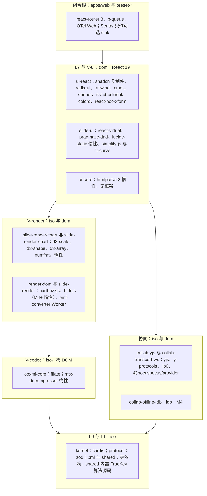
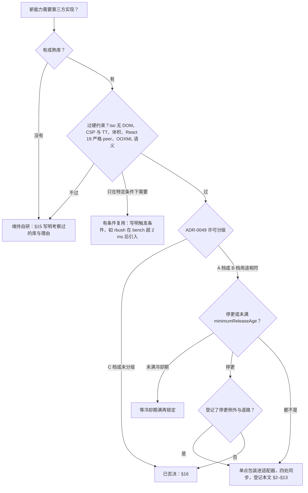
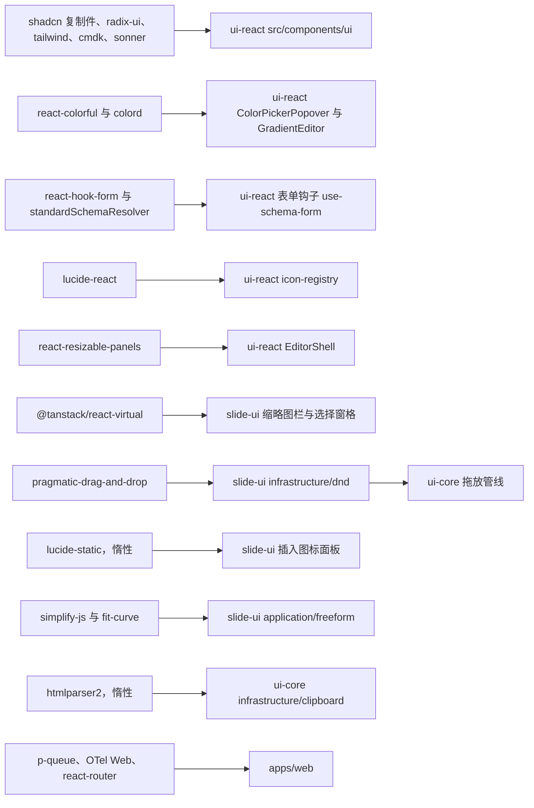
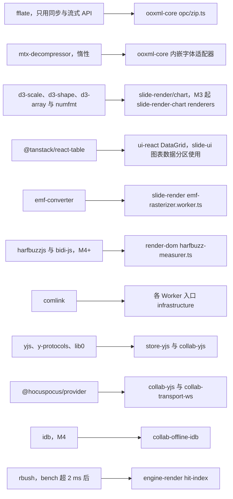
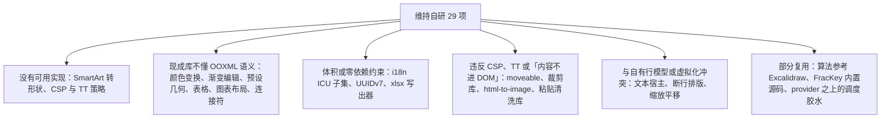

# 17 前端复用组件清单

> 状态：v0.1 | 负责：前端设计线 | 更新：2026-09-26（§4.21：新建。前端第三方依赖、维持自研项与否决项的唯一清单；版本与许可按 2026-09-26 `npm view` 核实，CSP/TT 影响按 npm 发布包源码扫描）；2026-09-26（§4.21 整合：react-table 包装位置改为 ui-react DataGrid（章程 §5.3 规则 4，slide-render-chart 不 import react）；d3 传递依赖、emf-converter 可选 peer、opentype.js M4+ 用途、simplify-js 与 lucide-static 的惰性位置；新增 EditContext 第三实现与符号表两行；URL 插图片改为下载后转码内嵌；§18 登记 M4+ 候选与已回写状态）；2026-09-26（§4.21 复核：§15 补 F-29 渐变编辑器、F-17 对应 S19，图 17-5 改 29 项；依赖行补上游链接）；2026-10-22（design-language-v3 第 3 批复核修正：§3「表单与校验」、§8「渐变编辑器」两行的「待 40/10 登记」按 §18 改为已登记）；2026-10-23（design-language-v3 第 3 批评审修改：§3 新增「文件类型图标」一行——Tabler Icons 3.49.0 的五个 outline 字形原件复制进 ui-react、不作 npm 依赖，按 ADR-0049「内置源码」登记（rulings §4.25 DS-143、TB-182）；表后补内置源码的处理；§6「插入图标库」一行与 §16 Tabler 一行注明那次否决只针对插入图标库，§16 补未采纳的 Bootstrap Icons、Phosphor 与授权不明的 Untitled UI 文件图标（TB-183）；§18 补内置源码登记的回写项；§18 内置源码登记一项改为已回写（ADR-0049 `vendored` 与 40/10 §4.3、§5.3 已登记）） | 依赖：上游：[50/01 前端架构](01-overview-and-runtime-map.md) §1a / §5a / §5b，[30/01 总架构](../30-architecture/01-overview.md) §3a / §7；[rulings](../00-charter/rulings-2026-09-14.md) §4.21（q-license-tiers、q-chart-route、q-xml-lexer、q-frackey、q-extra-inserts、q-equation、H:q-hp-provider、X:q-xml-package）；[章程](../00-charter/charter.md) D1、D2、D10、D13、§5.3 规则 4；[ADR-0017](../30-architecture/adr/0017-ui-component-library-shadcn-copy-model.md)、[ADR-0049](../30-architecture/adr/0049-dependency-admission-and-license-tiers.md)、[ADR-0019](../30-architecture/adr/0019-xml-lexer-and-fidelity-tree.md)、[ADR-0039](../30-architecture/adr/0039-collab-server-hocuspocus.md)、[ADR-0036](../30-architecture/adr/0036-chart-rendering-and-editing.md)、ADR-0021、ADR-0027、ADR-0028、ADR-0032；[09](09-ui-system-and-theming.md) §5、§10；[13](13-performance-and-bundling.md) §6；[14](14-client-security.md) §2–§5；[18](18-editor-capabilities.md)；[60/19](../60-backend/19-reuse-and-dependency-catalog.md)；证据 `00-charter/_evidence/reuse-arch-elements-plan-2026-09-26.json`（frontendReuse、revisionLog）、`hocuspocus-adoption-2026-09-26.json`、`xml-parser-research-2026-09-26.json`；rulings §4.25 DS-143、TB-182、TB-183（第 3 批评审修改）

> 读者：选型与升级前端依赖的工程师，维护 `pnpm-workspace.yaml#catalog` 与 `tooling/policy/license-allowlist.json` 的人，审 CSP 与体积的人。
> 本文是**浏览器可达依赖与前端构建期依赖的唯一清单**：每个依赖的版本锁、许可、单点位置、替代与否决理由、CSP/TT 影响和体积去向只在这里登记，其它 50 篇只写「用它做什么」。用户的要求是「凡有可复用的成熟组件，应尽可能复用」，所以每个**维持自研**项都在 §15 写明为什么没有合适的成熟库。

## 0. 本文拥有与引用

| 本文拥有 | 本文引用（事实源） |
|---|---|
| 前端第三方依赖的版本锁、许可、包装位置、替代与否决理由、CSP/TT 影响与体积去向（§2–§13） | 许可分级、TD-050 扫描口径、准入四同步、停更判定：[ADR-0049](../30-architecture/adr/0049-dependency-admission-and-license-tiers.md)；单点规则：章程 §5.3 规则 4 |
| 包装位置图（§14）、维持自研清单与理由（§15）、已否决清单（§16）、核实修正摘要（§17） | UI 原子层选型：ADR-0017；能力视角的实现落点与 `自研 Sx` 编号：[50/18](18-editor-capabilities.md) |
| — | 体积上限与 chunk 地图：[13](13-performance-and-bundling.md) §6；CSP 策略正文与注入点表：[14](14-client-security.md) §2–§4；后端依赖：[60/19](../60-backend/19-reuse-and-dependency-catalog.md) |

### 0.1 列的含义

| 列 | 含义 |
|---|---|
| 能力 | 编辑器或查看器里要解决的问题 |
| 库 | npm 包名；`维持自研` 行只写指向 §15 的编号 |
| 版本 | 2026-09-26 `npm view` 的核实值。「锁」= catalog 精确锁；npm latest 与锁定值不同时写明原因（多为 `minimumReleaseAge` 尚未满足） |
| 许可证 | 包自身的 SPDX 标识；档位按 ADR-0049：A 视同放行，B 限定用途；传递依赖里的非常见许可在括号内注明 |
| 包装位置 | 唯一允许 import 该库的包与目录（适配器所在处）；其余位置 import 由 depcruise `cordex-third-party-single-entry` 拦截（章程 §5.3 规则 4） |
| 替代与否决理由 | 证据 R `frontendReuse.matrix` 的 alternatives 与核实结论 |
| 出处 | ADR 与 40 / 50 文档行号、决策号（R-d-NN、H-d-NN、§4.21 题号） |
| CSP/TT 影响 | 对照 [14](14-client-security.md) §2–§4；本轮对 npm 发布包扫描了 12 类用法：`new Function`、`eval`、`innerHTML`、`insertAdjacentHTML`、`document.write`、`DOMParser`、`createElement("style")`、`insertRule`、`adoptedStyleSheets`、`setAttribute("style")`、`blob:` Worker、`WebAssembly`；「无」即扫描未命中 |
| 体积预算 | 进入 [13](13-performance-and-bundling.md) §6 的哪一档 chunk；数值只写证据估算或本轮实测，门禁以 50/13 为准 |

### 0.2 口径

- **准入四同步**（ADR-0049 决策 3，R-d-10）：新增前端依赖在同一 PR 内同步章程 §5.3 规则 4 单点表、`tooling/policy/license-allowlist.json`、catalog 精确锁、[13](13-performance-and-bundling.md) §6 体积预算四处，并在本文对应分组加一行。
- **许可**：按 ADR-0049 分级。本文出现的 B 档只有五项：`@fontsource-variable/geist`（OFL-1.1，字体资产）；`mtx-decompressor` 与 `axe-core`（MPL-2.0，未修改依赖）；构建链带入的 `lightningcss`（MPL-2.0，未修改依赖）；内置的 rocicorp fractional-indexing 算法源码（CC0-1.0，内置源码）。传递依赖与 devDependency 同扫。
- **停更与冷却**：最新版距今超过 12 个月、仓库归档或 npm 标记 deprecated 即判「停更」，只有登记了例外类别与退路才可准入；新版本发布满 `minimumReleaseAge`（1440 分钟）才可锁定（ADR-0049 决策 4）。
- **补丁**：只经 `pnpm patch`，登记在 `pnpm-workspace.yaml#patchedDependencies`。本轮后共两项：`sonner`（删运行时样式注入，rulings §4.20 FE-18）与 `react-colorful`（同理，R-d-13）。MPL-2.0 的包不得打补丁（ADR-0049 决策 1）。
- **维持自研必须写理由**：§15 每一行都给出考察过的库和「为什么没有合适的成熟库」；能力视角的同类说明在 [50/18](18-editor-capabilities.md)，编号对照见 §15 末列。

## 1. 总览

**图 17-1 依赖分层图**

怎么读：自上而下是秩递减、只向下依赖的层带（章程 §5.1）；每个节点写出该层带里的包各自单点引入了哪些第三方库。iso 层带（L0、V-codec、协同核心）只收无 DOM 的库，所以 `mtx-decompressor`、`d3-*`、`numfmt` 都先核实了不引用浏览器或 Node 全局；React 系依赖只出现在 L7 与 V-ui 以上。
依据：章程 §5.1、§5.3 规则 4、规则 5；ADR-0017；H-d-25。

**图 17-2 选型判定：复用、有条件复用还是自研**

怎么读：一条依赖要连过四关才进入本文 §2–§13：先有成熟库，再过项目硬约束，再过许可分级，最后看维护状态与冷却期；任何一关不过都有明确去向——维持自研写进 §15，被许可或维护状态挡下的写进 §16。
依据：ADR-0049 决策 1–4；R-d-10；用户诉求「尽可能复用成熟组件」。

**分组速查**

| 分组 | 节 | 主要依赖 | 新增或变更（§4.21） |
|---|---|---|---|
| 基础：内核、校验、编解码与构建 | §2 | cordis、zod、fflate、react-router、vite | zod `jitless`、fflate 只用同步与流式 API（本轮核实） |
| 壳层 UI | §3 | shadcn 复制件、radix-ui、tailwind、cmdk、sonner、react-resizable-panels、react-hook-form | react-resizable-panels 升 4.13.3；react-hook-form 新增；cn 维持 clsx + tailwind-merge |
| 画布交互 | §4 | rbush（有条件）、simplify-js、fit-curve | 自由曲线（P2）新增 |
| 文本与字体 | §5 | UCD 生成表、opentype.js、subset-font、mtx-decompressor、harfbuzzjs、bidi-js、MathJax 4 | 断行表改为从 UCD 生成；mtx-decompressor 按 MPL 未修改依赖采用；公式 M4+ |
| 媒体 | §6 | 浏览器图像 API、emf-converter 4.x、p-queue、lucide-static | 图标插入 M3 P2；emf-converter 改评 4.0.x |
| 图表 | §7 | d3-scale、d3-shape、d3-array、numfmt、@tanstack/react-table 9 | 图表路线定案（ADR-0036） |
| 格式与颜色 | §8 | react-colorful、colord、culori | react-colorful 以 pnpm patch 改静态 CSS |
| 列表与拖放 | §9 | @tanstack/react-virtual、@atlaskit/pragmatic-drag-and-drop | 均新增 |
| 剪贴板与输入 | §10 | htmlparser2、comlink | 均新增 |
| 协同与离线 | §11 | @hocuspocus/provider 4.7.0、yjs 13.6.33、y-protocols、lib0、idb | 官方 provider 取代自研传输（H:q-hp-provider） |
| 可观测 | §12 | OTel Web SDK 与 OTLP 导出器、@sentry/browser（可选） | 导出器成对锁 |
| 测试 | §13 | vitest、Playwright、axe-core、fast-check、saxes、libxml2-wasm | axe-core 按 B 档放行；XML 差分 oracle 新增 |

## 2. 基础：内核、校验、编解码与构建

| 能力 | 库 | 版本 | 许可证 | 包装位置（单点） | 替代与否决理由 | 出处 | CSP/TT 影响 | 体积预算 |
|---|---|---|---|---|---|---|---|---|
| 插件内核 | cordis | 4.0.0-rc.10（锁） | MIT | kernel（唯一） | 章程 D1 已定；rc 升级由 kernel 吸收 | 章程 D1；charter:726 | 无 | 查看器基线 |
| Schema 与边界校验 | zod | 4.x（npm 4.6.5） | MIT | protocol、kernel | Standard Schema 接口，实现可换（章程 D2） | 章程 D2；charter:727；40/02:65 | **有**：zod 4 默认用 `new Function` 探测能否 JIT，严格 CSP 下即使异常被捕获也会产生 `script-src` 违规报告（zod 源码 `v4/core/util.js:218-220` 的注释即说明此事）。浏览器侧组合根在首次解析前调用 `z.config({ jitless: true })`，服务端保留 JIT（[14](14-client-security.md) §4.3） | 查看器基线 |
| zip 编解码 | fflate | 0.8.3（锁） | MIT | ooxml-core `opc/zip.ts`（唯一） | JSZip 为 `(MIT OR GPL-3.0-or-later)` 双许可且较慢 | 40/04:904 | **有**：异步入口（`zip()`、`unzip()`、`inflate()`、`deflate()` 等）用 `URL.createObjectURL` 起内联 `blob:` Worker（`esm/browser.js`），会被 `worker-src 'self'` 与 TT `cordex-default` 拒绝。只用同步与流式 API（`unzipSync`、`zipSync`、`Unzip`、`Zip` 类），并且只在导入、导出 Worker 内运行 | 导入 Worker（计入所属基线） |
| 应用路由 | react-router | 8（npm 8.4.0） | MIT | apps/web（唯一） | playground 仍是 react-router-dom ^7.18.3，M2 迁移时换 | ADR-0004:25；40/11:11 | 无 | apps/web 路由 chunk |
| 应用构建 | vite + @vitejs/plugin-react | 8.3.x（npm 8.3.1）/ 6.1.x（npm 6.1.1） | MIT | apps/web、playground（devDependency） | — | ADR-0004:25；40/11:685 | 开发态用 `html.cspNonce` 自检（[14](14-client-security.md) §2.5）；构建链带入 `lightningcss`（MPL-2.0，未修改，B 档） | 构建期，不计 |

- 保真 XML 词法与保真树是自研包 `@cordexjs/xml`（L0，零运行时依赖），理由见 §15 F-14；它的差分 oracle 在 §13。
- `@cordexjs/shared` 的 `order` 子路径内置 rocicorp fractional-indexing 的算法源码（CC0-1.0，文件头注明出处与提交号），不作 npm 依赖，键格式改写见 ADR-0032 决策 2（§15 F-22）。

## 3. 壳层 UI

| 能力 | 库 | 版本 | 许可证 | 包装位置（单点） | 替代与否决理由 | 出处 | CSP/TT 影响 | 体积预算 |
|---|---|---|---|---|---|---|---|---|
| UI 原子组件（44 份复制件） | shadcn/ui CLI（style `radix-rhea`） | 4.21.0（`pnpm dlx` 钉版本） | MIT | ui-react `src/components/ui/`（全仓唯一副本，R17） | MUI、AntD、Chakra、Mantine、Radix Themes、React Aria 自写样式（ADR-0017 已否） | ADR-0017:15；40/10:542；R-d-11 | `scroll-area.tsx`、`select.tsx` 以 override 透传 nonce；Viewport 固定样式由 TT `default` 常量表放行（[14](14-client-security.md) §4.4） | 编辑器基线 |
| 语义、键盘与浮层原语 | radix-ui（单包） | 1.6.7 | MIT | ui-react 与 `*-ui` | — | ADR-0017:16 | 升级须同 PR 更新 TT 常量表并过 csp-strict（[14](14-client-security.md) §4.1）；滚动锁样式经 `get-nonce` 带 nonce | 编辑器基线 |
| UI 框架 | react / react-dom | catalog 19.3.x（npm 19.3.0）；SDK peer `^19.0` | MIT | ui-react、`*-ui` 的 `ui/` 层、apps/web | Vue 与 Reka UI 不提供 Rhea 风格（ADR-0017 修订 2026-09-24） | ADR-0017:65 | 无 | 不计（peer） |
| 样式工具类 | tailwindcss + @tailwindcss/vite / @tailwindcss/cli | 4.3.x（npm 4.3.3） | MIT | ui-react 与 `*-ui` 样式入口、apps/web | — | ADR-0017:16 | 构建期产出静态 CSS；带入 `lightningcss`（MPL-2.0，未修改） | 静态 CSS |
| 动效 | tw-animate-css | 1.4.0 | MIT | ui-react 样式入口 | — | ADR-0017:40；40/10:536 | 纯 CSS | 静态 CSS |
| UI 图标 | lucide-react（经 icon-registry 按名引入） | catalog ^1.46（npm 1.48.0） | ISC | ui-react `infrastructure/icon-registry.ts` | — | ADR-0017:16；40/10:579 | 无（界面图标以 React 元素渲染，不是文档内容） | 编辑器基线的图标子集 |
| 文件类型图标（导出对话框的格式行、导入对话框的上传行、「导出本地副本」的 .pptx 一行；2026-10-23，rulings §4.25 DS-143、TB-182） | Tabler Icons 原件：outline 的 `file-type-ppt`、`file-type-png`、`file-type-svg`、`file-type-pdf` 与通用 `file` 五个字形，**复制进源码、不作 npm 依赖** | 取自 `@tabler/icons` 3.49.0（上游 github.com/tabler/tabler-icons 标签 v3.49.0） | MIT（A 档；保留版权行「Copyright (c) 2020-2026 Paweł Kuna」与许可全文） | ui-react `src/infrastructure/file-type-icons.tsx`（文件登记见 40/10 §4.3、§5.3）；apps/web 的导出对话框与导入对话框、ui-react 的「导出本地副本」对话框只经它取 | lucide 没有带扩展名字样的文件图标；未采纳的备选：bootstrap-icons 1.13.2（MIT，字样是 PPTX，但 16 格填充造型、字小）、@phosphor-icons/core 2.1.1（MIT，填充造型、只有 ppt）（DS-143）；@untitledui/file-icons 0.0.9 授权未落实，不保留原件（TB-183）；插件格式没有专属图标时用通用 `file` 字形 | rulings §4.25 DS-143、TB-182、TB-183；设计 04 §2.14；[09](09-ui-system-and-theming.md) §5a.1 | 无（静态 SVG 路径以 React 元素渲染，`stroke: currentColor`，不经 `innerHTML`） | 约 1.5 KB，计入所在包，不另设门禁 |
| UI 字体 | @fontsource-variable/geist | 5.3.0 | OFL-1.1（B 档：字体资产） | ui-react 样式入口；字体文件同源 | 只用系统字体（设计线否决，rulings §4.8、2026-09-16 Q6 保留 Geist） | ADR-0017:16；50/16:55；§4.21 q-license-tiers | `font-src 'self'` | 字体不计入体积门禁 |
| 类名合并 `cn()` | clsx + tailwind-merge + class-variance-authority | 2.1.1 / 3.7.0 / 0.7.1（精确锁） | MIT / MIT / Apache-2.0 | ui-react `lib/utils.ts` | shadcn 官方 `cn` 0.4.0：新代码线 2026-09-01 起 22 天发 14 版，未到成熟度；复制件里的 `import { cn } from "cn"`（playground 现有 43 处）由生成脚本 codemod 改写（[09](09-ui-system-and-theming.md) §5a） | ADR-0017:16；40/10:753；R-d-12 | 无 | 编辑器基线 |
| 命令面板、可搜索下拉 | cmdk | 1.1.1 | MIT | ui-react | — | 40/10:813 | 无 | 编辑器基线 |
| Toast | sonner（静态 CSS + pnpm patch） | 2.0.8 | MIT | ui-react | — | ADR-0017:70；50/14:215 | patch 删 `__insertCSS`，样式静态引入（[14](14-client-security.md) §3） | 编辑器基线 |
| 三栏可拖分栏 | react-resizable-panels | 4.13.3（由 4.12.4 升级） | MIT | ui-react 壳 `EditorShell` | — | 40/10:829；R-d-11 | 只用 `adoptedStyleSheets` 与 `insertRule`（CSSOM），不建 `<style>`，本轮扫描确认；升级同 PR 改 [14](14-client-security.md) §3 注入点表 | 编辑器基线 |
| 滚动锁 nonce | get-nonce（Radix 传递依赖） | 1.0.1 | MIT | ui-react 挂载时 `setNonce` | — | 50/14:213 | 须与 `react-style-singleton` 解析到同一实例 | 编辑器基线 |
| 画布锚定浮层 | 复用 radix Popper 的 `virtualRef`，不新增依赖 | radix-ui 1.6.7 | MIT | ui-react 覆盖层宿主 | 直接用 @floating-ui/dom（radix 已内含，不重复引） | R-d-19 | 无 | 0 新增 |
| 表单与校验 | react-hook-form + @hookform/resolvers（`standardSchemaResolver`，直接复用 protocol 的 zod schema） | 7.88.0（npm latest 7.89.0 发布于 2026-09-26T00:59Z，未满冷却期）/ 5.9.1 | MIT | ui-react 表单钩子 `ui/form/use-schema-form.ts`（已登记 40/10 §4.3、§5.3，§18）；`*-ui` 与 apps/web 只经它 | @tanstack/react-form 1.33；手写受控组件 | R-d-18 | 无 | 编辑器基线，约 10 KB gzip |
| 状态订阅选择器 | use-sync-external-store（`with-selector`） | 1.7.0 | MIT | ui-react hooks | zustand、jotai 会形成第二事实源（章程 D5） | R-d-19 | 无 | 编辑器基线，约 1 KB |

- 文件类型图标不是依赖（TB-182：不为它们新增运行时依赖）：不进 catalog 与章程 §5.3 规则 4 的单点表，图 17-3 也不画这条边；按 ADR-0049「内置源码」处理——`file-type-icons.tsx` 文件头写 `SPDX-License-Identifier: MIT`、上游地址与标签 v3.49.0，登记在 `tooling/policy/license-allowlist.json#vendored`，发布物 `NOTICE` 保留上面的版权行与 MIT 全文。需要新字形或升级时按新标签重新复制原件、逐字比对路径，同一 PR 改文件头与 `vendored`；描边按 v3 界面图标统一取 1.5（原件为 2），其余照原件。

## 4. 画布交互

| 能力 | 库 | 版本 | 许可证 | 包装位置（单点） | 替代与否决理由 | 出处 | CSP/TT 影响 | 体积预算 |
|---|---|---|---|---|---|---|---|---|
| 命中测试空间索引（有条件复用） | rbush | 4.0.1（依赖 quickselect 3，ISC） | MIT | engine-render `hit-index`（iso） | flatbush 4.6.2（ISC）是静态索引，不适合逐帧增删；M1 先线性扫描，M2 bench 超 2 ms 才引入 | R-d-30；50/05:266 | 无 | 引入后约 6 KB，计入查看器基线（届时回填 50/13） |
| 任意多边形与自由曲线（P2） | simplify-js + fit-curve | 1.2.4 / 0.2.0 | BSD-2-Clause / MIT | slide-ui `application/freeform`（输出 `Geometry.custom`），只进惰性的曲线绘制 chunk | perfect-freehand 生成的是墨迹外轮廓，不是可编辑路径（它另作 M4+ 笔墨输入候选，见 §18） | R matrix；[50/22](22-elements-shapes-and-lines.md) | 无 | 惰性曲线绘制 chunk（P2），约 5 KB；两库 2022 年后无发版，按 ADR-0049「算法稳定」例外登记，退路是 vendoring |
| 选择框与手柄、吸附与参考线、缩放平移、裁剪覆盖层、连接符、快捷键 | 维持自研：§15 F-01…F-07 | — | — | render-dom 覆盖层、slide-ui、engine-render、ui-core | 见 §15 | R-d-29 | — | — |

## 5. 文本与字体

| 能力 | 库 | 版本 | 许可证 | 包装位置（单点） | 替代与否决理由 | 出处 | CSP/TT 影响 | 体积预算 |
|---|---|---|---|---|---|---|---|---|
| 断行机会表（UAX#14） | 由 tooling 从最新 UCD 生成；linebreak 只作 LineBreakTest 对照 | linebreak 1.1.0（devDependency） | 生成物源数据为 Unicode 数据文件许可（Unicode-3.0）；linebreak MIT | 生成物：engine-layout `domain/text/linebreak-trie.ts`（`line-breaker.ts` 查表）；脚本：`tooling/scripts/gen-linebreak-table.ts` | linebreak 数据停在 Unicode 13 且 2022-06 后无发版，不能作运行时唯一来源；`Intl.Segmenter` 没有 line 粒度；css-line-break 2.1.0 与 budoux 0.9.2（短语切分）解决的不是同一问题 | R-d-27；ADR-0027 | 无 | 查看器基线（约 20 KB 表，原估算已含） |
| 字体解析与度量抽取（构建期；M4+ 艺术字字形轮廓） | opentype.js | 2.0.0 | MIT | `tooling/scripts/build-font-profile.ts`（服务端 `node-font` 用法见 60/19）；M4+ 艺术字变形在浏览器惰性加载取字形轮廓（[50/20](20-elements-text.md) §5，[13](13-performance-and-bundling.md) §6） | fontkit 2.0.4（2024-08 后停更） | R-d-57、R-d-28 | 构建期不进浏览器；M4+ 艺术字惰性 chunk | 构建期；M4+ 惰性 |
| 字体子集化（构建期） | subset-font | 2.9.0 | BSD-3-Clause（传递依赖 argparse 为 Python-2.0、pako 1.x 为 `(MIT AND Zlib)`，均属 A 档） | 同上 | glyphhanger、pyftsubset 依赖 Python fonttools | R-d-28 | 不进浏览器 | 构建期 |
| 内嵌字体 MTX 解压 | mtx-decompressor | 1.6.0 | MPL-2.0（B 档：未修改依赖） | ooxml-core 内嵌字体适配器：EOT 解析与 XOR 解混淆自研，MicroType Express 解压委托本库（文件落点由 40/04 登记） | 依 W3C MTX 提交稿自研，估 600–1000 行加语料测试 | §4.21 q-license-tiers；R revisionLog | 无：零依赖、不引用 Node 或浏览器全局，可在 iso 包内运行（本轮扫描） | dist gzip -9 约 14 KB（未最小化，本轮实测）；查看器基线只剩约 5 KB 余量，**必须惰性**：只在包内有 `p:embeddedFontLst` 时动态加载（[13](13-performance-and-bundling.md) §6） |
| 复杂文种 shaping 与 RTL（M4/M5） | harfbuzzjs + bidi-js | 1.6.2 / 1.1.0 | MIT / MIT | render-dom `harfbuzz-measurer.ts`（惰性）；engine-layout bidi | 自研 UAX#9；只靠浏览器 SVG bidi 拿不到逻辑与视觉位置映射 | R-d-28；ADR-0027 | **有**：`WebAssembly` 编译需要 `script-src 'wasm-unsafe-eval'`，只在启用该 Provider 的部署下发（[14](14-client-security.md) §2.7）；bidi-js 数据停在 Unicode 13，并带一个用不到的运行时依赖 require-from-string | shaping wasm 434 KB（未压缩），subset wasm 651 KB 不进浏览器；惰性，不计基线 |
| 公式渲染（M4+） | MathJax 4（SVG 输出） | 4.1.3 | Apache-2.0；字体数据 `@mathjax/mathjax-newcm-font` 派生自 GUST 许可字体，**待核**（ADR-0049 待核项） | M4+ `slide-render-math` 惰性插件；OMML↔MathML 基于 `@cordexjs/xml` 自研（§15 F-27） | temml、KaTeX 需要 `foreignObject`（ADR-0021 已否）；omml2mathml 依赖 DOM | §4.21 q-equation | 待 M4+ 实测。建议在 Worker 内用无 DOM 适配器生成 SVG 字符串，经 Blob → `<image>` 进入画布，与文档内 SVG 同一条路径（[14](14-client-security.md) §5） | 解包约 20 MB，按需约 1 MB 以上，惰性 |
| 文本输入宿主的第三实现（R-M2-1 spike） | 浏览器 API：EditContext | — | — | render-dom `text-host/edit-context.ts`（仅 Chromium 桌面 121+，默认不启用） | ProseMirror、Tiptap、Lexical、Slate、Quill 已评估、不作主路径：都基于 contenteditable 并自带排版，与自有行模型形成两套排版（ADR-0028 修订 2026-09-26）；ProseMirror 保留为 a11y 模式备选 | R-d-31；ADR-0028 | 无 | 0 |
| 符号表（M3 P2） | 数据来自 UCD `UnicodeData.txt`（Unicode-3.0，A 档数据文件），面板自研 | — | Unicode-3.0 | slide-ui `domain/symbol-table.ts`（生成脚本 `tooling/scripts/gen-symbol-table.ts`，40/01）；`ui/symbols/SymbolPicker.tsx` | 现成符号选择组件都带自己的字体与数据集，且与 shadcn 风格不一致；数据量小，按 [50/20](20-elements-text.md) §6.2 的码位清单抽取 | q-extra-inserts | 无 | 惰性，随符号面板加载 |
| 文本输入宿主、度量、断行与段落排版 | 维持自研：§15 F-08、F-09 | — | — | render-dom `text-host/*`、engine-layout `domain/text/*` | 见 §15 | ADR-0027、ADR-0028 | — | — |

## 6. 媒体

| 能力 | 库 | 版本 | 许可证 | 包装位置（单点） | 替代与否决理由 | 出处 | CSP/TT 影响 | 体积预算 |
|---|---|---|---|---|---|---|---|---|
| 图片预处理：压缩、GIF 首帧、SVG 与图标的 PNG 回退、视频海报帧 | 浏览器 API：`createImageBitmap`（`resizeQuality: 'high'`）+ `canvas.toBlob` | — | — | render-dom `media/image-preprocess.ts`，由 `MediaUploadQueue` 调用 | pica 10.0.3 默认以 `blob:` 起 Worker，违反 CSP，只有关闭 ww 特性后才可选；browser-image-compression 已停更；@jsquash/resize 是 wasm | R-d-23 | canvas 的这一用途由 ADR-0021 补登；不涉及 HTML sink | 0 |
| EMF / WMF 栅格化（M4+ 矢量） | emf-converter | 4.0.x（4.0.0 发布于 2026-09-25T19:18Z，满冷却期后精确锁；原评 3.4.0；可选 peer `@napi-rs/canvas` 不安装） | Apache-2.0 | slide-render `infrastructure/media/emf-rasterizer.worker.ts`（唯一） | rtf.js 的 EMFJS / WMFJS 已停更 | R-d-24；40/07:932；50/05:425 | Worker 从同源 `/assets/` 加载，经 TT `cordex-default`；Worker 内用 `OffscreenCanvas`；Node 分支对 `@napi-rs/canvas` 的动态 import 带 `@vite-ignore`，浏览器构建不打入（本轮扫描）；4.0 默认 PNG 不再抗锯齿，调用时显式 `gdiAntialias: true` | 惰性 Worker；dist 未最小化 gzip -9 约 205 KB（本轮实测），M2 spike 按最小化产物回填 |
| 上传并发 | p-queue | 9.3.3 | MIT | apps/web `MediaUploadQueue`（唯一） | @uppy/* 偏重；自写并发控制 | R-d-21 | 无 | apps/web，约 3 KB gzip |
| 插入图标库（M3 P2） | lucide-static | 1.48.0 | ISC | slide-ui `ui/icons/IconGallery.tsx`（惰性 chunk，按分类分块） | @tabler/icons 3.48（MIT）风格与界面图标不一致；@iconify/json 各图标集许可不一（这里否决的是用整套 Tabler 作插入用户文档的图标库；界面上的文件类型图标另取 Tabler 原件复制、不作依赖，§3，2026-10-23，rulings §4.25 DS-143） | §4.21 q-extra-inserts | 面板预览只经 `` 加载 `blob:` 或 `data:` 的 SVG（图像上下文），不以 innerHTML 注入；插入时写 `svgBlip` 并由 canvas 生成 PNG 回退（ADR-0021 补登用途） | 解包 51 MB；面板按分类分块惰性加载（[13](13-performance-and-bundling.md) §6） |
| 裁剪覆盖层、缩略图与位图导出 | 维持自研：§15 F-05、F-16 | — | — | render-dom | 见 §15 | R-d-29 | — | — |

- 从 URL 插入图片默认不经服务端代抓，也不保留外链：只接受 `https:`，浏览器以 `` 加载（受 `img-src` 约束），成功后经 `createImageBitmap` + canvas 转码为本机字节，再走本地文件插入路径；对方不给 CORS 时提示先保存到本地，`externalResources = never` 时入口置灰（[14](14-client-security.md) §5 与图 6，ADR-0021 修订；2026-09-26 整合更正，原「插入即建立外链图片关系」作废）。

## 7. 图表

| 能力 | 库 | 版本 | 许可证 | 包装位置（单点） | 替代与否决理由 | 出处 | CSP/TT 影响 | 体积预算 |
|---|---|---|---|---|---|---|---|---|
| 比例尺、形状路径与数组运算 | d3-scale + d3-shape + d3-array（另带 d3-path，d3-scale 传递带入 d3-format、d3-interpolate、d3-color、d3-time、d3-time-format、internmap，均 ISC） | 4.0.2 / 3.2.0 / 3.2.4 / 3.1.0 | ISC | M1–M2 `slide-render/chart` 惰性子路径；M3 起 `slide-render-chart` 的 `infrastructure/renderers/**`（章程 §5.3：图表库只在此处） | echarts 6.1（五类约 400–500 KB，逼近图表 chunk 上限，布局模型对不上 `manualLayout` 与 Excel 自动刻度）；vega-lite 6.4（大，带解释器）；chart.js（只有 canvas）；@visx（绑 React）；@observablehq/plot | §4.21 q-chart-route；ADR-0036 | 无（本轮扫描 d3-scale、d3-shape、d3-array、d3-path、d3-format、d3-interpolate、d3-time-format） | 图表 chunk ≤ 400 KB 惰性，d3 部分约 30 KB；四包最后发版在 2021-09 至 2023-05 之间，按 ADR-0049「算法稳定」例外登记 |
| Excel 数字格式 | numfmt | 3.2.6 | MIT | 同上（iso）；另放行 slide-ui 的图表数据分区解析数据网格输入（M3，与章程 §5.3 登记表一致）；M5 sheet 复用 | ssf 0.11.2 已停更；`Intl.NumberFormat` 不认 Excel 格式码 | R-d-35 | 无 | 图表 chunk，约 30 KB（待实测） |
| 数据网格编辑（M3） | @tanstack/react-table 9 + shadcn Table（依赖 @tanstack/table-core 9.2.4、@tanstack/react-store 0.11.1，均 MIT） | 9.2.4 | MIT | ui-react 通用 `DataGrid`（`ui/shell/DataGrid.tsx`，react-table 单点引入 ui-react），slide-ui 图表数据分区与抽屉（`ui/chart/*`）使用；单元格选区复用 slide-ui `application/table-selection.ts`。按章程 §5.3 规则 4，react 与 react-table 只在 ui-react 与 `*-ui`，slide-render-chart 只提供数据模型与命令、不直接 import 二者（2026-09-26 整合更正，原「slide-render-chart 的 `ui/` 层」作废） | react-datasheet-grid 4.11.6 依赖 react-resize-detector@7，其 peer 只到 React 18，在 `strictPeerDependencies: true` 下装不上；glide-data-grid（canvas）；ag-grid-community；handsontable（非开源）；revogrid | R-d-34 | 无 | 惰性，随图表数据面板加载（M3） |
| 图表 OOXML 布局、内嵌工作簿写出 | 维持自研：§15 F-12、F-13 | — | — | slide-render-chart、ooxml-pptx | 见 §15 | ADR-0036；R-d-35 | — | — |

## 8. 格式与颜色

| 能力 | 库 | 版本 | 许可证 | 包装位置（单点） | 替代与否决理由 | 出处 | CSP/TT 影响 | 体积预算 |
|---|---|---|---|---|---|---|---|---|
| 颜色面板：饱和度、色相、透明度 | react-colorful（pnpm patch 删运行时注入，样式静态化） | 5.8.1 | MIT | ui-react `ui/shell/ColorPickerPopover.tsx`（组件契约见 [09](09-ui-system-and-theming.md) §5a） | react-color 已停更；全自写 | R-d-13 | **有**：dist 在挂载时 `createElement("style")` 并写 `innerHTML`（本轮扫描确认），后者是 TrustedHTML sink，M3 强制 TT 后会抛错；patch 后零注入，原样式文本迁入 ui-react 静态样式（[14](14-client-security.md) §3） | 编辑器基线，约 3 KB gzip |
| 颜色字符串解析与格式化（UI） | colord | 2.10.0 | MIT | ui-react（Hex / RGB / HSL 输入解析） | colorjs.io 解包 15.8 MB；tinycolor2 | R-d-14 | 无 | 编辑器基线，约 2 KB gzip |
| 构建期 OKLCH 换算与对比度 | culori | 4.0.2 | MIT | design `src/scripts/build-theme.ts`（devDependency） | — | R-d-14 | 不进浏览器 | 构建期 |
| 渐变编辑器 | 组合复用：radix Slider 多滑块 + react-colorful，不新增依赖 | — | — | ui-react `ui/shell/GradientEditor.tsx`（已登记 40/10 §4.3、§5.3，§18；契约见 [09](09-ui-system-and-theming.md) §5a） | react-best-gradient-color-picker 已停更，且只产出 CSS 渐变字符串，写不出 `a:gradFill` | R-d-15 | 同 react-colorful | 0 新增 |
| OOXML 颜色解析与变换 | 维持自研：§15 F-15 | — | — | model-slide `resolve-color.ts` | 见 §15 | 40/03:192 | — | — |

## 9. 列表与拖放

| 能力 | 库 | 版本 | 许可证 | 包装位置（单点） | 替代与否决理由 | 出处 | CSP/TT 影响 | 体积预算 |
|---|---|---|---|---|---|---|---|---|
| 缩略图栏与选择窗格的虚拟列表 | @tanstack/react-virtual（带入 @tanstack/virtual-core 3.17.11） | 3.14.13 | MIT | slide-ui 缩略图栏与选择窗格 | virtua 0.52 未到 1.0；react-window 2.3 | R-d-16 | 只经 React `style` 属性（CSSOM），不建 `<style>`（本轮扫描确认） | 编辑器基线，约 10–15 KB |
| 缩略图拖拽重排、外部文件拖入 | @atlaskit/pragmatic-drag-and-drop（只用核心包，按 4.x 子路径导入；让位动画自写 FLIP） | 4.0.0 | Apache-2.0（传递依赖 @babel/runtime、raf-schd、bind-event-listener 均 MIT） | slide-ui `infrastructure/dnd` → ui-core 拖放管线 | @dnd-kit/core 6.3 旧架构停滞；@dnd-kit/react 0.5 未到 1.0 | R-d-17 | 无运行时样式注入（本轮扫描确认）；不引 `*-react-drop-indicator` 等附加包（其样式方案未核实） | 编辑器基线，核心约 5 KB |

- pragmatic-drag-and-drop 3.0（2026-08-14）与 4.0（2026-09-24）都是入口路径迁移，升级时按子路径批量改写。触屏上 iOS/iPadOS 15+、Android Chrome 96+ 支持原生拖放，真正要评估的是长按延迟（R revisionLog）。

## 10. 剪贴板与输入

| 能力 | 库 | 版本 | 许可证 | 包装位置（单点） | 替代与否决理由 | 出处 | CSP/TT 影响 | 体积预算 |
|---|---|---|---|---|---|---|---|---|
| 剪贴板 HTML 转纯文本 | htmlparser2（回调模式，惰性加载） | 12.0.0 | MIT（依赖 domhandler、domutils、domelementtype 与 entities 8，均 BSD-2-Clause） | ui-core `infrastructure/clipboard`（唯一） | html-to-text 10；`DOMParser` 与 DOMPurify 都要经 DOM，违反「粘贴内容不进 DOM」，且 `DOMParser.parseFromString` 是 TT sink | R-d-20 | 无：纯 JS 词法回调，不建 DOM（本轮扫描确认） | 惰性 chunk，约 25 KB（[13](13-performance-and-bundling.md) §6） |
| Worker RPC | comlink | 4.4.2 | Apache-2.0 | 各 Worker 入口的 `infrastructure`（导出 Worker、EMF Worker） | penpal 8；自写消息协议 | R-d-21 | 无；Worker URL 仍经 `toScriptUrl`（[14](14-client-security.md) §4.2） | 约 1.1 KB gzip；2024-11 后无发版，按 ADR-0049「维护边缘」登记，退路是自写（协议面很薄） |
| 快捷键、五条输入管线、嵌入桥、剪贴板 MIME 协商 | 维持自研：§15 F-07、F-21、F-25 | — | — | ui-core、protocol | 见 §15 | R-d-21、R-d-29 | — | — |

## 11. 协同与离线

| 能力 | 库 | 版本 | 许可证 | 包装位置（单点） | 替代与否决理由 | 出处 | CSP/TT 影响 | 体积预算 |
|---|---|---|---|---|---|---|---|---|
| WS 连接、握手、认证帧、重连与合并发送 | @hocuspocus/provider（带入 @hocuspocus/common 与 @lifeomic/attempt） | 4.7.0（精确钉，含 GHSA-xwhh-v746-pj9m 与 GHSA-8v8m-xjrm-95h6 的修复）/ 4.7.0 / 3.1.0 | MIT | collab-yjs（`HocuspocusProvider`）；collab-transport-ws（`HocuspocusProviderWebsocket`、垫片、自有调度器与 FIFO 胶水）（H-d-25） | 原推荐的自研传输（R-d-37）由 §4.21 H:q-hp-provider 改为官方 provider；y-websocket 3.1 没有鉴权、权限与 ack 控制面 | §4.21 H:q-hp-provider；ADR-0039；H-d-24、H-d-27、H-d-28 | `connect-src` 已含 `{wsOrigin}`；无样式注入与字符串求值（本轮扫描确认） | 协同增量：provider 7,077 B + common 1,448 B + attempt 1,656 B（gzip -9，未最小化）约 10 KB |
| CRDT、协同撤销、文本锚点 | yjs | 13.6.33（精确锁；Yjs 14 以 `@y/y` 发布，跟踪 RC） | MIT | store-yjs、collab-yjs、server-collab | Loro、Automerge（ADR-0020 已否） | ADR-0020:18；R-d-37 | 经 `lib0/logging` 带入 `lib0/dom`，模块加载时创建一个 `DOMParser` 实例但不调用 `parseFromString`，不触发 TT（本轮扫描） | 协同增量 |
| 同步与 awareness 编码 | y-protocols | 1.0.7（精确锁） | MIT | collab-yjs、server-collab | — | ADR-0023:16；ADR-0024:15 | 无（`dist/test.js` 里的 DOM 用法不在发布入口） | 协同增量 |
| 二进制编码 | lib0 | 0.2.x（npm 0.2.118） | MIT | collab-yjs、server-collab；另为 yjs 与 provider 的传递依赖 | — | 章程:569 | 只经子路径导入；`lib0/dom` 与 `lib0/component` 含 `DOMParser` 与 `innerHTML`，自有代码不得 import | 协同增量 |
| 跨刷新离线持久化（M4） | idb（自写 update 追加日志与压实的适配） | 8.0.3 | ISC | collab-offline-idb（唯一） | y-indexeddb 9.0.12 自 2023-11 停更，且模型不适配 ADR-0033 | R-d-26 | 无 | M4 惰性，约 1.2 KB gzip；2025-05 后无发版，按「维护边缘」登记，退路是自写 IndexedDB 封装 |
| 逐帧 ack、两级确认、离线排队与调度 | 维持自研：§15 F-23 | — | — | collab-yjs、collab-transport-ws | provider 的 `SyncStatus` 只是计数器，重建 WS 时清空队列 | H `hp.provider`、`hp.limits` | — | — |

- 官方 provider 本身没有本地持久化；离线靠 collab-offline-idb 与重连后的 SyncStep 补齐（ADR-0033、[07](07-collaboration-client.md)）。

## 12. 可观测

| 能力 | 库 | 版本 | 许可证 | 包装位置（单点） | 替代与否决理由 | 出处 | CSP/TT 影响 | 体积预算 |
|---|---|---|---|---|---|---|---|---|
| 浏览器链路追踪与导出 | @opentelemetry/sdk-trace-web + @opentelemetry/exporter-trace-otlp-http（成对锁） | 2.11.0 / 0.222.0 | Apache-2.0 | apps/web `sinks.ts`；SDK 包只依赖 kernel `telemetry` | 自写 fetch 上报 | R-d-22；ADR-0030:15；50/13:211 | 导出到同源 `/telemetry/otlp`，`connect-src 'self'` 覆盖 | OTel Web 惰性 chunk，约 40–60 KB，只报告 |
| 错误平台（可选） | @sentry/browser | 11.0.0 | MIT | apps/web 可选 sink，默认不装配（ADR-0030 决策 4） | — | R-d-22 | 启用时须把上报主机加入 `connect-src`；[14](14-client-security.md) §2.2 目前没有该占位符，启用前先补 | 默认不加载 |

## 13. 测试

| 能力 | 库 | 版本 | 许可证 | 包装位置（单点） | 替代与否决理由 | 出处 | CSP/TT 影响 | 体积预算 |
|---|---|---|---|---|---|---|---|---|
| 单测与组件测试 | vitest + @testing-library/react + happy-dom | 5.0.2 / 16.3.3 / 20.14.5 | MIT | 各包 devDependency | — | ADR-0004:27；40/10:796 | — | 开发期 |
| e2e 与视觉 oracle | @playwright/test | 1.63.0 | Apache-2.0 | 同上 | — | ADR-0004:27 | csp-strict 夹具监听 `securitypolicyviolation`（[14](14-client-security.md) §13） | 开发期 |
| a11y 自动化 | axe-core | 4.13.0 | MPL-2.0（B 档：未修改依赖） | 同上（ui-react `testing` 的 `axeCheck` 夹具） | — | 40/10:796；§4.21 q-license-tiers | — | 开发期 |
| 性质测试 | fast-check | 4.10.2 | MIT | 同上 | — | 40/02:1066 | — | 开发期 |
| XML 差分 oracle | saxes + libxml2-wasm（输入限深、限长） | 6.0.0 / 0.7.2 | ISC / MIT | `@cordexjs/xml` 的 devDependency | @rgrove/parse-xml 5.0.0（ISC）作退路，平时不安装 | ADR-0019；§4.21 X:q-xml-lexer | 不进浏览器 | 开发期；saxes 仓库已归档、2021-11 后无发版，按 ADR-0049「只作对照」例外登记 |
| 断行对照 | linebreak | 1.1.0 | MIT | `gen-linebreak-table --check` | — | R-d-27 | — | 开发期 |
| 预设几何差分对照 | pptx-viewer-core | 4.5.0 | Apache-2.0（依赖 mtx-decompressor 为 MPL-2.0、jszip 为 `(MIT OR GPL-3.0-or-later)`） | 只在仓库外的隔离环境运行，输出存 fixture；不进 workspace | — | R-d-32 | — | 不安装 |

## 14. 包装位置

每个第三方库只允许一个包（多数情况是该包 `infrastructure/` 下的一个适配器文件）直接 import；其余代码只依赖适配器导出的自有接口。下面两张图按「UI 侧」「引擎、编解码与协同侧」分开画，`cordis → kernel`、`zod → protocol 与 kernel` 两条不画。

**图 17-3 包装位置：UI 与画布交互**

怎么读：左边是库，右边是唯一允许 import 它的位置；`pragmatic-drag-and-drop` 多一跳，是因为 slide-ui 把原生拖放事件翻译成 ui-core 拖放管线的意图，业务代码只看到意图。新增一条边须同时改章程 §5.3 规则 4 的单点表（depcruise `cordex-third-party-single-entry` 由它生成）。
依据：章程 §5.3 规则 4；ADR-0017；R-d-13…R-d-21。

**图 17-4 包装位置：引擎、编解码、Worker 与协同**

怎么读：iso 包里的适配器（`zip.ts`、内嵌字体、图表、`hit-index`、协同核心）接的都是核实过无 DOM、无 Node 全局的库；需要 Worker、canvas 或 wasm 的库只落在 dom 包（slide-render 的 Worker 入口、render-dom）。`@hocuspocus/provider` 拆成两处：provider 对象在 collab-yjs，WebSocket 与调度器在 collab-transport-ws（H-d-25）。
依据：章程 §5.3 规则 4、规则 5；H-d-25；R-d-20…R-d-35。

## 15. 维持自研与理由

用户要求能复用就复用，所以下表每一行都写出考察过的库（证据 R `frontendReuse.matrix` 的 alternatives 与本轮补测）和**为什么没有合适的成熟库**；能部分复用的写在末两列。「50/18」列是 [50/18](18-editor-capabilities.md) 能力表里对应的 `自研 Sx` 编号。

| 号 | 能力 | 落点 | 考察过的库 | 为什么没有合适的成熟库 | 部分复用 | 50/18 |
|---|---|---|---|---|---|---|
| F-01 | 选择框、8 缩放手柄、旋转手柄、框选 | render-dom 选择覆盖层；slide-ui `canvas-interaction.ts` | react-moveable 0.56（2023-12 后无发版）、selecto、interactjs 1.10.28 | moveable 运行时注入 style（违反 CSP），且不认 EMU、翻转与组合的 `chOff/chExt`；selecto、interactjs 只处理指针，OOXML 变换几何仍要全部自写 | 交互参考 Excalidraw（MIT）；2×3 仿射只需乘、逆、分解三个函数，在 engine-layout 自写（transformation-matrix 3.1.0 评估后不引） | S1 |
| F-02 | 智能参考线、等间距与吸附 | slide-ui `guides.ts`；render-dom `guides-overlay.ts` | moveable Snappable、tldraw | Snappable 随 moveable 一并否决；tldraw 需许可密钥；p95 ≤ 4 ms 需要按页面坐标分桶候选边 | 算法参考 Excalidraw `snapping.ts` 改写并注明出处 | S2 |
| F-03 | 缩放、平移与触控板手势 | engine-render Viewport；render-dom 事件适配 | react-zoom-pan-pinch 4.2、@panzoom/panzoom 4.6、d3-zoom、@use-gesture（2024-03 后无发版） | 这些库以 CSS transform 接管滚动，与原生滚动条和页虚拟化冲突 | 捏合手势直接处理 `wheel + ctrlKey` 与 Safari `gesture*` 事件 | S3 |
| F-04 | 命中测试 | engine-render HitTestIndex；`elementFromPoint` + `Path2D` | rbush 4.0.1、flatbush 4.6.2 | 单页 ≤ 1000 元素时线性扫描已达 p95 ≤ 2 ms，索引收益有限 | 有条件复用：M2 bench 超 2 ms 即引 rbush（§4） | S13 |
| F-05 | 图片裁剪覆盖层 | render-dom 裁剪遮罩；slide-ui 裁剪模式 | react-easy-crop、cropperjs 2、react-image-crop | 都在独立 `` 坐标系内裁剪，不支持旋转、翻转、画布缩放与协同，也不写 `srcRect`，且要放宽 CSP | 复用选择手柄几何 | S4 |
| F-06 | 连接符路由与连接点 | engine-layout `connector-points.ts` | libavoid-js、elkjs | OOXML 连接符是「预设几何 + 调整值」，PowerPoint 的肘形连接符不避障，不需要图布局；libavoid-js 为 LGPL（禁止），elkjs 为 EPL（ADR-0049 未分级） | — | S5 |
| F-07 | 快捷键：和弦规范化、作用域、冲突诊断 | ui-core `chord.ts`、`shortcuts.service.ts` | tinykeys 4.0、@tanstack/hotkeys 0.10、hotkeys-js | tinykeys 没有作用域与冲突诊断；@tanstack/hotkeys 未到 1.0；hotkeys-js 是全局单例，不支持同页多个编辑器实例；按 `KeyboardEvent.code` 匹配与 IME 放行必须自控 | — | S6 |
| F-08 | 文本编辑宿主、光标与 IME | render-dom `text-host/*`（ADR-0028） | ProseMirror、Tiptap、Lexical、Slate；EditContext API | 前四者基于 contenteditable 并自带排版，会与自有行模型形成两套排版，光标像素对不上；EditContext 只有 Chromium 121+ 支持 | EditContext 作为同接口第三实现进 R-M2-1 spike；ADR-0028 保留 ProseMirror 作 a11y 模式的备选升级路径 | S7 |
| F-09 | 文本度量、断行、段落排版与 autofit | engine-layout `domain/text/*`（ADR-0027） | CSS 排版、fontkit、linebreak、M1 引入 HarfBuzz | PowerPoint 语义要确定的行几何（CJK 禁则、autofit ≤ 6 次迭代），CSS 排版拿不到；fontkit 2024-08 后停更；`Intl.Segmenter` 没有 line 粒度 | UAX#14 表从 UCD 生成（§5）；M4/M5 复杂文种用 harfbuzzjs | S8 |
| F-10 | 187 种预设几何与公式求值 | engine-layout `preset-table.ts`、`formula-eval.ts` | pptx-viewer-core 4.5.0、@aiden0z/pptx-renderer、PPTXjs | pptx-viewer-core 整包 26 MB，依赖含 MPL 与 GPL 选项；@aiden0z/pptx-renderer 只编译了 29 种；PPTXjs 手写 switch，覆盖不全 | 编译期由 ECMA-376 定义生成；pptx-viewer-core 只在仓库外作差分对照（§13） | S9 |
| F-11 | 表格渲染与表格交互 | slide-render `table.renderer.ts`；slide-ui 表格选区 | TanStack Table 等数据网格 | 通用网格表达不了 `a:tbl` 的合并单元格、表格样式与标志位；表格是画布上的 SVG 元素，不是 DOM 网格 | 图表数据网格另用 TanStack Table（§7）；网格选择器用 shadcn Popover | S10 |
| F-12 | 图表的 OOXML 布局：刻度、堆积、饼图标签避让 | slide-render-chart `renderers/*` | ECharts 6、vega-lite、chart.js、@visx、@observablehq/plot | 决定保真的是 PowerPoint 版式语义（`manualLayout`、Excel 自动刻度），这些库的布局模型对不上，且 ECharts 五类约 400–500 KB | 比例尺、路径与数组运算复用 d3（§7） | S12 |
| F-13 | 图表内嵌工作簿（xlsx）最小写出器 | ooxml-pptx `chart-workbook.ts` | write-excel-file 4.1.1（MIT，依赖 fflate）、exceljs 4.4、SheetJS npm 0.18.5 | exceljs 停更且依赖 Node；SheetJS 的 npm 版停更且有 CVE；write-excel-file 自带 XML 拼接并直接调用 fflate，引入它等于在 fflate 单点（ooxml-core `opc/zip.ts`）之外再开入口，而图表只需一张数据表 | 用 ooxml-core 的 OPC 与 `@cordexjs/xml` 序列化器，约 5 KB；数字格式复用 numfmt | S17 |
| F-14 | 保真 XML 词法与保真树（`@cordexjs/xml`） | packages/xml（L0 · 秩 0 · iso，零运行时依赖） | saxes 6.0.0、@rgrove/parse-xml 5.0.0、libxml2-wasm 0.7.2、fast-xml-parser、xmldom、txml 等 21 个候选实测 | 打开偏移并补命名空间层后保真度可以持平，但不建树计数、词法层限额、流式分片与深嵌套安全，现成库都做不到，补齐就等于写一个词法器；saxes 仓库已归档 | saxes 与 libxml2-wasm 作 devDependency 差分 oracle（§13），parse-xml 5 作退路（ADR-0019） | — |
| F-15 | OOXML 颜色解析与变换（`schemeClr` + `lumMod/lumOff/tint/shade/alpha`） | model-slide `resolve-color.ts` | colord、culori、colorjs.io、tinycolor2 | 这些库处理的是 CSS 颜色空间，不建模 OOXML 的主题槽位、`colorMap` 映射与修饰链 | UI 侧的颜色字符串解析复用 colord（§8） | S11 |
| F-16 | 缩略图、单页栅格化与字体内联 | render-dom `to-image.ts`；slide-render 缩略图 Provider | html-to-image、modern-screenshot | 两者都依赖 `foreignObject`（ADR-0021 已否） | SVG 序列化 → Image → Canvas 用浏览器原生能力 | S14 |
| F-17 | i18n 服务与 ICU 子集 | `@cordexjs/i18n` `format.ts` | intl-messageformat 12.1.2（完整解析器约 10.8 KB、无解析器约 1.5 KB）、i18next、@lingui/core、messageformat 4 | 查看器基线估算已到 345 / 350 KB；去掉运行时解析器要依赖使用方打包器别名，不可靠；章程 :307 规定 i18n 只依赖 kernel | `@formatjs/icu-messageformat-parser` 只在 tooling 校验语言包（R-d-25） | S19 |
| F-18 | UUIDv7 | `@cordexjs/shared` `ids.ts` | uuid 14.0.2 | 前后端共用的 L0 包要零依赖（ADR-0014），自写约 40 行，时钟与随机可注入 | — | — |
| F-19 | 状态与不可变更新 | model-core `produce.ts`（≤ 200 行）；ui-react hooks | zustand、jotai、immer、mutative | 前两者会形成第二事实源（章程 D5）；Store 的写入只经事务，不需要通用不可变库 | 选择器绑定复用 use-sync-external-store（§3） | — |
| F-20 | REST 客户端与内存缓存 | apps/web `api/http.ts`、`query-cache.ts` | openapi-fetch、ky、数据请求库 | 每个请求都要统一附 CSRF 头与分享令牌头（[14](14-client-security.md) §8），缓存规则简单；数据请求库与 Service Worker 已否 | 上传并发复用 p-queue（§6） | — |
| F-21 | postMessage 嵌入桥 | protocol `embed/messages.ts` | penpal 8 | 消息 schema 已在 protocol 用 zod 定义，origin 白名单与 `targetOrigin` 锁定由 [14](14-client-security.md) §11 规定，penpal 的握手与之重复 | — | — |
| F-22 | 分数索引 FracKey | `@cordexjs/shared` 的 `order` 子路径 | fractional-indexing 4.0.0（CC0-1.0）作 npm 依赖、fractional-indexing-jittered 1.1.0 | 这是「复用算法、内置源码」而不是从零自研：不作 npm 依赖是因为 CC0 只放行数据与内置源码（ADR-0049），且键格式要改写（整数头 + 随机后缀，后缀不以 `0` 结尾，ADR-0032 决策 2） | 内置 rocicorp 算法源码并注明出处与提交号 | — |
| F-23 | 协同逐帧 ack、两级确认、离线排队与调度器 | collab-yjs、collab-transport-ws | @hocuspocus/provider 本身 | provider 的 `SyncStatus` 只是计数器、没有逐帧 id 与持久化语义，`synced` 只表示首次握手完成，重建 WS 时清空消息队列（H `hp.provider`） | 连接、认证帧、重连退避与合并发送复用 provider（§11） | — |
| F-24 | CSP nonce 链与 Trusted Types 策略 | apps/web `trusted-types.ts`；ui-react `infrastructure/csp/*` | — | 框架级安全策略，只能按本仓 sink 清单与常量表自写（[14](14-client-security.md) §3–§4） | — | — |
| F-25 | 剪贴板 MIME 协商与内部信封 | ui-core `clipboard-pipeline.ts` | 通用粘贴清洗库 | 外部内容不得进 DOM、不得发网络请求（PRD ED-17），通用库都经 DOM 清洗 | HTML 取文本复用 htmlparser2（§10） | S16 |
| F-26 | SmartArt「转换为形状」（M4+） | slide-render `diagram.renderer.ts` 与转换命令 | 无成熟 JS 库；LibreOffice（MPL-2.0）只能参考 | 没有可用实现；有 `dsp:drawing` 时直接物化为组合 | — | — |
| F-27 | 公式 OMML ↔ MathML（M4+） | M4+ `slide-render-math` | omml2mathml、mathml2omml、temml、KaTeX | omml2mathml 依赖 DOM 且 2022 年后停更；mathml2omml 为 LGPL（禁止）；temml、KaTeX 需要 `foreignObject` | 渲染复用 MathJax 4（§5），转换基于 `@cordexjs/xml` 的树 | — |
| F-28 | 查找的模型文本索引 | model-slide 查询层 | 全文检索库 | 命中必须回映射到 `{shapeId, paragraph, offset}` 才能高亮与替换；规模上限 20,000 元素，线性子串匹配已足够 | — | S18 |
| F-29 | 渐变编辑器（色标、角度、类型） | slide-ui 检查器填充分区；ui-react 颜色弹层 | react-best-gradient-color-picker、react-gradient-color-picker 类组件 | react-best-gradient-color-picker 已停更，且只产出 CSS 渐变串，写不出 `a:gradFill` 的色标位置（千分之一百分比）、`lin@ang` / `path` 与主题色修饰链；同类组件都以 CSS 字符串为模型（2026-09-26 复核补登，对应 50/18 S15） | 多色标滑轨用 radix Slider 多滑块，单个色标取色用 react-colorful（R-d-15） | S15 |

**图 17-5 维持自研项的归类**

怎么读：29 项自研的理由归为六类，其中「部分复用」一类并不是从零写，而是在成熟算法或成熟库之上补项目特有的语义；另外五类是考察过的库在某个硬约束上过不了关。
依据：§15 表；证据 R `frontendReuse.selfBuilt`、`matrix`。

## 16. 已否决

| 库 | 原拟用途 | 否决理由 | 出处 |
|---|---|---|---|
| MUI、Ant Design、Chakra、Mantine、Radix Themes、React Aria + 自写样式 | UI 组件库 | 主题体系与 CSS 变量契约冲突、体积大、样式不可控 | ADR-0017 |
| vaul、next-themes | 抽屉、主题切换 | vaul 上游已停止维护；next-themes 只被 sonner 使用，改读 `ThemeBridge` | ADR-0017 修订 2026-09-24 |
| cn 0.4.0 | `cn()` 类名合并 | 发布不足 4 周、22 天 14 版；到 1.0 再评估（暂缓，不是永久否决） | R-d-12 |
| react-moveable、selecto、@use-gesture、react-zoom-pan-pinch、@panzoom/panzoom | 手柄、框选、手势、缩放平移 | 见 §15 F-01、F-03 | R-d-29 |
| cropperjs 2、react-easy-crop、react-image-crop | 图片裁剪 | 见 §15 F-05 | R-d-29 |
| pica 10.0.3（默认配置） | 高质量缩放 | 默认以 `blob:` 起 Worker，违反 CSP；只有关闭 ww 特性后才可选 | R-d-23 |
| browser-image-compression | 图片压缩 | 已停更 | R matrix |
| echarts 6.1、vega-lite 6.4、chart.js、@visx、@observablehq/plot | 图表绘制 | 见 §15 F-12 | §4.21 q-chart-route |
| react-datasheet-grid 4.11.6 | 图表数据网格 | React 19 严格 peer 下装不上 | R-d-34 |
| SheetJS npm 0.18.5、exceljs 4.4 | 内嵌 xlsx | 停更；前者有 CVE，后者依赖 Node | R-d-35 |
| intl-messageformat（运行时） | ICU 格式化 | 见 §15 F-17 | R-d-25 |
| saxes（作运行时词法层）、fast-xml-parser、xmldom、txml、`DOMParser` | 保真 XML 解析 | saxes 已归档，只作对照；其余不保真或依赖 DOM | ADR-0019；R revisionLog |
| y-websocket 3.1 | 协同传输 | 缺鉴权、权限与 ack 控制面；传输改用 @hocuspocus/provider（原「y-websocket、Hocuspocus 已否」中的 Hocuspocus 一项按 §4.21 改为采用） | ADR-0039；H:q-hp-provider |
| y-indexeddb 9.0.12 | 离线持久化 | 2023-11 后停更，模型不适配 ADR-0033 | R-d-26 |
| Loro、Automerge | CRDT | ADR-0020 已定 Yjs | ADR-0020 |
| immer、zustand、jotai | 状态管理 | 见 §15 F-19 | R-d-19 |
| 数据请求库、Service Worker | 缓存与离线 | 见 §15 F-20；VERSION-DRIFT-SW | [13](13-performance-and-bundling.md) §7 |
| fontkit 2.0.4 | 字体解析 | 2024-08 后停更，由 opentype.js 2.0 取代 | R-d-57 |
| html-to-image、modern-screenshot | 位图导出 | 依赖 `foreignObject` | ADR-0021 |
| omml2mathml、mathml2omml、temml、KaTeX | 公式 | 见 §15 F-27 | §4.21 q-equation |
| libavoid-js、elkjs | 连接符路由 | LGPL 禁止；EPL 未分级 | ADR-0049 |
| polygon-clipping 0.15.7 | 合并形状 | 功能未规划，暂不引入 | R matrix |
| @tabler/icons、@iconify/json | 插入图标 | 风格与界面图标不一致；各图标集许可不一（只否决作插入用户文档的图标库；界面的文件类型图标取 Tabler 原件复制，§3，DS-143） | §4.21 q-extra-inserts |
| bootstrap-icons 1.13.2、@phosphor-icons/core 2.1.1 | 导出格式的文件类型图标 | 填充造型，与界面的描边图标不一致；Bootstrap 的 16 格字小（未采纳的备选，样张保留并标「未采纳」，DS-63） | rulings §4.25 DS-143 |
| @untitledui/file-icons 0.0.9 | 导出格式的彩色文件类型图标 | 授权未落实；彩色、PDF 的红近危险色。样张里不保留原件与状态，只在 docs-sync 偏差记录写明画过、为何删去（DS-63 的例外） | rulings §4.25 TB-183 |
| uuid 14 | UUIDv7 | 见 §15 F-18 | R-d-33 |
| tinykeys、hotkeys-js、@tanstack/hotkeys | 快捷键 | 见 §15 F-07 | R-d-29 |
| react-color、react-best-gradient-color-picker | 颜色与渐变 | 已停更；后者只产 CSS 渐变串 | R-d-13、R-d-15 |
| @dnd-kit/core、@dnd-kit/react | 拖放 | 旧架构停滞；新包未到 1.0 | R-d-17 |
| virtua、react-window | 虚拟列表 | virtua 0.52 未到 1.0；react-window 2.3 是同类备选，不另引 | R-d-16 |
| sharp、@img/sharp-libvips | 图片处理 | 依赖 LGPL 的 libvips；列入禁用清单 | ADR-0026 |

## 17. 核实修正摘要

### 17.1 证据中的核实修正（R `revisionLog`，前端相关）

| 项 | 调研原结论 | 核实后 | 理由 | 去向 |
|---|---|---|---|---|
| XML 词法层用 saxes 6 | 词法层用 saxes，其上自研保真树 | 推翻：自研词法与保真树（`@cordexjs/xml`），saxes 只作差分 oracle | 仓库已归档、2021-11 后无发版；会解码实体、丢引号风格；专项实测后见 §15 F-14 | ADR-0019 |
| intl-messageformat 运行时 | 改用它并构建期预解析 | 推翻：维持自研 ICU 子集 | 查看器余量约 5 KB；章程 :307 | §15 F-17 |
| 内嵌字体「解混淆 + fsType 不到 100 行」 | 维持自研 | 推翻：EOT 解析 + XOR 自研，MTX 解压用 mtx-decompressor | `.fntdata` 是 EOT 容器且带 MicroType Express 压缩 | §5；ADR-0049 |
| react-datasheet-grid | 图表数据网格用它 | 替换为 @tanstack/react-table 9 + shadcn Table | React 19 严格 peer 下装不上 | §7 |
| react-colorful 用 `setNonce` | `setNonce` 满足 CSP | 修正为 pnpm patch 删运行时注入、样式静态化 | 它用 `innerHTML` 写 `<style>`，是 TrustedHTML sink | §8；[14](14-client-security.md) §3 |
| linebreak 作断行唯一来源 | 用它的 UAX#14 表 | 降级为对照；主路径从最新 UCD 生成 | 数据停在 Unicode 13；`Intl.Segmenter` 无 line 粒度 | §5 |
| cn 0.4.0 | 采用官方 cn 包 | 降级：维持 clsx + tailwind-merge，生成脚本 codemod | 22 天 14 版，未成熟 | §3；[09](09-ui-system-and-theming.md) §5a |
| fractional-indexing 作 npm 依赖 | 引入 npm 包 | 修正为内置 CC0 源码并改写键格式 | CC0 只放行数据与内置源码；键格式冲突 | §15 F-22 |
| 字体 OFL 需拍板 | 白名单加字体资产类 | 修正：字体本身已裁定，只剩 npm 包 geist 的扫描放行；Liberation 锁 2.x | rulings §4.16 Q19、2026-09-16 Q6 | ADR-0049 |
| 离线存储需拍板 | 与章程冲突 | 修正：按默认自写 idb 适配，章程单点表登记 | 章程 :317 已允许自写适配 | §11 |
| emf-converter 3.4.0 | 维持 3.4.0 | 改评 4.0.x，显式 `gdiAntialias: true`，满冷却期后锁 | 3.4.0 至 4.0.0 同日发布，单人维护 | §6 |
| subset-font 无冲突 | — | 修正：传递依赖 argparse（Python-2.0）、pako 1.x（MIT AND Zlib）按 A 档放行 | TD-050 扫描全部 node_modules | §5；ADR-0049 |
| pptx-viewer-core 作对照依赖 | 不引运行时，作对照 | 修正：只在仓库外隔离运行 | 依赖含 MPL 与 GPL 选项，进 workspace 会被 TD-050 拦 | §13 |
| canvas 用于图片预处理与图标 PNG 回退 | 直接使用 | 修正：ADR-0021 补「媒体与图标预处理」用途 | 超出原定的三个 canvas 角色 | §6 |
| harfbuzzjs 约 1 MB | wasm 约 1 MB | 修正：shaping wasm 434 KB，subset 651 KB 另计；CSP 需 `wasm-unsafe-eval` | dist 实测 | §5；[14](14-client-security.md) §2.7 |
| Yjs 14 = yjs@14 | 已到 beta | 修正：以 `@y/y` 发布，跟踪 RC | npm 实测 | §11 |
| pragmatic-drag-and-drop 触屏不支持 | 触屏需降级 | 修正：iOS 15+、Android Chrome 96+ 支持，问题在长按延迟；按 4.x 子路径导入 | 官方文档与发版记录 | §9 |
| EditContext「ADR-0028 已否 ProseMirror」 | 表述 | 修正：ProseMirror 是 a11y 模式备选升级路径 | 原文核对 | §15 F-08 |
| 公式用 MathML 放 `foreignObject` | temml / KaTeX | 修正：M4+ 用 MathJax 4 输出 SVG；转换自研 | ADR-0021 已否 `foreignObject`；omml2mathml 依赖 DOM | §5；§15 F-27 |
| pica 做高质量缩放 | 可选 | 修正：首选 `createImageBitmap` | pica 默认 `blob:` Worker | §6 |
| utif2 解 TIFF | M3 用它 | 待核：M3 前重评 | 4.1.0 最后发布 2023-05，超过 12 个月 | §18 |
| UUIDv7 前后端分歧 | 前端 uuid、后端自研 | 收口：维持 ADR-0014 自研 | L0 共享包零依赖 | §15 F-18 |

### 17.2 本轮新增核实（2026-09-26，`npm view` 与 npm 发布包源码扫描）

| 项 | 核实结果 | 处理 |
|---|---|---|
| zod 4 的 JIT 探测 | `v4/core/util.js:218-220`：探测用 `new Function`，严格 CSP 下被捕获仍会产生违规报告；`jitless` 可跳过探测 | 浏览器组合根设 `jitless`（§2；[14](14-client-security.md) §4.3）；csp-strict 的 `script-src` 零违规断言覆盖 |
| fflate 异步入口 | `esm/browser.js` 用 `URL.createObjectURL(new Blob(…))` 起内联 Worker | 只用同步与流式 API（§2；[14](14-client-security.md) §4.3） |
| react-colorful 5.8.1 | 挂载时 `createElement("style")` + `innerHTML`，没有独立 CSS 文件，样式文本内嵌在 JS 里 | pnpm patch 删注入，样式文本抽到 ui-react 静态样式（[09](09-ui-system-and-theming.md) §5a） |
| react-resizable-panels 4.13.3 | 只用 `adoptedStyleSheets` 与 `insertRule` | 注入点表按新版本更新（[14](14-client-security.md) §3） |
| yjs 13.6.33 → lib0 | 经 `lib0/logging` 带入 `lib0/dom`，加载时 `new DOMParser()` 但不解析 | 不是 TT sink，无需处理；自有代码仍禁 `DOMParser` |
| mtx-decompressor 1.6.0 | 零依赖、无 Node 与浏览器全局；dist gzip -9 约 14 KB | 可放 iso 的 ooxml-core；必须惰性，不进查看器基线（[13](13-performance-and-bundling.md) §6） |
| emf-converter 4.0.0 | Worker 内 `OffscreenCanvas`；`@napi-rs/canvas` 动态 import 带 `@vite-ignore`；dist gzip -9 约 205 KB | Worker 预算 M2 spike 按最小化产物回填 |
| react-hook-form | npm latest 7.89.0 发布于 2026-09-26T00:59Z，不满 1440 分钟 | 锁 7.88.0（ADR-0049 决策 4 的实例） |
| 12 类 CSP 相关用法扫描 | pragmatic-drag-and-drop、@tanstack/react-virtual、react-hook-form、htmlparser2、comlink、p-queue、d3-*、numfmt、@tanstack/react-table、idb、@hocuspocus/provider、cmdk、colord 全部未命中 | 各行 CSP/TT 列写「无」 |
| playground 依赖树许可普查（429 个包） | MIT 380、ISC 21、BSD-3 7、Apache-2.0 6、BSD-2 5、MPL-2.0 4（`lightningcss` 及其平台二进制，Vite 8 与 Tailwind 4 带入）、BlueOak 2、0BSD 1、Python-2.0 1、OFL-1.1 1、CC-BY-4.0 1（`caniuse-lite`，经 shadcn CLI → browserslist 带入） | MPL 按 B 档放行；CC-BY-4.0 不在任何档位，登记为 ADR-0049 待裁项 |
| d3 各包发版时间 | d3-scale 4.0.2 为 2021-09，d3-shape 3.2.0 与 d3-path 3.1.0 为 2022-12，d3-array 3.2.4 为 2023-05 | 超过 12 个月，按「算法稳定」例外登记（ADR-0049） |
| 协同 provider 的原结论 | R matrix 原写「维持自研，@hocuspocus/provider 只作协议参考」 | 按 §4.21 H:q-hp-provider 改为采用官方 provider（§11） |

## 18. 待决与回写

| 项 | 状态 | 去向 |
|---|---|---|
| CC-BY-3.0 / CC-BY-4.0 的数据包（`caniuse-lite`、`spdx-exceptions`）归哪一档 | 待裁：ADR-0049 T-01，默认倾向按「数据文件」并入 B 档；已登记为 rulings §4.21 的待用户裁决项（2026-09-26 整合） | rulings |
| MathJax 字体数据 `@mathjax/mathjax-newcm-font` 的许可 | 待核：M4+ 引入前核实 | ADR-0049 待核项 |
| 74 个内置表格样式的数据来源与许可 | 待核 | [50/24](24-elements-tables-and-charts.md)、ADR-0049 待核项 |
| utif2（TIFF 解码，M3） | 待核：4.1.0 最后发布 2023-05，M3 前重评 | [50/23](23-elements-media.md) |
| lucide-static 图标插入到用户文档后是否要带版权声明 | 待核 | ADR-0049 待核项 |
| 章程 §5.3 规则 4 单点表补登本文新增依赖（react-colorful、colord、@tanstack/react-virtual、pragmatic-drag-and-drop、react-hook-form、htmlparser2、comlink、p-queue、d3-*、numfmt、@tanstack/react-table、lucide-static、@hocuspocus/provider、idb、mtx-decompressor、harfbuzzjs、bidi-js、simplify-js、fit-curve） | 回写 | 章程（总编排） |
| zod `jitless` 的设置点（apps/web `main.tsx` 与 SDK dom 组合根） | 已回写（2026-09-26 整合） | 40/02 §7、40/11 |
| fflate 异步入口禁用（lint `no-restricted-imports` 配置行，只作用于 `opc/zip.ts`） | 已回写（2026-09-26 整合） | 40/04 |
| mtx-decompressor 的惰性加载点与内嵌字体适配器文件 | 已回写（2026-09-26 整合） | 40/04 |
| `GradientEditor.tsx`、`use-schema-form.ts`、react-colorful 静态样式文件的目录登记 | 已回写（2026-09-26 整合） | 40/10 §4.3、§5.3 |
| M4+ 候选依赖（只登记、未准入）：@mathjax/src 4.1.3（Apache-2.0；依赖 speech-rule-engine 5.0.0-rc.4 为预发布版，字体包 @mathjax/mathjax-newcm-font 4.1.3 字形源自 New Computer Modern、上游许可待核）；perfect-freehand 1.2.3（MIT，笔墨输入候选，墨迹插入本身为非目标） | 登记（2026-09-26 整合，50/25 提出） | ADR-0049 决策 6 的 M4+ 候选表 |
| 体积与注入点 | 本轮已写 | [13](13-performance-and-bundling.md) §6、[14](14-client-security.md) §3 |
| Tabler 文件类型图标原件的内置源码登记（2026-10-23，rulings §4.25 TB-182）：`license-allowlist.json#vendored` 一项、文件头的 SPDX 与上游标签、发布物 `NOTICE` 的版权行与 MIT 全文 | 已回写（2026-10-23） | ADR-0049 `vendored` 示例与 40/10 §4.3、§5.3 `infrastructure/file-type-icons.tsx`（模块线） |
