# 18 编辑器能力实现总表

> 状态：v0.1 | 负责：前端设计线 | 更新：2026-09-26（§4.21：新建，编辑器 164 项能力按 25 域给出实现落点、命令 id 与补齐方案，文末收口 6 类口径冲突）；2026-09-26（§4.21 整合：能力行补元素设计落点（50/20、50/21、50/24）；INS-16 改指 PRD 02 §5 非目标；TXT-16、TBL-01 单元格寻址统一为 {rowId, colId}；PIC、MED、INS-11/12、ARR-05 覆盖度改为已写清并指向 50/23；文件路径对齐 40/10；§28 crop 参数名统一为 fit；§31 标注已回写与待用户裁决项）；2026-09-26（§4.21 复核：7 行覆盖度原值恢复并重算 §1.3（165 项）；INS-16 拆出 INS-20；INS-04/05、PIC-02/04/06、TBL-01/03/04、图 18-15 与 §28 按契约对齐）；2026-09-30（§4.21 剩余缺口样张回写：INS-09、INS-10、INS-14、INS-17、TXT-14、TXT-16、TBL-01–TBL-05、CHT-03、CHT-04、UI-03 的设计出处补 03-16 / 03-30 / 03-31，「设计缺口 G-32 / G-62 / G-63」改为对应设计稿；只改出处，不改实现口径与覆盖度）；2026-09-30（§4.21 剩余缺口样张回写 · 整合：§10 TBL-02 右键菜单改为平铺加 M3 小标题、TBL-04 边框预设改为设计 03-30 的 10 个（5 × 2）并给出 `preset` 枚举、TBL-02 / TBL-05 的上下文页签登记为待决；§11 CHT-03 撤销粒度与 50/24 §3.6 统一为一次提交一步，CHT-04 槽位名按 50/10 §5 改为 `toolbar.chart`）；2026-09-30（§4.21 剩余缺口样张回写 · 复核修正：图 18-8 把图标移入形状组、「怎么读」改为 P2 与 M4+ 条目均禁用显示；图 18-14 照录 50/24 §2.6 图 2-3；TBL-02 普通格拆分改为待设计 03-30 §13 第 23 条）；2026-09-30（§4.22 设计待决收口：图 18-8 与插入页签说明补公式（M4+ 禁用）；INS-01 / INS-06 / INS-09 / INS-10 落点改为填入空内容占位符（Q1），INS-09 网格悬停 8 行 × 10 列、对话框上限待性能评估（Q3），INS-17 表格图标弹出同一网格弹层（Q2）；TBL-02 / TBL-05 不设上下文页签、普通格拆分禁用、M2 删除表格可用；TBL-03 列宽拖动与 TBL-05 样式数据、CHT-03 窄屏样张注明推迟触发条件；TBL-04 边框预设定稿；CHT-03 数据面板两入口定稿；CHT-04 只读类型提示与确认条；§31 未决第 5 条改为推迟）；2026-09-30（§4.22 整合：INS-09 实现落点补 `InsertTableDialog`、行高写法统一为「0.41 in（`a:tr@h=370840`）」；CHT-03 补 `ChartDataDrawer`，CHT-04 注明共用 `ChartTypeMenu`）；2026-09-30（§4.22 复核修正：INS-06、INS-01、INS-09、INS-10 的 Q1 落点补「已选中的空占位符优先」）；2026-10-01（§4.23 插件管理：新增 §26a 插件管理域 PLG-01…PLG-07，§0、§1.3、§29、§30 计数同步为 26 域 172 项；设计出处暂写 03-09 / 03-32「待样张确认」）；2026-10-01（§4.23 插件管理样张回写：PLG-01…PLG-07 的设计出处改为已回写的 03-09 个人插件面板、03-32 管理员插件管理与 03-02「插件横幅」的具体小节，去掉「待样张确认」；只改出处，不改实现口径与覆盖度）；2026-10-04（design-language-v3 第 0 批：界面入口按 v3 结构改写（rulings §4.25 DS-1、DS-3…DS-6）——§0 新增「界面入口的写法」与入口换算表（创建 → 底部工具条或「更多」，格式 → 检查器分区 `ui.inspectorSection`，视图 → 主菜单「视图」与左栏顶部 / 网格左上胶囊，其余 → 主菜单、文档菜单、右键、命令面板、快捷键，状态 → 文件名旁同步状态行、头像组、按需横幅）；图 18-1 控件入口、图 18-7 起点、图 18-19 网格视图、图 18-23 工具条「评论」、图 18-26 / 18-27 同步状态行、图 18-29 检查器分区改画，图 18-8 由插入页签七组改画为底部创建工具条；能力表 40 行改入口（只动出处、实现落点、交互要点三列，INS-01、VIEW-03、UND-01 的能力名去掉插入页签、分段、应用栏按钮字样，命令 id、复用、里程碑、覆盖度不动）：INS-01、INS-03、INS-10、INS-17–INS-19、SEL-11、ALN-02、ARR-01、ARR-04、TXT-04–TXT-07、TXT-10、TXT-14、TXT-17、FMT-05–FMT-07、FMT-10、TBL-02、TBL-05、CHT-03、ML-04、ML-07–ML-09、SLD-01、SLD-07、VIEW-01、VIEW-03、UND-01、CMT-01、EXP-01、EXP-06、COL-01、OFF-01、UI-01、UI-03；文首「不在本文」表、§1.2、§2.3、§5.1 / §5.3、§7.1 / §7.3、§8.1 裁剪模式、§10.3、§11.3、§13.1、§14.1 / §14.3、§23.1 / §23.2、§24.1 / §24.2、§27 第 6 行、§30、§31 同步改写；ribbon 版文件路径暂留并注明随 40/10 回写；样张推不出的写「入口随 design-language-v3 第 N 批定稿」；§31 未决补第 9 条（内阴影）、第 10 条（网格视图与 VIEW-04）；能力 id、172 项计数与 §1.3 覆盖度统计不变）；2026-10-04（design-language-v3 第 0 批：术语残留清理：ribbon / 状态栏 / `ui.ribbon` / `ui.statusBar` 的历史陈述改用 check-terms 认可的标记措辞（废弃、作废、取代、原名）；§0 与各能力行的实现落点改为 40/10 已回写的 v3 文件（`toolbar-spec.ts`、`CreateTools.tsx`、`SyncStatus.tsx`、`ZoomMenu.tsx`、`MainMenu.tsx`），§31 回写表 40/10 行改为已回写）；2026-10-04（design-language-v3 第 0 批：复验修正——VIEW-01 缩放读数示例改为实测口径（03-02 §3.5）；SEL-06 槽位 `inspector.tab` 改为 `inspector`、FND-01 `canvas.floating` 改为 `floating`（50/09 §6.1））；2026-10-04（design-language-v3 第 0 批：复验第 2 轮修正——§14 网格视图改为引用 PRD 02 ED-22（M2 P0；PRD README PD-27 默认值，待用户确认）并移出 VIEW-04 的待决范围：§14.1 正文、图 18-19 与图注、§14.2 VIEW-04 行、§14.3、§31 第 1、10 条同步（VIEW-04 只剩大纲视图，覆盖度与 §1.3、§29 计数不变）；VIEW-01 与 §23 快捷键注删去已与 ED-16 一致的缩放提示 ⇧1；图 18-8 与图注注明页眉和页脚、图标、公式、截图与相册在样张主菜单「插入」已列、工具条入口随第 1 批，形状弹层补「全部形状 72」）；2026-10-04（design-language-v3 第 0 批：复验第 2 轮补充——§14.3 把幻灯片浏览视图从 VIEW-04 条目拆出单列：VIEW-04 只写大纲视图（M4+，待决），浏览视图写明由网格视图承担、归入 ED-22（M2 P0，PD-27 默认值待确认），原「M3 P2、补 PRD 条目后排期」的建议作废，与 §14.1、§14.2、§31 第 10 条一致）；2026-10-05（design-language-v3 第 0 批修正：按 rulings §4.25 写入外壳类裁决——§0 入口换算表：「更多」去掉「组件」、文档菜单去掉「移动到…」（DS-19），主菜单补「返回首页」「插件…」、新增账户菜单一行（DS-18），无选中态「背景」「页面颜色」合并（DS-20），注明文字格式只在检查器（DS-13）、空内容占位符不设插入按钮组（DS-14）与评审 / 只读下只读展示（DS-15）；图 18-8 与图注删「组件」（DS-19）；TXT-10 改为按 DS-13 取消、TXT-17 与 §6.3 去掉备注格式工具条、§24.1 / 图 18-29、UI-03 与 §24.2 去掉文字迷你工具条（DS-13）；INS-17 与 §24.2 UI-01 的 `placeholder-empty` 改为检查器只放占位符属性（DS-14）；UI-05 注明检查器只读展示例外（DS-15）；ML-09「背景」节按 DS-20 改写；CHT-03 窄屏样张注明 DS-17 已排进第 1 批；PLG-01 补主菜单「插件…」入口（DS-18）；§31 40/10 行补 DS-13 待补项；能力 id、172 项计数与 §1.3 覆盖度统计不变）；2026-10-05（design-language-v3 第 0 批修正：快捷键值按 rulings §4.25 DS-11、DS-16 同步——§0 入口换算表与 KEY-02 命令面板改为 `Mod+K`，INS-13 与 §23.2 超链接改为 `Mod+Shift+K`，FND-02 替换改为 `Ctrl+H` / `Cmd+Shift+H`；§23.2 补工具单键 V / T / S / C 一行，表后说明改为定稿口径（放映 ⌘↵ 作废）；§27 冲突表第 5 行与 §31 50/09 行加改键标记；能力 id 与计数不变）；2026-10-05（design-language-v3 第 0 批修正：§31 40/10 行的 DS-13「待补」改为已回写（40/10 已删 `TextEditingToolbar`、M2 单元格文本条与 `slide.toolbar.textEditing`）；能力 id 与计数不变）；2026-10-07（design-language-v3 第 0 批修正收尾：§5.1 工具单键改为已登记 ED-16（DS-11）；§0 账户菜单条目改为引用 AS-06）；2026-10-07（design-language-v3 第 0 批余项：§31 待回写表 50/09 §8 一行标为已回写；能力 id 与计数不变）；2026-10-07（design-language-v3 第 1 批：按已拍板样张与设计 03-02、03-04、03-05、03-14…03-21、03-26…03-28、03-30、03-31 把入口写到具体位置——§0 入口换算表与写法段（「更多」四组、主菜单条目、各选中类型分区已拍板、迷你工具条全部取消、`toolbar.<selectionKind>` 槽位删除，rulings §4.25 DS-21、DS-22、TB-29）；图 18-4、SEL-05、SEL-10、SEL-11、SEL-12 与 §2.3（调整手柄改强调色菱形、锁定对象锁形手柄、翻转在检查器「位置与大小」与右键「旋转 ▸」）；ALN-02、ALN-03 与 §3.3（对齐行 6 + 2 与「对齐参照」TB-20；网格 6 / 12 / 18 pt、缺省 12 pt，DS-27）；ARR-01、ARR-04；图 18-7 怎么读、图 18-8 重画与 INS-01、INS-03、INS-06、INS-09、INS-10、INS-12–INS-15、INS-17 与 §5.3（形状库 TB-5、URL 只收 https TB-7、表格插入文案 TB-8、「展开数据」TB-12、「链接…」TB-6）；TXT-04–TXT-08、TXT-14、TXT-17 与 §6.3（检查器「文本」五节、DS-29 快捷键）；§7.1、FMT-02、FMT-04–FMT-07、FMT-10 与 §7.3（更改形状 TB-18）；§8.1、图 18-12 重画、PIC-01–PIC-06 与 §8.3（裁剪「取消」回到进入前、「完成」一步 TB-4，界面名称「不透明度」）；图 18-13、MED-02、MED-03；TBL-01–TBL-05 与 §10.3（不设表格迷你工具条 DS-22，右键原因写法 TB-22）；CHT-03、CHT-04 与 §11.3（数据面板 280 → 400 DS-26，确认合一 TB-11，M2 说明卡 TB-13）；图 18-17、ML-01–ML-04、ML-07–ML-09 与 §12.3（母版横幅 DS-21、TB-14–TB-16，占位符类型 DS-30）；SLD-02、SLD-05、SLD-07 与 §13.3（隐藏页 DS-25，节标题右键 TB-23）；VIEW-02、VIEW-03 与 §14.3（分隔条范围 TB-25、记忆 TB-24）；图 18-20、FND-01、FND-02 与 §15.3（只查幻灯片 TB-27，只读无替换行 TB-28）；CLP-04（粘贴选项 P2，DS-29、TB-19）；UND-01、UND-03（TB-26）；图 18-23、CMT-01（评审条 DS-23、TB-1）；EXP-06；COL-01；§23.2 补 DS-29 和弦；§24.1、图 18-29 重画、UI-01–UI-03 与 §24.2（右键条目逐项按 03-05 §3）；PLG-01；§31 待回写补 40/10、50/09、50/10 三行，未决第 9 条补图片填充并改为交用户确认；能力 id、172 项计数与 §1.3 覆盖度统计不变）；2026-10-08（design-language-v3 第 1 批收口：§0 形状分区补快速样式（DS-31）与替代文本（TB-32）；ARR-05 与 §4.3、UI-01、§24.2 的替代文本节（TB-32）；TXT-06 段落间距始终 pt（TB-33）；§7.1、FMT-02 与 §7.3 形状「不透明度」登记 `slide.setShapeOpacity`（TB-47）；FMT-04、FMT-06 的图片填充与内阴影定为 P2 不可用（TB-43）；FMT-07 入口（DS-31）；FMT-10 检查器不设入口；图 18-17、ML-09 与 §12.3「应用到全部」写母版背景（TB-45）；ML-01、VIEW-03 进入判定（TB-44）；ML-06 母版改名 `slide.renameMaster`（TB-46）；ML-08 内置主题 5 套与 3 个变体（DS-32、DS-33）；SLD-07 入口「文件 › 幻灯片大小…」（DS-31），EXP-06 同步；VIEW-02 布局键与登出清除（TB-41）；§14.1 地址栏 `view`（TB-30）；FND-01 改用 `findMatches`、浮层层级（TB-2）与只读无替换行（TB-28）；INS-18 插件暂行收纳（TB-31）；缩略图右键评审说明行（TB-51）；§23.2「插入链接」对话框（TB-6）；§28 末段登记两条薄命令；§31 待回写补 40/03、40/10 两项，未决第 4、9 条关闭；「随第 1 批」类残留措辞改写；能力 id、172 项计数与 §1.3 覆盖度统计不变）；2026-10-08（design-language-v3 第 1 批评审修改：FMT-07 的「入口」「交互要点」列与 §7.3 补齐方案按 rulings §4.25 DS-34 改为 42 格样式库在「快速样式」节里、缩略行下方原位展开（修订 DS-31 的「样式库弹层」，下方各节下移、不遮挡画布；收起按钮、再点缩略行或 Esc 收起、焦点回缩略行，应用后保持展开），缩略图去白衬底（TB-56），样张状态改指已补的两个场景；§31 待回写 40/10 行补 DS-34 的 `ShapeStyleSection.tsx` 已改；能力 id、计数、优先级与里程碑不变）；2026-10-15（design-language-v3 第 2 批：按已拍板的协作族样张回写——开头说明改为协作族已拍板；INS-18 与 §5 的插件收纳按 rulings §4.25 DS-49 定稿；§18 CMT-01 与图 18-23 按评论工具、浮动撰写框与分段筛选改写（DS-43…DS-46）；§21 COL-01 补同步状态行第 2 批各态与六类不可关闭横幅（DS-58、DS-61），COL-03 改为文本框上沿提示签（DS-60）；§22 OFF-02 补长时间离线检查提示与离开拦截（DS-59）；§24 UI-04 保真报告改为检查器整栏面板 280、入口与提示按 DS-51 改写，`degraded` 与缺插件元素共用分区（DS-52）；§26a PLG-01 个人插件面板为 640 对话框、PLG-03 占位两行（DS-38、DS-52、DS-56）；§31 新增第 2 批待回写行；能力 id、计数、优先级与里程碑不变）；2026-10-15（design-language-v3 第 2 批：§24 UI-04 与 §11 CHT-03 的整栏宽度按 rulings §4.25 TB-60 改写——保真报告沿用检查器宽度（缺省 280）、开着时分隔条照常可拖，图表数据面板宽 max(400, 检查器当前宽度)、开着时分隔条不可拖；§31 第 2 批行补 TB-60 的宽度；同日再补：§26a PLG-01 写明个人插件面板两组都把启动失败 → 版本不兼容 → 等待依赖排在最前（rulings §4.25 TB-78）、失败详情的错误码 `kernel.plugin_failed` 与阶段（TB-77），PLG-04 补管理员深链 `?plugin=<pluginId>`（TB-76）；§18 CMT-01 补写了内容的撰写框在换页、进网格与切评审时按页留草稿、恢复不抢焦点（TB-79、TB-84）；能力 id、计数、优先级与里程碑不变）；2026-10-22（design-language-v3 第 3 批：按已拍板样张 `export`、`present`、`admin-plugins` 回写（rulings §4.25 DS-78、DS-94…DS-96、DS-100…DS-109、TB-102、TB-104、TB-111、TB-113、TB-119…TB-121）——§0 读法一段改为第 3 批已拍板；§19 放映三行；§20 图 18-25 改为只能取消、完成即下载并关闭、去掉 1 小时链接时效，EXP-02…EXP-05 与 §20.3 改写，EXP-05 结案为不排期（覆盖度改「非目标」，§1.3 与 §29 计数同步）；§23 `Mod+E` 结案；§26a PLG-04；§31 未决第 2、8 条关闭、待回写加一行）；2026-10-22（design-language-v3 第 3 批回写补充，rulings §4.25 TB-134、TB-136、TB-148、TB-149，DS-101 的后端口径：§14 VIEW-03 母版视图入口的不可用原因按 TB-136 分开写（触控设备「在电脑上编辑」、嵌入「当前区域太窄，暂不可用」）；§19 SHW-01 不允许全屏时「更多」不出「全屏」（TB-134）；§20.3 EXP-03 页数上限填入初值（TB-148），EXP-04 取消遇到 409 `server.export.job_terminal` 改为忽略、取消后 `GET /exports/:jobId` 为 409 `server.export.not_ready`、再导出新建作业（按 60/15 §3.9）；§23 `Mod+0` / `Mod+1` 改绑 `slide.zoomToFit` / `slide.zoomTo100`（TB-149）；§31 待回写一行同步）；2026-10-22（design-language-v3 第 3 批回写收口，rulings §4.25 TB-152、TB-162：§20.2 EXP-03 行与 §20.3 写明宽度与页数分档上限只对 PNG，SVG 只受每份文档的页数天花板（TB-152）；§23 导出 `Mod+Shift+E` 绑 `shell.openExport`（TB-162）；§31 待回写一行同步；2026-10-22 复核修正：§20.2 EXP-03 行与 §20.3 登记浏览器图片导出遇运行时单页渲染出错即失败的判定（rulings §4.25 TB-166）；§14 VIEW-03 的「触控设备」只指平板、手机按窗口窄写（TB-163）；§26a PLG-04 注明「已声明」一态实际不会出现、只作兜底（TB-119，与后端 60/15 §3.15 一致）；§31 待回写一行同步；§5.3 INS-06 的 URL 取数改为与 14 §5 图 6 一致（图像上下文加载 + canvas 转码，不跨源 `fetch`、不放宽 `connect-src`），§31 第 10 行去掉轮次字样；§20.2 EXP-03 行、§20.3 EXP-03 与 EXP-04 写明页面渲染出错导致的导出失败用 15 §4.3 登记的同一句原因（TB-173），浏览器 e2e 的注入点注明 `/render` 不设（TB-174）；§20.3 EXP-04 补服务端作业因单页超时失败时的原因句「生成文件时超时，请重试；文档本身不受影响」、其余失败码按 15 §4.3 的属性取（TB-175）；§20.3 EXP-04 其余失败改为显示通用文案 `errors.generic`（TB-176））；2026-10-23（design-language-v3 第 3 批评审修改：§26 图 18-31 的入口「导入页」改为「导入」对话框（rulings §4.25 DS-140））；2026-11-04（design-language-v3 母版视图改版：§0 界面入口「视图」一行的常驻进入入口；§12.2 ML-01、ML-04、ML-06、ML-08，§14.2 VIEW-03（放映没有编辑器外壳：不列进菜单项禁用的情形，`Mod+Alt+M` 放映中不响应、不提示），§24.2 母版与版式缩略图右键两行；§31 待回写新增一行；能力 id、需求编号、优先级与里程碑不变；rulings §4.25 DS-145…DS-155、DS-163、DS-174、TB-188、TB-193、TB-196、TB-200、TB-202、TB-207、TB-209、TB-210）；2026-11-05（prd-v3-current：§4.2 ARR-01 的能力名随 PRD ED-08 改为「置于顶层 / 置于底层」；§2.2 SEL-14 的能力名随 ED-08、ED-16 由「复制对象」改为「拖动复制与原位复制」；能力 id、命令、需求编号、优先级与里程碑不变） | 依赖：上游：[50/01 前端架构](01-overview-and-runtime-map.md) §1a / §5a / §5b，[30/01 总架构](../30-architecture/01-overview.md) §3a / §7；[PRD 02](../10-prd/03-features/02-editing.md) ED-01–ED-35（含 ED-15a）；[PRD 01](../10-prd/03-features/01-open-and-fidelity.md) §2.2–§2.7、OF-07 / OF-09 / OF-16 / OF-19；[PRD 07](../10-prd/03-features/07-masters-layouts-and-themes.md) ML-01–ML-05；[PRD 03](../10-prd/03-features/03-collaboration.md) CO-03 / CO-06 / CO-09；设计 [03-04](../20-design/03-screens/04-insert-menu.md)、[03-15](../20-design/03-screens/15-insert-menu-and-shape-library.md)、[03-16](../20-design/03-screens/16-text-editing-and-formatting.md)、[03-17](../20-design/03-screens/17-selection-alignment-and-snapping.md)、[03-18](../20-design/03-screens/18-image-editing.md)、[03-30](../20-design/03-screens/30-table-editing.md)、[03-31](../20-design/03-screens/31-chart-editing.md)；[40/03](../40-modules/03-slide-domain-model.md) §2.6、§4、§5；[40/10](../40-modules/10-ui-shell-and-slide-ui.md) §2.6、§3、§4.2–§4.4；[40/06](../40-modules/06-layout-and-render-engine.md) §4.1–§4.3；[40/07](../40-modules/07-slide-rendering.md) §4.1–§4.2；[40/04](../40-modules/04-ooxml-format-and-pptx-codec.md) §4.2；[50/04](04-document-commands-and-undo.md) §5、§9；[50/05](05-rendering-and-thumbnails.md) §5、§8、§9；[50/06](06-text-editing-and-ime.md) §2、§9；[50/10](10-editor-shell-and-interaction.md) §4、§5、§7；[50/11](11-masters-layouts-and-themes.md) §6–§9；[50/16](16-i18n-and-accessibility.md) §1–§6；rulings §4.21（23 题裁决）；rulings §4.25 DS-1、DS-3…DS-6、DS-13…DS-15、DS-17…DS-20（design-language-v3）；设计 [09](../20-design/09-design-specification.md) §3–§3.2、[03-02](../20-design/03-screens/02-editor-main.md) §2–§5、§7.1、§10，[06](../20-design/06-extensibility-ux.md) §2.6、§2.12，样张 `docs/20-design/playground/src/v3/`；`_evidence/reuse-arch-elements-plan-2026-09-26.json` 的 `capabilities`、`elementDesign`、`frontendReuse`；rulings §4.25 DS-78、DS-94…DS-96、DS-100…DS-109、TB-102、TB-104、TB-111、TB-113、TB-119…TB-121；第 3 批 playground `src/v3/scenarios/export/`、`present/`、`admin-plugins/`；[60/15](../60-backend/15-rest-api-catalog.md) §3.9；rulings §4.25 TB-134、TB-148、TB-149（第 3 批回写补充）；rulings §4.25 TB-152、TB-162（第 3 批回写收口）；rulings §4.25 TB-163、TB-166、TB-173、TB-174、TB-175、TB-176；rulings §4.25 DS-140（第 3 批评审修改）；rulings §4.25 DS-145…DS-155、DS-163、DS-174、TB-188、TB-193、TB-196、TB-200、TB-202、TB-207、TB-209、TB-210（母版视图改版）

本文回答一个问题：**编辑器的每一项能力，前端打算怎样实现**。全部能力按 26 个域逐项列出（2026-10-01 起含插件管理 PLG，§26a）：能力 id → PRD 与设计出处 → 实现落点（包与文件，引 40-modules 各篇 §4 目录树与 §5 文件职责表）→ 命令 id → 交互要点 → 复用库还是自研 → 里程碑 → 本轮后的覆盖度。原来只写了一行（partial）或完全没写（missing）的能力，本文逐条给出补齐方案与落点，这是本文的主要价值。

本文是「能力 → 实现」的索引与补齐方案的事实源，不是元素设计本身。每种可追加元素（文本框、形状、图片、表格、图表……）追加它有什么作用、每个元素怎样设计，写在元素目录：[50/19 总览与通用设计](19-insertable-elements-overview.md)，以及 [50/20 文本类](20-elements-text.md)、[50/21 结构类](21-elements-structure.md)、[50/22 形状与线条](22-elements-shapes-and-lines.md)、[50/23 媒体类](23-elements-media.md)、[50/24 表格与图表](24-elements-tables-and-charts.md)、[50/25 只读与不透明类](25-elements-readonly-and-opaque.md)。

不在本文（只链接）：

| 主题 | 事实源 |
|---|---|
| 命令与 Mutation 的参数、事务边界、逆操作 | [40/03](../40-modules/03-slide-domain-model.md) §2.6；新增命令的模型补全与插入命令族见 [ADR-0018](../30-architecture/adr/0018-editor-element-model-and-insert-commands.md) |
| 控件 → 命令 id 的绑定（2026-10-04 起为底部工具条、检查器分区、菜单与右键，原 Ribbon 分组作废）、快捷键默认表 | [40/10](../40-modules/10-ui-shell-and-slide-ui.md) §2.6、§3；v3 结构与命令去处见设计 [09](../20-design/09-design-specification.md) §3、§3.1；行为见 [50/10](10-editor-shell-and-interaction.md) §4、§5、§10 |
| 复用组件的版本、许可与体积 | [50/17 前端复用组件清单](17-reuse-and-dependency-catalog.md)；许可分级见 [ADR-0049](../30-architecture/adr/0049-dependency-admission-and-license-tiers.md) |
| 图表渲染与编辑路线 | [ADR-0036](../30-architecture/adr/0036-chart-rendering-and-editing.md) |
| 里程碑边界（M1–M4 总表） | [30/01](../30-architecture/01-overview.md)；验收条目见 [PRD 05](../10-prd/05-milestones-and-scope.md) |
| 能力 id → 测试用例 | [70/13](../70-testing/13-requirements-traceability.md) 的能力 id 追溯表 |

## 0. 读法与图例

**能力 id**：`<域前缀>-<两位序号>`，前缀见 §1.3 表。162 项沿用本轮能力盘点（证据 R `capabilities.items`）的编号，§25 另有国际化 2 项（`I18N-01`、`I18N-02`）为本文新增（§4.21）；2026-09-26 复核把公式与艺术字变形从 INS-16 拆出为 `INS-20`（新增 id，原值仍记 missing），共 165 项。2026-10-01 按 rulings §4.23 新增插件管理域 PLG-01…PLG-07（§26a，本文新增，不在盘点基线内），合计 172 项。id 一经发布不复用；拆分或合并只追加新 id。

**表格各列**

| 列 | 写什么 |
|---|---|
| 出处 | PRD 需求 id；设计稿写「设计 03-xx」（03-screens 编号）；「规格」指已写明交互的 50 / 40 章节 |
| 实现落点 | `包名` 加文件路径，文件以 40-modules 对应篇 §4 目录树为准；本轮新增的文件写「新增（§4.21）」，由该篇的负责组登记（§31） |
| 命令 id | 写 Store 的一律是命令（章程 D4）；`（Op）` 表示 Operation（不入历史）；`（本地）` 表示只在 UI 本地状态、不经命令层；新增命令写「新增（§4.21）」，汇总见 §28 |
| 复用 / 自研 | 复用写库名，版本与许可以 50/17 为准；自研写 `自研 Sx`，理由见 §1.4 同号条目（用户要求：凡维持自研必须说明为什么没有合适的成熟库） |
| 里程碑 | 沿用 PRD 口径「M2 P0」；本轮裁决改动过的标 §4.21 |
| 覆盖度 | `原 → 本轮后`。原值：`full` 已写清、`partial` 只有命令或一行说明、`missing` 无设计无命令。本轮后：**已写清**；**补齐**（本文给方案与落点，回写方见 §31）；**后置**（P2 或 M4+，本文只定落点与最小方案）；**非目标**；**待决**（仍需裁决，本文给建议）。原值是盘点基线、不随整合改写：整合阶段已由族文档写清的 partial / missing 项记作 `partial→已写清（出处）` |

**界面入口的写法**（2026-10-04 起，rulings §4.25 DS-1、DS-5、DS-6）：编辑器废弃 Ribbon 与状态栏，本文「实现落点」「交互要点」与补齐方案里的界面入口一律按 v3 结构写（设计 [09](../20-design/09-design-specification.md) §3.1、[03-02](../20-design/03-screens/02-editor-main.md) §7.1；样张 `docs/20-design/playground/src/v3/`）：

| 入口类 | v3 入口 | 贡献点 |
|---|---|---|
| 创建：插入元素、发起评论 | 底部工具条：选择、文本、形状、图片、表格、图表、评论；低频项进「更多」（文本组：页眉和页脚… · 日期和时间… · 幻灯片编号 · 符号… · 公式 M4+ ┊ 插图组：图标… · 视频 · 音频 P2 ┊ 链接… ┊ 插件分组，设计 03-04 §4；样张原列的「组件」没有对应能力，按 rulings §4.25 DS-19 删除），插件的创建项排在内置项之后；往空内容占位符里插入另有占位符上的图标条（INS-17）；主菜单「插入」按工具条顺序列出全部插入命令，是第二入口（设计 03-02 §2.3） | `ui.toolbar`（槽位 `create` / `create.more`，50/09 §6.1、设计 06 §2.6） |
| 格式：当前选中对象的属性 | 检查器「设计」页签按选中类型挂的分区，各选中类型已于第 1 批样张拍板（DS-21，设计 03-02 §4.1–§4.5）：无选中（版式 · 主题 · 背景 · 放映；原「背景」「页面颜色」两节按 DS-20 合并为「背景」）、形状（对齐行 · 位置与大小 · 快速样式（「填充」节上方一行，DS-31）· 填充 · 描边 · 阴影 · 不透明度 · 操作 · 替代文本（TB-32））、文本（字体 · 段落 · 颜色 · 列表 · 文本框，选中文本框与编辑文字时都出现，03-16 §4.1），以及多选、组合、锁定对象、连接符、图片与已有媒体、表格与单元格、图表、空内容占位符与母版视图各态（03-02 §4.5、03-17、03-18、03-26、03-30、03-31）。文字格式只在这里（DS-13，不设画布文字迷你工具条，表格、图表里的文字同样）；对象的快速操作条一律不设（DS-22，`toolbar.<selectionKind>` 槽位按 rulings §4.25 TB-29 删除，插件针对所选对象的命令走本行的 `ui.inspectorSection` 与右键对象菜单槽位）；分区只放属性，空内容占位符不设「插入到占位符」按钮组（DS-14）；评审、只读浏览与降权下只读展示当前值、不显示禁用控件（DS-15） | `ui.inspectorSection`（槽位 `inspector.<selectionKind>`，50/09 §6.1、设计 06 §2.12） |
| 视图 | 主菜单「视图」（单页 / 网格 ┊ 备注 ┊ 网格与参考线 ▸ · 缩放 ▸ ┊ 母版视图 ⌥⌘M ┊ 模式：编辑 / 评审，设计 03-02 §2.3）；单页 / 网格的常驻入口在左栏顶部与网格左上胶囊；缩放读数在检查器页签行与网格右上胶囊；母版视图的常驻进入入口是普通视图检查器「版式」节的「编辑版式」，选中占位符形状时检查器顶行另有「转到版式」（rulings §4.25 DS-147、DS-174，修订 DS-21「不设常驻按钮」半句；VIEW-03） | 内置 |
| 其余命令 | 主菜单（返回首页 ┊ 文件 ▸ · 编辑 ▸ · 视图 ▸ · 插入 ▸ · 排列 ▸ ┊ 插件… ┊ 帮助 ▸，条目以设计 03-02 §2.3 为准；「插件…」打开个人插件面板，DS-18；「排列」只管层级与组合，对齐与分布在检查器对齐行与多选右键）、文档菜单（重命名、创建副本、版本历史；样张原有的「移动到…」按 DS-19 删除）、账户菜单（检查器顶行或网格右上胶囊里自己的头像打开，DS-18；条目与次序以 PRD AS-06 为唯一归属）、画布与缩略图右键、命令面板（`Mod+K`，DS-1 原文的「⌘K」即命令面板；2026-10-05 由 `Mod+Shift+P` 改，DS-11）、快捷键 | `ui.command`、`ui.contextMenu`、`ui.shortcut` |
| 状态 | 同步状态在左栏文件名下方，在线人数并入检查器顶行头像组，插件异常与母版视图等走画布列顶部的横幅；操作反馈走画布列底部居中的轻提示（设计 03-02 §6.2）；通知走 `ui.notification` | 内置（`ui.statusBar` 已作废） |

2026-10-07 起第 1 批（编辑器族 + 窄屏）样张已拍板（rulings §4.25 DS-21）：主菜单各子项、各选中类型的分区、右键菜单与画布叠加件都以设计 03-02、03-04、03-05、03-14…03-21、03-26…03-28、03-30、03-31 为准，本文的入口写到具体位置；样张没画的写「样张未画，随实现」；协作族（评论、版本历史、分享、插件、保真报告、离线与冲突）已于 2026-10-15 随第 2 批拍板（rulings §4.25 DS-38…DS-63），涉及处按样张写定；应用壳族（导出、设置、开始页、放映、查看器等）已于 2026-10-22 随第 3 批拍板（rulings §4.25 DS-71…DS-136），涉及处按样张写定。上下文工具条（迷你工具条）全部取消：文本编辑态的文字迷你工具条按 DS-13 取消（文字格式只在检查器文本分区，TXT-10），图片、表格、图表等对象的快速操作条按 DS-22 取消（原条目并入检查器对应分区、右键与命令面板，设计 03-18 §1.4、03-30 §4、03-31「入口与原入口去向」），`ui.toolbar` 的 `toolbar.<selectionKind>` 槽位随之删除（TB-29）；画布上唯一的浮动条是图片裁剪模式的「取消 Esc / 完成 ↵」（设计 03-02 §3.2、03-18 §6）。实现落点按 40/10 §4 的 v3 登记写（40/10 已于 2026-10-04 按 DS-5、DS-6 回写）：slide-ui `ui/toolbar/CreateTools.tsx`、`domain/toolbar-spec.ts` 与 ui-react `shell/LeftRail.tsx`、`MainMenu.tsx`、`SyncStatus.tsx`、`ZoomMenu.tsx`、`ViewToggle.tsx` 取代原 `ui/ribbon/*`、`domain/ribbon-spec.ts` 与 `shell/AppBar.tsx`、`StatusBar.tsx`、`ZoomBar.tsx`、`ViewModeSwitch.tsx`（§31）。

每个域一节，节内固定三段：「怎么实现」概述与图 → 能力表 → 补齐方案（只列 partial 与 missing 项）；全部已写清的域（UND、CMT、A11Y 等）只有概述、图与表。

## 1. 总览

### 1.1 一项能力怎样落地

所有编辑能力走同一条链路：输入管线只产出「意图」，slide-ui 把意图翻译成命令参数，命令层是唯一写路径，渲染层只读 Store 的脏区。区别只在三件事：由哪条输入管线进来、落到哪个命令、结果画在哪一层（内容层还是覆盖层）。

**图 18-1 能力的通用实现链路**

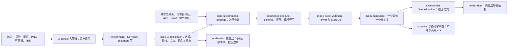

怎么读：左上两条入口（画布输入与控件）在 `command-bindings` 汇合；命令层之后的路径所有能力都相同；覆盖层（手柄、参考线、裁剪遮罩、插入预览）直接由 slide-ui 驱动，不进 Store、不进 Scene，因此拖动中的预览不产生事务。

依据：章程 D4；rulings §4.25 DS-1、DS-5（控件入口）；40/10 §2.2、§2.6；50/10 §7；50/05 §5.2。

**图 18-2 一次操作落在哪一类状态**

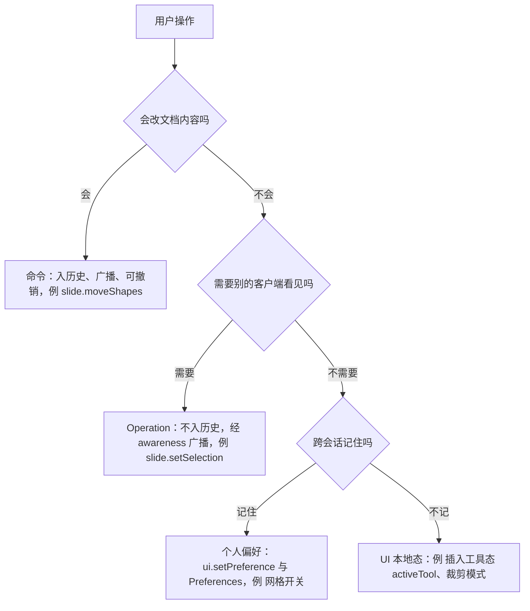

怎么读：从上往下问三个问题即可决定落点；本文能力表「命令 id」列的 `（Op）`、`（本地）` 与偏好键就是按这张图分的。插入工具、裁剪模式、格式刷这类「模式」都是本地态，模式结束时才发出一条命令。

依据：40/10 §2.6 开篇；50/09 §8；50/10 §7.3。

### 1.2 落点速查：包 → 模块文档 → 负责的能力域

| 包 | 目录树与文件职责 | 在编辑器能力里负责什么 | 主要能力域 |
|---|---|---|---|
| `@cordexjs/ui-core` | 40/10 §4.2、§5.2 | 五条输入管线、快捷键服务、`when` / `enablement`、Operation（`view.setMode`、`ui.setPreference`） | KEY、UI、VIEW、CLP |
| `@cordexjs/ui-react` | 40/10 §4.3、§5.3 | 壳组件、检查器字段、颜色选择器、命令面板、快捷键面板、Toast 与 live region | FMT、KEY、UI、A11Y |
| `@cordexjs/slide-ui` | 40/10 §4.4、§5.4 | 画布交互、插入工具态、文本编辑接线、创建工具条与检查器分区规格（取代原 Ribbon 规格，DS-5）、命令参数装配、放映、母版视图 | SEL、ALN、ARR、INS、TXT、PIC、TBL、ML、SLD、SHW |
| `@cordexjs/model-slide` | 40/03 §4、§5 | 命令与 Mutation、样式继承链、不变量与规模守卫、查询 | 全部写能力 |
| `@cordexjs/engine-layout` | 40/06 §4.1、§5.1 | 断行与段落排版、预设几何与公式、连接点、单位换算、2×3 仿射矩阵 | TXT、SEL、INS |
| `@cordexjs/engine-render` / `render-dom` | 40/06 §4.2–§4.3、§5.2–§5.3 | 帧调度、命中测试、覆盖层、文本宿主与 IME、媒体缓存、单页栅格化 | SEL、TXT、PIC、VIEW、EXP |
| `@cordexjs/slide-render` / `slide-render-chart` | 40/07 §4.1–§4.2、§5.1–§5.2 | 三层合成、元素渲染器、缩略图、放映终态、图表渲染与编辑服务 | CHT、TBL、MED、SHW |
| `@cordexjs/ooxml-core` / `ooxml-pptx` | 40/04 §4.1–§4.2、§5.1–§5.2 | 导入导出、新部件与 rels、内嵌工作簿、动画引用清理；XML 词法与保真树自本轮起在独立包 `@cordexjs/xml`（[ADR-0019](../30-architecture/adr/0019-xml-lexer-and-fidelity-tree.md)） | EXP、CHT、INS |
| `@cordexjs/collab-*`、`store-yjs` | 40/05 §4.1–§4.4 | 会话、awareness、两级 ack、离线队列；传输自本轮起用官方 `@hocuspocus/provider`（[ADR-0039](../30-architecture/adr/0039-collab-server-hocuspocus.md)） | COL、OFF、UND |
| `@cordexjs/comments` | [40/20](../40-modules/20-comments-client.md) | 评论线程、锚点与面板数据 | CMT |
| `apps/web` | 40/11 §4.4、§5.4 | 媒体上传、导出对话框与服务端作业、偏好存储、开始页与新建 | PIC、EXP、DOC |

**图 18-3 包之间的调用方向（编辑能力视角）**

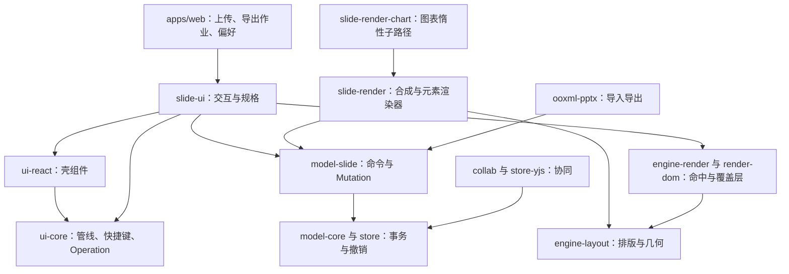

怎么读：箭头是依赖方向；slide-ui 是编辑能力的「总装」，但它只装配参数和驱动覆盖层，内容的写入全部经 model-slide 的命令，内容的绘制全部经 slide-render；图表与 EMF 这类重件以惰性子路径挂在渲染层，未装载时同 key 的占位渲染器兜底。

依据：40/10 §4.4 依赖声明；40/07 §4；30/02 分层表。

### 1.3 覆盖度统计

| 域 | 前缀 | 节 | 能力数 | 原 full / partial / missing | 本轮后 已写清 / 补齐 / 后置 / 非目标 / 待决 |
|---|---|---|---|---|---|
| 选择与变换 | SEL | §2 | 16 | 9 / 4 / 3 | 9 / 6 / 1 / 0 / 0 |
| 对齐与吸附 | ALN | §3 | 4 | 1 / 2 / 1 | 1 / 2 / 1 / 0 / 0 |
| 层级与组合 | ARR | §4 | 5 | 1 / 3 / 1 | 2 / 3 / 0 / 0 / 0 |
| 插入 | INS | §5 | 20 | 2 / 6 / 12 | 2 / 11 / 6 / 1 / 0 |
| 文本 | TXT | §6 | 18 | 4 / 9 / 5 | 4 / 8 / 6 / 0 / 0 |
| 形状与格式 | FMT | §7 | 11 | 2 / 5 / 4 | 2 / 6 / 3 / 0 / 0 |
| 图片 | PIC | §8 | 10 | 3 / 3 / 4 | 7 / 2 / 1 / 0 / 0 |
| 媒体 | MED | §9 | 4 | 2 / 2 / 0 | 4 / 0 / 0 / 0 / 0 |
| 表格 | TBL | §10 | 6 | 0 / 3 / 3 | 0 / 5 / 1 / 0 / 0 |
| 图表 | CHT | §11 | 5 | 2 / 0 / 3 | 2 / 3 / 0 / 0 / 0 |
| 母版、版式与主题 | ML | §12 | 10 | 5 / 4 / 1 | 5 / 4 / 1 / 0 / 0 |
| 幻灯片管理 | SLD | §13 | 8 | 4 / 2 / 2 | 4 / 3 / 1 / 0 / 0 |
| 视图与缩放 | VIEW | §14 | 5 | 3 / 0 / 2 | 3 / 0 / 1 / 0 / 1 |
| 查找与替换 | FND | §15 | 4 | 1 / 2 / 1 | 1 / 2 / 1 / 0 / 0 |
| 剪贴板 | CLP | §16 | 4 | 3 / 0 / 1 | 3 / 0 / 1 / 0 / 0 |
| 撤销与重做 | UND | §17 | 3 | 3 / 0 / 0 | 3 / 0 / 0 / 0 / 0 |
| 评论 | CMT | §18 | 1 | 1 / 0 / 0 | 1 / 0 / 0 / 0 / 0 |
| 放映 | SHW | §19 | 6 | 4 / 1 / 1 | 4 / 1 / 1 / 0 / 0 |
| 导出与打印 | EXP | §20 | 6 | 2 / 2 / 2 | 2 / 2 / 1 / 1 / 0 |
| 协同在场 | COL | §21 | 3 | 2 / 0 / 1 | 2 / 0 / 1 / 0 / 0 |
| 离线 | OFF | §22 | 3 | 2 / 0 / 1 | 2 / 0 / 1 / 0 / 0 |
| 快捷键 | KEY | §23 | 3 | 2 / 1 / 0 | 2 / 1 / 0 / 0 / 0 |
| 检查器与上下文 | UI | §24 | 5 | 1 / 4 / 0 | 1 / 4 / 0 / 0 / 0 |
| 可访问性与国际化 | A11Y、I18N | §25 | 3 | 1 / 0 / 0，另新增 2 | 3 / 0 / 0 / 0 / 0 |
| 文档与文件 | DOC | §26 | 2 | 2 / 0 / 0 | 2 / 0 / 0 / 0 / 0 |
| 插件管理（2026-10-01，§4.23） | PLG | §26a | 7 | 0 / 0 / 0，另新增 7 | 7 / 0 / 0 / 0 / 0 |
| **合计** | 26 域 | | **172** | **62 / 53 / 48，另新增 9** | **78 / 63 / 28 / 2 / 1** |

**图 18-3a 本轮前后的覆盖度迁移**

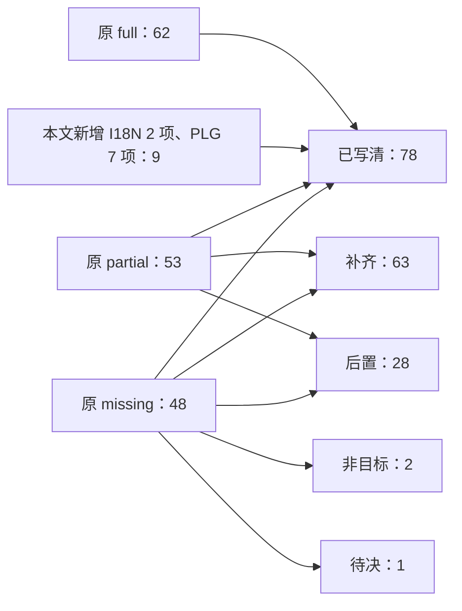

怎么读：原 full 的 62 项与新增的 9 项（I18N 2 项、2026-10-01 插件管理 PLG 7 项）都记已写清；原 partial 的 53 项里 5 项（ARR-05、PIC-03、PIC-10、MED-02、MED-03）在整合阶段已由族文档写清、47 项补齐、1 项（竖排编辑）按 P2 后置；原 missing 的 48 项（含 2026-09-26 复核从 INS-16 拆出的 INS-20）里 2 项（PIC-02、PIC-04）已写清、16 项补齐、27 项后置、2 项写明非目标（INS-16；EXP-05 于 2026-10-22 按 rulings §4.25 DS-104 结案为不排期）、1 项仍待裁决（VIEW-04）。「补齐」的 63 项就是本文补齐方案的全部对象；统计以本文 §2–§26 能力表逐行计数为准（脚本生成）。

依据：本文 §2–§26a 能力表逐行统计。

### 1.4 复用组件与维持自研的理由

用户要求「能复用成熟组件的尽量复用」。下表先列本文各域用到的复用库（版本与许可以 [50/17](17-reuse-and-dependency-catalog.md) 为准），再逐条写维持自研的能力与**为什么没有合适的成熟库**；能力表「复用 / 自研」列的 `自研 Sx` 指向这里。

| 复用库 | 用在哪些能力 | 裁决 |
|---|---|---|
| shadcn/ui（radix-rhea）、radix-ui、cmdk、sonner | 全部面板、对话框、命令面板、Toast | ADR-0017 |
| react-colorful（pnpm patch 改静态 CSS）、colord / culori | FMT-01、FMT-03 | R-d-13、R-d-14 |
| @tanstack/react-virtual | SLD 缩略图栏、SEL-06 选择窗格 | R-d-16 |
| @atlaskit/pragmatic-drag-and-drop | SLD-03 拖拽重排、INS-06 外部文件拖入 | R-d-17 |
| react-hook-form + standardSchemaResolver | 对话框表单（超链接、页眉页脚、插入表格） | R-d-18 |
| htmlparser2（惰性） | CLP-02 HTML 转纯文本 | R-d-20 |
| comlink、p-queue | EXP-02 导出 Worker、PIC-09 上传队列 | R-d-21 |
| createImageBitmap + canvas（浏览器 API） | INS-07、INS-08、PIC-10、MED-03 媒体预处理 | R-d-23，ADR-0021 补用途 |
| emf-converter 4.x | PIC-07 | R-d-24 |
| d3-scale / d3-shape / d3-array | CHT-01、CHT-03–CHT-05 | §4.21 q-chart-route，ADR-0036 |
| @tanstack/react-table 9 + shadcn Table、numfmt | CHT-03 数据网格、数字格式 | R-d-34、R-d-35 |
| lucide-static | INS-12 插入图标 | §4.21 q-extra-inserts |
| simplify-js、fit-curve | INS-05 任意多边形与自由曲线（P2） | 50/22 |
| MathJax 4（惰性） | INS-20 公式（M4+） | §4.21 q-equation |
| @hocuspocus/provider | COL、OFF 传输与合并发送 | §4.21 H:q-hp-provider |
| idb | OFF-03（M4） | R-d-26 |
| harfbuzzjs + bidi-js | TXT-12 RTL（M4 / M5） | R-d-28 |

**维持自研的能力与理由**（证据 R `frontendReuse.matrix` 逐项调研后的结论，R-d-29…R-d-33）

| 号 | 能力 | 落点 | 为什么没有合适的成熟库 |
|---|---|---|---|
| S1 | 选择框、8 缩放手柄、旋转手柄、框选 | render-dom `overlay/selection-overlay.ts`；slide-ui `canvas-interaction.ts` | react-moveable 已停更、运行时注入 style（违反 CSP），且不认 EMU、翻转与组合的 `chOff/chExt`；selecto、interactjs 只处理指针，不处理 OOXML 变换，仍要自写全部几何。仿射矩阵在 engine-layout 自写 2×3 |
| S2 | 智能参考线、等间距与吸附 | slide-ui `guides.ts`；render-dom `guides-overlay.ts` | moveable 的 Snappable 随 moveable 一并否决；tldraw 需许可密钥。算法参考 Excalidraw（MIT）的 snapping，按页面坐标与 4 px 屏幕阈值自写 |
| S3 | 缩放、平移与触控板手势 | engine-render `viewport.ts`、`viewport-state.ts` | react-zoom-pan-pinch、@panzoom/panzoom 以 CSS transform 接管滚动，与原生滚动条和页虚拟化冲突；d3-zoom 不懂虚拟化；@use-gesture 已停更 |
| S4 | 图片裁剪覆盖层 | render-dom 覆盖层（裁剪遮罩）；slide-ui 裁剪模式 | react-easy-crop、cropperjs 2、react-image-crop 都在独立 `` 坐标系内裁剪，不支持旋转、翻转与画布缩放，也不写 `srcRect`；需放宽 CSP。复用选择手柄几何即可 |
| S5 | 连接符路由与连接点 | engine-layout `connector-points.ts`；model-slide 连接符重算纯函数 | OOXML 连接符是「预设几何 + 调整值」，PowerPoint 肘形连接符不避障，不需要图布局；libavoid-js 为 LGPL（禁用），elkjs 为 EPL 且解决的是另一类问题 |
| S6 | 快捷键（和弦规范化、作用域、冲突诊断） | ui-core `chord.ts`、`shortcuts.service.ts` | tinykeys 没有作用域与冲突诊断；hotkeys-js 是全局单例，不支持同页多实例；@tanstack/hotkeys 未到 1.0。按 `KeyboardEvent.code` 匹配与 IME 放行规则必须自控 |
| S7 | 文本编辑宿主、光标与 IME | render-dom `text-host/*`（ADR-0028） | ProseMirror、Tiptap、Lexical、Slate 都基于 contenteditable 并自带排版，会与自有行模型形成两套排版，光标像素对不上；EditContext 作为同接口第三实现进 R-M2-1 spike |
| S8 | 文本度量、断行、段落排版、autofit | engine-layout `domain/text/*`（ADR-0027） | PowerPoint 语义需要确定的行几何（CJK 禁则、autofit ≤ 6 次迭代），CSS 排版拿不到；`Intl.Segmenter` 没有行粒度，UAX#14 表由 tooling 从最新 UCD 生成，linebreak 只作一致性对照 |
| S9 | 187 种预设几何与公式求值 | engine-layout `preset-table.ts`、`formula-eval.ts` | 编译期由 ECMA-376 的定义生成，iso 两端共用；pptx-viewer-core 整包 26 MB 且依赖含 MPL / GPL 选项，只在仓库外作差分对照 |
| S10 | 表格渲染与表格交互 | slide-render `table.renderer.ts`；slide-ui 表格选区 | 通用数据网格（TanStack Table 等）表达不了 `a:tbl` 的合并单元格、表格样式与标志位；表格是画布上的 SVG 元素而不是 DOM 网格 |
| S11 | OOXML 颜色解析与变换 | model-slide `domain/style/resolve-color.ts` | `schemeClr` + `lumMod/lumOff/tint/shade/alpha` 的语义没有库覆盖；UI 侧的颜色字符串解析复用 colord |
| S12 | 图表的 OOXML 布局 | slide-render-chart `renderers/*` | d3-* 只给比例尺、形状路径与数组运算，不含版式；ECharts 布局模型对不上 `manualLayout` 与 Excel 自动刻度，五类约 400–500 KB 逼近预算（ADR-0036） |
| S13 | 命中测试 | engine-render `hit-test.ts`；render-dom `dom-hit-test.ts` | 单页 ≤ 1000 元素，线性扫描 p95 ≤ 2 ms；M2 bench 超标才引 rbush（R-d-30） |
| S14 | 缩略图与单页栅格化 | render-dom `export/to-image.ts`；slide-render 缩略图 Provider | html-to-image、modern-screenshot 依赖 `foreignObject`（ADR-0021 已否） |
| S15 | 渐变编辑器 | slide-ui 检查器填充分区 | react-best-gradient-color-picker 已停更且只产出 CSS 渐变串，写不出 `a:gradFill`；用 radix Slider 多滑块 + react-colorful 组合（R-d-15） |
| S16 | 剪贴板 MIME 协商与内部信封 | ui-core `clipboard-pipeline.ts` | 外部内容不得进 DOM、不得发网络请求（PRD ED-17），通用粘贴库都经 DOM 清洗；HTML 部分只用 htmlparser2 的回调模式取文本 |
| S17 | 内嵌工作簿（xlsx）最小写出器 | ooxml-pptx `export/chart-workbook.ts` | exceljs 停更且依赖 Node；SheetJS 的 npm 版停更并有 CVE；图表只需一张数据表，用 OPC + fflate 自写（R-d-35） |
| S18 | 查找的模型文本索引 | model-slide 查询层（§15） | 检索对象是模型里的段落与 run，命中必须回映射到 `{shapeId, paragraph, offset}` 才能高亮与替换；规模上限 20000 元素，线性子串匹配足够，不需要全文检索库 |
| S19 | i18n 服务与 ICU 消息子集 | `@cordexjs/i18n` | i18next、@lingui/core 自带运行时与插件体系，难以守住单语言包 ≤ 30 KB；@messageformat/core 用 `new Function`，违反严格 CSP；实际只需 `plural`、`select`、数字与日期参数，用自研子集 + `Intl`，@formatjs 的解析器只在 tooling 校验语言包（R-d-25） |

## 2. 选择与变换（SEL）

### 2.1 怎么实现

选择与变换全部落在 slide-ui `application/canvas-interaction.ts`：指针管线给出带 `HitResult` 的 `PointerIntent`，命中区（`region`）决定这一次拖动是移动、缩放、旋转、调整还是端点，拖动期间只画覆盖层预览，松手发一条命令（50/10 §7.2）。本轮补齐的是三类「只有一行」的东西：锁位到底禁用哪些手柄、翻转与调整手柄的命令、以及 Mod+D 与键盘缩放这类键盘路径。手柄几何、吸附与矩阵全部自研（S1、S2），理由见 §1.4。

**图 18-4 手柄命中区 → 命令**

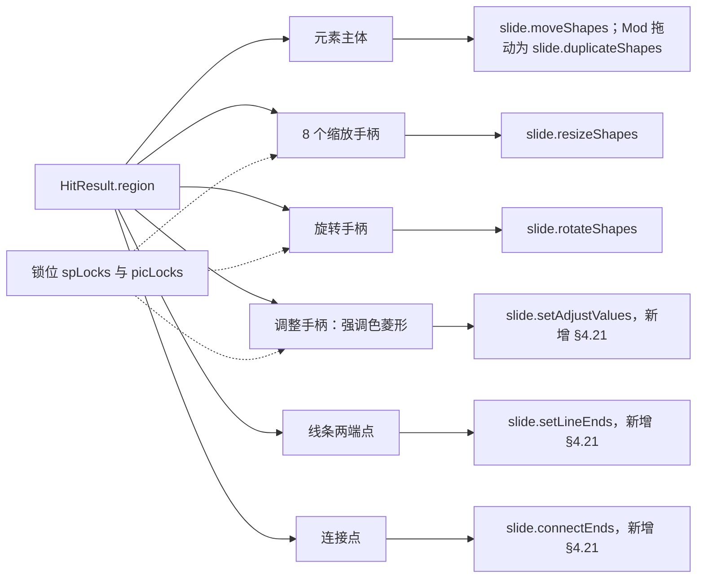

怎么读：每个命中区对应恰好一条命令，一次拖动一个撤销步；虚线表示锁位在交互层直接隐藏或禁用对应手柄（命令层不拒绝，同 PowerPoint）。裁剪手柄只在裁剪模式出现，见 §8。

依据：50/10 §7.1–§7.2；证据 R `elementDesign.crossCutting`「锁定与隐藏」；R-d-78。

### 2.2 能力表

| id | 能力 | 出处 | 实现落点 | 命令 id | 交互要点 | 复用 / 自研 | 里程碑 | 覆盖度 |
|---|---|---|---|---|---|---|---|---|
| SEL-01 | 点选与命中测试（z 序、`fill=none` 穿透） | ED-01；设计 03-17、03-02；规格 50/10 §7.1、50/05 §5.1 | engine-render `domain/contracts/hit-test.ts`；render-dom `hit-test/dom-hit-test.ts`；slide-ui `canvas-interaction.ts` | `slide.setSelection`（Op） | 手柄 > 评论钉 > 远端标签 > 内容；取命中填充、描边或文本的最高 z；p95 ≤ 2 ms | 自研 S13 | M2 P0 | full→已写清 |
| SEL-02 | Shift 加减选、框选（完全包含 / Alt 相交） | ED-01；设计 03-17；规格 50/10 §7.1 | slide-ui `canvas-interaction.ts`、`ui/canvas-overlays/SelectionInteractionLayer.tsx` | `slide.setSelection`（Op） | 多选显示统一包围盒，不提供整体旋转 | 自研 S1 | M2 P0 | full→已写清 |
| SEL-03 | 组合进入 / 退出与 Esc 逐级 | ED-01；rulings §4.18 UX-06；规格 50/10 §7.1 | ui-core `input/keyboard-pipeline.ts`（Esc 链）；slide-ui `canvas-interaction.ts` | `slide.setSelection`（Op） | 首击选整组、双击进组；每次 Esc 只退一级 | 自研 S1 | M2 P0 | full→已写清 |
| SEL-04 | Tab 按 z 序循环、Mod+A 全选 | ED-01；规格 50/10 §7.1、50/04 §2 | slide-ui `canvas-interaction.ts`、`domain/shortcut-table.ts` | `slide.setSelection`（Op） | `Mod+A` 带 `enablement: unitLoaded` | 自研 S6 | M2 P0 | full→已写清 |
| SEL-05 | 锁定元素可选不可动；锁位查看与切换 | ED-01、ED-26；PRD 01 §2.4；设计 03-17 | slide-ui `canvas-interaction.ts`、`application/handles.ts`；render-dom `overlay/selection-overlay.ts`（锁形手柄）；检查器位置分区 | 切换：`slide.setLocks` 新增（§4.21） | 选中锁定移动的对象时四角手柄换成锁形方块、没有边中点手柄，拖动无效并提示「该〈对象〉已锁定移动」，检查器「位置与大小」与对齐行不可用（设计 03-17 §6.2）；锁位 → 禁用项见 §2.3；解锁界面 P2 | 自研 S1 | M2 P1（界面 P2） | partial→补齐 |
| SEL-06 | 隐藏元素与选择窗格 | ED-01、ED-26 P2；设计缺口 G-38 | slide-ui `ui/selection-pane/SelectionPane.tsx` 新增（§4.21） | `slide.setShapesHidden`、`slide.reorderShapes` 新增（§4.21）；改名用 `slide.renameShape`（ARR-04） | z 序列表、显隐、拖动排序、双击改名 | @tanstack/react-virtual、pragmatic-drag-and-drop | M2 P2 | missing→后置 |
| SEL-07 | 拖动移动（预览不写 Store，松手一次命令） | ED-05；设计 03-15、03-17；规格 50/10 §7.2 | slide-ui `canvas-interaction.ts`、`guides.ts` | `slide.moveShapes` | 4 px 阈值；Esc 取消零命令；被远端删除则撤预览 | 自研 S1、S2 | M2 P0 | full→已写清 |
| SEL-08 | 8 手柄缩放（Shift 锁比例、Alt 中心） | ED-05；设计 03-15；规格 50/10 §7.2 | 同上；engine-render `domain/geometry/transform.ts` | `slide.resizeShapes` | 线条只显示两端点手柄（INS-04） | 自研 S1 | M2 P0 | full→已写清 |
| SEL-09 | 旋转手柄（Shift 15° 步进、角度角标） | ED-05；设计 03-15；规格 50/10 §7.2 | 同上 | `slide.rotateShapes` | 表格、图表（`graphicFrame`）不可旋转 | 自研 S1 | M2 P0 | full→已写清 |
| SEL-10 | 调整手柄（`avLst`；原称黄色调整手柄） | ED-05 P1；设计 03-15 §4 | engine-layout `geometry/formula-eval.ts`、`contracts/geometry.ts`（`AdjHandle`）；render-dom 覆盖层；slide-ui `application/handles.ts` | `slide.setAdjustValues` 新增（§4.21） | 手柄为 8 × 8 强调色菱形、1px 白边（设计 03-15 §4）；按 `ahXY` / `ahPolar` 约束拖动；`custGeom` 的 `ahLst` 不可调 | 自研 S1、S9 | M2 P1 | partial→补齐 |
| SEL-11 | 水平 / 垂直翻转 | ED-05；G-16；设计 03-02 §4.2（检查器「位置与大小」节翻转切换条）、03-05 §3（右键「旋转 ▸」） | 检查器「位置与大小」节的「水平翻转 / 垂直翻转」切换条与画布右键「旋转 ▸」（向右 / 向左旋转 90° ┊ 水平翻转 · 垂直翻转）；model-slide `shape-commands.ts` | `slide.flipShapes` 新增（§4.21） | 写 `xfrm@flipH/flipV`；多选各绕自身中心；文字不镜像 | 自研 S1 | M2 P0 | missing→补齐 |
| SEL-12 | 位置 / 大小 / 旋转数值输入与单位换算 | ED-05、ED-29；设计 03-03；规格 50/10 §5 | slide-ui `ui/inspector/PositionSizeSection.tsx`；ui-react `inspector-fields.tsx` | `slide.moveShapes` / `resizeShapes` / `rotateShapes` | 内部 EMU，显示单位按偏好（文档与样张按 pt 书写，rulings §4.25 DS-27），支持带后缀输入 | react-hook-form | M2 P0 | full→已写清 |
| SEL-13 | 方向键微移 1 / 10 px | ED-05、ED-29；规格 50/10 §7.3 | slide-ui `domain/shortcut-table.ts`、`canvas-interaction.ts` | `slide.moveShapes` | 屏幕像素按缩放换算为 EMU；每次按键一步 | 自研 S6 | M2 P0 | full→已写清 |
| SEL-14 | 拖动复制与原位复制：Mod+拖动与 Mod+D | ED-05、ED-08；规格 50/10 §7.2 | slide-ui `canvas-interaction.ts`、`shortcut-table.ts` | `slide.duplicateShapes` | Mod+D 偏移 0.2 in；新副本成为选区，连按逐次等距错位 | 自研 S6 | M2 P0 | partial→补齐 |
| SEL-15 | 等比锁定（`noChangeAspect` 或用户勾选） | ED-05；设计 03-03「锁定比例」 | slide-ui `PositionSizeSection.tsx`、`canvas-interaction.ts` | `slide.setLocks` 新增（§4.21） | 勾选写进文档（协作者可见），不是个人偏好 | 自研 S1 | M2 P0 | missing→补齐 |
| SEL-16 | 拖拽的键盘等价（键盘缩放） | ED-29；设计 07 §1–§2；规格 50/16 §6.3 | slide-ui `shortcut-table.ts`；ui-core `keyboard-pipeline.ts` | `slide.resizeShapes` | `Shift+Alt+方向键` 按 1 px 改宽高，左上角为锚 | 自研 S6 | M2 P0（缩放 P1） | partial→补齐 |

### 2.3 补齐方案

- **SEL-05 锁位 → 禁用项**。锁位来自 `nonVisual.locks`（`a:spLocks`、`a:picLocks`、`a:cxnSpLocks`、`a:graphicFrameLocks`），由交互层执行，命令层不拒绝（与 PowerPoint 一致：锁只约束手势，不约束属性面板以外的程序写入）。手柄仍显示，但画成锁形并带 tooltip「该形状已锁定 X」：

| 锁位 | 交互层禁用 |
|---|---|
| `noMove` | 拖动主体、方向键微移、位置字段只读 |
| `noResize` | 8 个缩放手柄、宽高字段只读、`Shift+Alt+方向键` |
| `noRot` | 旋转手柄隐藏、角度字段只读、翻转菜单项禁用 |
| `noChangeAspect` | 缩放恒等比（SEL-15） |
| `noAdjustHandles` | 不显示调整手柄（强调色菱形） |
| `noGrp` | 选区含该元素时「组合」禁用 |
| `noTextEdit` | 双击与 Enter 不进入文本编辑 |
| `noSelect` | 画布点选与框选跳过，只能从选择窗格（P2）选中 |
| `noChangeShapeType` | 「更改形状」（FMT-10）禁用 |
| `noCrop`（`picLocks`） | 裁剪模式入口禁用 |

  切换锁位（P2）走检查器形状分区里的「锁定」折叠组（第 1 批样张的「位置与大小」节没有锁定组，解锁界面 P2，样张未画，随实现）：`slide.setLocks{shapeIds, locks: Partial<ShapeLocks>}` → Mutation `shape.setNonVisual`（ADR-0018 新增）；锁位是标量叶子，协同 LWW。
- **SEL-06 选择窗格（P2）**。作为检查器的一个页签 `ui.panel{slot:'inspector', id:'selection'}` 由 slide-ui 贡献（原写「第五个页签」；v3 检查器为「设计 / 评论」两页签，第 1 批样张未画选择窗格（P2），落位随实现）：列表按 z 序倒排（最上层在最前），行 = 图标 + 名称 + 眼睛；虚拟列表复用 @tanstack/react-virtual，拖动排序复用 pragmatic-drag-and-drop，松手 `slide.reorderShapes{shapeId, after}`（只改一个 `order` 键，`between` 计算）。显隐 `slide.setShapesHidden{shapeIds, hidden}` → `shape.setNonVisual`；隐藏元素不渲染、不参与命中，但计入规模上限（证据 R `elementDesign.crossCutting`）。
- **SEL-10 调整手柄**。engine-layout 已能按 `avLst` 求值几何并给出 `AdjHandle` 位置；缺的是「指针 → 调整值」的反解。做法：对 `ahXY` 的每个轴在 `[min, max]` 上二分，求使手柄位置最接近指针（形状局部坐标）的调整值，公式非单调时退化为 64 点采样取最近；`ahPolar` 同法分别解角度与半径。拖动中覆盖层用临时 `avLst` 画预览，松手 `slide.setAdjustValues{shapeId, adj: Record<gdName, number>}` → `shape.setProperties{geometry.avLst}`。只在单选时显示；`custGeom` 的 `ahLst` 属不透明保留，不显示手柄。
- **SEL-11 翻转**。`slide.flipShapes{shapeIds, axis:'h'|'v'}` → 每个元素一次 `shape.setTransform`：切换 `flipH`（或 `flipV`），同时把旋转角取反（θ → 360° − θ），使视觉结果等于绕自身中心的镜像；组合只翻转组的 `xfrm`，子元素随矩阵跟随。文字不镜像，`flipV` 时文字按 180° 旋转显示（证据 R `crossCutting`「变换矩阵」）。入口：检查器「位置与大小」节的「水平翻转 / 垂直翻转」切换条（设计 03-02 §4.2）与画布右键「旋转 ▸」的「水平翻转 · 垂直翻转」（设计 03-05 §3；视频与连接符没有翻转）；主菜单「排列」只管层级与组合，不放翻转（原开始 › 排列 ▾ › 旋转作废，设计缺口 G-16，PRD 07 覆盖表）；ED-16 无默认快捷键，不另设。
- **SEL-14 Mod+D**：`Mod+D` 绑定 `slide.duplicateShapes{shapeIds, dx, dy}`，`dx = dy = 0.2 in`（182880 EMU）；执行后新副本成为选区，因此连按时逐次等距错位（PRD ED-08；与 50/10 §10 默认表同一口径）。每次 Mod+D 一个撤销步。PowerPoint 的「记住上一次拖动位移」式智能复制不做。
- **SEL-15 等比锁定**。勾选写 `noChangeAspect`（文档属性，协作者可见，导出原样），不做个人偏好；图片插入时默认写 `picLocks@noChangeAspect=1`（PowerPoint 同样如此），角手柄等比、`Shift` 临时解除。命令同 SEL-05 的 `slide.setLocks`。
- **SEL-16 键盘缩放**。在 slide-ui `shortcut-table.ts` 登记 `Shift+Alt+←/→`（宽 −/+ 1 px）与 `Shift+Alt+↑/↓`（高 +/− 1 px），作用域 `canvas`，发 `slide.resizeShapes`，锚点为左上角；表单等价仍是检查器数值字段。默认表的正式登记由 50/10 §10 与 40/10 §3 执行（§23）。

## 3. 对齐与吸附（ALN）

### 3.1 怎么实现

吸附是派生值，不进 Store：拖动每一帧由 slide-ui `guides.ts` 从「页面边与中线、其它元素的边与中心、等间距、网格线」四类候选里取最近者，交给 render-dom 的 `guides` 覆盖层画线（50/10 §7.2）。对齐与分布是一次命令，按选区外接框（旋转元素用旋转后的外接框）重新计算每个元素的 `offset`。本轮补的是「相对页面」参数和网格的绘制与候选来源。

**图 18-5 一帧的吸附候选与取舍**

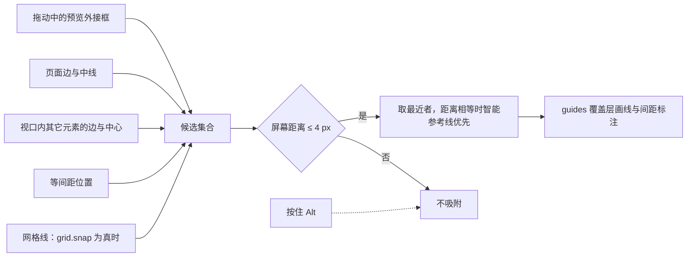

怎么读：左侧四类候选并入同一集合，阈值按屏幕像素计（随缩放不变）；Alt 直接走「不吸附」；结果只驱动覆盖层与预览，松手时才以吸附后的位移发 `slide.moveShapes`。

依据：PRD ED-09；50/10 §7.2–§7.3。

### 3.2 能力表

| id | 能力 | 出处 | 实现落点 | 命令 id | 交互要点 | 复用 / 自研 | 里程碑 | 覆盖度 |
|---|---|---|---|---|---|---|---|---|
| ALN-01 | 智能参考线、等间距、吸附 4 px、Alt 临时关闭 | ED-09 P0；设计 03-17；规格 50/10 §7.2 | slide-ui `guides.ts`；render-dom `overlay/guides-overlay.ts` | 无（派生值） | 计算 p95 ≤ 4 ms（300 元素页） | 自研 S2 | M2 P0 | full→已写清 |
| ALN-02 | 对齐六向与分布（横 / 纵），参照所选或页面 | ED-09 P1；设计 03-17 §5、03-02 §4.2；规格 50/10 §7.3 | 检查器顶部的对齐行（六向对齐 + 横向分布、纵向分布）、多选时对齐行下的「对齐参照」分段、多选右键「对齐与分布 ▸」与命令面板，同一组命令（rulings §4.25 TB-20）；slide-ui `command-bindings.ts`；model-slide `shape-commands.ts` | `slide.alignShapes` / `distributeShapes`，参数 `relativeTo` 新增（§4.21） | 单选固定相对页面、不显示「对齐参照」，两枚分布按钮留在原位不可用（「需选中 3 个以上对象」）；多选缺省「所选对象」；锁定对象整行不可用；只读时对齐行不出现（DS-15） | 自研（纯几何） | M2 P1 | partial→补齐 |
| ALN-03 | 网格显示、吸附到网格、间距 | ED-09；设计 03-17 §7、03-20 §5；规格 50/10 §7.3 | 主菜单「视图 › 网格与参考线 ▸」与画布空白处右键「网格与参考线 ▸」（同一张清单）；render-dom `overlay/grid-overlay.ts` 新增（§4.21）；slide-ui `guides.ts`；apps/web `infrastructure/storage/preferences-store.ts` | `ui.setPreference`（偏好键 `grid.visible`、`grid.snap`、`grid.spacing`） | 间距三档 6 / 12 / 18 pt、缺省 12 pt（rulings §4.25 DS-27，原「默认 0.2 in」作废），产品按设置的度量单位显示；网格画在覆盖层、不进 Scene，画法（线距等于间距、每 4 格加深）以 03-20 §5 为准 | 自研 S2 | M2 P0 | partial→补齐 |
| ALN-04 | 标尺与自定义参考线（`p15:sldGuideLst`） | ED-09 P2；PRD 01 §2.2；设计 03-17 灰显 | ui-react 标尺条；参考线随 30/04 建模 | `slide.setGuides` 新增（§4.21，P2） | 从标尺拖出参考线；参考线参与吸附 | 自研 S2 | M2 P2 | missing→后置 |

### 3.3 补齐方案

- **ALN-02**：`slide.alignShapes{shapeIds, align, relativeTo}` 与 `slide.distributeShapes{shapeIds, axis, relativeTo}`，`relativeTo ∈ {'auto','selection','page'}`，默认 `auto`：单选为页面、多选为所选外接框（PRD ED-09「单选时自动为页面」）。界面入口是检查器顶部的对齐行（单选与多选同一行）、多选时的「对齐参照」分段（所选对象 / 页面）、多选右键「对齐与分布 ▸」与命令面板（设计 03-17 §5，rulings §4.25 TB-20）；分布在所选对象不足 3 个时（含单选）留在原位不可用，原因「需选中 3 个以上对象」；主菜单「排列」不放对齐。旋转元素按 engine-render `bbox.ts` 的旋转外接框计算；组合编辑态下以组框为「页面」。仍是既有 Mutation `shape.setTransform`×N，一个事务。
- **ALN-03**：网格是 render-dom 覆盖层里的一块 SVG `pattern`（新增 `overlay/grid-overlay.ts`，经 `render.overlay` 贡献），线距按当前缩放换算；屏幕间距小于 4 px 时只画每第 5 条，避免糊成灰面。`guides.ts` 在 `grid.snap` 为真时把最近的网格线加入候选。三个偏好键存 `Preferences`（apps/web `cordex.prefs`），经 `ui.setPreference` 同步给 host，不入历史、不同步给协作者（设计 03-20）。`grid.spacing` 取三档 6 / 12 / 18 pt（76200 / 152400 / 228600 EMU），缺省 12 pt（rulings §4.25 DS-27；PRD ED-09 的缺省 0.2 in 改为 12 pt）；入口为主菜单「视图 › 网格与参考线 ▸」与画布空白处右键同名子菜单（显示网格 · 显示参考线 ┊ 吸附到网格 · 智能参考线 ┊ 网格间距 ┊ 标尺、添加参考线 P2）。
- **ALN-04（P2）**：参考线建模前保持不透明保留；建模后为 `Presentation.guides`（水平 / 垂直位置，EMU），`slide.setGuides` 整表写入；标尺条放在画布上沿与左沿，只在编辑模式与桌面断点出现。

## 4. 层级与组合（ARR）

### 4.1 怎么实现

层级命令只改 `order` 这一个键：同一 `(containerId, parentId)` 下按 `(order, id)` 排序，`order` 是分数索引，移动时用 `between(前, 后)` 生成新键，从不改数组下标（ADR-0032，lint `no-index-in-mutation`）。组合与取消组合在 model-slide 里完成坐标折算：组的子坐标系由 `chOff/chExt` 定义，新建组时取恒等映射，取消组合时把「组矩阵 × 子矩阵」分解回页面坐标下的 `offset/extent/rotation/flip`。

**图 18-6 层级命令与 order 键**

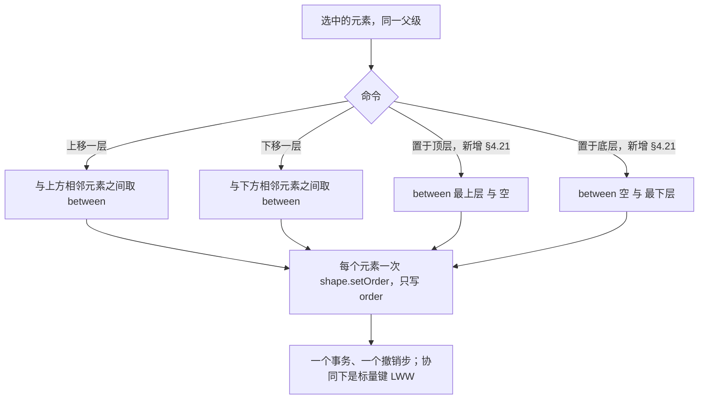

怎么读：四个层级命令只在「取哪两个邻居的中间键」上不同；多选时按原相对顺序依次生成键，因此选中元素之间的上下关系保持不变。

依据：ADR-0032；证据 R `elementDesign.crossCutting`「z 序与分数索引」；40/03 §2.6。

### 4.2 能力表

| id | 能力 | 出处 | 实现落点 | 命令 id | 交互要点 | 复用 / 自研 | 里程碑 | 覆盖度 |
|---|---|---|---|---|---|---|---|---|
| ARR-01 | 上移 / 下移一层、置于顶层 / 置于底层 | ED-08；设计 03-05；规格 40/10 §2.6 | model-slide `shape-commands.ts`；slide-ui 画布右键「排列 ▸」（原称「层级 ▸」）、主菜单「排列 ▸」与 `shortcut-table.ts` | `slide.bringForward` / `sendBackward`；`slide.bringToFront` / `sendToBack` 新增（§4.21） | `Mod+]` / `Mod+[`，`Mod+Shift+]` / `Mod+Shift+[` | 自研（FracKey 见 ADR-0032） | M2 P0 | partial→补齐 |
| ARR-02 | 组合 / 取消组合（`chOff/chExt` 换算） | ED-08；设计 03-05、03-17；规格 40/03 §2.6；元素设计 [50/21](21-elements-structure.md) | model-slide `shape-commands.ts`、`domain/invariants/`；engine-layout `domain/geometry/affine.ts` | `slide.group` / `ungroup` | 占位符入组转普通形状并 toast；取消组合折算子变换 | 自研 S1 | M2 P0 | partial→补齐 |
| ARR-03 | 删除元素（软删除、可撤销 toast、动画引用清理） | ED-08、OF-12；设计 03-05；规格 50/04 §7 | model-slide `shape-commands.ts`；ooxml-pptx `export/timing-refs.ts` | `slide.deleteShapes` | 墓碑 24 h；导出时清理 `p:timing` 悬空 `spid` | — | M2 P0 | full→已写清 |
| ARR-04 | 重命名对象（`cNvPr@name`） | ED-08 P1 | v3 检查器面板标题即选中对象名称（设计 03-02 §3.5），第 1 批样张未画改名入口（原检查器「位置与大小」分区名称行作废），随实现；选择窗格（P2）双击 | `slide.renameShape` 新增（§4.21） | 名称不强制唯一（同 PowerPoint）；清空则回落「类型 + 序号」 | — | M2 P1 | missing→补齐 |
| ARR-05 | 替代文本 / 标记为装饰性 | ED-07、ED-26 P1；设计 03-18；规格 50/05 §11 | slide-ui 检查器「替代文本」分区（`ui/inspector/AltTextSection.tsx`，图片、图表、媒体、图标与形状共用；形状的这一节在「操作」之后，rulings §4.25 TB-32）与右键「编辑替代文本…」；model-slide `domain/model/shape/non-visual.ts` 补 `decorative` | `slide.setAltText` 新增（§4.21） | 描述 ≤ 250 字；装饰性不进可访问树、不报缺失 | — | M2 P1 | partial→已写清（50/23 §2.4，2026-09-26 整合） |

### 4.3 补齐方案

- **ARR-01**：`slide.bringToFront{shapeIds}` / `slide.sendToBack{shapeIds}`，与既有 `bringForward` 同文件、同 Mutation（`shape.setOrder`×N）。键盘按 PRD ED-16 绑定 `Mod+Shift+]` / `Mod+Shift+[`（此前「无目标」，见 §27 第 5 行）。
- **ARR-02**：组合时若选区含占位符，同一事务内先把占位符「物化」为普通形状（`shape.setPlaceholder{null}` + 写入由继承链解析出的显式 `transform` 与样式），再建 `GrpSp`，完成后 toast「占位符已转为普通形状」（PRD ED-08 边界）。取消组合时对每个子元素求世界矩阵并分解：旋转与翻转直接得出；「组有旋转又非等比缩放」会产生斜切，OOXML 无法表达，按 PowerPoint 的近似规则取最接近的无斜切变换（需语料核对，§31）。组内只剩 0 个子元素视为删除组（R-d-78，不变量写进 40/03）。
- **ARR-04**：`slide.renameShape{shapeId, name}` → `shape.setNonVisual{name}`。默认名由导出时 `「类型 + 序号」` 本地化生成（证据 R `crossCutting`「导出与 id」），用户改过的名字原样写回 `cNvPr@name`。
- **ARR-05**：`slide.setAltText{shapeId, description?, title?, decorative?}` → `shape.setNonVisual`。模型补 `NonVisualProps.decorative`（30/04 回写，ADR-0018），导出为 `cNvPr` 扩展里的 `adec:decorative`；标为装饰性时画布可访问树跳过该元素，`missingAlt` 提示也不再计入（50/05 §11）。检查器分区对图片、图表、媒体、图标、形状都出现（UI-01 的 selectionKind 补全；形状检查器的「替代文本」节按 rulings §4.25 TB-32 补在「操作」之后，与图片同一组件，样张未画、随实现）；右键「编辑替代文本…」把检查器切到该对象并聚焦描述框。

## 5. 插入（INS）

### 5.1 怎么实现

插入是「追加元素」的总入口。每种元素追加它有什么作用、模型与渲染怎样设计，在元素目录里逐个写明（[50/19](19-insertable-elements-overview.md) 总览与通用设计，分族见 [50/20](20-elements-text.md)、[50/21](21-elements-structure.md)、[50/22](22-elements-shapes-and-lines.md)、[50/23](23-elements-media.md)、[50/24](24-elements-tables-and-charts.md)、[50/25](25-elements-readonly-and-opaque.md)）；本节只写前端把「插入」这件事做成什么样。

所有插入共用一个流程：① 选工具（`activeTool` 是 UI 本地态，不入历史、不广播）② 画布给出 `PointerIntent`（单击或拖出，4 px 阈值，`Shift` / `Alt` 与吸附同拖拽）；键盘在工具上按 Enter 则取视口中心 ③ 算出 EMU 下的 `box` 与参数 ④ `commands.execute(slide.insertX)`：schema → `doc.write` 权限 → 规模守卫（超限返回 `document.quota_exceeded`，不开事务）→ 一个事务内 `media.add`（按需）+ `shape.insert`（`order` 置顶）⑤ `slide.setSelection` 选中并按类型进入子编辑态 ⑥ 播报与 toast。一次插入恰好一个撤销步。落点是 slide-ui 新增的 `application/insert-tool.ts`（新增 §4.21，由 40/10 登记），它与 `canvas-interaction.ts` 共用指针管线与吸附。

**图 18-7 插入工具态**

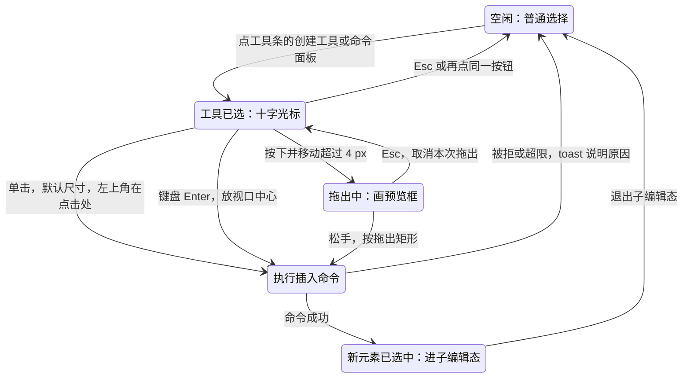

怎么读：只有 `exec` 这一步写 Store；`armed` 与 `dragging` 都是本地态，Esc 在任一步退出都零命令。文本框进 `placed` 后直接进入文本编辑，空框退出编辑即删除并与插入合并为同一撤销步（R-d-65）；图片、表格、图表各自进入对应子态（图片只选中；表格进首格文本编辑；图表展开检查器「数据」分区，不是加宽到 400 的数据面板，rulings §4.25 TB-12）。

依据：证据 R `elementDesign.crossCutting`「插入命令通用流程」「默认落点与尺寸」；R-d-62；50/10 §7。

**图 18-8 底部创建工具条与「更多」（设计 03-02 §3.4、03-04 §2–§4，2026-10-07 第 1 批已拍板；2026-10-04 起取代插入页签七组）**

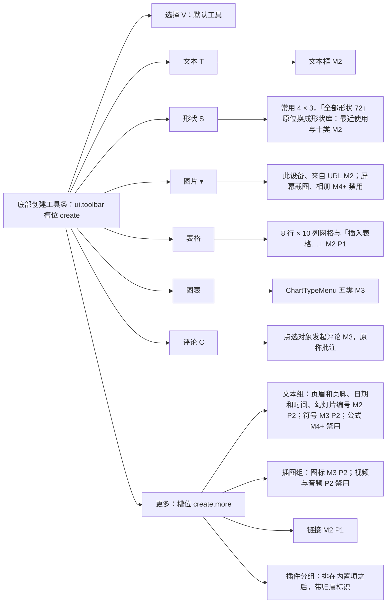

怎么读：主行八个按钮都是内置的，第三方不能进主行；「更多」向上弹出菜单，分文本、插图、链接与插件四组（设计 03-04 §4），插件的创建类入口一律排在内置项之后、以分隔线隔开并带归属标识（设计 06 §2.6，INS-18）。文本组随插入符是否在文本里分流：未在编辑文字时「日期和时间…」「幻灯片编号…」打开页眉和页脚对话框、「符号…」不可用，插入符在文本里时「日期和时间…」打开格式选择器、「幻灯片编号」直接插入页码字段（03-04 §4.2、§7.4）。主菜单「插入 ▸」按工具条顺序列出同一批命令，是第二入口（设计 03-02 §2.3）。样张「更多」原列的「组件」没有对应能力，按 rulings §4.25 DS-19 删除、不实现，以后需要再走新增需求的变更。P2 与 M4+ 条目仍禁用并标注里程碑、不隐藏，只有非目标（R-d-75）不出现；不可用条目右侧写短原因、工具提示写完整原因（03-04 §7.3，公式为「暂不支持插入公式（M4+）。文稿里已有的公式照常查看、放映、移动和缩放。」，rulings §4.22）。「新建幻灯片」不在工具条，入口是左栏「新建幻灯片 ▾」与「+」、网格左上胶囊「新建幻灯片」、缩略图右键与 `Mod+M`。网格视图里工具条照常显示，选创建工具会先打开选中页、回到单页再进入工具态（设计 09 §3.2）；评审模式与只读浏览下底部换成评审条 / 浏览条，没有创建工具（DS-23）。工具提示里的单字母键 V / T / S / C 已按 rulings §4.25 DS-11 登记 PRD ED-16（§23.2），其余工具不设单键。原插入页签七组（文本 / 形状 / 图像 / 表格 / 图表 / 链接与批注 / 插件，R-d-61）随 DS-1 作废，各组控件的去向见设计 09 §3.1「旧入口（ribbon 版）的去向」。

依据：rulings §4.25 DS-1、DS-5、DS-19、DS-21、DS-23；设计 09 §3、§3.1，03-02 §2.3、§3.4，03-04 §2–§4、§7.3；样张 `src/v3/editor/Toolbar.tsx`、`src/v3/editor/insert-menus.tsx`；§4.21 q-extra-inserts、q-media-insert、q-table-depth、q-chart-route。

**图 18-9 图片插入：先执行命令，字节后台上传**

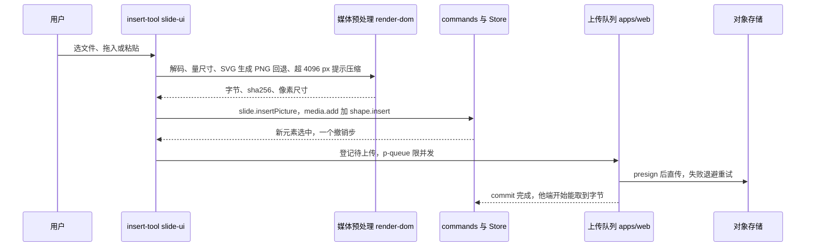

怎么读：用户看到图片不等上传——命令先用本地 blob 执行，`BlobRef` 只含 sha256，字节从不进 CRDT；上传在后台排队，他端在 commit 之前显示加载占位并退避重试。上传失败时元素保留、显示重试（PIC-09）。

依据：证据 R `crossCutting`「媒体通道」；50/05 §8.1–§8.3；R-d-21、R-d-23。

### 5.2 能力表

| id | 能力 | 出处 | 实现落点 | 命令 id | 交互要点 | 复用 / 自研 | 里程碑 | 覆盖度 |
|---|---|---|---|---|---|---|---|---|
| INS-01 | 创建工具条与插入工具态（原「插入页签分组」） | ED-05 / 07 / 10 / 19；设计 03-04、03-15；v3 设计 09 §3、03-02 §3.4 | slide-ui 底部创建工具条（`ui.toolbar` 槽位 `create` / `create.more`，50/09 §6.1、设计 06 §2.6）；`application/insert-tool.ts` 新增（§4.21）；slide-ui `domain/toolbar-spec.ts` 与 `ui/toolbar/CreateTools.tsx`（取代原 `ui/ribbon/InsertTab.tsx`、`domain/ribbon-spec.ts`，40/10 DS-5） | `activeTool`（本地）→ 各 `slide.insert*` | 图 18-8；十字光标与画布顶部提示条「插入 · 〈名称〉 单击插入或拖出」（03-15 §3）；单击或拖出；Esc 取消；插入后选中并进子编辑态，轻提示「已插入 · 〈名称〉」带撤销 | 自研 S1 | M2 P0 | partial→补齐 |
| INS-02 | 文本框（单击自动增长 / 拖出定宽换行） | ED-05；设计 03-15；元素设计 [50/20](20-elements-text.md) | slide-ui `insert-tool.ts`、`text-editing.ts`；model-slide `domain/model/shape/sp.ts` 补 `isTextBox` | `slide.insertShape{kind:'sp', preset:'rect', textBox}`，参数扩展新增（§4.21） | 单击 `wrap=none` 并立即编辑；拖出 `wrap=square`；空框退出即删除 | 自研 S7、S8 | M2 P0 | partial→补齐 |
| INS-03 | 预设形状库（约 72 项、10 类、最近使用） | ED-05；设计 03-15 | slide-ui `ui/insert/ShapeGallery.tsx`、`domain/shape-gallery.ts`；缩略图由构建期从 `preset-table` 生成 | `slide.insertShape{…, preset}`，参数扩展新增（§4.21） | 工具条「形状」弹层：常用 4 × 3 共 12 项，「全部形状 72 ›」原位换成形状库（最近使用 ≤ 10 + 十类，不设搜索，按名称直达走 ⌘K；设计 03-15 §1、§2）；整库一个 Tab 停靠点、方向键漫游（rulings §4.25 TB-5）；单击插入 72 × 72 pt（1 in）；拖出按矩形；默认只写 `p:style` 引用 | 自研 S9 | M2 P0 | partial→补齐 |
| INS-04 | 线条 / 箭头 / 连接符插入 | ED-05、ED-28；设计 03-15、03-17 | slide-ui `insert-tool.ts`、`application/handles.ts`；engine-layout `connector-points.ts`、`connector-routing.ts` | `slide.insertShape{kind:'cxnSp', preset, from, to}`；`slide.setLineEnds`、`slide.connectEnds` 新增（§4.21） | 以拖出为主；Shift 约束 45°；只显示两端点手柄；靠近形状显示连接点 | 自研 S5 | M2 P0 / P1 | partial→补齐 |
| INS-05 | 任意多边形 / 曲线 / 自由曲线绘制 | ED-05 边界 P2 | slide-ui `application/freeform.ts`（惰性） | `slide.insertFreeform{containerId, box, geometry, closed}` 新增（§4.21，P2；拟合在 slide-ui） | 点击出直线段、拖动出自由段、双击或回起点结束；顶点编辑为非目标 | simplify-js、fit-curve | M2 P2 | missing→后置 |
| INS-06 | 插入图片（文件多选、拖入、粘贴、URL） | ED-07；设计 03-18、03-04；规格 50/05 §8.3、50/04 §9 | slide-ui `insert-tool.ts`；ui-core `input/drag-pipeline.ts`；apps/web `infrastructure/media/media-uploader.ts` | `slide.insertPicture{containerId, box, blob}`；有空内容占位符时 `slide.fillPlaceholder` | 工具条「图片 ▾」：此设备…（多选）· 来自 URL…（只接受 https，rulings §4.25 TB-7）┊ 屏幕截图、相册 M4+ 禁用（设计 03-04 §5、03-18 §3）；页上有空内容占位符（`obj` / `pic`）时填入阅读序第一个（已选中的空占位符优先，rulings §4.22 Q1），否则最长边 ≤ 页面 60%、视口居中；多选依次错位；上传中只在原位占位框显示进度，不另发轻提示；URL 可被集成方禁用 | pragmatic-drag-and-drop、p-queue | M2 P0 | partial→补齐 |
| INS-07 | 插入 SVG（同时生成 PNG 回退） | ED-07；PRD 01 §2.5 P1 | 同 INS-06；render-dom `infrastructure/media/image-preprocess.ts`（50/05 §8.3） | `slide.insertPicture{blob, fallbackBlob}`，参数扩展新增（§4.21） | 回退 2 倍显示尺寸、最长边 ≤ 2048 px；导出 `asvg:svgBlip` + PNG | createImageBitmap + canvas | M2 P1 | missing→补齐 |
| INS-08 | 大图压缩提示（> 4096 → 2048） | ED-07 P1；设计 03-18 | render-dom `media/image-preprocess.ts`；slide-ui 插入提示条 | 插入前处理；已有图片 `slide.compressPicture` 新增（§4.21） | 提示「压缩到 2048 px / 保留原图」；不改已存图片 | createImageBitmap + canvas | M2 P1 | missing→补齐 |
| INS-09 | 插入表格（网格选择 / 输入行列） | ED-10；设计 03-04、03-30 §2（G-32）；样张 `#/v3/editor?state=table.*`、`src/v3/kit/TableGridPicker.tsx`；元素设计 [50/24](24-elements-tables-and-charts.md) | slide-ui `ui/insert/TableGridPicker.tsx`、`ui/insert/InsertTableDialog.tsx`（「插入表格…」对话框，40/10 已登记）；model-slide `table-commands.ts` | `slide.insertTable{containerId, box, rows, cols}`；有空内容占位符时 `slide.fillPlaceholder` | 网格悬停范围 8 行 × 10 列，标题行读数「R 行 × C 列」；「插入表格…」对话框宽 360、只写「行数、列数各 1–75」、主按钮「插入」（rulings §4.25 TB-8，最终上限待性能评估是工程备注）；有空内容占位符时填入；插入后进第一个单元格 | 自研 S10 | M2 P1（§4.21 q-table-depth） | partial→补齐 |
| INS-10 | 插入图表（五类） | ED-15a（§4.21 新增）；设计 03-04、03-31（G-63）；样张 `#/v3/editor?state=chart.*`；元素设计 [50/24](24-elements-tables-and-charts.md) | 工具条「图表」的类型菜单（`ChartTypeMenu`，向上弹出，首行「五类 · 插入后展开数据」，rulings §4.25 TB-12）；slide-render-chart `application/chart-editing.service.ts`；ooxml-pptx `export/chart-workbook.ts` | `slide.insertChart` 新增（§4.21） | `enablement: slide.hasChartEditor`（M2 时工具条「图表」禁用、不挂标记）；示例数据 4 类别 × 3 系列；有空内容占位符时填入；插入后展开检查器「数据」分区，轻提示「示例数据已写入，已展开数据」 | d3-*、@tanstack/react-table | M3 P1（§4.21 q-chart-route） | missing→补齐 |
| INS-11 | 插入本地视频 / 音频 | ED-35（§4.21 新增）；PRD 01 §2.5 | 同 INS-06；海报帧在 `media/image-preprocess.ts` | `slide.insertMedia` 新增（§4.21，P2） | 插入时不写 `p:timing`；导出后在 PowerPoint 靠媒体控件点播 | createImageBitmap + canvas | M2 P2（§4.21 q-media-insert） | missing→后置（设计已写清：50/23 §7） |
| INS-12 | 插入图标 | ED-32（§4.21 新增）；设计 03-04 §4、03-15 §7 | 「更多 › 图标…」与主菜单「插入 › 图标…」打开插入图标对话框（宽 640）；slide-ui `ui/icons/IconGallery.tsx`（惰性 chunk） | `slide.insertIcons`、`slide.recolorSvg` 新增（§4.21） | 搜索、分类、多选；插入为 72 × 72 pt，颜色取主题文字色（`tx1`）；改色在检查器「图形填充」节（03-18 §8） | lucide-static | M3 P2（§4.21 q-extra-inserts） | missing→后置（设计已写清：50/23 §4） |
| INS-13 | 插入 / 编辑超链接（URL、跳页、移除） | ED-19 M2 P1；设计 03-16 §5（G-34）；元素设计 [50/20](20-elements-text.md) | 「更多 › 链接…」、主菜单「插入 › 链接…」、文字与形状右键「链接…」（命令名统一为「链接…」，rulings §4.25 TB-6）；slide-ui `ui/dialogs/HyperlinkDialog.tsx`（标题「插入链接」/「编辑链接」）与悬停卡；ui-core `infrastructure/open-external.ts`；ooxml-pptx `export/rels.ts` | `slide.setHyperlink` 新增（§4.21） | `Mod+Shift+K`（2026-10-05 由 `Mod+K` 改，rulings §4.25 DS-11）；对话框不设「移除」，移除在悬停卡；悬停卡「目标 · ⌘ 点击前往 ┊ 编辑链接 · 移除链接」；应用内只激活 http(s) 与页内跳转 | react-hook-form、cmdk | M2 P1（§4.21 以 PRD 为准） | missing→补齐 |
| INS-14 | 页眉页脚 / 页码 / 日期 | ED-31（§4.21 新增）；PRD 01 §2.2；ML-03；设计 03-15（页眉和页脚对话框）、03-16（文本编辑态的日期和时间格式选择器，G-81，2026-09-30 回写）、03-26；元素设计 [50/21](21-elements-structure.md) | 「更多 › 页眉和页脚…」与主菜单「插入」；未在编辑文字时「日期和时间…」「幻灯片编号…」也打开它（设计 03-04 §4.2）；slide-ui `ui/insert/HeaderFooterDialog.tsx` 新增（§4.21） | `slide.setHeaderFooter` 新增（§4.21） | 对话框宽 640、当前页真实预览；底栏「应用：所选 N 页 · 全部应用：M 页」+ 取消 · 应用 · 全部应用；版式缺对应占位符时该项不可用、写「当前版式没有此占位符」；标题页不显示；页脚族占位符用确定性 id | react-hook-form、`Intl.DateTimeFormat` | M2 P2 | missing→后置 |
| INS-15 | 插入符号 / 特殊字符 | ED-33（§4.21 新增）；设计 03-15 §8；元素设计 [50/20](20-elements-text.md) | 「更多 › 符号…」与主菜单「插入 › 符号…」；slide-ui `ui/symbols/SymbolPicker.tsx`、`domain/symbol-table.ts` | `slide.insertText`（不新增命令） | 仅文本编辑态可用（否则写「先在文本框中放置光标」）；非模态弹层宽 468、锚在「更多」上方；搜索名称或码位、按 Unicode 区块分栏、最近使用 ≤ 12；插入后焦点回文本、面板保持打开 | 自建 Unicode 表 | M3 P2（§4.21 q-extra-inserts） | missing→后置 |
| INS-16 | SmartArt / OLE / 3D / 墨迹 / 缩放定位 / 录屏的插入（公式与艺术字变形已拆到 INS-20，2026-09-26 复核） | PRD [02-editing](../10-prd/03-features/02-editing.md) §5 非目标（仅保真查看） | 见 [50/25](25-elements-readonly-and-opaque.md) | — | 只读显示、可整体移动缩放删除；不提供插入 | — | 非目标 | missing→非目标 |
| INS-17 | 空内容占位符的快速插入图标 | ED-07 P1；R-d-69；设计 03-16 §6（空内容占位符图标条，G-80）、03-02 §4.5；元素设计 [50/21](21-elements-structure.md) | slide-ui `ui/canvas-overlays/PlaceholderContentBar.tsx` 新增（§4.21） | `slide.fillPlaceholder` 新增（§4.21） | 图标条：表格、图片、图表（M3）、视频（P2）；可 Tab 聚焦，键盘与读屏可操作（设计 07 §1.2）；检查器不设「插入到占位符」按钮组，往占位符插入只走图标条与底部工具条（rulings §4.25 DS-14）；表格图标弹出与工具条「表格」同一网格弹层（rulings §4.22 Q2），图表图标弹出同一图表菜单（首行「五类 · 填入占位符后展开数据」）；图标 64 / 72 px、无底板，放不下时折叠为「插入 ▾」（设计 03-16 §6.1） | — | 图片 M2 P1，其余随元素 | missing→补齐 |
| INS-18 | 插件贡献的插入项与新元素类型 | PS-02、PS-04；PRD 05 `pluggable:m2`；设计 06 | 第三方 `slide.shapeKind` + `render.element` + 可选 `ui.*`；model-slide `domain/shape-kind/` | 插件命令 `<vendor>:<域>.<action>`；`shape.patchKindData` 新增（§4.21，Mutation） | 创建项进工具条「更多」、排在内置项之后、带归属标识，主行不开放（设计 06 §2.6）；格式类分区走 `ui.inspectorSection`；插件条目很多时的收纳按 rulings §4.25 DS-49：「更多」与主菜单「插入」在插件不超过 3 个且每个不超过 3 条时平铺，否则为「插件 · N」小标题、每个插件一行、条目进子菜单；检查器插件分区超过 2 个时全部默认折叠、展开状态记在本机（取代 TB-31 的暂行规则） | uqr（二维码示例） | M2 P0 | full→已写清 |
| INS-19 | 插入新幻灯片 | ED-11；设计 03-14 | slide-ui 左栏「新建幻灯片 ▾」与「+」（v3 样张）、`ui/thumbnails/ThumbnailRail.tsx` | `slide.addSlide` | 同版式、版式库、Enter、`Mod+M` | — | M2 P0 | full→已写清 |
| INS-20 | 公式 / 艺术字变形（2026-09-26 复核拆自 INS-16，新增 id） | PRD [02-editing](../10-prd/03-features/02-editing.md) §5（M1–M3 非目标，M4+ 立项）；§4.21 q-equation | 公式见 [50/25](25-elements-readonly-and-opaque.md) §4；艺术字见 [50/20](20-elements-text.md) §5 | 公式 `slide.insertEquation`、艺术字 `slide.applyWordArtStyle`（均 M4+，新增 §4.21） | 渐变字与描边字不在本行：M2 P2 作为字符格式提供（TXT-13，50/20 §5） | MathJax 4（公式，惰性） | M4+ | missing→后置 |

### 5.3 补齐方案

- **INS-01 入口与工具态**：入口是底部创建工具条（图 18-8，rulings §4.25 DS-1）；原「分组统一为设计 04 与 playground 的七组」（§27 第 6 行）随 ribbon 作废；「更多」与主菜单「插入」的条目以设计 03-04 §4、03-02 §2.3 为准。网格视图里选创建工具时先打开选中页、回到单页再进工具态（设计 09 §3.2）。工具态状态机即图 18-7，放 slide-ui `application/insert-tool.ts`，由 `activeTool: {kind, preset?} | null` 驱动，`CanvasHost` 在 `activeTool` 非空时把光标换成十字、把命中交给插入工具而不是选择。插入后选中与子编辑态由插入命令的结果（新元素 id）决定。默认落点：单击时左上角在点击处；菜单、键盘与命令面板插入放视口中心，重复插入依次错位 0.2 in。例外（rulings §4.22 Q1）：表格、图表与图片插入时，页上有空内容占位符（`obj` 或同类 `tbl` / `chart` / `pic`）就填入阅读序第一个（已选中的空占位符优先），保留 `p:ph`，走 `slide.fillPlaceholder`；不想放进占位符时拖出即可。
- **INS-02 文本框**：`slide.insertShape` 参数扩展 `textBox?: {wrap: 'none' | 'square'}`，命令写 `Sp.isTextBox = true`（导出 `p:cNvSpPr@txBox="1"`；40/03 的 `sp.ts` 补字段）。默认 `bodyPr` 取 `Theme.objectDefaults.txDef`，没有时 `noFill`、`wrap` 按手势、`spAutoFit`；文字样式走继承链的 `other` / `defaultTextStyle` 段，只把当前 UI / IME 语言显式写进 `endParaRPr@lang`。`wrap=none` 时拖左右缩放手柄自动改为 `wrap=square`。空框退出即删除：`slide.deleteShapes` 与插入合并为同一撤销步，结果是「什么也没发生」。
- **INS-03 形状库**：首批约 72 项、10 类（最近使用 / 线条 / 矩形 / 基本形状 / 箭头 / 公式形状 / 流程图 / 星与旗帜 / 标注 / 动作按钮），清单放 slide-ui `domain/shape-gallery.ts`（`prst` 名 + 分类 + i18n 键），形状弹层的缩略图由 tooling 从同一张 `preset-table` 生成（`shape-gallery-thumbs.ts` 生成物，R-d-66）。工具条「形状」弹层先显示常用 4 × 3 共 12 项（矩形、圆角矩形、圆、三角形、菱形、星形、十字、六边形、左右箭头、对话气泡、直线、箭头线），底行「全部形状 72 ›」在同一弹层原位换成完整形状库：「最近使用」置顶（≤ 10 项、没有时整段不出现），其下十类每类一行、超过 12 格换行，线条行末的曲线、任意多边形、自由曲线 P2 禁用；不设搜索，按名称直达走命令面板（设计 03-15 §1、§2；PRD 07 G-78 的「可选搜索框」由样张定为不设）。整库只占一个 Tab 停靠点、方向键漫游，Enter 不经工具态按默认尺寸插到视口中心（rulings §4.25 TB-5，03-15 §2.4）。清单的唯一来源是 slide-ui `domain/shape-gallery.ts`，样张对照 `src/v3/editor/shapes/catalog.tsx`。`slide.insertShape` 参数扩展 `preset` 与可选 `avLst`；默认样式写 `p:style` 引用（`fillRef idx=1 accent1`、`lnRef idx=2`、`effectRef idx=0`、`fontRef minor lt1`），不烤成显式值（R-d-63）。「最近使用」存偏好键 `shapes.recent`（最多 10 项，本机）。
- **INS-04 线条与连接符**：线条与箭头一律落 `p:cxnSp`（R-d-64；导入的 `sp` + 线几何不改写）。`slide.insertShape{kind:'cxnSp', preset, from, to}` 由命令把两端点换算为 `xfrm` + `flipH/V`；插入后只显示两端点手柄（无旋转手柄），拖端点发 `slide.setLineEnds{shapeId, start?, end?}`，Shift 吸附 0 / 45 / 90°；端点落在形状连接点上发 `slide.connectEnds{shapeId, start?, end?}`（Mutation `cxnSp.setConnections`）。移动被连接的形状时，由 slide-ui `canvas-interaction` 调 layout 服务（engine-layout `connector-routing.ts`）先算出受影响连接符的 `ConnectorPatch`，经 `slide.moveShapes` / `resizeShapes` / `rotateShapes` / `flipShapes` / `connectEnds` 的 `reroute?` 参数同事务写回，命令只写值、运行时不调用 engine-layout（M2 直线；M3 肘形与曲线同时写 `adj`，R-d-78；[50/22](22-elements-shapes-and-lines.md) §4.3 图 22-8、30/05 §14.5）。
- **INS-05（P2）**：拟合在 slide-ui，命令收 `Geometry.custom`。slide-ui `application/freeform.ts` 的绘制状态机收集指针点列，松手或双击后在 slide-ui 内用 simplify-js 简化、fit-curve 拟合为贝塞尔（容差按屏幕像素、随缩放换算为 EMU），再发 `slide.insertFreeform{containerId, box, geometry: Geometry.custom, closed}`，命令只写拟合好的几何（`custGeom`），保证命令参数即结果、可确定性回放，model-slide 不引第三方库（[50/22](22-elements-shapes-and-lines.md) §5、50/19 §5.2、40/03）；开放路径默认 `lnDef`、闭合默认 `spDef`。
- **INS-06 图片**：入口是工具条「图片 ▾」（此设备… · 来自 URL… ┊ 屏幕截图、相册 M4+ 禁用 ┊ 说明行「也可以把图片拖到画布上，或直接粘贴。」）与主菜单「插入 › 图片 ▸」（设计 03-04 §5、03-18 §3）。来源四种——文件选择（多选）、拖入画布（ui-core `drag-pipeline.ts` 的 mime 白名单）、粘贴（CLP-02）、URL。「从 URL 插入图片」对话框宽 480，**只接受 https 地址**（rulings §4.25 TB-7）；下载期间只出中性轻提示「正在下载图片，完成后内嵌到文稿」，上传中只在原位占位框显示进度（可「取消上传」，轻提示「已取消上传，未插入图片」），不另发轻提示（03-18 §3、§4）。**URL 插入默认不经服务端代抓、下载后内嵌**（取数路径与拒绝条件以 [14](14-client-security.md) §5 与图 6 为准）：浏览器以 `` 按图像上下文加载（受 `img-src` 约束；不跨源 `fetch`，`connect-src` 不放宽），加载成功后经 `createImageBitmap` + canvas 转码为 `Blob`（render-dom `media/image-preprocess.ts`）；对方不给 CORS 许可时提示「该网站不允许直接下载图片，请先保存到本地再插入」，不回退为外链；超 25 MB 或类型不符按本地文件的同一判定拒绝；部署 `externalResources` 为 `never` 时入口置灰并说明原因，集成方也可关闭 URL 入口。取到字节后与本地文件走同一条链（图 18-9）。尺寸：按像素与 DPI（缺省 96）换算，最长边超过页面 60% 时等比缩到 60%；页上有空内容占位符时改为填入（INS-01 例外，rulings §4.22 Q1）。多选依次错位 0.2 in，每图一页（相册）为 M4+ P2。
- **INS-07 SVG 回退**：插入 SVG 时 render-dom `media/image-preprocess.ts` 以 `` 解码 + canvas 绘制 + `toBlob` 生成 PNG 回退（2 倍显示尺寸、最长边 ≤ 2048 px），`slide.insertPicture{blob, fallbackBlob}` 在一个事务里 `media.add` 两次，`Pic` 同时引用两者（导出 `a:blip r:embed` 指 PNG、`asvg:svgBlip` 指 SVG）。文档内 SVG 只在图像上下文渲染（rulings §4.15 Q4）。含 `foreignObject` 的 SVG 会污染 canvas 导致回退失败：拒绝插入并提示（倾向，最终以 [50/23](23-elements-media.md) 为准）。canvas 的这一用途由 ADR-0021 补登（R-d-23）。
- **INS-08 压缩**：插入时像素边长 > 4096 弹出提示条「图片较大，压缩到 2048 px？[压缩] [保留原图]」，选压缩则在命令之前由 `createImageBitmap(resizeQuality:'high')` + `canvas.toBlob` 生成新字节。对已有图片提供 `slide.compressPicture{shapeIds, maxEdge}`（新字节 → 新 `MediaId`，`pic.setBlipFill` 改引用）；这是 PRD ED-07「除用户显式压缩外不改源位图」的唯一例外。
- **INS-09 表格**：按 §4.21 q-table-depth，**M2 可插入并编辑单元格文字**，行列插删、合并拆分与样式在 M3（§10）。网格弹层由工具条「表格」打开，在按钮正上方、距工具条外沿 8，悬停范围 8 行 × 10 列、标题行右侧读数「R 行 × C 列」（`role="grid"`、整组一个 Tab 停靠点，方向键移动、Enter 确认）；「插入表格…」先关网格再开对话框 `InsertTableDialog`（宽 360，焦点进「行数」，说明行只写「行数、列数各 1–75」，主按钮「插入」；rulings §4.25 TB-8，原读数「R 行 × C 列 表格」、主按钮「确定」与界面提示「上限待性能评估」作废），行数不再限 8，最终上限待性能评估、评估前按 75 × 75 校验（rulings §4.22 Q3，见 [50/24](24-elements-tables-and-charts.md) §2.14 第 1 条）；空内容占位符的表格图标弹出同一网格弹层（Q2）。页上有空内容占位符时填入阅读序第一个（已选中的空占位符优先，Q1），否则默认宽取正文占位符宽（否则页宽 80%）、行高 0.41 in（`a:tr@h=370840`，与 PRD ED-10、50/24 §2.3、50/19 §3.2 一致），样式 GUID `{5C22544A-7EE6-4342-B048-85BDC9FD1C3A}`（中度样式 2 - 强调 1）+ 标题行与镶边行。插入后选中第一个单元格进入文本编辑。
- **INS-10 图表**：按 §4.21 q-chart-route 与 ADR-0036，图表插入定在 **M3**，删去设计 04「M1 / M2 可插入静态图表」（§27 第 3 行）。`slide.insertChart{containerId, box, chartType, variant?, data?}`：一个事务内新建 `graphicFrame` + `Chart.data`（示例数据 4 类别 × 3 系列）；导出时由 ooxml-pptx 生成 chart 部件、rels 与最小内嵌工作簿（S17）。图表类型菜单只列五类（柱形 / 条形、折线、饼、面积、散点）及其簇状 / 堆积 / 百分比子类型；工具条「图表」、占位符图表图标与检查器「类型」字段共用同一个菜单组件（设计 03-31；原迷你工具条「更改类型 ▾」随 rulings §4.25 DS-22 取消），首行依次为「五类 · 插入后展开数据」「五类 · 填入占位符后展开数据」「更改类型 · 数据与标题保留」（TB-12）。页上有空内容占位符时填入阅读序第一个（已选中的空占位符优先，rulings §4.22 Q1）；插入后展开检查器「数据」分区、焦点在首个数值格（[50/24](24-elements-tables-and-charts.md) §3.3）。
- **INS-13 超链接**：以 PRD ED-19 为准定 **M2 P1**，删去 40/10、50/10 的「链接 P2 禁用」（§27 第 2 行）。入口统一叫「链接…」（「更多」、主菜单「插入」、文字与形状右键，rulings §4.25 TB-6）；对话框（宽 480，标题「插入链接」，从悬停卡进入时为「编辑链接」、主按钮「保存」）为分段「网页地址 / 本文稿中的页」+ 显示文字，不设「移除」——移除在悬停卡「移除链接」（轻提示带撤销，设计 03-16 §5）；不在白名单的协议就地报「只支持 http、https、mailto 和 tel 链接」；`slide.setHyperlink{target: {shapeIds} | {shapeId, range}, link: Hyperlink | null}`：文本走 `run.setProperties`，形状走 `shape.setNonVisual`；只写 `http / https / mailto / tel` 与 `ppaction://hlinksldjump`，拒 `javascript:` 与 `data:`；导出重生成外部关系（ADR-0008 决策 5）。编辑态悬停出小卡，`Mod+点击` 只经 ui-core `openExternal` 打开 http(s)，mailto / tel 只显示并可复制。
- **INS-17 占位符图标条**：空内容占位符中间画图标条（覆盖层，不进 Scene），点图标打开对应选择器（表格图标弹出与工具条「表格」同一个网格弹层，含「插入表格…」，rulings §4.22 Q2；图表图标弹出同一图表菜单），图标 64 / 72 px、无底板，占位符在屏幕上不足 296 × 80 px（单图标 88 × 88）时折叠为「插入 ▾」（高 36、圆角 8、命中区 44），折叠菜单里未开放项的原因写在菜单底部说明行（设计 03-16 §6.1、§6.3）；结果以 `slide.fillPlaceholder{shapeId, content}` 一个事务写入：删除空 `Sp` + `media.add`（按需）+ 同 `ref`、同 `order` 插入新元素；删除这类元素时同事务补回空 `Sp`。M2 只开图片，表格随 M2 表格插入开放，图表 M3，视频 P2（R-d-69）。
- **后置项的落点**：INS-11 音视频插入维持 P2，插入时不写 `p:timing`（不扩 ADR-0008 决策 9 的写入白名单），海报帧由 `media/image-preprocess.ts` 在 `<video>` 定位后绘制；INS-12 插入图标对话框（宽 640，八类共 93 个，设计 03-15 §7）为惰性 chunk，图标 SVG 来自 lucide-static，改色即生成新 SVG 字节与新回退；INS-14 对话框与 `slide.setHeaderFooter` 一个事务逐页增删页脚族占位符，应用后轻提示「已把页眉和页脚应用到所选 N 页 / 全部 M 页」带撤销（03-15 §6）；INS-15 符号面板按 Unicode 区块分栏（拉丁-1 补充、希腊字母、常用标点、上标和下标、货币符号、箭头、数学运算符、带圈字母数字、CJK 符号和标点等，03-15 §8），插入复用 `slide.insertText`；INS-16 的六类对象（SmartArt、OLE、3D、墨迹、缩放定位、录屏）只读显示、可整体移动缩放删除，插入不提供；INS-20 公式与艺术字变形 M4+ 另立项（公式基于 `@cordexjs/xml` 自研 OMML↔MathML，MathJax 4 惰性渲染），渐变字与描边字 M2 P2 走 TXT-13。

## 6. 文本（TXT）

### 6.1 怎么实现

文本编辑的骨架已定：隐藏 textarea 宿主接收输入（ADR-0028，S7），engine-layout 自有行模型断行（ADR-0027，S8），IME 组合期只画瞬态覆盖文本，`compositionend` 才派发 `slide.insertText`（50/06 §4–§5）。本轮补的是「格式」这一半：字符、段落、文本框三层各缺若干薄命令。原则一律是**只写显式覆盖、不烤继承值**：命令写 `run.setProperties` / `paragraph.setProperties` / `textBody.setBodyProperties` 三个既有 Mutation，不新增 Mutation；「清除格式」是把覆盖字段置空、回到继承链解析值。

**图 18-10 字符格式命令的作用范围**

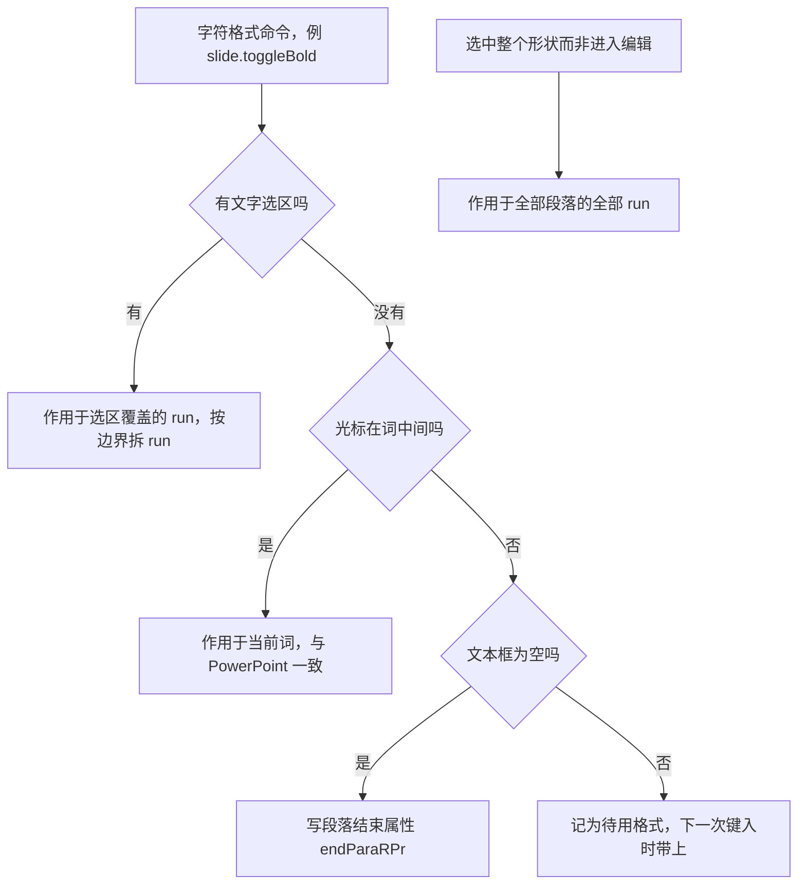

怎么读：进入文本编辑与否决定走上面还是下面的入口；「待用格式」只存在本机 UI 态，直到键入才随 `slide.insertText` 的同一事务写入，因此不会产生空 run。

依据：PRD ED-03「无选区作用于当前词」「空文本框写 endParaRPr」；50/06 §4。

### 6.2 能力表

| id | 能力 | 出处 | 实现落点 | 命令 id | 交互要点 | 复用 / 自研 | 里程碑 | 覆盖度 |
|---|---|---|---|---|---|---|---|---|
| TXT-01 | 进入 / 退出文本编辑、空占位符提示 | ED-02；设计 03-16；规格 50/06 §2 | slide-ui `application/text-editing.ts`；render-dom `text-host/text-input-host.ts` | `slide.insertText` / `deleteText` | 双击或 Enter 进入；Esc 退回形状选中 | 自研 S7 | M2 P0 | full→已写清 |
| TXT-02 | IME 组合输入 | ED-02；设计 03-16；规格 50/06 §5、§11 | render-dom `text-host/ime-composition.ts`；ui-core `input/ime-pipeline.ts` | 同上，`compositionend` 才派发 | 组合期不产生事务；EditContext 并入 R-M2-1 spike | 自研 S7 | M2 P0 | full→已写清 |
| TXT-03 | 光标、选区、按词跳转、双击 / 三击 | ED-02；规格 50/06 §6 | engine-layout `domain/text/caret-map.ts`；render-dom `text-host/caret-renderer.ts` | 选区为本地态，M3 起经 awareness 广播 | `Mod+←/→` 按词；双击选词、三击选段 | 自研 S7、S8 | M2 P0 | full→已写清 |
| TXT-04 | 字体族（主题字体、东亚字体）、字号阶梯、B / I / U / S | ED-03；设计 03-16、03-02 §4.3（v3）；规格 40/10 §2.6 | 检查器「文本」的「字体」节：「西文」「中文」两个字体字段（主题字体在值后标「标题 / 正文」）· 字号 + 增大 / 减小 · B / I / U / S · 上标 / 下标与大小写，节标题右侧「清除格式」（设计 03-16 §4.1）；选中文本框与编辑文字时都出现（03-02 §4.3）；slide-ui `ui/inspector/TextSection.tsx`、`command-bindings.ts`（原 `ui/ribbon/HomeTab.tsx` 字体组随 DS-1 废弃） | `slide.setFontFamily`，参数 `script` 新增（§4.21）；`setFontSize`；`toggleBold` 等 | 列表顶部「+标题 / +正文」主题字体；`Mod+Shift+>` / `<` 按阶梯 | cmdk（可搜索字体下拉） | M2 P0 | partial→补齐 |
| TXT-05 | 上下标、大小写、颜色、高亮、清除格式 | ED-03；设计 03-16 | 同上：上标 / 下标、大小写与「清除格式」在「字体」节，文字颜色与高亮在「颜色」节（设计 03-16 §4.1）；删除线 `Mod+Shift+X`、上标 `Mod+Shift+=`、下标 `Mod+=` 只在文本编辑时生效（rulings §4.25 DS-29，§23.2） | `slide.setBaseline`、`slide.setCaps` 新增（§4.21）；`setTextColor` / `setTextHighlight` / `clearRunFormatting` | 上标 +30%、下标 −25%；大写写 `cap` 属性，不改字符 | — | M2 P0 | partial→补齐 |
| TXT-06 | 段落：对齐五态、缩进、段前后距、行距 | ED-03；设计 03-16 | 检查器「段落」节：对齐五态（左 / 居中 / 右 / 两端 / 分散）· 行距下拉 + 减少 / 增加缩进 · 段前 / 段后（设计 03-16 §4.1），文件 `TextSection.tsx` | `slide.setAlignment`（增 `dist`）；`slide.setParagraphSpacing`、`slide.setIndent` 新增（§4.21）；`setLineSpacing` | 行距 1.0 / 1.15 / 1.5 / 2.0 / 自定义倍数与固定值 | — | M2 P0 | partial→补齐 |
| TXT-07 | 项目符号与编号（预设、`startAt`、Tab 升降级） | ED-04；设计 03-16、03-02 §4.3（v3）；playground `HomeTab`（ribbon 版，已被 DS-1 取代） | 检查器「列表」节的项目符号、编号两个下拉，列表段落时节标题右侧写「第 N 级」（设计 03-16 §4.1、§4.6）；model-slide `domain/model/text/bullet.ts` | `slide.setBullet`，参数 `preset / startAt / color / size` 新增（§4.21）；`setIndentLevel` | 7 种符号 + ≥ 8 种编号（含 `ea1ChsPeriod`）；段首 Tab 升降级 | — | M2 P0（颜色大小 P1，图片符号 P2） | partial→补齐 |
| TXT-08 | 文本框属性：垂直锚点、内边距、自动换行 | ED-03；设计 03-16、03-03；元素设计 [50/20](20-elements-text.md) | 检查器「文本框」节：垂直对齐 · 自动换行 · 自动调整 · 文字方向（P2 禁用）（设计 03-16 §4.1）；slide-ui `TextSection.tsx` | `slide.setBodyProperties` 新增（§4.21） | 锚点顶 / 中 / 底；换行开关；内边距四值样张未画，随实现（建议放本节） | — | M2 P0 | partial→补齐 |
| TXT-09 | 自动调整三模式与 autofit 回写 | ED-24 P1；设计缺口 G-37；规格 50/06 §7；元素设计 [50/20](20-elements-text.md) | 同上；engine-layout `domain/text/body-layout.ts` | `slide.setAutofitMode` 新增（§4.21）；回写 `slide.applyAutofit` | 不调整 / 溢出时缩小 / 根据文字调整形状 | 自研 S8 | M2 P1 | partial→补齐 |
| TXT-10 | 文本迷你工具条（rulings §4.25 DS-13 取消） | ED-12 P1；设计 03-16、03-02 §3.2（v3）；规格 50/10 §7.3 | 不实现：文字格式只在检查器文本分区（TXT-04–TXT-07，`TextSection.tsx`），表格单元格与图表里的文字同样；`MiniToolbar.tsx` 不再有文本编辑态条目，`toolbar.text-editing` 槽位作废（50/10 §7.3） | 同格式命令（经检查器与快捷键） | 粗体、斜体、下划线、字号与对齐保留快捷键（§23，50/10 §10.4 第 7–9 行）；满足设计质量门 Q2「入口唯一」 | — | M2 P1 | full→已写清 |
| TXT-11 | 竖排文本编辑 | ED-02 P2；规格 50/06 §12 | render-dom `primitives/text-lines.ts`（竖排以文本框旋转实现） | `slide.setBodyProperties{vert}` | 编辑态近似：光标按旋转后的横排行计算 | 自研 S8 | M2 P2 | partial→后置 |
| TXT-12 | RTL 文本编辑 | ED-02 边界；ADR-0027 | engine-layout shaping 与 bidi（M4 / M5） | 同文本命令 | 逻辑顺序存储、视觉顺序显示 | harfbuzzjs + bidi-js | M4+ | missing→后置 |
| TXT-13 | 字距、字符缩放、渐变 / 描边文字 | ED-03 P2；元素设计 [50/20](20-elements-text.md) | `TextSection.tsx`「字符间距」 | `slide.setCharSpacing` 新增（§4.21，P2） | — | — | M2 P2 | missing→后置 |
| TXT-14 | 字段插入与编辑（页码 / 日期） | ED-31；PRD 01 §2.7 P2；设计 03-16（日期和时间格式选择器、已插入日期字段，G-81，2026-09-30 回写）；元素设计 [50/20](20-elements-text.md) | 「更多」文本组与主菜单「插入」：插入符在文本里时「日期和时间…」打开格式选择器（宽 332、锚在「更多」上方）、「幻灯片编号」直接插入页码字段，未在编辑文字时两项改开页眉和页脚对话框（设计 03-04 §4.2、03-16 §7）；engine-layout 字段求值 | `slide.insertField` 新增（§4.21） | 字段是不可拆字形，Backspace 整个删除；插入后轻提示带撤销、焦点回插入符 | `Intl.DateTimeFormat` | M2 P2 | missing→后置 |
| TXT-15 | 分栏（`numCol`） | PRD 01 §2.7 P2 | `TextSection.tsx`「分栏」 | `slide.setBodyProperties{numCol, spcCol}` | — | — | M2 P2 | missing→后置 |
| TXT-16 | 表格单元格文本与 Tab 导航 | ED-10 M2 P1；设计 03-30（G-32，2026-09-30 回写）；规格 50/06 §9；元素设计 [50/24](24-elements-tables-and-charts.md)；导航规则 50/06 §9.2 | slide-ui `text-editing.ts` + 表格选区（§10） | `slide.insertText` / `deleteText`，`target:{shapeId, cell:{rowId, colId}}` | Tab / Shift+Tab / 方向键跨格；M2 末格 Tab 不加行（播报「已是最后一个单元格」），加行在 M3 | 自研 S10 | M2 P1 | partial→补齐 |
| TXT-17 | 演讲者备注编辑 | ED-18 M3 P1；设计 03-02；规格 50/06 §9 | slide-ui 面板 `slide.panel.notes`；render-dom 文本宿主挂备注容器 | `slide.setNotes`；`slide.insertText{target:{slideId, notes:true}}` | 备注区在画布下方，开关在主菜单「视图 › 备注」、网格视图不显示（v3，设计 03-02 §3.3）；复用同一文本宿主；不设备注专用的格式工具条（DS-13）：M3 编辑备注时文字格式同样走检查器「文本」分区（样张未画，随实现），B / I / U 保留快捷键；M2 编辑模式下备注只读，呈现同评审模式（03-02 §3.3） | 自研 S7 | M3 P1 | partial→补齐 |
| TXT-18 | 格式刷 | P2；设计缺口 G-12 | slide-ui `application/format-painter.ts` 新增（§4.21，P2） | `slide.applyFormat` 新增（§4.21，P2） | 单击用一次、双击连续用，Esc 结束 | — | M2 P2 | missing→后置 |

### 6.3 补齐方案

- **TXT-04**：字体下拉（cmdk 可搜索）分三段：主题字体「+标题（`+mj-lt`）/ +正文（`+mn-lt`）」、最近使用、全部字体（来自 fontProfile 与宿主字体，50/05 §7）。`slide.setFontFamily{shapeId, range, fontFamily, script?: 'latin' | 'ea' | 'cs'}`：默认按选区文字的脚本自动选 `latin` 或 `ea`，检查器「字体」节的「西文」「中文」两个字段分别显式设置 `latin` 与 `ea`（设计 03-16 §4.1，两者用同一种可搜索字体弹层）。字号阶梯 8 … 96 放 slide-ui `domain/font-size-ladder.ts`（新增 §4.21），`Mod+Shift+>` / `<` 由 `command-bindings.ts` 取阶梯上下一档后发 `slide.setFontSize`，阶梯外的值先吸到最近一档，不新增命令。
- **TXT-05**：`slide.setBaseline{shapeId, range, baseline: 'super' | 'sub' | 'none'}` 写 `rPr@baseline`（+30000 / −25000 / 删除）；`slide.setCaps{shapeId, range, cap: 'all' | 'small' | 'none'}` 写 `rPr@cap`，只改显示不改字符（PowerPoint「更改大小写」那种改写字符的功能不做）。颜色面板见 FMT-01；高亮只有纯色。
- **TXT-06**：`setAlignment` 的取值补 `dist`（分散对齐，40/10 原缺）；新增 `slide.setParagraphSpacing{shapeId, paragraphs, before?, after?}`（`spcBef` / `spcAft`，单位 pt 或行）与 `slide.setIndent{shapeId, paragraphs, marL?, indent?}`（首行缩进与悬挂缩进，检查器输入按显示单位换算）。行距下拉预设 1.0 / 1.15 / 1.5 / 2.0，「行距选项…」可填倍数（`spcPct`）或固定值（`spcPts`）。显示单位：段前、段后与固定行距同字号一样始终用 pt，不随设置的度量单位换算（同 PowerPoint，rulings §4.25 TB-33）；缩进是长度，按设置的度量单位显示（DS-27）。
- **TXT-07**：`slide.setBullet{shapeId, paragraphs, bullet: {kind: 'none' | 'char' | 'autoNum', preset, startAt?, color?, size?}}`。预设清单放 slide-ui `domain/bullet-presets.ts`（新增 §4.21）：符号 7 种（• ○ ■ ◆ ➢ ✓ –），编号 ≥ 8 种（`arabicPeriod`、`arabicParenR`、`alphaLcPeriod`、`alphaUcPeriod`、`romanLcPeriod`、`romanUcPeriod`、`circleNumDbPlain`、`ea1ChsPeriod`）。段首 Tab / Shift+Tab 走 `setIndentLevel`，级别切换后继承对应 `lvlNpPr`；编号连续与重新计数由渲染侧按 PowerPoint 规则计算，不写回。颜色与大小（`buClr`、`buSzPct`）P1，图片符号 P2。
- **TXT-08**：`slide.setBodyProperties{shapeIds, patch: {anchor?, insets?, wrap?, vert?, numCol?}}` 是 `textBody.setBodyProperties` 的薄命令，检查器「文本」分区下的「文本框」子组绑定它；同时供 TXT-11、TXT-15 使用。
- **TXT-09**：`slide.setAutofitMode{shapeIds, mode: 'none' | 'normal' | 'shape'}`（`noAutofit` / `normAutofit` / `spAutoFit`）。切到「溢出时缩小」后由 50/06 §7 的回写链路算 `fontScale` 与 `lnSpcReduction`，回写仍只由正在编辑的本机执行 `slide.applyAutofit`，打开、查看、放映与 `/render` 永不回写。
- **TXT-16**：单元格选中态、多格选区与跨格导航归表格选区状态机（§10.1 的图）；进入某格文本编辑后 `TextTarget = {shapeId, cell: {rowId, colId}}`，Tab / Shift+Tab 到下一格或上一格并全选其文字，方向键在格内行首行尾时跨格（规则与 50/06 §9.2 一致）。单元格一律按 id 寻址：30/04 §3.6、40/03 §2.6 已统一为 `{rowId, colId}`，ADR-0018 决策 6 建议 M1 导入即采用归一化形态，不再有「M2 下标、M3 改 id」的过渡（2026-09-26 整合更正）。
- **TXT-17**：备注栏（`NotesBar`）里挂同一个文本宿主，`TextTarget = {slideId, notes: true}`；M3 前备注只读（原样保留 `notesSlide`）。备注容器的挂载接口由 40/06 登记（render-dom 在备注栏内创建 `text-host` 容器，§31）。原「备注工具条只留粗体、斜体、下划线、项目符号四项」随 rulings §4.25 DS-13 作废：文字格式只在检查器、不另设格式条，M3 编辑备注时检查器显示「文本」五个分区、作用于备注文字（第 1 批样张未画备注编辑态，随实现）；粗体、斜体、下划线保留快捷键。
- **后置项**：TXT-11 竖排按「文本框旋转 90° / 270° 的横排」近似编辑；TXT-12 RTL 在 M4 / M5 随 harfbuzzjs 与 bidi-js 进入（CSP 补 `wasm-unsafe-eval` 例外，R-d-28）；TXT-14 字段以 `text.applyDelta` 的 embed 插入，编辑态页码不写回缓存、只在导出脏部件时写；TXT-18 格式刷是本地模式（记录源元素解析后的格式），落刷时一次 `slide.applyFormat` 批量写显式属性。

## 7. 形状与格式（FMT）

### 7.1 怎么实现

格式能力都在检查器的形状分区（设计 03-02 §4.2：「填充」「描边」「阴影」「不透明度」四节，「填充」节上方一行快速样式缩略图（rulings §4.25 DS-31），「不透明度」之后是「操作」节（[50/22](22-elements-shapes-and-lines.md) §6）与「替代文本」节（TB-32）；实现文件 slide-ui `FillLineSection.tsx`；原开始 › 绘图组随 DS-1 取消），最终落到 `slide.setFill` / `setLine` / `setEffect`、本轮新增的 `setShapeStyle` 与 TB-47 登记的 `setShapeOpacity`。难点不在命令，而在「写什么颜色」：主题色必须写成 `schemeClr` + 明暗修饰，换主题后才会跟着变；快速样式必须写 `p:style` 引用而不是把解析结果烤成显式值（R-d-63）。颜色面板复用 react-colorful（饱和度 / 色相 / 透明度），主题网格、标准色、最近使用与 HEX 输入自写。

**图 18-11 颜色选择器的输出映射**

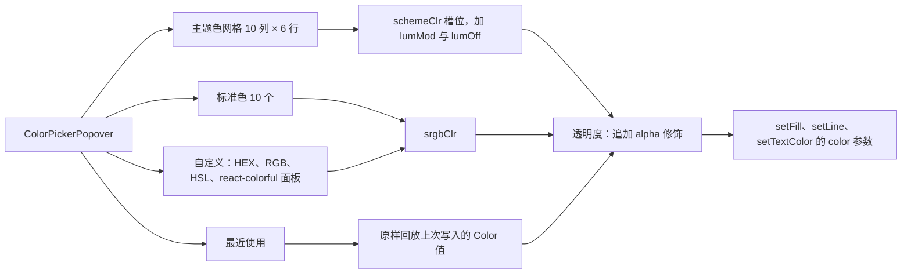

怎么读：主题色一格对应「槽位 + 明暗修饰」而不是某个 RGB，所以换主题后元素颜色跟随；最近使用保存的是 `Color` 值本身（可能是主题色），回放时不丢主题语义；透明度对三类来源都以 `alpha` 修饰追加。

依据：PRD ED-06；R-d-13、R-d-14；证据 R `crossCutting`「主题色与默认样式」。

### 7.2 能力表

| id | 能力 | 出处 | 实现落点 | 命令 id | 交互要点 | 复用 / 自研 | 里程碑 | 覆盖度 |
|---|---|---|---|---|---|---|---|---|
| FMT-01 | 颜色选择器（主题 10 × 6、标准、最近、自定义） | ED-06；设计 03-16、03-03；规格 40/10 §3a | ui-react `shell/ColorPickerPopover.tsx`；slide-ui `domain/theme-palette.ts` 新增（§4.21） | 各颜色命令的 `color` 参数 | 主题色写 `schemeClr` + `lumMod/lumOff`；最近使用存偏好键 `color.recent` | react-colorful、colord | M2 P0 | partial→补齐 |
| FMT-02 | 纯色填充与透明度 | ED-06 P0；设计 03-02 §4.2、03-03；规格 50/10 §5 | 检查器「填充」节：分段「无 / 纯色 / 渐变 / 图片」+ 颜色行（色块 · 色值 · 不透明度）；整体透明度在「不透明度」节（滑块 + 数值，[50/22](22-elements-shapes-and-lines.md) §2.5）；slide-ui `ui/inspector/FillLineSection.tsx` | `slide.setFill`；「不透明度」节 `slide.setShapeOpacity{shapeIds, alpha}`（rulings §4.25 TB-47） | 透明度写 `alpha`；「不透明度」同时写填充与描边颜色的 alpha（OOXML 形状没有整体不透明度），一步撤销 | react-colorful | M2 P0 | full→已写清 |
| FMT-03 | 渐变填充编辑器（2–10 stop、角度、预设） | ED-06 P1；设计 03-03 G-14 | `FillLineSection.tsx` 下 `GradientEditor.tsx` 新增（§4.21） | `slide.setFill{gradFill}` | stop 条拖动与增删；线性角度；预设由主题强调色派生 | 自研 S15 | M2 P1 | partial→补齐 |
| FMT-04 | 图片填充 / 图案填充 | ED-06 P2；设计 03-02 §4.2 | 「填充」节分段里的「图片」：按 PRD ED-06 为 P2，留在原位、标 P2、不可用（rulings §4.25 TB-43、§4.20 FE-06；样张随迁移补标记，§31 未决第 9 条已关闭）；`FillLineSection.tsx` | `slide.setPictureFill` 新增（§4.21，P2）；图案 `slide.setFill{pattFill}` | — | — | M2 P2 | missing→后置 |
| FMT-05 | 线条：宽度、8 种虚线、箭头首尾 | ED-06 P0；设计 03-03 | 检查器「描边」节：分段「无 / 实线 / 虚线」（设计 03-02 §4.2）；宽度、8 种虚线样式与箭头首尾控件第 1 批样张未画，随实现、放在本节；文件 `FillLineSection.tsx`；`ArrowheadPicker.tsx` 新增（§4.21） | `slide.setLine{width, dash, headEnd, tailEnd}` | 宽 0.25–100 pt；箭头类型 × 宽 × 长（sm / med / lg） | — | M2 P0 | partial→补齐 |
| FMT-06 | 阴影预设 9 种与自定义 | ED-06 P1；设计 03-03 | 检查器「阴影」节：分段「无 / 外阴影 / 内阴影」（设计 03-02 §4.2；内阴影按 PRD ED-06 属「其它效果」P2，留在原位、标 P2、不可用，rulings §4.25 TB-43），文件 `FillLineSection.tsx`；slide-ui `domain/effect-presets.ts` 新增（§4.21） | `slide.setEffect` | 外阴影 9 种 + 无；自定义颜色、透明度、模糊、距离、角度 | — | M2 P1 | partial→补齐 |
| FMT-07 | 形状样式快速库（42 组合） | ED-06 P1；设计 03-03 | 形状检查器「填充」节上方一行主题样式缩略图，点开后 42 格样式库在本节缩略行下方原位展开、下方各节下移、不遮挡画布（rulings §4.25 DS-31；DS-34 修订 DS-31 的「样式库弹层」；样张 `main-states.quick-styles`、`main-states.quick-styles-gallery`；原开始 › 绘图作废）；slide-ui `ui/inspector/ShapeStyleSection.tsx`（40/10 §5.4，2026-10-08 登记） | `slide.setShapeStyle` 新增（§4.21） | 写 `p:style` 引用；缩略图随主题实时、去白衬底（TB-56）；样式库一个 Tab 停靠点、方向键漫游（TB-5），应用后保持展开，节标题右侧「收起样式库」、再点缩略行或 `Esc` 收起、焦点回缩略行（DS-34） | — | M2 P1 | partial→补齐 |
| FMT-08 | 发光 / 柔化 / 映像 / 3D 效果 | PRD 01 §2.4 | slide-render `shared/paint.ts` 近似渲染；编辑后置 | 复用 `slide.setEffect`（P2） | 3D 扁平化渲染、属性保留、不提供编辑 | — | P2（3D 非目标） | missing→后置 |
| FMT-09 | 设为默认形状 | ED-06 P2 | 主题 `objectDefaults`（M2 只读建模） | `slide.setObjectDefaults` 新增（§4.21，P2） | 右键「设为默认形状 / 线条 / 文本框」 | — | M2 P2（需主题写入，M3 后） | missing→后置 |
| FMT-10 | 更改形状（换 `prst` 保留格式） | ED-05（§4.21 补入，P1） | 形状右键「更改形状 ▸」，排在「旋转 ▸」之后，打开只列形状的形状图库（P1，未开放前留在原位不可用、写「后续版本提供」；rulings §4.25 TB-18，设计 03-05 §3，§24.2）与命令面板；检查器不设入口（检查器只放属性，DS-1；PRD ED-05 只列右键，[50/22](22-elements-shapes-and-lines.md) §2.4；原开始 › 绘图 › 编辑形状 ▾ 作废） | `slide.changeShape` 新增（§4.21） | 保留文字、填充、线条与 `xfrm`；`avLst` 取新形状默认 | 自研 S9 | M2 P1 | missing→补齐 |
| FMT-11 | 多选统一应用与「多个值」 | ED-06、ED-12；设计 03-03；规格 50/10 §5 | ui-react `inspector-fields.tsx`（`MixedValueField`） | 各属性命令，一次带全部 id | 不一致字段显示「多个值」 | — | M2 P0 | full→已写清 |

### 7.3 补齐方案

- **FMT-01**：主题网格 10 列依次为 `bg1 tx1 bg2 tx2 accent1…accent6`，6 行为基色 + 5 个明暗变体；变体按基色亮度分三档（接近白：只写 `lumMod` 变暗；接近黑：写 `lumMod + lumOff` 变亮；其余：变亮三档、变暗两档），取值表放 slide-ui `domain/theme-palette.ts`，与 PowerPoint 调色板逐格对照语料核对。色板颜色来自 `slides.resolved` 的当前主题（换主题实时刷新）。「最近使用」存偏好键 `color.recent`（最多 10 个 `Color` 值，本机）。自定义输入 HEX / RGB / HSL 三种格式，解析复用 colord；取色器（EyeDropper API）P2。
- **FMT-03**：`GradientEditor` = 一条 stop 条（radix Slider 多滑块，拖动改位置、点击空白处加 stop、选中后 Delete 删除，2–10 个）+ 选中 stop 的颜色面板 + 角度输入 + 类型（线性可编辑；径向与路径渐变保持只读显示，改类型才可编辑）。8 个预设不照抄 PowerPoint 的内置位图，而是由当前主题的强调色按「同色明暗过渡」派生，因此随主题变化。写 `a:gradFill`，一次命令。
- **FMT-05**：箭头选择器是 3 × 3 网格：类型（无 / 三角 / 燕尾 / 箭头 / 菱形 / 圆形）× 宽 × 长（`sm / med / lg`）；只对线条、连接符与开放路径可用；`slide.setLine` 的 `line` 值补 `headEnd`、`tailEnd` 字段（Mutation 不变）。端点与连接样式、复合线 P2。
- **FMT-06**：9 个外阴影预设（四个方向偏移、四个对角偏移、居中）的参数表（`blurRad`、`dist`、`dir`、颜色与透明度）放 slide-ui `domain/effect-presets.ts`，以 PowerPoint 生成的语料抽取核对；自定义面板改其中字段后仍发 `slide.setEffect`。外阴影以外的效果只读显示（FMT-08）。已拍板的 v3 样张「阴影」节是「无 / 外阴影 / 内阴影」三段，而 PRD ED-06 只把外阴影 9 种 + 无列为 P1、其它效果 P2：「内阴影」按 PRD ED-06 为 P2，留在原位、标 P2、不可用（rulings §4.25 TB-43、§4.20 FE-06；样张随迁移补标记），「填充」节的「图片」同此（FMT-04）；§31 未决第 9 条已关闭。
- **FMT-07**：入口按 rulings §4.25 DS-31：形状检查器「填充」节上方一行主题样式缩略图，点开后样式库在「快速样式」节里、缩略行下方原位展开，下方各节下移、不遮挡画布（2026-10-08 DS-34 修订 DS-31 的「样式库弹层」：弹层会盖住靠右的选中对象；[50/22](22-elements-shapes-and-lines.md) §2.5）；样式库 = 7 列（主题色槽）× 6 行（`fmtScheme` 的样式强度）的 42 格画廊，点击发 `slide.setShapeStyle{shapeIds, style: ShapeStyleRef}` → 既有 Mutation `shape.setStyle`；同时清掉这些形状上会遮住样式的显式 `fill` / `ln` 覆盖（同一事务），这样样式才真正生效，且以后换主题会跟着变。原 40/10 §2.6 写的「setFill + setLine + setEffect 同一事务」作废（§27 第 10 行）。
- **FMT-10**：`slide.changeShape{shapeIds, preset}` → `shape.setProperties{geometry}`：换 `prstGeom@prst`、`avLst` 取新形状默认、保留 `xfrm`、文字、填充、线条与效果；对 `custGeom`、图片（裁剪为形状是 PIC-06）同样可用；锁位 `noChangeShapeType` 时禁用。
- **形状不透明度**（FMT-02 的「不透明度」节，rulings §4.25 TB-47）：`slide.setShapeOpacity{shapeIds, alpha}` → `shape.setProperties`，同时改写填充与描边颜色的 `alpha` 修饰（OOXML 形状没有整体不透明度），主题色仍写 `schemeClr`；一步撤销，拖动滑块只改预览、松手一次命令（[50/22](22-elements-shapes-and-lines.md) §2.5）。

## 8. 图片（PIC）

### 8.1 怎么实现

图片的插入与上传见 §5；本节是插入之后的编辑：替换、重置、裁剪、透明度与颜色校正。全部遵守一条边界——**不改源位图字节**（PRD ED-07），裁剪写 `a:srcRect`、透明度写 `a:alphaModFix`、校正写 `blip` 子元素；唯一例外是用户显式点「压缩」（INS-08）。裁剪模式是 slide-ui 的一个本地模式，覆盖层画整张原图、`--v3-scrim` 遮罩、三分线与裁剪手柄，「完成」时只发一条 `slide.crop`，「取消」回到进入前的状态、零命令（rulings §4.25 TB-4）；裁剪库不适用（S4）。v3 不设图片上下文工具条（设计 03-18 §1.4）：属性与常用操作在检查器「图片」「不透明度」「位置与大小」「替代文本」四节（图标多一节「图形填充」），右键与快捷键是第二入口。

**图 18-12 裁剪模式**

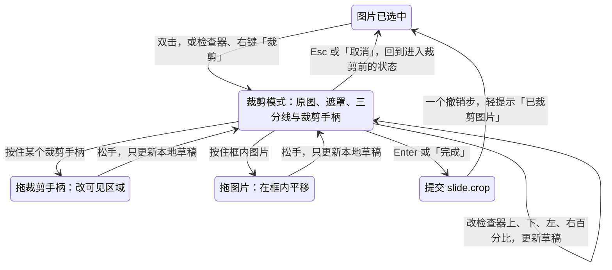

怎么读：裁剪模式内的拖动与数值输入都只改本地草稿，退出时要么一条命令、要么零条：「完成」（或 Enter）提交一条 `slide.crop`、算一个撤销步，「取消」（或 Esc）回到进入裁剪前的状态、不写文档（rulings §4.25 TB-4）。框下浮条「取消 Esc / 完成 ↵」是唯一的两个出口，点画布上的其它对象不切换选区、不提交；模式期间底部创建工具条临时收起（位置保留），检查器只留「裁剪」节的上 / 下 / 左 / 右四个百分比（键盘等价，WCAG 2.5.7；设计 03-18 §6）。EMF / WMF 与未加载的外链图片不能进入裁剪模式。

依据：PRD ED-07、ED-29；设计 03-18 §6；R-d-29；rulings §4.25 TB-4。

### 8.2 能力表

| id | 能力 | 出处 | 实现落点 | 命令 id | 交互要点 | 复用 / 自研 | 里程碑 | 覆盖度 |
|---|---|---|---|---|---|---|---|---|
| PIC-01 | 替换图片（保留位置与裁剪） | ED-07；设计 03-18 §5.1 | 检查器「图片」节「替换…」与右键「替换图片…」（原迷你工具条「替换」作废，03-18 §1.4）；取字节链同 INS-06 | `slide.replacePicture{shapeId, blob}` | 保留框；新图按框比例重裁 | — | M2 P0 | partial→补齐 |
| PIC-02 | 重置图片 | ED-07；设计 03-18 §5.1 | 检查器「图片」节「重置」与右键「重置图片」 | `slide.resetPicture` 新增（§4.21） | 「重置」清效果与裁剪，保留替代文本、边框与旋转；「重置图片和大小」（再回原始尺寸）第 1 批样张未画，随实现（原「重置 ▾」下拉作废） | — | M2 P0 | missing→已写清（50/23 §2.4，2026-09-26 整合） |
| PIC-03 | 裁剪模式（8 手柄、遮罩、平移、Enter / Esc、数值等价） | ED-07 P1、ED-29；设计 03-18 | slide-ui `application/crop.ts`；render-dom `overlay/crop-overlay.ts` 新增（§4.21） | `slide.crop{shapeId, rect}` | 图 18-12；入口为检查器「裁剪」、右键「裁剪」与双击；框下浮条「取消 Esc / 完成 ↵」，「取消」回到进入前、「完成」一个撤销步（rulings §4.25 TB-4）；检查器只留「裁剪」节（上 / 下 / 左 / 右百分比）；`srcRect` 以千分之一百分比为单位 | 自研 S4 | M2 P1 | partial→已写清（50/23 §2.3，2026-09-26 整合） |
| PIC-04 | 图片不透明度（原称透明度；模型字段 `alpha`，导出为 `a:alphaModFix@amt`） | ED-07；设计 03-18 §5.2 | 检查器「不透明度」节：滑杆 + 数值框，与形状同一写法 | `slide.setPictureTransparency{shapeIds, alpha}` 新增（§4.21） | 界面写「不透明度」0–100 %（缺省 100），写入 `alpha = 不透明度 × 1000`；拖动预览、松手一次命令 | radix Slider | M2 P0 | missing→已写清（50/23 §2.4，2026-09-26 整合） |
| PIC-05 | 亮度 / 对比度 / 灰度 / 重新着色 | ED-07 P2 | 检查器「图片」节（P2，第 1 批样张未画，随实现） | `slide.setPictureAdjust` 新增（§4.21，P2） | 写 `a:lum`、`a:grayscl`、`a:duotone` | — | M2 P2 | missing→后置 |
| PIC-06 | 裁剪为形状 / 填充 / 适合 | ED-07 P1 / P2；设计 03-18 §6 | 填充 / 适合：第 1 批样张未画，落点随实现（原迷你工具条「裁剪 ▾」下拉作废，03-18 §1.4）；裁剪为形状 P2 | 填充 / 适合：`slide.crop{shapeId, fit:'fill'\|'fit', pixelSize?}` 参数扩展新增（§4.21）；为形状：`slide.changeShape`（P2） | 填充 = 铺满框并居中裁；适合 = 完整放入框内 | — | 填充 / 适合 M2 P1；为形状 P2 | missing→补齐 |
| PIC-07 | EMF / WMF 惰性栅格化显示 | OF-07；设计 03-13、03-18；规格 50/05 §8.4 | slide-render `infrastructure/media/emf-rasterizer.ts` 与 Worker | 通用变换命令 | 裁剪入口禁用并提示 | emf-converter 4.x | M2 P1 | full→已写清 |
| PIC-08 | 外链图片三档加载 | OF-07；设计 03-13、03-18；规格 50/05 §8.5 | slide-render `shared/external-resource.policy.ts` | — | `auto` / `confirm` / `never` | — | M1 | full→已写清 |
| PIC-09 | 上传占位、失败重试、配额 | ED-07；设计 03-04、03-18；规格 50/05 §8.3 | apps/web `infrastructure/media/media-uploader.ts` | — | 上传中占位、失败重试、超配额提示 | p-queue | M2 P0 | full→已写清 |
| PIC-10 | GIF 编辑态首帧 / 放映动画 | PRD 01 §2.5 | render-dom `media/image-preprocess.ts` 取首帧；slide-render `pic.renderer.ts` 渲染时调用 | — | 编辑态、缩略图与 `/render` 用首帧；放映播放原 GIF | createImageBitmap + canvas | M1 | partial→已写清（50/05 §8.3，2026-09-26 整合） |

### 8.3 补齐方案

- **PIC-01**：替换走与插入相同的取字节链（选择器 → 预处理 → 本地执行命令 → 后台上传）。`slide.replacePicture` 保留 `xfrm` 不变，新图按框的宽高比居中重裁（写新的 `srcRect`），不拉伸；原图的效果（透明度、校正）保留。
- **PIC-02**：`slide.resetPicture{shapeId, pixelSize?}` → `pic.setBlipFill`（ADR-0018 新增 Mutation）清 `srcRect` 与 blip 效果；带 `pixelSize`（slide-ui 取原图像素尺寸）时再按原始像素与 DPI 换算回原始尺寸（超过页面 60% 仍按 60% 缩），以左上角为锚。
- **PIC-03**：`crop.ts` 持有本地的 `{shapeId, rect}`，覆盖层 `crop-overlay.ts` 画原图全貌（按当前变换，原图范围白色 70% 虚线框）、框外 `--v3-scrim` 遮罩（原写「50% 遮罩」作废）、三分线与 8 个裁剪手柄（四角 L 形、四边短条，设计 03-18 §6）；手柄几何在屏幕空间计算再反变换回图片局部坐标（与旋转、翻转一致，复用 S1 的矩阵）。「完成」时 `slide.crop{shapeId, rect}`，`rect` 的四值是 `a:srcRect@l/t/r/b`，单位为千分之一百分比（25000 = 25%），允许负值（留白）；「取消」丢弃草稿、零命令，回到进入裁剪前的状态（rulings §4.25 TB-4，取代原 50/10 §7「退出裁剪不另发命令、不回滚已提交的裁剪」）。检查器「裁剪」节的上 / 下 / 左 / 右四个百分比是键盘等价入口（界面显示百分比，命令写千分之一百分比）。
- **PIC-04**：界面名称为「不透明度」（设计 03-18 §5.2，与形状、视频同一写法）；`slide.setPictureTransparency{shapeIds, alpha}` → `pic.setBlipFill{alpha}`（30/04 `BlipFill.alpha`，`alpha = 不透明度 × 1000`，导出为 `a:alphaModFix@amt`）；滑块拖动时只改预览，松手一次命令（撤销合并同拖拽）。
- **PIC-06**：「填充」按图片像素宽高比与框宽高比算出正的 `srcRect`（铺满并居中裁），「适合」算出负的 `srcRect`（完整放入、两侧留白），都经 `slide.crop{shapeId, fit: 'fill' | 'fit', pixelSize?}` 由命令计算（`pixelSize` 由 slide-ui 取原图像素尺寸传入；界面落点第 1 批样张未画，随实现）；「裁剪为形状」是对图片执行 `slide.changeShape`（P2）。
- **PIC-10**：GIF 在编辑态、缩略图与 `/render` 一律显示首帧：slide-render `pic.renderer` 渲染时调用 render-dom `media/image-preprocess.ts`，以 `createImageBitmap` 解码首帧画到 canvas，结果缓存为 MediaCache 的变体 `sha256#frame0`；放映用原 GIF 字节，由浏览器播放动画（50/05 §8.3）。导出不受影响（原字节 verbatim）。

## 9. 媒体（MED）

### 9.1 怎么实现

视频与音频的查看、海报帧与放映播放 M1 已有（50/05 §8.5、§12）；插入维持 P2（§4.21 q-media-insert，见 INS-11）。本轮收口两件事：编辑态能不能点播放（R-d-68：能，用临时覆盖层播放，不进 Scene），以及换海报的命令。放映时的播放由放映舞台叠放 `<video>` / `<audio>` 元素完成；`p:timing` 里的自动播放、跨页与循环仍不解析，翻页即停。

**图 18-13 视频在编辑态与放映中的播放**

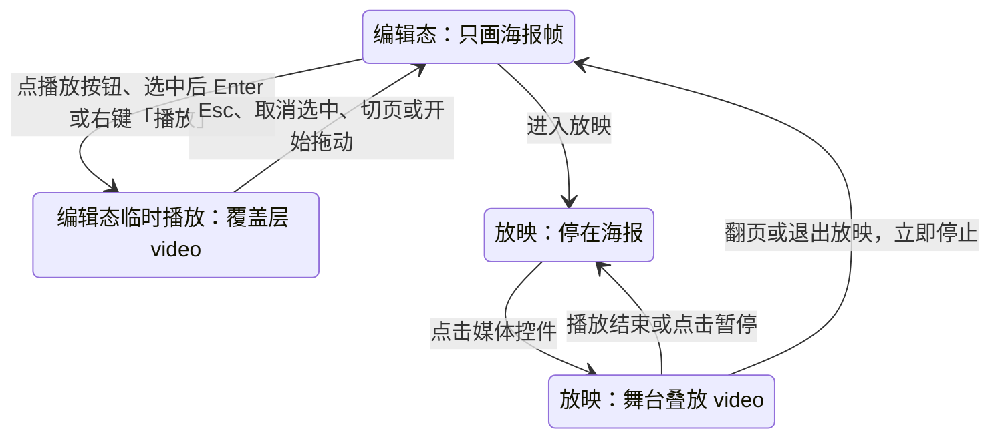

怎么读：编辑态的临时播放只是覆盖层上的一个 `<video>`，不改 Scene、不写 Store，也不影响缩略图；放映中不做自动播放（`p:timing` 不解析），翻页一律停止并释放元素。

依据：R-d-68；§4.21 q-media-insert；50/05 §8.5、§12。

### 9.2 能力表

| id | 能力 | 出处 | 实现落点 | 命令 id | 交互要点 | 复用 / 自研 | 里程碑 | 覆盖度 |
|---|---|---|---|---|---|---|---|---|
| MED-01 | 视频 / 音频海报帧 | OF-07；设计 03-13 G-06；规格 50/05 §8.5 | slide-render `pic.renderer.ts`（海报来自 `Pic.media`） | — | 无海报时画中性占位与播放图标 | — | M1 | full→已写清 |
| MED-02 | 播放（编辑态临时播放、放映叠放） | OF-07、ED-21；设计 03-13、03-11；规格 50/05 §8.5、§12 | render-dom `media-playback` 覆盖层（50/05 §5.2）；slide-ui `present.ts` 与 `PresenterStage.tsx` | —（不写 Store） | 图 18-13；海报帧上居中 56 px 圆形播放按钮、选中后 Enter 或右键「播放 ↵」开始，检查器「视频」节不设播放按钮（设计 03-18 §9）；翻页即停 | 浏览器 `<video>` / `<audio>` | M2 P1 | partial→已写清（50/23 §7.2、50/05 §8.5，2026-09-26 整合） |
| MED-03 | 移动 / 缩放 / 替换海报 | PRD 01 §2.5 P1；设计缺口 G-26 | 通用变换；检查器「视频」节「换海报…」与右键「替换海报…」（设计 03-18 §9；视频没有翻转） | `slide.replacePoster` 新增（§4.21） | 选图片或「从当前帧截取」 | createImageBitmap + canvas | M2 P1 | partial→已写清（50/23 §7，2026-09-26 整合） |
| MED-04 | 外链媒体 | OF-07；设计 03-13；规格 50/05 §8.5 | slide-render `shared/external-resource.policy.ts` | — | 三档策略同外链图片 | — | M1 | full→已写清 |

### 9.3 补齐方案

- **MED-02**：编辑态视频海报帧上居中显示 56 px 圆形播放按钮（覆盖层；未选中时点按先选中再播放），选中后 `Enter` 或右键「播放 ↵」同样开始（设计 03-18 §9）；由 render-dom 的 `media-playback` 覆盖层在元素框上叠一个 `<video controls>`（源为 `MediaCache` 的 blob URL），Esc、取消选中、切页或开始拖动即停止并移除；音频同理但只显示控件条。放映中由 `PresenterStage` 叠放，翻页或退出时停止并 `revoke`。这修正了 50/05 §8.5「编辑态只画海报」与设计 G-06「可点击播放」的冲突（§27 第 4 行）。
- **MED-03**：`slide.replacePoster{shapeId, blob}` → `media.add` + `pic.setBlipFill`（海报就是视频元素的 `blip`）。来源两种：选一张图片（走 INS-06 取字节链），或「从当前帧截取」——在临时播放暂停处用 `<video>` + canvas `drawImage` 取帧（ADR-0021 补用途，R-d-23）。

## 10. 表格（TBL）

### 10.1 怎么实现

表格按 §4.21 q-table-depth 分两步：**M2 可插入表格并编辑单元格文字**（INS-09、TXT-16）；**M3 做行列插删、合并拆分、行高列宽与样式**。M3 之前先把表格模型改为归一化结构，用分数索引给行与列排序，从根上消除「两人同时插行和插列产生缺格」的问题（ADR-0018，30/04、40/03 与 30/06 的 Yjs 映射同步）。表格渲染与交互自研（S10）：它是画布上的 SVG 元素，而不是 DOM 数据网格。

**图 18-14 表格单元格选区状态机**

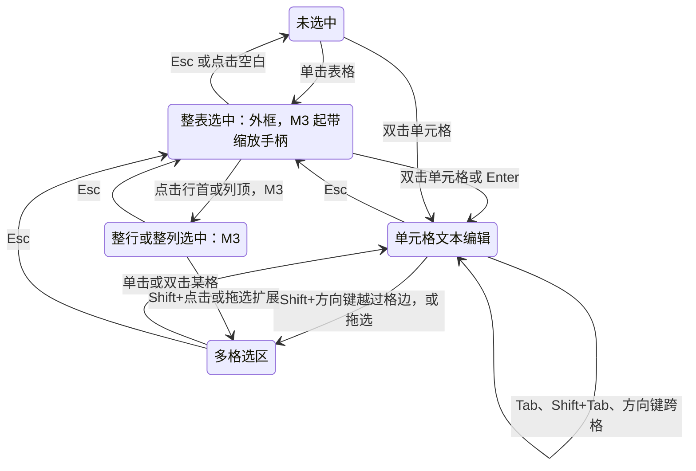

怎么读：本图照录 50/24 §2.6 图 2-3（设计 03-30 图 4 同一口径，2026-09-30 对齐：去掉「整表选中下拖选跨格」——整表选中时拖动是移动表格；补双击直接进格与 M3 的整行整列选中）。M2 用到 `table`、`cellEdit` 与 `cells` 三态（加 Tab 跨格）；`cells` 多格选区在 M2 用于统一设置文字格式、清空文字，M3 起还承载合并、边框与填充。选区经 `SlideSelectionAnchor` 的 `tableCell` 形态表达（30/04 §3.6），在 slide-ui 派生为 `selectionKind = 'table-cell'`。

依据：§4.21 q-table-depth；PRD ED-10；证据 R `elementDesign`「表格」。

**图 18-15 M3 前的表格归一化模型**

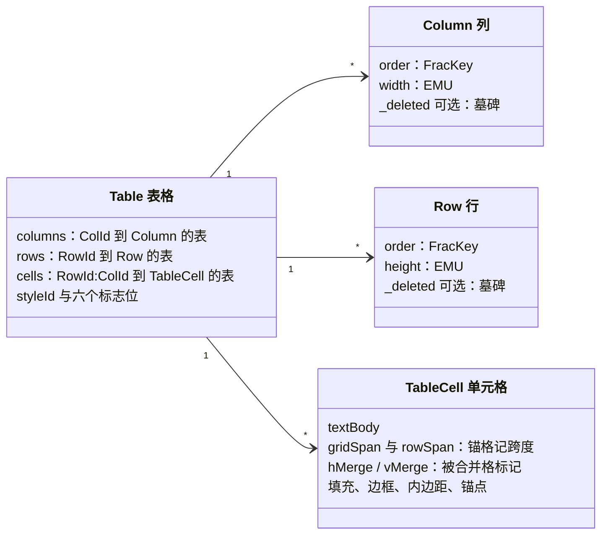

怎么读：单元格的键是 `"RowId:ColId"`；插一行只新增一个 `Row` 与该行的格，插一列同理，两者并发时各自新增的键不冲突，交叉处的格由不变量兜底补齐。合并在锚格上记 `gridSpan / rowSpan`，被合并格记 `hMerge` / `vMerge`（与 30/04 §3.8、40/03、50/24 §2.4 同名）；行与列删除时写 `_deleted` 墓碑（软删除，可撤销复活）；导出时按 `order` 排序、跳过墓碑重建 `a:tbl`。不变量 I-TBL1（每行的有效格覆盖全部列）与 I-TBL2（跨度合法）作兜底修复。

依据：§4.21 q-table-depth；ADR-0018；ADR-0032。

### 10.2 能力表

| id | 能力 | 出处 | 实现落点 | 命令 id | 交互要点 | 复用 / 自研 | 里程碑 | 覆盖度 |
|---|---|---|---|---|---|---|---|---|
| TBL-01 | 表格选中与单元格选区状态机 | ED-10；设计 03-30 §3、§4（G-32）；规格 30/04 §3.6；元素设计 [50/24](24-elements-tables-and-charts.md) | slide-ui `application/table-selection.ts` 新增（§4.21）、`domain/selection-kind.ts`；render-dom 单元格选区覆盖层 | `slide.setSelection{tableCell}`（Op） | 图 18-14；整行整列在表格外沿点选（整行整列选中 M3，50/24 §2.6） | 自研 S10 | M2 P1 | partial→补齐 |
| TBL-02 | 行列插删、合并拆分 | ED-10 M3；设计 03-30 §4、§5（G-62）；元素设计 [50/24](24-elements-tables-and-charts.md) | slide-ui 画布右键（平铺，「插入」小标题带 M3）与命令面板（ED-30）同名命令，M3 起画布悬停「+」；不设表格迷你工具条（rulings §4.25 DS-22，原 `toolbar.table-cell` 按 TB-29 删除；rulings §4.22「不设上下文页签」随 DS-1 自然成立）；model-slide `table-commands.ts` | `slide.table.insertRow` / `removeRow` / `insertColumn` / `removeColumn` / `mergeCells` / `splitCell` | 悬停行列边显示「+」（20px 强调色方块）；不可用原因单项写在条目右侧、一组同因写常驻说明行，无编辑权限时为顶部说明行「需要编辑权限：评审模式下只能复制」；末格 Tab 加行 | 自研 S10 | M3 P1 | partial→补齐 |
| TBL-03 | 拖动行高列宽、整体缩放按比例 | ED-10 M3；设计 03-30 §5.2（G-62）；元素设计 [50/24](24-elements-tables-and-charts.md) | slide-ui `table-selection.ts` 分隔线命中与覆盖层预览 | `slide.table.resizeColumn` / `resizeRow` 新增（§4.21）；整体缩放用 `slide.resizeShapes` | 拖分隔线实时预览，尺寸角标「第 N 列 A → B · 右侧列等量收窄」，Esc 撤预览；检查器「行高与列宽」是数值等价；整体缩放按比例分配 | 自研 S10 | M3 P1 | missing→补齐 |
| TBL-04 | 单元格填充 / 边框 / 内边距 / 锚点 | ED-10 M3；设计 03-30 §6.4（G-62）；元素设计 [50/24](24-elements-tables-and-charts.md) | 检查器 `table-cell` 的「单元格」分区（填充 · 边框 · 边距 · 垂直对齐 · 文字方向）；`BorderPicker.tsx` 新增（§4.21） | `slide.table.setCellProperties`；`slide.table.setBorders` 新增（§4.21） | 边框：10 个预设（5 × 2，设计 03-30 §6.4）× 线型 × 粗细 × 颜色 | — | M3 P1 | partial→补齐 |
| TBL-05 | 表格样式库（74 内置）与标志 | ED-10 M3 P1；设计 03-30 §6.3（G-62；样张可展开全部 74 种，缩略图配色为近似）；元素设计 [50/24](24-elements-tables-and-charts.md) | 检查器「表格样式」分区（设计 03-30 §6.3，`ui.inspectorSection`）；内置样式数据见补齐方案 | `slide.table.setStyle` 新增（§4.21）；标志走 Mutation `table.setTableProperties`（新增） | 缩略图按当前主题渲染；六个标志复选 | 自研 S10 | M3 P1 | missing→补齐 |
| TBL-06 | 对角线边框 / 单元格内图片 | ED-10 P2；元素设计 [50/24](24-elements-tables-and-charts.md) | 检查器 `table-cell` 分区 | 复用 `setBorders`、`setCellProperties`（P2） | — | — | P2 | missing→后置 |

### 10.3 补齐方案

- **TBL-01**：`table-selection.ts` 实现图 18-14，命中来自 `HitResult` 的单元格坐标（slide-render 的表格渲染器为每格输出命中矩形）。`TextTarget.cell` 与选区锚点一律为 `{rowId, colId}`（多格矩形选区为 `tableCells{anchor, focus}`，30/04 §3.6；2026-09-26 整合更正，原「M2 为 `[row, col]`、M3 改 id」作废）。多格选区的高亮是覆盖层，不进 Scene。
- **TBL-02**：命令在 40/03 已有；本轮补交互：M3 起悬停表格外沿的行 / 列分隔处出现「+」按钮插行插列；右键菜单平铺、不用子菜单——剪切、复制、粘贴、删除文本在前，「插入」小标题（带 M3 标记）下列在上方插入行、在下方插入行、在左侧插入列、在右侧插入列，其后合并单元格、拆分单元格…（只拆回合并前的格，`slide.table.splitCell{shapeId, cell}`；普通格上禁用并给原因「只有合并过的单元格可以拆分」，不做拆分对话框，rulings §4.22；按行列数拆分推迟（DF-04），触发条件：M3 之后出现明确用户需求时再议，见 rulings §4.22），最后删除行、删除列、删除表格（危险色）；M2 时「插入」小标题换成菜单内常驻说明行，行列与合并拆分等结构项 `aria-disabled` 并以 `aria-describedby` 指向说明行，**删除表格在 M2 可用**（设计 03-30 §5.3、03-05「表格单元格变体」，2026-09-30 按样张改，原「插入 ▸ / 删除 ▸」子菜单作废）；M2 不出现悬停「+」与分隔线手柄。结构与样式入口是右键、命令面板与检查器（M3 另有画布悬停「+」），不设表格迷你工具条，与图片、图表同一口径（rulings §4.25 DS-22；§4.22 的「不设『表格设计』『表格布局』上下文页签」随 DS-1 去掉 ribbon 自然成立）；不可用原因单项写在条目右侧、一组同因写菜单内常驻说明行，无编辑权限时菜单顶部一行「需要编辑权限：评审模式下只能复制」、除「复制」外全部不可用（设计 03-30 §5.3、§9，rulings §4.25 TB-22）；多格选区为矩形时才允许合并。末格 Tab 加行在 M3 生效。
- **TBL-03**：`slide.table.resizeColumn{shapeId, colId, width}` / `resizeRow{shapeId, rowId, height}` 写 `Column.width` / `Row.height`（Mutation `table.setSizes`）；拖分隔线时倾向相邻两列此消彼长（表格总宽不变，样张同此；对照 PowerPoint 定稿推迟（DF-03），触发条件：M3 表格结构开工前、维护机对照完成，登记在 50/24 §2.14 第 4 条，见 rulings §4.22），按住 Alt 不吸附；整体缩放仍是 `resizeShapes`，命令内按原比例重新分配列宽与行高（行高不低于文字所需高度）。
- **TBL-04**：边框选择器是 10 个预设排成 5 × 2 的单选图标组（第一行无框线 / 所有框线 / 外侧框线 / 内部框线 / 内部横框线，第二行上 / 下 / 左 / 右 / 内部竖框线；设计 03-30 §6.4，2026-09-30 按样张补「内部框线」，原 3 × 3 九项作废）+ 线型、粗细与颜色；`slide.table.setBorders{shapeId, cells, borders: {preset, line}}`（形状以 40/03 §2.6 为准；`preset` 取 `none / all / outer / inner / innerH / innerV / top / bottom / left / right`，2026-09-30 定稿（rulings §4.22），40/03 §2.6、50/24 §2.8 同步）在命令内展开为各格 `lnL / lnR / lnT / lnB` 的设置（相邻格共享边同时写两侧，避免导出后 PowerPoint 显示不一致）。
- **TBL-05**：入口是检查器「表格样式」分区（设计 03-30 §6.3；M2 时标题带 M3、缩略图只读，当前样式保留 2px 强调色外圈、其余降到 60%）；「显示全部 74 种」原位展开并按组列出计数。PowerPoint 的 74 个内置表格样式由 GUID 标识，其定义数据不随 pptx 附带（文件里的 `tableStyles.xml` 只含用到的样式）。数据来源与许可随 [50/24](24-elements-tables-and-charts.md) §2.14 第 2 条定稿（推迟 DF-02，触发条件：M3 表格样式开工前，见 rulings §4.22；缩略图逐部件保真在其后重画）：LibreOffice 的样式数据是 MPL，不复制；候选是自备一份由主题色派生的样式定义表（按「浅 / 中 / 深 × 强调色」规则生成，GUID 沿用公开的内置样式 GUID），导出时把用到的定义追加进 `tableStyles.xml`（属 ADR-0008 决策 9 写入白名单的扩展，随 ADR-0008 本轮修订）。`slide.table.setStyle{shapeId, styleId?, flags?}` 一条命令同时改样式与六个标志位（`firstRow / lastRow / bandRow / firstCol / lastCol / bandCol`），落 Mutation `table.setTableProperties`。
- **TBL-06（P2）**：对角线边框写 `lnTlToBr` / `lnBlToTr`；单元格图片填充复用 `pic` 管线的 `blipFill`。

## 11. 图表（CHT）

### 11.1 怎么实现

图表路线在本轮定案（§4.21 q-chart-route，[ADR-0036](../30-architecture/adr/0036-chart-rendering-and-editing.md)）：底层用 d3-scale / d3-shape / d3-array（ISC，约 30 KB）提供比例尺、路径与数组运算，版式按 OOXML 语义自研（`manualLayout`、Excel 自动刻度、堆积、饼图标签避让，S12）。M1 只读渲染（SSIM ≥ 0.80，D16：解析部件与缓存数据，不用包内位图代替）；M3 起五类（柱形 / 条形、折线、饼、面积、散点）可插入与编辑，其余类型与 chartex 只看。渲染器只在 `slide-render-chart` 惰性子路径里，未加载时主包的占位渲染器同 key 兜底。

**图 18-16 图表的数据从哪来、写到哪去**

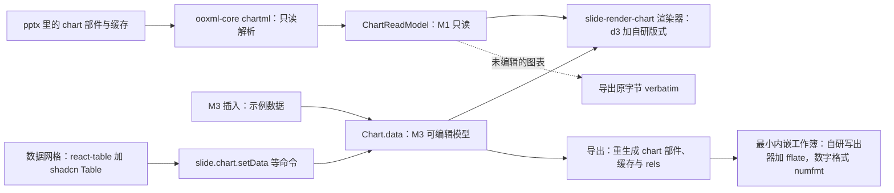

怎么读：M1–M2 图表只有左上这条只读链路，导出原字节；M3 起插入或编辑过的图表以 `Chart.data` 为准重生成部件，未编辑的图表仍走 verbatim。`Chart.data` 与 `partRef` 并存期间只有一份可编辑模型（ADR-0008 决策 10）。

依据：§4.21 q-chart-route；R-d-34、R-d-35、R-d-74；D16。

### 11.2 能力表

| id | 能力 | 出处 | 实现落点 | 命令 id | 交互要点 | 复用 / 自研 | 里程碑 | 覆盖度 |
|---|---|---|---|---|---|---|---|---|
| CHT-01 | 图表只读渲染（惰性子路径） | OF-09、D16；设计 03-13；规格 50/05 §9；元素设计 [50/24](24-elements-tables-and-charts.md) | slide-render `chart.ts` 子路径与 `infrastructure/chart/chart-preview.renderer.ts`；ooxml-core `chartml/*` | — | 未加载时占位；`conflict:'replace'` 同 key 覆盖 | d3-scale / d3-shape / d3-array + 自研 S12 | M1 P0 | full→已写清 |
| CHT-02 | chartex / 缓存缺失占位 | PRD 01 §2.6；设计 03-13；规格 50/05 §9；元素设计 [50/24](24-elements-tables-and-charts.md) | slide-render `elements/chart-placeholder.renderer.ts` | — | 占位并报 `chart-unavailable` 诊断 | — | M1 | full→已写清 |
| CHT-03 | 数据网格编辑（五类） | ED-15 M3 P1；设计 03-31「线框：数据面板」「数据网格」（G-63；rulings §4.25 DS-26 修订 §4.22 D-11）；元素设计 [50/24](24-elements-tables-and-charts.md) | slide-render-chart `application/chart-editing.service.ts`；slide-ui `ui/chart/ChartDataGrid.tsx` 新增（§4.21）、`ui/chart/ChartDataDrawer.tsx`（数据面板：检查器栏加宽到 max(400, 检查器当前宽度)、整栏替换，窄屏底部 Sheet；文件名沿用，40/10；宽度口径 rulings §4.25 TB-60） | `slide.chart.setData` 新增（§4.21），Mutation `chart.setData` | 检查器「数据」分区紧凑网格（前 8 × 4）+「展开」；行 = 类别、列 = 系列；增删行列；粘贴 TSV；非法输入就地标出、不提交；实时重绘 | @tanstack/react-table 9 + shadcn Table、numfmt | M3 P1 | missing→补齐 |
| CHT-04 | 类型切换、标题、图例、数据标签 | ED-15；设计 03-31「更改图表类型」「标题、图例与数据标签」（G-63）；元素设计 [50/24](24-elements-tables-and-charts.md) | 检查器 `chart` 的「类型」字段下拉（`ChartTypeMenu`）与「图表元素」节（标题 · 图例 · 数据标签）；不设图表迷你工具条（rulings §4.25 DS-22，原 `toolbar.chart` 按 TB-29 删除） | `slide.chart.setType` / `setTitle` / `setLegend` / `setDataLabels` 新增（§4.21），Mutation `chart.setOptions` | 五类互切，含簇状 / 堆积 / 百分比；会丢导入内容时在下拉底部确认（TB-11）；非五类 M2 起显示「此类型仅支持查看」说明卡（TB-13） | — | M3 P1 | missing→补齐 |
| CHT-05 | 渲染路线与内嵌工作簿生成 | OF-09、PD-06；元素设计 [50/24](24-elements-tables-and-charts.md) | slide-render-chart `infrastructure/renderers/*`；ooxml-pptx `export/chart-workbook.ts` | 导出时对脏图表重生成 | — | d3-*；工作簿自研 S17 + fflate；numfmt | M1 渲染 / M3 工作簿 | missing→补齐 |

### 11.3 补齐方案

- **CHT-03**：数据编辑有两种形态（设计 03-31，rulings §4.25 DS-26，修订 §4.22 D-11）：检查器「数据」分区的紧凑网格（只显示前 8 × 4；双击图表或聚焦时按 Enter 只展开这一分区），与「数据」分区「展开」打开的数据面板——检查器栏加宽到 max(400, 检查器当前宽度)（缺省 280 时即加宽到 400，开着时分隔条不可拖、关闭后回到原宽，rulings §4.25 TB-60）、整栏换成完整数据网格，画布相应收窄、图表始终可见，标题行有「收起到检查器」与「关闭」，Esc 逐层（[50/24](24-elements-tables-and-charts.md) §3.6）；原迷你工具条「编辑数据」直开与「检查器坞 300 → 440」作废。窄屏（640–1024）为底部 Sheet（高 46vh、不加遮罩），样张 `narrow.compact-chart-data` 已于第 1 批拍板，DF-07 结案（rulings §4.25「被修订的既有口径」§4.22 D-17、DF-07 行）。网格是 @tanstack/react-table 9 的无头表格 + shadcn `Table` 渲染（R-d-34；react-datasheet-grid 在 React 19 严格 peer 下装不上），单元格选区复用 TBL-01 的选区模型，粘贴按 TSV 解析；数字显示与输入格式用 numfmt。每次单元格提交（Enter / Tab）或一次粘贴发一条 `slide.chart.setData{shapeId, patch}`，一次提交一个撤销步（与 50/24 §3.6 图 3-4、设计 03-31「编辑、增删与粘贴」一致）；格内键入是网格组件的本地草稿、不写模型，所以不套用画布文本的 500 ms 键入合并（50/04 §5）。2026-09-30 统一，原「连续输入按 500 ms 合并为一步撤销」作废。
- **CHT-04**：`slide.chart.setType{shapeId, chartType, variant?}`（五类之间，`variant` 为簇状 / 堆积 / 百分比堆积）与 `setTitle` / `setLegend` / `setDataLabels` 都落到 Mutation `chart.setOptions`；切到非五类不被允许（菜单不列，ED-15a）；导入的非五类图表选中时检查器显示「此类型仅支持查看」说明卡，M2 起即如此（rulings §4.25 TB-13），双击或 Enter 弹轻提示（同一对象 10 秒内不重复，50/24 §3.6）。换类型的唯一入口是检查器「类型」字段的下拉，与插入菜单是同一组件 `ChartTypeMenu`（40/10 `ui/chart/ChartTypeMenu.tsx`；原迷你工具条「更改类型 ▾」随 DS-22 取消）；切换会移除导入内容（坐标轴格式、趋势线）时，下拉不关、底部出确认段，只有这一种形态（TB-11，原检查器内联确认条作废，50/24 §3.8）。
- **CHT-05**：渲染路线见 ADR-0036。导出时 ooxml-pptx 对 `Chart.data` 脏的图表重生成 `c:chartSpace`（含 `numCache` / `strCache`，保证不打开工作簿也能显示）与最小内嵌工作簿：一张表、A 列类别、首行系列名，经 ooxml-core OPC + fflate 写出，数字格式码由 numfmt 生成（S17）；无法生成时降级为不带工作簿并记诊断 `chart_workbook_dropped`（PD-06）。

## 12. 母版、版式与主题（ML）

### 12.1 怎么实现

这一域的前端行为已由 [50/11](11-masters-layouts-and-themes.md) 写全（母版视图是同一个编辑器、换版式、删除确认后可撤销、主题直接应用加可撤销 toast），本表只做索引，补齐的是三个遗留口子：占位符类型与上限、「保留母版」勾选项、以及幻灯片背景的图片与「应用到全部」。

**图 18-17 幻灯片背景的三个动作**

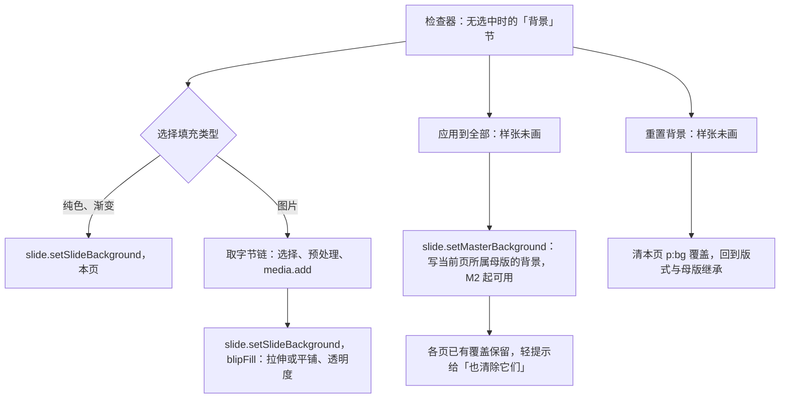

怎么读：本页设置与重置都只动当前页的覆盖；「应用到全部」按 PRD ED-20 写入当前页所属母版的背景、不逐页复制（rulings §4.25 TB-45，原「M2 逐页写入、M3 起是否改写母版待决」作废），带单独背景的页保持不变，轻提示里给「也清除它们」（[50/21](21-elements-structure.md) §5 ⑥⑧）。「背景」节的填充方式与颜色以设计 03-02 §4.1、03-28 §3.6 为准（DS-20）；「应用到全部」「重置背景」两个动作第 1 批样张未画（03-28 §3.6 把它们归 03-02 / 03-03），落点随实现。

依据：PRD ED-20；rulings §4.25 TB-45；50/21 §5；50/11 §6；证据 R `elementDesign`「背景」openQuestions。

### 12.2 能力表

| id | 能力 | 出处 | 实现落点 | 命令 id | 交互要点 | 复用 / 自研 | 里程碑 | 覆盖度 |
|---|---|---|---|---|---|---|---|---|
| ML-01 | 母版视图入口（含普通视图检查器的「编辑版式」「转到版式」）、窗格、上下文条（母版视图的模式横幅，原两枚徽标）、占位符标注、加载与失败态 | ML-01；设计 03-26 §1、§3、§4、§6；规格 50/11 §2–§6 | slide-ui `application/master-view.ts`、`ui/thumbnails/MasterThumbnails.tsx`；slide-render 的占位符标注覆盖层 `master-annotations`（40/07） | `view.setMode{mode:'master'}`、`slide.selectMasterOrLayout`（Op） | 入口为主菜单「视图 › 母版视图」、`Mod+Alt+M`、命令面板与普通视图检查器的「编辑版式」（普通视图唯一的常驻进入入口）、「转到版式」（2026-11-04，rulings §4.25 DS-147、DS-174）；画布列顶部上下文条：图标 +「母版视图」┊ 对象段 ┊ 说明段 +「关闭母版视图」（唯一常驻退出入口，rulings §4.25 DS-21、DS-145），其余横幅在它下方另占一条（TB-14）；全部占位符画占位符标注（DS-148）；需写权限且处于完整形态（视口 ≥ 1024 且不是触控设备，TB-44），版本历史开着与文档打开中也不能进入（TB-209），缩到 < 640 进入仅查看形态即退出（TB-16）；母版视图中主菜单「帮助」多「关于母版继承」（TB-15） | — | M2 P0 | full→已写清 |
| ML-02 | 版式画廊、应用、跨母版、不匹配 toast | ML-02；设计 03-27 §0–§2、03-14 §3.6；规格 50/11 §7 | 检查器无选中「版式」字段、缩略图与画布空白处右键「更换版式…」打开同一个版式画廊（宽 472，更换模式）；slide-ui `ui/layouts/LayoutGallery.tsx`、`application/layout-actions.ts` | `slide.applyLayout` | 不匹配轻提示 + 撤销；评审与只读时检查器只显示当前版式，右键「更换版式…」留在原位不可用（rulings §4.25 TB-17） | — | M2 P0 | full→已写清 |
| ML-03 | 重置页 / 重置占位符字段 | ML-02；设计 03-27 §3；规格 50/11 §6–§7 | 画廊左下「↺ 重置为版式默认…」、主菜单「编辑 › 重置页…」与画布空白处右键「重置页…」；`layout-actions.ts`；`ui/inspector/PlaceholderSection.tsx` | `slide.resetSlide`、`slide.resetPlaceholderFields` | 确认对话框（宽 360，关闭后焦点回检查器「版式」字段）+ 可撤销轻提示「已重置占位符属性」；母版视图里为字段级「↺ 重置为母版值」 | — | M2 P0 | full→已写清 |
| ML-04 | 占位符插入、类型、上限 | ML-03；设计 03-26 §4.3 | 母版视图底部工具条「占位符 ▾」（排在「选择」之后第 2 位、后接竖分隔，单键 P，2026-11-04，rulings §4.25 DS-152、TB-210），向上弹出类型菜单（原母版页签「插入占位符 ▾」作废）；model-slide `layout-commands.ts` | `slide.addPlaceholder`；`P` 与命令面板「插入占位符… P」绑无参 Operation `slide.openPlaceholderMenu`（TB-207） | 类型：内容 / 文本 / 图片 / 表格 / 图表 / 媒体（P2）┊ 标题 / 页脚 / 日期 / 页码（rulings §4.25 DS-30，「文本」取代「正文」、不提供 SmartArt）；菜单项图标为虚线框变体；同类上限已满的项预先写「已包含」，竞态超限时轻提示；菜单项上按 `Enter` 插到视口中心（TB-202） | — | M3 P0 | partial→补齐 |
| ML-05 | 母版文本样式逐级、版式占位符 `lstStyle` | ML-03；设计 03-26；规格 50/11 §6 | `PlaceholderSection.tsx` | `slide.setMasterTextStyle`、`slide.updatePlaceholder{lstStyle}` | 大纲级别 1–9 | — | M3 P0 | full→已写清 |
| ML-06 | 版式 / 母版管理（重命名、复制、插入、重排、删除确认后可撤销） | ML-03；设计 03-26；规格 50/11 §5、§8 | `MasterThumbnails.tsx`、`layout-actions.ts`、`ui/layouts/LayoutDeleteDialog.tsx` | `slide.renameLayout` / `duplicateLayout` / `insertLayout` / `reorderLayouts` / `deleteLayout` / `insertMaster` / `deleteMaster`；母版改名 `slide.renameMaster{masterId, name}`（rulings §4.25 TB-46，`master.setProperties` 的薄命令）；「在普通视图查看」与窗格右键「在普通视图查看引用页」绑无参 Operation `slide.viewLayoutPages`（TB-207） | 删除被引用版式：确认后可撤销；改名在窗格行内就地改（双击名称或右键「重命名」，检查器「名称」字段保留、写同一条命令，2026-11-04，rulings §4.25 DS-150 ①）；母版视图里 `Mod+M` 插入版式、焦点在窗格时 `Mod+D` 复制所选版式（DS-150 ②、TB-196）；检查器「使用此版式」下的「在普通视图查看」退出母版视图并在普通视图选中引用页（DS-150 ③）（[50/11](11-masters-layouts-and-themes.md) §5） | — | M3 P0 | full→已写清 |
| ML-07 | 版式 / 母版背景、隐藏背景图形、保留母版 | ML-03；设计 03-26 §1.2、§5 | 母版视图检查器的「背景」节（版式分段多「跟随母版」、节末「隐藏背景图形」）与「母版」节的「保留母版」勾选，母版右键另有「保留母版」（原母版页签背景组作废）；`ui/inspector/ContainerPropertiesSection.tsx` | `slide.setLayoutBackground` / `setMasterBackground`；`slide.setLayoutProperties{showMasterSp}`；`slide.setMasterProperties{preserve}` | 「保留母版」写明「没有页面使用时也不删除」；「跟随母版」时颜色字段留在原位不可改 | — | M3 P0 | partial→补齐 |
| ML-08 | 主题色 / 字体 / 变体 / 从模板应用 | ML-04 P1；设计 03-28 §0–§3、03-02 §4.1；规格 50/11 §9 | 检查器「主题」节的主题卡：点卡片开主题画廊（宽 320、2 列真实预览；内置主题 5 套：简约 / 商务 / 暗色 / 学术 / 活力，与开始页模板同一套，rulings §4.25 DS-33；下方「变体 · 〈主题名〉」，每个主题 3 个色板变体，DS-32），「调整主题」开主题颜色与字体（「颜色 / 字体」两页；2026-11-04 起盖在检查器栏上、宽同检查器，rulings §4.25 DS-155、TB-193，[50/11](11-masters-layouts-and-themes.md) §9）；母版视图同一卡片；slide-ui `ui/theme/ThemeEditorPanel.tsx`；从模板应用的入口与预览样张未画，随 M3（原 `ui/ribbon/DesignTab.tsx` 随 DS-1 废弃） | `slide.applyTheme`、`setThemeColors`、`setThemeFonts`；从模板应用见 §12.3 | 应用主题直接执行 + 可撤销轻提示「已应用主题「X」，影响 N 页」；M2 只展示当前主题，「调整主题」不可用、写「当前版本暂未开放」 | — | M3 P1 | partial→补齐 |
| ML-09 | 幻灯片背景（纯色 / 渐变 / 图片、应用到全部、重置） | ED-20 P1；设计 03-03 G-35、03-02 §4.1（v3）；规格 50/10 §5；元素设计 [50/21](21-elements-structure.md) | 无选中时检查器「背景」节（先选填充方式 纯色 / 渐变 / 图片，再选颜色，颜色字段写色块 + 色值 + 色槽名 + 不透明度，其下 6 个主题色色块快捷项；第 0 批样张的「页面颜色」节按 rulings §4.25 DS-20 并入本节；设计 03-28 §3.6）；渐变的方向与色标编辑随 ED-20 实现，「应用到全部」「重置背景」第 1 批样张未画，随实现；文件 `ui/inspector/SlideSection.tsx` | `slide.setSlideBackground`（图片同事务 `media.add`）；「应用到全部」`slide.setMasterBackground`（写母版级，rulings §4.25 TB-45） | 图 18-17 | — | M2 P1 | partial→补齐 |
| ML-10 | 备注母版 / 讲义母版预览 | ML-05 P2 | — | — | — | — | M4 P2 | missing→后置 |

### 12.3 补齐方案

- **ML-04**：占位符类型清单以已拍板样张为准（rulings §4.25 DS-30）：内容 / 文本 / 图片 / 表格 / 图表 / 媒体（P2）┊ 标题 / 页脚 / 日期 / 页码，「文本」取代 PRD ML-03 原清单的「正文」、不提供 SmartArt 占位符（PRD ML-03 随之改写；内容族归属仍按 R-d-73，`placeholderFamily` 同步改）；菜单形态见设计 03-26 §4.3（底部一行「选好类型后在画布上拖出占位符」）；同类上限的数值仍待 40/03 §13 Q5 定稿，命令层已按「超限返回 `PLACEHOLDER_LIMIT_EXCEEDED`、不开事务」执行；标题、页脚、日期、页码按当前版式已有的占位符预先置为不可用并写「已包含」，竞态下仍超限时轻提示「该版式已包含〈类型〉占位符」。
- **ML-07**：「保留母版」是母版视图检查器「母版」节里的勾选项（「没有页面使用时也不删除」），母版右键另有同名勾选（设计 03-26 §3、§5），绑定既有 `slide.setMasterProperties{preserve}`；开启后该母版即使无版式被引用也不参与悬空回收。版式「背景」节的「跟随母版」与「隐藏背景图形」分别对应清除版式背景覆盖与 `showMasterSp`。
- **ML-08**：主题画廊列内置主题 5 套（简约 / 商务 / 暗色 / 学术 / 活力，与开始页模板同一套：模板 = 主题 + 母版 + 版式包，rulings §4.25 DS-33，原 Office / 极简灰 / 暖色商务 / 深色科技 4 套作废），每个主题 3 个色板变体（DS-32）；变体 = 同一事务里 `setThemeColors` + `setThemeFonts`（40/10 §2.6 变体色块已绑定前者），不新增 `applyVariant`。「从模板应用」需要先取模板包、再把其主题与母版版式追加进本文档，向导未出稿（设计 G-75），本文不预设命令，列为待决（§31）。
- **ML-09**：图片背景复用 INS-06 的取字节链，`slide.setSlideBackground{slideIds, background}` 的 `background` 为 `blipFill`，模式 `stretch`（默认）或 `tile`，透明度写 `alphaModFix`；背景图片插入同事务 `media.add`（参数允许直接传 blob）。「应用到全部」按 PRD ED-20 写当前页所属母版的背景：`slide.setMasterBackground{masterId, background}`，M2 即可用、与母版视图编辑（M3）无关，不逐页复制（rulings §4.25 TB-45，原「M2 一个事务逐页写同一背景」作废）；带单独背景的页保持不变，轻提示「已应用到母版，影响 N 页」并给「也清除它们」（随后一次批量把这些页设为 `null`，[50/21](21-elements-structure.md) §5 ⑥⑧）；「重置背景」写 `background: null` 清本页覆盖。

## 13. 幻灯片管理（SLD）

### 13.1 怎么实现

页级操作集中在左栏：缩略图列表（slide-ui `ThumbnailRail.tsx`，虚拟列表 @tanstack/react-virtual、拖拽 pragmatic-drag-and-drop）及其右键、上方的「新建幻灯片 ▾」与「+」（v3 样张；原开始 › 幻灯片组随 DS-1 取消），命令都在 model-slide `slide-commands.ts`。跨页命令（重排、新建、删除版式）在渐进打开未到齐前等待 `unit/loaded`（rulings §4.18 CO-12）。本轮补的是「节」：模型字段、折叠态与 M3 的节命令，以及重用其它文档的幻灯片。

**图 18-18 重用其它文档的幻灯片**

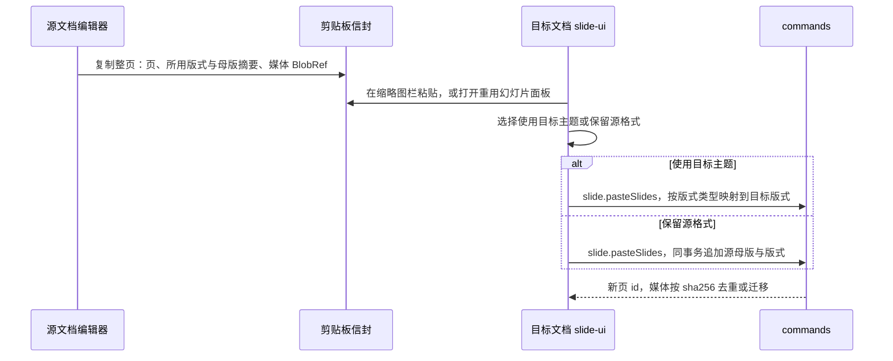

怎么读：整页片段沿用 50/04 §9 的跨文档剪贴板信封，只是多带了版式与母版摘要；版式映射复用 `planLayoutChange` 与 `defaultLayoutOf` 的规则，因此与「换版式」同一口径；媒体已在对象存储里的按 sha256 直接引用，否则走迁移。

依据：PRD ED-11、ED-17；50/04 §9；设计缺口 G-65。

### 13.2 能力表

| id | 能力 | 出处 | 实现落点 | 命令 id | 交互要点 | 复用 / 自研 | 里程碑 | 覆盖度 |
|---|---|---|---|---|---|---|---|---|
| SLD-01 | 新建（同版式 / 版式库 / Enter） | ED-11；设计 03-14、03-02 §3.1（v3）；规格 50/10 §6 | slide-ui 左栏「新建幻灯片 ▾」（版式库）与「+」（同版式）、`ui/thumbnails/ThumbnailRail.tsx` | `slide.addSlide` | `Mod+M`；缩略图栏 Enter；网格视图左上胶囊另有「新建幻灯片」 | — | M2 P0 | full→已写清 |
| SLD-02 | 复制 / 删除 / 隐藏页 | ED-11；设计 03-14 §3.3、§3.5；规格 50/10 §6 | `ThumbnailRail.tsx` 右键；隐藏页的常驻入口是无选中检查器「放映」节的「放映时跳过此页」，缩略图右键「隐藏幻灯片 / 取消隐藏」是第二入口（rulings §4.25 DS-25） | `slide.duplicateSlide`、`deleteSlides`、`setSlideHidden` | 删除不弹确认、轻提示「已删除 N 页」带撤销；只剩 1 页时删除留在原位不可用、写「文档至少保留 1 页」；隐藏页页码加斜线、斜线眼睛图标、缩略图 60% 不透明 | — | M2 P0 | full→已写清 |
| SLD-03 | 拖拽重排（多选、跨节、键盘等价） | ED-11；设计 03-14；规格 50/10 §6 | `ThumbnailRail.tsx` | `slide.reorderSlides` | `Mod+Shift+↑/↓`；`unitLoaded` 前禁用 | pragmatic-drag-and-drop、@tanstack/react-virtual | M2 P0 | full→已写清 |
| SLD-04 | 节标题显示与折叠 | ED-11 P1、OF-11；设计 03-14 G-42 | slide-ui `domain/thumbnails-model.ts`（节行）、`infrastructure/session-memory.ts`（折叠态）；model-slide `presentation.ts` 补 `sections` | 折叠为本地态 | 节标题行可折叠；折叠态不同步、不写文件 | — | M2 P1 | partial→补齐 |
| SLD-05 | 节增删改名重排 | ED-11 M3；设计 03-14 §3.4 | 缩略图栏节标题右键：M2 只有「展开此节 / 折叠此节 ┊ 全部折叠 · 全部展开」+ 说明行「节的新增、重命名与排序将在后续版本提供」，菜单由 slide-ui 直接渲染、不开放贡献（rulings §4.25 TB-23）；M3 的增删改入口也在这里，样张随 M3 | `slide.addSection` / `renameSection` / `removeSection` / `moveSection` 新增（§4.21） | 删除节时选「保留页」或「连页删除」 | — | M3 | missing→补齐 |
| SLD-06 | 重用其它文档的幻灯片 | ED-11、ED-17 M3 P1；设计缺口 G-65；规格 50/04 §9 | 跨文档剪贴板（CLP-03）；slide-ui「重用幻灯片」面板 | `slide.pasteSlides` 新增（§4.21） | 图 18-18；使用目标主题 / 保留源格式 | — | M3 P1 | partial→补齐 |
| SLD-07 | 页面尺寸 / 方向 | PRD 01 §2.2 P2；设计 03-28 灰显 | 主菜单「文件 › 幻灯片大小…」，P2 前留在原位、不可用并标 P2（rulings §4.25 DS-31；样张状态按 DS-31 补画；原设计 › 幻灯片大小作废，设计 09 §3.1） | `slide.setSlideSize` 新增（§4.21，P2） | 「缩放内容 / 确保适合」二选一 | — | M2 P2 | missing→后置 |
| SLD-08 | 规模上限守卫 UI | SV-08；设计缺口 G-55；规格 50/04 §10 | model-slide `domain/invariants/element-limits.ts`；slide-ui toast | 各新增实体命令 | 超限返回 `document.quota_exceeded`，不开事务 | — | M2 | full→已写清 |

### 13.3 补齐方案

- **SLD-04**：节来自 `presentation.xml` 扩展里的 `p14:sectionLst`。建模为 `Presentation.sections: Record<SectionId, {name, order: FracKey}>` + 每页 `sectionId`（新增字段，30/04 回写），导出时按页序重建 `p14:sectionLst`；这样「插入新页、移页」只改页上的一个键，不改节里的页列表，并发安全。缩略图列表模型在节边界插入节标题行；折叠态按 `unitId` 存在 slide-ui 会话内存（`session-memory.ts`），不写 localStorage、不同步给协作者。
- **SLD-05**：`slide.addSection{beforeSlideId, name}`、`renameSection{sectionId, name}`、`removeSection{sectionId, withSlides}`、`moveSection{sectionId, after}`（整节连同页一起移：一个事务里改节的 `order` 与页的 `order`）；入口在节标题右键（M3 样张未画；M2 的节标题右键只有折叠类条目与说明行，设计 03-14 §3.4），双击改名，键盘等价同页重排。
- **SLD-06**：「重用幻灯片」面板（M3）列出最近文档的缩略图，选中页后与跨文档粘贴走同一路径（图 18-18）：`slide.pasteSlides{after, slides, mode: 'useDestinationTheme' | 'keepSource'}`；`keepSource` 时同事务追加源母版与所用版式（新 id），受规模守卫与 200 页上限约束。
- **SLD-07（P2）**：入口为主菜单「文件 › 幻灯片大小…」（作用于整篇的文档级设置；P2 开放前留在原位、不可用并标 P2，rulings §4.25 DS-31）。`slide.setSlideSize{width, height, scale: 'maximize' | 'ensureFit'}`，一个事务按比例改写全部页、版式与母版的元素变换；是全文命令，`unitLoaded` 前禁用。

## 14. 视图与缩放（VIEW）

### 14.1 怎么实现

视图是纯前端状态：缩放与平移由 engine-render 的 `Viewport` 持有（S3），面板宽度与开合由 ui-react 的 `EditorLayoutState` 记忆，视图模式由 ui-core 的 `view.setMode` 切换（普通 / 母版 / 演讲者）。三者都不入历史。本轮只有一项未表态：大纲视图（VIEW-04；幻灯片浏览已由 v3 网格视图承担、归入 PRD ED-22，阅读视图由查看器覆盖）。2026-10-04 起 v3 分单页、网格两种视图（rulings §4.25 DS-3、DS-4）：样张以 URL 参数 `view` 为唯一状态源，左栏顶部、网格左上胶囊与主菜单「视图」三处入口读写同一状态（设计 09 §3.2），产品里的状态与改写方式见 50/10 §2.3（参考应用把 `editorView` 同步到地址栏查询参数 `view`：缺省的单页不写、切换用 replace、不新增浏览历史，TB-30）；原页签行的「普通｜母版」分段与状态栏缩放条随 DS-1、DS-6 废弃（VIEW-01、VIEW-03）。

**图 18-19 视图模式与建议的新增视图**

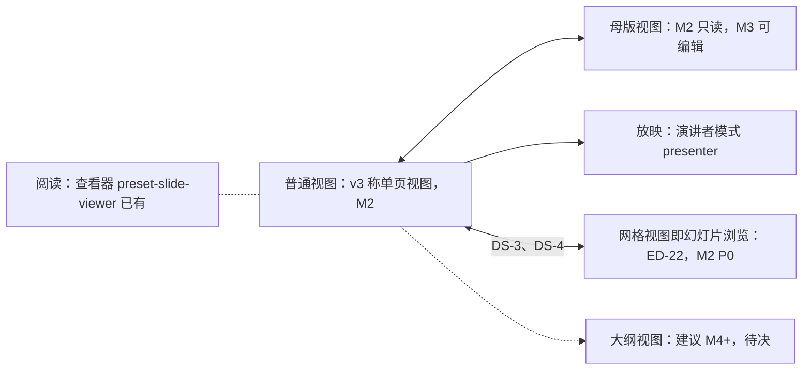

怎么读：实线是已定的视图——网格视图的界面由 v3 样张定下（全部幻灯片按画布宽排 1–3 列，两侧面板收为浮动胶囊），需求已归入 PRD 02 ED-22（M2 P0；PRD README PD-27 的默认值，待用户确认），即原「幻灯片浏览视图」；虚线是 VIEW-04 剩下的范围：大纲视图仍是建议。「阅读视图」不另做，已由只读查看器覆盖（50/12）。

依据：50/10 §2.3、§3.3、§8；50/11 §1；50/12 §1；rulings §4.25 DS-3、DS-4；PRD 02 ED-22、PRD README PD-27；设计 09 §3.2、03-02 §5。

### 14.2 能力表

| id | 能力 | 出处 | 实现落点 | 命令 id | 交互要点 | 复用 / 自研 | 里程碑 | 覆盖度 |
|---|---|---|---|---|---|---|---|---|
| VIEW-01 | 缩放、平移、页导航、视图事件 | ED-22；设计 03-20、03-02 §3.5、§5.1（v3）；规格 50/10 §8、50/05 §4 | engine-render `application/services/viewport-state.ts`；缩放读数（如「77% ▾」，实测比例，03-02 §3.5）在检查器页签行右端与网格右上胶囊（v3 样张；ui-react `shell/ZoomMenu.tsx`，取代原状态栏缩放条 `ZoomBar.tsx`） | `slide.setZoom`、`slide.setCurrentSlide`（Op） | `Mod+0` 适应、`Mod+1` 100%；捏合缩放；样张缩放菜单（单页与网格共用）提示 ⌘+ / ⌘− / ⌘0 / ⌘1，已与 ED-16 一致（设计 03-02 §3.5、§10 第 2 条） | 自研 S3 | M2 P0 | full→已写清 |
| VIEW-02 | 面板拖宽与记忆、断点三形态 | ED-22、Q19；设计 03-20 §6、03-02 §5a；规格 50/10 §2 | ui-react `shell/EditorShell.tsx` | 本地（`EditorLayoutState`） | 三形态按 1024 / 640 分界（rulings §4.10 Q19；验证视口 1280 / 800 / 480，50/10 V2）：桌面（≥ 1024）、紧凑（640–1024，两侧收为胶囊与抽屉）、仅查看（< 640 或触控设备，顶部条 · 当前页 · 底部翻页条）（形态与样张按 rulings §4.25 DS-17、设计 03-02 §5a）；三条分隔条：左栏 160–420（240）、检查器 240–480（280，TB-25）、备注 64–320（120）；按文档记在本机，键 `cordex.layout.{rememberKey}`（apps/web 传 documentId），登出与换人时清除（TB-24、TB-41，50/02 §10.1） | react-resizable-panels | M2 P0 | full→已写清 |
| VIEW-03 | 普通 / 母版视图切换（原页签行分段） | ML-01；设计 03-20、03-26、03-02 §2.4（v3）；规格 50/11 §3 | 主菜单「视图」的「母版视图」项、`Mod+Alt+M` 与命令面板，普通视图另有检查器「版式」节的「编辑版式」（唯一的常驻进入入口）与占位符顶行的「转到版式」（2026-11-04，rulings §4.25 DS-147）；退出的常驻入口是上下文条的「关闭母版视图」（rulings §4.25 DS-21）；ui-react `shell/MainMenu.tsx` 与 slide-ui `domain/menu-spec.ts`（`mainMenu.view` 条目；原分段控件 `ViewModeSwitch.tsx` 已于 2026-10-04 作废） | `view.setMode`（Op） | 评审与非完整形态下菜单项禁用并注明原因（「评审模式下不可用」「只有查看权限」「需要编辑权限」，设计 03-26 §1.1；不是完整形态——视口 < 1024 或触控设备——时为「在更大窗口中编辑」，rulings §4.25 TB-44，原「需要 ≥ 1024 宽度」作废；2026-10-22 起触控设备（只指平板：触控、≥ 640）写「在电脑上编辑」、手机不论是否触控按窗口窄写、嵌入写「当前区域太窄，暂不可用」，TB-136、TB-163、DS-112，50/11 §3），版本历史开着时写「关闭版本历史后可用」、文档打开中写「文档打开后可用」（TB-209）；`Mod+Alt+M` 不切换、给一次轻提示「母版视图：〈原因〉」（DS-163；放映中不响应、不提示——放映没有编辑器外壳，不参与入口判定，50/10 §10.4 第 21 行） | — | M2 P0 | full→已写清 |
| VIEW-04 | 大纲视图（幻灯片浏览已由网格视图承担，归 ED-22；阅读视图由查看器覆盖） | PRD 无（网格视图见 ED-22） | 见 §14.3 | — | — | — | 未排 | missing→待决 |
| VIEW-05 | 备注页 / 讲义视图 | ML-05 | — | — | — | — | M4 P2 | missing→后置 |

### 14.3 补齐方案

- **VIEW-04（待决，建议）**：阅读视图不另做（查看器已覆盖）；大纲视图需要跨形状的文本编辑宿主，建议 M4+，需在 PRD 02 补条目后才排期（§31）。VIEW-04 只剩大纲视图，覆盖度仍记待决。
- **幻灯片浏览视图（2026-10-04 移出 VIEW-04）**：由 v3 网格视图承担（全部幻灯片按画布宽排 1–3 列，单击选中、双击或 Enter 回单页并定位，两侧面板收为左上「文档」、右上「协作与分享」胶囊，rulings §4.25 DS-3、DS-4，设计 03-02 §5），即本节原建议的「缩略图栏的网格形态」——同一个 `ThumbnailListModel` 与虚拟列表换成多列网格铺满画布区；需求归入 PRD 02 ED-22（M2 P0；PRD README PD-27 默认值，待用户确认），原建议的「M3 P2、补 PRD 条目后排期」作废（§31 未决第 10 条已关闭）。网格里与左栏同一套多选、拖拽重排与缩略图右键（设计 03-14 §3.8，第 1 批拍板），全部复用 SLD 能力。

## 15. 查找与替换（FND）

### 15.1 怎么实现

查找是只读查询，不经命令：model-slide 查询层新增一个文本检索函数，在 `slides.body()` 的段落与 run 上做子串匹配（S18），结果是 `{slideId, shapeId, paragraph, offset, length}` 列表；slide-ui 的查找面板持有结果与当前位置，高亮画在覆盖层，缩略图栏按页显示命中角标。替换才写 Store：单处替换是一条 `deleteText + insertText` 的事务，全部替换是一个新批量命令、一个事务、一步撤销。

**图 18-20 查找与全部替换**

```mermaid
sequenceDiagram
  participant P as 查找面板 slide-ui
  participant Q as 文本检索 model-slide 查询层
  participant O as 覆盖层与缩略图角标
  participant C as commands
  P->>Q: 关键词、区分大小写、全字匹配，M2 只查幻灯片内容
  Q-->>P: 命中列表，按页与 z 序排序
  P->>O: 高亮全部命中，当前命中加强
  P->>P: Enter 下一处，Shift+Enter 上一处，跨页时切页
  P->>C: 全部替换：slide.replaceAll，一个事务
  C-->>P: 替换数 N，轻提示「已替换 N 处」带撤销
  P->>Q: 在新文本上重新检索
```

怎么读：检索与导航完全在本地完成，不产生事务；只有替换进命令层。M2 只查幻灯片内容、不查演讲者备注（rulings §4.25 TB-27）。渐进打开未到齐时查找面板带 `enablement: unitLoaded`，控件保留并提示等待（rulings §4.18 CO-12）。

依据：PRD ED-13、OF-16；设计 03-21；50/04 §2。

### 15.2 能力表

| id | 能力 | 出处 | 实现落点 | 命令 id | 交互要点 | 复用 / 自研 | 里程碑 | 覆盖度 |
|---|---|---|---|---|---|---|---|---|
| FND-01 | 查找面板（大小写、全字、计数、跳页、高亮） | ED-13、OF-16；设计 03-21 | model-slide `domain/query/text-search.ts` 新增（§4.21）；slide-ui `ui/find/FindReplacePanel.tsx` 新增（§4.21）；render-dom 命中高亮覆盖层；`domain/thumbnails-model.ts` 角标 | 本地（只读查询） | `Mod+F` 与主菜单「编辑 › 查找…」；面板宽 400、浮在画布列右上，计数「i / n」，「区分大小写」Aa 与「全字匹配」ab 两个开关在查找框内（设计 03-21 §1.2）；紧凑形态收窄为 320、选项进「⋯」；M2 只查幻灯片内容（rulings §4.25 TB-27，原「可选含备注」作废）；命中所在页的缩略图右下角打放大镜计数标记 | 自研 S18 | M2 P1 | partial→补齐 |
| FND-02 | 替换 / 全部替换（一个事务、保留首 run 格式） | ED-13；设计 03-21 | 同上 | 单处 `slide.deleteText` + `insertText`；全部 `slide.replaceAll` 新增（§4.21） | 替换键 Windows / Linux `Ctrl+H`、macOS `Cmd+Shift+H`（2026-10-05 由 `Mod+H` 改，rulings §4.25 DS-16）；全部替换一步撤销，轻提示「已替换 N 处」（部分未替换时为警告色并写出跳过数）；评审、只读浏览与降权下面板不显示替换行与展开按钮、替换键只打开查找（rulings §4.25 TB-28） | 自研 S18 | M2 P1 | partial→补齐 |
| FND-03 | 正则查找 | ED-13 P2 | 同 FND-01 | — | JS `RegExp`（`u` 标志）；单次检索超时中止 | — | M2 P2 | missing→后置 |
| FND-04 | 查看器搜索 | OF-14；设计 03-25；规格 50/12 §4 | preset-slide-viewer 的 `viewer-search` 惰性件 | — | 与编辑器查找同交互、无替换区 | — | M2 P1 | full→已写清 |

### 15.3 补齐方案

- **FND-01**：`findMatches(body, query, {matchCase, wholeWord}) → Match[]` 是 iso 纯函数（M2 只查幻灯片内容，rulings §4.25 TB-27，原 `includeNotes` 参数删除；原写名 `searchText` 按 40/03 §5 的登记改名），放 model-slide `domain/query/text-search.ts`（40/03 §4、§5 已登记），先按 run 拼接段落文本再匹配，命中位置映射回段落偏移，跨 run 的命中也能找到；全字匹配用 `Intl.Segmenter` 的词粒度判断边界（中文按词典分词结果）。面板放 `ui.panel{slot:'floating'}`（槽位名以 [09](09-ui-system-and-theming.md) §6.1 为准，层级 `--layer-panel` 30，rulings §4.25 TB-2），不遮挡当前命中；评审、只读浏览与降权下不显示替换行与展开按钮（TB-28，FND-02）；高亮复用 render-dom 覆盖层（与文本选区同样的几何，由 `CaretMap` 算出矩形）。预算按 PRD 04 NF-01：D200 全文检索 ≤ 200 ms、全部替换 ≤ 500 ms（50/13 §3、§12 的 `client.search.d200` / `client.replaceAll.d200`）。
- **FND-02**：`slide.replaceAll{matches, replacement}`：命令在执行时重新校验每处命中仍然有效（协同下可能已被改），逐处以 `text.applyDelta` 删除并插入，替换文字沿用该处首个 run 的格式；一个事务、一步撤销，结果带实际替换数。单处替换沿用既有 `deleteText + insertText`（同一事务）。

## 16. 剪贴板（CLP）

### 16.1 怎么实现

剪贴板管线已定（50/04 §9）：ui-core `clipboard-pipeline.ts` 做 MIME 协商（S16），内部格式是 `application/x-cordex+json` 信封，外部 HTML 只经 htmlparser2 取纯文本、不进 DOM、不发网络请求，上限 25 MB。粘贴的最终落点是 `slide.pasteShapes`（内部片段）、`slide.insertPicture`（图片）或新文本框（纯文本）。本轮唯一缺口是 P2 的粘贴变体菜单与 PowerPoint 互粘。

**图 18-21 粘贴的 MIME 协商**

```mermaid
flowchart TB
  paste["粘贴事件"] --> q1{"有 x-cordex+json 信封吗"}
  q1 -->|"有"| same{"同一文档吗"}
  same -->|"是"| p1["slide.pasteShapes，重生 id，清理动画引用"]
  same -->|"否，M3"| p2["跨文档：媒体迁移、版式映射"]
  q1 -->|"没有"| q2{"有图片吗"}
  q2 -->|"有"| p3["slide.insertPicture，走图片取字节链"]
  q2 -->|"没有"| q3{"有 HTML 或纯文本吗"}
  q3 -->|"有"| p4["htmlparser2 取文本，进文本编辑态则插入，否则新建文本框"]
  q3 -->|"没有"| p5["忽略并提示不支持的内容"]
```

怎么读：从上往下取第一个命中的格式；文本编辑态下的粘贴只取纯文本插入光标处（格式不带入，P2 的粘贴变体才提供「保留源格式」）。

依据：PRD ED-17；50/04 §9；R-d-20。

### 16.2 能力表

| id | 能力 | 出处 | 实现落点 | 命令 id | 交互要点 | 复用 / 自研 | 里程碑 | 覆盖度 |
|---|---|---|---|---|---|---|---|---|
| CLP-01 | 内部复制 / 剪切 / 粘贴（片段 MIME、id 重生成） | ED-17；设计 03-19；规格 50/04 §9 | ui-core `input/clipboard-pipeline.ts`；slide-ui `command-bindings.ts` | `slide.pasteShapes`；剪切 = 序列化 + `slide.deleteShapes` | 粘贴位置：原位或视口居中错位 | 自研 S16 | M2 P0 | full→已写清 |
| CLP-02 | 粘贴图片 / HTML 取纯文本 / 纯文本新建文本框 | ED-17；设计 03-19；规格 50/04 §9 | 同上 | `slide.insertPicture`；`slide.insertShape{kind:'sp'}` + `slide.insertText` | 图 18-21 | htmlparser2（惰性） | M2 P0 / P1 | full→已写清 |
| CLP-03 | 跨文档粘贴（媒体迁移、版式映射） | ED-17 M3；设计缺口 G-65；规格 50/04 §9 | 同上；apps/web 媒体迁移 | `slide.pasteShapes`（跨文档参数） | 版式映射同 SLD-06 | — | M3 P1 | full→已写清 |
| CLP-04 | 粘贴变体菜单 / PowerPoint 互粘 CF_HTML | ED-17 P2；设计 03-05 §3、03-19 §1.2、§1.3、§5 | 主菜单「编辑 › 粘贴选项 ▸」与画布空白处右键「粘贴选项 ▸」（M2 留在原位不可用、标 P2、写「后续版本提供」）；文字右键「粘贴为纯文本」同为 P2（rulings §4.25 TB-19）；原「粘贴后浮出的变体按钮」作废 | 复用上列命令 | 保留源格式 / 仅文本（`Mod+Shift+V`，P2，rulings §4.25 DS-29）/ 作为图片 | — | M2 P2 | missing→后置 |

## 17. 撤销与重做（UND）

### 17.1 怎么实现

撤销由 Store 推导（ADR-0007），命令层保证「一次操作一个事务」，UI 层只负责步骤名、合并规则与撤销后的定位（50/04 §5–§6）；协同下撤销只撤本机、被他人后写的键跳过并给恢复入口。三项都已写清，本节只给索引与一张图。

**图 18-22 撤销步的合并规则**

```mermaid
flowchart LR
  tx["新事务"] --> q1{"与上一步同标签且间隔 ≤ 500 ms"}
  q1 -->|"是，如连续键入"| merge["并入上一步"]
  q1 -->|"否"| q2{"是一次拖拽的收口吗"}
  q2 -->|"是"| one["单独一步：一次拖拽一个命令"]
  q2 -->|"否"| q3{"IME 组合结束吗"}
  q3 -->|"是"| ime["组合整段为一步"]
  q3 -->|"否"| sep["单独一步"]
```

怎么读：只有连续键入这类同标签、间隔短的事务会合并；拖拽与 IME 组合天然各是一步；微移不合并（每次按键一步）。

依据：PRD ED-14；50/04 §5；50/06 §4。

| id | 能力 | 出处 | 实现落点 | 命令 id | 交互要点 | 复用 / 自研 | 里程碑 | 覆盖度 |
|---|---|---|---|---|---|---|---|---|
| UND-01 | 菜单与快捷键（原应用栏按钮）、步骤名、撤销后跳页选中 | ED-14；设计 03-19、03-02 §7.1（v3）；规格 50/04 §5 | 主菜单「编辑」前两项「撤销：〈步骤名〉 ⌘Z」「重做 ⇧⌘Z」（没有步骤时置灰并写「没有可撤销的操作」，只读时写模式原因；设计 03-19 §1.2、§2）；kernel 内置命令；ui-react `shell/MainMenu.tsx`（「编辑」；原应用栏 `AppBar.tsx` 已于 2026-10-04 作废） | `core.undo` / `core.redo` | `Mod+Z` / `Mod+Shift+Z` / `Mod+Y` | — | M2 P0 | full→已写清 |
| UND-02 | 合并规则（500 ms、一次拖拽一步、IME） | ED-14；设计 03-19；规格 50/04 §5、50/06 §4 | model-core 历史；slide-ui 命令标签 | — | 图 18-22 | — | M2 P0 | full→已写清 |
| UND-03 | 协同撤销跳过提示与恢复命令 | CO-09；设计 05 §6、03-19；规格 50/04 §6 | slide-ui 轻提示；model-core 恢复记录 | 恢复我的值、恢复元素（50/04 §6.2；rulings §4.25 TB-26 保留） | 部分跳过为中性轻提示、整步跳过为警告色，按钮「恢复我的值」/「恢复元素」（设计 03-19 §1.4、§4.2） | — | M3 P0 | full→已写清 |

## 18. 评论（CMT）

评论数据与命令在 `@cordexjs/comments` 包（rulings §4.19 D-COMMENTS-PKG），slide-ui 只贡献 slide 专属的锚点 resolver、检查器「评论」页签与画布评论钉；行为全部见 [50/08](08-comments-and-version-history.md)。

**图 18-23 评论在编辑器里的三个落点**

```mermaid
flowchart LR
  pkg["comments 包：线程、回复、解决、筛选"] --> tab["检查器评论页签：slide-ui CommentsTab"]
  pkg --> pins["画布评论钉：slide-ui CommentPins"]
  pkg --> rail["缩略图角标：每页未解决数"]
  resolver["slide 锚点 resolver：页、形状、文字范围"] --> pkg
  review["评审条：评论、高亮、上一处、下一处，替换底部工具条"] --> pkg
  tool["底部工具条「评论」：点对象或空白处发起，发表后工具保持按下"] --> pkg
```

怎么读：评论的数据与权限只在 comments 包里；slide-ui 提供「锚点在哪一页、哪个形状、哪段文字」的解释，以及三个显示位置。发起评论的入口是底部工具条「评论」（v3，DS-1）与评审条：评审模式下评审条替换底部创建工具条（浏览 · 评论 · 高亮 ┊ 上一处 / 下一处评论 ┊「评审模式」，有编辑权限时另有「返回编辑」；rulings §4.25 DS-23），其中「浏览」、模式标识与「返回编辑」由外壳内置，`ui.toolbar{slot:'reviewBar'}` 只承载评论、高亮与上一处 / 下一处（TB-1）；评论线程与面板的交互已随 design-language-v3 第 2 批定稿（rulings §4.25 DS-43…DS-46，[50/08](08-comments-and-version-history.md) §5）：新评论唯一的常驻入口是工具条「评论」（点对象落元素锚点、点空白处落页级锚点，落点旁出浮动撰写框，发表后工具保持按下），右键「添加评论 C」是第二入口，面板里不常驻撰写框。

依据：50/08 §2、§5–§6；40/10 §3；设计 03-02 §3.4（工具条「评论」）、§6.2（评审条）、03-06；rulings §4.25 DS-23、DS-43…DS-46、TB-1。

| id | 能力 | 出处 | 实现落点 | 命令 id | 交互要点 | 复用 / 自研 | 里程碑 | 覆盖度 |
|---|---|---|---|---|---|---|---|---|
| CMT-01 | 评论线程、锚点、画布钉、面板 | CO-04；设计 03-06；规格 50/08 §5–§6 | `@cordexjs/comments`（40/20）；slide-ui `ui/inspector/CommentsTab.tsx`、`ui/canvas-overlays/CommentPins.tsx`、`infrastructure/comments/slide-anchor-resolver.ts` | `comments.addThread` 等 | 工具条「评论」在画布上点对象或空白处发起，落点旁浮动撰写框、发表后工具保持按下（DS-44、DS-45）；右键「添加评论 C」为第二入口；检查器「评论」页签分段筛选、缺省「当前页」，钉与列表不编号（DS-43）；评审模式下检查器默认打开「评论」页签（DS-23）；点钉切到评论页签并定位线程；写了内容的撰写框换页、进网格视图或切到评审模式时按页留草稿，回来原样恢复、不抢焦点（DS-65、TB-79、TB-84）；手机底部面板可发表与回复（DS-46） | — | M3 P0 | full→已写清 |

## 19. 放映（SHW）

### 19.1 怎么实现

放映的界面行为 2026-10-22 随第 3 批定稿（rulings §4.25 DS-106…DS-109、TB-102…TB-104、TB-111…TB-113，细则见 [10](10-editor-shell-and-interaction.md) §9）。放映复用编辑器的同一个 DOM Surface：slide-ui `present.ts` 切 `view.setMode('presenter')`、请求全屏（目标是跨路由常驻容器）、接管翻页键；动画与切换 M1–M3 不播放，按主序列可见性终态显示（Q7）。本轮补齐放映中的点击动作：超链接与动作按钮支持哪些 `ppaction` 动词。

**图 18-24 放映中点击一个带动作的元素**

```mermaid
flowchart TB
  click["放映中点击元素"] --> has{"有 hlinkClick 吗"}
  has -->|"没有"| next["按普通点击：下一页"]
  has -->|"有"| kind{"动作类型"}
  kind -->|"http 或 https"| ext["ui-core openExternal，新标签打开"]
  kind -->|"mailto 或 tel"| show["不激活，提示目标并可复制"]
  kind -->|"hlinksldjump"| jump["跳到指定页"]
  kind -->|"hlinkshowjump"| verb["下一页、上一页、第一页、最后一页、最近观看、结束放映"]
  kind -->|"macro、program、ole、customshow、hlinkfile"| deny["不执行，提示不支持"]
```

怎么读：只有 http(s) 会离开应用，且只经 `openExternal` 一个出口；页内跳转与六个 `hlinkshowjump` 动词在舞台内执行；宏、程序、OLE 动词、自定义放映与本地文件一律不执行。

依据：PRD ED-19、ED-21；R-d-77；ADR-0008 决策 5。

### 19.2 能力表

| id | 能力 | 出处 | 实现落点 | 命令 id | 交互要点 | 复用 / 自研 | 里程碑 | 覆盖度 |
|---|---|---|---|---|---|---|---|---|
| SHW-01 | 进入 / 退出、全屏降级 | ED-21；设计 03-11；规格 50/10 §9.1 | slide-ui `application/present.ts`、`ui/present/PresenterStage.tsx`；apps/web `pages/present/PresentPage.tsx` | `view.setMode{mode:'presenter'}`（Op） | F5 从头、Shift+F5 当前页；全屏被拒时降级为窗口内舞台，窗口内舞台的「更多」有「全屏」（浏览器或容器不允许全屏时不出现，TB-134）；放映中 `F5` / `Shift+F5` 不刷新；末页之后进结束页；退出停在最后显示的页（DS-108、DS-109、TB-102） | 自研（复用同一 DOM Surface） | M2 P1 | full→已写清 |
| SHW-02 | 翻页、跳页、黑白屏、控制条 | ED-21；设计 03-11；规格 50/10 §9.2 | `present.ts`、`PresenterStage.tsx` | `slide.setCurrentSlide`（Op） | B / W 同键恢复；隐藏页跳过，数字 + `Enter` 可跳到隐藏页（TB-104、TB-111）；鼠标单击下一页、触控单击只显隐控制条；控制条与指针静止 3 秒后一起隐藏，没有「显示 / 隐藏光标」与键盘提示浮层（DS-107） | — | M2 P1 | full→已写清 |
| SHW-03 | 主序列可见性终态 | ED-21、Q7；设计 03-11；规格 50/05 §12 | slide-render `domain/compose/animation-end-state.ts` | — | 不播放动画，只显示终态 | — | M2 P1 | full→已写清 |
| SHW-04 | 超链接与动作按钮点击 | ED-19、ED-21；设计 03-11；规格 50/10 §9.3 | `present.ts` 点击命中；model-slide `domain/model/drawing/slide-hyperlink.ts` | —（只读执行） | 图 18-24 | — | M2 P1 | partial→补齐 |
| SHW-05 | 跟随主讲人 | CO-03；设计 03-11；规格 50/10 §9.3 | `present.ts`；awareness | — | 观众先在编辑器里跟随主讲人再进放映，从对方当前页开始；跟随条「停止跟随」/「返回同步」，失去连接时常驻说明；协议与主讲人一侧不变（DS-106、TB-113） | — | M3 | full→已写清 |
| SHW-06 | 演讲者视图 / 动画与切换播放 / 排练计时 / 自定义放映 | ED-21 P2；规格 50/10 §12.2 | — | — | — | — | M4+ P2 | missing→后置 |

### 19.3 补齐方案

- **SHW-04**：支持的动词清单即图 18-24：`ppaction://hlinksldjump`（指定页）与 `ppaction://hlinkshowjump?jump=nextslide | previousslide | firstslide | lastslide | lastslideviewed | endshow`（R-d-77 补 `lastslideviewed`、`endshow`；「最近观看」由 `present.ts` 维护一个本地页码栈）。编辑态 `Mod+点击` 可预览跳转。动作按钮插入后自动弹「操作设置」对话框（单击动作；悬停动作 P2），写 `slide.setAction{shapeId, click, hover?}`（新增 §4.21），与插入同一撤销步，元素设计见 [50/22](22-elements-shapes-and-lines.md)。

## 20. 导出与打印（EXP）

### 20.1 怎么实现

pptx 导出在 Worker 里跑（`export.worker.ts`，comlink），协同中先等同步归零，只导整份；图片导出走主线程单页栅格化（`exportImage`，S14），M2 四种范围都在浏览器生成；PDF 与 M3 起 PNG「全部页」交给服务端作业（60 线），前端只管作业状态、取消与下载。导出完成即下载并关闭对话框、以轻提示收尾；不设打印入口（2026-10-22，rulings §4.25 DS-100…DS-104）。

**图 18-25 服务端导出作业在前端的状态**

```mermaid
stateDiagram-v2
  state "选择格式与范围" as pick
  state "提交中" as submit
  state "排队中：正在排队，马上开始，只有取消" as queued
  state "生成中：第 N / M 页，只有取消" as running
  state "已下载：关闭对话框，轻提示带下载" as done
  state "失败：可重试" as failed
  pick --> submit : 点导出
  submit --> queued : 作业已受理
  queued --> running : 开始处理
  running --> done : 完成，自动下载
  running --> failed : 出错
  queued --> pick : 取消，调导出取消端点
  running --> pick : 取消，调导出取消端点
  failed --> submit : 重试
  done --> [*]
```

怎么读：状态由 apps/web 轮询作业状态驱动（`GET /jobs/:id`，就绪后经 `GET /exports/:jobId` 现签下载地址，60/15 §3.9）；排队与生成中只有「取消」一个出口（`Esc`、× 等同），取消调 `POST /exports/:jobId/cancel`、回到选择态且不留产物，不做后台继续（2026-10-22，rulings §4.25 DS-101）；完成即下载并关闭对话框，焦点回到打开前的位置，画布底部轻提示「已导出「X」」，服务端格式的轻提示多一个「下载」——浏览器拦了自动下载时再点，每次点都现签地址；产物保留 24 小时，不提示链接时效（DS-100）。原「可下载：链接 1 小时有效」「链接已过期 → 重新生成」两态作废。离线时导出按钮禁用（M3）。

依据：设计 03-22；PRD OF-19、SV-02；50/04 §8.3。

### 20.2 能力表

| id | 能力 | 出处 | 实现落点 | 命令 id | 交互要点 | 复用 / 自研 | 里程碑 | 覆盖度 |
|---|---|---|---|---|---|---|---|---|
| EXP-01 | 单人保存、脏状态、离开保护 | ED-23；设计 03-19；规格 50/04 §8.1 | apps/web `application/import-export/export-document.usecase.ts`；脏状态显示在左栏文件名下方的同步状态行（DS-6；ui-react `shell/SyncStatus.tsx`，取代原状态栏） | `Mod+S` → 集成方回调 | 协同模式的离开保护只看在途与离线队列 | — | M2 P0 | full→已写清 |
| EXP-02 | 导出 pptx（Worker、脏部件、等待同步） | OF-18；设计 03-22；规格 50/04 §8.3 | ooxml-pptx `infrastructure/export/export.worker.ts`；apps/web `pages/export/ExportDialog.tsx` | `core.export` | 协同中先等同步归零；只导整份，要部分页先「创建副本」再删页（DS-103） | comlink | M2 P0 | full→已写清 |
| EXP-03 | 导出 PNG / SVG（全部页 / 当前页 / 选定页 / 自定义页码） | OF-19 P1；设计 03-22 | slide-render `thumbnail.service.ts` 的 `exportImage`；render-dom `export/to-image.ts`；`ExportDialog.tsx` | 服务调用 `exportImage`，格式参数补 `svg`（新增 §4.21） | PNG 宽度 1280 / 1920 / 3840 px（缺省 1280），SVG 没有宽度；「全部页」缺省不含隐藏页、点名到隐藏页的范围照常导出（DS-103）；多页打成一个 .zip；PNG 超出浏览器页数上限时写「一次最多导出 N 页图片。」、「导出」不可用（N 见 §20.3），SVG 只受每份文档的页数天花板（TB-152）；某一页走了运行时页级回退时这次导出失败、不写进文件，原因句与服务端同一句（TB-166、TB-173，§20.3）；M3 起 PNG「全部页」改走服务端（EXP-04，DS-102）；对话框不放 JPEG；SVG 可选内嵌字体 | 自研 S14；fflate（zip） | M2 P1 | partial→补齐 |
| EXP-04 | 服务端 PDF / PNG「全部页」（M3 起，DS-102） | OF-19、SV-02；设计 03-22；规格 50/04 §8.3 | apps/web `export-document.usecase.ts`、`ExportDialog.tsx` | REST 作业（非命令） | 图 18-25；只含已同步的内容；排队与生成中只能取消（DS-101） | — | M3 | partial→补齐 |
| EXP-05 | 打印 / 讲义打印 | PRD 无 | 不加入口（2026-10-22，rulings §4.25 DS-104）：需要打印时导出 PDF 再用浏览器或系统打印；主菜单「文件」不加「打印…」 | — | — | — | 不排期 | missing→非目标 |
| EXP-06 | 文件属性对话框 | OF-21 P2 | 主菜单「文件」为「导出… · 保真报告」（设计 03-02 §2.3）与「幻灯片大小…」（P2 不可用，rulings §4.25 DS-31，SLD-07），文件属性为 P2，第 1 批样张未画入口，随实现（原应用栏「⋯」›「属性」作废） | `slide.setDocumentProperties` 新增（§4.21，P2） | 标题、主题、作者、关键词 | react-hook-form | M2 P2 | missing→后置 |

### 20.3 补齐方案

- **EXP-03**：`exportImage(target, {format: 'png' | 'jpeg' | 'svg', width, embedFonts?})`（40/07 回写格式参数；导出对话框只给 PNG 与 SVG，`jpeg` 与质量参数只经服务端 API 与集成方直接调用，rulings §4.25 DS-103，SV-02、SV-13）。PNG / JPEG 沿用 raster 路径；SVG 直接序列化该页的游离 DOM（图片内联为 data URI），「内嵌字体」勾选时把用到的同源字体文件（fontProfile 的 woff2）以 data URI 写进 `@font-face`，不勾选时只引用字体名。多页时逐页串行导出（每页让出主线程），用 fflate 打成一个 zip 下载；范围为全部页（缺省不含隐藏页）/ 当前页 / 选定页 / 自定义页码，M2 都在浏览器生成（DS-102、DS-103）。浏览器一次能导出的 PNG 页数有上限，按图片宽度分档，初值为 1280 px 200 页（等于系统天花板）、1920 px 100 页、3840 px 25 页（2026-10-22，rulings §4.25 TB-148，[13](13-performance-and-bundling.md) §3），M2 位图实测后按 13 的主线程与内存预算只收紧；超出时「导出」不可用并写「一次最多导出 N 页图片。」，进度条同一预算。分档上限只对 PNG：SVG 逐页序列化 DOM、不栅格化，开销远低于 PNG，不设这一档，只受每份文档的页数天花板 `maxSlides`（2026-10-22，rulings §4.25 TB-152）。**运行时单页渲染出错**（2026-10-22，rulings §4.25 TB-166，与服务端同一口径 TB-157）：判定与 `/render` 同一个信号（[12](12-viewer-embedding-and-render-page.md) §11.3）——`exportImage` 为所导范围逐页新建游离 `PageView` 合成时（[05](05-rendering-and-thumbnails.md) §10.3），订阅这次导出期间的 `render/element-failed`，所导页里只要有一页发出 `kind: 'page'`（slide-render 的运行时页级回退，[05](05-rendering-and-thumbnails.md) §9；同一页也经 `errors.report('render.page_failed')` 上报，[15](15-events-errors-and-telemetry.md) §5「页级」），这次导出即中止：已生成的页丢弃、不打包、不下载，导出对话框进失败态「导出没有完成」+ 按错误码 `render.page_failed` 的原因句「有一页暂时无法生成，请重试；文档本身不受影响」+「重试」（设计 03-22 §6；原因句与服务端生成同一句，登记在 [15](15-events-errors-and-telemetry.md) §4.3，rulings §4.25 TB-173），不把「此页内容暂时无法显示」写进文件；整页无法解析的保真占位「此页内容无法解析」是这一页的确定内容，不发这个信号、照常导出。元素级的 `render/element-failed`（`kind` 不是 `page`）只按元素占位画、不让导出失败（与 `/render` 不计入页级失败同理）。浏览器 e2e 用的注入点见 [15](15-events-errors-and-telemetry.md) §10（TB-169；`/render` 不设注入点，TB-174）。
- **EXP-04**：状态机即图 18-25，放 apps/web `export-document.usecase.ts`（`ExportJobState` 判别联合），`ExportDialog` 只渲染状态；取消调 `POST /exports/:jobId/cancel`、回到选项；作业恰好已到终态时得 409 `server.export.job_terminal`，忽略即可——对话框已回到选项，不下载、不报错；取消后同一作业的 `GET /exports/:jobId` 为 409 `server.export.not_ready`，用户再点「导出」时按同一参数新建作业（2026-10-22 按后端 [60/15](../60-backend/15-rest-api-catalog.md) §3.9 与 60/06 §7.5 改，原「终态按已结束处理、成功照常下载」作废，DS-101）；完成后轻提示的「下载」每次都经 `GET /exports/:jobId` 现签地址（产物保留 24 小时，原「下载链接 1 小时有效、过期后同参数重新提交」作废，DS-100）；M3 起 PNG「全部页」走同一条路径，范围下写「全部页由服务端生成，只含已同步的内容。」（DS-102）。作业因某一页渲染出错而失败（这一页诊断里报 `render.page_failed`、重试 1 次仍失败，rulings §4.25 TB-157，后端 60/06 §11）时进图 18-25 的失败态，原因句与浏览器生成同一句（[15](15-events-errors-and-telemetry.md) §4.3，TB-173）；因单页超时失败（这一页渲染超过 10 s、重试 1 次仍超时，作业的 `error.code` 为 `headless.render_timeout`，60/06 §5.2、§10.5）时原因写「生成文件时超时，请重试；文档本身不受影响」（同登记在 15 §4.3，TB-175）；其余失败（renderer 忙、注入超时、浏览器崩溃与网络、存储等基础设施失败）不另标面向用户，原因一行显示通用文案 `errors.generic`（15 §4.3，rulings §4.25 TB-176），「导出没有完成」与「重试」不变。
- **EXP-05（结案，2026-10-22，rulings §4.25 DS-104）**：不加打印入口、不排期；需要打印时导出 PDF（EXP-04）再用浏览器或系统打印；不做浏览器 `window.print()` 直出（画布虚拟化、分页与字体都不可控），不注册 `Mod+P`。原「打印入口 = 生成服务端 PDF 后在新标签打开」的建议与「讲义随 M4+ 评估」一并结案。

## 21. 协同在场（COL）

### 21.1 怎么实现

协同客户端的行为以 [50/07](07-collaboration-client.md) 为准。本轮裁决改了传输层：客户端改用官方 `@hocuspocus/provider`（§4.21 H:q-hp-provider，[ADR-0039](../30-architecture/adr/0039-collab-server-hocuspocus.md)），出站合并用它的 `flushDelay`，自有代码保留调度器与在途 FIFO、被拒回滚与 `OfflineStore`；两级 ack 经 Stateless 帧 `ack{tier, seq}` 下发。满员时服务端只合并 awareness 帧。编辑能力本身不受影响：它们只看得到 Store 与 awareness。

**图 18-26 一次编辑到「已保存」的两级确认**

```mermaid
sequenceDiagram
  participant E as 编辑器命令层
  participant F as 在途 FIFO 与调度器
  participant P as hocuspocus provider
  participant S as 协同服务端
  E->>F: 事务产生 update
  F->>P: 按 flushDelay 合并发送
  P->>S: update 帧
  S->>S: beforeSync 先落库取 seq
  S-->>P: Stateless ack，tier 为 db，带 seq
  P-->>F: 按 FIFO 出队
  F-->>E: 同步状态行由同步中变为已保存
```

怎么读：「已保存」只由 db 级确认决定，不看 provider 的 `synced` 或 `unsyncedChanges`；PG 故障期间服务端溢写时只回 spill 级确认，pending 保留，发起方看到「未保存到服务器 N 项」。

依据：§4.21 H:q-hp-persist-ack、H:q-hp-provider；证据 H `defaults` H-d-27、H-d-28；50/07 §6。

| id | 能力 | 出处 | 实现落点 | 命令 id | 交互要点 | 复用 / 自研 | 里程碑 | 覆盖度 |
|---|---|---|---|---|---|---|---|---|
| COL-01 | 会话六态、横幅、未保存到服务器分级 | CO-01、CO-12；设计 03-12；规格 50/07 §3、50/10 §11 | ui-core `domain/collab-ui-state.ts`；左栏文件名下方的同步状态行（DS-6；ui-react `shell/SyncStatus.tsx`，取代原 `shell/StatusBar.tsx`）；collab-core 会话 | — | 发起方横幅，其余协作者只见同步状态行；六态的 v3 呈现已于第 1 批拍板：左栏文件名下方的同步状态行与画布列顶部横幅通道（设计 03-02 §3.1、§6.2「同步状态与离线」「横幅通道」，03-12）；第 2 批补齐状态行各态与着色（带待同步计数的态为警告色，DS-61）、处理前不可关闭的六类横幅、导出对话框与访问撤销的阻断页（DS-50、DS-58，规格 50/07 §3.3、§8） | @hocuspocus/provider | M2 P0 | full→已写清 |
| COL-02 | 在场头像、远端光标与选区、软冲突提示 | CO-03、CO-08；设计 05 §1–§5；规格 50/07 §10–§12 | ui-react `shell/PresenceStack.tsx`；render-dom `overlay/remote-presence-overlay.ts` | awareness（非命令） | 满员时 awareness 帧合并出站 | @hocuspocus/provider、y-protocols | M3 P0 | full→已写清 |
| COL-03 | 编辑中软提示（X 正在编辑） | CO-10 P2；设计 05 §5 | awareness 字段 `editing{shapeId}`；远端在场覆盖层加标签 | — | 他人进入同一文本框编辑时，文本框上沿外侧出提示签「● X 也在编辑此文本框」并画对方插入符，不加锁（rulings §4.25 DS-60，50/07 §11） | — | M3 P2 | missing→后置 |

## 22. 离线（OFF）

离线的判据、横幅与重连计时以 50/07 §4、§7 为准。本轮两处口径变化：客户端重连由官方 provider 承担；长离线的同步改为 **step2 单设 16 MiB 上限**（update 仍 ≤ 1 MiB），超限时服务端返回 4413，客户端提示导出本地副本后重载——原 rulings §4.18 CO-10「先切块」口径按 §4.21 改写。

**图 18-27 长离线回来之后**

```mermaid
flowchart TB
  back["网络恢复"] --> reconnect["provider 重连并握手"]
  reconnect --> step2{"离线期间累计差量 ≤ 16 MiB"}
  step2 -->|"是"| sync["step2 一次同步，逐帧落库并回确认"]
  step2 -->|"否"| e4413["服务端返回 4413"]
  e4413 --> export["提示：导出本地副本"]
  export --> reload["重载文档，本地副本可另行导入"]
  sync --> done["同步状态行回到已保存"]
```

怎么读：16 MiB 只约束握手时的一次性差量，在线编辑的单个 update 仍 ≤ 1 MiB；超限走「导出后重载」而不是切块重传，保证服务端逐帧落库的语义不变。

依据：§4.21 H:q-hp-step2-cap；50/07 §7。

| id | 能力 | 出处 | 实现落点 | 命令 id | 交互要点 | 复用 / 自研 | 里程碑 | 覆盖度 |
|---|---|---|---|---|---|---|---|---|
| OFF-01 | 基础重连与待同步 | CO-06；设计 03-12；规格 50/07 §4 | collab-core 会话；provider 重连 | — | 同步状态行「同步中」 | @hocuspocus/provider | M2 | full→已写清 |
| OFF-02 | 离线横幅、周期重连、长离线同步 | CO-06；设计 03-12；规格 50/07 §4、§7 | collab-yjs 内存 `OfflineStore`；ui-core 横幅状态 | — | 30 s 判离线；图 18-27；离线超过 24 小时重连后在「已恢复」上追加检查提示与可点页码（P1）；应用内离开与刷新先同步、仍有未同步项时弹确认（rulings §4.25 DS-59） | @hocuspocus/provider | M3 P0 | full→已写清（口径按 §4.21 改写） |
| OFF-03 | 跨刷新离线持久化 | CO-06 M4；规格 50/04 §12 | `@cordexjs/collab-offline-idb`（40/05 §4.4） | — | 断网编辑后刷新仍在；多标签页提示 | idb（自写适配，R-d-26） | M4 P2 | missing→后置 |

## 23. 快捷键（KEY）

### 23.1 怎么实现

快捷键自研（S6）：ui-core `chord.ts` 以 `KeyboardEvent.code` 规范化和弦，`shortcuts.service.ts` 按作用域（全局 / 画布 / 文本编辑 / 缩略图栏 / 放映）与 `when` 解析、做冲突诊断；默认表由 slide-ui `domain/shortcut-table.ts` 贡献，壳级键由 ui-react 贡献。本轮的缺口是默认表：40/10 §3 的 26 条以省略号结尾，没有逐条对齐 PRD ED-16。

**图 18-28 一次按键的解析**

```mermaid
flowchart LR
  key["keydown"] --> ime{"IME 组合中"}
  ime -->|"是"| pass["交给输入法，不解析"]
  ime -->|"否"| chord["chord.ts：按 code 规范化"]
  chord --> scope["按焦点区域取作用域"]
  scope --> resolve["shortcuts.resolve：匹配和弦与 when"]
  resolve --> hit{"命中"}
  hit -->|"是"| dispatch["dispatch：命令或 Operation"]
  hit -->|"否"| browser["放行给浏览器或文本宿主"]
```

怎么读：IME 组合优先于一切快捷键；作用域来自焦点区域（F6 循环的区域：单页视图为左栏、画布、备注、创建工具条、检查器，网格视图为两个胶囊、幻灯片网格与创建工具条，设计 07 §1.1；原六区含 Ribbon 与状态栏，随 DS-1、DS-6 废弃），因此同一和弦在画布与缩略图栏可以绑定不同命令；浏览器保留组合（`Mod+W/T/N`）从不注册。

依据：PRD ED-16；50/09 §8；50/16 §6.4。

| id | 能力 | 出处 | 实现落点 | 命令 id | 交互要点 | 复用 / 自研 | 里程碑 | 覆盖度 |
|---|---|---|---|---|---|---|---|---|
| KEY-01 | 默认快捷键表 | ED-16；设计 03-24；规格 40/10 §3 | slide-ui `domain/shortcut-table.ts`；ui-react 壳级快捷键 | 各命令 | 以 PRD ED-16 为准逐条对齐（§23.2） | 自研 S6 | M2 P0 | partial→补齐 |
| KEY-02 | 快捷键面板、命令面板、冲突检测 | ED-16、ED-30；设计 03-24；规格 50/10 §10 | ui-react `shell/ShortcutsPanel.tsx`、`shell/CommandPalette.tsx`；ui-core `shortcuts.service.ts` | `Mod+/`、`Mod+K`（命令面板，2026-10-05 由 `Mod+Shift+P` 改，DS-11） | 冲突行标 ⚠ | cmdk | M2 | full→已写清 |
| KEY-03 | F6 区域循环与焦点模型 | ED-29；设计 07 §1–§2；规格 50/16 §6 | ui-core `input/keyboard-pipeline.ts`；ui-react 区域 landmark | — | F6 / Shift+F6，浏览器截获时 `Ctrl+F6` | 自研 S6 | M2 P0 | full→已写清 |

### 23.2 KEY-01 补齐

默认快捷键表的唯一清单是 50/10 §10 的「默认快捷键表」（本轮已逐条对齐 PRD ED-16，其后列出 ED-16 之外由其它需求引入的和弦），40/10 §3 的旧 26 条按它逐条登记，本文不再维护第二份。相对旧表，本轮补登、与本文能力相关的是：

| 和弦 | 目标 | 关联能力 |
|---|---|---|
| `Backspace`（与 `Delete` 同义） | `slide.deleteShapes` | ARR-03 |
| `Mod+Shift+>` / `Mod+Shift+<` | `slide.setFontSize` 取字号阶梯上 / 下一档 | TXT-04 |
| `Mod+L` / `Mod+E` / `Mod+R` / `Mod+J` | `slide.setAlignment` | TXT-06 |
| `Mod+]` / `Mod+[`、`Mod+Shift+]` / `Mod+Shift+[` | `bringForward` / `sendBackward`、`bringToFront` / `sendToBack`（后两者新增 §4.21） | ARR-01 |
| `Mod+0` / `Mod+1` | `slide.zoomToFit` / `slide.zoomTo100`（无参 Operation，只转调 `slide.setZoom`，2026-10-22，rulings §4.25 TB-149）适应 / 100% | VIEW-01 |
| `Mod+Shift+K`（2026-10-05 由 `Mod+K` 改，rulings §4.25 DS-11） | 「链接…」→「插入链接」对话框（光标在链接内时为「编辑链接」，TB-6）→ `slide.setHyperlink`（新增 §4.21） | INS-13 |
| `Shift+Alt+方向键` | `slide.resizeShapes` | SEL-16 |
| `V` / `T` / `S` / `C`（2026-10-05 补登，DS-11） | 工具单键：选择 / 文本 / 形状 / 评论，等同点击底部工具条上的对应工具（50/10 §10.4 第 25 行） | INS-01 |
| `Mod+Shift+X` / `Mod+Shift+=` / `Mod+=`（2026-10-07 补登，rulings §4.25 DS-29） | 删除线 / 上标 / 下标，只在文本编辑时生效：文本编辑中 `Mod+=` 执行下标，画布上仍为放大 | TXT-04、TXT-05 |
| `Mod+Shift+V`（P2，DS-29） | 「粘贴选项 › 仅文本」与文字右键「粘贴为纯文本」，随「粘贴选项」上线，M2 不生效 | CLP-04 |

`Mod+E` 只给 ED-16 的居中对齐，导出改为 `Mod+Shift+E`（2026-10-22，rulings §4.25 DS-78；原「同时被 ED-16 与导出入口占用，待裁」结案，50/10 §12.3），绑 shell-glue 的无参 Operation `shell.openExport`，命令面板「导出… ⇧⌘E」是同一条（TB-162，50/03 §8）；文本编辑态的放行白名单需补段落对齐、字号与超链接 `Mod+Shift+K`（50/09 §8 回写）。2026-10-05 按 rulings §4.25 DS-11、DS-16 定稿：命令面板改为 `Mod+K`（ED-30，原 `Mod+Shift+P`），超链接随之改为 `Mod+Shift+K`；工具单键 V / T / S / C 登记 ED-16（其余工具不设单键），只在焦点位于画布或底部工具条、且不在文本编辑态与 IME 组合态时生效；放映按 ED-16 为 `F5` / `Shift+F5`，样张原有的 ⌘↵ 作废；替换在 macOS 为 `Cmd+Shift+H`、Windows / Linux 为 `Ctrl+H`（ED-16）；缩放菜单的提示与 ED-16 一致（⌘0 / ⌘1）。2026-10-07 按 DS-29 补登删除线、上标、下标与粘贴为纯文本（P2），文本编辑作用域的放行与 `Mod+=` 的分流见 50/09 §8、[06](06-text-editing-and-ime.md) §3。

## 24. 检查器与上下文（UI）

### 24.1 怎么实现

检查器分区与右键菜单都由「选区类型」驱动：slide-ui `deriveSelectionKind` 把选区归成一个 `selectionKind`，各贡献条目用 `when` 按它过滤（50/10 §5，分区矩阵以设计 03-03 G-19 为准）。本轮补四个选区类型与它们带出的分区和菜单。2026-10-04 起检查器只管当前选中对象的属性（rulings §4.25 DS-1），分区改以 `ui.inspectorSection` 贡献，槽位 `inspector.<selectionKind>`（50/09 §6.1、设计 06 §2.12，DS-5）；各选中类型的分区已于第 1 批样张拍板（设计 03-02 §4.1–§4.5，DS-21）。迷你工具条全部取消：文字条按 rulings §4.25 DS-13（TXT-10），表格与图表条按 DS-22，图片条按已拍板的第 1 批样张（设计 03-18 §1.4）；`ui.toolbar` 的 `toolbar.<selectionKind>` 槽位按 TB-29 删除，插件针对所选对象的命令改走 `ui.inspectorSection` 与 `ui.contextMenu` 的对象菜单槽位（UI-03）；分区只放属性（空内容占位符不设插入按钮组，DS-14），评审、只读浏览与降权下只读展示当前值（DS-15）。

**图 18-29 selectionKind 驱动两处上下文界面**

```mermaid
flowchart LR
  sel["选区"] --> kind["deriveSelectionKind"]
  kind --> k1["既有：none、shapes、text、picture、table-cell、group、connector、degraded、mixed"]
  kind --> k2["本轮补：table、chart、media、placeholder-empty"]
  k1 --> insp["检查器分区：ui.inspectorSection 与 inspector-spec"]
  k2 --> insp
  k1 --> cm["画布右键：contextMenu canvas 槽位"]
  k2 --> cm
  gone["原对象快速操作条：toolbar 与 selectionKind 同名槽位，2026-10-07 删除"] -.->|"条目并入"| insp
  gone -.->|"条目并入"| cm
```

怎么读：新增一个选区类型只需在 `selection-kind.ts` 加一个判别分支，再给检查器分区与右键菜单各加带 `when` 的条目；虚线表示原对象快速操作条的条目已并入检查器分区与右键（rulings §4.25 DS-13、DS-22、TB-29），不再有第三处上下文界面。控件规格测试 `toolbar-spec.test.ts`（原名 `ribbon-spec.test.ts`，40/10 已按 DS-5 改名）与 `inspector-spec.test.ts` 断言每个条目的命令都已注册、每个类型都有分区，且不注册 `toolbar.<selectionKind>` 条目。

依据：R-d-72；50/10 §5、§7.3；40/10 §4.4；设计 06 §2.12；rulings §4.25 DS-13、DS-22、TB-29。

| id | 能力 | 出处 | 实现落点 | 命令 id | 交互要点 | 复用 / 自研 | 里程碑 | 覆盖度 |
|---|---|---|---|---|---|---|---|---|
| UI-01 | 检查器按选区类型分区 | ED-12；设计 03-02 §4.1–§4.5、03-03 G-19、06 §2.12；规格 50/10 §5 | slide-ui `domain/selection-kind.ts`、`domain/inspector-spec.ts`；分区以 `ui.inspectorSection` 贡献（DS-5） | — | 补 `table`、`chart`、`media`、`placeholder-empty` | — | M2 P0 | partial→补齐 |
| UI-02 | 右键菜单全变体 | ED-12；设计 03-05 §3（G-26）；规格 50/10 §7.3、40/10 §3 | slide-ui `infrastructure/contributions/panels.contributions.ts` | 各命令（§24.2） | 按 `selectionKind` 过滤，危险项置末；不可用项单项原因写在右侧、同因写菜单顶部说明行（rulings §4.25 TB-22） | — | M2 P0 | partial→补齐 |
| UI-03 | 迷你工具条（全部取消：文本按 DS-13，表格、图表按 DS-22，图片按已拍板的第 1 批样张，DS-21） | ED-12 P1；设计 03-16、03-18 §1.4、03-30 §4、03-31「入口与原入口去向」 | 不实现：原 slide-ui `ui/canvas-overlays/MiniToolbar.tsx` 与 ui-react `shell/ToolbarHost.tsx` 已无宿主，随 40/10 回写删除（§31）；原条目并入检查器分区、右键与命令面板（§24.2） | 同各命令（经检查器、右键与命令面板） | `ui.toolbar` 的 `toolbar.<selectionKind>` 槽位删除（rulings §4.25 TB-29），贡献点总数仍为 26；画布上唯一的浮动条是图片裁剪模式的「取消 / 完成」（PIC-03） | — | M2 P1 / M3 | partial→补齐 |
| UI-04 | 保真诊断面板（保真报告） | OF-13 P1；设计 03-10 G-40、03-13；规格 50/05 §9、本节 §24.2 | apps/web `pages/fidelity/FidelityReportPage.tsx`（检查器整栏面板）；slide-ui 定位接线 | `slide.setCurrentSlide`（Op；定位不改选中） | 检查器整栏面板，沿用检查器宽度（缺省 280，DS-38、TB-60）；常驻入口只有主菜单「文件 › 保真报告」，打开后有差异时出一次轻提示，页级提示条、对象说明「保真详情」与右键为上下文入口（DS-51）；按类型分组、同类合并计数；点「定位」跳页并短暂高亮 | — | M2 P1 | partial→补齐 |
| UI-05 | 只读 / 评审 / 降权下控件禁用而不隐藏 | ED-30、EM-08；设计 01 §5；规格 50/10 §3、§4、§5 | ui-core `domain/when-clause.ts`（`explainWhen`）；ui-react `bridge/ContributionRenderer.tsx` | — | 工具条、菜单与命令面板禁用并给原因；检查器例外：按 rulings §4.25 DS-15 只读展示当前值、不显示禁用控件，面板顶部一行说明权限（含表格、图表分区，50/10 §5「只读」） | — | M2 | full→已写清 |

### 24.2 补齐方案

- **UI-01**：`selectionKind` 补四值，分区已于第 1 批样张拍板：`table`（整表选中：位置与大小 · 表格样式与 6 个标志 M3 · 文本（全部单元格）· 替代文本，设计 03-30 §6.1）、`chart`（类型 · 图表元素 · 数据 M3 · 位置与大小 · 替代文本 · 坐标轴与格式 P2，03-31「检查器」；M2 与只读类型只有三节）、`media`（视频节：海报、换海报…、裁剪 P2 · 位置与大小（无翻转）· 替代文本，03-18 §9）、`placeholder-empty`（空内容占位符：占位符属性 · 位置与大小两组，03-16 §6.7；不设「插入到占位符」按钮组，原「内容图标条的键盘入口」不放在检查器——图标条本身键盘与读屏可操作（设计 07 §1.2），插入走图标条与底部工具条，rulings §4.25 DS-14）。SmartArt、OLE 与其它只读对象归 `degraded`，只给位置与大小与「查看保真详情」。形状的「位置与大小」是一节（X、Y ┊ W、H + 锁定比例 ┊ 旋转 + 翻转，03-02 §4.2；第 0 批样张的「位置」「尺寸」两节已合并）；形状另有「填充」节上方的快速样式一行（rulings §4.25 DS-31，FMT-07）与「操作」之后的「替代文本」节（TB-32，ARR-05）。各分区以 `ui.inspectorSection` 挂在 `inspector.<selectionKind>` 槽位（DS-5），分区 id 与次序以 40/10 与 `inspector-spec.ts` 为准（50/10 §5）。
- **UI-02 右键菜单与命令对应**（含本轮新增项；原 24 项的逐条登记由 40/10 §3 回写）：

| 槽位 | 条目 → 命令 |
|---|---|
| `canvas` | 剪切 → 序列化 + `slide.deleteShapes`；复制 → 序列化；粘贴 → `slide.pasteShapes`；原位复制 → `slide.duplicateShapes`；删除 → `slide.deleteShapes`；组合 / 取消组合 → `slide.group` / `ungroup`；进入组合编辑 → `slide.setSelection`（Op）；排列 ▸（原称「层级 ▸」）→ `bringToFront` / `bringForward` / `sendBackward` / `sendToBack`；旋转 ▸ → `slide.rotateShapes`（±90°）/ `slide.flipShapes`；对齐与分布 ▸（多选）→ `slide.alignShapes` / `distributeShapes`；更改形状 ▸ → `slide.changeShape`（P1，未开放前不可用）；链接…（原称「超链接…」，rulings §4.25 TB-6）→ `slide.setHyperlink`；操作设置… → `slide.setAction`；编辑替代文本… → 检查器「替代文本」节并聚焦描述框 → `slide.setAltText`（形状的这一节按 rulings §4.25 TB-32 补在「操作」之后）；裁剪 / 替换图片… / 重置图片 → `slide.crop` / `replacePicture` / `resetPicture`；播放 / 替换海报…（媒体）→ 临时播放（不写 Store）/ `slide.replacePoster`；粘贴为纯文本（文字）与粘贴选项 ▸（画布空白）→ P2，同 CLP-04；网格与参考线 ▸（画布空白）→ `ui.setPreference`；更换版式… → 版式画廊 → `slide.applyLayout`；重置页… → `slide.resetSlide`；添加评论（原称「添加批注」）→ `comments.addThread`（M3）；原「设置对象格式…」不再出现（检查器常驻显示所选对象属性）。各目标的条目与次序以设计 03-05 §3 为准，形状菜单的「链接…」「操作设置…」「编辑替代文本…」与「更改形状 ▸」按 TB-18 补入 |
| `thumbnail` | 新建幻灯片 → `slide.addSlide`；复制幻灯片 → `slide.duplicateSlide`；更换版式…（原「版式 ▸」）→ 版式画廊 → `slide.applyLayout`；隐藏幻灯片 / 取消隐藏 → `slide.setSlideHidden`；移动 ▸（上移一页 · 下移一页 ┊ 移到开头 · 移到末尾，原「上移 / 下移」）→ `slide.reorderSlides`；删除幻灯片 → `slide.deleteSlides`；原「重置」移到画布空白处右键与主菜单「编辑 › 重置页…」（设计 03-05 §3、03-27 §0）；评审、只读与降权时全部留在原位不可用、同一原因写在顶部说明行（评审模式写「评审模式下不可用」，与主菜单同一口径；TB-17、TB-22、TB-51） |
| `masterThumbnail` | 重命名 → 在行内就地改名，提交写 `slide.renameMaster`（检查器「名称」字段写同一条命令，2026-11-04，rulings §4.25 DS-150，50/11 §5）；复制母版（含全部版式，不写键位）→ `slide.duplicateMaster`；插入母版 → `slide.insertMaster`；保留母版 → `slide.setMasterProperties{preserve}`；删除母版 ⌫ → `slide.deleteMaster`（只剩一个母版时不可用，设计 03-26 §3） |
| `layoutThumbnail` | 重命名 → 在行内就地改名、提交写 `slide.renameLayout`；复制版式 ⌘D → `slide.duplicateLayout`；插入版式 ⌘M → `slide.insertLayout`；在普通视图查看引用页 → `slide.viewLayoutPages`（无参 Operation：退出母版视图并在普通视图选中这些页；没有页面使用时不可用「没有页面使用此版式」，2026-11-04，rulings §4.25 TB-207、TB-200）；删除版式 ⌫ → `slide.deleteLayout`；多选版式时重命名、复制、插入留在原位不可用（「多选版式时不能重命名」「多选版式时不能复制」「多选版式时不能插入」），引用页取并集（TB-200；设计 03-26 §3） |

- **UI-03**：2026-10-04 起 `ui.toolbar` 承载底部创建工具条（槽位 `create` / `create.more`）与评审条（`reviewBar`，50/09 §6.1、设计 06 §2.6）。对象上下文工具条全部取消：文本编辑态的文字条（原槽位 `toolbar.text-editing`）与 M2 单元格选区的文本条按 rulings §4.25 DS-13，表格（`toolbar.table` / `toolbar.table-cell`）与图表（`toolbar.chart`）按 DS-22，图片条按已拍板的第 1 批样张（设计 03-18 §1.4）；`toolbar.<selectionKind>` 槽位按 TB-29 删除，贡献点总数仍为 26。原条目的去向：图片「裁剪 / 替换 / 替代文本」→ 检查器「图片」节与「替代文本」节、右键；「重置」「透明度」→ 检查器「图片」节「重置」与「不透明度」节（PIC-02、PIC-04）；图表「编辑数据」→「数据」分区「展开」，「图表类型」→「类型」字段下拉，「图例、数据标签」→「图表元素」节（CHT-03、CHT-04）；表格「合并、插行插列」→ 右键与命令面板（M3 另有悬停「+」），「边框、填充」→ 检查器「单元格」分区（TBL-02、TBL-04）。插件针对所选对象的命令改走 `ui.inspectorSection` 与 `ui.contextMenu` 的对象菜单槽位。
- **UI-04**（2026-10-15 按已拍板样张 `fidelity` 改写，rulings §4.25 DS-38、DS-51、DS-52）：保真报告是 apps/web 路由 `/documents/:id/fidelity` 渲染的检查器整栏面板（[02](02-app-shell-routing-and-session.md) §2；宽度沿用检查器宽度（缺省 280）、不另加宽，画布不跳动，开着时检查器分隔条照常可拖，rulings §4.25 TB-60；原「抽屉页」与对话框形态作废），数据是导入时的 `ImportDiagnostic[]` 加运行期的 `render/element-degraded` 事件；报告对所有角色一致，查看者与评审者打开的是同一份。
  - **入口与提示**：常驻入口只有主菜单「文件 › 保真报告」（完全保真与只读角色同样在；网格视图里先回单页再打开）。首屏完成、报告生成后有差异时出一次轻提示（中性信息图标，带「查看」，不走横幅、报告入口不设常驻角标），如「9 项内容与原文件不同 · 1 项以占位显示；内容都已原样保留 · 查看」，整页无法解析时改为错误语气「第 N 页内容无法解析」；看过报告或关掉提示即算已读，同一文档出现新的差异前不再出（每用户本地，键见 [02](02-app-shell-routing-and-session.md) §10.1；去掉「本次不再提醒」）。上下文入口：页级提示条「查看详情」（按本页过滤）、检查器对象说明的「保真详情」、右键「查看保真详情」、双击后的轻提示、受限字体轻提示的「详情」（滚到「字体」分组）——都打开同一个面板。
  - **页级提示条**：本页有以占位显示的内容时，画布顶部居中出浮动胶囊「本页有 N 处内容无法完整显示 ┊ 查看详情」（中性图标；整页无法解析时为危险色图标与「此页内容无法解析」），不推挤画布；本会话里每页只在第一次进入时出现，约 5 秒后淡出（减少动态效果时到点直接隐藏），悬停或焦点在它上面时停住、移开后重新计时；不设 ×；报告开着时不出，选中降级对象时让位（由检查器的对象说明来讲），取消选中后不再补出；提示条本身是播报区，出现时播报一次（[16](16-i18n-and-accessibility.md) §8）。外部内容需确认后加载（`externalResources = confirm`）的提示条「本页包含来自外部网站的内容 ┊ 全部加载」同一套停留规则。
  - **报告内容**：概要一行「N 项差异 · 涉及 M 页 · K 项以占位显示」+「内容都已原样保留，导出时一并写回」；范围「全部 · 本页」；按类型分组（图表 · 图形与对象 · 动画与切换 · 外部内容 · 字体，整页「无法解析」单独成组排在最前），每类一行、同类合并计数，受限字体并入「字体」分组；条目第一行「类型图标 · 名称 · 计数」与右端「定位」，第二段是支持级措辞与页码，用在超过 5 页时收成「共 N 页 查看全部页码」。状态色只给条目图标与缩略图角标（无法解析为危险色、以占位显示为警告色）。生成中写「正在检查其余页面… x / N」+ 确定进度条、先列出已发现的差异（DS-53）；完全保真时写「未发现需要注意的差异」。
  - **定位**：点「定位」发 `slide.setCurrentSlide` 跳到受影响的第一处所在页，对象外画 2px 强调色外框短暂高亮（用户点按时停 1 s 后淡出，减少动态效果时直接消失），切换效果这类页属性高亮画在幻灯片外一圈；不改选中；多处时行内「‹ i / n ›」逐处查看；这一行成为当前项。降级对象的「保真详情」与右键「查看保真详情」打开面板并定位到该条，关闭后焦点回到打开它的按钮或占位。
  - **缩略图角标**：按这一页最严重一条的级别着色，整页无法解析的那一页为危险浅底 + 危险色图标、读屏写「N 处内容无法解析」，其余为警告色（[10](10-editor-shell-and-interaction.md) §6）。
  - **查看器 ⓘ**：只给影响「看」的计数，见 [12](12-viewer-embedding-and-render-page.md) §3。
  - **未采纳**（DS-63）：报告做成对话框（DS-38）；打开后的提示走横幅、同步状态行常驻「ⓘ N 项保真差异」（DS-51）。

## 25. 可访问性与国际化（A11Y / I18N）

可访问性与国际化的行为以 [50/16](16-i18n-and-accessibility.md) 为准，本节只登记能力 id。国际化两项为本文新增（§4.21），原能力盘点未单列；它们已由 50/16 写清。本轮影响可访问性的是两处新增：装饰性标记（ARR-05）与每个新拖拽能力的键盘等价（SEL-16、PIC-03 数值字段、TBL-03 检查器行高列宽）。

**图 18-30 画布内容进入可访问树的判断**

```mermaid
flowchart TB
  el["页上元素"] --> hidden{"隐藏或墓碑"}
  hidden -->|"是"| skip["不进树"]
  hidden -->|"否"| deco{"标为装饰性"}
  deco -->|"是"| skip
  deco -->|"否"| role["按类型给 role 与名称：文本读内容，图片读替代文本"]
  role --> alt{"需要替代文本却为空"}
  alt -->|"是"| warn["计入 missingAlt 提示"]
  alt -->|"否"| ok["进树，按阅读顺序排列"]
  warn --> ok
```

怎么读：装饰性是本轮新加的分支；缺替代文本的元素仍然进树（名称回落为类型名），但会被计入检查器与保真面板的提示。

依据：50/16 §9；50/05 §11；ARR-05。

| id | 能力 | 出处 | 实现落点 | 命令 id | 交互要点 | 复用 / 自研 | 里程碑 | 覆盖度 |
|---|---|---|---|---|---|---|---|---|
| A11Y-01 | 画布可访问树与缺 alt 提示 | NF-05；设计 07 §3；规格 50/05 §11、50/16 §9 | slide-render `domain/scene/a11y-descriptor.ts`；render-dom `text-host/a11y-mirror.ts` | — | 装饰性元素不进树 | — | M1 / M2 | full→已写清 |
| I18N-01 | 界面语言、语言包惰性加载与切换 | NF-06、EM-07、EM-11；规格 50/16 §1–§2 | `@cordexjs/i18n`（40/02 §4.4）；各包 `locales/*` | — | 切换 ≤ 200 ms；缺 key 回退 zh-CN 并上报 | 自研 S19 | M1 / M2 | 新增（§4.21）→已写清 |
| I18N-02 | 伪本地化、RTL 界面镜像与文案规范 | NF-06；设计 07 §6–§7；规格 50/16 §4 | 构建期伪语言 `en-XA` / `ar-XB`；样式一律 CSS 逻辑属性 | — | 画布恒 `dir="ltr"`，内容方向由文本自身属性决定 | — | 伪本地化 M2；RTL 镜像 M4 P2 | 新增（§4.21）→已写清 |

## 26. 文档与文件（DOC）

打开、渐进打开与新建的前端行为见 [50/04](04-document-commands-and-undo.md) §1–§2 与 [50/02](02-app-shell-routing-and-session.md) §8；两项都已写清，本节只做索引。

**图 18-31 打开一份文档到可编辑**

```mermaid
flowchart LR
  entry["开始页、文档列表或导入对话框"] --> kind{"本地文件还是服务端文档"}
  kind -->|"本地 pptx"| worker["导入 Worker：计数、主题母版版式、首页、其余页分批"]
  kind -->|"服务端文档"| snap["取最新快照，换协同票据，连 WS"]
  worker --> opened["unit/opened：首页可编辑"]
  snap --> opened
  opened --> loaded["unit/loaded：全文命令解禁"]
```

怎么读：首页先可编辑，全选、查找替换、跨页重排与导出等全文命令等 `unit/loaded`；新建空白与从模板也走服务端两步导入，因此与「服务端文档」同一路径。

依据：PRD OF-01–OF-03、OF-22；50/04 §2；rulings §4.18 CO-12。

| id | 能力 | 出处 | 实现落点 | 命令 id | 交互要点 | 复用 / 自研 | 里程碑 | 覆盖度 |
|---|---|---|---|---|---|---|---|---|
| DOC-01 | 打开 / 渐进打开 / 错误态 | OF-01 / 02 / 03；设计 03-13；规格 50/04 §1–§2 | ooxml-pptx `import/import.worker.ts`、`import/lazy.ts`；apps/web `open-document.usecase.ts` | — | 首页先可见；五类错误文案 | — | M1 | full→已写清 |
| DOC-02 | 新建空白 / 从模板 | OF-22、AS-01；设计 03-29；规格 50/02 §8 | apps/web `application/documents/create-document.usecase.ts` | — | 走两步服务端导入 | — | M2 | full→已写清 |

## 26a. 插件管理（PLG，2026-10-01，rulings §4.23）

插件从部署来、由管理员按三态管理、用户只在「允许用户选择」的界面级插件里个人启停（[PRD 09](../10-prd/03-features/09-plugin-manager.md) PM-01…PM-16）。前端数据流与装配见 [03](03-preset-assembly-and-plugins.md) §5.1、§10，路由与漂移见 [02](02-app-shell-routing-and-session.md) §2、§12，足迹比对见 [04](04-document-commands-and-undo.md) §1.1，横幅与握手见 [07](07-collaboration-client.md) §2、§9，键盘与播报见 [16](16-i18n-and-accessibility.md) §8.1。设计承接：个人插件面板为设计 [03-09](../20-design/03-screens/09-plugin-manager.md) 重写稿，管理员插件页为设计 [03-32](../20-design/03-screens/32-admin-plugin-management.md) 新稿，2026-10-01 样张经用户确认已回写（缺口 G-84…G-87，PRD 07）。

**图 18-31a 插件管理的两处入口与一次会话**

```mermaid
flowchart LR
  admin["管理员：管理 › 插件，三态与确认卡"]
  policy["部署策略"]
  me["本会话插件集与指纹"]
  host["create-editor-host 装配"]
  panel["个人插件面板：状态、重试、个人启停"]
  doc["打开文档：足迹比对"]
  banner["缺插件横幅、插件设置已更新横幅"]
  admin --> policy
  policy --> me
  me --> host
  host --> panel
  host --> doc
  doc --> banner
  policy -.-> banner
```

怎么读：管理员只改部署策略，编辑器每次打开时据此取插件集并装配；个人插件面板看的是本会话实际装配的结果；打开文档时再与文档自带的足迹比对，缺什么用横幅说明。虚线表示管理员保存后在线会话只收到横幅。
依据：PRD PM-03、PM-08、PM-10、PM-12；rulings §4.23。

| id | 能力 | 出处 | 实现落点 | 命令 id | 交互要点 | 复用 / 自研 | 里程碑 | 覆盖度 |
|---|---|---|---|---|---|---|---|---|
| PLG-01 | 个人插件面板：本会话状态、失败详情、复制诊断、本会话重试 | PS-11、PM-10；设计 03-09 §2–§4；规格 50/03 §10 | apps/web `pages/plugins/PluginManagerPage.tsx`；ui-react 面板组件（新增，§4.23，SDK 交付物 D22） | —（重试为 `fiber.restart()`） | 入口为主菜单顶层「插件…」（排在「排列 ▸」之后、「帮助 ▸」之前，上下各一条分隔线，评审、只读与降权时照常可用；设计 03-02 §2.3，rulings §4.25 DS-18、DS-21）、插件横幅「查看详情」与快捷键面板冲突条目；居中对话框 640、各状态固定 720 高，反馈写在对话框底栏（rulings §4.25 DS-38、DS-56，规格 50/03 §10）；三分组，两组都把启动失败 → 版本不兼容 → 等待依赖排在组内最前（rulings §4.25 TB-78）；失败项带错误码 `kernel.plugin_failed`、阶段（启动 / 贡献，`details.phase`，TB-77）与 traceId；版本不兼容与等待依赖不提供重试 | — | M2 P0 | 新增→已写清 |
| PLG-02 | 个人启停可选界面级插件（即时热切换，随账号保存） | PM-10、PM-08、O-1、O-2；设计 03-09 §5；规格 50/03 §5.1 | apps/web `application/plugins/plugin-set.ts`、`application/plugins/toggle.usecase.ts`、`domain/plugins/compute-exclude.ts` | —（本地 + REST `PUT /users/me/plugins/:pluginId`） | 开关 `switch`「个人设置，只影响你」；失败回弹；不刷新页面 | — | M3 | 新增→已写清 |
| PLG-03 | 打开文档缺插件：降级占位与一次性横幅 | PM-12、OF-13；设计 03-09 §6.2、§6.3，03-02「插件横幅」；规格 50/04 §1.1 | kernel `plugin-footprint.ts`（ADR-0050）；apps/web `pages/editor/footprint-banner.tsx` | — | 四种原因文案；横幅中性底加警告色拼图（DS-41）；「查看详情」打开面板「本文档缺少的插件」；占位两行字、不能改大小，检查器与右键按 `degraded`（DS-52） | — | M2 P1 | 新增→已写清 |
| PLG-04 | 管理员插件清单：八种部署级状态、三态控件与锁定、详情 | PM-03、PM-06、PM-01；设计 03-32 §1–§5、§8–§10；规格 50/03 §10、50/02 §2 | apps/web `pages/admin/AdminPluginsPage.tsx`；`RequirePlatformAdmin` 守卫 | —（REST `GET` / `PATCH /admin/plugins`） | 内容级无「允许用户选择」；锁定项可聚焦读原因；被拒项无开关；深链 `/admin/plugins?plugin=<pluginId>` 进页即打开该插件详情并选中这一行，部署里没有时填进搜索框（rulings §4.25 TB-76，规格 50/03 §10.1）；2026-10-22 第 3 批（DS-94…DS-96、TB-119…TB-121）：详情为右侧模态抽屉 480；草稿行加圆点与「· 未保存」；被拒横幅不带「只看被拒插件」；显示 cordis 插件 id 与失败阶段 `lastErrorPhase`；只按桌面设计（表格最小宽 916，窄时横向滚动）；「已声明」行只读（清单接口只返回校验完成后的结果，这一态实际不会出现、只读画法只作兜底，50/03 §10）；两张当下确认卡模态 480、初始焦点在「取消」 | — | M3 | 新增→已写清 |
| PLG-05 | 依赖、互斥与变更确认卡、生效时机提示 | PM-07、PM-06；设计 03-32 §5.3–§7；规格 50/03 §10 | apps/web `pages/admin/PluginChangeConfirm.tsx`（新增，§4.23） | — | 禁用被依赖者、启用缺依赖者、首次启用第三方的贡献清单；整批保存、失败不部分生效 | — | M3 | 新增→已写清 |
| PLG-06 | 「插件设置已更新」横幅与重新加载 | PM-08、O-1；设计 03-09 §6.1，03-02「插件横幅」；规格 50/07 §9、50/02 §12 | collab-yjs `onStateless`；apps/web `pages/editor` 横幅控制器 | — | 非阻断、可关闭；重新加载前先 flush | — | M3 | 新增→已写清 |
| PLG-07 | 管理员插件配置表单（由 Config schema 生成，机密只写不读） | PM-09、PS-10；设计 03-32 §9（M3 禁用占位，M4 可编辑）；规格 50/03 §10 | apps/web `pages/admin/PluginConfigForm.tsx`（新增，§4.23） | —（REST `PUT /admin/plugins/:pluginId/config`） | 逐字段报错；新会话生效 | — | M4 | 新增→已写清 |

## 27. 口径冲突清单与本轮处置

能力盘点中发现的文档之间互相矛盾的口径，本轮全部给出处置；前 6 行是本文要求收口的六类，其后是连带发现的同类问题。「回写」列是需要改的文件，由各自负责组在本轮执行（§31）。

**图 18-32 冲突的处置原则**

```mermaid
flowchart TB
  c["发现口径冲突"] --> q1{"本轮用户裁决覆盖了吗"}
  q1 -->|"是"| r1["按 §4.21 裁决：表格插入、图表插入"]
  q1 -->|"否"| q2{"PRD 有明确条目吗"}
  q2 -->|"有"| r2["以 PRD 为准：超链接、快捷键表、占位符内容族"]
  q2 -->|"没有"| q3{"设计稿与 playground 一致吗"}
  q3 -->|"一致"| r3["以设计为准：插入页签分组"]
  q3 -->|"不一致或都没写"| r4["按本轮默认值 R-d-xx：视频编辑态播放、线条落点、快速样式"]
  r1 --> wb["回写所有冲突方，删掉失效口径"]
  r2 --> wb
  r3 --> wb
  r4 --> wb
```

怎么读：优先级自上而下是「本轮裁决 > PRD > 设计与 playground > 本轮默认值」；无论哪条路径，最后都要回写冲突各方，不留两种说法。图中「插入页签分组」一例对应下表第 6 行，其处置已随 rulings §4.25 DS-1 作废，例子保留作历史，原则不变。

依据：rulings §4.21；证据 R `elementDesign.docContradictions`。

| # | 冲突 | 各方原口径 | 本轮处置 | 依据 | 回写 |
|---|---|---|---|---|---|
| 1 | 表格插入的里程碑 | PRD ED-10：插入属 M3；40/03 §11：M2；40/10 §2.6：插入页签表格恒显、未标里程碑 | **M2 可插入并编辑单元格文字；行列插删、合并拆分与样式 M3；M3 前改归一化模型** | §4.21 q-table-depth | PRD 02 ED-10、40/03、40/10 §2.6、30/04、30/06、ADR-0018 |
| 2 | 超链接的里程碑 | PRD ED-19：M2 P1；40/10 §2.6 与 50/10 §4：「链接 P2 禁用」 | **以 PRD 为准，M2 P1**；删除「P2 禁用」 | R-d-67 | 40/10 §2.6、50/10 §4 |
| 3 | 图表插入 | 设计 03-04：「M1 / M2 插入的图表以静态样式呈现」；章程 D16：M1–M2 图表只读、M3 起才有数据模型 | **图表插入定 M3**，删设计 04 的静态图表口径；PRD 02 补插入图表条目 | §4.21 q-chart-route；R-d-74 | 设计 03-04、PRD 02、ADR-0036 |
| 4 | 视频编辑态能否播放 | 设计 G-06：编辑态可点击播放；50/05 §8.5：编辑态只画海报 | **可播放**：用覆盖层上的临时 `<video>`，不进 Scene、不写 Store（MED-02） | R-d-68 | 50/05 §8.5 |
| 5 | 默认快捷键表 | 40/10 §3：26 条以省略号结尾；PRD ED-16：完整表 | **以 PRD ED-16 为准逐条对齐**，对照见 §23.2；超链接 `Mod+K`（2026-10-05 改为 `Mod+Shift+K`，rulings §4.25 DS-11）、键盘缩放补登 | 证据 R `docPlan` | 50/10 §10、40/10 §3 |
| 6 | 插入页签的分组 | 40/10 §2.6：幻灯片 / 表格 / 图像 / 插图 / 文本 / 评论 / 媒体；设计 03-04 与 playground：文本 / 形状 / 图像 / 表格 / 图表 / 链接与批注 / 插件 | **以设计与 playground 为准**（2026-10-04 起随 rulings §4.25 DS-1 去掉 ribbon 作废，入口改为底部创建工具条，见图 18-8） | R-d-61；DS-1 | 40/10 §2.6、`toolbar-spec.ts` 规格（40/10 §4.4；2026-10-04 取代 `InsertTab.tsx`，DS-5） |
| 7 | 占位符内容族 | 30/04 `placeholderFamily`：表格、图表、SmartArt 归正文族；PRD ML-03：各自成内容族 | 以 PRD 为准 | R-d-73 | 30/04 §12 |
| 8 | 模型字段缺列 | 30/04 §4.2 有 `Sp.isTextBox`、`Pic.media`；40/03 的 `sp.ts`、`pic.ts` 未列 | 40/03 补列（INS-02、MED-03 依赖） | 证据 R `docPlan` | 40/03 §4–§5 |
| 9 | 线条与箭头的落点 | 旧写法未定 `cxnSp` 还是 `sp` + 线几何 | 插入一律 `p:cxnSp`；导入的 `sp` 线条不改写 | R-d-64 | 40/03、50/22 |
| 10 | 快速样式的写法 | 40/10 §2.6：`setFill` + `setLine` + `setEffect` 同一事务（把样式烤成显式值） | 写 `p:style` 引用（`slide.setShapeStyle`），不烤显式值 | R-d-63 | 40/10 §2.6 |
| 11 | 长离线同步 | rulings §4.18 CO-10：先切块再同步 | step2 单设 16 MiB 上限，超限 4413 → 导出本地副本后重载 | §4.21 H:q-hp-step2-cap | 50/07、PRD 03 |

## 28. 新增命令汇总

本轮新增的命令分两批。第一批来自元素设计，已登记在 [40/03](../40-modules/03-slide-domain-model.md) §2.6「2026-09-26 新增」表（33 个 id，契约见 ADR-0018 决策 2）：`insertField`、`setHeaderFooter`、`setHyperlink`、`setAltText`、`setAction`、`fillPlaceholder`、`setAdjustValues`、`changeShape`、`flipShapes`、`insertFreeform`、`setLineEnds`、`connectEnds`、`changeConnectorType`、`setPictureTransparency`、`resetPicture`、`compressPicture`、`setPictureFill`、`insertMedia`、`replacePoster`、`insertIcons`、`recolorSvg`、`table.setStyle`、`table.resizeColumn`、`table.resizeRow`、`table.setBorders`、`insertChart`、`chart.setData`、`chart.setType`、`chart.setTitle`、`chart.setLegend`、`chart.setDataLabels`、`setSlideProperties`、`table.clearCells`（均带 `slide.` 前缀）。

第二批是本文补齐能力时提出、已于整合阶段登记进 40/03 §2.6 与 30/05 §14 的命令与参数扩展，全部是既有 Mutation 的薄命令（逆操作由 Store 推导，§31）：

| 命令 id 或扩展 | 参数要点 | 落到的 Mutation | 能力 | 里程碑 |
|---|---|---|---|---|
| `slide.setLocks` 新增（§4.21） | `{shapeIds, locks: Partial<ShapeLocks>}` | `shape.setNonVisual` | SEL-05、SEL-15 | M2 P0（等比）/ P2（锁定界面） |
| `slide.setShapesHidden` 新增（§4.21） | `{shapeIds, hidden}` | `shape.setNonVisual` | SEL-06 | M2 P2 |
| `slide.reorderShapes` 新增（§4.21） | `{shapeId, after}` | `shape.setOrder` | SEL-06 | M2 P2 |
| `slide.renameShape` 新增（§4.21） | `{shapeId, name}` | `shape.setNonVisual` | ARR-04 | M2 P1 |
| `slide.bringToFront` / `sendToBack` 新增（§4.21） | `{shapeIds}` | `shape.setOrder` | ARR-01 | M2 P0 |
| `alignShapes` / `distributeShapes` 参数 `relativeTo` | `'auto' \| 'selection' \| 'page'` | `shape.setTransform` | ALN-02 | M2 P1 |
| `slide.setGuides` 新增（§4.21） | `{guides}` | 随参考线建模定 | ALN-04 | M2 P2 |
| `insertShape` 参数 `preset / textBox / from / to` | 见 §5.3 | `shape.insert` | INS-02–INS-04 | M2 P0 |
| `insertPicture` 参数 `fallbackBlob` | SVG 的 PNG 回退 | `media.add`×2 + `shape.insert` | INS-07 | M2 P1 |
| `setFontFamily` 参数 `script` | `'latin' \| 'ea' \| 'cs'` | `run.setProperties` | TXT-04 | M2 P0 |
| `slide.setBaseline` / `setCaps` 新增（§4.21） | `{shapeId, range, baseline \| cap}` | `run.setProperties` | TXT-05 | M2 P0 |
| `setAlignment` 取值 `dist` | 分散对齐 | `paragraph.setProperties` | TXT-06 | M2 P0 |
| `slide.setParagraphSpacing` / `setIndent` 新增（§4.21） | `{shapeId, paragraphs, …}` | `paragraph.setProperties` | TXT-06 | M2 P0 |
| `setBullet` 参数 `preset / startAt / color / size` | 见 §6.3 | `paragraph.setProperties` | TXT-07 | M2 P0 |
| `slide.setBodyProperties` 新增（§4.21） | `{shapeIds, patch: {anchor?, insets?, wrap?, vert?, numCol?, spcCol?}}`（形状以 40/03 §2.6 为准） | `textBody.setBodyProperties` | TXT-08、TXT-11、TXT-15 | M2 P0 |
| `slide.setAutofitMode` 新增（§4.21） | `{shapeIds, mode}` | `textBody.setBodyProperties` | TXT-09 | M2 P1 |
| `slide.setCharSpacing` 新增（§4.21） | `{shapeId, range, spc}` | `run.setProperties` | TXT-13 | M2 P2 |
| `slide.applyFormat` 新增（§4.21） | 格式刷落刷 | `run.setProperties`、`shape.setProperties` | TXT-18 | M2 P2 |
| `slide.setShapeStyle` 新增（§4.21） | `{shapeIds, style: ShapeStyleRef}` | `shape.setStyle`（同事务清显式覆盖） | FMT-07 | M2 P1 |
| `slide.setObjectDefaults` 新增（§4.21） | 设为默认形状 | 主题写入，M3 后定 | FMT-09 | P2 |
| `slide.setPictureAdjust` 新增（§4.21） | 亮度、对比度、灰度、重新着色 | `pic.setBlipFill` | PIC-05 | M2 P2 |
| `crop` 参数 `fit` | `'fill' \| 'fit'`（与 40/03 §2.6 同名） | 同既有 `crop` | PIC-06 | M2 P1 |
| `slide.addSection` / `renameSection` / `removeSection` / `moveSection` 新增（§4.21） | 见 §13.3 | 节 Mutation，随 30/04 建模 | SLD-05 | M3 |
| `slide.pasteSlides` 新增（§4.21） | `{after, slides, mode}` | `slide.slide.insert`、`layout.insert`、`master.insert`、`media.add`、`shape.insert` | SLD-06 | M3 P1 |
| `slide.setSlideSize` 新增（§4.21） | `{width, height, scale}` | 演示文稿属性，P2 时定 | SLD-07 | M2 P2 |
| `slide.replaceAll` 新增（§4.21） | `{matches, replacement}` | `text.applyDelta`×N | FND-02 | M2 P1 |
| `slide.setDocumentProperties` 新增（§4.21） | 标题、主题、作者、关键词 | 演示文稿属性，P2 时定 | EXP-06 | M2 P2 |

2026-10-08 按 rulings §4.25 另登记两条既有 Mutation 的薄命令（不属于上面两批，已登记在 40/03 §2.6 与 30/05 §14.4 第三批）：`slide.setShapeOpacity{shapeIds, alpha}` → `shape.setProperties`（形状「不透明度」节，同时写填充与描边颜色的 alpha，一步撤销；TB-47，FMT-02，M2）；`slide.renameMaster{masterId, name}` → `master.setProperties`（与 `slide.renameLayout` 对称；TB-46，ML-06，M3）。

非命令的接口扩展：slide-render `exportImage` 的 `format` 增 `'svg'` 与 `embedFonts`（EXP-03，40/07 登记）；awareness 增 `editing{shapeId}` 字段（COL-03，P2，50/07 登记）。

## 29. 里程碑视图

按能力表「里程碑」列的主里程碑归组（一项跨两个里程碑时取先到的那个；「M2」未分级的并入 M2 P0）。里程碑边界以 [30/01](../30-architecture/01-overview.md) 的总表为准，验收条目由 PRD 05 按本表同步（§31）。

**图 18-33 172 项能力的里程碑分布**

```mermaid
flowchart LR
  m1["M1：10 项，查看与只读渲染"] --> m2a["M2 P0：68 项，编辑主干"]
  m2a --> m2b["M2 P1：36 项，表格插入、裁剪、超链接、调整手柄、查找替换、放映"]
  m2b --> m2c["M2 P2：19 项，选择窗格、格式刷、页眉页脚等"]
  m2a --> m3["M3：29 项，表格结构与样式、图表、母版编辑、节、协同、插件管理"]
  m3 --> m4["M4+：7 项，RTL、演讲者视图、离线持久化、公式与艺术字变形等"]
  other["非目标与待决：3 项，INS-16、EXP-05、VIEW-04"]
```

怎么读：M2 P0 是「能像 PowerPoint 一样改一份文档」的最小集合；表格插入与单元格文字随 M2 P1（§4.21），表格结构、图表插入与编辑在 M3；P2 项在 M2 期间占位禁用，不阻塞出口。

依据：本文 §2–§26a 能力表；§4.21 q-table-depth、q-chart-route、q-media-insert、q-extra-inserts。

| 里程碑 | 数量 | 能力 id |
|---|---|---|
| M1 | 10 | PIC-08、PIC-10、MED-01、MED-04、CHT-01、CHT-02、CHT-05（渲染部分）、A11Y-01、I18N-01、DOC-01 |
| M2 P0（含未分级） | 68 | SEL-01–04、SEL-07–09、SEL-11–16；ALN-01、ALN-03；ARR-01–03；INS-01–04、INS-06、INS-18、INS-19；TXT-01–08；FMT-01、FMT-02、FMT-05、FMT-11；PIC-01、PIC-02、PIC-04、PIC-09；ML-01–03；SLD-01–03、SLD-08；VIEW-01–03；CLP-01、CLP-02；UND-01、UND-02；EXP-01、EXP-02；COL-01；OFF-01；KEY-01–03；UI-01、UI-02、UI-05；I18N-02；DOC-02；PLG-01 |
| M2 P1 | 36 | SEL-05、SEL-10；ALN-02；ARR-04、ARR-05；INS-07、INS-08、INS-09、INS-13、INS-17；TXT-09、TXT-10、TXT-16；FMT-03、FMT-06、FMT-07、FMT-10；PIC-03、PIC-06、PIC-07；MED-02、MED-03；TBL-01；ML-09；SLD-04；FND-01、FND-02、FND-04；SHW-01–04；EXP-03；UI-03、UI-04；PLG-03 |
| M2 P2 与 P2 | 19 | SEL-06；ALN-04；INS-05、INS-11、INS-14；TXT-11、TXT-13–15、TXT-18；FMT-04、FMT-08、FMT-09；PIC-05；TBL-06；SLD-07；FND-03；CLP-04；EXP-06 |
| M3 | 29 | INS-10、INS-12、INS-15；TXT-17；TBL-02–05；CHT-03、CHT-04；ML-04–08；SLD-05、SLD-06；CLP-03；UND-03；CMT-01；SHW-05；EXP-04；COL-02、COL-03；OFF-02；PLG-02、PLG-04–06 |
| M4+ | 7 | INS-20；TXT-12；ML-10；VIEW-05；SHW-06；OFF-03；PLG-07 |
| 非目标与待决 | 3 | INS-16（非目标：SmartArt、OLE、3D、墨迹、缩放定位、录屏的插入；公式与艺术字变形已拆到 INS-20）；EXP-05（非目标，2026-10-22 按 rulings §4.25 DS-104 不排期）；VIEW-04（待决） |

## 30. 机械验证

| 断言 | 执行点 |
|---|---|
| 本文每个能力 id 唯一、前缀属于 §1.3 的 26 域、每行 9 列、覆盖度取值合法；§1.3 统计与各域表逐行计数一致 | 文档阶段：评审时人工核对（本文由脚本统计生成 §1.3 与 §29）；实现阶段：`test/traceability/doc-sync.test.ts` 扩展解析本文表格（[70/13](../70-testing/13-requirements-traceability.md)） |
| 能力 id → 测试用例的追溯：每个 M2 / M3 能力至少一个带 `@cap` 标签的测试 | [70/13](../70-testing/13-requirements-traceability.md) 的能力 id 追溯表与判定规则 |
| 表中每个命令 id 已注册（控件不会因命令缺失而永久禁用） | slide-ui 工具条与检查器分区的规格测试（`commandId ∈ 已注册命令`，40/10 §9；`toolbar-spec.test.ts`，原名 `ribbon-spec.test.ts`）与 `inspector-spec.test.ts` |
| 新增命令都是既有 Mutation 的薄命令、逆操作由 Store 推导 | model-slide 性质测试 `mutations-property.test.ts`（40/03 §9） |
| 插入一次一个撤销步、Esc 零命令 | slide-ui `insert-tool.test.ts` 与编辑 e2e（[70/06](../70-testing/06-frontend-component-and-e2e.md) §5） |
| 维持自研的每一项在 §1.4 有理由；复用库都在 50/17 登记且许可合规 | 评审；依赖许可由 `license-allowlist` 与 ADR-0049 分级执行 |

## 31. 待回写与未决

**待回写**（本文提出、需其它文档配合的改动；由各文件负责组在本轮或后续执行）。**2026-09-26 整合阶段**已把下表 40/03、30/05、30/04、40/10、40/06、40/07、50/09 各行回写到位（文件名与 40/10 §4.4 对齐：图标面板、符号面板、超链接对话框分别在 `ui/icons/`、`ui/symbols/`、`ui/dialogs/`）；PRD 02、PRD 05 两行见其各自状态头；VIEW-04、EXP-05 与 `Mod+E` 冲突已登记为 rulings §4.21 的待用户裁决项（EXP-05 与 `Mod+E` 冲突 2026-10-22 由 rulings §4.25 DS-104、DS-78 结案）：

| 文件 | 要改什么 | 关联能力 |
|---|---|---|
| [40/03](../40-modules/03-slide-domain-model.md) §2.6、§4–§5；[30/05](../30-architecture/05-command-and-history.md) | 登记 §28 第二批命令与参数扩展；`domain/query/text-search.ts`；节模型的命令文件；2026-10-08 已补登 §28 末段两条薄命令 `slide.setShapeOpacity`（rulings §4.25 TB-47）与 `slide.renameMaster`（TB-46）（40/03 §2.6、30/05 §14.4 第三批） | §28 全部、FMT-02、ML-06 |
| [30/04](../30-architecture/04-document-model.md) | `Presentation.sections` + 页 `sectionId`；参考线 `Presentation.guides`（P2）；`TextTarget.cell` 随表格归一化改形（§3.6） | SLD-04、ALN-04、TXT-16 |
| [40/10](../40-modules/10-ui-shell-and-slide-ui.md) §2.6、§3、§4.4、§5.4 | 插入页签七组与快速样式改绑 `slide.setShapeStyle` 已回写（2026-10-08 起快速样式库按 rulings §4.25 DS-34 改为节内原位展开，§4.4 / §5.4 `ShapeStyleSection.tsx` 已同步、去掉 `ToolPopover` 与 popover 依赖，2026-10-08 核对）；待补：右键条目逐项对应（§24.2）；新文件（`insert-tool`、`handles`、`crop`、`freeform` 与 `ui/insert/*` 已登记）`table-selection.ts`、`format-painter.ts`、`ui/find/FindReplacePanel.tsx`、`ui/insert/HeaderFooterDialog.tsx`、`ui/selection-pane/SelectionPane.tsx`、`ui/chart/ChartDataGrid.tsx`、`ui/canvas-overlays/PlaceholderContentBar.tsx`、`GradientEditor.tsx`、`ArrowheadPicker.tsx`、`BorderPicker.tsx`、`domain/theme-palette.ts`、`domain/effect-presets.ts`、`domain/bullet-presets.ts`、`domain/font-size-ladder.ts`；2026-10-04 已按 rulings §4.25 DS-5、DS-6 回写：`ui/ribbon/*` 与 `domain/ribbon-spec.ts` 作废，改为 `ui/toolbar/CreateTools.tsx`、`domain/toolbar-spec.ts` 与检查器分区（`ui.inspectorSection`），ui-react `shell/AppBar.tsx`、`StatusBar.tsx`、`ZoomBar.tsx`、`ViewModeSwitch.tsx` 由 `LeftRail.tsx`、`SyncStatus.tsx`、`ZoomMenu.tsx`、`ViewToggle.tsx` 取代，本文实现落点已同步（§0）；2026-10-05 已回写（rulings §4.25 DS-13）：`ui/canvas-overlays/MiniToolbar.tsx` 删去 `TextEditingToolbar` 与 M2 单元格文本条、只留对象条，槽位示例删 `toolbar.text-editing`，slide-ui 贡献清单与 Manifest 删 `slide.toolbar.textEditing`（TXT-10、UI-03）；2026-10-07 已回写（design-language-v3 第 1 批，40/10 属主）：`ui/canvas-overlays/MiniToolbar.tsx` 与 ui-react `shell/ToolbarHost.tsx` 已无宿主（rulings §4.25 DS-22、TB-29），§4 目录树与 §5 文件表同步删除，贡献清单删图片、表格、图表的选中态工具条贡献；`ChartDataDrawer.tsx`（检查器栏 280 → 400、入口「展开」）、`ChartTypeMenu.tsx`（工具条、占位符、「类型」字段三处锚点，确认只在下拉底部）、`TableGridPicker.tsx` / `InsertTableDialog.tsx`（读数「R 行 × C 列」、宽 360、主按钮「插入」，TB-8）、`PlaceholderContentBar.tsx`（64 / 72 px、折叠为「插入 ▾」）的职责描述按本文同步；右键条目逐项对应按 §24.2 改写（UI-02、UI-03、CHT-03、CHT-04、INS-09、INS-17）；2026-10-08 已回写（40/10 第 1 批收口，rulings §4.25 DS-31、TB-32、TB-47）：形状检查器「填充」节上方的快速样式一行与 42 格样式库（当时为弹层，2026-10-08 按 DS-34 改为节内原位展开；新增 `ui/inspector/ShapeStyleSection.tsx`，§13 Q-15 结案）、`AltTextSection` 的适用对象加形状、「不透明度」节绑定 `slide.setShapeOpacity`（§13 Q-17 结案）、主菜单「文件 › 幻灯片大小…」（`menu-spec.ts`，P2 不可用） | 各域；FMT-02、FMT-07、ARR-05、SLD-07 |
| [40/06](../40-modules/06-layout-and-render-engine.md) | render-dom 新增 `overlay/grid-overlay.ts`、`media-playback` 覆盖层与 `media/image-preprocess.ts` 的文件登记；备注栏文本宿主挂载接口 | ALN-03、MED-02、INS-07、TXT-17 |
| [40/07](../40-modules/07-slide-rendering.md) | `exportImage` 的 `format` 增 `'svg'` 与 `embedFonts` | EXP-03 |
| [50/09](09-ui-system-and-theming.md) §8 | 文本编辑态放行白名单补段落对齐、字号与超链接 `Mod+Shift+K`；命令面板改 `Mod+K`、替换按平台为 `Ctrl+H` / `Cmd+Shift+H`、删去 `F1` 备用和弦（2026-10-05，rulings §4.25 DS-11、DS-16）——已回写（2026-10-07）；2026-10-07 已回写：§8 放行白名单补 `Mod+Shift+X` / `Mod+Shift+=` / `Mod+=`（文本编辑作用域；`Mod+=` 在画布作用域仍为放大）与 `Mod+Shift+V`（P2）（DS-29）；§6.1 `ui.toolbar` 槽位删 `toolbar.<selectionKind>`（TB-29） | KEY-01、UI-03 |
| [50/10](10-editor-shell-and-interaction.md) §4、§5、§7 | 2026-10-07 已回写（50/10 的第 1 批回写）：§5 删 `toolbar.<selectionKind>` 槽位与迷你工具条段落（DS-22、TB-29）；§7.3 网格缺省 0.2 in → 12 pt（DS-27）；§7.4 数据面板 440 → 400、入口为「数据」分区「展开」（DS-26）；§7.5 调整手柄改强调色菱形、裁剪「取消」回到进入前（TB-4）；§4 余下的待定措辞已写定 | SEL-10、ALN-03、PIC-03、CHT-03、UI-03 |
| [PRD 02](../10-prd/03-features/02-editing.md) | 本轮已补 ED-15a、ED-31–ED-35 与 ED-05 的更改形状；VIEW-04 裁决后再补条目（EXP-05 按 DS-104 不排期、不补条目）；「选择窗格」「格式刷」等 P2 能力的条目核对 | VIEW-04、EXP-05、SEL-06、TXT-18 |
| [PRD 05](../10-prd/05-milestones-and-scope.md) | M2 / M3 / M4+ 验收按 §29 补插入与格式能力 | §29 |
| [40/10](../40-modules/10-ui-shell-and-slide-ui.md) §4.3、§4.4、§5.3、§5.4；[40/11](../40-modules/11-preset-assembly-and-app-shell.md) §4.4、§5.4（2026-10-15，design-language-v3 第 2 批） | slide-ui `CommentsTab.tsx`（分段筛选、无常驻撰写框）、`CommentPins.tsx`（不编号、悬停卡、聚合钉、钉右键）与评论工具浮动撰写框件；ui-react 整栏面板外框与第 2 批共享件（[09](09-ui-system-and-theming.md) §5a.6）、`PersonalPluginPanel.tsx` 改为 640 对话框；apps/web `FidelityReportPage.tsx`、`VersionHistoryPage.tsx` 改为检查器整栏面板；同日再补：两页的宽度写成沿用检查器宽度（缺省 280），`ChartDataDrawer.tsx` 写成 max(400, 检查器当前宽度)、开着时分隔条不可拖（rulings §4.25 TB-60） | CMT-01、UI-04、PLG-01、CHT-03 |
| 设计 03-22；[PRD 01](../10-prd/03-features/01-open-and-fidelity.md) OF-19 与 [PRD 05](../10-prd/05-milestones-and-scope.md) §0.3；PRD 02 ED-21 与 PRD 07 D16、G-36；[70/06](../70-testing/06-frontend-component-and-e2e.md) #37；[13](13-performance-and-bundling.md)（2026-10-22，design-language-v3 第 3 批，各线并行回写，以各文档为准） | 导出对话框的收尾、取消、范围与格式（DS-100…DS-104，设计线）；PNG 四种范围、M3 起「全部页」走服务端、JPEG 只经 API 的统一写法（DS-102、DS-103，产品线与测试线）；放映结束页与退出停在最后显示的页的措辞（TB-102、DS-109，产品线）；浏览器一次导出图片的页数上限按宽度分档（本线 13 §3；初值已按 rulings §4.25 TB-148 写入，M2 实测后只收紧，设计 03-22 §4.3 照填 N；分档只对 PNG，SVG 只受页数天花板，TB-152，03-22 §4.3 已写为 PNG 页数）；2026-10-22 复核修正：浏览器图片导出遇运行时页级回退即失败的判定登记在 §20.3 EXP-03（rulings §4.25 TB-166），设计 03-22 失败态补浏览器格式的这一种（设计线）；同日再补：两种页面渲染出错的导出失败原因句同一句，文案登记在本线 15 §4.3（rulings §4.25 TB-173），EXP-03、EXP-04 引用它，设计 03-22 §6 引用同一处（设计线）；同日另补：服务端作业因单页超时失败的原因句「生成文件时超时，请重试；文档本身不受影响」与 TB-173 并列登记在 15 §4.3，EXP-04 引用（rulings §4.25 TB-175；设计 03-22 §6、后端 60/06 §5.2 同批） | EXP-03、EXP-04、EXP-05、SHW-01、SHW-02 |
| [40/10](../40-modules/10-ui-shell-and-slide-ui.md) §2.6、§3、§4.4、§5.4；[40/07](../40-modules/07-slide-rendering.md)；[30/05](../30-architecture/05-command-and-history.md) §7（2026-11-04，design-language-v3 母版视图改版，各线并行回写，以各文档为准） | ML-01 画布上方的范围单选件 `ScopeBar.tsx` 与覆盖层旧 id 作废、占位符标注覆盖层 `master-annotations` 与落位纯函数（40/07）；ML-04「占位符 ▾」的分组字段 `group`；ML-06 窗格就地改名、`Mod+M` / `Mod+D`、无参 Operation `slide.viewLayoutPages` 与 `slide.openPlaceholderMenu`（rulings §4.25 DS-146…DS-152、TB-188、TB-196、TB-207、TB-210） | ML-01、ML-04、ML-06、ML-08、VIEW-03 |

**未决**

| # | 问题 | 本文建议 | 决定方 |
|---|---|---|---|
| 1 | VIEW-04 大纲 / 幻灯片浏览视图是否提供 | 浏览视图已由 v3 网格视图承担、归入 ED-22（M2 P0，见第 10 条）；大纲 M4+；阅读视图不另做 | 用户（已登记 rulings §4.21 待用户裁决项） |
| 2 | ~~EXP-05 打印~~ | 已关闭（2026-10-22，rulings §4.25 DS-104，按推荐）：不加打印入口、不排期，需要打印时导出 PDF 再用浏览器或系统打印（§20.3） | 用户（DS-104） |
| 3 | ML-08「从模板应用」的流程与命令 | 等设计 G-75 出稿后定 | 设计线 |
| 4 | ~~ML-09「应用到全部」在 M3 是否改为写母版并清页覆盖~~ | 已关闭（2026-10-08，rulings §4.25 TB-45）：按 PRD ED-20 写母版级背景（`slide.setMasterBackground`，M2 起），不逐页复制；各页覆盖保留并在轻提示里给「也清除它们」（[50/21](21-elements-structure.md) §5），原「M2 逐页写」作废 | 总编排（rulings §4.25 TB-45） |
| 5 | TBL-05 内置表格样式数据来源与许可 | 自备由主题派生的样式表，GUID 沿用公开内置 GUID | [50/24](24-elements-tables-and-charts.md) §2.14 第 2 条（唯一登记点）；推迟（DF-02，触发条件：M3 表格样式开工前，须过 ADR-0049 T-05 分级，见 rulings §4.22） |
| 6 | ARR-02 取消组合时「组旋转 + 非等比缩放」的斜切近似 | 按 PowerPoint 近似规则，以语料核对 | 前端设计线 |
| 7 | INS-07 含 `foreignObject` 的 SVG | 拒绝插入并提示 | [50/23](23-elements-media.md) |
| 8 | ~~`Mod+E` 同时对应居中对齐与导出~~ | 已关闭（2026-10-22，rulings §4.25 DS-78，按推荐）：居中对齐保留 `Mod+E`，导出改为 `Mod+Shift+E`（50/10 §12.3、§10.4 第 9、28 行） | 用户（DS-78） |
| 9 | ~~FMT-06、FMT-04：已拍板的 v3 样张检查器「阴影」节为「无 / 外阴影 / 内阴影」、「填充」节为「无 / 纯色 / 渐变 / 图片」，而 PRD ED-06 把外阴影 9 种 + 无列为 P1、其它效果与图片填充列为 P2~~ | 已关闭（2026-10-08，rulings §4.25 TB-43）：按 PRD ED-06 为 P2，「内阴影」与「图片」留在原位、标 P2、不可用（§4.20 FE-06），样张随迁移补标记；见 FMT-04、FMT-06 | 总编排（rulings §4.25 TB-43） |
| 10 | VIEW-04：v3 网格视图（rulings §4.25 DS-3、DS-4）与「幻灯片浏览视图」的关系（2026-10-04） | 已关闭（2026-10-04）：网格视图即浏览视图的界面形态，已归入 PRD 02 ED-22（M2 P0；PRD README PD-27 默认值，待用户确认），移出 VIEW-04；VIEW-04 只剩大纲视图、仍记待决，§1.3、§29 的计数不变 | 用户（PD-27 确认）、产品线 |
